```mermaid
flowchart TD
  n0["endpoint::service::NativeEndpoint::open"]
  n1["endpoint::types::validate_session_id"]
  n2["engine::admission::AdmissionPool::new"]
  n3["profile::config::ConfigRepository::open"]
  n4["profile::resources::ResourceCatalog::from_snapshot"]
  n5["profile::scope::SessionScope::locate"]
  n6["provider::secret_store::MemorySecretStore::new"]
  n7["store::folder::ThreadStore::open"]
  n8["store::folder_events::subscribe"]
  n9["store::folder_events::canonical_root"]
  n10["tekes-supervisor::catalog::Catalog::new"]
  n11["tekes-supervisor::dynamic_bindings::resolve_worker_launch_bindings"]
  n12["tekes-supervisor::host_runtime::DaemonError::invalid_config"]
  n13["tekes-supervisor::host_runtime::DaemonError::corrupt"]
  n14["tekes-supervisor::host_runtime::DaemonError::required_broker"]
  n15["tekes-supervisor::mcp_runtime::McpRuntime::new"]
  n16["tekes-supervisor::process_host::ProductionProcessHost::client_session_roots"]
  n17["tekes-supervisor::process_host::ProductionProcessHost::client_resource_catalog"]
  n18["tekes-supervisor::process_host::ProductionProcessHost::client_tool_catalog"]
  n19["tekes-supervisor::process_host::ProductionProcessHost::run_post_ready"]
  n20["tekes-supervisor::process_host::WorkerHandshakeGuard::child_mut"]
  n21["tekes-supervisor::process_host::WorkerHandshakeGuard::take_credential_broker"]
  n22["tekes-supervisor::process_host::WorkerHandshakeGuard::wait_for_exit"]
  n23["tekes-supervisor::process_host::WorkerHandshakeGuard::drop"]
  n24["tekes-supervisor::process_host::WorkerStartReservation::drop"]
  n25["tekes-supervisor::process_host::scoped_client_file_path"]
  n26["tekes-supervisor::process_host::reconcile_credential_bindings"]
  n27["tekes-supervisor::process_host::validate_worker_binary"]
  n28["tekes-supervisor::process_host::credential_control"]
  n29["tekes-supervisor::process_host::active_material"]
  n30["tekes-supervisor::process_host::retain_prior_for_unknown_credentials"]
  n31["tekes-supervisor::process_host::ProductionProcessHost::open"]
  n32["tekes-supervisor::process_host::ProductionProcessHost::open_with_secret_store"]
  n33["tekes-supervisor::process_host::ProductionProcessHost::mcp_runtime"]
  n34["tekes-supervisor::process_host::ProductionProcessHost::credential_is_ready"]
  n35["tekes-supervisor::process_host::ProductionProcessHost::client_file_changes"]
  n36["tekes-supervisor::process_host::ProductionProcessHost::client_file_page"]
  n37["tekes-supervisor::process_host::ProductionProcessHost::session_scope"]
  n38["tekes-supervisor::process_host::ProductionProcessHost::user_agent_dir"]
  n39["tekes-supervisor::thread_card::CardWriter::spawn_from_env"]
  n40["workspace-service::file_text_page"]
  n41["workspace-service::file_byte_page"]
  n16 --> n12
  n16 --> n37
  n17 --> n4
  n17 --> n12
  n17 --> n37
  n18 --> n11
  n18 --> n12
  n18 --> n14
  n18 --> n37
  n22 --> n20
  n26 --> n14
  n26 --> n28
  n26 --> n29
  n28 --> n14
  n31 --> n6
  n31 --> n32
  n32 --> n0
  n32 --> n2
  n32 --> n3
  n32 --> n7
  n32 --> n8
  n32 --> n9
  n32 --> n10
  n32 --> n12
  n32 --> n13
  n32 --> n14
  n32 --> n15
  n32 --> n27
  n32 --> n39
  n35 --> n5
  n35 --> n37
  n36 --> n12
  n36 --> n25
  n36 --> n37
  n36 --> n40
  n36 --> n41
  n37 --> n1
  n37 --> n5
  n37 --> n12
```

```mermaid
flowchart TD
  n0["provider::secret_store::resolve_config_credentials"]
  n1["store::folder::ThreadStore::open"]
  n2["store::folder_events::arm_admission"]
  n3["store::folder_events::is_admitted"]
  n4["tekes-supervisor::boot_trace::phase"]
  n5["tekes-supervisor::endpoint_host::recover_pending_management"]
  n6["tekes-supervisor::host_runtime::DaemonError::invalid_config"]
  n7["tekes-supervisor::host_runtime::DaemonError::corrupt"]
  n8["tekes-supervisor::host_runtime::DaemonError::required_broker"]
  n9["tekes-supervisor::process_host::ProductionProcessHost::post_ready_tasks"]
  n10["tekes-supervisor::process_host::ProductionProcessHost::cleanup_stale_ephemeral"]
  n11["tekes-supervisor::process_host::ProductionProcessHost::live_sessions_for_cleanup"]
  n12["tekes-supervisor::process_host::ProductionProcessHost::run_upgrade_pass"]
  n13["tekes-supervisor::process_host::ProductionProcessHost::is_stale_ephemeral"]
  n14["tekes-supervisor::process_host::ProductionProcessHost::on_folder_event"]
  n15["tekes-supervisor::process_host::ProductionProcessHost::attach_streams"]
  n16["tekes-supervisor::process_host::ProductionProcessHost::reconcile_child_line"]
  n17["tekes-supervisor::process_host::ProductionProcessHost::publish_session_status"]
  n18["tekes-supervisor::process_host::ProductionProcessHost::start_periodic_sweep"]
  n19["tekes-supervisor::process_host::ProductionProcessHost::recover_pending_management"]
  n20["tekes-supervisor::process_host::ProductionProcessHost::refresh_live_credentials"]
  n21["tekes-supervisor::process_host::ProductionProcessHost::config_mutation_succeeded"]
  n22["tekes-supervisor::process_host::ProductionProcessHost::refresh_worker_credentials"]
  n23["tekes-supervisor::process_host::ProductionProcessHost::boot_sweep"]
  n24["tekes-supervisor::process_host::ProductionProcessHost::arm_admission"]
  n25["tekes-supervisor::process_host::ProductionProcessHost::recover_client_sessions"]
  n26["tekes-supervisor::process_host::ProductionProcessHost::ensure_verified"]
  n27["tekes-supervisor::process_host::ProductionProcessHost::hydrate"]
  n28["tekes-supervisor::process_host::ProductionProcessHost::hydrate_with"]
  n29["tekes-supervisor::process_host::ProductionProcessHost::recently_failed"]
  n30["tekes-supervisor::process_host::ProductionProcessHost::hydrate_unrecorded"]
  n31["tekes-supervisor::process_host::ProductionProcessHost::sweep_once"]
  n32["tekes-supervisor::process_host::ProductionProcessHost::sweep_session"]
  n33["tekes-supervisor::process_host::web_search_scope_ready"]
  n34["tekes-supervisor::process_host::terminate_worker"]
  n35["tekes-supervisor::process_host::reconcile_credential_bindings"]
  n36["tekes-supervisor::process_host::retain_prior_for_unknown_credentials"]
  n9 --> n4
  n9 --> n10
  n9 --> n12
  n10 --> n1
  n10 --> n3
  n10 --> n11
  n12 --> n27
  n12 --> n29
  n13 --> n3
  n19 --> n5
  n20 --> n22
  n21 --> n20
  n22 --> n0
  n22 --> n8
  n22 --> n33
  n22 --> n34
  n22 --> n35
  n22 --> n36
  n23 --> n31
  n24 --> n2
  n25 --> n6
  n25 --> n26
  n25 --> n32
  n26 --> n6
  n26 --> n7
  n26 --> n27
  n27 --> n28
  n28 --> n30
```

```mermaid
flowchart TD
  n0["engine::lifecycle::ensure_action_at"]
  n1["engine::lifecycle::classify"]
  n2["profile::scope::SessionScope::for_ledger"]
  n3["session-controls::bound_goal_id"]
  n4["store::card::remove_stale_card_temps"]
  n5["store::folder_events::is_admitted"]
  n6["store::folder_events::admitted_ids"]
  n7["store::platform::NamedLock::shared"]
  n8["store::tail::scan_valid_prefix"]
  n9["store::tail::repair_thread_tails"]
  n10["tekes-supervisor::boot_trace::detail"]
  n11["tekes-supervisor::boot_trace::per_item_enabled"]
  n12["tekes-supervisor::dynamic_bindings::resolve_worker_launch_bindings"]
  n13["tekes-supervisor::host_runtime::system_timestamp"]
  n14["tekes-supervisor::host_runtime::DaemonError::protocol"]
  n15["tekes-supervisor::host_runtime::DaemonError::invalid_config"]
  n16["tekes-supervisor::host_runtime::DaemonError::corrupt"]
  n17["tekes-supervisor::host_runtime::DaemonError::required_broker"]
  n18["tekes-supervisor::launch_profiled_worker_with_secret_store_and_binding_resolver"]
  n19["tekes-supervisor::process_host::ProductionProcessHost::live_sessions_for_cleanup"]
  n20["tekes-supervisor::process_host::ProductionProcessHost::recently_failed"]
  n21["tekes-supervisor::process_host::ProductionProcessHost::hydrate_unrecorded"]
  n22["tekes-supervisor::process_host::ProductionProcessHost::repair_main_projection"]
  n23["tekes-supervisor::process_host::ProductionProcessHost::periodic_sweep_once"]
  n24["tekes-supervisor::process_host::ProductionProcessHost::is_draining"]
  n25["tekes-supervisor::process_host::ProductionProcessHost::sweep_ledger_scan"]
  n26["tekes-supervisor::process_host::ProductionProcessHost::sweep_once"]
  n27["tekes-supervisor::process_host::ProductionProcessHost::sweep_ids"]
  n28["tekes-supervisor::process_host::now_rfc3339"]
  n29["tekes-supervisor::process_host::ProductionProcessHost::is_deferred"]
  n30["tekes-supervisor::process_host::ProductionProcessHost::sweep_session"]
  n31["tekes-supervisor::process_host::ProductionProcessHost::propagate_durable_stops_before_sweep"]
  n32["tekes-supervisor::process_host::ProductionProcessHost::shutdown"]
  n33["tekes-supervisor::process_host::ProductionProcessHost::shutdown_with"]
  n34["tekes-supervisor::process_host::ProductionProcessHost::ensure_running"]
  n35["tekes-supervisor::process_host::ProductionProcessHost::live_worker"]
  n36["tekes-supervisor::process_host::ProductionProcessHost::spawn_worker_at"]
  n37["tekes-supervisor::process_host::ProductionProcessHost::spawn_worker_at_with_handshake_timeout"]
  n38["tekes-supervisor::process_host::ProductionProcessHost::workspace_service_binary"]
  n39["tekes-supervisor::process_host::ProductionProcessHost::worker_binary_digest"]
  n40["tekes-supervisor::process_host::ProductionProcessHost::refresh_limits"]
  n41["tekes-supervisor::process_host::ProductionProcessHost::freeze_tool_authority"]
  n42["tekes-supervisor::process_host::ProductionProcessHost::schedule_worker_at"]
  n43["tekes-supervisor::process_host::ProductionProcessHost::wait_for_worker"]
  n44["tekes-supervisor::process_host::ProductionProcessHost::publish_appended"]
  n45["tekes-supervisor::process_host::ProductionProcessHost::publish_appended_with"]
  n46["tekes-supervisor::process_host::ProductionProcessHost::cascade_stop_from"]
  n47["tekes-supervisor::process_host::ProductionProcessHost::reset_restart_backoff"]
  n48["tekes-supervisor::process_host::ProductionProcessHost::restart_is_due"]
  n49["tekes-supervisor::process_host::ProductionProcessHost::note_restart_failure"]
  n50["tekes-supervisor::process_host::ProductionProcessHost::record_session_notice"]
  n51["tekes-supervisor::process_host::genesis_preset_skills"]
  n52["tekes-supervisor::process_host::missing_preset_skill_notice"]
  n53["tekes-supervisor::process_host::validator_tool_launch_policy"]
  n54["tekes-supervisor::process_host::worker_reader"]
  n55["tekes-supervisor::process_host::capture_worker_stderr"]
  n56["tekes-supervisor::process_host::damage_under_lock"]
  n57["tekes-supervisor::process_host::child_ledger_damage"]
  n58["tekes-supervisor::process_host::workspace_quiescence_lock_path"]
  n59["tekes-supervisor::process_host::goal_continuation_due"]
  n60["tekes-supervisor::process_host::probe_line_lock"]
  n61["tekes-supervisor::process_host::startup_log"]
  n62["tekes-supervisor::process_host::read_worker_hello_with_progress"]
  n63["tekes-supervisor::process_host::SweepLedgerIdentity::of"]
  n64["tekes-supervisor::thread_card::fold_child_views"]
  n65["worker-control::durable::encode_queue_transaction"]
  n66["worker-control::negotiate"]
  n67["worker-control::encode_line"]
  n21 --> n4
  n21 --> n9
  n21 --> n16
  n21 --> n45
  n21 --> n56
  n21 --> n57
  n21 --> n64
  n22 --> n44
  n23 --> n26
  n25 --> n8
  n25 --> n14
  n25 --> n16
  n25 --> n63
  n26 --> n10
  n26 --> n11
  n26 --> n27
  n26 --> n30
  n27 --> n6
  n29 --> n5
  n30 --> n0
  n30 --> n1
  n30 --> n22
  n30 --> n25
  n30 --> n28
  n30 --> n29
  n30 --> n31
  n30 --> n40
  n30 --> n42
  n30 --> n48
  n30 --> n49
  n30 --> n59
  n30 --> n60
  n31 --> n25
  n31 --> n46
  n32 --> n33
  n33 --> n19
  n34 --> n40
  n34 --> n42
  n34 --> n43
  n34 --> n47
  n36 --> n37
  n37 --> n2
  n37 --> n3
  n37 --> n7
  n37 --> n12
  n37 --> n13
  n37 --> n14
  n37 --> n15
  n37 --> n17
  n37 --> n18
  n37 --> n39
  n37 --> n41
  n37 --> n50
  n37 --> n51
  n37 --> n52
  n37 --> n53
  n37 --> n54
  n37 --> n55
  n37 --> n58
  n37 --> n61
  n37 --> n62
  n37 --> n65
  n37 --> n66
  n37 --> n67
  n40 --> n15
```

```mermaid
flowchart TD
  n0["engine::context::plan_context_compaction"]
  n1["schema::event::Event::from_value"]
  n2["schema::ijson::IJsonValue::parse"]
  n3["store::tail::scan_valid_prefix"]
  n4["tekes-supervisor::host_runtime::DaemonError::protocol"]
  n5["tekes-supervisor::host_runtime::DaemonError::io"]
  n6["tekes-supervisor::host_runtime::DaemonError::required_broker"]
  n7["tekes-supervisor::process_host::ProductionProcessHost::publish_session_status"]
  n8["tekes-supervisor::process_host::production_sandbox_backend"]
  n9["tekes-supervisor::process_host::ProductionProcessHost::refresh_worker_credentials"]
  n10["tekes-supervisor::process_host::ProductionProcessHost::ensure_verified"]
  n11["tekes-supervisor::process_host::spill_compaction_summary"]
  n12["tekes-supervisor::process_host::ProductionProcessHost::live_worker"]
  n13["tekes-supervisor::process_host::ProductionProcessHost::spawn_worker_at"]
  n14["tekes-supervisor::process_host::ProductionProcessHost::refresh_limits"]
  n15["tekes-supervisor::process_host::ProductionProcessHost::sandbox_probe_with"]
  n16["tekes-supervisor::process_host::prompt_text"]
  n17["tekes-supervisor::process_host::ProductionProcessHost::preflight_mandatory_authorities"]
  n18["tekes-supervisor::process_host::ProductionProcessHost::is_mcp_only_app_sandbox_host"]
  n19["tekes-supervisor::process_host::ProductionProcessHost::freeze_tool_authority"]
  n20["tekes-supervisor::process_host::ProductionProcessHost::schedule_main"]
  n21["tekes-supervisor::process_host::ProductionProcessHost::schedule_line"]
  n22["tekes-supervisor::process_host::ProductionProcessHost::schedule_worker_at"]
  n23["tekes-supervisor::process_host::ProductionProcessHost::schedule_worker_at_with_startup"]
  n24["tekes-supervisor::process_host::ProductionProcessHost::spawn_reserved_worker"]
  n25["tekes-supervisor::process_host::ProductionProcessHost::schedule_child_from_parent"]
  n26["tekes-supervisor::process_host::ProductionProcessHost::wait_for_worker"]
  n27["tekes-supervisor::process_host::ProductionProcessHost::start_pending_workers"]
  n28["tekes-supervisor::process_host::ProductionProcessHost::has_worker_capacity"]
  n29["tekes-supervisor::process_host::ProductionProcessHost::request_provider_lease"]
  n30["tekes-supervisor::process_host::ProductionProcessHost::locked_prompt"]
  n31["tekes-supervisor::process_host::ProductionProcessHost::publish_queue_snapshot"]
  n32["tekes-supervisor::process_host::ProductionProcessHost::schedule_accepted_prompt"]
  n33["tekes-supervisor::process_host::ProductionProcessHost::locked_compact"]
  n34["tekes-supervisor::process_host::ProductionProcessHost::first_root_input"]
  n35["tekes-supervisor::process_host::ProductionProcessHost::seed_automatic_title"]
  n36["tekes-supervisor::process_host::ProductionProcessHost::try_seed_automatic_title"]
  n37["tekes-supervisor::process_host::ProductionProcessHost::spawn_automatic_title_refinement"]
  n38["tekes-supervisor::process_host::ProductionProcessHost::summary_for_manual_compaction"]
  n39["tekes-supervisor::process_host::ProductionProcessHost::publish_appended"]
  n40["tekes-supervisor::process_host::ProductionProcessHost::reset_restart_backoff"]
  n41["tekes-supervisor::process_host::ProductionProcessHost::record_spawn_failure"]
  n42["tekes-supervisor::process_host::frozen_tool_launch_policy"]
  n43["tekes-supervisor::process_host::child_dependency_admitted"]
  n44["tekes-supervisor::process_host::terminate_worker"]
  n45["tekes-supervisor::process_host::unresolved_parent_dependency"]
  n46["tekes-supervisor::process_host::line_schedule_target"]
  n47["tekes-supervisor::process_host::ledger_needs_worker"]
  n48["tekes-supervisor::process_host::internal"]
  n49["tools::runtime_backends::HelperJobLauncher::new"]
  n50["tools::runtime_backends::HelperJobLauncher::disabled"]
  n51["tools::sandbox::probe_backend"]
  n17 --> n6
  n17 --> n8
  n17 --> n15
  n17 --> n18
  n17 --> n49
  n17 --> n50
  n17 --> n51
  n18 --> n5
  n18 --> n6
  n19 --> n6
  n19 --> n8
  n19 --> n15
  n19 --> n18
  n19 --> n42
  n19 --> n49
  n19 --> n50
  n19 --> n51
  n20 --> n22
  n21 --> n22
  n21 --> n25
  n21 --> n45
  n21 --> n46
  n22 --> n23
  n23 --> n4
  n23 --> n6
  n23 --> n9
  n23 --> n10
  n23 --> n12
  n23 --> n14
  n23 --> n24
  n23 --> n28
  n24 --> n6
  n24 --> n7
  n24 --> n13
  n24 --> n44
  n25 --> n6
  n25 --> n9
  n25 --> n14
  n25 --> n24
  n25 --> n28
  n25 --> n43
  n26 --> n6
  n27 --> n23
  n27 --> n28
  n27 --> n47
  n30 --> n2
  n30 --> n16
  n30 --> n31
  n30 --> n32
  n30 --> n34
  n30 --> n35
  n30 --> n37
  n30 --> n40
  n32 --> n5
  n32 --> n41
  n33 --> n0
  n33 --> n1
  n33 --> n2
  n33 --> n11
  n33 --> n38
  n33 --> n39
  n33 --> n48
  n34 --> n3
  n35 --> n36
```

```mermaid
flowchart TD
  n0["endpoint::journal::EndpointJournal::open"]
  n1["engine::compaction_summary::admit_summary_artifact"]
  n2["engine::compaction_summary::summary_request_bytes"]
  n3["engine::compaction_summary::CompactionSummary::from_outcome"]
  n4["engine::compaction_summary::freeze_source_bundle"]
  n5["engine::context::plan_context_compaction"]
  n6["engine::lifecycle::ensure_action_at"]
  n7["engine::lifecycle::classify"]
  n8["engine::permission_mode::read_permission_mode"]
  n9["provider::compaction_summary::prepare_summary_request"]
  n10["provider::compaction_summary::summary_completion_artifact"]
  n11["provider::http::HttpRuntime::new"]
  n12["schema::event::Event::from_value"]
  n13["schema::ijson::IJsonValue::parse"]
  n14["store::tail::LockedLedger::open"]
  n15["store::tail::scan_valid_prefix"]
  n16["store::tail::read_genesis"]
  n17["tekes-supervisor::host_runtime::DaemonError::protocol"]
  n18["tekes-supervisor::host_runtime::DaemonError::corrupt"]
  n19["tekes-supervisor::host_runtime::DaemonError::required_broker"]
  n20["tekes-supervisor::process_host::now_rfc3339"]
  n21["tekes-supervisor::process_host::session_event_time_now"]
  n22["tekes-supervisor::process_host::deterministic_automatic_thread_title"]
  n23["tekes-supervisor::process_host::normalized_automatic_thread_title"]
  n24["tekes-supervisor::process_host::ProductionProcessHost::is_mcp_only_app_sandbox_host"]
  n25["tekes-supervisor::process_host::automatic_title_origin"]
  n26["tekes-supervisor::process_host::automatic_title_route"]
  n27["tekes-supervisor::process_host::ProductionProcessHost::schedule_child_from_parent"]
  n28["tekes-supervisor::process_host::session_model_route"]
  n29["tekes-supervisor::process_host::ProductionProcessHost::try_seed_automatic_title"]
  n30["tekes-supervisor::process_host::ProductionProcessHost::wait_and_seed_automatic_title"]
  n31["tekes-supervisor::process_host::ProductionProcessHost::spawn_automatic_title_refinement"]
  n32["tekes-supervisor::process_host::ProductionProcessHost::spawn_automatic_title_seed_and_refinement"]
  n33["tekes-supervisor::process_host::ProductionProcessHost::refine_automatic_title"]
  n34["tekes-supervisor::process_host::ProductionProcessHost::complete_automatic_text"]
  n35["tekes-supervisor::process_host::ProductionProcessHost::complete_automatic_terminal"]
  n36["tekes-supervisor::process_host::ProductionProcessHost::summary_for_manual_compaction"]
  n37["tekes-supervisor::process_host::ProductionProcessHost::generate_automatic_title"]
  n38["tekes-supervisor::process_host::ProductionProcessHost::current_tool_authority"]
  n39["tekes-supervisor::process_host::ProductionProcessHost::tool_authority_for_session"]
  n40["tekes-supervisor::process_host::ProductionProcessHost::handle_tool_control"]
  n41["tekes-supervisor::process_host::ProductionProcessHost::handle_tool_continuation"]
  n42["tekes-supervisor::process_host::ProductionProcessHost::validate_child_proof"]
  n43["tekes-supervisor::process_host::prepare_automatic_title_request"]
  n44["tekes-supervisor::process_host::ProductionProcessHost::publish_appended"]
  n45["tekes-supervisor::process_host::ProductionProcessHost::publish_appended_with"]
  n46["tekes-supervisor::process_host::ProductionProcessHost::publish_frame"]
  n47["tekes-supervisor::process_host::ProductionProcessHost::launch_child"]
  n48["tekes-supervisor::process_host::ProductionProcessHost::propagate_parent_stop"]
  n49["tekes-supervisor::process_host::ProductionProcessHost::cascade_stop_from"]
  n50["tekes-supervisor::process_host::terminate_worker"]
  n51["tekes-supervisor::process_host::ledger_damage_from_scan"]
  n52["tekes-supervisor::process_host::damage_under_lock"]
  n53["tekes-supervisor::process_host::line_schedule_target"]
  n54["tekes-supervisor::process_host::probe_line_lock"]
  n55["tekes-supervisor::production_tool_control::JobBrokerSupervisorAuthority::new"]
  n56["tekes-supervisor::production_tool_control::ProductionToolControlHandler::new"]
  n57["tekes-supervisor::production_tool_control::ProductionToolControlPolicy::new"]
  n58["tekes-supervisor::thread_card::journal_input"]
  n59["tekes-supervisor::thread_card::prepare"]
  n60["tekes-supervisor::tool_control::ToolControlSession::new"]
  n61["tools::runtime_backends::HelperJobLauncher::for_execution_access"]
  n62["tools::schema_registry::fixed_schema"]
  n63["worker-control::continuation::decode_tool_continuation"]
  n64["worker-control::continuation::encode_tool_continuation_result"]
  n65["worker-control::encode_line"]
  n29 --> n22
  n29 --> n25
  n29 --> n44
  n30 --> n29
  n33 --> n25
  n33 --> n37
  n33 --> n44
  n34 --> n35
  n35 --> n11
  n36 --> n1
  n36 --> n2
  n36 --> n3
  n36 --> n4
  n36 --> n5
  n36 --> n9
  n36 --> n10
  n36 --> n13
  n36 --> n15
  n36 --> n28
  n36 --> n35
  n36 --> n62
  n37 --> n23
  n37 --> n26
  n37 --> n34
  n37 --> n43
  n38 --> n39
  n39 --> n8
  n39 --> n19
  n39 --> n24
  n39 --> n61
  n40 --> n17
  n40 --> n19
  n40 --> n38
  n40 --> n55
  n40 --> n56
  n40 --> n57
  n40 --> n60
  n41 --> n17
  n41 --> n19
  n41 --> n38
  n41 --> n55
  n41 --> n56
  n41 --> n57
  n41 --> n63
  n41 --> n64
  n42 --> n16
  n42 --> n18
  n44 --> n45
  n45 --> n0
  n45 --> n15
  n45 --> n18
  n45 --> n51
  n45 --> n52
  n45 --> n58
  n45 --> n59
  n46 --> n0
  n46 --> n15
  n46 --> n18
  n46 --> n21
  n47 --> n6
  n47 --> n7
  n47 --> n15
  n47 --> n17
  n47 --> n18
  n47 --> n20
  n47 --> n27
  n47 --> n48
  n47 --> n54
  n48 --> n12
  n48 --> n13
  n48 --> n14
  n48 --> n15
  n48 --> n17
  n48 --> n18
  n48 --> n65
  n49 --> n15
  n49 --> n18
  n49 --> n27
  n49 --> n48
  n49 --> n49
  n49 --> n50
  n49 --> n53
```

```mermaid
flowchart TD
  n0["engine::lifecycle::ensure_action_at"]
  n1["engine::lifecycle::classify"]
  n2["profile::resources::ResourceCatalog::skill_package_names"]
  n3["provider::request::endpoint_origin"]
  n4["store::tail::scan_valid_prefix"]
  n5["store::tail::read_genesis"]
  n6["tekes-supervisor::host_runtime::system_timestamp"]
  n7["tekes-supervisor::host_runtime::DaemonError::protocol"]
  n8["tekes-supervisor::host_runtime::DaemonError::invalid_config"]
  n9["tekes-supervisor::host_runtime::DaemonError::corrupt"]
  n10["tekes-supervisor::host_runtime::DaemonError::required_broker"]
  n11["tekes-supervisor::process_host::now_rfc3339"]
  n12["tekes-supervisor::process_host::ProductionProcessHost::refresh_limits"]
  n13["tekes-supervisor::process_host::ProductionProcessHost::schedule_worker_at"]
  n14["tekes-supervisor::process_host::ProductionProcessHost::publish_appended"]
  n15["tekes-supervisor::process_host::ProductionProcessHost::reconcile_after_exit"]
  n16["tekes-supervisor::process_host::ProductionProcessHost::reset_restart_backoff"]
  n17["tekes-supervisor::process_host::ProductionProcessHost::restart_is_due"]
  n18["tekes-supervisor::process_host::ProductionProcessHost::note_restart_failure"]
  n19["tekes-supervisor::process_host::ProductionProcessHost::record_spawn_failure"]
  n20["tekes-supervisor::process_host::ProductionProcessHost::record_session_notice"]
  n21["tekes-supervisor::process_host::genesis_preset_skills"]
  n22["tekes-supervisor::process_host::missing_preset_skill_notice"]
  n23["tekes-supervisor::process_host::frozen_tool_launch_policy"]
  n24["tekes-supervisor::process_host::validator_tool_launch_policy"]
  n25["tekes-supervisor::process_host::private_validator_launch_policy"]
  n26["tekes-supervisor::process_host::web_search_scope_ready"]
  n27["tekes-supervisor::process_host::child_dependency_admitted"]
  n28["tekes-supervisor::process_host::WorkerHandle::write"]
  n29["tekes-supervisor::process_host::WorkerHandle::receipt"]
  n30["tekes-supervisor::process_host::WorkerHandle::queue_result"]
  n31["tekes-supervisor::process_host::worker_reader"]
  n32["tekes-supervisor::process_host::terminate_worker"]
  n33["tekes-supervisor::process_host::fail_worker"]
  n34["tekes-supervisor::process_host::capture_worker_stderr"]
  n35["tekes-supervisor::process_host::preserve_first_failure"]
  n36["tekes-supervisor::process_host::goal_continuation_due"]
  n37["tekes-supervisor::process_host::probe_line_lock"]
  n38["tekes-supervisor::process_host::internal"]
  n39["tools::preset::ResolvedPreset::from_genesis"]
  n40["tools::runtime_backends::JobLaunchPolicy::new"]
  n41["tools::sandbox::exposed_protected_roots"]
  n42["worker-control::continuation::decode_tool_continuation"]
  n43["worker-control::durable::decode_tool_control"]
  n44["worker-control::decode_worker"]
  n45["worker-control::encode_line"]
  n15 --> n0
  n15 --> n1
  n15 --> n4
  n15 --> n9
  n15 --> n11
  n15 --> n12
  n15 --> n13
  n15 --> n14
  n15 --> n16
  n15 --> n17
  n15 --> n18
  n15 --> n36
  n15 --> n37
  n19 --> n20
  n20 --> n6
  n20 --> n14
  n21 --> n5
  n21 --> n39
  n22 --> n2
  n23 --> n8
  n23 --> n10
  n23 --> n40
  n23 --> n41
  n24 --> n4
  n24 --> n7
  n24 --> n9
  n24 --> n10
  n24 --> n25
  n25 --> n10
  n25 --> n40
  n26 --> n3
  n29 --> n38
  n30 --> n38
  n31 --> n7
  n31 --> n32
  n31 --> n33
  n31 --> n42
  n31 --> n43
  n31 --> n44
  n31 --> n45
  n33 --> n35
```

```mermaid
flowchart TD
  n0["endpoint::service::genesis_cwd"]
  n1["endpoint::service::genesis_preset_summary"]
  n2["endpoint::service::permission_mode_of"]
  n3["endpoint::service::last_record_updated_ms"]
  n4["store::card::valid_line_name"]
  n5["store::tail::scan_valid_prefix"]
  n6["store::tail::read_genesis"]
  n7["tekes-supervisor::endpoint_host::ProductionRouteFailure::new"]
  n8["tekes-supervisor::process_host::ProductionProcessHost::is_stale_ephemeral"]
  n9["tekes-supervisor::process_host::prompt_text"]
  n10["tekes-supervisor::process_host::terminate_worker"]
  n11["tekes-supervisor::process_host::preserve_first_failure"]
  n12["tekes-supervisor::process_host::ProductionProcessHost::workspace_metadata_changed"]
  n13["tekes-supervisor::process_host::ProductionProcessHost::session_metadata_changed"]
  n14["tekes-supervisor::process_host::ProductionProcessHost::prompt"]
  n15["tekes-supervisor::process_host::ProductionProcessHost::compact"]
  n16["tekes-supervisor::process_host::ProductionProcessHost::cancel"]
  n17["tekes-supervisor::process_host::ProductionProcessHost::rename"]
  n18["tekes-supervisor::process_host::ProductionProcessHost::deliver_if_live"]
  n19["tekes-supervisor::process_host::ProductionProcessHost::ensure_after_locked_append"]
  n20["tekes-supervisor::process_host::cancel_stage_failure"]
  n21["tekes-supervisor::process_host::child_exited_within"]
  n22["tekes-supervisor::process_host::neutral_lifecycle"]
  n23["tekes-supervisor::process_host::ledger_damage"]
  n24["tekes-supervisor::process_host::ledger_damage_from_scan"]
  n25["tekes-supervisor::process_host::damage_under_lock"]
  n26["tekes-supervisor::process_host::child_ledger_damage"]
  n27["tekes-supervisor::process_host::is_single_line_ledger"]
  n28["tekes-supervisor::process_host::ProductionProcessHost::list_wait"]
  n29["tekes-supervisor::process_host::ProductionProcessHost::is_running"]
  n30["tekes-supervisor::process_host::ProductionProcessHost::catalog_item"]
  n31["tekes-supervisor::process_host::next_stop_generation"]
  n32["tekes-supervisor::process_host::internal"]
  n33["worker-control::encode_line"]
  n14 --> n9
  n14 --> n21
  n14 --> n33
  n15 --> n21
  n15 --> n33
  n16 --> n10
  n16 --> n20
  n16 --> n21
  n16 --> n31
  n16 --> n32
  n16 --> n33
  n17 --> n33
  n18 --> n21
  n18 --> n33
  n20 --> n7
  n23 --> n5
  n23 --> n24
  n25 --> n23
  n26 --> n4
  n26 --> n23
  n26 --> n25
  n30 --> n0
  n30 --> n1
  n30 --> n2
  n30 --> n3
  n30 --> n6
  n30 --> n8
  n30 --> n22
  n30 --> n27
  n30 --> n29
```

# tekes-supervisor::process_host

[Package atlas](index.md) · [Source](../../src/process_host.rs)

## Declarations

Visibility is the declaration spelling; trait members and reexports require their enclosing interface. `cfg` is not evaluated.

| Symbol | Kind | Visibility | Test / cfg |
|---|---|---|---|
| [tekes-supervisor::process_host::DELIVERY_TIMEOUT](../../src/process_host.rs#L58) | const_item | `private` |  |
| [tekes-supervisor::process_host::MCP_ONLY_APP_SANDBOX_MARKER](../../src/process_host.rs#L59) | const_item | `private` |  |
| [tekes-supervisor::process_host::WORKER_HANDSHAKE_TIMEOUT](../../src/process_host.rs#L63) | const_item | `private` |  |
| [tekes-supervisor::process_host::WORKER_STARTUP_SLOW_AFTER](../../src/process_host.rs#L68) | const_item | `private` |  |
| [tekes-supervisor::process_host::WORKER_HELLO_MAX_BYTES](../../src/process_host.rs#L69) | const_item | `private` |  |
| [tekes-supervisor::process_host::MANAGEMENT_RECOVERY_SECONDS](../../src/process_host.rs#L71) | const_item | `private` |  |
| [tekes-supervisor::process_host::PERIODIC_SWEEP_INTERVAL](../../src/process_host.rs#L72) | const_item | `private` |  |
| [tekes-supervisor::process_host::SweepLedgerIdentity](../../src/process_host.rs#L77) | struct_item | `private` |  |
| [tekes-supervisor::process_host::SweepLedgerIdentity::of](../../src/process_host.rs#L84) | function_item | `private` |  |
| [tekes-supervisor::process_host::SweepLedgerScan](../../src/process_host.rs#L97) | struct_item | `private` |  |
| [tekes-supervisor::process_host::AUTOMATIC_THREAD_TITLE_MODEL_HINT](../../src/process_host.rs#L111) | const_item | `private` |  |
| [tekes-supervisor::process_host::AUTOMATIC_THREAD_TITLE_MAX_CHARS](../../src/process_host.rs#L112) | const_item | `private` |  |
| [tekes-supervisor::process_host::AUTOMATIC_THREAD_TITLE_TIMEOUT](../../src/process_host.rs#L113) | const_item | `private` |  |
| [tekes-supervisor::process_host::AUTOMATIC_THREAD_TITLE_MAX_OUTPUT_TOKENS](../../src/process_host.rs#L117) | const_item | `private` |  |
| [tekes-supervisor::process_host::COMPACTION_SUMMARY_TIMEOUT](../../src/process_host.rs#L118) | const_item | `private` |  |
| [tekes-supervisor::process_host::AUTOMATIC_THREAD_TITLE_SYSTEM](../../src/process_host.rs#L119) | const_item | `private` |  |
| [tekes-supervisor::process_host::LineLockState](../../src/process_host.rs#L122) | enum_item | `private` |  |
| [tekes-supervisor::process_host::production_sandbox_backend](../../src/process_host.rs#L127) | function_item | `private` |  |
| [tekes-supervisor::process_host::seq_ranges](../../src/process_host.rs#L138) | function_item | `private` |  |
| [tekes-supervisor::process_host::spill_compaction_summary](../../src/process_host.rs#L157) | function_item | `private` |  |
| [tekes-supervisor::process_host::now_rfc3339](../../src/process_host.rs#L174) | function_item | `private` |  |
| [tekes-supervisor::process_host::session_event_time_now](../../src/process_host.rs#L178) | function_item | `private` |  |
| [tekes-supervisor::process_host::session_event_time](../../src/process_host.rs#L182) | function_item | `private` |  |
| [tekes-supervisor::process_host::compact_title_source](../../src/process_host.rs#L192) | function_item | `private` |  |
| [tekes-supervisor::process_host::bounded_title](../../src/process_host.rs#L196) | function_item | `private` |  |
| [tekes-supervisor::process_host::deterministic_automatic_thread_title](../../src/process_host.rs#L203) | function_item | `private` |  |
| [tekes-supervisor::process_host::normalized_automatic_thread_title](../../src/process_host.rs#L207) | function_item | `private` |  |
| [tekes-supervisor::process_host::prompt_text](../../src/process_host.rs#L232) | function_item | `private` |  |
| [tekes-supervisor::process_host::automatic_title_origin](../../src/process_host.rs#L243) | function_item | `private` |  |
| [tekes-supervisor::process_host::automatic_title_route](../../src/process_host.rs#L253) | function_item | `private` |  |
| [tekes-supervisor::process_host::session_model_route](../../src/process_host.rs#L292) | function_item | `private` |  |
| [tekes-supervisor::process_host::prepare_automatic_title_request](../../src/process_host.rs#L340) | function_item | `private` |  |
| [tekes-supervisor::process_host::prepare_automatic_text_request](../../src/process_host.rs#L357) | function_item | `private` |  |
| [tekes-supervisor::process_host::accepted_stream_event](../../src/process_host.rs#L408) | function_item | `private` | test; #[cfg(test)] |
| [tekes-supervisor::process_host::ProcessToolRuntime](../../src/process_host.rs#L423) | struct_item | `private` |  |
| [tekes-supervisor::process_host::ProductionProcessHost](../../src/process_host.rs#L427) | struct_item | `pub` |  |
| [tekes-supervisor::process_host::SessionProjectionCache](../../src/process_host.rs#L487) | struct_item | `private` |  |
| [tekes-supervisor::process_host::WorkerHandle](../../src/process_host.rs#L493) | struct_item | `private` |  |
| [tekes-supervisor::process_host::WorkerHandshakeGuard](../../src/process_host.rs#L516) | struct_item | `private` |  |
| [tekes-supervisor::process_host::WorkerHandshakeGuard::child_mut](../../src/process_host.rs#L523) | function_item | `private` |  |
| [tekes-supervisor::process_host::WorkerHandshakeGuard::take_child](../../src/process_host.rs#L527) | function_item | `private` |  |
| [tekes-supervisor::process_host::WorkerHandshakeGuard::take_credential_control](../../src/process_host.rs#L531) | function_item | `private` |  |
| [tekes-supervisor::process_host::WorkerHandshakeGuard::take_credential_broker](../../src/process_host.rs#L535) | function_item | `private` |  |
| [tekes-supervisor::process_host::WorkerHandshakeGuard::wait_for_exit](../../src/process_host.rs#L539) | function_item | `private` |  |
| [tekes-supervisor::process_host::WorkerHandshakeGuard::drop](../../src/process_host.rs#L552) | function_item | `private` |  |
| [tekes-supervisor::process_host::WorkerStartReservation](../../src/process_host.rs#L566) | struct_item | `private` |  |
| [tekes-supervisor::process_host::WorkerStartReservation::drop](../../src/process_host.rs#L571) | function_item | `private` |  |
| [tekes-supervisor::process_host::PendingWorker](../../src/process_host.rs#L582) | struct_item | `private` |  |
| [tekes-supervisor::process_host::WorkerProtocolQuarantine](../../src/process_host.rs#L589) | struct_item | `private` |  |
| [tekes-supervisor::process_host::RestartBackoff](../../src/process_host.rs#L596) | struct_item | `private` |  |
| [tekes-supervisor::process_host::ScheduledWorker](../../src/process_host.rs#L603) | struct_item | `private` |  |
| [tekes-supervisor::process_host::WorkerState](../../src/process_host.rs#L609) | struct_item | `private` |  |
| [tekes-supervisor::process_host::reconcile_credential_bindings](../../src/process_host.rs#L616) | function_item | `private` |  |
| [tekes-supervisor::process_host::credential_control](../../src/process_host.rs#L720) | function_item | `private` |  |
| [tekes-supervisor::process_host::active_material](../../src/process_host.rs#L731) | function_item | `private` |  |
| [tekes-supervisor::process_host::retain_prior_for_unknown_credentials](../../src/process_host.rs#L745) | function_item | `private` |  |
| [tekes-supervisor::process_host::ProductionProcessHost::open](../../src/process_host.rs#L788) | function_item | `pub` |  |
| [tekes-supervisor::process_host::ProductionProcessHost::open_with_secret_store](../../src/process_host.rs#L803) | function_item | `pub` |  |
| [tekes-supervisor::process_host::ProductionProcessHost::mcp_runtime](../../src/process_host.rs#L905) | function_item | `pub` |  |
| [tekes-supervisor::process_host::ProductionProcessHost::credential_is_ready](../../src/process_host.rs#L912) | function_item | `pub` |  |
| [tekes-supervisor::process_host::ProductionProcessHost::client_file_changes](../../src/process_host.rs#L924) | function_item | `pub(crate)` |  |
| [tekes-supervisor::process_host::ProductionProcessHost::client_file_page](../../src/process_host.rs#L956) | function_item | `pub(crate)` |  |
| [tekes-supervisor::process_host::ProductionProcessHost::session_scope](../../src/process_host.rs#L986) | function_item | `private` |  |
| [tekes-supervisor::process_host::ProductionProcessHost::user_agent_dir](../../src/process_host.rs#L994) | function_item | `pub` |  |
| [tekes-supervisor::process_host::ProductionProcessHost::client_session_roots](../../src/process_host.rs#L1000) | function_item | `pub` |  |
| [tekes-supervisor::process_host::ProductionProcessHost::client_resource_catalog](../../src/process_host.rs#L1014) | function_item | `pub(crate)` |  |
| [tekes-supervisor::process_host::ProductionProcessHost::client_tool_catalog](../../src/process_host.rs#L1033) | function_item | `pub(crate)` |  |
| [tekes-supervisor::process_host::ProductionProcessHost::run_post_ready](../../src/process_host.rs#L1060) | function_item | `pub` |  |
| [tekes-supervisor::process_host::ProductionProcessHost::post_ready_tasks](../../src/process_host.rs#L1074) | function_item | `private` |  |
| [tekes-supervisor::process_host::ProductionProcessHost::cleanup_stale_ephemeral](../../src/process_host.rs#L1092) | function_item | `private` |  |
| [tekes-supervisor::process_host::ProductionProcessHost::live_sessions_for_cleanup](../../src/process_host.rs#L1117) | function_item | `private` |  |
| [tekes-supervisor::process_host::ProductionProcessHost::run_upgrade_pass](../../src/process_host.rs#L1130) | function_item | `private` |  |
| [tekes-supervisor::process_host::ProductionProcessHost::release_for_test](../../src/process_host.rs#L1173) | function_item | `pub(crate)` | test; #[cfg(test)] #[cfg_attr(not(target_os = "macos"), allow(dead_code))] |
| [tekes-supervisor::process_host::ProductionProcessHost::is_stale_ephemeral](../../src/process_host.rs#L1181) | function_item | `pub(crate)` |  |
| [tekes-supervisor::process_host::ProductionProcessHost::on_folder_event](../../src/process_host.rs#L1185) | function_item | `private` |  |
| [tekes-supervisor::process_host::ProductionProcessHost::attach_streams](../../src/process_host.rs#L1224) | function_item | `pub` |  |
| [tekes-supervisor::process_host::ProductionProcessHost::reconcile_child_line](../../src/process_host.rs#L1234) | function_item | `private` |  |
| [tekes-supervisor::process_host::ProductionProcessHost::publish_session_status](../../src/process_host.rs#L1253) | function_item | `private` |  |
| [tekes-supervisor::process_host::ProductionProcessHost::start_periodic_sweep](../../src/process_host.rs#L1270) | function_item | `pub` |  |
| [tekes-supervisor::process_host::ProductionProcessHost::recover_pending_management](../../src/process_host.rs#L1321) | function_item | `private` |  |
| [tekes-supervisor::process_host::ProductionProcessHost::refresh_live_credentials](../../src/process_host.rs#L1329) | function_item | `pub` |  |
| [tekes-supervisor::process_host::ProductionProcessHost::config_mutation_succeeded](../../src/process_host.rs#L1347) | function_item | `pub` |  |
| [tekes-supervisor::process_host::ProductionProcessHost::refresh_worker_credentials](../../src/process_host.rs#L1362) | function_item | `private` |  |
| [tekes-supervisor::process_host::ProductionProcessHost::boot_sweep](../../src/process_host.rs#L1401) | function_item | `pub` |  |
| [tekes-supervisor::process_host::ProductionProcessHost::arm_admission](../../src/process_host.rs#L1412) | function_item | `pub` |  |
| [tekes-supervisor::process_host::ProductionProcessHost::recover_client_sessions](../../src/process_host.rs#L1421) | function_item | `pub` |  |
| [tekes-supervisor::process_host::ProductionProcessHost::ensure_verified](../../src/process_host.rs#L1463) | function_item | `pub(crate)` |  |
| [tekes-supervisor::process_host::ProductionProcessHost::hydrate](../../src/process_host.rs#L1478) | function_item | `pub(crate)` |  |
| [tekes-supervisor::process_host::ProductionProcessHost::hydrate_with](../../src/process_host.rs#L1484) | function_item | `pub(crate)` |  |
| [tekes-supervisor::process_host::ProductionProcessHost::recently_failed](../../src/process_host.rs#L1504) | function_item | `private` |  |
| [tekes-supervisor::process_host::ProductionProcessHost::hydrate_unrecorded](../../src/process_host.rs#L1512) | function_item | `private` |  |
| [tekes-supervisor::process_host::ProductionProcessHost::repair_main_projection](../../src/process_host.rs#L1601) | function_item | `private` |  |
| [tekes-supervisor::process_host::ProductionProcessHost::periodic_sweep_once](../../src/process_host.rs#L1646) | function_item | `pub` |  |
| [tekes-supervisor::process_host::ProductionProcessHost::is_draining](../../src/process_host.rs#L1663) | function_item | `pub` |  |
| [tekes-supervisor::process_host::ProductionProcessHost::sweep_ledger_scan](../../src/process_host.rs#L1673) | function_item | `private` |  |
| [tekes-supervisor::process_host::ProductionProcessHost::sweep_once](../../src/process_host.rs#L1723) | function_item | `private` |  |
| [tekes-supervisor::process_host::ProductionProcessHost::sweep_ids](../../src/process_host.rs#L1743) | function_item | `private` |  |
| [tekes-supervisor::process_host::ProductionProcessHost::is_deferred](../../src/process_host.rs#L1772) | function_item | `private` |  |
| [tekes-supervisor::process_host::ProductionProcessHost::sweep_session](../../src/process_host.rs#L1784) | function_item | `private` |  |
| [tekes-supervisor::process_host::ProductionProcessHost::propagate_durable_stops_before_sweep](../../src/process_host.rs#L1867) | function_item | `private` |  |
| [tekes-supervisor::process_host::ProductionProcessHost::shutdown](../../src/process_host.rs#L1902) | function_item | `pub` |  |
| [tekes-supervisor::process_host::ProductionProcessHost::shutdown_with](../../src/process_host.rs#L1909) | function_item | `private` |  |
| [tekes-supervisor::process_host::ProductionProcessHost::ensure_running](../../src/process_host.rs#L1967) | function_item | `private` |  |
| [tekes-supervisor::process_host::ProductionProcessHost::live_worker](../../src/process_host.rs#L1981) | function_item | `private` |  |
| [tekes-supervisor::process_host::ProductionProcessHost::spawn_worker_at](../../src/process_host.rs#L1991) | function_item | `private` |  |
| [tekes-supervisor::process_host::ProductionProcessHost::spawn_worker_at_with_handshake_timeout](../../src/process_host.rs#L2007) | function_item | `private` |  |
| [tekes-supervisor::process_host::ProductionProcessHost::workspace_service_binary](../../src/process_host.rs#L2298) | function_item | `pub` |  |
| [tekes-supervisor::process_host::ProductionProcessHost::worker_binary_digest](../../src/process_host.rs#L2302) | function_item | `private` |  |
| [tekes-supervisor::process_host::ProductionProcessHost::refresh_limits](../../src/process_host.rs#L2307) | function_item | `private` |  |
| [tekes-supervisor::process_host::ProductionProcessHost::sandbox_probe_with](../../src/process_host.rs#L2328) | function_item | `private` |  |
| [tekes-supervisor::process_host::ProductionProcessHost::preflight_mandatory_authorities](../../src/process_host.rs#L2348) | function_item | `pub` |  |
| [tekes-supervisor::process_host::ProductionProcessHost::is_mcp_only_app_sandbox_host](../../src/process_host.rs#L2369) | function_item | `private` |  |
| [tekes-supervisor::process_host::ProductionProcessHost::freeze_tool_authority](../../src/process_host.rs#L2389) | function_item | `private` |  |
| [tekes-supervisor::process_host::ProductionProcessHost::schedule_main](../../src/process_host.rs#L2411) | function_item | `private` |  |
| [tekes-supervisor::process_host::ProductionProcessHost::schedule_line](../../src/process_host.rs#L2422) | function_item | `private` |  |
| [tekes-supervisor::process_host::ProductionProcessHost::schedule_worker_at](../../src/process_host.rs#L2438) | function_item | `private` |  |
| [tekes-supervisor::process_host::ProductionProcessHost::schedule_worker_at_with_startup](../../src/process_host.rs#L2449) | function_item | `private` |  |
| [tekes-supervisor::process_host::ProductionProcessHost::spawn_reserved_worker](../../src/process_host.rs#L2548) | function_item | `private` |  |
| [tekes-supervisor::process_host::ProductionProcessHost::schedule_child_from_parent](../../src/process_host.rs#L2580) | function_item | `private` |  |
| [tekes-supervisor::process_host::ProductionProcessHost::wait_for_worker](../../src/process_host.rs#L2636) | function_item | `private` |  |
| [tekes-supervisor::process_host::ProductionProcessHost::start_pending_workers](../../src/process_host.rs#L2664) | function_item | `private` |  |
| [tekes-supervisor::process_host::ProductionProcessHost::has_worker_capacity](../../src/process_host.rs#L2728) | function_item | `private` |  |
| [tekes-supervisor::process_host::ProductionProcessHost::request_provider_lease](../../src/process_host.rs#L2741) | function_item | `private` |  |
| [tekes-supervisor::process_host::ProductionProcessHost::locked_prompt](../../src/process_host.rs#L2780) | function_item | `private` |  |
| [tekes-supervisor::process_host::ProductionProcessHost::publish_queue_snapshot](../../src/process_host.rs#L2810) | function_item | `private` |  |
| [tekes-supervisor::process_host::ProductionProcessHost::schedule_accepted_prompt](../../src/process_host.rs#L2823) | function_item | `private` |  |
| [tekes-supervisor::process_host::ProductionProcessHost::locked_compact](../../src/process_host.rs#L2852) | function_item | `private` |  |
| [tekes-supervisor::process_host::ProductionProcessHost::first_root_input](../../src/process_host.rs#L2929) | function_item | `private` |  |
| [tekes-supervisor::process_host::ProductionProcessHost::seed_automatic_title](../../src/process_host.rs#L2961) | function_item | `private` |  |
| [tekes-supervisor::process_host::ProductionProcessHost::try_seed_automatic_title](../../src/process_host.rs#L2973) | function_item | `private` |  |
| [tekes-supervisor::process_host::ProductionProcessHost::wait_and_seed_automatic_title](../../src/process_host.rs#L3001) | function_item | `private` |  |
| [tekes-supervisor::process_host::ProductionProcessHost::spawn_automatic_title_refinement](../../src/process_host.rs#L3026) | function_item | `private` |  |
| [tekes-supervisor::process_host::ProductionProcessHost::spawn_automatic_title_seed_and_refinement](../../src/process_host.rs#L3040) | function_item | `private` |  |
| [tekes-supervisor::process_host::ProductionProcessHost::refine_automatic_title](../../src/process_host.rs#L3064) | function_item | `private` |  |
| [tekes-supervisor::process_host::ProductionProcessHost::complete_automatic_text](../../src/process_host.rs#L3101) | function_item | `private` |  |
| [tekes-supervisor::process_host::ProductionProcessHost::complete_automatic_terminal](../../src/process_host.rs#L3127) | function_item | `private` |  |
| [tekes-supervisor::process_host::ProductionProcessHost::summary_for_manual_compaction](../../src/process_host.rs#L3191) | function_item | `private` |  |
| [tekes-supervisor::process_host::ProductionProcessHost::generate_automatic_title](../../src/process_host.rs#L3262) | function_item | `private` |  |
| [tekes-supervisor::process_host::ProductionProcessHost::current_tool_authority](../../src/process_host.rs#L3289) | function_item | `private` |  |
| [tekes-supervisor::process_host::ProductionProcessHost::tool_authority_for_session](../../src/process_host.rs#L3301) | function_item | `private` |  |
| [tekes-supervisor::process_host::ProductionProcessHost::handle_tool_control](../../src/process_host.rs#L3328) | function_item | `private` |  |
| [tekes-supervisor::process_host::ProductionProcessHost::handle_tool_continuation](../../src/process_host.rs#L3364) | function_item | `private` |  |
| [tekes-supervisor::process_host::ProductionProcessHost::validate_child_proof](../../src/process_host.rs#L3403) | function_item | `private` |  |
| [tekes-supervisor::process_host::ProductionProcessHost::publish_appended](../../src/process_host.rs#L3420) | function_item | `private` |  |
| [tekes-supervisor::process_host::ProductionProcessHost::publish_appended_with](../../src/process_host.rs#L3426) | function_item | `private` |  |
| [tekes-supervisor::process_host::ProductionProcessHost::publish_frame](../../src/process_host.rs#L3646) | function_item | `private` |  |
| [tekes-supervisor::process_host::ProductionProcessHost::launch_child](../../src/process_host.rs#L3791) | function_item | `private` |  |
| [tekes-supervisor::process_host::ProductionProcessHost::propagate_parent_stop](../../src/process_host.rs#L3878) | function_item | `private` |  |
| [tekes-supervisor::process_host::ProductionProcessHost::cascade_stop_from](../../src/process_host.rs#L3971) | function_item | `private` |  |
| [tekes-supervisor::process_host::ProductionProcessHost::reconcile_after_exit](../../src/process_host.rs#L4057) | function_item | `private` |  |
| [tekes-supervisor::process_host::ProductionProcessHost::reset_restart_backoff](../../src/process_host.rs#L4120) | function_item | `private` |  |
| [tekes-supervisor::process_host::ProductionProcessHost::restart_is_due](../../src/process_host.rs#L4127) | function_item | `private` |  |
| [tekes-supervisor::process_host::ProductionProcessHost::note_restart_failure](../../src/process_host.rs#L4135) | function_item | `private` |  |
| [tekes-supervisor::process_host::ProductionProcessHost::record_spawn_failure](../../src/process_host.rs#L4176) | function_item | `private` |  |
| [tekes-supervisor::process_host::ProductionProcessHost::record_session_notice](../../src/process_host.rs#L4201) | function_item | `private` |  |
| [tekes-supervisor::process_host::genesis_preset_skills](../../src/process_host.rs#L4236) | function_item | `private` |  |
| [tekes-supervisor::process_host::missing_preset_skill_notice](../../src/process_host.rs#L4247) | function_item | `private` |  |
| [tekes-supervisor::process_host::frozen_tool_launch_policy](../../src/process_host.rs#L4268) | function_item | `private` |  |
| [tekes-supervisor::process_host::validator_tool_launch_policy](../../src/process_host.rs#L4298) | function_item | `private` |  |
| [tekes-supervisor::process_host::private_validator_launch_policy](../../src/process_host.rs#L4340) | function_item | `private` |  |
| [tekes-supervisor::process_host::web_search_scope_ready](../../src/process_host.rs#L4369) | function_item | `private` |  |
| [tekes-supervisor::process_host::child_dependency_admitted](../../src/process_host.rs#L4387) | function_item | `private` |  |
| [tekes-supervisor::process_host::WorkerHandle::write](../../src/process_host.rs#L4392) | function_item | `private` |  |
| [tekes-supervisor::process_host::WorkerHandle::receipt](../../src/process_host.rs#L4401) | function_item | `private` |  |
| [tekes-supervisor::process_host::WorkerHandle::queue_result](../../src/process_host.rs#L4426) | function_item | `private` |  |
| [tekes-supervisor::process_host::worker_reader](../../src/process_host.rs#L4455) | function_item | `private` |  |
| [tekes-supervisor::process_host::terminate_worker](../../src/process_host.rs#L4710) | function_item | `private` |  |
| [tekes-supervisor::process_host::fail_worker](../../src/process_host.rs#L4737) | function_item | `private` |  |
| [tekes-supervisor::process_host::capture_worker_stderr](../../src/process_host.rs#L4761) | function_item | `private` |  |
| [tekes-supervisor::process_host::capture_worker_stderr::MAX_STDERR_TAIL](../../src/process_host.rs#L4762) | const_item | `private` |  |
| [tekes-supervisor::process_host::preserve_first_failure](../../src/process_host.rs#L4780) | function_item | `private` |  |
| [tekes-supervisor::process_host::ProductionProcessHost::workspace_metadata_changed](../../src/process_host.rs#L4787) | function_item | `private` |  |
| [tekes-supervisor::process_host::ProductionProcessHost::session_metadata_changed](../../src/process_host.rs#L4802) | function_item | `private` |  |
| [tekes-supervisor::process_host::ProductionProcessHost::prompt](../../src/process_host.rs#L4806) | function_item | `private` |  |
| [tekes-supervisor::process_host::ProductionProcessHost::compact](../../src/process_host.rs#L4870) | function_item | `private` |  |
| [tekes-supervisor::process_host::ProductionProcessHost::cancel](../../src/process_host.rs#L4909) | function_item | `private` |  |
| [tekes-supervisor::process_host::ProductionProcessHost::rename](../../src/process_host.rs#L4993) | function_item | `private` |  |
| [tekes-supervisor::process_host::ProductionProcessHost::deliver_if_live](../../src/process_host.rs#L5030) | function_item | `private` |  |
| [tekes-supervisor::process_host::ProductionProcessHost::ensure_after_locked_append](../../src/process_host.rs#L5054) | function_item | `private` |  |
| [tekes-supervisor::process_host::cancel_stage_failure](../../src/process_host.rs#L5068) | function_item | `private` |  |
| [tekes-supervisor::process_host::child_exited_within](../../src/process_host.rs#L5087) | function_item | `private` |  |
| [tekes-supervisor::process_host::neutral_lifecycle](../../src/process_host.rs#L5109) | function_item | `private` |  |
| [tekes-supervisor::process_host::ledger_damage](../../src/process_host.rs#L5132) | function_item | `private` |  |
| [tekes-supervisor::process_host::ledger_damage_from_scan](../../src/process_host.rs#L5139) | function_item | `private` |  |
| [tekes-supervisor::process_host::DamageVerdict](../../src/process_host.rs#L5148) | enum_item | `private` |  |
| [tekes-supervisor::process_host::damage_under_lock](../../src/process_host.rs#L5164) | function_item | `private` |  |
| [tekes-supervisor::process_host::child_ledger_damage](../../src/process_host.rs#L5200) | function_item | `private` |  |
| [tekes-supervisor::process_host::is_single_line_ledger](../../src/process_host.rs#L5226) | function_item | `private` |  |
| [tekes-supervisor::process_host::HYDRATE_RETRY](../../src/process_host.rs#L5239) | const_item | `private` |  |
| [tekes-supervisor::process_host::DEFAULT_LIST_WAIT](../../src/process_host.rs#L5241) | const_item | `private` |  |
| [tekes-supervisor::process_host::ProductionProcessHost::list_wait](../../src/process_host.rs#L5244) | function_item | `private` |  |
| [tekes-supervisor::process_host::ProductionProcessHost::is_running](../../src/process_host.rs#L5259) | function_item | `private` |  |
| [tekes-supervisor::process_host::ProductionProcessHost::catalog_item](../../src/process_host.rs#L5269) | function_item | `private` |  |
| [tekes-supervisor::process_host::ProductionProcessHost::verify_within](../../src/process_host.rs#L5358) | function_item | `private` |  |
| [tekes-supervisor::process_host::ProductionProcessHost::build_inventory](../../src/process_host.rs#L5423) | function_item | `private` |  |
| [tekes-supervisor::process_host::ProductionProcessHost::inventory_items](../../src/process_host.rs#L5480) | function_item | `private` |  |
| [tekes-supervisor::process_host::ProductionProcessHost::ensure_verified](../../src/process_host.rs#L5490) | function_item | `private` |  |
| [tekes-supervisor::process_host::ProductionProcessHost::has_catalog](../../src/process_host.rs#L5505) | function_item | `private` |  |
| [tekes-supervisor::process_host::ProductionProcessHost::hold_catalog](../../src/process_host.rs#L5509) | function_item | `private` |  |
| [tekes-supervisor::process_host::ProductionProcessHost::inventory_item](../../src/process_host.rs#L5565) | function_item | `private` |  |
| [tekes-supervisor::process_host::ProductionProcessHost::live_sessions](../../src/process_host.rs#L5594) | function_item | `private` |  |
| [tekes-supervisor::process_host::ProductionProcessHost::reconcile_projection](../../src/process_host.rs#L5604) | function_item | `private` |  |
| [tekes-supervisor::process_host::ProductionProcessHost::execute](../../src/process_host.rs#L5614) | function_item | `private` |  |
| [tekes-supervisor::process_host::ProductionProcessHost::readiness](../../src/process_host.rs#L5675) | function_item | `private` |  |
| [tekes-supervisor::process_host::ProductionProcessHost::config_mutation_succeeded](../../src/process_host.rs#L5752) | function_item | `private` |  |
| [tekes-supervisor::process_host::ProcessToolRuntime::host](../../src/process_host.rs#L5776) | function_item | `private` |  |
| [tekes-supervisor::process_host::ProcessToolRuntime::ensure_running](../../src/process_host.rs#L5784) | function_item | `private` |  |
| [tekes-supervisor::process_host::ProcessToolRuntime::deliver_input](../../src/process_host.rs#L5795) | function_item | `private` |  |
| [tekes-supervisor::process_host::ProcessToolRuntime::archive_session](../../src/process_host.rs#L5831) | function_item | `private` |  |
| [tekes-supervisor::process_host::ProcessToolRuntime::interrupt](../../src/process_host.rs#L5857) | function_item | `private` |  |
| [tekes-supervisor::process_host::ProcessToolRuntime::ensure_child](../../src/process_host.rs#L5939) | function_item | `private` |  |
| [tekes-supervisor::process_host::ProcessToolRuntime::deliver_report](../../src/process_host.rs#L5953) | function_item | `private` |  |
| [tekes-supervisor::process_host::unresolved_parent_dependency](../../src/process_host.rs#L5975) | function_item | `private` |  |
| [tekes-supervisor::process_host::line_schedule_target](../../src/process_host.rs#L6053) | function_item | `private` |  |
| [tekes-supervisor::process_host::operation_unavailable](../../src/process_host.rs#L6089) | function_item | `private` |  |
| [tekes-supervisor::process_host::map_tool_archive_failure](../../src/process_host.rs#L6093) | function_item | `private` |  |
| [tekes-supervisor::process_host::archive_runtime_error_tests::archive_missing_or_inactive_target_is_not_a_retryable_outage](../../src/process_host.rs#L6118) | function_item | `private` | test; #[cfg(test)] |
| [tekes-supervisor::process_host::operation_value](../../src/process_host.rs#L6146) | function_item | `private` |  |
| [tekes-supervisor::process_host::workspace_quiescence_lock_path](../../src/process_host.rs#L6154) | function_item | `pub(crate)` |  |
| [tekes-supervisor::process_host::scoped_client_file_path](../../src/process_host.rs#L6159) | function_item | `private` |  |
| [tekes-supervisor::process_host::ledger_needs_worker](../../src/process_host.rs#L6202) | function_item | `private` |  |
| [tekes-supervisor::process_host::goal_continuation_due](../../src/process_host.rs#L6220) | function_item | `private` |  |
| [tekes-supervisor::process_host::probe_line_lock](../../src/process_host.rs#L6264) | function_item | `private` |  |
| [tekes-supervisor::process_host::worker_startup_phase](../../src/process_host.rs#L6300) | function_item | `private` |  |
| [tekes-supervisor::process_host::startup_log](../../src/process_host.rs#L6314) | function_item | `private` |  |
| [tekes-supervisor::process_host::read_worker_hello](../../src/process_host.rs#L6342) | function_item | `private` | test; #[cfg(test)] |
| [tekes-supervisor::process_host::read_worker_hello_with_progress](../../src/process_host.rs#L6349) | function_item | `private` |  |
| [tekes-supervisor::process_host::next_stop_generation](../../src/process_host.rs#L6441) | function_item | `private` |  |
| [tekes-supervisor::process_host::validate_worker_binary](../../src/process_host.rs#L6460) | function_item | `private` |  |
| [tekes-supervisor::process_host::failure](../../src/process_host.rs#L6472) | function_item | `private` |  |
| [tekes-supervisor::process_host::internal](../../src/process_host.rs#L6480) | function_item | `private` |  |
| [tekes-supervisor::process_host::DaemonError::from](../../src/process_host.rs#L6485) | function_item | `private` |  |
| [tekes-supervisor::process_host::tests::client_file_scope_uses_selected_directory_and_rejects_escape](../../src/process_host.rs#L6493) | function_item | `private` | test; #[cfg(test)] |
| [tekes-supervisor::process_host::tests::deepseek_title_provider](../../src/process_host.rs#L6537) | function_item | `private` | test; #[cfg(test)] |
| [tekes-supervisor::process_host::tests::serve_title_once](../../src/process_host.rs#L6560) | function_item | `private` | test; #[cfg(test)] |
| [tekes-supervisor::process_host::tests::serve_title_response](../../src/process_host.rs#L6575) | function_item | `private` | test; #[cfg(test)] |
| [tekes-supervisor::process_host::tests::automatic_title_text_normalization_matches_the_legacy_contract](../../src/process_host.rs#L6629) | function_item | `private` | test; #[cfg(test)] |
| [tekes-supervisor::process_host::tests::automatic_title_route_finds_flash_by_hint_and_falls_back_to_any_deepseek](../../src/process_host.rs#L6652) | function_item | `private` | test; #[cfg(test)] |
| [tekes-supervisor::process_host::tests::automatic_title_route_finds_flash_by_hint_and_falls_back_to_any_deepseek::providers_with](../../src/process_host.rs#L6653) | function_item | `private` | test; #[cfg(test)] |
| [tekes-supervisor::process_host::tests::automatic_title_request_uses_configured_deepseek_adapter_and_pins_flash](../../src/process_host.rs#L6696) | function_item | `private` | test; #[cfg(test)] |
| [tekes-supervisor::process_host::tests::automatic_title_uses_the_provider_runtime_and_normalizes_its_terminal](../../src/process_host.rs#L6732) | function_item | `private` | test; #[cfg(test)] |
| [tekes-supervisor::process_host::tests::automatic_title_rejects_cut_and_failed_responses](../../src/process_host.rs#L6777) | function_item | `private` | test; #[cfg(test)] |
| [tekes-supervisor::process_host::tests::automatic_title_request_fails_closed_without_a_reasoning_off_switch](../../src/process_host.rs#L6831) | function_item | `private` | test; #[cfg(test)] |
| [tekes-supervisor::process_host::tests::locked_manual_compact_covers_settled_history_and_is_keyed_by_origin](../../src/process_host.rs#L6864) | function_item | `private` | test; #[cfg(test)] |
| [tekes-supervisor::process_host::tests::sandbox_probe_reuses_success_within_host](../../src/process_host.rs#L6963) | function_item | `private` | test; #[cfg(test)] |
| [tekes-supervisor::process_host::tests::sandbox_probe_retries_failure_and_caches_recovery](../../src/process_host.rs#L6991) | function_item | `private` | test; #[cfg(test)] |
| [tekes-supervisor::process_host::tests::sandbox_probe_cache_is_scoped_to_host](../../src/process_host.rs#L7029) | function_item | `private` | test; #[cfg(test)] |
| [tekes-supervisor::process_host::tests::sandbox_probe_keeps_linux_auto_selection_fresh](../../src/process_host.rs#L7066) | function_item | `private` | test; #[cfg(test)] |
| [tekes-supervisor::process_host::tests::cached_sandbox_probe_preserves_helper_and_mcp_only_checks](../../src/process_host.rs#L7096) | function_item | `private` | test; #[cfg(test)] |
| [tekes-supervisor::process_host::tests::full_access_job_authority_tracks_session_mode_and_preserves_private_boundaries](../../src/process_host.rs#L7171) | function_item | `private` | test; #[cfg(test)] |
| [tekes-supervisor::process_host::tests::worker_failure_preserves_first_root_cause](../../src/process_host.rs#L7250) | function_item | `private` | test; #[cfg(test)] |
| [tekes-supervisor::process_host::tests::restart_backoff_is_reason_scoped_bounded_and_user_resettable](../../src/process_host.rs#L7260) | function_item | `private` | test; #[cfg(test)] |
| [tekes-supervisor::process_host::tests::unavailable_credential_refresh_retains_last_authoritative_generation](../../src/process_host.rs#L7303) | function_item | `private` | test; #[cfg(test)] |
| [tekes-supervisor::process_host::tests::a_missing_preset_skill_is_one_warning](../../src/process_host.rs#L7341) | function_item | `private` | test; #[cfg(test)] |
| [tekes-supervisor::process_host::tests::durable_prompt_receipt_survives_spawn_failure_and_exact_retry_deduplicates](../../src/process_host.rs#L7371) | function_item | `private` | test; #[cfg(test)] #[cfg(target_os = "macos")] |
| [tekes-supervisor::process_host::tests::session_notices](../../src/process_host.rs#L7478) | function_item | `private` | test; #[cfg(test)] #[cfg(target_os = "macos")] |
| [tekes-supervisor::process_host::tests::late_provider_frame_does_not_reopen_sealed_output](../../src/process_host.rs#L7490) | function_item | `private` | test; #[cfg(test)] #[cfg(target_os = "macos")] |
| [tekes-supervisor::process_host::tests::late_provider_frame_does_not_reopen_sealed_output::SESSION](../../src/process_host.rs#L7491) | const_item | `private` | test; #[cfg(test)] #[cfg(target_os = "macos")] |
| [tekes-supervisor::process_host::tests::eager_tool_records_published_by_doorbell_do_not_drop_later_frames](../../src/process_host.rs#L7534) | function_item | `private` | test; #[cfg(test)] #[cfg(target_os = "macos")] |
| [tekes-supervisor::process_host::tests::eager_tool_records_published_by_doorbell_do_not_drop_later_frames::SESSION](../../src/process_host.rs#L7535) | const_item | `private` | test; #[cfg(test)] #[cfg(target_os = "macos")] |
| [tekes-supervisor::process_host::tests::late_stamped_frame_does_not_reopen_sealed_output](../../src/process_host.rs#L7619) | function_item | `private` | test; #[cfg(test)] #[cfg(target_os = "macos")] |
| [tekes-supervisor::process_host::tests::late_stamped_frame_does_not_reopen_sealed_output::SESSION](../../src/process_host.rs#L7620) | const_item | `private` | test; #[cfg(test)] #[cfg(target_os = "macos")] |
| [tekes-supervisor::process_host::tests::provider_frame_reaches_transient_sink_and_is_never_journaled](../../src/process_host.rs#L7657) | function_item | `private` | test; #[cfg(test)] |
| [tekes-supervisor::process_host::tests::provider_frame_reaches_transient_sink_and_is_never_journaled::SESSION](../../src/process_host.rs#L7658) | const_item | `private` | test; #[cfg(test)] |
| [tekes-supervisor::process_host::tests::block_on_ready](../../src/process_host.rs#L7744) | function_item | `private` | test; #[cfg(test)] |
| [tekes-supervisor::process_host::tests::appended_events_are_projected_before_any_endpoint_stream_is_attached](../../src/process_host.rs#L7756) | function_item | `private` | test; #[cfg(test)] #[cfg(target_os = "macos")] |
| [tekes-supervisor::process_host::tests::opening_a_thread_repairs_a_terminal_main_tail_missing_from_the_endpoint_journal](../../src/process_host.rs#L7805) | function_item | `private` | test; #[cfg(test)] #[cfg(target_os = "macos")] |
| [tekes-supervisor::process_host::tests::opening_a_thread_repairs_a_terminal_main_tail_missing_from_the_endpoint_journal::SESSION](../../src/process_host.rs#L7806) | const_item | `private` | test; #[cfg(test)] #[cfg(target_os = "macos")] |
| [tekes-supervisor::process_host::tests::attached_streams_report_inventory_running_from_the_line_lock_on_status_frames](../../src/process_host.rs#L7865) | function_item | `private` | test; #[cfg(test)] #[cfg(target_os = "macos")] |
| [tekes-supervisor::process_host::tests::periodic_sweep_repairs_a_stale_endpoint_journal_for_live_subscribers](../../src/process_host.rs#L7933) | function_item | `private` | test; #[cfg(test)] #[cfg(target_os = "macos")] |
| [tekes-supervisor::process_host::tests::periodic_sweep_repairs_a_stale_endpoint_journal_for_live_subscribers::SESSION](../../src/process_host.rs#L7934) | const_item | `private` | test; #[cfg(test)] #[cfg(target_os = "macos")] |
| [tekes-supervisor::process_host::tests::opening_a_mux_journal_reconciles_the_semantic_tail_first](../../src/process_host.rs#L8038) | function_item | `private` | test; #[cfg(test)] #[cfg(target_os = "macos")] |
| [tekes-supervisor::process_host::tests::opening_a_mux_journal_reconciles_the_semantic_tail_first::SESSION](../../src/process_host.rs#L8039) | const_item | `private` | test; #[cfg(test)] #[cfg(target_os = "macos")] |
| [tekes-supervisor::process_host::tests::wait_for_mux_frame](../../src/process_host.rs#L8091) | function_item | `private` | test; #[cfg(test)] #[cfg(target_os = "macos")] |
| [tekes-supervisor::process_host::tests::worker_exit_path_projects_the_settled_tail_and_refreshes_inventory](../../src/process_host.rs#L8123) | function_item | `private` | test; #[cfg(test)] #[cfg(target_os = "macos")] |
| [tekes-supervisor::process_host::tests::worker_exit_path_projects_the_settled_tail_and_refreshes_inventory::SESSION](../../src/process_host.rs#L8124) | const_item | `private` | test; #[cfg(test)] #[cfg(target_os = "macos")] |
| [tekes-supervisor::process_host::tests::sweep_retries_a_projection_that_failed_on_the_doorbell](../../src/process_host.rs#L8263) | function_item | `private` | test; #[cfg(test)] #[cfg(target_os = "macos")] |
| [tekes-supervisor::process_host::tests::sweep_retries_a_projection_that_failed_on_the_doorbell::SESSION](../../src/process_host.rs#L8264) | const_item | `private` | test; #[cfg(test)] #[cfg(target_os = "macos")] |
| [tekes-supervisor::process_host::tests::live_stream_time_is_integral_epoch_milliseconds](../../src/process_host.rs#L8328) | function_item | `private` | test; #[cfg(test)] |
| [tekes-supervisor::process_host::tests::terminal_attempt_pipe_tail_is_not_a_worker_failure](../../src/process_host.rs#L8335) | function_item | `private` | test; #[cfg(test)] |
| [tekes-supervisor::process_host::tests::report_wake_targets_the_exact_nested_parent_line](../../src/process_host.rs#L8351) | function_item | `private` | test; #[cfg(test)] |
| [tekes-supervisor::process_host::tests::report_wake_rejects_parent_line_aliases_and_path_escape](../../src/process_host.rs#L8361) | function_item | `private` | test; #[cfg(test)] |
| [tekes-supervisor::process_host::tests::child_dependency_overrides_only_its_live_parent_capacity_slot](../../src/process_host.rs#L8375) | function_item | `private` | test; #[cfg(test)] |
| [tekes-supervisor::process_host::tests::periodic_sweep_is_single_flight_and_stops_at_drain](../../src/process_host.rs#L8389) | function_item | `private` | test; #[cfg(test)] |
| [tekes-supervisor::process_host::tests::sweep_isolates_one_corrupt_session_and_still_recovers_the_next](../../src/process_host.rs#L8420) | function_item | `private` | test; #[cfg(test)] #[cfg(target_os = "macos")] |
| [tekes-supervisor::process_host::tests::builtin_recovery_waits_for_explicit_request_and_is_idempotent](../../src/process_host.rs#L8426) | function_item | `private` | test; #[cfg(test)] #[cfg(target_os = "macos")] |
| [tekes-supervisor::process_host::tests::check_sweep_recovery](../../src/process_host.rs#L8431) | function_item | `private` | test; #[cfg(test)] #[cfg(target_os = "macos")] |
| [tekes-supervisor::process_host::tests::sweep_scans_a_ledger_once_per_file_identity](../../src/process_host.rs#L8530) | function_item | `private` | test; #[cfg(test)] |
| [tekes-supervisor::process_host::tests::sweep_quarantines_busy_unknown_until_the_file_lock_is_free](../../src/process_host.rs#L8571) | function_item | `private` | test; #[cfg(test)] #[cfg(target_os = "macos")] |
| [tekes-supervisor::process_host::tests::ensure_existing_worker_refreshes_adjacent_secret_revocation](../../src/process_host.rs#L8638) | function_item | `private` | test; #[cfg(test)] #[cfg(target_os = "macos")] |
| [tekes-supervisor::process_host::tests::queue_recovery_is_preloaded_during_worker_negotiation](../../src/process_host.rs#L8726) | function_item | `private` | test; #[cfg(test)] #[cfg(target_os = "macos")] |
| [tekes-supervisor::process_host::tests::pending_queue_recovery_survives_an_ordinary_ensure_race](../../src/process_host.rs#L8812) | function_item | `private` | test; #[cfg(test)] #[cfg(target_os = "macos")] |
| [tekes-supervisor::process_host::tests::queue_transaction_retries_same_identity_after_confirmed_child_exit](../../src/process_host.rs#L8918) | function_item | `private` | test; #[cfg(test)] #[cfg(target_os = "macos")] |
| [tekes-supervisor::process_host::tests::queue_transaction_does_not_retry_a_live_worker_failure](../../src/process_host.rs#L9039) | function_item | `private` | test; #[cfg(test)] #[cfg(target_os = "macos")] |
| [tekes-supervisor::process_host::tests::capacity_release_starts_a_pending_queue_transaction_on_a_settled_tail](../../src/process_host.rs#L9127) | function_item | `private` | test; #[cfg(test)] #[cfg(target_os = "macos")] |
| [tekes-supervisor::process_host::tests::no_mutual_worker_protocol_is_quarantined_until_binary_bytes_change](../../src/process_host.rs#L9243) | function_item | `private` | test; #[cfg(test)] #[cfg(target_os = "macos")] |
| [tekes-supervisor::process_host::tests::shutdown_interrupts_pre_main_hello_wait](../../src/process_host.rs#L9315) | function_item | `private` | test; #[cfg(test)] |
| [tekes-supervisor::process_host::tests::cold_worker_keeps_same_pid_past_slow_threshold](../../src/process_host.rs#L9338) | function_item | `private` | test; #[cfg(test)] |
| [tekes-supervisor::process_host::tests::startup_stderr_drains_before_hello_and_logs_only_allowlisted_witnesses](../../src/process_host.rs#L9375) | function_item | `private` | test; #[cfg(test)] |
| [tekes-supervisor::process_host::tests::worker_hello_timeout_kills_waits_and_closes_the_broker](../../src/process_host.rs#L9406) | function_item | `private` | test; #[cfg(test)] #[cfg(target_os = "macos")] |
| [tekes-supervisor::process_host::tests::malformed_worker_hello_kills_waits_and_closes_the_broker](../../src/process_host.rs#L9416) | function_item | `private` | test; #[cfg(test)] #[cfg(target_os = "macos")] |
| [tekes-supervisor::process_host::tests::worker_early_eof_is_reaped_before_spawn_returns](../../src/process_host.rs#L9426) | function_item | `private` | test; #[cfg(test)] #[cfg(target_os = "macos")] |
| [tekes-supervisor::process_host::tests::worker_without_a_startup_witness_times_out_and_is_reaped](../../src/process_host.rs#L9438) | function_item | `private` | test; #[cfg(test)] #[cfg(target_os = "macos")] |
| [tekes-supervisor::process_host::tests::assert_handshake_failure_reaps_worker](../../src/process_host.rs#L9466) | function_item | `private` | test; #[cfg(test)] #[cfg(target_os = "macos")] |
| [tekes-supervisor::process_host::tests::stop_cascade_durably_gates_the_entire_unpaired_spawn_graph](../../src/process_host.rs#L9601) | function_item | `private` | test; #[cfg(test)] #[cfg(target_os = "macos")] |
| [tekes-supervisor::process_host::tests::live_root_stop_receipt_precedes_the_same_durable_cascade](../../src/process_host.rs#L9607) | function_item | `private` | test; #[cfg(test)] #[cfg(target_os = "macos")] |
| [tekes-supervisor::process_host::tests::sweep_propagates_a_durable_root_stop_before_descendant_triage](../../src/process_host.rs#L9613) | function_item | `private` | test; #[cfg(test)] #[cfg(target_os = "macos")] |
| [tekes-supervisor::process_host::tests::exercise_stop_cascade](../../src/process_host.rs#L9698) | function_item | `private` | test; #[cfg(test)] #[cfg(target_os = "macos")] |
| [tekes-supervisor::process_host::tests::max_one_worker_dependency_chain_progresses_without_admitting_unrelated_work](../../src/process_host.rs#L9825) | function_item | `private` | test; #[cfg(test)] #[cfg(target_os = "macos")] |
| [tekes-supervisor::process_host::tests::prompt_after_confirmed_worker_exit_reuses_locked_origin](../../src/process_host.rs#L9990) | function_item | `private` | test; #[cfg(test)] #[cfg(target_os = "macos")] |
| [tekes-supervisor::process_host::tests::write_test_execution_config](../../src/process_host.rs#L10062) | function_item | `private` | test; #[cfg(test)] |
| [tekes-supervisor::process_host::tests::write_canonical_test_json](../../src/process_host.rs#L10084) | function_item | `private` | test; #[cfg(test)] #[cfg_attr(not(target_os = "macos"), allow(dead_code))] |
| [tekes-supervisor::process_host::tests::real_worker_recovers_final_before_settlement_with_resume_never](../../src/process_host.rs#L10093) | function_item | `private` | test; #[cfg(test)] #[cfg(target_os = "macos")] |
| [tekes-supervisor::process_host::tests::HELD_TS](../../src/process_host.rs#L10342) | const_item | `private` | test; #[cfg(test)] |
| [tekes-supervisor::process_host::tests::held_ledger_lines](../../src/process_host.rs#L10345) | function_item | `private` | test; #[cfg(test)] |
| [tekes-supervisor::process_host::tests::held_response_line](../../src/process_host.rs#L10391) | function_item | `private` | test; #[cfg(test)] #[cfg(target_os = "macos")] |
| [tekes-supervisor::process_host::tests::held_host](../../src/process_host.rs#L10398) | function_item | `private` | test; #[cfg(test)] #[cfg_attr(not(target_os = "macos"), allow(dead_code))] |
| [tekes-supervisor::process_host::tests::publish_appended_writes_a_fresh_card_that_matches_the_inventory_scan](../../src/process_host.rs#L10432) | function_item | `private` | test; #[cfg(test)] #[cfg(target_os = "macos")] |
| [tekes-supervisor::process_host::tests::card_writer_coalesces_and_flushes_at_shutdown](../../src/process_host.rs#L10479) | function_item | `private` | test; #[cfg(test)] #[cfg(target_os = "macos")] |
| [tekes-supervisor::process_host::tests::publish_appended_fast_path_publishes_the_pending_hold_from_one_decode](../../src/process_host.rs#L10512) | function_item | `private` | test; #[cfg(test)] #[cfg(target_os = "macos")] |
| [tekes-supervisor::process_host::tests::publish_appended_with_a_grown_ledger_does_not_resurrect_a_resolved_hold](../../src/process_host.rs#L10531) | function_item | `private` | test; #[cfg(test)] #[cfg(target_os = "macos")] |
| [tekes-supervisor::process_host::tests::a_reused_session_id_does_not_inherit_the_old_actionable_high_water_mark](../../src/process_host.rs#L10565) | function_item | `private` | test; #[cfg(test)] #[cfg(target_os = "macos")] |
| [tekes-supervisor::process_host::tests::held_thread_on_disk](../../src/process_host.rs#L10609) | function_item | `private` | test; #[cfg(test)] #[cfg_attr(not(target_os = "macos"), allow(dead_code))] |
| [tekes-supervisor::process_host::tests::the_catalog_list_equals_the_scan_list_and_a_late_thread_is_a_placeholder](../../src/process_host.rs#L10626) | function_item | `private` | test; #[cfg(test)] #[cfg(target_os = "macos")] |
| [tekes-supervisor::process_host::tests::only_threads_this_process_published_or_unarchived_are_admitted](../../src/process_host.rs#L10748) | function_item | `private` | test; #[cfg(test)] #[cfg(target_os = "macos")] |
| [tekes-supervisor::process_host::tests::open_host](../../src/process_host.rs#L10777) | function_item | `private` | test; #[cfg(test)] #[cfg_attr(not(target_os = "macos"), allow(dead_code))] |
| [tekes-supervisor::process_host::tests::poll_until_ready](../../src/process_host.rs#L10800) | function_item | `private` | test; #[cfg(test)] #[cfg_attr(not(target_os = "macos"), allow(dead_code))] |
| [tekes-supervisor::process_host::tests::a_thread_published_after_the_catalog_loaded_is_listed_swept_and_blank](../../src/process_host.rs#L10819) | function_item | `private` | test; #[cfg(test)] #[cfg(target_os = "macos")] |
| [tekes-supervisor::process_host::tests::hydrations_run_in_parallel_and_never_hold_up_a_doorbell](../../src/process_host.rs#L10873) | function_item | `private` | test; #[cfg(test)] #[cfg(target_os = "macos")] |
| [tekes-supervisor::process_host::tests::a_complete_invalid_line_quarantines_and_is_not_rehydrated](../../src/process_host.rs#L10948) | function_item | `private` | test; #[cfg(test)] #[cfg(target_os = "macos")] |
| [tekes-supervisor::process_host::tests::damage_in_a_held_ledger_is_deferred_until_the_lock_is_free](../../src/process_host.rs#L10991) | function_item | `private` | test; #[cfg(test)] #[cfg(target_os = "macos")] |
| [tekes-supervisor::process_host::tests::a_placeholder_row_is_followed_by_the_real_row_as_an_upsert](../../src/process_host.rs#L11038) | function_item | `private` | test; #[cfg(test)] #[cfg(target_os = "macos")] |
| [tekes-supervisor::process_host::tests::a_client_unarchive_admits_the_thread_and_lists_it_again](../../src/process_host.rs#L11085) | function_item | `private` | test; #[cfg(test)] #[cfg(target_os = "macos")] |
| [tekes-supervisor::process_host::tests::shutdown_stops_workers_before_it_flushes_the_cards_of_live_threads](../../src/process_host.rs#L11117) | function_item | `private` | test; #[cfg(test)] #[cfg(target_os = "macos")] |
| [tekes-supervisor::process_host::tests::a_fold_between_card_writes_does_not_rebuild_the_card_view](../../src/process_host.rs#L11152) | function_item | `private` | test; #[cfg(test)] #[cfg(target_os = "macos")] |
| [tekes-supervisor::process_host::tests::a_complete_invalid_line_in_a_child_ledger_quarantines_the_thread](../../src/process_host.rs#L11215) | function_item | `private` | test; #[cfg(test)] #[cfg(target_os = "macos")] |
| [tekes-supervisor::process_host::tests::a_published_folder_enters_the_catalog_unread](../../src/process_host.rs#L11238) | function_item | `private` | test; #[cfg(test)] #[cfg(target_os = "macos")] |
| [tekes-supervisor::process_host::tests::the_management_recovery_tick_runs_on_an_idle_root_and_reads_no_thread](../../src/process_host.rs#L11265) | function_item | `private` | test; #[cfg(test)] #[cfg(target_os = "macos")] |
| [tekes-supervisor::process_host::tests::a_thread_that_fails_verification_is_not_retried_by_every_list](../../src/process_host.rs#L11287) | function_item | `private` | test; #[cfg(test)] #[cfg(target_os = "macos")] |
| [tekes-supervisor::process_host::tests::opening_a_thread_bypasses_the_list_backoff](../../src/process_host.rs#L11320) | function_item | `private` | test; #[cfg(test)] #[cfg(target_os = "macos")] |
| [tekes-supervisor::process_host::tests::the_list_verifies_the_newest_ledgers_first](../../src/process_host.rs#L11346) | function_item | `private` | test; #[cfg(test)] #[cfg(target_os = "macos")] |
| [tekes-supervisor::process_host::tests::the_ready_path_does_not_read_any_thread_or_archive_folder](../../src/process_host.rs#L11393) | function_item | `private` | test; #[cfg(test)] #[cfg(target_os = "macos")] |
| [tekes-supervisor::process_host::tests::the_ready_path_does_not_read_any_thread_or_archive_folder::Restore](../../src/process_host.rs#L11411) | struct_item | `private` | test; #[cfg(test)] #[cfg(target_os = "macos")] |
| [tekes-supervisor::process_host::tests::the_ready_path_does_not_read_any_thread_or_archive_folder::Restore::drop](../../src/process_host.rs#L11413) | function_item | `private` | test; #[cfg(test)] #[cfg(target_os = "macos")] |
| [tekes-supervisor::process_host::tests::a_stale_projection_cannot_overwrite_a_newer_published_actionable_set](../../src/process_host.rs#L11448) | function_item | `private` | test; #[cfg(test)] #[cfg(target_os = "macos")] |
| [tekes-supervisor::process_host::tests::publish_appended_with_a_torn_tail_keeps_the_previous_error_path](../../src/process_host.rs#L11480) | function_item | `private` | test; #[cfg(test)] #[cfg(target_os = "macos")] |
| [tekes-supervisor::process_host::tests::write_test_genesis](../../src/process_host.rs#L11495) | function_item | `private` | test; #[cfg(test)] |
| [tekes-supervisor::process_host::tests::write_test_genesis_with_identity](../../src/process_host.rs#L11500) | function_item | `private` | test; #[cfg(test)] |
| [tekes-supervisor::process_host::tests::append_test_input](../../src/process_host.rs#L11529) | function_item | `private` | test; #[cfg(test)] |
| [tekes-supervisor::process_host::tests::append_test_stop](../../src/process_host.rs#L11552) | function_item | `private` | test; #[cfg(test)] #[cfg(target_os = "macos")] |
| [tekes-supervisor::process_host::tests::write_test_spawn_line](../../src/process_host.rs#L11575) | function_item | `private` | test; #[cfg(test)] #[cfg(target_os = "macos")] |
| [tekes-supervisor::process_host::tests::write_test_child_genesis](../../src/process_host.rs#L11635) | function_item | `private` | test; #[cfg(test)] #[cfg(target_os = "macos")] |
| [tekes-supervisor::process_host::tests::write_test_events](../../src/process_host.rs#L11659) | function_item | `private` | test; #[cfg(test)] #[cfg(target_os = "macos")] |
| [tekes-supervisor::process_host::tests::CHILD_TS](../../src/process_host.rs#L11672) | const_item | `private` | test; #[cfg(test)] #[cfg_attr(not(target_os = "macos"), allow(dead_code))] |
| [tekes-supervisor::process_host::tests::write_thread_with_child](../../src/process_host.rs#L11677) | function_item | `private` | test; #[cfg(test)] #[cfg(target_os = "macos")] |
| [tekes-supervisor::process_host::tests::child_request_event](../../src/process_host.rs#L11718) | function_item | `private` | test; #[cfg(test)] #[cfg(target_os = "macos")] |
| [tekes-supervisor::process_host::tests::child_response_event](../../src/process_host.rs#L11723) | function_item | `private` | test; #[cfg(test)] #[cfg(target_os = "macos")] |
| [tekes-supervisor::process_host::tests::append_test_events](../../src/process_host.rs#L11729) | function_item | `private` | test; #[cfg(test)] #[cfg(target_os = "macos")] |
| [tekes-supervisor::process_host::tests::child_rpc_id](../../src/process_host.rs#L11742) | function_item | `private` | test; #[cfg(test)] #[cfg(target_os = "macos")] |
| [tekes-supervisor::process_host::tests::a_live_child_hold_is_in_the_baseline_of_a_verified_thread_until_it_is_answered](../../src/process_host.rs#L11757) | function_item | `private` | test; #[cfg(test)] #[cfg(target_os = "macos")] |
| [tekes-supervisor::process_host::tests::a_child_exit_announces_a_hold_no_doorbell_announced](../../src/process_host.rs#L11798) | function_item | `private` | test; #[cfg(test)] #[cfg(target_os = "macos")] |
| [tekes-supervisor::process_host::tests::a_doorbell_fold_clears_child_exactness_and_the_prefilter_finds_the_new_hold](../../src/process_host.rs#L11823) | function_item | `private` | test; #[cfg(test)] #[cfg(target_os = "macos")] |
| [tekes-supervisor::process_host::tests::actionables_recomputes_do_not_reread_unchanged_child_files](../../src/process_host.rs#L11875) | function_item | `private` | test; #[cfg(test)] #[cfg(target_os = "macos")] |
| [tekes-supervisor::process_host::tests::a_busy_stale_scratch_thread_is_removed_by_the_retry](../../src/process_host.rs#L11913) | function_item | `private` | test; #[cfg(test)] #[cfg(target_os = "macos")] |
| [tekes-supervisor::process_host::tests::hydration_removes_a_dead_processs_card_temporary](../../src/process_host.rs#L11940) | function_item | `private` | test; #[cfg(test)] #[cfg(target_os = "macos")] |
| [tekes-supervisor::process_host::tests::hold_line_lock](../../src/process_host.rs#L11958) | function_item | `private` | test; #[cfg(test)] |
| [tekes-supervisor::process_host::tests::damage_is_decided_under_the_line_lock](../../src/process_host.rs#L11972) | function_item | `private` | test; #[cfg(test)] |
| [tekes-supervisor::process_host::tests::ledger_damage_from_scan_matches_wrapper_for_ledger_shapes](../../src/process_host.rs#L12027) | function_item | `private` | test; #[cfg(test)] |
| [tekes-supervisor::process_host::tests::ledger_damage_from_scan_matches_wrapper_for_ledger_shapes::CHILD_ENV](../../src/process_host.rs#L12028) | const_item | `private` | test; #[cfg(test)] |
| [tekes-supervisor::process_host::tests::ledger_damage_from_scan_matches_wrapper_for_ledger_shapes::TEST_NAME](../../src/process_host.rs#L12029) | const_item | `private` | test; #[cfg(test)] |
| [tekes-supervisor::process_host::tests::provider_admission_waits_fairly_and_drain_denies_waiter](../../src/process_host.rs#L12108) | function_item | `private` | test; #[cfg(test)] |

## Imports / reexports

| Local name | Source path | Visibility |
|---|---|---|
| `BTreeMap` | `std::collections::BTreeMap` | `private` |
| `BTreeSet` | `std::collections::BTreeSet` | `private` |
| `HashMap` | `std::collections::HashMap` | `private` |
| `HashSet` | `std::collections::HashSet` | `private` |
| `VecDeque` | `std::collections::VecDeque` | `private` |
| `fs` | `std::fs` | `private` |
| `BufRead` | `std::io::BufRead` | `private` |
| `BufReader` | `std::io::BufReader` | `private` |
| `Read` | `std::io::Read` | `private` |
| `Write` | `std::io::Write` | `private` |
| `AsRawFd` | `std::os::fd::AsRawFd` | `private` |
| `MetadataExt` | `std::os::unix::fs::MetadataExt` | `private` |
| `OpenOptionsExt` | `std::os::unix::fs::OpenOptionsExt` | `private` |
| `Path` | `std::path::Path` | `private` |
| `PathBuf` | `std::path::PathBuf` | `private` |
| `Child` | `std::process::Child` | `private` |
| `ChildStdin` | `std::process::ChildStdin` | `private` |
| `AtomicBool` | `std::sync::atomic::AtomicBool` | `private` |
| `AtomicU64` | `std::sync::atomic::AtomicU64` | `private` |
| `Ordering` | `std::sync::atomic::Ordering` | `private` |
| `Arc` | `std::sync::Arc` | `private` |
| `Condvar` | `std::sync::Condvar` | `private` |
| `Mutex` | `std::sync::Mutex` | `private` |
| `OnceLock` | `std::sync::OnceLock` | `private` |
| `TryLockError` | `std::sync::TryLockError` | `private` |
| `Weak` | `std::sync::Weak` | `private` |
| `Duration` | `std::time::Duration` | `private` |
| `Instant` | `std::time::Instant` | `private` |
| `UNIX_EPOCH` | `std::time::UNIX_EPOCH` | `private` |
| `Utc` | `chrono::Utc` | `private` |
| `AUTOMATIC_TITLE_REFINE_OPERATION` | `endpoint::AUTOMATIC_TITLE_REFINE_OPERATION` | `private` |
| `AUTOMATIC_TITLE_SEED_OPERATION` | `endpoint::AUTOMATIC_TITLE_SEED_OPERATION` | `private` |
| `AcceptedStreamFrame` | `endpoint::AcceptedStreamFrame` | `private` |
| `EndpointJournal` | `endpoint::EndpointJournal` | `private` |
| `MaterializedPrompt` | `endpoint::MaterializedPrompt` | `private` |
| `MutationReceipt` | `endpoint::MutationReceipt` | `private` |
| `NativeEndpoint` | `endpoint::NativeEndpoint` | `private` |
| `Projector` | `endpoint::Projector` | `private` |
| `SESSION_NOTICE_OPERATION` | `endpoint::SESSION_NOTICE_OPERATION` | `private` |
| `SessionInventoryItem` | `endpoint::SessionInventoryItem` | `private` |
| `SessionNotice` | `endpoint::SessionNotice` | `private` |
| `SessionNoticeSeverity` | `endpoint::SessionNoticeSeverity` | `private` |
| `AdmissionLease` | `engine::AdmissionLease` | `private` |
| `AdmissionPool` | `engine::AdmissionPool` | `private` |
| `EnsureAction` | `engine::EnsureAction` | `private` |
| `LockFacts` | `engine::LockFacts` | `private` |
| `classify` | `engine::classify` | `private` |
| `ensure_action_at` | `engine::ensure_action_at` | `private` |
| `ConfigRepository` | `profile::ConfigRepository` | `private` |
| `ConfigSnapshot` | `profile::ConfigSnapshot` | `private` |
| `DynamicToolCatalog` | `profile::DynamicToolCatalog` | `private` |
| `Block` | `schema::Block` | `private` |
| `Event` | `schema::Event` | `private` |
| `EventKind` | `schema::EventKind` | `private` |
| `IJsonValue` | `schema::IJsonValue` | `private` |
| `OriginTuple` | `schema::OriginTuple` | `private` |
| `Digest` | `sha2::Digest` | `private` |
| `Sha256` | `sha2::Sha256` | `private` |
| `AssetStore` | `store::AssetStore` | `private` |
| `LockedLedger` | `store::LockedLedger` | `private` |
| `ThreadStore` | `store::ThreadStore` | `private` |
| `scan_valid_prefix` | `store::scan_valid_prefix` | `private` |
| `ApprovalResponse` | `worker_control::ApprovalResponse` | `private` |
| `Frame` | `worker_control::Frame` | `private` |
| `FrameChannel` | `worker_control::FrameChannel` | `private` |
| `Input` | `worker_control::Input` | `private` |
| `LaunchChild` | `worker_control::LaunchChild` | `private` |
| `LaunchResult` | `worker_control::LaunchResult` | `private` |
| `Lease` | `worker_control::Lease` | `private` |
| `Meta` | `worker_control::Meta` | `private` |
| `Receipt` | `worker_control::Receipt` | `private` |
| `Reject` | `worker_control::Reject` | `private` |
| `Stop` | `worker_control::Stop` | `private` |
| `WorkerMessage` | `worker_control::WorkerMessage` | `private` |
| `decode_hello` | `worker_control::decode_hello` | `private` |
| `decode_worker` | `worker_control::decode_worker` | `private` |
| `encode_line` | `worker_control::encode_line` | `private` |
| `QueueTransaction` | `worker_control::QueueTransaction` | `private` |
| `QueueTransactionResult` | `worker_control::QueueTransactionResult` | `private` |
| `Selection` | `worker_control::Selection` | `private` |
| `WorkerStartup` | `worker_control::WorkerStartup` | `private` |
| `decode_tool_control` | `worker_control::decode_tool_control` | `private` |
| `encode_queue_transaction` | `worker_control::encode_queue_transaction` | `private` |
| `resolve_worker_launch_bindings` | `crate::dynamic_bindings::resolve_worker_launch_bindings` | `private` |
| `HoldCatalog` | `crate::endpoint_carrier::HoldCatalog` | `private` |
| `HoldRef` | `crate::endpoint_carrier::HoldRef` | `private` |
| `LiveRespondAuthority` | `crate::endpoint_carrier::LiveRespondAuthority` | `private` |
| `ProductionCarrierError` | `crate::endpoint_carrier::ProductionCarrierError` | `private` |
| `ProductionCarrierStreams` | `crate::endpoint_carrier::ProductionCarrierStreams` | `private` |
| `SessionGateError` | `crate::endpoint_carrier::SessionGateError` | `private` |
| `SupervisorSessionAuthority` | `crate::endpoint_carrier::SupervisorSessionAuthority` | `private` |
| `VerifiedHolds` | `crate::endpoint_carrier::VerifiedHolds` | `private` |
| `ProductionRouteFailure` | `crate::endpoint_host::ProductionRouteFailure` | `private` |
| `ProviderReadinessAuthority` | `crate::endpoint_host::ProviderReadinessAuthority` | `private` |
| `QueueTransactionAuthority` | `crate::endpoint_host::QueueTransactionAuthority` | `private` |
| `RuntimeModelReadiness` | `crate::endpoint_host::RuntimeModelReadiness` | `private` |
| `RuntimeProviderFailure` | `crate::endpoint_host::RuntimeProviderFailure` | `private` |
| `RuntimeProviderReadiness` | `crate::endpoint_host::RuntimeProviderReadiness` | `private` |
| `RuntimeProviderStatus` | `crate::endpoint_host::RuntimeProviderStatus` | `private` |
| `SessionDeliveryAuthority` | `crate::endpoint_host::SessionDeliveryAuthority` | `private` |
| `DaemonError` | `crate::host_runtime::DaemonError` | `private` |
| `McpRuntime` | `crate::mcp_runtime::McpRuntime` | `private` |
| `ChildLaunchProof` | `crate::production_tool_control::ChildLaunchProof` | `private` |
| `DeliveryRequest` | `crate::production_tool_control::DeliveryRequest` | `private` |
| `DynamicSupervisorAuthority` | `crate::production_tool_control::DynamicSupervisorAuthority` | `private` |
| `InterruptRequest` | `crate::production_tool_control::InterruptRequest` | `private` |
| `JobBrokerSupervisorAuthority` | `crate::production_tool_control::JobBrokerSupervisorAuthority` | `private` |
| `ParentReportProof` | `crate::production_tool_control::ParentReportProof` | `private` |
| `ProductionToolControlHandler` | `crate::production_tool_control::ProductionToolControlHandler` | `private` |
| `ProductionToolControlPolicy` | `crate::production_tool_control::ProductionToolControlPolicy` | `private` |
| `SupervisorOperationError` | `crate::production_tool_control::SupervisorOperationError` | `private` |
| `SupervisorRuntimeAuthority` | `crate::production_tool_control::SupervisorRuntimeAuthority` | `private` |
| `ToolControlSession` | `crate::tool_control::ToolControlSession` | `private` |
| `ProfiledWorkerLaunchSpec` | `crate::ProfiledWorkerLaunchSpec` | `private` |
| `launch_profiled_worker_with_secret_store_and_binding_resolver` | `crate::launch_profiled_worker_with_secret_store_and_binding_resolver` | `private` |
| `*` | `super::*` | `private` |
| `ProductionCarrierError` | `crate::endpoint_carrier::ProductionCarrierError` | `private` |
| `SessionOperationError` | `endpoint::SessionOperationError` | `private` |
| `Future` | `std::future::Future` | `private` |
| `_` | `std::io::Read` | `private` |
| `_` | `std::io::Write` | `private` |
| `TcpListener` | `std::net::TcpListener` | `private` |
| `PermissionsExt` | `std::os::unix::fs::PermissionsExt` | `private` |
| `mpsc` | `std::sync::mpsc` | `private` |
| `Context` | `std::task::Context` | `private` |
| `Poll` | `std::task::Poll` | `private` |
| `Waker` | `std::task::Waker` | `private` |
| `Value` | `serde_json::Value` | `private` |
| `json` | `serde_json::json` | `private` |
| `*` | `super::*` | `private` |

## Module declarations

| Module | Visibility | Attributes |
|---|---|---|
| `tekes-supervisor::process_host::archive_runtime_error_tests` | `private` | #[cfg(test)] |
| `tekes-supervisor::process_host::tests` | `private` | #[cfg(test)] |

## Function call graphs

Edges below are syntactically resolved calls only, including private functions. Graphs partition callers into groups of 20; they are not execution order. All unresolved sites are listed below and in the JSON inventory.

Functions 1–20: 12 direct edges

Functions 21–40: 39 direct edges

Functions 41–60: 28 direct edges

Functions 61–80: 65 direct edges

Functions 81–100: 64 direct edges

Functions 101–120: 82 direct edges

Functions 121–140: 41 direct edges

Functions 141–160: 30 direct edges

Functions 161–180: 28 direct edges

Functions 181–197: 27 direct edges

```mermaid
flowchart TD
  n0["engine::lifecycle::ensure_action_at"]
  n1["engine::lifecycle::classify"]
  n2["schema::ijson::IJsonValue::parse"]
  n3["schema::ijson::IJsonValue::parse_str"]
  n4["session-controls::read_goal"]
  n5["store::tail::scan_valid_prefix"]
  n6["tekes-supervisor::endpoint_host::ProductionRouteFailure::new"]
  n7["tekes-supervisor::host_runtime::DaemonError::protocol"]
  n8["tekes-supervisor::host_runtime::DaemonError::io"]
  n9["tekes-supervisor::host_runtime::DaemonError::invalid_install"]
  n10["tekes-supervisor::host_runtime::DaemonError::invalid_install_reason"]
  n11["tekes-supervisor::host_runtime::DaemonError::invalid_config"]
  n12["tekes-supervisor::host_runtime::DaemonError::corrupt"]
  n13["tekes-supervisor::process_host::now_rfc3339"]
  n14["tekes-supervisor::process_host::line_schedule_target"]
  n15["tekes-supervisor::process_host::operation_unavailable"]
  n16["tekes-supervisor::process_host::map_tool_archive_failure"]
  n17["tekes-supervisor::process_host::operation_value"]
  n18["tekes-supervisor::process_host::workspace_quiescence_lock_path"]
  n19["tekes-supervisor::process_host::scoped_client_file_path"]
  n20["tekes-supervisor::process_host::ledger_needs_worker"]
  n21["tekes-supervisor::process_host::goal_continuation_due"]
  n22["tekes-supervisor::process_host::probe_line_lock"]
  n23["tekes-supervisor::process_host::worker_startup_phase"]
  n24["tekes-supervisor::process_host::startup_log"]
  n25["tekes-supervisor::process_host::read_worker_hello_with_progress"]
  n26["tekes-supervisor::process_host::next_stop_generation"]
  n27["tekes-supervisor::process_host::validate_worker_binary"]
  n28["tekes-supervisor::process_host::failure"]
  n29["tekes-supervisor::process_host::internal"]
  n30["tekes-supervisor::process_host::DaemonError::from"]
  n31["worker-control::decode_hello"]
  n14 --> n12
  n17 --> n2
  n19 --> n11
  n20 --> n0
  n20 --> n1
  n20 --> n5
  n20 --> n12
  n20 --> n13
  n20 --> n21
  n20 --> n22
  n21 --> n4
  n21 --> n5
  n21 --> n11
  n21 --> n12
  n22 --> n8
  n22 --> n12
  n25 --> n7
  n25 --> n8
  n25 --> n31
  n26 --> n5
  n26 --> n29
  n27 --> n9
  n27 --> n10
  n28 --> n3
  n28 --> n6
  n29 --> n28
  n30 --> n7
```

## Call sites

Includes test functions (marked in declarations). Receiver-type-required sites need type analysis/manual tracing. Calls in closures are attributed to their enclosing function; their occurrence here does not mean the closure executes immediately.

| Caller | Callee expression | Source lines | Target / classification |
|---|---|---|---|
| `DELIVERY_TIMEOUT` | `Duration::from_secs` | [58](../../src/process_host.rs#L58) | external-constructor-callback-or-unresolved |
| `WORKER_HANDSHAKE_TIMEOUT` | `Duration::from_secs` | [64](../../src/process_host.rs#L64), [66](../../src/process_host.rs#L66) | external-constructor-callback-or-unresolved |
| `WORKER_STARTUP_SLOW_AFTER` | `Duration::from_secs` | [68](../../src/process_host.rs#L68) | external-constructor-callback-or-unresolved |
| `PERIODIC_SWEEP_INTERVAL` | `Duration::from_secs` | [72](../../src/process_host.rs#L72) | external-constructor-callback-or-unresolved |
| `of` | `fs::metadata(path).map_err` | [85](../../src/process_host.rs#L85) | receiver-type-required |
| `of` | `fs::metadata` | [85](../../src/process_host.rs#L85) | external-constructor-callback-or-unresolved |
| `of` | `Ok` | [86](../../src/process_host.rs#L86) | external-constructor-callback-or-unresolved |
| `of` | `metadata.ino` | [87](../../src/process_host.rs#L87) | receiver-type-required |
| `of` | `metadata.len` | [88](../../src/process_host.rs#L88) | receiver-type-required |
| `of` | `i128::from` | [89](../../src/process_host.rs#L89), [90](../../src/process_host.rs#L90) | external-constructor-callback-or-unresolved |
| `of` | `metadata.mtime` | [89](../../src/process_host.rs#L89) | receiver-type-required |
| `of` | `metadata.mtime_nsec` | [90](../../src/process_host.rs#L90) | receiver-type-required |
| `AUTOMATIC_THREAD_TITLE_TIMEOUT` | `Duration::from_secs` | [113](../../src/process_host.rs#L113) | external-constructor-callback-or-unresolved |
| `COMPACTION_SUMMARY_TIMEOUT` | `Duration::from_secs` | [118](../../src/process_host.rs#L118) | external-constructor-callback-or-unresolved |
| `seq_ranges` | `Vec::new` | [139](../../src/process_host.rs#L139) | external-constructor-callback-or-unresolved |
| `seq_ranges` | `ranges.last_mut().and_then` | [141](../../src/process_host.rs#L141) | receiver-type-required |
| `seq_ranges` | `ranges.last_mut` | [141](../../src/process_host.rs#L141) | receiver-type-required |
| `seq_ranges` | `range.get("to").and_then` | [143](../../src/process_host.rs#L143) | receiver-type-required |
| `seq_ranges` | `range.get` | [143](../../src/process_host.rs#L143) | receiver-type-required |
| `seq_ranges` | `Some` | [144](../../src/process_host.rs#L144) | external-constructor-callback-or-unresolved |
| `seq_ranges` | `seq.saturating_sub` | [144](../../src/process_host.rs#L144) | receiver-type-required |
| `seq_ranges` | `range.insert` | [146](../../src/process_host.rs#L146) | receiver-type-required |
| `seq_ranges` | `"to".to_owned` | [146](../../src/process_host.rs#L146) | receiver-type-required |
| `seq_ranges` | `serde_json::Value::from` | [146](../../src/process_host.rs#L146) | external-constructor-callback-or-unresolved |
| `seq_ranges` | `ranges.push` | [148](../../src/process_host.rs#L148) | receiver-type-required |
| `spill_compaction_summary` | `serde_json_canonicalizer::to_vec(&serde_json::Value::String(summary.to_owned()))         .map_err` | [161](../../src/process_host.rs#L161) | receiver-type-required |
| `spill_compaction_summary` | `serde_json_canonicalizer::to_vec` | [161](../../src/process_host.rs#L161) | external-constructor-callback-or-unresolved |
| `spill_compaction_summary` | `serde_json::Value::String` | [161](../../src/process_host.rs#L161), [164](../../src/process_host.rs#L164) | external-constructor-callback-or-unresolved |
| `spill_compaction_summary` | `summary.to_owned` | [161](../../src/process_host.rs#L161), [164](../../src/process_host.rs#L164) | receiver-type-required |
| `spill_compaction_summary` | `store::StoreError::Corruption` | [162](../../src/process_host.rs#L162), [169](../../src/process_host.rs#L169) | external-constructor-callback-or-unresolved |
| `spill_compaction_summary` | `error.to_string` | [162](../../src/process_host.rs#L162) | receiver-type-required |
| `spill_compaction_summary` | `encoded.len` | [163](../../src/process_host.rs#L163) | receiver-type-required |
| `spill_compaction_summary` | `Ok` | [164](../../src/process_host.rs#L164), [171](../../src/process_host.rs#L171) | external-constructor-callback-or-unresolved |
| `spill_compaction_summary` | `ledger         .path()         .parent()         .ok_or_else` | [166](../../src/process_host.rs#L166) | receiver-type-required |
| `spill_compaction_summary` | `ledger         .path()         .parent` | [166](../../src/process_host.rs#L166) | receiver-type-required |
| `spill_compaction_summary` | `ledger         .path` | [166](../../src/process_host.rs#L166) | receiver-type-required |
| `spill_compaction_summary` | `"ledger has no folder".to_owned` | [169](../../src/process_host.rs#L169) | receiver-type-required |
| `spill_compaction_summary` | `AssetStore::new(folder.join("assets"))?.publish` | [170](../../src/process_host.rs#L170) | receiver-type-required |
| `spill_compaction_summary` | `AssetStore::new` | [170](../../src/process_host.rs#L170) | [store::asset::AssetStore::new](../../../store/src/asset.rs#L27) |
| `spill_compaction_summary` | `folder.join` | [170](../../src/process_host.rs#L170) | receiver-type-required |
| `now_rfc3339` | `Utc::now().to_rfc3339_opts` | [175](../../src/process_host.rs#L175) | receiver-type-required |
| `now_rfc3339` | `Utc::now` | [175](../../src/process_host.rs#L175) | external-constructor-callback-or-unresolved |
| `session_event_time_now` | `session_event_time` | [179](../../src/process_host.rs#L179) | [tekes-supervisor::process_host::session_event_time](../../src/process_host.rs#L182) |
| `session_event_time_now` | `std::time::SystemTime::now` | [179](../../src/process_host.rs#L179) | external-constructor-callback-or-unresolved |
| `session_event_time` | `time         .duration_since(std::time::UNIX_EPOCH)         .map_err(&#124;error&#124; DaemonError::protocol(error.to_string()))?         .as_millis` | [183](../../src/process_host.rs#L183) | receiver-type-required |
| `session_event_time` | `time         .duration_since(std::time::UNIX_EPOCH)         .map_err` | [183](../../src/process_host.rs#L183) | receiver-type-required |
| `session_event_time` | `time         .duration_since` | [183](../../src/process_host.rs#L183) | receiver-type-required |
| `session_event_time` | `DaemonError::protocol` | [185](../../src/process_host.rs#L185), [188](../../src/process_host.rs#L188) | [tekes-supervisor::host_runtime::DaemonError::protocol](../../src/host_runtime.rs#L447) |
| `session_event_time` | `error.to_string` | [185](../../src/process_host.rs#L185) | receiver-type-required |
| `session_event_time` | `u64::try_from(millis)         .map_err` | [187](../../src/process_host.rs#L187) | receiver-type-required |
| `session_event_time` | `u64::try_from` | [187](../../src/process_host.rs#L187) | external-constructor-callback-or-unresolved |
| `session_event_time` | `Ok` | [189](../../src/process_host.rs#L189) | external-constructor-callback-or-unresolved |
| `compact_title_source` | `value.split_whitespace().collect::<Vec<_>>().join` | [193](../../src/process_host.rs#L193) | receiver-type-required |
| `compact_title_source` | `value.split_whitespace().collect::<Vec<_>>` | [193](../../src/process_host.rs#L193) | receiver-type-required |
| `compact_title_source` | `value.split_whitespace` | [193](../../src/process_host.rs#L193) | receiver-type-required |
| `bounded_title` | `value         .chars()         .take(AUTOMATIC_THREAD_TITLE_MAX_CHARS)         .collect` | [197](../../src/process_host.rs#L197) | receiver-type-required |
| `bounded_title` | `value         .chars()         .take` | [197](../../src/process_host.rs#L197) | receiver-type-required |
| `bounded_title` | `value         .chars` | [197](../../src/process_host.rs#L197) | receiver-type-required |
| `deterministic_automatic_thread_title` | `bounded_title` | [204](../../src/process_host.rs#L204) | [tekes-supervisor::process_host::bounded_title](../../src/process_host.rs#L196) |
| `deterministic_automatic_thread_title` | `compact_title_source` | [204](../../src/process_host.rs#L204) | [tekes-supervisor::process_host::compact_title_source](../../src/process_host.rs#L192) |
| `normalized_automatic_thread_title` | `compact_title_source` | [208](../../src/process_host.rs#L208) | [tekes-supervisor::process_host::compact_title_source](../../src/process_host.rs#L192) |
| `normalized_automatic_thread_title` | `value.trim().to_owned` | [210](../../src/process_host.rs#L210), [220](../../src/process_host.rs#L220) | receiver-type-required |
| `normalized_automatic_thread_title` | `value.trim` | [210](../../src/process_host.rs#L210), [220](../../src/process_host.rs#L220) | receiver-type-required |
| `normalized_automatic_thread_title` | `value.chars().next` | [211](../../src/process_host.rs#L211) | receiver-type-required |
| `normalized_automatic_thread_title` | `value.chars` | [211](../../src/process_host.rs#L211), [221](../../src/process_host.rs#L221) | receiver-type-required |
| `normalized_automatic_thread_title` | `"#'\"'“‘".contains` | [214](../../src/process_host.rs#L214) | receiver-type-required |
| `normalized_automatic_thread_title` | `value.drain` | [217](../../src/process_host.rs#L217) | receiver-type-required |
| `normalized_automatic_thread_title` | `first.len_utf8` | [217](../../src/process_host.rs#L217) | receiver-type-required |
| `normalized_automatic_thread_title` | `value.chars().next_back` | [221](../../src/process_host.rs#L221) | receiver-type-required |
| `normalized_automatic_thread_title` | `"'\"'”’。.!！?？:：;；".contains` | [224](../../src/process_host.rs#L224) | receiver-type-required |
| `normalized_automatic_thread_title` | `value.truncate` | [227](../../src/process_host.rs#L227) | receiver-type-required |
| `normalized_automatic_thread_title` | `value.len` | [227](../../src/process_host.rs#L227) | receiver-type-required |
| `normalized_automatic_thread_title` | `last.len_utf8` | [227](../../src/process_host.rs#L227) | receiver-type-required |
| `normalized_automatic_thread_title` | `bounded_title` | [229](../../src/process_host.rs#L229) | [tekes-supervisor::process_host::bounded_title](../../src/process_host.rs#L196) |
| `prompt_text` | `blocks         .iter()         .filter_map(&#124;block&#124; match block {             Block::Text { text } => Some(text.as_str()),             _ => None,         })         .collect::<Vec<_>>()         .join` | [233](../../src/process_host.rs#L233) | receiver-type-required |
| `prompt_text` | `blocks         .iter()         .filter_map(&#124;block&#124; match block {             Block::Text { text } => Some(text.as_str()),             _ => None,         })         .collect::<Vec<_>>` | [233](../../src/process_host.rs#L233) | receiver-type-required |
| `prompt_text` | `blocks         .iter()         .filter_map` | [233](../../src/process_host.rs#L233) | receiver-type-required |
| `prompt_text` | `blocks         .iter` | [233](../../src/process_host.rs#L233) | receiver-type-required |
| `prompt_text` | `Some` | [236](../../src/process_host.rs#L236) | external-constructor-callback-or-unresolved |
| `prompt_text` | `text.as_str` | [236](../../src/process_host.rs#L236) | receiver-type-required |
| `automatic_title_origin` | `"host".to_owned` | [245](../../src/process_host.rs#L245) | receiver-type-required |
| `automatic_title_origin` | `"tekes-supervisor".to_owned` | [246](../../src/process_host.rs#L246) | receiver-type-required |
| `automatic_title_origin` | `session_id.to_owned` | [247](../../src/process_host.rs#L247) | receiver-type-required |
| `automatic_title_origin` | `operation.to_owned` | [248](../../src/process_host.rs#L248) | receiver-type-required |
| `automatic_title_route` | `configured.models.iter().filter` | [267](../../src/process_host.rs#L267) | receiver-type-required |
| `automatic_title_route` | `configured.models.iter` | [267](../../src/process_host.rs#L267) | receiver-type-required |
| `automatic_title_route` | `provider::resolve_profile` | [268](../../src/process_host.rs#L268) | [provider::dialect::resolve_profile](../../../provider/src/dialect.rs#L692) |
| `automatic_title_route` | `configured.clone` | [277](../../src/process_host.rs#L277) | receiver-type-required |
| `automatic_title_route` | `model.clone` | [277](../../src/process_host.rs#L277) | receiver-type-required |
| `automatic_title_route` | `model.id.contains` | [278](../../src/process_host.rs#L278) | receiver-type-required |
| `automatic_title_route` | `model.profile.contains` | [279](../../src/process_host.rs#L279) | receiver-type-required |
| `automatic_title_route` | `Ok` | [281](../../src/process_host.rs#L281) | external-constructor-callback-or-unresolved |
| `automatic_title_route` | `fallback.get_or_insert` | [283](../../src/process_host.rs#L283) | receiver-type-required |
| `automatic_title_route` | `fallback.ok_or_else` | [286](../../src/process_host.rs#L286) | receiver-type-required |
| `automatic_title_route` | `"no enabled DeepSeek model is configured".to_owned` | [286](../../src/process_host.rs#L286) | receiver-type-required |
| `session_model_route` | `session.provider.clone` | [307](../../src/process_host.rs#L307) | receiver-type-required |
| `session_model_route` | `session.model.clone` | [307](../../src/process_host.rs#L307) | receiver-type-required |
| `session_model_route` | `provider_id.clone` | [308](../../src/process_host.rs#L308) | receiver-type-required |
| `session_model_route` | `model_id.clone` | [308](../../src/process_host.rs#L308) | receiver-type-required |
| `session_model_route` | `config                 .providers                 .providers                 .iter()                 .find(&#124;configured&#124; configured.models.iter().any(&#124;model&#124; model.enabled))                 .ok_or` | [310](../../src/process_host.rs#L310) | receiver-type-required |
| `session_model_route` | `config                 .providers                 .providers                 .iter()                 .find` | [310](../../src/process_host.rs#L310) | receiver-type-required |
| `session_model_route` | `config                 .providers                 .providers                 .iter` | [310](../../src/process_host.rs#L310) | receiver-type-required |
| `session_model_route` | `configured.models.iter().any` | [314](../../src/process_host.rs#L314) | receiver-type-required |
| `session_model_route` | `configured.models.iter` | [314](../../src/process_host.rs#L314) | receiver-type-required |
| `session_model_route` | `configured                 .models                 .iter()                 .find(&#124;model&#124; model.enabled)                 .expect` | [316](../../src/process_host.rs#L316) | receiver-type-required |
| `session_model_route` | `configured                 .models                 .iter()                 .find` | [316](../../src/process_host.rs#L316) | receiver-type-required |
| `session_model_route` | `configured                 .models                 .iter` | [316](../../src/process_host.rs#L316) | receiver-type-required |
| `session_model_route` | `configured.id.clone` | [321](../../src/process_host.rs#L321) | receiver-type-required |
| `session_model_route` | `model.id.clone` | [321](../../src/process_host.rs#L321) | receiver-type-required |
| `session_model_route` | `config         .providers         .providers         .iter()         .find(&#124;configured&#124; configured.id == provider_id)         .ok_or_else` | [324](../../src/process_host.rs#L324) | receiver-type-required |
| `session_model_route` | `config         .providers         .providers         .iter()         .find` | [324](../../src/process_host.rs#L324) | receiver-type-required |
| `session_model_route` | `config         .providers         .providers         .iter` | [324](../../src/process_host.rs#L324) | receiver-type-required |
| `session_model_route` | `configured         .models         .iter()         .find(&#124;model&#124; model.enabled && model.id == model_id)         .ok_or_else` | [330](../../src/process_host.rs#L330) | receiver-type-required |
| `session_model_route` | `configured         .models         .iter()         .find` | [330](../../src/process_host.rs#L330) | receiver-type-required |
| `session_model_route` | `configured         .models         .iter` | [330](../../src/process_host.rs#L330) | receiver-type-required |
| `session_model_route` | `provider::resolve_profile(configured, model)         .map_err` | [335](../../src/process_host.rs#L335) | receiver-type-required |
| `session_model_route` | `provider::resolve_profile` | [335](../../src/process_host.rs#L335) | [provider::dialect::resolve_profile](../../../provider/src/dialect.rs#L692) |
| `session_model_route` | `Ok` | [337](../../src/process_host.rs#L337) | external-constructor-callback-or-unresolved |
| `session_model_route` | `configured.clone` | [337](../../src/process_host.rs#L337) | receiver-type-required |
| `session_model_route` | `model.clone` | [337](../../src/process_host.rs#L337) | receiver-type-required |
| `prepare_automatic_title_request` | `prepare_automatic_text_request` | [346](../../src/process_host.rs#L346) | [tekes-supervisor::process_host::prepare_automatic_text_request](../../src/process_host.rs#L357) |
| `prepare_automatic_text_request` | `IJsonValue::parse(         &serde_json_canonicalizer::to_vec(&serde_json::json!({             "controls": {                 "title_max_output_tokens": AUTOMATIC_THREAD_TITLE_MAX_OUTPUT_TOKENS,                 "reasoning_disabled": true,             },             "serializer_revision": resolved.serializer_revision,             "system": system,             "target": resolved.target,         }))         .map_err(&#124;error&#124; format!("request profile: {error}"))?,     )     .map_err` | [372](../../src/process_host.rs#L372) | receiver-type-required |
| `prepare_automatic_text_request` | `IJsonValue::parse` | [372](../../src/process_host.rs#L372), [385](../../src/process_host.rs#L385), [393](../../src/process_host.rs#L393) | [schema::ijson::IJsonValue::parse](../../../schema/src/ijson.rs#L16) |
| `prepare_automatic_text_request` | `serde_json_canonicalizer::to_vec(&serde_json::json!({             "controls": {                 "title_max_output_tokens": AUTOMATIC_THREAD_TITLE_MAX_OUTPUT_TOKENS,                 "reasoning_disabled": true,             },             "serializer_revision": resolved.serializer_revision,             "system": system,             "target": resolved.target,         }))         .map_err` | [373](../../src/process_host.rs#L373) | receiver-type-required |
| `prepare_automatic_text_request` | `serde_json_canonicalizer::to_vec` | [373](../../src/process_host.rs#L373), [386](../../src/process_host.rs#L386) | external-constructor-callback-or-unresolved |
| `prepare_automatic_text_request` | `IJsonValue::parse(         &serde_json_canonicalizer::to_vec(&serde_json::json!({             "content": [{"text": source, "type": "text"}],             "role": "user",         }))         .map_err(&#124;error&#124; format!("request input: {error}"))?,     )     .map_err` | [385](../../src/process_host.rs#L385) | receiver-type-required |
| `prepare_automatic_text_request` | `serde_json_canonicalizer::to_vec(&serde_json::json!({             "content": [{"text": source, "type": "text"}],             "role": "user",         }))         .map_err` | [386](../../src/process_host.rs#L386) | receiver-type-required |
| `prepare_automatic_text_request` | `IJsonValue::parse(b"[]").map_err` | [393](../../src/process_host.rs#L393) | receiver-type-required |
| `prepare_automatic_text_request` | `provider::prepare(&provider::PrepareInput {         attempt_id,         target: resolved.target.clone(),         endpoint: configured.endpoint.clone(),         epoch_profile,         continuation_id: None,         rendered_items: vec![rendered],         tool_catalog: tools,         stream: false,     })     .map_err` | [394](../../src/process_host.rs#L394) | receiver-type-required |
| `prepare_automatic_text_request` | `provider::prepare` | [394](../../src/process_host.rs#L394) | [provider::request::prepare](../../../provider/src/request.rs#L132) |
| `prepare_automatic_text_request` | `resolved.target.clone` | [396](../../src/process_host.rs#L396) | receiver-type-required |
| `prepare_automatic_text_request` | `configured.endpoint.clone` | [397](../../src/process_host.rs#L397) | receiver-type-required |
| `accepted_stream_event` | `Ok` | [412](../../src/process_host.rs#L412), [417](../../src/process_host.rs#L417) | external-constructor-callback-or-unresolved |
| `accepted_stream_event` | `Some` | [412](../../src/process_host.rs#L412) | external-constructor-callback-or-unresolved |
| `accepted_stream_event` | `Err` | [418](../../src/process_host.rs#L418) | external-constructor-callback-or-unresolved |
| `accepted_stream_event` | `DaemonError::protocol` | [418](../../src/process_host.rs#L418) | [tekes-supervisor::host_runtime::DaemonError::protocol](../../src/host_runtime.rs#L447) |
| `accepted_stream_event` | `error.to_string` | [418](../../src/process_host.rs#L418) | receiver-type-required |
| `child_mut` | `self.child.as_mut().expect` | [524](../../src/process_host.rs#L524) | receiver-type-required |
| `child_mut` | `self.child.as_mut` | [524](../../src/process_host.rs#L524) | receiver-type-required |
| `take_child` | `self.child.take().expect` | [528](../../src/process_host.rs#L528) | receiver-type-required |
| `take_child` | `self.child.take` | [528](../../src/process_host.rs#L528) | receiver-type-required |
| `take_credential_control` | `self.credential_control.take` | [532](../../src/process_host.rs#L532) | receiver-type-required |
| `take_credential_broker` | `self.credential_broker.take` | [536](../../src/process_host.rs#L536) | receiver-type-required |
| `wait_for_exit` | `Instant::now` | [540](../../src/process_host.rs#L540), [541](../../src/process_host.rs#L541) | external-constructor-callback-or-unresolved |
| `wait_for_exit` | `self.child_mut().try_wait` | [542](../../src/process_host.rs#L542) | receiver-type-required |
| `wait_for_exit` | `self.child_mut` | [542](../../src/process_host.rs#L542) | [tekes-supervisor::process_host::WorkerHandshakeGuard::child_mut](../../src/process_host.rs#L523) |
| `wait_for_exit` | `std::thread::sleep` | [544](../../src/process_host.rs#L544) | external-constructor-callback-or-unresolved |
| `wait_for_exit` | `Duration::from_millis` | [544](../../src/process_host.rs#L544) | external-constructor-callback-or-unresolved |
| `drop` | `self.child.take` | [553](../../src/process_host.rs#L553) | receiver-type-required |
| `drop` | `child.kill` | [554](../../src/process_host.rs#L554) | receiver-type-required |
| `drop` | `child.wait` | [555](../../src/process_host.rs#L555) | receiver-type-required |
| `drop` | `drop` | [557](../../src/process_host.rs#L557) | external-constructor-callback-or-unresolved |
| `drop` | `self.credential_control.take` | [557](../../src/process_host.rs#L557) | receiver-type-required |
| `drop` | `self.credential_broker.take` | [558](../../src/process_host.rs#L558) | receiver-type-required |
| `drop` | `join.join` | [559](../../src/process_host.rs#L559) | receiver-type-required |
| `drop` | `self.host             .starting_workers             .lock()             .unwrap_or_else(std::sync::PoisonError::into_inner)             .remove` | [572](../../src/process_host.rs#L572) | receiver-type-required |
| `drop` | `self.host             .starting_workers             .lock()             .unwrap_or_else` | [572](../../src/process_host.rs#L572) | receiver-type-required |
| `drop` | `self.host             .starting_workers             .lock` | [572](../../src/process_host.rs#L572) | receiver-type-required |
| `drop` | `self.host.workers_changed.notify_all` | [577](../../src/process_host.rs#L577) | receiver-type-required |
| `reconcile_credential_bindings` | `previous         .availability         .keys()         .chain(current.availability.keys())         .cloned()         .collect::<BTreeSet<_>>` | [621](../../src/process_host.rs#L621) | receiver-type-required |
| `reconcile_credential_bindings` | `previous         .availability         .keys()         .chain(current.availability.keys())         .cloned` | [621](../../src/process_host.rs#L621) | receiver-type-required |
| `reconcile_credential_bindings` | `previous         .availability         .keys()         .chain` | [621](../../src/process_host.rs#L621) | receiver-type-required |
| `reconcile_credential_bindings` | `previous         .availability         .keys` | [621](../../src/process_host.rs#L621) | receiver-type-required |
| `reconcile_credential_bindings` | `current.availability.keys` | [624](../../src/process_host.rs#L624) | receiver-type-required |
| `reconcile_credential_bindings` | `previous.availability.get` | [628](../../src/process_host.rs#L628) | receiver-type-required |
| `reconcile_credential_bindings` | `current.availability.get` | [629](../../src/process_host.rs#L629) | receiver-type-required |
| `reconcile_credential_bindings` | `active_material` | [640](../../src/process_host.rs#L640), [641](../../src/process_host.rs#L641), [656](../../src/process_host.rs#L656), [698](../../src/process_host.rs#L698) | [tekes-supervisor::process_host::active_material](../../src/process_host.rs#L731) |
| `reconcile_credential_bindings` | `Err` | [643](../../src/process_host.rs#L643), [711](../../src/process_host.rs#L711) | external-constructor-callback-or-unresolved |
| `reconcile_credential_bindings` | `DaemonError::required_broker` | [643](../../src/process_host.rs#L643), [657](../../src/process_host.rs#L657), [665](../../src/process_host.rs#L665), [688](../../src/process_host.rs#L688), [699](../../src/process_host.rs#L699), [707](../../src/process_host.rs#L707), [711](../../src/process_host.rs#L711) | [tekes-supervisor::host_runtime::DaemonError::required_broker](../../src/host_runtime.rs#L497) |
| `reconcile_credential_bindings` | `active_material(current, &credential_id).ok_or_else` | [656](../../src/process_host.rs#L656), [698](../../src/process_host.rs#L698) | receiver-type-required |
| `reconcile_credential_bindings` | `credential_control(worker)?                     .rotate(                         credential_id.clone(),                         after_generation.to_string(),                         material.to_owned(),                     )                     .map_err` | [659](../../src/process_host.rs#L659), [701](../../src/process_host.rs#L701) | receiver-type-required |
| `reconcile_credential_bindings` | `credential_control(worker)?                     .rotate` | [659](../../src/process_host.rs#L659), [701](../../src/process_host.rs#L701) | receiver-type-required |
| `reconcile_credential_bindings` | `credential_control` | [659](../../src/process_host.rs#L659), [686](../../src/process_host.rs#L686), [701](../../src/process_host.rs#L701) | [tekes-supervisor::process_host::credential_control](../../src/process_host.rs#L720) |
| `reconcile_credential_bindings` | `credential_id.clone` | [661](../../src/process_host.rs#L661), [687](../../src/process_host.rs#L687), [703](../../src/process_host.rs#L703) | receiver-type-required |
| `reconcile_credential_bindings` | `after_generation.to_string` | [662](../../src/process_host.rs#L662), [687](../../src/process_host.rs#L687), [704](../../src/process_host.rs#L704) | receiver-type-required |
| `reconcile_credential_bindings` | `material.to_owned` | [663](../../src/process_host.rs#L663), [705](../../src/process_host.rs#L705) | receiver-type-required |
| `reconcile_credential_bindings` | `credential_control(worker)?                     .revoke(credential_id.clone(), after_generation.to_string())                     .map_err` | [686](../../src/process_host.rs#L686) | receiver-type-required |
| `reconcile_credential_bindings` | `credential_control(worker)?                     .revoke` | [686](../../src/process_host.rs#L686) | receiver-type-required |
| `reconcile_credential_bindings` | `Ok` | [717](../../src/process_host.rs#L717) | external-constructor-callback-or-unresolved |
| `credential_control` | `worker         .credential_control         .lock()         .unwrap_or_else(std::sync::PoisonError::into_inner)         .clone()         .ok_or_else` | [723](../../src/process_host.rs#L723) | receiver-type-required |
| `credential_control` | `worker         .credential_control         .lock()         .unwrap_or_else(std::sync::PoisonError::into_inner)         .clone` | [723](../../src/process_host.rs#L723) | receiver-type-required |
| `credential_control` | `worker         .credential_control         .lock()         .unwrap_or_else` | [723](../../src/process_host.rs#L723) | receiver-type-required |
| `credential_control` | `worker         .credential_control         .lock` | [723](../../src/process_host.rs#L723) | receiver-type-required |
| `credential_control` | `DaemonError::required_broker` | [728](../../src/process_host.rs#L728) | [tekes-supervisor::host_runtime::DaemonError::required_broker](../../src/host_runtime.rs#L497) |
| `active_material` | `bindings         .active         .iter()         .filter` | [735](../../src/process_host.rs#L735) | receiver-type-required |
| `active_material` | `bindings         .active         .iter` | [735](../../src/process_host.rs#L735) | receiver-type-required |
| `active_material` | `scopes.next()?.material.as_str` | [739](../../src/process_host.rs#L739) | receiver-type-required |
| `active_material` | `scopes.next` | [739](../../src/process_host.rs#L739) | receiver-type-required |
| `active_material` | `scopes         .all(&#124;scope&#124; scope.material == material)         .then_some` | [740](../../src/process_host.rs#L740) | receiver-type-required |
| `active_material` | `scopes         .all` | [740](../../src/process_host.rs#L740) | receiver-type-required |
| `retain_prior_for_unknown_credentials` | `current         .availability         .iter()         .filter_map(&#124;(credential_id, availability)&#124; {             matches!(availability, provider::CredentialAvailability::Unavailable)                 .then_some(credential_id.clone())         })         .collect::<BTreeSet<_>>` | [749](../../src/process_host.rs#L749) | receiver-type-required |
| `retain_prior_for_unknown_credentials` | `current         .availability         .iter()         .filter_map` | [749](../../src/process_host.rs#L749) | receiver-type-required |
| `retain_prior_for_unknown_credentials` | `current         .availability         .iter` | [749](../../src/process_host.rs#L749) | receiver-type-required |
| `retain_prior_for_unknown_credentials` | `matches!(availability, provider::CredentialAvailability::Unavailable)                 .then_some` | [753](../../src/process_host.rs#L753) | receiver-type-required |
| `retain_prior_for_unknown_credentials` | `credential_id.clone` | [754](../../src/process_host.rs#L754), [763](../../src/process_host.rs#L763) | receiver-type-required |
| `retain_prior_for_unknown_credentials` | `previous.availability.get` | [758](../../src/process_host.rs#L758) | receiver-type-required |
| `retain_prior_for_unknown_credentials` | `current             .availability             .insert` | [761](../../src/process_host.rs#L761) | receiver-type-required |
| `retain_prior_for_unknown_credentials` | `prior_availability.clone` | [763](../../src/process_host.rs#L763) | receiver-type-required |
| `retain_prior_for_unknown_credentials` | `current             .active             .retain` | [764](../../src/process_host.rs#L764) | receiver-type-required |
| `retain_prior_for_unknown_credentials` | `current             .revoked             .retain` | [767](../../src/process_host.rs#L767) | receiver-type-required |
| `retain_prior_for_unknown_credentials` | `current.active.extend` | [770](../../src/process_host.rs#L770) | receiver-type-required |
| `retain_prior_for_unknown_credentials` | `previous                 .active                 .iter()                 .filter(&#124;scope&#124; scope.credential_id == credential_id)                 .cloned` | [771](../../src/process_host.rs#L771) | receiver-type-required |
| `retain_prior_for_unknown_credentials` | `previous                 .active                 .iter()                 .filter` | [771](../../src/process_host.rs#L771) | receiver-type-required |
| `retain_prior_for_unknown_credentials` | `previous                 .active                 .iter` | [771](../../src/process_host.rs#L771) | receiver-type-required |
| `retain_prior_for_unknown_credentials` | `current.revoked.extend` | [777](../../src/process_host.rs#L777) | receiver-type-required |
| `retain_prior_for_unknown_credentials` | `previous                 .revoked                 .iter()                 .filter(&#124;scope&#124; scope.credential_id == credential_id)                 .cloned` | [778](../../src/process_host.rs#L778) | receiver-type-required |
| `retain_prior_for_unknown_credentials` | `previous                 .revoked                 .iter()                 .filter` | [778](../../src/process_host.rs#L778) | receiver-type-required |
| `retain_prior_for_unknown_credentials` | `previous                 .revoked                 .iter` | [778](../../src/process_host.rs#L778) | receiver-type-required |
| `open` | `Self::open_with_secret_store` | [794](../../src/process_host.rs#L794) | [tekes-supervisor::process_host::ProductionProcessHost::open_with_secret_store](../../src/process_host.rs#L803) |
| `open` | `Arc::new` | [799](../../src/process_host.rs#L799) | external-constructor-callback-or-unresolved |
| `open` | `provider::MemorySecretStore::new` | [799](../../src/process_host.rs#L799) | [provider::secret_store::MemorySecretStore::new](../../../provider/src/secret_store.rs#L179) |
| `open_with_secret_store` | `root.as_ref().to_path_buf` | [810](../../src/process_host.rs#L810) | receiver-type-required |
| `open_with_secret_store` | `root.as_ref` | [810](../../src/process_host.rs#L810) | receiver-type-required |
| `open_with_secret_store` | `worker_binary.into` | [811](../../src/process_host.rs#L811) | receiver-type-required |
| `open_with_secret_store` | `validate_worker_binary` | [812](../../src/process_host.rs#L812) | [tekes-supervisor::process_host::validate_worker_binary](../../src/process_host.rs#L6460) |
| `open_with_secret_store` | `ConfigRepository::open(&root)             .map_err` | [813](../../src/process_host.rs#L813) | receiver-type-required |
| `open_with_secret_store` | `ConfigRepository::open` | [813](../../src/process_host.rs#L813) | [profile::config::ConfigRepository::open](../../../profile/src/config.rs#L543) |
| `open_with_secret_store` | `DaemonError::invalid_config` | [814](../../src/process_host.rs#L814) | [tekes-supervisor::host_runtime::DaemonError::invalid_config](../../src/host_runtime.rs#L489) |
| `open_with_secret_store` | `error.to_string` | [814](../../src/process_host.rs#L814), [816](../../src/process_host.rs#L816), [820](../../src/process_host.rs#L820) | receiver-type-required |
| `open_with_secret_store` | `NativeEndpoint::open(&root).map_err` | [816](../../src/process_host.rs#L816) | receiver-type-required |
| `open_with_secret_store` | `NativeEndpoint::open` | [816](../../src/process_host.rs#L816) | [endpoint::service::NativeEndpoint::open](../../../endpoint/src/service.rs#L263) |
| `open_with_secret_store` | `DaemonError::corrupt` | [816](../../src/process_host.rs#L816) | [tekes-supervisor::host_runtime::DaemonError::corrupt](../../src/host_runtime.rs#L493) |
| `open_with_secret_store` | `build.into` | [817](../../src/process_host.rs#L817) | receiver-type-required |
| `open_with_secret_store` | `Arc::new` | [818](../../src/process_host.rs#L818), [838](../../src/process_host.rs#L838), [854](../../src/process_host.rs#L854), [879](../../src/process_host.rs#L879) | external-constructor-callback-or-unresolved |
| `open_with_secret_store` | `McpRuntime::new(Arc::clone(&secret_store))                 .map_err` | [819](../../src/process_host.rs#L819) | receiver-type-required |
| `open_with_secret_store` | `McpRuntime::new` | [819](../../src/process_host.rs#L819) | [tekes-supervisor::mcp_runtime::McpRuntime::new](../../src/mcp_runtime.rs#L86) |
| `open_with_secret_store` | `Arc::clone` | [819](../../src/process_host.rs#L819) | external-constructor-callback-or-unresolved |
| `open_with_secret_store` | `DaemonError::required_broker` | [820](../../src/process_host.rs#L820) | [tekes-supervisor::host_runtime::DaemonError::required_broker](../../src/host_runtime.rs#L497) |
| `open_with_secret_store` | `root.clone` | [822](../../src/process_host.rs#L822) | receiver-type-required |
| `open_with_secret_store` | `ThreadStore::open(&root_for_catalog).map_err` | [823](../../src/process_host.rs#L823) | receiver-type-required |
| `open_with_secret_store` | `ThreadStore::open` | [823](../../src/process_host.rs#L823) | [store::folder::ThreadStore::open](../../../store/src/folder.rs#L36) |
| `open_with_secret_store` | `Arc::new_cyclic` | [824](../../src/process_host.rs#L824) | external-constructor-callback-or-unresolved |
| `open_with_secret_store` | `crate::thread_card::CardWriter::spawn_from_env` | [825](../../src/process_host.rs#L825) | [tekes-supervisor::thread_card::CardWriter::spawn_from_env](../../src/thread_card.rs#L437) |
| `open_with_secret_store` | `user_agent_dir.into` | [831](../../src/process_host.rs#L831) | receiver-type-required |
| `open_with_secret_store` | `OnceLock::new` | [834](../../src/process_host.rs#L834) | external-constructor-callback-or-unresolved |
| `open_with_secret_store` | `Mutex::new` | [835](../../src/process_host.rs#L835), [836](../../src/process_host.rs#L836), [837](../../src/process_host.rs#L837), [840](../../src/process_host.rs#L840), [841](../../src/process_host.rs#L841), [848](../../src/process_host.rs#L848), [850](../../src/process_host.rs#L850), [852](../../src/process_host.rs#L852), [854](../../src/process_host.rs#L854), [855](../../src/process_host.rs#L855), [861](../../src/process_host.rs#L861), [862](../../src/process_host.rs#L862), [863](../../src/process_host.rs#L863), [864](../../src/process_host.rs#L864), [865](../../src/process_host.rs#L865), [866](../../src/process_host.rs#L866), [867](../../src/process_host.rs#L867), [868](../../src/process_host.rs#L868), [870](../../src/process_host.rs#L870), [873](../../src/process_host.rs#L873) | external-constructor-callback-or-unresolved |
| `open_with_secret_store` | `HashMap::new` | [835](../../src/process_host.rs#L835), [840](../../src/process_host.rs#L840), [841](../../src/process_host.rs#L841), [862](../../src/process_host.rs#L862), [867](../../src/process_host.rs#L867), [870](../../src/process_host.rs#L870) | external-constructor-callback-or-unresolved |
| `open_with_secret_store` | `HashSet::new` | [836](../../src/process_host.rs#L836), [837](../../src/process_host.rs#L837), [863](../../src/process_host.rs#L863), [864](../../src/process_host.rs#L864) | external-constructor-callback-or-unresolved |
| `open_with_secret_store` | `crate::catalog::Catalog::new` | [838](../../src/process_host.rs#L838) | [tekes-supervisor::catalog::Catalog::new](../../src/catalog.rs#L105) |
| `open_with_secret_store` | `std::sync::atomic::AtomicUsize::new` | [842](../../src/process_host.rs#L842) | external-constructor-callback-or-unresolved |
| `open_with_secret_store` | `AtomicU64::new` | [844](../../src/process_host.rs#L844), [846](../../src/process_host.rs#L846), [857](../../src/process_host.rs#L857), [858](../../src/process_host.rs#L858), [859](../../src/process_host.rs#L859) | external-constructor-callback-or-unresolved |
| `open_with_secret_store` | `Vec::new` | [848](../../src/process_host.rs#L848) | external-constructor-callback-or-unresolved |
| `open_with_secret_store` | `crate::file_observation::SessionFileObservations::default` | [851](../../src/process_host.rs#L851) | external-constructor-callback-or-unresolved |
| `open_with_secret_store` | `BTreeMap::new` | [852](../../src/process_host.rs#L852) | external-constructor-callback-or-unresolved |
| `open_with_secret_store` | `Condvar::new` | [853](../../src/process_host.rs#L853), [856](../../src/process_host.rs#L856) | external-constructor-callback-or-unresolved |
| `open_with_secret_store` | `AdmissionPool::new` | [854](../../src/process_host.rs#L854) | [engine::admission::AdmissionPool::new](../../../engine/src/admission.rs#L24) |
| `open_with_secret_store` | `VecDeque::new` | [855](../../src/process_host.rs#L855) | external-constructor-callback-or-unresolved |
| `open_with_secret_store` | `weak.clone` | [860](../../src/process_host.rs#L860) | receiver-type-required |
| `open_with_secret_store` | `BTreeSet::new` | [865](../../src/process_host.rs#L865) | external-constructor-callback-or-unresolved |
| `open_with_secret_store` | `AtomicBool::new` | [869](../../src/process_host.rs#L869), [871](../../src/process_host.rs#L871) | external-constructor-callback-or-unresolved |
| `open_with_secret_store` | `Arc::downgrade` | [877](../../src/process_host.rs#L877), [888](../../src/process_host.rs#L888) | external-constructor-callback-or-unresolved |
| `open_with_secret_store` | `store::folder_events::canonical_root` | [878](../../src/process_host.rs#L878) | [store::folder_events::canonical_root](../../../store/src/folder_events.rs#L69) |
| `open_with_secret_store` | `store::folder_events::subscribe` | [879](../../src/process_host.rs#L879) | [store::folder_events::subscribe](../../../store/src/folder_events.rs#L135) |
| `open_with_secret_store` | `events_host.upgrade` | [880](../../src/process_host.rs#L880) | receiver-type-required |
| `open_with_secret_store` | `event.root` | [883](../../src/process_host.rs#L883) | receiver-type-required |
| `open_with_secret_store` | `host.on_folder_event` | [884](../../src/process_host.rs#L884) | receiver-type-required |
| `open_with_secret_store` | `std::thread::spawn` | [889](../../src/process_host.rs#L889) | external-constructor-callback-or-unresolved |
| `open_with_secret_store` | `refresh_host.upgrade` | [890](../../src/process_host.rs#L890) | receiver-type-required |
| `open_with_secret_store` | `host.draining.load` | [891](../../src/process_host.rs#L891), [895](../../src/process_host.rs#L895) | receiver-type-required |
| `open_with_secret_store` | `std::thread::sleep` | [894](../../src/process_host.rs#L894) | external-constructor-callback-or-unresolved |
| `open_with_secret_store` | `Duration::from_secs` | [894](../../src/process_host.rs#L894) | external-constructor-callback-or-unresolved |
| `open_with_secret_store` | `host.refresh_live_credentials` | [898](../../src/process_host.rs#L898) | receiver-type-required |
| `open_with_secret_store` | `Ok` | [901](../../src/process_host.rs#L901) | external-constructor-callback-or-unresolved |
| `mcp_runtime` | `Arc::clone` | [906](../../src/process_host.rs#L906) | external-constructor-callback-or-unresolved |
| `credential_is_ready` | `Ok` | [914](../../src/process_host.rs#L914), [916](../../src/process_host.rs#L916) | external-constructor-callback-or-unresolved |
| `client_file_changes` | `self.session_scope` | [931](../../src/process_host.rs#L931) | [tekes-supervisor::process_host::ProductionProcessHost::session_scope](../../src/process_host.rs#L986) |
| `client_file_changes` | `self.root.clone` | [932](../../src/process_host.rs#L932) | receiver-type-required |
| `client_file_changes` | `session_id.to_owned` | [933](../../src/process_host.rs#L933) | receiver-type-required |
| `client_file_changes` | `self.repository.clone` | [934](../../src/process_host.rs#L934) | receiver-type-required |
| `client_file_changes` | `profile::SessionScope::locate(&root, &session)                 .and_then(&#124;scope&#124; scope.config(&repository))                 .map(&#124;config&#124; config.execution)                 .map_err` | [936](../../src/process_host.rs#L936) | receiver-type-required |
| `client_file_changes` | `profile::SessionScope::locate(&root, &session)                 .and_then(&#124;scope&#124; scope.config(&repository))                 .map` | [936](../../src/process_host.rs#L936) | receiver-type-required |
| `client_file_changes` | `profile::SessionScope::locate(&root, &session)                 .and_then` | [936](../../src/process_host.rs#L936) | receiver-type-required |
| `client_file_changes` | `profile::SessionScope::locate` | [936](../../src/process_host.rs#L936) | [profile::scope::SessionScope::locate](../../../profile/src/scope.rs#L11) |
| `client_file_changes` | `scope.config` | [937](../../src/process_host.rs#L937) | receiver-type-required |
| `client_file_changes` | `error.to_string` | [939](../../src/process_host.rs#L939) | receiver-type-required |
| `client_file_changes` | `resolve().map_err` | [941](../../src/process_host.rs#L941) | receiver-type-required |
| `client_file_changes` | `resolve` | [941](../../src/process_host.rs#L941), [947](../../src/process_host.rs#L947) | external-constructor-callback-or-unresolved |
| `client_file_changes` | `self             .file_observations             .open(session_id)             .map_err` | [942](../../src/process_host.rs#L942) | receiver-type-required |
| `client_file_changes` | `self             .file_observations             .open` | [942](../../src/process_host.rs#L942) | receiver-type-required |
| `client_file_changes` | `Ok` | [946](../../src/process_host.rs#L946), [950](../../src/process_host.rs#L950) | external-constructor-callback-or-unresolved |
| `client_file_changes` | `subscription.with_authority_check` | [946](../../src/process_host.rs#L946) | receiver-type-required |
| `client_file_changes` | `Err` | [948](../../src/process_host.rs#L948) | external-constructor-callback-or-unresolved |
| `client_file_changes` | `"Session workspace authority changed".into` | [948](../../src/process_host.rs#L948) | receiver-type-required |
| `client_file_page` | `self.session_scope` | [964](../../src/process_host.rs#L964) | [tekes-supervisor::process_host::ProductionProcessHost::session_scope](../../src/process_host.rs#L986) |
| `client_file_page` | `scope             .config(&self.repository)             .map_err` | [965](../../src/process_host.rs#L965) | receiver-type-required |
| `client_file_page` | `scope             .config` | [965](../../src/process_host.rs#L965) | receiver-type-required |
| `client_file_page` | `DaemonError::invalid_config` | [967](../../src/process_host.rs#L967), [974](../../src/process_host.rs#L974), [980](../../src/process_host.rs#L980) | [tekes-supervisor::host_runtime::DaemonError::invalid_config](../../src/host_runtime.rs#L489) |
| `client_file_page` | `error.to_string` | [967](../../src/process_host.rs#L967) | receiver-type-required |
| `client_file_page` | `scoped_client_file_path` | [968](../../src/process_host.rs#L968) | [tekes-supervisor::process_host::scoped_client_file_path](../../src/process_host.rs#L6159) |
| `client_file_page` | `self.file_observations             .register(session_id, &root, &relative)             .map_err` | [969](../../src/process_host.rs#L969) | receiver-type-required |
| `client_file_page` | `self.file_observations             .register` | [969](../../src/process_host.rs#L969) | receiver-type-required |
| `client_file_page` | `usize::try_from(offset)                 .map_err` | [973](../../src/process_host.rs#L973) | receiver-type-required |
| `client_file_page` | `usize::try_from` | [973](../../src/process_host.rs#L973) | external-constructor-callback-or-unresolved |
| `client_file_page` | `workspace_service::file_text_page` | [975](../../src/process_host.rs#L975) | [workspace-service::file_text_page](../../../workspace-service/src/lib.rs#L128) |
| `client_file_page` | `workspace_service::file_byte_page` | [977](../../src/process_host.rs#L977) | [workspace-service::file_byte_page](../../../workspace-service/src/lib.rs#L199) |
| `client_file_page` | `result.map_err` | [979](../../src/process_host.rs#L979) | receiver-type-required |
| `session_scope` | `endpoint::validate_session_id(session_id)             .map_err` | [987](../../src/process_host.rs#L987) | receiver-type-required |
| `session_scope` | `endpoint::validate_session_id` | [987](../../src/process_host.rs#L987) | [endpoint::types::validate_session_id](../../../endpoint/src/types.rs#L130) |
| `session_scope` | `DaemonError::invalid_config` | [988](../../src/process_host.rs#L988), [990](../../src/process_host.rs#L990) | [tekes-supervisor::host_runtime::DaemonError::invalid_config](../../src/host_runtime.rs#L489) |
| `session_scope` | `profile::SessionScope::locate(&self.root, session_id)             .map_err` | [989](../../src/process_host.rs#L989) | receiver-type-required |
| `session_scope` | `profile::SessionScope::locate` | [989](../../src/process_host.rs#L989) | [profile::scope::SessionScope::locate](../../../profile/src/scope.rs#L11) |
| `client_session_roots` | `self             .session_scope(session_id)?             .config(&self.repository)             .map_err` | [1001](../../src/process_host.rs#L1001) | receiver-type-required |
| `client_session_roots` | `self             .session_scope(session_id)?             .config` | [1001](../../src/process_host.rs#L1001) | receiver-type-required |
| `client_session_roots` | `self             .session_scope` | [1001](../../src/process_host.rs#L1001) | [tekes-supervisor::process_host::ProductionProcessHost::session_scope](../../src/process_host.rs#L986) |
| `client_session_roots` | `DaemonError::invalid_config` | [1004](../../src/process_host.rs#L1004) | [tekes-supervisor::host_runtime::DaemonError::invalid_config](../../src/host_runtime.rs#L489) |
| `client_session_roots` | `e.to_string` | [1004](../../src/process_host.rs#L1004) | receiver-type-required |
| `client_session_roots` | `config             .execution             .cwd             .iter()             .map(&#124;root&#124; Path::new(root).canonicalize().map_err(DaemonError::io))             .collect` | [1005](../../src/process_host.rs#L1005) | receiver-type-required |
| `client_session_roots` | `config             .execution             .cwd             .iter()             .map` | [1005](../../src/process_host.rs#L1005) | receiver-type-required |
| `client_session_roots` | `config             .execution             .cwd             .iter` | [1005](../../src/process_host.rs#L1005) | receiver-type-required |
| `client_session_roots` | `Path::new(root).canonicalize().map_err` | [1009](../../src/process_host.rs#L1009) | receiver-type-required |
| `client_session_roots` | `Path::new(root).canonicalize` | [1009](../../src/process_host.rs#L1009) | receiver-type-required |
| `client_session_roots` | `Path::new` | [1009](../../src/process_host.rs#L1009) | external-constructor-callback-or-unresolved |
| `client_resource_catalog` | `self.session_scope` | [1018](../../src/process_host.rs#L1018) | [tekes-supervisor::process_host::ProductionProcessHost::session_scope](../../src/process_host.rs#L986) |
| `client_resource_catalog` | `scope             .config(&self.repository)             .map_err` | [1019](../../src/process_host.rs#L1019) | receiver-type-required |
| `client_resource_catalog` | `scope             .config` | [1019](../../src/process_host.rs#L1019) | receiver-type-required |
| `client_resource_catalog` | `DaemonError::invalid_config` | [1021](../../src/process_host.rs#L1021), [1025](../../src/process_host.rs#L1025), [1027](../../src/process_host.rs#L1027) | [tekes-supervisor::host_runtime::DaemonError::invalid_config](../../src/host_runtime.rs#L489) |
| `client_resource_catalog` | `error.to_string` | [1021](../../src/process_host.rs#L1021), [1025](../../src/process_host.rs#L1025), [1027](../../src/process_host.rs#L1027) | receiver-type-required |
| `client_resource_catalog` | `scope             .instructions(&self.repository, &self.user_agent_dir, &config)             .and_then(&#124;resolver&#124; resolver.capture())             .map_err` | [1022](../../src/process_host.rs#L1022) | receiver-type-required |
| `client_resource_catalog` | `scope             .instructions(&self.repository, &self.user_agent_dir, &config)             .and_then` | [1022](../../src/process_host.rs#L1022) | receiver-type-required |
| `client_resource_catalog` | `scope             .instructions` | [1022](../../src/process_host.rs#L1022) | receiver-type-required |
| `client_resource_catalog` | `resolver.capture` | [1024](../../src/process_host.rs#L1024) | receiver-type-required |
| `client_resource_catalog` | `profile::ResourceCatalog::from_snapshot(&snapshot)             .map_err` | [1026](../../src/process_host.rs#L1026) | receiver-type-required |
| `client_resource_catalog` | `profile::ResourceCatalog::from_snapshot` | [1026](../../src/process_host.rs#L1026) | [profile::resources::ResourceCatalog::from_snapshot](../../../profile/src/resources.rs#L99) |
| `client_tool_catalog` | `self.session_scope` | [1037](../../src/process_host.rs#L1037) | [tekes-supervisor::process_host::ProductionProcessHost::session_scope](../../src/process_host.rs#L986) |
| `client_tool_catalog` | `scope             .config(&self.repository)             .map_err` | [1038](../../src/process_host.rs#L1038) | receiver-type-required |
| `client_tool_catalog` | `scope             .config` | [1038](../../src/process_host.rs#L1038) | receiver-type-required |
| `client_tool_catalog` | `DaemonError::invalid_config` | [1040](../../src/process_host.rs#L1040), [1044](../../src/process_host.rs#L1044) | [tekes-supervisor::host_runtime::DaemonError::invalid_config](../../src/host_runtime.rs#L489) |
| `client_tool_catalog` | `e.to_string` | [1040](../../src/process_host.rs#L1040), [1044](../../src/process_host.rs#L1044), [1048](../../src/process_host.rs#L1048), [1052](../../src/process_host.rs#L1052) | receiver-type-required |
| `client_tool_catalog` | `scope             .instructions(&self.repository, &self.user_agent_dir, &config)             .and_then(&#124;r&#124; r.capture())             .map_err` | [1041](../../src/process_host.rs#L1041) | receiver-type-required |
| `client_tool_catalog` | `scope             .instructions(&self.repository, &self.user_agent_dir, &config)             .and_then` | [1041](../../src/process_host.rs#L1041) | receiver-type-required |
| `client_tool_catalog` | `scope             .instructions` | [1041](../../src/process_host.rs#L1041) | receiver-type-required |
| `client_tool_catalog` | `r.capture` | [1043](../../src/process_host.rs#L1043) | receiver-type-required |
| `client_tool_catalog` | `self             .mcp_runtime             .prepare_session(scope.session_id(), &scope.execution().mcp)             .map_err` | [1045](../../src/process_host.rs#L1045) | receiver-type-required |
| `client_tool_catalog` | `self             .mcp_runtime             .prepare_session` | [1045](../../src/process_host.rs#L1045) | receiver-type-required |
| `client_tool_catalog` | `scope.session_id` | [1047](../../src/process_host.rs#L1047) | receiver-type-required |
| `client_tool_catalog` | `scope.execution` | [1047](../../src/process_host.rs#L1047) | receiver-type-required |
| `client_tool_catalog` | `DaemonError::required_broker` | [1048](../../src/process_host.rs#L1048), [1052](../../src/process_host.rs#L1052) | [tekes-supervisor::host_runtime::DaemonError::required_broker](../../src/host_runtime.rs#L497) |
| `client_tool_catalog` | `mcp.unavailable_tools` | [1049](../../src/process_host.rs#L1049) | receiver-type-required |
| `client_tool_catalog` | `resolve_worker_launch_bindings(&config, &instruction, None, mcp.catalog.tools, unavailable)             .map(&#124;b&#124; b.dynamic_catalog)             .map_err` | [1050](../../src/process_host.rs#L1050) | receiver-type-required |
| `client_tool_catalog` | `resolve_worker_launch_bindings(&config, &instruction, None, mcp.catalog.tools, unavailable)             .map` | [1050](../../src/process_host.rs#L1050) | receiver-type-required |
| `client_tool_catalog` | `resolve_worker_launch_bindings` | [1050](../../src/process_host.rs#L1050) | [tekes-supervisor::dynamic_bindings::resolve_worker_launch_bindings](../../src/dynamic_bindings.rs#L14) |
| `run_post_ready` | `Arc::downgrade` | [1061](../../src/process_host.rs#L1061) | external-constructor-callback-or-unresolved |
| `run_post_ready` | `std::thread::Builder::new()             .name("post-ready".to_owned())             .spawn` | [1062](../../src/process_host.rs#L1062) | receiver-type-required |
| `run_post_ready` | `std::thread::Builder::new()             .name` | [1062](../../src/process_host.rs#L1062) | receiver-type-required |
| `run_post_ready` | `std::thread::Builder::new` | [1062](../../src/process_host.rs#L1062) | external-constructor-callback-or-unresolved |
| `run_post_ready` | `"post-ready".to_owned` | [1063](../../src/process_host.rs#L1063) | receiver-type-required |
| `run_post_ready` | `host.upgrade` | [1065](../../src/process_host.rs#L1065) | receiver-type-required |
| `run_post_ready` | `host.post_ready_tasks` | [1066](../../src/process_host.rs#L1066) | receiver-type-required |
| `post_ready_tasks` | `self.catalog.ensure_loaded` | [1075](../../src/process_host.rs#L1075) | receiver-type-required |
| `post_ready_tasks` | `crate::boot_trace::phase` | [1076](../../src/process_host.rs#L1076), [1084](../../src/process_host.rs#L1084) | [tekes-supervisor::boot_trace::phase](../../src/boot_trace.rs#L60) |
| `post_ready_tasks` | `self.draining.load` | [1077](../../src/process_host.rs#L1077), [1081](../../src/process_host.rs#L1081) | receiver-type-required |
| `post_ready_tasks` | `self.cleanup_stale_ephemeral` | [1080](../../src/process_host.rs#L1080) | [tekes-supervisor::process_host::ProductionProcessHost::cleanup_stale_ephemeral](../../src/process_host.rs#L1092) |
| `post_ready_tasks` | `self.run_upgrade_pass` | [1085](../../src/process_host.rs#L1085) | [tekes-supervisor::process_host::ProductionProcessHost::run_upgrade_pass](../../src/process_host.rs#L1130) |
| `cleanup_stale_ephemeral` | `store::ThreadStore::open` | [1093](../../src/process_host.rs#L1093) | [store::folder::ThreadStore::open](../../../store/src/folder.rs#L36) |
| `cleanup_stale_ephemeral` | `self.live_sessions_for_cleanup` | [1096](../../src/process_host.rs#L1096) | [tekes-supervisor::process_host::ProductionProcessHost::live_sessions_for_cleanup](../../src/process_host.rs#L1117) |
| `cleanup_stale_ephemeral` | `threads.cleanup_stale_ephemeral` | [1097](../../src/process_host.rs#L1097) | receiver-type-required |
| `cleanup_stale_ephemeral` | `store::folder_events::is_admitted` | [1098](../../src/process_host.rs#L1098) | [store::folder_events::is_admitted](../../../store/src/folder_events.rs#L148) |
| `cleanup_stale_ephemeral` | `live.contains` | [1098](../../src/process_host.rs#L1098) | receiver-type-required |
| `cleanup_stale_ephemeral` | `self.stale_ephemeral_busy                     .store` | [1102](../../src/process_host.rs#L1102) | receiver-type-required |
| `cleanup_stale_ephemeral` | `report.busy.len` | [1103](../../src/process_host.rs#L1103) | receiver-type-required |
| `cleanup_stale_ephemeral` | `report.removed.is_empty` | [1104](../../src/process_host.rs#L1104) | receiver-type-required |
| `cleanup_stale_ephemeral` | `report.busy.is_empty` | [1104](../../src/process_host.rs#L1104) | receiver-type-required |
| `live_sessions_for_cleanup` | `self.workers             .lock()             .unwrap_or_else(std::sync::PoisonError::into_inner)             .iter()             .filter(&#124;(_, worker)&#124; worker.alive.load(Ordering::Acquire))             .map(&#124;(key, _)&#124; key.split(':').next().unwrap_or(key).to_owned())             .collect` | [1118](../../src/process_host.rs#L1118) | receiver-type-required |
| `live_sessions_for_cleanup` | `self.workers             .lock()             .unwrap_or_else(std::sync::PoisonError::into_inner)             .iter()             .filter(&#124;(_, worker)&#124; worker.alive.load(Ordering::Acquire))             .map` | [1118](../../src/process_host.rs#L1118) | receiver-type-required |
| `live_sessions_for_cleanup` | `self.workers             .lock()             .unwrap_or_else(std::sync::PoisonError::into_inner)             .iter()             .filter` | [1118](../../src/process_host.rs#L1118) | receiver-type-required |
| `live_sessions_for_cleanup` | `self.workers             .lock()             .unwrap_or_else(std::sync::PoisonError::into_inner)             .iter` | [1118](../../src/process_host.rs#L1118) | receiver-type-required |
| `live_sessions_for_cleanup` | `self.workers             .lock()             .unwrap_or_else` | [1118](../../src/process_host.rs#L1118) | receiver-type-required |
| `live_sessions_for_cleanup` | `self.workers             .lock` | [1118](../../src/process_host.rs#L1118) | receiver-type-required |
| `live_sessions_for_cleanup` | `worker.alive.load` | [1122](../../src/process_host.rs#L1122) | receiver-type-required |
| `live_sessions_for_cleanup` | `key.split(':').next().unwrap_or(key).to_owned` | [1123](../../src/process_host.rs#L1123) | receiver-type-required |
| `live_sessions_for_cleanup` | `key.split(':').next().unwrap_or` | [1123](../../src/process_host.rs#L1123) | receiver-type-required |
| `live_sessions_for_cleanup` | `key.split(':').next` | [1123](../../src/process_host.rs#L1123) | receiver-type-required |
| `live_sessions_for_cleanup` | `key.split` | [1123](../../src/process_host.rs#L1123) | receiver-type-required |
| `run_upgrade_pass` | `self.catalog.unverified` | [1131](../../src/process_host.rs#L1131) | receiver-type-required |
| `run_upgrade_pass` | `work.is_empty` | [1132](../../src/process_host.rs#L1132) | receiver-type-required |
| `run_upgrade_pass` | `Instant::now` | [1135](../../src/process_host.rs#L1135), [1138](../../src/process_host.rs#L1138), [1146](../../src/process_host.rs#L1146), [1158](../../src/process_host.rs#L1158) | external-constructor-callback-or-unresolved |
| `run_upgrade_pass` | `work.len` | [1136](../../src/process_host.rs#L1136) | receiver-type-required |
| `run_upgrade_pass` | `self.draining.load` | [1140](../../src/process_host.rs#L1140) | receiver-type-required |
| `run_upgrade_pass` | `self.recently_failed` | [1143](../../src/process_host.rs#L1143) | [tekes-supervisor::process_host::ProductionProcessHost::recently_failed](../../src/process_host.rs#L1504) |
| `run_upgrade_pass` | `self.hydrate` | [1147](../../src/process_host.rs#L1147) | [tekes-supervisor::process_host::ProductionProcessHost::hydrate](../../src/process_host.rs#L1478) |
| `run_upgrade_pass` | `last_report.elapsed` | [1153](../../src/process_host.rs#L1153) | receiver-type-required |
| `run_upgrade_pass` | `Duration::from_millis` | [1153](../../src/process_host.rs#L1153), [1162](../../src/process_host.rs#L1162) | external-constructor-callback-or-unresolved |
| `run_upgrade_pass` | `std::thread::sleep` | [1162](../../src/process_host.rs#L1162) | external-constructor-callback-or-unresolved |
| `run_upgrade_pass` | `began.elapsed().min` | [1162](../../src/process_host.rs#L1162) | receiver-type-required |
| `run_upgrade_pass` | `began.elapsed` | [1162](../../src/process_host.rs#L1162) | receiver-type-required |
| `release_for_test` | `self.released             .lock()             .unwrap_or_else(std::sync::PoisonError::into_inner)             .insert` | [1174](../../src/process_host.rs#L1174) | receiver-type-required |
| `release_for_test` | `self.released             .lock()             .unwrap_or_else` | [1174](../../src/process_host.rs#L1174) | receiver-type-required |
| `release_for_test` | `self.released             .lock` | [1174](../../src/process_host.rs#L1174) | receiver-type-required |
| `release_for_test` | `session_id.to_owned` | [1177](../../src/process_host.rs#L1177) | receiver-type-required |
| `is_stale_ephemeral` | `store::folder_events::is_admitted` | [1182](../../src/process_host.rs#L1182) | [store::folder_events::is_admitted](../../../store/src/folder_events.rs#L148) |
| `on_folder_event` | `event.id` | [1187](../../src/process_host.rs#L1187) | receiver-type-required |
| `on_folder_event` | `self.catalog.forget` | [1188](../../src/process_host.rs#L1188) | receiver-type-required |
| `on_folder_event` | `self.catalog.note_present` | [1202](../../src/process_host.rs#L1202) | receiver-type-required |
| `on_folder_event` | `self.projection_cache             .lock()             .unwrap_or_else(std::sync::PoisonError::into_inner)             .remove` | [1204](../../src/process_host.rs#L1204) | receiver-type-required |
| `on_folder_event` | `self.projection_cache             .lock()             .unwrap_or_else` | [1204](../../src/process_host.rs#L1204) | receiver-type-required |
| `on_folder_event` | `self.projection_cache             .lock` | [1204](../../src/process_host.rs#L1204) | receiver-type-required |
| `on_folder_event` | `self             .streams             .lock()             .unwrap_or_else(std::sync::PoisonError::into_inner)             .clone` | [1208](../../src/process_host.rs#L1208) | receiver-type-required |
| `on_folder_event` | `self             .streams             .lock()             .unwrap_or_else` | [1208](../../src/process_host.rs#L1208) | receiver-type-required |
| `on_folder_event` | `self             .streams             .lock` | [1208](../../src/process_host.rs#L1208) | receiver-type-required |
| `on_folder_event` | `streams.forget_session` | [1214](../../src/process_host.rs#L1214) | receiver-type-required |
| `on_folder_event` | `self.released                 .lock()                 .unwrap_or_else(std::sync::PoisonError::into_inner)                 .remove` | [1217](../../src/process_host.rs#L1217) | receiver-type-required |
| `on_folder_event` | `self.released                 .lock()                 .unwrap_or_else` | [1217](../../src/process_host.rs#L1217) | receiver-type-required |
| `on_folder_event` | `self.released                 .lock` | [1217](../../src/process_host.rs#L1217) | receiver-type-required |
| `attach_streams` | `streams.attach_session_authority` | [1225](../../src/process_host.rs#L1225) | receiver-type-required |
| `attach_streams` | `self.self_weak.clone` | [1225](../../src/process_host.rs#L1225) | receiver-type-required |
| `attach_streams` | `self             .streams             .lock()             .unwrap_or_else` | [1226](../../src/process_host.rs#L1226) | receiver-type-required |
| `attach_streams` | `self             .streams             .lock` | [1226](../../src/process_host.rs#L1226) | receiver-type-required |
| `attach_streams` | `Some` | [1229](../../src/process_host.rs#L1229) | external-constructor-callback-or-unresolved |
| `reconcile_child_line` | `self             .streams             .lock()             .unwrap_or_else(std::sync::PoisonError::into_inner)             .clone` | [1235](../../src/process_host.rs#L1235) | receiver-type-required |
| `reconcile_child_line` | `self             .streams             .lock()             .unwrap_or_else` | [1235](../../src/process_host.rs#L1235) | receiver-type-required |
| `reconcile_child_line` | `self             .streams             .lock` | [1235](../../src/process_host.rs#L1235) | receiver-type-required |
| `reconcile_child_line` | `ledger.file_name().and_then` | [1241](../../src/process_host.rs#L1241) | receiver-type-required |
| `reconcile_child_line` | `ledger.file_name` | [1241](../../src/process_host.rs#L1241) | receiver-type-required |
| `reconcile_child_line` | `name.to_str` | [1241](../../src/process_host.rs#L1241) | receiver-type-required |
| `reconcile_child_line` | `streams.reconcile_actionables` | [1245](../../src/process_host.rs#L1245) | receiver-type-required |
| `reconcile_child_line` | `Some` | [1245](../../src/process_host.rs#L1245) | external-constructor-callback-or-unresolved |
| `publish_session_status` | `self             .streams             .lock()             .unwrap_or_else(std::sync::PoisonError::into_inner)             .clone` | [1254](../../src/process_host.rs#L1254) | receiver-type-required |
| `publish_session_status` | `self             .streams             .lock()             .unwrap_or_else` | [1254](../../src/process_host.rs#L1254) | receiver-type-required |
| `publish_session_status` | `self             .streams             .lock` | [1254](../../src/process_host.rs#L1254) | receiver-type-required |
| `publish_session_status` | `self.live_sessions().contains` | [1262](../../src/process_host.rs#L1262) | receiver-type-required |
| `publish_session_status` | `self.live_sessions` | [1262](../../src/process_host.rs#L1262) | receiver-type-required |
| `publish_session_status` | `streams.publish_session_status` | [1263](../../src/process_host.rs#L1263) | receiver-type-required |
| `start_periodic_sweep` | `self             .periodic_sweep_started             .compare_exchange(false, true, Ordering::AcqRel, Ordering::Acquire)             .is_err` | [1271](../../src/process_host.rs#L1271) | receiver-type-required |
| `start_periodic_sweep` | `self             .periodic_sweep_started             .compare_exchange` | [1271](../../src/process_host.rs#L1271) | receiver-type-required |
| `start_periodic_sweep` | `Arc::downgrade` | [1278](../../src/process_host.rs#L1278), [1295](../../src/process_host.rs#L1295) | external-constructor-callback-or-unresolved |
| `start_periodic_sweep` | `std::thread::spawn` | [1279](../../src/process_host.rs#L1279), [1296](../../src/process_host.rs#L1296) | external-constructor-callback-or-unresolved |
| `start_periodic_sweep` | `std::thread::sleep` | [1281](../../src/process_host.rs#L1281), [1300](../../src/process_host.rs#L1300) | external-constructor-callback-or-unresolved |
| `start_periodic_sweep` | `sweep_host.upgrade` | [1282](../../src/process_host.rs#L1282) | receiver-type-required |
| `start_periodic_sweep` | `host.draining.load` | [1285](../../src/process_host.rs#L1285), [1302](../../src/process_host.rs#L1302) | receiver-type-required |
| `start_periodic_sweep` | `host.periodic_sweep_once` | [1288](../../src/process_host.rs#L1288) | receiver-type-required |
| `start_periodic_sweep` | `endpoint::CompleteOperations::default` | [1297](../../src/process_host.rs#L1297) | external-constructor-callback-or-unresolved |
| `start_periodic_sweep` | `Duration::from_secs` | [1300](../../src/process_host.rs#L1300) | external-constructor-callback-or-unresolved |
| `start_periodic_sweep` | `recovery_host.upgrade` | [1301](../../src/process_host.rs#L1301), [1306](../../src/process_host.rs#L1306) | receiver-type-required |
| `start_periodic_sweep` | `host.recover_pending_management` | [1309](../../src/process_host.rs#L1309) | receiver-type-required |
| `start_periodic_sweep` | `host.stale_ephemeral_busy.load` | [1312](../../src/process_host.rs#L1312) | receiver-type-required |
| `start_periodic_sweep` | `host.cleanup_stale_ephemeral` | [1313](../../src/process_host.rs#L1313) | receiver-type-required |
| `recover_pending_management` | `crate::endpoint_host::recover_pending_management` | [1323](../../src/process_host.rs#L1323) | [tekes-supervisor::endpoint_host::recover_pending_management](../../src/endpoint_host.rs#L190) |
| `refresh_live_credentials` | `self             .workers             .lock()             .unwrap_or_else(std::sync::PoisonError::into_inner)             .values()             .filter(&#124;worker&#124; worker.alive.load(Ordering::Acquire))             .cloned()             .collect::<Vec<_>>` | [1330](../../src/process_host.rs#L1330) | receiver-type-required |
| `refresh_live_credentials` | `self             .workers             .lock()             .unwrap_or_else(std::sync::PoisonError::into_inner)             .values()             .filter(&#124;worker&#124; worker.alive.load(Ordering::Acquire))             .cloned` | [1330](../../src/process_host.rs#L1330) | receiver-type-required |
| `refresh_live_credentials` | `self             .workers             .lock()             .unwrap_or_else(std::sync::PoisonError::into_inner)             .values()             .filter` | [1330](../../src/process_host.rs#L1330) | receiver-type-required |
| `refresh_live_credentials` | `self             .workers             .lock()             .unwrap_or_else(std::sync::PoisonError::into_inner)             .values` | [1330](../../src/process_host.rs#L1330) | receiver-type-required |
| `refresh_live_credentials` | `self             .workers             .lock()             .unwrap_or_else` | [1330](../../src/process_host.rs#L1330) | receiver-type-required |
| `refresh_live_credentials` | `self             .workers             .lock` | [1330](../../src/process_host.rs#L1330) | receiver-type-required |
| `refresh_live_credentials` | `worker.alive.load` | [1335](../../src/process_host.rs#L1335) | receiver-type-required |
| `refresh_live_credentials` | `self.refresh_worker_credentials` | [1339](../../src/process_host.rs#L1339) | [tekes-supervisor::process_host::ProductionProcessHost::refresh_worker_credentials](../../src/process_host.rs#L1362) |
| `refresh_live_credentials` | `Ok` | [1341](../../src/process_host.rs#L1341) | external-constructor-callback-or-unresolved |
| `config_mutation_succeeded` | `self.refresh_live_credentials` | [1348](../../src/process_host.rs#L1348) | [tekes-supervisor::process_host::ProductionProcessHost::refresh_live_credentials](../../src/process_host.rs#L1329) |
| `config_mutation_succeeded` | `self             .streams             .lock()             .unwrap_or_else(std::sync::PoisonError::into_inner)             .clone` | [1349](../../src/process_host.rs#L1349) | receiver-type-required |
| `config_mutation_succeeded` | `self             .streams             .lock()             .unwrap_or_else` | [1349](../../src/process_host.rs#L1349) | receiver-type-required |
| `config_mutation_succeeded` | `self             .streams             .lock` | [1349](../../src/process_host.rs#L1349) | receiver-type-required |
| `config_mutation_succeeded` | `streams                 .refresh_all_context_projections()                 .map_err` | [1355](../../src/process_host.rs#L1355) | receiver-type-required |
| `config_mutation_succeeded` | `streams                 .refresh_all_context_projections` | [1355](../../src/process_host.rs#L1355) | receiver-type-required |
| `config_mutation_succeeded` | `Ok` | [1359](../../src/process_host.rs#L1359) | external-constructor-callback-or-unresolved |
| `refresh_worker_credentials` | `provider::resolve_config_credentials(             &worker.config_snapshot,             self.secret_store.as_ref(),         )         .map_err` | [1363](../../src/process_host.rs#L1363) | receiver-type-required |
| `refresh_worker_credentials` | `provider::resolve_config_credentials` | [1363](../../src/process_host.rs#L1363) | [provider::secret_store::resolve_config_credentials](../../../provider/src/secret_store.rs#L294) |
| `refresh_worker_credentials` | `self.secret_store.as_ref` | [1365](../../src/process_host.rs#L1365) | receiver-type-required |
| `refresh_worker_credentials` | `DaemonError::required_broker` | [1367](../../src/process_host.rs#L1367), [1375](../../src/process_host.rs#L1375) | [tekes-supervisor::host_runtime::DaemonError::required_broker](../../src/host_runtime.rs#L497) |
| `refresh_worker_credentials` | `worker             .credential_bindings             .lock()             .unwrap_or_else` | [1368](../../src/process_host.rs#L1368) | receiver-type-required |
| `refresh_worker_credentials` | `worker             .credential_bindings             .lock` | [1368](../../src/process_host.rs#L1368) | receiver-type-required |
| `refresh_worker_credentials` | `prior.as_ref` | [1372](../../src/process_host.rs#L1372) | receiver-type-required |
| `refresh_worker_credentials` | `current.availability.is_empty` | [1373](../../src/process_host.rs#L1373) | receiver-type-required |
| `refresh_worker_credentials` | `terminate_worker` | [1374](../../src/process_host.rs#L1374), [1384](../../src/process_host.rs#L1384), [1391](../../src/process_host.rs#L1391) | [tekes-supervisor::process_host::terminate_worker](../../src/process_host.rs#L4710) |
| `refresh_worker_credentials` | `Err` | [1375](../../src/process_host.rs#L1375), [1385](../../src/process_host.rs#L1385) | external-constructor-callback-or-unresolved |
| `refresh_worker_credentials` | `Some` | [1379](../../src/process_host.rs#L1379), [1390](../../src/process_host.rs#L1390), [1394](../../src/process_host.rs#L1394) | external-constructor-callback-or-unresolved |
| `refresh_worker_credentials` | `Ok` | [1380](../../src/process_host.rs#L1380), [1392](../../src/process_host.rs#L1392), [1395](../../src/process_host.rs#L1395) | external-constructor-callback-or-unresolved |
| `refresh_worker_credentials` | `retain_prior_for_unknown_credentials` | [1382](../../src/process_host.rs#L1382) | [tekes-supervisor::process_host::retain_prior_for_unknown_credentials](../../src/process_host.rs#L745) |
| `refresh_worker_credentials` | `reconcile_credential_bindings` | [1383](../../src/process_host.rs#L1383) | [tekes-supervisor::process_host::reconcile_credential_bindings](../../src/process_host.rs#L616) |
| `refresh_worker_credentials` | `web_search_scope_ready` | [1387](../../src/process_host.rs#L1387), [1388](../../src/process_host.rs#L1388) | [tekes-supervisor::process_host::web_search_scope_ready](../../src/process_host.rs#L4369) |
| `boot_sweep` | `self             .sweep_lock             .lock()             .unwrap_or_else` | [1402](../../src/process_host.rs#L1402) | receiver-type-required |
| `boot_sweep` | `self             .sweep_lock             .lock` | [1402](../../src/process_host.rs#L1402) | receiver-type-required |
| `boot_sweep` | `self.sweep_once` | [1406](../../src/process_host.rs#L1406) | [tekes-supervisor::process_host::ProductionProcessHost::sweep_once](../../src/process_host.rs#L1723) |
| `arm_admission` | `store::folder_events::arm_admission` | [1413](../../src/process_host.rs#L1413) | [store::folder_events::arm_admission](../../../store/src/folder_events.rs#L141) |
| `recover_client_sessions` | `session.is_empty` | [1423](../../src/process_host.rs#L1423) | receiver-type-required |
| `recover_client_sessions` | `session.contains` | [1424](../../src/process_host.rs#L1424) | receiver-type-required |
| `recover_client_sessions` | `self                     .root                     .join("threads")                     .join(session)                     .join("main.jsonl")                     .is_file` | [1427](../../src/process_host.rs#L1427) | receiver-type-required |
| `recover_client_sessions` | `self                     .root                     .join("threads")                     .join(session)                     .join` | [1427](../../src/process_host.rs#L1427) | receiver-type-required |
| `recover_client_sessions` | `self                     .root                     .join("threads")                     .join` | [1427](../../src/process_host.rs#L1427) | receiver-type-required |
| `recover_client_sessions` | `self                     .root                     .join` | [1427](../../src/process_host.rs#L1427) | receiver-type-required |
| `recover_client_sessions` | `Err` | [1434](../../src/process_host.rs#L1434) | external-constructor-callback-or-unresolved |
| `recover_client_sessions` | `DaemonError::invalid_config` | [1434](../../src/process_host.rs#L1434) | [tekes-supervisor::host_runtime::DaemonError::invalid_config](../../src/host_runtime.rs#L489) |
| `recover_client_sessions` | `self.ensure_verified` | [1438](../../src/process_host.rs#L1438) | [tekes-supervisor::process_host::ProductionProcessHost::ensure_verified](../../src/process_host.rs#L1463) |
| `recover_client_sessions` | `self.released                 .lock()                 .unwrap_or_else(std::sync::PoisonError::into_inner)                 .insert` | [1443](../../src/process_host.rs#L1443) | receiver-type-required |
| `recover_client_sessions` | `self.released                 .lock()                 .unwrap_or_else` | [1443](../../src/process_host.rs#L1443) | receiver-type-required |
| `recover_client_sessions` | `self.released                 .lock` | [1443](../../src/process_host.rs#L1443) | receiver-type-required |
| `recover_client_sessions` | `session.clone` | [1446](../../src/process_host.rs#L1446) | receiver-type-required |
| `recover_client_sessions` | `self                 .sweep_lock                 .lock()                 .unwrap_or_else` | [1447](../../src/process_host.rs#L1447) | receiver-type-required |
| `recover_client_sessions` | `self                 .sweep_lock                 .lock` | [1447](../../src/process_host.rs#L1447) | receiver-type-required |
| `recover_client_sessions` | `self.sweep_session` | [1451](../../src/process_host.rs#L1451) | [tekes-supervisor::process_host::ProductionProcessHost::sweep_session](../../src/process_host.rs#L1784) |
| `recover_client_sessions` | `Ok` | [1455](../../src/process_host.rs#L1455) | external-constructor-callback-or-unresolved |
| `ensure_verified` | `self.catalog.get` | [1464](../../src/process_host.rs#L1464) | receiver-type-required |
| `ensure_verified` | `Err` | [1465](../../src/process_host.rs#L1465), [1470](../../src/process_host.rs#L1470) | external-constructor-callback-or-unresolved |
| `ensure_verified` | `DaemonError::invalid_config` | [1465](../../src/process_host.rs#L1465) | [tekes-supervisor::host_runtime::DaemonError::invalid_config](../../src/host_runtime.rs#L489) |
| `ensure_verified` | `Ok` | [1468](../../src/process_host.rs#L1468) | external-constructor-callback-or-unresolved |
| `ensure_verified` | `DaemonError::corrupt` | [1470](../../src/process_host.rs#L1470) | [tekes-supervisor::host_runtime::DaemonError::corrupt](../../src/host_runtime.rs#L493) |
| `ensure_verified` | `self.hydrate` | [1474](../../src/process_host.rs#L1474) | [tekes-supervisor::process_host::ProductionProcessHost::hydrate](../../src/process_host.rs#L1478) |
| `hydrate` | `self.hydrate_with` | [1479](../../src/process_host.rs#L1479) | [tekes-supervisor::process_host::ProductionProcessHost::hydrate_with](../../src/process_host.rs#L1484) |
| `hydrate_with` | `self.hydrate_unrecorded` | [1489](../../src/process_host.rs#L1489) | [tekes-supervisor::process_host::ProductionProcessHost::hydrate_unrecorded](../../src/process_host.rs#L1512) |
| `hydrate_with` | `self             .hydrate_failures             .lock()             .unwrap_or_else` | [1490](../../src/process_host.rs#L1490) | receiver-type-required |
| `hydrate_with` | `self             .hydrate_failures             .lock` | [1490](../../src/process_host.rs#L1490) | receiver-type-required |
| `hydrate_with` | `outcome.is_ok` | [1494](../../src/process_host.rs#L1494) | receiver-type-required |
| `hydrate_with` | `failures.remove` | [1495](../../src/process_host.rs#L1495) | receiver-type-required |
| `hydrate_with` | `failures.insert` | [1497](../../src/process_host.rs#L1497) | receiver-type-required |
| `hydrate_with` | `session_id.to_owned` | [1497](../../src/process_host.rs#L1497) | receiver-type-required |
| `hydrate_with` | `Instant::now` | [1497](../../src/process_host.rs#L1497) | external-constructor-callback-or-unresolved |
| `recently_failed` | `self.hydrate_failures             .lock()             .unwrap_or_else(std::sync::PoisonError::into_inner)             .get(session_id)             .is_some_and` | [1505](../../src/process_host.rs#L1505) | receiver-type-required |
| `recently_failed` | `self.hydrate_failures             .lock()             .unwrap_or_else(std::sync::PoisonError::into_inner)             .get` | [1505](../../src/process_host.rs#L1505) | receiver-type-required |
| `recently_failed` | `self.hydrate_failures             .lock()             .unwrap_or_else` | [1505](../../src/process_host.rs#L1505) | receiver-type-required |
| `recently_failed` | `self.hydrate_failures             .lock` | [1505](../../src/process_host.rs#L1505) | receiver-type-required |
| `recently_failed` | `at.elapsed` | [1509](../../src/process_host.rs#L1509) | receiver-type-required |
| `hydrate_unrecorded` | `self                 .hydrating                 .lock()                 .unwrap_or_else` | [1518](../../src/process_host.rs#L1518) | receiver-type-required |
| `hydrate_unrecorded` | `self                 .hydrating                 .lock` | [1518](../../src/process_host.rs#L1518) | receiver-type-required |
| `hydrate_unrecorded` | `Arc::clone` | [1522](../../src/process_host.rs#L1522) | external-constructor-callback-or-unresolved |
| `hydrate_unrecorded` | `gates.entry(session_id.to_owned()).or_default` | [1522](../../src/process_host.rs#L1522) | receiver-type-required |
| `hydrate_unrecorded` | `gates.entry` | [1522](../../src/process_host.rs#L1522) | receiver-type-required |
| `hydrate_unrecorded` | `session_id.to_owned` | [1522](../../src/process_host.rs#L1522) | receiver-type-required |
| `hydrate_unrecorded` | `gate             .lock()             .unwrap_or_else` | [1524](../../src/process_host.rs#L1524) | receiver-type-required |
| `hydrate_unrecorded` | `gate             .lock` | [1524](../../src/process_host.rs#L1524) | receiver-type-required |
| `hydrate_unrecorded` | `self.catalog.get` | [1528](../../src/process_host.rs#L1528) | receiver-type-required |
| `hydrate_unrecorded` | `Ok` | [1530](../../src/process_host.rs#L1530), [1592](../../src/process_host.rs#L1592) | external-constructor-callback-or-unresolved |
| `hydrate_unrecorded` | `Err` | [1532](../../src/process_host.rs#L1532), [1559](../../src/process_host.rs#L1559), [1584](../../src/process_host.rs#L1584) | external-constructor-callback-or-unresolved |
| `hydrate_unrecorded` | `DaemonError::corrupt` | [1532](../../src/process_host.rs#L1532), [1559](../../src/process_host.rs#L1559), [1584](../../src/process_host.rs#L1584) | [tekes-supervisor::host_runtime::DaemonError::corrupt](../../src/host_runtime.rs#L493) |
| `hydrate_unrecorded` | `self.root.join("threads").join` | [1537](../../src/process_host.rs#L1537) | receiver-type-required |
| `hydrate_unrecorded` | `self.root.join` | [1537](../../src/process_host.rs#L1537) | receiver-type-required |
| `hydrate_unrecorded` | `store::repair_thread_tails(&folder).map_err` | [1538](../../src/process_host.rs#L1538) | receiver-type-required |
| `hydrate_unrecorded` | `store::repair_thread_tails` | [1538](../../src/process_host.rs#L1538) | [store::tail::repair_thread_tails](../../../store/src/tail.rs#L676) |
| `hydrate_unrecorded` | `report             .corrupt             .iter()             .find` | [1542](../../src/process_host.rs#L1542) | receiver-type-required |
| `hydrate_unrecorded` | `report             .corrupt             .iter` | [1542](../../src/process_host.rs#L1542) | receiver-type-required |
| `hydrate_unrecorded` | `damage_under_lock` | [1545](../../src/process_host.rs#L1545) | [tekes-supervisor::process_host::damage_under_lock](../../src/process_host.rs#L5164) |
| `hydrate_unrecorded` | `folder.join` | [1545](../../src/process_host.rs#L1545) | receiver-type-required |
| `hydrate_unrecorded` | `self.catalog.mark_corrupt` | [1558](../../src/process_host.rs#L1558), [1583](../../src/process_host.rs#L1583) | receiver-type-required |
| `hydrate_unrecorded` | `self.card_writer.governor().charge` | [1568](../../src/process_host.rs#L1568) | receiver-type-required |
| `hydrate_unrecorded` | `self.card_writer.governor` | [1568](../../src/process_host.rs#L1568) | receiver-type-required |
| `hydrate_unrecorded` | `store::card::remove_stale_card_temps` | [1572](../../src/process_host.rs#L1572) | [store::card::remove_stale_card_temps](../../../store/src/card.rs#L722) |
| `hydrate_unrecorded` | `self.card_writer.reset_window` | [1576](../../src/process_host.rs#L1576) | receiver-type-required |
| `hydrate_unrecorded` | `self.hydrate_runs.fetch_add` | [1578](../../src/process_host.rs#L1578) | receiver-type-required |
| `hydrate_unrecorded` | `self.publish_appended_with` | [1579](../../src/process_host.rs#L1579) | [tekes-supervisor::process_host::ProductionProcessHost::publish_appended_with](../../src/process_host.rs#L3426) |
| `hydrate_unrecorded` | `child_ledger_damage` | [1581](../../src/process_host.rs#L1581) | [tekes-supervisor::process_host::child_ledger_damage](../../src/process_host.rs#L5200) |
| `hydrate_unrecorded` | `self.catalog.set_children` | [1588](../../src/process_host.rs#L1588) | receiver-type-required |
| `hydrate_unrecorded` | `crate::thread_card::fold_child_views` | [1590](../../src/process_host.rs#L1590) | [tekes-supervisor::thread_card::fold_child_views](../../src/thread_card.rs#L190) |
| `repair_main_projection` | `self             .projection_cache             .lock()             .unwrap_or_else(std::sync::PoisonError::into_inner)             .get(session_id)             .map` | [1602](../../src/process_host.rs#L1602) | receiver-type-required |
| `repair_main_projection` | `self             .projection_cache             .lock()             .unwrap_or_else(std::sync::PoisonError::into_inner)             .get` | [1602](../../src/process_host.rs#L1602) | receiver-type-required |
| `repair_main_projection` | `self             .projection_cache             .lock()             .unwrap_or_else` | [1602](../../src/process_host.rs#L1602) | receiver-type-required |
| `repair_main_projection` | `self             .projection_cache             .lock` | [1602](../../src/process_host.rs#L1602) | receiver-type-required |
| `repair_main_projection` | `cache.projector.processed_through().unwrap_or` | [1607](../../src/process_host.rs#L1607) | receiver-type-required |
| `repair_main_projection` | `cache.projector.processed_through` | [1607](../../src/process_host.rs#L1607) | receiver-type-required |
| `repair_main_projection` | `cached_through.is_some_and` | [1608](../../src/process_host.rs#L1608) | receiver-type-required |
| `repair_main_projection` | `self                 .context_projection_retries                 .lock()                 .unwrap_or_else(std::sync::PoisonError::into_inner)                 .contains` | [1609](../../src/process_host.rs#L1609) | receiver-type-required |
| `repair_main_projection` | `self                 .context_projection_retries                 .lock()                 .unwrap_or_else` | [1609](../../src/process_host.rs#L1609) | receiver-type-required |
| `repair_main_projection` | `self                 .context_projection_retries                 .lock` | [1609](../../src/process_host.rs#L1609) | receiver-type-required |
| `repair_main_projection` | `self.publish_appended` | [1617](../../src/process_host.rs#L1617) | [tekes-supervisor::process_host::ProductionProcessHost::publish_appended](../../src/process_host.rs#L3420) |
| `repair_main_projection` | `self.projection_repair_failures                     .lock()                     .unwrap_or_else(std::sync::PoisonError::into_inner)                     .remove` | [1619](../../src/process_host.rs#L1619) | receiver-type-required |
| `repair_main_projection` | `self.projection_repair_failures                     .lock()                     .unwrap_or_else` | [1619](../../src/process_host.rs#L1619) | receiver-type-required |
| `repair_main_projection` | `self.projection_repair_failures                     .lock` | [1619](../../src/process_host.rs#L1619) | receiver-type-required |
| `repair_main_projection` | `self                     .projection_repair_failures                     .lock()                     .unwrap_or_else(std::sync::PoisonError::into_inner)                     .insert` | [1627](../../src/process_host.rs#L1627) | receiver-type-required |
| `repair_main_projection` | `self                     .projection_repair_failures                     .lock()                     .unwrap_or_else` | [1627](../../src/process_host.rs#L1627) | receiver-type-required |
| `repair_main_projection` | `self                     .projection_repair_failures                     .lock` | [1627](../../src/process_host.rs#L1627) | receiver-type-required |
| `repair_main_projection` | `session_id.to_owned` | [1631](../../src/process_host.rs#L1631) | receiver-type-required |
| `periodic_sweep_once` | `self.draining.load` | [1647](../../src/process_host.rs#L1647), [1655](../../src/process_host.rs#L1655) | receiver-type-required |
| `periodic_sweep_once` | `Ok` | [1648](../../src/process_host.rs#L1648), [1652](../../src/process_host.rs#L1652), [1656](../../src/process_host.rs#L1656), [1659](../../src/process_host.rs#L1659) | external-constructor-callback-or-unresolved |
| `periodic_sweep_once` | `self.sweep_lock.try_lock` | [1650](../../src/process_host.rs#L1650) | receiver-type-required |
| `periodic_sweep_once` | `poisoned.into_inner` | [1653](../../src/process_host.rs#L1653) | receiver-type-required |
| `periodic_sweep_once` | `self.sweep_once` | [1658](../../src/process_host.rs#L1658) | [tekes-supervisor::process_host::ProductionProcessHost::sweep_once](../../src/process_host.rs#L1723) |
| `is_draining` | `self.draining.load` | [1664](../../src/process_host.rs#L1664) | receiver-type-required |
| `sweep_ledger_scan` | `SweepLedgerIdentity::of` | [1674](../../src/process_host.rs#L1674) | [tekes-supervisor::process_host::SweepLedgerIdentity::of](../../src/process_host.rs#L84) |
| `sweep_ledger_scan` | `self             .sweep_scans             .lock()             .unwrap_or_else(std::sync::PoisonError::into_inner)             .get(path)             .filter` | [1675](../../src/process_host.rs#L1675) | receiver-type-required |
| `sweep_ledger_scan` | `self             .sweep_scans             .lock()             .unwrap_or_else(std::sync::PoisonError::into_inner)             .get` | [1675](../../src/process_host.rs#L1675) | receiver-type-required |
| `sweep_ledger_scan` | `self             .sweep_scans             .lock()             .unwrap_or_else` | [1675](../../src/process_host.rs#L1675) | receiver-type-required |
| `sweep_ledger_scan` | `self             .sweep_scans             .lock` | [1675](../../src/process_host.rs#L1675) | receiver-type-required |
| `sweep_ledger_scan` | `Ok` | [1682](../../src/process_host.rs#L1682), [1720](../../src/process_host.rs#L1720) | external-constructor-callback-or-unresolved |
| `sweep_ledger_scan` | `Arc::clone` | [1682](../../src/process_host.rs#L1682), [1719](../../src/process_host.rs#L1719) | external-constructor-callback-or-unresolved |
| `sweep_ledger_scan` | `fs::read(path).map_err` | [1684](../../src/process_host.rs#L1684) | receiver-type-required |
| `sweep_ledger_scan` | `fs::read` | [1684](../../src/process_host.rs#L1684) | external-constructor-callback-or-unresolved |
| `sweep_ledger_scan` | `scan_valid_prefix` | [1687](../../src/process_host.rs#L1687) | [store::tail::scan_valid_prefix](../../../store/src/tail.rs#L37) |
| `sweep_ledger_scan` | `self.sweep_scans                 .lock()                 .unwrap_or_else(std::sync::PoisonError::into_inner)                 .remove` | [1689](../../src/process_host.rs#L1689) | receiver-type-required |
| `sweep_ledger_scan` | `self.sweep_scans                 .lock()                 .unwrap_or_else` | [1689](../../src/process_host.rs#L1689) | receiver-type-required |
| `sweep_ledger_scan` | `self.sweep_scans                 .lock` | [1689](../../src/process_host.rs#L1689) | receiver-type-required |
| `sweep_ledger_scan` | `Err` | [1693](../../src/process_host.rs#L1693) | external-constructor-callback-or-unresolved |
| `sweep_ledger_scan` | `DaemonError::corrupt` | [1693](../../src/process_host.rs#L1693), [1698](../../src/process_host.rs#L1698), [1701](../../src/process_host.rs#L1701) | [tekes-supervisor::host_runtime::DaemonError::corrupt](../../src/host_runtime.rs#L493) |
| `sweep_ledger_scan` | `projection             .events             .first()             .ok_or_else` | [1695](../../src/process_host.rs#L1695) | receiver-type-required |
| `sweep_ledger_scan` | `projection             .events             .first` | [1695](../../src/process_host.rs#L1695) | receiver-type-required |
| `sweep_ledger_scan` | `genesis             .string_field("thread")             .ok_or_else(&#124;&#124; DaemonError::corrupt("line genesis has no thread"))?             .to_owned` | [1699](../../src/process_host.rs#L1699) | receiver-type-required |
| `sweep_ledger_scan` | `genesis             .string_field("thread")             .ok_or_else` | [1699](../../src/process_host.rs#L1699) | receiver-type-required |
| `sweep_ledger_scan` | `genesis             .string_field` | [1699](../../src/process_host.rs#L1699) | receiver-type-required |
| `sweep_ledger_scan` | `serde_json::to_value(genesis.raw())             .map_err(&#124;error&#124; DaemonError::protocol(error.to_string()))?             .get("parent")             .and_then(&#124;parent&#124; parent.get("file"))             .and_then(serde_json::Value::as_str)             .map` | [1703](../../src/process_host.rs#L1703) | receiver-type-required |
| `sweep_ledger_scan` | `serde_json::to_value(genesis.raw())             .map_err(&#124;error&#124; DaemonError::protocol(error.to_string()))?             .get("parent")             .and_then(&#124;parent&#124; parent.get("file"))             .and_then` | [1703](../../src/process_host.rs#L1703) | receiver-type-required |
| `sweep_ledger_scan` | `serde_json::to_value(genesis.raw())             .map_err(&#124;error&#124; DaemonError::protocol(error.to_string()))?             .get("parent")             .and_then` | [1703](../../src/process_host.rs#L1703) | receiver-type-required |
| `sweep_ledger_scan` | `serde_json::to_value(genesis.raw())             .map_err(&#124;error&#124; DaemonError::protocol(error.to_string()))?             .get` | [1703](../../src/process_host.rs#L1703) | receiver-type-required |
| `sweep_ledger_scan` | `serde_json::to_value(genesis.raw())             .map_err` | [1703](../../src/process_host.rs#L1703) | receiver-type-required |
| `sweep_ledger_scan` | `serde_json::to_value` | [1703](../../src/process_host.rs#L1703) | external-constructor-callback-or-unresolved |
| `sweep_ledger_scan` | `genesis.raw` | [1703](../../src/process_host.rs#L1703) | receiver-type-required |
| `sweep_ledger_scan` | `DaemonError::protocol` | [1704](../../src/process_host.rs#L1704) | [tekes-supervisor::host_runtime::DaemonError::protocol](../../src/host_runtime.rs#L447) |
| `sweep_ledger_scan` | `error.to_string` | [1704](../../src/process_host.rs#L1704) | receiver-type-required |
| `sweep_ledger_scan` | `parent.get` | [1706](../../src/process_host.rs#L1706) | receiver-type-required |
| `sweep_ledger_scan` | `Arc::new` | [1709](../../src/process_host.rs#L1709) | external-constructor-callback-or-unresolved |
| `sweep_ledger_scan` | `self.sweep_scans             .lock()             .unwrap_or_else(std::sync::PoisonError::into_inner)             .insert` | [1716](../../src/process_host.rs#L1716) | receiver-type-required |
| `sweep_ledger_scan` | `self.sweep_scans             .lock()             .unwrap_or_else` | [1716](../../src/process_host.rs#L1716) | receiver-type-required |
| `sweep_ledger_scan` | `self.sweep_scans             .lock` | [1716](../../src/process_host.rs#L1716) | receiver-type-required |
| `sweep_ledger_scan` | `path.to_path_buf` | [1719](../../src/process_host.rs#L1719) | receiver-type-required |
| `sweep_once` | `self.sweep_ids` | [1724](../../src/process_host.rs#L1724) | [tekes-supervisor::process_host::ProductionProcessHost::sweep_ids](../../src/process_host.rs#L1743) |
| `sweep_once` | `Instant::now` | [1725](../../src/process_host.rs#L1725) | external-constructor-callback-or-unresolved |
| `sweep_once` | `self.sweep_session` | [1726](../../src/process_host.rs#L1726) | [tekes-supervisor::process_host::ProductionProcessHost::sweep_session](../../src/process_host.rs#L1784) |
| `sweep_once` | `crate::boot_trace::per_item_enabled` | [1731](../../src/process_host.rs#L1731) | [tekes-supervisor::boot_trace::per_item_enabled](../../src/boot_trace.rs#L93) |
| `sweep_once` | `started.elapsed().as_millis` | [1731](../../src/process_host.rs#L1731) | receiver-type-required |
| `sweep_once` | `started.elapsed` | [1731](../../src/process_host.rs#L1731) | receiver-type-required |
| `sweep_once` | `crate::boot_trace::detail` | [1732](../../src/process_host.rs#L1732) | [tekes-supervisor::boot_trace::detail](../../src/boot_trace.rs#L65) |
| `sweep_once` | `Ok` | [1738](../../src/process_host.rs#L1738) | external-constructor-callback-or-unresolved |
| `sweep_ids` | `self.catalog.is_loaded` | [1744](../../src/process_host.rs#L1744) | receiver-type-required |
| `sweep_ids` | `self.catalog                 .entries_now()                 .into_iter()                 .map(&#124;(id, _)&#124; id)                 .collect::<Vec<_>>` | [1745](../../src/process_host.rs#L1745) | receiver-type-required |
| `sweep_ids` | `self.catalog                 .entries_now()                 .into_iter()                 .map` | [1745](../../src/process_host.rs#L1745) | receiver-type-required |
| `sweep_ids` | `self.catalog                 .entries_now()                 .into_iter` | [1745](../../src/process_host.rs#L1745) | receiver-type-required |
| `sweep_ids` | `self.catalog                 .entries_now` | [1745](../../src/process_host.rs#L1745) | receiver-type-required |
| `sweep_ids` | `Vec::new` | [1751](../../src/process_host.rs#L1751) | external-constructor-callback-or-unresolved |
| `sweep_ids` | `ids.extend` | [1755](../../src/process_host.rs#L1755), [1756](../../src/process_host.rs#L1756) | receiver-type-required |
| `sweep_ids` | `store::folder_events::admitted_ids` | [1755](../../src/process_host.rs#L1755) | [store::folder_events::admitted_ids](../../../store/src/folder_events.rs#L158) |
| `sweep_ids` | `self.released                 .lock()                 .unwrap_or_else(std::sync::PoisonError::into_inner)                 .iter()                 .cloned` | [1757](../../src/process_host.rs#L1757) | receiver-type-required |
| `sweep_ids` | `self.released                 .lock()                 .unwrap_or_else(std::sync::PoisonError::into_inner)                 .iter` | [1757](../../src/process_host.rs#L1757) | receiver-type-required |
| `sweep_ids` | `self.released                 .lock()                 .unwrap_or_else` | [1757](../../src/process_host.rs#L1757) | receiver-type-required |
| `sweep_ids` | `self.released                 .lock` | [1757](../../src/process_host.rs#L1757) | receiver-type-required |
| `sweep_ids` | `ids.sort` | [1763](../../src/process_host.rs#L1763) | receiver-type-required |
| `sweep_ids` | `ids.dedup` | [1764](../../src/process_host.rs#L1764) | receiver-type-required |
| `is_deferred` | `store::folder_events::is_admitted` | [1773](../../src/process_host.rs#L1773) | [store::folder_events::is_admitted](../../../store/src/folder_events.rs#L148) |
| `is_deferred` | `self                 .released                 .lock()                 .unwrap_or_else(std::sync::PoisonError::into_inner)                 .contains` | [1774](../../src/process_host.rs#L1774) | receiver-type-required |
| `is_deferred` | `self                 .released                 .lock()                 .unwrap_or_else` | [1774](../../src/process_host.rs#L1774) | receiver-type-required |
| `is_deferred` | `self                 .released                 .lock` | [1774](../../src/process_host.rs#L1774) | receiver-type-required |
| `sweep_session` | `self.catalog.get` | [1785](../../src/process_host.rs#L1785) | receiver-type-required |
| `sweep_session` | `Ok` | [1786](../../src/process_host.rs#L1786), [1789](../../src/process_host.rs#L1789), [1798](../../src/process_host.rs#L1798), [1821](../../src/process_host.rs#L1821), [1861](../../src/process_host.rs#L1861) | external-constructor-callback-or-unresolved |
| `sweep_session` | `self.is_deferred` | [1791](../../src/process_host.rs#L1791) | [tekes-supervisor::process_host::ProductionProcessHost::is_deferred](../../src/process_host.rs#L1772) |
| `sweep_session` | `entry                 .view                 .as_ref()                 .is_some_and` | [1793](../../src/process_host.rs#L1793) | receiver-type-required |
| `sweep_session` | `entry                 .view                 .as_ref` | [1793](../../src/process_host.rs#L1793) | receiver-type-required |
| `sweep_session` | `view.stop_active` | [1796](../../src/process_host.rs#L1796) | receiver-type-required |
| `sweep_session` | `self.root.join("threads").join` | [1800](../../src/process_host.rs#L1800) | receiver-type-required |
| `sweep_session` | `self.root.join` | [1800](../../src/process_host.rs#L1800) | receiver-type-required |
| `sweep_session` | `fs::read_dir(&session_dir)             .map_err(DaemonError::io)?             .collect::<Result<Vec<_>, _>>()             .map_err` | [1801](../../src/process_host.rs#L1801) | receiver-type-required |
| `sweep_session` | `fs::read_dir(&session_dir)             .map_err(DaemonError::io)?             .collect::<Result<Vec<_>, _>>` | [1801](../../src/process_host.rs#L1801) | receiver-type-required |
| `sweep_session` | `fs::read_dir(&session_dir)             .map_err` | [1801](../../src/process_host.rs#L1801) | receiver-type-required |
| `sweep_session` | `fs::read_dir` | [1801](../../src/process_host.rs#L1801) | external-constructor-callback-or-unresolved |
| `sweep_session` | `ledgers.retain` | [1805](../../src/process_host.rs#L1805) | receiver-type-required |
| `sweep_session` | `entry.file_type().is_ok_and` | [1806](../../src/process_host.rs#L1806) | receiver-type-required |
| `sweep_session` | `entry.file_type` | [1806](../../src/process_host.rs#L1806) | receiver-type-required |
| `sweep_session` | `kind.is_file` | [1806](../../src/process_host.rs#L1806) | receiver-type-required |
| `sweep_session` | `entry.path().extension().and_then` | [1807](../../src/process_host.rs#L1807) | receiver-type-required |
| `sweep_session` | `entry.path().extension` | [1807](../../src/process_host.rs#L1807) | receiver-type-required |
| `sweep_session` | `entry.path` | [1807](../../src/process_host.rs#L1807) | receiver-type-required |
| `sweep_session` | `value.to_str` | [1807](../../src/process_host.rs#L1807) | receiver-type-required |
| `sweep_session` | `Some` | [1807](../../src/process_host.rs#L1807), [1848](../../src/process_host.rs#L1848) | external-constructor-callback-or-unresolved |
| `sweep_session` | `entry                     .file_name()                     .to_str()                     .is_some_and` | [1808](../../src/process_host.rs#L1808) | receiver-type-required |
| `sweep_session` | `entry                     .file_name()                     .to_str` | [1808](../../src/process_host.rs#L1808) | receiver-type-required |
| `sweep_session` | `entry                     .file_name` | [1808](../../src/process_host.rs#L1808) | receiver-type-required |
| `sweep_session` | `ledgers.sort_by_key` | [1813](../../src/process_host.rs#L1813) | receiver-type-required |
| `sweep_session` | `entry.file_name` | [1815](../../src/process_host.rs#L1815), [1816](../../src/process_host.rs#L1816) | receiver-type-required |
| `sweep_session` | `std::ffi::OsStr::new` | [1815](../../src/process_host.rs#L1815), [1828](../../src/process_host.rs#L1828) | external-constructor-callback-or-unresolved |
| `sweep_session` | `self.propagate_durable_stops_before_sweep` | [1819](../../src/process_host.rs#L1819) | [tekes-supervisor::process_host::ProductionProcessHost::propagate_durable_stops_before_sweep](../../src/process_host.rs#L1867) |
| `sweep_session` | `ledger.path` | [1824](../../src/process_host.rs#L1824) | receiver-type-required |
| `sweep_session` | `self.sweep_ledger_scan` | [1825](../../src/process_host.rs#L1825) | [tekes-supervisor::process_host::ProductionProcessHost::sweep_ledger_scan](../../src/process_host.rs#L1673) |
| `sweep_session` | `ledger.file_name` | [1828](../../src/process_host.rs#L1828) | receiver-type-required |
| `sweep_session` | `session_id.to_owned` | [1829](../../src/process_host.rs#L1829) | receiver-type-required |
| `sweep_session` | `self                 .workers                 .lock()                 .unwrap_or_else(std::sync::PoisonError::into_inner)                 .get(&key)                 .is_some_and` | [1833](../../src/process_host.rs#L1833) | receiver-type-required |
| `sweep_session` | `self                 .workers                 .lock()                 .unwrap_or_else(std::sync::PoisonError::into_inner)                 .get` | [1833](../../src/process_host.rs#L1833) | receiver-type-required |
| `sweep_session` | `self                 .workers                 .lock()                 .unwrap_or_else` | [1833](../../src/process_host.rs#L1833) | receiver-type-required |
| `sweep_session` | `self                 .workers                 .lock` | [1833](../../src/process_host.rs#L1833) | receiver-type-required |
| `sweep_session` | `worker.alive.load` | [1838](../../src/process_host.rs#L1838) | receiver-type-required |
| `sweep_session` | `self.repair_main_projection` | [1840](../../src/process_host.rs#L1840) | [tekes-supervisor::process_host::ProductionProcessHost::repair_main_projection](../../src/process_host.rs#L1601) |
| `sweep_session` | `probe_line_lock` | [1842](../../src/process_host.rs#L1842) | [tekes-supervisor::process_host::probe_line_lock](../../src/process_host.rs#L6264) |
| `sweep_session` | `classify` | [1847](../../src/process_host.rs#L1847) | [engine::lifecycle::classify](../../../engine/src/lifecycle.rs#L84) |
| `sweep_session` | `ensure_action_at` | [1848](../../src/process_host.rs#L1848) | [engine::lifecycle::ensure_action_at](../../../engine/src/lifecycle.rs#L116) |
| `sweep_session` | `now_rfc3339` | [1848](../../src/process_host.rs#L1848) | [tekes-supervisor::process_host::now_rfc3339](../../src/process_host.rs#L174) |
| `sweep_session` | `goal_continuation_due` | [1849](../../src/process_host.rs#L1849) | [tekes-supervisor::process_host::goal_continuation_due](../../src/process_host.rs#L6220) |
| `sweep_session` | `self.restart_is_due` | [1853](../../src/process_host.rs#L1853) | [tekes-supervisor::process_host::ProductionProcessHost::restart_is_due](../../src/process_host.rs#L4127) |
| `sweep_session` | `self.refresh_limits` | [1856](../../src/process_host.rs#L1856) | [tekes-supervisor::process_host::ProductionProcessHost::refresh_limits](../../src/process_host.rs#L2307) |
| `sweep_session` | `self.schedule_worker_at` | [1857](../../src/process_host.rs#L1857) | [tekes-supervisor::process_host::ProductionProcessHost::schedule_worker_at](../../src/process_host.rs#L2438) |
| `sweep_session` | `self.note_restart_failure` | [1858](../../src/process_host.rs#L1858) | [tekes-supervisor::process_host::ProductionProcessHost::note_restart_failure](../../src/process_host.rs#L4135) |
| `sweep_session` | `error.bootstrap_code().as_bytes` | [1858](../../src/process_host.rs#L1858) | receiver-type-required |
| `sweep_session` | `error.bootstrap_code` | [1858](../../src/process_host.rs#L1858) | receiver-type-required |
| `propagate_durable_stops_before_sweep` | `self.root.join("threads").join` | [1872](../../src/process_host.rs#L1872) | receiver-type-required |
| `propagate_durable_stops_before_sweep` | `self.root.join` | [1872](../../src/process_host.rs#L1872) | receiver-type-required |
| `propagate_durable_stops_before_sweep` | `Vec::new` | [1873](../../src/process_host.rs#L1873) | external-constructor-callback-or-unresolved |
| `propagate_durable_stops_before_sweep` | `HashSet::new` | [1874](../../src/process_host.rs#L1874), [1897](../../src/process_host.rs#L1897) | external-constructor-callback-or-unresolved |
| `propagate_durable_stops_before_sweep` | `ledger.path` | [1876](../../src/process_host.rs#L1876) | receiver-type-required |
| `propagate_durable_stops_before_sweep` | `self.sweep_ledger_scan` | [1877](../../src/process_host.rs#L1877) | [tekes-supervisor::process_host::ProductionProcessHost::sweep_ledger_scan](../../src/process_host.rs#L1673) |
| `propagate_durable_stops_before_sweep` | `scan.parent_file.as_deref().map` | [1881](../../src/process_host.rs#L1881) | receiver-type-required |
| `propagate_durable_stops_before_sweep` | `scan.parent_file.as_deref` | [1881](../../src/process_host.rs#L1881) | receiver-type-required |
| `propagate_durable_stops_before_sweep` | `folder.join` | [1881](../../src/process_host.rs#L1881) | receiver-type-required |
| `propagate_durable_stops_before_sweep` | `active_paths.insert` | [1882](../../src/process_host.rs#L1882) | receiver-type-required |
| `propagate_durable_stops_before_sweep` | `path.clone` | [1882](../../src/process_host.rs#L1882) | receiver-type-required |
| `propagate_durable_stops_before_sweep` | `active.push` | [1883](../../src/process_host.rs#L1883) | receiver-type-required |
| `propagate_durable_stops_before_sweep` | `scan.line.clone` | [1883](../../src/process_host.rs#L1883) | receiver-type-required |
| `propagate_durable_stops_before_sweep` | `parent                 .as_ref()                 .is_some_and` | [1886](../../src/process_host.rs#L1886) | receiver-type-required |
| `propagate_durable_stops_before_sweep` | `parent                 .as_ref` | [1886](../../src/process_host.rs#L1886) | receiver-type-required |
| `propagate_durable_stops_before_sweep` | `active_paths.contains` | [1888](../../src/process_host.rs#L1888) | receiver-type-required |
| `propagate_durable_stops_before_sweep` | `path.file_name` | [1892](../../src/process_host.rs#L1892) | receiver-type-required |
| `propagate_durable_stops_before_sweep` | `Some` | [1892](../../src/process_host.rs#L1892) | external-constructor-callback-or-unresolved |
| `propagate_durable_stops_before_sweep` | `std::ffi::OsStr::new` | [1892](../../src/process_host.rs#L1892) | external-constructor-callback-or-unresolved |
| `propagate_durable_stops_before_sweep` | `session_id.to_owned` | [1893](../../src/process_host.rs#L1893) | receiver-type-required |
| `propagate_durable_stops_before_sweep` | `self.cascade_stop_from` | [1897](../../src/process_host.rs#L1897) | [tekes-supervisor::process_host::ProductionProcessHost::cascade_stop_from](../../src/process_host.rs#L3971) |
| `propagate_durable_stops_before_sweep` | `Ok` | [1899](../../src/process_host.rs#L1899) | external-constructor-callback-or-unresolved |
| `shutdown` | `self.shutdown_with` | [1903](../../src/process_host.rs#L1903) | [tekes-supervisor::process_host::ProductionProcessHost::shutdown_with](../../src/process_host.rs#L1909) |
| `shutdown` | `HashSet::new` | [1903](../../src/process_host.rs#L1903) | external-constructor-callback-or-unresolved |
| `shutdown_with` | `self.draining.store` | [1910](../../src/process_host.rs#L1910) | receiver-type-required |
| `shutdown_with` | `self.pending_workers             .lock()             .unwrap_or_else(std::sync::PoisonError::into_inner)             .clear` | [1911](../../src/process_host.rs#L1911) | receiver-type-required |
| `shutdown_with` | `self.pending_workers             .lock()             .unwrap_or_else` | [1911](../../src/process_host.rs#L1911) | receiver-type-required |
| `shutdown_with` | `self.pending_workers             .lock` | [1911](../../src/process_host.rs#L1911) | receiver-type-required |
| `shutdown_with` | `self.admission_changed.notify_all` | [1915](../../src/process_host.rs#L1915) | receiver-type-required |
| `shutdown_with` | `self.workers_changed.notify_all` | [1916](../../src/process_host.rs#L1916) | receiver-type-required |
| `shutdown_with` | `self             .workers             .lock()             .unwrap_or_else` | [1919](../../src/process_host.rs#L1919), [1938](../../src/process_host.rs#L1938) | receiver-type-required |
| `shutdown_with` | `self             .workers             .lock` | [1919](../../src/process_host.rs#L1919), [1938](../../src/process_host.rs#L1938) | receiver-type-required |
| `shutdown_with` | `self             .starting_workers             .lock()             .unwrap_or_else(std::sync::PoisonError::into_inner)             .is_empty` | [1923](../../src/process_host.rs#L1923) | receiver-type-required |
| `shutdown_with` | `self             .starting_workers             .lock()             .unwrap_or_else` | [1923](../../src/process_host.rs#L1923) | receiver-type-required |
| `shutdown_with` | `self             .starting_workers             .lock` | [1923](../../src/process_host.rs#L1923) | receiver-type-required |
| `shutdown_with` | `self                 .workers_changed                 .wait_timeout(table, Duration::from_millis(100))                 .unwrap_or_else` | [1929](../../src/process_host.rs#L1929) | receiver-type-required |
| `shutdown_with` | `self                 .workers_changed                 .wait_timeout` | [1929](../../src/process_host.rs#L1929) | receiver-type-required |
| `shutdown_with` | `Duration::from_millis` | [1931](../../src/process_host.rs#L1931) | external-constructor-callback-or-unresolved |
| `shutdown_with` | `drop` | [1935](../../src/process_host.rs#L1935) | external-constructor-callback-or-unresolved |
| `shutdown_with` | `self.live_sessions_for_cleanup` | [1936](../../src/process_host.rs#L1936) | [tekes-supervisor::process_host::ProductionProcessHost::live_sessions_for_cleanup](../../src/process_host.rs#L1117) |
| `shutdown_with` | `live_before.extend` | [1937](../../src/process_host.rs#L1937) | receiver-type-required |
| `shutdown_with` | `also_live.iter().cloned` | [1937](../../src/process_host.rs#L1937) | receiver-type-required |
| `shutdown_with` | `also_live.iter` | [1937](../../src/process_host.rs#L1937) | receiver-type-required |
| `shutdown_with` | `self             .workers             .lock()             .unwrap_or_else(std::sync::PoisonError::into_inner)             .values()             .cloned()             .collect::<Vec<_>>` | [1938](../../src/process_host.rs#L1938) | receiver-type-required |
| `shutdown_with` | `self             .workers             .lock()             .unwrap_or_else(std::sync::PoisonError::into_inner)             .values()             .cloned` | [1938](../../src/process_host.rs#L1938) | receiver-type-required |
| `shutdown_with` | `self             .workers             .lock()             .unwrap_or_else(std::sync::PoisonError::into_inner)             .values` | [1938](../../src/process_host.rs#L1938) | receiver-type-required |
| `shutdown_with` | `worker                 .child                 .lock()                 .unwrap_or_else` | [1946](../../src/process_host.rs#L1946) | receiver-type-required |
| `shutdown_with` | `worker                 .child                 .lock` | [1946](../../src/process_host.rs#L1946) | receiver-type-required |
| `shutdown_with` | `child.kill` | [1950](../../src/process_host.rs#L1950) | receiver-type-required |
| `shutdown_with` | `child.wait` | [1951](../../src/process_host.rs#L1951) | receiver-type-required |
| `shutdown_with` | `worker.alive.store` | [1952](../../src/process_host.rs#L1952) | receiver-type-required |
| `shutdown_with` | `after_workers_stopped` | [1958](../../src/process_host.rs#L1958) | external-constructor-callback-or-unresolved |
| `shutdown_with` | `self.root.join("threads").join` | [1961](../../src/process_host.rs#L1961) | receiver-type-required |
| `shutdown_with` | `self.root.join` | [1961](../../src/process_host.rs#L1961) | receiver-type-required |
| `shutdown_with` | `self.card_writer.mark_dirty` | [1962](../../src/process_host.rs#L1962) | receiver-type-required |
| `shutdown_with` | `self.card_writer.shutdown` | [1964](../../src/process_host.rs#L1964) | receiver-type-required |
| `ensure_running` | `self.reset_restart_backoff` | [1968](../../src/process_host.rs#L1968) | [tekes-supervisor::process_host::ProductionProcessHost::reset_restart_backoff](../../src/process_host.rs#L4120) |
| `ensure_running` | `self             .root             .join("threads")             .join(session_id)             .join` | [1969](../../src/process_host.rs#L1969) | receiver-type-required |
| `ensure_running` | `self             .root             .join("threads")             .join` | [1969](../../src/process_host.rs#L1969) | receiver-type-required |
| `ensure_running` | `self             .root             .join` | [1969](../../src/process_host.rs#L1969) | receiver-type-required |
| `ensure_running` | `self.refresh_limits` | [1974](../../src/process_host.rs#L1974) | [tekes-supervisor::process_host::ProductionProcessHost::refresh_limits](../../src/process_host.rs#L2307) |
| `ensure_running` | `self.schedule_worker_at` | [1975](../../src/process_host.rs#L1975) | [tekes-supervisor::process_host::ProductionProcessHost::schedule_worker_at](../../src/process_host.rs#L2438) |
| `ensure_running` | `Ok` | [1976](../../src/process_host.rs#L1976) | external-constructor-callback-or-unresolved |
| `ensure_running` | `self.wait_for_worker` | [1978](../../src/process_host.rs#L1978) | [tekes-supervisor::process_host::ProductionProcessHost::wait_for_worker](../../src/process_host.rs#L2636) |
| `live_worker` | `self             .workers             .lock()             .unwrap_or_else(std::sync::PoisonError::into_inner)             .get(session_id)             .cloned` | [1982](../../src/process_host.rs#L1982) | receiver-type-required |
| `live_worker` | `self             .workers             .lock()             .unwrap_or_else(std::sync::PoisonError::into_inner)             .get` | [1982](../../src/process_host.rs#L1982) | receiver-type-required |
| `live_worker` | `self             .workers             .lock()             .unwrap_or_else` | [1982](../../src/process_host.rs#L1982) | receiver-type-required |
| `live_worker` | `self             .workers             .lock` | [1982](../../src/process_host.rs#L1982) | receiver-type-required |
| `live_worker` | `worker.alive.load(Ordering::Acquire).then_some` | [1988](../../src/process_host.rs#L1988) | receiver-type-required |
| `live_worker` | `worker.alive.load` | [1988](../../src/process_host.rs#L1988) | receiver-type-required |
| `spawn_worker_at` | `self.spawn_worker_at_with_handshake_timeout` | [1998](../../src/process_host.rs#L1998) | [tekes-supervisor::process_host::ProductionProcessHost::spawn_worker_at_with_handshake_timeout](../../src/process_host.rs#L2007) |
| `spawn_worker_at_with_handshake_timeout` | `self.worker_binary_digest` | [2015](../../src/process_host.rs#L2015) | [tekes-supervisor::process_host::ProductionProcessHost::worker_binary_digest](../../src/process_host.rs#L2302) |
| `spawn_worker_at_with_handshake_timeout` | `self             .protocol_quarantine             .lock()             .unwrap_or_else(std::sync::PoisonError::into_inner)             .iter()             .any` | [2016](../../src/process_host.rs#L2016) | receiver-type-required |
| `spawn_worker_at_with_handshake_timeout` | `self             .protocol_quarantine             .lock()             .unwrap_or_else(std::sync::PoisonError::into_inner)             .iter` | [2016](../../src/process_host.rs#L2016) | receiver-type-required |
| `spawn_worker_at_with_handshake_timeout` | `self             .protocol_quarantine             .lock()             .unwrap_or_else` | [2016](../../src/process_host.rs#L2016) | receiver-type-required |
| `spawn_worker_at_with_handshake_timeout` | `self             .protocol_quarantine             .lock` | [2016](../../src/process_host.rs#L2016) | receiver-type-required |
| `spawn_worker_at_with_handshake_timeout` | `Err` | [2023](../../src/process_host.rs#L2023), [2214](../../src/process_host.rs#L2214), [2216](../../src/process_host.rs#L2216) | external-constructor-callback-or-unresolved |
| `spawn_worker_at_with_handshake_timeout` | `DaemonError::protocol` | [2023](../../src/process_host.rs#L2023), [2131](../../src/process_host.rs#L2131), [2136](../../src/process_host.rs#L2136), [2141](../../src/process_host.rs#L2141), [2214](../../src/process_host.rs#L2214), [2216](../../src/process_host.rs#L2216), [2231](../../src/process_host.rs#L2231), [2257](../../src/process_host.rs#L2257) | [tekes-supervisor::host_runtime::DaemonError::protocol](../../src/host_runtime.rs#L447) |
| `spawn_worker_at_with_handshake_timeout` | `store::NamedLock::shared(workspace_quiescence_lock_path(             &self.root,             &format!("session:{session_id}"),         ))         .map_err` | [2027](../../src/process_host.rs#L2027) | receiver-type-required |
| `spawn_worker_at_with_handshake_timeout` | `store::NamedLock::shared` | [2027](../../src/process_host.rs#L2027) | [store::platform::NamedLock::shared](../../../store/src/platform.rs#L99) |
| `spawn_worker_at_with_handshake_timeout` | `workspace_quiescence_lock_path` | [2027](../../src/process_host.rs#L2027) | [tekes-supervisor::process_host::workspace_quiescence_lock_path](../../src/process_host.rs#L6154) |
| `spawn_worker_at_with_handshake_timeout` | `profile::SessionScope::for_ledger(&ledger)             .map_err` | [2032](../../src/process_host.rs#L2032) | receiver-type-required |
| `spawn_worker_at_with_handshake_timeout` | `profile::SessionScope::for_ledger` | [2032](../../src/process_host.rs#L2032) | [profile::scope::SessionScope::for_ledger](../../../profile/src/scope.rs#L25) |
| `spawn_worker_at_with_handshake_timeout` | `DaemonError::invalid_config` | [2033](../../src/process_host.rs#L2033), [2042](../../src/process_host.rs#L2042) | [tekes-supervisor::host_runtime::DaemonError::invalid_config](../../src/host_runtime.rs#L489) |
| `spawn_worker_at_with_handshake_timeout` | `error.to_string` | [2033](../../src/process_host.rs#L2033), [2042](../../src/process_host.rs#L2042), [2065](../../src/process_host.rs#L2065), [2080](../../src/process_host.rs#L2080), [2090](../../src/process_host.rs#L2090), [2216](../../src/process_host.rs#L2216), [2231](../../src/process_host.rs#L2231) | receiver-type-required |
| `spawn_worker_at_with_handshake_timeout` | `Arc::new` | [2034](../../src/process_host.rs#L2034), [2046](../../src/process_host.rs#L2046), [2144](../../src/process_host.rs#L2144), [2247](../../src/process_host.rs#L2247) | external-constructor-callback-or-unresolved |
| `spawn_worker_at_with_handshake_timeout` | `Mutex::new` | [2034](../../src/process_host.rs#L2034), [2046](../../src/process_host.rs#L2046), [2144](../../src/process_host.rs#L2144), [2249](../../src/process_host.rs#L2249), [2250](../../src/process_host.rs#L2250), [2251](../../src/process_host.rs#L2251), [2262](../../src/process_host.rs#L2262), [2263](../../src/process_host.rs#L2263), [2264](../../src/process_host.rs#L2264) | external-constructor-callback-or-unresolved |
| `spawn_worker_at_with_handshake_timeout` | `Arc::clone` | [2037](../../src/process_host.rs#L2037), [2047](../../src/process_host.rs#L2047), [2145](../../src/process_host.rs#L2145), [2270](../../src/process_host.rs#L2270) | external-constructor-callback-or-unresolved |
| `spawn_worker_at_with_handshake_timeout` | `session_controls::bound_goal_id(&self.root, session_id)             .map_err` | [2041](../../src/process_host.rs#L2041) | receiver-type-required |
| `spawn_worker_at_with_handshake_timeout` | `session_controls::bound_goal_id` | [2041](../../src/process_host.rs#L2041) | [session-controls::bound_goal_id](../../../session-controls/src/lib.rs#L352) |
| `spawn_worker_at_with_handshake_timeout` | `self.next_run.fetch_add` | [2043](../../src/process_host.rs#L2043) | receiver-type-required |
| `spawn_worker_at_with_handshake_timeout` | `crate::host_runtime::system_timestamp().map_err` | [2044](../../src/process_host.rs#L2044) | receiver-type-required |
| `spawn_worker_at_with_handshake_timeout` | `crate::host_runtime::system_timestamp` | [2044](../../src/process_host.rs#L2044) | [tekes-supervisor::host_runtime::system_timestamp](../../src/host_runtime.rs#L406) |
| `spawn_worker_at_with_handshake_timeout` | `Vec::<SessionNotice>::new` | [2046](../../src/process_host.rs#L2046) | external-constructor-callback-or-unresolved |
| `spawn_worker_at_with_handshake_timeout` | `genesis_preset_skills` | [2048](../../src/process_host.rs#L2048) | [tekes-supervisor::process_host::genesis_preset_skills](../../src/process_host.rs#L4236) |
| `spawn_worker_at_with_handshake_timeout` | `detached_scope.execution().clone` | [2049](../../src/process_host.rs#L2049) | receiver-type-required |
| `spawn_worker_at_with_handshake_timeout` | `detached_scope.execution` | [2049](../../src/process_host.rs#L2049) | receiver-type-required |
| `spawn_worker_at_with_handshake_timeout` | `launch_profiled_worker_with_secret_store_and_binding_resolver(             &self.repository,             &ProfiledWorkerLaunchSpec {                 binary: self.worker_binary.clone(),                 ledger: ledger.clone(),                 timestamp,                 run_id: run_id.clone(),                 binary_attribution: self.build.clone(),                  user_agent_dir: self.user_agent_dir.clone(),             },             self.secret_store.as_ref(),             move &#124;config, instruction&#124; {                 let mcp = mcp_runtime                     .prepare_session(&config.execution.session_id, &execution.mcp)                     .map_err(&#124;error&#124; error.to_string())?;                 *launch_notices_capture                     .lock()                     .unwrap_or_else(std::sync::PoisonError::into_inner) =                     missing_preset_skill_notice(preset_skills.as_deref(), instruction)                         .into_iter()                         .collect();                 let unavailable = mcp.unavailable_tools(&config.execution.policy.allowed_tools);                 let bindings = resolve_worker_launch_bindings(                     config,                     instruction,                     goal_id.clone(),                     mcp.catalog.tools,                     unavailable,                 )                 .map_err(&#124;error&#124; error.to_string())?;                 *mcp_routes_capture                     .lock()                     .unwrap_or_else(std::sync::PoisonError::into_inner) = Some((                     bindings.dynamic_catalog.clone(),                     mcp.authority as Arc<dyn DynamicSupervisorAuthority>,                 ));                 Ok(bindings)             },         )         .map_err` | [2050](../../src/process_host.rs#L2050) | receiver-type-required |
| `spawn_worker_at_with_handshake_timeout` | `launch_profiled_worker_with_secret_store_and_binding_resolver` | [2050](../../src/process_host.rs#L2050) | [tekes-supervisor::launch_profiled_worker_with_secret_store_and_binding_resolver](../../src/lib.rs#L198) |
| `spawn_worker_at_with_handshake_timeout` | `self.worker_binary.clone` | [2053](../../src/process_host.rs#L2053) | receiver-type-required |
| `spawn_worker_at_with_handshake_timeout` | `ledger.clone` | [2054](../../src/process_host.rs#L2054), [2274](../../src/process_host.rs#L2274) | receiver-type-required |
| `spawn_worker_at_with_handshake_timeout` | `run_id.clone` | [2056](../../src/process_host.rs#L2056) | receiver-type-required |
| `spawn_worker_at_with_handshake_timeout` | `self.build.clone` | [2057](../../src/process_host.rs#L2057) | receiver-type-required |
| `spawn_worker_at_with_handshake_timeout` | `self.user_agent_dir.clone` | [2059](../../src/process_host.rs#L2059) | receiver-type-required |
| `spawn_worker_at_with_handshake_timeout` | `self.secret_store.as_ref` | [2061](../../src/process_host.rs#L2061) | receiver-type-required |
| `spawn_worker_at_with_handshake_timeout` | `mcp_runtime                     .prepare_session(&config.execution.session_id, &execution.mcp)                     .map_err` | [2063](../../src/process_host.rs#L2063) | receiver-type-required |
| `spawn_worker_at_with_handshake_timeout` | `mcp_runtime                     .prepare_session` | [2063](../../src/process_host.rs#L2063) | receiver-type-required |
| `spawn_worker_at_with_handshake_timeout` | `launch_notices_capture                     .lock()                     .unwrap_or_else` | [2066](../../src/process_host.rs#L2066) | receiver-type-required |
| `spawn_worker_at_with_handshake_timeout` | `launch_notices_capture                     .lock` | [2066](../../src/process_host.rs#L2066) | receiver-type-required |
| `spawn_worker_at_with_handshake_timeout` | `missing_preset_skill_notice(preset_skills.as_deref(), instruction)                         .into_iter()                         .collect` | [2069](../../src/process_host.rs#L2069) | receiver-type-required |
| `spawn_worker_at_with_handshake_timeout` | `missing_preset_skill_notice(preset_skills.as_deref(), instruction)                         .into_iter` | [2069](../../src/process_host.rs#L2069) | receiver-type-required |
| `spawn_worker_at_with_handshake_timeout` | `missing_preset_skill_notice` | [2069](../../src/process_host.rs#L2069) | [tekes-supervisor::process_host::missing_preset_skill_notice](../../src/process_host.rs#L4247) |
| `spawn_worker_at_with_handshake_timeout` | `preset_skills.as_deref` | [2069](../../src/process_host.rs#L2069) | receiver-type-required |
| `spawn_worker_at_with_handshake_timeout` | `mcp.unavailable_tools` | [2072](../../src/process_host.rs#L2072) | receiver-type-required |
| `spawn_worker_at_with_handshake_timeout` | `resolve_worker_launch_bindings(                     config,                     instruction,                     goal_id.clone(),                     mcp.catalog.tools,                     unavailable,                 )                 .map_err` | [2073](../../src/process_host.rs#L2073) | receiver-type-required |
| `spawn_worker_at_with_handshake_timeout` | `resolve_worker_launch_bindings` | [2073](../../src/process_host.rs#L2073) | [tekes-supervisor::dynamic_bindings::resolve_worker_launch_bindings](../../src/dynamic_bindings.rs#L14) |
| `spawn_worker_at_with_handshake_timeout` | `goal_id.clone` | [2076](../../src/process_host.rs#L2076) | receiver-type-required |
| `spawn_worker_at_with_handshake_timeout` | `mcp_routes_capture                     .lock()                     .unwrap_or_else` | [2081](../../src/process_host.rs#L2081) | receiver-type-required |
| `spawn_worker_at_with_handshake_timeout` | `mcp_routes_capture                     .lock` | [2081](../../src/process_host.rs#L2081) | receiver-type-required |
| `spawn_worker_at_with_handshake_timeout` | `Some` | [2083](../../src/process_host.rs#L2083), [2102](../../src/process_host.rs#L2102), [2162](../../src/process_host.rs#L2162), [2176](../../src/process_host.rs#L2176), [2187](../../src/process_host.rs#L2187), [2245](../../src/process_host.rs#L2245), [2292](../../src/process_host.rs#L2292) | external-constructor-callback-or-unresolved |
| `spawn_worker_at_with_handshake_timeout` | `bindings.dynamic_catalog.clone` | [2084](../../src/process_host.rs#L2084) | receiver-type-required |
| `spawn_worker_at_with_handshake_timeout` | `Ok` | [2087](../../src/process_host.rs#L2087), [2295](../../src/process_host.rs#L2295) | external-constructor-callback-or-unresolved |
| `spawn_worker_at_with_handshake_timeout` | `DaemonError::required_broker` | [2090](../../src/process_host.rs#L2090) | [tekes-supervisor::host_runtime::DaemonError::required_broker](../../src/host_runtime.rs#L497) |
| `spawn_worker_at_with_handshake_timeout` | `std::mem::take` | [2091](../../src/process_host.rs#L2091) | external-constructor-callback-or-unresolved |
| `spawn_worker_at_with_handshake_timeout` | `launch_notices                 .lock()                 .unwrap_or_else` | [2092](../../src/process_host.rs#L2092) | receiver-type-required |
| `spawn_worker_at_with_handshake_timeout` | `launch_notices                 .lock` | [2092](../../src/process_host.rs#L2092) | receiver-type-required |
| `spawn_worker_at_with_handshake_timeout` | `self.record_session_notice` | [2097](../../src/process_host.rs#L2097) | [tekes-supervisor::process_host::ProductionProcessHost::record_session_notice](../../src/process_host.rs#L4201) |
| `spawn_worker_at_with_handshake_timeout` | `Instant::now` | [2099](../../src/process_host.rs#L2099) | external-constructor-callback-or-unresolved |
| `spawn_worker_at_with_handshake_timeout` | `launch.credential_control.take` | [2103](../../src/process_host.rs#L2103) | receiver-type-required |
| `spawn_worker_at_with_handshake_timeout` | `launch.credential_broker.take` | [2104](../../src/process_host.rs#L2104) | receiver-type-required |
| `spawn_worker_at_with_handshake_timeout` | `startup_log` | [2106](../../src/process_host.rs#L2106), [2155](../../src/process_host.rs#L2155), [2169](../../src/process_host.rs#L2169), [2180](../../src/process_host.rs#L2180), [2285](../../src/process_host.rs#L2285) | [tekes-supervisor::process_host::startup_log](../../src/process_host.rs#L6314) |
| `spawn_worker_at_with_handshake_timeout` | `guard.child_mut().id` | [2109](../../src/process_host.rs#L2109), [2148](../../src/process_host.rs#L2148) | receiver-type-required |
| `spawn_worker_at_with_handshake_timeout` | `guard.child_mut` | [2109](../../src/process_host.rs#L2109), [2148](../../src/process_host.rs#L2148), [2168](../../src/process_host.rs#L2168) | receiver-type-required |
| `spawn_worker_at_with_handshake_timeout` | `self.freeze_tool_authority` | [2117](../../src/process_host.rs#L2117) | [tekes-supervisor::process_host::ProductionProcessHost::freeze_tool_authority](../../src/process_host.rs#L2389) |
| `spawn_worker_at_with_handshake_timeout` | `validator_tool_launch_policy` | [2119](../../src/process_host.rs#L2119) | [tekes-supervisor::process_host::validator_tool_launch_policy](../../src/process_host.rs#L4298) |
| `spawn_worker_at_with_handshake_timeout` | `guard             .child_mut()             .stdin             .take()             .ok_or_else` | [2127](../../src/process_host.rs#L2127) | receiver-type-required |
| `spawn_worker_at_with_handshake_timeout` | `guard             .child_mut()             .stdin             .take` | [2127](../../src/process_host.rs#L2127) | receiver-type-required |
| `spawn_worker_at_with_handshake_timeout` | `guard             .child_mut` | [2127](../../src/process_host.rs#L2127), [2132](../../src/process_host.rs#L2132), [2137](../../src/process_host.rs#L2137) | receiver-type-required |
| `spawn_worker_at_with_handshake_timeout` | `guard             .child_mut()             .stdout             .take()             .ok_or_else` | [2132](../../src/process_host.rs#L2132) | receiver-type-required |
| `spawn_worker_at_with_handshake_timeout` | `guard             .child_mut()             .stdout             .take` | [2132](../../src/process_host.rs#L2132) | receiver-type-required |
| `spawn_worker_at_with_handshake_timeout` | `guard             .child_mut()             .stderr             .take()             .ok_or_else` | [2137](../../src/process_host.rs#L2137) | receiver-type-required |
| `spawn_worker_at_with_handshake_timeout` | `guard             .child_mut()             .stderr             .take` | [2137](../../src/process_host.rs#L2137) | receiver-type-required |
| `spawn_worker_at_with_handshake_timeout` | `Vec::new` | [2144](../../src/process_host.rs#L2144) | external-constructor-callback-or-unresolved |
| `spawn_worker_at_with_handshake_timeout` | `std::thread::spawn` | [2146](../../src/process_host.rs#L2146), [2275](../../src/process_host.rs#L2275) | external-constructor-callback-or-unresolved |
| `spawn_worker_at_with_handshake_timeout` | `capture_worker_stderr` | [2146](../../src/process_host.rs#L2146) | [tekes-supervisor::process_host::capture_worker_stderr](../../src/process_host.rs#L4761) |
| `spawn_worker_at_with_handshake_timeout` | `BufReader::new` | [2146](../../src/process_host.rs#L2146), [2147](../../src/process_host.rs#L2147) | external-constructor-callback-or-unresolved |
| `spawn_worker_at_with_handshake_timeout` | `read_worker_hello_with_progress(             &mut reader,             handshake_deadline,             handshake_started + WORKER_STARTUP_SLOW_AFTER.min(handshake_timeout),             &#124;&#124; self.draining.load(Ordering::Acquire),             &#124;&#124; {                 startup_log(                     session_id,                     &run_id,                     pid,                     "waiting_for_hello",                     handshake_started,                     handshake_timeout,                     Some(&stderr_tail),                     None,                 )             },         )         .inspect_err` | [2149](../../src/process_host.rs#L2149) | receiver-type-required |
| `spawn_worker_at_with_handshake_timeout` | `read_worker_hello_with_progress` | [2149](../../src/process_host.rs#L2149) | [tekes-supervisor::process_host::read_worker_hello_with_progress](../../src/process_host.rs#L6349) |
| `spawn_worker_at_with_handshake_timeout` | `WORKER_STARTUP_SLOW_AFTER.min` | [2152](../../src/process_host.rs#L2152) | receiver-type-required |
| `spawn_worker_at_with_handshake_timeout` | `self.draining.load` | [2153](../../src/process_host.rs#L2153) | receiver-type-required |
| `spawn_worker_at_with_handshake_timeout` | `guard.child_mut().try_wait().ok().flatten` | [2168](../../src/process_host.rs#L2168) | receiver-type-required |
| `spawn_worker_at_with_handshake_timeout` | `guard.child_mut().try_wait().ok` | [2168](../../src/process_host.rs#L2168) | receiver-type-required |
| `spawn_worker_at_with_handshake_timeout` | `guard.child_mut().try_wait` | [2168](../../src/process_host.rs#L2168) | receiver-type-required |
| `spawn_worker_at_with_handshake_timeout` | `worker_control::negotiate` | [2190](../../src/process_host.rs#L2190) | [worker-control::negotiate](../../../worker-control/src/lib.rs#L276) |
| `spawn_worker_at_with_handshake_timeout` | `self.protocol_quarantine                     .lock()                     .unwrap_or_else(std::sync::PoisonError::into_inner)                     .insert` | [2197](../../src/process_host.rs#L2197) | receiver-type-required |
| `spawn_worker_at_with_handshake_timeout` | `self.protocol_quarantine                     .lock()                     .unwrap_or_else` | [2197](../../src/process_host.rs#L2197) | receiver-type-required |
| `spawn_worker_at_with_handshake_timeout` | `self.protocol_quarantine                     .lock` | [2197](../../src/process_host.rs#L2197) | receiver-type-required |
| `spawn_worker_at_with_handshake_timeout` | `encode_line` | [2205](../../src/process_host.rs#L2205), [2219](../../src/process_host.rs#L2219) | [worker-control::encode_line](../../../worker-control/src/lib.rs#L359) |
| `spawn_worker_at_with_handshake_timeout` | `"no_mutual_version".to_owned` | [2208](../../src/process_host.rs#L2208) | receiver-type-required |
| `spawn_worker_at_with_handshake_timeout` | `stdin.write_all(&reject).map_err` | [2211](../../src/process_host.rs#L2211) | receiver-type-required |
| `spawn_worker_at_with_handshake_timeout` | `stdin.write_all` | [2211](../../src/process_host.rs#L2211) | receiver-type-required |
| `spawn_worker_at_with_handshake_timeout` | `stdin.flush().map_err` | [2212](../../src/process_host.rs#L2212), [2235](../../src/process_host.rs#L2235) | receiver-type-required |
| `spawn_worker_at_with_handshake_timeout` | `stdin.flush` | [2212](../../src/process_host.rs#L2212), [2235](../../src/process_host.rs#L2235) | receiver-type-required |
| `spawn_worker_at_with_handshake_timeout` | `guard.wait_for_exit` | [2213](../../src/process_host.rs#L2213) | receiver-type-required |
| `spawn_worker_at_with_handshake_timeout` | `Duration::from_secs` | [2213](../../src/process_host.rs#L2213) | external-constructor-callback-or-unresolved |
| `spawn_worker_at_with_handshake_timeout` | `stdin             .write_all(&encode_line(                 "selected",                 &Selection {                     version: selected,                     startup: startup.map(&#124;_&#124; WorkerStartup::QueueTransaction),                 },             )?)             .map_err` | [2218](../../src/process_host.rs#L2218) | receiver-type-required |
| `spawn_worker_at_with_handshake_timeout` | `stdin             .write_all` | [2218](../../src/process_host.rs#L2218) | receiver-type-required |
| `spawn_worker_at_with_handshake_timeout` | `startup.map` | [2223](../../src/process_host.rs#L2223) | receiver-type-required |
| `spawn_worker_at_with_handshake_timeout` | `stdin                 .write_all(                     &encode_queue_transaction(transaction)                         .map_err(&#124;error&#124; DaemonError::protocol(error.to_string()))?,                 )                 .map_err` | [2228](../../src/process_host.rs#L2228) | receiver-type-required |
| `spawn_worker_at_with_handshake_timeout` | `stdin                 .write_all` | [2228](../../src/process_host.rs#L2228) | receiver-type-required |
| `spawn_worker_at_with_handshake_timeout` | `encode_queue_transaction(transaction)                         .map_err` | [2230](../../src/process_host.rs#L2230) | receiver-type-required |
| `spawn_worker_at_with_handshake_timeout` | `encode_queue_transaction` | [2230](../../src/process_host.rs#L2230) | [worker-control::durable::encode_queue_transaction](../../../worker-control/src/durable.rs#L499) |
| `spawn_worker_at_with_handshake_timeout` | `guard.take_child` | [2236](../../src/process_host.rs#L2236) | receiver-type-required |
| `spawn_worker_at_with_handshake_timeout` | `guard.take_credential_control` | [2237](../../src/process_host.rs#L2237) | receiver-type-required |
| `spawn_worker_at_with_handshake_timeout` | `guard.take_credential_broker` | [2238](../../src/process_host.rs#L2238) | receiver-type-required |
| `spawn_worker_at_with_handshake_timeout` | `mcp_routes             .lock()             .unwrap_or_else(std::sync::PoisonError::into_inner)             .take()             .map_or_else` | [2239](../../src/process_host.rs#L2239) | receiver-type-required |
| `spawn_worker_at_with_handshake_timeout` | `mcp_routes             .lock()             .unwrap_or_else(std::sync::PoisonError::into_inner)             .take` | [2239](../../src/process_host.rs#L2239) | receiver-type-required |
| `spawn_worker_at_with_handshake_timeout` | `mcp_routes             .lock()             .unwrap_or_else` | [2239](../../src/process_host.rs#L2239) | receiver-type-required |
| `spawn_worker_at_with_handshake_timeout` | `mcp_routes             .lock` | [2239](../../src/process_host.rs#L2239) | receiver-type-required |
| `spawn_worker_at_with_handshake_timeout` | `DynamicToolCatalog::default` | [2244](../../src/process_host.rs#L2244) | external-constructor-callback-or-unresolved |
| `spawn_worker_at_with_handshake_timeout` | `WorkerState::default` | [2251](../../src/process_host.rs#L2251) | external-constructor-callback-or-unresolved |
| `spawn_worker_at_with_handshake_timeout` | `Condvar::new` | [2253](../../src/process_host.rs#L2253) | external-constructor-callback-or-unresolved |
| `spawn_worker_at_with_handshake_timeout` | `AtomicBool::new` | [2254](../../src/process_host.rs#L2254) | external-constructor-callback-or-unresolved |
| `spawn_worker_at_with_handshake_timeout` | `ledger                 .parent()                 .ok_or_else(&#124;&#124; DaemonError::protocol("worker ledger has no folder"))?                 .to_path_buf` | [2255](../../src/process_host.rs#L2255) | receiver-type-required |
| `spawn_worker_at_with_handshake_timeout` | `ledger                 .parent()                 .ok_or_else` | [2255](../../src/process_host.rs#L2255) | receiver-type-required |
| `spawn_worker_at_with_handshake_timeout` | `ledger                 .parent` | [2255](../../src/process_host.rs#L2255) | receiver-type-required |
| `spawn_worker_at_with_handshake_timeout` | `launch.credential_bindings.take` | [2264](../../src/process_host.rs#L2264) | receiver-type-required |
| `spawn_worker_at_with_handshake_timeout` | `tools::CancellationToken::default` | [2268](../../src/process_host.rs#L2268) | external-constructor-callback-or-unresolved |
| `spawn_worker_at_with_handshake_timeout` | `self.self_weak.clone` | [2271](../../src/process_host.rs#L2271) | receiver-type-required |
| `spawn_worker_at_with_handshake_timeout` | `session_id.to_owned` | [2272](../../src/process_host.rs#L2272) | receiver-type-required |
| `spawn_worker_at_with_handshake_timeout` | `process_key.to_owned` | [2273](../../src/process_host.rs#L2273) | receiver-type-required |
| `spawn_worker_at_with_handshake_timeout` | `worker_reader` | [2276](../../src/process_host.rs#L2276) | [tekes-supervisor::process_host::worker_reader](../../src/process_host.rs#L4455) |
| `workspace_service_binary` | `self.worker_binary.with_file_name` | [2299](../../src/process_host.rs#L2299) | receiver-type-required |
| `worker_binary_digest` | `fs::read(&self.worker_binary).map_err` | [2303](../../src/process_host.rs#L2303) | receiver-type-required |
| `worker_binary_digest` | `fs::read` | [2303](../../src/process_host.rs#L2303) | external-constructor-callback-or-unresolved |
| `worker_binary_digest` | `Ok` | [2304](../../src/process_host.rs#L2304) | external-constructor-callback-or-unresolved |
| `worker_binary_digest` | `Sha256::digest(bytes).into` | [2304](../../src/process_host.rs#L2304) | receiver-type-required |
| `worker_binary_digest` | `Sha256::digest` | [2304](../../src/process_host.rs#L2304) | external-constructor-callback-or-unresolved |
| `refresh_limits` | `self             .repository             .settings()             .map_err` | [2308](../../src/process_host.rs#L2308) | receiver-type-required |
| `refresh_limits` | `self             .repository             .settings` | [2308](../../src/process_host.rs#L2308) | receiver-type-required |
| `refresh_limits` | `DaemonError::invalid_config` | [2311](../../src/process_host.rs#L2311) | [tekes-supervisor::host_runtime::DaemonError::invalid_config](../../src/host_runtime.rs#L489) |
| `refresh_limits` | `error.to_string` | [2311](../../src/process_host.rs#L2311) | receiver-type-required |
| `refresh_limits` | `settings.limits.as_ref` | [2312](../../src/process_host.rs#L2312) | receiver-type-required |
| `refresh_limits` | `self.max_workers.store` | [2313](../../src/process_host.rs#L2313) | receiver-type-required |
| `refresh_limits` | `limits.and_then(&#124;limits&#124; limits.max_workers).unwrap_or` | [2314](../../src/process_host.rs#L2314) | receiver-type-required |
| `refresh_limits` | `limits.and_then` | [2314](../../src/process_host.rs#L2314) | receiver-type-required |
| `refresh_limits` | `self.max_provider_leases.store` | [2317](../../src/process_host.rs#L2317) | receiver-type-required |
| `refresh_limits` | `limits                 .and_then(&#124;limits&#124; limits.max_provider_leases)                 .unwrap_or` | [2318](../../src/process_host.rs#L2318) | receiver-type-required |
| `refresh_limits` | `limits                 .and_then` | [2318](../../src/process_host.rs#L2318) | receiver-type-required |
| `refresh_limits` | `Ok` | [2323](../../src/process_host.rs#L2323) | external-constructor-callback-or-unresolved |
| `sandbox_probe_with` | `probe` | [2335](../../src/process_host.rs#L2335), [2340](../../src/process_host.rs#L2340) | external-constructor-callback-or-unresolved |
| `sandbox_probe_with` | `self.successful_sandbox_probe.get` | [2337](../../src/process_host.rs#L2337) | receiver-type-required |
| `sandbox_probe_with` | `status.clone` | [2338](../../src/process_host.rs#L2338), [2343](../../src/process_host.rs#L2343) | receiver-type-required |
| `sandbox_probe_with` | `self.successful_sandbox_probe.set` | [2343](../../src/process_host.rs#L2343) | receiver-type-required |
| `preflight_mandatory_authorities` | `self.root.join("jobs").is_dir` | [2349](../../src/process_host.rs#L2349) | receiver-type-required |
| `preflight_mandatory_authorities` | `self.root.join` | [2349](../../src/process_host.rs#L2349) | receiver-type-required |
| `preflight_mandatory_authorities` | `Err` | [2350](../../src/process_host.rs#L2350) | external-constructor-callback-or-unresolved |
| `preflight_mandatory_authorities` | `DaemonError::required_broker` | [2350](../../src/process_host.rs#L2350), [2356](../../src/process_host.rs#L2356), [2364](../../src/process_host.rs#L2364) | [tekes-supervisor::host_runtime::DaemonError::required_broker](../../src/host_runtime.rs#L497) |
| `preflight_mandatory_authorities` | `self.is_mcp_only_app_sandbox_host` | [2354](../../src/process_host.rs#L2354) | [tekes-supervisor::process_host::ProductionProcessHost::is_mcp_only_app_sandbox_host](../../src/process_host.rs#L2369) |
| `preflight_mandatory_authorities` | `tools::HelperJobLauncher::disabled(self.worker_binary.with_file_name("tekes-helper"))                 .map_err` | [2355](../../src/process_host.rs#L2355) | receiver-type-required |
| `preflight_mandatory_authorities` | `tools::HelperJobLauncher::disabled` | [2355](../../src/process_host.rs#L2355) | [tools::runtime_backends::HelperJobLauncher::disabled](../../../tools/src/runtime_backends.rs#L555) |
| `preflight_mandatory_authorities` | `self.worker_binary.with_file_name` | [2355](../../src/process_host.rs#L2355), [2359](../../src/process_host.rs#L2359) | receiver-type-required |
| `preflight_mandatory_authorities` | `error.to_string` | [2356](../../src/process_host.rs#L2356), [2364](../../src/process_host.rs#L2364) | receiver-type-required |
| `preflight_mandatory_authorities` | `tools::HelperJobLauncher::new(                 self.worker_binary.with_file_name("tekes-helper"),                 self.sandbox_probe_with(production_sandbox_backend(), &#124;&#124; {                     tools::probe_backend(production_sandbox_backend())                 }),             )             .map_err` | [2358](../../src/process_host.rs#L2358) | receiver-type-required |
| `preflight_mandatory_authorities` | `tools::HelperJobLauncher::new` | [2358](../../src/process_host.rs#L2358) | [tools::runtime_backends::HelperJobLauncher::new](../../../tools/src/runtime_backends.rs#L511) |
| `preflight_mandatory_authorities` | `self.sandbox_probe_with` | [2360](../../src/process_host.rs#L2360) | [tekes-supervisor::process_host::ProductionProcessHost::sandbox_probe_with](../../src/process_host.rs#L2328) |
| `preflight_mandatory_authorities` | `production_sandbox_backend` | [2360](../../src/process_host.rs#L2360), [2361](../../src/process_host.rs#L2361) | [tekes-supervisor::process_host::production_sandbox_backend](../../src/process_host.rs#L127) |
| `preflight_mandatory_authorities` | `tools::probe_backend` | [2361](../../src/process_host.rs#L2361) | [tools::sandbox::probe_backend](../../../tools/src/sandbox.rs#L534) |
| `preflight_mandatory_authorities` | `Ok` | [2366](../../src/process_host.rs#L2366) | external-constructor-callback-or-unresolved |
| `is_mcp_only_app_sandbox_host` | `self.root.join` | [2370](../../src/process_host.rs#L2370) | receiver-type-required |
| `is_mcp_only_app_sandbox_host` | `libc::geteuid` | [2372](../../src/process_host.rs#L2372) | external-constructor-callback-or-unresolved |
| `is_mcp_only_app_sandbox_host` | `fs::symlink_metadata` | [2373](../../src/process_host.rs#L2373) | external-constructor-callback-or-unresolved |
| `is_mcp_only_app_sandbox_host` | `metadata.file_type().is_file` | [2375](../../src/process_host.rs#L2375) | receiver-type-required |
| `is_mcp_only_app_sandbox_host` | `metadata.file_type` | [2375](../../src/process_host.rs#L2375) | receiver-type-required |
| `is_mcp_only_app_sandbox_host` | `metadata.uid` | [2376](../../src/process_host.rs#L2376) | receiver-type-required |
| `is_mcp_only_app_sandbox_host` | `metadata.mode` | [2377](../../src/process_host.rs#L2377) | receiver-type-required |
| `is_mcp_only_app_sandbox_host` | `Ok` | [2379](../../src/process_host.rs#L2379), [2384](../../src/process_host.rs#L2384) | external-constructor-callback-or-unresolved |
| `is_mcp_only_app_sandbox_host` | `Err` | [2381](../../src/process_host.rs#L2381), [2385](../../src/process_host.rs#L2385) | external-constructor-callback-or-unresolved |
| `is_mcp_only_app_sandbox_host` | `DaemonError::required_broker` | [2381](../../src/process_host.rs#L2381) | [tekes-supervisor::host_runtime::DaemonError::required_broker](../../src/host_runtime.rs#L497) |
| `is_mcp_only_app_sandbox_host` | `error.kind` | [2384](../../src/process_host.rs#L2384) | receiver-type-required |
| `is_mcp_only_app_sandbox_host` | `DaemonError::io` | [2385](../../src/process_host.rs#L2385) | [tekes-supervisor::host_runtime::DaemonError::io](../../src/host_runtime.rs#L451) |
| `freeze_tool_authority` | `frozen_tool_launch_policy` | [2394](../../src/process_host.rs#L2394) | [tekes-supervisor::process_host::frozen_tool_launch_policy](../../src/process_host.rs#L4268) |
| `freeze_tool_authority` | `self.worker_binary.with_file_name` | [2395](../../src/process_host.rs#L2395) | receiver-type-required |
| `freeze_tool_authority` | `if self.is_mcp_only_app_sandbox_host()? {             tools::HelperJobLauncher::disabled(executable)         } else {             tools::HelperJobLauncher::new(                 executable,                 self.sandbox_probe_with(production_sandbox_backend(), &#124;&#124; {                     tools::probe_backend(production_sandbox_backend())                 }),             )         }         .map_err` | [2396](../../src/process_host.rs#L2396) | receiver-type-required |
| `freeze_tool_authority` | `self.is_mcp_only_app_sandbox_host` | [2396](../../src/process_host.rs#L2396) | [tekes-supervisor::process_host::ProductionProcessHost::is_mcp_only_app_sandbox_host](../../src/process_host.rs#L2369) |
| `freeze_tool_authority` | `tools::HelperJobLauncher::disabled` | [2397](../../src/process_host.rs#L2397) | [tools::runtime_backends::HelperJobLauncher::disabled](../../../tools/src/runtime_backends.rs#L555) |
| `freeze_tool_authority` | `tools::HelperJobLauncher::new` | [2399](../../src/process_host.rs#L2399) | [tools::runtime_backends::HelperJobLauncher::new](../../../tools/src/runtime_backends.rs#L511) |
| `freeze_tool_authority` | `self.sandbox_probe_with` | [2401](../../src/process_host.rs#L2401) | [tekes-supervisor::process_host::ProductionProcessHost::sandbox_probe_with](../../src/process_host.rs#L2328) |
| `freeze_tool_authority` | `production_sandbox_backend` | [2401](../../src/process_host.rs#L2401), [2402](../../src/process_host.rs#L2402) | [tekes-supervisor::process_host::production_sandbox_backend](../../src/process_host.rs#L127) |
| `freeze_tool_authority` | `tools::probe_backend` | [2402](../../src/process_host.rs#L2402) | [tools::sandbox::probe_backend](../../../tools/src/sandbox.rs#L534) |
| `freeze_tool_authority` | `DaemonError::required_broker` | [2406](../../src/process_host.rs#L2406) | [tekes-supervisor::host_runtime::DaemonError::required_broker](../../src/host_runtime.rs#L497) |
| `freeze_tool_authority` | `error.to_string` | [2406](../../src/process_host.rs#L2406) | receiver-type-required |
| `freeze_tool_authority` | `Arc::new` | [2407](../../src/process_host.rs#L2407) | external-constructor-callback-or-unresolved |
| `freeze_tool_authority` | `Ok` | [2408](../../src/process_host.rs#L2408) | external-constructor-callback-or-unresolved |
| `schedule_main` | `self.schedule_worker_at` | [2412](../../src/process_host.rs#L2412) | [tekes-supervisor::process_host::ProductionProcessHost::schedule_worker_at](../../src/process_host.rs#L2438) |
| `schedule_main` | `self.root                 .join("threads")                 .join(session_id)                 .join` | [2415](../../src/process_host.rs#L2415) | receiver-type-required |
| `schedule_main` | `self.root                 .join("threads")                 .join` | [2415](../../src/process_host.rs#L2415) | receiver-type-required |
| `schedule_main` | `self.root                 .join` | [2415](../../src/process_host.rs#L2415) | receiver-type-required |
| `schedule_line` | `line_schedule_target` | [2429](../../src/process_host.rs#L2429) | [tekes-supervisor::process_host::line_schedule_target](../../src/process_host.rs#L6053) |
| `schedule_line` | `unresolved_parent_dependency` | [2431](../../src/process_host.rs#L2431) | [tekes-supervisor::process_host::unresolved_parent_dependency](../../src/process_host.rs#L5975) |
| `schedule_line` | `self.schedule_child_from_parent` | [2433](../../src/process_host.rs#L2433) | [tekes-supervisor::process_host::ProductionProcessHost::schedule_child_from_parent](../../src/process_host.rs#L2580) |
| `schedule_line` | `self.schedule_worker_at` | [2435](../../src/process_host.rs#L2435) | [tekes-supervisor::process_host::ProductionProcessHost::schedule_worker_at](../../src/process_host.rs#L2438) |
| `schedule_worker_at` | `Ok` | [2444](../../src/process_host.rs#L2444) | external-constructor-callback-or-unresolved |
| `schedule_worker_at` | `self             .schedule_worker_at_with_startup` | [2444](../../src/process_host.rs#L2444) | [tekes-supervisor::process_host::ProductionProcessHost::schedule_worker_at_with_startup](../../src/process_host.rs#L2449) |
| `schedule_worker_at_with_startup` | `self.live_worker(process_key).is_none` | [2458](../../src/process_host.rs#L2458) | receiver-type-required |
| `schedule_worker_at_with_startup` | `self.live_worker` | [2458](../../src/process_host.rs#L2458) | [tekes-supervisor::process_host::ProductionProcessHost::live_worker](../../src/process_host.rs#L1981) |
| `schedule_worker_at_with_startup` | `ProductionProcessHost::ensure_verified` | [2459](../../src/process_host.rs#L2459) | [tekes-supervisor::process_host::ProductionProcessHost::ensure_verified](../../src/process_host.rs#L1463) |
| `schedule_worker_at_with_startup` | `self.refresh_limits` | [2461](../../src/process_host.rs#L2461) | [tekes-supervisor::process_host::ProductionProcessHost::refresh_limits](../../src/process_host.rs#L2307) |
| `schedule_worker_at_with_startup` | `self             .workers             .lock()             .unwrap_or_else` | [2462](../../src/process_host.rs#L2462) | receiver-type-required |
| `schedule_worker_at_with_startup` | `self             .workers             .lock` | [2462](../../src/process_host.rs#L2462) | receiver-type-required |
| `schedule_worker_at_with_startup` | `workers             .get(process_key)             .filter(&#124;worker&#124; worker.alive.load(Ordering::Acquire))             .cloned` | [2466](../../src/process_host.rs#L2466) | receiver-type-required |
| `schedule_worker_at_with_startup` | `workers             .get(process_key)             .filter` | [2466](../../src/process_host.rs#L2466) | receiver-type-required |
| `schedule_worker_at_with_startup` | `workers             .get` | [2466](../../src/process_host.rs#L2466) | receiver-type-required |
| `schedule_worker_at_with_startup` | `worker.alive.load` | [2468](../../src/process_host.rs#L2468) | receiver-type-required |
| `schedule_worker_at_with_startup` | `drop` | [2471](../../src/process_host.rs#L2471), [2539](../../src/process_host.rs#L2539) | external-constructor-callback-or-unresolved |
| `schedule_worker_at_with_startup` | `self.refresh_worker_credentials` | [2472](../../src/process_host.rs#L2472) | [tekes-supervisor::process_host::ProductionProcessHost::refresh_worker_credentials](../../src/process_host.rs#L1362) |
| `schedule_worker_at_with_startup` | `Ok` | [2473](../../src/process_host.rs#L2473), [2487](../../src/process_host.rs#L2487), [2515](../../src/process_host.rs#L2515), [2542](../../src/process_host.rs#L2542) | external-constructor-callback-or-unresolved |
| `schedule_worker_at_with_startup` | `Some` | [2474](../../src/process_host.rs#L2474), [2512](../../src/process_host.rs#L2512), [2532](../../src/process_host.rs#L2532), [2543](../../src/process_host.rs#L2543) | external-constructor-callback-or-unresolved |
| `schedule_worker_at_with_startup` | `self.draining.load` | [2478](../../src/process_host.rs#L2478) | receiver-type-required |
| `schedule_worker_at_with_startup` | `Err` | [2479](../../src/process_host.rs#L2479), [2507](../../src/process_host.rs#L2507), [2528](../../src/process_host.rs#L2528) | external-constructor-callback-or-unresolved |
| `schedule_worker_at_with_startup` | `DaemonError::required_broker` | [2479](../../src/process_host.rs#L2479) | [tekes-supervisor::host_runtime::DaemonError::required_broker](../../src/host_runtime.rs#L497) |
| `schedule_worker_at_with_startup` | `self             .starting_workers             .lock()             .unwrap_or_else(std::sync::PoisonError::into_inner)             .contains` | [2481](../../src/process_host.rs#L2481) | receiver-type-required |
| `schedule_worker_at_with_startup` | `self             .starting_workers             .lock()             .unwrap_or_else` | [2481](../../src/process_host.rs#L2481) | receiver-type-required |
| `schedule_worker_at_with_startup` | `self             .starting_workers             .lock` | [2481](../../src/process_host.rs#L2481) | receiver-type-required |
| `schedule_worker_at_with_startup` | `self.has_worker_capacity` | [2492](../../src/process_host.rs#L2492) | [tekes-supervisor::process_host::ProductionProcessHost::has_worker_capacity](../../src/process_host.rs#L2728) |
| `schedule_worker_at_with_startup` | `self                 .pending_workers                 .lock()                 .unwrap_or_else` | [2493](../../src/process_host.rs#L2493) | receiver-type-required |
| `schedule_worker_at_with_startup` | `self                 .pending_workers                 .lock` | [2493](../../src/process_host.rs#L2493) | receiver-type-required |
| `schedule_worker_at_with_startup` | `pending                 .entry(process_key.to_owned())                 .or_insert_with` | [2497](../../src/process_host.rs#L2497) | receiver-type-required |
| `schedule_worker_at_with_startup` | `pending                 .entry` | [2497](../../src/process_host.rs#L2497) | receiver-type-required |
| `schedule_worker_at_with_startup` | `process_key.to_owned` | [2498](../../src/process_host.rs#L2498), [2538](../../src/process_host.rs#L2538) | receiver-type-required |
| `schedule_worker_at_with_startup` | `session_id.to_owned` | [2500](../../src/process_host.rs#L2500) | receiver-type-required |
| `schedule_worker_at_with_startup` | `pending.startup.as_ref` | [2505](../../src/process_host.rs#L2505) | receiver-type-required |
| `schedule_worker_at_with_startup` | `DaemonError::protocol` | [2507](../../src/process_host.rs#L2507), [2528](../../src/process_host.rs#L2528) | [tekes-supervisor::host_runtime::DaemonError::protocol](../../src/host_runtime.rs#L447) |
| `schedule_worker_at_with_startup` | `startup.clone` | [2512](../../src/process_host.rs#L2512) | receiver-type-required |
| `schedule_worker_at_with_startup` | `startup.is_some` | [2517](../../src/process_host.rs#L2517) | receiver-type-required |
| `schedule_worker_at_with_startup` | `self             .pending_workers             .lock()             .unwrap_or_else(std::sync::PoisonError::into_inner)             .get(process_key)             .and_then` | [2520](../../src/process_host.rs#L2520) | receiver-type-required |
| `schedule_worker_at_with_startup` | `self             .pending_workers             .lock()             .unwrap_or_else(std::sync::PoisonError::into_inner)             .get` | [2520](../../src/process_host.rs#L2520) | receiver-type-required |
| `schedule_worker_at_with_startup` | `self             .pending_workers             .lock()             .unwrap_or_else` | [2520](../../src/process_host.rs#L2520) | receiver-type-required |
| `schedule_worker_at_with_startup` | `self             .pending_workers             .lock` | [2520](../../src/process_host.rs#L2520) | receiver-type-required |
| `schedule_worker_at_with_startup` | `pending.startup.clone` | [2525](../../src/process_host.rs#L2525) | receiver-type-required |
| `schedule_worker_at_with_startup` | `pending_startup.as_ref` | [2526](../../src/process_host.rs#L2526) | receiver-type-required |
| `schedule_worker_at_with_startup` | `self.starting_workers             .lock()             .unwrap_or_else(std::sync::PoisonError::into_inner)             .insert` | [2535](../../src/process_host.rs#L2535) | receiver-type-required |
| `schedule_worker_at_with_startup` | `self.starting_workers             .lock()             .unwrap_or_else` | [2535](../../src/process_host.rs#L2535) | receiver-type-required |
| `schedule_worker_at_with_startup` | `self.starting_workers             .lock` | [2535](../../src/process_host.rs#L2535) | receiver-type-required |
| `schedule_worker_at_with_startup` | `self.spawn_reserved_worker` | [2541](../../src/process_host.rs#L2541) | [tekes-supervisor::process_host::ProductionProcessHost::spawn_reserved_worker](../../src/process_host.rs#L2548) |
| `schedule_worker_at_with_startup` | `effective_startup.is_some` | [2544](../../src/process_host.rs#L2544) | receiver-type-required |
| `spawn_reserved_worker` | `self.spawn_worker_at` | [2556](../../src/process_host.rs#L2556) | [tekes-supervisor::process_host::ProductionProcessHost::spawn_worker_at](../../src/process_host.rs#L1991) |
| `spawn_reserved_worker` | `self             .workers             .lock()             .unwrap_or_else` | [2557](../../src/process_host.rs#L2557) | receiver-type-required |
| `spawn_reserved_worker` | `self             .workers             .lock` | [2557](../../src/process_host.rs#L2557) | receiver-type-required |
| `spawn_reserved_worker` | `self.draining.load` | [2561](../../src/process_host.rs#L2561) | receiver-type-required |
| `spawn_reserved_worker` | `drop` | [2562](../../src/process_host.rs#L2562), [2573](../../src/process_host.rs#L2573), [2574](../../src/process_host.rs#L2574) | external-constructor-callback-or-unresolved |
| `spawn_reserved_worker` | `terminate_worker` | [2563](../../src/process_host.rs#L2563) | [tekes-supervisor::process_host::terminate_worker](../../src/process_host.rs#L4710) |
| `spawn_reserved_worker` | `Err` | [2564](../../src/process_host.rs#L2564) | external-constructor-callback-or-unresolved |
| `spawn_reserved_worker` | `DaemonError::required_broker` | [2564](../../src/process_host.rs#L2564) | [tekes-supervisor::host_runtime::DaemonError::required_broker](../../src/host_runtime.rs#L497) |
| `spawn_reserved_worker` | `workers.insert` | [2566](../../src/process_host.rs#L2566) | receiver-type-required |
| `spawn_reserved_worker` | `key.to_owned` | [2566](../../src/process_host.rs#L2566) | receiver-type-required |
| `spawn_reserved_worker` | `Arc::clone` | [2566](../../src/process_host.rs#L2566) | external-constructor-callback-or-unresolved |
| `spawn_reserved_worker` | `self.pending_workers             .lock()             .unwrap_or_else(std::sync::PoisonError::into_inner)             .remove` | [2567](../../src/process_host.rs#L2567) | receiver-type-required |
| `spawn_reserved_worker` | `self.pending_workers             .lock()             .unwrap_or_else` | [2567](../../src/process_host.rs#L2567) | receiver-type-required |
| `spawn_reserved_worker` | `self.pending_workers             .lock` | [2567](../../src/process_host.rs#L2567) | receiver-type-required |
| `spawn_reserved_worker` | `self.workers_changed.notify_all` | [2575](../../src/process_host.rs#L2575) | receiver-type-required |
| `spawn_reserved_worker` | `self.publish_session_status` | [2576](../../src/process_host.rs#L2576) | [tekes-supervisor::process_host::ProductionProcessHost::publish_session_status](../../src/process_host.rs#L1253) |
| `spawn_reserved_worker` | `Ok` | [2577](../../src/process_host.rs#L2577) | external-constructor-callback-or-unresolved |
| `schedule_child_from_parent` | `self.refresh_limits` | [2587](../../src/process_host.rs#L2587) | [tekes-supervisor::process_host::ProductionProcessHost::refresh_limits](../../src/process_host.rs#L2307) |
| `schedule_child_from_parent` | `self             .workers             .lock()             .unwrap_or_else` | [2588](../../src/process_host.rs#L2588) | receiver-type-required |
| `schedule_child_from_parent` | `self             .workers             .lock` | [2588](../../src/process_host.rs#L2588) | receiver-type-required |
| `schedule_child_from_parent` | `workers             .get(child_process_key)             .filter(&#124;worker&#124; worker.alive.load(Ordering::Acquire))             .cloned` | [2592](../../src/process_host.rs#L2592) | receiver-type-required |
| `schedule_child_from_parent` | `workers             .get(child_process_key)             .filter` | [2592](../../src/process_host.rs#L2592) | receiver-type-required |
| `schedule_child_from_parent` | `workers             .get` | [2592](../../src/process_host.rs#L2592), [2612](../../src/process_host.rs#L2612) | receiver-type-required |
| `schedule_child_from_parent` | `worker.alive.load` | [2594](../../src/process_host.rs#L2594), [2614](../../src/process_host.rs#L2614) | receiver-type-required |
| `schedule_child_from_parent` | `drop` | [2597](../../src/process_host.rs#L2597), [2631](../../src/process_host.rs#L2631) | external-constructor-callback-or-unresolved |
| `schedule_child_from_parent` | `self.refresh_worker_credentials` | [2598](../../src/process_host.rs#L2598) | [tekes-supervisor::process_host::ProductionProcessHost::refresh_worker_credentials](../../src/process_host.rs#L1362) |
| `schedule_child_from_parent` | `Ok` | [2599](../../src/process_host.rs#L2599), [2610](../../src/process_host.rs#L2610), [2625](../../src/process_host.rs#L2625) | external-constructor-callback-or-unresolved |
| `schedule_child_from_parent` | `Some` | [2599](../../src/process_host.rs#L2599) | external-constructor-callback-or-unresolved |
| `schedule_child_from_parent` | `self.draining.load` | [2601](../../src/process_host.rs#L2601) | receiver-type-required |
| `schedule_child_from_parent` | `Err` | [2602](../../src/process_host.rs#L2602) | external-constructor-callback-or-unresolved |
| `schedule_child_from_parent` | `DaemonError::required_broker` | [2602](../../src/process_host.rs#L2602) | [tekes-supervisor::host_runtime::DaemonError::required_broker](../../src/host_runtime.rs#L497) |
| `schedule_child_from_parent` | `self             .starting_workers             .lock()             .unwrap_or_else(std::sync::PoisonError::into_inner)             .contains` | [2604](../../src/process_host.rs#L2604) | receiver-type-required |
| `schedule_child_from_parent` | `self             .starting_workers             .lock()             .unwrap_or_else` | [2604](../../src/process_host.rs#L2604) | receiver-type-required |
| `schedule_child_from_parent` | `self             .starting_workers             .lock` | [2604](../../src/process_host.rs#L2604) | receiver-type-required |
| `schedule_child_from_parent` | `workers             .get(parent_process_key)             .is_some_and` | [2612](../../src/process_host.rs#L2612) | receiver-type-required |
| `schedule_child_from_parent` | `child_dependency_admitted` | [2615](../../src/process_host.rs#L2615) | [tekes-supervisor::process_host::child_dependency_admitted](../../src/process_host.rs#L4387) |
| `schedule_child_from_parent` | `self.has_worker_capacity` | [2615](../../src/process_host.rs#L2615) | [tekes-supervisor::process_host::ProductionProcessHost::has_worker_capacity](../../src/process_host.rs#L2728) |
| `schedule_child_from_parent` | `self.pending_workers                 .lock()                 .unwrap_or_else(std::sync::PoisonError::into_inner)                 .entry(child_process_key.to_owned())                 .or_insert_with` | [2616](../../src/process_host.rs#L2616) | receiver-type-required |
| `schedule_child_from_parent` | `self.pending_workers                 .lock()                 .unwrap_or_else(std::sync::PoisonError::into_inner)                 .entry` | [2616](../../src/process_host.rs#L2616) | receiver-type-required |
| `schedule_child_from_parent` | `self.pending_workers                 .lock()                 .unwrap_or_else` | [2616](../../src/process_host.rs#L2616) | receiver-type-required |
| `schedule_child_from_parent` | `self.pending_workers                 .lock` | [2616](../../src/process_host.rs#L2616) | receiver-type-required |
| `schedule_child_from_parent` | `child_process_key.to_owned` | [2619](../../src/process_host.rs#L2619), [2630](../../src/process_host.rs#L2630) | receiver-type-required |
| `schedule_child_from_parent` | `session_id.to_owned` | [2621](../../src/process_host.rs#L2621) | receiver-type-required |
| `schedule_child_from_parent` | `self.starting_workers             .lock()             .unwrap_or_else(std::sync::PoisonError::into_inner)             .insert` | [2627](../../src/process_host.rs#L2627) | receiver-type-required |
| `schedule_child_from_parent` | `self.starting_workers             .lock()             .unwrap_or_else` | [2627](../../src/process_host.rs#L2627) | receiver-type-required |
| `schedule_child_from_parent` | `self.starting_workers             .lock` | [2627](../../src/process_host.rs#L2627) | receiver-type-required |
| `schedule_child_from_parent` | `self.spawn_reserved_worker(child_process_key, session_id, ledger, None)             .map` | [2632](../../src/process_host.rs#L2632) | receiver-type-required |
| `schedule_child_from_parent` | `self.spawn_reserved_worker` | [2632](../../src/process_host.rs#L2632) | [tekes-supervisor::process_host::ProductionProcessHost::spawn_reserved_worker](../../src/process_host.rs#L2548) |
| `wait_for_worker` | `Instant::now` | [2637](../../src/process_host.rs#L2637), [2652](../../src/process_host.rs#L2652) | external-constructor-callback-or-unresolved |
| `wait_for_worker` | `self             .workers             .lock()             .unwrap_or_else` | [2638](../../src/process_host.rs#L2638) | receiver-type-required |
| `wait_for_worker` | `self             .workers             .lock` | [2638](../../src/process_host.rs#L2638) | receiver-type-required |
| `wait_for_worker` | `workers                 .get(process_key)                 .filter` | [2643](../../src/process_host.rs#L2643) | receiver-type-required |
| `wait_for_worker` | `workers                 .get` | [2643](../../src/process_host.rs#L2643) | receiver-type-required |
| `wait_for_worker` | `worker.alive.load` | [2645](../../src/process_host.rs#L2645) | receiver-type-required |
| `wait_for_worker` | `Ok` | [2647](../../src/process_host.rs#L2647) | external-constructor-callback-or-unresolved |
| `wait_for_worker` | `Arc::clone` | [2647](../../src/process_host.rs#L2647) | external-constructor-callback-or-unresolved |
| `wait_for_worker` | `self.draining.load` | [2649](../../src/process_host.rs#L2649) | receiver-type-required |
| `wait_for_worker` | `Err` | [2650](../../src/process_host.rs#L2650), [2654](../../src/process_host.rs#L2654) | external-constructor-callback-or-unresolved |
| `wait_for_worker` | `DaemonError::required_broker` | [2650](../../src/process_host.rs#L2650), [2654](../../src/process_host.rs#L2654) | [tekes-supervisor::host_runtime::DaemonError::required_broker](../../src/host_runtime.rs#L497) |
| `wait_for_worker` | `self                 .workers_changed                 .wait_timeout(workers, deadline - now)                 .unwrap_or_else` | [2656](../../src/process_host.rs#L2656) | receiver-type-required |
| `wait_for_worker` | `self                 .workers_changed                 .wait_timeout` | [2656](../../src/process_host.rs#L2656) | receiver-type-required |
| `start_pending_workers` | `self.draining.load` | [2666](../../src/process_host.rs#L2666) | receiver-type-required |
| `start_pending_workers` | `self                 .workers                 .lock()                 .unwrap_or_else` | [2669](../../src/process_host.rs#L2669) | receiver-type-required |
| `start_pending_workers` | `self                 .workers                 .lock` | [2669](../../src/process_host.rs#L2669) | receiver-type-required |
| `start_pending_workers` | `self.has_worker_capacity` | [2673](../../src/process_host.rs#L2673) | [tekes-supervisor::process_host::ProductionProcessHost::has_worker_capacity](../../src/process_host.rs#L2728) |
| `start_pending_workers` | `self                     .pending_workers                     .lock()                     .unwrap_or_else` | [2677](../../src/process_host.rs#L2677) | receiver-type-required |
| `start_pending_workers` | `self                     .pending_workers                     .lock` | [2677](../../src/process_host.rs#L2677) | receiver-type-required |
| `start_pending_workers` | `self                     .starting_workers                     .lock()                     .unwrap_or_else` | [2681](../../src/process_host.rs#L2681) | receiver-type-required |
| `start_pending_workers` | `self                     .starting_workers                     .lock` | [2681](../../src/process_host.rs#L2681) | receiver-type-required |
| `start_pending_workers` | `pending.keys().find(&#124;key&#124; !starting.contains(*key)).cloned` | [2685](../../src/process_host.rs#L2685) | receiver-type-required |
| `start_pending_workers` | `pending.keys().find` | [2685](../../src/process_host.rs#L2685) | receiver-type-required |
| `start_pending_workers` | `pending.keys` | [2685](../../src/process_host.rs#L2685) | receiver-type-required |
| `start_pending_workers` | `starting.contains` | [2685](../../src/process_host.rs#L2685) | receiver-type-required |
| `start_pending_workers` | `pending.get(&key).cloned().map` | [2688](../../src/process_host.rs#L2688) | receiver-type-required |
| `start_pending_workers` | `pending.get(&key).cloned` | [2688](../../src/process_host.rs#L2688) | receiver-type-required |
| `start_pending_workers` | `pending.get` | [2688](../../src/process_host.rs#L2688) | receiver-type-required |
| `start_pending_workers` | `drop` | [2693](../../src/process_host.rs#L2693) | external-constructor-callback-or-unresolved |
| `start_pending_workers` | `pending.startup.is_some` | [2694](../../src/process_host.rs#L2694) | receiver-type-required |
| `start_pending_workers` | `ledger_needs_worker` | [2697](../../src/process_host.rs#L2697) | [tekes-supervisor::process_host::ledger_needs_worker](../../src/process_host.rs#L6202) |
| `start_pending_workers` | `self.pending_workers                     .lock()                     .unwrap_or_else(std::sync::PoisonError::into_inner)                     .remove` | [2706](../../src/process_host.rs#L2706) | receiver-type-required |
| `start_pending_workers` | `self.pending_workers                     .lock()                     .unwrap_or_else` | [2706](../../src/process_host.rs#L2706) | receiver-type-required |
| `start_pending_workers` | `self.pending_workers                     .lock` | [2706](../../src/process_host.rs#L2706) | receiver-type-required |
| `start_pending_workers` | `self.schedule_worker_at_with_startup` | [2712](../../src/process_host.rs#L2712) | [tekes-supervisor::process_host::ProductionProcessHost::schedule_worker_at_with_startup](../../src/process_host.rs#L2449) |
| `start_pending_workers` | `pending.ledger.clone` | [2715](../../src/process_host.rs#L2715) | receiver-type-required |
| `start_pending_workers` | `pending.startup.as_ref` | [2716](../../src/process_host.rs#L2716) | receiver-type-required |
| `start_pending_workers` | `scheduled.worker.is_some` | [2718](../../src/process_host.rs#L2718) | receiver-type-required |
| `has_worker_capacity` | `workers             .values()             .filter(&#124;worker&#124; worker.alive.load(Ordering::Acquire))             .count` | [2729](../../src/process_host.rs#L2729) | receiver-type-required |
| `has_worker_capacity` | `workers             .values()             .filter` | [2729](../../src/process_host.rs#L2729) | receiver-type-required |
| `has_worker_capacity` | `workers             .values` | [2729](../../src/process_host.rs#L2729) | receiver-type-required |
| `has_worker_capacity` | `worker.alive.load` | [2731](../../src/process_host.rs#L2731) | receiver-type-required |
| `has_worker_capacity` | `self             .starting_workers             .lock()             .unwrap_or_else(std::sync::PoisonError::into_inner)             .len` | [2733](../../src/process_host.rs#L2733) | receiver-type-required |
| `has_worker_capacity` | `self             .starting_workers             .lock()             .unwrap_or_else` | [2733](../../src/process_host.rs#L2733) | receiver-type-required |
| `has_worker_capacity` | `self             .starting_workers             .lock` | [2733](../../src/process_host.rs#L2733) | receiver-type-required |
| `has_worker_capacity` | `self.max_workers.load` | [2738](../../src/process_host.rs#L2738) | receiver-type-required |
| `request_provider_lease` | `lease.attempt.clone` | [2742](../../src/process_host.rs#L2742) | receiver-type-required |
| `request_provider_lease` | `self             .admission_waiters             .lock()             .unwrap_or_else` | [2743](../../src/process_host.rs#L2743) | receiver-type-required |
| `request_provider_lease` | `self             .admission_waiters             .lock` | [2743](../../src/process_host.rs#L2743) | receiver-type-required |
| `request_provider_lease` | `waiters.contains` | [2747](../../src/process_host.rs#L2747) | receiver-type-required |
| `request_provider_lease` | `waiters.push_back` | [2748](../../src/process_host.rs#L2748) | receiver-type-required |
| `request_provider_lease` | `attempt.clone` | [2748](../../src/process_host.rs#L2748) | receiver-type-required |
| `request_provider_lease` | `self.draining.load` | [2751](../../src/process_host.rs#L2751) | receiver-type-required |
| `request_provider_lease` | `waiters.retain` | [2752](../../src/process_host.rs#L2752) | receiver-type-required |
| `request_provider_lease` | `self.admission_changed.notify_all` | [2753](../../src/process_host.rs#L2753), [2769](../../src/process_host.rs#L2769) | receiver-type-required |
| `request_provider_lease` | `waiters.front` | [2756](../../src/process_host.rs#L2756) | receiver-type-required |
| `request_provider_lease` | `Some` | [2756](../../src/process_host.rs#L2756) | external-constructor-callback-or-unresolved |
| `request_provider_lease` | `self                     .admission                     .lock()                     .unwrap_or_else` | [2758](../../src/process_host.rs#L2758) | receiver-type-required |
| `request_provider_lease` | `self                     .admission                     .lock` | [2758](../../src/process_host.rs#L2758) | receiver-type-required |
| `request_provider_lease` | `admission.is_held` | [2762](../../src/process_host.rs#L2762) | receiver-type-required |
| `request_provider_lease` | `admission.held_count` | [2763](../../src/process_host.rs#L2763) | receiver-type-required |
| `request_provider_lease` | `self.max_provider_leases.load` | [2764](../../src/process_host.rs#L2764) | receiver-type-required |
| `request_provider_lease` | `admission.request` | [2765](../../src/process_host.rs#L2765) | receiver-type-required |
| `request_provider_lease` | `lease.clone` | [2765](../../src/process_host.rs#L2765) | receiver-type-required |
| `request_provider_lease` | `waiters.pop_front` | [2767](../../src/process_host.rs#L2767) | receiver-type-required |
| `request_provider_lease` | `drop` | [2768](../../src/process_host.rs#L2768) | external-constructor-callback-or-unresolved |
| `request_provider_lease` | `self                 .admission_changed                 .wait(waiters)                 .unwrap_or_else` | [2773](../../src/process_host.rs#L2773) | receiver-type-required |
| `request_provider_lease` | `self                 .admission_changed                 .wait` | [2773](../../src/process_host.rs#L2773) | receiver-type-required |
| `locked_prompt` | `IJsonValue::parse(&serde_json::to_vec(&prompt.blocks).map_err(internal)?)             .map_err` | [2788](../../src/process_host.rs#L2788) | receiver-type-required |
| `locked_prompt` | `IJsonValue::parse` | [2788](../../src/process_host.rs#L2788) | [schema::ijson::IJsonValue::parse](../../../schema/src/ijson.rs#L16) |
| `locked_prompt` | `serde_json::to_vec(&prompt.blocks).map_err` | [2788](../../src/process_host.rs#L2788) | receiver-type-required |
| `locked_prompt` | `serde_json::to_vec` | [2788](../../src/process_host.rs#L2788) | external-constructor-callback-or-unresolved |
| `locked_prompt` | `self             .endpoint             .prompt_for_endpoint(session_id, timestamp, origin, content, steer)             .map_err` | [2790](../../src/process_host.rs#L2790) | receiver-type-required |
| `locked_prompt` | `self             .endpoint             .prompt_for_endpoint` | [2790](../../src/process_host.rs#L2790) | receiver-type-required |
| `locked_prompt` | `self             .first_root_input(session_id)             .unwrap_or_else` | [2794](../../src/process_host.rs#L2794) | receiver-type-required |
| `locked_prompt` | `self             .first_root_input` | [2794](../../src/process_host.rs#L2794) | [tekes-supervisor::process_host::ProductionProcessHost::first_root_input](../../src/process_host.rs#L2929) |
| `locked_prompt` | `prompt_text` | [2796](../../src/process_host.rs#L2796) | [tekes-supervisor::process_host::prompt_text](../../src/process_host.rs#L232) |
| `locked_prompt` | `self.seed_automatic_title` | [2797](../../src/process_host.rs#L2797) | [tekes-supervisor::process_host::ProductionProcessHost::seed_automatic_title](../../src/process_host.rs#L2961) |
| `locked_prompt` | `self.reset_restart_backoff` | [2798](../../src/process_host.rs#L2798) | [tekes-supervisor::process_host::ProductionProcessHost::reset_restart_backoff](../../src/process_host.rs#L4120) |
| `locked_prompt` | `self.publish_queue_snapshot` | [2801](../../src/process_host.rs#L2801) | [tekes-supervisor::process_host::ProductionProcessHost::publish_queue_snapshot](../../src/process_host.rs#L2810) |
| `locked_prompt` | `self.schedule_accepted_prompt` | [2802](../../src/process_host.rs#L2802) | [tekes-supervisor::process_host::ProductionProcessHost::schedule_accepted_prompt](../../src/process_host.rs#L2823) |
| `locked_prompt` | `self.spawn_automatic_title_refinement` | [2805](../../src/process_host.rs#L2805) | [tekes-supervisor::process_host::ProductionProcessHost::spawn_automatic_title_refinement](../../src/process_host.rs#L3026) |
| `locked_prompt` | `session_id.to_owned` | [2805](../../src/process_host.rs#L2805) | receiver-type-required |
| `locked_prompt` | `Ok` | [2807](../../src/process_host.rs#L2807) | external-constructor-callback-or-unresolved |
| `publish_queue_snapshot` | `self             .streams             .lock()             .unwrap_or_else(std::sync::PoisonError::into_inner)             .clone` | [2811](../../src/process_host.rs#L2811) | receiver-type-required |
| `publish_queue_snapshot` | `self             .streams             .lock()             .unwrap_or_else` | [2811](../../src/process_host.rs#L2811) | receiver-type-required |
| `publish_queue_snapshot` | `self             .streams             .lock` | [2811](../../src/process_host.rs#L2811) | receiver-type-required |
| `publish_queue_snapshot` | `streams.publish_queue_snapshot` | [2817](../../src/process_host.rs#L2817) | receiver-type-required |
| `schedule_accepted_prompt` | `self.self_weak.clone` | [2824](../../src/process_host.rs#L2824) | receiver-type-required |
| `schedule_accepted_prompt` | `session_id.to_owned` | [2825](../../src/process_host.rs#L2825) | receiver-type-required |
| `schedule_accepted_prompt` | `std::thread::Builder::new()             .name("worker-start".into())             .spawn` | [2828](../../src/process_host.rs#L2828) | receiver-type-required |
| `schedule_accepted_prompt` | `std::thread::Builder::new()             .name` | [2828](../../src/process_host.rs#L2828) | receiver-type-required |
| `schedule_accepted_prompt` | `std::thread::Builder::new` | [2828](../../src/process_host.rs#L2828) | external-constructor-callback-or-unresolved |
| `schedule_accepted_prompt` | `"worker-start".into` | [2829](../../src/process_host.rs#L2829) | receiver-type-required |
| `schedule_accepted_prompt` | `owner.upgrade` | [2831](../../src/process_host.rs#L2831) | receiver-type-required |
| `schedule_accepted_prompt` | `owner.draining.load` | [2834](../../src/process_host.rs#L2834) | receiver-type-required |
| `schedule_accepted_prompt` | `owner.schedule_main` | [2837](../../src/process_host.rs#L2837) | receiver-type-required |
| `schedule_accepted_prompt` | `owner.record_spawn_failure` | [2838](../../src/process_host.rs#L2838) | receiver-type-required |
| `schedule_accepted_prompt` | `self.record_spawn_failure` | [2842](../../src/process_host.rs#L2842) | [tekes-supervisor::process_host::ProductionProcessHost::record_spawn_failure](../../src/process_host.rs#L4176) |
| `schedule_accepted_prompt` | `DaemonError::io` | [2842](../../src/process_host.rs#L2842) | [tekes-supervisor::host_runtime::DaemonError::io](../../src/host_runtime.rs#L451) |
| `locked_compact` | `std::thread::scope` | [2863](../../src/process_host.rs#L2863) | external-constructor-callback-or-unresolved |
| `locked_compact` | `scope                 .spawn(&#124;&#124; self.summary_for_manual_compaction(session_id))                 .join()                 .unwrap_or_else` | [2864](../../src/process_host.rs#L2864) | receiver-type-required |
| `locked_compact` | `scope                 .spawn(&#124;&#124; self.summary_for_manual_compaction(session_id))                 .join` | [2864](../../src/process_host.rs#L2864) | receiver-type-required |
| `locked_compact` | `scope                 .spawn` | [2864](../../src/process_host.rs#L2864) | receiver-type-required |
| `locked_compact` | `self.summary_for_manual_compaction` | [2865](../../src/process_host.rs#L2865) | [tekes-supervisor::process_host::ProductionProcessHost::summary_for_manual_compaction](../../src/process_host.rs#L3191) |
| `locked_compact` | `Err` | [2867](../../src/process_host.rs#L2867) | external-constructor-callback-or-unresolved |
| `locked_compact` | `"summary request thread panicked".to_owned` | [2867](../../src/process_host.rs#L2867) | receiver-type-required |
| `locked_compact` | `self             .endpoint             .author_keyed_with_ledger(session_id, origin, &#124;ledger&#124; {                 let (turn, plan) = {                     let projection = ledger.projection().ok_or_else(&#124;&#124; {                         store::StoreError::Corruption("empty thread ledger".to_owned())                     })?;                     let turn = projection                         .latest_turn                         .unwrap_or(0)                         .saturating_add(u64::from(                             projection.terminal_tail &#124;&#124; projection.latest_turn.is_none(),                         ));                     let plan = engine::plan_context_compaction(&projection.events, turn).map_err(                         &#124;error&#124; store::StoreError::Corruption(format!("compaction plan: {error}")),                     )?;                     (turn, plan)                 };                 let _ = turn;                 let (summary_record, summary_text) = match summary.as_ref() {                     Some(model_summary) => {                         let (record, text) =                             model_summary.apply(&plan.covers, plan.summary.clone());                         (Some(record), text)                     }                     None => (None, plan.summary.clone()),                 };                 ledger.create_checkpoint(timestamp, "manual compaction boundary")?;                 let summary = spill_compaction_summary(ledger, &summary_text)?;                 let mut value = serde_json::json!({                     "v": 1, "seq": ledger.next_seq(), "kind": "compact", "ts": timestamp,                     "covers": seq_ranges(&plan.covers), "summary": summary,                     "origin_key": origin.key, "origin_tuple": origin,                 });                 if let Some(record) = summary_record {                     value["summary_request"] = record;                 }                 let bytes = serde_json::to_vec(&value)                     .map_err(&#124;error&#124; store::StoreError::Corruption(error.to_string()))?;                 let parsed = IJsonValue::parse(&bytes)                     .map_err(&#124;error&#124; store::StoreError::Corruption(error.to_string()))?;                 Ok(Some(schema::Event::from_value(parsed)?))             })             .map_err` | [2878](../../src/process_host.rs#L2878) | receiver-type-required |
| `locked_compact` | `self             .endpoint             .author_keyed_with_ledger` | [2878](../../src/process_host.rs#L2878) | receiver-type-required |
| `locked_compact` | `ledger.projection().ok_or_else` | [2882](../../src/process_host.rs#L2882) | receiver-type-required |
| `locked_compact` | `ledger.projection` | [2882](../../src/process_host.rs#L2882) | receiver-type-required |
| `locked_compact` | `store::StoreError::Corruption` | [2883](../../src/process_host.rs#L2883), [2892](../../src/process_host.rs#L2892), [2916](../../src/process_host.rs#L2916), [2918](../../src/process_host.rs#L2918) | external-constructor-callback-or-unresolved |
| `locked_compact` | `"empty thread ledger".to_owned` | [2883](../../src/process_host.rs#L2883) | receiver-type-required |
| `locked_compact` | `projection                         .latest_turn                         .unwrap_or(0)                         .saturating_add` | [2885](../../src/process_host.rs#L2885) | receiver-type-required |
| `locked_compact` | `projection                         .latest_turn                         .unwrap_or` | [2885](../../src/process_host.rs#L2885) | receiver-type-required |
| `locked_compact` | `u64::from` | [2888](../../src/process_host.rs#L2888) | external-constructor-callback-or-unresolved |
| `locked_compact` | `projection.latest_turn.is_none` | [2889](../../src/process_host.rs#L2889) | receiver-type-required |
| `locked_compact` | `engine::plan_context_compaction(&projection.events, turn).map_err` | [2891](../../src/process_host.rs#L2891) | receiver-type-required |
| `locked_compact` | `engine::plan_context_compaction` | [2891](../../src/process_host.rs#L2891) | [engine::context::plan_context_compaction](../../../engine/src/context.rs#L106) |
| `locked_compact` | `summary.as_ref` | [2897](../../src/process_host.rs#L2897) | receiver-type-required |
| `locked_compact` | `model_summary.apply` | [2900](../../src/process_host.rs#L2900) | receiver-type-required |
| `locked_compact` | `plan.summary.clone` | [2900](../../src/process_host.rs#L2900), [2903](../../src/process_host.rs#L2903) | receiver-type-required |
| `locked_compact` | `Some` | [2901](../../src/process_host.rs#L2901), [2919](../../src/process_host.rs#L2919) | external-constructor-callback-or-unresolved |
| `locked_compact` | `ledger.create_checkpoint` | [2905](../../src/process_host.rs#L2905) | receiver-type-required |
| `locked_compact` | `spill_compaction_summary` | [2906](../../src/process_host.rs#L2906) | [tekes-supervisor::process_host::spill_compaction_summary](../../src/process_host.rs#L157) |
| `locked_compact` | `serde_json::to_vec(&value)                     .map_err` | [2915](../../src/process_host.rs#L2915) | receiver-type-required |
| `locked_compact` | `serde_json::to_vec` | [2915](../../src/process_host.rs#L2915) | external-constructor-callback-or-unresolved |
| `locked_compact` | `error.to_string` | [2916](../../src/process_host.rs#L2916), [2918](../../src/process_host.rs#L2918) | receiver-type-required |
| `locked_compact` | `IJsonValue::parse(&bytes)                     .map_err` | [2917](../../src/process_host.rs#L2917) | receiver-type-required |
| `locked_compact` | `IJsonValue::parse` | [2917](../../src/process_host.rs#L2917) | [schema::ijson::IJsonValue::parse](../../../schema/src/ijson.rs#L16) |
| `locked_compact` | `Ok` | [2919](../../src/process_host.rs#L2919), [2926](../../src/process_host.rs#L2926) | external-constructor-callback-or-unresolved |
| `locked_compact` | `schema::Event::from_value` | [2919](../../src/process_host.rs#L2919) | [schema::event::Event::from_value](../../../schema/src/event.rs#L182) |
| `locked_compact` | `appended.ok_or_else` | [2922](../../src/process_host.rs#L2922) | receiver-type-required |
| `locked_compact` | `internal` | [2922](../../src/process_host.rs#L2922) | [tekes-supervisor::process_host::internal](../../src/process_host.rs#L6480) |
| `locked_compact` | `self.publish_appended(session_id).map_err` | [2924](../../src/process_host.rs#L2924) | receiver-type-required |
| `locked_compact` | `self.publish_appended` | [2924](../../src/process_host.rs#L2924) | [tekes-supervisor::process_host::ProductionProcessHost::publish_appended](../../src/process_host.rs#L3420) |
| `first_root_input` | `self.root.join("threads").join` | [2930](../../src/process_host.rs#L2930) | receiver-type-required |
| `first_root_input` | `self.root.join` | [2930](../../src/process_host.rs#L2930) | receiver-type-required |
| `first_root_input` | `fs::read(folder.join("main.jsonl")).ok` | [2931](../../src/process_host.rs#L2931) | receiver-type-required |
| `first_root_input` | `fs::read` | [2931](../../src/process_host.rs#L2931) | external-constructor-callback-or-unresolved |
| `first_root_input` | `folder.join` | [2931](../../src/process_host.rs#L2931) | receiver-type-required |
| `first_root_input` | `scan_valid_prefix` | [2932](../../src/process_host.rs#L2932) | [store::tail::scan_valid_prefix](../../../store/src/tail.rs#L37) |
| `first_root_input` | `projection             .events             .iter()             .find(&#124;event&#124; *event.kind() == EventKind::Input)             .and_then(&#124;event&#124; serde_json::to_value(event.raw()).ok())             .and_then(&#124;event&#124; {                 event                     .get("content")                     .and_then(serde_json::Value::as_array)                     .cloned()             })             .map(&#124;blocks&#124; {                 blocks                     .iter()                     .filter_map(&#124;block&#124; {                         (block.get("type").and_then(serde_json::Value::as_str) == Some("text"))                             .then(&#124;&#124; block.get("text").and_then(serde_json::Value::as_str))                             .flatten()                     })                     .collect::<Vec<_>>()                     .join("\n")             })             .filter` | [2933](../../src/process_host.rs#L2933) | receiver-type-required |
| `first_root_input` | `projection             .events             .iter()             .find(&#124;event&#124; *event.kind() == EventKind::Input)             .and_then(&#124;event&#124; serde_json::to_value(event.raw()).ok())             .and_then(&#124;event&#124; {                 event                     .get("content")                     .and_then(serde_json::Value::as_array)                     .cloned()             })             .map` | [2933](../../src/process_host.rs#L2933) | receiver-type-required |
| `first_root_input` | `projection             .events             .iter()             .find(&#124;event&#124; *event.kind() == EventKind::Input)             .and_then(&#124;event&#124; serde_json::to_value(event.raw()).ok())             .and_then` | [2933](../../src/process_host.rs#L2933) | receiver-type-required |
| `first_root_input` | `projection             .events             .iter()             .find(&#124;event&#124; *event.kind() == EventKind::Input)             .and_then` | [2933](../../src/process_host.rs#L2933) | receiver-type-required |
| `first_root_input` | `projection             .events             .iter()             .find` | [2933](../../src/process_host.rs#L2933) | receiver-type-required |
| `first_root_input` | `projection             .events             .iter` | [2933](../../src/process_host.rs#L2933) | receiver-type-required |
| `first_root_input` | `event.kind` | [2936](../../src/process_host.rs#L2936) | receiver-type-required |
| `first_root_input` | `serde_json::to_value(event.raw()).ok` | [2937](../../src/process_host.rs#L2937) | receiver-type-required |
| `first_root_input` | `serde_json::to_value` | [2937](../../src/process_host.rs#L2937) | external-constructor-callback-or-unresolved |
| `first_root_input` | `event.raw` | [2937](../../src/process_host.rs#L2937) | receiver-type-required |
| `first_root_input` | `event                     .get("content")                     .and_then(serde_json::Value::as_array)                     .cloned` | [2939](../../src/process_host.rs#L2939) | receiver-type-required |
| `first_root_input` | `event                     .get("content")                     .and_then` | [2939](../../src/process_host.rs#L2939) | receiver-type-required |
| `first_root_input` | `event                     .get` | [2939](../../src/process_host.rs#L2939) | receiver-type-required |
| `first_root_input` | `blocks                     .iter()                     .filter_map(&#124;block&#124; {                         (block.get("type").and_then(serde_json::Value::as_str) == Some("text"))                             .then(&#124;&#124; block.get("text").and_then(serde_json::Value::as_str))                             .flatten()                     })                     .collect::<Vec<_>>()                     .join` | [2945](../../src/process_host.rs#L2945) | receiver-type-required |
| `first_root_input` | `blocks                     .iter()                     .filter_map(&#124;block&#124; {                         (block.get("type").and_then(serde_json::Value::as_str) == Some("text"))                             .then(&#124;&#124; block.get("text").and_then(serde_json::Value::as_str))                             .flatten()                     })                     .collect::<Vec<_>>` | [2945](../../src/process_host.rs#L2945) | receiver-type-required |
| `first_root_input` | `blocks                     .iter()                     .filter_map` | [2945](../../src/process_host.rs#L2945) | receiver-type-required |
| `first_root_input` | `blocks                     .iter` | [2945](../../src/process_host.rs#L2945) | receiver-type-required |
| `first_root_input` | `(block.get("type").and_then(serde_json::Value::as_str) == Some("text"))                             .then(&#124;&#124; block.get("text").and_then(serde_json::Value::as_str))                             .flatten` | [2948](../../src/process_host.rs#L2948) | receiver-type-required |
| `first_root_input` | `(block.get("type").and_then(serde_json::Value::as_str) == Some("text"))                             .then` | [2948](../../src/process_host.rs#L2948) | receiver-type-required |
| `first_root_input` | `block.get("type").and_then` | [2948](../../src/process_host.rs#L2948) | receiver-type-required |
| `first_root_input` | `block.get` | [2948](../../src/process_host.rs#L2948), [2949](../../src/process_host.rs#L2949) | receiver-type-required |
| `first_root_input` | `Some` | [2948](../../src/process_host.rs#L2948) | external-constructor-callback-or-unresolved |
| `first_root_input` | `block.get("text").and_then` | [2949](../../src/process_host.rs#L2949) | receiver-type-required |
| `first_root_input` | `value.trim().is_empty` | [2955](../../src/process_host.rs#L2955) | receiver-type-required |
| `first_root_input` | `value.trim` | [2955](../../src/process_host.rs#L2955) | receiver-type-required |
| `seed_automatic_title` | `self.try_seed_automatic_title` | [2962](../../src/process_host.rs#L2962) | [tekes-supervisor::process_host::ProductionProcessHost::try_seed_automatic_title](../../src/process_host.rs#L2973) |
| `try_seed_automatic_title` | `deterministic_automatic_thread_title` | [2979](../../src/process_host.rs#L2979) | [tekes-supervisor::process_host::deterministic_automatic_thread_title](../../src/process_host.rs#L203) |
| `try_seed_automatic_title` | `fallback.is_empty` | [2980](../../src/process_host.rs#L2980) | receiver-type-required |
| `try_seed_automatic_title` | `Ok` | [2981](../../src/process_host.rs#L2981), [2994](../../src/process_host.rs#L2994), [2996](../../src/process_host.rs#L2996) | external-constructor-callback-or-unresolved |
| `try_seed_automatic_title` | `automatic_title_origin` | [2983](../../src/process_host.rs#L2983) | [tekes-supervisor::process_host::automatic_title_origin](../../src/process_host.rs#L243) |
| `try_seed_automatic_title` | `self             .endpoint             .seed_automatic_title_if_missing` | [2984](../../src/process_host.rs#L2984) | receiver-type-required |
| `try_seed_automatic_title` | `self.publish_appended` | [2989](../../src/process_host.rs#L2989) | [tekes-supervisor::process_host::ProductionProcessHost::publish_appended](../../src/process_host.rs#L3420) |
| `try_seed_automatic_title` | `Err` | [2997](../../src/process_host.rs#L2997) | external-constructor-callback-or-unresolved |
| `wait_and_seed_automatic_title` | `self.draining.load` | [3008](../../src/process_host.rs#L3008) | receiver-type-required |
| `wait_and_seed_automatic_title` | `self.try_seed_automatic_title` | [3011](../../src/process_host.rs#L3011) | [tekes-supervisor::process_host::ProductionProcessHost::try_seed_automatic_title](../../src/process_host.rs#L2973) |
| `wait_and_seed_automatic_title` | `std::thread::sleep` | [3014](../../src/process_host.rs#L3014) | external-constructor-callback-or-unresolved |
| `wait_and_seed_automatic_title` | `Duration::from_millis` | [3014](../../src/process_host.rs#L3014) | external-constructor-callback-or-unresolved |
| `spawn_automatic_title_refinement` | `self.self_weak.clone` | [3027](../../src/process_host.rs#L3027) | receiver-type-required |
| `spawn_automatic_title_refinement` | `std::thread::spawn` | [3028](../../src/process_host.rs#L3028) | external-constructor-callback-or-unresolved |
| `spawn_automatic_title_refinement` | `owner.upgrade` | [3029](../../src/process_host.rs#L3029) | receiver-type-required |
| `spawn_automatic_title_refinement` | `owner.refine_automatic_title` | [3032](../../src/process_host.rs#L3032) | receiver-type-required |
| `spawn_automatic_title_seed_and_refinement` | `self.self_weak.clone` | [3046](../../src/process_host.rs#L3046) | receiver-type-required |
| `spawn_automatic_title_seed_and_refinement` | `std::thread::spawn` | [3047](../../src/process_host.rs#L3047) | external-constructor-callback-or-unresolved |
| `spawn_automatic_title_seed_and_refinement` | `owner.upgrade` | [3048](../../src/process_host.rs#L3048) | receiver-type-required |
| `spawn_automatic_title_seed_and_refinement` | `owner                 .first_root_input(&session_id)                 .unwrap_or` | [3051](../../src/process_host.rs#L3051) | receiver-type-required |
| `spawn_automatic_title_seed_and_refinement` | `owner                 .first_root_input` | [3051](../../src/process_host.rs#L3051) | receiver-type-required |
| `spawn_automatic_title_seed_and_refinement` | `owner.wait_and_seed_automatic_title` | [3054](../../src/process_host.rs#L3054) | receiver-type-required |
| `spawn_automatic_title_seed_and_refinement` | `owner.refine_automatic_title` | [3055](../../src/process_host.rs#L3055) | receiver-type-required |
| `refine_automatic_title` | `self.draining.load` | [3065](../../src/process_host.rs#L3065), [3076](../../src/process_host.rs#L3076) | receiver-type-required |
| `refine_automatic_title` | `Ok` | [3066](../../src/process_host.rs#L3066), [3077](../../src/process_host.rs#L3077), [3097](../../src/process_host.rs#L3097) | external-constructor-callback-or-unresolved |
| `refine_automatic_title` | `self             .endpoint             .session_config_snapshot(session_id)             .map_err` | [3068](../../src/process_host.rs#L3068) | receiver-type-required |
| `refine_automatic_title` | `self             .endpoint             .session_config_snapshot` | [3068](../../src/process_host.rs#L3068) | receiver-type-required |
| `refine_automatic_title` | `self.generate_automatic_title` | [3072](../../src/process_host.rs#L3072) | [tekes-supervisor::process_host::ProductionProcessHost::generate_automatic_title](../../src/process_host.rs#L3262) |
| `refine_automatic_title` | `automatic_title_origin` | [3073](../../src/process_host.rs#L3073) | [tekes-supervisor::process_host::automatic_title_origin](../../src/process_host.rs#L243) |
| `refine_automatic_title` | `Utc::now().to_rfc3339_opts` | [3074](../../src/process_host.rs#L3074) | receiver-type-required |
| `refine_automatic_title` | `Utc::now` | [3074](../../src/process_host.rs#L3074) | external-constructor-callback-or-unresolved |
| `refine_automatic_title` | `self                 .endpoint                 .refine_automatic_title` | [3079](../../src/process_host.rs#L3079) | receiver-type-required |
| `refine_automatic_title` | `std::thread::sleep` | [3088](../../src/process_host.rs#L3088) | external-constructor-callback-or-unresolved |
| `refine_automatic_title` | `Duration::from_millis` | [3088](../../src/process_host.rs#L3088) | external-constructor-callback-or-unresolved |
| `refine_automatic_title` | `Err` | [3090](../../src/process_host.rs#L3090) | external-constructor-callback-or-unresolved |
| `refine_automatic_title` | `receipt.is_some_and` | [3093](../../src/process_host.rs#L3093) | receiver-type-required |
| `refine_automatic_title` | `self.publish_appended(session_id)                 .map_err` | [3094](../../src/process_host.rs#L3094) | receiver-type-required |
| `refine_automatic_title` | `self.publish_appended` | [3094](../../src/process_host.rs#L3094) | [tekes-supervisor::process_host::ProductionProcessHost::publish_appended](../../src/process_host.rs#L3420) |
| `complete_automatic_text` | `self.complete_automatic_terminal` | [3108](../../src/process_host.rs#L3108) | [tekes-supervisor::process_host::ProductionProcessHost::complete_automatic_terminal](../../src/process_host.rs#L3127) |
| `complete_automatic_text` | `terminal.tool_calls.is_empty` | [3110](../../src/process_host.rs#L3110) | receiver-type-required |
| `complete_automatic_text` | `Err` | [3112](../../src/process_host.rs#L3112) | external-constructor-callback-or-unresolved |
| `complete_automatic_text` | `terminal             .content             .iter()             .filter_map(&#124;block&#124; match block {                 provider::ContentBlock::Text(text) => Some(text.as_str()),                 provider::ContentBlock::Reasoning(_) => None,             })             .collect::<Vec<_>>()             .join` | [3114](../../src/process_host.rs#L3114) | receiver-type-required |
| `complete_automatic_text` | `terminal             .content             .iter()             .filter_map(&#124;block&#124; match block {                 provider::ContentBlock::Text(text) => Some(text.as_str()),                 provider::ContentBlock::Reasoning(_) => None,             })             .collect::<Vec<_>>` | [3114](../../src/process_host.rs#L3114) | receiver-type-required |
| `complete_automatic_text` | `terminal             .content             .iter()             .filter_map` | [3114](../../src/process_host.rs#L3114) | receiver-type-required |
| `complete_automatic_text` | `terminal             .content             .iter` | [3114](../../src/process_host.rs#L3114) | receiver-type-required |
| `complete_automatic_text` | `Some` | [3118](../../src/process_host.rs#L3118) | external-constructor-callback-or-unresolved |
| `complete_automatic_text` | `text.as_str` | [3118](../../src/process_host.rs#L3118) | receiver-type-required |
| `complete_automatic_text` | `Ok` | [3123](../../src/process_host.rs#L3123) | external-constructor-callback-or-unresolved |
| `complete_automatic_terminal` | `configured             .credential_key             .as_deref()             .map(&#124;key&#124; self.secret_store.resolve(key))             .transpose()             .map_err` | [3134](../../src/process_host.rs#L3134) | receiver-type-required |
| `complete_automatic_terminal` | `configured             .credential_key             .as_deref()             .map(&#124;key&#124; self.secret_store.resolve(key))             .transpose` | [3134](../../src/process_host.rs#L3134) | receiver-type-required |
| `complete_automatic_terminal` | `configured             .credential_key             .as_deref()             .map` | [3134](../../src/process_host.rs#L3134) | receiver-type-required |
| `complete_automatic_terminal` | `configured             .credential_key             .as_deref` | [3134](../../src/process_host.rs#L3134) | receiver-type-required |
| `complete_automatic_terminal` | `self.secret_store.resolve` | [3137](../../src/process_host.rs#L3137) | receiver-type-required |
| `complete_automatic_terminal` | `credential.as_ref` | [3140](../../src/process_host.rs#L3140) | receiver-type-required |
| `complete_automatic_terminal` | `material.as_str` | [3144](../../src/process_host.rs#L3144) | receiver-type-required |
| `complete_automatic_terminal` | `Err` | [3149](../../src/process_host.rs#L3149), [3152](../../src/process_host.rs#L3152), [3180](../../src/process_host.rs#L3180) | external-constructor-callback-or-unresolved |
| `complete_automatic_terminal` | `"credential is revoked".to_owned` | [3149](../../src/process_host.rs#L3149) | receiver-type-required |
| `complete_automatic_terminal` | `"credential is missing".to_owned` | [3152](../../src/process_host.rs#L3152) | receiver-type-required |
| `complete_automatic_terminal` | `provider::HttpRuntime::new().map_err` | [3156](../../src/process_host.rs#L3156) | receiver-type-required |
| `complete_automatic_terminal` | `provider::HttpRuntime::new` | [3156](../../src/process_host.rs#L3156) | [provider::http::HttpRuntime::new](../../../provider/src/http.rs#L62) |
| `complete_automatic_terminal` | `error.to_string` | [3156](../../src/process_host.rs#L3156), [3176](../../src/process_host.rs#L3176) | receiver-type-required |
| `complete_automatic_terminal` | `Arc::new` | [3157](../../src/process_host.rs#L3157) | external-constructor-callback-or-unresolved |
| `complete_automatic_terminal` | `AtomicBool::new` | [3157](../../src/process_host.rs#L3157) | external-constructor-callback-or-unresolved |
| `complete_automatic_terminal` | `self             .automatic_title_test_redirect             .lock()             .unwrap_or_else(std::sync::PoisonError::into_inner)             .clone` | [3159](../../src/process_host.rs#L3159) | receiver-type-required |
| `complete_automatic_terminal` | `self             .automatic_title_test_redirect             .lock()             .unwrap_or_else` | [3159](../../src/process_host.rs#L3159) | receiver-type-required |
| `complete_automatic_terminal` | `self             .automatic_title_test_redirect             .lock` | [3159](../../src/process_host.rs#L3159) | receiver-type-required |
| `complete_automatic_terminal` | `runtime             .send_dialect_with_frames_and_wall_transport(                 resolved.dialect,                 prepared,                 transport_endpoint.as_deref(),                 material,                 &cancelled,                 Some(timeout),                 &#124;_&#124; Ok(()),             )             .map_err` | [3166](../../src/process_host.rs#L3166) | receiver-type-required |
| `complete_automatic_terminal` | `runtime             .send_dialect_with_frames_and_wall_transport` | [3166](../../src/process_host.rs#L3166) | receiver-type-required |
| `complete_automatic_terminal` | `transport_endpoint.as_deref` | [3170](../../src/process_host.rs#L3170) | receiver-type-required |
| `complete_automatic_terminal` | `Some` | [3173](../../src/process_host.rs#L3173) | external-constructor-callback-or-unresolved |
| `complete_automatic_terminal` | `Ok` | [3174](../../src/process_host.rs#L3174), [3178](../../src/process_host.rs#L3178) | external-constructor-callback-or-unresolved |
| `summary_for_manual_compaction` | `self             .endpoint             .session_config_snapshot(session_id)             .map_err` | [3195](../../src/process_host.rs#L3195) | receiver-type-required |
| `summary_for_manual_compaction` | `self             .endpoint             .session_config_snapshot` | [3195](../../src/process_host.rs#L3195) | receiver-type-required |
| `summary_for_manual_compaction` | `self.root.join("threads").join` | [3199](../../src/process_host.rs#L3199) | receiver-type-required |
| `summary_for_manual_compaction` | `self.root.join` | [3199](../../src/process_host.rs#L3199) | receiver-type-required |
| `summary_for_manual_compaction` | `fs::read(folder.join("main.jsonl")).map_err` | [3200](../../src/process_host.rs#L3200) | receiver-type-required |
| `summary_for_manual_compaction` | `fs::read` | [3200](../../src/process_host.rs#L3200) | external-constructor-callback-or-unresolved |
| `summary_for_manual_compaction` | `folder.join` | [3200](../../src/process_host.rs#L3200) | receiver-type-required |
| `summary_for_manual_compaction` | `error.to_string` | [3200](../../src/process_host.rs#L3200), [3211](../../src/process_host.rs#L3211), [3226](../../src/process_host.rs#L3226), [3228](../../src/process_host.rs#L3228) | receiver-type-required |
| `summary_for_manual_compaction` | `scan_valid_prefix(&bytes, schema::READER_VERSION)             .projection             .ok_or` | [3201](../../src/process_host.rs#L3201) | receiver-type-required |
| `summary_for_manual_compaction` | `scan_valid_prefix` | [3201](../../src/process_host.rs#L3201) | [store::tail::scan_valid_prefix](../../../store/src/tail.rs#L37) |
| `summary_for_manual_compaction` | `projection             .latest_turn             .unwrap_or(0)             .saturating_add` | [3204](../../src/process_host.rs#L3204) | receiver-type-required |
| `summary_for_manual_compaction` | `projection             .latest_turn             .unwrap_or` | [3204](../../src/process_host.rs#L3204) | receiver-type-required |
| `summary_for_manual_compaction` | `u64::from` | [3207](../../src/process_host.rs#L3207) | external-constructor-callback-or-unresolved |
| `summary_for_manual_compaction` | `projection.latest_turn.is_none` | [3208](../../src/process_host.rs#L3208) | receiver-type-required |
| `summary_for_manual_compaction` | `engine::plan_context_compaction(&projection.events, turn)             .map_err` | [3210](../../src/process_host.rs#L3210) | receiver-type-required |
| `summary_for_manual_compaction` | `engine::plan_context_compaction` | [3210](../../src/process_host.rs#L3210) | [engine::context::plan_context_compaction](../../../engine/src/context.rs#L106) |
| `summary_for_manual_compaction` | `plan.covers.is_empty` | [3212](../../src/process_host.rs#L3212) | receiver-type-required |
| `summary_for_manual_compaction` | `Ok` | [3213](../../src/process_host.rs#L3213), [3246](../../src/process_host.rs#L3246), [3257](../../src/process_host.rs#L3257) | external-constructor-callback-or-unresolved |
| `summary_for_manual_compaction` | `session_model_route` | [3215](../../src/process_host.rs#L3215) | [tekes-supervisor::process_host::session_model_route](../../src/process_host.rs#L292) |
| `summary_for_manual_compaction` | `engine::freeze_source_bundle` | [3216](../../src/process_host.rs#L3216) | [engine::compaction_summary::freeze_source_bundle](../../../engine/src/compaction_summary.rs#L39) |
| `summary_for_manual_compaction` | `engine::summary_request_bytes` | [3219](../../src/process_host.rs#L3219) | [engine::compaction_summary::summary_request_bytes](../../../engine/src/compaction_summary.rs#L18) |
| `summary_for_manual_compaction` | `(&#124;&#124; -> Result<_, String> {             let schema =                 tools::fixed_schema("summary_artifact").ok_or("summary_artifact schema missing")?;             let catalog = IJsonValue::parse(                 &serde_json::to_vec(&serde_json::json!([schema.model_schema()]))                     .map_err(&#124;error&#124; error.to_string())?,             )             .map_err(&#124;error&#124; error.to_string())?;             let prepared = provider::prepare_summary_request(                 &configured.endpoint,                 &resolved,                 engine::SUMMARY_SYSTEM,                 &bundle.rendered,                 catalog,                 format!("compaction-summary-{}", uuid::Uuid::new_v4()),             )?;             self.complete_automatic_terminal(                 &configured,                 &resolved,                 &prepared,                 COMPACTION_SUMMARY_TIMEOUT,             )         })` | [3221](../../src/process_host.rs#L3221) | external-constructor-callback-or-unresolved |
| `summary_for_manual_compaction` | `tools::fixed_schema("summary_artifact").ok_or` | [3223](../../src/process_host.rs#L3223) | receiver-type-required |
| `summary_for_manual_compaction` | `tools::fixed_schema` | [3223](../../src/process_host.rs#L3223) | [tools::schema_registry::fixed_schema](../../../tools/src/schema_registry.rs#L1222) |
| `summary_for_manual_compaction` | `IJsonValue::parse(                 &serde_json::to_vec(&serde_json::json!([schema.model_schema()]))                     .map_err(&#124;error&#124; error.to_string())?,             )             .map_err` | [3224](../../src/process_host.rs#L3224) | receiver-type-required |
| `summary_for_manual_compaction` | `IJsonValue::parse` | [3224](../../src/process_host.rs#L3224) | [schema::ijson::IJsonValue::parse](../../../schema/src/ijson.rs#L16) |
| `summary_for_manual_compaction` | `serde_json::to_vec(&serde_json::json!([schema.model_schema()]))                     .map_err` | [3225](../../src/process_host.rs#L3225) | receiver-type-required |
| `summary_for_manual_compaction` | `serde_json::to_vec` | [3225](../../src/process_host.rs#L3225) | external-constructor-callback-or-unresolved |
| `summary_for_manual_compaction` | `provider::prepare_summary_request` | [3229](../../src/process_host.rs#L3229) | [provider::compaction_summary::prepare_summary_request](../../../provider/src/compaction_summary.rs#L14) |
| `summary_for_manual_compaction` | `self.complete_automatic_terminal` | [3237](../../src/process_host.rs#L3237) | [tekes-supervisor::process_host::ProductionProcessHost::complete_automatic_terminal](../../src/process_host.rs#L3127) |
| `summary_for_manual_compaction` | `provider::summary_completion_artifact` | [3246](../../src/process_host.rs#L3246) | [provider::compaction_summary::summary_completion_artifact](../../../provider/src/compaction_summary.rs#L62) |
| `summary_for_manual_compaction` | `provider::ProviderCompletion::Terminal` | [3247](../../src/process_host.rs#L3247) | external-constructor-callback-or-unresolved |
| `summary_for_manual_compaction` | `artifact                         .and_then` | [3250](../../src/process_host.rs#L3250) | receiver-type-required |
| `summary_for_manual_compaction` | `engine::admit_summary_artifact` | [3251](../../src/process_host.rs#L3251) | [engine::compaction_summary::admit_summary_artifact](../../../engine/src/compaction_summary.rs#L103) |
| `summary_for_manual_compaction` | `Err` | [3255](../../src/process_host.rs#L3255) | external-constructor-callback-or-unresolved |
| `summary_for_manual_compaction` | `Some` | [3257](../../src/process_host.rs#L3257) | external-constructor-callback-or-unresolved |
| `summary_for_manual_compaction` | `engine::CompactionSummary::from_outcome` | [3257](../../src/process_host.rs#L3257) | [engine::compaction_summary::CompactionSummary::from_outcome](../../../engine/src/compaction_summary.rs#L192) |
| `generate_automatic_title` | `automatic_title_route` | [3267](../../src/process_host.rs#L3267) | [tekes-supervisor::process_host::automatic_title_route](../../src/process_host.rs#L253) |
| `generate_automatic_title` | `prepare_automatic_title_request` | [3268](../../src/process_host.rs#L3268) | [tekes-supervisor::process_host::prepare_automatic_title_request](../../src/process_host.rs#L340) |
| `generate_automatic_title` | `self.complete_automatic_text` | [3274](../../src/process_host.rs#L3274) | [tekes-supervisor::process_host::ProductionProcessHost::complete_automatic_text](../../src/process_host.rs#L3101) |
| `generate_automatic_title` | `normalized_automatic_thread_title` | [3280](../../src/process_host.rs#L3280) | [tekes-supervisor::process_host::normalized_automatic_thread_title](../../src/process_host.rs#L207) |
| `generate_automatic_title` | `title.is_empty` | [3281](../../src/process_host.rs#L3281) | receiver-type-required |
| `generate_automatic_title` | `Err` | [3282](../../src/process_host.rs#L3282) | external-constructor-callback-or-unresolved |
| `generate_automatic_title` | `"provider returned an empty title".to_owned` | [3282](../../src/process_host.rs#L3282) | receiver-type-required |
| `generate_automatic_title` | `Ok` | [3284](../../src/process_host.rs#L3284) | external-constructor-callback-or-unresolved |
| `current_tool_authority` | `self.tool_authority_for_session` | [3293](../../src/process_host.rs#L3293) | [tekes-supervisor::process_host::ProductionProcessHost::tool_authority_for_session](../../src/process_host.rs#L3301) |
| `tool_authority_for_session` | `engine::read_permission_mode` | [3308](../../src/process_host.rs#L3308) | [engine::permission_mode::read_permission_mode](../../../engine/src/permission_mode.rs#L94) |
| `tool_authority_for_session` | `mode.mode.execution_access` | [3310](../../src/process_host.rs#L3310) | receiver-type-required |
| `tool_authority_for_session` | `self.is_mcp_only_app_sandbox_host` | [3311](../../src/process_host.rs#L3311) | [tekes-supervisor::process_host::ProductionProcessHost::is_mcp_only_app_sandbox_host](../../src/process_host.rs#L2369) |
| `tool_authority_for_session` | `Ok` | [3313](../../src/process_host.rs#L3313), [3325](../../src/process_host.rs#L3325) | external-constructor-callback-or-unresolved |
| `tool_authority_for_session` | `restricted_policy.clone` | [3313](../../src/process_host.rs#L3313), [3315](../../src/process_host.rs#L3315) | receiver-type-required |
| `tool_authority_for_session` | `Arc::clone` | [3313](../../src/process_host.rs#L3313) | external-constructor-callback-or-unresolved |
| `tool_authority_for_session` | `restricted_policy.clone().full_access` | [3315](../../src/process_host.rs#L3315) | receiver-type-required |
| `tool_authority_for_session` | `tools::HelperJobLauncher::for_execution_access(             self.worker_binary.with_file_name("tekes-helper"),             tools::ProbeStatus::Unavailable {                 class: tools::ProbeFailure::Rejected,                 detail: "full access uses host execution".to_owned(),             },             tools::ExecutionAccess::FullAccess,         )         .map_err` | [3316](../../src/process_host.rs#L3316) | receiver-type-required |
| `tool_authority_for_session` | `tools::HelperJobLauncher::for_execution_access` | [3316](../../src/process_host.rs#L3316) | [tools::runtime_backends::HelperJobLauncher::for_execution_access](../../../tools/src/runtime_backends.rs#L531) |
| `tool_authority_for_session` | `self.worker_binary.with_file_name` | [3317](../../src/process_host.rs#L3317) | receiver-type-required |
| `tool_authority_for_session` | `"full access uses host execution".to_owned` | [3320](../../src/process_host.rs#L3320) | receiver-type-required |
| `tool_authority_for_session` | `DaemonError::required_broker` | [3324](../../src/process_host.rs#L3324) | [tekes-supervisor::host_runtime::DaemonError::required_broker](../../src/host_runtime.rs#L497) |
| `tool_authority_for_session` | `error.to_string` | [3324](../../src/process_host.rs#L3324) | receiver-type-required |
| `tool_authority_for_session` | `Arc::new` | [3325](../../src/process_host.rs#L3325) | external-constructor-callback-or-unresolved |
| `handle_tool_control` | `self.current_tool_authority` | [3333](../../src/process_host.rs#L3333) | [tekes-supervisor::process_host::ProductionProcessHost::current_tool_authority](../../src/process_host.rs#L3289) |
| `handle_tool_control` | `JobBrokerSupervisorAuthority::new(             self.root.join("jobs"),             64 * 1024,             launch_policy,             launcher,             handle.tool_cancellation.clone(),         )         .map_err` | [3334](../../src/process_host.rs#L3334) | receiver-type-required |
| `handle_tool_control` | `JobBrokerSupervisorAuthority::new` | [3334](../../src/process_host.rs#L3334) | [tekes-supervisor::production_tool_control::JobBrokerSupervisorAuthority::new](../../src/production_tool_control.rs#L201) |
| `handle_tool_control` | `self.root.join` | [3335](../../src/process_host.rs#L3335) | receiver-type-required |
| `handle_tool_control` | `handle.tool_cancellation.clone` | [3339](../../src/process_host.rs#L3339) | receiver-type-required |
| `handle_tool_control` | `DaemonError::required_broker` | [3341](../../src/process_host.rs#L3341) | [tekes-supervisor::host_runtime::DaemonError::required_broker](../../src/host_runtime.rs#L497) |
| `handle_tool_control` | `error.to_string` | [3341](../../src/process_host.rs#L3341), [3358](../../src/process_host.rs#L3358) | receiver-type-required |
| `handle_tool_control` | `self.self_weak.clone` | [3343](../../src/process_host.rs#L3343) | receiver-type-required |
| `handle_tool_control` | `ProductionToolControlHandler::new` | [3345](../../src/process_host.rs#L3345) | [tekes-supervisor::production_tool_control::ProductionToolControlHandler::new](../../src/production_tool_control.rs#L286) |
| `handle_tool_control` | `self.root.clone` | [3345](../../src/process_host.rs#L3345), [3351](../../src/process_host.rs#L3351) | receiver-type-required |
| `handle_tool_control` | `handle.dynamic_authority.as_ref` | [3346](../../src/process_host.rs#L3346) | receiver-type-required |
| `handle_tool_control` | `handler.with_dynamic_routes` | [3348](../../src/process_host.rs#L3348) | receiver-type-required |
| `handle_tool_control` | `handle.dynamic_catalog.clone` | [3348](../../src/process_host.rs#L3348) | receiver-type-required |
| `handle_tool_control` | `Arc::clone` | [3348](../../src/process_host.rs#L3348) | external-constructor-callback-or-unresolved |
| `handle_tool_control` | `ToolControlSession::new` | [3350](../../src/process_host.rs#L3350) | [tekes-supervisor::tool_control::ToolControlSession::new](../../src/tool_control.rs#L125) |
| `handle_tool_control` | `ProductionToolControlPolicy::new` | [3354](../../src/process_host.rs#L3354) | [tekes-supervisor::production_tool_control::ProductionToolControlPolicy::new](../../src/production_tool_control.rs#L870) |
| `handle_tool_control` | `tools::SecretScanner::default` | [3354](../../src/process_host.rs#L3354) | external-constructor-callback-or-unresolved |
| `handle_tool_control` | `session             .handle_line(line)             .map_err` | [3356](../../src/process_host.rs#L3356) | receiver-type-required |
| `handle_tool_control` | `session             .handle_line` | [3356](../../src/process_host.rs#L3356) | receiver-type-required |
| `handle_tool_control` | `DaemonError::protocol` | [3358](../../src/process_host.rs#L3358) | [tekes-supervisor::host_runtime::DaemonError::protocol](../../src/host_runtime.rs#L447) |
| `handle_tool_continuation` | `worker_control::continuation::decode_tool_continuation(line)             .map_err` | [3369](../../src/process_host.rs#L3369) | receiver-type-required |
| `handle_tool_continuation` | `worker_control::continuation::decode_tool_continuation` | [3369](../../src/process_host.rs#L3369) | [worker-control::continuation::decode_tool_continuation](../../../worker-control/src/continuation.rs#L277) |
| `handle_tool_continuation` | `DaemonError::protocol` | [3370](../../src/process_host.rs#L3370), [3373](../../src/process_host.rs#L3373), [3375](../../src/process_host.rs#L3375), [3400](../../src/process_host.rs#L3400) | [tekes-supervisor::host_runtime::DaemonError::protocol](../../src/host_runtime.rs#L447) |
| `handle_tool_continuation` | `error.to_string` | [3370](../../src/process_host.rs#L3370), [3387](../../src/process_host.rs#L3387), [3400](../../src/process_host.rs#L3400) | receiver-type-required |
| `handle_tool_continuation` | `self.root.join("threads").join` | [3371](../../src/process_host.rs#L3371) | receiver-type-required |
| `handle_tool_continuation` | `self.root.join` | [3371](../../src/process_host.rs#L3371), [3381](../../src/process_host.rs#L3381) | receiver-type-required |
| `handle_tool_continuation` | `fs::symlink_metadata(&thread_folder)             .map_err` | [3372](../../src/process_host.rs#L3372) | receiver-type-required |
| `handle_tool_continuation` | `fs::symlink_metadata` | [3372](../../src/process_host.rs#L3372) | external-constructor-callback-or-unresolved |
| `handle_tool_continuation` | `metadata.is_dir` | [3374](../../src/process_host.rs#L3374) | receiver-type-required |
| `handle_tool_continuation` | `metadata.file_type().is_symlink` | [3374](../../src/process_host.rs#L3374) | receiver-type-required |
| `handle_tool_continuation` | `metadata.file_type` | [3374](../../src/process_host.rs#L3374) | receiver-type-required |
| `handle_tool_continuation` | `Err` | [3375](../../src/process_host.rs#L3375) | external-constructor-callback-or-unresolved |
| `handle_tool_continuation` | `self.current_tool_authority` | [3379](../../src/process_host.rs#L3379) | [tekes-supervisor::process_host::ProductionProcessHost::current_tool_authority](../../src/process_host.rs#L3289) |
| `handle_tool_continuation` | `JobBrokerSupervisorAuthority::new(             self.root.join("jobs"),             64 * 1024,             launch_policy,             launcher,             handle.tool_cancellation.clone(),         )         .map_err` | [3380](../../src/process_host.rs#L3380) | receiver-type-required |
| `handle_tool_continuation` | `JobBrokerSupervisorAuthority::new` | [3380](../../src/process_host.rs#L3380) | [tekes-supervisor::production_tool_control::JobBrokerSupervisorAuthority::new](../../src/production_tool_control.rs#L201) |
| `handle_tool_continuation` | `handle.tool_cancellation.clone` | [3385](../../src/process_host.rs#L3385) | receiver-type-required |
| `handle_tool_continuation` | `DaemonError::required_broker` | [3387](../../src/process_host.rs#L3387) | [tekes-supervisor::host_runtime::DaemonError::required_broker](../../src/host_runtime.rs#L497) |
| `handle_tool_continuation` | `self.self_weak.clone` | [3389](../../src/process_host.rs#L3389) | receiver-type-required |
| `handle_tool_continuation` | `ProductionToolControlHandler::new` | [3391](../../src/process_host.rs#L3391) | [tekes-supervisor::production_tool_control::ProductionToolControlHandler::new](../../src/production_tool_control.rs#L286) |
| `handle_tool_continuation` | `self.root.clone` | [3391](../../src/process_host.rs#L3391) | receiver-type-required |
| `handle_tool_continuation` | `handle.dynamic_authority.as_ref` | [3392](../../src/process_host.rs#L3392) | receiver-type-required |
| `handle_tool_continuation` | `handler.with_dynamic_routes` | [3394](../../src/process_host.rs#L3394) | receiver-type-required |
| `handle_tool_continuation` | `handle.dynamic_catalog.clone` | [3394](../../src/process_host.rs#L3394) | receiver-type-required |
| `handle_tool_continuation` | `Arc::clone` | [3394](../../src/process_host.rs#L3394) | external-constructor-callback-or-unresolved |
| `handle_tool_continuation` | `handler.continue_task` | [3396](../../src/process_host.rs#L3396) | receiver-type-required |
| `handle_tool_continuation` | `ProductionToolControlPolicy::new(tools::SecretScanner::default())             .apply_continuation` | [3397](../../src/process_host.rs#L3397) | receiver-type-required |
| `handle_tool_continuation` | `ProductionToolControlPolicy::new` | [3397](../../src/process_host.rs#L3397) | [tekes-supervisor::production_tool_control::ProductionToolControlPolicy::new](../../src/production_tool_control.rs#L870) |
| `handle_tool_continuation` | `tools::SecretScanner::default` | [3397](../../src/process_host.rs#L3397) | external-constructor-callback-or-unresolved |
| `handle_tool_continuation` | `worker_control::continuation::encode_tool_continuation_result(&response)             .map_err` | [3399](../../src/process_host.rs#L3399) | receiver-type-required |
| `handle_tool_continuation` | `worker_control::continuation::encode_tool_continuation_result` | [3399](../../src/process_host.rs#L3399) | [worker-control::continuation::encode_tool_continuation_result](../../../worker-control/src/continuation.rs#L287) |
| `validate_child_proof` | `self             .root             .join("threads")             .join(&proof.session)             .join` | [3404](../../src/process_host.rs#L3404) | receiver-type-required |
| `validate_child_proof` | `self             .root             .join("threads")             .join` | [3404](../../src/process_host.rs#L3404) | receiver-type-required |
| `validate_child_proof` | `self             .root             .join` | [3404](../../src/process_host.rs#L3404) | receiver-type-required |
| `validate_child_proof` | `store::read_genesis(&ledger)             .map_err(DaemonError::store)?             .ok_or_else` | [3409](../../src/process_host.rs#L3409) | receiver-type-required |
| `validate_child_proof` | `store::read_genesis(&ledger)             .map_err` | [3409](../../src/process_host.rs#L3409) | receiver-type-required |
| `validate_child_proof` | `store::read_genesis` | [3409](../../src/process_host.rs#L3409) | [store::tail::read_genesis](../../../store/src/tail.rs#L86) |
| `validate_child_proof` | `DaemonError::corrupt` | [3411](../../src/process_host.rs#L3411), [3413](../../src/process_host.rs#L3413) | [tekes-supervisor::host_runtime::DaemonError::corrupt](../../src/host_runtime.rs#L493) |
| `validate_child_proof` | `genesis.string_field` | [3412](../../src/process_host.rs#L3412) | receiver-type-required |
| `validate_child_proof` | `Some` | [3412](../../src/process_host.rs#L3412) | external-constructor-callback-or-unresolved |
| `validate_child_proof` | `proof.child_line.as_str` | [3412](../../src/process_host.rs#L3412) | receiver-type-required |
| `validate_child_proof` | `Err` | [3413](../../src/process_host.rs#L3413) | external-constructor-callback-or-unresolved |
| `validate_child_proof` | `Ok` | [3417](../../src/process_host.rs#L3417) | external-constructor-callback-or-unresolved |
| `publish_appended` | `self.publish_appended_with` | [3421](../../src/process_host.rs#L3421) | [tekes-supervisor::process_host::ProductionProcessHost::publish_appended_with](../../src/process_host.rs#L3426) |
| `publish_appended_with` | `self             .streams             .lock()             .unwrap_or_else(std::sync::PoisonError::into_inner)             .clone` | [3431](../../src/process_host.rs#L3431) | receiver-type-required |
| `publish_appended_with` | `self             .streams             .lock()             .unwrap_or_else` | [3431](../../src/process_host.rs#L3431) | receiver-type-required |
| `publish_appended_with` | `self             .streams             .lock` | [3431](../../src/process_host.rs#L3431) | receiver-type-required |
| `publish_appended_with` | `self.root.join("threads").join` | [3436](../../src/process_host.rs#L3436) | receiver-type-required |
| `publish_appended_with` | `self.root.join` | [3436](../../src/process_host.rs#L3436) | receiver-type-required |
| `publish_appended_with` | `folder.join` | [3437](../../src/process_host.rs#L3437) | receiver-type-required |
| `publish_appended_with` | `fs::read(&ledger_path).map_err` | [3441](../../src/process_host.rs#L3441), [3459](../../src/process_host.rs#L3459) | receiver-type-required |
| `publish_appended_with` | `fs::read` | [3441](../../src/process_host.rs#L3441), [3459](../../src/process_host.rs#L3459) | external-constructor-callback-or-unresolved |
| `publish_appended_with` | `scan_valid_prefix` | [3442](../../src/process_host.rs#L3442), [3460](../../src/process_host.rs#L3460) | [store::tail::scan_valid_prefix](../../../store/src/tail.rs#L37) |
| `publish_appended_with` | `ledger_damage_from_scan(&bytes, &scan).is_some` | [3449](../../src/process_host.rs#L3449) | receiver-type-required |
| `publish_appended_with` | `ledger_damage_from_scan` | [3449](../../src/process_host.rs#L3449) | [tekes-supervisor::process_host::ledger_damage_from_scan](../../src/process_host.rs#L5139) |
| `publish_appended_with` | `damage_under_lock` | [3450](../../src/process_host.rs#L3450) | [tekes-supervisor::process_host::damage_under_lock](../../src/process_host.rs#L5164) |
| `publish_appended_with` | `self.catalog.mark_corrupt` | [3454](../../src/process_host.rs#L3454) | receiver-type-required |
| `publish_appended_with` | `Err` | [3455](../../src/process_host.rs#L3455), [3532](../../src/process_host.rs#L3532), [3562](../../src/process_host.rs#L3562) | external-constructor-callback-or-unresolved |
| `publish_appended_with` | `DaemonError::corrupt` | [3455](../../src/process_host.rs#L3455), [3472](../../src/process_host.rs#L3472), [3506](../../src/process_host.rs#L3506), [3510](../../src/process_host.rs#L3510) | [tekes-supervisor::host_runtime::DaemonError::corrupt](../../src/host_runtime.rs#L493) |
| `publish_appended_with` | `bytes.len` | [3464](../../src/process_host.rs#L3464) | receiver-type-required |
| `publish_appended_with` | `usize::try_from(scan.valid_bytes).unwrap_or` | [3465](../../src/process_host.rs#L3465) | receiver-type-required |
| `publish_appended_with` | `usize::try_from` | [3465](../../src/process_host.rs#L3465) | external-constructor-callback-or-unresolved |
| `publish_appended_with` | `scan.needs_repair` | [3469](../../src/process_host.rs#L3469) | receiver-type-required |
| `publish_appended_with` | `scan             .projection             .ok_or_else` | [3470](../../src/process_host.rs#L3470) | receiver-type-required |
| `publish_appended_with` | `self.card_writer.is_due` | [3473](../../src/process_host.rs#L3473) | receiver-type-required |
| `publish_appended_with` | `self.catalog.refresh_light` | [3477](../../src/process_host.rs#L3477) | receiver-type-required |
| `publish_appended_with` | `self.card_builds.fetch_add` | [3480](../../src/process_host.rs#L3480) | receiver-type-required |
| `publish_appended_with` | `crate::thread_card::prepare` | [3483](../../src/process_host.rs#L3483) | [tekes-supervisor::thread_card::prepare](../../src/thread_card.rs#L155) |
| `publish_appended_with` | `folder.clone` | [3485](../../src/process_host.rs#L3485), [3595](../../src/process_host.rs#L3595), [3609](../../src/process_host.rs#L3609), [3617](../../src/process_host.rs#L3617) | receiver-type-required |
| `publish_appended_with` | `after_decode` | [3495](../../src/process_host.rs#L3495) | external-constructor-callback-or-unresolved |
| `publish_appended_with` | `self             .projection_lock             .lock()             .unwrap_or_else` | [3501](../../src/process_host.rs#L3501) | receiver-type-required |
| `publish_appended_with` | `self             .projection_lock             .lock` | [3501](../../src/process_host.rs#L3501) | receiver-type-required |
| `publish_appended_with` | `EndpointJournal::open(&folder)             .map_err` | [3505](../../src/process_host.rs#L3505) | receiver-type-required |
| `publish_appended_with` | `EndpointJournal::open` | [3505](../../src/process_host.rs#L3505) | [endpoint::journal::EndpointJournal::open](../../../endpoint/src/journal.rs#L165) |
| `publish_appended_with` | `error.to_string` | [3506](../../src/process_host.rs#L3506), [3510](../../src/process_host.rs#L3510) | receiver-type-required |
| `publish_appended_with` | `Projector::default` | [3507](../../src/process_host.rs#L3507) | external-constructor-callback-or-unresolved |
| `publish_appended_with` | `projector             .reconcile(&projection.events, &journal)             .map_err` | [3508](../../src/process_host.rs#L3508) | receiver-type-required |
| `publish_appended_with` | `projector             .reconcile` | [3508](../../src/process_host.rs#L3508) | receiver-type-required |
| `publish_appended_with` | `fs::metadata(&ledger_path).is_ok_and` | [3516](../../src/process_host.rs#L3516) | receiver-type-required |
| `publish_appended_with` | `fs::metadata` | [3516](../../src/process_host.rs#L3516) | external-constructor-callback-or-unresolved |
| `publish_appended_with` | `metadata.len` | [3516](../../src/process_host.rs#L3516) | receiver-type-required |
| `publish_appended_with` | `ledger_unchanged` | [3519](../../src/process_host.rs#L3519), [3543](../../src/process_host.rs#L3543), [3564](../../src/process_host.rs#L3564) | external-constructor-callback-or-unresolved |
| `publish_appended_with` | `streams.reconcile_actionables_main` | [3520](../../src/process_host.rs#L3520) | receiver-type-required |
| `publish_appended_with` | `streams.reconcile_actionables` | [3522](../../src/process_host.rs#L3522) | receiver-type-required |
| `publish_appended_with` | `DaemonError::from` | [3532](../../src/process_host.rs#L3532), [3562](../../src/process_host.rs#L3562) | external-constructor-callback-or-unresolved |
| `publish_appended_with` | `streams                     .publish_durable_session_event_from_journal(session_id, &journal, event, None)                     .map_err` | [3537](../../src/process_host.rs#L3537) | receiver-type-required |
| `publish_appended_with` | `streams                     .publish_durable_session_event_from_journal` | [3537](../../src/process_host.rs#L3537) | receiver-type-required |
| `publish_appended_with` | `streams.publish_queue_projection_for_delivery` | [3544](../../src/process_host.rs#L3544) | receiver-type-required |
| `publish_appended_with` | `streams.publish_queue_snapshot` | [3551](../../src/process_host.rs#L3551) | receiver-type-required |
| `publish_appended_with` | `streams.refresh_context_projection_shared` | [3565](../../src/process_host.rs#L3565) | receiver-type-required |
| `publish_appended_with` | `streams.refresh_context_projection` | [3567](../../src/process_host.rs#L3567) | receiver-type-required |
| `publish_appended_with` | `self.context_projection_retries                         .lock()                         .unwrap_or_else(std::sync::PoisonError::into_inner)                         .remove` | [3571](../../src/process_host.rs#L3571) | receiver-type-required |
| `publish_appended_with` | `self.context_projection_retries                         .lock()                         .unwrap_or_else` | [3571](../../src/process_host.rs#L3571), [3577](../../src/process_host.rs#L3577) | receiver-type-required |
| `publish_appended_with` | `self.context_projection_retries                         .lock` | [3571](../../src/process_host.rs#L3571), [3577](../../src/process_host.rs#L3577) | receiver-type-required |
| `publish_appended_with` | `self.context_projection_retries                         .lock()                         .unwrap_or_else(std::sync::PoisonError::into_inner)                         .insert` | [3577](../../src/process_host.rs#L3577) | receiver-type-required |
| `publish_appended_with` | `session_id.to_owned` | [3580](../../src/process_host.rs#L3580), [3629](../../src/process_host.rs#L3629), [3633](../../src/process_host.rs#L3633) | receiver-type-required |
| `publish_appended_with` | `self.card_writer.mark_dirty` | [3593](../../src/process_host.rs#L3593), [3607](../../src/process_host.rs#L3607) | receiver-type-required |
| `publish_appended_with` | `crate::thread_card::journal_input` | [3596](../../src/process_host.rs#L3596), [3599](../../src/process_host.rs#L3599) | [tekes-supervisor::thread_card::journal_input](../../src/thread_card.rs#L117) |
| `publish_appended_with` | `card.with_journal` | [3602](../../src/process_host.rs#L3602) | receiver-type-required |
| `publish_appended_with` | `self.catalog.set_fresh_main` | [3603](../../src/process_host.rs#L3603) | receiver-type-required |
| `publish_appended_with` | `card.view` | [3603](../../src/process_host.rs#L3603) | receiver-type-required |
| `publish_appended_with` | `self.card_writer.submit` | [3605](../../src/process_host.rs#L3605) | receiver-type-required |
| `publish_appended_with` | `self.card_writer                         .mark_dirty` | [3616](../../src/process_host.rs#L3616) | receiver-type-required |
| `publish_appended_with` | `self             .projection_cache             .lock()             .unwrap_or_else` | [3622](../../src/process_host.rs#L3622) | receiver-type-required |
| `publish_appended_with` | `self             .projection_cache             .lock` | [3622](../../src/process_host.rs#L3622) | receiver-type-required |
| `publish_appended_with` | `projection_cache.remove` | [3626](../../src/process_host.rs#L3626) | receiver-type-required |
| `publish_appended_with` | `projection_cache.insert` | [3629](../../src/process_host.rs#L3629), [3632](../../src/process_host.rs#L3632) | receiver-type-required |
| `publish_appended_with` | `previous.map(&#124;cache&#124; cache.next_frames).unwrap_or_default` | [3637](../../src/process_host.rs#L3637) | receiver-type-required |
| `publish_appended_with` | `previous.map` | [3637](../../src/process_host.rs#L3637) | receiver-type-required |
| `publish_appended_with` | `drop` | [3642](../../src/process_host.rs#L3642) | external-constructor-callback-or-unresolved |
| `publish_appended_with` | `Ok` | [3643](../../src/process_host.rs#L3643) | external-constructor-callback-or-unresolved |
| `publish_frame` | `self             .projection_lock             .lock()             .unwrap_or_else` | [3647](../../src/process_host.rs#L3647) | receiver-type-required |
| `publish_frame` | `self             .projection_lock             .lock` | [3647](../../src/process_host.rs#L3647) | receiver-type-required |
| `publish_frame` | `self             .streams             .lock()             .unwrap_or_else(std::sync::PoisonError::into_inner)             .clone` | [3651](../../src/process_host.rs#L3651) | receiver-type-required |
| `publish_frame` | `self             .streams             .lock()             .unwrap_or_else` | [3651](../../src/process_host.rs#L3651) | receiver-type-required |
| `publish_frame` | `self             .streams             .lock` | [3651](../../src/process_host.rs#L3651) | receiver-type-required |
| `publish_frame` | `self.root.join("threads").join` | [3656](../../src/process_host.rs#L3656) | receiver-type-required |
| `publish_frame` | `self.root.join` | [3656](../../src/process_host.rs#L3656) | receiver-type-required |
| `publish_frame` | `folder.join` | [3657](../../src/process_host.rs#L3657) | receiver-type-required |
| `publish_frame` | `fs::metadata(&ledger_path).map_err(DaemonError::io)?.len` | [3658](../../src/process_host.rs#L3658) | receiver-type-required |
| `publish_frame` | `fs::metadata(&ledger_path).map_err` | [3658](../../src/process_host.rs#L3658) | receiver-type-required |
| `publish_frame` | `fs::metadata` | [3658](../../src/process_host.rs#L3658) | external-constructor-callback-or-unresolved |
| `publish_frame` | `self             .projection_cache             .lock()             .unwrap_or_else` | [3659](../../src/process_host.rs#L3659) | receiver-type-required |
| `publish_frame` | `self             .projection_cache             .lock` | [3659](../../src/process_host.rs#L3659) | receiver-type-required |
| `publish_frame` | `projection_cache.get(session_id).is_some_and` | [3663](../../src/process_host.rs#L3663) | receiver-type-required |
| `publish_frame` | `projection_cache.get` | [3663](../../src/process_host.rs#L3663) | receiver-type-required |
| `publish_frame` | `cache.next_frames.contains_key` | [3665](../../src/process_host.rs#L3665) | receiver-type-required |
| `publish_frame` | `fs::read(&ledger_path).map_err` | [3668](../../src/process_host.rs#L3668) | receiver-type-required |
| `publish_frame` | `fs::read` | [3668](../../src/process_host.rs#L3668) | external-constructor-callback-or-unresolved |
| `publish_frame` | `scan_valid_prefix(&bytes, schema::READER_VERSION)                 .projection                 .ok_or_else` | [3669](../../src/process_host.rs#L3669) | receiver-type-required |
| `publish_frame` | `scan_valid_prefix` | [3669](../../src/process_host.rs#L3669) | [store::tail::scan_valid_prefix](../../../store/src/tail.rs#L37) |
| `publish_frame` | `DaemonError::corrupt` | [3671](../../src/process_host.rs#L3671), [3673](../../src/process_host.rs#L3673), [3679](../../src/process_host.rs#L3679), [3720](../../src/process_host.rs#L3720), [3775](../../src/process_host.rs#L3775) | [tekes-supervisor::host_runtime::DaemonError::corrupt](../../src/host_runtime.rs#L493) |
| `publish_frame` | `EndpointJournal::open(&folder)                 .map_err` | [3672](../../src/process_host.rs#L3672) | receiver-type-required |
| `publish_frame` | `EndpointJournal::open` | [3672](../../src/process_host.rs#L3672) | [endpoint::journal::EndpointJournal::open](../../../endpoint/src/journal.rs#L165) |
| `publish_frame` | `error.to_string` | [3673](../../src/process_host.rs#L3673), [3679](../../src/process_host.rs#L3679), [3720](../../src/process_host.rs#L3720), [3775](../../src/process_host.rs#L3775) | receiver-type-required |
| `publish_frame` | `journal                 .records()                 .map_err(&#124;error&#124; DaemonError::corrupt(error.to_string()))?                 .iter()                 .flat_map(&#124;record&#124; record.kernel_seqs.iter().copied())                 .max()                 .unwrap_or` | [3677](../../src/process_host.rs#L3677) | receiver-type-required |
| `publish_frame` | `journal                 .records()                 .map_err(&#124;error&#124; DaemonError::corrupt(error.to_string()))?                 .iter()                 .flat_map(&#124;record&#124; record.kernel_seqs.iter().copied())                 .max` | [3677](../../src/process_host.rs#L3677) | receiver-type-required |
| `publish_frame` | `journal                 .records()                 .map_err(&#124;error&#124; DaemonError::corrupt(error.to_string()))?                 .iter()                 .flat_map` | [3677](../../src/process_host.rs#L3677) | receiver-type-required |
| `publish_frame` | `journal                 .records()                 .map_err(&#124;error&#124; DaemonError::corrupt(error.to_string()))?                 .iter` | [3677](../../src/process_host.rs#L3677) | receiver-type-required |
| `publish_frame` | `journal                 .records()                 .map_err` | [3677](../../src/process_host.rs#L3677) | receiver-type-required |
| `publish_frame` | `journal                 .records` | [3677](../../src/process_host.rs#L3677) | receiver-type-required |
| `publish_frame` | `record.kernel_seqs.iter().copied` | [3681](../../src/process_host.rs#L3681) | receiver-type-required |
| `publish_frame` | `record.kernel_seqs.iter` | [3681](../../src/process_host.rs#L3681) | receiver-type-required |
| `publish_frame` | `ledger_seq.max` | [3692](../../src/process_host.rs#L3692) | receiver-type-required |
| `publish_frame` | `projection                     .events                     .partition_point` | [3693](../../src/process_host.rs#L3693) | receiver-type-required |
| `publish_frame` | `event.seq` | [3695](../../src/process_host.rs#L3695) | receiver-type-required |
| `publish_frame` | `projection                     .events                     .iter()                     .position(&#124;event&#124; {                         event.string_field("attempt") == Some(frame.attempt.as_str())                             && matches!(                                 event.kind(),                                 EventKind::ToolCall &#124; EventKind::Output &#124; EventKind::Error                             )                     })                     .unwrap_or` | [3697](../../src/process_host.rs#L3697) | receiver-type-required |
| `publish_frame` | `projection                     .events                     .iter()                     .position` | [3697](../../src/process_host.rs#L3697) | receiver-type-required |
| `publish_frame` | `projection                     .events                     .iter` | [3697](../../src/process_host.rs#L3697) | receiver-type-required |
| `publish_frame` | `event.string_field` | [3701](../../src/process_host.rs#L3701) | receiver-type-required |
| `publish_frame` | `Some` | [3701](../../src/process_host.rs#L3701) | external-constructor-callback-or-unresolved |
| `publish_frame` | `frame.attempt.as_str` | [3701](../../src/process_host.rs#L3701) | receiver-type-required |
| `publish_frame` | `projection.events.len` | [3707](../../src/process_host.rs#L3707) | receiver-type-required |
| `publish_frame` | `prefix.last().map_or` | [3709](../../src/process_host.rs#L3709) | receiver-type-required |
| `publish_frame` | `prefix.last` | [3709](../../src/process_host.rs#L3709) | receiver-type-required |
| `publish_frame` | `Ok` | [3713](../../src/process_host.rs#L3713), [3774](../../src/process_host.rs#L3774), [3788](../../src/process_host.rs#L3788) | external-constructor-callback-or-unresolved |
| `publish_frame` | `Projector::default` | [3717](../../src/process_host.rs#L3717) | external-constructor-callback-or-unresolved |
| `publish_frame` | `projector                 .reconcile(prefix, &journal)                 .map_err` | [3718](../../src/process_host.rs#L3718) | receiver-type-required |
| `publish_frame` | `projector                 .reconcile` | [3718](../../src/process_host.rs#L3718) | receiver-type-required |
| `publish_frame` | `streams                         .publish_durable_session_event_from_journal(                             session_id, &journal, event, None,                         )                         .map_err` | [3723](../../src/process_host.rs#L3723) | receiver-type-required |
| `publish_frame` | `streams                         .publish_durable_session_event_from_journal` | [3723](../../src/process_host.rs#L3723) | receiver-type-required |
| `publish_frame` | `projection_cache                 .remove(session_id)                 .map(&#124;previous&#124; previous.next_frames)                 .unwrap_or_default` | [3730](../../src/process_host.rs#L3730) | receiver-type-required |
| `publish_frame` | `projection_cache                 .remove(session_id)                 .map` | [3730](../../src/process_host.rs#L3730) | receiver-type-required |
| `publish_frame` | `projection_cache                 .remove` | [3730](../../src/process_host.rs#L3730) | receiver-type-required |
| `publish_frame` | `projection_cache.insert` | [3734](../../src/process_host.rs#L3734) | receiver-type-required |
| `publish_frame` | `session_id.to_owned` | [3735](../../src/process_host.rs#L3735), [3782](../../src/process_host.rs#L3782) | receiver-type-required |
| `publish_frame` | `projection_cache             .get_mut(session_id)             .expect` | [3743](../../src/process_host.rs#L3743) | receiver-type-required |
| `publish_frame` | `projection_cache             .get_mut` | [3743](../../src/process_host.rs#L3743) | receiver-type-required |
| `publish_frame` | `cache.next_frames.get(&frame.attempt).copied().unwrap_or` | [3748](../../src/process_host.rs#L3748) | receiver-type-required |
| `publish_frame` | `cache.next_frames.get(&frame.attempt).copied` | [3748](../../src/process_host.rs#L3748) | receiver-type-required |
| `publish_frame` | `cache.next_frames.get` | [3748](../../src/process_host.rs#L3748) | receiver-type-required |
| `publish_frame` | `cache             .next_frames             .insert` | [3749](../../src/process_host.rs#L3749) | receiver-type-required |
| `publish_frame` | `frame.attempt.clone` | [3751](../../src/process_host.rs#L3751) | receiver-type-required |
| `publish_frame` | `next_frame.saturating_add` | [3751](../../src/process_host.rs#L3751) | receiver-type-required |
| `publish_frame` | `session_event_time_now` | [3752](../../src/process_host.rs#L3752) | [tekes-supervisor::process_host::session_event_time_now](../../src/process_host.rs#L178) |
| `publish_frame` | `match frame.channel {                 FrameChannel::Text => "text",                 FrameChannel::Reasoning => "reasoning",                 FrameChannel::Tool => "tool",                 FrameChannel::Usage => "usage",             }             .to_owned` | [3757](../../src/process_host.rs#L3757) | receiver-type-required |
| `publish_frame` | `cache.projector.stream_event` | [3770](../../src/process_host.rs#L3770) | receiver-type-required |
| `publish_frame` | `Err` | [3775](../../src/process_host.rs#L3775) | external-constructor-callback-or-unresolved |
| `publish_frame` | `streams                 .publish_session_frame(                     session_id,                     endpoint::MuxFrame::Transient {                         session_id: session_id.to_owned(),                         event: transient.clone(),                     },                 )                 .map_err` | [3778](../../src/process_host.rs#L3778) | receiver-type-required |
| `publish_frame` | `streams                 .publish_session_frame` | [3778](../../src/process_host.rs#L3778) | receiver-type-required |
| `publish_frame` | `transient.clone` | [3783](../../src/process_host.rs#L3783) | receiver-type-required |
| `launch_child` | `self.root.join("threads").join` | [3798](../../src/process_host.rs#L3798) | receiver-type-required |
| `launch_child` | `self.root.join` | [3798](../../src/process_host.rs#L3798) | receiver-type-required |
| `launch_child` | `fs::read_dir(&folder)             .map_err(DaemonError::io)?             .collect::<Result<Vec<_>, _>>()             .map_err` | [3799](../../src/process_host.rs#L3799) | receiver-type-required |
| `launch_child` | `fs::read_dir(&folder)             .map_err(DaemonError::io)?             .collect::<Result<Vec<_>, _>>` | [3799](../../src/process_host.rs#L3799) | receiver-type-required |
| `launch_child` | `fs::read_dir(&folder)             .map_err` | [3799](../../src/process_host.rs#L3799) | receiver-type-required |
| `launch_child` | `fs::read_dir` | [3799](../../src/process_host.rs#L3799) | external-constructor-callback-or-unresolved |
| `launch_child` | `ledgers.sort_by_key` | [3803](../../src/process_host.rs#L3803) | receiver-type-required |
| `launch_child` | `ledger.path` | [3805](../../src/process_host.rs#L3805) | receiver-type-required |
| `launch_child` | `ledger.file_type().map_err(DaemonError::io)?.is_file` | [3806](../../src/process_host.rs#L3806) | receiver-type-required |
| `launch_child` | `ledger.file_type().map_err` | [3806](../../src/process_host.rs#L3806) | receiver-type-required |
| `launch_child` | `ledger.file_type` | [3806](../../src/process_host.rs#L3806) | receiver-type-required |
| `launch_child` | `path.extension().and_then` | [3807](../../src/process_host.rs#L3807) | receiver-type-required |
| `launch_child` | `path.extension` | [3807](../../src/process_host.rs#L3807) | receiver-type-required |
| `launch_child` | `value.to_str` | [3807](../../src/process_host.rs#L3807), [3810](../../src/process_host.rs#L3810) | receiver-type-required |
| `launch_child` | `Some` | [3807](../../src/process_host.rs#L3807), [3822](../../src/process_host.rs#L3822), [3831](../../src/process_host.rs#L3831), [3837](../../src/process_host.rs#L3837), [3858](../../src/process_host.rs#L3858), [3874](../../src/process_host.rs#L3874) | external-constructor-callback-or-unresolved |
| `launch_child` | `path                     .file_name()                     .and_then(&#124;value&#124; value.to_str())                     .is_some_and` | [3808](../../src/process_host.rs#L3808) | receiver-type-required |
| `launch_child` | `path                     .file_name()                     .and_then` | [3808](../../src/process_host.rs#L3808) | receiver-type-required |
| `launch_child` | `path                     .file_name` | [3808](../../src/process_host.rs#L3808) | receiver-type-required |
| `launch_child` | `fs::read(&path).map_err` | [3815](../../src/process_host.rs#L3815), [3842](../../src/process_host.rs#L3842) | receiver-type-required |
| `launch_child` | `fs::read` | [3815](../../src/process_host.rs#L3815), [3842](../../src/process_host.rs#L3842) | external-constructor-callback-or-unresolved |
| `launch_child` | `scan_valid_prefix(&bytes, schema::READER_VERSION)                 .projection                 .ok_or_else` | [3816](../../src/process_host.rs#L3816), [3843](../../src/process_host.rs#L3843) | receiver-type-required |
| `launch_child` | `scan_valid_prefix` | [3816](../../src/process_host.rs#L3816), [3843](../../src/process_host.rs#L3843) | [store::tail::scan_valid_prefix](../../../store/src/tail.rs#L37) |
| `launch_child` | `DaemonError::corrupt` | [3818](../../src/process_host.rs#L3818), [3845](../../src/process_host.rs#L3845) | [tekes-supervisor::host_runtime::DaemonError::corrupt](../../src/host_runtime.rs#L493) |
| `launch_child` | `projection.events.first` | [3819](../../src/process_host.rs#L3819) | receiver-type-required |
| `launch_child` | `genesis.string_field` | [3822](../../src/process_host.rs#L3822) | receiver-type-required |
| `launch_child` | `request.child.as_str` | [3822](../../src/process_host.rs#L3822) | receiver-type-required |
| `launch_child` | `serde_json::to_value(genesis.raw())                 .map_err` | [3825](../../src/process_host.rs#L3825) | receiver-type-required |
| `launch_child` | `serde_json::to_value` | [3825](../../src/process_host.rs#L3825) | external-constructor-callback-or-unresolved |
| `launch_child` | `genesis.raw` | [3825](../../src/process_host.rs#L3825) | receiver-type-required |
| `launch_child` | `DaemonError::protocol` | [3826](../../src/process_host.rs#L3826) | [tekes-supervisor::host_runtime::DaemonError::protocol](../../src/host_runtime.rs#L447) |
| `launch_child` | `error.to_string` | [3826](../../src/process_host.rs#L3826) | receiver-type-required |
| `launch_child` | `genesis_value                 .get("parent")                 .and_then(&#124;parent&#124; parent.get("spawn_id"))                 .and_then` | [3827](../../src/process_host.rs#L3827) | receiver-type-required |
| `launch_child` | `genesis_value                 .get("parent")                 .and_then` | [3827](../../src/process_host.rs#L3827) | receiver-type-required |
| `launch_child` | `genesis_value                 .get` | [3827](../../src/process_host.rs#L3827) | receiver-type-required |
| `launch_child` | `parent.get` | [3829](../../src/process_host.rs#L3829) | receiver-type-required |
| `launch_child` | `request.spawn_id.as_str` | [3831](../../src/process_host.rs#L3831) | receiver-type-required |
| `launch_child` | `Ok` | [3833](../../src/process_host.rs#L3833), [3863](../../src/process_host.rs#L3863), [3870](../../src/process_host.rs#L3870) | external-constructor-callback-or-unresolved |
| `launch_child` | `request.child.clone` | [3834](../../src/process_host.rs#L3834), [3864](../../src/process_host.rs#L3864), [3871](../../src/process_host.rs#L3871) | receiver-type-required |
| `launch_child` | `request.spawn_id.clone` | [3835](../../src/process_host.rs#L3835), [3865](../../src/process_host.rs#L3865), [3872](../../src/process_host.rs#L3872) | receiver-type-required |
| `launch_child` | `"spawn_mismatch".to_owned` | [3837](../../src/process_host.rs#L3837) | receiver-type-required |
| `launch_child` | `self.propagate_parent_stop` | [3841](../../src/process_host.rs#L3841) | [tekes-supervisor::process_host::ProductionProcessHost::propagate_parent_stop](../../src/process_host.rs#L3878) |
| `launch_child` | `self                 .workers                 .lock()                 .unwrap_or_else(std::sync::PoisonError::into_inner)                 .get(&key)                 .is_some_and` | [3847](../../src/process_host.rs#L3847) | receiver-type-required |
| `launch_child` | `self                 .workers                 .lock()                 .unwrap_or_else(std::sync::PoisonError::into_inner)                 .get` | [3847](../../src/process_host.rs#L3847) | receiver-type-required |
| `launch_child` | `self                 .workers                 .lock()                 .unwrap_or_else` | [3847](../../src/process_host.rs#L3847) | receiver-type-required |
| `launch_child` | `self                 .workers                 .lock` | [3847](../../src/process_host.rs#L3847) | receiver-type-required |
| `launch_child` | `worker.alive.load` | [3852](../../src/process_host.rs#L3852) | receiver-type-required |
| `launch_child` | `probe_line_lock` | [3853](../../src/process_host.rs#L3853) | [tekes-supervisor::process_host::probe_line_lock](../../src/process_host.rs#L6264) |
| `launch_child` | `ensure_action_at` | [3858](../../src/process_host.rs#L3858) | [engine::lifecycle::ensure_action_at](../../../engine/src/lifecycle.rs#L116) |
| `launch_child` | `classify` | [3858](../../src/process_host.rs#L3858) | [engine::lifecycle::classify](../../../engine/src/lifecycle.rs#L84) |
| `launch_child` | `now_rfc3339` | [3858](../../src/process_host.rs#L3858) | [tekes-supervisor::process_host::now_rfc3339](../../src/process_host.rs#L174) |
| `launch_child` | `self.schedule_child_from_parent` | [3861](../../src/process_host.rs#L3861) | [tekes-supervisor::process_host::ProductionProcessHost::schedule_child_from_parent](../../src/process_host.rs#L2580) |
| `launch_child` | `"missing".to_owned` | [3874](../../src/process_host.rs#L3874) | receiver-type-required |
| `propagate_parent_stop` | `fs::read(parent_ledger).map_err` | [3885](../../src/process_host.rs#L3885) | receiver-type-required |
| `propagate_parent_stop` | `fs::read` | [3885](../../src/process_host.rs#L3885), [3911](../../src/process_host.rs#L3911) | external-constructor-callback-or-unresolved |
| `propagate_parent_stop` | `scan_valid_prefix(&parent_bytes, schema::READER_VERSION)             .projection             .ok_or_else` | [3886](../../src/process_host.rs#L3886) | receiver-type-required |
| `propagate_parent_stop` | `scan_valid_prefix` | [3886](../../src/process_host.rs#L3886), [3912](../../src/process_host.rs#L3912) | [store::tail::scan_valid_prefix](../../../store/src/tail.rs#L37) |
| `propagate_parent_stop` | `DaemonError::corrupt` | [3888](../../src/process_host.rs#L3888), [3897](../../src/process_host.rs#L3897), [3900](../../src/process_host.rs#L3900), [3907](../../src/process_host.rs#L3907), [3914](../../src/process_host.rs#L3914) | [tekes-supervisor::host_runtime::DaemonError::corrupt](../../src/host_runtime.rs#L493) |
| `propagate_parent_stop` | `Ok` | [3890](../../src/process_host.rs#L3890), [3926](../../src/process_host.rs#L3926), [3948](../../src/process_host.rs#L3948) | external-constructor-callback-or-unresolved |
| `propagate_parent_stop` | `parent             .events             .iter()             .rev()             .find(&#124;event&#124; event.kind() == &schema::EventKind::StopRequested)             .ok_or_else` | [3892](../../src/process_host.rs#L3892) | receiver-type-required |
| `propagate_parent_stop` | `parent             .events             .iter()             .rev()             .find` | [3892](../../src/process_host.rs#L3892) | receiver-type-required |
| `propagate_parent_stop` | `parent             .events             .iter()             .rev` | [3892](../../src/process_host.rs#L3892) | receiver-type-required |
| `propagate_parent_stop` | `parent             .events             .iter` | [3892](../../src/process_host.rs#L3892) | receiver-type-required |
| `propagate_parent_stop` | `event.kind` | [3896](../../src/process_host.rs#L3896), [3919](../../src/process_host.rs#L3919) | receiver-type-required |
| `propagate_parent_stop` | `stop             .integer_field("generation")             .ok_or_else` | [3898](../../src/process_host.rs#L3898) | receiver-type-required |
| `propagate_parent_stop` | `stop             .integer_field` | [3898](../../src/process_host.rs#L3898) | receiver-type-required |
| `propagate_parent_stop` | `serde_json::to_value(stop.raw())             .map_err` | [3901](../../src/process_host.rs#L3901) | receiver-type-required |
| `propagate_parent_stop` | `serde_json::to_value` | [3901](../../src/process_host.rs#L3901) | external-constructor-callback-or-unresolved |
| `propagate_parent_stop` | `stop.raw` | [3901](../../src/process_host.rs#L3901) | receiver-type-required |
| `propagate_parent_stop` | `DaemonError::protocol` | [3902](../../src/process_host.rs#L3902), [3909](../../src/process_host.rs#L3909), [3947](../../src/process_host.rs#L3947), [3963](../../src/process_host.rs#L3963), [3965](../../src/process_host.rs#L3965), [3967](../../src/process_host.rs#L3967) | [tekes-supervisor::host_runtime::DaemonError::protocol](../../src/host_runtime.rs#L447) |
| `propagate_parent_stop` | `error.to_string` | [3902](../../src/process_host.rs#L3902), [3909](../../src/process_host.rs#L3909), [3963](../../src/process_host.rs#L3963), [3965](../../src/process_host.rs#L3965), [3967](../../src/process_host.rs#L3967) | receiver-type-required |
| `propagate_parent_stop` | `serde_json::from_value(             value                 .get("origin_tuple")                 .cloned()                 .ok_or_else(&#124;&#124; DaemonError::corrupt("parent stop has no origin tuple"))?,         )         .map_err` | [3903](../../src/process_host.rs#L3903) | receiver-type-required |
| `propagate_parent_stop` | `serde_json::from_value` | [3903](../../src/process_host.rs#L3903) | external-constructor-callback-or-unresolved |
| `propagate_parent_stop` | `value                 .get("origin_tuple")                 .cloned()                 .ok_or_else` | [3904](../../src/process_host.rs#L3904) | receiver-type-required |
| `propagate_parent_stop` | `value                 .get("origin_tuple")                 .cloned` | [3904](../../src/process_host.rs#L3904) | receiver-type-required |
| `propagate_parent_stop` | `value                 .get` | [3904](../../src/process_host.rs#L3904) | receiver-type-required |
| `propagate_parent_stop` | `fs::read(child_ledger).map_err` | [3911](../../src/process_host.rs#L3911) | receiver-type-required |
| `propagate_parent_stop` | `scan_valid_prefix(&child_bytes, schema::READER_VERSION)             .projection             .ok_or_else` | [3912](../../src/process_host.rs#L3912) | receiver-type-required |
| `propagate_parent_stop` | `child             .events             .iter()             .filter_map(&#124;event&#124; {                 (event.kind() == &schema::EventKind::StopRequested)                     .then(&#124;&#124; event.integer_field("generation"))                     .flatten()             })             .max()             .unwrap_or` | [3915](../../src/process_host.rs#L3915) | receiver-type-required |
| `propagate_parent_stop` | `child             .events             .iter()             .filter_map(&#124;event&#124; {                 (event.kind() == &schema::EventKind::StopRequested)                     .then(&#124;&#124; event.integer_field("generation"))                     .flatten()             })             .max` | [3915](../../src/process_host.rs#L3915) | receiver-type-required |
| `propagate_parent_stop` | `child             .events             .iter()             .filter_map` | [3915](../../src/process_host.rs#L3915) | receiver-type-required |
| `propagate_parent_stop` | `child             .events             .iter` | [3915](../../src/process_host.rs#L3915) | receiver-type-required |
| `propagate_parent_stop` | `(event.kind() == &schema::EventKind::StopRequested)                     .then(&#124;&#124; event.integer_field("generation"))                     .flatten` | [3919](../../src/process_host.rs#L3919) | receiver-type-required |
| `propagate_parent_stop` | `(event.kind() == &schema::EventKind::StopRequested)                     .then` | [3919](../../src/process_host.rs#L3919) | receiver-type-required |
| `propagate_parent_stop` | `event.integer_field` | [3920](../../src/process_host.rs#L3920) | receiver-type-required |
| `propagate_parent_stop` | `self             .workers             .lock()             .unwrap_or_else(std::sync::PoisonError::into_inner)             .get(child_key)             .filter(&#124;worker&#124; worker.alive.load(Ordering::Acquire))             .cloned` | [3928](../../src/process_host.rs#L3928) | receiver-type-required |
| `propagate_parent_stop` | `self             .workers             .lock()             .unwrap_or_else(std::sync::PoisonError::into_inner)             .get(child_key)             .filter` | [3928](../../src/process_host.rs#L3928) | receiver-type-required |
| `propagate_parent_stop` | `self             .workers             .lock()             .unwrap_or_else(std::sync::PoisonError::into_inner)             .get` | [3928](../../src/process_host.rs#L3928) | receiver-type-required |
| `propagate_parent_stop` | `self             .workers             .lock()             .unwrap_or_else` | [3928](../../src/process_host.rs#L3928) | receiver-type-required |
| `propagate_parent_stop` | `self             .workers             .lock` | [3928](../../src/process_host.rs#L3928) | receiver-type-required |
| `propagate_parent_stop` | `worker.alive.load` | [3933](../../src/process_host.rs#L3933) | receiver-type-required |
| `propagate_parent_stop` | `worker.write` | [3937](../../src/process_host.rs#L3937) | receiver-type-required |
| `propagate_parent_stop` | `encode_line` | [3937](../../src/process_host.rs#L3937) | [worker-control::encode_line](../../../worker-control/src/lib.rs#L359) |
| `propagate_parent_stop` | `delivery.clone` | [3940](../../src/process_host.rs#L3940) | receiver-type-required |
| `propagate_parent_stop` | `worker                 .receipt(&delivery)                 .map_err` | [3945](../../src/process_host.rs#L3945) | receiver-type-required |
| `propagate_parent_stop` | `worker                 .receipt` | [3945](../../src/process_host.rs#L3945) | receiver-type-required |
| `propagate_parent_stop` | `LockedLedger::open(child_ledger, schema::READER_VERSION).map_err` | [3951](../../src/process_host.rs#L3951) | receiver-type-required |
| `propagate_parent_stop` | `LockedLedger::open` | [3951](../../src/process_host.rs#L3951) | [store::tail::LockedLedger::open](../../../store/src/tail.rs#L186) |
| `propagate_parent_stop` | `schema::Event::from_value(             IJsonValue::parse(                 &serde_json::to_vec(&serde_json::json!({                     "v":1,                     "seq":ledger.next_seq(),                     "ts":crate::host_runtime::system_timestamp().map_err(DaemonError::protocol)?,                     "kind":"stop_requested",                     "generation":generation,                     "origin_key":origin.key,                     "origin_tuple":origin,                 }))                 .map_err(&#124;error&#124; DaemonError::protocol(error.to_string()))?,             )             .map_err(&#124;error&#124; DaemonError::protocol(error.to_string()))?,         )         .map_err` | [3952](../../src/process_host.rs#L3952) | receiver-type-required |
| `propagate_parent_stop` | `schema::Event::from_value` | [3952](../../src/process_host.rs#L3952) | [schema::event::Event::from_value](../../../schema/src/event.rs#L182) |
| `propagate_parent_stop` | `IJsonValue::parse(                 &serde_json::to_vec(&serde_json::json!({                     "v":1,                     "seq":ledger.next_seq(),                     "ts":crate::host_runtime::system_timestamp().map_err(DaemonError::protocol)?,                     "kind":"stop_requested",                     "generation":generation,                     "origin_key":origin.key,                     "origin_tuple":origin,                 }))                 .map_err(&#124;error&#124; DaemonError::protocol(error.to_string()))?,             )             .map_err` | [3953](../../src/process_host.rs#L3953) | receiver-type-required |
| `propagate_parent_stop` | `IJsonValue::parse` | [3953](../../src/process_host.rs#L3953) | [schema::ijson::IJsonValue::parse](../../../schema/src/ijson.rs#L16) |
| `propagate_parent_stop` | `serde_json::to_vec(&serde_json::json!({                     "v":1,                     "seq":ledger.next_seq(),                     "ts":crate::host_runtime::system_timestamp().map_err(DaemonError::protocol)?,                     "kind":"stop_requested",                     "generation":generation,                     "origin_key":origin.key,                     "origin_tuple":origin,                 }))                 .map_err` | [3954](../../src/process_host.rs#L3954) | receiver-type-required |
| `propagate_parent_stop` | `serde_json::to_vec` | [3954](../../src/process_host.rs#L3954) | external-constructor-callback-or-unresolved |
| `propagate_parent_stop` | `ledger.append(event, true).map_err` | [3968](../../src/process_host.rs#L3968) | receiver-type-required |
| `propagate_parent_stop` | `ledger.append` | [3968](../../src/process_host.rs#L3968) | receiver-type-required |
| `cascade_stop_from` | `parent_ledger.canonicalize().map_err` | [3978](../../src/process_host.rs#L3978) | receiver-type-required |
| `cascade_stop_from` | `parent_ledger.canonicalize` | [3978](../../src/process_host.rs#L3978) | receiver-type-required |
| `cascade_stop_from` | `visited.insert` | [3979](../../src/process_host.rs#L3979) | receiver-type-required |
| `cascade_stop_from` | `Err` | [3980](../../src/process_host.rs#L3980), [4013](../../src/process_host.rs#L4013), [4027](../../src/process_host.rs#L4027) | external-constructor-callback-or-unresolved |
| `cascade_stop_from` | `DaemonError::corrupt` | [3980](../../src/process_host.rs#L3980), [3984](../../src/process_host.rs#L3984), [3988](../../src/process_host.rs#L3988), [4013](../../src/process_host.rs#L4013), [4018](../../src/process_host.rs#L4018), [4023](../../src/process_host.rs#L4023), [4027](../../src/process_host.rs#L4027) | [tekes-supervisor::host_runtime::DaemonError::corrupt](../../src/host_runtime.rs#L493) |
| `cascade_stop_from` | `parent_ledger             .parent()             .ok_or_else` | [3982](../../src/process_host.rs#L3982) | receiver-type-required |
| `cascade_stop_from` | `parent_ledger             .parent` | [3982](../../src/process_host.rs#L3982) | receiver-type-required |
| `cascade_stop_from` | `fs::read(parent_ledger).map_err` | [3985](../../src/process_host.rs#L3985) | receiver-type-required |
| `cascade_stop_from` | `fs::read` | [3985](../../src/process_host.rs#L3985), [4015](../../src/process_host.rs#L4015) | external-constructor-callback-or-unresolved |
| `cascade_stop_from` | `scan_valid_prefix(&bytes, schema::READER_VERSION)             .projection             .ok_or_else` | [3986](../../src/process_host.rs#L3986) | receiver-type-required |
| `cascade_stop_from` | `scan_valid_prefix` | [3986](../../src/process_host.rs#L3986), [4016](../../src/process_host.rs#L4016) | [store::tail::scan_valid_prefix](../../../store/src/tail.rs#L37) |
| `cascade_stop_from` | `projection             .events             .iter()             .filter(&#124;event&#124; event.kind() == &EventKind::ChildResult)             .filter_map(&#124;event&#124; event.string_field("call"))             .collect::<HashSet<_>>` | [3989](../../src/process_host.rs#L3989) | receiver-type-required |
| `cascade_stop_from` | `projection             .events             .iter()             .filter(&#124;event&#124; event.kind() == &EventKind::ChildResult)             .filter_map` | [3989](../../src/process_host.rs#L3989) | receiver-type-required |
| `cascade_stop_from` | `projection             .events             .iter()             .filter` | [3989](../../src/process_host.rs#L3989), [3995](../../src/process_host.rs#L3995) | receiver-type-required |
| `cascade_stop_from` | `projection             .events             .iter` | [3989](../../src/process_host.rs#L3989), [3995](../../src/process_host.rs#L3995) | receiver-type-required |
| `cascade_stop_from` | `event.kind` | [3992](../../src/process_host.rs#L3992), [3998](../../src/process_host.rs#L3998) | receiver-type-required |
| `cascade_stop_from` | `event.string_field` | [3993](../../src/process_host.rs#L3993), [4000](../../src/process_host.rs#L4000), [4002](../../src/process_host.rs#L4002), [4022](../../src/process_host.rs#L4022) | receiver-type-required |
| `cascade_stop_from` | `projection             .events             .iter()             .filter(&#124;event&#124; event.kind() == &EventKind::Spawn)             .filter_map(&#124;event&#124; {                 let call = event.string_field("call")?;                 (!completed_calls.contains(call))                     .then(&#124;&#124; event.string_field("child").map(str::to_owned))                     .flatten()             })             .collect::<Vec<_>>` | [3995](../../src/process_host.rs#L3995) | receiver-type-required |
| `cascade_stop_from` | `projection             .events             .iter()             .filter(&#124;event&#124; event.kind() == &EventKind::Spawn)             .filter_map` | [3995](../../src/process_host.rs#L3995) | receiver-type-required |
| `cascade_stop_from` | `(!completed_calls.contains(call))                     .then(&#124;&#124; event.string_field("child").map(str::to_owned))                     .flatten` | [4001](../../src/process_host.rs#L4001) | receiver-type-required |
| `cascade_stop_from` | `(!completed_calls.contains(call))                     .then` | [4001](../../src/process_host.rs#L4001) | receiver-type-required |
| `cascade_stop_from` | `completed_calls.contains` | [4001](../../src/process_host.rs#L4001) | receiver-type-required |
| `cascade_stop_from` | `event.string_field("child").map` | [4002](../../src/process_host.rs#L4002) | receiver-type-required |
| `cascade_stop_from` | `children.sort_by` | [4006](../../src/process_host.rs#L4006) | receiver-type-required |
| `cascade_stop_from` | `left.as_bytes().cmp` | [4006](../../src/process_host.rs#L4006) | receiver-type-required |
| `cascade_stop_from` | `left.as_bytes` | [4006](../../src/process_host.rs#L4006) | receiver-type-required |
| `cascade_stop_from` | `right.as_bytes` | [4006](../../src/process_host.rs#L4006) | receiver-type-required |
| `cascade_stop_from` | `children.dedup` | [4007](../../src/process_host.rs#L4007) | receiver-type-required |
| `cascade_stop_from` | `folder.join` | [4009](../../src/process_host.rs#L4009) | receiver-type-required |
| `cascade_stop_from` | `child_ledger.parent` | [4010](../../src/process_host.rs#L4010) | receiver-type-required |
| `cascade_stop_from` | `Some` | [4010](../../src/process_host.rs#L4010), [4011](../../src/process_host.rs#L4011) | external-constructor-callback-or-unresolved |
| `cascade_stop_from` | `child_ledger.extension().and_then` | [4011](../../src/process_host.rs#L4011) | receiver-type-required |
| `cascade_stop_from` | `child_ledger.extension` | [4011](../../src/process_host.rs#L4011) | receiver-type-required |
| `cascade_stop_from` | `v.to_str` | [4011](../../src/process_host.rs#L4011) | receiver-type-required |
| `cascade_stop_from` | `fs::read(&child_ledger).map_err` | [4015](../../src/process_host.rs#L4015) | receiver-type-required |
| `cascade_stop_from` | `scan_valid_prefix(&child_bytes, schema::READER_VERSION)                 .projection                 .ok_or_else` | [4016](../../src/process_host.rs#L4016) | receiver-type-required |
| `cascade_stop_from` | `child_projection                 .events                 .first()                 .and_then(&#124;event&#124; event.string_field("thread"))                 .ok_or_else` | [4019](../../src/process_host.rs#L4019) | receiver-type-required |
| `cascade_stop_from` | `child_projection                 .events                 .first()                 .and_then` | [4019](../../src/process_host.rs#L4019) | receiver-type-required |
| `cascade_stop_from` | `child_projection                 .events                 .first` | [4019](../../src/process_host.rs#L4019) | receiver-type-required |
| `cascade_stop_from` | `line_schedule_target` | [4025](../../src/process_host.rs#L4025) | [tekes-supervisor::process_host::line_schedule_target](../../src/process_host.rs#L6053) |
| `cascade_stop_from` | `self.propagate_parent_stop` | [4031](../../src/process_host.rs#L4031) | [tekes-supervisor::process_host::ProductionProcessHost::propagate_parent_stop](../../src/process_host.rs#L3878) |
| `cascade_stop_from` | `self.cascade_stop_from` | [4032](../../src/process_host.rs#L4032) | [tekes-supervisor::process_host::ProductionProcessHost::cascade_stop_from](../../src/process_host.rs#L3971) |
| `cascade_stop_from` | `self                 .workers                 .lock()                 .unwrap_or_else(std::sync::PoisonError::into_inner)                 .get(&child_key)                 .cloned` | [4033](../../src/process_host.rs#L4033) | receiver-type-required |
| `cascade_stop_from` | `self                 .workers                 .lock()                 .unwrap_or_else(std::sync::PoisonError::into_inner)                 .get` | [4033](../../src/process_host.rs#L4033) | receiver-type-required |
| `cascade_stop_from` | `self                 .workers                 .lock()                 .unwrap_or_else` | [4033](../../src/process_host.rs#L4033) | receiver-type-required |
| `cascade_stop_from` | `self                 .workers                 .lock` | [4033](../../src/process_host.rs#L4033) | receiver-type-required |
| `cascade_stop_from` | `terminate_worker` | [4040](../../src/process_host.rs#L4040) | [tekes-supervisor::process_host::terminate_worker](../../src/process_host.rs#L4710) |
| `cascade_stop_from` | `self.schedule_child_from_parent` | [4042](../../src/process_host.rs#L4042) | [tekes-supervisor::process_host::ProductionProcessHost::schedule_child_from_parent](../../src/process_host.rs#L2580) |
| `cascade_stop_from` | `Ok` | [4050](../../src/process_host.rs#L4050) | external-constructor-callback-or-unresolved |
| `reconcile_after_exit` | `self.draining.load` | [4064](../../src/process_host.rs#L4064) | receiver-type-required |
| `reconcile_after_exit` | `(&#124;&#124; {             if process_key == session_id {                 self.publish_appended(session_id)?;             }             self.refresh_limits(ledger)?;             let bytes = fs::read(ledger).map_err(DaemonError::io)?;             let facts = scan_valid_prefix(&bytes, schema::READER_VERSION)                 .projection                 .ok_or_else(&#124;&#124; DaemonError::corrupt("worker ledger has no projection"))?                 .lifecycle;             let lock_facts = if probe_line_lock(ledger)? == LineLockState::Busy {                 LockFacts::OTHER             } else {                 LockFacts::FREE             };             let state = classify(&facts, lock_facts);             if ensure_action_at(state, &facts, Some(&now_rfc3339())) == EnsureAction::None                 && !(process_key == session_id && goal_continuation_due(ledger)?)             {                 self.reset_restart_backoff(process_key);                 return Ok(());             }             match failure {                 Some(failure) => {                     let Some(delay) = self.note_restart_failure(process_key, session_id, failure)                     else {                         return Ok(());                     };                     std::thread::sleep(delay);                     if !self.restart_is_due(process_key) {                         return Ok(());                     }                 }                 None => self.reset_restart_backoff(process_key),             }             match self.schedule_worker_at(process_key, session_id, ledger.to_owned()) {                 Ok(Some(_)) => {}                 Ok(None) => {}                 Err(error) => {                     self.note_restart_failure(                         process_key,                         session_id,                         error.bootstrap_code().as_bytes(),                     );                 }             }             Ok::<_, DaemonError>(())         })` | [4067](../../src/process_host.rs#L4067) | external-constructor-callback-or-unresolved |
| `reconcile_after_exit` | `self.publish_appended` | [4069](../../src/process_host.rs#L4069) | [tekes-supervisor::process_host::ProductionProcessHost::publish_appended](../../src/process_host.rs#L3420) |
| `reconcile_after_exit` | `self.refresh_limits` | [4071](../../src/process_host.rs#L4071) | [tekes-supervisor::process_host::ProductionProcessHost::refresh_limits](../../src/process_host.rs#L2307) |
| `reconcile_after_exit` | `fs::read(ledger).map_err` | [4072](../../src/process_host.rs#L4072) | receiver-type-required |
| `reconcile_after_exit` | `fs::read` | [4072](../../src/process_host.rs#L4072) | external-constructor-callback-or-unresolved |
| `reconcile_after_exit` | `scan_valid_prefix(&bytes, schema::READER_VERSION)                 .projection                 .ok_or_else` | [4073](../../src/process_host.rs#L4073) | receiver-type-required |
| `reconcile_after_exit` | `scan_valid_prefix` | [4073](../../src/process_host.rs#L4073) | [store::tail::scan_valid_prefix](../../../store/src/tail.rs#L37) |
| `reconcile_after_exit` | `DaemonError::corrupt` | [4075](../../src/process_host.rs#L4075) | [tekes-supervisor::host_runtime::DaemonError::corrupt](../../src/host_runtime.rs#L493) |
| `reconcile_after_exit` | `probe_line_lock` | [4077](../../src/process_host.rs#L4077) | [tekes-supervisor::process_host::probe_line_lock](../../src/process_host.rs#L6264) |
| `reconcile_after_exit` | `classify` | [4082](../../src/process_host.rs#L4082) | [engine::lifecycle::classify](../../../engine/src/lifecycle.rs#L84) |
| `reconcile_after_exit` | `ensure_action_at` | [4083](../../src/process_host.rs#L4083) | [engine::lifecycle::ensure_action_at](../../../engine/src/lifecycle.rs#L116) |
| `reconcile_after_exit` | `Some` | [4083](../../src/process_host.rs#L4083) | external-constructor-callback-or-unresolved |
| `reconcile_after_exit` | `now_rfc3339` | [4083](../../src/process_host.rs#L4083) | [tekes-supervisor::process_host::now_rfc3339](../../src/process_host.rs#L174) |
| `reconcile_after_exit` | `goal_continuation_due` | [4084](../../src/process_host.rs#L4084) | [tekes-supervisor::process_host::goal_continuation_due](../../src/process_host.rs#L6220) |
| `reconcile_after_exit` | `self.reset_restart_backoff` | [4086](../../src/process_host.rs#L4086), [4100](../../src/process_host.rs#L4100) | [tekes-supervisor::process_host::ProductionProcessHost::reset_restart_backoff](../../src/process_host.rs#L4120) |
| `reconcile_after_exit` | `Ok` | [4087](../../src/process_host.rs#L4087), [4093](../../src/process_host.rs#L4093), [4097](../../src/process_host.rs#L4097) | external-constructor-callback-or-unresolved |
| `reconcile_after_exit` | `self.note_restart_failure` | [4091](../../src/process_host.rs#L4091), [4106](../../src/process_host.rs#L4106) | [tekes-supervisor::process_host::ProductionProcessHost::note_restart_failure](../../src/process_host.rs#L4135) |
| `reconcile_after_exit` | `std::thread::sleep` | [4095](../../src/process_host.rs#L4095) | external-constructor-callback-or-unresolved |
| `reconcile_after_exit` | `self.restart_is_due` | [4096](../../src/process_host.rs#L4096) | [tekes-supervisor::process_host::ProductionProcessHost::restart_is_due](../../src/process_host.rs#L4127) |
| `reconcile_after_exit` | `self.schedule_worker_at` | [4102](../../src/process_host.rs#L4102) | [tekes-supervisor::process_host::ProductionProcessHost::schedule_worker_at](../../src/process_host.rs#L2438) |
| `reconcile_after_exit` | `ledger.to_owned` | [4102](../../src/process_host.rs#L4102) | receiver-type-required |
| `reconcile_after_exit` | `error.bootstrap_code().as_bytes` | [4109](../../src/process_host.rs#L4109) | receiver-type-required |
| `reconcile_after_exit` | `error.bootstrap_code` | [4109](../../src/process_host.rs#L4109) | receiver-type-required |
| `reconcile_after_exit` | `Ok::<_, DaemonError>` | [4113](../../src/process_host.rs#L4113) | external-constructor-callback-or-unresolved |
| `reset_restart_backoff` | `self.restart_failures             .lock()             .unwrap_or_else(std::sync::PoisonError::into_inner)             .remove` | [4121](../../src/process_host.rs#L4121) | receiver-type-required |
| `reset_restart_backoff` | `self.restart_failures             .lock()             .unwrap_or_else` | [4121](../../src/process_host.rs#L4121) | receiver-type-required |
| `reset_restart_backoff` | `self.restart_failures             .lock` | [4121](../../src/process_host.rs#L4121) | receiver-type-required |
| `restart_is_due` | `self.restart_failures             .lock()             .unwrap_or_else(std::sync::PoisonError::into_inner)             .get(process_key)             .is_none_or` | [4128](../../src/process_host.rs#L4128) | receiver-type-required |
| `restart_is_due` | `self.restart_failures             .lock()             .unwrap_or_else(std::sync::PoisonError::into_inner)             .get` | [4128](../../src/process_host.rs#L4128) | receiver-type-required |
| `restart_is_due` | `self.restart_failures             .lock()             .unwrap_or_else` | [4128](../../src/process_host.rs#L4128) | receiver-type-required |
| `restart_is_due` | `self.restart_failures             .lock` | [4128](../../src/process_host.rs#L4128) | receiver-type-required |
| `restart_is_due` | `Instant::now` | [4132](../../src/process_host.rs#L4132) | external-constructor-callback-or-unresolved |
| `note_restart_failure` | `Sha256::digest(reason).into` | [4141](../../src/process_host.rs#L4141) | receiver-type-required |
| `note_restart_failure` | `Sha256::digest` | [4141](../../src/process_host.rs#L4141) | external-constructor-callback-or-unresolved |
| `note_restart_failure` | `self             .restart_failures             .lock()             .unwrap_or_else` | [4142](../../src/process_host.rs#L4142) | receiver-type-required |
| `note_restart_failure` | `self             .restart_failures             .lock` | [4142](../../src/process_host.rs#L4142) | receiver-type-required |
| `note_restart_failure` | `Instant::now` | [4146](../../src/process_host.rs#L4146) | external-constructor-callback-or-unresolved |
| `note_restart_failure` | `failures             .entry(process_key.to_owned())             .or_insert` | [4147](../../src/process_host.rs#L4147) | receiver-type-required |
| `note_restart_failure` | `failures             .entry` | [4147](../../src/process_host.rs#L4147) | receiver-type-required |
| `note_restart_failure` | `process_key.to_owned` | [4148](../../src/process_host.rs#L4148) | receiver-type-required |
| `note_restart_failure` | `backoff.failures.saturating_add` | [4160](../../src/process_host.rs#L4160) | receiver-type-required |
| `note_restart_failure` | `(1_u64 << backoff.failures.saturating_sub(1).min(4)).min` | [4166](../../src/process_host.rs#L4166) | receiver-type-required |
| `note_restart_failure` | `backoff.failures.saturating_sub(1).min` | [4166](../../src/process_host.rs#L4166) | receiver-type-required |
| `note_restart_failure` | `backoff.failures.saturating_sub` | [4166](../../src/process_host.rs#L4166) | receiver-type-required |
| `note_restart_failure` | `Duration::from_secs` | [4167](../../src/process_host.rs#L4167) | external-constructor-callback-or-unresolved |
| `note_restart_failure` | `Some` | [4169](../../src/process_host.rs#L4169) | external-constructor-callback-or-unresolved |
| `record_spawn_failure` | `self.record_session_notice` | [4186](../../src/process_host.rs#L4186) | [tekes-supervisor::process_host::ProductionProcessHost::record_session_notice](../../src/process_host.rs#L4201) |
| `record_spawn_failure` | `"worker_launch".to_owned` | [4191](../../src/process_host.rs#L4191) | receiver-type-required |
| `record_spawn_failure` | `operation.to_owned` | [4192](../../src/process_host.rs#L4192) | receiver-type-required |
| `record_session_notice` | `crate::host_runtime::system_timestamp` | [4202](../../src/process_host.rs#L4202) | [tekes-supervisor::host_runtime::system_timestamp](../../src/host_runtime.rs#L406) |
| `record_session_notice` | `"host".to_owned` | [4210](../../src/process_host.rs#L4210) | receiver-type-required |
| `record_session_notice` | `"tekes-supervisor".to_owned` | [4211](../../src/process_host.rs#L4211) | receiver-type-required |
| `record_session_notice` | `session_id.to_owned` | [4212](../../src/process_host.rs#L4212) | receiver-type-required |
| `record_session_notice` | `SESSION_NOTICE_OPERATION.to_owned` | [4213](../../src/process_host.rs#L4213) | receiver-type-required |
| `record_session_notice` | `self             .endpoint             .record_session_notice` | [4216](../../src/process_host.rs#L4216) | receiver-type-required |
| `record_session_notice` | `self.publish_appended` | [4221](../../src/process_host.rs#L4221) | [tekes-supervisor::process_host::ProductionProcessHost::publish_appended](../../src/process_host.rs#L3420) |
| `genesis_preset_skills` | `store::read_genesis(ledger).ok` | [4237](../../src/process_host.rs#L4237) | receiver-type-required |
| `genesis_preset_skills` | `store::read_genesis` | [4237](../../src/process_host.rs#L4237) | [store::tail::read_genesis](../../../store/src/tail.rs#L86) |
| `genesis_preset_skills` | `serde_json::to_value(genesis.raw()).ok` | [4238](../../src/process_host.rs#L4238) | receiver-type-required |
| `genesis_preset_skills` | `serde_json::to_value` | [4238](../../src/process_host.rs#L4238) | external-constructor-callback-or-unresolved |
| `genesis_preset_skills` | `genesis.raw` | [4238](../../src/process_host.rs#L4238) | receiver-type-required |
| `genesis_preset_skills` | `tools::ResolvedPreset::from_genesis(raw.get("preset")?)         .ok` | [4239](../../src/process_host.rs#L4239) | receiver-type-required |
| `genesis_preset_skills` | `tools::ResolvedPreset::from_genesis` | [4239](../../src/process_host.rs#L4239) | [tools::preset::ResolvedPreset::from_genesis](../../../tools/src/preset.rs#L855) |
| `genesis_preset_skills` | `raw.get` | [4239](../../src/process_host.rs#L4239) | receiver-type-required |
| `missing_preset_skill_notice` | `profile::ResourceCatalog::skill_package_names` | [4251](../../src/process_host.rs#L4251) | [profile::resources::ResourceCatalog::skill_package_names](../../../profile/src/resources.rs#L114) |
| `missing_preset_skill_notice` | `selected?         .iter()         .filter(&#124;name&#124; !packages.contains(name.as_str()))         .map(String::as_str)         .collect::<Vec<_>>` | [4252](../../src/process_host.rs#L4252) | receiver-type-required |
| `missing_preset_skill_notice` | `selected?         .iter()         .filter(&#124;name&#124; !packages.contains(name.as_str()))         .map` | [4252](../../src/process_host.rs#L4252) | receiver-type-required |
| `missing_preset_skill_notice` | `selected?         .iter()         .filter` | [4252](../../src/process_host.rs#L4252) | receiver-type-required |
| `missing_preset_skill_notice` | `selected?         .iter` | [4252](../../src/process_host.rs#L4252) | receiver-type-required |
| `missing_preset_skill_notice` | `packages.contains` | [4254](../../src/process_host.rs#L4254) | receiver-type-required |
| `missing_preset_skill_notice` | `name.as_str` | [4254](../../src/process_host.rs#L4254) | receiver-type-required |
| `missing_preset_skill_notice` | `(!missing.is_empty()).then` | [4257](../../src/process_host.rs#L4257) | receiver-type-required |
| `missing_preset_skill_notice` | `missing.is_empty` | [4257](../../src/process_host.rs#L4257) | receiver-type-required |
| `missing_preset_skill_notice` | `"preset_skill".to_owned` | [4259](../../src/process_host.rs#L4259) | receiver-type-required |
| `missing_preset_skill_notice` | `"worker-launch".to_owned` | [4260](../../src/process_host.rs#L4260) | receiver-type-required |
| `frozen_tool_launch_policy` | `instruction.meet_workspace_policy` | [4273](../../src/process_host.rs#L4273) | receiver-type-required |
| `frozen_tool_launch_policy` | `config         .execution_cwd()         .map(str::to_owned)         .ok_or_else` | [4274](../../src/process_host.rs#L4274) | receiver-type-required |
| `frozen_tool_launch_policy` | `config         .execution_cwd()         .map` | [4274](../../src/process_host.rs#L4274) | receiver-type-required |
| `frozen_tool_launch_policy` | `config         .execution_cwd` | [4274](../../src/process_host.rs#L4274) | receiver-type-required |
| `frozen_tool_launch_policy` | `DaemonError::invalid_config` | [4277](../../src/process_host.rs#L4277) | [tekes-supervisor::host_runtime::DaemonError::invalid_config](../../src/host_runtime.rs#L489) |
| `frozen_tool_launch_policy` | `config.execution.cwd.clone` | [4280](../../src/process_host.rs#L4280) | receiver-type-required |
| `frozen_tool_launch_policy` | `Vec::new` | [4281](../../src/process_host.rs#L4281) | external-constructor-callback-or-unresolved |
| `frozen_tool_launch_policy` | `tools::exposed_protected_roots` | [4289](../../src/process_host.rs#L4289) | [tools::sandbox::exposed_protected_roots](../../../tools/src/sandbox.rs#L215) |
| `frozen_tool_launch_policy` | `config.protected_roots` | [4290](../../src/process_host.rs#L4290) | receiver-type-required |
| `frozen_tool_launch_policy` | `tools::JobLaunchPolicy::new(execution_cwd, sandbox, effective.writable_roots)         .map_err` | [4294](../../src/process_host.rs#L4294) | receiver-type-required |
| `frozen_tool_launch_policy` | `tools::JobLaunchPolicy::new` | [4294](../../src/process_host.rs#L4294) | [tools::runtime_backends::JobLaunchPolicy::new](../../../tools/src/runtime_backends.rs#L320) |
| `frozen_tool_launch_policy` | `DaemonError::required_broker` | [4295](../../src/process_host.rs#L4295) | [tekes-supervisor::host_runtime::DaemonError::required_broker](../../src/host_runtime.rs#L497) |
| `frozen_tool_launch_policy` | `error.to_string` | [4295](../../src/process_host.rs#L4295) | receiver-type-required |
| `validator_tool_launch_policy` | `fs::read(ledger).map_err` | [4303](../../src/process_host.rs#L4303) | receiver-type-required |
| `validator_tool_launch_policy` | `fs::read` | [4303](../../src/process_host.rs#L4303) | external-constructor-callback-or-unresolved |
| `validator_tool_launch_policy` | `scan_valid_prefix(&bytes, schema::READER_VERSION)         .projection         .ok_or_else` | [4304](../../src/process_host.rs#L4304) | receiver-type-required |
| `validator_tool_launch_policy` | `scan_valid_prefix` | [4304](../../src/process_host.rs#L4304) | [store::tail::scan_valid_prefix](../../../store/src/tail.rs#L37) |
| `validator_tool_launch_policy` | `DaemonError::corrupt` | [4306](../../src/process_host.rs#L4306) | [tekes-supervisor::host_runtime::DaemonError::corrupt](../../src/host_runtime.rs#L493) |
| `validator_tool_launch_policy` | `projection         .events         .first()         .is_some_and` | [4307](../../src/process_host.rs#L4307) | receiver-type-required |
| `validator_tool_launch_policy` | `projection         .events         .first` | [4307](../../src/process_host.rs#L4307) | receiver-type-required |
| `validator_tool_launch_policy` | `genesis.has_field` | [4310](../../src/process_host.rs#L4310) | receiver-type-required |
| `validator_tool_launch_policy` | `Ok` | [4312](../../src/process_host.rs#L4312) | external-constructor-callback-or-unresolved |
| `validator_tool_launch_policy` | `ledger         .parent()         .ok_or_else(&#124;&#124; DaemonError::protocol("validator ledger has no folder"))?         .canonicalize()         .map_err` | [4314](../../src/process_host.rs#L4314) | receiver-type-required |
| `validator_tool_launch_policy` | `ledger         .parent()         .ok_or_else(&#124;&#124; DaemonError::protocol("validator ledger has no folder"))?         .canonicalize` | [4314](../../src/process_host.rs#L4314) | receiver-type-required |
| `validator_tool_launch_policy` | `ledger         .parent()         .ok_or_else` | [4314](../../src/process_host.rs#L4314) | receiver-type-required |
| `validator_tool_launch_policy` | `ledger         .parent` | [4314](../../src/process_host.rs#L4314) | receiver-type-required |
| `validator_tool_launch_policy` | `DaemonError::protocol` | [4316](../../src/process_host.rs#L4316), [4322](../../src/process_host.rs#L4322) | [tekes-supervisor::host_runtime::DaemonError::protocol](../../src/host_runtime.rs#L447) |
| `validator_tool_launch_policy` | `ledger         .file_stem()         .and_then(&#124;value&#124; value.to_str())         .ok_or_else` | [4319](../../src/process_host.rs#L4319) | receiver-type-required |
| `validator_tool_launch_policy` | `ledger         .file_stem()         .and_then` | [4319](../../src/process_host.rs#L4319) | receiver-type-required |
| `validator_tool_launch_policy` | `ledger         .file_stem` | [4319](../../src/process_host.rs#L4319) | receiver-type-required |
| `validator_tool_launch_policy` | `value.to_str` | [4321](../../src/process_host.rs#L4321) | receiver-type-required |
| `validator_tool_launch_policy` | `folder.join("validator-workspaces").join` | [4323](../../src/process_host.rs#L4323) | receiver-type-required |
| `validator_tool_launch_policy` | `folder.join` | [4323](../../src/process_host.rs#L4323) | receiver-type-required |
| `validator_tool_launch_policy` | `private         .join("scratch")         .canonicalize()         .map_err` | [4324](../../src/process_host.rs#L4324) | receiver-type-required |
| `validator_tool_launch_policy` | `private         .join("scratch")         .canonicalize` | [4324](../../src/process_host.rs#L4324) | receiver-type-required |
| `validator_tool_launch_policy` | `private         .join` | [4324](../../src/process_host.rs#L4324), [4328](../../src/process_host.rs#L4328) | receiver-type-required |
| `validator_tool_launch_policy` | `private         .join("snapshot")         .canonicalize()         .map_err` | [4328](../../src/process_host.rs#L4328) | receiver-type-required |
| `validator_tool_launch_policy` | `private         .join("snapshot")         .canonicalize` | [4328](../../src/process_host.rs#L4328) | receiver-type-required |
| `validator_tool_launch_policy` | `private.join` | [4332](../../src/process_host.rs#L4332) | receiver-type-required |
| `validator_tool_launch_policy` | `Err` | [4333](../../src/process_host.rs#L4333) | external-constructor-callback-or-unresolved |
| `validator_tool_launch_policy` | `DaemonError::required_broker` | [4333](../../src/process_host.rs#L4333) | [tekes-supervisor::host_runtime::DaemonError::required_broker](../../src/host_runtime.rs#L497) |
| `validator_tool_launch_policy` | `private_validator_launch_policy(&scratch, &snapshot, config, instruction).map` | [4337](../../src/process_host.rs#L4337) | receiver-type-required |
| `validator_tool_launch_policy` | `private_validator_launch_policy` | [4337](../../src/process_host.rs#L4337) | [tekes-supervisor::process_host::private_validator_launch_policy](../../src/process_host.rs#L4340) |
| `private_validator_launch_policy` | `scratch.to_string_lossy().into_owned` | [4346](../../src/process_host.rs#L4346) | receiver-type-required |
| `private_validator_launch_policy` | `scratch.to_string_lossy` | [4346](../../src/process_host.rs#L4346) | receiver-type-required |
| `private_validator_launch_policy` | `read_roots.extend` | [4348](../../src/process_host.rs#L4348) | receiver-type-required |
| `private_validator_launch_policy` | `config.execution.cwd.iter().cloned` | [4348](../../src/process_host.rs#L4348) | receiver-type-required |
| `private_validator_launch_policy` | `config.execution.cwd.iter` | [4348](../../src/process_host.rs#L4348) | receiver-type-required |
| `private_validator_launch_policy` | `read_roots.sort` | [4349](../../src/process_host.rs#L4349) | receiver-type-required |
| `private_validator_launch_policy` | `read_roots.dedup` | [4350](../../src/process_host.rs#L4350) | receiver-type-required |
| `private_validator_launch_policy` | `instruction.meet_workspace_policy` | [4351](../../src/process_host.rs#L4351) | receiver-type-required |
| `private_validator_launch_policy` | `Vec::new` | [4355](../../src/process_host.rs#L4355), [4363](../../src/process_host.rs#L4363) | external-constructor-callback-or-unresolved |
| `private_validator_launch_policy` | `tools::JobLaunchPolicy::new(scratch.clone(), sandbox, vec![scratch])         .map_err` | [4365](../../src/process_host.rs#L4365) | receiver-type-required |
| `private_validator_launch_policy` | `tools::JobLaunchPolicy::new` | [4365](../../src/process_host.rs#L4365) | [tools::runtime_backends::JobLaunchPolicy::new](../../../tools/src/runtime_backends.rs#L320) |
| `private_validator_launch_policy` | `scratch.clone` | [4365](../../src/process_host.rs#L4365) | receiver-type-required |
| `private_validator_launch_policy` | `DaemonError::required_broker` | [4366](../../src/process_host.rs#L4366) | [tekes-supervisor::host_runtime::DaemonError::required_broker](../../src/host_runtime.rs#L497) |
| `private_validator_launch_policy` | `error.to_string` | [4366](../../src/process_host.rs#L4366) | receiver-type-required |
| `web_search_scope_ready` | `provider::endpoint_origin` | [4376](../../src/process_host.rs#L4376) | [provider::request::endpoint_origin](../../../provider/src/request.rs#L113) |
| `web_search_scope_ready` | `bindings.active.iter().any` | [4379](../../src/process_host.rs#L4379) | receiver-type-required |
| `web_search_scope_ready` | `bindings.active.iter` | [4379](../../src/process_host.rs#L4379) | receiver-type-required |
| `write` | `self             .stdin             .lock()             .unwrap_or_else` | [4393](../../src/process_host.rs#L4393) | receiver-type-required |
| `write` | `self             .stdin             .lock` | [4393](../../src/process_host.rs#L4393) | receiver-type-required |
| `write` | `stdin.write_all(bytes).map_err` | [4397](../../src/process_host.rs#L4397) | receiver-type-required |
| `write` | `stdin.write_all` | [4397](../../src/process_host.rs#L4397) | receiver-type-required |
| `write` | `stdin.flush().map_err` | [4398](../../src/process_host.rs#L4398) | receiver-type-required |
| `write` | `stdin.flush` | [4398](../../src/process_host.rs#L4398) | receiver-type-required |
| `receipt` | `Instant::now` | [4402](../../src/process_host.rs#L4402), [4414](../../src/process_host.rs#L4414) | external-constructor-callback-or-unresolved |
| `receipt` | `self             .state             .lock()             .unwrap_or_else` | [4403](../../src/process_host.rs#L4403) | receiver-type-required |
| `receipt` | `self             .state             .lock` | [4403](../../src/process_host.rs#L4403) | receiver-type-required |
| `receipt` | `state.receipts.remove` | [4408](../../src/process_host.rs#L4408) | receiver-type-required |
| `receipt` | `Ok` | [4409](../../src/process_host.rs#L4409) | external-constructor-callback-or-unresolved |
| `receipt` | `state.failure.as_ref` | [4411](../../src/process_host.rs#L4411) | receiver-type-required |
| `receipt` | `Err` | [4412](../../src/process_host.rs#L4412), [4416](../../src/process_host.rs#L4416) | external-constructor-callback-or-unresolved |
| `receipt` | `internal` | [4412](../../src/process_host.rs#L4412), [4416](../../src/process_host.rs#L4416) | [tekes-supervisor::process_host::internal](../../src/process_host.rs#L6480) |
| `receipt` | `self                 .changed                 .wait_timeout(state, deadline - now)                 .unwrap_or_else` | [4418](../../src/process_host.rs#L4418) | receiver-type-required |
| `receipt` | `self                 .changed                 .wait_timeout` | [4418](../../src/process_host.rs#L4418) | receiver-type-required |
| `queue_result` | `Instant::now` | [4430](../../src/process_host.rs#L4430), [4442](../../src/process_host.rs#L4442) | external-constructor-callback-or-unresolved |
| `queue_result` | `self             .state             .lock()             .unwrap_or_else` | [4431](../../src/process_host.rs#L4431) | receiver-type-required |
| `queue_result` | `self             .state             .lock` | [4431](../../src/process_host.rs#L4431) | receiver-type-required |
| `queue_result` | `state.queue_results.remove` | [4436](../../src/process_host.rs#L4436) | receiver-type-required |
| `queue_result` | `Ok` | [4437](../../src/process_host.rs#L4437) | external-constructor-callback-or-unresolved |
| `queue_result` | `state.failure.as_ref` | [4439](../../src/process_host.rs#L4439) | receiver-type-required |
| `queue_result` | `Err` | [4440](../../src/process_host.rs#L4440), [4444](../../src/process_host.rs#L4444) | external-constructor-callback-or-unresolved |
| `queue_result` | `internal` | [4440](../../src/process_host.rs#L4440), [4444](../../src/process_host.rs#L4444) | [tekes-supervisor::process_host::internal](../../src/process_host.rs#L6480) |
| `queue_result` | `self                 .changed                 .wait_timeout(state, deadline - now)                 .unwrap_or_else` | [4446](../../src/process_host.rs#L4446) | receiver-type-required |
| `queue_result` | `self                 .changed                 .wait_timeout` | [4446](../../src/process_host.rs#L4446) | receiver-type-required |
| `worker_reader` | `String::new` | [4463](../../src/process_host.rs#L4463) | external-constructor-callback-or-unresolved |
| `worker_reader` | `line.clear` | [4466](../../src/process_host.rs#L4466) | receiver-type-required |
| `worker_reader` | `reader.read_line` | [4467](../../src/process_host.rs#L4467) | receiver-type-required |
| `worker_reader` | `fail_worker` | [4471](../../src/process_host.rs#L4471), [4581](../../src/process_host.rs#L4581), [4606](../../src/process_host.rs#L4606), [4615](../../src/process_host.rs#L4615), [4622](../../src/process_host.rs#L4622) | [tekes-supervisor::process_host::fail_worker](../../src/process_host.rs#L4737) |
| `worker_reader` | `error.to_string` | [4471](../../src/process_host.rs#L4471), [4576](../../src/process_host.rs#L4576), [4581](../../src/process_host.rs#L4581), [4606](../../src/process_host.rs#L4606), [4615](../../src/process_host.rs#L4615) | receiver-type-required |
| `worker_reader` | `decode_worker` | [4476](../../src/process_host.rs#L4476) | [worker-control::decode_worker](../../../worker-control/src/lib.rs#L330) |
| `worker_reader` | `line.as_bytes` | [4476](../../src/process_host.rs#L4476), [4588](../../src/process_host.rs#L4588), [4590](../../src/process_host.rs#L4590), [4598](../../src/process_host.rs#L4598), [4600](../../src/process_host.rs#L4600) | receiver-type-required |
| `worker_reader` | `handle                     .state                     .lock()                     .unwrap_or_else(std::sync::PoisonError::into_inner)                     .receipts                     .insert` | [4478](../../src/process_host.rs#L4478) | receiver-type-required |
| `worker_reader` | `handle                     .state                     .lock()                     .unwrap_or_else` | [4478](../../src/process_host.rs#L4478), [4487](../../src/process_host.rs#L4487) | receiver-type-required |
| `worker_reader` | `handle                     .state                     .lock` | [4478](../../src/process_host.rs#L4478), [4487](../../src/process_host.rs#L4487) | receiver-type-required |
| `worker_reader` | `receipt.delivery.clone` | [4483](../../src/process_host.rs#L4483) | receiver-type-required |
| `worker_reader` | `handle.changed.notify_all` | [4484](../../src/process_host.rs#L4484), [4493](../../src/process_host.rs#L4493) | receiver-type-required |
| `worker_reader` | `handle                     .state                     .lock()                     .unwrap_or_else(std::sync::PoisonError::into_inner)                     .queue_results                     .insert` | [4487](../../src/process_host.rs#L4487) | receiver-type-required |
| `worker_reader` | `result.delivery.clone` | [4492](../../src/process_host.rs#L4492) | receiver-type-required |
| `worker_reader` | `owner.upgrade().is_some_and` | [4496](../../src/process_host.rs#L4496) | receiver-type-required |
| `worker_reader` | `owner.upgrade` | [4496](../../src/process_host.rs#L4496), [4522](../../src/process_host.rs#L4522), [4539](../../src/process_host.rs#L4539), [4544](../../src/process_host.rs#L4544), [4552](../../src/process_host.rs#L4552), [4653](../../src/process_host.rs#L4653) | receiver-type-required |
| `worker_reader` | `owner.request_provider_lease` | [4497](../../src/process_host.rs#L4497) | receiver-type-required |
| `worker_reader` | `request.attempt.clone` | [4498](../../src/process_host.rs#L4498), [4508](../../src/process_host.rs#L4508) | receiver-type-required |
| `worker_reader` | `handle                         .state                         .lock()                         .unwrap_or_else(std::sync::PoisonError::into_inner)                         .held_attempts                         .insert` | [4503](../../src/process_host.rs#L4503) | receiver-type-required |
| `worker_reader` | `handle                         .state                         .lock()                         .unwrap_or_else` | [4503](../../src/process_host.rs#L4503), [4523](../../src/process_host.rs#L4523), [4691](../../src/process_host.rs#L4691) | receiver-type-required |
| `worker_reader` | `handle                         .state                         .lock` | [4503](../../src/process_host.rs#L4503), [4523](../../src/process_host.rs#L4523), [4691](../../src/process_host.rs#L4691) | receiver-type-required |
| `worker_reader` | `handle.write` | [4510](../../src/process_host.rs#L4510), [4575](../../src/process_host.rs#L4575), [4603](../../src/process_host.rs#L4603) | receiver-type-required |
| `worker_reader` | `encode_line(                         "lease",                         &Lease {                             attempt: request.attempt,                             granted,                         },                     )                     .unwrap_or_default` | [4511](../../src/process_host.rs#L4511) | receiver-type-required |
| `worker_reader` | `encode_line` | [4511](../../src/process_host.rs#L4511), [4574](../../src/process_host.rs#L4574) | [worker-control::encode_line](../../../worker-control/src/lib.rs#L359) |
| `worker_reader` | `handle                         .state                         .lock()                         .unwrap_or_else(std::sync::PoisonError::into_inner)                         .held_attempts                         .remove` | [4523](../../src/process_host.rs#L4523) | receiver-type-required |
| `worker_reader` | `owner                         .admission                         .lock()                         .unwrap_or_else(std::sync::PoisonError::into_inner)                         .settle` | [4529](../../src/process_host.rs#L4529) | receiver-type-required |
| `worker_reader` | `owner                         .admission                         .lock()                         .unwrap_or_else` | [4529](../../src/process_host.rs#L4529) | receiver-type-required |
| `worker_reader` | `owner                         .admission                         .lock` | [4529](../../src/process_host.rs#L4529) | receiver-type-required |
| `worker_reader` | `owner.admission_changed.notify_all` | [4534](../../src/process_host.rs#L4534), [4666](../../src/process_host.rs#L4666) | receiver-type-required |
| `worker_reader` | `owner.reconcile_child_line` | [4541](../../src/process_host.rs#L4541), [4683](../../src/process_host.rs#L4683) | receiver-type-required |
| `worker_reader` | `owner.publish_appended` | [4545](../../src/process_host.rs#L4545) | receiver-type-required |
| `worker_reader` | `owner.publish_frame` | [4553](../../src/process_host.rs#L4553) | receiver-type-required |
| `worker_reader` | `owner                     .upgrade()                     .ok_or_else(&#124;&#124; DaemonError::protocol("process host was dropped"))                     .and_then` | [4559](../../src/process_host.rs#L4559) | receiver-type-required |
| `worker_reader` | `owner                     .upgrade()                     .ok_or_else` | [4559](../../src/process_host.rs#L4559) | receiver-type-required |
| `worker_reader` | `owner                     .upgrade` | [4559](../../src/process_host.rs#L4559) | receiver-type-required |
| `worker_reader` | `DaemonError::protocol` | [4561](../../src/process_host.rs#L4561), [4595](../../src/process_host.rs#L4595) | [tekes-supervisor::host_runtime::DaemonError::protocol](../../src/host_runtime.rs#L447) |
| `worker_reader` | `owner.launch_child` | [4563](../../src/process_host.rs#L4563) | receiver-type-required |
| `worker_reader` | `Some` | [4571](../../src/process_host.rs#L4571), [4690](../../src/process_host.rs#L4690) | external-constructor-callback-or-unresolved |
| `worker_reader` | `error.bootstrap_code().to_owned` | [4571](../../src/process_host.rs#L4571) | receiver-type-required |
| `worker_reader` | `error.bootstrap_code` | [4571](../../src/process_host.rs#L4571) | receiver-type-required |
| `worker_reader` | `encode_line("launch_result", &result).and_then` | [4574](../../src/process_host.rs#L4574) | receiver-type-required |
| `worker_reader` | `handle.write(&bytes).map_err` | [4575](../../src/process_host.rs#L4575) | receiver-type-required |
| `worker_reader` | `worker_control::ProtocolError::InvalidDurableControl` | [4576](../../src/process_host.rs#L4576) | external-constructor-callback-or-unresolved |
| `worker_reader` | `decode_tool_control(line.as_bytes()).is_ok` | [4588](../../src/process_host.rs#L4588) | receiver-type-required |
| `worker_reader` | `decode_tool_control` | [4588](../../src/process_host.rs#L4588) | [worker-control::durable::decode_tool_control](../../../worker-control/src/durable.rs#L474) |
| `worker_reader` | `worker_control::continuation::decode_tool_continuation(line.as_bytes())                         .is_ok` | [4590](../../src/process_host.rs#L4590) | receiver-type-required |
| `worker_reader` | `worker_control::continuation::decode_tool_continuation` | [4590](../../src/process_host.rs#L4590) | [worker-control::continuation::decode_tool_continuation](../../../worker-control/src/continuation.rs#L277) |
| `worker_reader` | `owner                         .upgrade()                         .ok_or_else(&#124;&#124; DaemonError::protocol("process host was dropped"))                         .and_then` | [4593](../../src/process_host.rs#L4593) | receiver-type-required |
| `worker_reader` | `owner                         .upgrade()                         .ok_or_else` | [4593](../../src/process_host.rs#L4593) | receiver-type-required |
| `worker_reader` | `owner                         .upgrade` | [4593](../../src/process_host.rs#L4593) | receiver-type-required |
| `worker_reader` | `owner.handle_tool_control` | [4598](../../src/process_host.rs#L4598) | receiver-type-required |
| `worker_reader` | `owner.handle_tool_continuation` | [4600](../../src/process_host.rs#L4600) | receiver-type-required |
| `worker_reader` | `result.and_then` | [4603](../../src/process_host.rs#L4603) | receiver-type-required |
| `worker_reader` | `handle.alive.store` | [4621](../../src/process_host.rs#L4621) | receiver-type-required |
| `worker_reader` | `"worker exited".to_owned` | [4622](../../src/process_host.rs#L4622) | receiver-type-required |
| `worker_reader` | `terminate_worker` | [4624](../../src/process_host.rs#L4624) | [tekes-supervisor::process_host::terminate_worker](../../src/process_host.rs#L4710) |
| `worker_reader` | `handle         .child         .lock()         .unwrap_or_else(std::sync::PoisonError::into_inner)         .wait` | [4626](../../src/process_host.rs#L4626) | receiver-type-required |
| `worker_reader` | `handle         .child         .lock()         .unwrap_or_else` | [4626](../../src/process_host.rs#L4626) | receiver-type-required |
| `worker_reader` | `handle         .child         .lock` | [4626](../../src/process_host.rs#L4626) | receiver-type-required |
| `worker_reader` | `exit_status             .as_ref()             .is_ok_and` | [4635](../../src/process_host.rs#L4635) | receiver-type-required |
| `worker_reader` | `exit_status             .as_ref` | [4635](../../src/process_host.rs#L4635) | receiver-type-required |
| `worker_reader` | `drop` | [4638](../../src/process_host.rs#L4638), [4677](../../src/process_host.rs#L4677) | external-constructor-callback-or-unresolved |
| `worker_reader` | `handle             .credential_control             .lock()             .unwrap_or_else(std::sync::PoisonError::into_inner)             .take` | [4639](../../src/process_host.rs#L4639) | receiver-type-required |
| `worker_reader` | `handle             .credential_control             .lock()             .unwrap_or_else` | [4639](../../src/process_host.rs#L4639) | receiver-type-required |
| `worker_reader` | `handle             .credential_control             .lock` | [4639](../../src/process_host.rs#L4639) | receiver-type-required |
| `worker_reader` | `handle         .credential_broker         .lock()         .unwrap_or_else(std::sync::PoisonError::into_inner)         .take` | [4645](../../src/process_host.rs#L4645) | receiver-type-required |
| `worker_reader` | `handle         .credential_broker         .lock()         .unwrap_or_else` | [4645](../../src/process_host.rs#L4645) | receiver-type-required |
| `worker_reader` | `handle         .credential_broker         .lock` | [4645](../../src/process_host.rs#L4645) | receiver-type-required |
| `worker_reader` | `join.join` | [4651](../../src/process_host.rs#L4651) | receiver-type-required |
| `worker_reader` | `std::mem::take` | [4654](../../src/process_host.rs#L4654) | external-constructor-callback-or-unresolved |
| `worker_reader` | `handle                 .state                 .lock()                 .unwrap_or_else` | [4655](../../src/process_host.rs#L4655) | receiver-type-required |
| `worker_reader` | `handle                 .state                 .lock` | [4655](../../src/process_host.rs#L4655) | receiver-type-required |
| `worker_reader` | `owner             .admission             .lock()             .unwrap_or_else(std::sync::PoisonError::into_inner)             .reap` | [4661](../../src/process_host.rs#L4661) | receiver-type-required |
| `worker_reader` | `owner             .admission             .lock()             .unwrap_or_else` | [4661](../../src/process_host.rs#L4661) | receiver-type-required |
| `worker_reader` | `owner             .admission             .lock` | [4661](../../src/process_host.rs#L4661) | receiver-type-required |
| `worker_reader` | `owner             .workers             .lock()             .unwrap_or_else` | [4667](../../src/process_host.rs#L4667) | receiver-type-required |
| `worker_reader` | `owner             .workers             .lock` | [4667](../../src/process_host.rs#L4667) | receiver-type-required |
| `worker_reader` | `workers             .get(&process_key)             .is_some_and` | [4671](../../src/process_host.rs#L4671) | receiver-type-required |
| `worker_reader` | `workers             .get` | [4671](../../src/process_host.rs#L4671) | receiver-type-required |
| `worker_reader` | `Arc::ptr_eq` | [4673](../../src/process_host.rs#L4673) | external-constructor-callback-or-unresolved |
| `worker_reader` | `workers.remove` | [4675](../../src/process_host.rs#L4675) | receiver-type-required |
| `worker_reader` | `owner.workers_changed.notify_all` | [4678](../../src/process_host.rs#L4678) | receiver-type-required |
| `worker_reader` | `owner.publish_session_status` | [4679](../../src/process_host.rs#L4679) | receiver-type-required |
| `worker_reader` | `owner.start_pending_workers` | [4685](../../src/process_host.rs#L4685) | receiver-type-required |
| `worker_reader` | `owner.draining.load` | [4686](../../src/process_host.rs#L4686) | receiver-type-required |
| `worker_reader` | `handle                         .state                         .lock()                         .unwrap_or_else(std::sync::PoisonError::into_inner)                         .failure                         .clone()                         .unwrap_or_else` | [4691](../../src/process_host.rs#L4691) | receiver-type-required |
| `worker_reader` | `handle                         .state                         .lock()                         .unwrap_or_else(std::sync::PoisonError::into_inner)                         .failure                         .clone` | [4691](../../src/process_host.rs#L4691) | receiver-type-required |
| `worker_reader` | `"worker-exit".to_owned` | [4697](../../src/process_host.rs#L4697) | receiver-type-required |
| `worker_reader` | `owner.reconcile_after_exit` | [4700](../../src/process_host.rs#L4700) | receiver-type-required |
| `worker_reader` | `failure.as_deref().map` | [4704](../../src/process_host.rs#L4704) | receiver-type-required |
| `worker_reader` | `failure.as_deref` | [4704](../../src/process_host.rs#L4704) | receiver-type-required |
| `terminate_worker` | `handle.tool_cancellation.cancel` | [4711](../../src/process_host.rs#L4711) | receiver-type-required |
| `terminate_worker` | `handle.dynamic_authority.as_ref` | [4712](../../src/process_host.rs#L4712) | receiver-type-required |
| `terminate_worker` | `authority.cancel_inflight` | [4713](../../src/process_host.rs#L4713) | receiver-type-required |
| `terminate_worker` | `handle         .child         .lock()         .unwrap_or_else` | [4715](../../src/process_host.rs#L4715) | receiver-type-required |
| `terminate_worker` | `handle         .child         .lock` | [4715](../../src/process_host.rs#L4715) | receiver-type-required |
| `terminate_worker` | `child.id` | [4719](../../src/process_host.rs#L4719) | receiver-type-required |
| `terminate_worker` | `libc::kill` | [4721](../../src/process_host.rs#L4721) | external-constructor-callback-or-unresolved |
| `terminate_worker` | `Instant::now` | [4722](../../src/process_host.rs#L4722), [4726](../../src/process_host.rs#L4726) | external-constructor-callback-or-unresolved |
| `terminate_worker` | `Duration::from_secs` | [4722](../../src/process_host.rs#L4722) | external-constructor-callback-or-unresolved |
| `terminate_worker` | `child.try_wait` | [4724](../../src/process_host.rs#L4724) | receiver-type-required |
| `terminate_worker` | `std::thread::sleep` | [4727](../../src/process_host.rs#L4727) | external-constructor-callback-or-unresolved |
| `terminate_worker` | `Duration::from_millis` | [4727](../../src/process_host.rs#L4727) | external-constructor-callback-or-unresolved |
| `terminate_worker` | `child.kill` | [4730](../../src/process_host.rs#L4730) | receiver-type-required |
| `fail_worker` | `handle.tool_cancellation.cancel` | [4738](../../src/process_host.rs#L4738) | receiver-type-required |
| `fail_worker` | `handle.dynamic_authority.as_ref` | [4739](../../src/process_host.rs#L4739) | receiver-type-required |
| `fail_worker` | `authority.cancel_inflight` | [4740](../../src/process_host.rs#L4740) | receiver-type-required |
| `fail_worker` | `handle.alive.store` | [4742](../../src/process_host.rs#L4742) | receiver-type-required |
| `fail_worker` | `handle         .state         .lock()         .unwrap_or_else` | [4743](../../src/process_host.rs#L4743) | receiver-type-required |
| `fail_worker` | `handle         .state         .lock` | [4743](../../src/process_host.rs#L4743) | receiver-type-required |
| `fail_worker` | `handle         .stderr_tail         .lock()         .unwrap_or_else` | [4747](../../src/process_host.rs#L4747) | receiver-type-required |
| `fail_worker` | `handle         .stderr_tail         .lock` | [4747](../../src/process_host.rs#L4747) | receiver-type-required |
| `fail_worker` | `stderr.is_empty` | [4751](../../src/process_host.rs#L4751) | receiver-type-required |
| `fail_worker` | `preserve_first_failure` | [4756](../../src/process_host.rs#L4756) | [tekes-supervisor::process_host::preserve_first_failure](../../src/process_host.rs#L4780) |
| `fail_worker` | `drop` | [4757](../../src/process_host.rs#L4757) | external-constructor-callback-or-unresolved |
| `fail_worker` | `handle.changed.notify_all` | [4758](../../src/process_host.rs#L4758) | receiver-type-required |
| `capture_worker_stderr` | `reader.read` | [4765](../../src/process_host.rs#L4765) | receiver-type-required |
| `capture_worker_stderr` | `tail             .lock()             .unwrap_or_else` | [4769](../../src/process_host.rs#L4769) | receiver-type-required |
| `capture_worker_stderr` | `tail             .lock` | [4769](../../src/process_host.rs#L4769) | receiver-type-required |
| `capture_worker_stderr` | `tail.extend_from_slice` | [4772](../../src/process_host.rs#L4772) | receiver-type-required |
| `capture_worker_stderr` | `tail.len` | [4773](../../src/process_host.rs#L4773), [4774](../../src/process_host.rs#L4774) | receiver-type-required |
| `capture_worker_stderr` | `tail.drain` | [4775](../../src/process_host.rs#L4775) | receiver-type-required |
| `preserve_first_failure` | `failure.is_none` | [4781](../../src/process_host.rs#L4781) | receiver-type-required |
| `preserve_first_failure` | `Some` | [4782](../../src/process_host.rs#L4782) | external-constructor-callback-or-unresolved |
| `workspace_metadata_changed` | `self             .streams             .lock()             .unwrap_or_else(std::sync::PoisonError::into_inner)             .clone` | [4788](../../src/process_host.rs#L4788) | receiver-type-required |
| `workspace_metadata_changed` | `self             .streams             .lock()             .unwrap_or_else` | [4788](../../src/process_host.rs#L4788) | receiver-type-required |
| `workspace_metadata_changed` | `self             .streams             .lock` | [4788](../../src/process_host.rs#L4788) | receiver-type-required |
| `workspace_metadata_changed` | `streams.publish_workspace_changed` | [4794](../../src/process_host.rs#L4794) | receiver-type-required |
| `session_metadata_changed` | `self.publish_session_status` | [4803](../../src/process_host.rs#L4803) | receiver-type-required |
| `prompt` | `self.reset_restart_backoff` | [4814](../../src/process_host.rs#L4814) | receiver-type-required |
| `prompt` | `self.live_worker` | [4815](../../src/process_host.rs#L4815) | receiver-type-required |
| `prompt` | `origin.key.clone` | [4816](../../src/process_host.rs#L4816) | receiver-type-required |
| `prompt` | `worker                 .write(                     &encode_line(                         "input",                         &Input {                             delivery: delivery.clone(),                             origin: origin.clone(),                             content: prompt.blocks.clone(),                             submission: Some(                                 self.endpoint                                     .submission_snapshot(session_id)                                     .map_err(internal)?,                             ),                             steer: Some(steer),                             assets: (!prompt.attachments.is_empty()).then(&#124;&#124; {                                 prompt                                     .attachments                                     .iter()                                     .map(&#124;attachment&#124; worker_control::AssetRef {                                         asset: attachment.attachment_id.clone(),                                         mime: attachment.media_type.as_str().to_owned(),                                     })                                     .collect()                             }),                         },                     )                     .map_err(internal)?,                 )                 .map_err(internal)                 .and_then` | [4817](../../src/process_host.rs#L4817) | receiver-type-required |
| `prompt` | `worker                 .write(                     &encode_line(                         "input",                         &Input {                             delivery: delivery.clone(),                             origin: origin.clone(),                             content: prompt.blocks.clone(),                             submission: Some(                                 self.endpoint                                     .submission_snapshot(session_id)                                     .map_err(internal)?,                             ),                             steer: Some(steer),                             assets: (!prompt.attachments.is_empty()).then(&#124;&#124; {                                 prompt                                     .attachments                                     .iter()                                     .map(&#124;attachment&#124; worker_control::AssetRef {                                         asset: attachment.attachment_id.clone(),                                         mime: attachment.media_type.as_str().to_owned(),                                     })                                     .collect()                             }),                         },                     )                     .map_err(internal)?,                 )                 .map_err` | [4817](../../src/process_host.rs#L4817) | receiver-type-required |
| `prompt` | `worker                 .write` | [4817](../../src/process_host.rs#L4817) | receiver-type-required |
| `prompt` | `encode_line(                         "input",                         &Input {                             delivery: delivery.clone(),                             origin: origin.clone(),                             content: prompt.blocks.clone(),                             submission: Some(                                 self.endpoint                                     .submission_snapshot(session_id)                                     .map_err(internal)?,                             ),                             steer: Some(steer),                             assets: (!prompt.attachments.is_empty()).then(&#124;&#124; {                                 prompt                                     .attachments                                     .iter()                                     .map(&#124;attachment&#124; worker_control::AssetRef {                                         asset: attachment.attachment_id.clone(),                                         mime: attachment.media_type.as_str().to_owned(),                                     })                                     .collect()                             }),                         },                     )                     .map_err` | [4819](../../src/process_host.rs#L4819) | receiver-type-required |
| `prompt` | `encode_line` | [4819](../../src/process_host.rs#L4819) | [worker-control::encode_line](../../../worker-control/src/lib.rs#L359) |
| `prompt` | `delivery.clone` | [4822](../../src/process_host.rs#L4822) | receiver-type-required |
| `prompt` | `origin.clone` | [4823](../../src/process_host.rs#L4823) | receiver-type-required |
| `prompt` | `prompt.blocks.clone` | [4824](../../src/process_host.rs#L4824) | receiver-type-required |
| `prompt` | `Some` | [4825](../../src/process_host.rs#L4825), [4830](../../src/process_host.rs#L4830) | external-constructor-callback-or-unresolved |
| `prompt` | `self.endpoint                                     .submission_snapshot(session_id)                                     .map_err` | [4826](../../src/process_host.rs#L4826) | receiver-type-required |
| `prompt` | `self.endpoint                                     .submission_snapshot` | [4826](../../src/process_host.rs#L4826) | receiver-type-required |
| `prompt` | `(!prompt.attachments.is_empty()).then` | [4831](../../src/process_host.rs#L4831) | receiver-type-required |
| `prompt` | `prompt.attachments.is_empty` | [4831](../../src/process_host.rs#L4831) | receiver-type-required |
| `prompt` | `prompt                                     .attachments                                     .iter()                                     .map(&#124;attachment&#124; worker_control::AssetRef {                                         asset: attachment.attachment_id.clone(),                                         mime: attachment.media_type.as_str().to_owned(),                                     })                                     .collect` | [4832](../../src/process_host.rs#L4832) | receiver-type-required |
| `prompt` | `prompt                                     .attachments                                     .iter()                                     .map` | [4832](../../src/process_host.rs#L4832) | receiver-type-required |
| `prompt` | `prompt                                     .attachments                                     .iter` | [4832](../../src/process_host.rs#L4832) | receiver-type-required |
| `prompt` | `attachment.attachment_id.clone` | [4836](../../src/process_host.rs#L4836) | receiver-type-required |
| `prompt` | `attachment.media_type.as_str().to_owned` | [4837](../../src/process_host.rs#L4837) | receiver-type-required |
| `prompt` | `attachment.media_type.as_str` | [4837](../../src/process_host.rs#L4837) | receiver-type-required |
| `prompt` | `worker.receipt` | [4846](../../src/process_host.rs#L4846) | receiver-type-required |
| `prompt` | `self.publish_queue_snapshot` | [4848](../../src/process_host.rs#L4848) | receiver-type-required |
| `prompt` | `self.spawn_automatic_title_seed_and_refinement` | [4849](../../src/process_host.rs#L4849) | receiver-type-required |
| `prompt` | `session_id.to_owned` | [4850](../../src/process_host.rs#L4850) | receiver-type-required |
| `prompt` | `timestamp.to_owned` | [4851](../../src/process_host.rs#L4851) | receiver-type-required |
| `prompt` | `prompt_text` | [4852](../../src/process_host.rs#L4852) | [tekes-supervisor::process_host::prompt_text](../../src/process_host.rs#L232) |
| `prompt` | `Ok` | [4854](../../src/process_host.rs#L4854) | external-constructor-callback-or-unresolved |
| `prompt` | `child_exited_within` | [4862](../../src/process_host.rs#L4862) | [tekes-supervisor::process_host::child_exited_within](../../src/process_host.rs#L5087) |
| `prompt` | `Duration::from_secs` | [4862](../../src/process_host.rs#L4862) | external-constructor-callback-or-unresolved |
| `prompt` | `Err` | [4863](../../src/process_host.rs#L4863) | external-constructor-callback-or-unresolved |
| `prompt` | `delivered.unwrap_err` | [4863](../../src/process_host.rs#L4863) | receiver-type-required |
| `prompt` | `worker.alive.store` | [4865](../../src/process_host.rs#L4865) | receiver-type-required |
| `prompt` | `self.locked_prompt` | [4867](../../src/process_host.rs#L4867) | receiver-type-required |
| `compact` | `self.reset_restart_backoff` | [4876](../../src/process_host.rs#L4876) | receiver-type-required |
| `compact` | `self.live_worker` | [4877](../../src/process_host.rs#L4877) | receiver-type-required |
| `compact` | `origin.key.clone` | [4878](../../src/process_host.rs#L4878) | receiver-type-required |
| `compact` | `worker                 .write(                     &encode_line(                         "compact",                         &worker_control::Compact {                             delivery: delivery.clone(),                             origin: origin.clone(),                         },                     )                     .map_err(internal)?,                 )                 .map_err(internal)                 .and_then` | [4879](../../src/process_host.rs#L4879) | receiver-type-required |
| `compact` | `worker                 .write(                     &encode_line(                         "compact",                         &worker_control::Compact {                             delivery: delivery.clone(),                             origin: origin.clone(),                         },                     )                     .map_err(internal)?,                 )                 .map_err` | [4879](../../src/process_host.rs#L4879) | receiver-type-required |
| `compact` | `worker                 .write` | [4879](../../src/process_host.rs#L4879) | receiver-type-required |
| `compact` | `encode_line(                         "compact",                         &worker_control::Compact {                             delivery: delivery.clone(),                             origin: origin.clone(),                         },                     )                     .map_err` | [4881](../../src/process_host.rs#L4881) | receiver-type-required |
| `compact` | `encode_line` | [4881](../../src/process_host.rs#L4881) | [worker-control::encode_line](../../../worker-control/src/lib.rs#L359) |
| `compact` | `delivery.clone` | [4884](../../src/process_host.rs#L4884) | receiver-type-required |
| `compact` | `origin.clone` | [4885](../../src/process_host.rs#L4885) | receiver-type-required |
| `compact` | `worker.receipt` | [4891](../../src/process_host.rs#L4891) | receiver-type-required |
| `compact` | `Ok` | [4893](../../src/process_host.rs#L4893) | external-constructor-callback-or-unresolved |
| `compact` | `child_exited_within` | [4901](../../src/process_host.rs#L4901) | [tekes-supervisor::process_host::child_exited_within](../../src/process_host.rs#L5087) |
| `compact` | `Duration::from_secs` | [4901](../../src/process_host.rs#L4901) | external-constructor-callback-or-unresolved |
| `compact` | `Err` | [4902](../../src/process_host.rs#L4902) | external-constructor-callback-or-unresolved |
| `compact` | `delivered.unwrap_err` | [4902](../../src/process_host.rs#L4902) | receiver-type-required |
| `compact` | `worker.alive.store` | [4904](../../src/process_host.rs#L4904) | receiver-type-required |
| `compact` | `self.locked_compact` | [4906](../../src/process_host.rs#L4906) | receiver-type-required |
| `cancel` | `self.reset_restart_backoff` | [4915](../../src/process_host.rs#L4915) | receiver-type-required |
| `cancel` | `Instant::now` | [4916](../../src/process_host.rs#L4916) | external-constructor-callback-or-unresolved |
| `cancel` | `self.live_worker` | [4917](../../src/process_host.rs#L4917) | receiver-type-required |
| `cancel` | `worker.tool_cancellation.cancel` | [4918](../../src/process_host.rs#L4918) | receiver-type-required |
| `cancel` | `worker.dynamic_authority.as_ref` | [4919](../../src/process_host.rs#L4919) | receiver-type-required |
| `cancel` | `authority.cancel_inflight` | [4920](../../src/process_host.rs#L4920) | receiver-type-required |
| `cancel` | `origin.key.clone` | [4922](../../src/process_host.rs#L4922) | receiver-type-required |
| `cancel` | `next_stop_generation` | [4923](../../src/process_host.rs#L4923) | [tekes-supervisor::process_host::next_stop_generation](../../src/process_host.rs#L6441) |
| `cancel` | `encode_line(                 "stop",                 &Stop {                     delivery: delivery.clone(),                     origin: origin.clone(),                     generation,                 },             )             .map_err` | [4924](../../src/process_host.rs#L4924) | receiver-type-required |
| `cancel` | `encode_line` | [4924](../../src/process_host.rs#L4924) | [worker-control::encode_line](../../../worker-control/src/lib.rs#L359) |
| `cancel` | `delivery.clone` | [4927](../../src/process_host.rs#L4927) | receiver-type-required |
| `cancel` | `origin.clone` | [4928](../../src/process_host.rs#L4928) | receiver-type-required |
| `cancel` | `worker                 .write(&stop)                 .map_err(&#124;error&#124; ("stop-write", internal(error)))                 .and_then` | [4933](../../src/process_host.rs#L4933) | receiver-type-required |
| `cancel` | `worker                 .write(&stop)                 .map_err` | [4933](../../src/process_host.rs#L4933) | receiver-type-required |
| `cancel` | `worker                 .write` | [4933](../../src/process_host.rs#L4933) | receiver-type-required |
| `cancel` | `internal` | [4935](../../src/process_host.rs#L4935), [4950](../../src/process_host.rs#L4950) | [tekes-supervisor::process_host::internal](../../src/process_host.rs#L6480) |
| `cancel` | `worker                         .receipt(&delivery)                         .map_err` | [4937](../../src/process_host.rs#L4937) | receiver-type-required |
| `cancel` | `worker                         .receipt` | [4937](../../src/process_host.rs#L4937) | receiver-type-required |
| `cancel` | `self                         .root                         .join("threads")                         .join(session_id)                         .join` | [4943](../../src/process_host.rs#L4943) | receiver-type-required |
| `cancel` | `self                         .root                         .join("threads")                         .join` | [4943](../../src/process_host.rs#L4943) | receiver-type-required |
| `cancel` | `self                         .root                         .join` | [4943](../../src/process_host.rs#L4943) | receiver-type-required |
| `cancel` | `self.cascade_stop_from(session_id, session_id, &ledger, &mut HashSet::new())                         .map_err` | [4948](../../src/process_host.rs#L4948) | receiver-type-required |
| `cancel` | `self.cascade_stop_from` | [4948](../../src/process_host.rs#L4948), [4985](../../src/process_host.rs#L4985) | receiver-type-required |
| `cancel` | `HashSet::new` | [4948](../../src/process_host.rs#L4948), [4985](../../src/process_host.rs#L4985) | external-constructor-callback-or-unresolved |
| `cancel` | `cancel_stage_failure` | [4950](../../src/process_host.rs#L4950), [4966](../../src/process_host.rs#L4966) | [tekes-supervisor::process_host::cancel_stage_failure](../../src/process_host.rs#L5068) |
| `cancel` | `terminate_worker` | [4952](../../src/process_host.rs#L4952) | [tekes-supervisor::process_host::terminate_worker](../../src/process_host.rs#L4710) |
| `cancel` | `Ok` | [4953](../../src/process_host.rs#L4953), [4990](../../src/process_host.rs#L4990) | external-constructor-callback-or-unresolved |
| `cancel` | `child_exited_within` | [4965](../../src/process_host.rs#L4965) | [tekes-supervisor::process_host::child_exited_within](../../src/process_host.rs#L5087) |
| `cancel` | `Duration::from_secs` | [4965](../../src/process_host.rs#L4965) | external-constructor-callback-or-unresolved |
| `cancel` | `Err` | [4966](../../src/process_host.rs#L4966) | external-constructor-callback-or-unresolved |
| `cancel` | `worker.alive.store` | [4968](../../src/process_host.rs#L4968) | receiver-type-required |
| `cancel` | `self             .endpoint             .cancel_for_endpoint(session_id, timestamp, origin)             .map_err` | [4976](../../src/process_host.rs#L4976) | receiver-type-required |
| `cancel` | `self             .endpoint             .cancel_for_endpoint` | [4976](../../src/process_host.rs#L4976) | receiver-type-required |
| `cancel` | `self             .root             .join("threads")             .join(session_id)             .join` | [4980](../../src/process_host.rs#L4980) | receiver-type-required |
| `cancel` | `self             .root             .join("threads")             .join` | [4980](../../src/process_host.rs#L4980) | receiver-type-required |
| `cancel` | `self             .root             .join` | [4980](../../src/process_host.rs#L4980) | receiver-type-required |
| `cancel` | `self.cascade_stop_from(session_id, session_id, &ledger, &mut HashSet::new())             .map_err` | [4985](../../src/process_host.rs#L4985) | receiver-type-required |
| `cancel` | `self.schedule_main` | [4987](../../src/process_host.rs#L4987) | receiver-type-required |
| `cancel` | `self.record_spawn_failure` | [4988](../../src/process_host.rs#L4988) | receiver-type-required |
| `rename` | `self.reset_restart_backoff` | [5000](../../src/process_host.rs#L5000) | receiver-type-required |
| `rename` | `self.live_worker` | [5001](../../src/process_host.rs#L5001) | receiver-type-required |
| `rename` | `origin.key.clone` | [5002](../../src/process_host.rs#L5002) | receiver-type-required |
| `rename` | `worker                 .write(                     &encode_line(                         "meta",                         &Meta {                             delivery: delivery.clone(),                             origin: origin.clone(),                             title: Some(title.to_owned()),                             labels: None,                         },                     )                     .map_err(internal)?,                 )                 .map_err` | [5003](../../src/process_host.rs#L5003) | receiver-type-required |
| `rename` | `worker                 .write` | [5003](../../src/process_host.rs#L5003) | receiver-type-required |
| `rename` | `encode_line(                         "meta",                         &Meta {                             delivery: delivery.clone(),                             origin: origin.clone(),                             title: Some(title.to_owned()),                             labels: None,                         },                     )                     .map_err` | [5005](../../src/process_host.rs#L5005) | receiver-type-required |
| `rename` | `encode_line` | [5005](../../src/process_host.rs#L5005) | [worker-control::encode_line](../../../worker-control/src/lib.rs#L359) |
| `rename` | `delivery.clone` | [5008](../../src/process_host.rs#L5008) | receiver-type-required |
| `rename` | `origin.clone` | [5009](../../src/process_host.rs#L5009) | receiver-type-required |
| `rename` | `Some` | [5010](../../src/process_host.rs#L5010) | external-constructor-callback-or-unresolved |
| `rename` | `title.to_owned` | [5010](../../src/process_host.rs#L5010) | receiver-type-required |
| `rename` | `worker.receipt` | [5017](../../src/process_host.rs#L5017) | receiver-type-required |
| `rename` | `Ok` | [5018](../../src/process_host.rs#L5018) | external-constructor-callback-or-unresolved |
| `rename` | `self.endpoint             .rename_session_for_endpoint(session_id, timestamp, origin, title)             .map_err` | [5023](../../src/process_host.rs#L5023) | receiver-type-required |
| `rename` | `self.endpoint             .rename_session_for_endpoint` | [5023](../../src/process_host.rs#L5023) | receiver-type-required |
| `deliver_if_live` | `self.live_worker` | [5035](../../src/process_host.rs#L5035) | receiver-type-required |
| `deliver_if_live` | `Ok` | [5036](../../src/process_host.rs#L5036), [5049](../../src/process_host.rs#L5049) | external-constructor-callback-or-unresolved |
| `deliver_if_live` | `encode_line("approval_response", response).map_err` | [5038](../../src/process_host.rs#L5038) | receiver-type-required |
| `deliver_if_live` | `encode_line` | [5038](../../src/process_host.rs#L5038) | [worker-control::encode_line](../../../worker-control/src/lib.rs#L359) |
| `deliver_if_live` | `worker             .write(&bytes)             .map_err(internal)             .and_then(&#124;()&#124; worker.receipt(&response.delivery))             .map` | [5039](../../src/process_host.rs#L5039) | receiver-type-required |
| `deliver_if_live` | `worker             .write(&bytes)             .map_err(internal)             .and_then` | [5039](../../src/process_host.rs#L5039) | receiver-type-required |
| `deliver_if_live` | `worker             .write(&bytes)             .map_err` | [5039](../../src/process_host.rs#L5039) | receiver-type-required |
| `deliver_if_live` | `worker             .write` | [5039](../../src/process_host.rs#L5039) | receiver-type-required |
| `deliver_if_live` | `worker.receipt` | [5042](../../src/process_host.rs#L5042) | receiver-type-required |
| `deliver_if_live` | `result.is_err` | [5044](../../src/process_host.rs#L5044) | receiver-type-required |
| `deliver_if_live` | `child_exited_within` | [5044](../../src/process_host.rs#L5044) | [tekes-supervisor::process_host::child_exited_within](../../src/process_host.rs#L5087) |
| `deliver_if_live` | `Duration::from_secs` | [5044](../../src/process_host.rs#L5044) | external-constructor-callback-or-unresolved |
| `ensure_after_locked_append` | `session_id.split_once` | [5055](../../src/process_host.rs#L5055) | receiver-type-required |
| `ensure_after_locked_append` | `self.schedule_line(session, child, &format!("{child}.jsonl"))                 .map(&#124;_&#124; ())                 .map_err` | [5056](../../src/process_host.rs#L5056) | receiver-type-required |
| `ensure_after_locked_append` | `self.schedule_line(session, child, &format!("{child}.jsonl"))                 .map` | [5056](../../src/process_host.rs#L5056) | receiver-type-required |
| `ensure_after_locked_append` | `self.schedule_line` | [5056](../../src/process_host.rs#L5056) | receiver-type-required |
| `ensure_after_locked_append` | `self.schedule_main(session_id).map(&#124;_&#124; ()).map_err` | [5060](../../src/process_host.rs#L5060) | receiver-type-required |
| `ensure_after_locked_append` | `self.schedule_main(session_id).map` | [5060](../../src/process_host.rs#L5060) | receiver-type-required |
| `ensure_after_locked_append` | `self.schedule_main` | [5060](../../src/process_host.rs#L5060) | receiver-type-required |
| `cancel_stage_failure` | `ProductionRouteFailure::new` | [5076](../../src/process_host.rs#L5076) | [tekes-supervisor::endpoint_host::ProductionRouteFailure::new](../../src/endpoint_host.rs#L499) |
| `child_exited_within` | `Instant::now` | [5088](../../src/process_host.rs#L5088), [5099](../../src/process_host.rs#L5099) | external-constructor-callback-or-unresolved |
| `child_exited_within` | `child.try_lock` | [5090](../../src/process_host.rs#L5090) | receiver-type-required |
| `child_exited_within` | `child.try_wait` | [5091](../../src/process_host.rs#L5091) | receiver-type-required |
| `child_exited_within` | `std::thread::sleep` | [5102](../../src/process_host.rs#L5102) | external-constructor-callback-or-unresolved |
| `child_exited_within` | `Duration::from_millis` | [5102](../../src/process_host.rs#L5102) | external-constructor-callback-or-unresolved |
| `neutral_lifecycle` | `Vec::new` | [5117](../../src/process_host.rs#L5117), [5118](../../src/process_host.rs#L5118), [5119](../../src/process_host.rs#L5119) | external-constructor-callback-or-unresolved |
| `ledger_damage` | `scan_valid_prefix` | [5133](../../src/process_host.rs#L5133) | [store::tail::scan_valid_prefix](../../../store/src/tail.rs#L37) |
| `ledger_damage` | `ledger_damage_from_scan` | [5134](../../src/process_host.rs#L5134) | [tekes-supervisor::process_host::ledger_damage_from_scan](../../src/process_host.rs#L5139) |
| `ledger_damage_from_scan` | `usize::try_from(scan.valid_bytes).unwrap_or` | [5140](../../src/process_host.rs#L5140) | receiver-type-required |
| `ledger_damage_from_scan` | `usize::try_from` | [5140](../../src/process_host.rs#L5140) | external-constructor-callback-or-unresolved |
| `ledger_damage_from_scan` | `(scan.projection.is_none()         &#124;&#124; (scan.needs_repair() && bytes.get(valid..).is_some_and(&#124;tail&#124; tail.contains(&b'\n'))))     .then` | [5141](../../src/process_host.rs#L5141) | receiver-type-required |
| `ledger_damage_from_scan` | `scan.projection.is_none` | [5141](../../src/process_host.rs#L5141) | receiver-type-required |
| `ledger_damage_from_scan` | `scan.needs_repair` | [5142](../../src/process_host.rs#L5142) | receiver-type-required |
| `ledger_damage_from_scan` | `bytes.get(valid..).is_some_and` | [5142](../../src/process_host.rs#L5142) | receiver-type-required |
| `ledger_damage_from_scan` | `bytes.get` | [5142](../../src/process_host.rs#L5142) | receiver-type-required |
| `ledger_damage_from_scan` | `tail.contains` | [5142](../../src/process_host.rs#L5142) | receiver-type-required |
| `ledger_damage_from_scan` | `scan.first_invalid_offset.unwrap_or` | [5143](../../src/process_host.rs#L5143) | receiver-type-required |
| `damage_under_lock` | `fs::OpenOptions::new()         .read(true)         .append(true)         .custom_flags(libc::O_CLOEXEC &#124; libc::O_NOFOLLOW)         .open` | [5165](../../src/process_host.rs#L5165) | receiver-type-required |
| `damage_under_lock` | `fs::OpenOptions::new()         .read(true)         .append(true)         .custom_flags` | [5165](../../src/process_host.rs#L5165) | receiver-type-required |
| `damage_under_lock` | `fs::OpenOptions::new()         .read(true)         .append` | [5165](../../src/process_host.rs#L5165) | receiver-type-required |
| `damage_under_lock` | `fs::OpenOptions::new()         .read` | [5165](../../src/process_host.rs#L5165) | receiver-type-required |
| `damage_under_lock` | `fs::OpenOptions::new` | [5165](../../src/process_host.rs#L5165) | external-constructor-callback-or-unresolved |
| `damage_under_lock` | `libc::flock` | [5175](../../src/process_host.rs#L5175) | external-constructor-callback-or-unresolved |
| `damage_under_lock` | `file.as_raw_fd` | [5175](../../src/process_host.rs#L5175) | receiver-type-required |
| `damage_under_lock` | `std::io::Error::last_os_error().kind` | [5178](../../src/process_host.rs#L5178) | receiver-type-required |
| `damage_under_lock` | `std::io::Error::last_os_error` | [5178](../../src/process_host.rs#L5178) | external-constructor-callback-or-unresolved |
| `damage_under_lock` | `file.metadata` | [5184](../../src/process_host.rs#L5184) | receiver-type-required |
| `damage_under_lock` | `fs::metadata` | [5184](../../src/process_host.rs#L5184) | external-constructor-callback-or-unresolved |
| `damage_under_lock` | `descriptor.dev` | [5187](../../src/process_host.rs#L5187) | receiver-type-required |
| `damage_under_lock` | `pathname.dev` | [5187](../../src/process_host.rs#L5187) | receiver-type-required |
| `damage_under_lock` | `descriptor.ino` | [5187](../../src/process_host.rs#L5187) | receiver-type-required |
| `damage_under_lock` | `pathname.ino` | [5187](../../src/process_host.rs#L5187) | receiver-type-required |
| `damage_under_lock` | `fs::read` | [5190](../../src/process_host.rs#L5190) | external-constructor-callback-or-unresolved |
| `damage_under_lock` | `ledger_damage(&bytes).map_or` | [5191](../../src/process_host.rs#L5191) | receiver-type-required |
| `damage_under_lock` | `ledger_damage` | [5191](../../src/process_host.rs#L5191) | [tekes-supervisor::process_host::ledger_damage](../../src/process_host.rs#L5132) |
| `child_ledger_damage` | `fs::read_dir(folder).ok` | [5201](../../src/process_host.rs#L5201) | receiver-type-required |
| `child_ledger_damage` | `fs::read_dir` | [5201](../../src/process_host.rs#L5201) | external-constructor-callback-or-unresolved |
| `child_ledger_damage` | `entries.flatten` | [5202](../../src/process_host.rs#L5202) | receiver-type-required |
| `child_ledger_damage` | `entry.file_name().to_string_lossy().into_owned` | [5203](../../src/process_host.rs#L5203) | receiver-type-required |
| `child_ledger_damage` | `entry.file_name().to_string_lossy` | [5203](../../src/process_host.rs#L5203) | receiver-type-required |
| `child_ledger_damage` | `entry.file_name` | [5203](../../src/process_host.rs#L5203) | receiver-type-required |
| `child_ledger_damage` | `store::card::valid_line_name` | [5205](../../src/process_host.rs#L5205) | [store::card::valid_line_name](../../../store/src/card.rs#L256) |
| `child_ledger_damage` | `entry.file_type().is_ok_and` | [5206](../../src/process_host.rs#L5206) | receiver-type-required |
| `child_ledger_damage` | `entry.file_type` | [5206](../../src/process_host.rs#L5206) | receiver-type-required |
| `child_ledger_damage` | `kind.is_file` | [5206](../../src/process_host.rs#L5206) | receiver-type-required |
| `child_ledger_damage` | `fs::read` | [5210](../../src/process_host.rs#L5210) | external-constructor-callback-or-unresolved |
| `child_ledger_damage` | `entry.path` | [5210](../../src/process_host.rs#L5210), [5217](../../src/process_host.rs#L5217) | receiver-type-required |
| `child_ledger_damage` | `bytes.is_empty` | [5213](../../src/process_host.rs#L5213) | receiver-type-required |
| `child_ledger_damage` | `ledger_damage(&bytes).is_some` | [5216](../../src/process_host.rs#L5216) | receiver-type-required |
| `child_ledger_damage` | `ledger_damage` | [5216](../../src/process_host.rs#L5216) | [tekes-supervisor::process_host::ledger_damage](../../src/process_host.rs#L5132) |
| `child_ledger_damage` | `damage_under_lock` | [5217](../../src/process_host.rs#L5217) | [tekes-supervisor::process_host::damage_under_lock](../../src/process_host.rs#L5164) |
| `child_ledger_damage` | `Some` | [5219](../../src/process_host.rs#L5219) | external-constructor-callback-or-unresolved |
| `is_single_line_ledger` | `fs::File::open` | [5227](../../src/process_host.rs#L5227) | external-constructor-callback-or-unresolved |
| `is_single_line_ledger` | `BufReader::new` | [5230](../../src/process_host.rs#L5230) | external-constructor-callback-or-unresolved |
| `is_single_line_ledger` | `Vec::new` | [5231](../../src/process_host.rs#L5231) | external-constructor-callback-or-unresolved |
| `is_single_line_ledger` | `reader.read_until(b'\n', &mut first).is_err` | [5232](../../src/process_host.rs#L5232) | receiver-type-required |
| `is_single_line_ledger` | `reader.read_until` | [5232](../../src/process_host.rs#L5232) | receiver-type-required |
| `is_single_line_ledger` | `first.last` | [5232](../../src/process_host.rs#L5232) | receiver-type-required |
| `is_single_line_ledger` | `Some` | [5232](../../src/process_host.rs#L5232) | external-constructor-callback-or-unresolved |
| `is_single_line_ledger` | `reader.fill_buf().is_ok_and` | [5235](../../src/process_host.rs#L5235) | receiver-type-required |
| `is_single_line_ledger` | `reader.fill_buf` | [5235](../../src/process_host.rs#L5235) | receiver-type-required |
| `HYDRATE_RETRY` | `Duration::from_secs` | [5239](../../src/process_host.rs#L5239) | external-constructor-callback-or-unresolved |
| `DEFAULT_LIST_WAIT` | `Duration::from_millis` | [5241](../../src/process_host.rs#L5241) | external-constructor-callback-or-unresolved |
| `list_wait` | `self             .list_wait_override             .lock()             .unwrap_or_else` | [5246](../../src/process_host.rs#L5246) | receiver-type-required |
| `list_wait` | `self             .list_wait_override             .lock` | [5246](../../src/process_host.rs#L5246) | receiver-type-required |
| `list_wait` | `std::env::var("TEKES_KERNEL_LIST_COLD_WAIT_MS")             .ok()             .and_then(&#124;value&#124; value.parse::<u64>().ok())             .map_or` | [5253](../../src/process_host.rs#L5253) | receiver-type-required |
| `list_wait` | `std::env::var("TEKES_KERNEL_LIST_COLD_WAIT_MS")             .ok()             .and_then` | [5253](../../src/process_host.rs#L5253) | receiver-type-required |
| `list_wait` | `std::env::var("TEKES_KERNEL_LIST_COLD_WAIT_MS")             .ok` | [5253](../../src/process_host.rs#L5253) | receiver-type-required |
| `list_wait` | `std::env::var` | [5253](../../src/process_host.rs#L5253) | external-constructor-callback-or-unresolved |
| `list_wait` | `value.parse::<u64>().ok` | [5255](../../src/process_host.rs#L5255) | receiver-type-required |
| `list_wait` | `value.parse::<u64>` | [5255](../../src/process_host.rs#L5255) | receiver-type-required |
| `is_running` | `live.contains` | [5260](../../src/process_host.rs#L5260) | receiver-type-required |
| `is_running` | `self                 .threads                 .session_has_live_line_holder(session_id)                 .unwrap_or` | [5261](../../src/process_host.rs#L5261) | receiver-type-required |
| `is_running` | `self                 .threads                 .session_has_live_line_holder` | [5261](../../src/process_host.rs#L5261) | receiver-type-required |
| `catalog_item` | `self.root.join("threads").join` | [5275](../../src/process_host.rs#L5275) | receiver-type-required |
| `catalog_item` | `self.root.join` | [5275](../../src/process_host.rs#L5275) | receiver-type-required |
| `catalog_item` | `self.is_running` | [5276](../../src/process_host.rs#L5276) | [tekes-supervisor::process_host::ProductionProcessHost::is_running](../../src/process_host.rs#L5259) |
| `catalog_item` | `entry             .view             .as_ref()             .filter` | [5277](../../src/process_host.rs#L5277) | receiver-type-required |
| `catalog_item` | `entry             .view             .as_ref` | [5277](../../src/process_host.rs#L5277) | receiver-type-required |
| `catalog_item` | `view.main` | [5282](../../src/process_host.rs#L5282) | receiver-type-required |
| `catalog_item` | `self.is_stale_ephemeral` | [5283](../../src/process_host.rs#L5283), [5318](../../src/process_host.rs#L5318) | [tekes-supervisor::process_host::ProductionProcessHost::is_stale_ephemeral](../../src/process_host.rs#L1181) |
| `catalog_item` | `Some` | [5286](../../src/process_host.rs#L5286), [5332](../../src/process_host.rs#L5332), [5347](../../src/process_host.rs#L5347), [5348](../../src/process_host.rs#L5348) | external-constructor-callback-or-unresolved |
| `catalog_item` | `session_id.to_owned` | [5287](../../src/process_host.rs#L5287), [5333](../../src/process_host.rs#L5333) | receiver-type-required |
| `catalog_item` | `view                     .summary                     .cwd                     .clone()                     .or_else(&#124;&#124; {                         store::read_genesis(folder.join("main.jsonl"))                             .ok()                             .flatten()                             .map(&#124;g&#124; endpoint::genesis_cwd(&folder, &g))                     })                     .unwrap_or_default` | [5289](../../src/process_host.rs#L5289) | receiver-type-required |
| `catalog_item` | `view                     .summary                     .cwd                     .clone()                     .or_else` | [5289](../../src/process_host.rs#L5289) | receiver-type-required |
| `catalog_item` | `view                     .summary                     .cwd                     .clone` | [5289](../../src/process_host.rs#L5289) | receiver-type-required |
| `catalog_item` | `store::read_genesis(folder.join("main.jsonl"))                             .ok()                             .flatten()                             .map` | [5294](../../src/process_host.rs#L5294) | receiver-type-required |
| `catalog_item` | `store::read_genesis(folder.join("main.jsonl"))                             .ok()                             .flatten` | [5294](../../src/process_host.rs#L5294) | receiver-type-required |
| `catalog_item` | `store::read_genesis(folder.join("main.jsonl"))                             .ok` | [5294](../../src/process_host.rs#L5294) | receiver-type-required |
| `catalog_item` | `store::read_genesis` | [5294](../../src/process_host.rs#L5294), [5316](../../src/process_host.rs#L5316) | [store::tail::read_genesis](../../../store/src/tail.rs#L86) |
| `catalog_item` | `folder.join` | [5294](../../src/process_host.rs#L5294), [5316](../../src/process_host.rs#L5316), [5322](../../src/process_host.rs#L5322), [5324](../../src/process_host.rs#L5324), [5340](../../src/process_host.rs#L5340) | receiver-type-required |
| `catalog_item` | `endpoint::genesis_cwd` | [5297](../../src/process_host.rs#L5297), [5335](../../src/process_host.rs#L5335) | [endpoint::service::genesis_cwd](../../../endpoint/src/service.rs#L101) |
| `catalog_item` | `view.summary.title.clone` | [5301](../../src/process_host.rs#L5301) | receiver-type-required |
| `catalog_item` | `main.facts.clone` | [5307](../../src/process_host.rs#L5307) | receiver-type-required |
| `catalog_item` | `endpoint::permission_mode_of` | [5308](../../src/process_host.rs#L5308), [5343](../../src/process_host.rs#L5343) | [endpoint::service::permission_mode_of](../../../endpoint/src/service.rs#L116) |
| `catalog_item` | `view.summary.identity_profile.clone` | [5309](../../src/process_host.rs#L5309) | receiver-type-required |
| `catalog_item` | `view.summary.preset.clone` | [5310](../../src/process_host.rs#L5310) | receiver-type-required |
| `catalog_item` | `store::read_genesis(folder.join("main.jsonl")).ok` | [5316](../../src/process_host.rs#L5316) | receiver-type-required |
| `catalog_item` | `genesis.is_ephemeral_genesis` | [5317](../../src/process_host.rs#L5317) | receiver-type-required |
| `catalog_item` | `endpoint::last_record_updated_ms(&folder.join("main.jsonl"))             .unwrap_or_else` | [5322](../../src/process_host.rs#L5322) | receiver-type-required |
| `catalog_item` | `endpoint::last_record_updated_ms` | [5322](../../src/process_host.rs#L5322) | [endpoint::service::last_record_updated_ms](../../../endpoint/src/service.rs#L187) |
| `catalog_item` | `fs::metadata(folder.join("main.jsonl"))                     .and_then(&#124;metadata&#124; metadata.modified())                     .ok()                     .and_then(&#124;time&#124; time.duration_since(UNIX_EPOCH).ok())                     .map_or` | [5324](../../src/process_host.rs#L5324) | receiver-type-required |
| `catalog_item` | `fs::metadata(folder.join("main.jsonl"))                     .and_then(&#124;metadata&#124; metadata.modified())                     .ok()                     .and_then` | [5324](../../src/process_host.rs#L5324) | receiver-type-required |
| `catalog_item` | `fs::metadata(folder.join("main.jsonl"))                     .and_then(&#124;metadata&#124; metadata.modified())                     .ok` | [5324](../../src/process_host.rs#L5324) | receiver-type-required |
| `catalog_item` | `fs::metadata(folder.join("main.jsonl"))                     .and_then` | [5324](../../src/process_host.rs#L5324) | receiver-type-required |
| `catalog_item` | `fs::metadata` | [5324](../../src/process_host.rs#L5324) | external-constructor-callback-or-unresolved |
| `catalog_item` | `metadata.modified` | [5325](../../src/process_host.rs#L5325) | receiver-type-required |
| `catalog_item` | `time.duration_since(UNIX_EPOCH).ok` | [5327](../../src/process_host.rs#L5327) | receiver-type-required |
| `catalog_item` | `time.duration_since` | [5327](../../src/process_host.rs#L5327) | receiver-type-required |
| `catalog_item` | `u64::try_from(duration.as_millis()).unwrap_or` | [5329](../../src/process_host.rs#L5329) | receiver-type-required |
| `catalog_item` | `u64::try_from` | [5329](../../src/process_host.rs#L5329) | external-constructor-callback-or-unresolved |
| `catalog_item` | `duration.as_millis` | [5329](../../src/process_host.rs#L5329) | receiver-type-required |
| `catalog_item` | `is_single_line_ledger` | [5340](../../src/process_host.rs#L5340) | [tekes-supervisor::process_host::is_single_line_ledger](../../src/process_host.rs#L5226) |
| `catalog_item` | `neutral_lifecycle` | [5342](../../src/process_host.rs#L5342) | [tekes-supervisor::process_host::neutral_lifecycle](../../src/process_host.rs#L5109) |
| `catalog_item` | `endpoint::genesis_preset_summary` | [5344](../../src/process_host.rs#L5344), [5346](../../src/process_host.rs#L5346) | [endpoint::service::genesis_preset_summary](../../../endpoint/src/service.rs#L110) |
| `catalog_item` | `genesis.string_field` | [5345](../../src/process_host.rs#L5345) | receiver-type-required |
| `catalog_item` | `endpoint::genesis_preset_summary(&genesis).is_some` | [5346](../../src/process_host.rs#L5346) | receiver-type-required |
| `catalog_item` | `"coding".to_owned` | [5347](../../src/process_host.rs#L5347) | receiver-type-required |
| `catalog_item` | `profile.to_owned` | [5348](../../src/process_host.rs#L5348) | receiver-type-required |
| `verify_within` | `ids.is_empty` | [5359](../../src/process_host.rs#L5359) | receiver-type-required |
| `verify_within` | `self.self_weak.upgrade` | [5362](../../src/process_host.rs#L5362) | receiver-type-required |
| `verify_within` | `ids.len` | [5365](../../src/process_host.rs#L5365) | receiver-type-required |
| `verify_within` | `Arc::new` | [5366](../../src/process_host.rs#L5366), [5367](../../src/process_host.rs#L5367) | external-constructor-callback-or-unresolved |
| `verify_within` | `Mutex::new` | [5366](../../src/process_host.rs#L5366), [5367](../../src/process_host.rs#L5367) | external-constructor-callback-or-unresolved |
| `verify_within` | `ids.into_iter().collect::<VecDeque<_>>` | [5366](../../src/process_host.rs#L5366) | receiver-type-required |
| `verify_within` | `ids.into_iter` | [5366](../../src/process_host.rs#L5366) | receiver-type-required |
| `verify_within` | `Condvar::new` | [5367](../../src/process_host.rs#L5367) | external-constructor-callback-or-unresolved |
| `verify_within` | `std::thread::available_parallelism()             .map_or(2, std::num::NonZeroUsize::get)             .min(8)             .min` | [5368](../../src/process_host.rs#L5368) | receiver-type-required |
| `verify_within` | `std::thread::available_parallelism()             .map_or(2, std::num::NonZeroUsize::get)             .min` | [5368](../../src/process_host.rs#L5368) | receiver-type-required |
| `verify_within` | `std::thread::available_parallelism()             .map_or` | [5368](../../src/process_host.rs#L5368) | receiver-type-required |
| `verify_within` | `std::thread::available_parallelism` | [5368](../../src/process_host.rs#L5368) | external-constructor-callback-or-unresolved |
| `verify_within` | `Arc::clone` | [5374](../../src/process_host.rs#L5374) | external-constructor-callback-or-unresolved |
| `verify_within` | `std::thread::spawn` | [5375](../../src/process_host.rs#L5375) | external-constructor-callback-or-unresolved |
| `verify_within` | `queue                             .lock()                             .unwrap_or_else` | [5378](../../src/process_host.rs#L5378) | receiver-type-required |
| `verify_within` | `queue                             .lock` | [5378](../../src/process_host.rs#L5378) | receiver-type-required |
| `verify_within` | `queue.pop_front` | [5381](../../src/process_host.rs#L5381) | receiver-type-required |
| `verify_within` | `host.verify_order                                 .lock()                                 .unwrap_or_else(std::sync::PoisonError::into_inner)                                 .push` | [5385](../../src/process_host.rs#L5385) | receiver-type-required |
| `verify_within` | `host.verify_order                                 .lock()                                 .unwrap_or_else` | [5385](../../src/process_host.rs#L5385) | receiver-type-required |
| `verify_within` | `host.verify_order                                 .lock` | [5385](../../src/process_host.rs#L5385) | receiver-type-required |
| `verify_within` | `id.clone` | [5388](../../src/process_host.rs#L5388) | receiver-type-required |
| `verify_within` | `host.hydrate` | [5395](../../src/process_host.rs#L5395) | receiver-type-required |
| `verify_within` | `host.publish_session_status` | [5398](../../src/process_host.rs#L5398) | receiver-type-required |
| `verify_within` | `count                         .lock()                         .unwrap_or_else` | [5400](../../src/process_host.rs#L5400) | receiver-type-required |
| `verify_within` | `count                         .lock` | [5400](../../src/process_host.rs#L5400) | receiver-type-required |
| `verify_within` | `changed.notify_all` | [5403](../../src/process_host.rs#L5403) | receiver-type-required |
| `verify_within` | `Instant::now` | [5408](../../src/process_host.rs#L5408), [5413](../../src/process_host.rs#L5413) | external-constructor-callback-or-unresolved |
| `verify_within` | `count             .lock()             .unwrap_or_else` | [5409](../../src/process_host.rs#L5409) | receiver-type-required |
| `verify_within` | `count             .lock` | [5409](../../src/process_host.rs#L5409) | receiver-type-required |
| `verify_within` | `deadline.checked_duration_since` | [5413](../../src/process_host.rs#L5413) | receiver-type-required |
| `verify_within` | `changed                 .wait_timeout(done, remaining)                 .unwrap_or_else` | [5416](../../src/process_host.rs#L5416) | receiver-type-required |
| `verify_within` | `changed                 .wait_timeout` | [5416](../../src/process_host.rs#L5416) | receiver-type-required |
| `build_inventory` | `self.live_sessions` | [5428](../../src/process_host.rs#L5428) | receiver-type-required |
| `build_inventory` | `self.catalog.ensure_loaded` | [5429](../../src/process_host.rs#L5429) | receiver-type-required |
| `build_inventory` | `store::folder_events::admitted_ids` | [5430](../../src/process_host.rs#L5430) | [store::folder_events::admitted_ids](../../../store/src/folder_events.rs#L158) |
| `build_inventory` | `self.catalog.get` | [5431](../../src/process_host.rs#L5431) | receiver-type-required |
| `build_inventory` | `self             .catalog             .unverified()             .into_iter()             .filter(&#124;id&#124; !self.recently_failed(id))             .collect::<Vec<_>>` | [5434](../../src/process_host.rs#L5434) | receiver-type-required |
| `build_inventory` | `self             .catalog             .unverified()             .into_iter()             .filter` | [5434](../../src/process_host.rs#L5434) | receiver-type-required |
| `build_inventory` | `self             .catalog             .unverified()             .into_iter` | [5434](../../src/process_host.rs#L5434) | receiver-type-required |
| `build_inventory` | `self             .catalog             .unverified` | [5434](../../src/process_host.rs#L5434) | receiver-type-required |
| `build_inventory` | `self.recently_failed` | [5438](../../src/process_host.rs#L5438) | [tekes-supervisor::process_host::ProductionProcessHost::recently_failed](../../src/process_host.rs#L1504) |
| `build_inventory` | `self.verify_within` | [5440](../../src/process_host.rs#L5440) | [tekes-supervisor::process_host::ProductionProcessHost::verify_within](../../src/process_host.rs#L5358) |
| `build_inventory` | `self             .catalog             .entries_now()             .into_iter()             .filter_map(&#124;(id, entry)&#124; self.catalog_item(&id, &entry, &live))             .collect::<Vec<_>>` | [5441](../../src/process_host.rs#L5441) | receiver-type-required |
| `build_inventory` | `self             .catalog             .entries_now()             .into_iter()             .filter_map` | [5441](../../src/process_host.rs#L5441) | receiver-type-required |
| `build_inventory` | `self             .catalog             .entries_now()             .into_iter` | [5441](../../src/process_host.rs#L5441) | receiver-type-required |
| `build_inventory` | `self             .catalog             .entries_now` | [5441](../../src/process_host.rs#L5441) | receiver-type-required |
| `build_inventory` | `self.catalog_item` | [5445](../../src/process_host.rs#L5445) | [tekes-supervisor::process_host::ProductionProcessHost::catalog_item](../../src/process_host.rs#L5269) |
| `build_inventory` | `fs::read_dir(self.root.join("archive")).map_err` | [5448](../../src/process_host.rs#L5448) | receiver-type-required |
| `build_inventory` | `fs::read_dir` | [5448](../../src/process_host.rs#L5448) | external-constructor-callback-or-unresolved |
| `build_inventory` | `self.root.join` | [5448](../../src/process_host.rs#L5448) | receiver-type-required |
| `build_inventory` | `entry.map_err` | [5449](../../src/process_host.rs#L5449) | receiver-type-required |
| `build_inventory` | `entry.file_name().to_string_lossy().into_owned` | [5450](../../src/process_host.rs#L5450) | receiver-type-required |
| `build_inventory` | `entry.file_name().to_string_lossy` | [5450](../../src/process_host.rs#L5450) | receiver-type-required |
| `build_inventory` | `entry.file_name` | [5450](../../src/process_host.rs#L5450) | receiver-type-required |
| `build_inventory` | `entry.file_type().map_err(DaemonError::io)?.is_dir` | [5451](../../src/process_host.rs#L5451) | receiver-type-required |
| `build_inventory` | `entry.file_type().map_err` | [5451](../../src/process_host.rs#L5451) | receiver-type-required |
| `build_inventory` | `entry.file_type` | [5451](../../src/process_host.rs#L5451) | receiver-type-required |
| `build_inventory` | `endpoint::validate_session_id(&id).is_ok` | [5452](../../src/process_host.rs#L5452) | receiver-type-required |
| `build_inventory` | `endpoint::validate_session_id` | [5452](../../src/process_host.rs#L5452) | [endpoint::types::validate_session_id](../../../endpoint/src/types.rs#L130) |
| `build_inventory` | `items.push` | [5454](../../src/process_host.rs#L5454) | receiver-type-required |
| `build_inventory` | `String::new` | [5457](../../src/process_host.rs#L5457), [5466](../../src/process_host.rs#L5466) | external-constructor-callback-or-unresolved |
| `build_inventory` | `neutral_lifecycle` | [5465](../../src/process_host.rs#L5465) | [tekes-supervisor::process_host::neutral_lifecycle](../../src/process_host.rs#L5109) |
| `build_inventory` | `items.sort_by` | [5474](../../src/process_host.rs#L5474) | receiver-type-required |
| `build_inventory` | `left.session_id.as_bytes().cmp` | [5474](../../src/process_host.rs#L5474) | receiver-type-required |
| `build_inventory` | `left.session_id.as_bytes` | [5474](../../src/process_host.rs#L5474) | receiver-type-required |
| `build_inventory` | `right.session_id.as_bytes` | [5474](../../src/process_host.rs#L5474) | receiver-type-required |
| `build_inventory` | `Ok` | [5475](../../src/process_host.rs#L5475) | external-constructor-callback-or-unresolved |
| `inventory_items` | `Some` | [5484](../../src/process_host.rs#L5484) | external-constructor-callback-or-unresolved |
| `inventory_items` | `self.build_inventory(include_archived, self.list_wait())                 .map_err` | [5485](../../src/process_host.rs#L5485) | receiver-type-required |
| `inventory_items` | `self.build_inventory` | [5485](../../src/process_host.rs#L5485) | receiver-type-required |
| `inventory_items` | `self.list_wait` | [5485](../../src/process_host.rs#L5485) | receiver-type-required |
| `inventory_items` | `error.to_string` | [5486](../../src/process_host.rs#L5486) | receiver-type-required |
| `ensure_verified` | `self.live_worker(session_id).is_some` | [5492](../../src/process_host.rs#L5492) | receiver-type-required |
| `ensure_verified` | `self.live_worker` | [5492](../../src/process_host.rs#L5492) | receiver-type-required |
| `ensure_verified` | `Ok` | [5493](../../src/process_host.rs#L5493) | external-constructor-callback-or-unresolved |
| `ensure_verified` | `ProductionProcessHost::ensure_verified(self, session_id).map_err` | [5495](../../src/process_host.rs#L5495) | receiver-type-required |
| `ensure_verified` | `ProductionProcessHost::ensure_verified` | [5495](../../src/process_host.rs#L5495) | [tekes-supervisor::process_host::ProductionProcessHost::ensure_verified](../../src/process_host.rs#L1463) |
| `ensure_verified` | `error.to_string` | [5496](../../src/process_host.rs#L5496) | receiver-type-required |
| `ensure_verified` | `message.contains` | [5497](../../src/process_host.rs#L5497) | receiver-type-required |
| `ensure_verified` | `SessionGateError::Quarantined` | [5498](../../src/process_host.rs#L5498) | external-constructor-callback-or-unresolved |
| `ensure_verified` | `SessionGateError::Failed` | [5500](../../src/process_host.rs#L5500) | external-constructor-callback-or-unresolved |
| `hold_catalog` | `self.catalog.ensure_loaded` | [5511](../../src/process_host.rs#L5511) | receiver-type-required |
| `hold_catalog` | `HoldCatalog::default` | [5512](../../src/process_host.rs#L5512) | external-constructor-callback-or-unresolved |
| `hold_catalog` | `self.catalog.entries_now` | [5513](../../src/process_host.rs#L5513) | receiver-type-required |
| `hold_catalog` | `entry                 .view                 .as_ref()                 .map(&#124;view&#124; {                     view.lines                         .iter()                         .flat_map(&#124;line&#124; {                             line.holds.iter().map(&#124;hold&#124; HoldRef {                                 line: (line.file != "main.jsonl").then(&#124;&#124; line.file.clone()),                                 hold_seq: hold.hold_seq,                                 kind: if hold.kind == "question" {                                     endpoint::RequestFrameType::Question                                 } else {                                     endpoint::RequestFrameType::Approval                                 },                                 resolved: hold.resolved.is_some(),                             })                         })                         .collect::<Vec<_>>()                 })                 .unwrap_or_default` | [5514](../../src/process_host.rs#L5514) | receiver-type-required |
| `hold_catalog` | `entry                 .view                 .as_ref()                 .map` | [5514](../../src/process_host.rs#L5514) | receiver-type-required |
| `hold_catalog` | `entry                 .view                 .as_ref` | [5514](../../src/process_host.rs#L5514) | receiver-type-required |
| `hold_catalog` | `view.lines                         .iter()                         .flat_map(&#124;line&#124; {                             line.holds.iter().map(&#124;hold&#124; HoldRef {                                 line: (line.file != "main.jsonl").then(&#124;&#124; line.file.clone()),                                 hold_seq: hold.hold_seq,                                 kind: if hold.kind == "question" {                                     endpoint::RequestFrameType::Question                                 } else {                                     endpoint::RequestFrameType::Approval                                 },                                 resolved: hold.resolved.is_some(),                             })                         })                         .collect::<Vec<_>>` | [5518](../../src/process_host.rs#L5518) | receiver-type-required |
| `hold_catalog` | `view.lines                         .iter()                         .flat_map` | [5518](../../src/process_host.rs#L5518) | receiver-type-required |
| `hold_catalog` | `view.lines                         .iter` | [5518](../../src/process_host.rs#L5518) | receiver-type-required |
| `hold_catalog` | `line.holds.iter().map` | [5521](../../src/process_host.rs#L5521) | receiver-type-required |
| `hold_catalog` | `line.holds.iter` | [5521](../../src/process_host.rs#L5521) | receiver-type-required |
| `hold_catalog` | `(line.file != "main.jsonl").then` | [5522](../../src/process_host.rs#L5522) | receiver-type-required |
| `hold_catalog` | `line.file.clone` | [5522](../../src/process_host.rs#L5522) | receiver-type-required |
| `hold_catalog` | `hold.resolved.is_some` | [5529](../../src/process_host.rs#L5529) | receiver-type-required |
| `hold_catalog` | `entry.view.as_ref().is_some_and` | [5537](../../src/process_host.rs#L5537) | receiver-type-required |
| `hold_catalog` | `entry.view.as_ref` | [5537](../../src/process_host.rs#L5537) | receiver-type-required |
| `hold_catalog` | `result.children_unverified.push` | [5538](../../src/process_host.rs#L5538) | receiver-type-required |
| `hold_catalog` | `session.clone` | [5538](../../src/process_host.rs#L5538), [5553](../../src/process_host.rs#L5553) | receiver-type-required |
| `hold_catalog` | `result.verified.push` | [5540](../../src/process_host.rs#L5540), [5546](../../src/process_host.rs#L5546), [5552](../../src/process_host.rs#L5552) | receiver-type-required |
| `hold_catalog` | `result.unverified.push` | [5557](../../src/process_host.rs#L5557), [5559](../../src/process_host.rs#L5559) | receiver-type-required |
| `hold_catalog` | `Some` | [5562](../../src/process_host.rs#L5562) | external-constructor-callback-or-unresolved |
| `inventory_item` | `self.live_sessions` | [5569](../../src/process_host.rs#L5569) | receiver-type-required |
| `inventory_item` | `self.catalog.get` | [5570](../../src/process_host.rs#L5570), [5587](../../src/process_host.rs#L5587) | receiver-type-required |
| `inventory_item` | `entry.as_ref().is_some_and` | [5575](../../src/process_host.rs#L5575) | receiver-type-required |
| `inventory_item` | `entry.as_ref` | [5575](../../src/process_host.rs#L5575) | receiver-type-required |
| `inventory_item` | `self.live_worker(session_id).is_none` | [5580](../../src/process_host.rs#L5580) | receiver-type-required |
| `inventory_item` | `self.live_worker` | [5580](../../src/process_host.rs#L5580) | receiver-type-required |
| `inventory_item` | `self.hydrate` | [5582](../../src/process_host.rs#L5582) | receiver-type-required |
| `inventory_item` | `Some` | [5589](../../src/process_host.rs#L5589) | external-constructor-callback-or-unresolved |
| `inventory_item` | `Ok` | [5589](../../src/process_host.rs#L5589) | external-constructor-callback-or-unresolved |
| `inventory_item` | `entry.and_then` | [5589](../../src/process_host.rs#L5589) | receiver-type-required |
| `inventory_item` | `self.catalog_item` | [5590](../../src/process_host.rs#L5590) | receiver-type-required |
| `live_sessions` | `self.workers             .lock()             .unwrap_or_else(std::sync::PoisonError::into_inner)             .iter()             .filter(&#124;(_, worker)&#124; worker.alive.load(Ordering::Acquire))             .map(&#124;(key, _)&#124; key.split(':').next().unwrap_or(key).to_owned())             .collect` | [5595](../../src/process_host.rs#L5595) | receiver-type-required |
| `live_sessions` | `self.workers             .lock()             .unwrap_or_else(std::sync::PoisonError::into_inner)             .iter()             .filter(&#124;(_, worker)&#124; worker.alive.load(Ordering::Acquire))             .map` | [5595](../../src/process_host.rs#L5595) | receiver-type-required |
| `live_sessions` | `self.workers             .lock()             .unwrap_or_else(std::sync::PoisonError::into_inner)             .iter()             .filter` | [5595](../../src/process_host.rs#L5595) | receiver-type-required |
| `live_sessions` | `self.workers             .lock()             .unwrap_or_else(std::sync::PoisonError::into_inner)             .iter` | [5595](../../src/process_host.rs#L5595) | receiver-type-required |
| `live_sessions` | `self.workers             .lock()             .unwrap_or_else` | [5595](../../src/process_host.rs#L5595) | receiver-type-required |
| `live_sessions` | `self.workers             .lock` | [5595](../../src/process_host.rs#L5595) | receiver-type-required |
| `live_sessions` | `worker.alive.load` | [5599](../../src/process_host.rs#L5599) | receiver-type-required |
| `live_sessions` | `key.split(':').next().unwrap_or(key).to_owned` | [5600](../../src/process_host.rs#L5600) | receiver-type-required |
| `live_sessions` | `key.split(':').next().unwrap_or` | [5600](../../src/process_host.rs#L5600) | receiver-type-required |
| `live_sessions` | `key.split(':').next` | [5600](../../src/process_host.rs#L5600) | receiver-type-required |
| `live_sessions` | `key.split` | [5600](../../src/process_host.rs#L5600) | receiver-type-required |
| `reconcile_projection` | `self.live_worker(session_id).is_some` | [5605](../../src/process_host.rs#L5605) | receiver-type-required |
| `reconcile_projection` | `self.live_worker` | [5605](../../src/process_host.rs#L5605) | receiver-type-required |
| `reconcile_projection` | `Ok` | [5606](../../src/process_host.rs#L5606) | external-constructor-callback-or-unresolved |
| `reconcile_projection` | `self.publish_appended(session_id)             .map_err` | [5608](../../src/process_host.rs#L5608) | receiver-type-required |
| `reconcile_projection` | `self.publish_appended` | [5608](../../src/process_host.rs#L5608) | receiver-type-required |
| `reconcile_projection` | `error.to_string` | [5609](../../src/process_host.rs#L5609) | receiver-type-required |
| `execute` | `self.reset_restart_backoff` | [5619](../../src/process_host.rs#L5619) | receiver-type-required |
| `execute` | `self             .root             .join("threads")             .join(session_id)             .join` | [5620](../../src/process_host.rs#L5620) | receiver-type-required |
| `execute` | `self             .root             .join("threads")             .join` | [5620](../../src/process_host.rs#L5620) | receiver-type-required |
| `execute` | `self             .root             .join` | [5620](../../src/process_host.rs#L5620) | receiver-type-required |
| `execute` | `encode_queue_transaction(transaction).map_err` | [5625](../../src/process_host.rs#L5625) | receiver-type-required |
| `execute` | `encode_queue_transaction` | [5625](../../src/process_host.rs#L5625) | [worker-control::durable::encode_queue_transaction](../../../worker-control/src/durable.rs#L499) |
| `execute` | `self             .schedule_worker_at_with_startup(                 session_id,                 session_id,                 ledger.clone(),                 Some(transaction),             )             .map_err` | [5626](../../src/process_host.rs#L5626) | receiver-type-required |
| `execute` | `self             .schedule_worker_at_with_startup` | [5626](../../src/process_host.rs#L5626) | receiver-type-required |
| `execute` | `ledger.clone` | [5630](../../src/process_host.rs#L5630) | receiver-type-required |
| `execute` | `Some` | [5631](../../src/process_host.rs#L5631), [5658](../../src/process_host.rs#L5658) | external-constructor-callback-or-unresolved |
| `execute` | `self.wait_for_worker(session_id).map_err` | [5636](../../src/process_host.rs#L5636), [5663](../../src/process_host.rs#L5663) | receiver-type-required |
| `execute` | `self.wait_for_worker` | [5636](../../src/process_host.rs#L5636), [5663](../../src/process_host.rs#L5663) | receiver-type-required |
| `execute` | `Ok` | [5639](../../src/process_host.rs#L5639), [5644](../../src/process_host.rs#L5644) | external-constructor-callback-or-unresolved |
| `execute` | `worker.write(&bytes).map_err` | [5641](../../src/process_host.rs#L5641) | receiver-type-required |
| `execute` | `worker.write` | [5641](../../src/process_host.rs#L5641) | receiver-type-required |
| `execute` | `delivered.and_then` | [5643](../../src/process_host.rs#L5643) | receiver-type-required |
| `execute` | `worker.queue_result` | [5643](../../src/process_host.rs#L5643) | receiver-type-required |
| `execute` | `child_exited_within` | [5649](../../src/process_host.rs#L5649) | [tekes-supervisor::process_host::child_exited_within](../../src/process_host.rs#L5087) |
| `execute` | `Duration::from_secs` | [5649](../../src/process_host.rs#L5649) | external-constructor-callback-or-unresolved |
| `execute` | `Err` | [5650](../../src/process_host.rs#L5650) | external-constructor-callback-or-unresolved |
| `execute` | `worker.alive.store` | [5652](../../src/process_host.rs#L5652) | receiver-type-required |
| `execute` | `self                     .schedule_worker_at_with_startup(                         session_id,                         session_id,                         ledger,                         Some(transaction),                     )                     .map_err` | [5653](../../src/process_host.rs#L5653) | receiver-type-required |
| `execute` | `self                     .schedule_worker_at_with_startup` | [5653](../../src/process_host.rs#L5653) | receiver-type-required |
| `execute` | `recovery_worker.write(&bytes).map_err` | [5666](../../src/process_host.rs#L5666) | receiver-type-required |
| `execute` | `recovery_worker.write` | [5666](../../src/process_host.rs#L5666) | receiver-type-required |
| `execute` | `recovery_worker.queue_result` | [5668](../../src/process_host.rs#L5668) | receiver-type-required |
| `readiness` | `provider::resolve_config_credentials(config, self.secret_store.as_ref())             .map_err` | [5680](../../src/process_host.rs#L5680) | receiver-type-required |
| `readiness` | `provider::resolve_config_credentials` | [5680](../../src/process_host.rs#L5680) | [provider::secret_store::resolve_config_credentials](../../../provider/src/secret_store.rs#L294) |
| `readiness` | `self.secret_store.as_ref` | [5680](../../src/process_host.rs#L5680) | receiver-type-required |
| `readiness` | `Ok` | [5682](../../src/process_host.rs#L5682) | external-constructor-callback-or-unresolved |
| `readiness` | `config             .providers             .providers             .iter()             .map(&#124;configured&#124; {                 let route_misconfigured = provider::validate_provider(configured).is_err();                 let resolved_models = configured                     .models                     .iter()                     .filter(&#124;model&#124; model.enabled)                     .filter_map(&#124;model&#124; {                         provider::resolve_profile(configured, model)                             .ok()                             .map(&#124;profile&#124; (model, profile))                     })                     .collect::<Vec<_>>();                 let status = if route_misconfigured                     &#124;&#124; provider::endpoint_origin(&configured.endpoint).is_err()                     &#124;&#124; resolved_models.is_empty()                 {                     RuntimeProviderStatus::Failed {                         failure: RuntimeProviderFailure::Misconfigured,                     }                 } else if let Some(credential_id) = &configured.credential_key {                     match credentials.availability.get(credential_id) {                         Some(provider::CredentialAvailability::Active { .. }) => {                             RuntimeProviderStatus::Ready                         }                         Some(provider::CredentialAvailability::Unavailable) => {                             RuntimeProviderStatus::Failed {                                 failure: RuntimeProviderFailure::Unavailable,                             }                         }                         Some(                             provider::CredentialAvailability::Revoked { .. }                             &#124; provider::CredentialAvailability::NotFound,                         )                         &#124; None => RuntimeProviderStatus::Failed {                             failure: RuntimeProviderFailure::InvalidCredential,                         },                     }                 } else {                     RuntimeProviderStatus::Ready                 };                 RuntimeProviderReadiness {                     provider: configured.id.clone(),                     models: if status == RuntimeProviderStatus::Ready {                         resolved_models                             .into_iter()                             .map(&#124;(model, profile)&#124; RuntimeModelReadiness {                                 id: model.id.clone(),                                 efforts: profile                                     .reasoning_efforts()                                     .iter()                                     .map(&#124;value&#124; (*value).to_owned())                                     .collect(),                                 default_effort: profile                                     .default_reasoning_effort()                                     .map(str::to_owned),                             })                             .collect()                     } else {                         Vec::new()                     },                     status,                 }             })             .collect` | [5682](../../src/process_host.rs#L5682) | receiver-type-required |
| `readiness` | `config             .providers             .providers             .iter()             .map` | [5682](../../src/process_host.rs#L5682) | receiver-type-required |
| `readiness` | `config             .providers             .providers             .iter` | [5682](../../src/process_host.rs#L5682) | receiver-type-required |
| `readiness` | `provider::validate_provider(configured).is_err` | [5687](../../src/process_host.rs#L5687) | receiver-type-required |
| `readiness` | `provider::validate_provider` | [5687](../../src/process_host.rs#L5687) | [provider::dialect::validate_provider](../../../provider/src/dialect.rs#L683) |
| `readiness` | `configured                     .models                     .iter()                     .filter(&#124;model&#124; model.enabled)                     .filter_map(&#124;model&#124; {                         provider::resolve_profile(configured, model)                             .ok()                             .map(&#124;profile&#124; (model, profile))                     })                     .collect::<Vec<_>>` | [5688](../../src/process_host.rs#L5688) | receiver-type-required |
| `readiness` | `configured                     .models                     .iter()                     .filter(&#124;model&#124; model.enabled)                     .filter_map` | [5688](../../src/process_host.rs#L5688) | receiver-type-required |
| `readiness` | `configured                     .models                     .iter()                     .filter` | [5688](../../src/process_host.rs#L5688) | receiver-type-required |
| `readiness` | `configured                     .models                     .iter` | [5688](../../src/process_host.rs#L5688) | receiver-type-required |
| `readiness` | `provider::resolve_profile(configured, model)                             .ok()                             .map` | [5693](../../src/process_host.rs#L5693) | receiver-type-required |
| `readiness` | `provider::resolve_profile(configured, model)                             .ok` | [5693](../../src/process_host.rs#L5693) | receiver-type-required |
| `readiness` | `provider::resolve_profile` | [5693](../../src/process_host.rs#L5693) | [provider::dialect::resolve_profile](../../../provider/src/dialect.rs#L692) |
| `readiness` | `provider::endpoint_origin(&configured.endpoint).is_err` | [5699](../../src/process_host.rs#L5699) | receiver-type-required |
| `readiness` | `provider::endpoint_origin` | [5699](../../src/process_host.rs#L5699) | [provider::request::endpoint_origin](../../../provider/src/request.rs#L113) |
| `readiness` | `resolved_models.is_empty` | [5700](../../src/process_host.rs#L5700) | receiver-type-required |
| `readiness` | `credentials.availability.get` | [5706](../../src/process_host.rs#L5706) | receiver-type-required |
| `readiness` | `configured.id.clone` | [5727](../../src/process_host.rs#L5727) | receiver-type-required |
| `readiness` | `resolved_models                             .into_iter()                             .map(&#124;(model, profile)&#124; RuntimeModelReadiness {                                 id: model.id.clone(),                                 efforts: profile                                     .reasoning_efforts()                                     .iter()                                     .map(&#124;value&#124; (*value).to_owned())                                     .collect(),                                 default_effort: profile                                     .default_reasoning_effort()                                     .map(str::to_owned),                             })                             .collect` | [5729](../../src/process_host.rs#L5729) | receiver-type-required |
| `readiness` | `resolved_models                             .into_iter()                             .map` | [5729](../../src/process_host.rs#L5729) | receiver-type-required |
| `readiness` | `resolved_models                             .into_iter` | [5729](../../src/process_host.rs#L5729) | receiver-type-required |
| `readiness` | `model.id.clone` | [5732](../../src/process_host.rs#L5732) | receiver-type-required |
| `readiness` | `profile                                     .reasoning_efforts()                                     .iter()                                     .map(&#124;value&#124; (*value).to_owned())                                     .collect` | [5733](../../src/process_host.rs#L5733) | receiver-type-required |
| `readiness` | `profile                                     .reasoning_efforts()                                     .iter()                                     .map` | [5733](../../src/process_host.rs#L5733) | receiver-type-required |
| `readiness` | `profile                                     .reasoning_efforts()                                     .iter` | [5733](../../src/process_host.rs#L5733) | receiver-type-required |
| `readiness` | `profile                                     .reasoning_efforts` | [5733](../../src/process_host.rs#L5733) | receiver-type-required |
| `readiness` | `(*value).to_owned` | [5736](../../src/process_host.rs#L5736) | receiver-type-required |
| `readiness` | `profile                                     .default_reasoning_effort()                                     .map` | [5738](../../src/process_host.rs#L5738) | receiver-type-required |
| `readiness` | `profile                                     .default_reasoning_effort` | [5738](../../src/process_host.rs#L5738) | receiver-type-required |
| `readiness` | `Vec::new` | [5744](../../src/process_host.rs#L5744) | external-constructor-callback-or-unresolved |
| `config_mutation_succeeded` | `self.refresh_live_credentials().map_err` | [5753](../../src/process_host.rs#L5753) | receiver-type-required |
| `config_mutation_succeeded` | `self.refresh_live_credentials` | [5753](../../src/process_host.rs#L5753) | receiver-type-required |
| `config_mutation_succeeded` | `self             .streams             .lock()             .unwrap_or_else(std::sync::PoisonError::into_inner)             .clone` | [5754](../../src/process_host.rs#L5754) | receiver-type-required |
| `config_mutation_succeeded` | `self             .streams             .lock()             .unwrap_or_else` | [5754](../../src/process_host.rs#L5754) | receiver-type-required |
| `config_mutation_succeeded` | `self             .streams             .lock` | [5754](../../src/process_host.rs#L5754) | receiver-type-required |
| `config_mutation_succeeded` | `session_id.is_empty` | [5760](../../src/process_host.rs#L5760) | receiver-type-required |
| `config_mutation_succeeded` | `streams.refresh_all_context_projections` | [5761](../../src/process_host.rs#L5761) | receiver-type-required |
| `config_mutation_succeeded` | `streams.refresh_context_projection` | [5763](../../src/process_host.rs#L5763) | receiver-type-required |
| `config_mutation_succeeded` | `Ok` | [5771](../../src/process_host.rs#L5771) | external-constructor-callback-or-unresolved |
| `host` | `self.host.upgrade().ok_or_else` | [5777](../../src/process_host.rs#L5777) | receiver-type-required |
| `host` | `self.host.upgrade` | [5777](../../src/process_host.rs#L5777) | receiver-type-required |
| `host` | `SupervisorOperationError::Unavailable` | [5778](../../src/process_host.rs#L5778) | external-constructor-callback-or-unresolved |
| `host` | `"production process host was dropped".into` | [5778](../../src/process_host.rs#L5778) | receiver-type-required |
| `ensure_running` | `self.host()?             .ensure_running(session)             .map_err` | [5789](../../src/process_host.rs#L5789) | receiver-type-required |
| `ensure_running` | `self.host()?             .ensure_running` | [5789](../../src/process_host.rs#L5789) | receiver-type-required |
| `ensure_running` | `self.host` | [5789](../../src/process_host.rs#L5789) | receiver-type-required |
| `ensure_running` | `operation_value` | [5792](../../src/process_host.rs#L5792) | [tekes-supervisor::process_host::operation_value](../../src/process_host.rs#L6146) |
| `deliver_input` | `self.host` | [5799](../../src/process_host.rs#L5799) | receiver-type-required |
| `deliver_input` | `crate::host_runtime::system_timestamp().map_err` | [5801](../../src/process_host.rs#L5801) | receiver-type-required |
| `deliver_input` | `crate::host_runtime::system_timestamp` | [5801](../../src/process_host.rs#L5801) | [tekes-supervisor::host_runtime::system_timestamp](../../src/host_runtime.rs#L406) |
| `deliver_input` | `"kernel-worker".into` | [5803](../../src/process_host.rs#L5803) | receiver-type-required |
| `deliver_input` | `"context".into` | [5804](../../src/process_host.rs#L5804) | receiver-type-required |
| `deliver_input` | `request.target_session.clone` | [5805](../../src/process_host.rs#L5805) | receiver-type-required |
| `deliver_input` | `"session.prompt".into` | [5806](../../src/process_host.rs#L5806) | receiver-type-required |
| `deliver_input` | `request.request_id.clone` | [5807](../../src/process_host.rs#L5807) | receiver-type-required |
| `deliver_input` | `host             .prompt(                 &request.target_session,                 &timestamp,                 &origin,                 &MaterializedPrompt {                     blocks: vec![Block::Text {                         text: request.message.clone(),                     }],                     attachments: Vec::new(),                     files: Vec::new(),                 },                 false,             )             .map_err` | [5809](../../src/process_host.rs#L5809) | receiver-type-required |
| `deliver_input` | `host             .prompt` | [5809](../../src/process_host.rs#L5809) | receiver-type-required |
| `deliver_input` | `Vec::new` | [5818](../../src/process_host.rs#L5818), [5819](../../src/process_host.rs#L5819) | external-constructor-callback-or-unresolved |
| `deliver_input` | `SupervisorOperationError::Unavailable` | [5823](../../src/process_host.rs#L5823) | external-constructor-callback-or-unresolved |
| `deliver_input` | `operation_value` | [5824](../../src/process_host.rs#L5824) | [tekes-supervisor::process_host::operation_value](../../src/process_host.rs#L6146) |
| `archive_session` | `endpoint::validate_session_id(session)             .map_err` | [5838](../../src/process_host.rs#L5838) | receiver-type-required |
| `archive_session` | `endpoint::validate_session_id` | [5838](../../src/process_host.rs#L5838) | [endpoint::types::validate_session_id](../../../endpoint/src/types.rs#L130) |
| `archive_session` | `SupervisorOperationError::Invalid` | [5839](../../src/process_host.rs#L5839) | external-constructor-callback-or-unresolved |
| `archive_session` | `error.to_string` | [5839](../../src/process_host.rs#L5839) | receiver-type-required |
| `archive_session` | `self.host` | [5840](../../src/process_host.rs#L5840) | receiver-type-required |
| `archive_session` | `host             .streams             .lock()             .unwrap_or_else(std::sync::PoisonError::into_inner)             .clone()             .ok_or_else` | [5841](../../src/process_host.rs#L5841) | receiver-type-required |
| `archive_session` | `host             .streams             .lock()             .unwrap_or_else(std::sync::PoisonError::into_inner)             .clone` | [5841](../../src/process_host.rs#L5841) | receiver-type-required |
| `archive_session` | `host             .streams             .lock()             .unwrap_or_else` | [5841](../../src/process_host.rs#L5841) | receiver-type-required |
| `archive_session` | `host             .streams             .lock` | [5841](../../src/process_host.rs#L5841) | receiver-type-required |
| `archive_session` | `SupervisorOperationError::Unavailable` | [5847](../../src/process_host.rs#L5847) | external-constructor-callback-or-unresolved |
| `archive_session` | `"session archive carrier is not attached".to_owned` | [5848](../../src/process_host.rs#L5848) | receiver-type-required |
| `archive_session` | `streams             .archive_session(request_id, request_sha256, session, started_at)             .map_err` | [5851](../../src/process_host.rs#L5851) | receiver-type-required |
| `archive_session` | `streams             .archive_session` | [5851](../../src/process_host.rs#L5851) | receiver-type-required |
| `archive_session` | `operation_value` | [5854](../../src/process_host.rs#L5854) | [tekes-supervisor::process_host::operation_value](../../src/process_host.rs#L6146) |
| `interrupt` | `self.host` | [5861](../../src/process_host.rs#L5861) | receiver-type-required |
| `interrupt` | `host             .session_scope(&request.target_session)             .map_err` | [5866](../../src/process_host.rs#L5866) | receiver-type-required |
| `interrupt` | `host             .session_scope` | [5866](../../src/process_host.rs#L5866) | receiver-type-required |
| `interrupt` | `scope.session_folder` | [5869](../../src/process_host.rs#L5869) | receiver-type-required |
| `interrupt` | `fs::symlink_metadata(folder)             .map_err` | [5870](../../src/process_host.rs#L5870) | receiver-type-required |
| `interrupt` | `fs::symlink_metadata` | [5870](../../src/process_host.rs#L5870) | external-constructor-callback-or-unresolved |
| `interrupt` | `operation_unavailable` | [5871](../../src/process_host.rs#L5871), [5882](../../src/process_host.rs#L5882) | [tekes-supervisor::process_host::operation_unavailable](../../src/process_host.rs#L6089) |
| `interrupt` | `DaemonError::io` | [5871](../../src/process_host.rs#L5871), [5882](../../src/process_host.rs#L5882) | [tekes-supervisor::host_runtime::DaemonError::io](../../src/host_runtime.rs#L451) |
| `interrupt` | `metadata.is_dir` | [5872](../../src/process_host.rs#L5872) | receiver-type-required |
| `interrupt` | `metadata.file_type().is_symlink` | [5873](../../src/process_host.rs#L5873) | receiver-type-required |
| `interrupt` | `metadata.file_type` | [5873](../../src/process_host.rs#L5873) | receiver-type-required |
| `interrupt` | `folder.file_name().and_then` | [5874](../../src/process_host.rs#L5874) | receiver-type-required |
| `interrupt` | `folder.file_name` | [5874](../../src/process_host.rs#L5874) | receiver-type-required |
| `interrupt` | `name.to_str` | [5874](../../src/process_host.rs#L5874) | receiver-type-required |
| `interrupt` | `Some` | [5875](../../src/process_host.rs#L5875), [5892](../../src/process_host.rs#L5892), [5911](../../src/process_host.rs#L5911) | external-constructor-callback-or-unresolved |
| `interrupt` | `request.target_session.as_str` | [5875](../../src/process_host.rs#L5875), [5892](../../src/process_host.rs#L5892) | receiver-type-required |
| `interrupt` | `Err` | [5877](../../src/process_host.rs#L5877), [5894](../../src/process_host.rs#L5894) | external-constructor-callback-or-unresolved |
| `interrupt` | `SupervisorOperationError::Corruption` | [5877](../../src/process_host.rs#L5877), [5886](../../src/process_host.rs#L5886), [5894](../../src/process_host.rs#L5894), [5909](../../src/process_host.rs#L5909) | external-constructor-callback-or-unresolved |
| `interrupt` | `"interrupt target folder identity mismatch".into` | [5878](../../src/process_host.rs#L5878) | receiver-type-required |
| `interrupt` | `fs::read(folder.join("main.jsonl"))             .map_err` | [5881](../../src/process_host.rs#L5881) | receiver-type-required |
| `interrupt` | `fs::read` | [5881](../../src/process_host.rs#L5881) | external-constructor-callback-or-unresolved |
| `interrupt` | `folder.join` | [5881](../../src/process_host.rs#L5881) | receiver-type-required |
| `interrupt` | `scan_valid_prefix(&bytes, schema::READER_VERSION)             .projection             .ok_or_else` | [5883](../../src/process_host.rs#L5883) | receiver-type-required |
| `interrupt` | `scan_valid_prefix` | [5883](../../src/process_host.rs#L5883) | [store::tail::scan_valid_prefix](../../../store/src/tail.rs#L37) |
| `interrupt` | `"interrupt target has no valid prefix".into` | [5886](../../src/process_host.rs#L5886) | receiver-type-required |
| `interrupt` | `projection             .events             .first()             .and_then` | [5888](../../src/process_host.rs#L5888) | receiver-type-required |
| `interrupt` | `projection             .events             .first` | [5888](../../src/process_host.rs#L5888) | receiver-type-required |
| `interrupt` | `event.string_field` | [5891](../../src/process_host.rs#L5891) | receiver-type-required |
| `interrupt` | `"interrupt target genesis identity mismatch".into` | [5895](../../src/process_host.rs#L5895) | receiver-type-required |
| `interrupt` | `"kernel-worker".into` | [5899](../../src/process_host.rs#L5899), [5923](../../src/process_host.rs#L5923) | receiver-type-required |
| `interrupt` | `"context".into` | [5900](../../src/process_host.rs#L5900), [5924](../../src/process_host.rs#L5924) | receiver-type-required |
| `interrupt` | `request.target_session.clone` | [5901](../../src/process_host.rs#L5901), [5925](../../src/process_host.rs#L5925) | receiver-type-required |
| `interrupt` | `"cancel".into` | [5902](../../src/process_host.rs#L5902) | receiver-type-required |
| `interrupt` | `request.request_id.clone` | [5903](../../src/process_host.rs#L5903), [5927](../../src/process_host.rs#L5927) | receiver-type-required |
| `interrupt` | `event.kind` | [5906](../../src/process_host.rs#L5906) | receiver-type-required |
| `interrupt` | `event                     .origin_tuple()                     .map_err(&#124;error&#124; SupervisorOperationError::Corruption(error.to_string()))?                     .as_ref` | [5907](../../src/process_host.rs#L5907) | receiver-type-required |
| `interrupt` | `event                     .origin_tuple()                     .map_err` | [5907](../../src/process_host.rs#L5907) | receiver-type-required |
| `interrupt` | `event                     .origin_tuple` | [5907](../../src/process_host.rs#L5907) | receiver-type-required |
| `interrupt` | `error.to_string` | [5909](../../src/process_host.rs#L5909) | receiver-type-required |
| `interrupt` | `operation_value` | [5913](../../src/process_host.rs#L5913), [5932](../../src/process_host.rs#L5932) | [tekes-supervisor::process_host::operation_value](../../src/process_host.rs#L6146) |
| `interrupt` | `crate::host_runtime::system_timestamp().map_err` | [5921](../../src/process_host.rs#L5921) | receiver-type-required |
| `interrupt` | `crate::host_runtime::system_timestamp` | [5921](../../src/process_host.rs#L5921) | [tekes-supervisor::host_runtime::system_timestamp](../../src/host_runtime.rs#L406) |
| `interrupt` | `"session.cancel".into` | [5926](../../src/process_host.rs#L5926) | receiver-type-required |
| `interrupt` | `host             .cancel(&request.target_session, &timestamp, &origin)             .map_err` | [5929](../../src/process_host.rs#L5929) | receiver-type-required |
| `interrupt` | `host             .cancel` | [5929](../../src/process_host.rs#L5929) | receiver-type-required |
| `interrupt` | `SupervisorOperationError::Unavailable` | [5931](../../src/process_host.rs#L5931) | external-constructor-callback-or-unresolved |
| `ensure_child` | `self.host()?             .validate_child_proof(proof)             .map_err` | [5943](../../src/process_host.rs#L5943) | receiver-type-required |
| `ensure_child` | `self.host()?             .validate_child_proof` | [5943](../../src/process_host.rs#L5943) | receiver-type-required |
| `ensure_child` | `self.host` | [5943](../../src/process_host.rs#L5943) | receiver-type-required |
| `ensure_child` | `operation_value` | [5946](../../src/process_host.rs#L5946) | [tekes-supervisor::process_host::operation_value](../../src/process_host.rs#L6146) |
| `deliver_report` | `self.host()?             .schedule_line(&proof.session, &proof.parent_line, &proof.parent_file)             .map_err` | [5961](../../src/process_host.rs#L5961) | receiver-type-required |
| `deliver_report` | `self.host()?             .schedule_line` | [5961](../../src/process_host.rs#L5961) | receiver-type-required |
| `deliver_report` | `self.host` | [5961](../../src/process_host.rs#L5961) | receiver-type-required |
| `deliver_report` | `operation_value` | [5964](../../src/process_host.rs#L5964) | [tekes-supervisor::process_host::operation_value](../../src/process_host.rs#L6146) |
| `unresolved_parent_dependency` | `scan_valid_prefix(             &fs::read(path).map_err(DaemonError::io)?,             schema::READER_VERSION,         )         .projection         .ok_or_else` | [5982](../../src/process_host.rs#L5982) | receiver-type-required |
| `unresolved_parent_dependency` | `scan_valid_prefix` | [5982](../../src/process_host.rs#L5982) | [store::tail::scan_valid_prefix](../../../store/src/tail.rs#L37) |
| `unresolved_parent_dependency` | `fs::read(path).map_err` | [5983](../../src/process_host.rs#L5983) | receiver-type-required |
| `unresolved_parent_dependency` | `fs::read` | [5983](../../src/process_host.rs#L5983) | external-constructor-callback-or-unresolved |
| `unresolved_parent_dependency` | `DaemonError::corrupt` | [5987](../../src/process_host.rs#L5987), [5993](../../src/process_host.rs#L5993), [5995](../../src/process_host.rs#L5995), [5998](../../src/process_host.rs#L5998), [6004](../../src/process_host.rs#L6004), [6009](../../src/process_host.rs#L6009), [6013](../../src/process_host.rs#L6013), [6022](../../src/process_host.rs#L6022), [6026](../../src/process_host.rs#L6026), [6029](../../src/process_host.rs#L6029), [6034](../../src/process_host.rs#L6034), [6038](../../src/process_host.rs#L6038) | [tekes-supervisor::host_runtime::DaemonError::corrupt](../../src/host_runtime.rs#L493) |
| `unresolved_parent_dependency` | `read` | [5989](../../src/process_host.rs#L5989), [6015](../../src/process_host.rs#L6015) | external-constructor-callback-or-unresolved |
| `unresolved_parent_dependency` | `child         .events         .first()         .ok_or_else` | [5990](../../src/process_host.rs#L5990) | receiver-type-required |
| `unresolved_parent_dependency` | `child         .events         .first` | [5990](../../src/process_host.rs#L5990) | receiver-type-required |
| `unresolved_parent_dependency` | `genesis.string_field` | [5994](../../src/process_host.rs#L5994) | receiver-type-required |
| `unresolved_parent_dependency` | `Some` | [5994](../../src/process_host.rs#L5994), [6020](../../src/process_host.rs#L6020), [6036](../../src/process_host.rs#L6036), [6044](../../src/process_host.rs#L6044), [6050](../../src/process_host.rs#L6050) | external-constructor-callback-or-unresolved |
| `unresolved_parent_dependency` | `Err` | [5995](../../src/process_host.rs#L5995), [6013](../../src/process_host.rs#L6013), [6022](../../src/process_host.rs#L6022), [6038](../../src/process_host.rs#L6038) | external-constructor-callback-or-unresolved |
| `unresolved_parent_dependency` | `serde_json::to_value(genesis.raw()).map_err` | [5998](../../src/process_host.rs#L5998) | receiver-type-required |
| `unresolved_parent_dependency` | `serde_json::to_value` | [5998](../../src/process_host.rs#L5998) | external-constructor-callback-or-unresolved |
| `unresolved_parent_dependency` | `genesis.raw` | [5998](../../src/process_host.rs#L5998) | receiver-type-required |
| `unresolved_parent_dependency` | `e.to_string` | [5998](../../src/process_host.rs#L5998) | receiver-type-required |
| `unresolved_parent_dependency` | `raw.get` | [5999](../../src/process_host.rs#L5999) | receiver-type-required |
| `unresolved_parent_dependency` | `Ok` | [6000](../../src/process_host.rs#L6000), [6048](../../src/process_host.rs#L6048), [6050](../../src/process_host.rs#L6050) | external-constructor-callback-or-unresolved |
| `unresolved_parent_dependency` | `parent["file"]         .as_str()         .ok_or_else` | [6002](../../src/process_host.rs#L6002) | receiver-type-required |
| `unresolved_parent_dependency` | `parent["file"]         .as_str` | [6002](../../src/process_host.rs#L6002) | receiver-type-required |
| `unresolved_parent_dependency` | `file.strip_suffix(".jsonl")             .ok_or_else` | [6008](../../src/process_host.rs#L6008) | receiver-type-required |
| `unresolved_parent_dependency` | `file.strip_suffix` | [6008](../../src/process_host.rs#L6008) | receiver-type-required |
| `unresolved_parent_dependency` | `line_schedule_target` | [6011](../../src/process_host.rs#L6011) | [tekes-supervisor::process_host::line_schedule_target](../../src/process_host.rs#L6053) |
| `unresolved_parent_dependency` | `projection         .events         .first()         .and_then` | [6016](../../src/process_host.rs#L6016) | receiver-type-required |
| `unresolved_parent_dependency` | `projection         .events         .first` | [6016](../../src/process_host.rs#L6016) | receiver-type-required |
| `unresolved_parent_dependency` | `e.string_field` | [6019](../../src/process_host.rs#L6019), [6044](../../src/process_host.rs#L6044) | receiver-type-required |
| `unresolved_parent_dependency` | `parent["seq"]         .as_u64()         .ok_or_else` | [6024](../../src/process_host.rs#L6024) | receiver-type-required |
| `unresolved_parent_dependency` | `parent["seq"]         .as_u64` | [6024](../../src/process_host.rs#L6024) | receiver-type-required |
| `unresolved_parent_dependency` | `parent["spawn_id"]         .as_str()         .ok_or_else` | [6027](../../src/process_host.rs#L6027) | receiver-type-required |
| `unresolved_parent_dependency` | `parent["spawn_id"]         .as_str` | [6027](../../src/process_host.rs#L6027) | receiver-type-required |
| `unresolved_parent_dependency` | `projection         .events         .iter()         .find(&#124;e&#124; e.seq() == seq && e.kind() == &EventKind::Spawn)         .ok_or_else` | [6030](../../src/process_host.rs#L6030) | receiver-type-required |
| `unresolved_parent_dependency` | `projection         .events         .iter()         .find` | [6030](../../src/process_host.rs#L6030) | receiver-type-required |
| `unresolved_parent_dependency` | `projection         .events         .iter` | [6030](../../src/process_host.rs#L6030) | receiver-type-required |
| `unresolved_parent_dependency` | `e.seq` | [6033](../../src/process_host.rs#L6033), [6042](../../src/process_host.rs#L6042) | receiver-type-required |
| `unresolved_parent_dependency` | `e.kind` | [6033](../../src/process_host.rs#L6033), [6043](../../src/process_host.rs#L6043), [6045](../../src/process_host.rs#L6045) | receiver-type-required |
| `unresolved_parent_dependency` | `spawn.string_field` | [6035](../../src/process_host.rs#L6035), [6036](../../src/process_host.rs#L6036) | receiver-type-required |
| `unresolved_parent_dependency` | `child_path.file_name().and_then` | [6035](../../src/process_host.rs#L6035) | receiver-type-required |
| `unresolved_parent_dependency` | `child_path.file_name` | [6035](../../src/process_host.rs#L6035) | receiver-type-required |
| `unresolved_parent_dependency` | `n.to_str` | [6035](../../src/process_host.rs#L6035) | receiver-type-required |
| `unresolved_parent_dependency` | `spawn.turn` | [6040](../../src/process_host.rs#L6040), [6045](../../src/process_host.rs#L6045) | receiver-type-required |
| `unresolved_parent_dependency` | `projection.events.iter().any` | [6041](../../src/process_host.rs#L6041) | receiver-type-required |
| `unresolved_parent_dependency` | `projection.events.iter` | [6041](../../src/process_host.rs#L6041) | receiver-type-required |
| `unresolved_parent_dependency` | `e.turn` | [6045](../../src/process_host.rs#L6045) | receiver-type-required |
| `line_schedule_target` | `Path::new` | [6059](../../src/process_host.rs#L6059) | external-constructor-callback-or-unresolved |
| `line_schedule_target` | `file_path.file_name().and_then` | [6060](../../src/process_host.rs#L6060) | receiver-type-required |
| `line_schedule_target` | `file_path.file_name` | [6060](../../src/process_host.rs#L6060) | receiver-type-required |
| `line_schedule_target` | `name.to_str` | [6060](../../src/process_host.rs#L6060) | receiver-type-required |
| `line_schedule_target` | `Some` | [6060](../../src/process_host.rs#L6060), [6064](../../src/process_host.rs#L6064) | external-constructor-callback-or-unresolved |
| `line_schedule_target` | `file_path             .extension()             .and_then` | [6061](../../src/process_host.rs#L6061) | receiver-type-required |
| `line_schedule_target` | `file_path             .extension` | [6061](../../src/process_host.rs#L6061) | receiver-type-required |
| `line_schedule_target` | `extension.to_str` | [6063](../../src/process_host.rs#L6063) | receiver-type-required |
| `line_schedule_target` | `Err` | [6066](../../src/process_host.rs#L6066), [6070](../../src/process_host.rs#L6070), [6077](../../src/process_host.rs#L6077) | external-constructor-callback-or-unresolved |
| `line_schedule_target` | `DaemonError::corrupt` | [6066](../../src/process_host.rs#L6066), [6070](../../src/process_host.rs#L6070), [6077](../../src/process_host.rs#L6077) | [tekes-supervisor::host_runtime::DaemonError::corrupt](../../src/host_runtime.rs#L493) |
| `line_schedule_target` | `session_id.to_owned` | [6074](../../src/process_host.rs#L6074) | receiver-type-required |
| `line_schedule_target` | `Ok` | [6083](../../src/process_host.rs#L6083) | external-constructor-callback-or-unresolved |
| `line_schedule_target` | `root.join("threads").join(session_id).join` | [6085](../../src/process_host.rs#L6085) | receiver-type-required |
| `line_schedule_target` | `root.join("threads").join` | [6085](../../src/process_host.rs#L6085) | receiver-type-required |
| `line_schedule_target` | `root.join` | [6085](../../src/process_host.rs#L6085) | receiver-type-required |
| `operation_unavailable` | `SupervisorOperationError::Unavailable` | [6090](../../src/process_host.rs#L6090) | external-constructor-callback-or-unresolved |
| `operation_unavailable` | `error.to_string` | [6090](../../src/process_host.rs#L6090) | receiver-type-required |
| `map_tool_archive_failure` | `SupervisorOperationError::NotFound` | [6101](../../src/process_host.rs#L6101) | external-constructor-callback-or-unresolved |
| `map_tool_archive_failure` | `"active thread not found".to_owned` | [6101](../../src/process_host.rs#L6101) | receiver-type-required |
| `map_tool_archive_failure` | `SupervisorOperationError::Conflict` | [6106](../../src/process_host.rs#L6106) | external-constructor-callback-or-unresolved |
| `map_tool_archive_failure` | `error.to_string` | [6106](../../src/process_host.rs#L6106) | receiver-type-required |
| `map_tool_archive_failure` | `SupervisorOperationError::Unavailable` | [6107](../../src/process_host.rs#L6107) | external-constructor-callback-or-unresolved |
| `map_tool_archive_failure` | `other.to_string` | [6107](../../src/process_host.rs#L6107) | receiver-type-required |
| `archive_missing_or_inactive_target_is_not_a_retryable_outage` | `SessionOperationError::SessionNotFound` | [6120](../../src/process_host.rs#L6120) | external-constructor-callback-or-unresolved |
| `archive_missing_or_inactive_target_is_not_a_retryable_outage` | `"missing".into` | [6120](../../src/process_host.rs#L6120) | receiver-type-required |
| `archive_missing_or_inactive_target_is_not_a_retryable_outage` | `SessionOperationError::SessionArchived` | [6121](../../src/process_host.rs#L6121) | external-constructor-callback-or-unresolved |
| `archive_missing_or_inactive_target_is_not_a_retryable_outage` | `"archived".into` | [6121](../../src/process_host.rs#L6121) | receiver-type-required |
| `operation_value` | `IJsonValue::parse(         &serde_json::to_vec(&value)             .map_err(&#124;error&#124; SupervisorOperationError::Protocol(error.to_string()))?,     )     .map_err` | [6147](../../src/process_host.rs#L6147) | receiver-type-required |
| `operation_value` | `IJsonValue::parse` | [6147](../../src/process_host.rs#L6147) | [schema::ijson::IJsonValue::parse](../../../schema/src/ijson.rs#L16) |
| `operation_value` | `serde_json::to_vec(&value)             .map_err` | [6148](../../src/process_host.rs#L6148) | receiver-type-required |
| `operation_value` | `serde_json::to_vec` | [6148](../../src/process_host.rs#L6148) | external-constructor-callback-or-unresolved |
| `operation_value` | `SupervisorOperationError::Protocol` | [6149](../../src/process_host.rs#L6149), [6151](../../src/process_host.rs#L6151) | external-constructor-callback-or-unresolved |
| `operation_value` | `error.to_string` | [6149](../../src/process_host.rs#L6149), [6151](../../src/process_host.rs#L6151) | receiver-type-required |
| `workspace_quiescence_lock_path` | `Sha256::digest` | [6155](../../src/process_host.rs#L6155) | external-constructor-callback-or-unresolved |
| `workspace_quiescence_lock_path` | `workspace_id.as_bytes` | [6155](../../src/process_host.rs#L6155) | receiver-type-required |
| `workspace_quiescence_lock_path` | `root.join` | [6156](../../src/process_host.rs#L6156) | receiver-type-required |
| `scoped_client_file_path` | `Path::new` | [6163](../../src/process_host.rs#L6163), [6175](../../src/process_host.rs#L6175), [6185](../../src/process_host.rs#L6185) | external-constructor-callback-or-unresolved |
| `scoped_client_file_path` | `path.is_empty` | [6164](../../src/process_host.rs#L6164) | receiver-type-required |
| `scoped_client_file_path` | `path.contains` | [6165](../../src/process_host.rs#L6165) | receiver-type-required |
| `scoped_client_file_path` | `requested             .components()             .any` | [6166](../../src/process_host.rs#L6166) | receiver-type-required |
| `scoped_client_file_path` | `requested             .components` | [6166](../../src/process_host.rs#L6166) | receiver-type-required |
| `scoped_client_file_path` | `Err` | [6170](../../src/process_host.rs#L6170) | external-constructor-callback-or-unresolved |
| `scoped_client_file_path` | `DaemonError::invalid_config` | [6170](../../src/process_host.rs#L6170), [6184](../../src/process_host.rs#L6184), [6192](../../src/process_host.rs#L6192), [6197](../../src/process_host.rs#L6197) | [tekes-supervisor::host_runtime::DaemonError::invalid_config](../../src/host_runtime.rs#L489) |
| `scoped_client_file_path` | `workspace         .cwd         .iter()         .map(&#124;root&#124; Path::new(root).canonicalize().map_err(DaemonError::io))         .collect::<Result<Vec<_>, _>>` | [6172](../../src/process_host.rs#L6172) | receiver-type-required |
| `scoped_client_file_path` | `workspace         .cwd         .iter()         .map` | [6172](../../src/process_host.rs#L6172) | receiver-type-required |
| `scoped_client_file_path` | `workspace         .cwd         .iter` | [6172](../../src/process_host.rs#L6172) | receiver-type-required |
| `scoped_client_file_path` | `Path::new(root).canonicalize().map_err` | [6175](../../src/process_host.rs#L6175) | receiver-type-required |
| `scoped_client_file_path` | `Path::new(root).canonicalize` | [6175](../../src/process_host.rs#L6175) | receiver-type-required |
| `scoped_client_file_path` | `if requested.is_absolute() {         requested.to_owned()     } else {         let selected = workspace             .cwd             .first()             .map(String::as_str)             .ok_or_else(&#124;&#124; DaemonError::invalid_config("session has no directory"))?;         Path::new(selected).join(requested)     }     .canonicalize()     .map_err` | [6177](../../src/process_host.rs#L6177) | receiver-type-required |
| `scoped_client_file_path` | `if requested.is_absolute() {         requested.to_owned()     } else {         let selected = workspace             .cwd             .first()             .map(String::as_str)             .ok_or_else(&#124;&#124; DaemonError::invalid_config("session has no directory"))?;         Path::new(selected).join(requested)     }     .canonicalize` | [6177](../../src/process_host.rs#L6177) | receiver-type-required |
| `scoped_client_file_path` | `requested.is_absolute` | [6177](../../src/process_host.rs#L6177) | receiver-type-required |
| `scoped_client_file_path` | `requested.to_owned` | [6178](../../src/process_host.rs#L6178) | receiver-type-required |
| `scoped_client_file_path` | `workspace             .cwd             .first()             .map(String::as_str)             .ok_or_else` | [6180](../../src/process_host.rs#L6180) | receiver-type-required |
| `scoped_client_file_path` | `workspace             .cwd             .first()             .map` | [6180](../../src/process_host.rs#L6180) | receiver-type-required |
| `scoped_client_file_path` | `workspace             .cwd             .first` | [6180](../../src/process_host.rs#L6180) | receiver-type-required |
| `scoped_client_file_path` | `Path::new(selected).join` | [6185](../../src/process_host.rs#L6185) | receiver-type-required |
| `scoped_client_file_path` | `roots         .into_iter()         .find(&#124;root&#124; target.starts_with(root))         .ok_or_else` | [6189](../../src/process_host.rs#L6189) | receiver-type-required |
| `scoped_client_file_path` | `roots         .into_iter()         .find` | [6189](../../src/process_host.rs#L6189) | receiver-type-required |
| `scoped_client_file_path` | `roots         .into_iter` | [6189](../../src/process_host.rs#L6189) | receiver-type-required |
| `scoped_client_file_path` | `target.starts_with` | [6191](../../src/process_host.rs#L6191) | receiver-type-required |
| `scoped_client_file_path` | `target         .strip_prefix(&root)         .unwrap()         .to_str()         .ok_or_else(&#124;&#124; DaemonError::invalid_config("file path is not UTF-8"))?         .to_owned` | [6193](../../src/process_host.rs#L6193) | receiver-type-required |
| `scoped_client_file_path` | `target         .strip_prefix(&root)         .unwrap()         .to_str()         .ok_or_else` | [6193](../../src/process_host.rs#L6193) | receiver-type-required |
| `scoped_client_file_path` | `target         .strip_prefix(&root)         .unwrap()         .to_str` | [6193](../../src/process_host.rs#L6193) | receiver-type-required |
| `scoped_client_file_path` | `target         .strip_prefix(&root)         .unwrap` | [6193](../../src/process_host.rs#L6193) | receiver-type-required |
| `scoped_client_file_path` | `target         .strip_prefix` | [6193](../../src/process_host.rs#L6193) | receiver-type-required |
| `scoped_client_file_path` | `Ok` | [6199](../../src/process_host.rs#L6199) | external-constructor-callback-or-unresolved |
| `ledger_needs_worker` | `fs::read(ledger).map_err` | [6203](../../src/process_host.rs#L6203) | receiver-type-required |
| `ledger_needs_worker` | `fs::read` | [6203](../../src/process_host.rs#L6203) | external-constructor-callback-or-unresolved |
| `ledger_needs_worker` | `scan_valid_prefix(&bytes, schema::READER_VERSION)         .projection         .ok_or_else` | [6204](../../src/process_host.rs#L6204) | receiver-type-required |
| `ledger_needs_worker` | `scan_valid_prefix` | [6204](../../src/process_host.rs#L6204) | [store::tail::scan_valid_prefix](../../../store/src/tail.rs#L37) |
| `ledger_needs_worker` | `DaemonError::corrupt` | [6206](../../src/process_host.rs#L6206) | [tekes-supervisor::host_runtime::DaemonError::corrupt](../../src/host_runtime.rs#L493) |
| `ledger_needs_worker` | `probe_line_lock` | [6208](../../src/process_host.rs#L6208) | [tekes-supervisor::process_host::probe_line_lock](../../src/process_host.rs#L6264) |
| `ledger_needs_worker` | `Ok` | [6213](../../src/process_host.rs#L6213) | external-constructor-callback-or-unresolved |
| `ledger_needs_worker` | `ensure_action_at` | [6214](../../src/process_host.rs#L6214) | [engine::lifecycle::ensure_action_at](../../../engine/src/lifecycle.rs#L116) |
| `ledger_needs_worker` | `classify` | [6214](../../src/process_host.rs#L6214) | [engine::lifecycle::classify](../../../engine/src/lifecycle.rs#L84) |
| `ledger_needs_worker` | `Some` | [6214](../../src/process_host.rs#L6214) | external-constructor-callback-or-unresolved |
| `ledger_needs_worker` | `now_rfc3339` | [6214](../../src/process_host.rs#L6214) | [tekes-supervisor::process_host::now_rfc3339](../../src/process_host.rs#L174) |
| `ledger_needs_worker` | `goal_continuation_due` | [6216](../../src/process_host.rs#L6216) | [tekes-supervisor::process_host::goal_continuation_due](../../src/process_host.rs#L6220) |
| `goal_continuation_due` | `ledger.file_name` | [6221](../../src/process_host.rs#L6221) | receiver-type-required |
| `goal_continuation_due` | `Some` | [6221](../../src/process_host.rs#L6221), [6260](../../src/process_host.rs#L6260) | external-constructor-callback-or-unresolved |
| `goal_continuation_due` | `std::ffi::OsStr::new` | [6221](../../src/process_host.rs#L6221) | external-constructor-callback-or-unresolved |
| `goal_continuation_due` | `Ok` | [6222](../../src/process_host.rs#L6222), [6238](../../src/process_host.rs#L6238), [6241](../../src/process_host.rs#L6241), [6249](../../src/process_host.rs#L6249), [6252](../../src/process_host.rs#L6252), [6254](../../src/process_host.rs#L6254) | external-constructor-callback-or-unresolved |
| `goal_continuation_due` | `ledger         .parent()         .ok_or_else` | [6224](../../src/process_host.rs#L6224) | receiver-type-required |
| `goal_continuation_due` | `ledger         .parent` | [6224](../../src/process_host.rs#L6224) | receiver-type-required |
| `goal_continuation_due` | `DaemonError::corrupt` | [6226](../../src/process_host.rs#L6226), [6230](../../src/process_host.rs#L6230), [6234](../../src/process_host.rs#L6234), [6246](../../src/process_host.rs#L6246) | [tekes-supervisor::host_runtime::DaemonError::corrupt](../../src/host_runtime.rs#L493) |
| `goal_continuation_due` | `folder         .file_name()         .and_then(&#124;name&#124; name.to_str())         .ok_or_else` | [6227](../../src/process_host.rs#L6227) | receiver-type-required |
| `goal_continuation_due` | `folder         .file_name()         .and_then` | [6227](../../src/process_host.rs#L6227) | receiver-type-required |
| `goal_continuation_due` | `folder         .file_name` | [6227](../../src/process_host.rs#L6227) | receiver-type-required |
| `goal_continuation_due` | `name.to_str` | [6229](../../src/process_host.rs#L6229) | receiver-type-required |
| `goal_continuation_due` | `folder         .parent()         .and_then(Path::parent)         .ok_or_else` | [6231](../../src/process_host.rs#L6231) | receiver-type-required |
| `goal_continuation_due` | `folder         .parent()         .and_then` | [6231](../../src/process_host.rs#L6231) | receiver-type-required |
| `goal_continuation_due` | `folder         .parent` | [6231](../../src/process_host.rs#L6231) | receiver-type-required |
| `goal_continuation_due` | `session_controls::read_goal(root, session)         .map_err` | [6235](../../src/process_host.rs#L6235) | receiver-type-required |
| `goal_continuation_due` | `session_controls::read_goal` | [6235](../../src/process_host.rs#L6235) | [session-controls::read_goal](../../../session-controls/src/lib.rs#L366) |
| `goal_continuation_due` | `DaemonError::invalid_config` | [6236](../../src/process_host.rs#L6236) | [tekes-supervisor::host_runtime::DaemonError::invalid_config](../../src/host_runtime.rs#L489) |
| `goal_continuation_due` | `error.to_string` | [6236](../../src/process_host.rs#L6236) | receiver-type-required |
| `goal_continuation_due` | `fs::read(ledger).map_err` | [6243](../../src/process_host.rs#L6243) | receiver-type-required |
| `goal_continuation_due` | `fs::read` | [6243](../../src/process_host.rs#L6243) | external-constructor-callback-or-unresolved |
| `goal_continuation_due` | `scan_valid_prefix(&bytes, schema::READER_VERSION)         .projection         .ok_or_else` | [6244](../../src/process_host.rs#L6244) | receiver-type-required |
| `goal_continuation_due` | `scan_valid_prefix` | [6244](../../src/process_host.rs#L6244) | [store::tail::scan_valid_prefix](../../../store/src/tail.rs#L37) |
| `goal_continuation_due` | `facts.turn_open_inputs.is_empty` | [6248](../../src/process_host.rs#L6248) | receiver-type-required |
| `goal_continuation_due` | `projection         .events         .iter()         .rev()         .find(&#124;event&#124; event.kind() == &schema::EventKind::Settle)         .is_some_and` | [6254](../../src/process_host.rs#L6254) | receiver-type-required |
| `goal_continuation_due` | `projection         .events         .iter()         .rev()         .find` | [6254](../../src/process_host.rs#L6254) | receiver-type-required |
| `goal_continuation_due` | `projection         .events         .iter()         .rev` | [6254](../../src/process_host.rs#L6254) | receiver-type-required |
| `goal_continuation_due` | `projection         .events         .iter` | [6254](../../src/process_host.rs#L6254) | receiver-type-required |
| `goal_continuation_due` | `event.kind` | [6258](../../src/process_host.rs#L6258) | receiver-type-required |
| `goal_continuation_due` | `event.turn` | [6260](../../src/process_host.rs#L6260) | receiver-type-required |
| `goal_continuation_due` | `event.string_field` | [6260](../../src/process_host.rs#L6260) | receiver-type-required |
| `probe_line_lock` | `fs::OpenOptions::new()         .read(true)         .append(true)         .custom_flags(libc::O_CLOEXEC &#124; libc::O_NOFOLLOW)         .open(path)         .map_err` | [6265](../../src/process_host.rs#L6265) | receiver-type-required |
| `probe_line_lock` | `fs::OpenOptions::new()         .read(true)         .append(true)         .custom_flags(libc::O_CLOEXEC &#124; libc::O_NOFOLLOW)         .open` | [6265](../../src/process_host.rs#L6265) | receiver-type-required |
| `probe_line_lock` | `fs::OpenOptions::new()         .read(true)         .append(true)         .custom_flags` | [6265](../../src/process_host.rs#L6265) | receiver-type-required |
| `probe_line_lock` | `fs::OpenOptions::new()         .read(true)         .append` | [6265](../../src/process_host.rs#L6265) | receiver-type-required |
| `probe_line_lock` | `fs::OpenOptions::new()         .read` | [6265](../../src/process_host.rs#L6265) | receiver-type-required |
| `probe_line_lock` | `fs::OpenOptions::new` | [6265](../../src/process_host.rs#L6265) | external-constructor-callback-or-unresolved |
| `probe_line_lock` | `libc::flock` | [6273](../../src/process_host.rs#L6273), [6282](../../src/process_host.rs#L6282) | external-constructor-callback-or-unresolved |
| `probe_line_lock` | `file.as_raw_fd` | [6273](../../src/process_host.rs#L6273), [6282](../../src/process_host.rs#L6282) | receiver-type-required |
| `probe_line_lock` | `file.metadata().map_err` | [6274](../../src/process_host.rs#L6274) | receiver-type-required |
| `probe_line_lock` | `file.metadata` | [6274](../../src/process_host.rs#L6274) | receiver-type-required |
| `probe_line_lock` | `fs::metadata(path).map_err` | [6275](../../src/process_host.rs#L6275) | receiver-type-required |
| `probe_line_lock` | `fs::metadata` | [6275](../../src/process_host.rs#L6275) | external-constructor-callback-or-unresolved |
| `probe_line_lock` | `descriptor.dev` | [6276](../../src/process_host.rs#L6276) | receiver-type-required |
| `probe_line_lock` | `pathname.dev` | [6276](../../src/process_host.rs#L6276) | receiver-type-required |
| `probe_line_lock` | `descriptor.ino` | [6276](../../src/process_host.rs#L6276) | receiver-type-required |
| `probe_line_lock` | `pathname.ino` | [6276](../../src/process_host.rs#L6276) | receiver-type-required |
| `probe_line_lock` | `Err` | [6277](../../src/process_host.rs#L6277), [6283](../../src/process_host.rs#L6283), [6293](../../src/process_host.rs#L6293) | external-constructor-callback-or-unresolved |
| `probe_line_lock` | `DaemonError::corrupt` | [6277](../../src/process_host.rs#L6277) | [tekes-supervisor::host_runtime::DaemonError::corrupt](../../src/host_runtime.rs#L493) |
| `probe_line_lock` | `DaemonError::io` | [6283](../../src/process_host.rs#L6283), [6293](../../src/process_host.rs#L6293) | [tekes-supervisor::host_runtime::DaemonError::io](../../src/host_runtime.rs#L451) |
| `probe_line_lock` | `std::io::Error::last_os_error` | [6283](../../src/process_host.rs#L6283), [6287](../../src/process_host.rs#L6287) | external-constructor-callback-or-unresolved |
| `probe_line_lock` | `Ok` | [6285](../../src/process_host.rs#L6285), [6290](../../src/process_host.rs#L6290) | external-constructor-callback-or-unresolved |
| `probe_line_lock` | `error.raw_os_error` | [6288](../../src/process_host.rs#L6288) | receiver-type-required |
| `probe_line_lock` | `error.kind` | [6292](../../src/process_host.rs#L6292) | receiver-type-required |
| `worker_startup_phase` | `String::from_utf8_lossy` | [6301](../../src/process_host.rs#L6301) | external-constructor-callback-or-unresolved |
| `worker_startup_phase` | `text.lines().any` | [6306](../../src/process_host.rs#L6306) | receiver-type-required |
| `worker_startup_phase` | `text.lines` | [6306](../../src/process_host.rs#L6306) | receiver-type-required |
| `startup_log` | `tail.map` | [6324](../../src/process_host.rs#L6324) | receiver-type-required |
| `startup_log` | `tail.lock()             .unwrap_or_else` | [6325](../../src/process_host.rs#L6325) | receiver-type-required |
| `startup_log` | `tail.lock` | [6325](../../src/process_host.rs#L6325) | receiver-type-required |
| `startup_log` | `tail.as_deref().map_or` | [6328](../../src/process_host.rs#L6328) | receiver-type-required |
| `startup_log` | `tail.as_deref` | [6328](../../src/process_host.rs#L6328) | receiver-type-required |
| `startup_log` | `value.as_slice` | [6328](../../src/process_host.rs#L6328) | receiver-type-required |
| `read_worker_hello` | `read_worker_hello_with_progress` | [6346](../../src/process_host.rs#L6346) | [tekes-supervisor::process_host::read_worker_hello_with_progress](../../src/process_host.rs#L6349) |
| `read_worker_hello_with_progress` | `Vec::new` | [6356](../../src/process_host.rs#L6356) | external-constructor-callback-or-unresolved |
| `read_worker_hello_with_progress` | `cancelled` | [6359](../../src/process_host.rs#L6359) | external-constructor-callback-or-unresolved |
| `read_worker_hello_with_progress` | `Err` | [6360](../../src/process_host.rs#L6360), [6400](../../src/process_host.rs#L6400), [6407](../../src/process_host.rs#L6407), [6410](../../src/process_host.rs#L6410), [6417](../../src/process_host.rs#L6417), [6422](../../src/process_host.rs#L6422), [6428](../../src/process_host.rs#L6428) | external-constructor-callback-or-unresolved |
| `read_worker_hello_with_progress` | `DaemonError::protocol` | [6360](../../src/process_host.rs#L6360), [6400](../../src/process_host.rs#L6400), [6410](../../src/process_host.rs#L6410), [6417](../../src/process_host.rs#L6417), [6422](../../src/process_host.rs#L6422), [6428](../../src/process_host.rs#L6428), [6436](../../src/process_host.rs#L6436) | [tekes-supervisor::host_runtime::DaemonError::protocol](../../src/host_runtime.rs#L447) |
| `read_worker_hello_with_progress` | `Instant::now` | [6362](../../src/process_host.rs#L6362), [6397](../../src/process_host.rs#L6397) | external-constructor-callback-or-unresolved |
| `read_worker_hello_with_progress` | `slow` | [6364](../../src/process_host.rs#L6364) | external-constructor-callback-or-unresolved |
| `read_worker_hello_with_progress` | `if slow_reported {             deadline         } else {             slow_at.min(deadline)         }         .min` | [6367](../../src/process_host.rs#L6367) | receiver-type-required |
| `read_worker_hello_with_progress` | `slow_at.min` | [6370](../../src/process_host.rs#L6370) | receiver-type-required |
| `read_worker_hello_with_progress` | `Duration::from_millis` | [6372](../../src/process_host.rs#L6372) | external-constructor-callback-or-unresolved |
| `read_worker_hello_with_progress` | `remaining                 .as_millis()                 .saturating_add(u128::from(                     !remaining.subsec_nanos().is_multiple_of(1_000_000),                 ))                 .clamp` | [6382](../../src/process_host.rs#L6382) | receiver-type-required |
| `read_worker_hello_with_progress` | `remaining                 .as_millis()                 .saturating_add` | [6382](../../src/process_host.rs#L6382) | receiver-type-required |
| `read_worker_hello_with_progress` | `remaining                 .as_millis` | [6382](../../src/process_host.rs#L6382) | receiver-type-required |
| `read_worker_hello_with_progress` | `u128::from` | [6384](../../src/process_host.rs#L6384) | external-constructor-callback-or-unresolved |
| `read_worker_hello_with_progress` | `remaining.subsec_nanos().is_multiple_of` | [6385](../../src/process_host.rs#L6385) | receiver-type-required |
| `read_worker_hello_with_progress` | `remaining.subsec_nanos` | [6385](../../src/process_host.rs#L6385) | receiver-type-required |
| `read_worker_hello_with_progress` | `reader.get_ref().as_raw_fd` | [6390](../../src/process_host.rs#L6390) | receiver-type-required |
| `read_worker_hello_with_progress` | `reader.get_ref` | [6390](../../src/process_host.rs#L6390) | receiver-type-required |
| `read_worker_hello_with_progress` | `libc::poll` | [6395](../../src/process_host.rs#L6395) | external-constructor-callback-or-unresolved |
| `read_worker_hello_with_progress` | `std::io::Error::last_os_error` | [6403](../../src/process_host.rs#L6403) | external-constructor-callback-or-unresolved |
| `read_worker_hello_with_progress` | `error.kind` | [6404](../../src/process_host.rs#L6404) | receiver-type-required |
| `read_worker_hello_with_progress` | `DaemonError::io` | [6407](../../src/process_host.rs#L6407) | [tekes-supervisor::host_runtime::DaemonError::io](../../src/host_runtime.rs#L451) |
| `read_worker_hello_with_progress` | `reader.fill_buf().map_err` | [6415](../../src/process_host.rs#L6415) | receiver-type-required |
| `read_worker_hello_with_progress` | `reader.fill_buf` | [6415](../../src/process_host.rs#L6415) | receiver-type-required |
| `read_worker_hello_with_progress` | `available.is_empty` | [6416](../../src/process_host.rs#L6416) | receiver-type-required |
| `read_worker_hello_with_progress` | `available.iter().position` | [6419](../../src/process_host.rs#L6419) | receiver-type-required |
| `read_worker_hello_with_progress` | `available.iter` | [6419](../../src/process_host.rs#L6419) | receiver-type-required |
| `read_worker_hello_with_progress` | `line.len().saturating_add` | [6421](../../src/process_host.rs#L6421), [6427](../../src/process_host.rs#L6427) | receiver-type-required |
| `read_worker_hello_with_progress` | `line.len` | [6421](../../src/process_host.rs#L6421), [6427](../../src/process_host.rs#L6427) | receiver-type-required |
| `read_worker_hello_with_progress` | `line.extend_from_slice` | [6424](../../src/process_host.rs#L6424), [6430](../../src/process_host.rs#L6430) | receiver-type-required |
| `read_worker_hello_with_progress` | `available.len` | [6427](../../src/process_host.rs#L6427), [6431](../../src/process_host.rs#L6431) | receiver-type-required |
| `read_worker_hello_with_progress` | `reader.consume` | [6434](../../src/process_host.rs#L6434) | receiver-type-required |
| `read_worker_hello_with_progress` | `decode_hello(&line).map_err` | [6436](../../src/process_host.rs#L6436) | receiver-type-required |
| `read_worker_hello_with_progress` | `decode_hello` | [6436](../../src/process_host.rs#L6436) | [worker-control::decode_hello](../../../worker-control/src/lib.rs#L292) |
| `read_worker_hello_with_progress` | `error.to_string` | [6436](../../src/process_host.rs#L6436) | receiver-type-required |
| `next_stop_generation` | `root.join("threads").join(session_id).join` | [6442](../../src/process_host.rs#L6442) | receiver-type-required |
| `next_stop_generation` | `root.join("threads").join` | [6442](../../src/process_host.rs#L6442) | receiver-type-required |
| `next_stop_generation` | `root.join` | [6442](../../src/process_host.rs#L6442) | receiver-type-required |
| `next_stop_generation` | `fs::read(&ledger).map_err` | [6443](../../src/process_host.rs#L6443) | receiver-type-required |
| `next_stop_generation` | `fs::read` | [6443](../../src/process_host.rs#L6443) | external-constructor-callback-or-unresolved |
| `next_stop_generation` | `scan_valid_prefix(&bytes, schema::READER_VERSION)         .projection         .ok_or_else` | [6444](../../src/process_host.rs#L6444) | receiver-type-required |
| `next_stop_generation` | `scan_valid_prefix` | [6444](../../src/process_host.rs#L6444) | [store::tail::scan_valid_prefix](../../../store/src/tail.rs#L37) |
| `next_stop_generation` | `internal` | [6446](../../src/process_host.rs#L6446) | [tekes-supervisor::process_host::internal](../../src/process_host.rs#L6480) |
| `next_stop_generation` | `Ok` | [6447](../../src/process_host.rs#L6447) | external-constructor-callback-or-unresolved |
| `next_stop_generation` | `projection         .events         .iter()         .filter_map(&#124;event&#124; {             (event.kind() == &schema::EventKind::StopRequested)                 .then(&#124;&#124; event.integer_field("generation"))                 .flatten()         })         .max()         .unwrap_or(0)         .saturating_add` | [6447](../../src/process_host.rs#L6447) | receiver-type-required |
| `next_stop_generation` | `projection         .events         .iter()         .filter_map(&#124;event&#124; {             (event.kind() == &schema::EventKind::StopRequested)                 .then(&#124;&#124; event.integer_field("generation"))                 .flatten()         })         .max()         .unwrap_or` | [6447](../../src/process_host.rs#L6447) | receiver-type-required |
| `next_stop_generation` | `projection         .events         .iter()         .filter_map(&#124;event&#124; {             (event.kind() == &schema::EventKind::StopRequested)                 .then(&#124;&#124; event.integer_field("generation"))                 .flatten()         })         .max` | [6447](../../src/process_host.rs#L6447) | receiver-type-required |
| `next_stop_generation` | `projection         .events         .iter()         .filter_map` | [6447](../../src/process_host.rs#L6447) | receiver-type-required |
| `next_stop_generation` | `projection         .events         .iter` | [6447](../../src/process_host.rs#L6447) | receiver-type-required |
| `next_stop_generation` | `(event.kind() == &schema::EventKind::StopRequested)                 .then(&#124;&#124; event.integer_field("generation"))                 .flatten` | [6451](../../src/process_host.rs#L6451) | receiver-type-required |
| `next_stop_generation` | `(event.kind() == &schema::EventKind::StopRequested)                 .then` | [6451](../../src/process_host.rs#L6451) | receiver-type-required |
| `next_stop_generation` | `event.kind` | [6451](../../src/process_host.rs#L6451) | receiver-type-required |
| `next_stop_generation` | `event.integer_field` | [6452](../../src/process_host.rs#L6452) | receiver-type-required |
| `validate_worker_binary` | `fs::symlink_metadata(path)         .map_err` | [6461](../../src/process_host.rs#L6461) | receiver-type-required |
| `validate_worker_binary` | `fs::symlink_metadata` | [6461](../../src/process_host.rs#L6461) | external-constructor-callback-or-unresolved |
| `validate_worker_binary` | `DaemonError::invalid_install` | [6462](../../src/process_host.rs#L6462) | [tekes-supervisor::host_runtime::DaemonError::invalid_install](../../src/host_runtime.rs#L481) |
| `validate_worker_binary` | `path.to_path_buf` | [6462](../../src/process_host.rs#L6462) | receiver-type-required |
| `validate_worker_binary` | `metadata.file_type().is_symlink` | [6463](../../src/process_host.rs#L6463) | receiver-type-required |
| `validate_worker_binary` | `metadata.file_type` | [6463](../../src/process_host.rs#L6463) | receiver-type-required |
| `validate_worker_binary` | `metadata.file_type().is_file` | [6463](../../src/process_host.rs#L6463) | receiver-type-required |
| `validate_worker_binary` | `Err` | [6464](../../src/process_host.rs#L6464) | external-constructor-callback-or-unresolved |
| `validate_worker_binary` | `DaemonError::invalid_install_reason` | [6464](../../src/process_host.rs#L6464) | [tekes-supervisor::host_runtime::DaemonError::invalid_install_reason](../../src/host_runtime.rs#L485) |
| `validate_worker_binary` | `Ok` | [6469](../../src/process_host.rs#L6469) | external-constructor-callback-or-unresolved |
| `failure` | `ProductionRouteFailure::new` | [6473](../../src/process_host.rs#L6473) | [tekes-supervisor::endpoint_host::ProductionRouteFailure::new](../../src/endpoint_host.rs#L499) |
| `failure` | `IJsonValue::parse_str("{}").expect` | [6476](../../src/process_host.rs#L6476) | receiver-type-required |
| `failure` | `IJsonValue::parse_str` | [6476](../../src/process_host.rs#L6476) | [schema::ijson::IJsonValue::parse_str](../../../schema/src/ijson.rs#L23) |
| `internal` | `failure` | [6481](../../src/process_host.rs#L6481) | [tekes-supervisor::process_host::failure](../../src/process_host.rs#L6472) |
| `internal` | `error.to_string` | [6481](../../src/process_host.rs#L6481) | receiver-type-required |
| `from` | `DaemonError::protocol` | [6486](../../src/process_host.rs#L6486) | [tekes-supervisor::host_runtime::DaemonError::protocol](../../src/host_runtime.rs#L447) |
| `from` | `error.to_string` | [6486](../../src/process_host.rs#L6486) | receiver-type-required |
| `client_file_scope_uses_selected_directory_and_rejects_escape` | `tempfile::tempdir().unwrap` | [6494](../../src/process_host.rs#L6494), [6495](../../src/process_host.rs#L6495), [6496](../../src/process_host.rs#L6496) | receiver-type-required |
| `client_file_scope_uses_selected_directory_and_rejects_escape` | `tempfile::tempdir` | [6494](../../src/process_host.rs#L6494), [6495](../../src/process_host.rs#L6495), [6496](../../src/process_host.rs#L6496) | external-constructor-callback-or-unresolved |
| `client_file_scope_uses_selected_directory_and_rejects_escape` | `first.path` | [6497](../../src/process_host.rs#L6497) | receiver-type-required |
| `client_file_scope_uses_selected_directory_and_rejects_escape` | `selected.path` | [6497](../../src/process_host.rs#L6497), [6520](../../src/process_host.rs#L6520) | receiver-type-required |
| `client_file_scope_uses_selected_directory_and_rejects_escape` | `outside.path` | [6497](../../src/process_host.rs#L6497), [6520](../../src/process_host.rs#L6520) | receiver-type-required |
| `client_file_scope_uses_selected_directory_and_rejects_escape` | `std::fs::write(directory.join("file"), "fixture").unwrap` | [6498](../../src/process_host.rs#L6498) | receiver-type-required |
| `client_file_scope_uses_selected_directory_and_rejects_escape` | `std::fs::write` | [6498](../../src/process_host.rs#L6498) | external-constructor-callback-or-unresolved |
| `client_file_scope_uses_selected_directory_and_rejects_escape` | `directory.join` | [6498](../../src/process_host.rs#L6498) | receiver-type-required |
| `client_file_scope_uses_selected_directory_and_rejects_escape` | `serde_json::from_value(serde_json::json!({             "session_id":"s",             "cwd":[selected.path(),first.path()],"policy":{}         }))         .unwrap` | [6500](../../src/process_host.rs#L6500) | receiver-type-required |
| `client_file_scope_uses_selected_directory_and_rejects_escape` | `serde_json::from_value` | [6500](../../src/process_host.rs#L6500) | external-constructor-callback-or-unresolved |
| `client_file_scope_uses_selected_directory_and_rejects_escape` | `super::scoped_client_file_path(&execution, "file").unwrap` | [6505](../../src/process_host.rs#L6505) | receiver-type-required |
| `client_file_scope_uses_selected_directory_and_rejects_escape` | `super::scoped_client_file_path` | [6505](../../src/process_host.rs#L6505) | [tekes-supervisor::process_host::scoped_client_file_path](../../src/process_host.rs#L6159) |
| `client_file_scope_uses_selected_directory_and_rejects_escape` | `std::os::unix::fs::symlink(outside.path().join("file"), selected.path().join("escape"))             .unwrap` | [6520](../../src/process_host.rs#L6520) | receiver-type-required |
| `client_file_scope_uses_selected_directory_and_rejects_escape` | `std::os::unix::fs::symlink` | [6520](../../src/process_host.rs#L6520) | external-constructor-callback-or-unresolved |
| `client_file_scope_uses_selected_directory_and_rejects_escape` | `outside.path().join` | [6520](../../src/process_host.rs#L6520) | receiver-type-required |
| `client_file_scope_uses_selected_directory_and_rejects_escape` | `selected.path().join` | [6520](../../src/process_host.rs#L6520) | receiver-type-required |
| `deepseek_title_provider` | `"deepseek-responses".to_owned` | [6539](../../src/process_host.rs#L6539) | receiver-type-required |
| `deepseek_title_provider` | `Some` | [6540](../../src/process_host.rs#L6540), [6548](../../src/process_host.rs#L6548) | external-constructor-callback-or-unresolved |
| `deepseek_title_provider` | `"DeepSeek".to_owned` | [6540](../../src/process_host.rs#L6540) | receiver-type-required |
| `deepseek_title_provider` | `"responses".to_owned` | [6541](../../src/process_host.rs#L6541) | receiver-type-required |
| `deepseek_title_provider` | `"deepseek_responses_v1".to_owned` | [6542](../../src/process_host.rs#L6542) | receiver-type-required |
| `deepseek_title_provider` | `"deepseek".to_owned` | [6543](../../src/process_host.rs#L6543) | receiver-type-required |
| `deepseek_title_provider` | `"direct".to_owned` | [6544](../../src/process_host.rs#L6544) | receiver-type-required |
| `deepseek_title_provider` | `"deepseek-direct-responses-v4-2026-07-31+function-json-schema-strict-v1".to_owned` | [6546](../../src/process_host.rs#L6546) | receiver-type-required |
| `deepseek_title_provider` | `"https://api.deepseek.com".to_owned` | [6547](../../src/process_host.rs#L6547) | receiver-type-required |
| `deepseek_title_provider` | `"deepseek-key".to_owned` | [6548](../../src/process_host.rs#L6548) | receiver-type-required |
| `serve_title_once` | `serve_title_response` | [6561](../../src/process_host.rs#L6561) | [tekes-supervisor::process_host::tests::serve_title_response](../../src/process_host.rs#L6575) |
| `serve_title_response` | `TcpListener::bind("127.0.0.1:0").expect` | [6579](../../src/process_host.rs#L6579) | receiver-type-required |
| `serve_title_response` | `TcpListener::bind` | [6579](../../src/process_host.rs#L6579) | external-constructor-callback-or-unresolved |
| `serve_title_response` | `listener.local_addr().expect` | [6580](../../src/process_host.rs#L6580) | receiver-type-required |
| `serve_title_response` | `listener.local_addr` | [6580](../../src/process_host.rs#L6580) | receiver-type-required |
| `serve_title_response` | `serde_json::to_vec(response).expect` | [6581](../../src/process_host.rs#L6581) | receiver-type-required |
| `serve_title_response` | `serde_json::to_vec` | [6581](../../src/process_host.rs#L6581) | external-constructor-callback-or-unresolved |
| `serve_title_response` | `std::thread::spawn` | [6582](../../src/process_host.rs#L6582) | external-constructor-callback-or-unresolved |
| `serve_title_response` | `listener.accept().expect` | [6583](../../src/process_host.rs#L6583) | receiver-type-required |
| `serve_title_response` | `listener.accept` | [6583](../../src/process_host.rs#L6583) | receiver-type-required |
| `serve_title_response` | `stream                 .set_read_timeout(Some(Duration::from_secs(2)))                 .expect` | [6584](../../src/process_host.rs#L6584) | receiver-type-required |
| `serve_title_response` | `stream                 .set_read_timeout` | [6584](../../src/process_host.rs#L6584) | receiver-type-required |
| `serve_title_response` | `Some` | [6585](../../src/process_host.rs#L6585), [6608](../../src/process_host.rs#L6608) | external-constructor-callback-or-unresolved |
| `serve_title_response` | `Duration::from_secs` | [6585](../../src/process_host.rs#L6585) | external-constructor-callback-or-unresolved |
| `serve_title_response` | `Vec::new` | [6587](../../src/process_host.rs#L6587) | external-constructor-callback-or-unresolved |
| `serve_title_response` | `stream.read(&mut chunk).expect` | [6591](../../src/process_host.rs#L6591) | receiver-type-required |
| `serve_title_response` | `stream.read` | [6591](../../src/process_host.rs#L6591) | receiver-type-required |
| `serve_title_response` | `request.extend_from_slice` | [6595](../../src/process_host.rs#L6595) | receiver-type-required |
| `serve_title_response` | `expected.is_none` | [6596](../../src/process_host.rs#L6596) | receiver-type-required |
| `serve_title_response` | `request.windows(4).position` | [6597](../../src/process_host.rs#L6597) | receiver-type-required |
| `serve_title_response` | `request.windows` | [6597](../../src/process_host.rs#L6597) | receiver-type-required |
| `serve_title_response` | `String::from_utf8_lossy` | [6599](../../src/process_host.rs#L6599) | external-constructor-callback-or-unresolved |
| `serve_title_response` | `headers                         .lines()                         .find_map(&#124;line&#124; {                             line.strip_prefix("content-length: ")                                 .or_else(&#124;&#124; line.strip_prefix("Content-Length: "))                         })                         .and_then(&#124;value&#124; value.parse::<usize>().ok())                         .unwrap_or` | [6600](../../src/process_host.rs#L6600) | receiver-type-required |
| `serve_title_response` | `headers                         .lines()                         .find_map(&#124;line&#124; {                             line.strip_prefix("content-length: ")                                 .or_else(&#124;&#124; line.strip_prefix("Content-Length: "))                         })                         .and_then` | [6600](../../src/process_host.rs#L6600) | receiver-type-required |
| `serve_title_response` | `headers                         .lines()                         .find_map` | [6600](../../src/process_host.rs#L6600) | receiver-type-required |
| `serve_title_response` | `headers                         .lines` | [6600](../../src/process_host.rs#L6600) | receiver-type-required |
| `serve_title_response` | `line.strip_prefix("content-length: ")                                 .or_else` | [6603](../../src/process_host.rs#L6603) | receiver-type-required |
| `serve_title_response` | `line.strip_prefix` | [6603](../../src/process_host.rs#L6603), [6604](../../src/process_host.rs#L6604) | receiver-type-required |
| `serve_title_response` | `value.parse::<usize>().ok` | [6606](../../src/process_host.rs#L6606) | receiver-type-required |
| `serve_title_response` | `value.parse::<usize>` | [6606](../../src/process_host.rs#L6606) | receiver-type-required |
| `serve_title_response` | `expected.is_some_and` | [6610](../../src/process_host.rs#L6610) | receiver-type-required |
| `serve_title_response` | `request.len` | [6610](../../src/process_host.rs#L6610) | receiver-type-required |
| `serve_title_response` | `stream                 .write_all(header.as_bytes())                 .expect` | [6618](../../src/process_host.rs#L6618) | receiver-type-required |
| `serve_title_response` | `stream                 .write_all` | [6618](../../src/process_host.rs#L6618) | receiver-type-required |
| `serve_title_response` | `header.as_bytes` | [6619](../../src/process_host.rs#L6619) | receiver-type-required |
| `serve_title_response` | `stream.write_all(&body).expect` | [6621](../../src/process_host.rs#L6621) | receiver-type-required |
| `serve_title_response` | `stream.write_all` | [6621](../../src/process_host.rs#L6621) | receiver-type-required |
| `serve_title_response` | `stream.flush().expect` | [6622](../../src/process_host.rs#L6622) | receiver-type-required |
| `serve_title_response` | `stream.flush` | [6622](../../src/process_host.rs#L6622) | receiver-type-required |
| `automatic_title_route_finds_flash_by_hint_and_falls_back_to_any_deepseek` | `providers_with` | [6674](../../src/process_host.rs#L6674), [6682](../../src/process_host.rs#L6682), [6687](../../src/process_host.rs#L6687) | external-constructor-callback-or-unresolved |
| `automatic_title_route_finds_flash_by_hint_and_falls_back_to_any_deepseek` | `automatic_title_route(&production).expect` | [6678](../../src/process_host.rs#L6678) | receiver-type-required |
| `automatic_title_route_finds_flash_by_hint_and_falls_back_to_any_deepseek` | `automatic_title_route` | [6678](../../src/process_host.rs#L6678), [6683](../../src/process_host.rs#L6683), [6691](../../src/process_host.rs#L6691) | external-constructor-callback-or-unresolved |
| `automatic_title_route_finds_flash_by_hint_and_falls_back_to_any_deepseek` | `automatic_title_route(&renamed).expect` | [6683](../../src/process_host.rs#L6683) | receiver-type-required |
| `automatic_title_route_finds_flash_by_hint_and_falls_back_to_any_deepseek` | `automatic_title_route(&pro_only).expect` | [6691](../../src/process_host.rs#L6691) | receiver-type-required |
| `providers_with` | `deepseek_title_provider` | [6654](../../src/process_host.rs#L6654) | external-constructor-callback-or-unresolved |
| `providers_with` | `models                 .into_iter()                 .map(&#124;(id, profile_id)&#124; profile::Model {                     id: id.to_owned(),                     profile: profile_id.to_owned(),                     enabled: true,                     context_window_tokens: 200_000,                     compact_trigger_tokens: 180_000,                 })                 .collect` | [6655](../../src/process_host.rs#L6655) | receiver-type-required |
| `providers_with` | `models                 .into_iter()                 .map` | [6655](../../src/process_host.rs#L6655) | receiver-type-required |
| `providers_with` | `models                 .into_iter` | [6655](../../src/process_host.rs#L6655) | receiver-type-required |
| `providers_with` | `id.to_owned` | [6658](../../src/process_host.rs#L6658) | receiver-type-required |
| `providers_with` | `profile_id.to_owned` | [6659](../../src/process_host.rs#L6659) | receiver-type-required |
| `automatic_title_request_uses_configured_deepseek_adapter_and_pins_flash` | `automatic_title_route(&providers).expect` | [6704](../../src/process_host.rs#L6704) | receiver-type-required |
| `automatic_title_request_uses_configured_deepseek_adapter_and_pins_flash` | `automatic_title_route` | [6704](../../src/process_host.rs#L6704) | external-constructor-callback-or-unresolved |
| `automatic_title_request_uses_configured_deepseek_adapter_and_pins_flash` | `prepare_automatic_title_request(             &configured,             &resolved,             "请修复登录问题",             "automatic-title-test".to_owned(),         )         .expect` | [6707](../../src/process_host.rs#L6707) | receiver-type-required |
| `automatic_title_request_uses_configured_deepseek_adapter_and_pins_flash` | `prepare_automatic_title_request` | [6707](../../src/process_host.rs#L6707) | external-constructor-callback-or-unresolved |
| `automatic_title_request_uses_configured_deepseek_adapter_and_pins_flash` | `"automatic-title-test".to_owned` | [6711](../../src/process_host.rs#L6711) | receiver-type-required |
| `automatic_title_request_uses_configured_deepseek_adapter_and_pins_flash` | `serde_json::from_slice(&prepared.body).expect` | [6715](../../src/process_host.rs#L6715) | receiver-type-required |
| `automatic_title_request_uses_configured_deepseek_adapter_and_pins_flash` | `serde_json::from_slice` | [6715](../../src/process_host.rs#L6715) | external-constructor-callback-or-unresolved |
| `automatic_title_uses_the_provider_runtime_and_normalizes_its_terminal` | `tempfile::tempdir().expect` | [6733](../../src/process_host.rs#L6733) | receiver-type-required |
| `automatic_title_uses_the_provider_runtime_and_normalizes_its_terminal` | `tempfile::tempdir` | [6733](../../src/process_host.rs#L6733) | external-constructor-callback-or-unresolved |
| `automatic_title_uses_the_provider_runtime_and_normalizes_its_terminal` | `Arc::new` | [6734](../../src/process_host.rs#L6734) | external-constructor-callback-or-unresolved |
| `automatic_title_uses_the_provider_runtime_and_normalizes_its_terminal` | `provider::MemorySecretStore::new` | [6734](../../src/process_host.rs#L6734) | [provider::secret_store::MemorySecretStore::new](../../../provider/src/secret_store.rs#L179) |
| `automatic_title_uses_the_provider_runtime_and_normalizes_its_terminal` | `secrets             .publish(                 "deepseek-key",                 provider::SecretRecord::Active {                     generation: 1,                     material: "fixture-title-secret".to_owned(),                 },             )             .expect` | [6735](../../src/process_host.rs#L6735) | receiver-type-required |
| `automatic_title_uses_the_provider_runtime_and_normalizes_its_terminal` | `secrets             .publish` | [6735](../../src/process_host.rs#L6735) | receiver-type-required |
| `automatic_title_uses_the_provider_runtime_and_normalizes_its_terminal` | `"fixture-title-secret".to_owned` | [6740](../../src/process_host.rs#L6740) | receiver-type-required |
| `automatic_title_uses_the_provider_runtime_and_normalizes_its_terminal` | `ProductionProcessHost::open_with_secret_store(             root.path(),             std::env::current_exe().expect("test executable"),             "test-build",             root.path().join("missing-agent-home"),             secrets,         )         .expect` | [6744](../../src/process_host.rs#L6744) | receiver-type-required |
| `automatic_title_uses_the_provider_runtime_and_normalizes_its_terminal` | `ProductionProcessHost::open_with_secret_store` | [6744](../../src/process_host.rs#L6744) | external-constructor-callback-or-unresolved |
| `automatic_title_uses_the_provider_runtime_and_normalizes_its_terminal` | `root.path` | [6745](../../src/process_host.rs#L6745), [6748](../../src/process_host.rs#L6748) | receiver-type-required |
| `automatic_title_uses_the_provider_runtime_and_normalizes_its_terminal` | `std::env::current_exe().expect` | [6746](../../src/process_host.rs#L6746) | receiver-type-required |
| `automatic_title_uses_the_provider_runtime_and_normalizes_its_terminal` | `std::env::current_exe` | [6746](../../src/process_host.rs#L6746) | external-constructor-callback-or-unresolved |
| `automatic_title_uses_the_provider_runtime_and_normalizes_its_terminal` | `root.path().join` | [6748](../../src/process_host.rs#L6748) | receiver-type-required |
| `automatic_title_uses_the_provider_runtime_and_normalizes_its_terminal` | `serve_title_once` | [6752](../../src/process_host.rs#L6752) | [tekes-supervisor::process_host::tests::serve_title_once](../../src/process_host.rs#L6560) |
| `automatic_title_uses_the_provider_runtime_and_normalizes_its_terminal` | `host             .automatic_title_test_redirect             .lock()             .unwrap_or_else` | [6753](../../src/process_host.rs#L6753) | receiver-type-required |
| `automatic_title_uses_the_provider_runtime_and_normalizes_its_terminal` | `host             .automatic_title_test_redirect             .lock` | [6753](../../src/process_host.rs#L6753) | receiver-type-required |
| `automatic_title_uses_the_provider_runtime_and_normalizes_its_terminal` | `Some` | [6756](../../src/process_host.rs#L6756) | external-constructor-callback-or-unresolved |
| `automatic_title_uses_the_provider_runtime_and_normalizes_its_terminal` | `String::from_utf8(request.join().expect("title server")).expect` | [6768](../../src/process_host.rs#L6768) | receiver-type-required |
| `automatic_title_uses_the_provider_runtime_and_normalizes_its_terminal` | `String::from_utf8` | [6768](../../src/process_host.rs#L6768) | external-constructor-callback-or-unresolved |
| `automatic_title_uses_the_provider_runtime_and_normalizes_its_terminal` | `request.join().expect` | [6768](../../src/process_host.rs#L6768) | receiver-type-required |
| `automatic_title_uses_the_provider_runtime_and_normalizes_its_terminal` | `request.join` | [6768](../../src/process_host.rs#L6768) | receiver-type-required |
| `automatic_title_uses_the_provider_runtime_and_normalizes_its_terminal` | `host.shutdown` | [6771](../../src/process_host.rs#L6771) | receiver-type-required |
| `automatic_title_rejects_cut_and_failed_responses` | `tempfile::tempdir().expect` | [6778](../../src/process_host.rs#L6778) | receiver-type-required |
| `automatic_title_rejects_cut_and_failed_responses` | `tempfile::tempdir` | [6778](../../src/process_host.rs#L6778) | external-constructor-callback-or-unresolved |
| `automatic_title_rejects_cut_and_failed_responses` | `Arc::new` | [6779](../../src/process_host.rs#L6779) | external-constructor-callback-or-unresolved |
| `automatic_title_rejects_cut_and_failed_responses` | `provider::MemorySecretStore::new` | [6779](../../src/process_host.rs#L6779) | [provider::secret_store::MemorySecretStore::new](../../../provider/src/secret_store.rs#L179) |
| `automatic_title_rejects_cut_and_failed_responses` | `secrets             .publish(                 "deepseek-key",                 provider::SecretRecord::Active {                     generation: 1,                     material: "fixture-title-secret".to_owned(),                 },             )             .expect` | [6780](../../src/process_host.rs#L6780) | receiver-type-required |
| `automatic_title_rejects_cut_and_failed_responses` | `secrets             .publish` | [6780](../../src/process_host.rs#L6780) | receiver-type-required |
| `automatic_title_rejects_cut_and_failed_responses` | `"fixture-title-secret".to_owned` | [6785](../../src/process_host.rs#L6785) | receiver-type-required |
| `automatic_title_rejects_cut_and_failed_responses` | `ProductionProcessHost::open_with_secret_store(             root.path(),             std::env::current_exe().expect("test executable"),             "test-build",             root.path().join("missing-agent-home"),             secrets,         )         .expect` | [6789](../../src/process_host.rs#L6789) | receiver-type-required |
| `automatic_title_rejects_cut_and_failed_responses` | `ProductionProcessHost::open_with_secret_store` | [6789](../../src/process_host.rs#L6789) | external-constructor-callback-or-unresolved |
| `automatic_title_rejects_cut_and_failed_responses` | `root.path` | [6790](../../src/process_host.rs#L6790), [6793](../../src/process_host.rs#L6793) | receiver-type-required |
| `automatic_title_rejects_cut_and_failed_responses` | `std::env::current_exe().expect` | [6791](../../src/process_host.rs#L6791) | receiver-type-required |
| `automatic_title_rejects_cut_and_failed_responses` | `std::env::current_exe` | [6791](../../src/process_host.rs#L6791) | external-constructor-callback-or-unresolved |
| `automatic_title_rejects_cut_and_failed_responses` | `root.path().join` | [6793](../../src/process_host.rs#L6793) | receiver-type-required |
| `automatic_title_rejects_cut_and_failed_responses` | `serve_title_response` | [6815](../../src/process_host.rs#L6815) | [tekes-supervisor::process_host::tests::serve_title_response](../../src/process_host.rs#L6575) |
| `automatic_title_rejects_cut_and_failed_responses` | `host                 .automatic_title_test_redirect                 .lock()                 .unwrap_or_else` | [6816](../../src/process_host.rs#L6816) | receiver-type-required |
| `automatic_title_rejects_cut_and_failed_responses` | `host                 .automatic_title_test_redirect                 .lock` | [6816](../../src/process_host.rs#L6816) | receiver-type-required |
| `automatic_title_rejects_cut_and_failed_responses` | `Some` | [6819](../../src/process_host.rs#L6819) | external-constructor-callback-or-unresolved |
| `automatic_title_rejects_cut_and_failed_responses` | `request.join().expect` | [6825](../../src/process_host.rs#L6825) | receiver-type-required |
| `automatic_title_rejects_cut_and_failed_responses` | `request.join` | [6825](../../src/process_host.rs#L6825) | receiver-type-required |
| `automatic_title_rejects_cut_and_failed_responses` | `host.shutdown` | [6827](../../src/process_host.rs#L6827) | receiver-type-required |
| `automatic_title_request_fails_closed_without_a_reasoning_off_switch` | `"openai".to_owned` | [6833](../../src/process_host.rs#L6833), [6837](../../src/process_host.rs#L6837) | receiver-type-required |
| `automatic_title_request_fails_closed_without_a_reasoning_off_switch` | `"responses".to_owned` | [6835](../../src/process_host.rs#L6835) | receiver-type-required |
| `automatic_title_request_fails_closed_without_a_reasoning_off_switch` | `"openai_responses_v1".to_owned` | [6836](../../src/process_host.rs#L6836) | receiver-type-required |
| `automatic_title_request_fails_closed_without_a_reasoning_off_switch` | `"direct".to_owned` | [6838](../../src/process_host.rs#L6838) | receiver-type-required |
| `automatic_title_request_fails_closed_without_a_reasoning_off_switch` | `"openai-2026-08-01".to_owned` | [6839](../../src/process_host.rs#L6839) | receiver-type-required |
| `automatic_title_request_fails_closed_without_a_reasoning_off_switch` | `"https://api.openai.com/v1".to_owned` | [6840](../../src/process_host.rs#L6840) | receiver-type-required |
| `automatic_title_request_fails_closed_without_a_reasoning_off_switch` | `provider::resolve_profile(&configured, &configured.models[0]).expect` | [6851](../../src/process_host.rs#L6851) | receiver-type-required |
| `automatic_title_request_fails_closed_without_a_reasoning_off_switch` | `provider::resolve_profile` | [6851](../../src/process_host.rs#L6851) | [provider::dialect::resolve_profile](../../../provider/src/dialect.rs#L692) |
| `locked_manual_compact_covers_settled_history_and_is_keyed_by_origin` | `tempfile::tempdir().expect` | [6865](../../src/process_host.rs#L6865) | receiver-type-required |
| `locked_manual_compact_covers_settled_history_and_is_keyed_by_origin` | `tempfile::tempdir` | [6865](../../src/process_host.rs#L6865) | external-constructor-callback-or-unresolved |
| `locked_manual_compact_covers_settled_history_and_is_keyed_by_origin` | `ProductionProcessHost::open(             root.path(),             std::env::current_exe().expect("test executable"),             "test-build",             root.path().join("missing-agent-home"),         )         .expect` | [6866](../../src/process_host.rs#L6866) | receiver-type-required |
| `locked_manual_compact_covers_settled_history_and_is_keyed_by_origin` | `ProductionProcessHost::open` | [6866](../../src/process_host.rs#L6866) | external-constructor-callback-or-unresolved |
| `locked_manual_compact_covers_settled_history_and_is_keyed_by_origin` | `root.path` | [6867](../../src/process_host.rs#L6867), [6870](../../src/process_host.rs#L6870), [6874](../../src/process_host.rs#L6874) | receiver-type-required |
| `locked_manual_compact_covers_settled_history_and_is_keyed_by_origin` | `std::env::current_exe().expect` | [6868](../../src/process_host.rs#L6868) | receiver-type-required |
| `locked_manual_compact_covers_settled_history_and_is_keyed_by_origin` | `std::env::current_exe` | [6868](../../src/process_host.rs#L6868) | external-constructor-callback-or-unresolved |
| `locked_manual_compact_covers_settled_history_and_is_keyed_by_origin` | `root.path().join` | [6870](../../src/process_host.rs#L6870), [6874](../../src/process_host.rs#L6874) | receiver-type-required |
| `locked_manual_compact_covers_settled_history_and_is_keyed_by_origin` | `root.path().join("threads").join` | [6874](../../src/process_host.rs#L6874) | receiver-type-required |
| `locked_manual_compact_covers_settled_history_and_is_keyed_by_origin` | `fs::create_dir_all(folder.join("assets")).expect` | [6875](../../src/process_host.rs#L6875) | receiver-type-required |
| `locked_manual_compact_covers_settled_history_and_is_keyed_by_origin` | `fs::create_dir_all` | [6875](../../src/process_host.rs#L6875) | external-constructor-callback-or-unresolved |
| `locked_manual_compact_covers_settled_history_and_is_keyed_by_origin` | `folder.join` | [6875](../../src/process_host.rs#L6875), [6876](../../src/process_host.rs#L6876), [6877](../../src/process_host.rs#L6877), [6883](../../src/process_host.rs#L6883), [6915](../../src/process_host.rs#L6915) | receiver-type-required |
| `locked_manual_compact_covers_settled_history_and_is_keyed_by_origin` | `write_test_genesis` | [6876](../../src/process_host.rs#L6876) | [tekes-supervisor::process_host::tests::write_test_genesis](../../src/process_host.rs#L11495) |
| `locked_manual_compact_covers_settled_history_and_is_keyed_by_origin` | `AssetStore::new(folder.join("assets"))             .expect("assets")             .publish(b"system")             .expect` | [6877](../../src/process_host.rs#L6877) | receiver-type-required |
| `locked_manual_compact_covers_settled_history_and_is_keyed_by_origin` | `AssetStore::new(folder.join("assets"))             .expect("assets")             .publish` | [6877](../../src/process_host.rs#L6877) | receiver-type-required |
| `locked_manual_compact_covers_settled_history_and_is_keyed_by_origin` | `AssetStore::new(folder.join("assets"))             .expect` | [6877](../../src/process_host.rs#L6877) | receiver-type-required |
| `locked_manual_compact_covers_settled_history_and_is_keyed_by_origin` | `AssetStore::new` | [6877](../../src/process_host.rs#L6877) | external-constructor-callback-or-unresolved |
| `locked_manual_compact_covers_settled_history_and_is_keyed_by_origin` | `store::LockedLedger::open(folder.join("main.jsonl"), schema::READER_VERSION)                     .expect` | [6883](../../src/process_host.rs#L6883) | receiver-type-required |
| `locked_manual_compact_covers_settled_history_and_is_keyed_by_origin` | `store::LockedLedger::open` | [6883](../../src/process_host.rs#L6883) | [store::tail::LockedLedger::open](../../../store/src/tail.rs#L186) |
| `locked_manual_compact_covers_settled_history_and_is_keyed_by_origin` | `schema::Event::decode(&serde_json::to_vec(&value).expect("event JSON"))                     .expect` | [6897](../../src/process_host.rs#L6897) | receiver-type-required |
| `locked_manual_compact_covers_settled_history_and_is_keyed_by_origin` | `schema::Event::decode` | [6897](../../src/process_host.rs#L6897) | [schema::event::Event::decode](../../../schema/src/event.rs#L166) |
| `locked_manual_compact_covers_settled_history_and_is_keyed_by_origin` | `serde_json::to_vec(&value).expect` | [6897](../../src/process_host.rs#L6897) | receiver-type-required |
| `locked_manual_compact_covers_settled_history_and_is_keyed_by_origin` | `serde_json::to_vec` | [6897](../../src/process_host.rs#L6897) | external-constructor-callback-or-unresolved |
| `locked_manual_compact_covers_settled_history_and_is_keyed_by_origin` | `ledger                     .append_contract(event, store::BarrierContext::default())                     .expect` | [6899](../../src/process_host.rs#L6899) | receiver-type-required |
| `locked_manual_compact_covers_settled_history_and_is_keyed_by_origin` | `ledger                     .append_contract` | [6899](../../src/process_host.rs#L6899) | receiver-type-required |
| `locked_manual_compact_covers_settled_history_and_is_keyed_by_origin` | `store::BarrierContext::default` | [6900](../../src/process_host.rs#L6900) | external-constructor-callback-or-unresolved |
| `locked_manual_compact_covers_settled_history_and_is_keyed_by_origin` | `"uid:501".to_owned` | [6905](../../src/process_host.rs#L6905) | receiver-type-required |
| `locked_manual_compact_covers_settled_history_and_is_keyed_by_origin` | `"tekes-client-resource".to_owned` | [6906](../../src/process_host.rs#L6906) | receiver-type-required |
| `locked_manual_compact_covers_settled_history_and_is_keyed_by_origin` | `session.to_owned` | [6907](../../src/process_host.rs#L6907) | receiver-type-required |
| `locked_manual_compact_covers_settled_history_and_is_keyed_by_origin` | `"commands/run".to_owned` | [6908](../../src/process_host.rs#L6908) | receiver-type-required |
| `locked_manual_compact_covers_settled_history_and_is_keyed_by_origin` | `"compact-1".to_owned` | [6909](../../src/process_host.rs#L6909) | receiver-type-required |
| `locked_manual_compact_covers_settled_history_and_is_keyed_by_origin` | `host             .locked_compact(session, "2026-09-05T00:00:03.000Z", &origin)             .expect` | [6911](../../src/process_host.rs#L6911) | receiver-type-required |
| `locked_manual_compact_covers_settled_history_and_is_keyed_by_origin` | `host             .locked_compact` | [6911](../../src/process_host.rs#L6911), [6940](../../src/process_host.rs#L6940) | receiver-type-required |
| `locked_manual_compact_covers_settled_history_and_is_keyed_by_origin` | `fs::read_to_string(folder.join("main.jsonl")).expect` | [6915](../../src/process_host.rs#L6915) | receiver-type-required |
| `locked_manual_compact_covers_settled_history_and_is_keyed_by_origin` | `fs::read_to_string` | [6915](../../src/process_host.rs#L6915) | external-constructor-callback-or-unresolved |
| `locked_manual_compact_covers_settled_history_and_is_keyed_by_origin` | `ledger             .lines()             .map(&#124;line&#124; serde_json::from_str(line).expect("event"))             .collect` | [6916](../../src/process_host.rs#L6916) | receiver-type-required |
| `locked_manual_compact_covers_settled_history_and_is_keyed_by_origin` | `ledger             .lines()             .map` | [6916](../../src/process_host.rs#L6916) | receiver-type-required |
| `locked_manual_compact_covers_settled_history_and_is_keyed_by_origin` | `ledger             .lines` | [6916](../../src/process_host.rs#L6916) | receiver-type-required |
| `locked_manual_compact_covers_settled_history_and_is_keyed_by_origin` | `serde_json::from_str(line).expect` | [6918](../../src/process_host.rs#L6918) | receiver-type-required |
| `locked_manual_compact_covers_settled_history_and_is_keyed_by_origin` | `serde_json::from_str` | [6918](../../src/process_host.rs#L6918) | external-constructor-callback-or-unresolved |
| `locked_manual_compact_covers_settled_history_and_is_keyed_by_origin` | `events             .iter()             .find(&#124;event&#124; event["kind"] == "compact")             .expect` | [6920](../../src/process_host.rs#L6920) | receiver-type-required |
| `locked_manual_compact_covers_settled_history_and_is_keyed_by_origin` | `events             .iter()             .find` | [6920](../../src/process_host.rs#L6920) | receiver-type-required |
| `locked_manual_compact_covers_settled_history_and_is_keyed_by_origin` | `events             .iter` | [6920](../../src/process_host.rs#L6920) | receiver-type-required |
| `locked_manual_compact_covers_settled_history_and_is_keyed_by_origin` | `host             .locked_compact(session, "2026-09-05T00:00:04.000Z", &origin)             .expect` | [6940](../../src/process_host.rs#L6940) | receiver-type-required |
| `locked_manual_compact_covers_settled_history_and_is_keyed_by_origin` | `schema::validate_ledger(ledger.as_bytes(), schema::READER_VERSION)             .expect` | [6951](../../src/process_host.rs#L6951) | receiver-type-required |
| `locked_manual_compact_covers_settled_history_and_is_keyed_by_origin` | `schema::validate_ledger` | [6951](../../src/process_host.rs#L6951) | [schema::fold::validate_ledger](../../../schema/src/fold.rs#L1092) |
| `locked_manual_compact_covers_settled_history_and_is_keyed_by_origin` | `ledger.as_bytes` | [6951](../../src/process_host.rs#L6951) | receiver-type-required |
| `locked_manual_compact_covers_settled_history_and_is_keyed_by_origin` | `host.shutdown` | [6959](../../src/process_host.rs#L6959) | receiver-type-required |
| `sandbox_probe_reuses_success_within_host` | `tempfile::tempdir().unwrap` | [6964](../../src/process_host.rs#L6964) | receiver-type-required |
| `sandbox_probe_reuses_success_within_host` | `tempfile::tempdir` | [6964](../../src/process_host.rs#L6964) | external-constructor-callback-or-unresolved |
| `sandbox_probe_reuses_success_within_host` | `ProductionProcessHost::open(             root.path(),             std::env::current_exe().unwrap(),             "test-build",             root.path().join("missing-agent-home"),         )         .unwrap` | [6965](../../src/process_host.rs#L6965) | receiver-type-required |
| `sandbox_probe_reuses_success_within_host` | `ProductionProcessHost::open` | [6965](../../src/process_host.rs#L6965) | external-constructor-callback-or-unresolved |
| `sandbox_probe_reuses_success_within_host` | `root.path` | [6966](../../src/process_host.rs#L6966), [6969](../../src/process_host.rs#L6969) | receiver-type-required |
| `sandbox_probe_reuses_success_within_host` | `std::env::current_exe().unwrap` | [6967](../../src/process_host.rs#L6967) | receiver-type-required |
| `sandbox_probe_reuses_success_within_host` | `std::env::current_exe` | [6967](../../src/process_host.rs#L6967) | external-constructor-callback-or-unresolved |
| `sandbox_probe_reuses_success_within_host` | `root.path().join` | [6969](../../src/process_host.rs#L6969) | receiver-type-required |
| `sandbox_probe_reuses_success_within_host` | `"fixture-backend".to_owned` | [6973](../../src/process_host.rs#L6973) | receiver-type-required |
| `sandbox_probe_reuses_success_within_host` | `"1".to_owned` | [6974](../../src/process_host.rs#L6974) | receiver-type-required |
| `sandbox_probe_reuses_success_within_host` | `host.shutdown` | [6987](../../src/process_host.rs#L6987) | receiver-type-required |
| `sandbox_probe_retries_failure_and_caches_recovery` | `tempfile::tempdir().unwrap` | [6992](../../src/process_host.rs#L6992) | receiver-type-required |
| `sandbox_probe_retries_failure_and_caches_recovery` | `tempfile::tempdir` | [6992](../../src/process_host.rs#L6992) | external-constructor-callback-or-unresolved |
| `sandbox_probe_retries_failure_and_caches_recovery` | `ProductionProcessHost::open(             root.path(),             std::env::current_exe().unwrap(),             "test-build",             root.path().join("missing-agent-home"),         )         .unwrap` | [6993](../../src/process_host.rs#L6993) | receiver-type-required |
| `sandbox_probe_retries_failure_and_caches_recovery` | `ProductionProcessHost::open` | [6993](../../src/process_host.rs#L6993) | external-constructor-callback-or-unresolved |
| `sandbox_probe_retries_failure_and_caches_recovery` | `root.path` | [6994](../../src/process_host.rs#L6994), [6997](../../src/process_host.rs#L6997) | receiver-type-required |
| `sandbox_probe_retries_failure_and_caches_recovery` | `std::env::current_exe().unwrap` | [6995](../../src/process_host.rs#L6995) | receiver-type-required |
| `sandbox_probe_retries_failure_and_caches_recovery` | `std::env::current_exe` | [6995](../../src/process_host.rs#L6995) | external-constructor-callback-or-unresolved |
| `sandbox_probe_retries_failure_and_caches_recovery` | `root.path().join` | [6997](../../src/process_host.rs#L6997) | receiver-type-required |
| `sandbox_probe_retries_failure_and_caches_recovery` | `"fixture failure".to_owned` | [7002](../../src/process_host.rs#L7002) | receiver-type-required |
| `sandbox_probe_retries_failure_and_caches_recovery` | `"fixture-backend".to_owned` | [7011](../../src/process_host.rs#L7011) | receiver-type-required |
| `sandbox_probe_retries_failure_and_caches_recovery` | `"1".to_owned` | [7012](../../src/process_host.rs#L7012) | receiver-type-required |
| `sandbox_probe_retries_failure_and_caches_recovery` | `host.shutdown` | [7025](../../src/process_host.rs#L7025) | receiver-type-required |
| `sandbox_probe_cache_is_scoped_to_host` | `tempfile::tempdir().unwrap` | [7030](../../src/process_host.rs#L7030), [7031](../../src/process_host.rs#L7031) | receiver-type-required |
| `sandbox_probe_cache_is_scoped_to_host` | `tempfile::tempdir` | [7030](../../src/process_host.rs#L7030), [7031](../../src/process_host.rs#L7031) | external-constructor-callback-or-unresolved |
| `sandbox_probe_cache_is_scoped_to_host` | `Vec::new` | [7032](../../src/process_host.rs#L7032) | external-constructor-callback-or-unresolved |
| `sandbox_probe_cache_is_scoped_to_host` | `hosts.push` | [7034](../../src/process_host.rs#L7034) | receiver-type-required |
| `sandbox_probe_cache_is_scoped_to_host` | `ProductionProcessHost::open(                     root.path(),                     std::env::current_exe().unwrap(),                     "test-build",                     root.path().join("missing-agent-home"),                 )                 .unwrap` | [7035](../../src/process_host.rs#L7035) | receiver-type-required |
| `sandbox_probe_cache_is_scoped_to_host` | `ProductionProcessHost::open` | [7035](../../src/process_host.rs#L7035) | external-constructor-callback-or-unresolved |
| `sandbox_probe_cache_is_scoped_to_host` | `root.path` | [7036](../../src/process_host.rs#L7036), [7039](../../src/process_host.rs#L7039) | receiver-type-required |
| `sandbox_probe_cache_is_scoped_to_host` | `std::env::current_exe().unwrap` | [7037](../../src/process_host.rs#L7037) | receiver-type-required |
| `sandbox_probe_cache_is_scoped_to_host` | `std::env::current_exe` | [7037](../../src/process_host.rs#L7037) | external-constructor-callback-or-unresolved |
| `sandbox_probe_cache_is_scoped_to_host` | `root.path().join` | [7039](../../src/process_host.rs#L7039) | receiver-type-required |
| `sandbox_probe_cache_is_scoped_to_host` | `"fixture-first".to_owned` | [7045](../../src/process_host.rs#L7045) | receiver-type-required |
| `sandbox_probe_cache_is_scoped_to_host` | `"1".to_owned` | [7046](../../src/process_host.rs#L7046) | receiver-type-required |
| `sandbox_probe_cache_is_scoped_to_host` | `"fixture-second".to_owned` | [7049](../../src/process_host.rs#L7049) | receiver-type-required |
| `sandbox_probe_cache_is_scoped_to_host` | `"2".to_owned` | [7050](../../src/process_host.rs#L7050) | receiver-type-required |
| `sandbox_probe_cache_is_scoped_to_host` | `host.shutdown` | [7061](../../src/process_host.rs#L7061) | receiver-type-required |
| `sandbox_probe_keeps_linux_auto_selection_fresh` | `tempfile::tempdir().unwrap` | [7067](../../src/process_host.rs#L7067) | receiver-type-required |
| `sandbox_probe_keeps_linux_auto_selection_fresh` | `tempfile::tempdir` | [7067](../../src/process_host.rs#L7067) | external-constructor-callback-or-unresolved |
| `sandbox_probe_keeps_linux_auto_selection_fresh` | `ProductionProcessHost::open(             root.path(),             std::env::current_exe().unwrap(),             "test-build",             root.path().join("missing-agent-home"),         )         .unwrap` | [7068](../../src/process_host.rs#L7068) | receiver-type-required |
| `sandbox_probe_keeps_linux_auto_selection_fresh` | `ProductionProcessHost::open` | [7068](../../src/process_host.rs#L7068) | external-constructor-callback-or-unresolved |
| `sandbox_probe_keeps_linux_auto_selection_fresh` | `root.path` | [7069](../../src/process_host.rs#L7069), [7072](../../src/process_host.rs#L7072) | receiver-type-required |
| `sandbox_probe_keeps_linux_auto_selection_fresh` | `std::env::current_exe().unwrap` | [7070](../../src/process_host.rs#L7070) | receiver-type-required |
| `sandbox_probe_keeps_linux_auto_selection_fresh` | `std::env::current_exe` | [7070](../../src/process_host.rs#L7070) | external-constructor-callback-or-unresolved |
| `sandbox_probe_keeps_linux_auto_selection_fresh` | `root.path().join` | [7072](../../src/process_host.rs#L7072) | receiver-type-required |
| `sandbox_probe_keeps_linux_auto_selection_fresh` | `"linux-bubblewrap-seccomp".to_owned` | [7076](../../src/process_host.rs#L7076) | receiver-type-required |
| `sandbox_probe_keeps_linux_auto_selection_fresh` | `"1".to_owned` | [7077](../../src/process_host.rs#L7077) | receiver-type-required |
| `sandbox_probe_keeps_linux_auto_selection_fresh` | `"linux-landlock".to_owned` | [7080](../../src/process_host.rs#L7080) | receiver-type-required |
| `sandbox_probe_keeps_linux_auto_selection_fresh` | `"2".to_owned` | [7081](../../src/process_host.rs#L7081) | receiver-type-required |
| `sandbox_probe_keeps_linux_auto_selection_fresh` | `host.shutdown` | [7092](../../src/process_host.rs#L7092) | receiver-type-required |
| `cached_sandbox_probe_preserves_helper_and_mcp_only_checks` | `tempfile::tempdir().unwrap` | [7098](../../src/process_host.rs#L7098), [7099](../../src/process_host.rs#L7099) | receiver-type-required |
| `cached_sandbox_probe_preserves_helper_and_mcp_only_checks` | `tempfile::tempdir` | [7098](../../src/process_host.rs#L7098), [7099](../../src/process_host.rs#L7099) | external-constructor-callback-or-unresolved |
| `cached_sandbox_probe_preserves_helper_and_mcp_only_checks` | `fs::create_dir_all(root.path().join("jobs")).unwrap` | [7100](../../src/process_host.rs#L7100) | receiver-type-required |
| `cached_sandbox_probe_preserves_helper_and_mcp_only_checks` | `fs::create_dir_all` | [7100](../../src/process_host.rs#L7100) | external-constructor-callback-or-unresolved |
| `cached_sandbox_probe_preserves_helper_and_mcp_only_checks` | `root.path().join` | [7100](../../src/process_host.rs#L7100), [7106](../../src/process_host.rs#L7106), [7109](../../src/process_host.rs#L7109), [7115](../../src/process_host.rs#L7115), [7144](../../src/process_host.rs#L7144) | receiver-type-required |
| `cached_sandbox_probe_preserves_helper_and_mcp_only_checks` | `root.path` | [7100](../../src/process_host.rs#L7100), [7102](../../src/process_host.rs#L7102), [7106](../../src/process_host.rs#L7106), [7109](../../src/process_host.rs#L7109), [7112](../../src/process_host.rs#L7112), [7115](../../src/process_host.rs#L7115), [7144](../../src/process_host.rs#L7144) | receiver-type-required |
| `cached_sandbox_probe_preserves_helper_and_mcp_only_checks` | `write_test_execution_config` | [7101](../../src/process_host.rs#L7101) | [tekes-supervisor::process_host::tests::write_test_execution_config](../../src/process_host.rs#L10062) |
| `cached_sandbox_probe_preserves_helper_and_mcp_only_checks` | `fs::write(&worker, b"#!/bin/sh\nexit 0\n").unwrap` | [7107](../../src/process_host.rs#L7107) | receiver-type-required |
| `cached_sandbox_probe_preserves_helper_and_mcp_only_checks` | `fs::write` | [7107](../../src/process_host.rs#L7107), [7110](../../src/process_host.rs#L7110), [7143](../../src/process_host.rs#L7143), [7145](../../src/process_host.rs#L7145) | external-constructor-callback-or-unresolved |
| `cached_sandbox_probe_preserves_helper_and_mcp_only_checks` | `fs::set_permissions(&worker, fs::Permissions::from_mode(0o700)).unwrap` | [7108](../../src/process_host.rs#L7108) | receiver-type-required |
| `cached_sandbox_probe_preserves_helper_and_mcp_only_checks` | `fs::set_permissions` | [7108](../../src/process_host.rs#L7108), [7146](../../src/process_host.rs#L7146), [7164](../../src/process_host.rs#L7164) | external-constructor-callback-or-unresolved |
| `cached_sandbox_probe_preserves_helper_and_mcp_only_checks` | `fs::Permissions::from_mode` | [7108](../../src/process_host.rs#L7108), [7146](../../src/process_host.rs#L7146), [7164](../../src/process_host.rs#L7164) | external-constructor-callback-or-unresolved |
| `cached_sandbox_probe_preserves_helper_and_mcp_only_checks` | `fs::write(&helper, b"fixture").unwrap` | [7110](../../src/process_host.rs#L7110), [7143](../../src/process_host.rs#L7143) | receiver-type-required |
| `cached_sandbox_probe_preserves_helper_and_mcp_only_checks` | `ProductionProcessHost::open(             root.path(),             worker,             "test-build",             root.path().join("missing-agent-home"),         )         .unwrap` | [7111](../../src/process_host.rs#L7111) | receiver-type-required |
| `cached_sandbox_probe_preserves_helper_and_mcp_only_checks` | `ProductionProcessHost::open` | [7111](../../src/process_host.rs#L7111) | external-constructor-callback-or-unresolved |
| `cached_sandbox_probe_preserves_helper_and_mcp_only_checks` | `"fixture-backend".to_owned` | [7119](../../src/process_host.rs#L7119) | receiver-type-required |
| `cached_sandbox_probe_preserves_helper_and_mcp_only_checks` | `"1".to_owned` | [7120](../../src/process_host.rs#L7120) | receiver-type-required |
| `cached_sandbox_probe_preserves_helper_and_mcp_only_checks` | `test_support::resolve_execution_fixture(&host.repository, "test", None).unwrap` | [7128](../../src/process_host.rs#L7128) | receiver-type-required |
| `cached_sandbox_probe_preserves_helper_and_mcp_only_checks` | `test_support::resolve_execution_fixture` | [7128](../../src/process_host.rs#L7128) | [test-support::resolve_execution_fixture](../../../test-support/src/lib.rs#L227) |
| `cached_sandbox_probe_preserves_helper_and_mcp_only_checks` | `Vec::new` | [7131](../../src/process_host.rs#L7131), [7151](../../src/process_host.rs#L7151), [7153](../../src/process_host.rs#L7153) | external-constructor-callback-or-unresolved |
| `cached_sandbox_probe_preserves_helper_and_mcp_only_checks` | `profile::EffectiveInstructions::default` | [7132](../../src/process_host.rs#L7132) | external-constructor-callback-or-unresolved |
| `cached_sandbox_probe_preserves_helper_and_mcp_only_checks` | `host.preflight_mandatory_authorities().unwrap` | [7134](../../src/process_host.rs#L7134), [7147](../../src/process_host.rs#L7147) | receiver-type-required |
| `cached_sandbox_probe_preserves_helper_and_mcp_only_checks` | `host.preflight_mandatory_authorities` | [7134](../../src/process_host.rs#L7134), [7147](../../src/process_host.rs#L7147) | receiver-type-required |
| `cached_sandbox_probe_preserves_helper_and_mcp_only_checks` | `host.freeze_tool_authority(&config, &instruction).unwrap` | [7135](../../src/process_host.rs#L7135), [7148](../../src/process_host.rs#L7148) | receiver-type-required |
| `cached_sandbox_probe_preserves_helper_and_mcp_only_checks` | `host.freeze_tool_authority` | [7135](../../src/process_host.rs#L7135), [7148](../../src/process_host.rs#L7148) | receiver-type-required |
| `cached_sandbox_probe_preserves_helper_and_mcp_only_checks` | `fs::remove_file(&helper).unwrap` | [7136](../../src/process_host.rs#L7136) | receiver-type-required |
| `cached_sandbox_probe_preserves_helper_and_mcp_only_checks` | `fs::remove_file` | [7136](../../src/process_host.rs#L7136) | external-constructor-callback-or-unresolved |
| `cached_sandbox_probe_preserves_helper_and_mcp_only_checks` | `fs::create_dir(&helper).unwrap` | [7139](../../src/process_host.rs#L7139) | receiver-type-required |
| `cached_sandbox_probe_preserves_helper_and_mcp_only_checks` | `fs::create_dir` | [7139](../../src/process_host.rs#L7139) | external-constructor-callback-or-unresolved |
| `cached_sandbox_probe_preserves_helper_and_mcp_only_checks` | `fs::remove_dir(&helper).unwrap` | [7142](../../src/process_host.rs#L7142) | receiver-type-required |
| `cached_sandbox_probe_preserves_helper_and_mcp_only_checks` | `fs::remove_dir` | [7142](../../src/process_host.rs#L7142) | external-constructor-callback-or-unresolved |
| `cached_sandbox_probe_preserves_helper_and_mcp_only_checks` | `fs::write(&marker, b"").unwrap` | [7145](../../src/process_host.rs#L7145) | receiver-type-required |
| `cached_sandbox_probe_preserves_helper_and_mcp_only_checks` | `fs::set_permissions(&marker, fs::Permissions::from_mode(0o600)).unwrap` | [7146](../../src/process_host.rs#L7146) | receiver-type-required |
| `cached_sandbox_probe_preserves_helper_and_mcp_only_checks` | `"/bin/true".to_owned` | [7150](../../src/process_host.rs#L7150) | receiver-type-required |
| `cached_sandbox_probe_preserves_helper_and_mcp_only_checks` | `BTreeMap::new` | [7154](../../src/process_host.rs#L7154) | external-constructor-callback-or-unresolved |
| `cached_sandbox_probe_preserves_helper_and_mcp_only_checks` | `launcher             .runner_command(&spec, policy.base_sandbox())             .unwrap_err` | [7156](../../src/process_host.rs#L7156) | receiver-type-required |
| `cached_sandbox_probe_preserves_helper_and_mcp_only_checks` | `launcher             .runner_command` | [7156](../../src/process_host.rs#L7156) | receiver-type-required |
| `cached_sandbox_probe_preserves_helper_and_mcp_only_checks` | `policy.base_sandbox` | [7157](../../src/process_host.rs#L7157) | receiver-type-required |
| `cached_sandbox_probe_preserves_helper_and_mcp_only_checks` | `fs::set_permissions(&marker, fs::Permissions::from_mode(0o644)).unwrap` | [7164](../../src/process_host.rs#L7164) | receiver-type-required |
| `cached_sandbox_probe_preserves_helper_and_mcp_only_checks` | `host.shutdown` | [7167](../../src/process_host.rs#L7167) | receiver-type-required |
| `full_access_job_authority_tracks_session_mode_and_preserves_private_boundaries` | `tempfile::tempdir().unwrap` | [7173](../../src/process_host.rs#L7173), [7174](../../src/process_host.rs#L7174) | receiver-type-required |
| `full_access_job_authority_tracks_session_mode_and_preserves_private_boundaries` | `tempfile::tempdir` | [7173](../../src/process_host.rs#L7173), [7174](../../src/process_host.rs#L7174) | external-constructor-callback-or-unresolved |
| `full_access_job_authority_tracks_session_mode_and_preserves_private_boundaries` | `workspace             .path()             .canonicalize()             .unwrap()             .to_string_lossy()             .into_owned` | [7175](../../src/process_host.rs#L7175) | receiver-type-required |
| `full_access_job_authority_tracks_session_mode_and_preserves_private_boundaries` | `workspace             .path()             .canonicalize()             .unwrap()             .to_string_lossy` | [7175](../../src/process_host.rs#L7175) | receiver-type-required |
| `full_access_job_authority_tracks_session_mode_and_preserves_private_boundaries` | `workspace             .path()             .canonicalize()             .unwrap` | [7175](../../src/process_host.rs#L7175) | receiver-type-required |
| `full_access_job_authority_tracks_session_mode_and_preserves_private_boundaries` | `workspace             .path()             .canonicalize` | [7175](../../src/process_host.rs#L7175) | receiver-type-required |
| `full_access_job_authority_tracks_session_mode_and_preserves_private_boundaries` | `workspace             .path` | [7175](../../src/process_host.rs#L7175) | receiver-type-required |
| `full_access_job_authority_tracks_session_mode_and_preserves_private_boundaries` | `root.path().join` | [7181](../../src/process_host.rs#L7181), [7183](../../src/process_host.rs#L7183), [7190](../../src/process_host.rs#L7190), [7208](../../src/process_host.rs#L7208), [7238](../../src/process_host.rs#L7238) | receiver-type-required |
| `full_access_job_authority_tracks_session_mode_and_preserves_private_boundaries` | `root.path` | [7181](../../src/process_host.rs#L7181), [7183](../../src/process_host.rs#L7183), [7187](../../src/process_host.rs#L7187), [7190](../../src/process_host.rs#L7190), [7208](../../src/process_host.rs#L7208), [7238](../../src/process_host.rs#L7238) | receiver-type-required |
| `full_access_job_authority_tracks_session_mode_and_preserves_private_boundaries` | `fs::write(&helper, b"fixture").unwrap` | [7182](../../src/process_host.rs#L7182) | receiver-type-required |
| `full_access_job_authority_tracks_session_mode_and_preserves_private_boundaries` | `fs::write` | [7182](../../src/process_host.rs#L7182), [7184](../../src/process_host.rs#L7184), [7235](../../src/process_host.rs#L7235), [7239](../../src/process_host.rs#L7239) | external-constructor-callback-or-unresolved |
| `full_access_job_authority_tracks_session_mode_and_preserves_private_boundaries` | `fs::write(&worker, b"#!/bin/sh\nexit 0\n").unwrap` | [7184](../../src/process_host.rs#L7184) | receiver-type-required |
| `full_access_job_authority_tracks_session_mode_and_preserves_private_boundaries` | `fs::set_permissions(&worker, fs::Permissions::from_mode(0o700)).unwrap` | [7185](../../src/process_host.rs#L7185) | receiver-type-required |
| `full_access_job_authority_tracks_session_mode_and_preserves_private_boundaries` | `fs::set_permissions` | [7185](../../src/process_host.rs#L7185), [7240](../../src/process_host.rs#L7240) | external-constructor-callback-or-unresolved |
| `full_access_job_authority_tracks_session_mode_and_preserves_private_boundaries` | `fs::Permissions::from_mode` | [7185](../../src/process_host.rs#L7185), [7240](../../src/process_host.rs#L7240) | external-constructor-callback-or-unresolved |
| `full_access_job_authority_tracks_session_mode_and_preserves_private_boundaries` | `ProductionProcessHost::open(             root.path(),             worker,             "test-build",             root.path().join("missing-agent-home"),         )         .unwrap` | [7186](../../src/process_host.rs#L7186) | receiver-type-required |
| `full_access_job_authority_tracks_session_mode_and_preserves_private_boundaries` | `ProductionProcessHost::open` | [7186](../../src/process_host.rs#L7186) | external-constructor-callback-or-unresolved |
| `full_access_job_authority_tracks_session_mode_and_preserves_private_boundaries` | `tools::JobLaunchPolicy::new(             cwd.clone(),             tools::SandboxPolicy {                 format: 1,                 read_roots: vec![cwd.clone()],                 write_roots: Vec::new(),                 network: tools::NetworkPolicy::Deny,                 allow_process: true,                 scratch: None,                 protected_roots: Vec::new(),             },             vec![cwd],         )         .unwrap` | [7193](../../src/process_host.rs#L7193) | receiver-type-required |
| `full_access_job_authority_tracks_session_mode_and_preserves_private_boundaries` | `tools::JobLaunchPolicy::new` | [7193](../../src/process_host.rs#L7193) | [tools::runtime_backends::JobLaunchPolicy::new](../../../tools/src/runtime_backends.rs#L320) |
| `full_access_job_authority_tracks_session_mode_and_preserves_private_boundaries` | `cwd.clone` | [7194](../../src/process_host.rs#L7194) | receiver-type-required |
| `full_access_job_authority_tracks_session_mode_and_preserves_private_boundaries` | `Vec::new` | [7198](../../src/process_host.rs#L7198), [7202](../../src/process_host.rs#L7202) | external-constructor-callback-or-unresolved |
| `full_access_job_authority_tracks_session_mode_and_preserves_private_boundaries` | `Arc::new` | [7207](../../src/process_host.rs#L7207) | external-constructor-callback-or-unresolved |
| `full_access_job_authority_tracks_session_mode_and_preserves_private_boundaries` | `tools::HelperJobLauncher::disabled(helper).unwrap` | [7207](../../src/process_host.rs#L7207) | receiver-type-required |
| `full_access_job_authority_tracks_session_mode_and_preserves_private_boundaries` | `tools::HelperJobLauncher::disabled` | [7207](../../src/process_host.rs#L7207) | [tools::runtime_backends::HelperJobLauncher::disabled](../../../tools/src/runtime_backends.rs#L555) |
| `full_access_job_authority_tracks_session_mode_and_preserves_private_boundaries` | `fs::create_dir_all(&folder).unwrap` | [7209](../../src/process_host.rs#L7209) | receiver-type-required |
| `full_access_job_authority_tracks_session_mode_and_preserves_private_boundaries` | `fs::create_dir_all` | [7209](../../src/process_host.rs#L7209) | external-constructor-callback-or-unresolved |
| `full_access_job_authority_tracks_session_mode_and_preserves_private_boundaries` | `host.tool_authority_for_session(&folder, private, &restricted, &launcher)                 .unwrap` | [7211](../../src/process_host.rs#L7211) | receiver-type-required |
| `full_access_job_authority_tracks_session_mode_and_preserves_private_boundaries` | `host.tool_authority_for_session` | [7211](../../src/process_host.rs#L7211) | receiver-type-required |
| `full_access_job_authority_tracks_session_mode_and_preserves_private_boundaries` | `engine::write_permission_mode(&folder, engine::PermissionMode::DangerFullAccess).unwrap` | [7215](../../src/process_host.rs#L7215), [7237](../../src/process_host.rs#L7237) | receiver-type-required |
| `full_access_job_authority_tracks_session_mode_and_preserves_private_boundaries` | `engine::write_permission_mode` | [7215](../../src/process_host.rs#L7215), [7228](../../src/process_host.rs#L7228), [7237](../../src/process_host.rs#L7237) | [engine::permission_mode::write_permission_mode](../../../engine/src/permission_mode.rs#L126) |
| `full_access_job_authority_tracks_session_mode_and_preserves_private_boundaries` | `current` | [7216](../../src/process_host.rs#L7216), [7229](../../src/process_host.rs#L7229) | external-constructor-callback-or-unresolved |
| `full_access_job_authority_tracks_session_mode_and_preserves_private_boundaries` | `engine::write_permission_mode(&folder, engine::PermissionMode::WorkspaceWrite).unwrap` | [7228](../../src/process_host.rs#L7228) | receiver-type-required |
| `full_access_job_authority_tracks_session_mode_and_preserves_private_boundaries` | `fs::write(engine::permission_mode_path(&folder), b"{").unwrap` | [7235](../../src/process_host.rs#L7235) | receiver-type-required |
| `full_access_job_authority_tracks_session_mode_and_preserves_private_boundaries` | `engine::permission_mode_path` | [7235](../../src/process_host.rs#L7235) | [engine::permission_mode::permission_mode_path](../../../engine/src/permission_mode.rs#L88) |
| `full_access_job_authority_tracks_session_mode_and_preserves_private_boundaries` | `fs::write(&marker, b"").unwrap` | [7239](../../src/process_host.rs#L7239) | receiver-type-required |
| `full_access_job_authority_tracks_session_mode_and_preserves_private_boundaries` | `fs::set_permissions(marker, fs::Permissions::from_mode(0o600)).unwrap` | [7240](../../src/process_host.rs#L7240) | receiver-type-required |
| `full_access_job_authority_tracks_session_mode_and_preserves_private_boundaries` | `host.shutdown` | [7246](../../src/process_host.rs#L7246) | receiver-type-required |
| `worker_failure_preserves_first_root_cause` | `preserve_first_failure` | [7253](../../src/process_host.rs#L7253), [7254](../../src/process_host.rs#L7254) | external-constructor-callback-or-unresolved |
| `worker_failure_preserves_first_root_cause` | `"publish frame failed".to_owned` | [7253](../../src/process_host.rs#L7253) | receiver-type-required |
| `worker_failure_preserves_first_root_cause` | `"worker exited".to_owned` | [7254](../../src/process_host.rs#L7254) | receiver-type-required |
| `restart_backoff_is_reason_scoped_bounded_and_user_resettable` | `tempfile::tempdir().expect` | [7261](../../src/process_host.rs#L7261) | receiver-type-required |
| `restart_backoff_is_reason_scoped_bounded_and_user_resettable` | `tempfile::tempdir` | [7261](../../src/process_host.rs#L7261) | external-constructor-callback-or-unresolved |
| `restart_backoff_is_reason_scoped_bounded_and_user_resettable` | `ProductionProcessHost::open(             root.path(),             std::env::current_exe().expect("test executable"),             "test-build",             root.path().join("missing-agent-home"),         )         .expect` | [7262](../../src/process_host.rs#L7262) | receiver-type-required |
| `restart_backoff_is_reason_scoped_bounded_and_user_resettable` | `ProductionProcessHost::open` | [7262](../../src/process_host.rs#L7262) | external-constructor-callback-or-unresolved |
| `restart_backoff_is_reason_scoped_bounded_and_user_resettable` | `root.path` | [7263](../../src/process_host.rs#L7263), [7266](../../src/process_host.rs#L7266) | receiver-type-required |
| `restart_backoff_is_reason_scoped_bounded_and_user_resettable` | `std::env::current_exe().expect` | [7264](../../src/process_host.rs#L7264) | receiver-type-required |
| `restart_backoff_is_reason_scoped_bounded_and_user_resettable` | `std::env::current_exe` | [7264](../../src/process_host.rs#L7264) | external-constructor-callback-or-unresolved |
| `restart_backoff_is_reason_scoped_bounded_and_user_resettable` | `root.path().join` | [7266](../../src/process_host.rs#L7266) | receiver-type-required |
| `restart_backoff_is_reason_scoped_bounded_and_user_resettable` | `host.reset_restart_backoff` | [7297](../../src/process_host.rs#L7297) | receiver-type-required |
| `restart_backoff_is_reason_scoped_bounded_and_user_resettable` | `host.shutdown` | [7299](../../src/process_host.rs#L7299) | receiver-type-required |
| `unavailable_credential_refresh_retains_last_authoritative_generation` | `"provider-key".to_owned` | [7305](../../src/process_host.rs#L7305), [7316](../../src/process_host.rs#L7316), [7326](../../src/process_host.rs#L7326) | receiver-type-required |
| `unavailable_credential_refresh_retains_last_authoritative_generation` | `"responses".to_owned` | [7306](../../src/process_host.rs#L7306) | receiver-type-required |
| `unavailable_credential_refresh_retains_last_authoritative_generation` | `"https://api.example.test".to_owned` | [7307](../../src/process_host.rs#L7307) | receiver-type-required |
| `unavailable_credential_refresh_retains_last_authoritative_generation` | `"provider".to_owned` | [7308](../../src/process_host.rs#L7308) | receiver-type-required |
| `unavailable_credential_refresh_retains_last_authoritative_generation` | `"7".to_owned` | [7309](../../src/process_host.rs#L7309) | receiver-type-required |
| `unavailable_credential_refresh_retains_last_authoritative_generation` | `"fixture-secret-never-log".to_owned` | [7310](../../src/process_host.rs#L7310) | receiver-type-required |
| `unavailable_credential_refresh_retains_last_authoritative_generation` | `Vec::new` | [7314](../../src/process_host.rs#L7314), [7323](../../src/process_host.rs#L7323), [7324](../../src/process_host.rs#L7324) | external-constructor-callback-or-unresolved |
| `unavailable_credential_refresh_retains_last_authoritative_generation` | `[(                 "provider-key".to_owned(),                 provider::CredentialAvailability::Active { generation: 7 },             )]             .into_iter()             .collect` | [7315](../../src/process_host.rs#L7315) | receiver-type-required |
| `unavailable_credential_refresh_retains_last_authoritative_generation` | `[(                 "provider-key".to_owned(),                 provider::CredentialAvailability::Active { generation: 7 },             )]             .into_iter` | [7315](../../src/process_host.rs#L7315) | receiver-type-required |
| `unavailable_credential_refresh_retains_last_authoritative_generation` | `[(                 "provider-key".to_owned(),                 provider::CredentialAvailability::Unavailable,             )]             .into_iter()             .collect` | [7325](../../src/process_host.rs#L7325) | receiver-type-required |
| `unavailable_credential_refresh_retains_last_authoritative_generation` | `[(                 "provider-key".to_owned(),                 provider::CredentialAvailability::Unavailable,             )]             .into_iter` | [7325](../../src/process_host.rs#L7325) | receiver-type-required |
| `unavailable_credential_refresh_retains_last_authoritative_generation` | `retain_prior_for_unknown_credentials` | [7333](../../src/process_host.rs#L7333) | external-constructor-callback-or-unresolved |
| `a_missing_preset_skill_is_one_warning` | `profile::EffectiveInstructions::default` | [7352](../../src/process_host.rs#L7352) | external-constructor-callback-or-unresolved |
| `a_missing_preset_skill_is_one_warning` | `missing_preset_skill_notice(Some(&selected), &instruction).expect` | [7355](../../src/process_host.rs#L7355) | receiver-type-required |
| `a_missing_preset_skill_is_one_warning` | `missing_preset_skill_notice` | [7355](../../src/process_host.rs#L7355) | external-constructor-callback-or-unresolved |
| `a_missing_preset_skill_is_one_warning` | `Some` | [7355](../../src/process_host.rs#L7355) | external-constructor-callback-or-unresolved |
| `durable_prompt_receipt_survives_spawn_failure_and_exact_retry_deduplicates` | `tempfile::tempdir().expect` | [7372](../../src/process_host.rs#L7372) | receiver-type-required |
| `durable_prompt_receipt_survives_spawn_failure_and_exact_retry_deduplicates` | `tempfile::tempdir` | [7372](../../src/process_host.rs#L7372), [7373](../../src/process_host.rs#L7373) | external-constructor-callback-or-unresolved |
| `durable_prompt_receipt_survives_spawn_failure_and_exact_retry_deduplicates` | `tempfile::tempdir().unwrap` | [7373](../../src/process_host.rs#L7373) | receiver-type-required |
| `durable_prompt_receipt_survives_spawn_failure_and_exact_retry_deduplicates` | `project_root.path().to_path_buf` | [7374](../../src/process_host.rs#L7374) | receiver-type-required |
| `durable_prompt_receipt_survives_spawn_failure_and_exact_retry_deduplicates` | `project_root.path` | [7374](../../src/process_host.rs#L7374) | receiver-type-required |
| `durable_prompt_receipt_survives_spawn_failure_and_exact_retry_deduplicates` | `fs::create_dir_all(&workspace).expect` | [7375](../../src/process_host.rs#L7375) | receiver-type-required |
| `durable_prompt_receipt_survives_spawn_failure_and_exact_retry_deduplicates` | `fs::create_dir_all` | [7375](../../src/process_host.rs#L7375), [7384](../../src/process_host.rs#L7384) | external-constructor-callback-or-unresolved |
| `durable_prompt_receipt_survives_spawn_failure_and_exact_retry_deduplicates` | `write_test_execution_config` | [7376](../../src/process_host.rs#L7376) | [tekes-supervisor::process_host::tests::write_test_execution_config](../../src/process_host.rs#L10062) |
| `durable_prompt_receipt_survives_spawn_failure_and_exact_retry_deduplicates` | `root.path` | [7377](../../src/process_host.rs#L7377), [7383](../../src/process_host.rs#L7383), [7387](../../src/process_host.rs#L7387), [7390](../../src/process_host.rs#L7390), [7394](../../src/process_host.rs#L7394), [7397](../../src/process_host.rs#L7397) | receiver-type-required |
| `durable_prompt_receipt_survives_spawn_failure_and_exact_retry_deduplicates` | `root.path().join("threads").join` | [7383](../../src/process_host.rs#L7383) | receiver-type-required |
| `durable_prompt_receipt_survives_spawn_failure_and_exact_retry_deduplicates` | `root.path().join` | [7383](../../src/process_host.rs#L7383), [7387](../../src/process_host.rs#L7387), [7390](../../src/process_host.rs#L7390), [7397](../../src/process_host.rs#L7397) | receiver-type-required |
| `durable_prompt_receipt_survives_spawn_failure_and_exact_retry_deduplicates` | `fs::create_dir_all(folder.join("assets")).expect` | [7384](../../src/process_host.rs#L7384) | receiver-type-required |
| `durable_prompt_receipt_survives_spawn_failure_and_exact_retry_deduplicates` | `folder.join` | [7384](../../src/process_host.rs#L7384), [7385](../../src/process_host.rs#L7385) | receiver-type-required |
| `durable_prompt_receipt_survives_spawn_failure_and_exact_retry_deduplicates` | `write_test_genesis` | [7386](../../src/process_host.rs#L7386) | [tekes-supervisor::process_host::tests::write_test_genesis](../../src/process_host.rs#L11495) |
| `durable_prompt_receipt_survives_spawn_failure_and_exact_retry_deduplicates` | `fs::write(&worker, b"#!/bin/sh\n/bin/sleep 1\nexit 1\n").expect` | [7388](../../src/process_host.rs#L7388) | receiver-type-required |
| `durable_prompt_receipt_survives_spawn_failure_and_exact_retry_deduplicates` | `fs::write` | [7388](../../src/process_host.rs#L7388), [7391](../../src/process_host.rs#L7391) | external-constructor-callback-or-unresolved |
| `durable_prompt_receipt_survives_spawn_failure_and_exact_retry_deduplicates` | `fs::set_permissions(&worker, fs::Permissions::from_mode(0o700)).expect` | [7389](../../src/process_host.rs#L7389) | receiver-type-required |
| `durable_prompt_receipt_survives_spawn_failure_and_exact_retry_deduplicates` | `fs::set_permissions` | [7389](../../src/process_host.rs#L7389), [7392](../../src/process_host.rs#L7392) | external-constructor-callback-or-unresolved |
| `durable_prompt_receipt_survives_spawn_failure_and_exact_retry_deduplicates` | `fs::Permissions::from_mode` | [7389](../../src/process_host.rs#L7389), [7392](../../src/process_host.rs#L7392) | external-constructor-callback-or-unresolved |
| `durable_prompt_receipt_survives_spawn_failure_and_exact_retry_deduplicates` | `fs::write(&helper, b"#!/bin/sh\nexit 0\n").expect` | [7391](../../src/process_host.rs#L7391) | receiver-type-required |
| `durable_prompt_receipt_survives_spawn_failure_and_exact_retry_deduplicates` | `fs::set_permissions(&helper, fs::Permissions::from_mode(0o700)).expect` | [7392](../../src/process_host.rs#L7392) | receiver-type-required |
| `durable_prompt_receipt_survives_spawn_failure_and_exact_retry_deduplicates` | `ProductionProcessHost::open(             root.path(),             worker,             "test-build",             root.path().join("missing-agent-home"),         )         .expect` | [7393](../../src/process_host.rs#L7393) | receiver-type-required |
| `durable_prompt_receipt_survives_spawn_failure_and_exact_retry_deduplicates` | `ProductionProcessHost::open` | [7393](../../src/process_host.rs#L7393) | external-constructor-callback-or-unresolved |
| `durable_prompt_receipt_survives_spawn_failure_and_exact_retry_deduplicates` | `"test".to_owned` | [7401](../../src/process_host.rs#L7401), [7402](../../src/process_host.rs#L7402) | receiver-type-required |
| `durable_prompt_receipt_survives_spawn_failure_and_exact_retry_deduplicates` | `session.to_owned` | [7403](../../src/process_host.rs#L7403) | receiver-type-required |
| `durable_prompt_receipt_survives_spawn_failure_and_exact_retry_deduplicates` | `"session.prompt".to_owned` | [7404](../../src/process_host.rs#L7404) | receiver-type-required |
| `durable_prompt_receipt_survives_spawn_failure_and_exact_retry_deduplicates` | `"rpc-durable-spawn-failure".to_owned` | [7405](../../src/process_host.rs#L7405) | receiver-type-required |
| `durable_prompt_receipt_survives_spawn_failure_and_exact_retry_deduplicates` | `Vec::new` | [7411](../../src/process_host.rs#L7411), [7412](../../src/process_host.rs#L7412) | external-constructor-callback-or-unresolved |
| `durable_prompt_receipt_survives_spawn_failure_and_exact_retry_deduplicates` | `Instant::now` | [7415](../../src/process_host.rs#L7415), [7427](../../src/process_host.rs#L7427), [7432](../../src/process_host.rs#L7432), [7441](../../src/process_host.rs#L7441) | external-constructor-callback-or-unresolved |
| `durable_prompt_receipt_survives_spawn_failure_and_exact_retry_deduplicates` | `host             .locked_prompt(session, "2026-08-28T00:00:01.000Z", &origin, &prompt, false)             .expect` | [7416](../../src/process_host.rs#L7416), [7419](../../src/process_host.rs#L7419) | receiver-type-required |
| `durable_prompt_receipt_survives_spawn_failure_and_exact_retry_deduplicates` | `host             .locked_prompt` | [7416](../../src/process_host.rs#L7416), [7419](../../src/process_host.rs#L7419) | receiver-type-required |
| `durable_prompt_receipt_survives_spawn_failure_and_exact_retry_deduplicates` | `Duration::from_secs` | [7427](../../src/process_host.rs#L7427), [7441](../../src/process_host.rs#L7441) | external-constructor-callback-or-unresolved |
| `durable_prompt_receipt_survives_spawn_failure_and_exact_retry_deduplicates` | `host.starting_workers.lock().unwrap().is_empty` | [7428](../../src/process_host.rs#L7428) | receiver-type-required |
| `durable_prompt_receipt_survives_spawn_failure_and_exact_retry_deduplicates` | `host.starting_workers.lock().unwrap` | [7428](../../src/process_host.rs#L7428) | receiver-type-required |
| `durable_prompt_receipt_survives_spawn_failure_and_exact_retry_deduplicates` | `host.starting_workers.lock` | [7428](../../src/process_host.rs#L7428) | receiver-type-required |
| `durable_prompt_receipt_survives_spawn_failure_and_exact_retry_deduplicates` | `std::thread::sleep` | [7430](../../src/process_host.rs#L7430), [7451](../../src/process_host.rs#L7451) | external-constructor-callback-or-unresolved |
| `durable_prompt_receipt_survives_spawn_failure_and_exact_retry_deduplicates` | `Duration::from_millis` | [7430](../../src/process_host.rs#L7430), [7451](../../src/process_host.rs#L7451) | external-constructor-callback-or-unresolved |
| `durable_prompt_receipt_survives_spawn_failure_and_exact_retry_deduplicates` | `fs::read(&ledger).expect` | [7443](../../src/process_host.rs#L7443) | receiver-type-required |
| `durable_prompt_receipt_survives_spawn_failure_and_exact_retry_deduplicates` | `fs::read` | [7443](../../src/process_host.rs#L7443) | external-constructor-callback-or-unresolved |
| `durable_prompt_receipt_survives_spawn_failure_and_exact_retry_deduplicates` | `session_notices(&bytes).is_empty` | [7444](../../src/process_host.rs#L7444) | receiver-type-required |
| `durable_prompt_receipt_survives_spawn_failure_and_exact_retry_deduplicates` | `session_notices` | [7444](../../src/process_host.rs#L7444), [7462](../../src/process_host.rs#L7462) | [tekes-supervisor::process_host::tests::session_notices](../../src/process_host.rs#L7478) |
| `durable_prompt_receipt_survives_spawn_failure_and_exact_retry_deduplicates` | `host.shutdown` | [7474](../../src/process_host.rs#L7474) | receiver-type-required |
| `session_notices` | `ledger             .split(&#124;byte&#124; *byte == b'\n')             .filter(&#124;line&#124; !line.is_empty())             .filter_map(&#124;line&#124; serde_json::from_slice::<serde_json::Value>(line).ok())             .filter(&#124;event&#124; event["kind"] == "meta")             .filter_map(&#124;event&#124; event.get("notice").cloned())             .collect` | [7479](../../src/process_host.rs#L7479) | receiver-type-required |
| `session_notices` | `ledger             .split(&#124;byte&#124; *byte == b'\n')             .filter(&#124;line&#124; !line.is_empty())             .filter_map(&#124;line&#124; serde_json::from_slice::<serde_json::Value>(line).ok())             .filter(&#124;event&#124; event["kind"] == "meta")             .filter_map` | [7479](../../src/process_host.rs#L7479) | receiver-type-required |
| `session_notices` | `ledger             .split(&#124;byte&#124; *byte == b'\n')             .filter(&#124;line&#124; !line.is_empty())             .filter_map(&#124;line&#124; serde_json::from_slice::<serde_json::Value>(line).ok())             .filter` | [7479](../../src/process_host.rs#L7479) | receiver-type-required |
| `session_notices` | `ledger             .split(&#124;byte&#124; *byte == b'\n')             .filter(&#124;line&#124; !line.is_empty())             .filter_map` | [7479](../../src/process_host.rs#L7479) | receiver-type-required |
| `session_notices` | `ledger             .split(&#124;byte&#124; *byte == b'\n')             .filter` | [7479](../../src/process_host.rs#L7479) | receiver-type-required |
| `session_notices` | `ledger             .split` | [7479](../../src/process_host.rs#L7479) | receiver-type-required |
| `session_notices` | `line.is_empty` | [7481](../../src/process_host.rs#L7481) | receiver-type-required |
| `session_notices` | `serde_json::from_slice::<serde_json::Value>(line).ok` | [7482](../../src/process_host.rs#L7482) | receiver-type-required |
| `session_notices` | `serde_json::from_slice::<serde_json::Value>` | [7482](../../src/process_host.rs#L7482) | external-constructor-callback-or-unresolved |
| `session_notices` | `event.get("notice").cloned` | [7484](../../src/process_host.rs#L7484) | receiver-type-required |
| `session_notices` | `event.get` | [7484](../../src/process_host.rs#L7484) | receiver-type-required |
| `late_provider_frame_does_not_reopen_sealed_output` | `tempfile::tempdir().unwrap` | [7492](../../src/process_host.rs#L7492) | receiver-type-required |
| `late_provider_frame_does_not_reopen_sealed_output` | `tempfile::tempdir` | [7492](../../src/process_host.rs#L7492) | external-constructor-callback-or-unresolved |
| `late_provider_frame_does_not_reopen_sealed_output` | `root.path().join("threads").join` | [7493](../../src/process_host.rs#L7493) | receiver-type-required |
| `late_provider_frame_does_not_reopen_sealed_output` | `root.path().join` | [7493](../../src/process_host.rs#L7493), [7504](../../src/process_host.rs#L7504) | receiver-type-required |
| `late_provider_frame_does_not_reopen_sealed_output` | `root.path` | [7493](../../src/process_host.rs#L7493), [7501](../../src/process_host.rs#L7501), [7504](../../src/process_host.rs#L7504) | receiver-type-required |
| `late_provider_frame_does_not_reopen_sealed_output` | `fs::create_dir_all(folder.join("assets")).unwrap` | [7494](../../src/process_host.rs#L7494) | receiver-type-required |
| `late_provider_frame_does_not_reopen_sealed_output` | `fs::create_dir_all` | [7494](../../src/process_host.rs#L7494) | external-constructor-callback-or-unresolved |
| `late_provider_frame_does_not_reopen_sealed_output` | `folder.join` | [7494](../../src/process_host.rs#L7494), [7496](../../src/process_host.rs#L7496), [7508](../../src/process_host.rs#L7508) | receiver-type-required |
| `late_provider_frame_does_not_reopen_sealed_output` | `fs::write(             folder.join("main.jsonl"),             include_str!("../../../fixtures/endpoint/projection-source.jsonl"),         )         .unwrap` | [7495](../../src/process_host.rs#L7495) | receiver-type-required |
| `late_provider_frame_does_not_reopen_sealed_output` | `fs::write` | [7495](../../src/process_host.rs#L7495) | external-constructor-callback-or-unresolved |
| `late_provider_frame_does_not_reopen_sealed_output` | `ProductionProcessHost::open(             root.path(),             std::env::current_exe().unwrap(),             "test-build",             root.path().join("missing-agent-home"),         )         .unwrap` | [7500](../../src/process_host.rs#L7500) | receiver-type-required |
| `late_provider_frame_does_not_reopen_sealed_output` | `ProductionProcessHost::open` | [7500](../../src/process_host.rs#L7500) | external-constructor-callback-or-unresolved |
| `late_provider_frame_does_not_reopen_sealed_output` | `std::env::current_exe().unwrap` | [7502](../../src/process_host.rs#L7502) | receiver-type-required |
| `late_provider_frame_does_not_reopen_sealed_output` | `std::env::current_exe` | [7502](../../src/process_host.rs#L7502) | external-constructor-callback-or-unresolved |
| `late_provider_frame_does_not_reopen_sealed_output` | `host.publish_appended(SESSION).unwrap` | [7507](../../src/process_host.rs#L7507), [7523](../../src/process_host.rs#L7523) | receiver-type-required |
| `late_provider_frame_does_not_reopen_sealed_output` | `host.publish_appended` | [7507](../../src/process_host.rs#L7507), [7523](../../src/process_host.rs#L7523) | receiver-type-required |
| `late_provider_frame_does_not_reopen_sealed_output` | `fs::read(folder.join("endpoint.jsonl")).unwrap` | [7508](../../src/process_host.rs#L7508) | receiver-type-required |
| `late_provider_frame_does_not_reopen_sealed_output` | `fs::read` | [7508](../../src/process_host.rs#L7508) | external-constructor-callback-or-unresolved |
| `late_provider_frame_does_not_reopen_sealed_output` | `host.publish_frame(             SESSION,             Frame {                 arguments_complete: None,                 ledger_seq: None,                 attempt: "a1".into(),                 channel: FrameChannel::Text,                 block: 0,                 delta: "late text".into(),                 call_id: None,                 name: None,             },         )         .unwrap` | [7509](../../src/process_host.rs#L7509) | receiver-type-required |
| `late_provider_frame_does_not_reopen_sealed_output` | `host.publish_frame` | [7509](../../src/process_host.rs#L7509) | receiver-type-required |
| `late_provider_frame_does_not_reopen_sealed_output` | `"a1".into` | [7514](../../src/process_host.rs#L7514) | receiver-type-required |
| `late_provider_frame_does_not_reopen_sealed_output` | `"late text".into` | [7517](../../src/process_host.rs#L7517) | receiver-type-required |
| `eager_tool_records_published_by_doorbell_do_not_drop_later_frames` | `tempfile::tempdir().unwrap` | [7536](../../src/process_host.rs#L7536) | receiver-type-required |
| `eager_tool_records_published_by_doorbell_do_not_drop_later_frames` | `tempfile::tempdir` | [7536](../../src/process_host.rs#L7536) | external-constructor-callback-or-unresolved |
| `eager_tool_records_published_by_doorbell_do_not_drop_later_frames` | `root.path().join("threads").join` | [7537](../../src/process_host.rs#L7537) | receiver-type-required |
| `eager_tool_records_published_by_doorbell_do_not_drop_later_frames` | `root.path().join` | [7537](../../src/process_host.rs#L7537), [7550](../../src/process_host.rs#L7550) | receiver-type-required |
| `eager_tool_records_published_by_doorbell_do_not_drop_later_frames` | `root.path` | [7537](../../src/process_host.rs#L7537), [7547](../../src/process_host.rs#L7547), [7550](../../src/process_host.rs#L7550) | receiver-type-required |
| `eager_tool_records_published_by_doorbell_do_not_drop_later_frames` | `fs::create_dir_all(folder.join("assets")).unwrap` | [7538](../../src/process_host.rs#L7538) | receiver-type-required |
| `eager_tool_records_published_by_doorbell_do_not_drop_later_frames` | `fs::create_dir_all` | [7538](../../src/process_host.rs#L7538) | external-constructor-callback-or-unresolved |
| `eager_tool_records_published_by_doorbell_do_not_drop_later_frames` | `folder.join` | [7538](../../src/process_host.rs#L7538), [7545](../../src/process_host.rs#L7545) | receiver-type-required |
| `eager_tool_records_published_by_doorbell_do_not_drop_later_frames` | `source.lines().take(6).collect::<Vec<_>>().join` | [7540](../../src/process_host.rs#L7540) | receiver-type-required |
| `eager_tool_records_published_by_doorbell_do_not_drop_later_frames` | `source.lines().take(6).collect::<Vec<_>>` | [7540](../../src/process_host.rs#L7540) | receiver-type-required |
| `eager_tool_records_published_by_doorbell_do_not_drop_later_frames` | `source.lines().take` | [7540](../../src/process_host.rs#L7540) | receiver-type-required |
| `eager_tool_records_published_by_doorbell_do_not_drop_later_frames` | `source.lines` | [7540](../../src/process_host.rs#L7540) | receiver-type-required |
| `eager_tool_records_published_by_doorbell_do_not_drop_later_frames` | `ledger.push_str` | [7541](../../src/process_host.rs#L7541), [7543](../../src/process_host.rs#L7543) | receiver-type-required |
| `eager_tool_records_published_by_doorbell_do_not_drop_later_frames` | `ledger.push` | [7542](../../src/process_host.rs#L7542), [7544](../../src/process_host.rs#L7544) | receiver-type-required |
| `eager_tool_records_published_by_doorbell_do_not_drop_later_frames` | `fs::write(folder.join("main.jsonl"), ledger).unwrap` | [7545](../../src/process_host.rs#L7545) | receiver-type-required |
| `eager_tool_records_published_by_doorbell_do_not_drop_later_frames` | `fs::write` | [7545](../../src/process_host.rs#L7545) | external-constructor-callback-or-unresolved |
| `eager_tool_records_published_by_doorbell_do_not_drop_later_frames` | `ProductionProcessHost::open(             root.path(),             std::env::current_exe().unwrap(),             "test-build",             root.path().join("missing-agent-home"),         )         .unwrap` | [7546](../../src/process_host.rs#L7546) | receiver-type-required |
| `eager_tool_records_published_by_doorbell_do_not_drop_later_frames` | `ProductionProcessHost::open` | [7546](../../src/process_host.rs#L7546) | external-constructor-callback-or-unresolved |
| `eager_tool_records_published_by_doorbell_do_not_drop_later_frames` | `std::env::current_exe().unwrap` | [7548](../../src/process_host.rs#L7548) | receiver-type-required |
| `eager_tool_records_published_by_doorbell_do_not_drop_later_frames` | `std::env::current_exe` | [7548](../../src/process_host.rs#L7548) | external-constructor-callback-or-unresolved |
| `eager_tool_records_published_by_doorbell_do_not_drop_later_frames` | `host.publish_appended(SESSION).unwrap` | [7553](../../src/process_host.rs#L7553) | receiver-type-required |
| `eager_tool_records_published_by_doorbell_do_not_drop_later_frames` | `host.publish_appended` | [7553](../../src/process_host.rs#L7553) | receiver-type-required |
| `eager_tool_records_published_by_doorbell_do_not_drop_later_frames` | `EndpointJournal::open(&folder).unwrap` | [7554](../../src/process_host.rs#L7554) | receiver-type-required |
| `eager_tool_records_published_by_doorbell_do_not_drop_later_frames` | `EndpointJournal::open` | [7554](../../src/process_host.rs#L7554) | external-constructor-callback-or-unresolved |
| `eager_tool_records_published_by_doorbell_do_not_drop_later_frames` | `host.publish_frame(             SESSION,             Frame {                 arguments_complete: None,                 ledger_seq: Some(8),                 attempt: "a1".into(),                 channel: FrameChannel::Text,                 block: 0,                 delta: "after the tool".into(),                 call_id: None,                 name: None,             },         )         .unwrap` | [7564](../../src/process_host.rs#L7564) | receiver-type-required |
| `eager_tool_records_published_by_doorbell_do_not_drop_later_frames` | `host.publish_frame` | [7564](../../src/process_host.rs#L7564), [7590](../../src/process_host.rs#L7590) | receiver-type-required |
| `eager_tool_records_published_by_doorbell_do_not_drop_later_frames` | `Some` | [7568](../../src/process_host.rs#L7568), [7594](../../src/process_host.rs#L7594) | external-constructor-callback-or-unresolved |
| `eager_tool_records_published_by_doorbell_do_not_drop_later_frames` | `"a1".into` | [7569](../../src/process_host.rs#L7569), [7595](../../src/process_host.rs#L7595) | receiver-type-required |
| `eager_tool_records_published_by_doorbell_do_not_drop_later_frames` | `"after the tool".into` | [7572](../../src/process_host.rs#L7572) | receiver-type-required |
| `eager_tool_records_published_by_doorbell_do_not_drop_later_frames` | `host.publish_frame(             SESSION,             Frame {                 arguments_complete: None,                 ledger_seq: Some(6),                 attempt: "a1".into(),                 channel: FrameChannel::Text,                 block: 1,                 delta: "stale stamp".into(),                 call_id: None,                 name: None,             },         )         .unwrap` | [7590](../../src/process_host.rs#L7590) | receiver-type-required |
| `eager_tool_records_published_by_doorbell_do_not_drop_later_frames` | `"stale stamp".into` | [7598](../../src/process_host.rs#L7598) | receiver-type-required |
| `late_stamped_frame_does_not_reopen_sealed_output` | `tempfile::tempdir().unwrap` | [7621](../../src/process_host.rs#L7621) | receiver-type-required |
| `late_stamped_frame_does_not_reopen_sealed_output` | `tempfile::tempdir` | [7621](../../src/process_host.rs#L7621) | external-constructor-callback-or-unresolved |
| `late_stamped_frame_does_not_reopen_sealed_output` | `root.path().join("threads").join` | [7622](../../src/process_host.rs#L7622) | receiver-type-required |
| `late_stamped_frame_does_not_reopen_sealed_output` | `root.path().join` | [7622](../../src/process_host.rs#L7622), [7633](../../src/process_host.rs#L7633) | receiver-type-required |
| `late_stamped_frame_does_not_reopen_sealed_output` | `root.path` | [7622](../../src/process_host.rs#L7622), [7630](../../src/process_host.rs#L7630), [7633](../../src/process_host.rs#L7633) | receiver-type-required |
| `late_stamped_frame_does_not_reopen_sealed_output` | `fs::create_dir_all(folder.join("assets")).unwrap` | [7623](../../src/process_host.rs#L7623) | receiver-type-required |
| `late_stamped_frame_does_not_reopen_sealed_output` | `fs::create_dir_all` | [7623](../../src/process_host.rs#L7623) | external-constructor-callback-or-unresolved |
| `late_stamped_frame_does_not_reopen_sealed_output` | `folder.join` | [7623](../../src/process_host.rs#L7623), [7625](../../src/process_host.rs#L7625), [7637](../../src/process_host.rs#L7637) | receiver-type-required |
| `late_stamped_frame_does_not_reopen_sealed_output` | `fs::write(             folder.join("main.jsonl"),             include_str!("../../../fixtures/endpoint/projection-source.jsonl"),         )         .unwrap` | [7624](../../src/process_host.rs#L7624) | receiver-type-required |
| `late_stamped_frame_does_not_reopen_sealed_output` | `fs::write` | [7624](../../src/process_host.rs#L7624) | external-constructor-callback-or-unresolved |
| `late_stamped_frame_does_not_reopen_sealed_output` | `ProductionProcessHost::open(             root.path(),             std::env::current_exe().unwrap(),             "test-build",             root.path().join("missing-agent-home"),         )         .unwrap` | [7629](../../src/process_host.rs#L7629) | receiver-type-required |
| `late_stamped_frame_does_not_reopen_sealed_output` | `ProductionProcessHost::open` | [7629](../../src/process_host.rs#L7629) | external-constructor-callback-or-unresolved |
| `late_stamped_frame_does_not_reopen_sealed_output` | `std::env::current_exe().unwrap` | [7631](../../src/process_host.rs#L7631) | receiver-type-required |
| `late_stamped_frame_does_not_reopen_sealed_output` | `std::env::current_exe` | [7631](../../src/process_host.rs#L7631) | external-constructor-callback-or-unresolved |
| `late_stamped_frame_does_not_reopen_sealed_output` | `host.publish_appended(SESSION).unwrap` | [7636](../../src/process_host.rs#L7636), [7652](../../src/process_host.rs#L7652) | receiver-type-required |
| `late_stamped_frame_does_not_reopen_sealed_output` | `host.publish_appended` | [7636](../../src/process_host.rs#L7636), [7652](../../src/process_host.rs#L7652) | receiver-type-required |
| `late_stamped_frame_does_not_reopen_sealed_output` | `fs::read(folder.join("endpoint.jsonl")).unwrap` | [7637](../../src/process_host.rs#L7637) | receiver-type-required |
| `late_stamped_frame_does_not_reopen_sealed_output` | `fs::read` | [7637](../../src/process_host.rs#L7637) | external-constructor-callback-or-unresolved |
| `late_stamped_frame_does_not_reopen_sealed_output` | `host.publish_frame(             SESSION,             Frame {                 arguments_complete: None,                 ledger_seq: Some(6),                 attempt: "a1".into(),                 channel: FrameChannel::Text,                 block: 0,                 delta: "late text".into(),                 call_id: None,                 name: None,             },         )         .unwrap` | [7638](../../src/process_host.rs#L7638) | receiver-type-required |
| `late_stamped_frame_does_not_reopen_sealed_output` | `host.publish_frame` | [7638](../../src/process_host.rs#L7638) | receiver-type-required |
| `late_stamped_frame_does_not_reopen_sealed_output` | `Some` | [7642](../../src/process_host.rs#L7642) | external-constructor-callback-or-unresolved |
| `late_stamped_frame_does_not_reopen_sealed_output` | `"a1".into` | [7643](../../src/process_host.rs#L7643) | receiver-type-required |
| `late_stamped_frame_does_not_reopen_sealed_output` | `"late text".into` | [7646](../../src/process_host.rs#L7646) | receiver-type-required |
| `provider_frame_reaches_transient_sink_and_is_never_journaled` | `tempfile::tempdir().expect` | [7659](../../src/process_host.rs#L7659) | receiver-type-required |
| `provider_frame_reaches_transient_sink_and_is_never_journaled` | `tempfile::tempdir` | [7659](../../src/process_host.rs#L7659) | external-constructor-callback-or-unresolved |
| `provider_frame_reaches_transient_sink_and_is_never_journaled` | `root.path().join("threads").join` | [7660](../../src/process_host.rs#L7660) | receiver-type-required |
| `provider_frame_reaches_transient_sink_and_is_never_journaled` | `root.path().join` | [7660](../../src/process_host.rs#L7660), [7670](../../src/process_host.rs#L7670) | receiver-type-required |
| `provider_frame_reaches_transient_sink_and_is_never_journaled` | `root.path` | [7660](../../src/process_host.rs#L7660), [7667](../../src/process_host.rs#L7667), [7670](../../src/process_host.rs#L7670), [7676](../../src/process_host.rs#L7676) | receiver-type-required |
| `provider_frame_reaches_transient_sink_and_is_never_journaled` | `fs::create_dir_all(folder.join("assets")).expect` | [7661](../../src/process_host.rs#L7661) | receiver-type-required |
| `provider_frame_reaches_transient_sink_and_is_never_journaled` | `fs::create_dir_all` | [7661](../../src/process_host.rs#L7661) | external-constructor-callback-or-unresolved |
| `provider_frame_reaches_transient_sink_and_is_never_journaled` | `folder.join` | [7661](../../src/process_host.rs#L7661), [7664](../../src/process_host.rs#L7664), [7693](../../src/process_host.rs#L7693) | receiver-type-required |
| `provider_frame_reaches_transient_sink_and_is_never_journaled` | `source.lines().take(6).collect::<Vec<_>>().join` | [7663](../../src/process_host.rs#L7663) | receiver-type-required |
| `provider_frame_reaches_transient_sink_and_is_never_journaled` | `source.lines().take(6).collect::<Vec<_>>` | [7663](../../src/process_host.rs#L7663) | receiver-type-required |
| `provider_frame_reaches_transient_sink_and_is_never_journaled` | `source.lines().take` | [7663](../../src/process_host.rs#L7663) | receiver-type-required |
| `provider_frame_reaches_transient_sink_and_is_never_journaled` | `source.lines` | [7663](../../src/process_host.rs#L7663) | receiver-type-required |
| `provider_frame_reaches_transient_sink_and_is_never_journaled` | `fs::write(folder.join("main.jsonl"), active_attempt).expect` | [7664](../../src/process_host.rs#L7664) | receiver-type-required |
| `provider_frame_reaches_transient_sink_and_is_never_journaled` | `fs::write` | [7664](../../src/process_host.rs#L7664), [7693](../../src/process_host.rs#L7693) | external-constructor-callback-or-unresolved |
| `provider_frame_reaches_transient_sink_and_is_never_journaled` | `ProductionProcessHost::open(             root.path(),             std::env::current_exe().expect("test executable"),             "test-build",             root.path().join("missing-agent-home"),         )         .expect` | [7666](../../src/process_host.rs#L7666) | receiver-type-required |
| `provider_frame_reaches_transient_sink_and_is_never_journaled` | `ProductionProcessHost::open` | [7666](../../src/process_host.rs#L7666) | external-constructor-callback-or-unresolved |
| `provider_frame_reaches_transient_sink_and_is_never_journaled` | `std::env::current_exe().expect` | [7668](../../src/process_host.rs#L7668) | receiver-type-required |
| `provider_frame_reaches_transient_sink_and_is_never_journaled` | `std::env::current_exe` | [7668](../../src/process_host.rs#L7668) | external-constructor-callback-or-unresolved |
| `provider_frame_reaches_transient_sink_and_is_never_journaled` | `host.publish_appended(SESSION)             .expect` | [7673](../../src/process_host.rs#L7673) | receiver-type-required |
| `provider_frame_reaches_transient_sink_and_is_never_journaled` | `host.publish_appended` | [7673](../../src/process_host.rs#L7673), [7729](../../src/process_host.rs#L7729) | receiver-type-required |
| `provider_frame_reaches_transient_sink_and_is_never_journaled` | `ProductionCarrierStreams::new` | [7676](../../src/process_host.rs#L7676) | external-constructor-callback-or-unresolved |
| `provider_frame_reaches_transient_sink_and_is_never_journaled` | `block_on_ready(endpoint::CarrierStreamHandler::open_stream(             &streams,             endpoint::StreamChannel::Mux,         ))         .expect` | [7677](../../src/process_host.rs#L7677) | receiver-type-required |
| `provider_frame_reaches_transient_sink_and_is_never_journaled` | `block_on_ready` | [7677](../../src/process_host.rs#L7677), [7686](../../src/process_host.rs#L7686), [7710](../../src/process_host.rs#L7710) | [tekes-supervisor::process_host::tests::block_on_ready](../../src/process_host.rs#L7744) |
| `provider_frame_reaches_transient_sink_and_is_never_journaled` | `endpoint::CarrierStreamHandler::open_stream` | [7677](../../src/process_host.rs#L7677) | external-constructor-callback-or-unresolved |
| `provider_frame_reaches_transient_sink_and_is_never_journaled` | `host.attach_streams` | [7682](../../src/process_host.rs#L7682) | receiver-type-required |
| `provider_frame_reaches_transient_sink_and_is_never_journaled` | `streams.clone` | [7682](../../src/process_host.rs#L7682) | receiver-type-required |
| `provider_frame_reaches_transient_sink_and_is_never_journaled` | `streams.attach_session(SESSION).expect` | [7685](../../src/process_host.rs#L7685) | receiver-type-required |
| `provider_frame_reaches_transient_sink_and_is_never_journaled` | `streams.attach_session` | [7685](../../src/process_host.rs#L7685) | receiver-type-required |
| `provider_frame_reaches_transient_sink_and_is_never_journaled` | `block_on_ready(mux.recv())             .expect("baseline item")             .expect` | [7686](../../src/process_host.rs#L7686) | receiver-type-required |
| `provider_frame_reaches_transient_sink_and_is_never_journaled` | `block_on_ready(mux.recv())             .expect` | [7686](../../src/process_host.rs#L7686), [7710](../../src/process_host.rs#L7710) | receiver-type-required |
| `provider_frame_reaches_transient_sink_and_is_never_journaled` | `mux.recv` | [7686](../../src/process_host.rs#L7686), [7710](../../src/process_host.rs#L7710) | receiver-type-required |
| `provider_frame_reaches_transient_sink_and_is_never_journaled` | `fs::write(folder.join("main.jsonl"), source).unwrap` | [7693](../../src/process_host.rs#L7693) | receiver-type-required |
| `provider_frame_reaches_transient_sink_and_is_never_journaled` | `host.publish_frame(             SESSION,             Frame {                 arguments_complete: None,                 ledger_seq: None,                 attempt: "a1".to_owned(),                 channel: FrameChannel::Reasoning,                 block: 0,                 delta: "live reasoning".to_owned(),                 call_id: None,                 name: None,             },         )         .expect` | [7695](../../src/process_host.rs#L7695) | receiver-type-required |
| `provider_frame_reaches_transient_sink_and_is_never_journaled` | `host.publish_frame` | [7695](../../src/process_host.rs#L7695) | receiver-type-required |
| `provider_frame_reaches_transient_sink_and_is_never_journaled` | `"a1".to_owned` | [7700](../../src/process_host.rs#L7700) | receiver-type-required |
| `provider_frame_reaches_transient_sink_and_is_never_journaled` | `"live reasoning".to_owned` | [7703](../../src/process_host.rs#L7703) | receiver-type-required |
| `provider_frame_reaches_transient_sink_and_is_never_journaled` | `block_on_ready(mux.recv())             .expect("transient item")             .expect` | [7710](../../src/process_host.rs#L7710) | receiver-type-required |
| `provider_frame_reaches_transient_sink_and_is_never_journaled` | `serde_json::from_slice(             &transient                 .payload                 .canonical_bytes()                 .expect("transient payload"),         )         .expect` | [7714](../../src/process_host.rs#L7714) | receiver-type-required |
| `provider_frame_reaches_transient_sink_and_is_never_journaled` | `serde_json::from_slice` | [7714](../../src/process_host.rs#L7714) | external-constructor-callback-or-unresolved |
| `provider_frame_reaches_transient_sink_and_is_never_journaled` | `transient                 .payload                 .canonical_bytes()                 .expect` | [7715](../../src/process_host.rs#L7715) | receiver-type-required |
| `provider_frame_reaches_transient_sink_and_is_never_journaled` | `transient                 .payload                 .canonical_bytes` | [7715](../../src/process_host.rs#L7715) | receiver-type-required |
| `provider_frame_reaches_transient_sink_and_is_never_journaled` | `host.publish_appended(SESSION).unwrap` | [7729](../../src/process_host.rs#L7729) | receiver-type-required |
| `provider_frame_reaches_transient_sink_and_is_never_journaled` | `EndpointJournal::open(&folder).expect` | [7730](../../src/process_host.rs#L7730) | receiver-type-required |
| `provider_frame_reaches_transient_sink_and_is_never_journaled` | `EndpointJournal::open` | [7730](../../src/process_host.rs#L7730) | external-constructor-callback-or-unresolved |
| `provider_frame_reaches_transient_sink_and_is_never_journaled` | `journal.records().unwrap` | [7731](../../src/process_host.rs#L7731) | receiver-type-required |
| `provider_frame_reaches_transient_sink_and_is_never_journaled` | `journal.records` | [7731](../../src/process_host.rs#L7731) | receiver-type-required |
| `provider_frame_reaches_transient_sink_and_is_never_journaled` | `host.shutdown` | [7741](../../src/process_host.rs#L7741) | receiver-type-required |
| `block_on_ready` | `Waker::noop` | [7745](../../src/process_host.rs#L7745) | external-constructor-callback-or-unresolved |
| `block_on_ready` | `Context::from_waker` | [7746](../../src/process_host.rs#L7746) | external-constructor-callback-or-unresolved |
| `block_on_ready` | `future.as_mut().poll` | [7748](../../src/process_host.rs#L7748) | receiver-type-required |
| `block_on_ready` | `future.as_mut` | [7748](../../src/process_host.rs#L7748) | receiver-type-required |
| `appended_events_are_projected_before_any_endpoint_stream_is_attached` | `tempfile::tempdir().expect` | [7757](../../src/process_host.rs#L7757) | receiver-type-required |
| `appended_events_are_projected_before_any_endpoint_stream_is_attached` | `tempfile::tempdir` | [7757](../../src/process_host.rs#L7757) | external-constructor-callback-or-unresolved |
| `appended_events_are_projected_before_any_endpoint_stream_is_attached` | `root.path().join("threads").join` | [7759](../../src/process_host.rs#L7759) | receiver-type-required |
| `appended_events_are_projected_before_any_endpoint_stream_is_attached` | `root.path().join` | [7759](../../src/process_host.rs#L7759), [7789](../../src/process_host.rs#L7789) | receiver-type-required |
| `appended_events_are_projected_before_any_endpoint_stream_is_attached` | `root.path` | [7759](../../src/process_host.rs#L7759), [7786](../../src/process_host.rs#L7786), [7789](../../src/process_host.rs#L7789) | receiver-type-required |
| `appended_events_are_projected_before_any_endpoint_stream_is_attached` | `fs::create_dir_all(folder.join("assets")).expect` | [7760](../../src/process_host.rs#L7760) | receiver-type-required |
| `appended_events_are_projected_before_any_endpoint_stream_is_attached` | `fs::create_dir_all` | [7760](../../src/process_host.rs#L7760) | external-constructor-callback-or-unresolved |
| `appended_events_are_projected_before_any_endpoint_stream_is_attached` | `folder.join` | [7760](../../src/process_host.rs#L7760), [7761](../../src/process_host.rs#L7761), [7762](../../src/process_host.rs#L7762), [7780](../../src/process_host.rs#L7780) | receiver-type-required |
| `appended_events_are_projected_before_any_endpoint_stream_is_attached` | `write_test_genesis` | [7761](../../src/process_host.rs#L7761) | [tekes-supervisor::process_host::tests::write_test_genesis](../../src/process_host.rs#L11495) |
| `appended_events_are_projected_before_any_endpoint_stream_is_attached` | `append_test_input` | [7762](../../src/process_host.rs#L7762) | [tekes-supervisor::process_host::tests::append_test_input](../../src/process_host.rs#L11529) |
| `appended_events_are_projected_before_any_endpoint_stream_is_attached` | `schema::Event::decode(&serde_json::to_vec(&value).expect("event JSON"))                 .expect` | [7774](../../src/process_host.rs#L7774) | receiver-type-required |
| `appended_events_are_projected_before_any_endpoint_stream_is_attached` | `schema::Event::decode` | [7774](../../src/process_host.rs#L7774) | [schema::event::Event::decode](../../../schema/src/event.rs#L166) |
| `appended_events_are_projected_before_any_endpoint_stream_is_attached` | `serde_json::to_vec(&value).expect` | [7774](../../src/process_host.rs#L7774) | receiver-type-required |
| `appended_events_are_projected_before_any_endpoint_stream_is_attached` | `serde_json::to_vec` | [7774](../../src/process_host.rs#L7774) | external-constructor-callback-or-unresolved |
| `appended_events_are_projected_before_any_endpoint_stream_is_attached` | `event.canonical_bytes().expect` | [7776](../../src/process_host.rs#L7776) | receiver-type-required |
| `appended_events_are_projected_before_any_endpoint_stream_is_attached` | `event.canonical_bytes` | [7776](../../src/process_host.rs#L7776) | receiver-type-required |
| `appended_events_are_projected_before_any_endpoint_stream_is_attached` | `bytes.push` | [7777](../../src/process_host.rs#L7777) | receiver-type-required |
| `appended_events_are_projected_before_any_endpoint_stream_is_attached` | `fs::OpenOptions::new()                 .append(true)                 .open(folder.join("main.jsonl"))                 .expect("open ledger")                 .write_all(&bytes)                 .expect` | [7778](../../src/process_host.rs#L7778) | receiver-type-required |
| `appended_events_are_projected_before_any_endpoint_stream_is_attached` | `fs::OpenOptions::new()                 .append(true)                 .open(folder.join("main.jsonl"))                 .expect("open ledger")                 .write_all` | [7778](../../src/process_host.rs#L7778) | receiver-type-required |
| `appended_events_are_projected_before_any_endpoint_stream_is_attached` | `fs::OpenOptions::new()                 .append(true)                 .open(folder.join("main.jsonl"))                 .expect` | [7778](../../src/process_host.rs#L7778) | receiver-type-required |
| `appended_events_are_projected_before_any_endpoint_stream_is_attached` | `fs::OpenOptions::new()                 .append(true)                 .open` | [7778](../../src/process_host.rs#L7778) | receiver-type-required |
| `appended_events_are_projected_before_any_endpoint_stream_is_attached` | `fs::OpenOptions::new()                 .append` | [7778](../../src/process_host.rs#L7778) | receiver-type-required |
| `appended_events_are_projected_before_any_endpoint_stream_is_attached` | `fs::OpenOptions::new` | [7778](../../src/process_host.rs#L7778) | external-constructor-callback-or-unresolved |
| `appended_events_are_projected_before_any_endpoint_stream_is_attached` | `ProductionProcessHost::open(             root.path(),             std::env::current_exe().expect("test executable"),             "test-build",             root.path().join("missing-agent-home"),         )         .expect` | [7785](../../src/process_host.rs#L7785) | receiver-type-required |
| `appended_events_are_projected_before_any_endpoint_stream_is_attached` | `ProductionProcessHost::open` | [7785](../../src/process_host.rs#L7785) | external-constructor-callback-or-unresolved |
| `appended_events_are_projected_before_any_endpoint_stream_is_attached` | `std::env::current_exe().expect` | [7787](../../src/process_host.rs#L7787) | receiver-type-required |
| `appended_events_are_projected_before_any_endpoint_stream_is_attached` | `std::env::current_exe` | [7787](../../src/process_host.rs#L7787) | external-constructor-callback-or-unresolved |
| `appended_events_are_projected_before_any_endpoint_stream_is_attached` | `host.publish_appended(session)             .expect` | [7793](../../src/process_host.rs#L7793) | receiver-type-required |
| `appended_events_are_projected_before_any_endpoint_stream_is_attached` | `host.publish_appended` | [7793](../../src/process_host.rs#L7793) | receiver-type-required |
| `appended_events_are_projected_before_any_endpoint_stream_is_attached` | `EndpointJournal::open(&folder).expect` | [7796](../../src/process_host.rs#L7796) | receiver-type-required |
| `appended_events_are_projected_before_any_endpoint_stream_is_attached` | `EndpointJournal::open` | [7796](../../src/process_host.rs#L7796) | external-constructor-callback-or-unresolved |
| `opening_a_thread_repairs_a_terminal_main_tail_missing_from_the_endpoint_journal` | `tempfile::tempdir().expect` | [7807](../../src/process_host.rs#L7807) | receiver-type-required |
| `opening_a_thread_repairs_a_terminal_main_tail_missing_from_the_endpoint_journal` | `tempfile::tempdir` | [7807](../../src/process_host.rs#L7807) | external-constructor-callback-or-unresolved |
| `opening_a_thread_repairs_a_terminal_main_tail_missing_from_the_endpoint_journal` | `root.path().join("threads").join` | [7808](../../src/process_host.rs#L7808) | receiver-type-required |
| `opening_a_thread_repairs_a_terminal_main_tail_missing_from_the_endpoint_journal` | `root.path().join` | [7808](../../src/process_host.rs#L7808), [7818](../../src/process_host.rs#L7818) | receiver-type-required |
| `opening_a_thread_repairs_a_terminal_main_tail_missing_from_the_endpoint_journal` | `root.path` | [7808](../../src/process_host.rs#L7808), [7815](../../src/process_host.rs#L7815), [7818](../../src/process_host.rs#L7818) | receiver-type-required |
| `opening_a_thread_repairs_a_terminal_main_tail_missing_from_the_endpoint_journal` | `fs::create_dir_all(folder.join("assets")).expect` | [7809](../../src/process_host.rs#L7809) | receiver-type-required |
| `opening_a_thread_repairs_a_terminal_main_tail_missing_from_the_endpoint_journal` | `fs::create_dir_all` | [7809](../../src/process_host.rs#L7809) | external-constructor-callback-or-unresolved |
| `opening_a_thread_repairs_a_terminal_main_tail_missing_from_the_endpoint_journal` | `folder.join` | [7809](../../src/process_host.rs#L7809), [7812](../../src/process_host.rs#L7812), [7837](../../src/process_host.rs#L7837) | receiver-type-required |
| `opening_a_thread_repairs_a_terminal_main_tail_missing_from_the_endpoint_journal` | `source.lines().collect::<Vec<_>>` | [7811](../../src/process_host.rs#L7811) | receiver-type-required |
| `opening_a_thread_repairs_a_terminal_main_tail_missing_from_the_endpoint_journal` | `source.lines` | [7811](../../src/process_host.rs#L7811) | receiver-type-required |
| `opening_a_thread_repairs_a_terminal_main_tail_missing_from_the_endpoint_journal` | `fs::write(folder.join("main.jsonl"), lines[..6].join("\n") + "\n")             .expect` | [7812](../../src/process_host.rs#L7812) | receiver-type-required |
| `opening_a_thread_repairs_a_terminal_main_tail_missing_from_the_endpoint_journal` | `fs::write` | [7812](../../src/process_host.rs#L7812), [7837](../../src/process_host.rs#L7837) | external-constructor-callback-or-unresolved |
| `opening_a_thread_repairs_a_terminal_main_tail_missing_from_the_endpoint_journal` | `lines[..6].join` | [7812](../../src/process_host.rs#L7812) | receiver-type-required |
| `opening_a_thread_repairs_a_terminal_main_tail_missing_from_the_endpoint_journal` | `ProductionProcessHost::open(             root.path(),             std::env::current_exe().expect("test executable"),             "test-build",             root.path().join("missing-agent-home"),         )         .expect` | [7814](../../src/process_host.rs#L7814) | receiver-type-required |
| `opening_a_thread_repairs_a_terminal_main_tail_missing_from_the_endpoint_journal` | `ProductionProcessHost::open` | [7814](../../src/process_host.rs#L7814) | external-constructor-callback-or-unresolved |
| `opening_a_thread_repairs_a_terminal_main_tail_missing_from_the_endpoint_journal` | `std::env::current_exe().expect` | [7816](../../src/process_host.rs#L7816) | receiver-type-required |
| `opening_a_thread_repairs_a_terminal_main_tail_missing_from_the_endpoint_journal` | `std::env::current_exe` | [7816](../../src/process_host.rs#L7816) | external-constructor-callback-or-unresolved |
| `opening_a_thread_repairs_a_terminal_main_tail_missing_from_the_endpoint_journal` | `host.publish_appended(SESSION)             .expect` | [7821](../../src/process_host.rs#L7821) | receiver-type-required |
| `opening_a_thread_repairs_a_terminal_main_tail_missing_from_the_endpoint_journal` | `host.publish_appended` | [7821](../../src/process_host.rs#L7821) | receiver-type-required |
| `opening_a_thread_repairs_a_terminal_main_tail_missing_from_the_endpoint_journal` | `host.publish_frame(             SESSION,             Frame {                 arguments_complete: None,                 ledger_seq: None,                 attempt: "a1".to_owned(),                 channel: FrameChannel::Text,                 block: 0,                 delta: "done".to_owned(),                 call_id: None,                 name: None,             },         )         .expect` | [7823](../../src/process_host.rs#L7823) | receiver-type-required |
| `opening_a_thread_repairs_a_terminal_main_tail_missing_from_the_endpoint_journal` | `host.publish_frame` | [7823](../../src/process_host.rs#L7823) | receiver-type-required |
| `opening_a_thread_repairs_a_terminal_main_tail_missing_from_the_endpoint_journal` | `"a1".to_owned` | [7828](../../src/process_host.rs#L7828) | receiver-type-required |
| `opening_a_thread_repairs_a_terminal_main_tail_missing_from_the_endpoint_journal` | `"done".to_owned` | [7831](../../src/process_host.rs#L7831) | receiver-type-required |
| `opening_a_thread_repairs_a_terminal_main_tail_missing_from_the_endpoint_journal` | `fs::write(folder.join("main.jsonl"), source).expect` | [7837](../../src/process_host.rs#L7837) | receiver-type-required |
| `opening_a_thread_repairs_a_terminal_main_tail_missing_from_the_endpoint_journal` | `SupervisorSessionAuthority::reconcile_projection(&*host, SESSION)             .expect` | [7841](../../src/process_host.rs#L7841) | receiver-type-required |
| `opening_a_thread_repairs_a_terminal_main_tail_missing_from_the_endpoint_journal` | `SupervisorSessionAuthority::reconcile_projection` | [7841](../../src/process_host.rs#L7841) | external-constructor-callback-or-unresolved |
| `opening_a_thread_repairs_a_terminal_main_tail_missing_from_the_endpoint_journal` | `EndpointJournal::open(&folder).expect` | [7844](../../src/process_host.rs#L7844) | receiver-type-required |
| `opening_a_thread_repairs_a_terminal_main_tail_missing_from_the_endpoint_journal` | `EndpointJournal::open` | [7844](../../src/process_host.rs#L7844) | external-constructor-callback-or-unresolved |
| `opening_a_thread_repairs_a_terminal_main_tail_missing_from_the_endpoint_journal` | `endpoint             .records()             .expect("endpoint records")             .into_iter()             .map(&#124;record&#124; record.event.event_type)             .collect::<Vec<_>>` | [7845](../../src/process_host.rs#L7845) | receiver-type-required |
| `opening_a_thread_repairs_a_terminal_main_tail_missing_from_the_endpoint_journal` | `endpoint             .records()             .expect("endpoint records")             .into_iter()             .map` | [7845](../../src/process_host.rs#L7845) | receiver-type-required |
| `opening_a_thread_repairs_a_terminal_main_tail_missing_from_the_endpoint_journal` | `endpoint             .records()             .expect("endpoint records")             .into_iter` | [7845](../../src/process_host.rs#L7845) | receiver-type-required |
| `opening_a_thread_repairs_a_terminal_main_tail_missing_from_the_endpoint_journal` | `endpoint             .records()             .expect` | [7845](../../src/process_host.rs#L7845) | receiver-type-required |
| `opening_a_thread_repairs_a_terminal_main_tail_missing_from_the_endpoint_journal` | `endpoint             .records` | [7845](../../src/process_host.rs#L7845) | receiver-type-required |
| `opening_a_thread_repairs_a_terminal_main_tail_missing_from_the_endpoint_journal` | `host.shutdown` | [7860](../../src/process_host.rs#L7860) | receiver-type-required |
| `attached_streams_report_inventory_running_from_the_line_lock_on_status_frames` | `tempfile::tempdir().expect` | [7866](../../src/process_host.rs#L7866) | receiver-type-required |
| `attached_streams_report_inventory_running_from_the_line_lock_on_status_frames` | `tempfile::tempdir` | [7866](../../src/process_host.rs#L7866) | external-constructor-callback-or-unresolved |
| `attached_streams_report_inventory_running_from_the_line_lock_on_status_frames` | `root.path().join("threads").join` | [7868](../../src/process_host.rs#L7868) | receiver-type-required |
| `attached_streams_report_inventory_running_from_the_line_lock_on_status_frames` | `root.path().join` | [7868](../../src/process_host.rs#L7868), [7870](../../src/process_host.rs#L7870), [7884](../../src/process_host.rs#L7884) | receiver-type-required |
| `attached_streams_report_inventory_running_from_the_line_lock_on_status_frames` | `root.path` | [7868](../../src/process_host.rs#L7868), [7870](../../src/process_host.rs#L7870), [7872](../../src/process_host.rs#L7872), [7881](../../src/process_host.rs#L7881), [7884](../../src/process_host.rs#L7884), [7887](../../src/process_host.rs#L7887) | receiver-type-required |
| `attached_streams_report_inventory_running_from_the_line_lock_on_status_frames` | `fs::create_dir_all(folder.join("assets")).expect` | [7869](../../src/process_host.rs#L7869) | receiver-type-required |
| `attached_streams_report_inventory_running_from_the_line_lock_on_status_frames` | `fs::create_dir_all` | [7869](../../src/process_host.rs#L7869), [7870](../../src/process_host.rs#L7870) | external-constructor-callback-or-unresolved |
| `attached_streams_report_inventory_running_from_the_line_lock_on_status_frames` | `folder.join` | [7869](../../src/process_host.rs#L7869), [7879](../../src/process_host.rs#L7879), [7903](../../src/process_host.rs#L7903) | receiver-type-required |
| `attached_streams_report_inventory_running_from_the_line_lock_on_status_frames` | `fs::create_dir_all(root.path().join("workspaces/ws")).expect` | [7870](../../src/process_host.rs#L7870) | receiver-type-required |
| `attached_streams_report_inventory_running_from_the_line_lock_on_status_frames` | `write_test_execution_config` | [7871](../../src/process_host.rs#L7871) | [tekes-supervisor::process_host::tests::write_test_execution_config](../../src/process_host.rs#L10062) |
| `attached_streams_report_inventory_running_from_the_line_lock_on_status_frames` | `write_test_genesis` | [7879](../../src/process_host.rs#L7879) | [tekes-supervisor::process_host::tests::write_test_genesis](../../src/process_host.rs#L11495) |
| `attached_streams_report_inventory_running_from_the_line_lock_on_status_frames` | `ProductionProcessHost::open(             root.path(),             std::env::current_exe().expect("test executable"),             "test-build",             root.path().join("missing-agent-home"),         )         .expect` | [7880](../../src/process_host.rs#L7880) | receiver-type-required |
| `attached_streams_report_inventory_running_from_the_line_lock_on_status_frames` | `ProductionProcessHost::open` | [7880](../../src/process_host.rs#L7880) | external-constructor-callback-or-unresolved |
| `attached_streams_report_inventory_running_from_the_line_lock_on_status_frames` | `std::env::current_exe().expect` | [7882](../../src/process_host.rs#L7882) | receiver-type-required |
| `attached_streams_report_inventory_running_from_the_line_lock_on_status_frames` | `std::env::current_exe` | [7882](../../src/process_host.rs#L7882) | external-constructor-callback-or-unresolved |
| `attached_streams_report_inventory_running_from_the_line_lock_on_status_frames` | `ProductionCarrierStreams::new` | [7887](../../src/process_host.rs#L7887) | external-constructor-callback-or-unresolved |
| `attached_streams_report_inventory_running_from_the_line_lock_on_status_frames` | `host.attach_streams` | [7888](../../src/process_host.rs#L7888) | receiver-type-required |
| `attached_streams_report_inventory_running_from_the_line_lock_on_status_frames` | `streams.clone` | [7888](../../src/process_host.rs#L7888) | receiver-type-required |
| `attached_streams_report_inventory_running_from_the_line_lock_on_status_frames` | `streams             .open_mux(1, endpoint::SessionStreamTarget::SessionInventory)             .expect` | [7889](../../src/process_host.rs#L7889) | receiver-type-required |
| `attached_streams_report_inventory_running_from_the_line_lock_on_status_frames` | `streams             .open_mux` | [7889](../../src/process_host.rs#L7889) | receiver-type-required |
| `attached_streams_report_inventory_running_from_the_line_lock_on_status_frames` | `block_on_ready(inventory.recv())                 .expect("baseline item")                 .expect` | [7893](../../src/process_host.rs#L7893) | receiver-type-required |
| `attached_streams_report_inventory_running_from_the_line_lock_on_status_frames` | `block_on_ready(inventory.recv())                 .expect` | [7893](../../src/process_host.rs#L7893) | receiver-type-required |
| `attached_streams_report_inventory_running_from_the_line_lock_on_status_frames` | `block_on_ready` | [7893](../../src/process_host.rs#L7893), [7908](../../src/process_host.rs#L7908), [7921](../../src/process_host.rs#L7921) | [tekes-supervisor::process_host::tests::block_on_ready](../../src/process_host.rs#L7744) |
| `attached_streams_report_inventory_running_from_the_line_lock_on_status_frames` | `inventory.recv` | [7893](../../src/process_host.rs#L7893), [7908](../../src/process_host.rs#L7908), [7921](../../src/process_host.rs#L7921) | receiver-type-required |
| `attached_streams_report_inventory_running_from_the_line_lock_on_status_frames` | `LockedLedger::open(folder.join("main.jsonl"), schema::READER_VERSION)             .expect` | [7903](../../src/process_host.rs#L7903) | receiver-type-required |
| `attached_streams_report_inventory_running_from_the_line_lock_on_status_frames` | `LockedLedger::open` | [7903](../../src/process_host.rs#L7903) | external-constructor-callback-or-unresolved |
| `attached_streams_report_inventory_running_from_the_line_lock_on_status_frames` | `host.publish_session_status` | [7905](../../src/process_host.rs#L7905), [7918](../../src/process_host.rs#L7918) | receiver-type-required |
| `attached_streams_report_inventory_running_from_the_line_lock_on_status_frames` | `block_on_ready(inventory.recv())             .expect("running upsert item")             .expect` | [7908](../../src/process_host.rs#L7908) | receiver-type-required |
| `attached_streams_report_inventory_running_from_the_line_lock_on_status_frames` | `block_on_ready(inventory.recv())             .expect` | [7908](../../src/process_host.rs#L7908), [7921](../../src/process_host.rs#L7921) | receiver-type-required |
| `attached_streams_report_inventory_running_from_the_line_lock_on_status_frames` | `drop` | [7917](../../src/process_host.rs#L7917) | external-constructor-callback-or-unresolved |
| `attached_streams_report_inventory_running_from_the_line_lock_on_status_frames` | `block_on_ready(inventory.recv())             .expect("idle upsert item")             .expect` | [7921](../../src/process_host.rs#L7921) | receiver-type-required |
| `attached_streams_report_inventory_running_from_the_line_lock_on_status_frames` | `host.shutdown` | [7928](../../src/process_host.rs#L7928) | receiver-type-required |
| `periodic_sweep_repairs_a_stale_endpoint_journal_for_live_subscribers` | `tempfile::tempdir().expect` | [7935](../../src/process_host.rs#L7935) | receiver-type-required |
| `periodic_sweep_repairs_a_stale_endpoint_journal_for_live_subscribers` | `tempfile::tempdir` | [7935](../../src/process_host.rs#L7935) | external-constructor-callback-or-unresolved |
| `periodic_sweep_repairs_a_stale_endpoint_journal_for_live_subscribers` | `root.path().join("threads").join` | [7936](../../src/process_host.rs#L7936) | receiver-type-required |
| `periodic_sweep_repairs_a_stale_endpoint_journal_for_live_subscribers` | `root.path().join` | [7936](../../src/process_host.rs#L7936), [7947](../../src/process_host.rs#L7947) | receiver-type-required |
| `periodic_sweep_repairs_a_stale_endpoint_journal_for_live_subscribers` | `root.path` | [7936](../../src/process_host.rs#L7936), [7944](../../src/process_host.rs#L7944), [7947](../../src/process_host.rs#L7947), [7951](../../src/process_host.rs#L7951) | receiver-type-required |
| `periodic_sweep_repairs_a_stale_endpoint_journal_for_live_subscribers` | `fs::create_dir_all(folder.join("assets")).expect` | [7937](../../src/process_host.rs#L7937) | receiver-type-required |
| `periodic_sweep_repairs_a_stale_endpoint_journal_for_live_subscribers` | `fs::create_dir_all` | [7937](../../src/process_host.rs#L7937) | external-constructor-callback-or-unresolved |
| `periodic_sweep_repairs_a_stale_endpoint_journal_for_live_subscribers` | `folder.join` | [7937](../../src/process_host.rs#L7937), [7941](../../src/process_host.rs#L7941), [7996](../../src/process_host.rs#L7996) | receiver-type-required |
| `periodic_sweep_repairs_a_stale_endpoint_journal_for_live_subscribers` | `include_str!("../../../fixtures/endpoint/projection-source.jsonl")             .replace` | [7938](../../src/process_host.rs#L7938) | receiver-type-required |
| `periodic_sweep_repairs_a_stale_endpoint_journal_for_live_subscribers` | `source.lines().collect::<Vec<_>>` | [7940](../../src/process_host.rs#L7940) | receiver-type-required |
| `periodic_sweep_repairs_a_stale_endpoint_journal_for_live_subscribers` | `source.lines` | [7940](../../src/process_host.rs#L7940) | receiver-type-required |
| `periodic_sweep_repairs_a_stale_endpoint_journal_for_live_subscribers` | `fs::write(folder.join("main.jsonl"), lines[..6].join("\n") + "\n")             .expect` | [7941](../../src/process_host.rs#L7941) | receiver-type-required |
| `periodic_sweep_repairs_a_stale_endpoint_journal_for_live_subscribers` | `fs::write` | [7941](../../src/process_host.rs#L7941), [7996](../../src/process_host.rs#L7996) | external-constructor-callback-or-unresolved |
| `periodic_sweep_repairs_a_stale_endpoint_journal_for_live_subscribers` | `lines[..6].join` | [7941](../../src/process_host.rs#L7941) | receiver-type-required |
| `periodic_sweep_repairs_a_stale_endpoint_journal_for_live_subscribers` | `ProductionProcessHost::open(             root.path(),             std::env::current_exe().expect("test executable"),             "test-build",             root.path().join("missing-agent-home"),         )         .expect` | [7943](../../src/process_host.rs#L7943) | receiver-type-required |
| `periodic_sweep_repairs_a_stale_endpoint_journal_for_live_subscribers` | `ProductionProcessHost::open` | [7943](../../src/process_host.rs#L7943) | external-constructor-callback-or-unresolved |
| `periodic_sweep_repairs_a_stale_endpoint_journal_for_live_subscribers` | `std::env::current_exe().expect` | [7945](../../src/process_host.rs#L7945) | receiver-type-required |
| `periodic_sweep_repairs_a_stale_endpoint_journal_for_live_subscribers` | `std::env::current_exe` | [7945](../../src/process_host.rs#L7945) | external-constructor-callback-or-unresolved |
| `periodic_sweep_repairs_a_stale_endpoint_journal_for_live_subscribers` | `host.release_for_test` | [7950](../../src/process_host.rs#L7950) | receiver-type-required |
| `periodic_sweep_repairs_a_stale_endpoint_journal_for_live_subscribers` | `ProductionCarrierStreams::new` | [7951](../../src/process_host.rs#L7951) | external-constructor-callback-or-unresolved |
| `periodic_sweep_repairs_a_stale_endpoint_journal_for_live_subscribers` | `host.attach_streams` | [7952](../../src/process_host.rs#L7952) | receiver-type-required |
| `periodic_sweep_repairs_a_stale_endpoint_journal_for_live_subscribers` | `streams.clone` | [7952](../../src/process_host.rs#L7952) | receiver-type-required |
| `periodic_sweep_repairs_a_stale_endpoint_journal_for_live_subscribers` | `host.publish_appended(SESSION)             .expect` | [7953](../../src/process_host.rs#L7953) | receiver-type-required |
| `periodic_sweep_repairs_a_stale_endpoint_journal_for_live_subscribers` | `host.publish_appended` | [7953](../../src/process_host.rs#L7953) | receiver-type-required |
| `periodic_sweep_repairs_a_stale_endpoint_journal_for_live_subscribers` | `host.publish_frame(             SESSION,             Frame {                 arguments_complete: None,                 ledger_seq: None,                 attempt: "a1".to_owned(),                 channel: FrameChannel::Text,                 block: 0,                 delta: "done".to_owned(),                 call_id: None,                 name: None,             },         )         .expect` | [7955](../../src/process_host.rs#L7955) | receiver-type-required |
| `periodic_sweep_repairs_a_stale_endpoint_journal_for_live_subscribers` | `host.publish_frame` | [7955](../../src/process_host.rs#L7955) | receiver-type-required |
| `periodic_sweep_repairs_a_stale_endpoint_journal_for_live_subscribers` | `"a1".to_owned` | [7960](../../src/process_host.rs#L7960) | receiver-type-required |
| `periodic_sweep_repairs_a_stale_endpoint_journal_for_live_subscribers` | `"done".to_owned` | [7963](../../src/process_host.rs#L7963) | receiver-type-required |
| `periodic_sweep_repairs_a_stale_endpoint_journal_for_live_subscribers` | `streams             .open_mux(                 1,                 endpoint::SessionStreamTarget::SessionJournal {                     address: endpoint::SessionAddress {                         session_id: SESSION.to_owned(),                     },                     max_messages: 50,                 },             )             .expect` | [7969](../../src/process_host.rs#L7969) | receiver-type-required |
| `periodic_sweep_repairs_a_stale_endpoint_journal_for_live_subscribers` | `streams             .open_mux` | [7969](../../src/process_host.rs#L7969) | receiver-type-required |
| `periodic_sweep_repairs_a_stale_endpoint_journal_for_live_subscribers` | `SESSION.to_owned` | [7974](../../src/process_host.rs#L7974) | receiver-type-required |
| `periodic_sweep_repairs_a_stale_endpoint_journal_for_live_subscribers` | `block_on_ready(journal.recv())                 .expect("snapshot item")                 .expect` | [7981](../../src/process_host.rs#L7981) | receiver-type-required |
| `periodic_sweep_repairs_a_stale_endpoint_journal_for_live_subscribers` | `block_on_ready(journal.recv())                 .expect` | [7981](../../src/process_host.rs#L7981), [8003](../../src/process_host.rs#L8003) | receiver-type-required |
| `periodic_sweep_repairs_a_stale_endpoint_journal_for_live_subscribers` | `block_on_ready` | [7981](../../src/process_host.rs#L7981), [8003](../../src/process_host.rs#L8003) | [tekes-supervisor::process_host::tests::block_on_ready](../../src/process_host.rs#L7744) |
| `periodic_sweep_repairs_a_stale_endpoint_journal_for_live_subscribers` | `journal.recv` | [7981](../../src/process_host.rs#L7981), [8003](../../src/process_host.rs#L8003) | receiver-type-required |
| `periodic_sweep_repairs_a_stale_endpoint_journal_for_live_subscribers` | `fs::write(folder.join("main.jsonl"), source).expect` | [7996](../../src/process_host.rs#L7996) | receiver-type-required |
| `periodic_sweep_repairs_a_stale_endpoint_journal_for_live_subscribers` | `Vec::new` | [8000](../../src/process_host.rs#L8000), [8001](../../src/process_host.rs#L8001) | external-constructor-callback-or-unresolved |
| `periodic_sweep_repairs_a_stale_endpoint_journal_for_live_subscribers` | `delivered.len` | [8002](../../src/process_host.rs#L8002) | receiver-type-required |
| `periodic_sweep_repairs_a_stale_endpoint_journal_for_live_subscribers` | `block_on_ready(journal.recv())                 .expect("live repair item")                 .expect` | [8003](../../src/process_host.rs#L8003) | receiver-type-required |
| `periodic_sweep_repairs_a_stale_endpoint_journal_for_live_subscribers` | `replayed.push` | [8009](../../src/process_host.rs#L8009) | receiver-type-required |
| `periodic_sweep_repairs_a_stale_endpoint_journal_for_live_subscribers` | `delivered.push` | [8011](../../src/process_host.rs#L8011) | receiver-type-required |
| `periodic_sweep_repairs_a_stale_endpoint_journal_for_live_subscribers` | `EndpointJournal::open(&folder)             .expect("endpoint journal")             .records()             .expect` | [8023](../../src/process_host.rs#L8023) | receiver-type-required |
| `periodic_sweep_repairs_a_stale_endpoint_journal_for_live_subscribers` | `EndpointJournal::open(&folder)             .expect("endpoint journal")             .records` | [8023](../../src/process_host.rs#L8023) | receiver-type-required |
| `periodic_sweep_repairs_a_stale_endpoint_journal_for_live_subscribers` | `EndpointJournal::open(&folder)             .expect` | [8023](../../src/process_host.rs#L8023) | receiver-type-required |
| `periodic_sweep_repairs_a_stale_endpoint_journal_for_live_subscribers` | `EndpointJournal::open` | [8023](../../src/process_host.rs#L8023) | external-constructor-callback-or-unresolved |
| `periodic_sweep_repairs_a_stale_endpoint_journal_for_live_subscribers` | `host.shutdown` | [8033](../../src/process_host.rs#L8033) | receiver-type-required |
| `opening_a_mux_journal_reconciles_the_semantic_tail_first` | `tempfile::tempdir().expect` | [8040](../../src/process_host.rs#L8040) | receiver-type-required |
| `opening_a_mux_journal_reconciles_the_semantic_tail_first` | `tempfile::tempdir` | [8040](../../src/process_host.rs#L8040) | external-constructor-callback-or-unresolved |
| `opening_a_mux_journal_reconciles_the_semantic_tail_first` | `root.path().join("threads").join` | [8041](../../src/process_host.rs#L8041) | receiver-type-required |
| `opening_a_mux_journal_reconciles_the_semantic_tail_first` | `root.path().join` | [8041](../../src/process_host.rs#L8041), [8050](../../src/process_host.rs#L8050) | receiver-type-required |
| `opening_a_mux_journal_reconciles_the_semantic_tail_first` | `root.path` | [8041](../../src/process_host.rs#L8041), [8047](../../src/process_host.rs#L8047), [8050](../../src/process_host.rs#L8050), [8053](../../src/process_host.rs#L8053) | receiver-type-required |
| `opening_a_mux_journal_reconciles_the_semantic_tail_first` | `fs::create_dir_all(folder.join("assets")).expect` | [8042](../../src/process_host.rs#L8042) | receiver-type-required |
| `opening_a_mux_journal_reconciles_the_semantic_tail_first` | `fs::create_dir_all` | [8042](../../src/process_host.rs#L8042) | external-constructor-callback-or-unresolved |
| `opening_a_mux_journal_reconciles_the_semantic_tail_first` | `folder.join` | [8042](../../src/process_host.rs#L8042), [8045](../../src/process_host.rs#L8045) | receiver-type-required |
| `opening_a_mux_journal_reconciles_the_semantic_tail_first` | `include_str!("../../../fixtures/endpoint/projection-source.jsonl")             .replace` | [8043](../../src/process_host.rs#L8043) | receiver-type-required |
| `opening_a_mux_journal_reconciles_the_semantic_tail_first` | `fs::write(folder.join("main.jsonl"), source).expect` | [8045](../../src/process_host.rs#L8045) | receiver-type-required |
| `opening_a_mux_journal_reconciles_the_semantic_tail_first` | `fs::write` | [8045](../../src/process_host.rs#L8045) | external-constructor-callback-or-unresolved |
| `opening_a_mux_journal_reconciles_the_semantic_tail_first` | `ProductionProcessHost::open(             root.path(),             std::env::current_exe().expect("test executable"),             "test-build",             root.path().join("missing-agent-home"),         )         .expect` | [8046](../../src/process_host.rs#L8046) | receiver-type-required |
| `opening_a_mux_journal_reconciles_the_semantic_tail_first` | `ProductionProcessHost::open` | [8046](../../src/process_host.rs#L8046) | external-constructor-callback-or-unresolved |
| `opening_a_mux_journal_reconciles_the_semantic_tail_first` | `std::env::current_exe().expect` | [8048](../../src/process_host.rs#L8048) | receiver-type-required |
| `opening_a_mux_journal_reconciles_the_semantic_tail_first` | `std::env::current_exe` | [8048](../../src/process_host.rs#L8048) | external-constructor-callback-or-unresolved |
| `opening_a_mux_journal_reconciles_the_semantic_tail_first` | `ProductionCarrierStreams::new` | [8053](../../src/process_host.rs#L8053) | external-constructor-callback-or-unresolved |
| `opening_a_mux_journal_reconciles_the_semantic_tail_first` | `host.attach_streams` | [8054](../../src/process_host.rs#L8054) | receiver-type-required |
| `opening_a_mux_journal_reconciles_the_semantic_tail_first` | `streams.clone` | [8054](../../src/process_host.rs#L8054) | receiver-type-required |
| `opening_a_mux_journal_reconciles_the_semantic_tail_first` | `streams             .open_mux(                 1,                 endpoint::SessionStreamTarget::SessionJournal {                     address: endpoint::SessionAddress {                         session_id: SESSION.to_owned(),                     },                     max_messages: 50,                 },             )             .expect` | [8055](../../src/process_host.rs#L8055) | receiver-type-required |
| `opening_a_mux_journal_reconciles_the_semantic_tail_first` | `streams             .open_mux` | [8055](../../src/process_host.rs#L8055) | receiver-type-required |
| `opening_a_mux_journal_reconciles_the_semantic_tail_first` | `SESSION.to_owned` | [8060](../../src/process_host.rs#L8060) | receiver-type-required |
| `opening_a_mux_journal_reconciles_the_semantic_tail_first` | `block_on_ready(journal.recv())                 .expect("snapshot item")                 .expect` | [8067](../../src/process_host.rs#L8067) | receiver-type-required |
| `opening_a_mux_journal_reconciles_the_semantic_tail_first` | `block_on_ready(journal.recv())                 .expect` | [8067](../../src/process_host.rs#L8067) | receiver-type-required |
| `opening_a_mux_journal_reconciles_the_semantic_tail_first` | `block_on_ready` | [8067](../../src/process_host.rs#L8067) | [tekes-supervisor::process_host::tests::block_on_ready](../../src/process_host.rs#L7744) |
| `opening_a_mux_journal_reconciles_the_semantic_tail_first` | `journal.recv` | [8067](../../src/process_host.rs#L8067) | receiver-type-required |
| `opening_a_mux_journal_reconciles_the_semantic_tail_first` | `host.shutdown` | [8085](../../src/process_host.rs#L8085) | receiver-type-required |
| `wait_for_mux_frame` | `Instant::now` | [8095](../../src/process_host.rs#L8095), [8111](../../src/process_host.rs#L8111) | external-constructor-callback-or-unresolved |
| `wait_for_mux_frame` | `Waker::noop` | [8097](../../src/process_host.rs#L8097) | external-constructor-callback-or-unresolved |
| `wait_for_mux_frame` | `Context::from_waker` | [8098](../../src/process_host.rs#L8098) | external-constructor-callback-or-unresolved |
| `wait_for_mux_frame` | `future.as_mut().poll` | [8101](../../src/process_host.rs#L8101) | receiver-type-required |
| `wait_for_mux_frame` | `future.as_mut` | [8101](../../src/process_host.rs#L8101) | receiver-type-required |
| `wait_for_mux_frame` | `Some` | [8102](../../src/process_host.rs#L8102), [8104](../../src/process_host.rs#L8104) | external-constructor-callback-or-unresolved |
| `wait_for_mux_frame` | `std::thread::sleep` | [8114](../../src/process_host.rs#L8114) | external-constructor-callback-or-unresolved |
| `wait_for_mux_frame` | `Duration::from_millis` | [8114](../../src/process_host.rs#L8114) | external-constructor-callback-or-unresolved |
| `worker_exit_path_projects_the_settled_tail_and_refreshes_inventory` | `tempfile::tempdir().expect` | [8125](../../src/process_host.rs#L8125) | receiver-type-required |
| `worker_exit_path_projects_the_settled_tail_and_refreshes_inventory` | `tempfile::tempdir` | [8125](../../src/process_host.rs#L8125), [8126](../../src/process_host.rs#L8126) | external-constructor-callback-or-unresolved |
| `worker_exit_path_projects_the_settled_tail_and_refreshes_inventory` | `tempfile::tempdir().unwrap` | [8126](../../src/process_host.rs#L8126) | receiver-type-required |
| `worker_exit_path_projects_the_settled_tail_and_refreshes_inventory` | `project_root.path().to_path_buf` | [8127](../../src/process_host.rs#L8127) | receiver-type-required |
| `worker_exit_path_projects_the_settled_tail_and_refreshes_inventory` | `project_root.path` | [8127](../../src/process_host.rs#L8127) | receiver-type-required |
| `worker_exit_path_projects_the_settled_tail_and_refreshes_inventory` | `fs::create_dir_all(&workspace).expect` | [8128](../../src/process_host.rs#L8128) | receiver-type-required |
| `worker_exit_path_projects_the_settled_tail_and_refreshes_inventory` | `fs::create_dir_all` | [8128](../../src/process_host.rs#L8128), [8129](../../src/process_host.rs#L8129), [8130](../../src/process_host.rs#L8130), [8131](../../src/process_host.rs#L8131), [8166](../../src/process_host.rs#L8166) | external-constructor-callback-or-unresolved |
| `worker_exit_path_projects_the_settled_tail_and_refreshes_inventory` | `fs::create_dir_all(root.path().join("config")).expect` | [8129](../../src/process_host.rs#L8129) | receiver-type-required |
| `worker_exit_path_projects_the_settled_tail_and_refreshes_inventory` | `root.path().join` | [8129](../../src/process_host.rs#L8129), [8130](../../src/process_host.rs#L8130), [8131](../../src/process_host.rs#L8131), [8144](../../src/process_host.rs#L8144), [8152](../../src/process_host.rs#L8152), [8161](../../src/process_host.rs#L8161), [8165](../../src/process_host.rs#L8165), [8173](../../src/process_host.rs#L8173) | receiver-type-required |
| `worker_exit_path_projects_the_settled_tail_and_refreshes_inventory` | `root.path` | [8129](../../src/process_host.rs#L8129), [8130](../../src/process_host.rs#L8130), [8131](../../src/process_host.rs#L8131), [8133](../../src/process_host.rs#L8133), [8144](../../src/process_host.rs#L8144), [8147](../../src/process_host.rs#L8147), [8152](../../src/process_host.rs#L8152), [8161](../../src/process_host.rs#L8161), [8165](../../src/process_host.rs#L8165), [8173](../../src/process_host.rs#L8173), [8176](../../src/process_host.rs#L8176) | receiver-type-required |
| `worker_exit_path_projects_the_settled_tail_and_refreshes_inventory` | `fs::create_dir_all(root.path().join("workspaces/ws")).expect` | [8130](../../src/process_host.rs#L8130) | receiver-type-required |
| `worker_exit_path_projects_the_settled_tail_and_refreshes_inventory` | `fs::create_dir_all(root.path().join("threads")).expect` | [8131](../../src/process_host.rs#L8131) | receiver-type-required |
| `worker_exit_path_projects_the_settled_tail_and_refreshes_inventory` | `write_test_execution_config` | [8132](../../src/process_host.rs#L8132) | [tekes-supervisor::process_host::tests::write_test_execution_config](../../src/process_host.rs#L10062) |
| `worker_exit_path_projects_the_settled_tail_and_refreshes_inventory` | `fs::copy(fixture, &staged_fixture).unwrap` | [8145](../../src/process_host.rs#L8145) | receiver-type-required |
| `worker_exit_path_projects_the_settled_tail_and_refreshes_inventory` | `fs::copy` | [8145](../../src/process_host.rs#L8145) | external-constructor-callback-or-unresolved |
| `worker_exit_path_projects_the_settled_tail_and_refreshes_inventory` | `test_support::bind_execution_fixture` | [8146](../../src/process_host.rs#L8146) | [test-support::bind_execution_fixture](../../../test-support/src/lib.rs#L240) |
| `worker_exit_path_projects_the_settled_tail_and_refreshes_inventory` | `ConfigRepository::open(root.path()).unwrap` | [8147](../../src/process_host.rs#L8147) | receiver-type-required |
| `worker_exit_path_projects_the_settled_tail_and_refreshes_inventory` | `ConfigRepository::open` | [8147](../../src/process_host.rs#L8147) | external-constructor-callback-or-unresolved |
| `worker_exit_path_projects_the_settled_tail_and_refreshes_inventory` | `staged_fixture.to_str().unwrap` | [8150](../../src/process_host.rs#L8150) | receiver-type-required |
| `worker_exit_path_projects_the_settled_tail_and_refreshes_inventory` | `staged_fixture.to_str` | [8150](../../src/process_host.rs#L8150) | receiver-type-required |
| `worker_exit_path_projects_the_settled_tail_and_refreshes_inventory` | `fs::write(             &bin,             format!(                 "#!/bin/sh\nLEDGER=\"$1\"\nprintf '%s\\n' '{{\"hello\":{{\"max\":2,\"min\":2,\"proto\":\"tekes-worker\"}}}}'\nIFS= read -r selected\nsleep 0.5\ncp '{fixture}' \"$LEDGER\"\nexit 0\n"             ),         )         .expect` | [8153](../../src/process_host.rs#L8153) | receiver-type-required |
| `worker_exit_path_projects_the_settled_tail_and_refreshes_inventory` | `fs::write` | [8153](../../src/process_host.rs#L8153), [8162](../../src/process_host.rs#L8162), [8169](../../src/process_host.rs#L8169) | external-constructor-callback-or-unresolved |
| `worker_exit_path_projects_the_settled_tail_and_refreshes_inventory` | `fs::set_permissions(&bin, fs::Permissions::from_mode(0o700)).expect` | [8160](../../src/process_host.rs#L8160) | receiver-type-required |
| `worker_exit_path_projects_the_settled_tail_and_refreshes_inventory` | `fs::set_permissions` | [8160](../../src/process_host.rs#L8160), [8163](../../src/process_host.rs#L8163) | external-constructor-callback-or-unresolved |
| `worker_exit_path_projects_the_settled_tail_and_refreshes_inventory` | `fs::Permissions::from_mode` | [8160](../../src/process_host.rs#L8160), [8163](../../src/process_host.rs#L8163) | external-constructor-callback-or-unresolved |
| `worker_exit_path_projects_the_settled_tail_and_refreshes_inventory` | `fs::write(&helper, b"#!/bin/sh\nexit 0\n").expect` | [8162](../../src/process_host.rs#L8162) | receiver-type-required |
| `worker_exit_path_projects_the_settled_tail_and_refreshes_inventory` | `fs::set_permissions(&helper, fs::Permissions::from_mode(0o700)).expect` | [8163](../../src/process_host.rs#L8163) | receiver-type-required |
| `worker_exit_path_projects_the_settled_tail_and_refreshes_inventory` | `root.path().join("threads").join` | [8165](../../src/process_host.rs#L8165) | receiver-type-required |
| `worker_exit_path_projects_the_settled_tail_and_refreshes_inventory` | `fs::create_dir_all(folder.join("assets")).expect` | [8166](../../src/process_host.rs#L8166) | receiver-type-required |
| `worker_exit_path_projects_the_settled_tail_and_refreshes_inventory` | `folder.join` | [8166](../../src/process_host.rs#L8166), [8169](../../src/process_host.rs#L8169) | receiver-type-required |
| `worker_exit_path_projects_the_settled_tail_and_refreshes_inventory` | `fs::read_to_string(fixture).expect` | [8167](../../src/process_host.rs#L8167) | receiver-type-required |
| `worker_exit_path_projects_the_settled_tail_and_refreshes_inventory` | `fs::read_to_string` | [8167](../../src/process_host.rs#L8167) | external-constructor-callback-or-unresolved |
| `worker_exit_path_projects_the_settled_tail_and_refreshes_inventory` | `source.lines().collect::<Vec<_>>` | [8168](../../src/process_host.rs#L8168) | receiver-type-required |
| `worker_exit_path_projects_the_settled_tail_and_refreshes_inventory` | `source.lines` | [8168](../../src/process_host.rs#L8168) | receiver-type-required |
| `worker_exit_path_projects_the_settled_tail_and_refreshes_inventory` | `fs::write(folder.join("main.jsonl"), lines[..2].join("\n") + "\n")             .expect` | [8169](../../src/process_host.rs#L8169) | receiver-type-required |
| `worker_exit_path_projects_the_settled_tail_and_refreshes_inventory` | `lines[..2].join` | [8169](../../src/process_host.rs#L8169) | receiver-type-required |
| `worker_exit_path_projects_the_settled_tail_and_refreshes_inventory` | `ProductionProcessHost::open(root.path(), &bin, "test", root.path().join(".agent"))                 .expect` | [8173](../../src/process_host.rs#L8173) | receiver-type-required |
| `worker_exit_path_projects_the_settled_tail_and_refreshes_inventory` | `ProductionProcessHost::open` | [8173](../../src/process_host.rs#L8173) | external-constructor-callback-or-unresolved |
| `worker_exit_path_projects_the_settled_tail_and_refreshes_inventory` | `host.release_for_test` | [8175](../../src/process_host.rs#L8175) | receiver-type-required |
| `worker_exit_path_projects_the_settled_tail_and_refreshes_inventory` | `ProductionCarrierStreams::new` | [8176](../../src/process_host.rs#L8176) | external-constructor-callback-or-unresolved |
| `worker_exit_path_projects_the_settled_tail_and_refreshes_inventory` | `host.attach_streams` | [8177](../../src/process_host.rs#L8177) | receiver-type-required |
| `worker_exit_path_projects_the_settled_tail_and_refreshes_inventory` | `streams.clone` | [8177](../../src/process_host.rs#L8177) | receiver-type-required |
| `worker_exit_path_projects_the_settled_tail_and_refreshes_inventory` | `streams             .open_mux(1, endpoint::SessionStreamTarget::SessionInventory)             .expect` | [8178](../../src/process_host.rs#L8178) | receiver-type-required |
| `worker_exit_path_projects_the_settled_tail_and_refreshes_inventory` | `streams             .open_mux` | [8178](../../src/process_host.rs#L8178), [8189](../../src/process_host.rs#L8189) | receiver-type-required |
| `worker_exit_path_projects_the_settled_tail_and_refreshes_inventory` | `block_on_ready(inventory.recv())                 .expect("baseline item")                 .expect` | [8182](../../src/process_host.rs#L8182) | receiver-type-required |
| `worker_exit_path_projects_the_settled_tail_and_refreshes_inventory` | `block_on_ready(inventory.recv())                 .expect` | [8182](../../src/process_host.rs#L8182) | receiver-type-required |
| `worker_exit_path_projects_the_settled_tail_and_refreshes_inventory` | `block_on_ready` | [8182](../../src/process_host.rs#L8182) | [tekes-supervisor::process_host::tests::block_on_ready](../../src/process_host.rs#L7744) |
| `worker_exit_path_projects_the_settled_tail_and_refreshes_inventory` | `inventory.recv` | [8182](../../src/process_host.rs#L8182) | receiver-type-required |
| `worker_exit_path_projects_the_settled_tail_and_refreshes_inventory` | `streams             .open_mux(                 1,                 endpoint::SessionStreamTarget::SessionJournal {                     address: endpoint::SessionAddress {                         session_id: SESSION.to_owned(),                     },                     max_messages: 50,                 },             )             .expect` | [8189](../../src/process_host.rs#L8189) | receiver-type-required |
| `worker_exit_path_projects_the_settled_tail_and_refreshes_inventory` | `SESSION.to_owned` | [8194](../../src/process_host.rs#L8194) | receiver-type-required |
| `worker_exit_path_projects_the_settled_tail_and_refreshes_inventory` | `wait_for_mux_frame` | [8211](../../src/process_host.rs#L8211), [8224](../../src/process_host.rs#L8224), [8241](../../src/process_host.rs#L8241) | [tekes-supervisor::process_host::tests::wait_for_mux_frame](../../src/process_host.rs#L8091) |
| `worker_exit_path_projects_the_settled_tail_and_refreshes_inventory` | `Duration::from_secs` | [8211](../../src/process_host.rs#L8211), [8218](../../src/process_host.rs#L8218), [8224](../../src/process_host.rs#L8224), [8235](../../src/process_host.rs#L8235) | external-constructor-callback-or-unresolved |
| `worker_exit_path_projects_the_settled_tail_and_refreshes_inventory` | `Vec::new` | [8217](../../src/process_host.rs#L8217) | external-constructor-callback-or-unresolved |
| `worker_exit_path_projects_the_settled_tail_and_refreshes_inventory` | `Instant::now` | [8218](../../src/process_host.rs#L8218), [8235](../../src/process_host.rs#L8235), [8243](../../src/process_host.rs#L8243) | external-constructor-callback-or-unresolved |
| `worker_exit_path_projects_the_settled_tail_and_refreshes_inventory` | `delivered.contains` | [8219](../../src/process_host.rs#L8219) | receiver-type-required |
| `worker_exit_path_projects_the_settled_tail_and_refreshes_inventory` | `"turn/end".to_owned` | [8219](../../src/process_host.rs#L8219) | receiver-type-required |
| `worker_exit_path_projects_the_settled_tail_and_refreshes_inventory` | `delivered.push` | [8226](../../src/process_host.rs#L8226) | receiver-type-required |
| `worker_exit_path_projects_the_settled_tail_and_refreshes_inventory` | `deadline.saturating_duration_since` | [8243](../../src/process_host.rs#L8243) | receiver-type-required |
| `worker_exit_path_projects_the_settled_tail_and_refreshes_inventory` | `host.shutdown` | [8256](../../src/process_host.rs#L8256) | receiver-type-required |
| `sweep_retries_a_projection_that_failed_on_the_doorbell` | `tempfile::tempdir().expect` | [8265](../../src/process_host.rs#L8265) | receiver-type-required |
| `sweep_retries_a_projection_that_failed_on_the_doorbell` | `tempfile::tempdir` | [8265](../../src/process_host.rs#L8265) | external-constructor-callback-or-unresolved |
| `sweep_retries_a_projection_that_failed_on_the_doorbell` | `root.path().join("threads").join` | [8266](../../src/process_host.rs#L8266) | receiver-type-required |
| `sweep_retries_a_projection_that_failed_on_the_doorbell` | `root.path().join` | [8266](../../src/process_host.rs#L8266), [8276](../../src/process_host.rs#L8276) | receiver-type-required |
| `sweep_retries_a_projection_that_failed_on_the_doorbell` | `root.path` | [8266](../../src/process_host.rs#L8266), [8273](../../src/process_host.rs#L8273), [8276](../../src/process_host.rs#L8276) | receiver-type-required |
| `sweep_retries_a_projection_that_failed_on_the_doorbell` | `fs::create_dir_all(folder.join("assets")).expect` | [8267](../../src/process_host.rs#L8267) | receiver-type-required |
| `sweep_retries_a_projection_that_failed_on_the_doorbell` | `fs::create_dir_all` | [8267](../../src/process_host.rs#L8267) | external-constructor-callback-or-unresolved |
| `sweep_retries_a_projection_that_failed_on_the_doorbell` | `folder.join` | [8267](../../src/process_host.rs#L8267), [8270](../../src/process_host.rs#L8270), [8282](../../src/process_host.rs#L8282), [8284](../../src/process_host.rs#L8284) | receiver-type-required |
| `sweep_retries_a_projection_that_failed_on_the_doorbell` | `source.lines().collect::<Vec<_>>` | [8269](../../src/process_host.rs#L8269) | receiver-type-required |
| `sweep_retries_a_projection_that_failed_on_the_doorbell` | `source.lines` | [8269](../../src/process_host.rs#L8269) | receiver-type-required |
| `sweep_retries_a_projection_that_failed_on_the_doorbell` | `fs::write(folder.join("main.jsonl"), lines[..6].join("\n") + "\n")             .expect` | [8270](../../src/process_host.rs#L8270) | receiver-type-required |
| `sweep_retries_a_projection_that_failed_on_the_doorbell` | `fs::write` | [8270](../../src/process_host.rs#L8270), [8282](../../src/process_host.rs#L8282) | external-constructor-callback-or-unresolved |
| `sweep_retries_a_projection_that_failed_on_the_doorbell` | `lines[..6].join` | [8270](../../src/process_host.rs#L8270) | receiver-type-required |
| `sweep_retries_a_projection_that_failed_on_the_doorbell` | `ProductionProcessHost::open(             root.path(),             std::env::current_exe().expect("test executable"),             "test-build",             root.path().join("missing-agent-home"),         )         .expect` | [8272](../../src/process_host.rs#L8272) | receiver-type-required |
| `sweep_retries_a_projection_that_failed_on_the_doorbell` | `ProductionProcessHost::open` | [8272](../../src/process_host.rs#L8272) | external-constructor-callback-or-unresolved |
| `sweep_retries_a_projection_that_failed_on_the_doorbell` | `std::env::current_exe().expect` | [8274](../../src/process_host.rs#L8274) | receiver-type-required |
| `sweep_retries_a_projection_that_failed_on_the_doorbell` | `std::env::current_exe` | [8274](../../src/process_host.rs#L8274) | external-constructor-callback-or-unresolved |
| `sweep_retries_a_projection_that_failed_on_the_doorbell` | `host.release_for_test` | [8279](../../src/process_host.rs#L8279) | receiver-type-required |
| `sweep_retries_a_projection_that_failed_on_the_doorbell` | `host.publish_appended(SESSION)             .expect` | [8280](../../src/process_host.rs#L8280) | receiver-type-required |
| `sweep_retries_a_projection_that_failed_on_the_doorbell` | `host.publish_appended` | [8280](../../src/process_host.rs#L8280) | receiver-type-required |
| `sweep_retries_a_projection_that_failed_on_the_doorbell` | `fs::write(folder.join("main.jsonl"), source).expect` | [8282](../../src/process_host.rs#L8282) | receiver-type-required |
| `sweep_retries_a_projection_that_failed_on_the_doorbell` | `fs::set_permissions(&journal_path, fs::Permissions::from_mode(0o400))             .expect` | [8285](../../src/process_host.rs#L8285) | receiver-type-required |
| `sweep_retries_a_projection_that_failed_on_the_doorbell` | `fs::set_permissions` | [8285](../../src/process_host.rs#L8285), [8305](../../src/process_host.rs#L8305) | external-constructor-callback-or-unresolved |
| `sweep_retries_a_projection_that_failed_on_the_doorbell` | `fs::Permissions::from_mode` | [8285](../../src/process_host.rs#L8285), [8305](../../src/process_host.rs#L8305) | external-constructor-callback-or-unresolved |
| `sweep_retries_a_projection_that_failed_on_the_doorbell` | `fs::read_to_string(&journal_path).expect` | [8299](../../src/process_host.rs#L8299) | receiver-type-required |
| `sweep_retries_a_projection_that_failed_on_the_doorbell` | `fs::read_to_string` | [8299](../../src/process_host.rs#L8299) | external-constructor-callback-or-unresolved |
| `sweep_retries_a_projection_that_failed_on_the_doorbell` | `fs::set_permissions(&journal_path, fs::Permissions::from_mode(0o644))             .expect` | [8305](../../src/process_host.rs#L8305) | receiver-type-required |
| `sweep_retries_a_projection_that_failed_on_the_doorbell` | `EndpointJournal::open(&folder)             .expect("endpoint journal")             .records()             .expect` | [8308](../../src/process_host.rs#L8308) | receiver-type-required |
| `sweep_retries_a_projection_that_failed_on_the_doorbell` | `EndpointJournal::open(&folder)             .expect("endpoint journal")             .records` | [8308](../../src/process_host.rs#L8308) | receiver-type-required |
| `sweep_retries_a_projection_that_failed_on_the_doorbell` | `EndpointJournal::open(&folder)             .expect` | [8308](../../src/process_host.rs#L8308) | receiver-type-required |
| `sweep_retries_a_projection_that_failed_on_the_doorbell` | `EndpointJournal::open` | [8308](../../src/process_host.rs#L8308) | external-constructor-callback-or-unresolved |
| `sweep_retries_a_projection_that_failed_on_the_doorbell` | `host.shutdown` | [8324](../../src/process_host.rs#L8324) | receiver-type-required |
| `live_stream_time_is_integral_epoch_milliseconds` | `Duration::from_micros` | [8329](../../src/process_host.rs#L8329) | external-constructor-callback-or-unresolved |
| `terminal_attempt_pipe_tail_is_not_a_worker_failure` | `accepted_stream_event(Err(endpoint::ProjectionError::TerminalAttempt(             "attempt-1".to_owned(),         )))         .expect` | [8336](../../src/process_host.rs#L8336) | receiver-type-required |
| `terminal_attempt_pipe_tail_is_not_a_worker_failure` | `accepted_stream_event` | [8336](../../src/process_host.rs#L8336) | external-constructor-callback-or-unresolved |
| `terminal_attempt_pipe_tail_is_not_a_worker_failure` | `Err` | [8336](../../src/process_host.rs#L8336) | external-constructor-callback-or-unresolved |
| `terminal_attempt_pipe_tail_is_not_a_worker_failure` | `endpoint::ProjectionError::TerminalAttempt` | [8336](../../src/process_host.rs#L8336) | external-constructor-callback-or-unresolved |
| `terminal_attempt_pipe_tail_is_not_a_worker_failure` | `"attempt-1".to_owned` | [8337](../../src/process_host.rs#L8337) | receiver-type-required |
| `report_wake_targets_the_exact_nested_parent_line` | `Path::new` | [8352](../../src/process_host.rs#L8352) | external-constructor-callback-or-unresolved |
| `report_wake_targets_the_exact_nested_parent_line` | `line_schedule_target(root, "session-1", "parent-child", "parent-child.jsonl")                 .expect` | [8354](../../src/process_host.rs#L8354) | receiver-type-required |
| `report_wake_targets_the_exact_nested_parent_line` | `line_schedule_target` | [8354](../../src/process_host.rs#L8354) | external-constructor-callback-or-unresolved |
| `report_wake_rejects_parent_line_aliases_and_path_escape` | `Path::new` | [8362](../../src/process_host.rs#L8362) | external-constructor-callback-or-unresolved |
| `periodic_sweep_is_single_flight_and_stops_at_drain` | `tempfile::tempdir().expect` | [8390](../../src/process_host.rs#L8390) | receiver-type-required |
| `periodic_sweep_is_single_flight_and_stops_at_drain` | `tempfile::tempdir` | [8390](../../src/process_host.rs#L8390) | external-constructor-callback-or-unresolved |
| `periodic_sweep_is_single_flight_and_stops_at_drain` | `fs::create_dir_all(root.path().join("threads")).expect` | [8391](../../src/process_host.rs#L8391) | receiver-type-required |
| `periodic_sweep_is_single_flight_and_stops_at_drain` | `fs::create_dir_all` | [8391](../../src/process_host.rs#L8391) | external-constructor-callback-or-unresolved |
| `periodic_sweep_is_single_flight_and_stops_at_drain` | `root.path().join` | [8391](../../src/process_host.rs#L8391), [8396](../../src/process_host.rs#L8396) | receiver-type-required |
| `periodic_sweep_is_single_flight_and_stops_at_drain` | `root.path` | [8391](../../src/process_host.rs#L8391), [8393](../../src/process_host.rs#L8393), [8396](../../src/process_host.rs#L8396) | receiver-type-required |
| `periodic_sweep_is_single_flight_and_stops_at_drain` | `ProductionProcessHost::open(             root.path(),             std::env::current_exe().expect("test executable"),             "test-build",             root.path().join("missing-agent-home"),         )         .expect` | [8392](../../src/process_host.rs#L8392) | receiver-type-required |
| `periodic_sweep_is_single_flight_and_stops_at_drain` | `ProductionProcessHost::open` | [8392](../../src/process_host.rs#L8392) | external-constructor-callback-or-unresolved |
| `periodic_sweep_is_single_flight_and_stops_at_drain` | `std::env::current_exe().expect` | [8394](../../src/process_host.rs#L8394) | receiver-type-required |
| `periodic_sweep_is_single_flight_and_stops_at_drain` | `std::env::current_exe` | [8394](../../src/process_host.rs#L8394) | external-constructor-callback-or-unresolved |
| `periodic_sweep_is_single_flight_and_stops_at_drain` | `host             .sweep_lock             .lock()             .unwrap_or_else` | [8400](../../src/process_host.rs#L8400) | receiver-type-required |
| `periodic_sweep_is_single_flight_and_stops_at_drain` | `host             .sweep_lock             .lock` | [8400](../../src/process_host.rs#L8400) | receiver-type-required |
| `periodic_sweep_is_single_flight_and_stops_at_drain` | `drop` | [8408](../../src/process_host.rs#L8408) | external-constructor-callback-or-unresolved |
| `periodic_sweep_is_single_flight_and_stops_at_drain` | `host.shutdown` | [8411](../../src/process_host.rs#L8411) | receiver-type-required |
| `sweep_isolates_one_corrupt_session_and_still_recovers_the_next` | `check_sweep_recovery` | [8421](../../src/process_host.rs#L8421) | [tekes-supervisor::process_host::tests::check_sweep_recovery](../../src/process_host.rs#L8431) |
| `builtin_recovery_waits_for_explicit_request_and_is_idempotent` | `check_sweep_recovery` | [8427](../../src/process_host.rs#L8427) | [tekes-supervisor::process_host::tests::check_sweep_recovery](../../src/process_host.rs#L8431) |
| `check_sweep_recovery` | `tempfile::tempdir().expect` | [8432](../../src/process_host.rs#L8432) | receiver-type-required |
| `check_sweep_recovery` | `tempfile::tempdir` | [8432](../../src/process_host.rs#L8432), [8433](../../src/process_host.rs#L8433) | external-constructor-callback-or-unresolved |
| `check_sweep_recovery` | `tempfile::tempdir().unwrap` | [8433](../../src/process_host.rs#L8433) | receiver-type-required |
| `check_sweep_recovery` | `project_root.path().to_path_buf` | [8434](../../src/process_host.rs#L8434) | receiver-type-required |
| `check_sweep_recovery` | `project_root.path` | [8434](../../src/process_host.rs#L8434) | receiver-type-required |
| `check_sweep_recovery` | `fs::create_dir_all(&workspace).expect` | [8435](../../src/process_host.rs#L8435) | receiver-type-required |
| `check_sweep_recovery` | `fs::create_dir_all` | [8435](../../src/process_host.rs#L8435), [8436](../../src/process_host.rs#L8436), [8437](../../src/process_host.rs#L8437), [8438](../../src/process_host.rs#L8438), [8463](../../src/process_host.rs#L8463), [8467](../../src/process_host.rs#L8467) | external-constructor-callback-or-unresolved |
| `check_sweep_recovery` | `fs::create_dir_all(root.path().join("config")).expect` | [8436](../../src/process_host.rs#L8436) | receiver-type-required |
| `check_sweep_recovery` | `root.path().join` | [8436](../../src/process_host.rs#L8436), [8437](../../src/process_host.rs#L8437), [8438](../../src/process_host.rs#L8438), [8447](../../src/process_host.rs#L8447), [8454](../../src/process_host.rs#L8454), [8459](../../src/process_host.rs#L8459), [8462](../../src/process_host.rs#L8462), [8466](../../src/process_host.rs#L8466) | receiver-type-required |
| `check_sweep_recovery` | `root.path` | [8436](../../src/process_host.rs#L8436), [8437](../../src/process_host.rs#L8437), [8438](../../src/process_host.rs#L8438), [8440](../../src/process_host.rs#L8440), [8447](../../src/process_host.rs#L8447), [8454](../../src/process_host.rs#L8454), [8459](../../src/process_host.rs#L8459), [8462](../../src/process_host.rs#L8462), [8466](../../src/process_host.rs#L8466) | receiver-type-required |
| `check_sweep_recovery` | `fs::create_dir_all(root.path().join("workspaces/ws")).expect` | [8437](../../src/process_host.rs#L8437) | receiver-type-required |
| `check_sweep_recovery` | `fs::create_dir_all(root.path().join("threads")).expect` | [8438](../../src/process_host.rs#L8438) | receiver-type-required |
| `check_sweep_recovery` | `write_test_execution_config` | [8439](../../src/process_host.rs#L8439) | [tekes-supervisor::process_host::tests::write_test_execution_config](../../src/process_host.rs#L10062) |
| `check_sweep_recovery` | `fs::write(             &bin,             b"#!/bin/sh\nprintf '%s\\n' '{\"hello\":{\"max\":2,\"min\":2,\"proto\":\"tekes-worker\"}}'\nIFS= read -r selected\nwhile IFS= read -r line; do :; done\n",         )         .expect` | [8448](../../src/process_host.rs#L8448) | receiver-type-required |
| `check_sweep_recovery` | `fs::write` | [8448](../../src/process_host.rs#L8448), [8455](../../src/process_host.rs#L8455), [8464](../../src/process_host.rs#L8464) | external-constructor-callback-or-unresolved |
| `check_sweep_recovery` | `fs::set_permissions(&bin, fs::Permissions::from_mode(0o700)).expect` | [8453](../../src/process_host.rs#L8453) | receiver-type-required |
| `check_sweep_recovery` | `fs::set_permissions` | [8453](../../src/process_host.rs#L8453), [8456](../../src/process_host.rs#L8456) | external-constructor-callback-or-unresolved |
| `check_sweep_recovery` | `fs::Permissions::from_mode` | [8453](../../src/process_host.rs#L8453), [8456](../../src/process_host.rs#L8456) | external-constructor-callback-or-unresolved |
| `check_sweep_recovery` | `fs::write(&helper, b"#!/bin/sh\nexit 0\n").expect` | [8455](../../src/process_host.rs#L8455) | receiver-type-required |
| `check_sweep_recovery` | `fs::set_permissions(&helper, fs::Permissions::from_mode(0o700)).expect` | [8456](../../src/process_host.rs#L8456) | receiver-type-required |
| `check_sweep_recovery` | `ProductionProcessHost::open(root.path(), &bin, "test", root.path().join(".agent"))                 .expect` | [8459](../../src/process_host.rs#L8459) | receiver-type-required |
| `check_sweep_recovery` | `ProductionProcessHost::open` | [8459](../../src/process_host.rs#L8459) | external-constructor-callback-or-unresolved |
| `check_sweep_recovery` | `root.path().join("threads").join` | [8462](../../src/process_host.rs#L8462), [8466](../../src/process_host.rs#L8466) | receiver-type-required |
| `check_sweep_recovery` | `fs::create_dir_all(corrupt_folder.join("assets")).expect` | [8463](../../src/process_host.rs#L8463) | receiver-type-required |
| `check_sweep_recovery` | `corrupt_folder.join` | [8463](../../src/process_host.rs#L8463), [8464](../../src/process_host.rs#L8464) | receiver-type-required |
| `check_sweep_recovery` | `fs::write(corrupt_folder.join("main.jsonl"), b"corrupt\n").expect` | [8464](../../src/process_host.rs#L8464) | receiver-type-required |
| `check_sweep_recovery` | `fs::create_dir_all(folder.join("assets")).expect` | [8467](../../src/process_host.rs#L8467) | receiver-type-required |
| `check_sweep_recovery` | `folder.join` | [8467](../../src/process_host.rs#L8467), [8468](../../src/process_host.rs#L8468), [8469](../../src/process_host.rs#L8469) | receiver-type-required |
| `check_sweep_recovery` | `write_test_genesis` | [8468](../../src/process_host.rs#L8468) | [tekes-supervisor::process_host::tests::write_test_genesis](../../src/process_host.rs#L11495) |
| `check_sweep_recovery` | `append_test_input` | [8469](../../src/process_host.rs#L8469) | [tekes-supervisor::process_host::tests::append_test_input](../../src/process_host.rs#L11529) |
| `check_sweep_recovery` | `host.boot_sweep().expect` | [8473](../../src/process_host.rs#L8473) | receiver-type-required |
| `check_sweep_recovery` | `host.boot_sweep` | [8473](../../src/process_host.rs#L8473) | receiver-type-required |
| `check_sweep_recovery` | `host.recover_client_sessions(&[session.to_owned()])                 .expect` | [8479](../../src/process_host.rs#L8479), [8488](../../src/process_host.rs#L8488) | receiver-type-required |
| `check_sweep_recovery` | `host.recover_client_sessions` | [8479](../../src/process_host.rs#L8479), [8488](../../src/process_host.rs#L8488) | receiver-type-required |
| `check_sweep_recovery` | `session.to_owned` | [8479](../../src/process_host.rs#L8479), [8488](../../src/process_host.rs#L8488), [8507](../../src/process_host.rs#L8507) | receiver-type-required |
| `check_sweep_recovery` | `host                 .workers                 .lock()                 .unwrap()                 .get(session)                 .cloned()                 .expect` | [8481](../../src/process_host.rs#L8481), [8490](../../src/process_host.rs#L8490) | receiver-type-required |
| `check_sweep_recovery` | `host                 .workers                 .lock()                 .unwrap()                 .get(session)                 .cloned` | [8481](../../src/process_host.rs#L8481), [8490](../../src/process_host.rs#L8490) | receiver-type-required |
| `check_sweep_recovery` | `host                 .workers                 .lock()                 .unwrap()                 .get` | [8481](../../src/process_host.rs#L8481), [8490](../../src/process_host.rs#L8490) | receiver-type-required |
| `check_sweep_recovery` | `host                 .workers                 .lock()                 .unwrap` | [8481](../../src/process_host.rs#L8481), [8490](../../src/process_host.rs#L8490) | receiver-type-required |
| `check_sweep_recovery` | `host                 .workers                 .lock` | [8481](../../src/process_host.rs#L8481), [8490](../../src/process_host.rs#L8490), [8512](../../src/process_host.rs#L8512) | receiver-type-required |
| `check_sweep_recovery` | `host.released                 .lock()                 .unwrap()                 .extend` | [8504](../../src/process_host.rs#L8504) | receiver-type-required |
| `check_sweep_recovery` | `host.released                 .lock()                 .unwrap` | [8504](../../src/process_host.rs#L8504) | receiver-type-required |
| `check_sweep_recovery` | `host.released                 .lock` | [8504](../../src/process_host.rs#L8504) | receiver-type-required |
| `check_sweep_recovery` | `corrupt.to_owned` | [8507](../../src/process_host.rs#L8507) | receiver-type-required |
| `check_sweep_recovery` | `host                 .workers                 .lock()                 .unwrap_or_else(std::sync::PoisonError::into_inner)                 .get(session)                 .is_some_and` | [8512](../../src/process_host.rs#L8512) | receiver-type-required |
| `check_sweep_recovery` | `host                 .workers                 .lock()                 .unwrap_or_else(std::sync::PoisonError::into_inner)                 .get` | [8512](../../src/process_host.rs#L8512) | receiver-type-required |
| `check_sweep_recovery` | `host                 .workers                 .lock()                 .unwrap_or_else` | [8512](../../src/process_host.rs#L8512) | receiver-type-required |
| `check_sweep_recovery` | `worker.alive.load` | [8517](../../src/process_host.rs#L8517) | receiver-type-required |
| `check_sweep_recovery` | `host.shutdown` | [8519](../../src/process_host.rs#L8519), [8524](../../src/process_host.rs#L8524) | receiver-type-required |
| `check_sweep_recovery` | `std::thread::sleep` | [8522](../../src/process_host.rs#L8522) | external-constructor-callback-or-unresolved |
| `check_sweep_recovery` | `Duration::from_millis` | [8522](../../src/process_host.rs#L8522) | external-constructor-callback-or-unresolved |
| `sweep_scans_a_ledger_once_per_file_identity` | `tempfile::tempdir().expect` | [8531](../../src/process_host.rs#L8531) | receiver-type-required |
| `sweep_scans_a_ledger_once_per_file_identity` | `tempfile::tempdir` | [8531](../../src/process_host.rs#L8531) | external-constructor-callback-or-unresolved |
| `sweep_scans_a_ledger_once_per_file_identity` | `fs::create_dir_all(root.path().join("config")).expect` | [8532](../../src/process_host.rs#L8532) | receiver-type-required |
| `sweep_scans_a_ledger_once_per_file_identity` | `fs::create_dir_all` | [8532](../../src/process_host.rs#L8532), [8533](../../src/process_host.rs#L8533), [8542](../../src/process_host.rs#L8542) | external-constructor-callback-or-unresolved |
| `sweep_scans_a_ledger_once_per_file_identity` | `root.path().join` | [8532](../../src/process_host.rs#L8532), [8533](../../src/process_host.rs#L8533), [8534](../../src/process_host.rs#L8534), [8538](../../src/process_host.rs#L8538), [8541](../../src/process_host.rs#L8541) | receiver-type-required |
| `sweep_scans_a_ledger_once_per_file_identity` | `root.path` | [8532](../../src/process_host.rs#L8532), [8533](../../src/process_host.rs#L8533), [8534](../../src/process_host.rs#L8534), [8538](../../src/process_host.rs#L8538), [8541](../../src/process_host.rs#L8541) | receiver-type-required |
| `sweep_scans_a_ledger_once_per_file_identity` | `fs::create_dir_all(root.path().join("threads")).expect` | [8533](../../src/process_host.rs#L8533) | receiver-type-required |
| `sweep_scans_a_ledger_once_per_file_identity` | `fs::write(&bin, b"#!/bin/sh\nexit 0\n").expect` | [8535](../../src/process_host.rs#L8535) | receiver-type-required |
| `sweep_scans_a_ledger_once_per_file_identity` | `fs::write` | [8535](../../src/process_host.rs#L8535), [8560](../../src/process_host.rs#L8560) | external-constructor-callback-or-unresolved |
| `sweep_scans_a_ledger_once_per_file_identity` | `fs::set_permissions(&bin, fs::Permissions::from_mode(0o700)).expect` | [8536](../../src/process_host.rs#L8536) | receiver-type-required |
| `sweep_scans_a_ledger_once_per_file_identity` | `fs::set_permissions` | [8536](../../src/process_host.rs#L8536) | external-constructor-callback-or-unresolved |
| `sweep_scans_a_ledger_once_per_file_identity` | `fs::Permissions::from_mode` | [8536](../../src/process_host.rs#L8536) | external-constructor-callback-or-unresolved |
| `sweep_scans_a_ledger_once_per_file_identity` | `ProductionProcessHost::open(root.path(), &bin, "test", root.path().join(".agent"))                 .expect` | [8538](../../src/process_host.rs#L8538) | receiver-type-required |
| `sweep_scans_a_ledger_once_per_file_identity` | `ProductionProcessHost::open` | [8538](../../src/process_host.rs#L8538) | external-constructor-callback-or-unresolved |
| `sweep_scans_a_ledger_once_per_file_identity` | `root.path().join("threads").join` | [8541](../../src/process_host.rs#L8541) | receiver-type-required |
| `sweep_scans_a_ledger_once_per_file_identity` | `fs::create_dir_all(&folder).expect` | [8542](../../src/process_host.rs#L8542) | receiver-type-required |
| `sweep_scans_a_ledger_once_per_file_identity` | `folder.join` | [8543](../../src/process_host.rs#L8543) | receiver-type-required |
| `sweep_scans_a_ledger_once_per_file_identity` | `write_test_genesis` | [8544](../../src/process_host.rs#L8544) | [tekes-supervisor::process_host::tests::write_test_genesis](../../src/process_host.rs#L11495) |
| `sweep_scans_a_ledger_once_per_file_identity` | `host.sweep_ledger_scan(&ledger).expect` | [8546](../../src/process_host.rs#L8546), [8547](../../src/process_host.rs#L8547), [8553](../../src/process_host.rs#L8553) | receiver-type-required |
| `sweep_scans_a_ledger_once_per_file_identity` | `host.sweep_ledger_scan` | [8546](../../src/process_host.rs#L8546), [8547](../../src/process_host.rs#L8547), [8553](../../src/process_host.rs#L8553) | receiver-type-required |
| `sweep_scans_a_ledger_once_per_file_identity` | `append_test_input` | [8552](../../src/process_host.rs#L8552) | [tekes-supervisor::process_host::tests::append_test_input](../../src/process_host.rs#L11529) |
| `sweep_scans_a_ledger_once_per_file_identity` | `fs::write(&ledger, b"corrupt\n").expect` | [8560](../../src/process_host.rs#L8560) | receiver-type-required |
| `sweep_scans_a_ledger_once_per_file_identity` | `host.shutdown` | [8566](../../src/process_host.rs#L8566) | receiver-type-required |
| `sweep_quarantines_busy_unknown_until_the_file_lock_is_free` | `tempfile::tempdir().expect` | [8572](../../src/process_host.rs#L8572) | receiver-type-required |
| `sweep_quarantines_busy_unknown_until_the_file_lock_is_free` | `tempfile::tempdir` | [8572](../../src/process_host.rs#L8572), [8573](../../src/process_host.rs#L8573) | external-constructor-callback-or-unresolved |
| `sweep_quarantines_busy_unknown_until_the_file_lock_is_free` | `tempfile::tempdir().unwrap` | [8573](../../src/process_host.rs#L8573) | receiver-type-required |
| `sweep_quarantines_busy_unknown_until_the_file_lock_is_free` | `project_root.path().to_path_buf` | [8574](../../src/process_host.rs#L8574) | receiver-type-required |
| `sweep_quarantines_busy_unknown_until_the_file_lock_is_free` | `project_root.path` | [8574](../../src/process_host.rs#L8574) | receiver-type-required |
| `sweep_quarantines_busy_unknown_until_the_file_lock_is_free` | `fs::create_dir_all(&workspace).expect` | [8575](../../src/process_host.rs#L8575) | receiver-type-required |
| `sweep_quarantines_busy_unknown_until_the_file_lock_is_free` | `fs::create_dir_all` | [8575](../../src/process_host.rs#L8575), [8576](../../src/process_host.rs#L8576), [8577](../../src/process_host.rs#L8577), [8578](../../src/process_host.rs#L8578), [8600](../../src/process_host.rs#L8600) | external-constructor-callback-or-unresolved |
| `sweep_quarantines_busy_unknown_until_the_file_lock_is_free` | `fs::create_dir_all(root.path().join("config")).expect` | [8576](../../src/process_host.rs#L8576) | receiver-type-required |
| `sweep_quarantines_busy_unknown_until_the_file_lock_is_free` | `root.path().join` | [8576](../../src/process_host.rs#L8576), [8577](../../src/process_host.rs#L8577), [8578](../../src/process_host.rs#L8578), [8587](../../src/process_host.rs#L8587), [8594](../../src/process_host.rs#L8594), [8599](../../src/process_host.rs#L8599), [8610](../../src/process_host.rs#L8610) | receiver-type-required |
| `sweep_quarantines_busy_unknown_until_the_file_lock_is_free` | `root.path` | [8576](../../src/process_host.rs#L8576), [8577](../../src/process_host.rs#L8577), [8578](../../src/process_host.rs#L8578), [8580](../../src/process_host.rs#L8580), [8587](../../src/process_host.rs#L8587), [8594](../../src/process_host.rs#L8594), [8599](../../src/process_host.rs#L8599), [8607](../../src/process_host.rs#L8607), [8610](../../src/process_host.rs#L8610) | receiver-type-required |
| `sweep_quarantines_busy_unknown_until_the_file_lock_is_free` | `fs::create_dir_all(root.path().join("workspaces/ws")).expect` | [8577](../../src/process_host.rs#L8577) | receiver-type-required |
| `sweep_quarantines_busy_unknown_until_the_file_lock_is_free` | `fs::create_dir_all(root.path().join("threads")).expect` | [8578](../../src/process_host.rs#L8578) | receiver-type-required |
| `sweep_quarantines_busy_unknown_until_the_file_lock_is_free` | `write_test_execution_config` | [8579](../../src/process_host.rs#L8579) | [tekes-supervisor::process_host::tests::write_test_execution_config](../../src/process_host.rs#L10062) |
| `sweep_quarantines_busy_unknown_until_the_file_lock_is_free` | `fs::write(             &bin,             b"#!/bin/sh\nprintf '%s\n' '{\"hello\":{\"max\":2,\"min\":2,\"proto\":\"tekes-worker\"}}'\nIFS= read -r selected\nwhile IFS= read -r line; do :; done\n",         )         .expect` | [8588](../../src/process_host.rs#L8588) | receiver-type-required |
| `sweep_quarantines_busy_unknown_until_the_file_lock_is_free` | `fs::write` | [8588](../../src/process_host.rs#L8588), [8595](../../src/process_host.rs#L8595) | external-constructor-callback-or-unresolved |
| `sweep_quarantines_busy_unknown_until_the_file_lock_is_free` | `fs::set_permissions(&bin, fs::Permissions::from_mode(0o700)).expect` | [8593](../../src/process_host.rs#L8593) | receiver-type-required |
| `sweep_quarantines_busy_unknown_until_the_file_lock_is_free` | `fs::set_permissions` | [8593](../../src/process_host.rs#L8593), [8596](../../src/process_host.rs#L8596) | external-constructor-callback-or-unresolved |
| `sweep_quarantines_busy_unknown_until_the_file_lock_is_free` | `fs::Permissions::from_mode` | [8593](../../src/process_host.rs#L8593), [8596](../../src/process_host.rs#L8596) | external-constructor-callback-or-unresolved |
| `sweep_quarantines_busy_unknown_until_the_file_lock_is_free` | `fs::write(&helper, b"#!/bin/sh\nexit 0\n").expect` | [8595](../../src/process_host.rs#L8595) | receiver-type-required |
| `sweep_quarantines_busy_unknown_until_the_file_lock_is_free` | `fs::set_permissions(&helper, fs::Permissions::from_mode(0o700)).expect` | [8596](../../src/process_host.rs#L8596) | receiver-type-required |
| `sweep_quarantines_busy_unknown_until_the_file_lock_is_free` | `root.path().join("threads").join` | [8599](../../src/process_host.rs#L8599) | receiver-type-required |
| `sweep_quarantines_busy_unknown_until_the_file_lock_is_free` | `fs::create_dir_all(folder.join("assets")).expect` | [8600](../../src/process_host.rs#L8600) | receiver-type-required |
| `sweep_quarantines_busy_unknown_until_the_file_lock_is_free` | `folder.join` | [8600](../../src/process_host.rs#L8600), [8601](../../src/process_host.rs#L8601) | receiver-type-required |
| `sweep_quarantines_busy_unknown_until_the_file_lock_is_free` | `write_test_genesis` | [8602](../../src/process_host.rs#L8602) | [tekes-supervisor::process_host::tests::write_test_genesis](../../src/process_host.rs#L11495) |
| `sweep_quarantines_busy_unknown_until_the_file_lock_is_free` | `append_test_input` | [8603](../../src/process_host.rs#L8603) | [tekes-supervisor::process_host::tests::append_test_input](../../src/process_host.rs#L11529) |
| `sweep_quarantines_busy_unknown_until_the_file_lock_is_free` | `LockedLedger::open(&ledger, schema::READER_VERSION).expect` | [8605](../../src/process_host.rs#L8605) | receiver-type-required |
| `sweep_quarantines_busy_unknown_until_the_file_lock_is_free` | `LockedLedger::open` | [8605](../../src/process_host.rs#L8605) | external-constructor-callback-or-unresolved |
| `sweep_quarantines_busy_unknown_until_the_file_lock_is_free` | `ProductionProcessHost::open(             root.path(),             &bin,             "test",             root.path().join("missing-agent-home"),         )         .expect` | [8606](../../src/process_host.rs#L8606) | receiver-type-required |
| `sweep_quarantines_busy_unknown_until_the_file_lock_is_free` | `ProductionProcessHost::open` | [8606](../../src/process_host.rs#L8606) | external-constructor-callback-or-unresolved |
| `sweep_quarantines_busy_unknown_until_the_file_lock_is_free` | `host.release_for_test` | [8613](../../src/process_host.rs#L8613) | receiver-type-required |
| `sweep_quarantines_busy_unknown_until_the_file_lock_is_free` | `drop` | [8623](../../src/process_host.rs#L8623) | external-constructor-callback-or-unresolved |
| `sweep_quarantines_busy_unknown_until_the_file_lock_is_free` | `host.shutdown` | [8633](../../src/process_host.rs#L8633) | receiver-type-required |
| `ensure_existing_worker_refreshes_adjacent_secret_revocation` | `tempfile::tempdir().expect` | [8639](../../src/process_host.rs#L8639) | receiver-type-required |
| `ensure_existing_worker_refreshes_adjacent_secret_revocation` | `tempfile::tempdir` | [8639](../../src/process_host.rs#L8639), [8640](../../src/process_host.rs#L8640) | external-constructor-callback-or-unresolved |
| `ensure_existing_worker_refreshes_adjacent_secret_revocation` | `tempfile::tempdir().unwrap` | [8640](../../src/process_host.rs#L8640) | receiver-type-required |
| `ensure_existing_worker_refreshes_adjacent_secret_revocation` | `project_root.path().to_path_buf` | [8641](../../src/process_host.rs#L8641) | receiver-type-required |
| `ensure_existing_worker_refreshes_adjacent_secret_revocation` | `project_root.path` | [8641](../../src/process_host.rs#L8641) | receiver-type-required |
| `ensure_existing_worker_refreshes_adjacent_secret_revocation` | `fs::create_dir_all(&workspace).expect` | [8642](../../src/process_host.rs#L8642) | receiver-type-required |
| `ensure_existing_worker_refreshes_adjacent_secret_revocation` | `fs::create_dir_all` | [8642](../../src/process_host.rs#L8642), [8643](../../src/process_host.rs#L8643), [8644](../../src/process_host.rs#L8644), [8679](../../src/process_host.rs#L8679) | external-constructor-callback-or-unresolved |
| `ensure_existing_worker_refreshes_adjacent_secret_revocation` | `fs::create_dir_all(root.path().join("config")).expect` | [8643](../../src/process_host.rs#L8643) | receiver-type-required |
| `ensure_existing_worker_refreshes_adjacent_secret_revocation` | `root.path().join` | [8643](../../src/process_host.rs#L8643), [8644](../../src/process_host.rs#L8644), [8654](../../src/process_host.rs#L8654), [8666](../../src/process_host.rs#L8666), [8673](../../src/process_host.rs#L8673), [8678](../../src/process_host.rs#L8678), [8695](../../src/process_host.rs#L8695) | receiver-type-required |
| `ensure_existing_worker_refreshes_adjacent_secret_revocation` | `root.path` | [8643](../../src/process_host.rs#L8643), [8644](../../src/process_host.rs#L8644), [8646](../../src/process_host.rs#L8646), [8654](../../src/process_host.rs#L8654), [8666](../../src/process_host.rs#L8666), [8673](../../src/process_host.rs#L8673), [8678](../../src/process_host.rs#L8678), [8692](../../src/process_host.rs#L8692), [8695](../../src/process_host.rs#L8695) | receiver-type-required |
| `ensure_existing_worker_refreshes_adjacent_secret_revocation` | `fs::create_dir_all(root.path().join("workspaces/ws")).expect` | [8644](../../src/process_host.rs#L8644) | receiver-type-required |
| `ensure_existing_worker_refreshes_adjacent_secret_revocation` | `write_test_execution_config` | [8645](../../src/process_host.rs#L8645) | [tekes-supervisor::process_host::tests::write_test_execution_config](../../src/process_host.rs#L10062) |
| `ensure_existing_worker_refreshes_adjacent_secret_revocation` | `write_canonical_test_json` | [8653](../../src/process_host.rs#L8653) | [tekes-supervisor::process_host::tests::write_canonical_test_json](../../src/process_host.rs#L10084) |
| `ensure_existing_worker_refreshes_adjacent_secret_revocation` | `fs::write(             &bin,             b"#!/bin/sh\nprintf '%s\\n' '{\"hello\":{\"max\":2,\"min\":2,\"proto\":\"tekes-worker\"}}'\nIFS= read -r selected\nwhile IFS= read -r line; do :; done\n",         )         .expect` | [8667](../../src/process_host.rs#L8667) | receiver-type-required |
| `ensure_existing_worker_refreshes_adjacent_secret_revocation` | `fs::write` | [8667](../../src/process_host.rs#L8667), [8674](../../src/process_host.rs#L8674) | external-constructor-callback-or-unresolved |
| `ensure_existing_worker_refreshes_adjacent_secret_revocation` | `fs::set_permissions(&bin, fs::Permissions::from_mode(0o700)).expect` | [8672](../../src/process_host.rs#L8672) | receiver-type-required |
| `ensure_existing_worker_refreshes_adjacent_secret_revocation` | `fs::set_permissions` | [8672](../../src/process_host.rs#L8672), [8675](../../src/process_host.rs#L8675) | external-constructor-callback-or-unresolved |
| `ensure_existing_worker_refreshes_adjacent_secret_revocation` | `fs::Permissions::from_mode` | [8672](../../src/process_host.rs#L8672), [8675](../../src/process_host.rs#L8675) | external-constructor-callback-or-unresolved |
| `ensure_existing_worker_refreshes_adjacent_secret_revocation` | `fs::write(&helper, b"#!/bin/sh\nexit 0\n").expect` | [8674](../../src/process_host.rs#L8674) | receiver-type-required |
| `ensure_existing_worker_refreshes_adjacent_secret_revocation` | `fs::set_permissions(&helper, fs::Permissions::from_mode(0o700)).expect` | [8675](../../src/process_host.rs#L8675) | receiver-type-required |
| `ensure_existing_worker_refreshes_adjacent_secret_revocation` | `root.path().join("threads").join` | [8678](../../src/process_host.rs#L8678) | receiver-type-required |
| `ensure_existing_worker_refreshes_adjacent_secret_revocation` | `fs::create_dir_all(folder.join("assets")).expect` | [8679](../../src/process_host.rs#L8679) | receiver-type-required |
| `ensure_existing_worker_refreshes_adjacent_secret_revocation` | `folder.join` | [8679](../../src/process_host.rs#L8679), [8680](../../src/process_host.rs#L8680), [8700](../../src/process_host.rs#L8700), [8708](../../src/process_host.rs#L8708) | receiver-type-required |
| `ensure_existing_worker_refreshes_adjacent_secret_revocation` | `write_test_genesis` | [8680](../../src/process_host.rs#L8680) | [tekes-supervisor::process_host::tests::write_test_genesis](../../src/process_host.rs#L11495) |
| `ensure_existing_worker_refreshes_adjacent_secret_revocation` | `Arc::new` | [8681](../../src/process_host.rs#L8681) | external-constructor-callback-or-unresolved |
| `ensure_existing_worker_refreshes_adjacent_secret_revocation` | `provider::MemorySecretStore::new` | [8681](../../src/process_host.rs#L8681) | [provider::secret_store::MemorySecretStore::new](../../../provider/src/secret_store.rs#L179) |
| `ensure_existing_worker_refreshes_adjacent_secret_revocation` | `store             .publish(                 "shared",                 provider::SecretRecord::Active {                     generation: 1,                     material: "fixture-secret-never-log".to_owned(),                 },             )             .expect` | [8682](../../src/process_host.rs#L8682) | receiver-type-required |
| `ensure_existing_worker_refreshes_adjacent_secret_revocation` | `store             .publish` | [8682](../../src/process_host.rs#L8682), [8704](../../src/process_host.rs#L8704) | receiver-type-required |
| `ensure_existing_worker_refreshes_adjacent_secret_revocation` | `"fixture-secret-never-log".to_owned` | [8687](../../src/process_host.rs#L8687) | receiver-type-required |
| `ensure_existing_worker_refreshes_adjacent_secret_revocation` | `ProductionProcessHost::open_with_secret_store(             root.path(),             &bin,             "test",             root.path().join(".agent"),             Arc::clone(&store) as Arc<dyn provider::SecretStore>,         )         .expect` | [8691](../../src/process_host.rs#L8691) | receiver-type-required |
| `ensure_existing_worker_refreshes_adjacent_secret_revocation` | `ProductionProcessHost::open_with_secret_store` | [8691](../../src/process_host.rs#L8691) | external-constructor-callback-or-unresolved |
| `ensure_existing_worker_refreshes_adjacent_secret_revocation` | `Arc::clone` | [8696](../../src/process_host.rs#L8696) | external-constructor-callback-or-unresolved |
| `ensure_existing_worker_refreshes_adjacent_secret_revocation` | `host             .schedule_worker_at(session, session, folder.join("main.jsonl"))             .expect("first ensure")             .expect` | [8699](../../src/process_host.rs#L8699) | receiver-type-required |
| `ensure_existing_worker_refreshes_adjacent_secret_revocation` | `host             .schedule_worker_at(session, session, folder.join("main.jsonl"))             .expect` | [8699](../../src/process_host.rs#L8699), [8707](../../src/process_host.rs#L8707) | receiver-type-required |
| `ensure_existing_worker_refreshes_adjacent_secret_revocation` | `host             .schedule_worker_at` | [8699](../../src/process_host.rs#L8699), [8707](../../src/process_host.rs#L8707) | receiver-type-required |
| `ensure_existing_worker_refreshes_adjacent_secret_revocation` | `store             .publish("shared", provider::SecretRecord::Revoked { generation: 2 })             .expect` | [8704](../../src/process_host.rs#L8704) | receiver-type-required |
| `ensure_existing_worker_refreshes_adjacent_secret_revocation` | `host             .schedule_worker_at(session, session, folder.join("main.jsonl"))             .expect("second ensure")             .expect` | [8707](../../src/process_host.rs#L8707) | receiver-type-required |
| `ensure_existing_worker_refreshes_adjacent_secret_revocation` | `host.shutdown` | [8721](../../src/process_host.rs#L8721) | receiver-type-required |
| `queue_recovery_is_preloaded_during_worker_negotiation` | `tempfile::tempdir().expect` | [8727](../../src/process_host.rs#L8727) | receiver-type-required |
| `queue_recovery_is_preloaded_during_worker_negotiation` | `tempfile::tempdir` | [8727](../../src/process_host.rs#L8727), [8728](../../src/process_host.rs#L8728) | external-constructor-callback-or-unresolved |
| `queue_recovery_is_preloaded_during_worker_negotiation` | `tempfile::tempdir().unwrap` | [8728](../../src/process_host.rs#L8728) | receiver-type-required |
| `queue_recovery_is_preloaded_during_worker_negotiation` | `project_root.path().to_path_buf` | [8729](../../src/process_host.rs#L8729) | receiver-type-required |
| `queue_recovery_is_preloaded_during_worker_negotiation` | `project_root.path` | [8729](../../src/process_host.rs#L8729) | receiver-type-required |
| `queue_recovery_is_preloaded_during_worker_negotiation` | `fs::create_dir_all(&workspace).expect` | [8730](../../src/process_host.rs#L8730) | receiver-type-required |
| `queue_recovery_is_preloaded_during_worker_negotiation` | `fs::create_dir_all` | [8730](../../src/process_host.rs#L8730), [8731](../../src/process_host.rs#L8731), [8732](../../src/process_host.rs#L8732), [8771](../../src/process_host.rs#L8771) | external-constructor-callback-or-unresolved |
| `queue_recovery_is_preloaded_during_worker_negotiation` | `fs::create_dir_all(root.path().join("config")).expect` | [8731](../../src/process_host.rs#L8731) | receiver-type-required |
| `queue_recovery_is_preloaded_during_worker_negotiation` | `root.path().join` | [8731](../../src/process_host.rs#L8731), [8732](../../src/process_host.rs#L8732), [8741](../../src/process_host.rs#L8741), [8754](../../src/process_host.rs#L8754), [8765](../../src/process_host.rs#L8765), [8770](../../src/process_host.rs#L8770), [8790](../../src/process_host.rs#L8790) | receiver-type-required |
| `queue_recovery_is_preloaded_during_worker_negotiation` | `root.path` | [8731](../../src/process_host.rs#L8731), [8732](../../src/process_host.rs#L8732), [8734](../../src/process_host.rs#L8734), [8741](../../src/process_host.rs#L8741), [8754](../../src/process_host.rs#L8754), [8765](../../src/process_host.rs#L8765), [8770](../../src/process_host.rs#L8770), [8787](../../src/process_host.rs#L8787), [8790](../../src/process_host.rs#L8790) | receiver-type-required |
| `queue_recovery_is_preloaded_during_worker_negotiation` | `fs::create_dir_all(root.path().join("workspaces/ws")).expect` | [8732](../../src/process_host.rs#L8732) | receiver-type-required |
| `queue_recovery_is_preloaded_during_worker_negotiation` | `write_test_execution_config` | [8733](../../src/process_host.rs#L8733) | [tekes-supervisor::process_host::tests::write_test_execution_config](../../src/process_host.rs#L10062) |
| `queue_recovery_is_preloaded_during_worker_negotiation` | `"rpc-queue".to_owned` | [8743](../../src/process_host.rs#L8743), [8774](../../src/process_host.rs#L8774), [8775](../../src/process_host.rs#L8775) | receiver-type-required |
| `queue_recovery_is_preloaded_during_worker_negotiation` | `String::from_utf8(             worker_control::encode_queue_transaction_result(&result).expect("queue result line"),         )         .expect` | [8750](../../src/process_host.rs#L8750) | receiver-type-required |
| `queue_recovery_is_preloaded_during_worker_negotiation` | `String::from_utf8` | [8750](../../src/process_host.rs#L8750) | external-constructor-callback-or-unresolved |
| `queue_recovery_is_preloaded_during_worker_negotiation` | `worker_control::encode_queue_transaction_result(&result).expect` | [8751](../../src/process_host.rs#L8751) | receiver-type-required |
| `queue_recovery_is_preloaded_during_worker_negotiation` | `worker_control::encode_queue_transaction_result` | [8751](../../src/process_host.rs#L8751) | [worker-control::durable::encode_queue_transaction_result](../../../worker-control/src/durable.rs#L512) |
| `queue_recovery_is_preloaded_during_worker_negotiation` | `fs::write(             &bin,             format!(                 "#!/bin/sh\nprintf '%s\\n' '{{\"hello\":{{\"max\":2,\"min\":2,\"proto\":\"tekes-worker\"}}}}'\nIFS= read -r selected\nIFS= read -r startup\nprintf '%s\\n%s\\n' \"$selected\" \"$startup\" > '{}'\nprintf '%s\\n' '{}'\nwhile IFS= read -r line; do :; done\n",                 capture.display(),                 result_line.trim_end()             ),         )         .expect` | [8755](../../src/process_host.rs#L8755) | receiver-type-required |
| `queue_recovery_is_preloaded_during_worker_negotiation` | `fs::write` | [8755](../../src/process_host.rs#L8755), [8766](../../src/process_host.rs#L8766) | external-constructor-callback-or-unresolved |
| `queue_recovery_is_preloaded_during_worker_negotiation` | `fs::set_permissions(&bin, fs::Permissions::from_mode(0o700)).expect` | [8764](../../src/process_host.rs#L8764) | receiver-type-required |
| `queue_recovery_is_preloaded_during_worker_negotiation` | `fs::set_permissions` | [8764](../../src/process_host.rs#L8764), [8767](../../src/process_host.rs#L8767) | external-constructor-callback-or-unresolved |
| `queue_recovery_is_preloaded_during_worker_negotiation` | `fs::Permissions::from_mode` | [8764](../../src/process_host.rs#L8764), [8767](../../src/process_host.rs#L8767) | external-constructor-callback-or-unresolved |
| `queue_recovery_is_preloaded_during_worker_negotiation` | `fs::write(&helper, b"#!/bin/sh\nexit 0\n").expect` | [8766](../../src/process_host.rs#L8766) | receiver-type-required |
| `queue_recovery_is_preloaded_during_worker_negotiation` | `fs::set_permissions(&helper, fs::Permissions::from_mode(0o700)).expect` | [8767](../../src/process_host.rs#L8767) | receiver-type-required |
| `queue_recovery_is_preloaded_during_worker_negotiation` | `root.path().join("threads").join` | [8770](../../src/process_host.rs#L8770) | receiver-type-required |
| `queue_recovery_is_preloaded_during_worker_negotiation` | `fs::create_dir_all(folder.join("assets")).expect` | [8771](../../src/process_host.rs#L8771) | receiver-type-required |
| `queue_recovery_is_preloaded_during_worker_negotiation` | `folder.join` | [8771](../../src/process_host.rs#L8771), [8772](../../src/process_host.rs#L8772) | receiver-type-required |
| `queue_recovery_is_preloaded_during_worker_negotiation` | `write_test_genesis` | [8772](../../src/process_host.rs#L8772) | [tekes-supervisor::process_host::tests::write_test_genesis](../../src/process_host.rs#L11495) |
| `queue_recovery_is_preloaded_during_worker_negotiation` | `"client".to_owned` | [8778](../../src/process_host.rs#L8778) | receiver-type-required |
| `queue_recovery_is_preloaded_during_worker_negotiation` | `"principal".to_owned` | [8779](../../src/process_host.rs#L8779) | receiver-type-required |
| `queue_recovery_is_preloaded_during_worker_negotiation` | `"session.updateQueue".to_owned` | [8780](../../src/process_host.rs#L8780) | receiver-type-required |
| `queue_recovery_is_preloaded_during_worker_negotiation` | `session.to_owned` | [8781](../../src/process_host.rs#L8781) | receiver-type-required |
| `queue_recovery_is_preloaded_during_worker_negotiation` | `"rpc-queue/retract".to_owned` | [8782](../../src/process_host.rs#L8782) | receiver-type-required |
| `queue_recovery_is_preloaded_during_worker_negotiation` | `ProductionProcessHost::open(             root.path(),             &bin,             "test",             root.path().join("missing-agent-home"),         )         .expect` | [8786](../../src/process_host.rs#L8786) | receiver-type-required |
| `queue_recovery_is_preloaded_during_worker_negotiation` | `ProductionProcessHost::open` | [8786](../../src/process_host.rs#L8786) | external-constructor-callback-or-unresolved |
| `queue_recovery_is_preloaded_during_worker_negotiation` | `QueueTransactionAuthority::execute(&*host, session, &transaction)             .expect` | [8793](../../src/process_host.rs#L8793) | receiver-type-required |
| `queue_recovery_is_preloaded_during_worker_negotiation` | `QueueTransactionAuthority::execute` | [8793](../../src/process_host.rs#L8793) | external-constructor-callback-or-unresolved |
| `queue_recovery_is_preloaded_during_worker_negotiation` | `fs::read(&capture).expect` | [8796](../../src/process_host.rs#L8796) | receiver-type-required |
| `queue_recovery_is_preloaded_during_worker_negotiation` | `fs::read` | [8796](../../src/process_host.rs#L8796) | external-constructor-callback-or-unresolved |
| `queue_recovery_is_preloaded_during_worker_negotiation` | `lines.split_inclusive` | [8797](../../src/process_host.rs#L8797) | receiver-type-required |
| `queue_recovery_is_preloaded_during_worker_negotiation` | `worker_control::decode_selection(lines.next().expect("selection line"))             .expect` | [8798](../../src/process_host.rs#L8798) | receiver-type-required |
| `queue_recovery_is_preloaded_during_worker_negotiation` | `worker_control::decode_selection` | [8798](../../src/process_host.rs#L8798) | [worker-control::durable::decode_selection](../../../worker-control/src/durable.rs#L493) |
| `queue_recovery_is_preloaded_during_worker_negotiation` | `lines.next().expect` | [8798](../../src/process_host.rs#L8798) | receiver-type-required |
| `queue_recovery_is_preloaded_during_worker_negotiation` | `lines.next` | [8798](../../src/process_host.rs#L8798) | receiver-type-required |
| `queue_recovery_is_preloaded_during_worker_negotiation` | `host.shutdown` | [8807](../../src/process_host.rs#L8807) | receiver-type-required |
| `pending_queue_recovery_survives_an_ordinary_ensure_race` | `tempfile::tempdir().expect` | [8813](../../src/process_host.rs#L8813) | receiver-type-required |
| `pending_queue_recovery_survives_an_ordinary_ensure_race` | `tempfile::tempdir` | [8813](../../src/process_host.rs#L8813), [8814](../../src/process_host.rs#L8814) | external-constructor-callback-or-unresolved |
| `pending_queue_recovery_survives_an_ordinary_ensure_race` | `tempfile::tempdir().unwrap` | [8814](../../src/process_host.rs#L8814) | receiver-type-required |
| `pending_queue_recovery_survives_an_ordinary_ensure_race` | `project_root.path().to_path_buf` | [8815](../../src/process_host.rs#L8815) | receiver-type-required |
| `pending_queue_recovery_survives_an_ordinary_ensure_race` | `project_root.path` | [8815](../../src/process_host.rs#L8815) | receiver-type-required |
| `pending_queue_recovery_survives_an_ordinary_ensure_race` | `fs::create_dir_all(&workspace).expect` | [8816](../../src/process_host.rs#L8816) | receiver-type-required |
| `pending_queue_recovery_survives_an_ordinary_ensure_race` | `fs::create_dir_all` | [8816](../../src/process_host.rs#L8816), [8817](../../src/process_host.rs#L8817), [8818](../../src/process_host.rs#L8818), [8819](../../src/process_host.rs#L8819), [8858](../../src/process_host.rs#L8858) | external-constructor-callback-or-unresolved |
| `pending_queue_recovery_survives_an_ordinary_ensure_race` | `fs::create_dir_all(root.path().join("config")).expect` | [8817](../../src/process_host.rs#L8817) | receiver-type-required |
| `pending_queue_recovery_survives_an_ordinary_ensure_race` | `root.path().join` | [8817](../../src/process_host.rs#L8817), [8818](../../src/process_host.rs#L8818), [8819](../../src/process_host.rs#L8819), [8828](../../src/process_host.rs#L8828), [8841](../../src/process_host.rs#L8841), [8852](../../src/process_host.rs#L8852), [8857](../../src/process_host.rs#L8857), [8878](../../src/process_host.rs#L8878) | receiver-type-required |
| `pending_queue_recovery_survives_an_ordinary_ensure_race` | `root.path` | [8817](../../src/process_host.rs#L8817), [8818](../../src/process_host.rs#L8818), [8819](../../src/process_host.rs#L8819), [8821](../../src/process_host.rs#L8821), [8828](../../src/process_host.rs#L8828), [8841](../../src/process_host.rs#L8841), [8852](../../src/process_host.rs#L8852), [8857](../../src/process_host.rs#L8857), [8875](../../src/process_host.rs#L8875), [8878](../../src/process_host.rs#L8878) | receiver-type-required |
| `pending_queue_recovery_survives_an_ordinary_ensure_race` | `fs::create_dir_all(root.path().join("workspaces/ws")).expect` | [8818](../../src/process_host.rs#L8818) | receiver-type-required |
| `pending_queue_recovery_survives_an_ordinary_ensure_race` | `fs::create_dir_all(root.path().join("threads")).expect` | [8819](../../src/process_host.rs#L8819) | receiver-type-required |
| `pending_queue_recovery_survives_an_ordinary_ensure_race` | `write_test_execution_config` | [8820](../../src/process_host.rs#L8820) | [tekes-supervisor::process_host::tests::write_test_execution_config](../../src/process_host.rs#L10062) |
| `pending_queue_recovery_survives_an_ordinary_ensure_race` | `"rpc-pending".to_owned` | [8830](../../src/process_host.rs#L8830), [8862](../../src/process_host.rs#L8862), [8863](../../src/process_host.rs#L8863) | receiver-type-required |
| `pending_queue_recovery_survives_an_ordinary_ensure_race` | `String::from_utf8(             worker_control::encode_queue_transaction_result(&result).expect("queue result line"),         )         .expect` | [8837](../../src/process_host.rs#L8837) | receiver-type-required |
| `pending_queue_recovery_survives_an_ordinary_ensure_race` | `String::from_utf8` | [8837](../../src/process_host.rs#L8837) | external-constructor-callback-or-unresolved |
| `pending_queue_recovery_survives_an_ordinary_ensure_race` | `worker_control::encode_queue_transaction_result(&result).expect` | [8838](../../src/process_host.rs#L8838) | receiver-type-required |
| `pending_queue_recovery_survives_an_ordinary_ensure_race` | `worker_control::encode_queue_transaction_result` | [8838](../../src/process_host.rs#L8838) | [worker-control::durable::encode_queue_transaction_result](../../../worker-control/src/durable.rs#L512) |
| `pending_queue_recovery_survives_an_ordinary_ensure_race` | `fs::write(             &bin,             format!(                 "#!/bin/sh\nprintf '%s\\n' '{{\"hello\":{{\"max\":2,\"min\":2,\"proto\":\"tekes-worker\"}}}}'\nIFS= read -r selected\nIFS= read -r startup\nprintf '%s\\n%s\\n' \"$selected\" \"$startup\" > '{}'\nprintf '%s\\n' '{}'\nwhile IFS= read -r line; do :; done\n",                 capture.display(),                 result_line.trim_end()             ),         )         .expect` | [8842](../../src/process_host.rs#L8842) | receiver-type-required |
| `pending_queue_recovery_survives_an_ordinary_ensure_race` | `fs::write` | [8842](../../src/process_host.rs#L8842), [8853](../../src/process_host.rs#L8853) | external-constructor-callback-or-unresolved |
| `pending_queue_recovery_survives_an_ordinary_ensure_race` | `fs::set_permissions(&bin, fs::Permissions::from_mode(0o700)).expect` | [8851](../../src/process_host.rs#L8851) | receiver-type-required |
| `pending_queue_recovery_survives_an_ordinary_ensure_race` | `fs::set_permissions` | [8851](../../src/process_host.rs#L8851), [8854](../../src/process_host.rs#L8854) | external-constructor-callback-or-unresolved |
| `pending_queue_recovery_survives_an_ordinary_ensure_race` | `fs::Permissions::from_mode` | [8851](../../src/process_host.rs#L8851), [8854](../../src/process_host.rs#L8854) | external-constructor-callback-or-unresolved |
| `pending_queue_recovery_survives_an_ordinary_ensure_race` | `fs::write(&helper, b"#!/bin/sh\nexit 0\n").expect` | [8853](../../src/process_host.rs#L8853) | receiver-type-required |
| `pending_queue_recovery_survives_an_ordinary_ensure_race` | `fs::set_permissions(&helper, fs::Permissions::from_mode(0o700)).expect` | [8854](../../src/process_host.rs#L8854) | receiver-type-required |
| `pending_queue_recovery_survives_an_ordinary_ensure_race` | `root.path().join("threads").join` | [8857](../../src/process_host.rs#L8857) | receiver-type-required |
| `pending_queue_recovery_survives_an_ordinary_ensure_race` | `fs::create_dir_all(folder.join("assets")).expect` | [8858](../../src/process_host.rs#L8858) | receiver-type-required |
| `pending_queue_recovery_survives_an_ordinary_ensure_race` | `folder.join` | [8858](../../src/process_host.rs#L8858), [8859](../../src/process_host.rs#L8859) | receiver-type-required |
| `pending_queue_recovery_survives_an_ordinary_ensure_race` | `write_test_genesis` | [8860](../../src/process_host.rs#L8860) | [tekes-supervisor::process_host::tests::write_test_genesis](../../src/process_host.rs#L11495) |
| `pending_queue_recovery_survives_an_ordinary_ensure_race` | `"client".to_owned` | [8866](../../src/process_host.rs#L8866) | receiver-type-required |
| `pending_queue_recovery_survives_an_ordinary_ensure_race` | `"principal".to_owned` | [8867](../../src/process_host.rs#L8867) | receiver-type-required |
| `pending_queue_recovery_survives_an_ordinary_ensure_race` | `"session.updateQueue".to_owned` | [8868](../../src/process_host.rs#L8868) | receiver-type-required |
| `pending_queue_recovery_survives_an_ordinary_ensure_race` | `session.to_owned` | [8869](../../src/process_host.rs#L8869), [8885](../../src/process_host.rs#L8885), [8887](../../src/process_host.rs#L8887) | receiver-type-required |
| `pending_queue_recovery_survives_an_ordinary_ensure_race` | `"rpc-pending/retract".to_owned` | [8870](../../src/process_host.rs#L8870) | receiver-type-required |
| `pending_queue_recovery_survives_an_ordinary_ensure_race` | `ProductionProcessHost::open(             root.path(),             &bin,             "test",             root.path().join("missing-agent-home"),         )         .expect` | [8874](../../src/process_host.rs#L8874) | receiver-type-required |
| `pending_queue_recovery_survives_an_ordinary_ensure_race` | `ProductionProcessHost::open` | [8874](../../src/process_host.rs#L8874) | external-constructor-callback-or-unresolved |
| `pending_queue_recovery_survives_an_ordinary_ensure_race` | `host.pending_workers             .lock()             .unwrap_or_else(std::sync::PoisonError::into_inner)             .insert` | [8881](../../src/process_host.rs#L8881) | receiver-type-required |
| `pending_queue_recovery_survives_an_ordinary_ensure_race` | `host.pending_workers             .lock()             .unwrap_or_else` | [8881](../../src/process_host.rs#L8881) | receiver-type-required |
| `pending_queue_recovery_survives_an_ordinary_ensure_race` | `host.pending_workers             .lock` | [8881](../../src/process_host.rs#L8881) | receiver-type-required |
| `pending_queue_recovery_survives_an_ordinary_ensure_race` | `ledger.clone` | [8888](../../src/process_host.rs#L8888) | receiver-type-required |
| `pending_queue_recovery_survives_an_ordinary_ensure_race` | `Some` | [8889](../../src/process_host.rs#L8889) | external-constructor-callback-or-unresolved |
| `pending_queue_recovery_survives_an_ordinary_ensure_race` | `transaction.clone` | [8889](../../src/process_host.rs#L8889) | receiver-type-required |
| `pending_queue_recovery_survives_an_ordinary_ensure_race` | `host             .schedule_worker_at(session, session, ledger)             .expect("ordinary ensure")             .expect` | [8892](../../src/process_host.rs#L8892) | receiver-type-required |
| `pending_queue_recovery_survives_an_ordinary_ensure_race` | `host             .schedule_worker_at(session, session, ledger)             .expect` | [8892](../../src/process_host.rs#L8892) | receiver-type-required |
| `pending_queue_recovery_survives_an_ordinary_ensure_race` | `host             .schedule_worker_at` | [8892](../../src/process_host.rs#L8892) | receiver-type-required |
| `pending_queue_recovery_survives_an_ordinary_ensure_race` | `fs::read(&capture).expect` | [8902](../../src/process_host.rs#L8902) | receiver-type-required |
| `pending_queue_recovery_survives_an_ordinary_ensure_race` | `fs::read` | [8902](../../src/process_host.rs#L8902) | external-constructor-callback-or-unresolved |
| `pending_queue_recovery_survives_an_ordinary_ensure_race` | `lines.split_inclusive` | [8903](../../src/process_host.rs#L8903) | receiver-type-required |
| `pending_queue_recovery_survives_an_ordinary_ensure_race` | `worker_control::decode_selection(lines.next().expect("selection line"))             .expect` | [8904](../../src/process_host.rs#L8904) | receiver-type-required |
| `pending_queue_recovery_survives_an_ordinary_ensure_race` | `worker_control::decode_selection` | [8904](../../src/process_host.rs#L8904) | [worker-control::durable::decode_selection](../../../worker-control/src/durable.rs#L493) |
| `pending_queue_recovery_survives_an_ordinary_ensure_race` | `lines.next().expect` | [8904](../../src/process_host.rs#L8904) | receiver-type-required |
| `pending_queue_recovery_survives_an_ordinary_ensure_race` | `lines.next` | [8904](../../src/process_host.rs#L8904) | receiver-type-required |
| `pending_queue_recovery_survives_an_ordinary_ensure_race` | `host.shutdown` | [8913](../../src/process_host.rs#L8913) | receiver-type-required |
| `queue_transaction_retries_same_identity_after_confirmed_child_exit` | `tempfile::tempdir().expect` | [8919](../../src/process_host.rs#L8919) | receiver-type-required |
| `queue_transaction_retries_same_identity_after_confirmed_child_exit` | `tempfile::tempdir` | [8919](../../src/process_host.rs#L8919), [8920](../../src/process_host.rs#L8920) | external-constructor-callback-or-unresolved |
| `queue_transaction_retries_same_identity_after_confirmed_child_exit` | `tempfile::tempdir().unwrap` | [8920](../../src/process_host.rs#L8920) | receiver-type-required |
| `queue_transaction_retries_same_identity_after_confirmed_child_exit` | `project_root.path().to_path_buf` | [8921](../../src/process_host.rs#L8921) | receiver-type-required |
| `queue_transaction_retries_same_identity_after_confirmed_child_exit` | `project_root.path` | [8921](../../src/process_host.rs#L8921) | receiver-type-required |
| `queue_transaction_retries_same_identity_after_confirmed_child_exit` | `fs::create_dir_all(&workspace).expect` | [8922](../../src/process_host.rs#L8922) | receiver-type-required |
| `queue_transaction_retries_same_identity_after_confirmed_child_exit` | `fs::create_dir_all` | [8922](../../src/process_host.rs#L8922), [8923](../../src/process_host.rs#L8923), [8924](../../src/process_host.rs#L8924), [8963](../../src/process_host.rs#L8963) | external-constructor-callback-or-unresolved |
| `queue_transaction_retries_same_identity_after_confirmed_child_exit` | `fs::create_dir_all(root.path().join("config")).expect` | [8923](../../src/process_host.rs#L8923) | receiver-type-required |
| `queue_transaction_retries_same_identity_after_confirmed_child_exit` | `root.path().join` | [8923](../../src/process_host.rs#L8923), [8924](../../src/process_host.rs#L8924), [8933](../../src/process_host.rs#L8933), [8946](../../src/process_host.rs#L8946), [8957](../../src/process_host.rs#L8957), [8962](../../src/process_host.rs#L8962), [8983](../../src/process_host.rs#L8983) | receiver-type-required |
| `queue_transaction_retries_same_identity_after_confirmed_child_exit` | `root.path` | [8923](../../src/process_host.rs#L8923), [8924](../../src/process_host.rs#L8924), [8926](../../src/process_host.rs#L8926), [8933](../../src/process_host.rs#L8933), [8946](../../src/process_host.rs#L8946), [8957](../../src/process_host.rs#L8957), [8962](../../src/process_host.rs#L8962), [8980](../../src/process_host.rs#L8980), [8983](../../src/process_host.rs#L8983) | receiver-type-required |
| `queue_transaction_retries_same_identity_after_confirmed_child_exit` | `fs::create_dir_all(root.path().join("workspaces/ws")).expect` | [8924](../../src/process_host.rs#L8924) | receiver-type-required |
| `queue_transaction_retries_same_identity_after_confirmed_child_exit` | `write_test_execution_config` | [8925](../../src/process_host.rs#L8925) | [tekes-supervisor::process_host::tests::write_test_execution_config](../../src/process_host.rs#L10062) |
| `queue_transaction_retries_same_identity_after_confirmed_child_exit` | `"rpc-retirement".to_owned` | [8935](../../src/process_host.rs#L8935), [8967](../../src/process_host.rs#L8967), [8968](../../src/process_host.rs#L8968) | receiver-type-required |
| `queue_transaction_retries_same_identity_after_confirmed_child_exit` | `String::from_utf8(             worker_control::encode_queue_transaction_result(&result).expect("queue result line"),         )         .expect` | [8942](../../src/process_host.rs#L8942) | receiver-type-required |
| `queue_transaction_retries_same_identity_after_confirmed_child_exit` | `String::from_utf8` | [8942](../../src/process_host.rs#L8942) | external-constructor-callback-or-unresolved |
| `queue_transaction_retries_same_identity_after_confirmed_child_exit` | `worker_control::encode_queue_transaction_result(&result).expect` | [8943](../../src/process_host.rs#L8943) | receiver-type-required |
| `queue_transaction_retries_same_identity_after_confirmed_child_exit` | `worker_control::encode_queue_transaction_result` | [8943](../../src/process_host.rs#L8943) | [worker-control::durable::encode_queue_transaction_result](../../../worker-control/src/durable.rs#L512) |
| `queue_transaction_retries_same_identity_after_confirmed_child_exit` | `fs::write(             &bin,             format!(                 "#!/bin/sh\nprintf '%s\\n' '{{\"hello\":{{\"max\":2,\"min\":2,\"proto\":\"tekes-worker\"}}}}'\nIFS= read -r selected\ncase \"$selected\" in\n  *queue-transaction*) IFS= read -r startup; printf '%s\\n' \"$startup\" > '{}'; printf '%s\\n' '{}'; while IFS= read -r line; do :; done ;;\n  *) while IFS= read -r line; do :; done ;;\nesac\n",                 captured_startup.display(),                 result_line.trim_end()             ),         )         .expect` | [8947](../../src/process_host.rs#L8947) | receiver-type-required |
| `queue_transaction_retries_same_identity_after_confirmed_child_exit` | `fs::write` | [8947](../../src/process_host.rs#L8947), [8958](../../src/process_host.rs#L8958) | external-constructor-callback-or-unresolved |
| `queue_transaction_retries_same_identity_after_confirmed_child_exit` | `fs::set_permissions(&bin, fs::Permissions::from_mode(0o700)).expect` | [8956](../../src/process_host.rs#L8956) | receiver-type-required |
| `queue_transaction_retries_same_identity_after_confirmed_child_exit` | `fs::set_permissions` | [8956](../../src/process_host.rs#L8956), [8959](../../src/process_host.rs#L8959) | external-constructor-callback-or-unresolved |
| `queue_transaction_retries_same_identity_after_confirmed_child_exit` | `fs::Permissions::from_mode` | [8956](../../src/process_host.rs#L8956), [8959](../../src/process_host.rs#L8959) | external-constructor-callback-or-unresolved |
| `queue_transaction_retries_same_identity_after_confirmed_child_exit` | `fs::write(&helper, b"#!/bin/sh\nexit 0\n").expect` | [8958](../../src/process_host.rs#L8958) | receiver-type-required |
| `queue_transaction_retries_same_identity_after_confirmed_child_exit` | `fs::set_permissions(&helper, fs::Permissions::from_mode(0o700)).expect` | [8959](../../src/process_host.rs#L8959) | receiver-type-required |
| `queue_transaction_retries_same_identity_after_confirmed_child_exit` | `root.path().join("threads").join` | [8962](../../src/process_host.rs#L8962) | receiver-type-required |
| `queue_transaction_retries_same_identity_after_confirmed_child_exit` | `fs::create_dir_all(folder.join("assets")).expect` | [8963](../../src/process_host.rs#L8963) | receiver-type-required |
| `queue_transaction_retries_same_identity_after_confirmed_child_exit` | `folder.join` | [8963](../../src/process_host.rs#L8963), [8964](../../src/process_host.rs#L8964) | receiver-type-required |
| `queue_transaction_retries_same_identity_after_confirmed_child_exit` | `write_test_genesis` | [8965](../../src/process_host.rs#L8965) | [tekes-supervisor::process_host::tests::write_test_genesis](../../src/process_host.rs#L11495) |
| `queue_transaction_retries_same_identity_after_confirmed_child_exit` | `"client".to_owned` | [8971](../../src/process_host.rs#L8971) | receiver-type-required |
| `queue_transaction_retries_same_identity_after_confirmed_child_exit` | `"principal".to_owned` | [8972](../../src/process_host.rs#L8972) | receiver-type-required |
| `queue_transaction_retries_same_identity_after_confirmed_child_exit` | `"session.updateQueue".to_owned` | [8973](../../src/process_host.rs#L8973) | receiver-type-required |
| `queue_transaction_retries_same_identity_after_confirmed_child_exit` | `session.to_owned` | [8974](../../src/process_host.rs#L8974), [9016](../../src/process_host.rs#L9016) | receiver-type-required |
| `queue_transaction_retries_same_identity_after_confirmed_child_exit` | `"rpc-retirement/retract".to_owned` | [8975](../../src/process_host.rs#L8975) | receiver-type-required |
| `queue_transaction_retries_same_identity_after_confirmed_child_exit` | `ProductionProcessHost::open(             root.path(),             &bin,             "test",             root.path().join("missing-agent-home"),         )         .expect` | [8979](../../src/process_host.rs#L8979) | receiver-type-required |
| `queue_transaction_retries_same_identity_after_confirmed_child_exit` | `ProductionProcessHost::open` | [8979](../../src/process_host.rs#L8979) | external-constructor-callback-or-unresolved |
| `queue_transaction_retries_same_identity_after_confirmed_child_exit` | `host             .schedule_worker_at(session, session, ledger)             .expect("initial worker start")             .expect` | [8986](../../src/process_host.rs#L8986) | receiver-type-required |
| `queue_transaction_retries_same_identity_after_confirmed_child_exit` | `host             .schedule_worker_at(session, session, ledger)             .expect` | [8986](../../src/process_host.rs#L8986) | receiver-type-required |
| `queue_transaction_retries_same_identity_after_confirmed_child_exit` | `host             .schedule_worker_at` | [8986](../../src/process_host.rs#L8986) | receiver-type-required |
| `queue_transaction_retries_same_identity_after_confirmed_child_exit` | `stale                 .child                 .lock()                 .unwrap_or_else` | [8991](../../src/process_host.rs#L8991) | receiver-type-required |
| `queue_transaction_retries_same_identity_after_confirmed_child_exit` | `stale                 .child                 .lock` | [8991](../../src/process_host.rs#L8991) | receiver-type-required |
| `queue_transaction_retries_same_identity_after_confirmed_child_exit` | `child.kill().expect` | [8995](../../src/process_host.rs#L8995) | receiver-type-required |
| `queue_transaction_retries_same_identity_after_confirmed_child_exit` | `child.kill` | [8995](../../src/process_host.rs#L8995) | receiver-type-required |
| `queue_transaction_retries_same_identity_after_confirmed_child_exit` | `child.wait().expect` | [8996](../../src/process_host.rs#L8996) | receiver-type-required |
| `queue_transaction_retries_same_identity_after_confirmed_child_exit` | `child.wait` | [8996](../../src/process_host.rs#L8996) | receiver-type-required |
| `queue_transaction_retries_same_identity_after_confirmed_child_exit` | `host                 .workers                 .lock()                 .unwrap_or_else` | [9002](../../src/process_host.rs#L9002) | receiver-type-required |
| `queue_transaction_retries_same_identity_after_confirmed_child_exit` | `host                 .workers                 .lock` | [9002](../../src/process_host.rs#L9002) | receiver-type-required |
| `queue_transaction_retries_same_identity_after_confirmed_child_exit` | `workers.get(session).is_some_and` | [9006](../../src/process_host.rs#L9006) | receiver-type-required |
| `queue_transaction_retries_same_identity_after_confirmed_child_exit` | `workers.get` | [9006](../../src/process_host.rs#L9006) | receiver-type-required |
| `queue_transaction_retries_same_identity_after_confirmed_child_exit` | `Arc::ptr_eq` | [9006](../../src/process_host.rs#L9006) | external-constructor-callback-or-unresolved |
| `queue_transaction_retries_same_identity_after_confirmed_child_exit` | `host                     .workers_changed                     .wait_timeout(workers, Duration::from_secs(2))                     .unwrap_or_else` | [9007](../../src/process_host.rs#L9007) | receiver-type-required |
| `queue_transaction_retries_same_identity_after_confirmed_child_exit` | `host                     .workers_changed                     .wait_timeout` | [9007](../../src/process_host.rs#L9007) | receiver-type-required |
| `queue_transaction_retries_same_identity_after_confirmed_child_exit` | `Duration::from_secs` | [9009](../../src/process_host.rs#L9009) | external-constructor-callback-or-unresolved |
| `queue_transaction_retries_same_identity_after_confirmed_child_exit` | `stale.alive.store` | [9015](../../src/process_host.rs#L9015) | receiver-type-required |
| `queue_transaction_retries_same_identity_after_confirmed_child_exit` | `workers.insert` | [9016](../../src/process_host.rs#L9016) | receiver-type-required |
| `queue_transaction_retries_same_identity_after_confirmed_child_exit` | `stale.clone` | [9016](../../src/process_host.rs#L9016) | receiver-type-required |
| `queue_transaction_retries_same_identity_after_confirmed_child_exit` | `QueueTransactionAuthority::execute(&*host, session, &transaction)             .expect` | [9019](../../src/process_host.rs#L9019) | receiver-type-required |
| `queue_transaction_retries_same_identity_after_confirmed_child_exit` | `QueueTransactionAuthority::execute` | [9019](../../src/process_host.rs#L9019) | external-constructor-callback-or-unresolved |
| `queue_transaction_retries_same_identity_after_confirmed_child_exit` | `fs::read(&captured_startup).expect` | [9022](../../src/process_host.rs#L9022) | receiver-type-required |
| `queue_transaction_retries_same_identity_after_confirmed_child_exit` | `fs::read` | [9022](../../src/process_host.rs#L9022) | external-constructor-callback-or-unresolved |
| `queue_transaction_retries_same_identity_after_confirmed_child_exit` | `worker_control::decode_queue_transaction(&captured)             .expect` | [9023](../../src/process_host.rs#L9023) | receiver-type-required |
| `queue_transaction_retries_same_identity_after_confirmed_child_exit` | `worker_control::decode_queue_transaction` | [9023](../../src/process_host.rs#L9023) | [worker-control::durable::decode_queue_transaction](../../../worker-control/src/durable.rs#L506) |
| `queue_transaction_retries_same_identity_after_confirmed_child_exit` | `host             .workers             .lock()             .unwrap_or_else(std::sync::PoisonError::into_inner)             .get(session)             .cloned()             .expect` | [9026](../../src/process_host.rs#L9026) | receiver-type-required |
| `queue_transaction_retries_same_identity_after_confirmed_child_exit` | `host             .workers             .lock()             .unwrap_or_else(std::sync::PoisonError::into_inner)             .get(session)             .cloned` | [9026](../../src/process_host.rs#L9026) | receiver-type-required |
| `queue_transaction_retries_same_identity_after_confirmed_child_exit` | `host             .workers             .lock()             .unwrap_or_else(std::sync::PoisonError::into_inner)             .get` | [9026](../../src/process_host.rs#L9026) | receiver-type-required |
| `queue_transaction_retries_same_identity_after_confirmed_child_exit` | `host             .workers             .lock()             .unwrap_or_else` | [9026](../../src/process_host.rs#L9026) | receiver-type-required |
| `queue_transaction_retries_same_identity_after_confirmed_child_exit` | `host             .workers             .lock` | [9026](../../src/process_host.rs#L9026) | receiver-type-required |
| `queue_transaction_retries_same_identity_after_confirmed_child_exit` | `host.shutdown` | [9034](../../src/process_host.rs#L9034) | receiver-type-required |
| `queue_transaction_does_not_retry_a_live_worker_failure` | `tempfile::tempdir().expect` | [9040](../../src/process_host.rs#L9040) | receiver-type-required |
| `queue_transaction_does_not_retry_a_live_worker_failure` | `tempfile::tempdir` | [9040](../../src/process_host.rs#L9040), [9041](../../src/process_host.rs#L9041) | external-constructor-callback-or-unresolved |
| `queue_transaction_does_not_retry_a_live_worker_failure` | `tempfile::tempdir().unwrap` | [9041](../../src/process_host.rs#L9041) | receiver-type-required |
| `queue_transaction_does_not_retry_a_live_worker_failure` | `project_root.path().to_path_buf` | [9042](../../src/process_host.rs#L9042) | receiver-type-required |
| `queue_transaction_does_not_retry_a_live_worker_failure` | `project_root.path` | [9042](../../src/process_host.rs#L9042) | receiver-type-required |
| `queue_transaction_does_not_retry_a_live_worker_failure` | `fs::create_dir_all(&workspace).expect` | [9043](../../src/process_host.rs#L9043) | receiver-type-required |
| `queue_transaction_does_not_retry_a_live_worker_failure` | `fs::create_dir_all` | [9043](../../src/process_host.rs#L9043), [9044](../../src/process_host.rs#L9044), [9045](../../src/process_host.rs#L9045), [9067](../../src/process_host.rs#L9067) | external-constructor-callback-or-unresolved |
| `queue_transaction_does_not_retry_a_live_worker_failure` | `fs::create_dir_all(root.path().join("config")).expect` | [9044](../../src/process_host.rs#L9044) | receiver-type-required |
| `queue_transaction_does_not_retry_a_live_worker_failure` | `root.path().join` | [9044](../../src/process_host.rs#L9044), [9045](../../src/process_host.rs#L9045), [9054](../../src/process_host.rs#L9054), [9061](../../src/process_host.rs#L9061), [9066](../../src/process_host.rs#L9066), [9087](../../src/process_host.rs#L9087) | receiver-type-required |
| `queue_transaction_does_not_retry_a_live_worker_failure` | `root.path` | [9044](../../src/process_host.rs#L9044), [9045](../../src/process_host.rs#L9045), [9047](../../src/process_host.rs#L9047), [9054](../../src/process_host.rs#L9054), [9061](../../src/process_host.rs#L9061), [9066](../../src/process_host.rs#L9066), [9084](../../src/process_host.rs#L9084), [9087](../../src/process_host.rs#L9087) | receiver-type-required |
| `queue_transaction_does_not_retry_a_live_worker_failure` | `fs::create_dir_all(root.path().join("workspaces/ws")).expect` | [9045](../../src/process_host.rs#L9045) | receiver-type-required |
| `queue_transaction_does_not_retry_a_live_worker_failure` | `write_test_execution_config` | [9046](../../src/process_host.rs#L9046) | [tekes-supervisor::process_host::tests::write_test_execution_config](../../src/process_host.rs#L10062) |
| `queue_transaction_does_not_retry_a_live_worker_failure` | `fs::write(             &bin,             b"#!/bin/sh\nprintf '%s\\n' '{\"hello\":{\"max\":2,\"min\":2,\"proto\":\"tekes-worker\"}}'\nIFS= read -r selected\nwhile IFS= read -r line; do :; done\n",         )         .expect` | [9055](../../src/process_host.rs#L9055) | receiver-type-required |
| `queue_transaction_does_not_retry_a_live_worker_failure` | `fs::write` | [9055](../../src/process_host.rs#L9055), [9062](../../src/process_host.rs#L9062) | external-constructor-callback-or-unresolved |
| `queue_transaction_does_not_retry_a_live_worker_failure` | `fs::set_permissions(&bin, fs::Permissions::from_mode(0o700)).expect` | [9060](../../src/process_host.rs#L9060) | receiver-type-required |
| `queue_transaction_does_not_retry_a_live_worker_failure` | `fs::set_permissions` | [9060](../../src/process_host.rs#L9060), [9063](../../src/process_host.rs#L9063) | external-constructor-callback-or-unresolved |
| `queue_transaction_does_not_retry_a_live_worker_failure` | `fs::Permissions::from_mode` | [9060](../../src/process_host.rs#L9060), [9063](../../src/process_host.rs#L9063) | external-constructor-callback-or-unresolved |
| `queue_transaction_does_not_retry_a_live_worker_failure` | `fs::write(&helper, b"#!/bin/sh\nexit 0\n").expect` | [9062](../../src/process_host.rs#L9062) | receiver-type-required |
| `queue_transaction_does_not_retry_a_live_worker_failure` | `fs::set_permissions(&helper, fs::Permissions::from_mode(0o700)).expect` | [9063](../../src/process_host.rs#L9063) | receiver-type-required |
| `queue_transaction_does_not_retry_a_live_worker_failure` | `root.path().join("threads").join` | [9066](../../src/process_host.rs#L9066) | receiver-type-required |
| `queue_transaction_does_not_retry_a_live_worker_failure` | `fs::create_dir_all(folder.join("assets")).expect` | [9067](../../src/process_host.rs#L9067) | receiver-type-required |
| `queue_transaction_does_not_retry_a_live_worker_failure` | `folder.join` | [9067](../../src/process_host.rs#L9067), [9068](../../src/process_host.rs#L9068) | receiver-type-required |
| `queue_transaction_does_not_retry_a_live_worker_failure` | `write_test_genesis` | [9069](../../src/process_host.rs#L9069) | [tekes-supervisor::process_host::tests::write_test_genesis](../../src/process_host.rs#L11495) |
| `queue_transaction_does_not_retry_a_live_worker_failure` | `"rpc-live-failure".to_owned` | [9071](../../src/process_host.rs#L9071), [9072](../../src/process_host.rs#L9072) | receiver-type-required |
| `queue_transaction_does_not_retry_a_live_worker_failure` | `"client".to_owned` | [9075](../../src/process_host.rs#L9075) | receiver-type-required |
| `queue_transaction_does_not_retry_a_live_worker_failure` | `"principal".to_owned` | [9076](../../src/process_host.rs#L9076) | receiver-type-required |
| `queue_transaction_does_not_retry_a_live_worker_failure` | `"session.updateQueue".to_owned` | [9077](../../src/process_host.rs#L9077) | receiver-type-required |
| `queue_transaction_does_not_retry_a_live_worker_failure` | `session.to_owned` | [9078](../../src/process_host.rs#L9078) | receiver-type-required |
| `queue_transaction_does_not_retry_a_live_worker_failure` | `"rpc-live-failure/retract".to_owned` | [9079](../../src/process_host.rs#L9079) | receiver-type-required |
| `queue_transaction_does_not_retry_a_live_worker_failure` | `ProductionProcessHost::open(             root.path(),             &bin,             "test",             root.path().join("missing-agent-home"),         )         .expect` | [9083](../../src/process_host.rs#L9083) | receiver-type-required |
| `queue_transaction_does_not_retry_a_live_worker_failure` | `ProductionProcessHost::open` | [9083](../../src/process_host.rs#L9083) | external-constructor-callback-or-unresolved |
| `queue_transaction_does_not_retry_a_live_worker_failure` | `host             .schedule_worker_at(session, session, ledger)             .expect("initial worker start")             .expect` | [9090](../../src/process_host.rs#L9090) | receiver-type-required |
| `queue_transaction_does_not_retry_a_live_worker_failure` | `host             .schedule_worker_at(session, session, ledger)             .expect` | [9090](../../src/process_host.rs#L9090) | receiver-type-required |
| `queue_transaction_does_not_retry_a_live_worker_failure` | `host             .schedule_worker_at` | [9090](../../src/process_host.rs#L9090) | receiver-type-required |
| `queue_transaction_does_not_retry_a_live_worker_failure` | `worker             .state             .lock()             .unwrap_or_else` | [9094](../../src/process_host.rs#L9094) | receiver-type-required |
| `queue_transaction_does_not_retry_a_live_worker_failure` | `worker             .state             .lock` | [9094](../../src/process_host.rs#L9094) | receiver-type-required |
| `queue_transaction_does_not_retry_a_live_worker_failure` | `Some` | [9098](../../src/process_host.rs#L9098) | external-constructor-callback-or-unresolved |
| `queue_transaction_does_not_retry_a_live_worker_failure` | `"controlled live worker failure".to_owned` | [9098](../../src/process_host.rs#L9098) | receiver-type-required |
| `queue_transaction_does_not_retry_a_live_worker_failure` | `QueueTransactionAuthority::execute(&*host, session, &transaction)             .expect_err` | [9100](../../src/process_host.rs#L9100) | receiver-type-required |
| `queue_transaction_does_not_retry_a_live_worker_failure` | `QueueTransactionAuthority::execute` | [9100](../../src/process_host.rs#L9100) | external-constructor-callback-or-unresolved |
| `queue_transaction_does_not_retry_a_live_worker_failure` | `host             .workers             .lock()             .unwrap_or_else(std::sync::PoisonError::into_inner)             .get(session)             .cloned()             .expect` | [9103](../../src/process_host.rs#L9103) | receiver-type-required |
| `queue_transaction_does_not_retry_a_live_worker_failure` | `host             .workers             .lock()             .unwrap_or_else(std::sync::PoisonError::into_inner)             .get(session)             .cloned` | [9103](../../src/process_host.rs#L9103) | receiver-type-required |
| `queue_transaction_does_not_retry_a_live_worker_failure` | `host             .workers             .lock()             .unwrap_or_else(std::sync::PoisonError::into_inner)             .get` | [9103](../../src/process_host.rs#L9103) | receiver-type-required |
| `queue_transaction_does_not_retry_a_live_worker_failure` | `host             .workers             .lock()             .unwrap_or_else` | [9103](../../src/process_host.rs#L9103) | receiver-type-required |
| `queue_transaction_does_not_retry_a_live_worker_failure` | `host             .workers             .lock` | [9103](../../src/process_host.rs#L9103) | receiver-type-required |
| `queue_transaction_does_not_retry_a_live_worker_failure` | `host.shutdown` | [9122](../../src/process_host.rs#L9122) | receiver-type-required |
| `capacity_release_starts_a_pending_queue_transaction_on_a_settled_tail` | `tempfile::tempdir().expect` | [9128](../../src/process_host.rs#L9128) | receiver-type-required |
| `capacity_release_starts_a_pending_queue_transaction_on_a_settled_tail` | `tempfile::tempdir` | [9128](../../src/process_host.rs#L9128), [9129](../../src/process_host.rs#L9129) | external-constructor-callback-or-unresolved |
| `capacity_release_starts_a_pending_queue_transaction_on_a_settled_tail` | `tempfile::tempdir().unwrap` | [9129](../../src/process_host.rs#L9129) | receiver-type-required |
| `capacity_release_starts_a_pending_queue_transaction_on_a_settled_tail` | `project_root.path().to_path_buf` | [9130](../../src/process_host.rs#L9130) | receiver-type-required |
| `capacity_release_starts_a_pending_queue_transaction_on_a_settled_tail` | `project_root.path` | [9130](../../src/process_host.rs#L9130) | receiver-type-required |
| `capacity_release_starts_a_pending_queue_transaction_on_a_settled_tail` | `fs::create_dir_all(&workspace).expect` | [9131](../../src/process_host.rs#L9131) | receiver-type-required |
| `capacity_release_starts_a_pending_queue_transaction_on_a_settled_tail` | `fs::create_dir_all` | [9131](../../src/process_host.rs#L9131), [9132](../../src/process_host.rs#L9132), [9133](../../src/process_host.rs#L9133), [9134](../../src/process_host.rs#L9134), [9179](../../src/process_host.rs#L9179) | external-constructor-callback-or-unresolved |
| `capacity_release_starts_a_pending_queue_transaction_on_a_settled_tail` | `fs::create_dir_all(root.path().join("config")).expect` | [9132](../../src/process_host.rs#L9132) | receiver-type-required |
| `capacity_release_starts_a_pending_queue_transaction_on_a_settled_tail` | `root.path().join` | [9132](../../src/process_host.rs#L9132), [9133](../../src/process_host.rs#L9133), [9134](../../src/process_host.rs#L9134), [9144](../../src/process_host.rs#L9144), [9159](../../src/process_host.rs#L9159), [9171](../../src/process_host.rs#L9171), [9178](../../src/process_host.rs#L9178), [9199](../../src/process_host.rs#L9199), [9210](../../src/process_host.rs#L9210) | receiver-type-required |
| `capacity_release_starts_a_pending_queue_transaction_on_a_settled_tail` | `root.path` | [9132](../../src/process_host.rs#L9132), [9133](../../src/process_host.rs#L9133), [9134](../../src/process_host.rs#L9134), [9136](../../src/process_host.rs#L9136), [9144](../../src/process_host.rs#L9144), [9159](../../src/process_host.rs#L9159), [9171](../../src/process_host.rs#L9171), [9178](../../src/process_host.rs#L9178), [9196](../../src/process_host.rs#L9196), [9199](../../src/process_host.rs#L9199), [9210](../../src/process_host.rs#L9210) | receiver-type-required |
| `capacity_release_starts_a_pending_queue_transaction_on_a_settled_tail` | `fs::create_dir_all(root.path().join("workspaces/ws")).expect` | [9133](../../src/process_host.rs#L9133) | receiver-type-required |
| `capacity_release_starts_a_pending_queue_transaction_on_a_settled_tail` | `fs::create_dir_all(root.path().join("threads")).expect` | [9134](../../src/process_host.rs#L9134) | receiver-type-required |
| `capacity_release_starts_a_pending_queue_transaction_on_a_settled_tail` | `write_test_execution_config` | [9135](../../src/process_host.rs#L9135) | [tekes-supervisor::process_host::tests::write_test_execution_config](../../src/process_host.rs#L10062) |
| `capacity_release_starts_a_pending_queue_transaction_on_a_settled_tail` | `write_canonical_test_json` | [9143](../../src/process_host.rs#L9143) | [tekes-supervisor::process_host::tests::write_canonical_test_json](../../src/process_host.rs#L10084) |
| `capacity_release_starts_a_pending_queue_transaction_on_a_settled_tail` | `"rpc-capacity".to_owned` | [9148](../../src/process_host.rs#L9148), [9183](../../src/process_host.rs#L9183), [9184](../../src/process_host.rs#L9184) | receiver-type-required |
| `capacity_release_starts_a_pending_queue_transaction_on_a_settled_tail` | `String::from_utf8(             worker_control::encode_queue_transaction_result(&result).expect("queue result line"),         )         .expect` | [9155](../../src/process_host.rs#L9155) | receiver-type-required |
| `capacity_release_starts_a_pending_queue_transaction_on_a_settled_tail` | `String::from_utf8` | [9155](../../src/process_host.rs#L9155) | external-constructor-callback-or-unresolved |
| `capacity_release_starts_a_pending_queue_transaction_on_a_settled_tail` | `worker_control::encode_queue_transaction_result(&result).expect` | [9156](../../src/process_host.rs#L9156) | receiver-type-required |
| `capacity_release_starts_a_pending_queue_transaction_on_a_settled_tail` | `worker_control::encode_queue_transaction_result` | [9156](../../src/process_host.rs#L9156) | [worker-control::durable::encode_queue_transaction_result](../../../worker-control/src/durable.rs#L512) |
| `capacity_release_starts_a_pending_queue_transaction_on_a_settled_tail` | `fs::write(             &bin,             format!(                 "#!/bin/sh\nprintf '%s\\n' '{{\"hello\":{{\"max\":2,\"min\":2,\"proto\":\"tekes-worker\"}}}}'\nIFS= read -r selected\ncase \"$selected\" in\n  *queue-transaction*) IFS= read -r startup; printf '%s\\n' '{}'; while IFS= read -r line; do :; done ;;\n  *) while IFS= read -r line; do :; done ;;\nesac\n",                 result_line.trim_end()             ),         )         .expect` | [9162](../../src/process_host.rs#L9162) | receiver-type-required |
| `capacity_release_starts_a_pending_queue_transaction_on_a_settled_tail` | `fs::write` | [9162](../../src/process_host.rs#L9162), [9172](../../src/process_host.rs#L9172) | external-constructor-callback-or-unresolved |
| `capacity_release_starts_a_pending_queue_transaction_on_a_settled_tail` | `fs::set_permissions(&bin, fs::Permissions::from_mode(0o700)).expect` | [9170](../../src/process_host.rs#L9170) | receiver-type-required |
| `capacity_release_starts_a_pending_queue_transaction_on_a_settled_tail` | `fs::set_permissions` | [9170](../../src/process_host.rs#L9170), [9173](../../src/process_host.rs#L9173) | external-constructor-callback-or-unresolved |
| `capacity_release_starts_a_pending_queue_transaction_on_a_settled_tail` | `fs::Permissions::from_mode` | [9170](../../src/process_host.rs#L9170), [9173](../../src/process_host.rs#L9173) | external-constructor-callback-or-unresolved |
| `capacity_release_starts_a_pending_queue_transaction_on_a_settled_tail` | `fs::write(&helper, b"#!/bin/sh\nexit 0\n").expect` | [9172](../../src/process_host.rs#L9172) | receiver-type-required |
| `capacity_release_starts_a_pending_queue_transaction_on_a_settled_tail` | `fs::set_permissions(&helper, fs::Permissions::from_mode(0o700)).expect` | [9173](../../src/process_host.rs#L9173) | receiver-type-required |
| `capacity_release_starts_a_pending_queue_transaction_on_a_settled_tail` | `root.path().join("threads").join` | [9178](../../src/process_host.rs#L9178), [9210](../../src/process_host.rs#L9210) | receiver-type-required |
| `capacity_release_starts_a_pending_queue_transaction_on_a_settled_tail` | `fs::create_dir_all(folder.join("assets")).expect` | [9179](../../src/process_host.rs#L9179) | receiver-type-required |
| `capacity_release_starts_a_pending_queue_transaction_on_a_settled_tail` | `folder.join` | [9179](../../src/process_host.rs#L9179), [9180](../../src/process_host.rs#L9180) | receiver-type-required |
| `capacity_release_starts_a_pending_queue_transaction_on_a_settled_tail` | `write_test_genesis` | [9180](../../src/process_host.rs#L9180) | [tekes-supervisor::process_host::tests::write_test_genesis](../../src/process_host.rs#L11495) |
| `capacity_release_starts_a_pending_queue_transaction_on_a_settled_tail` | `"client".to_owned` | [9187](../../src/process_host.rs#L9187) | receiver-type-required |
| `capacity_release_starts_a_pending_queue_transaction_on_a_settled_tail` | `"principal".to_owned` | [9188](../../src/process_host.rs#L9188) | receiver-type-required |
| `capacity_release_starts_a_pending_queue_transaction_on_a_settled_tail` | `"session.updateQueue".to_owned` | [9189](../../src/process_host.rs#L9189) | receiver-type-required |
| `capacity_release_starts_a_pending_queue_transaction_on_a_settled_tail` | `target.to_owned` | [9190](../../src/process_host.rs#L9190) | receiver-type-required |
| `capacity_release_starts_a_pending_queue_transaction_on_a_settled_tail` | `"rpc-capacity/retract".to_owned` | [9191](../../src/process_host.rs#L9191) | receiver-type-required |
| `capacity_release_starts_a_pending_queue_transaction_on_a_settled_tail` | `ProductionProcessHost::open(             root.path(),             &bin,             "test",             root.path().join("missing-agent-home"),         )         .expect` | [9195](../../src/process_host.rs#L9195) | receiver-type-required |
| `capacity_release_starts_a_pending_queue_transaction_on_a_settled_tail` | `ProductionProcessHost::open` | [9195](../../src/process_host.rs#L9195) | external-constructor-callback-or-unresolved |
| `capacity_release_starts_a_pending_queue_transaction_on_a_settled_tail` | `host             .schedule_main(blocker)             .expect("blocker schedule")             .expect` | [9202](../../src/process_host.rs#L9202) | receiver-type-required |
| `capacity_release_starts_a_pending_queue_transaction_on_a_settled_tail` | `host             .schedule_main(blocker)             .expect` | [9202](../../src/process_host.rs#L9202) | receiver-type-required |
| `capacity_release_starts_a_pending_queue_transaction_on_a_settled_tail` | `host             .schedule_main` | [9202](../../src/process_host.rs#L9202) | receiver-type-required |
| `capacity_release_starts_a_pending_queue_transaction_on_a_settled_tail` | `host             .schedule_worker_at_with_startup(                 target,                 target,                 root.path().join("threads").join(target).join("main.jsonl"),                 Some(&transaction),             )             .expect` | [9206](../../src/process_host.rs#L9206) | receiver-type-required |
| `capacity_release_starts_a_pending_queue_transaction_on_a_settled_tail` | `host             .schedule_worker_at_with_startup` | [9206](../../src/process_host.rs#L9206) | receiver-type-required |
| `capacity_release_starts_a_pending_queue_transaction_on_a_settled_tail` | `root.path().join("threads").join(target).join` | [9210](../../src/process_host.rs#L9210) | receiver-type-required |
| `capacity_release_starts_a_pending_queue_transaction_on_a_settled_tail` | `Some` | [9211](../../src/process_host.rs#L9211) | external-constructor-callback-or-unresolved |
| `capacity_release_starts_a_pending_queue_transaction_on_a_settled_tail` | `blocker_worker             .child             .lock()             .unwrap_or_else(std::sync::PoisonError::into_inner)             .kill()             .expect` | [9217](../../src/process_host.rs#L9217) | receiver-type-required |
| `capacity_release_starts_a_pending_queue_transaction_on_a_settled_tail` | `blocker_worker             .child             .lock()             .unwrap_or_else(std::sync::PoisonError::into_inner)             .kill` | [9217](../../src/process_host.rs#L9217) | receiver-type-required |
| `capacity_release_starts_a_pending_queue_transaction_on_a_settled_tail` | `blocker_worker             .child             .lock()             .unwrap_or_else` | [9217](../../src/process_host.rs#L9217) | receiver-type-required |
| `capacity_release_starts_a_pending_queue_transaction_on_a_settled_tail` | `blocker_worker             .child             .lock` | [9217](../../src/process_host.rs#L9217) | receiver-type-required |
| `capacity_release_starts_a_pending_queue_transaction_on_a_settled_tail` | `host.wait_for_worker(target).expect` | [9223](../../src/process_host.rs#L9223) | receiver-type-required |
| `capacity_release_starts_a_pending_queue_transaction_on_a_settled_tail` | `host.wait_for_worker` | [9223](../../src/process_host.rs#L9223) | receiver-type-required |
| `capacity_release_starts_a_pending_queue_transaction_on_a_settled_tail` | `host.shutdown` | [9238](../../src/process_host.rs#L9238) | receiver-type-required |
| `no_mutual_worker_protocol_is_quarantined_until_binary_bytes_change` | `tempfile::tempdir().expect` | [9244](../../src/process_host.rs#L9244) | receiver-type-required |
| `no_mutual_worker_protocol_is_quarantined_until_binary_bytes_change` | `tempfile::tempdir` | [9244](../../src/process_host.rs#L9244), [9245](../../src/process_host.rs#L9245) | external-constructor-callback-or-unresolved |
| `no_mutual_worker_protocol_is_quarantined_until_binary_bytes_change` | `tempfile::tempdir().unwrap` | [9245](../../src/process_host.rs#L9245) | receiver-type-required |
| `no_mutual_worker_protocol_is_quarantined_until_binary_bytes_change` | `project_root.path().to_path_buf` | [9246](../../src/process_host.rs#L9246) | receiver-type-required |
| `no_mutual_worker_protocol_is_quarantined_until_binary_bytes_change` | `project_root.path` | [9246](../../src/process_host.rs#L9246) | receiver-type-required |
| `no_mutual_worker_protocol_is_quarantined_until_binary_bytes_change` | `fs::create_dir_all(&workspace).expect` | [9247](../../src/process_host.rs#L9247) | receiver-type-required |
| `no_mutual_worker_protocol_is_quarantined_until_binary_bytes_change` | `fs::create_dir_all` | [9247](../../src/process_host.rs#L9247), [9248](../../src/process_host.rs#L9248), [9249](../../src/process_host.rs#L9249), [9250](../../src/process_host.rs#L9250), [9277](../../src/process_host.rs#L9277) | external-constructor-callback-or-unresolved |
| `no_mutual_worker_protocol_is_quarantined_until_binary_bytes_change` | `fs::create_dir_all(root.path().join("config")).expect` | [9248](../../src/process_host.rs#L9248) | receiver-type-required |
| `no_mutual_worker_protocol_is_quarantined_until_binary_bytes_change` | `root.path().join` | [9248](../../src/process_host.rs#L9248), [9249](../../src/process_host.rs#L9249), [9250](../../src/process_host.rs#L9250), [9261](../../src/process_host.rs#L9261), [9272](../../src/process_host.rs#L9272), [9276](../../src/process_host.rs#L9276), [9284](../../src/process_host.rs#L9284) | receiver-type-required |
| `no_mutual_worker_protocol_is_quarantined_until_binary_bytes_change` | `root.path` | [9248](../../src/process_host.rs#L9248), [9249](../../src/process_host.rs#L9249), [9250](../../src/process_host.rs#L9250), [9252](../../src/process_host.rs#L9252), [9261](../../src/process_host.rs#L9261), [9272](../../src/process_host.rs#L9272), [9276](../../src/process_host.rs#L9276), [9281](../../src/process_host.rs#L9281), [9284](../../src/process_host.rs#L9284) | receiver-type-required |
| `no_mutual_worker_protocol_is_quarantined_until_binary_bytes_change` | `fs::create_dir_all(root.path().join("workspaces/ws")).expect` | [9249](../../src/process_host.rs#L9249) | receiver-type-required |
| `no_mutual_worker_protocol_is_quarantined_until_binary_bytes_change` | `fs::create_dir_all(root.path().join("threads")).expect` | [9250](../../src/process_host.rs#L9250) | receiver-type-required |
| `no_mutual_worker_protocol_is_quarantined_until_binary_bytes_change` | `write_test_execution_config` | [9251](../../src/process_host.rs#L9251) | [tekes-supervisor::process_host::tests::write_test_execution_config](../../src/process_host.rs#L10062) |
| `no_mutual_worker_protocol_is_quarantined_until_binary_bytes_change` | `workspace.join` | [9259](../../src/process_host.rs#L9259), [9260](../../src/process_host.rs#L9260) | receiver-type-required |
| `no_mutual_worker_protocol_is_quarantined_until_binary_bytes_change` | `fs::write(             &bin,             format!(                 "#!/bin/sh\nprintf x >> '{}'\nprintf '%s\\n' '{{\"hello\":{{\"max\":4,\"min\":3,\"proto\":\"tekes-worker\"}}}}'\nIFS= read -r line\nprintf '%s\\n' \"$line\" > '{}'\nexit 76\n",                 launches.display(),                 reject.display(),             ),         )         .expect` | [9262](../../src/process_host.rs#L9262) | receiver-type-required |
| `no_mutual_worker_protocol_is_quarantined_until_binary_bytes_change` | `fs::write` | [9262](../../src/process_host.rs#L9262), [9273](../../src/process_host.rs#L9273) | external-constructor-callback-or-unresolved |
| `no_mutual_worker_protocol_is_quarantined_until_binary_bytes_change` | `fs::set_permissions(&bin, fs::Permissions::from_mode(0o700)).expect` | [9271](../../src/process_host.rs#L9271) | receiver-type-required |
| `no_mutual_worker_protocol_is_quarantined_until_binary_bytes_change` | `fs::set_permissions` | [9271](../../src/process_host.rs#L9271), [9274](../../src/process_host.rs#L9274) | external-constructor-callback-or-unresolved |
| `no_mutual_worker_protocol_is_quarantined_until_binary_bytes_change` | `fs::Permissions::from_mode` | [9271](../../src/process_host.rs#L9271), [9274](../../src/process_host.rs#L9274) | external-constructor-callback-or-unresolved |
| `no_mutual_worker_protocol_is_quarantined_until_binary_bytes_change` | `fs::write(&helper, b"#!/bin/sh\nexit 0\n").expect` | [9273](../../src/process_host.rs#L9273) | receiver-type-required |
| `no_mutual_worker_protocol_is_quarantined_until_binary_bytes_change` | `fs::set_permissions(&helper, fs::Permissions::from_mode(0o700)).expect` | [9274](../../src/process_host.rs#L9274) | receiver-type-required |
| `no_mutual_worker_protocol_is_quarantined_until_binary_bytes_change` | `root.path().join("threads").join` | [9276](../../src/process_host.rs#L9276) | receiver-type-required |
| `no_mutual_worker_protocol_is_quarantined_until_binary_bytes_change` | `fs::create_dir_all(folder.join("assets")).expect` | [9277](../../src/process_host.rs#L9277) | receiver-type-required |
| `no_mutual_worker_protocol_is_quarantined_until_binary_bytes_change` | `folder.join` | [9277](../../src/process_host.rs#L9277), [9278](../../src/process_host.rs#L9278) | receiver-type-required |
| `no_mutual_worker_protocol_is_quarantined_until_binary_bytes_change` | `write_test_genesis` | [9279](../../src/process_host.rs#L9279) | [tekes-supervisor::process_host::tests::write_test_genesis](../../src/process_host.rs#L11495) |
| `no_mutual_worker_protocol_is_quarantined_until_binary_bytes_change` | `ProductionProcessHost::open(             root.path(),             &bin,             "test",             root.path().join("missing-agent-home"),         )         .expect` | [9280](../../src/process_host.rs#L9280) | receiver-type-required |
| `no_mutual_worker_protocol_is_quarantined_until_binary_bytes_change` | `ProductionProcessHost::open` | [9280](../../src/process_host.rs#L9280) | external-constructor-callback-or-unresolved |
| `no_mutual_worker_protocol_is_quarantined_until_binary_bytes_change` | `host.schedule_worker_at` | [9288](../../src/process_host.rs#L9288), [9293](../../src/process_host.rs#L9293) | receiver-type-required |
| `no_mutual_worker_protocol_is_quarantined_until_binary_bytes_change` | `ledger.clone` | [9288](../../src/process_host.rs#L9288) | receiver-type-required |
| `no_mutual_worker_protocol_is_quarantined_until_binary_bytes_change` | `host.shutdown` | [9311](../../src/process_host.rs#L9311) | receiver-type-required |
| `shutdown_interrupts_pre_main_hello_wait` | `std::process::Command::new("/bin/sleep")             .arg("30")             .stdout(std::process::Stdio::piped())             .spawn()             .unwrap` | [9316](../../src/process_host.rs#L9316) | receiver-type-required |
| `shutdown_interrupts_pre_main_hello_wait` | `std::process::Command::new("/bin/sleep")             .arg("30")             .stdout(std::process::Stdio::piped())             .spawn` | [9316](../../src/process_host.rs#L9316) | receiver-type-required |
| `shutdown_interrupts_pre_main_hello_wait` | `std::process::Command::new("/bin/sleep")             .arg("30")             .stdout` | [9316](../../src/process_host.rs#L9316) | receiver-type-required |
| `shutdown_interrupts_pre_main_hello_wait` | `std::process::Command::new("/bin/sleep")             .arg` | [9316](../../src/process_host.rs#L9316) | receiver-type-required |
| `shutdown_interrupts_pre_main_hello_wait` | `std::process::Command::new` | [9316](../../src/process_host.rs#L9316) | external-constructor-callback-or-unresolved |
| `shutdown_interrupts_pre_main_hello_wait` | `std::process::Stdio::piped` | [9318](../../src/process_host.rs#L9318) | external-constructor-callback-or-unresolved |
| `shutdown_interrupts_pre_main_hello_wait` | `BufReader::new` | [9321](../../src/process_host.rs#L9321) | external-constructor-callback-or-unresolved |
| `shutdown_interrupts_pre_main_hello_wait` | `child.stdout.take().unwrap` | [9321](../../src/process_host.rs#L9321) | receiver-type-required |
| `shutdown_interrupts_pre_main_hello_wait` | `child.stdout.take` | [9321](../../src/process_host.rs#L9321) | receiver-type-required |
| `shutdown_interrupts_pre_main_hello_wait` | `Instant::now` | [9322](../../src/process_host.rs#L9322) | external-constructor-callback-or-unresolved |
| `shutdown_interrupts_pre_main_hello_wait` | `read_worker_hello_with_progress(             &mut reader,             start + WORKER_HANDSHAKE_TIMEOUT,             start + WORKER_STARTUP_SLOW_AFTER,             &#124;&#124; start.elapsed() >= Duration::from_millis(20),             &#124;&#124; {},         )         .unwrap_err` | [9323](../../src/process_host.rs#L9323) | receiver-type-required |
| `shutdown_interrupts_pre_main_hello_wait` | `read_worker_hello_with_progress` | [9323](../../src/process_host.rs#L9323) | external-constructor-callback-or-unresolved |
| `shutdown_interrupts_pre_main_hello_wait` | `start.elapsed` | [9327](../../src/process_host.rs#L9327) | receiver-type-required |
| `shutdown_interrupts_pre_main_hello_wait` | `Duration::from_millis` | [9327](../../src/process_host.rs#L9327) | external-constructor-callback-or-unresolved |
| `shutdown_interrupts_pre_main_hello_wait` | `child.kill().unwrap` | [9331](../../src/process_host.rs#L9331) | receiver-type-required |
| `shutdown_interrupts_pre_main_hello_wait` | `child.kill` | [9331](../../src/process_host.rs#L9331) | receiver-type-required |
| `shutdown_interrupts_pre_main_hello_wait` | `child.wait().unwrap` | [9332](../../src/process_host.rs#L9332) | receiver-type-required |
| `shutdown_interrupts_pre_main_hello_wait` | `child.wait` | [9332](../../src/process_host.rs#L9332) | receiver-type-required |
| `cold_worker_keeps_same_pid_past_slow_threshold` | `String::from_utf8(encode_line("hello", &worker_control::Hello::default()).unwrap())                 .unwrap` | [9341](../../src/process_host.rs#L9341) | receiver-type-required |
| `cold_worker_keeps_same_pid_past_slow_threshold` | `String::from_utf8` | [9341](../../src/process_host.rs#L9341) | external-constructor-callback-or-unresolved |
| `cold_worker_keeps_same_pid_past_slow_threshold` | `encode_line("hello", &worker_control::Hello::default()).unwrap` | [9341](../../src/process_host.rs#L9341) | receiver-type-required |
| `cold_worker_keeps_same_pid_past_slow_threshold` | `encode_line` | [9341](../../src/process_host.rs#L9341) | external-constructor-callback-or-unresolved |
| `cold_worker_keeps_same_pid_past_slow_threshold` | `worker_control::Hello::default` | [9341](../../src/process_host.rs#L9341) | external-constructor-callback-or-unresolved |
| `cold_worker_keeps_same_pid_past_slow_threshold` | `std::process::Command::new("/bin/sh")             .args([                 "-c",                 "sleep 0.15; printf '%s' \"$1\"; read ignored",                 "probe",                 &hello,             ])             .stdin(Stdio::piped())             .stdout(Stdio::piped())             .stderr(Stdio::null())             .spawn()             .unwrap` | [9343](../../src/process_host.rs#L9343) | receiver-type-required |
| `cold_worker_keeps_same_pid_past_slow_threshold` | `std::process::Command::new("/bin/sh")             .args([                 "-c",                 "sleep 0.15; printf '%s' \"$1\"; read ignored",                 "probe",                 &hello,             ])             .stdin(Stdio::piped())             .stdout(Stdio::piped())             .stderr(Stdio::null())             .spawn` | [9343](../../src/process_host.rs#L9343) | receiver-type-required |
| `cold_worker_keeps_same_pid_past_slow_threshold` | `std::process::Command::new("/bin/sh")             .args([                 "-c",                 "sleep 0.15; printf '%s' \"$1\"; read ignored",                 "probe",                 &hello,             ])             .stdin(Stdio::piped())             .stdout(Stdio::piped())             .stderr` | [9343](../../src/process_host.rs#L9343) | receiver-type-required |
| `cold_worker_keeps_same_pid_past_slow_threshold` | `std::process::Command::new("/bin/sh")             .args([                 "-c",                 "sleep 0.15; printf '%s' \"$1\"; read ignored",                 "probe",                 &hello,             ])             .stdin(Stdio::piped())             .stdout` | [9343](../../src/process_host.rs#L9343) | receiver-type-required |
| `cold_worker_keeps_same_pid_past_slow_threshold` | `std::process::Command::new("/bin/sh")             .args([                 "-c",                 "sleep 0.15; printf '%s' \"$1\"; read ignored",                 "probe",                 &hello,             ])             .stdin` | [9343](../../src/process_host.rs#L9343) | receiver-type-required |
| `cold_worker_keeps_same_pid_past_slow_threshold` | `std::process::Command::new("/bin/sh")             .args` | [9343](../../src/process_host.rs#L9343) | receiver-type-required |
| `cold_worker_keeps_same_pid_past_slow_threshold` | `std::process::Command::new` | [9343](../../src/process_host.rs#L9343) | external-constructor-callback-or-unresolved |
| `cold_worker_keeps_same_pid_past_slow_threshold` | `Stdio::piped` | [9350](../../src/process_host.rs#L9350), [9351](../../src/process_host.rs#L9351) | external-constructor-callback-or-unresolved |
| `cold_worker_keeps_same_pid_past_slow_threshold` | `Stdio::null` | [9352](../../src/process_host.rs#L9352) | external-constructor-callback-or-unresolved |
| `cold_worker_keeps_same_pid_past_slow_threshold` | `child.id` | [9355](../../src/process_host.rs#L9355) | receiver-type-required |
| `cold_worker_keeps_same_pid_past_slow_threshold` | `BufReader::new` | [9356](../../src/process_host.rs#L9356) | external-constructor-callback-or-unresolved |
| `cold_worker_keeps_same_pid_past_slow_threshold` | `child.stdout.take().unwrap` | [9356](../../src/process_host.rs#L9356) | receiver-type-required |
| `cold_worker_keeps_same_pid_past_slow_threshold` | `child.stdout.take` | [9356](../../src/process_host.rs#L9356) | receiver-type-required |
| `cold_worker_keeps_same_pid_past_slow_threshold` | `Instant::now` | [9357](../../src/process_host.rs#L9357) | external-constructor-callback-or-unresolved |
| `cold_worker_keeps_same_pid_past_slow_threshold` | `read_worker_hello_with_progress` | [9359](../../src/process_host.rs#L9359) | external-constructor-callback-or-unresolved |
| `cold_worker_keeps_same_pid_past_slow_threshold` | `Duration::from_secs` | [9361](../../src/process_host.rs#L9361) | external-constructor-callback-or-unresolved |
| `cold_worker_keeps_same_pid_past_slow_threshold` | `Duration::from_millis` | [9362](../../src/process_host.rs#L9362) | external-constructor-callback-or-unresolved |
| `cold_worker_keeps_same_pid_past_slow_threshold` | `child.kill` | [9366](../../src/process_host.rs#L9366) | receiver-type-required |
| `cold_worker_keeps_same_pid_past_slow_threshold` | `child.wait` | [9367](../../src/process_host.rs#L9367) | receiver-type-required |
| `startup_stderr_drains_before_hello_and_logs_only_allowlisted_witnesses` | `String::from_utf8(encode_line("hello", &worker_control::Hello::default()).unwrap())                 .unwrap` | [9378](../../src/process_host.rs#L9378) | receiver-type-required |
| `startup_stderr_drains_before_hello_and_logs_only_allowlisted_witnesses` | `String::from_utf8` | [9378](../../src/process_host.rs#L9378) | external-constructor-callback-or-unresolved |
| `startup_stderr_drains_before_hello_and_logs_only_allowlisted_witnesses` | `encode_line("hello", &worker_control::Hello::default()).unwrap` | [9378](../../src/process_host.rs#L9378) | receiver-type-required |
| `startup_stderr_drains_before_hello_and_logs_only_allowlisted_witnesses` | `encode_line` | [9378](../../src/process_host.rs#L9378) | external-constructor-callback-or-unresolved |
| `startup_stderr_drains_before_hello_and_logs_only_allowlisted_witnesses` | `worker_control::Hello::default` | [9378](../../src/process_host.rs#L9378) | external-constructor-callback-or-unresolved |
| `startup_stderr_drains_before_hello_and_logs_only_allowlisted_witnesses` | `std::process::Command::new("/bin/sh")             .args(["-c", "i=0; while [ $i -lt 5000 ]; do echo PRIVATE_CREDENTIAL_SENTINEL >&2; i=$((i+1)); done; echo 'tekes-worker-startup: phase=main_entered' >&2; printf '%s' \"$1\"", "probe", &hello])             .stdin(Stdio::null()).stdout(Stdio::piped()).stderr(Stdio::piped())             .spawn().unwrap` | [9380](../../src/process_host.rs#L9380) | receiver-type-required |
| `startup_stderr_drains_before_hello_and_logs_only_allowlisted_witnesses` | `std::process::Command::new("/bin/sh")             .args(["-c", "i=0; while [ $i -lt 5000 ]; do echo PRIVATE_CREDENTIAL_SENTINEL >&2; i=$((i+1)); done; echo 'tekes-worker-startup: phase=main_entered' >&2; printf '%s' \"$1\"", "probe", &hello])             .stdin(Stdio::null()).stdout(Stdio::piped()).stderr(Stdio::piped())             .spawn` | [9380](../../src/process_host.rs#L9380) | receiver-type-required |
| `startup_stderr_drains_before_hello_and_logs_only_allowlisted_witnesses` | `std::process::Command::new("/bin/sh")             .args(["-c", "i=0; while [ $i -lt 5000 ]; do echo PRIVATE_CREDENTIAL_SENTINEL >&2; i=$((i+1)); done; echo 'tekes-worker-startup: phase=main_entered' >&2; printf '%s' \"$1\"", "probe", &hello])             .stdin(Stdio::null()).stdout(Stdio::piped()).stderr` | [9380](../../src/process_host.rs#L9380) | receiver-type-required |
| `startup_stderr_drains_before_hello_and_logs_only_allowlisted_witnesses` | `std::process::Command::new("/bin/sh")             .args(["-c", "i=0; while [ $i -lt 5000 ]; do echo PRIVATE_CREDENTIAL_SENTINEL >&2; i=$((i+1)); done; echo 'tekes-worker-startup: phase=main_entered' >&2; printf '%s' \"$1\"", "probe", &hello])             .stdin(Stdio::null()).stdout` | [9380](../../src/process_host.rs#L9380) | receiver-type-required |
| `startup_stderr_drains_before_hello_and_logs_only_allowlisted_witnesses` | `std::process::Command::new("/bin/sh")             .args(["-c", "i=0; while [ $i -lt 5000 ]; do echo PRIVATE_CREDENTIAL_SENTINEL >&2; i=$((i+1)); done; echo 'tekes-worker-startup: phase=main_entered' >&2; printf '%s' \"$1\"", "probe", &hello])             .stdin` | [9380](../../src/process_host.rs#L9380) | receiver-type-required |
| `startup_stderr_drains_before_hello_and_logs_only_allowlisted_witnesses` | `std::process::Command::new("/bin/sh")             .args` | [9380](../../src/process_host.rs#L9380) | receiver-type-required |
| `startup_stderr_drains_before_hello_and_logs_only_allowlisted_witnesses` | `std::process::Command::new` | [9380](../../src/process_host.rs#L9380) | external-constructor-callback-or-unresolved |
| `startup_stderr_drains_before_hello_and_logs_only_allowlisted_witnesses` | `Stdio::null` | [9382](../../src/process_host.rs#L9382) | external-constructor-callback-or-unresolved |
| `startup_stderr_drains_before_hello_and_logs_only_allowlisted_witnesses` | `Stdio::piped` | [9382](../../src/process_host.rs#L9382) | external-constructor-callback-or-unresolved |
| `startup_stderr_drains_before_hello_and_logs_only_allowlisted_witnesses` | `Arc::new` | [9384](../../src/process_host.rs#L9384) | external-constructor-callback-or-unresolved |
| `startup_stderr_drains_before_hello_and_logs_only_allowlisted_witnesses` | `Mutex::new` | [9384](../../src/process_host.rs#L9384) | external-constructor-callback-or-unresolved |
| `startup_stderr_drains_before_hello_and_logs_only_allowlisted_witnesses` | `Vec::new` | [9384](../../src/process_host.rs#L9384) | external-constructor-callback-or-unresolved |
| `startup_stderr_drains_before_hello_and_logs_only_allowlisted_witnesses` | `Arc::clone` | [9385](../../src/process_host.rs#L9385) | external-constructor-callback-or-unresolved |
| `startup_stderr_drains_before_hello_and_logs_only_allowlisted_witnesses` | `child.stderr.take().unwrap` | [9386](../../src/process_host.rs#L9386) | receiver-type-required |
| `startup_stderr_drains_before_hello_and_logs_only_allowlisted_witnesses` | `child.stderr.take` | [9386](../../src/process_host.rs#L9386) | receiver-type-required |
| `startup_stderr_drains_before_hello_and_logs_only_allowlisted_witnesses` | `std::thread::spawn` | [9388](../../src/process_host.rs#L9388) | external-constructor-callback-or-unresolved |
| `startup_stderr_drains_before_hello_and_logs_only_allowlisted_witnesses` | `capture_worker_stderr` | [9388](../../src/process_host.rs#L9388) | external-constructor-callback-or-unresolved |
| `startup_stderr_drains_before_hello_and_logs_only_allowlisted_witnesses` | `BufReader::new` | [9388](../../src/process_host.rs#L9388), [9389](../../src/process_host.rs#L9389) | external-constructor-callback-or-unresolved |
| `startup_stderr_drains_before_hello_and_logs_only_allowlisted_witnesses` | `child.stdout.take().unwrap` | [9389](../../src/process_host.rs#L9389) | receiver-type-required |
| `startup_stderr_drains_before_hello_and_logs_only_allowlisted_witnesses` | `child.stdout.take` | [9389](../../src/process_host.rs#L9389) | receiver-type-required |
| `startup_stderr_drains_before_hello_and_logs_only_allowlisted_witnesses` | `read_worker_hello` | [9390](../../src/process_host.rs#L9390) | external-constructor-callback-or-unresolved |
| `startup_stderr_drains_before_hello_and_logs_only_allowlisted_witnesses` | `Instant::now` | [9390](../../src/process_host.rs#L9390) | external-constructor-callback-or-unresolved |
| `startup_stderr_drains_before_hello_and_logs_only_allowlisted_witnesses` | `Duration::from_secs` | [9390](../../src/process_host.rs#L9390) | external-constructor-callback-or-unresolved |
| `startup_stderr_drains_before_hello_and_logs_only_allowlisted_witnesses` | `child.kill` | [9391](../../src/process_host.rs#L9391) | receiver-type-required |
| `startup_stderr_drains_before_hello_and_logs_only_allowlisted_witnesses` | `child.wait` | [9392](../../src/process_host.rs#L9392) | receiver-type-required |
| `startup_stderr_drains_before_hello_and_logs_only_allowlisted_witnesses` | `drain.join().unwrap` | [9393](../../src/process_host.rs#L9393) | receiver-type-required |
| `startup_stderr_drains_before_hello_and_logs_only_allowlisted_witnesses` | `drain.join` | [9393](../../src/process_host.rs#L9393) | receiver-type-required |
| `startup_stderr_drains_before_hello_and_logs_only_allowlisted_witnesses` | `tail.lock().unwrap` | [9395](../../src/process_host.rs#L9395) | receiver-type-required |
| `startup_stderr_drains_before_hello_and_logs_only_allowlisted_witnesses` | `tail.lock` | [9395](../../src/process_host.rs#L9395) | receiver-type-required |
| `worker_hello_timeout_kills_waits_and_closes_the_broker` | `assert_handshake_failure_reaps_worker` | [9407](../../src/process_host.rs#L9407) | [tekes-supervisor::process_host::tests::assert_handshake_failure_reaps_worker](../../src/process_host.rs#L9466) |
| `worker_hello_timeout_kills_waits_and_closes_the_broker` | `Duration::from_secs` | [9409](../../src/process_host.rs#L9409) | external-constructor-callback-or-unresolved |
| `malformed_worker_hello_kills_waits_and_closes_the_broker` | `assert_handshake_failure_reaps_worker` | [9417](../../src/process_host.rs#L9417) | [tekes-supervisor::process_host::tests::assert_handshake_failure_reaps_worker](../../src/process_host.rs#L9466) |
| `malformed_worker_hello_kills_waits_and_closes_the_broker` | `Duration::from_secs` | [9419](../../src/process_host.rs#L9419) | external-constructor-callback-or-unresolved |
| `worker_early_eof_is_reaped_before_spawn_returns` | `assert_handshake_failure_reaps_worker` | [9427](../../src/process_host.rs#L9427) | [tekes-supervisor::process_host::tests::assert_handshake_failure_reaps_worker](../../src/process_host.rs#L9466) |
| `worker_early_eof_is_reaped_before_spawn_returns` | `Duration::from_secs` | [9429](../../src/process_host.rs#L9429) | external-constructor-callback-or-unresolved |
| `worker_without_a_startup_witness_times_out_and_is_reaped` | `std::process::Command::new("/bin/sleep")             .arg("30")             .stdin(std::process::Stdio::null())             .stdout(std::process::Stdio::piped())             .stderr(std::process::Stdio::null())             .spawn()             .expect` | [9439](../../src/process_host.rs#L9439) | receiver-type-required |
| `worker_without_a_startup_witness_times_out_and_is_reaped` | `std::process::Command::new("/bin/sleep")             .arg("30")             .stdin(std::process::Stdio::null())             .stdout(std::process::Stdio::piped())             .stderr(std::process::Stdio::null())             .spawn` | [9439](../../src/process_host.rs#L9439) | receiver-type-required |
| `worker_without_a_startup_witness_times_out_and_is_reaped` | `std::process::Command::new("/bin/sleep")             .arg("30")             .stdin(std::process::Stdio::null())             .stdout(std::process::Stdio::piped())             .stderr` | [9439](../../src/process_host.rs#L9439) | receiver-type-required |
| `worker_without_a_startup_witness_times_out_and_is_reaped` | `std::process::Command::new("/bin/sleep")             .arg("30")             .stdin(std::process::Stdio::null())             .stdout` | [9439](../../src/process_host.rs#L9439) | receiver-type-required |
| `worker_without_a_startup_witness_times_out_and_is_reaped` | `std::process::Command::new("/bin/sleep")             .arg("30")             .stdin` | [9439](../../src/process_host.rs#L9439) | receiver-type-required |
| `worker_without_a_startup_witness_times_out_and_is_reaped` | `std::process::Command::new("/bin/sleep")             .arg` | [9439](../../src/process_host.rs#L9439) | receiver-type-required |
| `worker_without_a_startup_witness_times_out_and_is_reaped` | `std::process::Command::new` | [9439](../../src/process_host.rs#L9439) | external-constructor-callback-or-unresolved |
| `worker_without_a_startup_witness_times_out_and_is_reaped` | `std::process::Stdio::null` | [9441](../../src/process_host.rs#L9441), [9443](../../src/process_host.rs#L9443) | external-constructor-callback-or-unresolved |
| `worker_without_a_startup_witness_times_out_and_is_reaped` | `std::process::Stdio::piped` | [9442](../../src/process_host.rs#L9442) | external-constructor-callback-or-unresolved |
| `worker_without_a_startup_witness_times_out_and_is_reaped` | `child.id` | [9446](../../src/process_host.rs#L9446) | receiver-type-required |
| `worker_without_a_startup_witness_times_out_and_is_reaped` | `Some` | [9448](../../src/process_host.rs#L9448) | external-constructor-callback-or-unresolved |
| `worker_without_a_startup_witness_times_out_and_is_reaped` | `BufReader::new` | [9452](../../src/process_host.rs#L9452) | external-constructor-callback-or-unresolved |
| `worker_without_a_startup_witness_times_out_and_is_reaped` | `guard.child_mut().stdout.take().unwrap` | [9452](../../src/process_host.rs#L9452) | receiver-type-required |
| `worker_without_a_startup_witness_times_out_and_is_reaped` | `guard.child_mut().stdout.take` | [9452](../../src/process_host.rs#L9452) | receiver-type-required |
| `worker_without_a_startup_witness_times_out_and_is_reaped` | `guard.child_mut` | [9452](../../src/process_host.rs#L9452) | receiver-type-required |
| `worker_without_a_startup_witness_times_out_and_is_reaped` | `read_worker_hello(&mut reader, Instant::now() + Duration::from_millis(20))             .expect_err` | [9453](../../src/process_host.rs#L9453) | receiver-type-required |
| `worker_without_a_startup_witness_times_out_and_is_reaped` | `read_worker_hello` | [9453](../../src/process_host.rs#L9453) | external-constructor-callback-or-unresolved |
| `worker_without_a_startup_witness_times_out_and_is_reaped` | `Instant::now` | [9453](../../src/process_host.rs#L9453) | external-constructor-callback-or-unresolved |
| `worker_without_a_startup_witness_times_out_and_is_reaped` | `Duration::from_millis` | [9453](../../src/process_host.rs#L9453) | external-constructor-callback-or-unresolved |
| `worker_without_a_startup_witness_times_out_and_is_reaped` | `drop` | [9456](../../src/process_host.rs#L9456) | external-constructor-callback-or-unresolved |
| `assert_handshake_failure_reaps_worker` | `tempfile::tempdir().expect` | [9471](../../src/process_host.rs#L9471) | receiver-type-required |
| `assert_handshake_failure_reaps_worker` | `tempfile::tempdir` | [9471](../../src/process_host.rs#L9471), [9472](../../src/process_host.rs#L9472) | external-constructor-callback-or-unresolved |
| `assert_handshake_failure_reaps_worker` | `tempfile::tempdir().unwrap` | [9472](../../src/process_host.rs#L9472) | receiver-type-required |
| `assert_handshake_failure_reaps_worker` | `project_root.path().to_path_buf` | [9473](../../src/process_host.rs#L9473) | receiver-type-required |
| `assert_handshake_failure_reaps_worker` | `project_root.path` | [9473](../../src/process_host.rs#L9473) | receiver-type-required |
| `assert_handshake_failure_reaps_worker` | `fs::create_dir_all(&workspace).expect` | [9474](../../src/process_host.rs#L9474) | receiver-type-required |
| `assert_handshake_failure_reaps_worker` | `fs::create_dir_all` | [9474](../../src/process_host.rs#L9474), [9475](../../src/process_host.rs#L9475), [9476](../../src/process_host.rs#L9476), [9477](../../src/process_host.rs#L9477), [9552](../../src/process_host.rs#L9552) | external-constructor-callback-or-unresolved |
| `assert_handshake_failure_reaps_worker` | `fs::create_dir_all(root.path().join("config")).expect` | [9475](../../src/process_host.rs#L9475) | receiver-type-required |
| `assert_handshake_failure_reaps_worker` | `root.path().join` | [9475](../../src/process_host.rs#L9475), [9476](../../src/process_host.rs#L9476), [9477](../../src/process_host.rs#L9477), [9488](../../src/process_host.rs#L9488), [9501](../../src/process_host.rs#L9501), [9546](../../src/process_host.rs#L9546), [9551](../../src/process_host.rs#L9551), [9569](../../src/process_host.rs#L9569) | receiver-type-required |
| `assert_handshake_failure_reaps_worker` | `root.path` | [9475](../../src/process_host.rs#L9475), [9476](../../src/process_host.rs#L9476), [9477](../../src/process_host.rs#L9477), [9479](../../src/process_host.rs#L9479), [9488](../../src/process_host.rs#L9488), [9501](../../src/process_host.rs#L9501), [9546](../../src/process_host.rs#L9546), [9551](../../src/process_host.rs#L9551), [9566](../../src/process_host.rs#L9566), [9569](../../src/process_host.rs#L9569) | receiver-type-required |
| `assert_handshake_failure_reaps_worker` | `fs::create_dir_all(root.path().join("workspaces/ws")).expect` | [9476](../../src/process_host.rs#L9476) | receiver-type-required |
| `assert_handshake_failure_reaps_worker` | `fs::create_dir_all(root.path().join("threads")).expect` | [9477](../../src/process_host.rs#L9477) | receiver-type-required |
| `assert_handshake_failure_reaps_worker` | `write_test_execution_config` | [9478](../../src/process_host.rs#L9478) | [tekes-supervisor::process_host::tests::write_test_execution_config](../../src/process_host.rs#L10062) |
| `assert_handshake_failure_reaps_worker` | `write_canonical_test_json` | [9487](../../src/process_host.rs#L9487) | [tekes-supervisor::process_host::tests::write_canonical_test_json](../../src/process_host.rs#L10084) |
| `assert_handshake_failure_reaps_worker` | `workspace.join` | [9500](../../src/process_host.rs#L9500) | receiver-type-required |
| `assert_handshake_failure_reaps_worker` | `fs::write(             &bin,             format!(                 "#!/bin/sh\nif [ \"$1\" = --fixture-preflight ]; then exit 0; fi\nprintf '%s\\n' \"$$\" > '{}'\n{behavior}\n",                 pid_file.display()             ),         )         .expect` | [9502](../../src/process_host.rs#L9502) | receiver-type-required |
| `assert_handshake_failure_reaps_worker` | `fs::write` | [9502](../../src/process_host.rs#L9502), [9547](../../src/process_host.rs#L9547) | external-constructor-callback-or-unresolved |
| `assert_handshake_failure_reaps_worker` | `fs::set_permissions(&bin, fs::Permissions::from_mode(0o700)).expect` | [9510](../../src/process_host.rs#L9510) | receiver-type-required |
| `assert_handshake_failure_reaps_worker` | `fs::set_permissions` | [9510](../../src/process_host.rs#L9510), [9548](../../src/process_host.rs#L9548) | external-constructor-callback-or-unresolved |
| `assert_handshake_failure_reaps_worker` | `fs::Permissions::from_mode` | [9510](../../src/process_host.rs#L9510), [9548](../../src/process_host.rs#L9548) | external-constructor-callback-or-unresolved |
| `assert_handshake_failure_reaps_worker` | `std::process::Command::new(&bin)             .arg("--fixture-preflight")             .env_clear()             .stdin(std::process::Stdio::null())             .stdout(std::process::Stdio::null())             .stderr(std::process::Stdio::null())             .spawn()             .expect` | [9517](../../src/process_host.rs#L9517) | receiver-type-required |
| `assert_handshake_failure_reaps_worker` | `std::process::Command::new(&bin)             .arg("--fixture-preflight")             .env_clear()             .stdin(std::process::Stdio::null())             .stdout(std::process::Stdio::null())             .stderr(std::process::Stdio::null())             .spawn` | [9517](../../src/process_host.rs#L9517) | receiver-type-required |
| `assert_handshake_failure_reaps_worker` | `std::process::Command::new(&bin)             .arg("--fixture-preflight")             .env_clear()             .stdin(std::process::Stdio::null())             .stdout(std::process::Stdio::null())             .stderr` | [9517](../../src/process_host.rs#L9517) | receiver-type-required |
| `assert_handshake_failure_reaps_worker` | `std::process::Command::new(&bin)             .arg("--fixture-preflight")             .env_clear()             .stdin(std::process::Stdio::null())             .stdout` | [9517](../../src/process_host.rs#L9517) | receiver-type-required |
| `assert_handshake_failure_reaps_worker` | `std::process::Command::new(&bin)             .arg("--fixture-preflight")             .env_clear()             .stdin` | [9517](../../src/process_host.rs#L9517) | receiver-type-required |
| `assert_handshake_failure_reaps_worker` | `std::process::Command::new(&bin)             .arg("--fixture-preflight")             .env_clear` | [9517](../../src/process_host.rs#L9517) | receiver-type-required |
| `assert_handshake_failure_reaps_worker` | `std::process::Command::new(&bin)             .arg` | [9517](../../src/process_host.rs#L9517) | receiver-type-required |
| `assert_handshake_failure_reaps_worker` | `std::process::Command::new` | [9517](../../src/process_host.rs#L9517) | external-constructor-callback-or-unresolved |
| `assert_handshake_failure_reaps_worker` | `std::process::Stdio::null` | [9520](../../src/process_host.rs#L9520), [9521](../../src/process_host.rs#L9521), [9522](../../src/process_host.rs#L9522) | external-constructor-callback-or-unresolved |
| `assert_handshake_failure_reaps_worker` | `Instant::now` | [9525](../../src/process_host.rs#L9525), [9532](../../src/process_host.rs#L9532) | external-constructor-callback-or-unresolved |
| `assert_handshake_failure_reaps_worker` | `Duration::from_secs` | [9525](../../src/process_host.rs#L9525) | external-constructor-callback-or-unresolved |
| `assert_handshake_failure_reaps_worker` | `preflight.try_wait` | [9527](../../src/process_host.rs#L9527) | receiver-type-required |
| `assert_handshake_failure_reaps_worker` | `std::thread::sleep` | [9533](../../src/process_host.rs#L9533) | external-constructor-callback-or-unresolved |
| `assert_handshake_failure_reaps_worker` | `Duration::from_millis` | [9533](../../src/process_host.rs#L9533) | external-constructor-callback-or-unresolved |
| `assert_handshake_failure_reaps_worker` | `preflight.kill` | [9536](../../src/process_host.rs#L9536) | receiver-type-required |
| `assert_handshake_failure_reaps_worker` | `preflight.wait` | [9537](../../src/process_host.rs#L9537) | receiver-type-required |
| `assert_handshake_failure_reaps_worker` | `fs::write(&helper, b"#!/bin/sh\nexit 0\n").expect` | [9547](../../src/process_host.rs#L9547) | receiver-type-required |
| `assert_handshake_failure_reaps_worker` | `fs::set_permissions(&helper, fs::Permissions::from_mode(0o700)).expect` | [9548](../../src/process_host.rs#L9548) | receiver-type-required |
| `assert_handshake_failure_reaps_worker` | `root.path().join("threads").join` | [9551](../../src/process_host.rs#L9551) | receiver-type-required |
| `assert_handshake_failure_reaps_worker` | `fs::create_dir_all(folder.join("assets")).expect` | [9552](../../src/process_host.rs#L9552) | receiver-type-required |
| `assert_handshake_failure_reaps_worker` | `folder.join` | [9552](../../src/process_host.rs#L9552), [9553](../../src/process_host.rs#L9553) | receiver-type-required |
| `assert_handshake_failure_reaps_worker` | `write_test_genesis` | [9554](../../src/process_host.rs#L9554) | [tekes-supervisor::process_host::tests::write_test_genesis](../../src/process_host.rs#L11495) |
| `assert_handshake_failure_reaps_worker` | `Arc::new` | [9555](../../src/process_host.rs#L9555) | external-constructor-callback-or-unresolved |
| `assert_handshake_failure_reaps_worker` | `provider::MemorySecretStore::new` | [9555](../../src/process_host.rs#L9555) | [provider::secret_store::MemorySecretStore::new](../../../provider/src/secret_store.rs#L179) |
| `assert_handshake_failure_reaps_worker` | `store             .publish(                 "shared",                 provider::SecretRecord::Active {                     generation: 1,                     material: "fixture-secret-never-log".to_owned(),                 },             )             .expect` | [9556](../../src/process_host.rs#L9556) | receiver-type-required |
| `assert_handshake_failure_reaps_worker` | `store             .publish` | [9556](../../src/process_host.rs#L9556) | receiver-type-required |
| `assert_handshake_failure_reaps_worker` | `"fixture-secret-never-log".to_owned` | [9561](../../src/process_host.rs#L9561) | receiver-type-required |
| `assert_handshake_failure_reaps_worker` | `ProductionProcessHost::open_with_secret_store(             root.path(),             &bin,             "test",             root.path().join("missing-agent-home"),             store as Arc<dyn provider::SecretStore>,         )         .expect` | [9565](../../src/process_host.rs#L9565) | receiver-type-required |
| `assert_handshake_failure_reaps_worker` | `ProductionProcessHost::open_with_secret_store` | [9565](../../src/process_host.rs#L9565) | external-constructor-callback-or-unresolved |
| `assert_handshake_failure_reaps_worker` | `host             .spawn_worker_at_with_handshake_timeout` | [9573](../../src/process_host.rs#L9573) | receiver-type-required |
| `assert_handshake_failure_reaps_worker` | `fs::read_to_string(&pid_file)             .expect("worker pid witness")             .trim()             .parse::<libc::pid_t>()             .expect` | [9584](../../src/process_host.rs#L9584) | receiver-type-required |
| `assert_handshake_failure_reaps_worker` | `fs::read_to_string(&pid_file)             .expect("worker pid witness")             .trim()             .parse::<libc::pid_t>` | [9584](../../src/process_host.rs#L9584) | receiver-type-required |
| `assert_handshake_failure_reaps_worker` | `fs::read_to_string(&pid_file)             .expect("worker pid witness")             .trim` | [9584](../../src/process_host.rs#L9584) | receiver-type-required |
| `assert_handshake_failure_reaps_worker` | `fs::read_to_string(&pid_file)             .expect` | [9584](../../src/process_host.rs#L9584) | receiver-type-required |
| `assert_handshake_failure_reaps_worker` | `fs::read_to_string` | [9584](../../src/process_host.rs#L9584) | external-constructor-callback-or-unresolved |
| `assert_handshake_failure_reaps_worker` | `host.shutdown` | [9596](../../src/process_host.rs#L9596) | receiver-type-required |
| `stop_cascade_durably_gates_the_entire_unpaired_spawn_graph` | `exercise_stop_cascade` | [9602](../../src/process_host.rs#L9602) | [tekes-supervisor::process_host::tests::exercise_stop_cascade](../../src/process_host.rs#L9698) |
| `live_root_stop_receipt_precedes_the_same_durable_cascade` | `exercise_stop_cascade` | [9608](../../src/process_host.rs#L9608) | [tekes-supervisor::process_host::tests::exercise_stop_cascade](../../src/process_host.rs#L9698) |
| `sweep_propagates_a_durable_root_stop_before_descendant_triage` | `tempfile::tempdir().expect` | [9614](../../src/process_host.rs#L9614) | receiver-type-required |
| `sweep_propagates_a_durable_root_stop_before_descendant_triage` | `tempfile::tempdir` | [9614](../../src/process_host.rs#L9614), [9615](../../src/process_host.rs#L9615) | external-constructor-callback-or-unresolved |
| `sweep_propagates_a_durable_root_stop_before_descendant_triage` | `tempfile::tempdir().unwrap` | [9615](../../src/process_host.rs#L9615) | receiver-type-required |
| `sweep_propagates_a_durable_root_stop_before_descendant_triage` | `project_root.path().to_path_buf` | [9616](../../src/process_host.rs#L9616) | receiver-type-required |
| `sweep_propagates_a_durable_root_stop_before_descendant_triage` | `project_root.path` | [9616](../../src/process_host.rs#L9616) | receiver-type-required |
| `sweep_propagates_a_durable_root_stop_before_descendant_triage` | `fs::create_dir_all(&workspace).expect` | [9617](../../src/process_host.rs#L9617) | receiver-type-required |
| `sweep_propagates_a_durable_root_stop_before_descendant_triage` | `fs::create_dir_all` | [9617](../../src/process_host.rs#L9617), [9618](../../src/process_host.rs#L9618), [9619](../../src/process_host.rs#L9619), [9620](../../src/process_host.rs#L9620), [9648](../../src/process_host.rs#L9648) | external-constructor-callback-or-unresolved |
| `sweep_propagates_a_durable_root_stop_before_descendant_triage` | `fs::create_dir_all(root.path().join("config")).expect` | [9618](../../src/process_host.rs#L9618) | receiver-type-required |
| `sweep_propagates_a_durable_root_stop_before_descendant_triage` | `root.path().join` | [9618](../../src/process_host.rs#L9618), [9619](../../src/process_host.rs#L9619), [9620](../../src/process_host.rs#L9620), [9630](../../src/process_host.rs#L9630), [9633](../../src/process_host.rs#L9633), [9640](../../src/process_host.rs#L9640), [9647](../../src/process_host.rs#L9647), [9675](../../src/process_host.rs#L9675) | receiver-type-required |
| `sweep_propagates_a_durable_root_stop_before_descendant_triage` | `root.path` | [9618](../../src/process_host.rs#L9618), [9619](../../src/process_host.rs#L9619), [9620](../../src/process_host.rs#L9620), [9622](../../src/process_host.rs#L9622), [9630](../../src/process_host.rs#L9630), [9633](../../src/process_host.rs#L9633), [9640](../../src/process_host.rs#L9640), [9647](../../src/process_host.rs#L9647), [9672](../../src/process_host.rs#L9672), [9675](../../src/process_host.rs#L9675) | receiver-type-required |
| `sweep_propagates_a_durable_root_stop_before_descendant_triage` | `fs::create_dir_all(root.path().join("workspaces/ws")).expect` | [9619](../../src/process_host.rs#L9619) | receiver-type-required |
| `sweep_propagates_a_durable_root_stop_before_descendant_triage` | `fs::create_dir_all(root.path().join("threads")).expect` | [9620](../../src/process_host.rs#L9620) | receiver-type-required |
| `sweep_propagates_a_durable_root_stop_before_descendant_triage` | `write_test_execution_config` | [9621](../../src/process_host.rs#L9621) | [tekes-supervisor::process_host::tests::write_test_execution_config](../../src/process_host.rs#L10062) |
| `sweep_propagates_a_durable_root_stop_before_descendant_triage` | `write_canonical_test_json` | [9629](../../src/process_host.rs#L9629) | [tekes-supervisor::process_host::tests::write_canonical_test_json](../../src/process_host.rs#L10084) |
| `sweep_propagates_a_durable_root_stop_before_descendant_triage` | `fs::write(             &bin,             b"#!/bin/sh\nprintf '%s\n' '{\"hello\":{\"max\":2,\"min\":2,\"proto\":\"tekes-worker\"}}'\nIFS= read -r selected\nwhile IFS= read -r line; do :; done\n",         )         .expect` | [9634](../../src/process_host.rs#L9634) | receiver-type-required |
| `sweep_propagates_a_durable_root_stop_before_descendant_triage` | `fs::write` | [9634](../../src/process_host.rs#L9634), [9641](../../src/process_host.rs#L9641) | external-constructor-callback-or-unresolved |
| `sweep_propagates_a_durable_root_stop_before_descendant_triage` | `fs::set_permissions(&bin, fs::Permissions::from_mode(0o700)).expect` | [9639](../../src/process_host.rs#L9639) | receiver-type-required |
| `sweep_propagates_a_durable_root_stop_before_descendant_triage` | `fs::set_permissions` | [9639](../../src/process_host.rs#L9639), [9642](../../src/process_host.rs#L9642) | external-constructor-callback-or-unresolved |
| `sweep_propagates_a_durable_root_stop_before_descendant_triage` | `fs::Permissions::from_mode` | [9639](../../src/process_host.rs#L9639), [9642](../../src/process_host.rs#L9642) | external-constructor-callback-or-unresolved |
| `sweep_propagates_a_durable_root_stop_before_descendant_triage` | `fs::write(&helper, b"#!/bin/sh\nexit 0\n").expect` | [9641](../../src/process_host.rs#L9641) | receiver-type-required |
| `sweep_propagates_a_durable_root_stop_before_descendant_triage` | `fs::set_permissions(&helper, fs::Permissions::from_mode(0o700)).expect` | [9642](../../src/process_host.rs#L9642) | receiver-type-required |
| `sweep_propagates_a_durable_root_stop_before_descendant_triage` | `root.path().join("threads").join` | [9647](../../src/process_host.rs#L9647) | receiver-type-required |
| `sweep_propagates_a_durable_root_stop_before_descendant_triage` | `fs::create_dir_all(folder.join("assets")).expect` | [9648](../../src/process_host.rs#L9648) | receiver-type-required |
| `sweep_propagates_a_durable_root_stop_before_descendant_triage` | `folder.join` | [9648](../../src/process_host.rs#L9648), [9649](../../src/process_host.rs#L9649), [9650](../../src/process_host.rs#L9650), [9651](../../src/process_host.rs#L9651) | receiver-type-required |
| `sweep_propagates_a_durable_root_stop_before_descendant_triage` | `write_test_spawn_line` | [9652](../../src/process_host.rs#L9652), [9653](../../src/process_host.rs#L9653) | [tekes-supervisor::process_host::tests::write_test_spawn_line](../../src/process_host.rs#L11575) |
| `sweep_propagates_a_durable_root_stop_before_descendant_triage` | `Some` | [9658](../../src/process_host.rs#L9658) | external-constructor-callback-or-unresolved |
| `sweep_propagates_a_durable_root_stop_before_descendant_triage` | `write_test_child_genesis` | [9662](../../src/process_host.rs#L9662) | [tekes-supervisor::process_host::tests::write_test_child_genesis](../../src/process_host.rs#L11635) |
| `sweep_propagates_a_durable_root_stop_before_descendant_triage` | `append_test_stop` | [9669](../../src/process_host.rs#L9669) | [tekes-supervisor::process_host::tests::append_test_stop](../../src/process_host.rs#L11552) |
| `sweep_propagates_a_durable_root_stop_before_descendant_triage` | `ProductionProcessHost::open(             root.path(),             &bin,             "test",             root.path().join("missing-agent-home"),         )         .expect` | [9671](../../src/process_host.rs#L9671) | receiver-type-required |
| `sweep_propagates_a_durable_root_stop_before_descendant_triage` | `ProductionProcessHost::open` | [9671](../../src/process_host.rs#L9671) | external-constructor-callback-or-unresolved |
| `sweep_propagates_a_durable_root_stop_before_descendant_triage` | `host.release_for_test` | [9678](../../src/process_host.rs#L9678) | receiver-type-required |
| `sweep_propagates_a_durable_root_stop_before_descendant_triage` | `host.boot_sweep().expect` | [9679](../../src/process_host.rs#L9679) | receiver-type-required |
| `sweep_propagates_a_durable_root_stop_before_descendant_triage` | `host.boot_sweep` | [9679](../../src/process_host.rs#L9679) | receiver-type-required |
| `sweep_propagates_a_durable_root_stop_before_descendant_triage` | `fs::read(ledger).expect` | [9682](../../src/process_host.rs#L9682) | receiver-type-required |
| `sweep_propagates_a_durable_root_stop_before_descendant_triage` | `fs::read` | [9682](../../src/process_host.rs#L9682) | external-constructor-callback-or-unresolved |
| `sweep_propagates_a_durable_root_stop_before_descendant_triage` | `scan_valid_prefix(&bytes, schema::READER_VERSION)                 .projection                 .expect` | [9683](../../src/process_host.rs#L9683) | receiver-type-required |
| `sweep_propagates_a_durable_root_stop_before_descendant_triage` | `scan_valid_prefix` | [9683](../../src/process_host.rs#L9683) | external-constructor-callback-or-unresolved |
| `sweep_propagates_a_durable_root_stop_before_descendant_triage` | `host.shutdown` | [9694](../../src/process_host.rs#L9694) | receiver-type-required |
| `exercise_stop_cascade` | `tempfile::tempdir().expect` | [9699](../../src/process_host.rs#L9699) | receiver-type-required |
| `exercise_stop_cascade` | `tempfile::tempdir` | [9699](../../src/process_host.rs#L9699), [9700](../../src/process_host.rs#L9700) | external-constructor-callback-or-unresolved |
| `exercise_stop_cascade` | `tempfile::tempdir().unwrap` | [9700](../../src/process_host.rs#L9700) | receiver-type-required |
| `exercise_stop_cascade` | `project_root.path().to_path_buf` | [9701](../../src/process_host.rs#L9701) | receiver-type-required |
| `exercise_stop_cascade` | `project_root.path` | [9701](../../src/process_host.rs#L9701) | receiver-type-required |
| `exercise_stop_cascade` | `fs::create_dir_all(&workspace).expect` | [9702](../../src/process_host.rs#L9702) | receiver-type-required |
| `exercise_stop_cascade` | `fs::create_dir_all` | [9702](../../src/process_host.rs#L9702), [9703](../../src/process_host.rs#L9703), [9704](../../src/process_host.rs#L9704), [9705](../../src/process_host.rs#L9705), [9733](../../src/process_host.rs#L9733) | external-constructor-callback-or-unresolved |
| `exercise_stop_cascade` | `fs::create_dir_all(root.path().join("config")).expect` | [9703](../../src/process_host.rs#L9703) | receiver-type-required |
| `exercise_stop_cascade` | `root.path().join` | [9703](../../src/process_host.rs#L9703), [9704](../../src/process_host.rs#L9704), [9705](../../src/process_host.rs#L9705), [9715](../../src/process_host.rs#L9715), [9718](../../src/process_host.rs#L9718), [9725](../../src/process_host.rs#L9725), [9732](../../src/process_host.rs#L9732), [9759](../../src/process_host.rs#L9759) | receiver-type-required |
| `exercise_stop_cascade` | `root.path` | [9703](../../src/process_host.rs#L9703), [9704](../../src/process_host.rs#L9704), [9705](../../src/process_host.rs#L9705), [9707](../../src/process_host.rs#L9707), [9715](../../src/process_host.rs#L9715), [9718](../../src/process_host.rs#L9718), [9725](../../src/process_host.rs#L9725), [9732](../../src/process_host.rs#L9732), [9756](../../src/process_host.rs#L9756), [9759](../../src/process_host.rs#L9759) | receiver-type-required |
| `exercise_stop_cascade` | `fs::create_dir_all(root.path().join("workspaces/ws")).expect` | [9704](../../src/process_host.rs#L9704) | receiver-type-required |
| `exercise_stop_cascade` | `fs::create_dir_all(root.path().join("threads")).expect` | [9705](../../src/process_host.rs#L9705) | receiver-type-required |
| `exercise_stop_cascade` | `write_test_execution_config` | [9706](../../src/process_host.rs#L9706) | [tekes-supervisor::process_host::tests::write_test_execution_config](../../src/process_host.rs#L10062) |
| `exercise_stop_cascade` | `write_canonical_test_json` | [9714](../../src/process_host.rs#L9714) | [tekes-supervisor::process_host::tests::write_canonical_test_json](../../src/process_host.rs#L10084) |
| `exercise_stop_cascade` | `fs::write(             &bin,             b"#!/bin/sh\nprintf '%s\\n' '{\"hello\":{\"max\":2,\"min\":2,\"proto\":\"tekes-worker\"}}'\nIFS= read -r selected\nwhile IFS= read -r line; do\n  case \"$line\" in\n    *'\"stop\"'*)\n      printf '%s\\n' '{\"generation\":1,\"kind\":\"stop_requested\",\"origin_key\":\"root-stop\",\"origin_tuple\":{\"client\":\"test\",\"key\":\"root-stop\",\"op\":\"session.cancel\",\"principal\":\"test\",\"target\":\"018f0000-0000-7000-8000-000000000109\"},\"seq\":6,\"ts\":\"2026-08-28T00:00:05.000Z\",\"v\":1}' >> \"$1\"\n      sync\n      printf '%s\\n' '{\"receipt\":{\"deduplicated\":false,\"delivery\":\"root-stop\",\"seq\":6}}'\n      ;;\n  esac\ndone\n",         )         .expect` | [9719](../../src/process_host.rs#L9719) | receiver-type-required |
| `exercise_stop_cascade` | `fs::write` | [9719](../../src/process_host.rs#L9719), [9726](../../src/process_host.rs#L9726) | external-constructor-callback-or-unresolved |
| `exercise_stop_cascade` | `fs::set_permissions(&bin, fs::Permissions::from_mode(0o700)).expect` | [9724](../../src/process_host.rs#L9724) | receiver-type-required |
| `exercise_stop_cascade` | `fs::set_permissions` | [9724](../../src/process_host.rs#L9724), [9727](../../src/process_host.rs#L9727) | external-constructor-callback-or-unresolved |
| `exercise_stop_cascade` | `fs::Permissions::from_mode` | [9724](../../src/process_host.rs#L9724), [9727](../../src/process_host.rs#L9727) | external-constructor-callback-or-unresolved |
| `exercise_stop_cascade` | `fs::write(&helper, b"#!/bin/sh\nexit 0\n").expect` | [9726](../../src/process_host.rs#L9726) | receiver-type-required |
| `exercise_stop_cascade` | `fs::set_permissions(&helper, fs::Permissions::from_mode(0o700)).expect` | [9727](../../src/process_host.rs#L9727) | receiver-type-required |
| `exercise_stop_cascade` | `root.path().join("threads").join` | [9732](../../src/process_host.rs#L9732) | receiver-type-required |
| `exercise_stop_cascade` | `fs::create_dir_all(folder.join("assets")).expect` | [9733](../../src/process_host.rs#L9733) | receiver-type-required |
| `exercise_stop_cascade` | `folder.join` | [9733](../../src/process_host.rs#L9733), [9734](../../src/process_host.rs#L9734), [9735](../../src/process_host.rs#L9735), [9736](../../src/process_host.rs#L9736) | receiver-type-required |
| `exercise_stop_cascade` | `write_test_spawn_line` | [9737](../../src/process_host.rs#L9737), [9738](../../src/process_host.rs#L9738) | [tekes-supervisor::process_host::tests::write_test_spawn_line](../../src/process_host.rs#L11575) |
| `exercise_stop_cascade` | `Some` | [9743](../../src/process_host.rs#L9743), [9763](../../src/process_host.rs#L9763) | external-constructor-callback-or-unresolved |
| `exercise_stop_cascade` | `write_test_child_genesis` | [9747](../../src/process_host.rs#L9747) | [tekes-supervisor::process_host::tests::write_test_child_genesis](../../src/process_host.rs#L11635) |
| `exercise_stop_cascade` | `ProductionProcessHost::open(             root.path(),             &bin,             "test",             root.path().join("missing-agent-home"),         )         .expect` | [9755](../../src/process_host.rs#L9755) | receiver-type-required |
| `exercise_stop_cascade` | `ProductionProcessHost::open` | [9755](../../src/process_host.rs#L9755) | external-constructor-callback-or-unresolved |
| `exercise_stop_cascade` | `host.schedule_worker_at(session, session, main.clone())                     .expect("schedule root")                     .expect` | [9764](../../src/process_host.rs#L9764) | receiver-type-required |
| `exercise_stop_cascade` | `host.schedule_worker_at(session, session, main.clone())                     .expect` | [9764](../../src/process_host.rs#L9764) | receiver-type-required |
| `exercise_stop_cascade` | `host.schedule_worker_at` | [9764](../../src/process_host.rs#L9764) | receiver-type-required |
| `exercise_stop_cascade` | `main.clone` | [9764](../../src/process_host.rs#L9764) | receiver-type-required |
| `exercise_stop_cascade` | `host             .cancel(                 session,                 "2026-08-28T00:00:05.000Z",                 &OriginTuple {                     principal: "test".to_owned(),                     client: "test".to_owned(),                     target: session.to_owned(),                     op: "session.cancel".to_owned(),                     key: "root-stop".to_owned(),                 },             )             .expect` | [9771](../../src/process_host.rs#L9771) | receiver-type-required |
| `exercise_stop_cascade` | `host             .cancel` | [9771](../../src/process_host.rs#L9771) | receiver-type-required |
| `exercise_stop_cascade` | `"test".to_owned` | [9776](../../src/process_host.rs#L9776), [9777](../../src/process_host.rs#L9777) | receiver-type-required |
| `exercise_stop_cascade` | `session.to_owned` | [9778](../../src/process_host.rs#L9778) | receiver-type-required |
| `exercise_stop_cascade` | `"session.cancel".to_owned` | [9779](../../src/process_host.rs#L9779) | receiver-type-required |
| `exercise_stop_cascade` | `"root-stop".to_owned` | [9780](../../src/process_host.rs#L9780) | receiver-type-required |
| `exercise_stop_cascade` | `fs::read(ledger).expect` | [9787](../../src/process_host.rs#L9787) | receiver-type-required |
| `exercise_stop_cascade` | `fs::read` | [9787](../../src/process_host.rs#L9787) | external-constructor-callback-or-unresolved |
| `exercise_stop_cascade` | `scan_valid_prefix(&bytes, schema::READER_VERSION)                 .projection                 .expect` | [9788](../../src/process_host.rs#L9788) | receiver-type-required |
| `exercise_stop_cascade` | `scan_valid_prefix` | [9788](../../src/process_host.rs#L9788) | external-constructor-callback-or-unresolved |
| `exercise_stop_cascade` | `host                     .workers                     .lock()                     .unwrap_or_else(std::sync::PoisonError::into_inner)                     .get(session)                     .filter(&#124;worker&#124; worker.alive.load(Ordering::Acquire))                     .is_some_and` | [9804](../../src/process_host.rs#L9804) | receiver-type-required |
| `exercise_stop_cascade` | `host                     .workers                     .lock()                     .unwrap_or_else(std::sync::PoisonError::into_inner)                     .get(session)                     .filter` | [9804](../../src/process_host.rs#L9804) | receiver-type-required |
| `exercise_stop_cascade` | `host                     .workers                     .lock()                     .unwrap_or_else(std::sync::PoisonError::into_inner)                     .get` | [9804](../../src/process_host.rs#L9804) | receiver-type-required |
| `exercise_stop_cascade` | `host                     .workers                     .lock()                     .unwrap_or_else` | [9804](../../src/process_host.rs#L9804) | receiver-type-required |
| `exercise_stop_cascade` | `host                     .workers                     .lock` | [9804](../../src/process_host.rs#L9804) | receiver-type-required |
| `exercise_stop_cascade` | `worker.alive.load` | [9809](../../src/process_host.rs#L9809) | receiver-type-required |
| `exercise_stop_cascade` | `Arc::ptr_eq` | [9810](../../src/process_host.rs#L9810) | external-constructor-callback-or-unresolved |
| `exercise_stop_cascade` | `host.shutdown` | [9812](../../src/process_host.rs#L9812), [9817](../../src/process_host.rs#L9817), [9820](../../src/process_host.rs#L9820) | receiver-type-required |
| `exercise_stop_cascade` | `std::thread::sleep` | [9815](../../src/process_host.rs#L9815) | external-constructor-callback-or-unresolved |
| `exercise_stop_cascade` | `Duration::from_millis` | [9815](../../src/process_host.rs#L9815) | external-constructor-callback-or-unresolved |
| `max_one_worker_dependency_chain_progresses_without_admitting_unrelated_work` | `tempfile::tempdir().expect` | [9826](../../src/process_host.rs#L9826) | receiver-type-required |
| `max_one_worker_dependency_chain_progresses_without_admitting_unrelated_work` | `tempfile::tempdir` | [9826](../../src/process_host.rs#L9826), [9827](../../src/process_host.rs#L9827) | external-constructor-callback-or-unresolved |
| `max_one_worker_dependency_chain_progresses_without_admitting_unrelated_work` | `tempfile::tempdir().unwrap` | [9827](../../src/process_host.rs#L9827) | receiver-type-required |
| `max_one_worker_dependency_chain_progresses_without_admitting_unrelated_work` | `project_root.path().to_path_buf` | [9828](../../src/process_host.rs#L9828) | receiver-type-required |
| `max_one_worker_dependency_chain_progresses_without_admitting_unrelated_work` | `project_root.path` | [9828](../../src/process_host.rs#L9828) | receiver-type-required |
| `max_one_worker_dependency_chain_progresses_without_admitting_unrelated_work` | `fs::create_dir_all(&workspace).expect` | [9829](../../src/process_host.rs#L9829) | receiver-type-required |
| `max_one_worker_dependency_chain_progresses_without_admitting_unrelated_work` | `fs::create_dir_all` | [9829](../../src/process_host.rs#L9829), [9830](../../src/process_host.rs#L9830), [9831](../../src/process_host.rs#L9831), [9860](../../src/process_host.rs#L9860) | external-constructor-callback-or-unresolved |
| `max_one_worker_dependency_chain_progresses_without_admitting_unrelated_work` | `fs::create_dir_all(root.path().join("config")).expect` | [9830](../../src/process_host.rs#L9830) | receiver-type-required |
| `max_one_worker_dependency_chain_progresses_without_admitting_unrelated_work` | `root.path().join` | [9830](../../src/process_host.rs#L9830), [9831](../../src/process_host.rs#L9831), [9841](../../src/process_host.rs#L9841), [9844](../../src/process_host.rs#L9844), [9851](../../src/process_host.rs#L9851), [9859](../../src/process_host.rs#L9859), [9867](../../src/process_host.rs#L9867) | receiver-type-required |
| `max_one_worker_dependency_chain_progresses_without_admitting_unrelated_work` | `root.path` | [9830](../../src/process_host.rs#L9830), [9831](../../src/process_host.rs#L9831), [9833](../../src/process_host.rs#L9833), [9841](../../src/process_host.rs#L9841), [9844](../../src/process_host.rs#L9844), [9851](../../src/process_host.rs#L9851), [9859](../../src/process_host.rs#L9859), [9867](../../src/process_host.rs#L9867) | receiver-type-required |
| `max_one_worker_dependency_chain_progresses_without_admitting_unrelated_work` | `fs::create_dir_all(root.path().join("workspaces/ws")).expect` | [9831](../../src/process_host.rs#L9831) | receiver-type-required |
| `max_one_worker_dependency_chain_progresses_without_admitting_unrelated_work` | `write_test_execution_config` | [9832](../../src/process_host.rs#L9832) | [tekes-supervisor::process_host::tests::write_test_execution_config](../../src/process_host.rs#L10062) |
| `max_one_worker_dependency_chain_progresses_without_admitting_unrelated_work` | `write_canonical_test_json` | [9840](../../src/process_host.rs#L9840) | [tekes-supervisor::process_host::tests::write_canonical_test_json](../../src/process_host.rs#L10084) |
| `max_one_worker_dependency_chain_progresses_without_admitting_unrelated_work` | `fs::write(             &bin,             b"#!/bin/sh\nprintf '%s\\n' '{\"hello\":{\"max\":2,\"min\":2,\"proto\":\"tekes-worker\"}}'\nIFS= read -r selected\nwhile IFS= read -r line; do :; done\n",         )         .expect` | [9845](../../src/process_host.rs#L9845) | receiver-type-required |
| `max_one_worker_dependency_chain_progresses_without_admitting_unrelated_work` | `fs::write` | [9845](../../src/process_host.rs#L9845), [9852](../../src/process_host.rs#L9852), [9899](../../src/process_host.rs#L9899), [9907](../../src/process_host.rs#L9907), [9920](../../src/process_host.rs#L9920) | external-constructor-callback-or-unresolved |
| `max_one_worker_dependency_chain_progresses_without_admitting_unrelated_work` | `fs::set_permissions(&bin, fs::Permissions::from_mode(0o700)).expect` | [9850](../../src/process_host.rs#L9850) | receiver-type-required |
| `max_one_worker_dependency_chain_progresses_without_admitting_unrelated_work` | `fs::set_permissions` | [9850](../../src/process_host.rs#L9850), [9853](../../src/process_host.rs#L9853) | external-constructor-callback-or-unresolved |
| `max_one_worker_dependency_chain_progresses_without_admitting_unrelated_work` | `fs::Permissions::from_mode` | [9850](../../src/process_host.rs#L9850), [9853](../../src/process_host.rs#L9853) | external-constructor-callback-or-unresolved |
| `max_one_worker_dependency_chain_progresses_without_admitting_unrelated_work` | `fs::write(&helper, b"#!/bin/sh\nexit 0\n").expect` | [9852](../../src/process_host.rs#L9852) | receiver-type-required |
| `max_one_worker_dependency_chain_progresses_without_admitting_unrelated_work` | `fs::set_permissions(&helper, fs::Permissions::from_mode(0o700)).expect` | [9853](../../src/process_host.rs#L9853) | receiver-type-required |
| `max_one_worker_dependency_chain_progresses_without_admitting_unrelated_work` | `root.path().join("threads").join` | [9859](../../src/process_host.rs#L9859) | receiver-type-required |
| `max_one_worker_dependency_chain_progresses_without_admitting_unrelated_work` | `fs::create_dir_all(folder.join("assets")).expect` | [9860](../../src/process_host.rs#L9860) | receiver-type-required |
| `max_one_worker_dependency_chain_progresses_without_admitting_unrelated_work` | `folder.join` | [9860](../../src/process_host.rs#L9860), [9861](../../src/process_host.rs#L9861), [9862](../../src/process_host.rs#L9862), [9863](../../src/process_host.rs#L9863), [9864](../../src/process_host.rs#L9864), [9869](../../src/process_host.rs#L9869), [9887](../../src/process_host.rs#L9887), [9888](../../src/process_host.rs#L9888), [9927](../../src/process_host.rs#L9927) | receiver-type-required |
| `max_one_worker_dependency_chain_progresses_without_admitting_unrelated_work` | `write_test_genesis` | [9861](../../src/process_host.rs#L9861), [9862](../../src/process_host.rs#L9862), [9863](../../src/process_host.rs#L9863), [9864](../../src/process_host.rs#L9864) | [tekes-supervisor::process_host::tests::write_test_genesis](../../src/process_host.rs#L11495) |
| `max_one_worker_dependency_chain_progresses_without_admitting_unrelated_work` | `ProductionProcessHost::open(root.path(), &bin, "test", root.path().join(".agent"))                 .expect` | [9867](../../src/process_host.rs#L9867) | receiver-type-required |
| `max_one_worker_dependency_chain_progresses_without_admitting_unrelated_work` | `ProductionProcessHost::open` | [9867](../../src/process_host.rs#L9867) | external-constructor-callback-or-unresolved |
| `max_one_worker_dependency_chain_progresses_without_admitting_unrelated_work` | `host.schedule_worker_at(session, session, folder.join("main.jsonl"))             .expect("parent schedule")             .expect` | [9869](../../src/process_host.rs#L9869) | receiver-type-required |
| `max_one_worker_dependency_chain_progresses_without_admitting_unrelated_work` | `host.schedule_worker_at(session, session, folder.join("main.jsonl"))             .expect` | [9869](../../src/process_host.rs#L9869) | receiver-type-required |
| `max_one_worker_dependency_chain_progresses_without_admitting_unrelated_work` | `host.schedule_worker_at` | [9869](../../src/process_host.rs#L9869) | receiver-type-required |
| `max_one_worker_dependency_chain_progresses_without_admitting_unrelated_work` | `append_test_input` | [9889](../../src/process_host.rs#L9889) | [tekes-supervisor::process_host::tests::append_test_input](../../src/process_host.rs#L11529) |
| `max_one_worker_dependency_chain_progresses_without_admitting_unrelated_work` | `fs::read(&parent_path).unwrap` | [9890](../../src/process_host.rs#L9890) | receiver-type-required |
| `max_one_worker_dependency_chain_progresses_without_admitting_unrelated_work` | `fs::read` | [9890](../../src/process_host.rs#L9890), [9901](../../src/process_host.rs#L9901) | external-constructor-callback-or-unresolved |
| `max_one_worker_dependency_chain_progresses_without_admitting_unrelated_work` | `Event::decode(&serde_json::to_vec(&value).unwrap()).unwrap` | [9895](../../src/process_host.rs#L9895) | receiver-type-required |
| `max_one_worker_dependency_chain_progresses_without_admitting_unrelated_work` | `Event::decode` | [9895](../../src/process_host.rs#L9895), [9904](../../src/process_host.rs#L9904), [9917](../../src/process_host.rs#L9917) | external-constructor-callback-or-unresolved |
| `max_one_worker_dependency_chain_progresses_without_admitting_unrelated_work` | `serde_json::to_vec(&value).unwrap` | [9895](../../src/process_host.rs#L9895) | receiver-type-required |
| `max_one_worker_dependency_chain_progresses_without_admitting_unrelated_work` | `serde_json::to_vec` | [9895](../../src/process_host.rs#L9895), [9904](../../src/process_host.rs#L9904), [9917](../../src/process_host.rs#L9917) | external-constructor-callback-or-unresolved |
| `max_one_worker_dependency_chain_progresses_without_admitting_unrelated_work` | `parent_bytes.extend` | [9896](../../src/process_host.rs#L9896) | receiver-type-required |
| `max_one_worker_dependency_chain_progresses_without_admitting_unrelated_work` | `event.canonical_bytes().unwrap` | [9896](../../src/process_host.rs#L9896), [9905](../../src/process_host.rs#L9905), [9918](../../src/process_host.rs#L9918) | receiver-type-required |
| `max_one_worker_dependency_chain_progresses_without_admitting_unrelated_work` | `event.canonical_bytes` | [9896](../../src/process_host.rs#L9896), [9905](../../src/process_host.rs#L9905), [9918](../../src/process_host.rs#L9918) | receiver-type-required |
| `max_one_worker_dependency_chain_progresses_without_admitting_unrelated_work` | `parent_bytes.push` | [9897](../../src/process_host.rs#L9897) | receiver-type-required |
| `max_one_worker_dependency_chain_progresses_without_admitting_unrelated_work` | `fs::write(&parent_path, &parent_bytes).unwrap` | [9899](../../src/process_host.rs#L9899) | receiver-type-required |
| `max_one_worker_dependency_chain_progresses_without_admitting_unrelated_work` | `serde_json::from_slice(&fs::read(&child_path).unwrap()).unwrap` | [9901](../../src/process_host.rs#L9901) | receiver-type-required |
| `max_one_worker_dependency_chain_progresses_without_admitting_unrelated_work` | `serde_json::from_slice` | [9901](../../src/process_host.rs#L9901) | external-constructor-callback-or-unresolved |
| `max_one_worker_dependency_chain_progresses_without_admitting_unrelated_work` | `fs::read(&child_path).unwrap` | [9901](../../src/process_host.rs#L9901) | receiver-type-required |
| `max_one_worker_dependency_chain_progresses_without_admitting_unrelated_work` | `Event::decode(&serde_json::to_vec(&child_genesis).unwrap()).unwrap` | [9904](../../src/process_host.rs#L9904), [9917](../../src/process_host.rs#L9917) | receiver-type-required |
| `max_one_worker_dependency_chain_progresses_without_admitting_unrelated_work` | `serde_json::to_vec(&child_genesis).unwrap` | [9904](../../src/process_host.rs#L9904), [9917](../../src/process_host.rs#L9917) | receiver-type-required |
| `max_one_worker_dependency_chain_progresses_without_admitting_unrelated_work` | `bytes.push` | [9906](../../src/process_host.rs#L9906), [9919](../../src/process_host.rs#L9919) | receiver-type-required |
| `max_one_worker_dependency_chain_progresses_without_admitting_unrelated_work` | `fs::write(&child_path, bytes).unwrap` | [9907](../../src/process_host.rs#L9907), [9920](../../src/process_host.rs#L9920) | receiver-type-required |
| `max_one_worker_dependency_chain_progresses_without_admitting_unrelated_work` | `host.ensure_after_locked_append(&child_key)             .expect` | [9912](../../src/process_host.rs#L9912) | receiver-type-required |
| `max_one_worker_dependency_chain_progresses_without_admitting_unrelated_work` | `host.ensure_after_locked_append` | [9912](../../src/process_host.rs#L9912) | receiver-type-required |
| `max_one_worker_dependency_chain_progresses_without_admitting_unrelated_work` | `host.schedule_child_from_parent(             &child_key,             &grandchild_key,             session,             folder.join(format!("{grandchild}.jsonl")),         )         .expect("grandchild dependency schedule")         .expect` | [9923](../../src/process_host.rs#L9923) | receiver-type-required |
| `max_one_worker_dependency_chain_progresses_without_admitting_unrelated_work` | `host.schedule_child_from_parent(             &child_key,             &grandchild_key,             session,             folder.join(format!("{grandchild}.jsonl")),         )         .expect` | [9923](../../src/process_host.rs#L9923) | receiver-type-required |
| `max_one_worker_dependency_chain_progresses_without_admitting_unrelated_work` | `host.schedule_child_from_parent` | [9923](../../src/process_host.rs#L9923) | receiver-type-required |
| `max_one_worker_dependency_chain_progresses_without_admitting_unrelated_work` | `host             .workers             .lock()             .unwrap_or_else(std::sync::PoisonError::into_inner)             .get(&grandchild_key)             .cloned()             .expect` | [9958](../../src/process_host.rs#L9958) | receiver-type-required |
| `max_one_worker_dependency_chain_progresses_without_admitting_unrelated_work` | `host             .workers             .lock()             .unwrap_or_else(std::sync::PoisonError::into_inner)             .get(&grandchild_key)             .cloned` | [9958](../../src/process_host.rs#L9958) | receiver-type-required |
| `max_one_worker_dependency_chain_progresses_without_admitting_unrelated_work` | `host             .workers             .lock()             .unwrap_or_else(std::sync::PoisonError::into_inner)             .get` | [9958](../../src/process_host.rs#L9958) | receiver-type-required |
| `max_one_worker_dependency_chain_progresses_without_admitting_unrelated_work` | `host             .workers             .lock()             .unwrap_or_else` | [9958](../../src/process_host.rs#L9958) | receiver-type-required |
| `max_one_worker_dependency_chain_progresses_without_admitting_unrelated_work` | `host             .workers             .lock` | [9958](../../src/process_host.rs#L9958) | receiver-type-required |
| `max_one_worker_dependency_chain_progresses_without_admitting_unrelated_work` | `grandchild_worker             .child             .lock()             .unwrap_or_else(std::sync::PoisonError::into_inner)             .kill()             .expect` | [9965](../../src/process_host.rs#L9965) | receiver-type-required |
| `max_one_worker_dependency_chain_progresses_without_admitting_unrelated_work` | `grandchild_worker             .child             .lock()             .unwrap_or_else(std::sync::PoisonError::into_inner)             .kill` | [9965](../../src/process_host.rs#L9965) | receiver-type-required |
| `max_one_worker_dependency_chain_progresses_without_admitting_unrelated_work` | `grandchild_worker             .child             .lock()             .unwrap_or_else` | [9965](../../src/process_host.rs#L9965) | receiver-type-required |
| `max_one_worker_dependency_chain_progresses_without_admitting_unrelated_work` | `grandchild_worker             .child             .lock` | [9965](../../src/process_host.rs#L9965) | receiver-type-required |
| `max_one_worker_dependency_chain_progresses_without_admitting_unrelated_work` | `grandchild_worker.alive.load` | [9972](../../src/process_host.rs#L9972) | receiver-type-required |
| `max_one_worker_dependency_chain_progresses_without_admitting_unrelated_work` | `std::thread::sleep` | [9975](../../src/process_host.rs#L9975) | external-constructor-callback-or-unresolved |
| `max_one_worker_dependency_chain_progresses_without_admitting_unrelated_work` | `Duration::from_millis` | [9975](../../src/process_host.rs#L9975) | external-constructor-callback-or-unresolved |
| `max_one_worker_dependency_chain_progresses_without_admitting_unrelated_work` | `host.shutdown` | [9985](../../src/process_host.rs#L9985) | receiver-type-required |
| `prompt_after_confirmed_worker_exit_reuses_locked_origin` | `tempfile::tempdir().unwrap` | [9991](../../src/process_host.rs#L9991), [9992](../../src/process_host.rs#L9992) | receiver-type-required |
| `prompt_after_confirmed_worker_exit_reuses_locked_origin` | `tempfile::tempdir` | [9991](../../src/process_host.rs#L9991), [9992](../../src/process_host.rs#L9992) | external-constructor-callback-or-unresolved |
| `prompt_after_confirmed_worker_exit_reuses_locked_origin` | `project_root.path().to_path_buf` | [9993](../../src/process_host.rs#L9993) | receiver-type-required |
| `prompt_after_confirmed_worker_exit_reuses_locked_origin` | `project_root.path` | [9993](../../src/process_host.rs#L9993) | receiver-type-required |
| `prompt_after_confirmed_worker_exit_reuses_locked_origin` | `fs::create_dir_all(&workspace).unwrap` | [9994](../../src/process_host.rs#L9994) | receiver-type-required |
| `prompt_after_confirmed_worker_exit_reuses_locked_origin` | `fs::create_dir_all` | [9994](../../src/process_host.rs#L9994), [10008](../../src/process_host.rs#L10008) | external-constructor-callback-or-unresolved |
| `prompt_after_confirmed_worker_exit_reuses_locked_origin` | `write_test_execution_config` | [9995](../../src/process_host.rs#L9995) | [tekes-supervisor::process_host::tests::write_test_execution_config](../../src/process_host.rs#L10062) |
| `prompt_after_confirmed_worker_exit_reuses_locked_origin` | `root.path` | [9996](../../src/process_host.rs#L9996), [10000](../../src/process_host.rs#L10000), [10003](../../src/process_host.rs#L10003), [10007](../../src/process_host.rs#L10007), [10012](../../src/process_host.rs#L10012) | receiver-type-required |
| `prompt_after_confirmed_worker_exit_reuses_locked_origin` | `root.path().join` | [10000](../../src/process_host.rs#L10000), [10003](../../src/process_host.rs#L10003), [10007](../../src/process_host.rs#L10007), [10012](../../src/process_host.rs#L10012) | receiver-type-required |
| `prompt_after_confirmed_worker_exit_reuses_locked_origin` | `fs::write(&bin,b"#!/bin/sh\nprintf '%s\\n' '{\"hello\":{\"max\":2,\"min\":2,\"proto\":\"tekes-worker\"}}'\nIFS= read -r selected\nexit 0\n").unwrap` | [10001](../../src/process_host.rs#L10001) | receiver-type-required |
| `prompt_after_confirmed_worker_exit_reuses_locked_origin` | `fs::write` | [10001](../../src/process_host.rs#L10001), [10004](../../src/process_host.rs#L10004) | external-constructor-callback-or-unresolved |
| `prompt_after_confirmed_worker_exit_reuses_locked_origin` | `fs::set_permissions(&bin, fs::Permissions::from_mode(0o700)).unwrap` | [10002](../../src/process_host.rs#L10002) | receiver-type-required |
| `prompt_after_confirmed_worker_exit_reuses_locked_origin` | `fs::set_permissions` | [10002](../../src/process_host.rs#L10002), [10005](../../src/process_host.rs#L10005) | external-constructor-callback-or-unresolved |
| `prompt_after_confirmed_worker_exit_reuses_locked_origin` | `fs::Permissions::from_mode` | [10002](../../src/process_host.rs#L10002), [10005](../../src/process_host.rs#L10005) | external-constructor-callback-or-unresolved |
| `prompt_after_confirmed_worker_exit_reuses_locked_origin` | `fs::write(&helper, b"#!/bin/sh\nexit 0\n").unwrap` | [10004](../../src/process_host.rs#L10004) | receiver-type-required |
| `prompt_after_confirmed_worker_exit_reuses_locked_origin` | `fs::set_permissions(&helper, fs::Permissions::from_mode(0o700)).unwrap` | [10005](../../src/process_host.rs#L10005) | receiver-type-required |
| `prompt_after_confirmed_worker_exit_reuses_locked_origin` | `root.path().join("threads").join` | [10007](../../src/process_host.rs#L10007) | receiver-type-required |
| `prompt_after_confirmed_worker_exit_reuses_locked_origin` | `fs::create_dir_all(folder.join("assets")).unwrap` | [10008](../../src/process_host.rs#L10008) | receiver-type-required |
| `prompt_after_confirmed_worker_exit_reuses_locked_origin` | `folder.join` | [10008](../../src/process_host.rs#L10008), [10009](../../src/process_host.rs#L10009) | receiver-type-required |
| `prompt_after_confirmed_worker_exit_reuses_locked_origin` | `write_test_genesis` | [10010](../../src/process_host.rs#L10010) | [tekes-supervisor::process_host::tests::write_test_genesis](../../src/process_host.rs#L11495) |
| `prompt_after_confirmed_worker_exit_reuses_locked_origin` | `ProductionProcessHost::open(root.path(), &bin, "test", root.path().join(".agent"))                 .unwrap` | [10012](../../src/process_host.rs#L10012) | receiver-type-required |
| `prompt_after_confirmed_worker_exit_reuses_locked_origin` | `ProductionProcessHost::open` | [10012](../../src/process_host.rs#L10012) | external-constructor-callback-or-unresolved |
| `prompt_after_confirmed_worker_exit_reuses_locked_origin` | `host             .spawn_worker_at(session, session, path.clone(), None)             .unwrap` | [10014](../../src/process_host.rs#L10014) | receiver-type-required |
| `prompt_after_confirmed_worker_exit_reuses_locked_origin` | `host             .spawn_worker_at` | [10014](../../src/process_host.rs#L10014) | receiver-type-required |
| `prompt_after_confirmed_worker_exit_reuses_locked_origin` | `path.clone` | [10015](../../src/process_host.rs#L10015) | receiver-type-required |
| `prompt_after_confirmed_worker_exit_reuses_locked_origin` | `worker.alive.store` | [10020](../../src/process_host.rs#L10020) | receiver-type-required |
| `prompt_after_confirmed_worker_exit_reuses_locked_origin` | `host.workers.lock().unwrap().insert` | [10021](../../src/process_host.rs#L10021) | receiver-type-required |
| `prompt_after_confirmed_worker_exit_reuses_locked_origin` | `host.workers.lock().unwrap` | [10021](../../src/process_host.rs#L10021) | receiver-type-required |
| `prompt_after_confirmed_worker_exit_reuses_locked_origin` | `host.workers.lock` | [10021](../../src/process_host.rs#L10021) | receiver-type-required |
| `prompt_after_confirmed_worker_exit_reuses_locked_origin` | `session.into` | [10021](../../src/process_host.rs#L10021), [10025](../../src/process_host.rs#L10025) | receiver-type-required |
| `prompt_after_confirmed_worker_exit_reuses_locked_origin` | `"test".into` | [10023](../../src/process_host.rs#L10023), [10024](../../src/process_host.rs#L10024) | receiver-type-required |
| `prompt_after_confirmed_worker_exit_reuses_locked_origin` | `"session.prompt".into` | [10026](../../src/process_host.rs#L10026) | receiver-type-required |
| `prompt_after_confirmed_worker_exit_reuses_locked_origin` | `"exit-input".into` | [10027](../../src/process_host.rs#L10027) | receiver-type-required |
| `prompt_after_confirmed_worker_exit_reuses_locked_origin` | `Vec::new` | [10034](../../src/process_host.rs#L10034) | external-constructor-callback-or-unresolved |
| `prompt_after_confirmed_worker_exit_reuses_locked_origin` | `SessionDeliveryAuthority::prompt(             &*host,             session,             "2026-09-04T00:00:00.000Z",             &origin,             &prompt,             false,         )         .unwrap` | [10036](../../src/process_host.rs#L10036) | receiver-type-required |
| `prompt_after_confirmed_worker_exit_reuses_locked_origin` | `SessionDeliveryAuthority::prompt` | [10036](../../src/process_host.rs#L10036) | external-constructor-callback-or-unresolved |
| `prompt_after_confirmed_worker_exit_reuses_locked_origin` | `host.shutdown` | [10045](../../src/process_host.rs#L10045) | receiver-type-required |
| `prompt_after_confirmed_worker_exit_reuses_locked_origin` | `LockedLedger::open(&path, schema::READER_VERSION).unwrap` | [10046](../../src/process_host.rs#L10046) | receiver-type-required |
| `prompt_after_confirmed_worker_exit_reuses_locked_origin` | `LockedLedger::open` | [10046](../../src/process_host.rs#L10046) | external-constructor-callback-or-unresolved |
| `prompt_after_confirmed_worker_exit_reuses_locked_origin` | `ledger.projection().unwrap` | [10047](../../src/process_host.rs#L10047) | receiver-type-required |
| `prompt_after_confirmed_worker_exit_reuses_locked_origin` | `ledger.projection` | [10047](../../src/process_host.rs#L10047) | receiver-type-required |
| `write_test_execution_config` | `scenario["policy"].clone` | [10063](../../src/process_host.rs#L10063) | receiver-type-required |
| `write_test_execution_config` | `policy             .as_object_mut()             .unwrap()             .remove("provider")             .and_then` | [10064](../../src/process_host.rs#L10064) | receiver-type-required |
| `write_test_execution_config` | `policy             .as_object_mut()             .unwrap()             .remove` | [10064](../../src/process_host.rs#L10064), [10069](../../src/process_host.rs#L10069) | receiver-type-required |
| `write_test_execution_config` | `policy             .as_object_mut()             .unwrap` | [10064](../../src/process_host.rs#L10064), [10069](../../src/process_host.rs#L10069) | receiver-type-required |
| `write_test_execution_config` | `policy             .as_object_mut` | [10064](../../src/process_host.rs#L10064), [10069](../../src/process_host.rs#L10069) | receiver-type-required |
| `write_test_execution_config` | `v.as_str().map` | [10068](../../src/process_host.rs#L10068), [10073](../../src/process_host.rs#L10073) | receiver-type-required |
| `write_test_execution_config` | `v.as_str` | [10068](../../src/process_host.rs#L10068), [10073](../../src/process_host.rs#L10073) | receiver-type-required |
| `write_test_execution_config` | `policy             .as_object_mut()             .unwrap()             .remove("model")             .and_then` | [10069](../../src/process_host.rs#L10069) | receiver-type-required |
| `write_test_execution_config` | `test_support::freeze_execution_fixture(             &ConfigRepository::open(root).unwrap(),             serde_json::from_value(scenario["cwd"].clone()).unwrap(),             Some(serde_json::from_value(policy).unwrap()),             [provider, model],         )         .unwrap` | [10074](../../src/process_host.rs#L10074) | receiver-type-required |
| `write_test_execution_config` | `test_support::freeze_execution_fixture` | [10074](../../src/process_host.rs#L10074) | [test-support::freeze_execution_fixture](../../../test-support/src/lib.rs#L197) |
| `write_test_execution_config` | `ConfigRepository::open(root).unwrap` | [10075](../../src/process_host.rs#L10075) | receiver-type-required |
| `write_test_execution_config` | `ConfigRepository::open` | [10075](../../src/process_host.rs#L10075) | external-constructor-callback-or-unresolved |
| `write_test_execution_config` | `serde_json::from_value(scenario["cwd"].clone()).unwrap` | [10076](../../src/process_host.rs#L10076) | receiver-type-required |
| `write_test_execution_config` | `serde_json::from_value` | [10076](../../src/process_host.rs#L10076), [10077](../../src/process_host.rs#L10077) | external-constructor-callback-or-unresolved |
| `write_test_execution_config` | `scenario["cwd"].clone` | [10076](../../src/process_host.rs#L10076) | receiver-type-required |
| `write_test_execution_config` | `Some` | [10077](../../src/process_host.rs#L10077) | external-constructor-callback-or-unresolved |
| `write_test_execution_config` | `serde_json::from_value(policy).unwrap` | [10077](../../src/process_host.rs#L10077) | receiver-type-required |
| `write_canonical_test_json` | `serde_json_canonicalizer::to_vec(&value).expect` | [10085](../../src/process_host.rs#L10085) | receiver-type-required |
| `write_canonical_test_json` | `serde_json_canonicalizer::to_vec` | [10085](../../src/process_host.rs#L10085) | external-constructor-callback-or-unresolved |
| `write_canonical_test_json` | `bytes.push` | [10086](../../src/process_host.rs#L10086) | receiver-type-required |
| `write_canonical_test_json` | `fs::write(path, bytes).expect` | [10087](../../src/process_host.rs#L10087) | receiver-type-required |
| `write_canonical_test_json` | `fs::write` | [10087](../../src/process_host.rs#L10087) | external-constructor-callback-or-unresolved |
| `real_worker_recovers_final_before_settlement_with_resume_never` | `boundary.contains` | [10101](../../src/process_host.rs#L10101) | receiver-type-required |
| `real_worker_recovers_final_before_settlement_with_resume_never` | `PathBuf::from` | [10104](../../src/process_host.rs#L10104) | external-constructor-callback-or-unresolved |
| `real_worker_recovers_final_before_settlement_with_resume_never` | `std::env::var("TEKES_TEST_REAL_WORKER").expect` | [10104](../../src/process_host.rs#L10104) | receiver-type-required |
| `real_worker_recovers_final_before_settlement_with_resume_never` | `std::env::var` | [10104](../../src/process_host.rs#L10104) | external-constructor-callback-or-unresolved |
| `real_worker_recovers_final_before_settlement_with_resume_never` | `tempfile::tempdir().unwrap` | [10105](../../src/process_host.rs#L10105), [10106](../../src/process_host.rs#L10106) | receiver-type-required |
| `real_worker_recovers_final_before_settlement_with_resume_never` | `tempfile::tempdir` | [10105](../../src/process_host.rs#L10105), [10106](../../src/process_host.rs#L10106) | external-constructor-callback-or-unresolved |
| `real_worker_recovers_final_before_settlement_with_resume_never` | `project_root.path().to_path_buf` | [10107](../../src/process_host.rs#L10107) | receiver-type-required |
| `real_worker_recovers_final_before_settlement_with_resume_never` | `project_root.path` | [10107](../../src/process_host.rs#L10107) | receiver-type-required |
| `real_worker_recovers_final_before_settlement_with_resume_never` | `fs::create_dir_all(&workspace).unwrap` | [10108](../../src/process_host.rs#L10108) | receiver-type-required |
| `real_worker_recovers_final_before_settlement_with_resume_never` | `fs::create_dir_all` | [10108](../../src/process_host.rs#L10108), [10116](../../src/process_host.rs#L10116) | external-constructor-callback-or-unresolved |
| `real_worker_recovers_final_before_settlement_with_resume_never` | `write_test_execution_config` | [10109](../../src/process_host.rs#L10109) | [tekes-supervisor::process_host::tests::write_test_execution_config](../../src/process_host.rs#L10062) |
| `real_worker_recovers_final_before_settlement_with_resume_never` | `root.path` | [10110](../../src/process_host.rs#L10110), [10115](../../src/process_host.rs#L10115), [10192](../../src/process_host.rs#L10192), [10195](../../src/process_host.rs#L10195) | receiver-type-required |
| `real_worker_recovers_final_before_settlement_with_resume_never` | `root.path().join("threads").join` | [10115](../../src/process_host.rs#L10115) | receiver-type-required |
| `real_worker_recovers_final_before_settlement_with_resume_never` | `root.path().join` | [10115](../../src/process_host.rs#L10115), [10195](../../src/process_host.rs#L10195) | receiver-type-required |
| `real_worker_recovers_final_before_settlement_with_resume_never` | `fs::create_dir_all(folder.join("assets")).unwrap` | [10116](../../src/process_host.rs#L10116) | receiver-type-required |
| `real_worker_recovers_final_before_settlement_with_resume_never` | `folder.join` | [10116](../../src/process_host.rs#L10116), [10117](../../src/process_host.rs#L10117), [10120](../../src/process_host.rs#L10120), [10317](../../src/process_host.rs#L10317) | receiver-type-required |
| `real_worker_recovers_final_before_settlement_with_resume_never` | `write_test_genesis` | [10118](../../src/process_host.rs#L10118) | [tekes-supervisor::process_host::tests::write_test_genesis](../../src/process_host.rs#L11495) |
| `real_worker_recovers_final_before_settlement_with_resume_never` | `append_test_input` | [10119](../../src/process_host.rs#L10119) | [tekes-supervisor::process_host::tests::append_test_input](../../src/process_host.rs#L11529) |
| `real_worker_recovers_final_before_settlement_with_resume_never` | `AssetStore::new(folder.join("assets"))                 .unwrap()                 .publish(b"{}")                 .unwrap` | [10120](../../src/process_host.rs#L10120) | receiver-type-required |
| `real_worker_recovers_final_before_settlement_with_resume_never` | `AssetStore::new(folder.join("assets"))                 .unwrap()                 .publish` | [10120](../../src/process_host.rs#L10120) | receiver-type-required |
| `real_worker_recovers_final_before_settlement_with_resume_never` | `AssetStore::new(folder.join("assets"))                 .unwrap` | [10120](../../src/process_host.rs#L10120) | receiver-type-required |
| `real_worker_recovers_final_before_settlement_with_resume_never` | `AssetStore::new` | [10120](../../src/process_host.rs#L10120) | external-constructor-callback-or-unresolved |
| `real_worker_recovers_final_before_settlement_with_resume_never` | `fs::read(&path).unwrap` | [10124](../../src/process_host.rs#L10124), [10189](../../src/process_host.rs#L10189) | receiver-type-required |
| `real_worker_recovers_final_before_settlement_with_resume_never` | `fs::read` | [10124](../../src/process_host.rs#L10124), [10189](../../src/process_host.rs#L10189) | external-constructor-callback-or-unresolved |
| `real_worker_recovers_final_before_settlement_with_resume_never` | `records                 .iter()                 .position(&#124;record&#124; record["kind"] == "output")                 .unwrap` | [10132](../../src/process_host.rs#L10132) | receiver-type-required |
| `real_worker_recovers_final_before_settlement_with_resume_never` | `records                 .iter()                 .position` | [10132](../../src/process_host.rs#L10132) | receiver-type-required |
| `real_worker_recovers_final_before_settlement_with_resume_never` | `records                 .iter` | [10132](../../src/process_host.rs#L10132) | receiver-type-required |
| `real_worker_recovers_final_before_settlement_with_resume_never` | `records.into_iter().enumerate` | [10137](../../src/process_host.rs#L10137) | receiver-type-required |
| `real_worker_recovers_final_before_settlement_with_resume_never` | `records.into_iter` | [10137](../../src/process_host.rs#L10137) | receiver-type-required |
| `real_worker_recovers_final_before_settlement_with_resume_never` | `schema::Event::decode(&serde_json::to_vec(&raw).unwrap()).unwrap` | [10141](../../src/process_host.rs#L10141), [10184](../../src/process_host.rs#L10184) | receiver-type-required |
| `real_worker_recovers_final_before_settlement_with_resume_never` | `schema::Event::decode` | [10141](../../src/process_host.rs#L10141), [10184](../../src/process_host.rs#L10184) | [schema::event::Event::decode](../../../schema/src/event.rs#L166) |
| `real_worker_recovers_final_before_settlement_with_resume_never` | `serde_json::to_vec(&raw).unwrap` | [10141](../../src/process_host.rs#L10141), [10184](../../src/process_host.rs#L10184) | receiver-type-required |
| `real_worker_recovers_final_before_settlement_with_resume_never` | `serde_json::to_vec` | [10141](../../src/process_host.rs#L10141), [10184](../../src/process_host.rs#L10184) | external-constructor-callback-or-unresolved |
| `real_worker_recovers_final_before_settlement_with_resume_never` | `bytes.extend` | [10142](../../src/process_host.rs#L10142) | receiver-type-required |
| `real_worker_recovers_final_before_settlement_with_resume_never` | `event.canonical_bytes().unwrap` | [10142](../../src/process_host.rs#L10142) | receiver-type-required |
| `real_worker_recovers_final_before_settlement_with_resume_never` | `event.canonical_bytes` | [10142](../../src/process_host.rs#L10142) | receiver-type-required |
| `real_worker_recovers_final_before_settlement_with_resume_never` | `bytes.push` | [10143](../../src/process_host.rs#L10143) | receiver-type-required |
| `real_worker_recovers_final_before_settlement_with_resume_never` | `fs::write(&path, bytes).unwrap` | [10145](../../src/process_host.rs#L10145) | receiver-type-required |
| `real_worker_recovers_final_before_settlement_with_resume_never` | `fs::write` | [10145](../../src/process_host.rs#L10145), [10158](../../src/process_host.rs#L10158) | external-constructor-callback-or-unresolved |
| `real_worker_recovers_final_before_settlement_with_resume_never` | `store::LockedLedger::open(&path, schema::READER_VERSION).unwrap` | [10147](../../src/process_host.rs#L10147), [10178](../../src/process_host.rs#L10178) | receiver-type-required |
| `real_worker_recovers_final_before_settlement_with_resume_never` | `store::LockedLedger::open` | [10147](../../src/process_host.rs#L10147), [10178](../../src/process_host.rs#L10178) | [store::tail::LockedLedger::open](../../../store/src/tail.rs#L186) |
| `real_worker_recovers_final_before_settlement_with_resume_never` | `session.into` | [10149](../../src/process_host.rs#L10149), [10150](../../src/process_host.rs#L10150) | receiver-type-required |
| `real_worker_recovers_final_before_settlement_with_resume_never` | `Default::default` | [10153](../../src/process_host.rs#L10153) | external-constructor-callback-or-unresolved |
| `real_worker_recovers_final_before_settlement_with_resume_never` | `workspace.join` | [10157](../../src/process_host.rs#L10157) | receiver-type-required |
| `real_worker_recovers_final_before_settlement_with_resume_never` | `fs::write(&artifact, b"frozen draft").unwrap` | [10158](../../src/process_host.rs#L10158) | receiver-type-required |
| `real_worker_recovers_final_before_settlement_with_resume_never` | `binding.snapshot.insert` | [10159](../../src/process_host.rs#L10159) | receiver-type-required |
| `real_worker_recovers_final_before_settlement_with_resume_never` | `artifact.to_string_lossy().into_owned` | [10160](../../src/process_host.rs#L10160) | receiver-type-required |
| `real_worker_recovers_final_before_settlement_with_resume_never` | `artifact.to_string_lossy` | [10160](../../src/process_host.rs#L10160) | receiver-type-required |
| `real_worker_recovers_final_before_settlement_with_resume_never` | `engine::begin_validation(&mut ledger, "2026-08-28T00:00:03.000Z", &binding)                         .unwrap` | [10165](../../src/process_host.rs#L10165) | receiver-type-required |
| `real_worker_recovers_final_before_settlement_with_resume_never` | `engine::begin_validation` | [10165](../../src/process_host.rs#L10165) | [engine::validation_writer::begin_validation](../../../engine/src/validation_writer.rs#L25) |
| `real_worker_recovers_final_before_settlement_with_resume_never` | `engine::commit_validation_decision(                         &mut ledger,                         "2026-08-28T00:00:04.000Z",                         candidate,                         candidate,                     )                     .unwrap` | [10168](../../src/process_host.rs#L10168) | receiver-type-required |
| `real_worker_recovers_final_before_settlement_with_resume_never` | `engine::commit_validation_decision` | [10168](../../src/process_host.rs#L10168) | [engine::validation_writer::commit_validation_decision](../../../engine/src/validation_writer.rs#L92) |
| `real_worker_recovers_final_before_settlement_with_resume_never` | `ledger                     .append(                         schema::Event::decode(&serde_json::to_vec(&raw).unwrap()).unwrap(),                         true,                     )                     .unwrap` | [10182](../../src/process_host.rs#L10182) | receiver-type-required |
| `real_worker_recovers_final_before_settlement_with_resume_never` | `ledger                     .append` | [10182](../../src/process_host.rs#L10182) | receiver-type-required |
| `real_worker_recovers_final_before_settlement_with_resume_never` | `ProductionProcessHost::open(                 root.path(),                 worker,                 "test",                 root.path().join(".agent"),             )             .unwrap` | [10191](../../src/process_host.rs#L10191) | receiver-type-required |
| `real_worker_recovers_final_before_settlement_with_resume_never` | `ProductionProcessHost::open` | [10191](../../src/process_host.rs#L10191) | external-constructor-callback-or-unresolved |
| `real_worker_recovers_final_before_settlement_with_resume_never` | `std::panic::catch_unwind` | [10198](../../src/process_host.rs#L10198) | external-constructor-callback-or-unresolved |
| `real_worker_recovers_final_before_settlement_with_resume_never` | `std::panic::AssertUnwindSafe` | [10198](../../src/process_host.rs#L10198) | external-constructor-callback-or-unresolved |
| `real_worker_recovers_final_before_settlement_with_resume_never` | `host.schedule_main(session)                     .unwrap()                     .expect` | [10199](../../src/process_host.rs#L10199) | receiver-type-required |
| `real_worker_recovers_final_before_settlement_with_resume_never` | `host.schedule_main(session)                     .unwrap` | [10199](../../src/process_host.rs#L10199) | receiver-type-required |
| `real_worker_recovers_final_before_settlement_with_resume_never` | `host.schedule_main` | [10199](../../src/process_host.rs#L10199) | receiver-type-required |
| `real_worker_recovers_final_before_settlement_with_resume_never` | `Instant::now` | [10202](../../src/process_host.rs#L10202) | external-constructor-callback-or-unresolved |
| `real_worker_recovers_final_before_settlement_with_resume_never` | `Duration::from_secs` | [10202](../../src/process_host.rs#L10202) | external-constructor-callback-or-unresolved |
| `real_worker_recovers_final_before_settlement_with_resume_never` | `fs::read_to_string(&path).unwrap` | [10204](../../src/process_host.rs#L10204) | receiver-type-required |
| `real_worker_recovers_final_before_settlement_with_resume_never` | `fs::read_to_string` | [10204](../../src/process_host.rs#L10204), [10286](../../src/process_host.rs#L10286), [10317](../../src/process_host.rs#L10317) | external-constructor-callback-or-unresolved |
| `real_worker_recovers_final_before_settlement_with_resume_never` | `text                         .lines()                         .map(&#124;line&#124; serde_json::from_str::<Value>(line).unwrap())                         .collect::<Vec<_>>` | [10205](../../src/process_host.rs#L10205) | receiver-type-required |
| `real_worker_recovers_final_before_settlement_with_resume_never` | `text                         .lines()                         .map` | [10205](../../src/process_host.rs#L10205) | receiver-type-required |
| `real_worker_recovers_final_before_settlement_with_resume_never` | `text                         .lines` | [10205](../../src/process_host.rs#L10205) | receiver-type-required |
| `real_worker_recovers_final_before_settlement_with_resume_never` | `serde_json::from_str::<Value>(line).unwrap` | [10207](../../src/process_host.rs#L10207), [10289](../../src/process_host.rs#L10289), [10320](../../src/process_host.rs#L10320) | receiver-type-required |
| `real_worker_recovers_final_before_settlement_with_resume_never` | `serde_json::from_str::<Value>` | [10207](../../src/process_host.rs#L10207), [10289](../../src/process_host.rs#L10289), [10320](../../src/process_host.rs#L10320) | external-constructor-callback-or-unresolved |
| `real_worker_recovers_final_before_settlement_with_resume_never` | `events.iter().find` | [10209](../../src/process_host.rs#L10209) | receiver-type-required |
| `real_worker_recovers_final_before_settlement_with_resume_never` | `events.iter` | [10209](../../src/process_host.rs#L10209) | receiver-type-required |
| `real_worker_recovers_final_before_settlement_with_resume_never` | `events                                 .iter()                                 .find` | [10233](../../src/process_host.rs#L10233) | receiver-type-required |
| `real_worker_recovers_final_before_settlement_with_resume_never` | `events                                 .iter` | [10233](../../src/process_host.rs#L10233) | receiver-type-required |
| `real_worker_recovers_final_before_settlement_with_resume_never` | `events                                     .iter()                                     .find(&#124;e&#124; e["kind"] == "turn_open" && e["turn"] == 2)                                     .unwrap` | [10237](../../src/process_host.rs#L10237) | receiver-type-required |
| `real_worker_recovers_final_before_settlement_with_resume_never` | `events                                     .iter()                                     .find` | [10237](../../src/process_host.rs#L10237), [10246](../../src/process_host.rs#L10246) | receiver-type-required |
| `real_worker_recovers_final_before_settlement_with_resume_never` | `events                                     .iter` | [10237](../../src/process_host.rs#L10237), [10246](../../src/process_host.rs#L10246) | receiver-type-required |
| `real_worker_recovers_final_before_settlement_with_resume_never` | `events                                     .iter()                                     .find(&#124;event&#124; {                                         event["kind"] == "input"                                             && event["origin_key"] == "queued-second"                                     })                                     .unwrap` | [10246](../../src/process_host.rs#L10246) | receiver-type-required |
| `real_worker_recovers_final_before_settlement_with_resume_never` | `std::thread::sleep` | [10272](../../src/process_host.rs#L10272) | external-constructor-callback-or-unresolved |
| `real_worker_recovers_final_before_settlement_with_resume_never` | `Duration::from_millis` | [10272](../../src/process_host.rs#L10272) | external-constructor-callback-or-unresolved |
| `real_worker_recovers_final_before_settlement_with_resume_never` | `host.shutdown` | [10275](../../src/process_host.rs#L10275) | receiver-type-required |
| `real_worker_recovers_final_before_settlement_with_resume_never` | `std::panic::resume_unwind` | [10277](../../src/process_host.rs#L10277) | external-constructor-callback-or-unresolved |
| `real_worker_recovers_final_before_settlement_with_resume_never` | `fs::read_to_string(&path)                 .unwrap()                 .lines()                 .map(&#124;line&#124; serde_json::from_str::<Value>(line).unwrap())                 .collect::<Vec<_>>` | [10286](../../src/process_host.rs#L10286) | receiver-type-required |
| `real_worker_recovers_final_before_settlement_with_resume_never` | `fs::read_to_string(&path)                 .unwrap()                 .lines()                 .map` | [10286](../../src/process_host.rs#L10286) | receiver-type-required |
| `real_worker_recovers_final_before_settlement_with_resume_never` | `fs::read_to_string(&path)                 .unwrap()                 .lines` | [10286](../../src/process_host.rs#L10286) | receiver-type-required |
| `real_worker_recovers_final_before_settlement_with_resume_never` | `fs::read_to_string(&path)                 .unwrap` | [10286](../../src/process_host.rs#L10286) | receiver-type-required |
| `real_worker_recovers_final_before_settlement_with_resume_never` | `records                     .iter()                     .find(&#124;e&#124; e["kind"] == "spawn")                     .expect` | [10312](../../src/process_host.rs#L10312) | receiver-type-required |
| `real_worker_recovers_final_before_settlement_with_resume_never` | `records                     .iter()                     .find` | [10312](../../src/process_host.rs#L10312) | receiver-type-required |
| `real_worker_recovers_final_before_settlement_with_resume_never` | `records                     .iter` | [10312](../../src/process_host.rs#L10312) | receiver-type-required |
| `real_worker_recovers_final_before_settlement_with_resume_never` | `fs::read_to_string(folder.join(spawn["child"].as_str().unwrap())).unwrap` | [10317](../../src/process_host.rs#L10317) | receiver-type-required |
| `real_worker_recovers_final_before_settlement_with_resume_never` | `spawn["child"].as_str().unwrap` | [10317](../../src/process_host.rs#L10317) | receiver-type-required |
| `real_worker_recovers_final_before_settlement_with_resume_never` | `spawn["child"].as_str` | [10317](../../src/process_host.rs#L10317) | receiver-type-required |
| `real_worker_recovers_final_before_settlement_with_resume_never` | `child                     .lines()                     .map(&#124;line&#124; serde_json::from_str::<Value>(line).unwrap())                     .collect::<Vec<_>>` | [10318](../../src/process_host.rs#L10318) | receiver-type-required |
| `real_worker_recovers_final_before_settlement_with_resume_never` | `child                     .lines()                     .map` | [10318](../../src/process_host.rs#L10318) | receiver-type-required |
| `real_worker_recovers_final_before_settlement_with_resume_never` | `child                     .lines` | [10318](../../src/process_host.rs#L10318) | receiver-type-required |
| `held_ledger_lines` | `serde_json::from_str(&lines[0]).unwrap` | [10375](../../src/process_host.rs#L10375) | receiver-type-required |
| `held_ledger_lines` | `serde_json::from_str` | [10375](../../src/process_host.rs#L10375) | external-constructor-callback-or-unresolved |
| `held_ledger_lines` | `genesis.as_object_mut().unwrap().remove` | [10376](../../src/process_host.rs#L10376) | receiver-type-required |
| `held_ledger_lines` | `genesis.as_object_mut().unwrap` | [10376](../../src/process_host.rs#L10376) | receiver-type-required |
| `held_ledger_lines` | `genesis.as_object_mut` | [10376](../../src/process_host.rs#L10376) | receiver-type-required |
| `held_ledger_lines` | `serde_json::to_value(test_support::execution_fixture()).unwrap` | [10377](../../src/process_host.rs#L10377) | receiver-type-required |
| `held_ledger_lines` | `serde_json::to_value` | [10377](../../src/process_host.rs#L10377) | external-constructor-callback-or-unresolved |
| `held_ledger_lines` | `test_support::execution_fixture` | [10377](../../src/process_host.rs#L10377) | [test-support::execution_fixture](../../../test-support/src/lib.rs#L188) |
| `held_ledger_lines` | `genesis["execution"]["cwd"].clone` | [10378](../../src/process_host.rs#L10378) | receiver-type-required |
| `held_ledger_lines` | `String::from_utf8(             schema::Event::decode(&serde_json::to_vec(&genesis).unwrap())                 .unwrap()                 .canonical_bytes()                 .unwrap(),         )         .unwrap` | [10380](../../src/process_host.rs#L10380) | receiver-type-required |
| `held_ledger_lines` | `String::from_utf8` | [10380](../../src/process_host.rs#L10380) | external-constructor-callback-or-unresolved |
| `held_ledger_lines` | `schema::Event::decode(&serde_json::to_vec(&genesis).unwrap())                 .unwrap()                 .canonical_bytes()                 .unwrap` | [10381](../../src/process_host.rs#L10381) | receiver-type-required |
| `held_ledger_lines` | `schema::Event::decode(&serde_json::to_vec(&genesis).unwrap())                 .unwrap()                 .canonical_bytes` | [10381](../../src/process_host.rs#L10381) | receiver-type-required |
| `held_ledger_lines` | `schema::Event::decode(&serde_json::to_vec(&genesis).unwrap())                 .unwrap` | [10381](../../src/process_host.rs#L10381) | receiver-type-required |
| `held_ledger_lines` | `schema::Event::decode` | [10381](../../src/process_host.rs#L10381) | [schema::event::Event::decode](../../../schema/src/event.rs#L166) |
| `held_ledger_lines` | `serde_json::to_vec(&genesis).unwrap` | [10381](../../src/process_host.rs#L10381) | receiver-type-required |
| `held_ledger_lines` | `serde_json::to_vec` | [10381](../../src/process_host.rs#L10381) | external-constructor-callback-or-unresolved |
| `held_host` | `root.join("threads").join` | [10407](../../src/process_host.rs#L10407) | receiver-type-required |
| `held_host` | `root.join` | [10407](../../src/process_host.rs#L10407), [10419](../../src/process_host.rs#L10419) | receiver-type-required |
| `held_host` | `fs::create_dir_all(folder.join("assets")).expect` | [10408](../../src/process_host.rs#L10408) | receiver-type-required |
| `held_host` | `fs::create_dir_all` | [10408](../../src/process_host.rs#L10408) | external-constructor-callback-or-unresolved |
| `held_host` | `folder.join` | [10408](../../src/process_host.rs#L10408), [10409](../../src/process_host.rs#L10409) | receiver-type-required |
| `held_host` | `fs::write(             &ledger,             held_ledger_lines(session).join("\n") + "\n" + extra,         )         .expect` | [10410](../../src/process_host.rs#L10410) | receiver-type-required |
| `held_host` | `fs::write` | [10410](../../src/process_host.rs#L10410) | external-constructor-callback-or-unresolved |
| `held_host` | `held_ledger_lines(session).join` | [10412](../../src/process_host.rs#L10412) | receiver-type-required |
| `held_host` | `held_ledger_lines` | [10412](../../src/process_host.rs#L10412) | [tekes-supervisor::process_host::tests::held_ledger_lines](../../src/process_host.rs#L10345) |
| `held_host` | `ProductionProcessHost::open(             root,             std::env::current_exe().expect("test executable"),             "test-build",             root.join("missing-agent-home"),         )         .expect` | [10415](../../src/process_host.rs#L10415) | receiver-type-required |
| `held_host` | `ProductionProcessHost::open` | [10415](../../src/process_host.rs#L10415) | external-constructor-callback-or-unresolved |
| `held_host` | `std::env::current_exe().expect` | [10417](../../src/process_host.rs#L10417) | receiver-type-required |
| `held_host` | `std::env::current_exe` | [10417](../../src/process_host.rs#L10417) | external-constructor-callback-or-unresolved |
| `held_host` | `ProductionCarrierStreams::new` | [10422](../../src/process_host.rs#L10422) | external-constructor-callback-or-unresolved |
| `held_host` | `host.attach_streams` | [10423](../../src/process_host.rs#L10423) | receiver-type-required |
| `held_host` | `streams.clone` | [10423](../../src/process_host.rs#L10423) | receiver-type-required |
| `publish_appended_writes_a_fresh_card_that_matches_the_inventory_scan` | `tempfile::tempdir().expect` | [10433](../../src/process_host.rs#L10433) | receiver-type-required |
| `publish_appended_writes_a_fresh_card_that_matches_the_inventory_scan` | `tempfile::tempdir` | [10433](../../src/process_host.rs#L10433) | external-constructor-callback-or-unresolved |
| `publish_appended_writes_a_fresh_card_that_matches_the_inventory_scan` | `held_host` | [10435](../../src/process_host.rs#L10435) | [tekes-supervisor::process_host::tests::held_host](../../src/process_host.rs#L10398) |
| `publish_appended_writes_a_fresh_card_that_matches_the_inventory_scan` | `root.path` | [10435](../../src/process_host.rs#L10435), [10438](../../src/process_host.rs#L10438), [10447](../../src/process_host.rs#L10447) | receiver-type-required |
| `publish_appended_writes_a_fresh_card_that_matches_the_inventory_scan` | `host.publish_appended(session).expect` | [10436](../../src/process_host.rs#L10436) | receiver-type-required |
| `publish_appended_writes_a_fresh_card_that_matches_the_inventory_scan` | `host.publish_appended` | [10436](../../src/process_host.rs#L10436) | receiver-type-required |
| `publish_appended_writes_a_fresh_card_that_matches_the_inventory_scan` | `host.card_writer.shutdown` | [10437](../../src/process_host.rs#L10437) | receiver-type-required |
| `publish_appended_writes_a_fresh_card_that_matches_the_inventory_scan` | `root.path().join("threads").join` | [10438](../../src/process_host.rs#L10438) | receiver-type-required |
| `publish_appended_writes_a_fresh_card_that_matches_the_inventory_scan` | `root.path().join` | [10438](../../src/process_host.rs#L10438) | receiver-type-required |
| `publish_appended_writes_a_fresh_card_that_matches_the_inventory_scan` | `store::card::read_card(&folder).expect` | [10439](../../src/process_host.rs#L10439) | receiver-type-required |
| `publish_appended_writes_a_fresh_card_that_matches_the_inventory_scan` | `store::card::read_card` | [10439](../../src/process_host.rs#L10439) | [store::card::read_card](../../../store/src/card.rs#L176) |
| `publish_appended_writes_a_fresh_card_that_matches_the_inventory_scan` | `store::card::classify(&folder, &card).expect` | [10440](../../src/process_host.rs#L10440), [10472](../../src/process_host.rs#L10472) | receiver-type-required |
| `publish_appended_writes_a_fresh_card_that_matches_the_inventory_scan` | `store::card::classify` | [10440](../../src/process_host.rs#L10440), [10472](../../src/process_host.rs#L10472) | [store::card::classify](../../../store/src/card.rs#L395) |
| `publish_appended_writes_a_fresh_card_that_matches_the_inventory_scan` | `NativeEndpoint::open(root.path())             .expect("endpoint")             .list_sessions(&HashSet::new())             .expect("scan")             .into_iter()             .find(&#124;item&#124; item.session_id == session)             .expect` | [10447](../../src/process_host.rs#L10447) | receiver-type-required |
| `publish_appended_writes_a_fresh_card_that_matches_the_inventory_scan` | `NativeEndpoint::open(root.path())             .expect("endpoint")             .list_sessions(&HashSet::new())             .expect("scan")             .into_iter()             .find` | [10447](../../src/process_host.rs#L10447) | receiver-type-required |
| `publish_appended_writes_a_fresh_card_that_matches_the_inventory_scan` | `NativeEndpoint::open(root.path())             .expect("endpoint")             .list_sessions(&HashSet::new())             .expect("scan")             .into_iter` | [10447](../../src/process_host.rs#L10447) | receiver-type-required |
| `publish_appended_writes_a_fresh_card_that_matches_the_inventory_scan` | `NativeEndpoint::open(root.path())             .expect("endpoint")             .list_sessions(&HashSet::new())             .expect` | [10447](../../src/process_host.rs#L10447) | receiver-type-required |
| `publish_appended_writes_a_fresh_card_that_matches_the_inventory_scan` | `NativeEndpoint::open(root.path())             .expect("endpoint")             .list_sessions` | [10447](../../src/process_host.rs#L10447) | receiver-type-required |
| `publish_appended_writes_a_fresh_card_that_matches_the_inventory_scan` | `NativeEndpoint::open(root.path())             .expect` | [10447](../../src/process_host.rs#L10447) | receiver-type-required |
| `publish_appended_writes_a_fresh_card_that_matches_the_inventory_scan` | `NativeEndpoint::open` | [10447](../../src/process_host.rs#L10447) | external-constructor-callback-or-unresolved |
| `publish_appended_writes_a_fresh_card_that_matches_the_inventory_scan` | `HashSet::new` | [10449](../../src/process_host.rs#L10449) | external-constructor-callback-or-unresolved |
| `publish_appended_writes_a_fresh_card_that_matches_the_inventory_scan` | `fs::OpenOptions::new()                 .append(true)                 .open(&ledger)                 .expect` | [10465](../../src/process_host.rs#L10465) | receiver-type-required |
| `publish_appended_writes_a_fresh_card_that_matches_the_inventory_scan` | `fs::OpenOptions::new()                 .append(true)                 .open` | [10465](../../src/process_host.rs#L10465) | receiver-type-required |
| `publish_appended_writes_a_fresh_card_that_matches_the_inventory_scan` | `fs::OpenOptions::new()                 .append` | [10465](../../src/process_host.rs#L10465) | receiver-type-required |
| `publish_appended_writes_a_fresh_card_that_matches_the_inventory_scan` | `fs::OpenOptions::new` | [10465](../../src/process_host.rs#L10465) | external-constructor-callback-or-unresolved |
| `publish_appended_writes_a_fresh_card_that_matches_the_inventory_scan` | `file.write_all((held_response_line(session) + "\n").as_bytes())                 .expect` | [10469](../../src/process_host.rs#L10469) | receiver-type-required |
| `publish_appended_writes_a_fresh_card_that_matches_the_inventory_scan` | `file.write_all` | [10469](../../src/process_host.rs#L10469) | receiver-type-required |
| `publish_appended_writes_a_fresh_card_that_matches_the_inventory_scan` | `(held_response_line(session) + "\n").as_bytes` | [10469](../../src/process_host.rs#L10469) | receiver-type-required |
| `publish_appended_writes_a_fresh_card_that_matches_the_inventory_scan` | `held_response_line` | [10469](../../src/process_host.rs#L10469) | [tekes-supervisor::process_host::tests::held_response_line](../../src/process_host.rs#L10391) |
| `publish_appended_writes_a_fresh_card_that_matches_the_inventory_scan` | `host.shutdown` | [10474](../../src/process_host.rs#L10474) | receiver-type-required |
| `card_writer_coalesces_and_flushes_at_shutdown` | `tempfile::tempdir().expect` | [10480](../../src/process_host.rs#L10480) | receiver-type-required |
| `card_writer_coalesces_and_flushes_at_shutdown` | `tempfile::tempdir` | [10480](../../src/process_host.rs#L10480) | external-constructor-callback-or-unresolved |
| `card_writer_coalesces_and_flushes_at_shutdown` | `held_host` | [10482](../../src/process_host.rs#L10482) | [tekes-supervisor::process_host::tests::held_host](../../src/process_host.rs#L10398) |
| `card_writer_coalesces_and_flushes_at_shutdown` | `root.path` | [10482](../../src/process_host.rs#L10482), [10495](../../src/process_host.rs#L10495) | receiver-type-required |
| `card_writer_coalesces_and_flushes_at_shutdown` | `host.publish_appended(session).expect` | [10483](../../src/process_host.rs#L10483), [10493](../../src/process_host.rs#L10493) | receiver-type-required |
| `card_writer_coalesces_and_flushes_at_shutdown` | `host.publish_appended` | [10483](../../src/process_host.rs#L10483), [10493](../../src/process_host.rs#L10493) | receiver-type-required |
| `card_writer_coalesces_and_flushes_at_shutdown` | `fs::OpenOptions::new()                 .append(true)                 .open(&ledger)                 .expect` | [10486](../../src/process_host.rs#L10486) | receiver-type-required |
| `card_writer_coalesces_and_flushes_at_shutdown` | `fs::OpenOptions::new()                 .append(true)                 .open` | [10486](../../src/process_host.rs#L10486) | receiver-type-required |
| `card_writer_coalesces_and_flushes_at_shutdown` | `fs::OpenOptions::new()                 .append` | [10486](../../src/process_host.rs#L10486) | receiver-type-required |
| `card_writer_coalesces_and_flushes_at_shutdown` | `fs::OpenOptions::new` | [10486](../../src/process_host.rs#L10486) | external-constructor-callback-or-unresolved |
| `card_writer_coalesces_and_flushes_at_shutdown` | `file.write_all((held_response_line(session) + "\n").as_bytes())                 .expect` | [10490](../../src/process_host.rs#L10490) | receiver-type-required |
| `card_writer_coalesces_and_flushes_at_shutdown` | `file.write_all` | [10490](../../src/process_host.rs#L10490) | receiver-type-required |
| `card_writer_coalesces_and_flushes_at_shutdown` | `(held_response_line(session) + "\n").as_bytes` | [10490](../../src/process_host.rs#L10490) | receiver-type-required |
| `card_writer_coalesces_and_flushes_at_shutdown` | `held_response_line` | [10490](../../src/process_host.rs#L10490) | [tekes-supervisor::process_host::tests::held_response_line](../../src/process_host.rs#L10391) |
| `card_writer_coalesces_and_flushes_at_shutdown` | `host.shutdown` | [10494](../../src/process_host.rs#L10494) | receiver-type-required |
| `card_writer_coalesces_and_flushes_at_shutdown` | `root.path().join("threads").join` | [10495](../../src/process_host.rs#L10495) | receiver-type-required |
| `card_writer_coalesces_and_flushes_at_shutdown` | `root.path().join` | [10495](../../src/process_host.rs#L10495) | receiver-type-required |
| `card_writer_coalesces_and_flushes_at_shutdown` | `store::card::read_card(&folder).expect` | [10496](../../src/process_host.rs#L10496) | receiver-type-required |
| `card_writer_coalesces_and_flushes_at_shutdown` | `store::card::read_card` | [10496](../../src/process_host.rs#L10496) | [store::card::read_card](../../../store/src/card.rs#L176) |
| `publish_appended_fast_path_publishes_the_pending_hold_from_one_decode` | `tempfile::tempdir().expect` | [10513](../../src/process_host.rs#L10513) | receiver-type-required |
| `publish_appended_fast_path_publishes_the_pending_hold_from_one_decode` | `tempfile::tempdir` | [10513](../../src/process_host.rs#L10513) | external-constructor-callback-or-unresolved |
| `publish_appended_fast_path_publishes_the_pending_hold_from_one_decode` | `held_host` | [10515](../../src/process_host.rs#L10515) | [tekes-supervisor::process_host::tests::held_host](../../src/process_host.rs#L10398) |
| `publish_appended_fast_path_publishes_the_pending_hold_from_one_decode` | `root.path` | [10515](../../src/process_host.rs#L10515) | receiver-type-required |
| `publish_appended_fast_path_publishes_the_pending_hold_from_one_decode` | `host.publish_appended(session).expect` | [10516](../../src/process_host.rs#L10516) | receiver-type-required |
| `publish_appended_fast_path_publishes_the_pending_hold_from_one_decode` | `host.publish_appended` | [10516](../../src/process_host.rs#L10516) | receiver-type-required |
| `publish_appended_fast_path_publishes_the_pending_hold_from_one_decode` | `host.shutdown` | [10522](../../src/process_host.rs#L10522) | receiver-type-required |
| `publish_appended_with_a_grown_ledger_does_not_resurrect_a_resolved_hold` | `tempfile::tempdir().expect` | [10532](../../src/process_host.rs#L10532) | receiver-type-required |
| `publish_appended_with_a_grown_ledger_does_not_resurrect_a_resolved_hold` | `tempfile::tempdir` | [10532](../../src/process_host.rs#L10532) | external-constructor-callback-or-unresolved |
| `publish_appended_with_a_grown_ledger_does_not_resurrect_a_resolved_hold` | `held_host` | [10534](../../src/process_host.rs#L10534) | [tekes-supervisor::process_host::tests::held_host](../../src/process_host.rs#L10398) |
| `publish_appended_with_a_grown_ledger_does_not_resurrect_a_resolved_hold` | `root.path` | [10534](../../src/process_host.rs#L10534) | receiver-type-required |
| `publish_appended_with_a_grown_ledger_does_not_resurrect_a_resolved_hold` | `host.publish_appended(session).expect` | [10536](../../src/process_host.rs#L10536) | receiver-type-required |
| `publish_appended_with_a_grown_ledger_does_not_resurrect_a_resolved_hold` | `host.publish_appended` | [10536](../../src/process_host.rs#L10536) | receiver-type-required |
| `publish_appended_with_a_grown_ledger_does_not_resurrect_a_resolved_hold` | `fs::OpenOptions::new()                 .append(true)                 .open(&ledger)                 .expect` | [10539](../../src/process_host.rs#L10539) | receiver-type-required |
| `publish_appended_with_a_grown_ledger_does_not_resurrect_a_resolved_hold` | `fs::OpenOptions::new()                 .append(true)                 .open` | [10539](../../src/process_host.rs#L10539) | receiver-type-required |
| `publish_appended_with_a_grown_ledger_does_not_resurrect_a_resolved_hold` | `fs::OpenOptions::new()                 .append` | [10539](../../src/process_host.rs#L10539) | receiver-type-required |
| `publish_appended_with_a_grown_ledger_does_not_resurrect_a_resolved_hold` | `fs::OpenOptions::new` | [10539](../../src/process_host.rs#L10539) | external-constructor-callback-or-unresolved |
| `publish_appended_with_a_grown_ledger_does_not_resurrect_a_resolved_hold` | `file.write_all((held_response_line(session) + "\n").as_bytes())                 .expect` | [10543](../../src/process_host.rs#L10543) | receiver-type-required |
| `publish_appended_with_a_grown_ledger_does_not_resurrect_a_resolved_hold` | `file.write_all` | [10543](../../src/process_host.rs#L10543) | receiver-type-required |
| `publish_appended_with_a_grown_ledger_does_not_resurrect_a_resolved_hold` | `(held_response_line(session) + "\n").as_bytes` | [10543](../../src/process_host.rs#L10543) | receiver-type-required |
| `publish_appended_with_a_grown_ledger_does_not_resurrect_a_resolved_hold` | `held_response_line` | [10543](../../src/process_host.rs#L10543) | [tekes-supervisor::process_host::tests::held_response_line](../../src/process_host.rs#L10391) |
| `publish_appended_with_a_grown_ledger_does_not_resurrect_a_resolved_hold` | `drop` | [10545](../../src/process_host.rs#L10545) | external-constructor-callback-or-unresolved |
| `publish_appended_with_a_grown_ledger_does_not_resurrect_a_resolved_hold` | `streams                 .reconcile_actionables(session, None)                 .expect` | [10546](../../src/process_host.rs#L10546) | receiver-type-required |
| `publish_appended_with_a_grown_ledger_does_not_resurrect_a_resolved_hold` | `streams                 .reconcile_actionables` | [10546](../../src/process_host.rs#L10546) | receiver-type-required |
| `publish_appended_with_a_grown_ledger_does_not_resurrect_a_resolved_hold` | `host.publish_appended_with(session, Some(&respond))             .expect` | [10550](../../src/process_host.rs#L10550) | receiver-type-required |
| `publish_appended_with_a_grown_ledger_does_not_resurrect_a_resolved_hold` | `host.publish_appended_with` | [10550](../../src/process_host.rs#L10550) | receiver-type-required |
| `publish_appended_with_a_grown_ledger_does_not_resurrect_a_resolved_hold` | `Some` | [10550](../../src/process_host.rs#L10550) | external-constructor-callback-or-unresolved |
| `publish_appended_with_a_grown_ledger_does_not_resurrect_a_resolved_hold` | `host.shutdown` | [10556](../../src/process_host.rs#L10556) | receiver-type-required |
| `a_reused_session_id_does_not_inherit_the_old_actionable_high_water_mark` | `tempfile::tempdir().expect` | [10566](../../src/process_host.rs#L10566) | receiver-type-required |
| `a_reused_session_id_does_not_inherit_the_old_actionable_high_water_mark` | `tempfile::tempdir` | [10566](../../src/process_host.rs#L10566) | external-constructor-callback-or-unresolved |
| `a_reused_session_id_does_not_inherit_the_old_actionable_high_water_mark` | `held_host` | [10568](../../src/process_host.rs#L10568) | [tekes-supervisor::process_host::tests::held_host](../../src/process_host.rs#L10398) |
| `a_reused_session_id_does_not_inherit_the_old_actionable_high_water_mark` | `root.path` | [10568](../../src/process_host.rs#L10568), [10588](../../src/process_host.rs#L10588), [10592](../../src/process_host.rs#L10592) | receiver-type-required |
| `a_reused_session_id_does_not_inherit_the_old_actionable_high_water_mark` | `fs::read_to_string(&ledger).expect` | [10570](../../src/process_host.rs#L10570) | receiver-type-required |
| `a_reused_session_id_does_not_inherit_the_old_actionable_high_water_mark` | `fs::read_to_string` | [10570](../../src/process_host.rs#L10570) | external-constructor-callback-or-unresolved |
| `a_reused_session_id_does_not_inherit_the_old_actionable_high_water_mark` | `text.replacen` | [10572](../../src/process_host.rs#L10572) | receiver-type-required |
| `a_reused_session_id_does_not_inherit_the_old_actionable_high_water_mark` | `fs::write(&ledger, &ephemeral).expect` | [10574](../../src/process_host.rs#L10574) | receiver-type-required |
| `a_reused_session_id_does_not_inherit_the_old_actionable_high_water_mark` | `fs::write` | [10574](../../src/process_host.rs#L10574), [10594](../../src/process_host.rs#L10594) | external-constructor-callback-or-unresolved |
| `a_reused_session_id_does_not_inherit_the_old_actionable_high_water_mark` | `fs::OpenOptions::new()                 .append(true)                 .open(&ledger)                 .expect` | [10577](../../src/process_host.rs#L10577) | receiver-type-required |
| `a_reused_session_id_does_not_inherit_the_old_actionable_high_water_mark` | `fs::OpenOptions::new()                 .append(true)                 .open` | [10577](../../src/process_host.rs#L10577) | receiver-type-required |
| `a_reused_session_id_does_not_inherit_the_old_actionable_high_water_mark` | `fs::OpenOptions::new()                 .append` | [10577](../../src/process_host.rs#L10577) | receiver-type-required |
| `a_reused_session_id_does_not_inherit_the_old_actionable_high_water_mark` | `fs::OpenOptions::new` | [10577](../../src/process_host.rs#L10577) | external-constructor-callback-or-unresolved |
| `a_reused_session_id_does_not_inherit_the_old_actionable_high_water_mark` | `file.write_all((held_response_line(session) + "\n").as_bytes())                 .expect` | [10581](../../src/process_host.rs#L10581) | receiver-type-required |
| `a_reused_session_id_does_not_inherit_the_old_actionable_high_water_mark` | `file.write_all` | [10581](../../src/process_host.rs#L10581) | receiver-type-required |
| `a_reused_session_id_does_not_inherit_the_old_actionable_high_water_mark` | `(held_response_line(session) + "\n").as_bytes` | [10581](../../src/process_host.rs#L10581) | receiver-type-required |
| `a_reused_session_id_does_not_inherit_the_old_actionable_high_water_mark` | `held_response_line` | [10581](../../src/process_host.rs#L10581) | [tekes-supervisor::process_host::tests::held_response_line](../../src/process_host.rs#L10391) |
| `a_reused_session_id_does_not_inherit_the_old_actionable_high_water_mark` | `host.publish_appended(session).expect` | [10584](../../src/process_host.rs#L10584), [10599](../../src/process_host.rs#L10599) | receiver-type-required |
| `a_reused_session_id_does_not_inherit_the_old_actionable_high_water_mark` | `host.publish_appended` | [10584](../../src/process_host.rs#L10584), [10599](../../src/process_host.rs#L10599) | receiver-type-required |
| `a_reused_session_id_does_not_inherit_the_old_actionable_high_water_mark` | `store::ThreadStore::open(root.path())             .expect("store")             .discard_ephemeral(session)             .expect` | [10588](../../src/process_host.rs#L10588) | receiver-type-required |
| `a_reused_session_id_does_not_inherit_the_old_actionable_high_water_mark` | `store::ThreadStore::open(root.path())             .expect("store")             .discard_ephemeral` | [10588](../../src/process_host.rs#L10588) | receiver-type-required |
| `a_reused_session_id_does_not_inherit_the_old_actionable_high_water_mark` | `store::ThreadStore::open(root.path())             .expect` | [10588](../../src/process_host.rs#L10588) | receiver-type-required |
| `a_reused_session_id_does_not_inherit_the_old_actionable_high_water_mark` | `store::ThreadStore::open` | [10588](../../src/process_host.rs#L10588) | [store::folder::ThreadStore::open](../../../store/src/folder.rs#L36) |
| `a_reused_session_id_does_not_inherit_the_old_actionable_high_water_mark` | `root.path().join("threads").join` | [10592](../../src/process_host.rs#L10592) | receiver-type-required |
| `a_reused_session_id_does_not_inherit_the_old_actionable_high_water_mark` | `root.path().join` | [10592](../../src/process_host.rs#L10592) | receiver-type-required |
| `a_reused_session_id_does_not_inherit_the_old_actionable_high_water_mark` | `fs::create_dir_all(folder.join("assets")).expect` | [10593](../../src/process_host.rs#L10593) | receiver-type-required |
| `a_reused_session_id_does_not_inherit_the_old_actionable_high_water_mark` | `fs::create_dir_all` | [10593](../../src/process_host.rs#L10593) | external-constructor-callback-or-unresolved |
| `a_reused_session_id_does_not_inherit_the_old_actionable_high_water_mark` | `folder.join` | [10593](../../src/process_host.rs#L10593), [10595](../../src/process_host.rs#L10595) | receiver-type-required |
| `a_reused_session_id_does_not_inherit_the_old_actionable_high_water_mark` | `fs::write(             folder.join("main.jsonl"),             held_ledger_lines(session).join("\n") + "\n",         )         .expect` | [10594](../../src/process_host.rs#L10594) | receiver-type-required |
| `a_reused_session_id_does_not_inherit_the_old_actionable_high_water_mark` | `held_ledger_lines(session).join` | [10596](../../src/process_host.rs#L10596) | receiver-type-required |
| `a_reused_session_id_does_not_inherit_the_old_actionable_high_water_mark` | `held_ledger_lines` | [10596](../../src/process_host.rs#L10596) | [tekes-supervisor::process_host::tests::held_ledger_lines](../../src/process_host.rs#L10345) |
| `a_reused_session_id_does_not_inherit_the_old_actionable_high_water_mark` | `host.shutdown` | [10605](../../src/process_host.rs#L10605) | receiver-type-required |
| `held_thread_on_disk` | `root.join("threads").join` | [10610](../../src/process_host.rs#L10610) | receiver-type-required |
| `held_thread_on_disk` | `root.join` | [10610](../../src/process_host.rs#L10610) | receiver-type-required |
| `held_thread_on_disk` | `fs::create_dir_all(folder.join("assets")).expect` | [10611](../../src/process_host.rs#L10611) | receiver-type-required |
| `held_thread_on_disk` | `fs::create_dir_all` | [10611](../../src/process_host.rs#L10611) | external-constructor-callback-or-unresolved |
| `held_thread_on_disk` | `folder.join` | [10611](../../src/process_host.rs#L10611), [10613](../../src/process_host.rs#L10613) | receiver-type-required |
| `held_thread_on_disk` | `fs::write(             folder.join("main.jsonl"),             held_ledger_lines(session).join("\n") + "\n",         )         .expect` | [10612](../../src/process_host.rs#L10612) | receiver-type-required |
| `held_thread_on_disk` | `fs::write` | [10612](../../src/process_host.rs#L10612) | external-constructor-callback-or-unresolved |
| `held_thread_on_disk` | `held_ledger_lines(session).join` | [10614](../../src/process_host.rs#L10614) | receiver-type-required |
| `held_thread_on_disk` | `held_ledger_lines` | [10614](../../src/process_host.rs#L10614) | [tekes-supervisor::process_host::tests::held_ledger_lines](../../src/process_host.rs#L10345) |
| `the_catalog_list_equals_the_scan_list_and_a_late_thread_is_a_placeholder` | `tempfile::tempdir().expect` | [10627](../../src/process_host.rs#L10627) | receiver-type-required |
| `the_catalog_list_equals_the_scan_list_and_a_late_thread_is_a_placeholder` | `tempfile::tempdir` | [10627](../../src/process_host.rs#L10627) | external-constructor-callback-or-unresolved |
| `the_catalog_list_equals_the_scan_list_and_a_late_thread_is_a_placeholder` | `(0..14)             .map(&#124;n&#124; format!("018f0000-0000-7000-8000-0000000000b{n:x}"))             .collect::<Vec<_>>` | [10628](../../src/process_host.rs#L10628) | receiver-type-required |
| `the_catalog_list_equals_the_scan_list_and_a_late_thread_is_a_placeholder` | `(0..14)             .map` | [10628](../../src/process_host.rs#L10628) | receiver-type-required |
| `the_catalog_list_equals_the_scan_list_and_a_late_thread_is_a_placeholder` | `ids.iter().enumerate` | [10631](../../src/process_host.rs#L10631) | receiver-type-required |
| `the_catalog_list_equals_the_scan_list_and_a_late_thread_is_a_placeholder` | `ids.iter` | [10631](../../src/process_host.rs#L10631) | receiver-type-required |
| `the_catalog_list_equals_the_scan_list_and_a_late_thread_is_a_placeholder` | `held_thread_on_disk` | [10635](../../src/process_host.rs#L10635), [10652](../../src/process_host.rs#L10652), [10672](../../src/process_host.rs#L10672) | [tekes-supervisor::process_host::tests::held_thread_on_disk](../../src/process_host.rs#L10609) |
| `the_catalog_list_equals_the_scan_list_and_a_late_thread_is_a_placeholder` | `root.path` | [10635](../../src/process_host.rs#L10635), [10639](../../src/process_host.rs#L10639), [10645](../../src/process_host.rs#L10645), [10652](../../src/process_host.rs#L10652), [10662](../../src/process_host.rs#L10662), [10672](../../src/process_host.rs#L10672), [10673](../../src/process_host.rs#L10673), [10676](../../src/process_host.rs#L10676), [10679](../../src/process_host.rs#L10679), [10682](../../src/process_host.rs#L10682), [10693](../../src/process_host.rs#L10693) | receiver-type-required |
| `the_catalog_list_equals_the_scan_list_and_a_late_thread_is_a_placeholder` | `root.path().join("threads").join` | [10639](../../src/process_host.rs#L10639), [10645](../../src/process_host.rs#L10645), [10662](../../src/process_host.rs#L10662) | receiver-type-required |
| `the_catalog_list_equals_the_scan_list_and_a_late_thread_is_a_placeholder` | `root.path().join` | [10639](../../src/process_host.rs#L10639), [10645](../../src/process_host.rs#L10645), [10662](../../src/process_host.rs#L10662), [10673](../../src/process_host.rs#L10673), [10676](../../src/process_host.rs#L10676) | receiver-type-required |
| `the_catalog_list_equals_the_scan_list_and_a_late_thread_is_a_placeholder` | `fs::create_dir_all(folder.join("assets")).expect` | [10640](../../src/process_host.rs#L10640), [10646](../../src/process_host.rs#L10646), [10663](../../src/process_host.rs#L10663) | receiver-type-required |
| `the_catalog_list_equals_the_scan_list_and_a_late_thread_is_a_placeholder` | `fs::create_dir_all` | [10640](../../src/process_host.rs#L10640), [10646](../../src/process_host.rs#L10646), [10663](../../src/process_host.rs#L10663), [10673](../../src/process_host.rs#L10673) | external-constructor-callback-or-unresolved |
| `the_catalog_list_equals_the_scan_list_and_a_late_thread_is_a_placeholder` | `folder.join` | [10640](../../src/process_host.rs#L10640), [10641](../../src/process_host.rs#L10641), [10646](../../src/process_host.rs#L10646), [10647](../../src/process_host.rs#L10647), [10648](../../src/process_host.rs#L10648), [10653](../../src/process_host.rs#L10653), [10655](../../src/process_host.rs#L10655), [10663](../../src/process_host.rs#L10663), [10664](../../src/process_host.rs#L10664), [10665](../../src/process_host.rs#L10665), [10666](../../src/process_host.rs#L10666) | receiver-type-required |
| `the_catalog_list_equals_the_scan_list_and_a_late_thread_is_a_placeholder` | `write_test_genesis` | [10641](../../src/process_host.rs#L10641), [10647](../../src/process_host.rs#L10647), [10664](../../src/process_host.rs#L10664) | [tekes-supervisor::process_host::tests::write_test_genesis](../../src/process_host.rs#L11495) |
| `the_catalog_list_equals_the_scan_list_and_a_late_thread_is_a_placeholder` | `append_test_input` | [10648](../../src/process_host.rs#L10648), [10665](../../src/process_host.rs#L10665) | [tekes-supervisor::process_host::tests::append_test_input](../../src/process_host.rs#L11529) |
| `the_catalog_list_equals_the_scan_list_and_a_late_thread_is_a_placeholder` | `fs::read_to_string(folder.join("main.jsonl")).expect` | [10653](../../src/process_host.rs#L10653) | receiver-type-required |
| `the_catalog_list_equals_the_scan_list_and_a_late_thread_is_a_placeholder` | `fs::read_to_string` | [10653](../../src/process_host.rs#L10653) | external-constructor-callback-or-unresolved |
| `the_catalog_list_equals_the_scan_list_and_a_late_thread_is_a_placeholder` | `fs::write(                         folder.join("main.jsonl"),                         text.replacen(r#""execution":"#, r#""ephemeral":true,"execution":"#, 1),                     )                     .expect` | [10654](../../src/process_host.rs#L10654) | receiver-type-required |
| `the_catalog_list_equals_the_scan_list_and_a_late_thread_is_a_placeholder` | `fs::write` | [10654](../../src/process_host.rs#L10654) | external-constructor-callback-or-unresolved |
| `the_catalog_list_equals_the_scan_list_and_a_late_thread_is_a_placeholder` | `text.replacen` | [10656](../../src/process_host.rs#L10656) | receiver-type-required |
| `the_catalog_list_equals_the_scan_list_and_a_late_thread_is_a_placeholder` | `append_test_stop` | [10666](../../src/process_host.rs#L10666) | [tekes-supervisor::process_host::tests::append_test_stop](../../src/process_host.rs#L11552) |
| `the_catalog_list_equals_the_scan_list_and_a_late_thread_is_a_placeholder` | `fs::create_dir_all(root.path().join("archive")).expect` | [10673](../../src/process_host.rs#L10673) | receiver-type-required |
| `the_catalog_list_equals_the_scan_list_and_a_late_thread_is_a_placeholder` | `store::move_thread_folder(             &archived_folder,             &root.path().join("archive").join(archived),         )         .expect` | [10674](../../src/process_host.rs#L10674) | receiver-type-required |
| `the_catalog_list_equals_the_scan_list_and_a_late_thread_is_a_placeholder` | `store::move_thread_folder` | [10674](../../src/process_host.rs#L10674) | [store::folder::move_thread_folder](../../../store/src/folder.rs#L986) |
| `the_catalog_list_equals_the_scan_list_and_a_late_thread_is_a_placeholder` | `root.path().join("archive").join` | [10676](../../src/process_host.rs#L10676) | receiver-type-required |
| `the_catalog_list_equals_the_scan_list_and_a_late_thread_is_a_placeholder` | `open_host` | [10679](../../src/process_host.rs#L10679) | [tekes-supervisor::process_host::tests::open_host](../../src/process_host.rs#L10777) |
| `the_catalog_list_equals_the_scan_list_and_a_late_thread_is_a_placeholder` | `host.arm_admission` | [10681](../../src/process_host.rs#L10681) | receiver-type-required |
| `the_catalog_list_equals_the_scan_list_and_a_late_thread_is_a_placeholder` | `store::folder_events::arm_admission` | [10682](../../src/process_host.rs#L10682) | [store::folder_events::arm_admission](../../../store/src/folder_events.rs#L141) |
| `the_catalog_list_equals_the_scan_list_and_a_late_thread_is_a_placeholder` | `host             .build_inventory(false, Duration::ZERO)             .expect` | [10685](../../src/process_host.rs#L10685) | receiver-type-required |
| `the_catalog_list_equals_the_scan_list_and_a_late_thread_is_a_placeholder` | `host             .build_inventory` | [10685](../../src/process_host.rs#L10685), [10690](../../src/process_host.rs#L10690) | receiver-type-required |
| `the_catalog_list_equals_the_scan_list_and_a_late_thread_is_a_placeholder` | `host             .build_inventory(true, Duration::from_secs(120))             .expect` | [10690](../../src/process_host.rs#L10690) | receiver-type-required |
| `the_catalog_list_equals_the_scan_list_and_a_late_thread_is_a_placeholder` | `Duration::from_secs` | [10691](../../src/process_host.rs#L10691) | external-constructor-callback-or-unresolved |
| `the_catalog_list_equals_the_scan_list_and_a_late_thread_is_a_placeholder` | `NativeEndpoint::open(root.path())             .expect("endpoint")             .list_sessions(&HashSet::new())             .expect` | [10693](../../src/process_host.rs#L10693) | receiver-type-required |
| `the_catalog_list_equals_the_scan_list_and_a_late_thread_is_a_placeholder` | `NativeEndpoint::open(root.path())             .expect("endpoint")             .list_sessions` | [10693](../../src/process_host.rs#L10693) | receiver-type-required |
| `the_catalog_list_equals_the_scan_list_and_a_late_thread_is_a_placeholder` | `NativeEndpoint::open(root.path())             .expect` | [10693](../../src/process_host.rs#L10693) | receiver-type-required |
| `the_catalog_list_equals_the_scan_list_and_a_late_thread_is_a_placeholder` | `NativeEndpoint::open` | [10693](../../src/process_host.rs#L10693) | external-constructor-callback-or-unresolved |
| `the_catalog_list_equals_the_scan_list_and_a_late_thread_is_a_placeholder` | `HashSet::new` | [10695](../../src/process_host.rs#L10695) | external-constructor-callback-or-unresolved |
| `the_catalog_list_equals_the_scan_list_and_a_late_thread_is_a_placeholder` | `items                 .iter()                 .filter(&#124;item&#124; !item.archived)                 .cloned()                 .collect::<Vec<_>>` | [10698](../../src/process_host.rs#L10698) | receiver-type-required |
| `the_catalog_list_equals_the_scan_list_and_a_late_thread_is_a_placeholder` | `items                 .iter()                 .filter(&#124;item&#124; !item.archived)                 .cloned` | [10698](../../src/process_host.rs#L10698) | receiver-type-required |
| `the_catalog_list_equals_the_scan_list_and_a_late_thread_is_a_placeholder` | `items                 .iter()                 .filter` | [10698](../../src/process_host.rs#L10698) | receiver-type-required |
| `the_catalog_list_equals_the_scan_list_and_a_late_thread_is_a_placeholder` | `items                 .iter` | [10698](../../src/process_host.rs#L10698) | receiver-type-required |
| `the_catalog_list_equals_the_scan_list_and_a_late_thread_is_a_placeholder` | `active` | [10704](../../src/process_host.rs#L10704) | external-constructor-callback-or-unresolved |
| `the_catalog_list_equals_the_scan_list_and_a_late_thread_is_a_placeholder` | `right             .into_iter()             .filter(&#124;item&#124; !item.ephemeral)             .collect::<Vec<_>>` | [10707](../../src/process_host.rs#L10707) | receiver-type-required |
| `the_catalog_list_equals_the_scan_list_and_a_late_thread_is_a_placeholder` | `right             .into_iter()             .filter` | [10707](../../src/process_host.rs#L10707) | receiver-type-required |
| `the_catalog_list_equals_the_scan_list_and_a_late_thread_is_a_placeholder` | `right             .into_iter` | [10707](../../src/process_host.rs#L10707) | receiver-type-required |
| `the_catalog_list_equals_the_scan_list_and_a_late_thread_is_a_placeholder` | `rows.iter()                 .map(&#124;row&#124; row.session_id.clone())                 .collect::<Vec<_>>` | [10712](../../src/process_host.rs#L10712) | receiver-type-required |
| `the_catalog_list_equals_the_scan_list_and_a_late_thread_is_a_placeholder` | `rows.iter()                 .map` | [10712](../../src/process_host.rs#L10712) | receiver-type-required |
| `the_catalog_list_equals_the_scan_list_and_a_late_thread_is_a_placeholder` | `rows.iter` | [10712](../../src/process_host.rs#L10712) | receiver-type-required |
| `the_catalog_list_equals_the_scan_list_and_a_late_thread_is_a_placeholder` | `row.session_id.clone` | [10713](../../src/process_host.rs#L10713) | receiver-type-required |
| `the_catalog_list_equals_the_scan_list_and_a_late_thread_is_a_placeholder` | `left.iter().zip` | [10717](../../src/process_host.rs#L10717) | receiver-type-required |
| `the_catalog_list_equals_the_scan_list_and_a_late_thread_is_a_placeholder` | `left.iter` | [10717](../../src/process_host.rs#L10717) | receiver-type-required |
| `the_catalog_list_equals_the_scan_list_and_a_late_thread_is_a_placeholder` | `patient             .iter()             .filter(&#124;item&#124; item.archived)             .map(&#124;item&#124; item.session_id.as_str())             .collect::<Vec<_>>` | [10720](../../src/process_host.rs#L10720) | receiver-type-required |
| `the_catalog_list_equals_the_scan_list_and_a_late_thread_is_a_placeholder` | `patient             .iter()             .filter(&#124;item&#124; item.archived)             .map` | [10720](../../src/process_host.rs#L10720) | receiver-type-required |
| `the_catalog_list_equals_the_scan_list_and_a_late_thread_is_a_placeholder` | `patient             .iter()             .filter` | [10720](../../src/process_host.rs#L10720) | receiver-type-required |
| `the_catalog_list_equals_the_scan_list_and_a_late_thread_is_a_placeholder` | `patient             .iter` | [10720](../../src/process_host.rs#L10720) | receiver-type-required |
| `the_catalog_list_equals_the_scan_list_and_a_late_thread_is_a_placeholder` | `item.session_id.as_str` | [10723](../../src/process_host.rs#L10723) | receiver-type-required |
| `the_catalog_list_equals_the_scan_list_and_a_late_thread_is_a_placeholder` | `host             .inventory_item(&ids[1])             .expect("catalog backed")             .expect("ok")             .expect` | [10727](../../src/process_host.rs#L10727) | receiver-type-required |
| `the_catalog_list_equals_the_scan_list_and_a_late_thread_is_a_placeholder` | `host             .inventory_item(&ids[1])             .expect("catalog backed")             .expect` | [10727](../../src/process_host.rs#L10727) | receiver-type-required |
| `the_catalog_list_equals_the_scan_list_and_a_late_thread_is_a_placeholder` | `host             .inventory_item(&ids[1])             .expect` | [10727](../../src/process_host.rs#L10727) | receiver-type-required |
| `the_catalog_list_equals_the_scan_list_and_a_late_thread_is_a_placeholder` | `host             .inventory_item` | [10727](../../src/process_host.rs#L10727) | receiver-type-required |
| `the_catalog_list_equals_the_scan_list_and_a_late_thread_is_a_placeholder` | `host.shutdown` | [10740](../../src/process_host.rs#L10740) | receiver-type-required |
| `only_threads_this_process_published_or_unarchived_are_admitted` | `tempfile::tempdir().expect` | [10749](../../src/process_host.rs#L10749) | receiver-type-required |
| `only_threads_this_process_published_or_unarchived_are_admitted` | `tempfile::tempdir` | [10749](../../src/process_host.rs#L10749) | external-constructor-callback-or-unresolved |
| `only_threads_this_process_published_or_unarchived_are_admitted` | `held_thread_on_disk` | [10752](../../src/process_host.rs#L10752), [10753](../../src/process_host.rs#L10753) | [tekes-supervisor::process_host::tests::held_thread_on_disk](../../src/process_host.rs#L10609) |
| `only_threads_this_process_published_or_unarchived_are_admitted` | `root.path` | [10752](../../src/process_host.rs#L10752), [10753](../../src/process_host.rs#L10753), [10754](../../src/process_host.rs#L10754), [10755](../../src/process_host.rs#L10755), [10758](../../src/process_host.rs#L10758), [10761](../../src/process_host.rs#L10761), [10767](../../src/process_host.rs#L10767) | receiver-type-required |
| `only_threads_this_process_published_or_unarchived_are_admitted` | `fs::create_dir_all(root.path().join("archive")).expect` | [10754](../../src/process_host.rs#L10754) | receiver-type-required |
| `only_threads_this_process_published_or_unarchived_are_admitted` | `fs::create_dir_all` | [10754](../../src/process_host.rs#L10754) | external-constructor-callback-or-unresolved |
| `only_threads_this_process_published_or_unarchived_are_admitted` | `root.path().join` | [10754](../../src/process_host.rs#L10754), [10755](../../src/process_host.rs#L10755), [10761](../../src/process_host.rs#L10761), [10767](../../src/process_host.rs#L10767) | receiver-type-required |
| `only_threads_this_process_published_or_unarchived_are_admitted` | `root.path().join("archive").join` | [10755](../../src/process_host.rs#L10755) | receiver-type-required |
| `only_threads_this_process_published_or_unarchived_are_admitted` | `store::move_thread_folder(&archived_folder, &in_archive).expect` | [10756](../../src/process_host.rs#L10756) | receiver-type-required |
| `only_threads_this_process_published_or_unarchived_are_admitted` | `store::move_thread_folder` | [10756](../../src/process_host.rs#L10756), [10767](../../src/process_host.rs#L10767) | [store::folder::move_thread_folder](../../../store/src/folder.rs#L986) |
| `only_threads_this_process_published_or_unarchived_are_admitted` | `ProductionProcessHost::open(             root.path(),             std::env::current_exe().expect("test executable"),             "test-build",             root.path().join("missing-agent-home"),         )         .expect` | [10757](../../src/process_host.rs#L10757) | receiver-type-required |
| `only_threads_this_process_published_or_unarchived_are_admitted` | `ProductionProcessHost::open` | [10757](../../src/process_host.rs#L10757) | external-constructor-callback-or-unresolved |
| `only_threads_this_process_published_or_unarchived_are_admitted` | `std::env::current_exe().expect` | [10759](../../src/process_host.rs#L10759) | receiver-type-required |
| `only_threads_this_process_published_or_unarchived_are_admitted` | `std::env::current_exe` | [10759](../../src/process_host.rs#L10759) | external-constructor-callback-or-unresolved |
| `only_threads_this_process_published_or_unarchived_are_admitted` | `host.arm_admission` | [10764](../../src/process_host.rs#L10764) | receiver-type-required |
| `only_threads_this_process_published_or_unarchived_are_admitted` | `store::move_thread_folder(&in_archive, &root.path().join("threads").join(archived))             .expect` | [10767](../../src/process_host.rs#L10767) | receiver-type-required |
| `only_threads_this_process_published_or_unarchived_are_admitted` | `root.path().join("threads").join` | [10767](../../src/process_host.rs#L10767) | receiver-type-required |
| `only_threads_this_process_published_or_unarchived_are_admitted` | `host.release_for_test` | [10771](../../src/process_host.rs#L10771) | receiver-type-required |
| `only_threads_this_process_published_or_unarchived_are_admitted` | `host.shutdown` | [10773](../../src/process_host.rs#L10773) | receiver-type-required |
| `open_host` | `fs::create_dir_all(root.join("workspaces/ws")).expect` | [10778](../../src/process_host.rs#L10778) | receiver-type-required |
| `open_host` | `fs::create_dir_all` | [10778](../../src/process_host.rs#L10778) | external-constructor-callback-or-unresolved |
| `open_host` | `root.join` | [10778](../../src/process_host.rs#L10778), [10791](../../src/process_host.rs#L10791) | receiver-type-required |
| `open_host` | `write_test_execution_config` | [10779](../../src/process_host.rs#L10779) | [tekes-supervisor::process_host::tests::write_test_execution_config](../../src/process_host.rs#L10062) |
| `open_host` | `ProductionProcessHost::open(             root,             std::env::current_exe().expect("test executable"),             "test-build",             root.join("missing-agent-home"),         )         .expect` | [10787](../../src/process_host.rs#L10787) | receiver-type-required |
| `open_host` | `ProductionProcessHost::open` | [10787](../../src/process_host.rs#L10787) | external-constructor-callback-or-unresolved |
| `open_host` | `std::env::current_exe().expect` | [10789](../../src/process_host.rs#L10789) | receiver-type-required |
| `open_host` | `std::env::current_exe` | [10789](../../src/process_host.rs#L10789) | external-constructor-callback-or-unresolved |
| `open_host` | `ProductionCarrierStreams::new` | [10794](../../src/process_host.rs#L10794) | external-constructor-callback-or-unresolved |
| `open_host` | `host.attach_streams` | [10795](../../src/process_host.rs#L10795) | receiver-type-required |
| `open_host` | `streams.clone` | [10795](../../src/process_host.rs#L10795) | receiver-type-required |
| `poll_until_ready` | `Waker::noop` | [10801](../../src/process_host.rs#L10801) | external-constructor-callback-or-unresolved |
| `poll_until_ready` | `Context::from_waker` | [10802](../../src/process_host.rs#L10802) | external-constructor-callback-or-unresolved |
| `poll_until_ready` | `Instant::now` | [10804](../../src/process_host.rs#L10804) | external-constructor-callback-or-unresolved |
| `poll_until_ready` | `Duration::from_secs` | [10804](../../src/process_host.rs#L10804) | external-constructor-callback-or-unresolved |
| `poll_until_ready` | `future.as_mut().poll` | [10806](../../src/process_host.rs#L10806) | receiver-type-required |
| `poll_until_ready` | `future.as_mut` | [10806](../../src/process_host.rs#L10806) | receiver-type-required |
| `poll_until_ready` | `std::thread::sleep` | [10810](../../src/process_host.rs#L10810) | external-constructor-callback-or-unresolved |
| `poll_until_ready` | `Duration::from_millis` | [10810](../../src/process_host.rs#L10810) | external-constructor-callback-or-unresolved |
| `a_thread_published_after_the_catalog_loaded_is_listed_swept_and_blank` | `tempfile::tempdir().expect` | [10820](../../src/process_host.rs#L10820) | receiver-type-required |
| `a_thread_published_after_the_catalog_loaded_is_listed_swept_and_blank` | `tempfile::tempdir` | [10820](../../src/process_host.rs#L10820) | external-constructor-callback-or-unresolved |
| `a_thread_published_after_the_catalog_loaded_is_listed_swept_and_blank` | `held_thread_on_disk` | [10823](../../src/process_host.rs#L10823) | [tekes-supervisor::process_host::tests::held_thread_on_disk](../../src/process_host.rs#L10609) |
| `a_thread_published_after_the_catalog_loaded_is_listed_swept_and_blank` | `root.path` | [10823](../../src/process_host.rs#L10823), [10824](../../src/process_host.rs#L10824), [10830](../../src/process_host.rs#L10830) | receiver-type-required |
| `a_thread_published_after_the_catalog_loaded_is_listed_swept_and_blank` | `open_host` | [10824](../../src/process_host.rs#L10824) | [tekes-supervisor::process_host::tests::open_host](../../src/process_host.rs#L10777) |
| `a_thread_published_after_the_catalog_loaded_is_listed_swept_and_blank` | `host.arm_admission` | [10825](../../src/process_host.rs#L10825) | receiver-type-required |
| `a_thread_published_after_the_catalog_loaded_is_listed_swept_and_blank` | `host.catalog.ensure_loaded` | [10826](../../src/process_host.rs#L10826) | receiver-type-required |
| `a_thread_published_after_the_catalog_loaded_is_listed_swept_and_blank` | `schema::Event::decode_canonical(held_ledger_lines(fresh)[0].as_bytes())             .expect` | [10828](../../src/process_host.rs#L10828) | receiver-type-required |
| `a_thread_published_after_the_catalog_loaded_is_listed_swept_and_blank` | `schema::Event::decode_canonical` | [10828](../../src/process_host.rs#L10828) | [schema::event::Event::decode_canonical](../../../schema/src/event.rs#L171) |
| `a_thread_published_after_the_catalog_loaded_is_listed_swept_and_blank` | `held_ledger_lines(fresh)[0].as_bytes` | [10828](../../src/process_host.rs#L10828) | receiver-type-required |
| `a_thread_published_after_the_catalog_loaded_is_listed_swept_and_blank` | `held_ledger_lines` | [10828](../../src/process_host.rs#L10828) | [tekes-supervisor::process_host::tests::held_ledger_lines](../../src/process_host.rs#L10345) |
| `a_thread_published_after_the_catalog_loaded_is_listed_swept_and_blank` | `store::ThreadStore::open(root.path())             .expect("store")             .create_thread(fresh, genesis)             .expect` | [10830](../../src/process_host.rs#L10830) | receiver-type-required |
| `a_thread_published_after_the_catalog_loaded_is_listed_swept_and_blank` | `store::ThreadStore::open(root.path())             .expect("store")             .create_thread` | [10830](../../src/process_host.rs#L10830) | receiver-type-required |
| `a_thread_published_after_the_catalog_loaded_is_listed_swept_and_blank` | `store::ThreadStore::open(root.path())             .expect` | [10830](../../src/process_host.rs#L10830) | receiver-type-required |
| `a_thread_published_after_the_catalog_loaded_is_listed_swept_and_blank` | `store::ThreadStore::open` | [10830](../../src/process_host.rs#L10830) | [store::folder::ThreadStore::open](../../../store/src/folder.rs#L36) |
| `a_thread_published_after_the_catalog_loaded_is_listed_swept_and_blank` | `host             .build_inventory(false, Duration::from_secs(60))             .expect` | [10838](../../src/process_host.rs#L10838) | receiver-type-required |
| `a_thread_published_after_the_catalog_loaded_is_listed_swept_and_blank` | `host             .build_inventory` | [10838](../../src/process_host.rs#L10838) | receiver-type-required |
| `a_thread_published_after_the_catalog_loaded_is_listed_swept_and_blank` | `Duration::from_secs` | [10839](../../src/process_host.rs#L10839) | external-constructor-callback-or-unresolved |
| `a_thread_published_after_the_catalog_loaded_is_listed_swept_and_blank` | `list             .iter()             .find(&#124;item&#124; item.session_id == fresh)             .expect` | [10841](../../src/process_host.rs#L10841) | receiver-type-required |
| `a_thread_published_after_the_catalog_loaded_is_listed_swept_and_blank` | `list             .iter()             .find` | [10841](../../src/process_host.rs#L10841) | receiver-type-required |
| `a_thread_published_after_the_catalog_loaded_is_listed_swept_and_blank` | `list             .iter` | [10841](../../src/process_host.rs#L10841) | receiver-type-required |
| `a_thread_published_after_the_catalog_loaded_is_listed_swept_and_blank` | `host             .inventory_item(fresh)             .expect("catalog backed")             .expect("ok")             .expect` | [10847](../../src/process_host.rs#L10847) | receiver-type-required |
| `a_thread_published_after_the_catalog_loaded_is_listed_swept_and_blank` | `host             .inventory_item(fresh)             .expect("catalog backed")             .expect` | [10847](../../src/process_host.rs#L10847) | receiver-type-required |
| `a_thread_published_after_the_catalog_loaded_is_listed_swept_and_blank` | `host             .inventory_item(fresh)             .expect` | [10847](../../src/process_host.rs#L10847) | receiver-type-required |
| `a_thread_published_after_the_catalog_loaded_is_listed_swept_and_blank` | `host             .inventory_item` | [10847](../../src/process_host.rs#L10847) | receiver-type-required |
| `a_thread_published_after_the_catalog_loaded_is_listed_swept_and_blank` | `streams             .open_mux(7, endpoint::SessionStreamTarget::SessionInventory)             .expect` | [10854](../../src/process_host.rs#L10854) | receiver-type-required |
| `a_thread_published_after_the_catalog_loaded_is_listed_swept_and_blank` | `streams             .open_mux` | [10854](../../src/process_host.rs#L10854) | receiver-type-required |
| `a_thread_published_after_the_catalog_loaded_is_listed_swept_and_blank` | `poll_until_ready(inventory.recv())                 .expect("baseline item")                 .expect` | [10858](../../src/process_host.rs#L10858) | receiver-type-required |
| `a_thread_published_after_the_catalog_loaded_is_listed_swept_and_blank` | `poll_until_ready(inventory.recv())                 .expect` | [10858](../../src/process_host.rs#L10858) | receiver-type-required |
| `a_thread_published_after_the_catalog_loaded_is_listed_swept_and_blank` | `poll_until_ready` | [10858](../../src/process_host.rs#L10858) | [tekes-supervisor::process_host::tests::poll_until_ready](../../src/process_host.rs#L10800) |
| `a_thread_published_after_the_catalog_loaded_is_listed_swept_and_blank` | `inventory.recv` | [10858](../../src/process_host.rs#L10858) | receiver-type-required |
| `a_thread_published_after_the_catalog_loaded_is_listed_swept_and_blank` | `host.shutdown` | [10865](../../src/process_host.rs#L10865) | receiver-type-required |
| `hydrations_run_in_parallel_and_never_hold_up_a_doorbell` | `tempfile::tempdir().expect` | [10874](../../src/process_host.rs#L10874) | receiver-type-required |
| `hydrations_run_in_parallel_and_never_hold_up_a_doorbell` | `tempfile::tempdir` | [10874](../../src/process_host.rs#L10874) | external-constructor-callback-or-unresolved |
| `hydrations_run_in_parallel_and_never_hold_up_a_doorbell` | `(0..8)             .map(&#124;n&#124; format!("018f0000-0000-7000-8000-0000000000f{n}"))             .collect::<Vec<_>>` | [10875](../../src/process_host.rs#L10875) | receiver-type-required |
| `hydrations_run_in_parallel_and_never_hold_up_a_doorbell` | `(0..8)             .map` | [10875](../../src/process_host.rs#L10875) | receiver-type-required |
| `hydrations_run_in_parallel_and_never_hold_up_a_doorbell` | `held_thread_on_disk` | [10879](../../src/process_host.rs#L10879), [10912](../../src/process_host.rs#L10912), [10913](../../src/process_host.rs#L10913) | [tekes-supervisor::process_host::tests::held_thread_on_disk](../../src/process_host.rs#L10609) |
| `hydrations_run_in_parallel_and_never_hold_up_a_doorbell` | `root.path` | [10879](../../src/process_host.rs#L10879), [10881](../../src/process_host.rs#L10881), [10912](../../src/process_host.rs#L10912), [10913](../../src/process_host.rs#L10913) | receiver-type-required |
| `hydrations_run_in_parallel_and_never_hold_up_a_doorbell` | `open_host` | [10881](../../src/process_host.rs#L10881) | [tekes-supervisor::process_host::tests::open_host](../../src/process_host.rs#L10777) |
| `hydrations_run_in_parallel_and_never_hold_up_a_doorbell` | `std::sync::atomic::AtomicUsize::new` | [10882](../../src/process_host.rs#L10882) | external-constructor-callback-or-unresolved |
| `hydrations_run_in_parallel_and_never_hold_up_a_doorbell` | `std::thread::scope` | [10883](../../src/process_host.rs#L10883), [10916](../../src/process_host.rs#L10916) | external-constructor-callback-or-unresolved |
| `hydrations_run_in_parallel_and_never_hold_up_a_doorbell` | `scope.spawn` | [10886](../../src/process_host.rs#L10886), [10918](../../src/process_host.rs#L10918) | receiver-type-required |
| `hydrations_run_in_parallel_and_never_hold_up_a_doorbell` | `arrived.fetch_add` | [10888](../../src/process_host.rs#L10888) | receiver-type-required |
| `hydrations_run_in_parallel_and_never_hold_up_a_doorbell` | `Instant::now` | [10889](../../src/process_host.rs#L10889), [10921](../../src/process_host.rs#L10921), [10931](../../src/process_host.rs#L10931) | external-constructor-callback-or-unresolved |
| `hydrations_run_in_parallel_and_never_hold_up_a_doorbell` | `Duration::from_secs` | [10889](../../src/process_host.rs#L10889), [10921](../../src/process_host.rs#L10921), [10931](../../src/process_host.rs#L10931) | external-constructor-callback-or-unresolved |
| `hydrations_run_in_parallel_and_never_hold_up_a_doorbell` | `arrived.load` | [10890](../../src/process_host.rs#L10890) | receiver-type-required |
| `hydrations_run_in_parallel_and_never_hold_up_a_doorbell` | `std::thread::sleep` | [10896](../../src/process_host.rs#L10896), [10924](../../src/process_host.rs#L10924), [10934](../../src/process_host.rs#L10934) | external-constructor-callback-or-unresolved |
| `hydrations_run_in_parallel_and_never_hold_up_a_doorbell` | `Duration::from_millis` | [10896](../../src/process_host.rs#L10896), [10924](../../src/process_host.rs#L10924), [10934](../../src/process_host.rs#L10934) | external-constructor-callback-or-unresolved |
| `hydrations_run_in_parallel_and_never_hold_up_a_doorbell` | `host.hydrate_with(id, Some(&rendezvous)).expect` | [10899](../../src/process_host.rs#L10899) | receiver-type-required |
| `hydrations_run_in_parallel_and_never_hold_up_a_doorbell` | `host.hydrate_with` | [10899](../../src/process_host.rs#L10899) | receiver-type-required |
| `hydrations_run_in_parallel_and_never_hold_up_a_doorbell` | `Some` | [10899](../../src/process_host.rs#L10899), [10928](../../src/process_host.rs#L10928) | external-constructor-callback-or-unresolved |
| `hydrations_run_in_parallel_and_never_hold_up_a_doorbell` | `std::sync::atomic::AtomicBool::new` | [10914](../../src/process_host.rs#L10914), [10915](../../src/process_host.rs#L10915) | external-constructor-callback-or-unresolved |
| `hydrations_run_in_parallel_and_never_hold_up_a_doorbell` | `holding.store` | [10920](../../src/process_host.rs#L10920) | receiver-type-required |
| `hydrations_run_in_parallel_and_never_hold_up_a_doorbell` | `release.load` | [10922](../../src/process_host.rs#L10922) | receiver-type-required |
| `hydrations_run_in_parallel_and_never_hold_up_a_doorbell` | `host_ref                     .hydrate_with(cold, Some(&hold))                     .expect` | [10927](../../src/process_host.rs#L10927) | receiver-type-required |
| `hydrations_run_in_parallel_and_never_hold_up_a_doorbell` | `host_ref                     .hydrate_with` | [10927](../../src/process_host.rs#L10927) | receiver-type-required |
| `hydrations_run_in_parallel_and_never_hold_up_a_doorbell` | `holding.load` | [10932](../../src/process_host.rs#L10932) | receiver-type-required |
| `hydrations_run_in_parallel_and_never_hold_up_a_doorbell` | `host.publish_appended(live)                 .expect` | [10936](../../src/process_host.rs#L10936) | receiver-type-required |
| `hydrations_run_in_parallel_and_never_hold_up_a_doorbell` | `host.publish_appended` | [10936](../../src/process_host.rs#L10936) | receiver-type-required |
| `hydrations_run_in_parallel_and_never_hold_up_a_doorbell` | `release.store` | [10938](../../src/process_host.rs#L10938) | receiver-type-required |
| `hydrations_run_in_parallel_and_never_hold_up_a_doorbell` | `slow.join().expect` | [10939](../../src/process_host.rs#L10939) | receiver-type-required |
| `hydrations_run_in_parallel_and_never_hold_up_a_doorbell` | `slow.join` | [10939](../../src/process_host.rs#L10939) | receiver-type-required |
| `hydrations_run_in_parallel_and_never_hold_up_a_doorbell` | `host.shutdown` | [10941](../../src/process_host.rs#L10941) | receiver-type-required |
| `a_complete_invalid_line_quarantines_and_is_not_rehydrated` | `tempfile::tempdir().expect` | [10949](../../src/process_host.rs#L10949) | receiver-type-required |
| `a_complete_invalid_line_quarantines_and_is_not_rehydrated` | `tempfile::tempdir` | [10949](../../src/process_host.rs#L10949) | external-constructor-callback-or-unresolved |
| `a_complete_invalid_line_quarantines_and_is_not_rehydrated` | `held_thread_on_disk` | [10952](../../src/process_host.rs#L10952), [10953](../../src/process_host.rs#L10953) | [tekes-supervisor::process_host::tests::held_thread_on_disk](../../src/process_host.rs#L10609) |
| `a_complete_invalid_line_quarantines_and_is_not_rehydrated` | `root.path` | [10952](../../src/process_host.rs#L10952), [10953](../../src/process_host.rs#L10953), [10964](../../src/process_host.rs#L10964) | receiver-type-required |
| `a_complete_invalid_line_quarantines_and_is_not_rehydrated` | `fs::OpenOptions::new()                 .append(true)                 .open(folder.join("main.jsonl"))                 .expect` | [10955](../../src/process_host.rs#L10955) | receiver-type-required |
| `a_complete_invalid_line_quarantines_and_is_not_rehydrated` | `fs::OpenOptions::new()                 .append(true)                 .open` | [10955](../../src/process_host.rs#L10955) | receiver-type-required |
| `a_complete_invalid_line_quarantines_and_is_not_rehydrated` | `fs::OpenOptions::new()                 .append` | [10955](../../src/process_host.rs#L10955) | receiver-type-required |
| `a_complete_invalid_line_quarantines_and_is_not_rehydrated` | `fs::OpenOptions::new` | [10955](../../src/process_host.rs#L10955) | external-constructor-callback-or-unresolved |
| `a_complete_invalid_line_quarantines_and_is_not_rehydrated` | `folder.join` | [10957](../../src/process_host.rs#L10957) | receiver-type-required |
| `a_complete_invalid_line_quarantines_and_is_not_rehydrated` | `ledger                 .write_all(b"{\"not\":\"an event\"}\n")                 .expect` | [10960](../../src/process_host.rs#L10960) | receiver-type-required |
| `a_complete_invalid_line_quarantines_and_is_not_rehydrated` | `ledger                 .write_all` | [10960](../../src/process_host.rs#L10960) | receiver-type-required |
| `a_complete_invalid_line_quarantines_and_is_not_rehydrated` | `open_host` | [10964](../../src/process_host.rs#L10964) | [tekes-supervisor::process_host::tests::open_host](../../src/process_host.rs#L10777) |
| `a_complete_invalid_line_quarantines_and_is_not_rehydrated` | `host.hydrate(bad).expect_err` | [10965](../../src/process_host.rs#L10965) | receiver-type-required |
| `a_complete_invalid_line_quarantines_and_is_not_rehydrated` | `host.hydrate` | [10965](../../src/process_host.rs#L10965) | receiver-type-required |
| `a_complete_invalid_line_quarantines_and_is_not_rehydrated` | `host.hydrate_runs.load` | [10971](../../src/process_host.rs#L10971) | receiver-type-required |
| `a_complete_invalid_line_quarantines_and_is_not_rehydrated` | `host                 .build_inventory(false, Duration::from_secs(60))                 .expect` | [10973](../../src/process_host.rs#L10973) | receiver-type-required |
| `a_complete_invalid_line_quarantines_and_is_not_rehydrated` | `host                 .build_inventory` | [10973](../../src/process_host.rs#L10973) | receiver-type-required |
| `a_complete_invalid_line_quarantines_and_is_not_rehydrated` | `Duration::from_secs` | [10974](../../src/process_host.rs#L10974) | external-constructor-callback-or-unresolved |
| `a_complete_invalid_line_quarantines_and_is_not_rehydrated` | `host.ensure_verified(bad).expect_err` | [10981](../../src/process_host.rs#L10981) | receiver-type-required |
| `a_complete_invalid_line_quarantines_and_is_not_rehydrated` | `host.ensure_verified` | [10981](../../src/process_host.rs#L10981) | receiver-type-required |
| `a_complete_invalid_line_quarantines_and_is_not_rehydrated` | `host.shutdown` | [10983](../../src/process_host.rs#L10983) | receiver-type-required |
| `damage_in_a_held_ledger_is_deferred_until_the_lock_is_free` | `tempfile::tempdir().expect` | [10992](../../src/process_host.rs#L10992) | receiver-type-required |
| `damage_in_a_held_ledger_is_deferred_until_the_lock_is_free` | `tempfile::tempdir` | [10992](../../src/process_host.rs#L10992) | external-constructor-callback-or-unresolved |
| `damage_in_a_held_ledger_is_deferred_until_the_lock_is_free` | `held_thread_on_disk` | [10994](../../src/process_host.rs#L10994) | [tekes-supervisor::process_host::tests::held_thread_on_disk](../../src/process_host.rs#L10609) |
| `damage_in_a_held_ledger_is_deferred_until_the_lock_is_free` | `root.path` | [10994](../../src/process_host.rs#L10994), [11001](../../src/process_host.rs#L11001), [11022](../../src/process_host.rs#L11022) | receiver-type-required |
| `damage_in_a_held_ledger_is_deferred_until_the_lock_is_free` | `fs::OpenOptions::new()             .append(true)             .open(folder.join("main.jsonl"))             .expect("ledger")             .write_all(b"{\"not\":\"an event\"}\n")             .expect` | [10995](../../src/process_host.rs#L10995) | receiver-type-required |
| `damage_in_a_held_ledger_is_deferred_until_the_lock_is_free` | `fs::OpenOptions::new()             .append(true)             .open(folder.join("main.jsonl"))             .expect("ledger")             .write_all` | [10995](../../src/process_host.rs#L10995) | receiver-type-required |
| `damage_in_a_held_ledger_is_deferred_until_the_lock_is_free` | `fs::OpenOptions::new()             .append(true)             .open(folder.join("main.jsonl"))             .expect` | [10995](../../src/process_host.rs#L10995) | receiver-type-required |
| `damage_in_a_held_ledger_is_deferred_until_the_lock_is_free` | `fs::OpenOptions::new()             .append(true)             .open` | [10995](../../src/process_host.rs#L10995) | receiver-type-required |
| `damage_in_a_held_ledger_is_deferred_until_the_lock_is_free` | `fs::OpenOptions::new()             .append` | [10995](../../src/process_host.rs#L10995) | receiver-type-required |
| `damage_in_a_held_ledger_is_deferred_until_the_lock_is_free` | `fs::OpenOptions::new` | [10995](../../src/process_host.rs#L10995), [11002](../../src/process_host.rs#L11002) | external-constructor-callback-or-unresolved |
| `damage_in_a_held_ledger_is_deferred_until_the_lock_is_free` | `folder.join` | [10997](../../src/process_host.rs#L10997), [11005](../../src/process_host.rs#L11005) | receiver-type-required |
| `damage_in_a_held_ledger_is_deferred_until_the_lock_is_free` | `open_host` | [11001](../../src/process_host.rs#L11001), [11022](../../src/process_host.rs#L11022) | [tekes-supervisor::process_host::tests::open_host](../../src/process_host.rs#L10777) |
| `damage_in_a_held_ledger_is_deferred_until_the_lock_is_free` | `fs::OpenOptions::new()             .read(true)             .append(true)             .open(folder.join("main.jsonl"))             .expect` | [11002](../../src/process_host.rs#L11002) | receiver-type-required |
| `damage_in_a_held_ledger_is_deferred_until_the_lock_is_free` | `fs::OpenOptions::new()             .read(true)             .append(true)             .open` | [11002](../../src/process_host.rs#L11002) | receiver-type-required |
| `damage_in_a_held_ledger_is_deferred_until_the_lock_is_free` | `fs::OpenOptions::new()             .read(true)             .append` | [11002](../../src/process_host.rs#L11002) | receiver-type-required |
| `damage_in_a_held_ledger_is_deferred_until_the_lock_is_free` | `fs::OpenOptions::new()             .read` | [11002](../../src/process_host.rs#L11002) | receiver-type-required |
| `damage_in_a_held_ledger_is_deferred_until_the_lock_is_free` | `hold_line_lock` | [11007](../../src/process_host.rs#L11007) | [tekes-supervisor::process_host::tests::hold_line_lock](../../src/process_host.rs#L11958) |
| `damage_in_a_held_ledger_is_deferred_until_the_lock_is_free` | `host.hydrate` | [11008](../../src/process_host.rs#L11008), [11023](../../src/process_host.rs#L11023) | receiver-type-required |
| `damage_in_a_held_ledger_is_deferred_until_the_lock_is_free` | `drop` | [11016](../../src/process_host.rs#L11016) | external-constructor-callback-or-unresolved |
| `damage_in_a_held_ledger_is_deferred_until_the_lock_is_free` | `host.shutdown` | [11017](../../src/process_host.rs#L11017), [11024](../../src/process_host.rs#L11024) | receiver-type-required |
| `damage_in_a_held_ledger_is_deferred_until_the_lock_is_free` | `outcome.is_err_and` | [11025](../../src/process_host.rs#L11025) | receiver-type-required |
| `damage_in_a_held_ledger_is_deferred_until_the_lock_is_free` | `error.to_string().contains` | [11025](../../src/process_host.rs#L11025) | receiver-type-required |
| `damage_in_a_held_ledger_is_deferred_until_the_lock_is_free` | `error.to_string` | [11025](../../src/process_host.rs#L11025) | receiver-type-required |
| `damage_in_a_held_ledger_is_deferred_until_the_lock_is_free` | `std::thread::sleep` | [11029](../../src/process_host.rs#L11029) | external-constructor-callback-or-unresolved |
| `damage_in_a_held_ledger_is_deferred_until_the_lock_is_free` | `Duration::from_millis` | [11029](../../src/process_host.rs#L11029) | external-constructor-callback-or-unresolved |
| `a_placeholder_row_is_followed_by_the_real_row_as_an_upsert` | `tempfile::tempdir().expect` | [11039](../../src/process_host.rs#L11039) | receiver-type-required |
| `a_placeholder_row_is_followed_by_the_real_row_as_an_upsert` | `tempfile::tempdir` | [11039](../../src/process_host.rs#L11039) | external-constructor-callback-or-unresolved |
| `a_placeholder_row_is_followed_by_the_real_row_as_an_upsert` | `held_thread_on_disk` | [11041](../../src/process_host.rs#L11041) | [tekes-supervisor::process_host::tests::held_thread_on_disk](../../src/process_host.rs#L10609) |
| `a_placeholder_row_is_followed_by_the_real_row_as_an_upsert` | `root.path` | [11041](../../src/process_host.rs#L11041), [11042](../../src/process_host.rs#L11042) | receiver-type-required |
| `a_placeholder_row_is_followed_by_the_real_row_as_an_upsert` | `open_host` | [11042](../../src/process_host.rs#L11042) | [tekes-supervisor::process_host::tests::open_host](../../src/process_host.rs#L10777) |
| `a_placeholder_row_is_followed_by_the_real_row_as_an_upsert` | `host             .list_wait_override             .lock()             .unwrap_or_else` | [11043](../../src/process_host.rs#L11043) | receiver-type-required |
| `a_placeholder_row_is_followed_by_the_real_row_as_an_upsert` | `host             .list_wait_override             .lock` | [11043](../../src/process_host.rs#L11043) | receiver-type-required |
| `a_placeholder_row_is_followed_by_the_real_row_as_an_upsert` | `Some` | [11046](../../src/process_host.rs#L11046) | external-constructor-callback-or-unresolved |
| `a_placeholder_row_is_followed_by_the_real_row_as_an_upsert` | `streams             .open_mux(3, endpoint::SessionStreamTarget::SessionInventory)             .expect` | [11047](../../src/process_host.rs#L11047) | receiver-type-required |
| `a_placeholder_row_is_followed_by_the_real_row_as_an_upsert` | `streams             .open_mux` | [11047](../../src/process_host.rs#L11047) | receiver-type-required |
| `a_placeholder_row_is_followed_by_the_real_row_as_an_upsert` | `poll_until_ready(inventory.recv())                 .expect("baseline item")                 .expect` | [11051](../../src/process_host.rs#L11051) | receiver-type-required |
| `a_placeholder_row_is_followed_by_the_real_row_as_an_upsert` | `poll_until_ready(inventory.recv())                 .expect` | [11051](../../src/process_host.rs#L11051), [11066](../../src/process_host.rs#L11066) | receiver-type-required |
| `a_placeholder_row_is_followed_by_the_real_row_as_an_upsert` | `poll_until_ready` | [11051](../../src/process_host.rs#L11051), [11066](../../src/process_host.rs#L11066) | [tekes-supervisor::process_host::tests::poll_until_ready](../../src/process_host.rs#L10800) |
| `a_placeholder_row_is_followed_by_the_real_row_as_an_upsert` | `inventory.recv` | [11051](../../src/process_host.rs#L11051), [11066](../../src/process_host.rs#L11066) | receiver-type-required |
| `a_placeholder_row_is_followed_by_the_real_row_as_an_upsert` | `poll_until_ready(inventory.recv())                 .expect("upsert item")                 .expect` | [11066](../../src/process_host.rs#L11066) | receiver-type-required |
| `a_placeholder_row_is_followed_by_the_real_row_as_an_upsert` | `host.shutdown` | [11078](../../src/process_host.rs#L11078) | receiver-type-required |
| `a_client_unarchive_admits_the_thread_and_lists_it_again` | `tempfile::tempdir().expect` | [11086](../../src/process_host.rs#L11086) | receiver-type-required |
| `a_client_unarchive_admits_the_thread_and_lists_it_again` | `tempfile::tempdir` | [11086](../../src/process_host.rs#L11086) | external-constructor-callback-or-unresolved |
| `a_client_unarchive_admits_the_thread_and_lists_it_again` | `held_thread_on_disk` | [11088](../../src/process_host.rs#L11088) | [tekes-supervisor::process_host::tests::held_thread_on_disk](../../src/process_host.rs#L10609) |
| `a_client_unarchive_admits_the_thread_and_lists_it_again` | `root.path` | [11088](../../src/process_host.rs#L11088), [11089](../../src/process_host.rs#L11089), [11094](../../src/process_host.rs#L11094) | receiver-type-required |
| `a_client_unarchive_admits_the_thread_and_lists_it_again` | `open_host` | [11089](../../src/process_host.rs#L11089) | [tekes-supervisor::process_host::tests::open_host](../../src/process_host.rs#L10777) |
| `a_client_unarchive_admits_the_thread_and_lists_it_again` | `host.arm_admission` | [11090](../../src/process_host.rs#L11090) | receiver-type-required |
| `a_client_unarchive_admits_the_thread_and_lists_it_again` | `host.catalog.ensure_loaded` | [11091](../../src/process_host.rs#L11091) | receiver-type-required |
| `a_client_unarchive_admits_the_thread_and_lists_it_again` | `endpoint::SessionOperations::open_sessions(root.path()).expect` | [11094](../../src/process_host.rs#L11094) | receiver-type-required |
| `a_client_unarchive_admits_the_thread_and_lists_it_again` | `endpoint::SessionOperations::open_sessions` | [11094](../../src/process_host.rs#L11094) | [endpoint::session_operations::SessionOperations::open_sessions](../../../endpoint/src/session_operations.rs#L364) |
| `a_client_unarchive_admits_the_thread_and_lists_it_again` | `"a".repeat` | [11095](../../src/process_host.rs#L11095) | receiver-type-required |
| `a_client_unarchive_admits_the_thread_and_lists_it_again` | `management             .archive_session("rpc-archive-1", &sha, session, "2026-10-12T00:00:00.000Z")             .expect` | [11096](../../src/process_host.rs#L11096) | receiver-type-required |
| `a_client_unarchive_admits_the_thread_and_lists_it_again` | `management             .archive_session` | [11096](../../src/process_host.rs#L11096) | receiver-type-required |
| `a_client_unarchive_admits_the_thread_and_lists_it_again` | `management             .unarchive_session("rpc-unarchive-1", &sha, session, "2026-10-12T00:00:00.000Z")             .expect` | [11100](../../src/process_host.rs#L11100) | receiver-type-required |
| `a_client_unarchive_admits_the_thread_and_lists_it_again` | `management             .unarchive_session` | [11100](../../src/process_host.rs#L11100) | receiver-type-required |
| `a_client_unarchive_admits_the_thread_and_lists_it_again` | `host.shutdown` | [11110](../../src/process_host.rs#L11110) | receiver-type-required |
| `shutdown_stops_workers_before_it_flushes_the_cards_of_live_threads` | `tempfile::tempdir().expect` | [11118](../../src/process_host.rs#L11118) | receiver-type-required |
| `shutdown_stops_workers_before_it_flushes_the_cards_of_live_threads` | `tempfile::tempdir` | [11118](../../src/process_host.rs#L11118) | external-constructor-callback-or-unresolved |
| `shutdown_stops_workers_before_it_flushes_the_cards_of_live_threads` | `held_host` | [11120](../../src/process_host.rs#L11120) | [tekes-supervisor::process_host::tests::held_host](../../src/process_host.rs#L10398) |
| `shutdown_stops_workers_before_it_flushes_the_cards_of_live_threads` | `root.path` | [11120](../../src/process_host.rs#L11120), [11122](../../src/process_host.rs#L11122) | receiver-type-required |
| `shutdown_stops_workers_before_it_flushes_the_cards_of_live_threads` | `host.publish_appended(session).expect` | [11121](../../src/process_host.rs#L11121) | receiver-type-required |
| `shutdown_stops_workers_before_it_flushes_the_cards_of_live_threads` | `host.publish_appended` | [11121](../../src/process_host.rs#L11121) | receiver-type-required |
| `shutdown_stops_workers_before_it_flushes_the_cards_of_live_threads` | `root.path().join("threads").join` | [11122](../../src/process_host.rs#L11122) | receiver-type-required |
| `shutdown_stops_workers_before_it_flushes_the_cards_of_live_threads` | `root.path().join` | [11122](../../src/process_host.rs#L11122) | receiver-type-required |
| `shutdown_stops_workers_before_it_flushes_the_cards_of_live_threads` | `fs::OpenOptions::new()                 .append(true)                 .open(&ledger)                 .expect` | [11124](../../src/process_host.rs#L11124) | receiver-type-required |
| `shutdown_stops_workers_before_it_flushes_the_cards_of_live_threads` | `fs::OpenOptions::new()                 .append(true)                 .open` | [11124](../../src/process_host.rs#L11124) | receiver-type-required |
| `shutdown_stops_workers_before_it_flushes_the_cards_of_live_threads` | `fs::OpenOptions::new()                 .append` | [11124](../../src/process_host.rs#L11124) | receiver-type-required |
| `shutdown_stops_workers_before_it_flushes_the_cards_of_live_threads` | `fs::OpenOptions::new` | [11124](../../src/process_host.rs#L11124) | external-constructor-callback-or-unresolved |
| `shutdown_stops_workers_before_it_flushes_the_cards_of_live_threads` | `file.write_all((held_response_line(session) + "\n").as_bytes())                 .expect` | [11128](../../src/process_host.rs#L11128) | receiver-type-required |
| `shutdown_stops_workers_before_it_flushes_the_cards_of_live_threads` | `file.write_all` | [11128](../../src/process_host.rs#L11128) | receiver-type-required |
| `shutdown_stops_workers_before_it_flushes_the_cards_of_live_threads` | `(held_response_line(session) + "\n").as_bytes` | [11128](../../src/process_host.rs#L11128) | receiver-type-required |
| `shutdown_stops_workers_before_it_flushes_the_cards_of_live_threads` | `held_response_line` | [11128](../../src/process_host.rs#L11128) | [tekes-supervisor::process_host::tests::held_response_line](../../src/process_host.rs#L10391) |
| `shutdown_stops_workers_before_it_flushes_the_cards_of_live_threads` | `host.shutdown_with` | [11131](../../src/process_host.rs#L11131) | receiver-type-required |
| `shutdown_stops_workers_before_it_flushes_the_cards_of_live_threads` | `Some` | [11132](../../src/process_host.rs#L11132) | external-constructor-callback-or-unresolved |
| `shutdown_stops_workers_before_it_flushes_the_cards_of_live_threads` | `HashSet::from` | [11133](../../src/process_host.rs#L11133) | external-constructor-callback-or-unresolved |
| `shutdown_stops_workers_before_it_flushes_the_cards_of_live_threads` | `session.to_owned` | [11133](../../src/process_host.rs#L11133) | receiver-type-required |
| `shutdown_stops_workers_before_it_flushes_the_cards_of_live_threads` | `store::card::read_card(&folder).expect` | [11135](../../src/process_host.rs#L11135) | receiver-type-required |
| `shutdown_stops_workers_before_it_flushes_the_cards_of_live_threads` | `store::card::read_card` | [11135](../../src/process_host.rs#L11135) | [store::card::read_card](../../../store/src/card.rs#L176) |
| `a_fold_between_card_writes_does_not_rebuild_the_card_view` | `tempfile::tempdir().expect` | [11153](../../src/process_host.rs#L11153) | receiver-type-required |
| `a_fold_between_card_writes_does_not_rebuild_the_card_view` | `tempfile::tempdir` | [11153](../../src/process_host.rs#L11153) | external-constructor-callback-or-unresolved |
| `a_fold_between_card_writes_does_not_rebuild_the_card_view` | `root.path().join("threads").join` | [11155](../../src/process_host.rs#L11155) | receiver-type-required |
| `a_fold_between_card_writes_does_not_rebuild_the_card_view` | `root.path().join` | [11155](../../src/process_host.rs#L11155) | receiver-type-required |
| `a_fold_between_card_writes_does_not_rebuild_the_card_view` | `root.path` | [11155](../../src/process_host.rs#L11155), [11158](../../src/process_host.rs#L11158), [11178](../../src/process_host.rs#L11178) | receiver-type-required |
| `a_fold_between_card_writes_does_not_rebuild_the_card_view` | `fs::create_dir_all(folder.join("assets")).expect` | [11156](../../src/process_host.rs#L11156) | receiver-type-required |
| `a_fold_between_card_writes_does_not_rebuild_the_card_view` | `fs::create_dir_all` | [11156](../../src/process_host.rs#L11156) | external-constructor-callback-or-unresolved |
| `a_fold_between_card_writes_does_not_rebuild_the_card_view` | `folder.join` | [11156](../../src/process_host.rs#L11156), [11157](../../src/process_host.rs#L11157), [11163](../../src/process_host.rs#L11163), [11192](../../src/process_host.rs#L11192) | receiver-type-required |
| `a_fold_between_card_writes_does_not_rebuild_the_card_view` | `write_test_genesis` | [11157](../../src/process_host.rs#L11157) | [tekes-supervisor::process_host::tests::write_test_genesis](../../src/process_host.rs#L11495) |
| `a_fold_between_card_writes_does_not_rebuild_the_card_view` | `open_host` | [11158](../../src/process_host.rs#L11158) | [tekes-supervisor::process_host::tests::open_host](../../src/process_host.rs#L10777) |
| `a_fold_between_card_writes_does_not_rebuild_the_card_view` | `host.publish_appended(session).expect` | [11159](../../src/process_host.rs#L11159), [11164](../../src/process_host.rs#L11164), [11202](../../src/process_host.rs#L11202) | receiver-type-required |
| `a_fold_between_card_writes_does_not_rebuild_the_card_view` | `host.publish_appended` | [11159](../../src/process_host.rs#L11159), [11164](../../src/process_host.rs#L11164), [11202](../../src/process_host.rs#L11202) | receiver-type-required |
| `a_fold_between_card_writes_does_not_rebuild_the_card_view` | `append_test_input` | [11163](../../src/process_host.rs#L11163) | [tekes-supervisor::process_host::tests::append_test_input](../../src/process_host.rs#L11529) |
| `a_fold_between_card_writes_does_not_rebuild_the_card_view` | `host.catalog.get(session).expect` | [11170](../../src/process_host.rs#L11170), [11204](../../src/process_host.rs#L11204) | receiver-type-required |
| `a_fold_between_card_writes_does_not_rebuild_the_card_view` | `host.catalog.get` | [11170](../../src/process_host.rs#L11170), [11204](../../src/process_host.rs#L11204) | receiver-type-required |
| `a_fold_between_card_writes_does_not_rebuild_the_card_view` | `entry             .view             .as_ref()             .and_then(&#124;view&#124; view.main())             .expect` | [11171](../../src/process_host.rs#L11171) | receiver-type-required |
| `a_fold_between_card_writes_does_not_rebuild_the_card_view` | `entry             .view             .as_ref()             .and_then` | [11171](../../src/process_host.rs#L11171) | receiver-type-required |
| `a_fold_between_card_writes_does_not_rebuild_the_card_view` | `entry             .view             .as_ref` | [11171](../../src/process_host.rs#L11171) | receiver-type-required |
| `a_fold_between_card_writes_does_not_rebuild_the_card_view` | `view.main` | [11174](../../src/process_host.rs#L11174) | receiver-type-required |
| `a_fold_between_card_writes_does_not_rebuild_the_card_view` | `NativeEndpoint::open(root.path())             .expect("endpoint")             .list_sessions(&HashSet::new())             .expect("scan")             .into_iter()             .find(&#124;item&#124; item.session_id == session)             .expect` | [11178](../../src/process_host.rs#L11178) | receiver-type-required |
| `a_fold_between_card_writes_does_not_rebuild_the_card_view` | `NativeEndpoint::open(root.path())             .expect("endpoint")             .list_sessions(&HashSet::new())             .expect("scan")             .into_iter()             .find` | [11178](../../src/process_host.rs#L11178) | receiver-type-required |
| `a_fold_between_card_writes_does_not_rebuild_the_card_view` | `NativeEndpoint::open(root.path())             .expect("endpoint")             .list_sessions(&HashSet::new())             .expect("scan")             .into_iter` | [11178](../../src/process_host.rs#L11178) | receiver-type-required |
| `a_fold_between_card_writes_does_not_rebuild_the_card_view` | `NativeEndpoint::open(root.path())             .expect("endpoint")             .list_sessions(&HashSet::new())             .expect` | [11178](../../src/process_host.rs#L11178) | receiver-type-required |
| `a_fold_between_card_writes_does_not_rebuild_the_card_view` | `NativeEndpoint::open(root.path())             .expect("endpoint")             .list_sessions` | [11178](../../src/process_host.rs#L11178) | receiver-type-required |
| `a_fold_between_card_writes_does_not_rebuild_the_card_view` | `NativeEndpoint::open(root.path())             .expect` | [11178](../../src/process_host.rs#L11178) | receiver-type-required |
| `a_fold_between_card_writes_does_not_rebuild_the_card_view` | `NativeEndpoint::open` | [11178](../../src/process_host.rs#L11178) | external-constructor-callback-or-unresolved |
| `a_fold_between_card_writes_does_not_rebuild_the_card_view` | `HashSet::new` | [11180](../../src/process_host.rs#L11180), [11185](../../src/process_host.rs#L11185) | external-constructor-callback-or-unresolved |
| `a_fold_between_card_writes_does_not_rebuild_the_card_view` | `host.catalog_item(session, &entry, &live).expect` | [11186](../../src/process_host.rs#L11186) | receiver-type-required |
| `a_fold_between_card_writes_does_not_rebuild_the_card_view` | `host.catalog_item` | [11186](../../src/process_host.rs#L11186) | receiver-type-required |
| `a_fold_between_card_writes_does_not_rebuild_the_card_view` | `fs::OpenOptions::new()                 .append(true)                 .open(folder.join("main.jsonl"))                 .expect` | [11190](../../src/process_host.rs#L11190) | receiver-type-required |
| `a_fold_between_card_writes_does_not_rebuild_the_card_view` | `fs::OpenOptions::new()                 .append(true)                 .open` | [11190](../../src/process_host.rs#L11190) | receiver-type-required |
| `a_fold_between_card_writes_does_not_rebuild_the_card_view` | `fs::OpenOptions::new()                 .append` | [11190](../../src/process_host.rs#L11190) | receiver-type-required |
| `a_fold_between_card_writes_does_not_rebuild_the_card_view` | `fs::OpenOptions::new` | [11190](../../src/process_host.rs#L11190) | external-constructor-callback-or-unresolved |
| `a_fold_between_card_writes_does_not_rebuild_the_card_view` | `ledger                 .write_all(                     (r#"{"kind":"meta","seq":3,"title":"A title","ts":"2026-08-28T00:00:02.000Z","v":1}"#.to_owned()                         + "\n")                         .as_bytes(),                 )                 .expect` | [11194](../../src/process_host.rs#L11194) | receiver-type-required |
| `a_fold_between_card_writes_does_not_rebuild_the_card_view` | `ledger                 .write_all` | [11194](../../src/process_host.rs#L11194) | receiver-type-required |
| `a_fold_between_card_writes_does_not_rebuild_the_card_view` | `(r#"{"kind":"meta","seq":3,"title":"A title","ts":"2026-08-28T00:00:02.000Z","v":1}"#.to_owned()                         + "\n")                         .as_bytes` | [11196](../../src/process_host.rs#L11196) | receiver-type-required |
| `a_fold_between_card_writes_does_not_rebuild_the_card_view` | `r#"{"kind":"meta","seq":3,"title":"A title","ts":"2026-08-28T00:00:02.000Z","v":1}"#.to_owned` | [11196](../../src/process_host.rs#L11196) | receiver-type-required |
| `a_fold_between_card_writes_does_not_rebuild_the_card_view` | `host.shutdown` | [11209](../../src/process_host.rs#L11209) | receiver-type-required |
| `a_complete_invalid_line_in_a_child_ledger_quarantines_the_thread` | `tempfile::tempdir().expect` | [11216](../../src/process_host.rs#L11216) | receiver-type-required |
| `a_complete_invalid_line_in_a_child_ledger_quarantines_the_thread` | `tempfile::tempdir` | [11216](../../src/process_host.rs#L11216) | external-constructor-callback-or-unresolved |
| `a_complete_invalid_line_in_a_child_ledger_quarantines_the_thread` | `held_thread_on_disk` | [11218](../../src/process_host.rs#L11218) | [tekes-supervisor::process_host::tests::held_thread_on_disk](../../src/process_host.rs#L10609) |
| `a_complete_invalid_line_in_a_child_ledger_quarantines_the_thread` | `root.path` | [11218](../../src/process_host.rs#L11218), [11224](../../src/process_host.rs#L11224) | receiver-type-required |
| `a_complete_invalid_line_in_a_child_ledger_quarantines_the_thread` | `fs::write(             folder.join("018f0000-0000-7000-8000-0000000000c0.jsonl"),             b"{\"not\":\"a record\"}\n",         )         .expect` | [11219](../../src/process_host.rs#L11219) | receiver-type-required |
| `a_complete_invalid_line_in_a_child_ledger_quarantines_the_thread` | `fs::write` | [11219](../../src/process_host.rs#L11219) | external-constructor-callback-or-unresolved |
| `a_complete_invalid_line_in_a_child_ledger_quarantines_the_thread` | `folder.join` | [11220](../../src/process_host.rs#L11220) | receiver-type-required |
| `a_complete_invalid_line_in_a_child_ledger_quarantines_the_thread` | `open_host` | [11224](../../src/process_host.rs#L11224) | [tekes-supervisor::process_host::tests::open_host](../../src/process_host.rs#L10777) |
| `a_complete_invalid_line_in_a_child_ledger_quarantines_the_thread` | `host.hydrate(session).expect_err` | [11225](../../src/process_host.rs#L11225) | receiver-type-required |
| `a_complete_invalid_line_in_a_child_ledger_quarantines_the_thread` | `host.hydrate` | [11225](../../src/process_host.rs#L11225) | receiver-type-required |
| `a_complete_invalid_line_in_a_child_ledger_quarantines_the_thread` | `host.shutdown` | [11231](../../src/process_host.rs#L11231) | receiver-type-required |
| `a_published_folder_enters_the_catalog_unread` | `tempfile::tempdir().expect` | [11239](../../src/process_host.rs#L11239) | receiver-type-required |
| `a_published_folder_enters_the_catalog_unread` | `tempfile::tempdir` | [11239](../../src/process_host.rs#L11239) | external-constructor-callback-or-unresolved |
| `a_published_folder_enters_the_catalog_unread` | `open_host` | [11241](../../src/process_host.rs#L11241) | [tekes-supervisor::process_host::tests::open_host](../../src/process_host.rs#L10777) |
| `a_published_folder_enters_the_catalog_unread` | `root.path` | [11241](../../src/process_host.rs#L11241), [11245](../../src/process_host.rs#L11245) | receiver-type-required |
| `a_published_folder_enters_the_catalog_unread` | `host.arm_admission` | [11242](../../src/process_host.rs#L11242) | receiver-type-required |
| `a_published_folder_enters_the_catalog_unread` | `schema::Event::decode_canonical(held_ledger_lines(session)[0].as_bytes())             .expect` | [11243](../../src/process_host.rs#L11243) | receiver-type-required |
| `a_published_folder_enters_the_catalog_unread` | `schema::Event::decode_canonical` | [11243](../../src/process_host.rs#L11243) | [schema::event::Event::decode_canonical](../../../schema/src/event.rs#L171) |
| `a_published_folder_enters_the_catalog_unread` | `held_ledger_lines(session)[0].as_bytes` | [11243](../../src/process_host.rs#L11243) | receiver-type-required |
| `a_published_folder_enters_the_catalog_unread` | `held_ledger_lines` | [11243](../../src/process_host.rs#L11243) | [tekes-supervisor::process_host::tests::held_ledger_lines](../../src/process_host.rs#L10345) |
| `a_published_folder_enters_the_catalog_unread` | `store::ThreadStore::open(root.path())             .expect("store")             .create_thread(session, genesis)             .expect` | [11245](../../src/process_host.rs#L11245) | receiver-type-required |
| `a_published_folder_enters_the_catalog_unread` | `store::ThreadStore::open(root.path())             .expect("store")             .create_thread` | [11245](../../src/process_host.rs#L11245) | receiver-type-required |
| `a_published_folder_enters_the_catalog_unread` | `store::ThreadStore::open(root.path())             .expect` | [11245](../../src/process_host.rs#L11245) | receiver-type-required |
| `a_published_folder_enters_the_catalog_unread` | `store::ThreadStore::open` | [11245](../../src/process_host.rs#L11245) | [store::folder::ThreadStore::open](../../../store/src/folder.rs#L36) |
| `a_published_folder_enters_the_catalog_unread` | `host.catalog.entries_now` | [11249](../../src/process_host.rs#L11249) | receiver-type-required |
| `a_published_folder_enters_the_catalog_unread` | `listed             .iter()             .find(&#124;(id, _)&#124; id == session)             .expect` | [11250](../../src/process_host.rs#L11250) | receiver-type-required |
| `a_published_folder_enters_the_catalog_unread` | `listed             .iter()             .find` | [11250](../../src/process_host.rs#L11250) | receiver-type-required |
| `a_published_folder_enters_the_catalog_unread` | `listed             .iter` | [11250](../../src/process_host.rs#L11250) | receiver-type-required |
| `a_published_folder_enters_the_catalog_unread` | `host.catalog.get(session).expect` | [11256](../../src/process_host.rs#L11256) | receiver-type-required |
| `a_published_folder_enters_the_catalog_unread` | `host.catalog.get` | [11256](../../src/process_host.rs#L11256) | receiver-type-required |
| `a_published_folder_enters_the_catalog_unread` | `host.shutdown` | [11258](../../src/process_host.rs#L11258) | receiver-type-required |
| `the_management_recovery_tick_runs_on_an_idle_root_and_reads_no_thread` | `tempfile::tempdir().expect` | [11267](../../src/process_host.rs#L11267) | receiver-type-required |
| `the_management_recovery_tick_runs_on_an_idle_root_and_reads_no_thread` | `tempfile::tempdir` | [11267](../../src/process_host.rs#L11267) | external-constructor-callback-or-unresolved |
| `the_management_recovery_tick_runs_on_an_idle_root_and_reads_no_thread` | `held_thread_on_disk` | [11269](../../src/process_host.rs#L11269) | [tekes-supervisor::process_host::tests::held_thread_on_disk](../../src/process_host.rs#L10609) |
| `the_management_recovery_tick_runs_on_an_idle_root_and_reads_no_thread` | `root.path` | [11269](../../src/process_host.rs#L11269), [11270](../../src/process_host.rs#L11270), [11273](../../src/process_host.rs#L11273), [11277](../../src/process_host.rs#L11277) | receiver-type-required |
| `the_management_recovery_tick_runs_on_an_idle_root_and_reads_no_thread` | `open_host` | [11270](../../src/process_host.rs#L11270) | [tekes-supervisor::process_host::tests::open_host](../../src/process_host.rs#L10777) |
| `the_management_recovery_tick_runs_on_an_idle_root_and_reads_no_thread` | `endpoint::CompleteOperations::default` | [11272](../../src/process_host.rs#L11272) | external-constructor-callback-or-unresolved |
| `the_management_recovery_tick_runs_on_an_idle_root_and_reads_no_thread` | `crate::endpoint_host::recover_pending_management(root.path(), &*host, &mut validated)             .expect` | [11273](../../src/process_host.rs#L11273) | receiver-type-required |
| `the_management_recovery_tick_runs_on_an_idle_root_and_reads_no_thread` | `crate::endpoint_host::recover_pending_management` | [11273](../../src/process_host.rs#L11273), [11277](../../src/process_host.rs#L11277) | [tekes-supervisor::endpoint_host::recover_pending_management](../../src/endpoint_host.rs#L190) |
| `the_management_recovery_tick_runs_on_an_idle_root_and_reads_no_thread` | `fs::set_permissions(&folder, fs::Permissions::from_mode(0o000)).expect` | [11275](../../src/process_host.rs#L11275) | receiver-type-required |
| `the_management_recovery_tick_runs_on_an_idle_root_and_reads_no_thread` | `fs::set_permissions` | [11275](../../src/process_host.rs#L11275), [11278](../../src/process_host.rs#L11278) | external-constructor-callback-or-unresolved |
| `the_management_recovery_tick_runs_on_an_idle_root_and_reads_no_thread` | `fs::Permissions::from_mode` | [11275](../../src/process_host.rs#L11275), [11278](../../src/process_host.rs#L11278) | external-constructor-callback-or-unresolved |
| `the_management_recovery_tick_runs_on_an_idle_root_and_reads_no_thread` | `fs::set_permissions(&folder, fs::Permissions::from_mode(0o700)).expect` | [11278](../../src/process_host.rs#L11278) | receiver-type-required |
| `the_management_recovery_tick_runs_on_an_idle_root_and_reads_no_thread` | `outcome.expect` | [11279](../../src/process_host.rs#L11279) | receiver-type-required |
| `the_management_recovery_tick_runs_on_an_idle_root_and_reads_no_thread` | `host.shutdown` | [11280](../../src/process_host.rs#L11280) | receiver-type-required |
| `a_thread_that_fails_verification_is_not_retried_by_every_list` | `tempfile::tempdir().expect` | [11288](../../src/process_host.rs#L11288) | receiver-type-required |
| `a_thread_that_fails_verification_is_not_retried_by_every_list` | `tempfile::tempdir` | [11288](../../src/process_host.rs#L11288) | external-constructor-callback-or-unresolved |
| `a_thread_that_fails_verification_is_not_retried_by_every_list` | `held_thread_on_disk` | [11290](../../src/process_host.rs#L11290) | [tekes-supervisor::process_host::tests::held_thread_on_disk](../../src/process_host.rs#L10609) |
| `a_thread_that_fails_verification_is_not_retried_by_every_list` | `root.path` | [11290](../../src/process_host.rs#L11290), [11292](../../src/process_host.rs#L11292) | receiver-type-required |
| `a_thread_that_fails_verification_is_not_retried_by_every_list` | `fs::create_dir(folder.join("endpoint.jsonl")).expect` | [11291](../../src/process_host.rs#L11291) | receiver-type-required |
| `a_thread_that_fails_verification_is_not_retried_by_every_list` | `fs::create_dir` | [11291](../../src/process_host.rs#L11291) | external-constructor-callback-or-unresolved |
| `a_thread_that_fails_verification_is_not_retried_by_every_list` | `folder.join` | [11291](../../src/process_host.rs#L11291) | receiver-type-required |
| `a_thread_that_fails_verification_is_not_retried_by_every_list` | `open_host` | [11292](../../src/process_host.rs#L11292) | [tekes-supervisor::process_host::tests::open_host](../../src/process_host.rs#L10777) |
| `a_thread_that_fails_verification_is_not_retried_by_every_list` | `host             .build_inventory(false, Duration::from_secs(30))             .expect` | [11293](../../src/process_host.rs#L11293) | receiver-type-required |
| `a_thread_that_fails_verification_is_not_retried_by_every_list` | `host             .build_inventory` | [11293](../../src/process_host.rs#L11293) | receiver-type-required |
| `a_thread_that_fails_verification_is_not_retried_by_every_list` | `Duration::from_secs` | [11294](../../src/process_host.rs#L11294), [11305](../../src/process_host.rs#L11305) | external-constructor-callback-or-unresolved |
| `a_thread_that_fails_verification_is_not_retried_by_every_list` | `host.hydrate_runs.load` | [11297](../../src/process_host.rs#L11297) | receiver-type-required |
| `a_thread_that_fails_verification_is_not_retried_by_every_list` | `host.build_inventory(false, Duration::from_secs(30))                 .expect` | [11305](../../src/process_host.rs#L11305) | receiver-type-required |
| `a_thread_that_fails_verification_is_not_retried_by_every_list` | `host.build_inventory` | [11305](../../src/process_host.rs#L11305) | receiver-type-required |
| `a_thread_that_fails_verification_is_not_retried_by_every_list` | `host.shutdown` | [11313](../../src/process_host.rs#L11313) | receiver-type-required |
| `opening_a_thread_bypasses_the_list_backoff` | `tempfile::tempdir().expect` | [11321](../../src/process_host.rs#L11321) | receiver-type-required |
| `opening_a_thread_bypasses_the_list_backoff` | `tempfile::tempdir` | [11321](../../src/process_host.rs#L11321) | external-constructor-callback-or-unresolved |
| `opening_a_thread_bypasses_the_list_backoff` | `held_thread_on_disk` | [11323](../../src/process_host.rs#L11323) | [tekes-supervisor::process_host::tests::held_thread_on_disk](../../src/process_host.rs#L10609) |
| `opening_a_thread_bypasses_the_list_backoff` | `root.path` | [11323](../../src/process_host.rs#L11323), [11325](../../src/process_host.rs#L11325) | receiver-type-required |
| `opening_a_thread_bypasses_the_list_backoff` | `fs::create_dir(folder.join("endpoint.jsonl")).expect` | [11324](../../src/process_host.rs#L11324) | receiver-type-required |
| `opening_a_thread_bypasses_the_list_backoff` | `fs::create_dir` | [11324](../../src/process_host.rs#L11324) | external-constructor-callback-or-unresolved |
| `opening_a_thread_bypasses_the_list_backoff` | `folder.join` | [11324](../../src/process_host.rs#L11324), [11331](../../src/process_host.rs#L11331) | receiver-type-required |
| `opening_a_thread_bypasses_the_list_backoff` | `open_host` | [11325](../../src/process_host.rs#L11325) | [tekes-supervisor::process_host::tests::open_host](../../src/process_host.rs#L10777) |
| `opening_a_thread_bypasses_the_list_backoff` | `host.build_inventory(false, Duration::from_secs(30))             .expect` | [11326](../../src/process_host.rs#L11326), [11332](../../src/process_host.rs#L11332) | receiver-type-required |
| `opening_a_thread_bypasses_the_list_backoff` | `host.build_inventory` | [11326](../../src/process_host.rs#L11326), [11332](../../src/process_host.rs#L11332) | receiver-type-required |
| `opening_a_thread_bypasses_the_list_backoff` | `Duration::from_secs` | [11326](../../src/process_host.rs#L11326), [11332](../../src/process_host.rs#L11332) | external-constructor-callback-or-unresolved |
| `opening_a_thread_bypasses_the_list_backoff` | `host.hydrate_runs.load` | [11328](../../src/process_host.rs#L11328) | receiver-type-required |
| `opening_a_thread_bypasses_the_list_backoff` | `fs::remove_dir(folder.join("endpoint.jsonl")).expect` | [11331](../../src/process_host.rs#L11331) | receiver-type-required |
| `opening_a_thread_bypasses_the_list_backoff` | `fs::remove_dir` | [11331](../../src/process_host.rs#L11331) | external-constructor-callback-or-unresolved |
| `opening_a_thread_bypasses_the_list_backoff` | `host.ensure_verified(broken)             .expect` | [11335](../../src/process_host.rs#L11335) | receiver-type-required |
| `opening_a_thread_bypasses_the_list_backoff` | `host.ensure_verified` | [11335](../../src/process_host.rs#L11335) | receiver-type-required |
| `opening_a_thread_bypasses_the_list_backoff` | `host.shutdown` | [11339](../../src/process_host.rs#L11339) | receiver-type-required |
| `the_list_verifies_the_newest_ledgers_first` | `tempfile::tempdir().expect` | [11347](../../src/process_host.rs#L11347) | receiver-type-required |
| `the_list_verifies_the_newest_ledgers_first` | `tempfile::tempdir` | [11347](../../src/process_host.rs#L11347) | external-constructor-callback-or-unresolved |
| `the_list_verifies_the_newest_ledgers_first` | `std::time::SystemTime::now` | [11356](../../src/process_host.rs#L11356) | external-constructor-callback-or-unresolved |
| `the_list_verifies_the_newest_ledgers_first` | `Duration::from_secs` | [11356](../../src/process_host.rs#L11356), [11363](../../src/process_host.rs#L11363), [11374](../../src/process_host.rs#L11374) | external-constructor-callback-or-unresolved |
| `the_list_verifies_the_newest_ledgers_first` | `ids.iter().enumerate` | [11357](../../src/process_host.rs#L11357) | receiver-type-required |
| `the_list_verifies_the_newest_ledgers_first` | `ids.iter` | [11357](../../src/process_host.rs#L11357) | receiver-type-required |
| `the_list_verifies_the_newest_ledgers_first` | `held_thread_on_disk` | [11358](../../src/process_host.rs#L11358) | [tekes-supervisor::process_host::tests::held_thread_on_disk](../../src/process_host.rs#L10609) |
| `the_list_verifies_the_newest_ledgers_first` | `root.path` | [11358](../../src/process_host.rs#L11358), [11366](../../src/process_host.rs#L11366) | receiver-type-required |
| `the_list_verifies_the_newest_ledgers_first` | `fs::OpenOptions::new()                 .write(true)                 .open(folder.join("main.jsonl"))                 .expect` | [11359](../../src/process_host.rs#L11359) | receiver-type-required |
| `the_list_verifies_the_newest_ledgers_first` | `fs::OpenOptions::new()                 .write(true)                 .open` | [11359](../../src/process_host.rs#L11359) | receiver-type-required |
| `the_list_verifies_the_newest_ledgers_first` | `fs::OpenOptions::new()                 .write` | [11359](../../src/process_host.rs#L11359) | receiver-type-required |
| `the_list_verifies_the_newest_ledgers_first` | `fs::OpenOptions::new` | [11359](../../src/process_host.rs#L11359) | external-constructor-callback-or-unresolved |
| `the_list_verifies_the_newest_ledgers_first` | `folder.join` | [11361](../../src/process_host.rs#L11361) | receiver-type-required |
| `the_list_verifies_the_newest_ledgers_first` | `file.set_modified(base + Duration::from_secs(1_000 * (n as u64 + 1)))                 .expect` | [11363](../../src/process_host.rs#L11363) | receiver-type-required |
| `the_list_verifies_the_newest_ledgers_first` | `file.set_modified` | [11363](../../src/process_host.rs#L11363) | receiver-type-required |
| `the_list_verifies_the_newest_ledgers_first` | `open_host` | [11366](../../src/process_host.rs#L11366) | [tekes-supervisor::process_host::tests::open_host](../../src/process_host.rs#L10777) |
| `the_list_verifies_the_newest_ledgers_first` | `host.catalog.ensure_loaded` | [11367](../../src/process_host.rs#L11367) | receiver-type-required |
| `the_list_verifies_the_newest_ledgers_first` | `ids             .iter()             .rev()             .map(ToString::to_string)             .collect::<Vec<_>>` | [11368](../../src/process_host.rs#L11368) | receiver-type-required |
| `the_list_verifies_the_newest_ledgers_first` | `ids             .iter()             .rev()             .map` | [11368](../../src/process_host.rs#L11368) | receiver-type-required |
| `the_list_verifies_the_newest_ledgers_first` | `ids             .iter()             .rev` | [11368](../../src/process_host.rs#L11368) | receiver-type-required |
| `the_list_verifies_the_newest_ledgers_first` | `ids             .iter` | [11368](../../src/process_host.rs#L11368) | receiver-type-required |
| `the_list_verifies_the_newest_ledgers_first` | `host.build_inventory(false, Duration::from_secs(30))             .expect` | [11374](../../src/process_host.rs#L11374) | receiver-type-required |
| `the_list_verifies_the_newest_ledgers_first` | `host.build_inventory` | [11374](../../src/process_host.rs#L11374) | receiver-type-required |
| `the_list_verifies_the_newest_ledgers_first` | `host.shutdown` | [11384](../../src/process_host.rs#L11384) | receiver-type-required |
| `the_ready_path_does_not_read_any_thread_or_archive_folder` | `tempfile::tempdir().expect` | [11395](../../src/process_host.rs#L11395) | receiver-type-required |
| `the_ready_path_does_not_read_any_thread_or_archive_folder` | `tempfile::tempdir` | [11395](../../src/process_host.rs#L11395) | external-constructor-callback-or-unresolved |
| `the_ready_path_does_not_read_any_thread_or_archive_folder` | `fs::canonicalize(root_dir.path()).expect` | [11396](../../src/process_host.rs#L11396) | receiver-type-required |
| `the_ready_path_does_not_read_any_thread_or_archive_folder` | `fs::canonicalize` | [11396](../../src/process_host.rs#L11396) | external-constructor-callback-or-unresolved |
| `the_ready_path_does_not_read_any_thread_or_archive_folder` | `root_dir.path` | [11396](../../src/process_host.rs#L11396) | receiver-type-required |
| `the_ready_path_does_not_read_any_thread_or_archive_folder` | `Vec::new` | [11397](../../src/process_host.rs#L11397) | external-constructor-callback-or-unresolved |
| `the_ready_path_does_not_read_any_thread_or_archive_folder` | `["threads", "archive"].into_iter().enumerate` | [11398](../../src/process_host.rs#L11398) | receiver-type-required |
| `the_ready_path_does_not_read_any_thread_or_archive_folder` | `["threads", "archive"].into_iter` | [11398](../../src/process_host.rs#L11398) | receiver-type-required |
| `the_ready_path_does_not_read_any_thread_or_archive_folder` | `root_path.join(area).join` | [11401](../../src/process_host.rs#L11401) | receiver-type-required |
| `the_ready_path_does_not_read_any_thread_or_archive_folder` | `root_path.join` | [11401](../../src/process_host.rs#L11401), [11424](../../src/process_host.rs#L11424), [11427](../../src/process_host.rs#L11427), [11433](../../src/process_host.rs#L11433) | receiver-type-required |
| `the_ready_path_does_not_read_any_thread_or_archive_folder` | `fs::create_dir_all(folder.join("assets")).expect` | [11402](../../src/process_host.rs#L11402) | receiver-type-required |
| `the_ready_path_does_not_read_any_thread_or_archive_folder` | `fs::create_dir_all` | [11402](../../src/process_host.rs#L11402) | external-constructor-callback-or-unresolved |
| `the_ready_path_does_not_read_any_thread_or_archive_folder` | `folder.join` | [11402](../../src/process_host.rs#L11402), [11404](../../src/process_host.rs#L11404) | receiver-type-required |
| `the_ready_path_does_not_read_any_thread_or_archive_folder` | `fs::write(                     folder.join("main.jsonl"),                     held_ledger_lines(&id).join("\n") + "\n",                 )                 .expect` | [11403](../../src/process_host.rs#L11403) | receiver-type-required |
| `the_ready_path_does_not_read_any_thread_or_archive_folder` | `fs::write` | [11403](../../src/process_host.rs#L11403) | external-constructor-callback-or-unresolved |
| `the_ready_path_does_not_read_any_thread_or_archive_folder` | `held_ledger_lines(&id).join` | [11405](../../src/process_host.rs#L11405) | receiver-type-required |
| `the_ready_path_does_not_read_any_thread_or_archive_folder` | `held_ledger_lines` | [11405](../../src/process_host.rs#L11405) | [tekes-supervisor::process_host::tests::held_ledger_lines](../../src/process_host.rs#L10345) |
| `the_ready_path_does_not_read_any_thread_or_archive_folder` | `locked.push` | [11408](../../src/process_host.rs#L11408) | receiver-type-required |
| `the_ready_path_does_not_read_any_thread_or_archive_folder` | `Restore` | [11419](../../src/process_host.rs#L11419) | external-constructor-callback-or-unresolved |
| `the_ready_path_does_not_read_any_thread_or_archive_folder` | `locked.clone` | [11419](../../src/process_host.rs#L11419) | receiver-type-required |
| `the_ready_path_does_not_read_any_thread_or_archive_folder` | `fs::set_permissions(folder, fs::Permissions::from_mode(0o000)).expect` | [11421](../../src/process_host.rs#L11421) | receiver-type-required |
| `the_ready_path_does_not_read_any_thread_or_archive_folder` | `fs::set_permissions` | [11421](../../src/process_host.rs#L11421), [11424](../../src/process_host.rs#L11424) | external-constructor-callback-or-unresolved |
| `the_ready_path_does_not_read_any_thread_or_archive_folder` | `fs::Permissions::from_mode` | [11421](../../src/process_host.rs#L11421), [11424](../../src/process_host.rs#L11424) | external-constructor-callback-or-unresolved |
| `the_ready_path_does_not_read_any_thread_or_archive_folder` | `fs::set_permissions(root_path.join(area), fs::Permissions::from_mode(0o700))                 .expect` | [11424](../../src/process_host.rs#L11424) | receiver-type-required |
| `the_ready_path_does_not_read_any_thread_or_archive_folder` | `crate::host_runtime::prepare_storage(&root_path.join("threads"))             .expect` | [11427](../../src/process_host.rs#L11427) | receiver-type-required |
| `the_ready_path_does_not_read_any_thread_or_archive_folder` | `crate::host_runtime::prepare_storage` | [11427](../../src/process_host.rs#L11427) | [tekes-supervisor::host_runtime::prepare_storage](../../src/host_runtime.rs#L160) |
| `the_ready_path_does_not_read_any_thread_or_archive_folder` | `ProductionProcessHost::open(             &root_path,             std::env::current_exe().expect("test executable"),             "test-build",             root_path.join("missing-agent-home"),         )         .expect` | [11429](../../src/process_host.rs#L11429) | receiver-type-required |
| `the_ready_path_does_not_read_any_thread_or_archive_folder` | `ProductionProcessHost::open` | [11429](../../src/process_host.rs#L11429) | external-constructor-callback-or-unresolved |
| `the_ready_path_does_not_read_any_thread_or_archive_folder` | `std::env::current_exe().expect` | [11431](../../src/process_host.rs#L11431) | receiver-type-required |
| `the_ready_path_does_not_read_any_thread_or_archive_folder` | `std::env::current_exe` | [11431](../../src/process_host.rs#L11431) | external-constructor-callback-or-unresolved |
| `the_ready_path_does_not_read_any_thread_or_archive_folder` | `host.arm_admission` | [11436](../../src/process_host.rs#L11436) | receiver-type-required |
| `the_ready_path_does_not_read_any_thread_or_archive_folder` | `host.shutdown` | [11441](../../src/process_host.rs#L11441) | receiver-type-required |
| `drop` | `fs::set_permissions` | [11415](../../src/process_host.rs#L11415) | external-constructor-callback-or-unresolved |
| `drop` | `fs::Permissions::from_mode` | [11415](../../src/process_host.rs#L11415) | external-constructor-callback-or-unresolved |
| `a_stale_projection_cannot_overwrite_a_newer_published_actionable_set` | `tempfile::tempdir().expect` | [11449](../../src/process_host.rs#L11449) | receiver-type-required |
| `a_stale_projection_cannot_overwrite_a_newer_published_actionable_set` | `tempfile::tempdir` | [11449](../../src/process_host.rs#L11449) | external-constructor-callback-or-unresolved |
| `a_stale_projection_cannot_overwrite_a_newer_published_actionable_set` | `held_host` | [11451](../../src/process_host.rs#L11451) | [tekes-supervisor::process_host::tests::held_host](../../src/process_host.rs#L10398) |
| `a_stale_projection_cannot_overwrite_a_newer_published_actionable_set` | `root.path` | [11451](../../src/process_host.rs#L11451) | receiver-type-required |
| `a_stale_projection_cannot_overwrite_a_newer_published_actionable_set` | `scan_valid_prefix(&fs::read(&ledger).expect("ledger"), schema::READER_VERSION)             .projection             .expect` | [11452](../../src/process_host.rs#L11452) | receiver-type-required |
| `a_stale_projection_cannot_overwrite_a_newer_published_actionable_set` | `scan_valid_prefix` | [11452](../../src/process_host.rs#L11452) | external-constructor-callback-or-unresolved |
| `a_stale_projection_cannot_overwrite_a_newer_published_actionable_set` | `fs::read(&ledger).expect` | [11452](../../src/process_host.rs#L11452) | receiver-type-required |
| `a_stale_projection_cannot_overwrite_a_newer_published_actionable_set` | `fs::read` | [11452](../../src/process_host.rs#L11452) | external-constructor-callback-or-unresolved |
| `a_stale_projection_cannot_overwrite_a_newer_published_actionable_set` | `fs::OpenOptions::new()                 .append(true)                 .open(&ledger)                 .expect` | [11457](../../src/process_host.rs#L11457) | receiver-type-required |
| `a_stale_projection_cannot_overwrite_a_newer_published_actionable_set` | `fs::OpenOptions::new()                 .append(true)                 .open` | [11457](../../src/process_host.rs#L11457) | receiver-type-required |
| `a_stale_projection_cannot_overwrite_a_newer_published_actionable_set` | `fs::OpenOptions::new()                 .append` | [11457](../../src/process_host.rs#L11457) | receiver-type-required |
| `a_stale_projection_cannot_overwrite_a_newer_published_actionable_set` | `fs::OpenOptions::new` | [11457](../../src/process_host.rs#L11457) | external-constructor-callback-or-unresolved |
| `a_stale_projection_cannot_overwrite_a_newer_published_actionable_set` | `file.write_all((held_response_line(session) + "\n").as_bytes())                 .expect` | [11461](../../src/process_host.rs#L11461) | receiver-type-required |
| `a_stale_projection_cannot_overwrite_a_newer_published_actionable_set` | `file.write_all` | [11461](../../src/process_host.rs#L11461) | receiver-type-required |
| `a_stale_projection_cannot_overwrite_a_newer_published_actionable_set` | `(held_response_line(session) + "\n").as_bytes` | [11461](../../src/process_host.rs#L11461) | receiver-type-required |
| `a_stale_projection_cannot_overwrite_a_newer_published_actionable_set` | `held_response_line` | [11461](../../src/process_host.rs#L11461) | [tekes-supervisor::process_host::tests::held_response_line](../../src/process_host.rs#L10391) |
| `a_stale_projection_cannot_overwrite_a_newer_published_actionable_set` | `host.publish_appended(session)             .expect` | [11464](../../src/process_host.rs#L11464) | receiver-type-required |
| `a_stale_projection_cannot_overwrite_a_newer_published_actionable_set` | `host.publish_appended` | [11464](../../src/process_host.rs#L11464) | receiver-type-required |
| `a_stale_projection_cannot_overwrite_a_newer_published_actionable_set` | `streams             .reconcile_actionables_main(session, &stale)             .expect` | [11468](../../src/process_host.rs#L11468) | receiver-type-required |
| `a_stale_projection_cannot_overwrite_a_newer_published_actionable_set` | `streams             .reconcile_actionables_main` | [11468](../../src/process_host.rs#L11468) | receiver-type-required |
| `a_stale_projection_cannot_overwrite_a_newer_published_actionable_set` | `host.shutdown` | [11475](../../src/process_host.rs#L11475) | receiver-type-required |
| `publish_appended_with_a_torn_tail_keeps_the_previous_error_path` | `tempfile::tempdir().expect` | [11481](../../src/process_host.rs#L11481) | receiver-type-required |
| `publish_appended_with_a_torn_tail_keeps_the_previous_error_path` | `tempfile::tempdir` | [11481](../../src/process_host.rs#L11481) | external-constructor-callback-or-unresolved |
| `publish_appended_with_a_torn_tail_keeps_the_previous_error_path` | `held_host` | [11483](../../src/process_host.rs#L11483) | [tekes-supervisor::process_host::tests::held_host](../../src/process_host.rs#L10398) |
| `publish_appended_with_a_torn_tail_keeps_the_previous_error_path` | `root.path` | [11483](../../src/process_host.rs#L11483) | receiver-type-required |
| `publish_appended_with_a_torn_tail_keeps_the_previous_error_path` | `host             .publish_appended(session)             .expect_err` | [11484](../../src/process_host.rs#L11484) | receiver-type-required |
| `publish_appended_with_a_torn_tail_keeps_the_previous_error_path` | `host             .publish_appended` | [11484](../../src/process_host.rs#L11484) | receiver-type-required |
| `publish_appended_with_a_torn_tail_keeps_the_previous_error_path` | `host.shutdown` | [11492](../../src/process_host.rs#L11492) | receiver-type-required |
| `write_test_genesis` | `write_test_genesis_with_identity` | [11496](../../src/process_host.rs#L11496) | [tekes-supervisor::process_host::tests::write_test_genesis_with_identity](../../src/process_host.rs#L11500) |
| `write_test_genesis_with_identity` | `path.parent().unwrap().parent().unwrap().parent().unwrap` | [11509](../../src/process_host.rs#L11509) | receiver-type-required |
| `write_test_genesis_with_identity` | `path.parent().unwrap().parent().unwrap().parent` | [11509](../../src/process_host.rs#L11509) | receiver-type-required |
| `write_test_genesis_with_identity` | `path.parent().unwrap().parent().unwrap` | [11509](../../src/process_host.rs#L11509) | receiver-type-required |
| `write_test_genesis_with_identity` | `path.parent().unwrap().parent` | [11509](../../src/process_host.rs#L11509) | receiver-type-required |
| `write_test_genesis_with_identity` | `path.parent().unwrap` | [11509](../../src/process_host.rs#L11509) | receiver-type-required |
| `write_test_genesis_with_identity` | `path.parent` | [11509](../../src/process_host.rs#L11509) | receiver-type-required |
| `write_test_genesis_with_identity` | `fs::read` | [11510](../../src/process_host.rs#L11510), [11513](../../src/process_host.rs#L11513) | external-constructor-callback-or-unresolved |
| `write_test_genesis_with_identity` | `root.join` | [11510](../../src/process_host.rs#L11510), [11513](../../src/process_host.rs#L11513) | receiver-type-required |
| `write_test_genesis_with_identity` | `serde_json::from_slice::<Value>(&bytes).unwrap` | [11511](../../src/process_host.rs#L11511) | receiver-type-required |
| `write_test_genesis_with_identity` | `serde_json::from_slice::<Value>` | [11511](../../src/process_host.rs#L11511) | external-constructor-callback-or-unresolved |
| `write_test_genesis_with_identity` | `serde_json::from_slice(&bytes).unwrap` | [11514](../../src/process_host.rs#L11514) | receiver-type-required |
| `write_test_genesis_with_identity` | `serde_json::from_slice` | [11514](../../src/process_host.rs#L11514) | external-constructor-callback-or-unresolved |
| `write_test_genesis_with_identity` | `genesis["execution"]["cwd"].clone` | [11518](../../src/process_host.rs#L11518) | receiver-type-required |
| `write_test_genesis_with_identity` | `schema::Event::decode(&serde_json::to_vec(&genesis).expect("genesis JSON"))             .expect` | [11522](../../src/process_host.rs#L11522) | receiver-type-required |
| `write_test_genesis_with_identity` | `schema::Event::decode` | [11522](../../src/process_host.rs#L11522) | [schema::event::Event::decode](../../../schema/src/event.rs#L166) |
| `write_test_genesis_with_identity` | `serde_json::to_vec(&genesis).expect` | [11522](../../src/process_host.rs#L11522) | receiver-type-required |
| `write_test_genesis_with_identity` | `serde_json::to_vec` | [11522](../../src/process_host.rs#L11522) | external-constructor-callback-or-unresolved |
| `write_test_genesis_with_identity` | `event.canonical_bytes().expect` | [11524](../../src/process_host.rs#L11524) | receiver-type-required |
| `write_test_genesis_with_identity` | `event.canonical_bytes` | [11524](../../src/process_host.rs#L11524) | receiver-type-required |
| `write_test_genesis_with_identity` | `bytes.push` | [11525](../../src/process_host.rs#L11525) | receiver-type-required |
| `write_test_genesis_with_identity` | `fs::write(path, bytes).expect` | [11526](../../src/process_host.rs#L11526) | receiver-type-required |
| `write_test_genesis_with_identity` | `fs::write` | [11526](../../src/process_host.rs#L11526) | external-constructor-callback-or-unresolved |
| `append_test_input` | `schema::Event::decode(             &serde_json::to_vec(&json!({                 "v":1,"seq":2,"kind":"input","ts":"2026-08-28T00:00:01.000Z",                 "content":[{"type":"text","text":"recover"}],                 "origin_key":"periodic-input",                 "origin_tuple":{"principal":"test","client":"test","target":thread,                     "op":"submit","key":"periodic-input"}             }))             .expect("input JSON"),         )         .expect` | [11530](../../src/process_host.rs#L11530) | receiver-type-required |
| `append_test_input` | `schema::Event::decode` | [11530](../../src/process_host.rs#L11530) | [schema::event::Event::decode](../../../schema/src/event.rs#L166) |
| `append_test_input` | `serde_json::to_vec(&json!({                 "v":1,"seq":2,"kind":"input","ts":"2026-08-28T00:00:01.000Z",                 "content":[{"type":"text","text":"recover"}],                 "origin_key":"periodic-input",                 "origin_tuple":{"principal":"test","client":"test","target":thread,                     "op":"submit","key":"periodic-input"}             }))             .expect` | [11531](../../src/process_host.rs#L11531) | receiver-type-required |
| `append_test_input` | `serde_json::to_vec` | [11531](../../src/process_host.rs#L11531) | external-constructor-callback-or-unresolved |
| `append_test_input` | `event.canonical_bytes().expect` | [11541](../../src/process_host.rs#L11541) | receiver-type-required |
| `append_test_input` | `event.canonical_bytes` | [11541](../../src/process_host.rs#L11541) | receiver-type-required |
| `append_test_input` | `bytes.push` | [11542](../../src/process_host.rs#L11542) | receiver-type-required |
| `append_test_input` | `fs::OpenOptions::new()             .append(true)             .open(path)             .expect("open ledger")             .write_all(&bytes)             .expect` | [11543](../../src/process_host.rs#L11543) | receiver-type-required |
| `append_test_input` | `fs::OpenOptions::new()             .append(true)             .open(path)             .expect("open ledger")             .write_all` | [11543](../../src/process_host.rs#L11543) | receiver-type-required |
| `append_test_input` | `fs::OpenOptions::new()             .append(true)             .open(path)             .expect` | [11543](../../src/process_host.rs#L11543) | receiver-type-required |
| `append_test_input` | `fs::OpenOptions::new()             .append(true)             .open` | [11543](../../src/process_host.rs#L11543) | receiver-type-required |
| `append_test_input` | `fs::OpenOptions::new()             .append` | [11543](../../src/process_host.rs#L11543) | receiver-type-required |
| `append_test_input` | `fs::OpenOptions::new` | [11543](../../src/process_host.rs#L11543) | external-constructor-callback-or-unresolved |
| `append_test_stop` | `schema::Event::decode(             &serde_json::to_vec(&json!({                 "v":1,"seq":seq,"kind":"stop_requested",                 "ts":"2026-08-28T00:00:05.000Z","generation":generation,                 "origin_key":"root-stop",                 "origin_tuple":{"principal":"test","client":"test","target":thread,                     "op":"session.cancel","key":"root-stop"}             }))             .expect("stop JSON"),         )         .expect` | [11553](../../src/process_host.rs#L11553) | receiver-type-required |
| `append_test_stop` | `schema::Event::decode` | [11553](../../src/process_host.rs#L11553) | [schema::event::Event::decode](../../../schema/src/event.rs#L166) |
| `append_test_stop` | `serde_json::to_vec(&json!({                 "v":1,"seq":seq,"kind":"stop_requested",                 "ts":"2026-08-28T00:00:05.000Z","generation":generation,                 "origin_key":"root-stop",                 "origin_tuple":{"principal":"test","client":"test","target":thread,                     "op":"session.cancel","key":"root-stop"}             }))             .expect` | [11554](../../src/process_host.rs#L11554) | receiver-type-required |
| `append_test_stop` | `serde_json::to_vec` | [11554](../../src/process_host.rs#L11554) | external-constructor-callback-or-unresolved |
| `append_test_stop` | `event.canonical_bytes().expect` | [11564](../../src/process_host.rs#L11564) | receiver-type-required |
| `append_test_stop` | `event.canonical_bytes` | [11564](../../src/process_host.rs#L11564) | receiver-type-required |
| `append_test_stop` | `bytes.push` | [11565](../../src/process_host.rs#L11565) | receiver-type-required |
| `append_test_stop` | `fs::OpenOptions::new()             .append(true)             .open(path)             .expect("open ledger")             .write_all(&bytes)             .expect` | [11566](../../src/process_host.rs#L11566) | receiver-type-required |
| `append_test_stop` | `fs::OpenOptions::new()             .append(true)             .open(path)             .expect("open ledger")             .write_all` | [11566](../../src/process_host.rs#L11566) | receiver-type-required |
| `append_test_stop` | `fs::OpenOptions::new()             .append(true)             .open(path)             .expect` | [11566](../../src/process_host.rs#L11566) | receiver-type-required |
| `append_test_stop` | `fs::OpenOptions::new()             .append(true)             .open` | [11566](../../src/process_host.rs#L11566) | receiver-type-required |
| `append_test_stop` | `fs::OpenOptions::new()             .append` | [11566](../../src/process_host.rs#L11566) | receiver-type-required |
| `append_test_stop` | `fs::OpenOptions::new` | [11566](../../src/process_host.rs#L11566) | external-constructor-callback-or-unresolved |
| `write_test_spawn_line` | `parent.is_none` | [11602](../../src/process_host.rs#L11602) | receiver-type-required |
| `write_test_spawn_line` | `events.extend` | [11603](../../src/process_host.rs#L11603) | receiver-type-required |
| `write_test_spawn_line` | `events.push` | [11621](../../src/process_host.rs#L11621), [11626](../../src/process_host.rs#L11626) | receiver-type-required |
| `write_test_spawn_line` | `write_test_events` | [11631](../../src/process_host.rs#L11631) | [tekes-supervisor::process_host::tests::write_test_events](../../src/process_host.rs#L11659) |
| `write_test_child_genesis` | `write_test_events` | [11642](../../src/process_host.rs#L11642) | [tekes-supervisor::process_host::tests::write_test_events](../../src/process_host.rs#L11659) |
| `write_test_events` | `Vec::new` | [11660](../../src/process_host.rs#L11660) | external-constructor-callback-or-unresolved |
| `write_test_events` | `schema::Event::decode(&serde_json::to_vec(&value).expect("event JSON"))                 .expect` | [11662](../../src/process_host.rs#L11662) | receiver-type-required |
| `write_test_events` | `schema::Event::decode` | [11662](../../src/process_host.rs#L11662) | [schema::event::Event::decode](../../../schema/src/event.rs#L166) |
| `write_test_events` | `serde_json::to_vec(&value).expect` | [11662](../../src/process_host.rs#L11662) | receiver-type-required |
| `write_test_events` | `serde_json::to_vec` | [11662](../../src/process_host.rs#L11662) | external-constructor-callback-or-unresolved |
| `write_test_events` | `bytes.extend_from_slice` | [11664](../../src/process_host.rs#L11664) | receiver-type-required |
| `write_test_events` | `event.canonical_bytes().expect` | [11664](../../src/process_host.rs#L11664) | receiver-type-required |
| `write_test_events` | `event.canonical_bytes` | [11664](../../src/process_host.rs#L11664) | receiver-type-required |
| `write_test_events` | `bytes.push` | [11665](../../src/process_host.rs#L11665) | receiver-type-required |
| `write_test_events` | `schema::validate_ledger(&bytes, schema::READER_VERSION).expect` | [11667](../../src/process_host.rs#L11667) | receiver-type-required |
| `write_test_events` | `schema::validate_ledger` | [11667](../../src/process_host.rs#L11667) | [schema::fold::validate_ledger](../../../schema/src/fold.rs#L1092) |
| `write_test_events` | `fs::write(path, bytes).expect` | [11668](../../src/process_host.rs#L11668) | receiver-type-required |
| `write_test_events` | `fs::write` | [11668](../../src/process_host.rs#L11668) | external-constructor-callback-or-unresolved |
| `write_thread_with_child` | `root.join("threads").join` | [11678](../../src/process_host.rs#L11678) | receiver-type-required |
| `write_thread_with_child` | `root.join` | [11678](../../src/process_host.rs#L11678) | receiver-type-required |
| `write_thread_with_child` | `fs::create_dir_all(folder.join("assets")).expect` | [11679](../../src/process_host.rs#L11679) | receiver-type-required |
| `write_thread_with_child` | `fs::create_dir_all` | [11679](../../src/process_host.rs#L11679) | external-constructor-callback-or-unresolved |
| `write_thread_with_child` | `folder.join` | [11679](../../src/process_host.rs#L11679), [11681](../../src/process_host.rs#L11681), [11712](../../src/process_host.rs#L11712) | receiver-type-required |
| `write_thread_with_child` | `write_test_spawn_line` | [11680](../../src/process_host.rs#L11680) | [tekes-supervisor::process_host::tests::write_test_spawn_line](../../src/process_host.rs#L11575) |
| `write_thread_with_child` | `events.push` | [11710](../../src/process_host.rs#L11710) | receiver-type-required |
| `write_thread_with_child` | `child_request_event` | [11710](../../src/process_host.rs#L11710) | [tekes-supervisor::process_host::tests::child_request_event](../../src/process_host.rs#L11718) |
| `write_thread_with_child` | `write_test_events` | [11713](../../src/process_host.rs#L11713) | [tekes-supervisor::process_host::tests::write_test_events](../../src/process_host.rs#L11659) |
| `append_test_events` | `fs::read(path).expect` | [11730](../../src/process_host.rs#L11730) | receiver-type-required |
| `append_test_events` | `fs::read` | [11730](../../src/process_host.rs#L11730) | external-constructor-callback-or-unresolved |
| `append_test_events` | `schema::Event::decode(&serde_json::to_vec(&value).expect("event JSON"))                 .expect` | [11732](../../src/process_host.rs#L11732) | receiver-type-required |
| `append_test_events` | `schema::Event::decode` | [11732](../../src/process_host.rs#L11732) | [schema::event::Event::decode](../../../schema/src/event.rs#L166) |
| `append_test_events` | `serde_json::to_vec(&value).expect` | [11732](../../src/process_host.rs#L11732) | receiver-type-required |
| `append_test_events` | `serde_json::to_vec` | [11732](../../src/process_host.rs#L11732) | external-constructor-callback-or-unresolved |
| `append_test_events` | `bytes.extend_from_slice` | [11734](../../src/process_host.rs#L11734) | receiver-type-required |
| `append_test_events` | `event.canonical_bytes().expect` | [11734](../../src/process_host.rs#L11734) | receiver-type-required |
| `append_test_events` | `event.canonical_bytes` | [11734](../../src/process_host.rs#L11734) | receiver-type-required |
| `append_test_events` | `bytes.push` | [11735](../../src/process_host.rs#L11735) | receiver-type-required |
| `append_test_events` | `schema::validate_ledger(&bytes, schema::READER_VERSION).expect` | [11737](../../src/process_host.rs#L11737) | receiver-type-required |
| `append_test_events` | `schema::validate_ledger` | [11737](../../src/process_host.rs#L11737) | [schema::fold::validate_ledger](../../../schema/src/fold.rs#L1092) |
| `append_test_events` | `fs::write(path, bytes).expect` | [11738](../../src/process_host.rs#L11738) | receiver-type-required |
| `append_test_events` | `fs::write` | [11738](../../src/process_host.rs#L11738) | external-constructor-callback-or-unresolved |
| `child_rpc_id` | `endpoint::derive_line_request_rpc_id` | [11743](../../src/process_host.rs#L11743) | [endpoint::requests::derive_line_request_rpc_id](../../../endpoint/src/requests.rs#L128) |
| `child_rpc_id` | `Some` | [11745](../../src/process_host.rs#L11745) | external-constructor-callback-or-unresolved |
| `a_live_child_hold_is_in_the_baseline_of_a_verified_thread_until_it_is_answered` | `tempfile::tempdir().expect` | [11758](../../src/process_host.rs#L11758) | receiver-type-required |
| `a_live_child_hold_is_in_the_baseline_of_a_verified_thread_until_it_is_answered` | `tempfile::tempdir` | [11758](../../src/process_host.rs#L11758) | external-constructor-callback-or-unresolved |
| `a_live_child_hold_is_in_the_baseline_of_a_verified_thread_until_it_is_answered` | `write_thread_with_child` | [11761](../../src/process_host.rs#L11761) | [tekes-supervisor::process_host::tests::write_thread_with_child](../../src/process_host.rs#L11677) |
| `a_live_child_hold_is_in_the_baseline_of_a_verified_thread_until_it_is_answered` | `root.path` | [11761](../../src/process_host.rs#L11761), [11762](../../src/process_host.rs#L11762) | receiver-type-required |
| `a_live_child_hold_is_in_the_baseline_of_a_verified_thread_until_it_is_answered` | `open_host` | [11762](../../src/process_host.rs#L11762) | [tekes-supervisor::process_host::tests::open_host](../../src/process_host.rs#L10777) |
| `a_live_child_hold_is_in_the_baseline_of_a_verified_thread_until_it_is_answered` | `host.hydrate(session).expect` | [11763](../../src/process_host.rs#L11763) | receiver-type-required |
| `a_live_child_hold_is_in_the_baseline_of_a_verified_thread_until_it_is_answered` | `host.hydrate` | [11763](../../src/process_host.rs#L11763) | receiver-type-required |
| `a_live_child_hold_is_in_the_baseline_of_a_verified_thread_until_it_is_answered` | `host             .catalog             .get(session)             .and_then(&#124;entry&#124; entry.view)             .expect` | [11764](../../src/process_host.rs#L11764) | receiver-type-required |
| `a_live_child_hold_is_in_the_baseline_of_a_verified_thread_until_it_is_answered` | `host             .catalog             .get(session)             .and_then` | [11764](../../src/process_host.rs#L11764) | receiver-type-required |
| `a_live_child_hold_is_in_the_baseline_of_a_verified_thread_until_it_is_answered` | `host             .catalog             .get` | [11764](../../src/process_host.rs#L11764) | receiver-type-required |
| `a_live_child_hold_is_in_the_baseline_of_a_verified_thread_until_it_is_answered` | `append_test_events` | [11773](../../src/process_host.rs#L11773), [11783](../../src/process_host.rs#L11783) | [tekes-supervisor::process_host::tests::append_test_events](../../src/process_host.rs#L11729) |
| `a_live_child_hold_is_in_the_baseline_of_a_verified_thread_until_it_is_answered` | `streams             .reconcile_actionables(session, Some(&line))             .expect` | [11775](../../src/process_host.rs#L11775), [11784](../../src/process_host.rs#L11784) | receiver-type-required |
| `a_live_child_hold_is_in_the_baseline_of_a_verified_thread_until_it_is_answered` | `streams             .reconcile_actionables` | [11775](../../src/process_host.rs#L11775), [11784](../../src/process_host.rs#L11784) | receiver-type-required |
| `a_live_child_hold_is_in_the_baseline_of_a_verified_thread_until_it_is_answered` | `Some` | [11776](../../src/process_host.rs#L11776), [11785](../../src/process_host.rs#L11785) | external-constructor-callback-or-unresolved |
| `a_live_child_hold_is_in_the_baseline_of_a_verified_thread_until_it_is_answered` | `host.shutdown` | [11791](../../src/process_host.rs#L11791) | receiver-type-required |
| `a_child_exit_announces_a_hold_no_doorbell_announced` | `tempfile::tempdir().expect` | [11799](../../src/process_host.rs#L11799) | receiver-type-required |
| `a_child_exit_announces_a_hold_no_doorbell_announced` | `tempfile::tempdir` | [11799](../../src/process_host.rs#L11799) | external-constructor-callback-or-unresolved |
| `a_child_exit_announces_a_hold_no_doorbell_announced` | `write_thread_with_child` | [11802](../../src/process_host.rs#L11802) | [tekes-supervisor::process_host::tests::write_thread_with_child](../../src/process_host.rs#L11677) |
| `a_child_exit_announces_a_hold_no_doorbell_announced` | `root.path` | [11802](../../src/process_host.rs#L11802), [11803](../../src/process_host.rs#L11803) | receiver-type-required |
| `a_child_exit_announces_a_hold_no_doorbell_announced` | `open_host` | [11803](../../src/process_host.rs#L11803) | [tekes-supervisor::process_host::tests::open_host](../../src/process_host.rs#L10777) |
| `a_child_exit_announces_a_hold_no_doorbell_announced` | `host.hydrate(session).expect` | [11804](../../src/process_host.rs#L11804) | receiver-type-required |
| `a_child_exit_announces_a_hold_no_doorbell_announced` | `host.hydrate` | [11804](../../src/process_host.rs#L11804) | receiver-type-required |
| `a_child_exit_announces_a_hold_no_doorbell_announced` | `append_test_events` | [11805](../../src/process_host.rs#L11805) | [tekes-supervisor::process_host::tests::append_test_events](../../src/process_host.rs#L11729) |
| `a_child_exit_announces_a_hold_no_doorbell_announced` | `host.reconcile_child_line` | [11810](../../src/process_host.rs#L11810) | receiver-type-required |
| `a_child_exit_announces_a_hold_no_doorbell_announced` | `host.shutdown` | [11815](../../src/process_host.rs#L11815) | receiver-type-required |
| `a_doorbell_fold_clears_child_exactness_and_the_prefilter_finds_the_new_hold` | `tempfile::tempdir().expect` | [11824](../../src/process_host.rs#L11824) | receiver-type-required |
| `a_doorbell_fold_clears_child_exactness_and_the_prefilter_finds_the_new_hold` | `tempfile::tempdir` | [11824](../../src/process_host.rs#L11824) | external-constructor-callback-or-unresolved |
| `a_doorbell_fold_clears_child_exactness_and_the_prefilter_finds_the_new_hold` | `write_thread_with_child` | [11827](../../src/process_host.rs#L11827) | [tekes-supervisor::process_host::tests::write_thread_with_child](../../src/process_host.rs#L11677) |
| `a_doorbell_fold_clears_child_exactness_and_the_prefilter_finds_the_new_hold` | `root.path` | [11827](../../src/process_host.rs#L11827), [11828](../../src/process_host.rs#L11828) | receiver-type-required |
| `a_doorbell_fold_clears_child_exactness_and_the_prefilter_finds_the_new_hold` | `open_host` | [11828](../../src/process_host.rs#L11828) | [tekes-supervisor::process_host::tests::open_host](../../src/process_host.rs#L10777) |
| `a_doorbell_fold_clears_child_exactness_and_the_prefilter_finds_the_new_hold` | `host.hydrate(session).expect` | [11829](../../src/process_host.rs#L11829) | receiver-type-required |
| `a_doorbell_fold_clears_child_exactness_and_the_prefilter_finds_the_new_hold` | `host.hydrate` | [11829](../../src/process_host.rs#L11829) | receiver-type-required |
| `a_doorbell_fold_clears_child_exactness_and_the_prefilter_finds_the_new_hold` | `append_test_events` | [11845](../../src/process_host.rs#L11845) | [tekes-supervisor::process_host::tests::append_test_events](../../src/process_host.rs#L11729) |
| `a_doorbell_fold_clears_child_exactness_and_the_prefilter_finds_the_new_hold` | `host.publish_appended(session).expect` | [11846](../../src/process_host.rs#L11846) | receiver-type-required |
| `a_doorbell_fold_clears_child_exactness_and_the_prefilter_finds_the_new_hold` | `host.publish_appended` | [11846](../../src/process_host.rs#L11846) | receiver-type-required |
| `a_doorbell_fold_clears_child_exactness_and_the_prefilter_finds_the_new_hold` | `host.shutdown` | [11867](../../src/process_host.rs#L11867) | receiver-type-required |
| `actionables_recomputes_do_not_reread_unchanged_child_files` | `tempfile::tempdir().expect` | [11876](../../src/process_host.rs#L11876) | receiver-type-required |
| `actionables_recomputes_do_not_reread_unchanged_child_files` | `tempfile::tempdir` | [11876](../../src/process_host.rs#L11876) | external-constructor-callback-or-unresolved |
| `actionables_recomputes_do_not_reread_unchanged_child_files` | `write_thread_with_child` | [11879](../../src/process_host.rs#L11879) | [tekes-supervisor::process_host::tests::write_thread_with_child](../../src/process_host.rs#L11677) |
| `actionables_recomputes_do_not_reread_unchanged_child_files` | `root.path` | [11879](../../src/process_host.rs#L11879), [11880](../../src/process_host.rs#L11880) | receiver-type-required |
| `actionables_recomputes_do_not_reread_unchanged_child_files` | `open_host` | [11880](../../src/process_host.rs#L11880) | [tekes-supervisor::process_host::tests::open_host](../../src/process_host.rs#L10777) |
| `actionables_recomputes_do_not_reread_unchanged_child_files` | `host.hydrate(session).expect` | [11881](../../src/process_host.rs#L11881) | receiver-type-required |
| `actionables_recomputes_do_not_reread_unchanged_child_files` | `host.hydrate` | [11881](../../src/process_host.rs#L11881) | receiver-type-required |
| `actionables_recomputes_do_not_reread_unchanged_child_files` | `host.publish_appended(session).expect` | [11882](../../src/process_host.rs#L11882) | receiver-type-required |
| `actionables_recomputes_do_not_reread_unchanged_child_files` | `host.publish_appended` | [11882](../../src/process_host.rs#L11882) | receiver-type-required |
| `actionables_recomputes_do_not_reread_unchanged_child_files` | `append_test_events` | [11898](../../src/process_host.rs#L11898) | [tekes-supervisor::process_host::tests::append_test_events](../../src/process_host.rs#L11729) |
| `actionables_recomputes_do_not_reread_unchanged_child_files` | `host.shutdown` | [11905](../../src/process_host.rs#L11905) | receiver-type-required |
| `a_busy_stale_scratch_thread_is_removed_by_the_retry` | `tempfile::tempdir().expect` | [11914](../../src/process_host.rs#L11914) | receiver-type-required |
| `a_busy_stale_scratch_thread_is_removed_by_the_retry` | `tempfile::tempdir` | [11914](../../src/process_host.rs#L11914) | external-constructor-callback-or-unresolved |
| `a_busy_stale_scratch_thread_is_removed_by_the_retry` | `held_thread_on_disk` | [11916](../../src/process_host.rs#L11916) | [tekes-supervisor::process_host::tests::held_thread_on_disk](../../src/process_host.rs#L10609) |
| `a_busy_stale_scratch_thread_is_removed_by_the_retry` | `root.path` | [11916](../../src/process_host.rs#L11916), [11924](../../src/process_host.rs#L11924) | receiver-type-required |
| `a_busy_stale_scratch_thread_is_removed_by_the_retry` | `folder.join` | [11917](../../src/process_host.rs#L11917) | receiver-type-required |
| `a_busy_stale_scratch_thread_is_removed_by_the_retry` | `fs::read_to_string(&ledger).expect` | [11918](../../src/process_host.rs#L11918) | receiver-type-required |
| `a_busy_stale_scratch_thread_is_removed_by_the_retry` | `fs::read_to_string` | [11918](../../src/process_host.rs#L11918) | external-constructor-callback-or-unresolved |
| `a_busy_stale_scratch_thread_is_removed_by_the_retry` | `fs::write(             &ledger,             text.replacen(r#""execution":"#, r#""ephemeral":true,"execution":"#, 1),         )         .expect` | [11919](../../src/process_host.rs#L11919) | receiver-type-required |
| `a_busy_stale_scratch_thread_is_removed_by_the_retry` | `fs::write` | [11919](../../src/process_host.rs#L11919) | external-constructor-callback-or-unresolved |
| `a_busy_stale_scratch_thread_is_removed_by_the_retry` | `text.replacen` | [11921](../../src/process_host.rs#L11921) | receiver-type-required |
| `a_busy_stale_scratch_thread_is_removed_by_the_retry` | `open_host` | [11924](../../src/process_host.rs#L11924) | [tekes-supervisor::process_host::tests::open_host](../../src/process_host.rs#L10777) |
| `a_busy_stale_scratch_thread_is_removed_by_the_retry` | `store::LockedLedger::open(ledger.clone(), schema::READER_VERSION)             .expect` | [11925](../../src/process_host.rs#L11925) | receiver-type-required |
| `a_busy_stale_scratch_thread_is_removed_by_the_retry` | `store::LockedLedger::open` | [11925](../../src/process_host.rs#L11925) | [store::tail::LockedLedger::open](../../../store/src/tail.rs#L186) |
| `a_busy_stale_scratch_thread_is_removed_by_the_retry` | `ledger.clone` | [11925](../../src/process_host.rs#L11925) | receiver-type-required |
| `a_busy_stale_scratch_thread_is_removed_by_the_retry` | `host.cleanup_stale_ephemeral` | [11927](../../src/process_host.rs#L11927), [11931](../../src/process_host.rs#L11931) | receiver-type-required |
| `a_busy_stale_scratch_thread_is_removed_by_the_retry` | `drop` | [11930](../../src/process_host.rs#L11930) | external-constructor-callback-or-unresolved |
| `a_busy_stale_scratch_thread_is_removed_by_the_retry` | `host.shutdown` | [11934](../../src/process_host.rs#L11934) | receiver-type-required |
| `hydration_removes_a_dead_processs_card_temporary` | `tempfile::tempdir().expect` | [11941](../../src/process_host.rs#L11941) | receiver-type-required |
| `hydration_removes_a_dead_processs_card_temporary` | `tempfile::tempdir` | [11941](../../src/process_host.rs#L11941) | external-constructor-callback-or-unresolved |
| `hydration_removes_a_dead_processs_card_temporary` | `held_thread_on_disk` | [11943](../../src/process_host.rs#L11943) | [tekes-supervisor::process_host::tests::held_thread_on_disk](../../src/process_host.rs#L10609) |
| `hydration_removes_a_dead_processs_card_temporary` | `root.path` | [11943](../../src/process_host.rs#L11943), [11949](../../src/process_host.rs#L11949) | receiver-type-required |
| `hydration_removes_a_dead_processs_card_temporary` | `std::process::Command::new("true").spawn().expect` | [11944](../../src/process_host.rs#L11944) | receiver-type-required |
| `hydration_removes_a_dead_processs_card_temporary` | `std::process::Command::new("true").spawn` | [11944](../../src/process_host.rs#L11944) | receiver-type-required |
| `hydration_removes_a_dead_processs_card_temporary` | `std::process::Command::new` | [11944](../../src/process_host.rs#L11944) | external-constructor-callback-or-unresolved |
| `hydration_removes_a_dead_processs_card_temporary` | `gone.id` | [11945](../../src/process_host.rs#L11945) | receiver-type-required |
| `hydration_removes_a_dead_processs_card_temporary` | `gone.wait().expect` | [11946](../../src/process_host.rs#L11946) | receiver-type-required |
| `hydration_removes_a_dead_processs_card_temporary` | `gone.wait` | [11946](../../src/process_host.rs#L11946) | receiver-type-required |
| `hydration_removes_a_dead_processs_card_temporary` | `folder.join` | [11947](../../src/process_host.rs#L11947) | receiver-type-required |
| `hydration_removes_a_dead_processs_card_temporary` | `fs::write(&stale, b"half a card").expect` | [11948](../../src/process_host.rs#L11948) | receiver-type-required |
| `hydration_removes_a_dead_processs_card_temporary` | `fs::write` | [11948](../../src/process_host.rs#L11948) | external-constructor-callback-or-unresolved |
| `hydration_removes_a_dead_processs_card_temporary` | `open_host` | [11949](../../src/process_host.rs#L11949) | [tekes-supervisor::process_host::tests::open_host](../../src/process_host.rs#L10777) |
| `hydration_removes_a_dead_processs_card_temporary` | `host.hydrate(session).expect` | [11950](../../src/process_host.rs#L11950) | receiver-type-required |
| `hydration_removes_a_dead_processs_card_temporary` | `host.hydrate` | [11950](../../src/process_host.rs#L11950) | receiver-type-required |
| `hydration_removes_a_dead_processs_card_temporary` | `host.shutdown` | [11952](../../src/process_host.rs#L11952) | receiver-type-required |
| `hold_line_lock` | `libc::flock` | [11961](../../src/process_host.rs#L11961) | external-constructor-callback-or-unresolved |
| `hold_line_lock` | `holder.as_raw_fd` | [11961](../../src/process_host.rs#L11961) | receiver-type-required |
| `hold_line_lock` | `std::thread::sleep` | [11964](../../src/process_host.rs#L11964) | external-constructor-callback-or-unresolved |
| `hold_line_lock` | `Duration::from_millis` | [11964](../../src/process_host.rs#L11964) | external-constructor-callback-or-unresolved |
| `damage_is_decided_under_the_line_lock` | `damage_under_lock` | [11977](../../src/process_host.rs#L11977) | external-constructor-callback-or-unresolved |
| `damage_is_decided_under_the_line_lock` | `std::thread::sleep` | [11981](../../src/process_host.rs#L11981) | external-constructor-callback-or-unresolved |
| `damage_is_decided_under_the_line_lock` | `Duration::from_millis` | [11981](../../src/process_host.rs#L11981) | external-constructor-callback-or-unresolved |
| `damage_is_decided_under_the_line_lock` | `tempfile::tempdir().expect` | [11985](../../src/process_host.rs#L11985) | receiver-type-required |
| `damage_is_decided_under_the_line_lock` | `tempfile::tempdir` | [11985](../../src/process_host.rs#L11985) | external-constructor-callback-or-unresolved |
| `damage_is_decided_under_the_line_lock` | `dir.path().join` | [11986](../../src/process_host.rs#L11986) | receiver-type-required |
| `damage_is_decided_under_the_line_lock` | `dir.path` | [11986](../../src/process_host.rs#L11986) | receiver-type-required |
| `damage_is_decided_under_the_line_lock` | `fs::write(&path, &good).expect` | [11991](../../src/process_host.rs#L11991) | receiver-type-required |
| `damage_is_decided_under_the_line_lock` | `fs::write` | [11991](../../src/process_host.rs#L11991), [11999](../../src/process_host.rs#L11999) | external-constructor-callback-or-unresolved |
| `damage_is_decided_under_the_line_lock` | `fs::write(&path, &damaged).expect` | [11999](../../src/process_host.rs#L11999) | receiver-type-required |
| `damage_is_decided_under_the_line_lock` | `ledger_damage(damaged.as_bytes()).expect` | [12000](../../src/process_host.rs#L12000) | receiver-type-required |
| `damage_is_decided_under_the_line_lock` | `ledger_damage` | [12000](../../src/process_host.rs#L12000) | external-constructor-callback-or-unresolved |
| `damage_is_decided_under_the_line_lock` | `damaged.as_bytes` | [12000](../../src/process_host.rs#L12000) | receiver-type-required |
| `damage_is_decided_under_the_line_lock` | `fs::OpenOptions::new()             .read(true)             .append(true)             .open(&path)             .expect` | [12007](../../src/process_host.rs#L12007) | receiver-type-required |
| `damage_is_decided_under_the_line_lock` | `fs::OpenOptions::new()             .read(true)             .append(true)             .open` | [12007](../../src/process_host.rs#L12007) | receiver-type-required |
| `damage_is_decided_under_the_line_lock` | `fs::OpenOptions::new()             .read(true)             .append` | [12007](../../src/process_host.rs#L12007) | receiver-type-required |
| `damage_is_decided_under_the_line_lock` | `fs::OpenOptions::new()             .read` | [12007](../../src/process_host.rs#L12007) | receiver-type-required |
| `damage_is_decided_under_the_line_lock` | `fs::OpenOptions::new` | [12007](../../src/process_host.rs#L12007) | external-constructor-callback-or-unresolved |
| `damage_is_decided_under_the_line_lock` | `hold_line_lock` | [12012](../../src/process_host.rs#L12012) | [tekes-supervisor::process_host::tests::hold_line_lock](../../src/process_host.rs#L11958) |
| `damage_is_decided_under_the_line_lock` | `drop` | [12014](../../src/process_host.rs#L12014) | external-constructor-callback-or-unresolved |
| `ledger_damage_from_scan_matches_wrapper_for_ledger_shapes` | `std::env::var_os(CHILD_ENV).is_none` | [12032](../../src/process_host.rs#L12032) | receiver-type-required |
| `ledger_damage_from_scan_matches_wrapper_for_ledger_shapes` | `std::env::var_os` | [12032](../../src/process_host.rs#L12032) | external-constructor-callback-or-unresolved |
| `ledger_damage_from_scan_matches_wrapper_for_ledger_shapes` | `std::process::Command::new(std::env::current_exe().expect("test executable"))                     .args(["--exact", TEST_NAME, "--nocapture"])                     .env(CHILD_ENV, "1")                     .output()                     .expect` | [12034](../../src/process_host.rs#L12034) | receiver-type-required |
| `ledger_damage_from_scan_matches_wrapper_for_ledger_shapes` | `std::process::Command::new(std::env::current_exe().expect("test executable"))                     .args(["--exact", TEST_NAME, "--nocapture"])                     .env(CHILD_ENV, "1")                     .output` | [12034](../../src/process_host.rs#L12034) | receiver-type-required |
| `ledger_damage_from_scan_matches_wrapper_for_ledger_shapes` | `std::process::Command::new(std::env::current_exe().expect("test executable"))                     .args(["--exact", TEST_NAME, "--nocapture"])                     .env` | [12034](../../src/process_host.rs#L12034) | receiver-type-required |
| `ledger_damage_from_scan_matches_wrapper_for_ledger_shapes` | `std::process::Command::new(std::env::current_exe().expect("test executable"))                     .args` | [12034](../../src/process_host.rs#L12034) | receiver-type-required |
| `ledger_damage_from_scan_matches_wrapper_for_ledger_shapes` | `std::process::Command::new` | [12034](../../src/process_host.rs#L12034) | external-constructor-callback-or-unresolved |
| `ledger_damage_from_scan_matches_wrapper_for_ledger_shapes` | `std::env::current_exe().expect` | [12034](../../src/process_host.rs#L12034) | receiver-type-required |
| `ledger_damage_from_scan_matches_wrapper_for_ledger_shapes` | `std::env::current_exe` | [12034](../../src/process_host.rs#L12034) | external-constructor-callback-or-unresolved |
| `ledger_damage_from_scan_matches_wrapper_for_ledger_shapes` | `scan_valid_prefix` | [12059](../../src/process_host.rs#L12059), [12096](../../src/process_host.rs#L12096) | external-constructor-callback-or-unresolved |
| `ledger_damage_from_scan_matches_wrapper_for_ledger_shapes` | `valid.as_bytes` | [12059](../../src/process_host.rs#L12059) | receiver-type-required |
| `ledger_damage_from_scan_matches_wrapper_for_ledger_shapes` | `schema::metrics::snapshot` | [12060](../../src/process_host.rs#L12060), [12070](../../src/process_host.rs#L12070) | [schema::metrics::snapshot](../../../schema/src/metrics.rs#L41) |
| `ledger_damage_from_scan_matches_wrapper_for_ledger_shapes` | `valid.as_str` | [12085](../../src/process_host.rs#L12085) | receiver-type-required |
| `ledger_damage_from_scan_matches_wrapper_for_ledger_shapes` | `Some` | [12086](../../src/process_host.rs#L12086), [12090](../../src/process_host.rs#L12090) | external-constructor-callback-or-unresolved |
| `ledger_damage_from_scan_matches_wrapper_for_ledger_shapes` | `complete_invalid.as_str` | [12089](../../src/process_host.rs#L12089) | receiver-type-required |
| `ledger_damage_from_scan_matches_wrapper_for_ledger_shapes` | `valid.len` | [12090](../../src/process_host.rs#L12090) | receiver-type-required |
| `ledger_damage_from_scan_matches_wrapper_for_ledger_shapes` | `torn_tail.as_str` | [12092](../../src/process_host.rs#L12092) | receiver-type-required |
| `ledger_damage_from_scan_matches_wrapper_for_ledger_shapes` | `bytes.as_bytes` | [12096](../../src/process_host.rs#L12096), [12097](../../src/process_host.rs#L12097) | receiver-type-required |
| `ledger_damage_from_scan_matches_wrapper_for_ledger_shapes` | `ledger_damage_from_scan` | [12097](../../src/process_host.rs#L12097) | external-constructor-callback-or-unresolved |
| `provider_admission_waits_fairly_and_drain_denies_waiter` | `tempfile::tempdir().expect` | [12109](../../src/process_host.rs#L12109) | receiver-type-required |
| `provider_admission_waits_fairly_and_drain_denies_waiter` | `tempfile::tempdir` | [12109](../../src/process_host.rs#L12109) | external-constructor-callback-or-unresolved |
| `provider_admission_waits_fairly_and_drain_denies_waiter` | `ProductionProcessHost::open(             root.path(),             std::env::current_exe().expect("test executable"),             "test-build",             root.path().join("missing-agent-home"),         )         .expect` | [12110](../../src/process_host.rs#L12110) | receiver-type-required |
| `provider_admission_waits_fairly_and_drain_denies_waiter` | `ProductionProcessHost::open` | [12110](../../src/process_host.rs#L12110) | external-constructor-callback-or-unresolved |
| `provider_admission_waits_fairly_and_drain_denies_waiter` | `root.path` | [12111](../../src/process_host.rs#L12111), [12114](../../src/process_host.rs#L12114) | receiver-type-required |
| `provider_admission_waits_fairly_and_drain_denies_waiter` | `std::env::current_exe().expect` | [12112](../../src/process_host.rs#L12112) | receiver-type-required |
| `provider_admission_waits_fairly_and_drain_denies_waiter` | `std::env::current_exe` | [12112](../../src/process_host.rs#L12112) | external-constructor-callback-or-unresolved |
| `provider_admission_waits_fairly_and_drain_denies_waiter` | `root.path().join` | [12114](../../src/process_host.rs#L12114) | receiver-type-required |
| `provider_admission_waits_fairly_and_drain_denies_waiter` | `host.max_provider_leases.store` | [12117](../../src/process_host.rs#L12117) | receiver-type-required |
| `provider_admission_waits_fairly_and_drain_denies_waiter` | `mpsc::channel` | [12123](../../src/process_host.rs#L12123), [12148](../../src/process_host.rs#L12148) | external-constructor-callback-or-unresolved |
| `provider_admission_waits_fairly_and_drain_denies_waiter` | `Arc::clone` | [12124](../../src/process_host.rs#L12124), [12149](../../src/process_host.rs#L12149) | external-constructor-callback-or-unresolved |
| `provider_admission_waits_fairly_and_drain_denies_waiter` | `std::thread::spawn` | [12125](../../src/process_host.rs#L12125), [12150](../../src/process_host.rs#L12150) | external-constructor-callback-or-unresolved |
| `provider_admission_waits_fairly_and_drain_denies_waiter` | `sent.send(waiter.request_provider_lease(AdmissionLease {                 attempt: "attempt-b".to_owned(),                 class: "provider".to_owned(),             }))             .expect` | [12126](../../src/process_host.rs#L12126) | receiver-type-required |
| `provider_admission_waits_fairly_and_drain_denies_waiter` | `sent.send` | [12126](../../src/process_host.rs#L12126), [12151](../../src/process_host.rs#L12151) | receiver-type-required |
| `provider_admission_waits_fairly_and_drain_denies_waiter` | `waiter.request_provider_lease` | [12126](../../src/process_host.rs#L12126), [12151](../../src/process_host.rs#L12151) | receiver-type-required |
| `provider_admission_waits_fairly_and_drain_denies_waiter` | `"attempt-b".to_owned` | [12127](../../src/process_host.rs#L12127) | receiver-type-required |
| `provider_admission_waits_fairly_and_drain_denies_waiter` | `"provider".to_owned` | [12128](../../src/process_host.rs#L12128), [12153](../../src/process_host.rs#L12153) | receiver-type-required |
| `provider_admission_waits_fairly_and_drain_denies_waiter` | `host.admission             .lock()             .unwrap_or_else(std::sync::PoisonError::into_inner)             .settle` | [12136](../../src/process_host.rs#L12136) | receiver-type-required |
| `provider_admission_waits_fairly_and_drain_denies_waiter` | `host.admission             .lock()             .unwrap_or_else` | [12136](../../src/process_host.rs#L12136) | receiver-type-required |
| `provider_admission_waits_fairly_and_drain_denies_waiter` | `host.admission             .lock` | [12136](../../src/process_host.rs#L12136) | receiver-type-required |
| `provider_admission_waits_fairly_and_drain_denies_waiter` | `host.admission_changed.notify_all` | [12140](../../src/process_host.rs#L12140), [12159](../../src/process_host.rs#L12159) | receiver-type-required |
| `provider_admission_waits_fairly_and_drain_denies_waiter` | `join.join().expect` | [12146](../../src/process_host.rs#L12146), [12165](../../src/process_host.rs#L12165) | receiver-type-required |
| `provider_admission_waits_fairly_and_drain_denies_waiter` | `join.join` | [12146](../../src/process_host.rs#L12146), [12165](../../src/process_host.rs#L12165) | receiver-type-required |
| `provider_admission_waits_fairly_and_drain_denies_waiter` | `sent.send(waiter.request_provider_lease(AdmissionLease {                 attempt: "attempt-c".to_owned(),                 class: "provider".to_owned(),             }))             .expect` | [12151](../../src/process_host.rs#L12151) | receiver-type-required |
| `provider_admission_waits_fairly_and_drain_denies_waiter` | `"attempt-c".to_owned` | [12152](../../src/process_host.rs#L12152) | receiver-type-required |
| `provider_admission_waits_fairly_and_drain_denies_waiter` | `host.draining.store` | [12158](../../src/process_host.rs#L12158) | receiver-type-required |
