```mermaid
flowchart TD
  n0["endpoint::service::NativeEndpoint::open"]
  n1["endpoint::types::validate_session_id"]
  n2["engine::admission::AdmissionPool::new"]
  n3["profile::config::ConfigRepository::open"]
  n4["profile::resources::ResourceCatalog::from_snapshot"]
  n5["profile::scope::SessionScope::locate"]
  n6["provider::secret_store::MemorySecretStore::new"]
  n7["store::folder::ThreadStore::open"]
  n8["store::folder_events::subscribe"]
  n9["store::folder_events::canonical_root"]
  n10["tekes-supervisor::catalog::Catalog::new"]
  n11["tekes-supervisor::dynamic_bindings::resolve_worker_launch_bindings"]
  n12["tekes-supervisor::host_runtime::DaemonError::invalid_config"]
  n13["tekes-supervisor::host_runtime::DaemonError::corrupt"]
  n14["tekes-supervisor::host_runtime::DaemonError::required_broker"]
  n15["tekes-supervisor::mcp_runtime::McpRuntime::new"]
  n16["tekes-supervisor::process_host::ProductionProcessHost::client_session_roots"]
  n17["tekes-supervisor::process_host::ProductionProcessHost::client_resource_catalog"]
  n18["tekes-supervisor::process_host::ProductionProcessHost::client_tool_catalog"]
  n19["tekes-supervisor::process_host::ProductionProcessHost::run_post_ready"]
  n20["tekes-supervisor::process_host::WorkerHandshakeGuard::child_mut"]
  n21["tekes-supervisor::process_host::WorkerHandshakeGuard::take_credential_broker"]
  n22["tekes-supervisor::process_host::WorkerHandshakeGuard::wait_for_exit"]
  n23["tekes-supervisor::process_host::WorkerHandshakeGuard::drop"]
  n24["tekes-supervisor::process_host::WorkerStartReservation::drop"]
  n25["tekes-supervisor::process_host::reconcile_credential_bindings"]
  n26["tekes-supervisor::process_host::scoped_client_file_path"]
  n27["tekes-supervisor::process_host::validate_worker_binary"]
  n28["tekes-supervisor::process_host::credential_control"]
  n29["tekes-supervisor::process_host::active_material"]
  n30["tekes-supervisor::process_host::retain_prior_for_unknown_credentials"]
  n31["tekes-supervisor::process_host::ProductionProcessHost::open"]
  n32["tekes-supervisor::process_host::ProductionProcessHost::open_with_secret_store"]
  n33["tekes-supervisor::process_host::ProductionProcessHost::mcp_runtime"]
  n34["tekes-supervisor::process_host::ProductionProcessHost::credential_is_ready"]
  n35["tekes-supervisor::process_host::ProductionProcessHost::client_file_changes"]
  n36["tekes-supervisor::process_host::ProductionProcessHost::client_file_page"]
  n37["tekes-supervisor::process_host::ProductionProcessHost::session_scope"]
  n38["tekes-supervisor::process_host::ProductionProcessHost::user_agent_dir"]
  n39["tekes-supervisor::thread_card::CardWriter::spawn_from_env"]
  n40["workspace-service::file_text_page"]
  n41["workspace-service::file_byte_page"]
  n16 --> n12
  n16 --> n37
  n17 --> n4
  n17 --> n12
  n17 --> n37
  n18 --> n11
  n18 --> n12
  n18 --> n14
  n18 --> n37
  n22 --> n20
  n25 --> n14
  n25 --> n28
  n25 --> n29
  n28 --> n14
  n31 --> n6
  n31 --> n32
  n32 --> n0
  n32 --> n2
  n32 --> n3
  n32 --> n7
  n32 --> n8
  n32 --> n9
  n32 --> n10
  n32 --> n12
  n32 --> n13
  n32 --> n14
  n32 --> n15
  n32 --> n27
  n32 --> n39
  n35 --> n5
  n35 --> n37
  n36 --> n12
  n36 --> n26
  n36 --> n37
  n36 --> n40
  n36 --> n41
  n37 --> n1
  n37 --> n5
  n37 --> n12
```

```mermaid
flowchart TD
  n0["provider::secret_store::resolve_config_credentials"]
  n1["store::folder::ThreadStore::open"]
  n2["store::folder_events::arm_admission"]
  n3["store::folder_events::is_admitted"]
  n4["tekes-supervisor::boot_trace::phase"]
  n5["tekes-supervisor::endpoint_host::recover_pending_management"]
  n6["tekes-supervisor::host_runtime::DaemonError::invalid_config"]
  n7["tekes-supervisor::host_runtime::DaemonError::corrupt"]
  n8["tekes-supervisor::host_runtime::DaemonError::required_broker"]
  n9["tekes-supervisor::process_host::ProductionProcessHost::post_ready_tasks"]
  n10["tekes-supervisor::process_host::ProductionProcessHost::cleanup_stale_ephemeral"]
  n11["tekes-supervisor::process_host::ProductionProcessHost::live_sessions_for_cleanup"]
  n12["tekes-supervisor::process_host::ProductionProcessHost::run_upgrade_pass"]
  n13["tekes-supervisor::process_host::ProductionProcessHost::is_stale_ephemeral"]
  n14["tekes-supervisor::process_host::ProductionProcessHost::on_folder_event"]
  n15["tekes-supervisor::process_host::ProductionProcessHost::attach_streams"]
  n16["tekes-supervisor::process_host::ProductionProcessHost::reconcile_child_line"]
  n17["tekes-supervisor::process_host::ProductionProcessHost::publish_session_status"]
  n18["tekes-supervisor::process_host::ProductionProcessHost::start_periodic_sweep"]
  n19["tekes-supervisor::process_host::ProductionProcessHost::recover_pending_management"]
  n20["tekes-supervisor::process_host::ProductionProcessHost::refresh_live_credentials"]
  n21["tekes-supervisor::process_host::ProductionProcessHost::config_mutation_succeeded"]
  n22["tekes-supervisor::process_host::ProductionProcessHost::refresh_worker_credentials"]
  n23["tekes-supervisor::process_host::ProductionProcessHost::boot_sweep"]
  n24["tekes-supervisor::process_host::ProductionProcessHost::arm_admission"]
  n25["tekes-supervisor::process_host::ProductionProcessHost::recover_client_sessions"]
  n26["tekes-supervisor::process_host::ProductionProcessHost::ensure_verified"]
  n27["tekes-supervisor::process_host::ProductionProcessHost::hydrate"]
  n28["tekes-supervisor::process_host::ProductionProcessHost::hydrate_with"]
  n29["tekes-supervisor::process_host::ProductionProcessHost::recently_failed"]
  n30["tekes-supervisor::process_host::ProductionProcessHost::hydrate_unrecorded"]
  n31["tekes-supervisor::process_host::ProductionProcessHost::sweep_once"]
  n32["tekes-supervisor::process_host::ProductionProcessHost::sweep_session"]
  n33["tekes-supervisor::process_host::web_search_scope_ready"]
  n34["tekes-supervisor::process_host::terminate_worker"]
  n35["tekes-supervisor::process_host::reconcile_credential_bindings"]
  n36["tekes-supervisor::process_host::retain_prior_for_unknown_credentials"]
  n9 --> n4
  n9 --> n10
  n9 --> n12
  n10 --> n1
  n10 --> n3
  n10 --> n11
  n12 --> n27
  n12 --> n29
  n13 --> n3
  n19 --> n5
  n20 --> n22
  n21 --> n20
  n22 --> n0
  n22 --> n8
  n22 --> n33
  n22 --> n34
  n22 --> n35
  n22 --> n36
  n23 --> n31
  n24 --> n2
  n25 --> n6
  n25 --> n26
  n25 --> n32
  n26 --> n6
  n26 --> n7
  n26 --> n27
  n27 --> n28
  n28 --> n30
```

```mermaid
flowchart TD
  n0["engine::context::plan_context_compaction"]
  n1["schema::event::Event::from_value"]
  n2["schema::ijson::IJsonValue::parse"]
  n3["store::tail::scan_valid_prefix"]
  n4["tekes-supervisor::host_runtime::DaemonError::protocol"]
  n5["tekes-supervisor::host_runtime::DaemonError::io"]
  n6["tekes-supervisor::host_runtime::DaemonError::required_broker"]
  n7["tekes-supervisor::process_host::ProductionProcessHost::publish_session_status"]
  n8["tekes-supervisor::process_host::production_sandbox_backend"]
  n9["tekes-supervisor::process_host::ProductionProcessHost::refresh_worker_credentials"]
  n10["tekes-supervisor::process_host::ProductionProcessHost::ensure_verified"]
  n11["tekes-supervisor::process_host::spill_compaction_summary"]
  n12["tekes-supervisor::process_host::ProductionProcessHost::live_worker"]
  n13["tekes-supervisor::process_host::ProductionProcessHost::spawn_worker_at"]
  n14["tekes-supervisor::process_host::deterministic_automatic_thread_title"]
  n15["tekes-supervisor::process_host::prompt_text"]
  n16["tekes-supervisor::process_host::ProductionProcessHost::refresh_limits"]
  n17["tekes-supervisor::process_host::ProductionProcessHost::preflight_mandatory_authorities"]
  n18["tekes-supervisor::process_host::ProductionProcessHost::is_mcp_only_app_sandbox_host"]
  n19["tekes-supervisor::process_host::ProductionProcessHost::freeze_tool_authority"]
  n20["tekes-supervisor::process_host::ProductionProcessHost::schedule_main"]
  n21["tekes-supervisor::process_host::ProductionProcessHost::schedule_line"]
  n22["tekes-supervisor::process_host::ProductionProcessHost::schedule_worker_at"]
  n23["tekes-supervisor::process_host::automatic_title_origin"]
  n24["tekes-supervisor::process_host::ProductionProcessHost::schedule_worker_at_with_startup"]
  n25["tekes-supervisor::process_host::ProductionProcessHost::spawn_reserved_worker"]
  n26["tekes-supervisor::process_host::ProductionProcessHost::schedule_child_from_parent"]
  n27["tekes-supervisor::process_host::ProductionProcessHost::wait_for_worker"]
  n28["tekes-supervisor::process_host::ProductionProcessHost::start_pending_workers"]
  n29["tekes-supervisor::process_host::ProductionProcessHost::has_worker_capacity"]
  n30["tekes-supervisor::process_host::ProductionProcessHost::request_provider_lease"]
  n31["tekes-supervisor::process_host::ProductionProcessHost::locked_prompt"]
  n32["tekes-supervisor::process_host::ProductionProcessHost::publish_queue_snapshot"]
  n33["tekes-supervisor::process_host::ProductionProcessHost::schedule_accepted_prompt"]
  n34["tekes-supervisor::process_host::ProductionProcessHost::locked_compact"]
  n35["tekes-supervisor::process_host::ProductionProcessHost::first_root_input"]
  n36["tekes-supervisor::process_host::ProductionProcessHost::seed_automatic_title"]
  n37["tekes-supervisor::process_host::ProductionProcessHost::try_seed_automatic_title"]
  n38["tekes-supervisor::process_host::ProductionProcessHost::spawn_automatic_title_refinement"]
  n39["tekes-supervisor::process_host::ProductionProcessHost::summary_for_manual_compaction"]
  n40["tekes-supervisor::process_host::ProductionProcessHost::publish_appended"]
  n41["tekes-supervisor::process_host::ProductionProcessHost::reset_restart_backoff"]
  n42["tekes-supervisor::process_host::ProductionProcessHost::record_spawn_failure"]
  n43["tekes-supervisor::process_host::frozen_tool_launch_policy"]
  n44["tekes-supervisor::process_host::child_dependency_admitted"]
  n45["tekes-supervisor::process_host::terminate_worker"]
  n46["tekes-supervisor::process_host::unresolved_parent_dependency"]
  n47["tekes-supervisor::process_host::line_schedule_target"]
  n48["tekes-supervisor::process_host::ledger_needs_worker"]
  n49["tekes-supervisor::process_host::internal"]
  n50["tools::runtime_backends::HelperJobLauncher::new"]
  n51["tools::runtime_backends::HelperJobLauncher::disabled"]
  n52["tools::sandbox::probe_backend"]
  n17 --> n6
  n17 --> n8
  n17 --> n18
  n17 --> n50
  n17 --> n51
  n17 --> n52
  n18 --> n5
  n18 --> n6
  n19 --> n6
  n19 --> n8
  n19 --> n18
  n19 --> n43
  n19 --> n50
  n19 --> n51
  n19 --> n52
  n20 --> n22
  n21 --> n22
  n21 --> n26
  n21 --> n46
  n21 --> n47
  n22 --> n24
  n24 --> n4
  n24 --> n6
  n24 --> n9
  n24 --> n10
  n24 --> n12
  n24 --> n16
  n24 --> n25
  n24 --> n29
  n25 --> n6
  n25 --> n7
  n25 --> n13
  n25 --> n45
  n26 --> n6
  n26 --> n9
  n26 --> n16
  n26 --> n25
  n26 --> n29
  n26 --> n44
  n27 --> n6
  n28 --> n24
  n28 --> n29
  n28 --> n48
  n31 --> n2
  n31 --> n15
  n31 --> n32
  n31 --> n33
  n31 --> n35
  n31 --> n36
  n31 --> n38
  n31 --> n41
  n33 --> n5
  n33 --> n42
  n34 --> n0
  n34 --> n1
  n34 --> n2
  n34 --> n11
  n34 --> n39
  n34 --> n40
  n34 --> n49
  n35 --> n3
  n36 --> n37
  n37 --> n14
  n37 --> n23
  n37 --> n40
```

```mermaid
flowchart TD
  n0["endpoint::journal::EndpointJournal::open"]
  n1["engine::compaction_summary::admit_summary_artifact"]
  n2["engine::compaction_summary::summary_request_bytes"]
  n3["engine::compaction_summary::CompactionSummary::from_outcome"]
  n4["engine::compaction_summary::freeze_source_bundle"]
  n5["engine::context::plan_context_compaction"]
  n6["engine::lifecycle::ensure_action_at"]
  n7["engine::lifecycle::classify"]
  n8["engine::permission_mode::read_permission_mode"]
  n9["provider::compaction_summary::prepare_summary_request"]
  n10["provider::compaction_summary::summary_completion_artifact"]
  n11["provider::http::HttpRuntime::new"]
  n12["schema::event::Event::from_value"]
  n13["schema::ijson::IJsonValue::parse"]
  n14["store::tail::LockedLedger::open"]
  n15["store::tail::scan_valid_prefix"]
  n16["store::tail::read_genesis"]
  n17["tekes-supervisor::host_runtime::DaemonError::protocol"]
  n18["tekes-supervisor::host_runtime::DaemonError::corrupt"]
  n19["tekes-supervisor::host_runtime::DaemonError::required_broker"]
  n20["tekes-supervisor::process_host::ProductionProcessHost::publish_session_status"]
  n21["tekes-supervisor::process_host::now_rfc3339"]
  n22["tekes-supervisor::process_host::session_event_time_now"]
  n23["tekes-supervisor::process_host::normalized_automatic_thread_title"]
  n24["tekes-supervisor::process_host::ProductionProcessHost::refresh_limits"]
  n25["tekes-supervisor::process_host::ProductionProcessHost::is_mcp_only_app_sandbox_host"]
  n26["tekes-supervisor::process_host::ProductionProcessHost::schedule_worker_at"]
  n27["tekes-supervisor::process_host::automatic_title_origin"]
  n28["tekes-supervisor::process_host::automatic_title_route"]
  n29["tekes-supervisor::process_host::ProductionProcessHost::schedule_child_from_parent"]
  n30["tekes-supervisor::process_host::session_model_route"]
  n31["tekes-supervisor::process_host::ProductionProcessHost::try_seed_automatic_title"]
  n32["tekes-supervisor::process_host::ProductionProcessHost::wait_and_seed_automatic_title"]
  n33["tekes-supervisor::process_host::ProductionProcessHost::spawn_automatic_title_refinement"]
  n34["tekes-supervisor::process_host::ProductionProcessHost::spawn_automatic_title_seed_and_refinement"]
  n35["tekes-supervisor::process_host::ProductionProcessHost::refine_automatic_title"]
  n36["tekes-supervisor::process_host::ProductionProcessHost::complete_automatic_text"]
  n37["tekes-supervisor::process_host::ProductionProcessHost::complete_automatic_terminal"]
  n38["tekes-supervisor::process_host::ProductionProcessHost::summary_for_manual_compaction"]
  n39["tekes-supervisor::process_host::ProductionProcessHost::generate_automatic_title"]
  n40["tekes-supervisor::process_host::ProductionProcessHost::current_tool_authority"]
  n41["tekes-supervisor::process_host::ProductionProcessHost::tool_authority_for_session"]
  n42["tekes-supervisor::process_host::ProductionProcessHost::handle_tool_control"]
  n43["tekes-supervisor::process_host::ProductionProcessHost::handle_tool_continuation"]
  n44["tekes-supervisor::process_host::ProductionProcessHost::validate_child_proof"]
  n45["tekes-supervisor::process_host::prepare_automatic_title_request"]
  n46["tekes-supervisor::process_host::ProductionProcessHost::publish_appended"]
  n47["tekes-supervisor::process_host::ProductionProcessHost::publish_appended_with"]
  n48["tekes-supervisor::process_host::ProductionProcessHost::publish_frame"]
  n49["tekes-supervisor::process_host::ProductionProcessHost::launch_child"]
  n50["tekes-supervisor::process_host::ProductionProcessHost::propagate_parent_stop"]
  n51["tekes-supervisor::process_host::ProductionProcessHost::cascade_stop_from"]
  n52["tekes-supervisor::process_host::ProductionProcessHost::reconcile_after_exit"]
  n53["tekes-supervisor::process_host::ProductionProcessHost::reset_restart_backoff"]
  n54["tekes-supervisor::process_host::ProductionProcessHost::restart_is_due"]
  n55["tekes-supervisor::process_host::ProductionProcessHost::note_restart_failure"]
  n56["tekes-supervisor::process_host::terminate_worker"]
  n57["tekes-supervisor::process_host::ledger_damage_from_scan"]
  n58["tekes-supervisor::process_host::damage_under_lock"]
  n59["tekes-supervisor::process_host::line_schedule_target"]
  n60["tekes-supervisor::process_host::goal_continuation_due"]
  n61["tekes-supervisor::process_host::probe_line_lock"]
  n62["tekes-supervisor::production_tool_control::JobBrokerSupervisorAuthority::new"]
  n63["tekes-supervisor::production_tool_control::ProductionToolControlHandler::new"]
  n64["tekes-supervisor::production_tool_control::ProductionToolControlPolicy::new"]
  n65["tekes-supervisor::thread_card::journal_input"]
  n66["tekes-supervisor::thread_card::prepare"]
  n67["tekes-supervisor::tool_control::ToolControlSession::new"]
  n68["tools::runtime_backends::HelperJobLauncher::for_execution_access"]
  n69["tools::schema_registry::fixed_schema"]
  n70["worker-control::continuation::decode_tool_continuation"]
  n71["worker-control::continuation::encode_tool_continuation_result"]
  n72["worker-control::encode_line"]
  n32 --> n31
  n35 --> n27
  n35 --> n39
  n35 --> n46
  n36 --> n37
  n37 --> n11
  n38 --> n1
  n38 --> n2
  n38 --> n3
  n38 --> n4
  n38 --> n5
  n38 --> n9
  n38 --> n10
  n38 --> n13
  n38 --> n15
  n38 --> n30
  n38 --> n37
  n38 --> n69
  n39 --> n23
  n39 --> n28
  n39 --> n36
  n39 --> n45
  n40 --> n41
  n41 --> n8
  n41 --> n19
  n41 --> n25
  n41 --> n68
  n42 --> n17
  n42 --> n19
  n42 --> n40
  n42 --> n62
  n42 --> n63
  n42 --> n64
  n42 --> n67
  n43 --> n17
  n43 --> n19
  n43 --> n40
  n43 --> n62
  n43 --> n63
  n43 --> n64
  n43 --> n70
  n43 --> n71
  n44 --> n16
  n44 --> n18
  n46 --> n47
  n47 --> n0
  n47 --> n15
  n47 --> n18
  n47 --> n20
  n47 --> n57
  n47 --> n58
  n47 --> n65
  n47 --> n66
  n48 --> n0
  n48 --> n15
  n48 --> n18
  n48 --> n22
  n49 --> n6
  n49 --> n7
  n49 --> n15
  n49 --> n17
  n49 --> n18
  n49 --> n21
  n49 --> n29
  n49 --> n50
  n49 --> n61
  n50 --> n12
  n50 --> n13
  n50 --> n14
  n50 --> n15
  n50 --> n17
  n50 --> n18
  n50 --> n72
  n51 --> n15
  n51 --> n18
  n51 --> n29
  n51 --> n50
  n51 --> n51
  n51 --> n56
  n51 --> n59
  n52 --> n6
  n52 --> n7
  n52 --> n15
  n52 --> n18
  n52 --> n21
  n52 --> n24
  n52 --> n26
  n52 --> n46
  n52 --> n53
  n52 --> n54
  n52 --> n55
  n52 --> n60
  n52 --> n61
```

```mermaid
flowchart TD
  n0["profile::resources::ResourceCatalog::skill_package_names"]
  n1["provider::request::endpoint_origin"]
  n2["store::tail::scan_valid_prefix"]
  n3["store::tail::read_genesis"]
  n4["tekes-supervisor::host_runtime::system_timestamp"]
  n5["tekes-supervisor::host_runtime::DaemonError::protocol"]
  n6["tekes-supervisor::host_runtime::DaemonError::invalid_config"]
  n7["tekes-supervisor::host_runtime::DaemonError::corrupt"]
  n8["tekes-supervisor::host_runtime::DaemonError::required_broker"]
  n9["tekes-supervisor::process_host::ProductionProcessHost::publish_appended"]
  n10["tekes-supervisor::process_host::ProductionProcessHost::reset_restart_backoff"]
  n11["tekes-supervisor::process_host::ProductionProcessHost::restart_is_due"]
  n12["tekes-supervisor::process_host::ProductionProcessHost::note_restart_failure"]
  n13["tekes-supervisor::process_host::ProductionProcessHost::record_spawn_failure"]
  n14["tekes-supervisor::process_host::ProductionProcessHost::record_session_notice"]
  n15["tekes-supervisor::process_host::genesis_preset_skills"]
  n16["tekes-supervisor::process_host::missing_preset_skill_notice"]
  n17["tekes-supervisor::process_host::frozen_tool_launch_policy"]
  n18["tekes-supervisor::process_host::validator_tool_launch_policy"]
  n19["tekes-supervisor::process_host::private_validator_launch_policy"]
  n20["tekes-supervisor::process_host::web_search_scope_ready"]
  n21["tekes-supervisor::process_host::child_dependency_admitted"]
  n22["tekes-supervisor::process_host::WorkerHandle::write"]
  n23["tekes-supervisor::process_host::WorkerHandle::receipt"]
  n24["tekes-supervisor::process_host::WorkerHandle::queue_result"]
  n25["tekes-supervisor::process_host::worker_reader"]
  n26["tekes-supervisor::process_host::terminate_worker"]
  n27["tekes-supervisor::process_host::fail_worker"]
  n28["tekes-supervisor::process_host::capture_worker_stderr"]
  n29["tekes-supervisor::process_host::preserve_first_failure"]
  n30["tekes-supervisor::process_host::internal"]
  n31["tools::preset::ResolvedPreset::from_genesis"]
  n32["tools::runtime_backends::JobLaunchPolicy::new"]
  n33["tools::sandbox::exposed_protected_roots"]
  n34["worker-control::continuation::decode_tool_continuation"]
  n35["worker-control::durable::decode_tool_control"]
  n36["worker-control::decode_worker"]
  n37["worker-control::encode_line"]
  n13 --> n14
  n14 --> n4
  n14 --> n9
  n15 --> n3
  n15 --> n31
  n16 --> n0
  n17 --> n6
  n17 --> n8
  n17 --> n32
  n17 --> n33
  n18 --> n2
  n18 --> n5
  n18 --> n7
  n18 --> n8
  n18 --> n19
  n19 --> n8
  n19 --> n32
  n20 --> n1
  n23 --> n30
  n24 --> n30
  n25 --> n5
  n25 --> n26
  n25 --> n27
  n25 --> n34
  n25 --> n35
  n25 --> n36
  n25 --> n37
  n27 --> n29
```

```mermaid
flowchart TD
  n0["endpoint::service::genesis_cwd"]
  n1["endpoint::service::genesis_preset_summary"]
  n2["endpoint::service::permission_mode_of"]
  n3["endpoint::service::last_record_updated_ms"]
  n4["store::card::valid_line_name"]
  n5["store::tail::scan_valid_prefix"]
  n6["store::tail::read_genesis"]
  n7["tekes-supervisor::endpoint_host::ProductionRouteFailure::new"]
  n8["tekes-supervisor::process_host::ProductionProcessHost::is_stale_ephemeral"]
  n9["tekes-supervisor::process_host::prompt_text"]
  n10["tekes-supervisor::process_host::terminate_worker"]
  n11["tekes-supervisor::process_host::ProductionProcessHost::workspace_metadata_changed"]
  n12["tekes-supervisor::process_host::ProductionProcessHost::session_metadata_changed"]
  n13["tekes-supervisor::process_host::ProductionProcessHost::prompt"]
  n14["tekes-supervisor::process_host::ProductionProcessHost::compact"]
  n15["tekes-supervisor::process_host::ProductionProcessHost::cancel"]
  n16["tekes-supervisor::process_host::ProductionProcessHost::rename"]
  n17["tekes-supervisor::process_host::ProductionProcessHost::deliver_if_live"]
  n18["tekes-supervisor::process_host::ProductionProcessHost::ensure_after_locked_append"]
  n19["tekes-supervisor::process_host::cancel_stage_failure"]
  n20["tekes-supervisor::process_host::child_exited_within"]
  n21["tekes-supervisor::process_host::neutral_lifecycle"]
  n22["tekes-supervisor::process_host::ledger_damage"]
  n23["tekes-supervisor::process_host::ledger_damage_from_scan"]
  n24["tekes-supervisor::process_host::damage_under_lock"]
  n25["tekes-supervisor::process_host::child_ledger_damage"]
  n26["tekes-supervisor::process_host::is_single_line_ledger"]
  n27["tekes-supervisor::process_host::ProductionProcessHost::list_wait"]
  n28["tekes-supervisor::process_host::ProductionProcessHost::is_running"]
  n29["tekes-supervisor::process_host::ProductionProcessHost::catalog_item"]
  n30["tekes-supervisor::process_host::ProductionProcessHost::verify_within"]
  n31["tekes-supervisor::process_host::next_stop_generation"]
  n32["tekes-supervisor::process_host::internal"]
  n33["worker-control::encode_line"]
  n13 --> n9
  n13 --> n20
  n13 --> n33
  n14 --> n20
  n14 --> n33
  n15 --> n10
  n15 --> n19
  n15 --> n20
  n15 --> n31
  n15 --> n32
  n15 --> n33
  n16 --> n33
  n17 --> n20
  n17 --> n33
  n19 --> n7
  n22 --> n5
  n22 --> n23
  n24 --> n22
  n25 --> n4
  n25 --> n22
  n25 --> n24
  n29 --> n0
  n29 --> n1
  n29 --> n2
  n29 --> n3
  n29 --> n6
  n29 --> n8
  n29 --> n21
  n29 --> n26
  n29 --> n28
```

# tekes-supervisor::process_host

[Package atlas](index.md) · [Source](../../src/process_host.rs)

## Declarations

Visibility is the declaration spelling; trait members and reexports require their enclosing interface. `cfg` is not evaluated.

| Symbol | Kind | Visibility | Test / cfg |
|---|---|---|---|
| [tekes-supervisor::process_host::DELIVERY_TIMEOUT](../../src/process_host.rs#L58) | const_item | `private` |  |
| [tekes-supervisor::process_host::MCP_ONLY_APP_SANDBOX_MARKER](../../src/process_host.rs#L59) | const_item | `private` |  |
| [tekes-supervisor::process_host::WORKER_HANDSHAKE_TIMEOUT](../../src/process_host.rs#L63) | const_item | `private` |  |
| [tekes-supervisor::process_host::WORKER_STARTUP_SLOW_AFTER](../../src/process_host.rs#L68) | const_item | `private` |  |
| [tekes-supervisor::process_host::WORKER_HELLO_MAX_BYTES](../../src/process_host.rs#L69) | const_item | `private` |  |
| [tekes-supervisor::process_host::MANAGEMENT_RECOVERY_SECONDS](../../src/process_host.rs#L71) | const_item | `private` |  |
| [tekes-supervisor::process_host::PERIODIC_SWEEP_INTERVAL](../../src/process_host.rs#L72) | const_item | `private` |  |
| [tekes-supervisor::process_host::SweepLedgerIdentity](../../src/process_host.rs#L77) | struct_item | `private` |  |
| [tekes-supervisor::process_host::SweepLedgerIdentity::of](../../src/process_host.rs#L84) | function_item | `private` |  |
| [tekes-supervisor::process_host::SweepLedgerScan](../../src/process_host.rs#L97) | struct_item | `private` |  |
| [tekes-supervisor::process_host::AUTOMATIC_THREAD_TITLE_MODEL_HINT](../../src/process_host.rs#L111) | const_item | `private` |  |
| [tekes-supervisor::process_host::AUTOMATIC_THREAD_TITLE_MAX_CHARS](../../src/process_host.rs#L112) | const_item | `private` |  |
| [tekes-supervisor::process_host::AUTOMATIC_THREAD_TITLE_TIMEOUT](../../src/process_host.rs#L113) | const_item | `private` |  |
| [tekes-supervisor::process_host::AUTOMATIC_THREAD_TITLE_MAX_OUTPUT_TOKENS](../../src/process_host.rs#L117) | const_item | `private` |  |
| [tekes-supervisor::process_host::COMPACTION_SUMMARY_TIMEOUT](../../src/process_host.rs#L118) | const_item | `private` |  |
| [tekes-supervisor::process_host::AUTOMATIC_THREAD_TITLE_SYSTEM](../../src/process_host.rs#L119) | const_item | `private` |  |
| [tekes-supervisor::process_host::LineLockState](../../src/process_host.rs#L122) | enum_item | `private` |  |
| [tekes-supervisor::process_host::production_sandbox_backend](../../src/process_host.rs#L127) | function_item | `private` |  |
| [tekes-supervisor::process_host::seq_ranges](../../src/process_host.rs#L138) | function_item | `private` |  |
| [tekes-supervisor::process_host::spill_compaction_summary](../../src/process_host.rs#L157) | function_item | `private` |  |
| [tekes-supervisor::process_host::now_rfc3339](../../src/process_host.rs#L174) | function_item | `private` |  |
| [tekes-supervisor::process_host::session_event_time_now](../../src/process_host.rs#L178) | function_item | `private` |  |
| [tekes-supervisor::process_host::session_event_time](../../src/process_host.rs#L182) | function_item | `private` |  |
| [tekes-supervisor::process_host::compact_title_source](../../src/process_host.rs#L192) | function_item | `private` |  |
| [tekes-supervisor::process_host::bounded_title](../../src/process_host.rs#L196) | function_item | `private` |  |
| [tekes-supervisor::process_host::deterministic_automatic_thread_title](../../src/process_host.rs#L203) | function_item | `private` |  |
| [tekes-supervisor::process_host::normalized_automatic_thread_title](../../src/process_host.rs#L207) | function_item | `private` |  |
| [tekes-supervisor::process_host::prompt_text](../../src/process_host.rs#L232) | function_item | `private` |  |
| [tekes-supervisor::process_host::automatic_title_origin](../../src/process_host.rs#L243) | function_item | `private` |  |
| [tekes-supervisor::process_host::automatic_title_route](../../src/process_host.rs#L253) | function_item | `private` |  |
| [tekes-supervisor::process_host::session_model_route](../../src/process_host.rs#L292) | function_item | `private` |  |
| [tekes-supervisor::process_host::prepare_automatic_title_request](../../src/process_host.rs#L340) | function_item | `private` |  |
| [tekes-supervisor::process_host::prepare_automatic_text_request](../../src/process_host.rs#L357) | function_item | `private` |  |
| [tekes-supervisor::process_host::accepted_stream_event](../../src/process_host.rs#L408) | function_item | `private` | test; #[cfg(test)] |
| [tekes-supervisor::process_host::ProcessToolRuntime](../../src/process_host.rs#L423) | struct_item | `private` |  |
| [tekes-supervisor::process_host::ProductionProcessHost](../../src/process_host.rs#L427) | struct_item | `pub` |  |
| [tekes-supervisor::process_host::SessionProjectionCache](../../src/process_host.rs#L489) | struct_item | `private` |  |
| [tekes-supervisor::process_host::WorkerHandle](../../src/process_host.rs#L495) | struct_item | `private` |  |
| [tekes-supervisor::process_host::WorkerHandshakeGuard](../../src/process_host.rs#L518) | struct_item | `private` |  |
| [tekes-supervisor::process_host::WorkerHandshakeGuard::child_mut](../../src/process_host.rs#L525) | function_item | `private` |  |
| [tekes-supervisor::process_host::WorkerHandshakeGuard::take_child](../../src/process_host.rs#L529) | function_item | `private` |  |
| [tekes-supervisor::process_host::WorkerHandshakeGuard::take_credential_control](../../src/process_host.rs#L533) | function_item | `private` |  |
| [tekes-supervisor::process_host::WorkerHandshakeGuard::take_credential_broker](../../src/process_host.rs#L537) | function_item | `private` |  |
| [tekes-supervisor::process_host::WorkerHandshakeGuard::wait_for_exit](../../src/process_host.rs#L541) | function_item | `private` |  |
| [tekes-supervisor::process_host::WorkerHandshakeGuard::drop](../../src/process_host.rs#L554) | function_item | `private` |  |
| [tekes-supervisor::process_host::WorkerStartReservation](../../src/process_host.rs#L568) | struct_item | `private` |  |
| [tekes-supervisor::process_host::WorkerStartReservation::drop](../../src/process_host.rs#L573) | function_item | `private` |  |
| [tekes-supervisor::process_host::PendingWorker](../../src/process_host.rs#L584) | struct_item | `private` |  |
| [tekes-supervisor::process_host::WorkerProtocolQuarantine](../../src/process_host.rs#L591) | struct_item | `private` |  |
| [tekes-supervisor::process_host::RestartBackoff](../../src/process_host.rs#L598) | struct_item | `private` |  |
| [tekes-supervisor::process_host::ScheduledWorker](../../src/process_host.rs#L605) | struct_item | `private` |  |
| [tekes-supervisor::process_host::WorkerState](../../src/process_host.rs#L611) | struct_item | `private` |  |
| [tekes-supervisor::process_host::reconcile_credential_bindings](../../src/process_host.rs#L618) | function_item | `private` |  |
| [tekes-supervisor::process_host::credential_control](../../src/process_host.rs#L722) | function_item | `private` |  |
| [tekes-supervisor::process_host::active_material](../../src/process_host.rs#L733) | function_item | `private` |  |
| [tekes-supervisor::process_host::retain_prior_for_unknown_credentials](../../src/process_host.rs#L747) | function_item | `private` |  |
| [tekes-supervisor::process_host::ProductionProcessHost::open](../../src/process_host.rs#L790) | function_item | `pub` |  |
| [tekes-supervisor::process_host::ProductionProcessHost::open_with_secret_store](../../src/process_host.rs#L805) | function_item | `pub` |  |
| [tekes-supervisor::process_host::ProductionProcessHost::mcp_runtime](../../src/process_host.rs#L907) | function_item | `pub` |  |
| [tekes-supervisor::process_host::ProductionProcessHost::credential_is_ready](../../src/process_host.rs#L914) | function_item | `pub` |  |
| [tekes-supervisor::process_host::ProductionProcessHost::client_file_changes](../../src/process_host.rs#L926) | function_item | `pub(crate)` |  |
| [tekes-supervisor::process_host::ProductionProcessHost::client_file_page](../../src/process_host.rs#L958) | function_item | `pub(crate)` |  |
| [tekes-supervisor::process_host::ProductionProcessHost::session_scope](../../src/process_host.rs#L988) | function_item | `private` |  |
| [tekes-supervisor::process_host::ProductionProcessHost::user_agent_dir](../../src/process_host.rs#L996) | function_item | `pub` |  |
| [tekes-supervisor::process_host::ProductionProcessHost::client_session_roots](../../src/process_host.rs#L1002) | function_item | `pub` |  |
| [tekes-supervisor::process_host::ProductionProcessHost::client_resource_catalog](../../src/process_host.rs#L1016) | function_item | `pub(crate)` |  |
| [tekes-supervisor::process_host::ProductionProcessHost::client_tool_catalog](../../src/process_host.rs#L1035) | function_item | `pub(crate)` |  |
| [tekes-supervisor::process_host::ProductionProcessHost::run_post_ready](../../src/process_host.rs#L1062) | function_item | `pub` |  |
| [tekes-supervisor::process_host::ProductionProcessHost::post_ready_tasks](../../src/process_host.rs#L1076) | function_item | `private` |  |
| [tekes-supervisor::process_host::ProductionProcessHost::cleanup_stale_ephemeral](../../src/process_host.rs#L1094) | function_item | `private` |  |
| [tekes-supervisor::process_host::ProductionProcessHost::live_sessions_for_cleanup](../../src/process_host.rs#L1119) | function_item | `private` |  |
| [tekes-supervisor::process_host::ProductionProcessHost::run_upgrade_pass](../../src/process_host.rs#L1132) | function_item | `private` |  |
| [tekes-supervisor::process_host::ProductionProcessHost::release_for_test](../../src/process_host.rs#L1175) | function_item | `pub(crate)` | test; #[cfg(test)] #[cfg_attr(not(target_os = "macos"), allow(dead_code))] |
| [tekes-supervisor::process_host::ProductionProcessHost::is_stale_ephemeral](../../src/process_host.rs#L1183) | function_item | `pub(crate)` |  |
| [tekes-supervisor::process_host::ProductionProcessHost::on_folder_event](../../src/process_host.rs#L1187) | function_item | `private` |  |
| [tekes-supervisor::process_host::ProductionProcessHost::attach_streams](../../src/process_host.rs#L1230) | function_item | `pub` |  |
| [tekes-supervisor::process_host::ProductionProcessHost::reconcile_child_line](../../src/process_host.rs#L1240) | function_item | `private` |  |
| [tekes-supervisor::process_host::ProductionProcessHost::publish_session_status](../../src/process_host.rs#L1258) | function_item | `private` |  |
| [tekes-supervisor::process_host::ProductionProcessHost::start_periodic_sweep](../../src/process_host.rs#L1275) | function_item | `pub` |  |
| [tekes-supervisor::process_host::ProductionProcessHost::recover_pending_management](../../src/process_host.rs#L1326) | function_item | `private` |  |
| [tekes-supervisor::process_host::ProductionProcessHost::refresh_live_credentials](../../src/process_host.rs#L1334) | function_item | `pub` |  |
| [tekes-supervisor::process_host::ProductionProcessHost::config_mutation_succeeded](../../src/process_host.rs#L1352) | function_item | `pub` |  |
| [tekes-supervisor::process_host::ProductionProcessHost::refresh_worker_credentials](../../src/process_host.rs#L1367) | function_item | `private` |  |
| [tekes-supervisor::process_host::ProductionProcessHost::boot_sweep](../../src/process_host.rs#L1406) | function_item | `pub` |  |
| [tekes-supervisor::process_host::ProductionProcessHost::arm_admission](../../src/process_host.rs#L1417) | function_item | `pub` |  |
| [tekes-supervisor::process_host::ProductionProcessHost::recover_client_sessions](../../src/process_host.rs#L1426) | function_item | `pub` |  |
| [tekes-supervisor::process_host::ProductionProcessHost::ensure_verified](../../src/process_host.rs#L1470) | function_item | `pub(crate)` |  |
| [tekes-supervisor::process_host::ProductionProcessHost::hydrate](../../src/process_host.rs#L1485) | function_item | `pub(crate)` |  |
| [tekes-supervisor::process_host::ProductionProcessHost::hydrate_with](../../src/process_host.rs#L1491) | function_item | `pub(crate)` |  |
| [tekes-supervisor::process_host::ProductionProcessHost::recently_failed](../../src/process_host.rs#L1511) | function_item | `private` |  |
| [tekes-supervisor::process_host::ProductionProcessHost::hydrate_unrecorded](../../src/process_host.rs#L1519) | function_item | `private` |  |
| [tekes-supervisor::process_host::ProductionProcessHost::repair_main_projection](../../src/process_host.rs#L1608) | function_item | `private` |  |
| [tekes-supervisor::process_host::ProductionProcessHost::periodic_sweep_once](../../src/process_host.rs#L1653) | function_item | `pub` |  |
| [tekes-supervisor::process_host::ProductionProcessHost::is_draining](../../src/process_host.rs#L1670) | function_item | `pub` |  |
| [tekes-supervisor::process_host::ProductionProcessHost::sweep_ledger_scan](../../src/process_host.rs#L1680) | function_item | `private` |  |
| [tekes-supervisor::process_host::ProductionProcessHost::sweep_once](../../src/process_host.rs#L1730) | function_item | `private` |  |
| [tekes-supervisor::process_host::ProductionProcessHost::sweep_ids](../../src/process_host.rs#L1769) | function_item | `private` |  |
| [tekes-supervisor::process_host::ProductionProcessHost::is_deferred](../../src/process_host.rs#L1798) | function_item | `private` |  |
| [tekes-supervisor::process_host::ProductionProcessHost::sweep_session](../../src/process_host.rs#L1810) | function_item | `private` |  |
| [tekes-supervisor::process_host::ProductionProcessHost::propagate_durable_stops_before_sweep](../../src/process_host.rs#L1893) | function_item | `private` |  |
| [tekes-supervisor::process_host::ProductionProcessHost::shutdown](../../src/process_host.rs#L1928) | function_item | `pub` |  |
| [tekes-supervisor::process_host::ProductionProcessHost::shutdown_with](../../src/process_host.rs#L1935) | function_item | `private` |  |
| [tekes-supervisor::process_host::ProductionProcessHost::ensure_running](../../src/process_host.rs#L1993) | function_item | `private` |  |
| [tekes-supervisor::process_host::ProductionProcessHost::live_worker](../../src/process_host.rs#L2007) | function_item | `private` |  |
| [tekes-supervisor::process_host::ProductionProcessHost::spawn_worker_at](../../src/process_host.rs#L2017) | function_item | `private` |  |
| [tekes-supervisor::process_host::ProductionProcessHost::spawn_worker_at_with_handshake_timeout](../../src/process_host.rs#L2033) | function_item | `private` |  |
| [tekes-supervisor::process_host::ProductionProcessHost::workspace_service_binary](../../src/process_host.rs#L2324) | function_item | `pub` |  |
| [tekes-supervisor::process_host::ProductionProcessHost::worker_binary_digest](../../src/process_host.rs#L2328) | function_item | `private` |  |
| [tekes-supervisor::process_host::ProductionProcessHost::refresh_limits](../../src/process_host.rs#L2333) | function_item | `private` |  |
| [tekes-supervisor::process_host::ProductionProcessHost::preflight_mandatory_authorities](../../src/process_host.rs#L2352) | function_item | `pub` |  |
| [tekes-supervisor::process_host::ProductionProcessHost::is_mcp_only_app_sandbox_host](../../src/process_host.rs#L2371) | function_item | `private` |  |
| [tekes-supervisor::process_host::ProductionProcessHost::freeze_tool_authority](../../src/process_host.rs#L2391) | function_item | `private` |  |
| [tekes-supervisor::process_host::ProductionProcessHost::schedule_main](../../src/process_host.rs#L2411) | function_item | `private` |  |
| [tekes-supervisor::process_host::ProductionProcessHost::schedule_line](../../src/process_host.rs#L2422) | function_item | `private` |  |
| [tekes-supervisor::process_host::ProductionProcessHost::schedule_worker_at](../../src/process_host.rs#L2438) | function_item | `private` |  |
| [tekes-supervisor::process_host::ProductionProcessHost::schedule_worker_at_with_startup](../../src/process_host.rs#L2449) | function_item | `private` |  |
| [tekes-supervisor::process_host::ProductionProcessHost::spawn_reserved_worker](../../src/process_host.rs#L2548) | function_item | `private` |  |
| [tekes-supervisor::process_host::ProductionProcessHost::schedule_child_from_parent](../../src/process_host.rs#L2580) | function_item | `private` |  |
| [tekes-supervisor::process_host::ProductionProcessHost::wait_for_worker](../../src/process_host.rs#L2636) | function_item | `private` |  |
| [tekes-supervisor::process_host::ProductionProcessHost::start_pending_workers](../../src/process_host.rs#L2664) | function_item | `private` |  |
| [tekes-supervisor::process_host::ProductionProcessHost::has_worker_capacity](../../src/process_host.rs#L2728) | function_item | `private` |  |
| [tekes-supervisor::process_host::ProductionProcessHost::request_provider_lease](../../src/process_host.rs#L2741) | function_item | `private` |  |
| [tekes-supervisor::process_host::ProductionProcessHost::locked_prompt](../../src/process_host.rs#L2780) | function_item | `private` |  |
| [tekes-supervisor::process_host::ProductionProcessHost::publish_queue_snapshot](../../src/process_host.rs#L2810) | function_item | `private` |  |
| [tekes-supervisor::process_host::ProductionProcessHost::schedule_accepted_prompt](../../src/process_host.rs#L2823) | function_item | `private` |  |
| [tekes-supervisor::process_host::ProductionProcessHost::locked_compact](../../src/process_host.rs#L2852) | function_item | `private` |  |
| [tekes-supervisor::process_host::ProductionProcessHost::first_root_input](../../src/process_host.rs#L2929) | function_item | `private` |  |
| [tekes-supervisor::process_host::ProductionProcessHost::seed_automatic_title](../../src/process_host.rs#L2961) | function_item | `private` |  |
| [tekes-supervisor::process_host::ProductionProcessHost::try_seed_automatic_title](../../src/process_host.rs#L2973) | function_item | `private` |  |
| [tekes-supervisor::process_host::ProductionProcessHost::wait_and_seed_automatic_title](../../src/process_host.rs#L3001) | function_item | `private` |  |
| [tekes-supervisor::process_host::ProductionProcessHost::spawn_automatic_title_refinement](../../src/process_host.rs#L3026) | function_item | `private` |  |
| [tekes-supervisor::process_host::ProductionProcessHost::spawn_automatic_title_seed_and_refinement](../../src/process_host.rs#L3040) | function_item | `private` |  |
| [tekes-supervisor::process_host::ProductionProcessHost::refine_automatic_title](../../src/process_host.rs#L3064) | function_item | `private` |  |
| [tekes-supervisor::process_host::ProductionProcessHost::complete_automatic_text](../../src/process_host.rs#L3101) | function_item | `private` |  |
| [tekes-supervisor::process_host::ProductionProcessHost::complete_automatic_terminal](../../src/process_host.rs#L3127) | function_item | `private` |  |
| [tekes-supervisor::process_host::ProductionProcessHost::summary_for_manual_compaction](../../src/process_host.rs#L3191) | function_item | `private` |  |
| [tekes-supervisor::process_host::ProductionProcessHost::generate_automatic_title](../../src/process_host.rs#L3262) | function_item | `private` |  |
| [tekes-supervisor::process_host::ProductionProcessHost::current_tool_authority](../../src/process_host.rs#L3289) | function_item | `private` |  |
| [tekes-supervisor::process_host::ProductionProcessHost::tool_authority_for_session](../../src/process_host.rs#L3301) | function_item | `private` |  |
| [tekes-supervisor::process_host::ProductionProcessHost::handle_tool_control](../../src/process_host.rs#L3328) | function_item | `private` |  |
| [tekes-supervisor::process_host::ProductionProcessHost::handle_tool_continuation](../../src/process_host.rs#L3364) | function_item | `private` |  |
| [tekes-supervisor::process_host::ProductionProcessHost::validate_child_proof](../../src/process_host.rs#L3403) | function_item | `private` |  |
| [tekes-supervisor::process_host::ProductionProcessHost::publish_appended](../../src/process_host.rs#L3420) | function_item | `private` |  |
| [tekes-supervisor::process_host::ProductionProcessHost::publish_appended_with](../../src/process_host.rs#L3426) | function_item | `private` |  |
| [tekes-supervisor::process_host::ProductionProcessHost::publish_frame](../../src/process_host.rs#L3656) | function_item | `private` |  |
| [tekes-supervisor::process_host::ProductionProcessHost::launch_child](../../src/process_host.rs#L3801) | function_item | `private` |  |
| [tekes-supervisor::process_host::ProductionProcessHost::propagate_parent_stop](../../src/process_host.rs#L3888) | function_item | `private` |  |
| [tekes-supervisor::process_host::ProductionProcessHost::cascade_stop_from](../../src/process_host.rs#L3981) | function_item | `private` |  |
| [tekes-supervisor::process_host::ProductionProcessHost::reconcile_after_exit](../../src/process_host.rs#L4067) | function_item | `private` |  |
| [tekes-supervisor::process_host::ProductionProcessHost::reset_restart_backoff](../../src/process_host.rs#L4130) | function_item | `private` |  |
| [tekes-supervisor::process_host::ProductionProcessHost::restart_is_due](../../src/process_host.rs#L4137) | function_item | `private` |  |
| [tekes-supervisor::process_host::ProductionProcessHost::note_restart_failure](../../src/process_host.rs#L4145) | function_item | `private` |  |
| [tekes-supervisor::process_host::ProductionProcessHost::record_spawn_failure](../../src/process_host.rs#L4186) | function_item | `private` |  |
| [tekes-supervisor::process_host::ProductionProcessHost::record_session_notice](../../src/process_host.rs#L4211) | function_item | `private` |  |
| [tekes-supervisor::process_host::genesis_preset_skills](../../src/process_host.rs#L4246) | function_item | `private` |  |
| [tekes-supervisor::process_host::missing_preset_skill_notice](../../src/process_host.rs#L4257) | function_item | `private` |  |
| [tekes-supervisor::process_host::frozen_tool_launch_policy](../../src/process_host.rs#L4278) | function_item | `private` |  |
| [tekes-supervisor::process_host::validator_tool_launch_policy](../../src/process_host.rs#L4308) | function_item | `private` |  |
| [tekes-supervisor::process_host::private_validator_launch_policy](../../src/process_host.rs#L4350) | function_item | `private` |  |
| [tekes-supervisor::process_host::web_search_scope_ready](../../src/process_host.rs#L4379) | function_item | `private` |  |
| [tekes-supervisor::process_host::child_dependency_admitted](../../src/process_host.rs#L4397) | function_item | `private` |  |
| [tekes-supervisor::process_host::WorkerHandle::write](../../src/process_host.rs#L4402) | function_item | `private` |  |
| [tekes-supervisor::process_host::WorkerHandle::receipt](../../src/process_host.rs#L4411) | function_item | `private` |  |
| [tekes-supervisor::process_host::WorkerHandle::queue_result](../../src/process_host.rs#L4436) | function_item | `private` |  |
| [tekes-supervisor::process_host::worker_reader](../../src/process_host.rs#L4465) | function_item | `private` |  |
| [tekes-supervisor::process_host::terminate_worker](../../src/process_host.rs#L4720) | function_item | `private` |  |
| [tekes-supervisor::process_host::fail_worker](../../src/process_host.rs#L4747) | function_item | `private` |  |
| [tekes-supervisor::process_host::capture_worker_stderr](../../src/process_host.rs#L4771) | function_item | `private` |  |
| [tekes-supervisor::process_host::capture_worker_stderr::MAX_STDERR_TAIL](../../src/process_host.rs#L4772) | const_item | `private` |  |
| [tekes-supervisor::process_host::preserve_first_failure](../../src/process_host.rs#L4790) | function_item | `private` |  |
| [tekes-supervisor::process_host::ProductionProcessHost::workspace_metadata_changed](../../src/process_host.rs#L4797) | function_item | `private` |  |
| [tekes-supervisor::process_host::ProductionProcessHost::session_metadata_changed](../../src/process_host.rs#L4812) | function_item | `private` |  |
| [tekes-supervisor::process_host::ProductionProcessHost::prompt](../../src/process_host.rs#L4816) | function_item | `private` |  |
| [tekes-supervisor::process_host::ProductionProcessHost::compact](../../src/process_host.rs#L4880) | function_item | `private` |  |
| [tekes-supervisor::process_host::ProductionProcessHost::cancel](../../src/process_host.rs#L4919) | function_item | `private` |  |
| [tekes-supervisor::process_host::ProductionProcessHost::rename](../../src/process_host.rs#L5003) | function_item | `private` |  |
| [tekes-supervisor::process_host::ProductionProcessHost::deliver_if_live](../../src/process_host.rs#L5040) | function_item | `private` |  |
| [tekes-supervisor::process_host::ProductionProcessHost::ensure_after_locked_append](../../src/process_host.rs#L5064) | function_item | `private` |  |
| [tekes-supervisor::process_host::cancel_stage_failure](../../src/process_host.rs#L5078) | function_item | `private` |  |
| [tekes-supervisor::process_host::child_exited_within](../../src/process_host.rs#L5097) | function_item | `private` |  |
| [tekes-supervisor::process_host::neutral_lifecycle](../../src/process_host.rs#L5119) | function_item | `private` |  |
| [tekes-supervisor::process_host::ledger_damage](../../src/process_host.rs#L5142) | function_item | `private` |  |
| [tekes-supervisor::process_host::ledger_damage_from_scan](../../src/process_host.rs#L5149) | function_item | `private` |  |
| [tekes-supervisor::process_host::DamageVerdict](../../src/process_host.rs#L5158) | enum_item | `private` |  |
| [tekes-supervisor::process_host::damage_under_lock](../../src/process_host.rs#L5174) | function_item | `private` |  |
| [tekes-supervisor::process_host::child_ledger_damage](../../src/process_host.rs#L5210) | function_item | `private` |  |
| [tekes-supervisor::process_host::is_single_line_ledger](../../src/process_host.rs#L5236) | function_item | `private` |  |
| [tekes-supervisor::process_host::HYDRATE_RETRY](../../src/process_host.rs#L5249) | const_item | `private` |  |
| [tekes-supervisor::process_host::DEFAULT_LIST_WAIT](../../src/process_host.rs#L5251) | const_item | `private` |  |
| [tekes-supervisor::process_host::ProductionProcessHost::list_wait](../../src/process_host.rs#L5254) | function_item | `private` |  |
| [tekes-supervisor::process_host::ProductionProcessHost::is_running](../../src/process_host.rs#L5269) | function_item | `private` |  |
| [tekes-supervisor::process_host::ProductionProcessHost::catalog_item](../../src/process_host.rs#L5279) | function_item | `private` |  |
| [tekes-supervisor::process_host::ProductionProcessHost::verify_within](../../src/process_host.rs#L5368) | function_item | `private` |  |
| [tekes-supervisor::process_host::ProductionProcessHost::build_inventory](../../src/process_host.rs#L5433) | function_item | `private` |  |
| [tekes-supervisor::process_host::ProductionProcessHost::inventory_items](../../src/process_host.rs#L5490) | function_item | `private` |  |
| [tekes-supervisor::process_host::ProductionProcessHost::ensure_verified](../../src/process_host.rs#L5500) | function_item | `private` |  |
| [tekes-supervisor::process_host::ProductionProcessHost::has_catalog](../../src/process_host.rs#L5515) | function_item | `private` |  |
| [tekes-supervisor::process_host::ProductionProcessHost::hold_catalog](../../src/process_host.rs#L5519) | function_item | `private` |  |
| [tekes-supervisor::process_host::ProductionProcessHost::inventory_item](../../src/process_host.rs#L5575) | function_item | `private` |  |
| [tekes-supervisor::process_host::ProductionProcessHost::live_sessions](../../src/process_host.rs#L5609) | function_item | `private` |  |
| [tekes-supervisor::process_host::ProductionProcessHost::reconcile_projection](../../src/process_host.rs#L5619) | function_item | `private` |  |
| [tekes-supervisor::process_host::ProductionProcessHost::execute](../../src/process_host.rs#L5629) | function_item | `private` |  |
| [tekes-supervisor::process_host::ProductionProcessHost::readiness](../../src/process_host.rs#L5690) | function_item | `private` |  |
| [tekes-supervisor::process_host::ProductionProcessHost::config_mutation_succeeded](../../src/process_host.rs#L5767) | function_item | `private` |  |
| [tekes-supervisor::process_host::ProcessToolRuntime::host](../../src/process_host.rs#L5791) | function_item | `private` |  |
| [tekes-supervisor::process_host::ProcessToolRuntime::ensure_running](../../src/process_host.rs#L5799) | function_item | `private` |  |
| [tekes-supervisor::process_host::ProcessToolRuntime::deliver_input](../../src/process_host.rs#L5810) | function_item | `private` |  |
| [tekes-supervisor::process_host::ProcessToolRuntime::archive_session](../../src/process_host.rs#L5846) | function_item | `private` |  |
| [tekes-supervisor::process_host::ProcessToolRuntime::interrupt](../../src/process_host.rs#L5872) | function_item | `private` |  |
| [tekes-supervisor::process_host::ProcessToolRuntime::ensure_child](../../src/process_host.rs#L5954) | function_item | `private` |  |
| [tekes-supervisor::process_host::ProcessToolRuntime::deliver_report](../../src/process_host.rs#L5968) | function_item | `private` |  |
| [tekes-supervisor::process_host::unresolved_parent_dependency](../../src/process_host.rs#L5990) | function_item | `private` |  |
| [tekes-supervisor::process_host::line_schedule_target](../../src/process_host.rs#L6068) | function_item | `private` |  |
| [tekes-supervisor::process_host::operation_unavailable](../../src/process_host.rs#L6104) | function_item | `private` |  |
| [tekes-supervisor::process_host::map_tool_archive_failure](../../src/process_host.rs#L6108) | function_item | `private` |  |
| [tekes-supervisor::process_host::archive_runtime_error_tests::archive_missing_or_inactive_target_is_not_a_retryable_outage](../../src/process_host.rs#L6133) | function_item | `private` | test; #[cfg(test)] |
| [tekes-supervisor::process_host::operation_value](../../src/process_host.rs#L6161) | function_item | `private` |  |
| [tekes-supervisor::process_host::workspace_quiescence_lock_path](../../src/process_host.rs#L6169) | function_item | `pub(crate)` |  |
| [tekes-supervisor::process_host::scoped_client_file_path](../../src/process_host.rs#L6174) | function_item | `private` |  |
| [tekes-supervisor::process_host::ledger_needs_worker](../../src/process_host.rs#L6217) | function_item | `private` |  |
| [tekes-supervisor::process_host::goal_continuation_due](../../src/process_host.rs#L6235) | function_item | `private` |  |
| [tekes-supervisor::process_host::probe_line_lock](../../src/process_host.rs#L6279) | function_item | `private` |  |
| [tekes-supervisor::process_host::worker_startup_phase](../../src/process_host.rs#L6315) | function_item | `private` |  |
| [tekes-supervisor::process_host::startup_log](../../src/process_host.rs#L6329) | function_item | `private` |  |
| [tekes-supervisor::process_host::read_worker_hello](../../src/process_host.rs#L6357) | function_item | `private` | test; #[cfg(test)] |
| [tekes-supervisor::process_host::read_worker_hello_with_progress](../../src/process_host.rs#L6364) | function_item | `private` |  |
| [tekes-supervisor::process_host::next_stop_generation](../../src/process_host.rs#L6456) | function_item | `private` |  |
| [tekes-supervisor::process_host::validate_worker_binary](../../src/process_host.rs#L6475) | function_item | `private` |  |
| [tekes-supervisor::process_host::failure](../../src/process_host.rs#L6487) | function_item | `private` |  |
| [tekes-supervisor::process_host::internal](../../src/process_host.rs#L6495) | function_item | `private` |  |
| [tekes-supervisor::process_host::DaemonError::from](../../src/process_host.rs#L6500) | function_item | `private` |  |
| [tekes-supervisor::process_host::tests::client_file_scope_uses_selected_directory_and_rejects_escape](../../src/process_host.rs#L6508) | function_item | `private` | test; #[cfg(test)] |
| [tekes-supervisor::process_host::tests::deepseek_title_provider](../../src/process_host.rs#L6552) | function_item | `private` | test; #[cfg(test)] |
| [tekes-supervisor::process_host::tests::serve_title_once](../../src/process_host.rs#L6575) | function_item | `private` | test; #[cfg(test)] |
| [tekes-supervisor::process_host::tests::serve_title_response](../../src/process_host.rs#L6590) | function_item | `private` | test; #[cfg(test)] |
| [tekes-supervisor::process_host::tests::automatic_title_text_normalization_matches_the_legacy_contract](../../src/process_host.rs#L6644) | function_item | `private` | test; #[cfg(test)] |
| [tekes-supervisor::process_host::tests::automatic_title_route_finds_flash_by_hint_and_falls_back_to_any_deepseek](../../src/process_host.rs#L6667) | function_item | `private` | test; #[cfg(test)] |
| [tekes-supervisor::process_host::tests::automatic_title_route_finds_flash_by_hint_and_falls_back_to_any_deepseek::providers_with](../../src/process_host.rs#L6668) | function_item | `private` | test; #[cfg(test)] |
| [tekes-supervisor::process_host::tests::automatic_title_request_uses_configured_deepseek_adapter_and_pins_flash](../../src/process_host.rs#L6711) | function_item | `private` | test; #[cfg(test)] |
| [tekes-supervisor::process_host::tests::automatic_title_uses_the_provider_runtime_and_normalizes_its_terminal](../../src/process_host.rs#L6747) | function_item | `private` | test; #[cfg(test)] |
| [tekes-supervisor::process_host::tests::automatic_title_rejects_cut_and_failed_responses](../../src/process_host.rs#L6792) | function_item | `private` | test; #[cfg(test)] |
| [tekes-supervisor::process_host::tests::automatic_title_request_fails_closed_without_a_reasoning_off_switch](../../src/process_host.rs#L6846) | function_item | `private` | test; #[cfg(test)] |
| [tekes-supervisor::process_host::tests::locked_manual_compact_covers_settled_history_and_is_keyed_by_origin](../../src/process_host.rs#L6879) | function_item | `private` | test; #[cfg(test)] |
| [tekes-supervisor::process_host::tests::full_access_job_authority_tracks_session_mode_and_preserves_private_boundaries](../../src/process_host.rs#L6978) | function_item | `private` | test; #[cfg(test)] |
| [tekes-supervisor::process_host::tests::worker_failure_preserves_first_root_cause](../../src/process_host.rs#L7057) | function_item | `private` | test; #[cfg(test)] |
| [tekes-supervisor::process_host::tests::restart_backoff_is_reason_scoped_bounded_and_user_resettable](../../src/process_host.rs#L7067) | function_item | `private` | test; #[cfg(test)] |
| [tekes-supervisor::process_host::tests::unavailable_credential_refresh_retains_last_authoritative_generation](../../src/process_host.rs#L7110) | function_item | `private` | test; #[cfg(test)] |
| [tekes-supervisor::process_host::tests::a_missing_preset_skill_is_one_warning](../../src/process_host.rs#L7148) | function_item | `private` | test; #[cfg(test)] |
| [tekes-supervisor::process_host::tests::durable_prompt_receipt_survives_spawn_failure_and_exact_retry_deduplicates](../../src/process_host.rs#L7178) | function_item | `private` | test; #[cfg(test)] #[cfg(target_os = "macos")] |
| [tekes-supervisor::process_host::tests::session_notices](../../src/process_host.rs#L7285) | function_item | `private` | test; #[cfg(test)] #[cfg(target_os = "macos")] |
| [tekes-supervisor::process_host::tests::late_provider_frame_does_not_reopen_sealed_output](../../src/process_host.rs#L7297) | function_item | `private` | test; #[cfg(test)] #[cfg(target_os = "macos")] |
| [tekes-supervisor::process_host::tests::late_provider_frame_does_not_reopen_sealed_output::SESSION](../../src/process_host.rs#L7298) | const_item | `private` | test; #[cfg(test)] #[cfg(target_os = "macos")] |
| [tekes-supervisor::process_host::tests::eager_tool_records_published_by_doorbell_do_not_drop_later_frames](../../src/process_host.rs#L7341) | function_item | `private` | test; #[cfg(test)] #[cfg(target_os = "macos")] |
| [tekes-supervisor::process_host::tests::eager_tool_records_published_by_doorbell_do_not_drop_later_frames::SESSION](../../src/process_host.rs#L7342) | const_item | `private` | test; #[cfg(test)] #[cfg(target_os = "macos")] |
| [tekes-supervisor::process_host::tests::late_stamped_frame_does_not_reopen_sealed_output](../../src/process_host.rs#L7426) | function_item | `private` | test; #[cfg(test)] #[cfg(target_os = "macos")] |
| [tekes-supervisor::process_host::tests::late_stamped_frame_does_not_reopen_sealed_output::SESSION](../../src/process_host.rs#L7427) | const_item | `private` | test; #[cfg(test)] #[cfg(target_os = "macos")] |
| [tekes-supervisor::process_host::tests::provider_frame_reaches_transient_sink_and_is_never_journaled](../../src/process_host.rs#L7464) | function_item | `private` | test; #[cfg(test)] |
| [tekes-supervisor::process_host::tests::provider_frame_reaches_transient_sink_and_is_never_journaled::SESSION](../../src/process_host.rs#L7465) | const_item | `private` | test; #[cfg(test)] |
| [tekes-supervisor::process_host::tests::block_on_ready](../../src/process_host.rs#L7551) | function_item | `private` | test; #[cfg(test)] |
| [tekes-supervisor::process_host::tests::appended_events_are_projected_before_any_endpoint_stream_is_attached](../../src/process_host.rs#L7563) | function_item | `private` | test; #[cfg(test)] #[cfg(target_os = "macos")] |
| [tekes-supervisor::process_host::tests::opening_a_thread_repairs_a_terminal_main_tail_missing_from_the_endpoint_journal](../../src/process_host.rs#L7612) | function_item | `private` | test; #[cfg(test)] #[cfg(target_os = "macos")] |
| [tekes-supervisor::process_host::tests::opening_a_thread_repairs_a_terminal_main_tail_missing_from_the_endpoint_journal::SESSION](../../src/process_host.rs#L7613) | const_item | `private` | test; #[cfg(test)] #[cfg(target_os = "macos")] |
| [tekes-supervisor::process_host::tests::attached_streams_report_inventory_running_from_the_line_lock_on_status_frames](../../src/process_host.rs#L7672) | function_item | `private` | test; #[cfg(test)] #[cfg(target_os = "macos")] |
| [tekes-supervisor::process_host::tests::periodic_sweep_repairs_a_stale_endpoint_journal_for_live_subscribers](../../src/process_host.rs#L7740) | function_item | `private` | test; #[cfg(test)] #[cfg(target_os = "macos")] |
| [tekes-supervisor::process_host::tests::periodic_sweep_repairs_a_stale_endpoint_journal_for_live_subscribers::SESSION](../../src/process_host.rs#L7741) | const_item | `private` | test; #[cfg(test)] #[cfg(target_os = "macos")] |
| [tekes-supervisor::process_host::tests::opening_a_mux_journal_reconciles_the_semantic_tail_first](../../src/process_host.rs#L7845) | function_item | `private` | test; #[cfg(test)] #[cfg(target_os = "macos")] |
| [tekes-supervisor::process_host::tests::opening_a_mux_journal_reconciles_the_semantic_tail_first::SESSION](../../src/process_host.rs#L7846) | const_item | `private` | test; #[cfg(test)] #[cfg(target_os = "macos")] |
| [tekes-supervisor::process_host::tests::wait_for_mux_frame](../../src/process_host.rs#L7898) | function_item | `private` | test; #[cfg(test)] #[cfg(target_os = "macos")] |
| [tekes-supervisor::process_host::tests::worker_exit_path_projects_the_settled_tail_and_refreshes_inventory](../../src/process_host.rs#L7930) | function_item | `private` | test; #[cfg(test)] #[cfg(target_os = "macos")] |
| [tekes-supervisor::process_host::tests::worker_exit_path_projects_the_settled_tail_and_refreshes_inventory::SESSION](../../src/process_host.rs#L7931) | const_item | `private` | test; #[cfg(test)] #[cfg(target_os = "macos")] |
| [tekes-supervisor::process_host::tests::sweep_retries_a_projection_that_failed_on_the_doorbell](../../src/process_host.rs#L8070) | function_item | `private` | test; #[cfg(test)] #[cfg(target_os = "macos")] |
| [tekes-supervisor::process_host::tests::sweep_retries_a_projection_that_failed_on_the_doorbell::SESSION](../../src/process_host.rs#L8071) | const_item | `private` | test; #[cfg(test)] #[cfg(target_os = "macos")] |
| [tekes-supervisor::process_host::tests::live_stream_time_is_integral_epoch_milliseconds](../../src/process_host.rs#L8135) | function_item | `private` | test; #[cfg(test)] |
| [tekes-supervisor::process_host::tests::terminal_attempt_pipe_tail_is_not_a_worker_failure](../../src/process_host.rs#L8142) | function_item | `private` | test; #[cfg(test)] |
| [tekes-supervisor::process_host::tests::report_wake_targets_the_exact_nested_parent_line](../../src/process_host.rs#L8158) | function_item | `private` | test; #[cfg(test)] |
| [tekes-supervisor::process_host::tests::report_wake_rejects_parent_line_aliases_and_path_escape](../../src/process_host.rs#L8168) | function_item | `private` | test; #[cfg(test)] |
| [tekes-supervisor::process_host::tests::child_dependency_overrides_only_its_live_parent_capacity_slot](../../src/process_host.rs#L8182) | function_item | `private` | test; #[cfg(test)] |
| [tekes-supervisor::process_host::tests::periodic_sweep_is_single_flight_and_stops_at_drain](../../src/process_host.rs#L8196) | function_item | `private` | test; #[cfg(test)] |
| [tekes-supervisor::process_host::tests::sweep_isolates_one_corrupt_session_and_still_recovers_the_next](../../src/process_host.rs#L8227) | function_item | `private` | test; #[cfg(test)] #[cfg(target_os = "macos")] |
| [tekes-supervisor::process_host::tests::builtin_recovery_waits_for_explicit_request_and_is_idempotent](../../src/process_host.rs#L8233) | function_item | `private` | test; #[cfg(test)] #[cfg(target_os = "macos")] |
| [tekes-supervisor::process_host::tests::client_recovery_receipt_lists_only_verified_released_sessions](../../src/process_host.rs#L8238) | function_item | `private` | test; #[cfg(test)] |
| [tekes-supervisor::process_host::tests::check_sweep_recovery](../../src/process_host.rs#L8313) | function_item | `private` | test; #[cfg(test)] #[cfg(target_os = "macos")] |
| [tekes-supervisor::process_host::tests::sweep_scans_a_ledger_once_per_file_identity](../../src/process_host.rs#L8412) | function_item | `private` | test; #[cfg(test)] |
| [tekes-supervisor::process_host::tests::sweep_quarantines_busy_unknown_until_the_file_lock_is_free](../../src/process_host.rs#L8453) | function_item | `private` | test; #[cfg(test)] #[cfg(target_os = "macos")] |
| [tekes-supervisor::process_host::tests::ensure_existing_worker_refreshes_adjacent_secret_revocation](../../src/process_host.rs#L8520) | function_item | `private` | test; #[cfg(test)] #[cfg(target_os = "macos")] |
| [tekes-supervisor::process_host::tests::queue_recovery_is_preloaded_during_worker_negotiation](../../src/process_host.rs#L8608) | function_item | `private` | test; #[cfg(test)] #[cfg(target_os = "macos")] |
| [tekes-supervisor::process_host::tests::pending_queue_recovery_survives_an_ordinary_ensure_race](../../src/process_host.rs#L8694) | function_item | `private` | test; #[cfg(test)] #[cfg(target_os = "macos")] |
| [tekes-supervisor::process_host::tests::queue_transaction_retries_same_identity_after_confirmed_child_exit](../../src/process_host.rs#L8800) | function_item | `private` | test; #[cfg(test)] #[cfg(target_os = "macos")] |
| [tekes-supervisor::process_host::tests::queue_transaction_does_not_retry_a_live_worker_failure](../../src/process_host.rs#L8921) | function_item | `private` | test; #[cfg(test)] #[cfg(target_os = "macos")] |
| [tekes-supervisor::process_host::tests::capacity_release_starts_a_pending_queue_transaction_on_a_settled_tail](../../src/process_host.rs#L9009) | function_item | `private` | test; #[cfg(test)] #[cfg(target_os = "macos")] |
| [tekes-supervisor::process_host::tests::no_mutual_worker_protocol_is_quarantined_until_binary_bytes_change](../../src/process_host.rs#L9125) | function_item | `private` | test; #[cfg(test)] #[cfg(target_os = "macos")] |
| [tekes-supervisor::process_host::tests::shutdown_interrupts_pre_main_hello_wait](../../src/process_host.rs#L9197) | function_item | `private` | test; #[cfg(test)] |
| [tekes-supervisor::process_host::tests::cold_worker_keeps_same_pid_past_slow_threshold](../../src/process_host.rs#L9220) | function_item | `private` | test; #[cfg(test)] |
| [tekes-supervisor::process_host::tests::startup_stderr_drains_before_hello_and_logs_only_allowlisted_witnesses](../../src/process_host.rs#L9257) | function_item | `private` | test; #[cfg(test)] |
| [tekes-supervisor::process_host::tests::worker_hello_timeout_kills_waits_and_closes_the_broker](../../src/process_host.rs#L9288) | function_item | `private` | test; #[cfg(test)] #[cfg(target_os = "macos")] |
| [tekes-supervisor::process_host::tests::malformed_worker_hello_kills_waits_and_closes_the_broker](../../src/process_host.rs#L9298) | function_item | `private` | test; #[cfg(test)] #[cfg(target_os = "macos")] |
| [tekes-supervisor::process_host::tests::worker_early_eof_is_reaped_before_spawn_returns](../../src/process_host.rs#L9308) | function_item | `private` | test; #[cfg(test)] #[cfg(target_os = "macos")] |
| [tekes-supervisor::process_host::tests::worker_without_a_startup_witness_times_out_and_is_reaped](../../src/process_host.rs#L9320) | function_item | `private` | test; #[cfg(test)] #[cfg(target_os = "macos")] |
| [tekes-supervisor::process_host::tests::assert_handshake_failure_reaps_worker](../../src/process_host.rs#L9348) | function_item | `private` | test; #[cfg(test)] #[cfg(target_os = "macos")] |
| [tekes-supervisor::process_host::tests::stop_cascade_durably_gates_the_entire_unpaired_spawn_graph](../../src/process_host.rs#L9483) | function_item | `private` | test; #[cfg(test)] #[cfg(target_os = "macos")] |
| [tekes-supervisor::process_host::tests::live_root_stop_receipt_precedes_the_same_durable_cascade](../../src/process_host.rs#L9489) | function_item | `private` | test; #[cfg(test)] #[cfg(target_os = "macos")] |
| [tekes-supervisor::process_host::tests::sweep_propagates_a_durable_root_stop_before_descendant_triage](../../src/process_host.rs#L9495) | function_item | `private` | test; #[cfg(test)] #[cfg(target_os = "macos")] |
| [tekes-supervisor::process_host::tests::exercise_stop_cascade](../../src/process_host.rs#L9580) | function_item | `private` | test; #[cfg(test)] #[cfg(target_os = "macos")] |
| [tekes-supervisor::process_host::tests::max_one_worker_dependency_chain_progresses_without_admitting_unrelated_work](../../src/process_host.rs#L9707) | function_item | `private` | test; #[cfg(test)] #[cfg(target_os = "macos")] |
| [tekes-supervisor::process_host::tests::prompt_after_confirmed_worker_exit_reuses_locked_origin](../../src/process_host.rs#L9872) | function_item | `private` | test; #[cfg(test)] #[cfg(target_os = "macos")] |
| [tekes-supervisor::process_host::tests::write_test_execution_config](../../src/process_host.rs#L9944) | function_item | `private` | test; #[cfg(test)] |
| [tekes-supervisor::process_host::tests::write_canonical_test_json](../../src/process_host.rs#L9966) | function_item | `private` | test; #[cfg(test)] #[cfg_attr(not(target_os = "macos"), allow(dead_code))] |
| [tekes-supervisor::process_host::tests::real_worker_recovers_final_before_settlement_with_resume_never](../../src/process_host.rs#L9975) | function_item | `private` | test; #[cfg(test)] #[cfg(target_os = "macos")] |
| [tekes-supervisor::process_host::tests::HELD_TS](../../src/process_host.rs#L10224) | const_item | `private` | test; #[cfg(test)] |
| [tekes-supervisor::process_host::tests::held_ledger_lines](../../src/process_host.rs#L10227) | function_item | `private` | test; #[cfg(test)] |
| [tekes-supervisor::process_host::tests::held_response_line](../../src/process_host.rs#L10273) | function_item | `private` | test; #[cfg(test)] #[cfg(target_os = "macos")] |
| [tekes-supervisor::process_host::tests::held_host](../../src/process_host.rs#L10280) | function_item | `private` | test; #[cfg(test)] #[cfg_attr(not(target_os = "macos"), allow(dead_code))] |
| [tekes-supervisor::process_host::tests::publish_appended_writes_a_fresh_card_that_matches_the_inventory_scan](../../src/process_host.rs#L10314) | function_item | `private` | test; #[cfg(test)] #[cfg(target_os = "macos")] |
| [tekes-supervisor::process_host::tests::card_writer_coalesces_and_flushes_at_shutdown](../../src/process_host.rs#L10361) | function_item | `private` | test; #[cfg(test)] #[cfg(target_os = "macos")] |
| [tekes-supervisor::process_host::tests::publish_appended_fast_path_publishes_the_pending_hold_from_one_decode](../../src/process_host.rs#L10394) | function_item | `private` | test; #[cfg(test)] #[cfg(target_os = "macos")] |
| [tekes-supervisor::process_host::tests::publish_appended_with_a_grown_ledger_does_not_resurrect_a_resolved_hold](../../src/process_host.rs#L10413) | function_item | `private` | test; #[cfg(test)] #[cfg(target_os = "macos")] |
| [tekes-supervisor::process_host::tests::a_reused_session_id_does_not_inherit_the_old_actionable_high_water_mark](../../src/process_host.rs#L10447) | function_item | `private` | test; #[cfg(test)] #[cfg(target_os = "macos")] |
| [tekes-supervisor::process_host::tests::held_thread_on_disk](../../src/process_host.rs#L10491) | function_item | `private` | test; #[cfg(test)] #[cfg_attr(not(target_os = "macos"), allow(dead_code))] |
| [tekes-supervisor::process_host::tests::the_catalog_list_equals_the_scan_list_and_a_late_thread_is_a_placeholder](../../src/process_host.rs#L10508) | function_item | `private` | test; #[cfg(test)] #[cfg(target_os = "macos")] |
| [tekes-supervisor::process_host::tests::only_threads_this_process_published_or_unarchived_are_admitted](../../src/process_host.rs#L10630) | function_item | `private` | test; #[cfg(test)] #[cfg(target_os = "macos")] |
| [tekes-supervisor::process_host::tests::open_host](../../src/process_host.rs#L10659) | function_item | `private` | test; #[cfg(test)] #[cfg_attr(not(target_os = "macos"), allow(dead_code))] |
| [tekes-supervisor::process_host::tests::poll_until_ready](../../src/process_host.rs#L10682) | function_item | `private` | test; #[cfg(test)] #[cfg_attr(not(target_os = "macos"), allow(dead_code))] |
| [tekes-supervisor::process_host::tests::a_thread_published_after_the_catalog_loaded_is_listed_swept_and_blank](../../src/process_host.rs#L10701) | function_item | `private` | test; #[cfg(test)] #[cfg(target_os = "macos")] |
| [tekes-supervisor::process_host::tests::idle_rename_sweep_updates_existing_unmounted_inventory](../../src/process_host.rs#L10754) | function_item | `private` | test; #[cfg(test)] #[cfg(target_os = "macos")] |
| [tekes-supervisor::process_host::tests::idle_title_inventory_recovers_after_a_transient_line_lock](../../src/process_host.rs#L10873) | function_item | `private` | test; #[cfg(test)] #[cfg(target_os = "macos")] |
| [tekes-supervisor::process_host::tests::hydrations_run_in_parallel_and_never_hold_up_a_doorbell](../../src/process_host.rs#L11084) | function_item | `private` | test; #[cfg(test)] #[cfg(target_os = "macos")] |
| [tekes-supervisor::process_host::tests::a_complete_invalid_line_quarantines_and_is_not_rehydrated](../../src/process_host.rs#L11159) | function_item | `private` | test; #[cfg(test)] #[cfg(target_os = "macos")] |
| [tekes-supervisor::process_host::tests::damage_in_a_held_ledger_is_deferred_until_the_lock_is_free](../../src/process_host.rs#L11202) | function_item | `private` | test; #[cfg(test)] #[cfg(target_os = "macos")] |
| [tekes-supervisor::process_host::tests::a_placeholder_row_is_followed_by_the_real_row_as_an_upsert](../../src/process_host.rs#L11249) | function_item | `private` | test; #[cfg(test)] #[cfg(target_os = "macos")] |
| [tekes-supervisor::process_host::tests::a_client_unarchive_admits_the_thread_and_lists_it_again](../../src/process_host.rs#L11296) | function_item | `private` | test; #[cfg(test)] #[cfg(target_os = "macos")] |
| [tekes-supervisor::process_host::tests::shutdown_stops_workers_before_it_flushes_the_cards_of_live_threads](../../src/process_host.rs#L11328) | function_item | `private` | test; #[cfg(test)] #[cfg(target_os = "macos")] |
| [tekes-supervisor::process_host::tests::a_fold_between_card_writes_does_not_rebuild_the_card_view](../../src/process_host.rs#L11363) | function_item | `private` | test; #[cfg(test)] #[cfg(target_os = "macos")] |
| [tekes-supervisor::process_host::tests::a_complete_invalid_line_in_a_child_ledger_quarantines_the_thread](../../src/process_host.rs#L11426) | function_item | `private` | test; #[cfg(test)] #[cfg(target_os = "macos")] |
| [tekes-supervisor::process_host::tests::a_published_folder_enters_the_catalog_unread](../../src/process_host.rs#L11449) | function_item | `private` | test; #[cfg(test)] #[cfg(target_os = "macos")] |
| [tekes-supervisor::process_host::tests::the_management_recovery_tick_runs_on_an_idle_root_and_reads_no_thread](../../src/process_host.rs#L11476) | function_item | `private` | test; #[cfg(test)] #[cfg(target_os = "macos")] |
| [tekes-supervisor::process_host::tests::a_thread_that_fails_verification_is_not_retried_by_every_list](../../src/process_host.rs#L11498) | function_item | `private` | test; #[cfg(test)] #[cfg(target_os = "macos")] |
| [tekes-supervisor::process_host::tests::opening_a_thread_bypasses_the_list_backoff](../../src/process_host.rs#L11531) | function_item | `private` | test; #[cfg(test)] #[cfg(target_os = "macos")] |
| [tekes-supervisor::process_host::tests::the_list_verifies_the_newest_ledgers_first](../../src/process_host.rs#L11557) | function_item | `private` | test; #[cfg(test)] #[cfg(target_os = "macos")] |
| [tekes-supervisor::process_host::tests::the_ready_path_does_not_read_any_thread_or_archive_folder](../../src/process_host.rs#L11604) | function_item | `private` | test; #[cfg(test)] #[cfg(target_os = "macos")] |
| [tekes-supervisor::process_host::tests::the_ready_path_does_not_read_any_thread_or_archive_folder::Restore](../../src/process_host.rs#L11622) | struct_item | `private` | test; #[cfg(test)] #[cfg(target_os = "macos")] |
| [tekes-supervisor::process_host::tests::the_ready_path_does_not_read_any_thread_or_archive_folder::Restore::drop](../../src/process_host.rs#L11624) | function_item | `private` | test; #[cfg(test)] #[cfg(target_os = "macos")] |
| [tekes-supervisor::process_host::tests::a_stale_projection_cannot_overwrite_a_newer_published_actionable_set](../../src/process_host.rs#L11659) | function_item | `private` | test; #[cfg(test)] #[cfg(target_os = "macos")] |
| [tekes-supervisor::process_host::tests::publish_appended_with_a_torn_tail_keeps_the_previous_error_path](../../src/process_host.rs#L11691) | function_item | `private` | test; #[cfg(test)] #[cfg(target_os = "macos")] |
| [tekes-supervisor::process_host::tests::write_test_genesis](../../src/process_host.rs#L11706) | function_item | `private` | test; #[cfg(test)] |
| [tekes-supervisor::process_host::tests::write_test_genesis_with_identity](../../src/process_host.rs#L11711) | function_item | `private` | test; #[cfg(test)] |
| [tekes-supervisor::process_host::tests::append_test_input](../../src/process_host.rs#L11740) | function_item | `private` | test; #[cfg(test)] |
| [tekes-supervisor::process_host::tests::append_test_stop](../../src/process_host.rs#L11763) | function_item | `private` | test; #[cfg(test)] #[cfg(target_os = "macos")] |
| [tekes-supervisor::process_host::tests::write_test_spawn_line](../../src/process_host.rs#L11786) | function_item | `private` | test; #[cfg(test)] #[cfg(target_os = "macos")] |
| [tekes-supervisor::process_host::tests::write_test_child_genesis](../../src/process_host.rs#L11846) | function_item | `private` | test; #[cfg(test)] #[cfg(target_os = "macos")] |
| [tekes-supervisor::process_host::tests::write_test_events](../../src/process_host.rs#L11870) | function_item | `private` | test; #[cfg(test)] #[cfg(target_os = "macos")] |
| [tekes-supervisor::process_host::tests::CHILD_TS](../../src/process_host.rs#L11883) | const_item | `private` | test; #[cfg(test)] #[cfg_attr(not(target_os = "macos"), allow(dead_code))] |
| [tekes-supervisor::process_host::tests::write_thread_with_child](../../src/process_host.rs#L11888) | function_item | `private` | test; #[cfg(test)] #[cfg(target_os = "macos")] |
| [tekes-supervisor::process_host::tests::child_request_event](../../src/process_host.rs#L11929) | function_item | `private` | test; #[cfg(test)] #[cfg(target_os = "macos")] |
| [tekes-supervisor::process_host::tests::child_response_event](../../src/process_host.rs#L11934) | function_item | `private` | test; #[cfg(test)] #[cfg(target_os = "macos")] |
| [tekes-supervisor::process_host::tests::append_test_events](../../src/process_host.rs#L11940) | function_item | `private` | test; #[cfg(test)] #[cfg(target_os = "macos")] |
| [tekes-supervisor::process_host::tests::child_rpc_id](../../src/process_host.rs#L11953) | function_item | `private` | test; #[cfg(test)] #[cfg(target_os = "macos")] |
| [tekes-supervisor::process_host::tests::a_live_child_hold_is_in_the_baseline_of_a_verified_thread_until_it_is_answered](../../src/process_host.rs#L11968) | function_item | `private` | test; #[cfg(test)] #[cfg(target_os = "macos")] |
| [tekes-supervisor::process_host::tests::a_child_exit_announces_a_hold_no_doorbell_announced](../../src/process_host.rs#L12009) | function_item | `private` | test; #[cfg(test)] #[cfg(target_os = "macos")] |
| [tekes-supervisor::process_host::tests::a_doorbell_fold_clears_child_exactness_and_the_prefilter_finds_the_new_hold](../../src/process_host.rs#L12034) | function_item | `private` | test; #[cfg(test)] #[cfg(target_os = "macos")] |
| [tekes-supervisor::process_host::tests::actionables_recomputes_do_not_reread_unchanged_child_files](../../src/process_host.rs#L12086) | function_item | `private` | test; #[cfg(test)] #[cfg(target_os = "macos")] |
| [tekes-supervisor::process_host::tests::a_busy_stale_scratch_thread_is_removed_by_the_retry](../../src/process_host.rs#L12124) | function_item | `private` | test; #[cfg(test)] #[cfg(target_os = "macos")] |
| [tekes-supervisor::process_host::tests::hydration_removes_a_dead_processs_card_temporary](../../src/process_host.rs#L12151) | function_item | `private` | test; #[cfg(test)] #[cfg(target_os = "macos")] |
| [tekes-supervisor::process_host::tests::hold_line_lock](../../src/process_host.rs#L12169) | function_item | `private` | test; #[cfg(test)] |
| [tekes-supervisor::process_host::tests::damage_is_decided_under_the_line_lock](../../src/process_host.rs#L12183) | function_item | `private` | test; #[cfg(test)] |
| [tekes-supervisor::process_host::tests::ledger_damage_from_scan_matches_wrapper_for_ledger_shapes](../../src/process_host.rs#L12238) | function_item | `private` | test; #[cfg(test)] |
| [tekes-supervisor::process_host::tests::ledger_damage_from_scan_matches_wrapper_for_ledger_shapes::CHILD_ENV](../../src/process_host.rs#L12239) | const_item | `private` | test; #[cfg(test)] |
| [tekes-supervisor::process_host::tests::ledger_damage_from_scan_matches_wrapper_for_ledger_shapes::TEST_NAME](../../src/process_host.rs#L12240) | const_item | `private` | test; #[cfg(test)] |
| [tekes-supervisor::process_host::tests::provider_admission_waits_fairly_and_drain_denies_waiter](../../src/process_host.rs#L12319) | function_item | `private` | test; #[cfg(test)] |

## Imports / reexports

| Local name | Source path | Visibility |
|---|---|---|
| `BTreeMap` | `std::collections::BTreeMap` | `private` |
| `BTreeSet` | `std::collections::BTreeSet` | `private` |
| `HashMap` | `std::collections::HashMap` | `private` |
| `HashSet` | `std::collections::HashSet` | `private` |
| `VecDeque` | `std::collections::VecDeque` | `private` |
| `fs` | `std::fs` | `private` |
| `BufRead` | `std::io::BufRead` | `private` |
| `BufReader` | `std::io::BufReader` | `private` |
| `Read` | `std::io::Read` | `private` |
| `Write` | `std::io::Write` | `private` |
| `AsRawFd` | `std::os::fd::AsRawFd` | `private` |
| `MetadataExt` | `std::os::unix::fs::MetadataExt` | `private` |
| `OpenOptionsExt` | `std::os::unix::fs::OpenOptionsExt` | `private` |
| `Path` | `std::path::Path` | `private` |
| `PathBuf` | `std::path::PathBuf` | `private` |
| `Child` | `std::process::Child` | `private` |
| `ChildStdin` | `std::process::ChildStdin` | `private` |
| `AtomicBool` | `std::sync::atomic::AtomicBool` | `private` |
| `AtomicU64` | `std::sync::atomic::AtomicU64` | `private` |
| `Ordering` | `std::sync::atomic::Ordering` | `private` |
| `Arc` | `std::sync::Arc` | `private` |
| `Condvar` | `std::sync::Condvar` | `private` |
| `Mutex` | `std::sync::Mutex` | `private` |
| `TryLockError` | `std::sync::TryLockError` | `private` |
| `Weak` | `std::sync::Weak` | `private` |
| `Duration` | `std::time::Duration` | `private` |
| `Instant` | `std::time::Instant` | `private` |
| `UNIX_EPOCH` | `std::time::UNIX_EPOCH` | `private` |
| `Utc` | `chrono::Utc` | `private` |
| `AUTOMATIC_TITLE_REFINE_OPERATION` | `endpoint::AUTOMATIC_TITLE_REFINE_OPERATION` | `private` |
| `AUTOMATIC_TITLE_SEED_OPERATION` | `endpoint::AUTOMATIC_TITLE_SEED_OPERATION` | `private` |
| `AcceptedStreamFrame` | `endpoint::AcceptedStreamFrame` | `private` |
| `EndpointJournal` | `endpoint::EndpointJournal` | `private` |
| `MaterializedPrompt` | `endpoint::MaterializedPrompt` | `private` |
| `MutationReceipt` | `endpoint::MutationReceipt` | `private` |
| `NativeEndpoint` | `endpoint::NativeEndpoint` | `private` |
| `Projector` | `endpoint::Projector` | `private` |
| `SESSION_NOTICE_OPERATION` | `endpoint::SESSION_NOTICE_OPERATION` | `private` |
| `SessionInventoryItem` | `endpoint::SessionInventoryItem` | `private` |
| `SessionNotice` | `endpoint::SessionNotice` | `private` |
| `SessionNoticeSeverity` | `endpoint::SessionNoticeSeverity` | `private` |
| `AdmissionLease` | `engine::AdmissionLease` | `private` |
| `AdmissionPool` | `engine::AdmissionPool` | `private` |
| `EnsureAction` | `engine::EnsureAction` | `private` |
| `LockFacts` | `engine::LockFacts` | `private` |
| `classify` | `engine::classify` | `private` |
| `ensure_action_at` | `engine::ensure_action_at` | `private` |
| `ConfigRepository` | `profile::ConfigRepository` | `private` |
| `ConfigSnapshot` | `profile::ConfigSnapshot` | `private` |
| `DynamicToolCatalog` | `profile::DynamicToolCatalog` | `private` |
| `Block` | `schema::Block` | `private` |
| `Event` | `schema::Event` | `private` |
| `EventKind` | `schema::EventKind` | `private` |
| `IJsonValue` | `schema::IJsonValue` | `private` |
| `OriginTuple` | `schema::OriginTuple` | `private` |
| `Digest` | `sha2::Digest` | `private` |
| `Sha256` | `sha2::Sha256` | `private` |
| `AssetStore` | `store::AssetStore` | `private` |
| `LockedLedger` | `store::LockedLedger` | `private` |
| `ThreadStore` | `store::ThreadStore` | `private` |
| `scan_valid_prefix` | `store::scan_valid_prefix` | `private` |
| `ApprovalResponse` | `worker_control::ApprovalResponse` | `private` |
| `Frame` | `worker_control::Frame` | `private` |
| `FrameChannel` | `worker_control::FrameChannel` | `private` |
| `Input` | `worker_control::Input` | `private` |
| `LaunchChild` | `worker_control::LaunchChild` | `private` |
| `LaunchResult` | `worker_control::LaunchResult` | `private` |
| `Lease` | `worker_control::Lease` | `private` |
| `Meta` | `worker_control::Meta` | `private` |
| `Receipt` | `worker_control::Receipt` | `private` |
| `Reject` | `worker_control::Reject` | `private` |
| `Stop` | `worker_control::Stop` | `private` |
| `WorkerMessage` | `worker_control::WorkerMessage` | `private` |
| `decode_hello` | `worker_control::decode_hello` | `private` |
| `decode_worker` | `worker_control::decode_worker` | `private` |
| `encode_line` | `worker_control::encode_line` | `private` |
| `QueueTransaction` | `worker_control::QueueTransaction` | `private` |
| `QueueTransactionResult` | `worker_control::QueueTransactionResult` | `private` |
| `Selection` | `worker_control::Selection` | `private` |
| `WorkerStartup` | `worker_control::WorkerStartup` | `private` |
| `decode_tool_control` | `worker_control::decode_tool_control` | `private` |
| `encode_queue_transaction` | `worker_control::encode_queue_transaction` | `private` |
| `resolve_worker_launch_bindings` | `crate::dynamic_bindings::resolve_worker_launch_bindings` | `private` |
| `HoldCatalog` | `crate::endpoint_carrier::HoldCatalog` | `private` |
| `HoldRef` | `crate::endpoint_carrier::HoldRef` | `private` |
| `LiveRespondAuthority` | `crate::endpoint_carrier::LiveRespondAuthority` | `private` |
| `ProductionCarrierError` | `crate::endpoint_carrier::ProductionCarrierError` | `private` |
| `ProductionCarrierStreams` | `crate::endpoint_carrier::ProductionCarrierStreams` | `private` |
| `SessionGateError` | `crate::endpoint_carrier::SessionGateError` | `private` |
| `SupervisorSessionAuthority` | `crate::endpoint_carrier::SupervisorSessionAuthority` | `private` |
| `VerifiedHolds` | `crate::endpoint_carrier::VerifiedHolds` | `private` |
| `ProductionRouteFailure` | `crate::endpoint_host::ProductionRouteFailure` | `private` |
| `ProviderReadinessAuthority` | `crate::endpoint_host::ProviderReadinessAuthority` | `private` |
| `QueueTransactionAuthority` | `crate::endpoint_host::QueueTransactionAuthority` | `private` |
| `RuntimeModelReadiness` | `crate::endpoint_host::RuntimeModelReadiness` | `private` |
| `RuntimeProviderFailure` | `crate::endpoint_host::RuntimeProviderFailure` | `private` |
| `RuntimeProviderReadiness` | `crate::endpoint_host::RuntimeProviderReadiness` | `private` |
| `RuntimeProviderStatus` | `crate::endpoint_host::RuntimeProviderStatus` | `private` |
| `SessionDeliveryAuthority` | `crate::endpoint_host::SessionDeliveryAuthority` | `private` |
| `DaemonError` | `crate::host_runtime::DaemonError` | `private` |
| `McpRuntime` | `crate::mcp_runtime::McpRuntime` | `private` |
| `ChildLaunchProof` | `crate::production_tool_control::ChildLaunchProof` | `private` |
| `DeliveryRequest` | `crate::production_tool_control::DeliveryRequest` | `private` |
| `DynamicSupervisorAuthority` | `crate::production_tool_control::DynamicSupervisorAuthority` | `private` |
| `InterruptRequest` | `crate::production_tool_control::InterruptRequest` | `private` |
| `JobBrokerSupervisorAuthority` | `crate::production_tool_control::JobBrokerSupervisorAuthority` | `private` |
| `ParentReportProof` | `crate::production_tool_control::ParentReportProof` | `private` |
| `ProductionToolControlHandler` | `crate::production_tool_control::ProductionToolControlHandler` | `private` |
| `ProductionToolControlPolicy` | `crate::production_tool_control::ProductionToolControlPolicy` | `private` |
| `SupervisorOperationError` | `crate::production_tool_control::SupervisorOperationError` | `private` |
| `SupervisorRuntimeAuthority` | `crate::production_tool_control::SupervisorRuntimeAuthority` | `private` |
| `ToolControlSession` | `crate::tool_control::ToolControlSession` | `private` |
| `ProfiledWorkerLaunchSpec` | `crate::ProfiledWorkerLaunchSpec` | `private` |
| `launch_profiled_worker_with_secret_store_and_binding_resolver` | `crate::launch_profiled_worker_with_secret_store_and_binding_resolver` | `private` |
| `*` | `super::*` | `private` |
| `ProductionCarrierError` | `crate::endpoint_carrier::ProductionCarrierError` | `private` |
| `SessionOperationError` | `endpoint::SessionOperationError` | `private` |
| `Future` | `std::future::Future` | `private` |
| `_` | `std::io::Read` | `private` |
| `_` | `std::io::Write` | `private` |
| `TcpListener` | `std::net::TcpListener` | `private` |
| `PermissionsExt` | `std::os::unix::fs::PermissionsExt` | `private` |
| `mpsc` | `std::sync::mpsc` | `private` |
| `Context` | `std::task::Context` | `private` |
| `Poll` | `std::task::Poll` | `private` |
| `Waker` | `std::task::Waker` | `private` |
| `Value` | `serde_json::Value` | `private` |
| `json` | `serde_json::json` | `private` |
| `*` | `super::*` | `private` |

## Module declarations

| Module | Visibility | Attributes |
|---|---|---|
| `tekes-supervisor::process_host::archive_runtime_error_tests` | `private` | #[cfg(test)] |
| `tekes-supervisor::process_host::tests` | `private` | #[cfg(test)] |

## Function call graphs

Edges below are syntactically resolved calls only, including private functions. Graphs partition callers into groups of 20; they are not execution order. All unresolved sites are listed below and in the JSON inventory.

Functions 1–20: 12 direct edges

Functions 21–40: 39 direct edges

Functions 41–60: 28 direct edges

Functions 61–80: 67 direct edges

Functions 81–100: 65 direct edges

Functions 101–120: 93 direct edges

Functions 121–140: 28 direct edges

Functions 141–160: 30 direct edges

Functions 161–180: 29 direct edges

Functions 181–196: 26 direct edges

```mermaid
flowchart TD
  n0["engine::lifecycle::ensure_action_at"]
  n1["engine::lifecycle::classify"]
  n2["schema::ijson::IJsonValue::parse"]
  n3["schema::ijson::IJsonValue::parse_str"]
  n4["session-controls::read_goal"]
  n5["store::tail::scan_valid_prefix"]
  n6["tekes-supervisor::endpoint_host::ProductionRouteFailure::new"]
  n7["tekes-supervisor::host_runtime::DaemonError::protocol"]
  n8["tekes-supervisor::host_runtime::DaemonError::io"]
  n9["tekes-supervisor::host_runtime::DaemonError::invalid_install"]
  n10["tekes-supervisor::host_runtime::DaemonError::invalid_install_reason"]
  n11["tekes-supervisor::host_runtime::DaemonError::invalid_config"]
  n12["tekes-supervisor::host_runtime::DaemonError::corrupt"]
  n13["tekes-supervisor::process_host::now_rfc3339"]
  n14["tekes-supervisor::process_host::operation_unavailable"]
  n15["tekes-supervisor::process_host::map_tool_archive_failure"]
  n16["tekes-supervisor::process_host::operation_value"]
  n17["tekes-supervisor::process_host::workspace_quiescence_lock_path"]
  n18["tekes-supervisor::process_host::scoped_client_file_path"]
  n19["tekes-supervisor::process_host::ledger_needs_worker"]
  n20["tekes-supervisor::process_host::goal_continuation_due"]
  n21["tekes-supervisor::process_host::probe_line_lock"]
  n22["tekes-supervisor::process_host::worker_startup_phase"]
  n23["tekes-supervisor::process_host::startup_log"]
  n24["tekes-supervisor::process_host::read_worker_hello_with_progress"]
  n25["tekes-supervisor::process_host::next_stop_generation"]
  n26["tekes-supervisor::process_host::validate_worker_binary"]
  n27["tekes-supervisor::process_host::failure"]
  n28["tekes-supervisor::process_host::internal"]
  n29["tekes-supervisor::process_host::DaemonError::from"]
  n30["worker-control::decode_hello"]
  n16 --> n2
  n18 --> n11
  n19 --> n0
  n19 --> n1
  n19 --> n5
  n19 --> n12
  n19 --> n13
  n19 --> n20
  n19 --> n21
  n20 --> n4
  n20 --> n5
  n20 --> n11
  n20 --> n12
  n21 --> n8
  n21 --> n12
  n24 --> n7
  n24 --> n8
  n24 --> n30
  n25 --> n5
  n25 --> n28
  n26 --> n9
  n26 --> n10
  n27 --> n3
  n27 --> n6
  n28 --> n27
  n29 --> n7
```

## Call sites

Includes test functions (marked in declarations). Receiver-type-required sites need type analysis/manual tracing. Calls in closures are attributed to their enclosing function; their occurrence here does not mean the closure executes immediately.

| Caller | Callee expression | Source lines | Target / classification |
|---|---|---|---|
| `DELIVERY_TIMEOUT` | `Duration::from_secs` | [58](../../src/process_host.rs#L58) | external-constructor-callback-or-unresolved |
| `WORKER_HANDSHAKE_TIMEOUT` | `Duration::from_secs` | [64](../../src/process_host.rs#L64), [66](../../src/process_host.rs#L66) | external-constructor-callback-or-unresolved |
| `WORKER_STARTUP_SLOW_AFTER` | `Duration::from_secs` | [68](../../src/process_host.rs#L68) | external-constructor-callback-or-unresolved |
| `PERIODIC_SWEEP_INTERVAL` | `Duration::from_secs` | [72](../../src/process_host.rs#L72) | external-constructor-callback-or-unresolved |
| `of` | `fs::metadata(path).map_err` | [85](../../src/process_host.rs#L85) | receiver-type-required |
| `of` | `fs::metadata` | [85](../../src/process_host.rs#L85) | external-constructor-callback-or-unresolved |
| `of` | `Ok` | [86](../../src/process_host.rs#L86) | external-constructor-callback-or-unresolved |
| `of` | `metadata.ino` | [87](../../src/process_host.rs#L87) | receiver-type-required |
| `of` | `metadata.len` | [88](../../src/process_host.rs#L88) | receiver-type-required |
| `of` | `i128::from` | [89](../../src/process_host.rs#L89), [90](../../src/process_host.rs#L90) | external-constructor-callback-or-unresolved |
| `of` | `metadata.mtime` | [89](../../src/process_host.rs#L89) | receiver-type-required |
| `of` | `metadata.mtime_nsec` | [90](../../src/process_host.rs#L90) | receiver-type-required |
| `AUTOMATIC_THREAD_TITLE_TIMEOUT` | `Duration::from_secs` | [113](../../src/process_host.rs#L113) | external-constructor-callback-or-unresolved |
| `COMPACTION_SUMMARY_TIMEOUT` | `Duration::from_secs` | [118](../../src/process_host.rs#L118) | external-constructor-callback-or-unresolved |
| `seq_ranges` | `Vec::new` | [139](../../src/process_host.rs#L139) | external-constructor-callback-or-unresolved |
| `seq_ranges` | `ranges.last_mut().and_then` | [141](../../src/process_host.rs#L141) | receiver-type-required |
| `seq_ranges` | `ranges.last_mut` | [141](../../src/process_host.rs#L141) | receiver-type-required |
| `seq_ranges` | `range.get("to").and_then` | [143](../../src/process_host.rs#L143) | receiver-type-required |
| `seq_ranges` | `range.get` | [143](../../src/process_host.rs#L143) | receiver-type-required |
| `seq_ranges` | `Some` | [144](../../src/process_host.rs#L144) | external-constructor-callback-or-unresolved |
| `seq_ranges` | `seq.saturating_sub` | [144](../../src/process_host.rs#L144) | receiver-type-required |
| `seq_ranges` | `range.insert` | [146](../../src/process_host.rs#L146) | receiver-type-required |
| `seq_ranges` | `"to".to_owned` | [146](../../src/process_host.rs#L146) | receiver-type-required |
| `seq_ranges` | `serde_json::Value::from` | [146](../../src/process_host.rs#L146) | external-constructor-callback-or-unresolved |
| `seq_ranges` | `ranges.push` | [148](../../src/process_host.rs#L148) | receiver-type-required |
| `spill_compaction_summary` | `serde_json_canonicalizer::to_vec(&serde_json::Value::String(summary.to_owned()))         .map_err` | [161](../../src/process_host.rs#L161) | receiver-type-required |
| `spill_compaction_summary` | `serde_json_canonicalizer::to_vec` | [161](../../src/process_host.rs#L161) | external-constructor-callback-or-unresolved |
| `spill_compaction_summary` | `serde_json::Value::String` | [161](../../src/process_host.rs#L161), [164](../../src/process_host.rs#L164) | external-constructor-callback-or-unresolved |
| `spill_compaction_summary` | `summary.to_owned` | [161](../../src/process_host.rs#L161), [164](../../src/process_host.rs#L164) | receiver-type-required |
| `spill_compaction_summary` | `store::StoreError::Corruption` | [162](../../src/process_host.rs#L162), [169](../../src/process_host.rs#L169) | external-constructor-callback-or-unresolved |
| `spill_compaction_summary` | `error.to_string` | [162](../../src/process_host.rs#L162) | receiver-type-required |
| `spill_compaction_summary` | `encoded.len` | [163](../../src/process_host.rs#L163) | receiver-type-required |
| `spill_compaction_summary` | `Ok` | [164](../../src/process_host.rs#L164), [171](../../src/process_host.rs#L171) | external-constructor-callback-or-unresolved |
| `spill_compaction_summary` | `ledger         .path()         .parent()         .ok_or_else` | [166](../../src/process_host.rs#L166) | receiver-type-required |
| `spill_compaction_summary` | `ledger         .path()         .parent` | [166](../../src/process_host.rs#L166) | receiver-type-required |
| `spill_compaction_summary` | `ledger         .path` | [166](../../src/process_host.rs#L166) | receiver-type-required |
| `spill_compaction_summary` | `"ledger has no folder".to_owned` | [169](../../src/process_host.rs#L169) | receiver-type-required |
| `spill_compaction_summary` | `AssetStore::new(folder.join("assets"))?.publish` | [170](../../src/process_host.rs#L170) | receiver-type-required |
| `spill_compaction_summary` | `AssetStore::new` | [170](../../src/process_host.rs#L170) | [store::asset::AssetStore::new](../../../store/src/asset.rs#L27) |
| `spill_compaction_summary` | `folder.join` | [170](../../src/process_host.rs#L170) | receiver-type-required |
| `now_rfc3339` | `Utc::now().to_rfc3339_opts` | [175](../../src/process_host.rs#L175) | receiver-type-required |
| `now_rfc3339` | `Utc::now` | [175](../../src/process_host.rs#L175) | external-constructor-callback-or-unresolved |
| `session_event_time_now` | `session_event_time` | [179](../../src/process_host.rs#L179) | [tekes-supervisor::process_host::session_event_time](../../src/process_host.rs#L182) |
| `session_event_time_now` | `std::time::SystemTime::now` | [179](../../src/process_host.rs#L179) | external-constructor-callback-or-unresolved |
| `session_event_time` | `time         .duration_since(std::time::UNIX_EPOCH)         .map_err(&#124;error&#124; DaemonError::protocol(error.to_string()))?         .as_millis` | [183](../../src/process_host.rs#L183) | receiver-type-required |
| `session_event_time` | `time         .duration_since(std::time::UNIX_EPOCH)         .map_err` | [183](../../src/process_host.rs#L183) | receiver-type-required |
| `session_event_time` | `time         .duration_since` | [183](../../src/process_host.rs#L183) | receiver-type-required |
| `session_event_time` | `DaemonError::protocol` | [185](../../src/process_host.rs#L185), [188](../../src/process_host.rs#L188) | [tekes-supervisor::host_runtime::DaemonError::protocol](../../src/host_runtime.rs#L447) |
| `session_event_time` | `error.to_string` | [185](../../src/process_host.rs#L185) | receiver-type-required |
| `session_event_time` | `u64::try_from(millis)         .map_err` | [187](../../src/process_host.rs#L187) | receiver-type-required |
| `session_event_time` | `u64::try_from` | [187](../../src/process_host.rs#L187) | external-constructor-callback-or-unresolved |
| `session_event_time` | `Ok` | [189](../../src/process_host.rs#L189) | external-constructor-callback-or-unresolved |
| `compact_title_source` | `value.split_whitespace().collect::<Vec<_>>().join` | [193](../../src/process_host.rs#L193) | receiver-type-required |
| `compact_title_source` | `value.split_whitespace().collect::<Vec<_>>` | [193](../../src/process_host.rs#L193) | receiver-type-required |
| `compact_title_source` | `value.split_whitespace` | [193](../../src/process_host.rs#L193) | receiver-type-required |
| `bounded_title` | `value         .chars()         .take(AUTOMATIC_THREAD_TITLE_MAX_CHARS)         .collect` | [197](../../src/process_host.rs#L197) | receiver-type-required |
| `bounded_title` | `value         .chars()         .take` | [197](../../src/process_host.rs#L197) | receiver-type-required |
| `bounded_title` | `value         .chars` | [197](../../src/process_host.rs#L197) | receiver-type-required |
| `deterministic_automatic_thread_title` | `bounded_title` | [204](../../src/process_host.rs#L204) | [tekes-supervisor::process_host::bounded_title](../../src/process_host.rs#L196) |
| `deterministic_automatic_thread_title` | `compact_title_source` | [204](../../src/process_host.rs#L204) | [tekes-supervisor::process_host::compact_title_source](../../src/process_host.rs#L192) |
| `normalized_automatic_thread_title` | `compact_title_source` | [208](../../src/process_host.rs#L208) | [tekes-supervisor::process_host::compact_title_source](../../src/process_host.rs#L192) |
| `normalized_automatic_thread_title` | `value.trim().to_owned` | [210](../../src/process_host.rs#L210), [220](../../src/process_host.rs#L220) | receiver-type-required |
| `normalized_automatic_thread_title` | `value.trim` | [210](../../src/process_host.rs#L210), [220](../../src/process_host.rs#L220) | receiver-type-required |
| `normalized_automatic_thread_title` | `value.chars().next` | [211](../../src/process_host.rs#L211) | receiver-type-required |
| `normalized_automatic_thread_title` | `value.chars` | [211](../../src/process_host.rs#L211), [221](../../src/process_host.rs#L221) | receiver-type-required |
| `normalized_automatic_thread_title` | `"#'\"'“‘".contains` | [214](../../src/process_host.rs#L214) | receiver-type-required |
| `normalized_automatic_thread_title` | `value.drain` | [217](../../src/process_host.rs#L217) | receiver-type-required |
| `normalized_automatic_thread_title` | `first.len_utf8` | [217](../../src/process_host.rs#L217) | receiver-type-required |
| `normalized_automatic_thread_title` | `value.chars().next_back` | [221](../../src/process_host.rs#L221) | receiver-type-required |
| `normalized_automatic_thread_title` | `"'\"'”’。.!！?？:：;；".contains` | [224](../../src/process_host.rs#L224) | receiver-type-required |
| `normalized_automatic_thread_title` | `value.truncate` | [227](../../src/process_host.rs#L227) | receiver-type-required |
| `normalized_automatic_thread_title` | `value.len` | [227](../../src/process_host.rs#L227) | receiver-type-required |
| `normalized_automatic_thread_title` | `last.len_utf8` | [227](../../src/process_host.rs#L227) | receiver-type-required |
| `normalized_automatic_thread_title` | `bounded_title` | [229](../../src/process_host.rs#L229) | [tekes-supervisor::process_host::bounded_title](../../src/process_host.rs#L196) |
| `prompt_text` | `blocks         .iter()         .filter_map(&#124;block&#124; match block {             Block::Text { text } => Some(text.as_str()),             _ => None,         })         .collect::<Vec<_>>()         .join` | [233](../../src/process_host.rs#L233) | receiver-type-required |
| `prompt_text` | `blocks         .iter()         .filter_map(&#124;block&#124; match block {             Block::Text { text } => Some(text.as_str()),             _ => None,         })         .collect::<Vec<_>>` | [233](../../src/process_host.rs#L233) | receiver-type-required |
| `prompt_text` | `blocks         .iter()         .filter_map` | [233](../../src/process_host.rs#L233) | receiver-type-required |
| `prompt_text` | `blocks         .iter` | [233](../../src/process_host.rs#L233) | receiver-type-required |
| `prompt_text` | `Some` | [236](../../src/process_host.rs#L236) | external-constructor-callback-or-unresolved |
| `prompt_text` | `text.as_str` | [236](../../src/process_host.rs#L236) | receiver-type-required |
| `automatic_title_origin` | `"host".to_owned` | [245](../../src/process_host.rs#L245) | receiver-type-required |
| `automatic_title_origin` | `"tekes-supervisor".to_owned` | [246](../../src/process_host.rs#L246) | receiver-type-required |
| `automatic_title_origin` | `session_id.to_owned` | [247](../../src/process_host.rs#L247) | receiver-type-required |
| `automatic_title_origin` | `operation.to_owned` | [248](../../src/process_host.rs#L248) | receiver-type-required |
| `automatic_title_route` | `configured.models.iter().filter` | [267](../../src/process_host.rs#L267) | receiver-type-required |
| `automatic_title_route` | `configured.models.iter` | [267](../../src/process_host.rs#L267) | receiver-type-required |
| `automatic_title_route` | `provider::resolve_profile` | [268](../../src/process_host.rs#L268) | [provider::dialect::resolve_profile](../../../provider/src/dialect.rs#L692) |
| `automatic_title_route` | `configured.clone` | [277](../../src/process_host.rs#L277) | receiver-type-required |
| `automatic_title_route` | `model.clone` | [277](../../src/process_host.rs#L277) | receiver-type-required |
| `automatic_title_route` | `model.id.contains` | [278](../../src/process_host.rs#L278) | receiver-type-required |
| `automatic_title_route` | `model.profile.contains` | [279](../../src/process_host.rs#L279) | receiver-type-required |
| `automatic_title_route` | `Ok` | [281](../../src/process_host.rs#L281) | external-constructor-callback-or-unresolved |
| `automatic_title_route` | `fallback.get_or_insert` | [283](../../src/process_host.rs#L283) | receiver-type-required |
| `automatic_title_route` | `fallback.ok_or_else` | [286](../../src/process_host.rs#L286) | receiver-type-required |
| `automatic_title_route` | `"no enabled DeepSeek model is configured".to_owned` | [286](../../src/process_host.rs#L286) | receiver-type-required |
| `session_model_route` | `session.provider.clone` | [307](../../src/process_host.rs#L307) | receiver-type-required |
| `session_model_route` | `session.model.clone` | [307](../../src/process_host.rs#L307) | receiver-type-required |
| `session_model_route` | `provider_id.clone` | [308](../../src/process_host.rs#L308) | receiver-type-required |
| `session_model_route` | `model_id.clone` | [308](../../src/process_host.rs#L308) | receiver-type-required |
| `session_model_route` | `config                 .providers                 .providers                 .iter()                 .find(&#124;configured&#124; configured.models.iter().any(&#124;model&#124; model.enabled))                 .ok_or` | [310](../../src/process_host.rs#L310) | receiver-type-required |
| `session_model_route` | `config                 .providers                 .providers                 .iter()                 .find` | [310](../../src/process_host.rs#L310) | receiver-type-required |
| `session_model_route` | `config                 .providers                 .providers                 .iter` | [310](../../src/process_host.rs#L310) | receiver-type-required |
| `session_model_route` | `configured.models.iter().any` | [314](../../src/process_host.rs#L314) | receiver-type-required |
| `session_model_route` | `configured.models.iter` | [314](../../src/process_host.rs#L314) | receiver-type-required |
| `session_model_route` | `configured                 .models                 .iter()                 .find(&#124;model&#124; model.enabled)                 .expect` | [316](../../src/process_host.rs#L316) | receiver-type-required |
| `session_model_route` | `configured                 .models                 .iter()                 .find` | [316](../../src/process_host.rs#L316) | receiver-type-required |
| `session_model_route` | `configured                 .models                 .iter` | [316](../../src/process_host.rs#L316) | receiver-type-required |
| `session_model_route` | `configured.id.clone` | [321](../../src/process_host.rs#L321) | receiver-type-required |
| `session_model_route` | `model.id.clone` | [321](../../src/process_host.rs#L321) | receiver-type-required |
| `session_model_route` | `config         .providers         .providers         .iter()         .find(&#124;configured&#124; configured.id == provider_id)         .ok_or_else` | [324](../../src/process_host.rs#L324) | receiver-type-required |
| `session_model_route` | `config         .providers         .providers         .iter()         .find` | [324](../../src/process_host.rs#L324) | receiver-type-required |
| `session_model_route` | `config         .providers         .providers         .iter` | [324](../../src/process_host.rs#L324) | receiver-type-required |
| `session_model_route` | `configured         .models         .iter()         .find(&#124;model&#124; model.enabled && model.id == model_id)         .ok_or_else` | [330](../../src/process_host.rs#L330) | receiver-type-required |
| `session_model_route` | `configured         .models         .iter()         .find` | [330](../../src/process_host.rs#L330) | receiver-type-required |
| `session_model_route` | `configured         .models         .iter` | [330](../../src/process_host.rs#L330) | receiver-type-required |
| `session_model_route` | `provider::resolve_profile(configured, model)         .map_err` | [335](../../src/process_host.rs#L335) | receiver-type-required |
| `session_model_route` | `provider::resolve_profile` | [335](../../src/process_host.rs#L335) | [provider::dialect::resolve_profile](../../../provider/src/dialect.rs#L692) |
| `session_model_route` | `Ok` | [337](../../src/process_host.rs#L337) | external-constructor-callback-or-unresolved |
| `session_model_route` | `configured.clone` | [337](../../src/process_host.rs#L337) | receiver-type-required |
| `session_model_route` | `model.clone` | [337](../../src/process_host.rs#L337) | receiver-type-required |
| `prepare_automatic_title_request` | `prepare_automatic_text_request` | [346](../../src/process_host.rs#L346) | [tekes-supervisor::process_host::prepare_automatic_text_request](../../src/process_host.rs#L357) |
| `prepare_automatic_text_request` | `IJsonValue::parse(         &serde_json_canonicalizer::to_vec(&serde_json::json!({             "controls": {                 "title_max_output_tokens": AUTOMATIC_THREAD_TITLE_MAX_OUTPUT_TOKENS,                 "reasoning_disabled": true,             },             "serializer_revision": resolved.serializer_revision,             "system": system,             "target": resolved.target,         }))         .map_err(&#124;error&#124; format!("request profile: {error}"))?,     )     .map_err` | [372](../../src/process_host.rs#L372) | receiver-type-required |
| `prepare_automatic_text_request` | `IJsonValue::parse` | [372](../../src/process_host.rs#L372), [385](../../src/process_host.rs#L385), [393](../../src/process_host.rs#L393) | [schema::ijson::IJsonValue::parse](../../../schema/src/ijson.rs#L16) |
| `prepare_automatic_text_request` | `serde_json_canonicalizer::to_vec(&serde_json::json!({             "controls": {                 "title_max_output_tokens": AUTOMATIC_THREAD_TITLE_MAX_OUTPUT_TOKENS,                 "reasoning_disabled": true,             },             "serializer_revision": resolved.serializer_revision,             "system": system,             "target": resolved.target,         }))         .map_err` | [373](../../src/process_host.rs#L373) | receiver-type-required |
| `prepare_automatic_text_request` | `serde_json_canonicalizer::to_vec` | [373](../../src/process_host.rs#L373), [386](../../src/process_host.rs#L386) | external-constructor-callback-or-unresolved |
| `prepare_automatic_text_request` | `IJsonValue::parse(         &serde_json_canonicalizer::to_vec(&serde_json::json!({             "content": [{"text": source, "type": "text"}],             "role": "user",         }))         .map_err(&#124;error&#124; format!("request input: {error}"))?,     )     .map_err` | [385](../../src/process_host.rs#L385) | receiver-type-required |
| `prepare_automatic_text_request` | `serde_json_canonicalizer::to_vec(&serde_json::json!({             "content": [{"text": source, "type": "text"}],             "role": "user",         }))         .map_err` | [386](../../src/process_host.rs#L386) | receiver-type-required |
| `prepare_automatic_text_request` | `IJsonValue::parse(b"[]").map_err` | [393](../../src/process_host.rs#L393) | receiver-type-required |
| `prepare_automatic_text_request` | `provider::prepare(&provider::PrepareInput {         attempt_id,         target: resolved.target.clone(),         endpoint: configured.endpoint.clone(),         epoch_profile,         continuation_id: None,         rendered_items: vec![rendered],         tool_catalog: tools,         stream: false,     })     .map_err` | [394](../../src/process_host.rs#L394) | receiver-type-required |
| `prepare_automatic_text_request` | `provider::prepare` | [394](../../src/process_host.rs#L394) | [provider::request::prepare](../../../provider/src/request.rs#L132) |
| `prepare_automatic_text_request` | `resolved.target.clone` | [396](../../src/process_host.rs#L396) | receiver-type-required |
| `prepare_automatic_text_request` | `configured.endpoint.clone` | [397](../../src/process_host.rs#L397) | receiver-type-required |
| `accepted_stream_event` | `Ok` | [412](../../src/process_host.rs#L412), [417](../../src/process_host.rs#L417) | external-constructor-callback-or-unresolved |
| `accepted_stream_event` | `Some` | [412](../../src/process_host.rs#L412) | external-constructor-callback-or-unresolved |
| `accepted_stream_event` | `Err` | [418](../../src/process_host.rs#L418) | external-constructor-callback-or-unresolved |
| `accepted_stream_event` | `DaemonError::protocol` | [418](../../src/process_host.rs#L418) | [tekes-supervisor::host_runtime::DaemonError::protocol](../../src/host_runtime.rs#L447) |
| `accepted_stream_event` | `error.to_string` | [418](../../src/process_host.rs#L418) | receiver-type-required |
| `child_mut` | `self.child.as_mut().expect` | [526](../../src/process_host.rs#L526) | receiver-type-required |
| `child_mut` | `self.child.as_mut` | [526](../../src/process_host.rs#L526) | receiver-type-required |
| `take_child` | `self.child.take().expect` | [530](../../src/process_host.rs#L530) | receiver-type-required |
| `take_child` | `self.child.take` | [530](../../src/process_host.rs#L530) | receiver-type-required |
| `take_credential_control` | `self.credential_control.take` | [534](../../src/process_host.rs#L534) | receiver-type-required |
| `take_credential_broker` | `self.credential_broker.take` | [538](../../src/process_host.rs#L538) | receiver-type-required |
| `wait_for_exit` | `Instant::now` | [542](../../src/process_host.rs#L542), [543](../../src/process_host.rs#L543) | external-constructor-callback-or-unresolved |
| `wait_for_exit` | `self.child_mut().try_wait` | [544](../../src/process_host.rs#L544) | receiver-type-required |
| `wait_for_exit` | `self.child_mut` | [544](../../src/process_host.rs#L544) | [tekes-supervisor::process_host::WorkerHandshakeGuard::child_mut](../../src/process_host.rs#L525) |
| `wait_for_exit` | `std::thread::sleep` | [546](../../src/process_host.rs#L546) | external-constructor-callback-or-unresolved |
| `wait_for_exit` | `Duration::from_millis` | [546](../../src/process_host.rs#L546) | external-constructor-callback-or-unresolved |
| `drop` | `self.child.take` | [555](../../src/process_host.rs#L555) | receiver-type-required |
| `drop` | `child.kill` | [556](../../src/process_host.rs#L556) | receiver-type-required |
| `drop` | `child.wait` | [557](../../src/process_host.rs#L557) | receiver-type-required |
| `drop` | `drop` | [559](../../src/process_host.rs#L559) | external-constructor-callback-or-unresolved |
| `drop` | `self.credential_control.take` | [559](../../src/process_host.rs#L559) | receiver-type-required |
| `drop` | `self.credential_broker.take` | [560](../../src/process_host.rs#L560) | receiver-type-required |
| `drop` | `join.join` | [561](../../src/process_host.rs#L561) | receiver-type-required |
| `drop` | `self.host             .starting_workers             .lock()             .unwrap_or_else(std::sync::PoisonError::into_inner)             .remove` | [574](../../src/process_host.rs#L574) | receiver-type-required |
| `drop` | `self.host             .starting_workers             .lock()             .unwrap_or_else` | [574](../../src/process_host.rs#L574) | receiver-type-required |
| `drop` | `self.host             .starting_workers             .lock` | [574](../../src/process_host.rs#L574) | receiver-type-required |
| `drop` | `self.host.workers_changed.notify_all` | [579](../../src/process_host.rs#L579) | receiver-type-required |
| `reconcile_credential_bindings` | `previous         .availability         .keys()         .chain(current.availability.keys())         .cloned()         .collect::<BTreeSet<_>>` | [623](../../src/process_host.rs#L623) | receiver-type-required |
| `reconcile_credential_bindings` | `previous         .availability         .keys()         .chain(current.availability.keys())         .cloned` | [623](../../src/process_host.rs#L623) | receiver-type-required |
| `reconcile_credential_bindings` | `previous         .availability         .keys()         .chain` | [623](../../src/process_host.rs#L623) | receiver-type-required |
| `reconcile_credential_bindings` | `previous         .availability         .keys` | [623](../../src/process_host.rs#L623) | receiver-type-required |
| `reconcile_credential_bindings` | `current.availability.keys` | [626](../../src/process_host.rs#L626) | receiver-type-required |
| `reconcile_credential_bindings` | `previous.availability.get` | [630](../../src/process_host.rs#L630) | receiver-type-required |
| `reconcile_credential_bindings` | `current.availability.get` | [631](../../src/process_host.rs#L631) | receiver-type-required |
| `reconcile_credential_bindings` | `active_material` | [642](../../src/process_host.rs#L642), [643](../../src/process_host.rs#L643), [658](../../src/process_host.rs#L658), [700](../../src/process_host.rs#L700) | [tekes-supervisor::process_host::active_material](../../src/process_host.rs#L733) |
| `reconcile_credential_bindings` | `Err` | [645](../../src/process_host.rs#L645), [713](../../src/process_host.rs#L713) | external-constructor-callback-or-unresolved |
| `reconcile_credential_bindings` | `DaemonError::required_broker` | [645](../../src/process_host.rs#L645), [659](../../src/process_host.rs#L659), [667](../../src/process_host.rs#L667), [690](../../src/process_host.rs#L690), [701](../../src/process_host.rs#L701), [709](../../src/process_host.rs#L709), [713](../../src/process_host.rs#L713) | [tekes-supervisor::host_runtime::DaemonError::required_broker](../../src/host_runtime.rs#L497) |
| `reconcile_credential_bindings` | `active_material(current, &credential_id).ok_or_else` | [658](../../src/process_host.rs#L658), [700](../../src/process_host.rs#L700) | receiver-type-required |
| `reconcile_credential_bindings` | `credential_control(worker)?                     .rotate(                         credential_id.clone(),                         after_generation.to_string(),                         material.to_owned(),                     )                     .map_err` | [661](../../src/process_host.rs#L661), [703](../../src/process_host.rs#L703) | receiver-type-required |
| `reconcile_credential_bindings` | `credential_control(worker)?                     .rotate` | [661](../../src/process_host.rs#L661), [703](../../src/process_host.rs#L703) | receiver-type-required |
| `reconcile_credential_bindings` | `credential_control` | [661](../../src/process_host.rs#L661), [688](../../src/process_host.rs#L688), [703](../../src/process_host.rs#L703) | [tekes-supervisor::process_host::credential_control](../../src/process_host.rs#L722) |
| `reconcile_credential_bindings` | `credential_id.clone` | [663](../../src/process_host.rs#L663), [689](../../src/process_host.rs#L689), [705](../../src/process_host.rs#L705) | receiver-type-required |
| `reconcile_credential_bindings` | `after_generation.to_string` | [664](../../src/process_host.rs#L664), [689](../../src/process_host.rs#L689), [706](../../src/process_host.rs#L706) | receiver-type-required |
| `reconcile_credential_bindings` | `material.to_owned` | [665](../../src/process_host.rs#L665), [707](../../src/process_host.rs#L707) | receiver-type-required |
| `reconcile_credential_bindings` | `credential_control(worker)?                     .revoke(credential_id.clone(), after_generation.to_string())                     .map_err` | [688](../../src/process_host.rs#L688) | receiver-type-required |
| `reconcile_credential_bindings` | `credential_control(worker)?                     .revoke` | [688](../../src/process_host.rs#L688) | receiver-type-required |
| `reconcile_credential_bindings` | `Ok` | [719](../../src/process_host.rs#L719) | external-constructor-callback-or-unresolved |
| `credential_control` | `worker         .credential_control         .lock()         .unwrap_or_else(std::sync::PoisonError::into_inner)         .clone()         .ok_or_else` | [725](../../src/process_host.rs#L725) | receiver-type-required |
| `credential_control` | `worker         .credential_control         .lock()         .unwrap_or_else(std::sync::PoisonError::into_inner)         .clone` | [725](../../src/process_host.rs#L725) | receiver-type-required |
| `credential_control` | `worker         .credential_control         .lock()         .unwrap_or_else` | [725](../../src/process_host.rs#L725) | receiver-type-required |
| `credential_control` | `worker         .credential_control         .lock` | [725](../../src/process_host.rs#L725) | receiver-type-required |
| `credential_control` | `DaemonError::required_broker` | [730](../../src/process_host.rs#L730) | [tekes-supervisor::host_runtime::DaemonError::required_broker](../../src/host_runtime.rs#L497) |
| `active_material` | `bindings         .active         .iter()         .filter` | [737](../../src/process_host.rs#L737) | receiver-type-required |
| `active_material` | `bindings         .active         .iter` | [737](../../src/process_host.rs#L737) | receiver-type-required |
| `active_material` | `scopes.next()?.material.as_str` | [741](../../src/process_host.rs#L741) | receiver-type-required |
| `active_material` | `scopes.next` | [741](../../src/process_host.rs#L741) | receiver-type-required |
| `active_material` | `scopes         .all(&#124;scope&#124; scope.material == material)         .then_some` | [742](../../src/process_host.rs#L742) | receiver-type-required |
| `active_material` | `scopes         .all` | [742](../../src/process_host.rs#L742) | receiver-type-required |
| `retain_prior_for_unknown_credentials` | `current         .availability         .iter()         .filter_map(&#124;(credential_id, availability)&#124; {             matches!(availability, provider::CredentialAvailability::Unavailable)                 .then_some(credential_id.clone())         })         .collect::<BTreeSet<_>>` | [751](../../src/process_host.rs#L751) | receiver-type-required |
| `retain_prior_for_unknown_credentials` | `current         .availability         .iter()         .filter_map` | [751](../../src/process_host.rs#L751) | receiver-type-required |
| `retain_prior_for_unknown_credentials` | `current         .availability         .iter` | [751](../../src/process_host.rs#L751) | receiver-type-required |
| `retain_prior_for_unknown_credentials` | `matches!(availability, provider::CredentialAvailability::Unavailable)                 .then_some` | [755](../../src/process_host.rs#L755) | receiver-type-required |
| `retain_prior_for_unknown_credentials` | `credential_id.clone` | [756](../../src/process_host.rs#L756), [765](../../src/process_host.rs#L765) | receiver-type-required |
| `retain_prior_for_unknown_credentials` | `previous.availability.get` | [760](../../src/process_host.rs#L760) | receiver-type-required |
| `retain_prior_for_unknown_credentials` | `current             .availability             .insert` | [763](../../src/process_host.rs#L763) | receiver-type-required |
| `retain_prior_for_unknown_credentials` | `prior_availability.clone` | [765](../../src/process_host.rs#L765) | receiver-type-required |
| `retain_prior_for_unknown_credentials` | `current             .active             .retain` | [766](../../src/process_host.rs#L766) | receiver-type-required |
| `retain_prior_for_unknown_credentials` | `current             .revoked             .retain` | [769](../../src/process_host.rs#L769) | receiver-type-required |
| `retain_prior_for_unknown_credentials` | `current.active.extend` | [772](../../src/process_host.rs#L772) | receiver-type-required |
| `retain_prior_for_unknown_credentials` | `previous                 .active                 .iter()                 .filter(&#124;scope&#124; scope.credential_id == credential_id)                 .cloned` | [773](../../src/process_host.rs#L773) | receiver-type-required |
| `retain_prior_for_unknown_credentials` | `previous                 .active                 .iter()                 .filter` | [773](../../src/process_host.rs#L773) | receiver-type-required |
| `retain_prior_for_unknown_credentials` | `previous                 .active                 .iter` | [773](../../src/process_host.rs#L773) | receiver-type-required |
| `retain_prior_for_unknown_credentials` | `current.revoked.extend` | [779](../../src/process_host.rs#L779) | receiver-type-required |
| `retain_prior_for_unknown_credentials` | `previous                 .revoked                 .iter()                 .filter(&#124;scope&#124; scope.credential_id == credential_id)                 .cloned` | [780](../../src/process_host.rs#L780) | receiver-type-required |
| `retain_prior_for_unknown_credentials` | `previous                 .revoked                 .iter()                 .filter` | [780](../../src/process_host.rs#L780) | receiver-type-required |
| `retain_prior_for_unknown_credentials` | `previous                 .revoked                 .iter` | [780](../../src/process_host.rs#L780) | receiver-type-required |
| `open` | `Self::open_with_secret_store` | [796](../../src/process_host.rs#L796) | [tekes-supervisor::process_host::ProductionProcessHost::open_with_secret_store](../../src/process_host.rs#L805) |
| `open` | `Arc::new` | [801](../../src/process_host.rs#L801) | external-constructor-callback-or-unresolved |
| `open` | `provider::MemorySecretStore::new` | [801](../../src/process_host.rs#L801) | [provider::secret_store::MemorySecretStore::new](../../../provider/src/secret_store.rs#L179) |
| `open_with_secret_store` | `root.as_ref().to_path_buf` | [812](../../src/process_host.rs#L812) | receiver-type-required |
| `open_with_secret_store` | `root.as_ref` | [812](../../src/process_host.rs#L812) | receiver-type-required |
| `open_with_secret_store` | `worker_binary.into` | [813](../../src/process_host.rs#L813) | receiver-type-required |
| `open_with_secret_store` | `validate_worker_binary` | [814](../../src/process_host.rs#L814) | [tekes-supervisor::process_host::validate_worker_binary](../../src/process_host.rs#L6475) |
| `open_with_secret_store` | `ConfigRepository::open(&root)             .map_err` | [815](../../src/process_host.rs#L815) | receiver-type-required |
| `open_with_secret_store` | `ConfigRepository::open` | [815](../../src/process_host.rs#L815) | [profile::config::ConfigRepository::open](../../../profile/src/config.rs#L543) |
| `open_with_secret_store` | `DaemonError::invalid_config` | [816](../../src/process_host.rs#L816) | [tekes-supervisor::host_runtime::DaemonError::invalid_config](../../src/host_runtime.rs#L489) |
| `open_with_secret_store` | `error.to_string` | [816](../../src/process_host.rs#L816), [818](../../src/process_host.rs#L818), [822](../../src/process_host.rs#L822) | receiver-type-required |
| `open_with_secret_store` | `NativeEndpoint::open(&root).map_err` | [818](../../src/process_host.rs#L818) | receiver-type-required |
| `open_with_secret_store` | `NativeEndpoint::open` | [818](../../src/process_host.rs#L818) | [endpoint::service::NativeEndpoint::open](../../../endpoint/src/service.rs#L263) |
| `open_with_secret_store` | `DaemonError::corrupt` | [818](../../src/process_host.rs#L818) | [tekes-supervisor::host_runtime::DaemonError::corrupt](../../src/host_runtime.rs#L493) |
| `open_with_secret_store` | `build.into` | [819](../../src/process_host.rs#L819) | receiver-type-required |
| `open_with_secret_store` | `Arc::new` | [820](../../src/process_host.rs#L820), [840](../../src/process_host.rs#L840), [856](../../src/process_host.rs#L856), [881](../../src/process_host.rs#L881) | external-constructor-callback-or-unresolved |
| `open_with_secret_store` | `McpRuntime::new(Arc::clone(&secret_store))                 .map_err` | [821](../../src/process_host.rs#L821) | receiver-type-required |
| `open_with_secret_store` | `McpRuntime::new` | [821](../../src/process_host.rs#L821) | [tekes-supervisor::mcp_runtime::McpRuntime::new](../../src/mcp_runtime.rs#L86) |
| `open_with_secret_store` | `Arc::clone` | [821](../../src/process_host.rs#L821) | external-constructor-callback-or-unresolved |
| `open_with_secret_store` | `DaemonError::required_broker` | [822](../../src/process_host.rs#L822) | [tekes-supervisor::host_runtime::DaemonError::required_broker](../../src/host_runtime.rs#L497) |
| `open_with_secret_store` | `root.clone` | [824](../../src/process_host.rs#L824) | receiver-type-required |
| `open_with_secret_store` | `ThreadStore::open(&root_for_catalog).map_err` | [825](../../src/process_host.rs#L825) | receiver-type-required |
| `open_with_secret_store` | `ThreadStore::open` | [825](../../src/process_host.rs#L825) | [store::folder::ThreadStore::open](../../../store/src/folder.rs#L36) |
| `open_with_secret_store` | `Arc::new_cyclic` | [826](../../src/process_host.rs#L826) | external-constructor-callback-or-unresolved |
| `open_with_secret_store` | `crate::thread_card::CardWriter::spawn_from_env` | [827](../../src/process_host.rs#L827) | [tekes-supervisor::thread_card::CardWriter::spawn_from_env](../../src/thread_card.rs#L437) |
| `open_with_secret_store` | `user_agent_dir.into` | [833](../../src/process_host.rs#L833) | receiver-type-required |
| `open_with_secret_store` | `Mutex::new` | [836](../../src/process_host.rs#L836), [837](../../src/process_host.rs#L837), [838](../../src/process_host.rs#L838), [839](../../src/process_host.rs#L839), [842](../../src/process_host.rs#L842), [843](../../src/process_host.rs#L843), [850](../../src/process_host.rs#L850), [852](../../src/process_host.rs#L852), [854](../../src/process_host.rs#L854), [856](../../src/process_host.rs#L856), [857](../../src/process_host.rs#L857), [863](../../src/process_host.rs#L863), [864](../../src/process_host.rs#L864), [865](../../src/process_host.rs#L865), [866](../../src/process_host.rs#L866), [867](../../src/process_host.rs#L867), [868](../../src/process_host.rs#L868), [869](../../src/process_host.rs#L869), [870](../../src/process_host.rs#L870), [872](../../src/process_host.rs#L872), [875](../../src/process_host.rs#L875) | external-constructor-callback-or-unresolved |
| `open_with_secret_store` | `HashMap::new` | [836](../../src/process_host.rs#L836), [842](../../src/process_host.rs#L842), [843](../../src/process_host.rs#L843), [864](../../src/process_host.rs#L864), [869](../../src/process_host.rs#L869), [872](../../src/process_host.rs#L872) | external-constructor-callback-or-unresolved |
| `open_with_secret_store` | `HashSet::new` | [837](../../src/process_host.rs#L837), [838](../../src/process_host.rs#L838), [839](../../src/process_host.rs#L839), [865](../../src/process_host.rs#L865), [866](../../src/process_host.rs#L866) | external-constructor-callback-or-unresolved |
| `open_with_secret_store` | `crate::catalog::Catalog::new` | [840](../../src/process_host.rs#L840) | [tekes-supervisor::catalog::Catalog::new](../../src/catalog.rs#L105) |
| `open_with_secret_store` | `std::sync::atomic::AtomicUsize::new` | [844](../../src/process_host.rs#L844) | external-constructor-callback-or-unresolved |
| `open_with_secret_store` | `AtomicU64::new` | [846](../../src/process_host.rs#L846), [848](../../src/process_host.rs#L848), [859](../../src/process_host.rs#L859), [860](../../src/process_host.rs#L860), [861](../../src/process_host.rs#L861) | external-constructor-callback-or-unresolved |
| `open_with_secret_store` | `Vec::new` | [850](../../src/process_host.rs#L850) | external-constructor-callback-or-unresolved |
| `open_with_secret_store` | `crate::file_observation::SessionFileObservations::default` | [853](../../src/process_host.rs#L853) | external-constructor-callback-or-unresolved |
| `open_with_secret_store` | `BTreeMap::new` | [854](../../src/process_host.rs#L854) | external-constructor-callback-or-unresolved |
| `open_with_secret_store` | `Condvar::new` | [855](../../src/process_host.rs#L855), [858](../../src/process_host.rs#L858) | external-constructor-callback-or-unresolved |
| `open_with_secret_store` | `AdmissionPool::new` | [856](../../src/process_host.rs#L856) | [engine::admission::AdmissionPool::new](../../../engine/src/admission.rs#L24) |
| `open_with_secret_store` | `VecDeque::new` | [857](../../src/process_host.rs#L857) | external-constructor-callback-or-unresolved |
| `open_with_secret_store` | `weak.clone` | [862](../../src/process_host.rs#L862) | receiver-type-required |
| `open_with_secret_store` | `BTreeSet::new` | [867](../../src/process_host.rs#L867) | external-constructor-callback-or-unresolved |
| `open_with_secret_store` | `AtomicBool::new` | [871](../../src/process_host.rs#L871), [873](../../src/process_host.rs#L873) | external-constructor-callback-or-unresolved |
| `open_with_secret_store` | `Arc::downgrade` | [879](../../src/process_host.rs#L879), [890](../../src/process_host.rs#L890) | external-constructor-callback-or-unresolved |
| `open_with_secret_store` | `store::folder_events::canonical_root` | [880](../../src/process_host.rs#L880) | [store::folder_events::canonical_root](../../../store/src/folder_events.rs#L69) |
| `open_with_secret_store` | `store::folder_events::subscribe` | [881](../../src/process_host.rs#L881) | [store::folder_events::subscribe](../../../store/src/folder_events.rs#L135) |
| `open_with_secret_store` | `events_host.upgrade` | [882](../../src/process_host.rs#L882) | receiver-type-required |
| `open_with_secret_store` | `event.root` | [885](../../src/process_host.rs#L885) | receiver-type-required |
| `open_with_secret_store` | `host.on_folder_event` | [886](../../src/process_host.rs#L886) | receiver-type-required |
| `open_with_secret_store` | `std::thread::spawn` | [891](../../src/process_host.rs#L891) | external-constructor-callback-or-unresolved |
| `open_with_secret_store` | `refresh_host.upgrade` | [892](../../src/process_host.rs#L892) | receiver-type-required |
| `open_with_secret_store` | `host.draining.load` | [893](../../src/process_host.rs#L893), [897](../../src/process_host.rs#L897) | receiver-type-required |
| `open_with_secret_store` | `std::thread::sleep` | [896](../../src/process_host.rs#L896) | external-constructor-callback-or-unresolved |
| `open_with_secret_store` | `Duration::from_secs` | [896](../../src/process_host.rs#L896) | external-constructor-callback-or-unresolved |
| `open_with_secret_store` | `host.refresh_live_credentials` | [900](../../src/process_host.rs#L900) | receiver-type-required |
| `open_with_secret_store` | `Ok` | [903](../../src/process_host.rs#L903) | external-constructor-callback-or-unresolved |
| `mcp_runtime` | `Arc::clone` | [908](../../src/process_host.rs#L908) | external-constructor-callback-or-unresolved |
| `credential_is_ready` | `Ok` | [916](../../src/process_host.rs#L916), [918](../../src/process_host.rs#L918) | external-constructor-callback-or-unresolved |
| `client_file_changes` | `self.session_scope` | [933](../../src/process_host.rs#L933) | [tekes-supervisor::process_host::ProductionProcessHost::session_scope](../../src/process_host.rs#L988) |
| `client_file_changes` | `self.root.clone` | [934](../../src/process_host.rs#L934) | receiver-type-required |
| `client_file_changes` | `session_id.to_owned` | [935](../../src/process_host.rs#L935) | receiver-type-required |
| `client_file_changes` | `self.repository.clone` | [936](../../src/process_host.rs#L936) | receiver-type-required |
| `client_file_changes` | `profile::SessionScope::locate(&root, &session)                 .and_then(&#124;scope&#124; scope.config(&repository))                 .map(&#124;config&#124; config.execution)                 .map_err` | [938](../../src/process_host.rs#L938) | receiver-type-required |
| `client_file_changes` | `profile::SessionScope::locate(&root, &session)                 .and_then(&#124;scope&#124; scope.config(&repository))                 .map` | [938](../../src/process_host.rs#L938) | receiver-type-required |
| `client_file_changes` | `profile::SessionScope::locate(&root, &session)                 .and_then` | [938](../../src/process_host.rs#L938) | receiver-type-required |
| `client_file_changes` | `profile::SessionScope::locate` | [938](../../src/process_host.rs#L938) | [profile::scope::SessionScope::locate](../../../profile/src/scope.rs#L11) |
| `client_file_changes` | `scope.config` | [939](../../src/process_host.rs#L939) | receiver-type-required |
| `client_file_changes` | `error.to_string` | [941](../../src/process_host.rs#L941) | receiver-type-required |
| `client_file_changes` | `resolve().map_err` | [943](../../src/process_host.rs#L943) | receiver-type-required |
| `client_file_changes` | `resolve` | [943](../../src/process_host.rs#L943), [949](../../src/process_host.rs#L949) | external-constructor-callback-or-unresolved |
| `client_file_changes` | `self             .file_observations             .open(session_id)             .map_err` | [944](../../src/process_host.rs#L944) | receiver-type-required |
| `client_file_changes` | `self             .file_observations             .open` | [944](../../src/process_host.rs#L944) | receiver-type-required |
| `client_file_changes` | `Ok` | [948](../../src/process_host.rs#L948), [952](../../src/process_host.rs#L952) | external-constructor-callback-or-unresolved |
| `client_file_changes` | `subscription.with_authority_check` | [948](../../src/process_host.rs#L948) | receiver-type-required |
| `client_file_changes` | `Err` | [950](../../src/process_host.rs#L950) | external-constructor-callback-or-unresolved |
| `client_file_changes` | `"Session workspace authority changed".into` | [950](../../src/process_host.rs#L950) | receiver-type-required |
| `client_file_page` | `self.session_scope` | [966](../../src/process_host.rs#L966) | [tekes-supervisor::process_host::ProductionProcessHost::session_scope](../../src/process_host.rs#L988) |
| `client_file_page` | `scope             .config(&self.repository)             .map_err` | [967](../../src/process_host.rs#L967) | receiver-type-required |
| `client_file_page` | `scope             .config` | [967](../../src/process_host.rs#L967) | receiver-type-required |
| `client_file_page` | `DaemonError::invalid_config` | [969](../../src/process_host.rs#L969), [976](../../src/process_host.rs#L976), [982](../../src/process_host.rs#L982) | [tekes-supervisor::host_runtime::DaemonError::invalid_config](../../src/host_runtime.rs#L489) |
| `client_file_page` | `error.to_string` | [969](../../src/process_host.rs#L969) | receiver-type-required |
| `client_file_page` | `scoped_client_file_path` | [970](../../src/process_host.rs#L970) | [tekes-supervisor::process_host::scoped_client_file_path](../../src/process_host.rs#L6174) |
| `client_file_page` | `self.file_observations             .register(session_id, &root, &relative)             .map_err` | [971](../../src/process_host.rs#L971) | receiver-type-required |
| `client_file_page` | `self.file_observations             .register` | [971](../../src/process_host.rs#L971) | receiver-type-required |
| `client_file_page` | `usize::try_from(offset)                 .map_err` | [975](../../src/process_host.rs#L975) | receiver-type-required |
| `client_file_page` | `usize::try_from` | [975](../../src/process_host.rs#L975) | external-constructor-callback-or-unresolved |
| `client_file_page` | `workspace_service::file_text_page` | [977](../../src/process_host.rs#L977) | [workspace-service::file_text_page](../../../workspace-service/src/lib.rs#L128) |
| `client_file_page` | `workspace_service::file_byte_page` | [979](../../src/process_host.rs#L979) | [workspace-service::file_byte_page](../../../workspace-service/src/lib.rs#L199) |
| `client_file_page` | `result.map_err` | [981](../../src/process_host.rs#L981) | receiver-type-required |
| `session_scope` | `endpoint::validate_session_id(session_id)             .map_err` | [989](../../src/process_host.rs#L989) | receiver-type-required |
| `session_scope` | `endpoint::validate_session_id` | [989](../../src/process_host.rs#L989) | [endpoint::types::validate_session_id](../../../endpoint/src/types.rs#L130) |
| `session_scope` | `DaemonError::invalid_config` | [990](../../src/process_host.rs#L990), [992](../../src/process_host.rs#L992) | [tekes-supervisor::host_runtime::DaemonError::invalid_config](../../src/host_runtime.rs#L489) |
| `session_scope` | `profile::SessionScope::locate(&self.root, session_id)             .map_err` | [991](../../src/process_host.rs#L991) | receiver-type-required |
| `session_scope` | `profile::SessionScope::locate` | [991](../../src/process_host.rs#L991) | [profile::scope::SessionScope::locate](../../../profile/src/scope.rs#L11) |
| `client_session_roots` | `self             .session_scope(session_id)?             .config(&self.repository)             .map_err` | [1003](../../src/process_host.rs#L1003) | receiver-type-required |
| `client_session_roots` | `self             .session_scope(session_id)?             .config` | [1003](../../src/process_host.rs#L1003) | receiver-type-required |
| `client_session_roots` | `self             .session_scope` | [1003](../../src/process_host.rs#L1003) | [tekes-supervisor::process_host::ProductionProcessHost::session_scope](../../src/process_host.rs#L988) |
| `client_session_roots` | `DaemonError::invalid_config` | [1006](../../src/process_host.rs#L1006) | [tekes-supervisor::host_runtime::DaemonError::invalid_config](../../src/host_runtime.rs#L489) |
| `client_session_roots` | `e.to_string` | [1006](../../src/process_host.rs#L1006) | receiver-type-required |
| `client_session_roots` | `config             .execution             .cwd             .iter()             .map(&#124;root&#124; Path::new(root).canonicalize().map_err(DaemonError::io))             .collect` | [1007](../../src/process_host.rs#L1007) | receiver-type-required |
| `client_session_roots` | `config             .execution             .cwd             .iter()             .map` | [1007](../../src/process_host.rs#L1007) | receiver-type-required |
| `client_session_roots` | `config             .execution             .cwd             .iter` | [1007](../../src/process_host.rs#L1007) | receiver-type-required |
| `client_session_roots` | `Path::new(root).canonicalize().map_err` | [1011](../../src/process_host.rs#L1011) | receiver-type-required |
| `client_session_roots` | `Path::new(root).canonicalize` | [1011](../../src/process_host.rs#L1011) | receiver-type-required |
| `client_session_roots` | `Path::new` | [1011](../../src/process_host.rs#L1011) | external-constructor-callback-or-unresolved |
| `client_resource_catalog` | `self.session_scope` | [1020](../../src/process_host.rs#L1020) | [tekes-supervisor::process_host::ProductionProcessHost::session_scope](../../src/process_host.rs#L988) |
| `client_resource_catalog` | `scope             .config(&self.repository)             .map_err` | [1021](../../src/process_host.rs#L1021) | receiver-type-required |
| `client_resource_catalog` | `scope             .config` | [1021](../../src/process_host.rs#L1021) | receiver-type-required |
| `client_resource_catalog` | `DaemonError::invalid_config` | [1023](../../src/process_host.rs#L1023), [1027](../../src/process_host.rs#L1027), [1029](../../src/process_host.rs#L1029) | [tekes-supervisor::host_runtime::DaemonError::invalid_config](../../src/host_runtime.rs#L489) |
| `client_resource_catalog` | `error.to_string` | [1023](../../src/process_host.rs#L1023), [1027](../../src/process_host.rs#L1027), [1029](../../src/process_host.rs#L1029) | receiver-type-required |
| `client_resource_catalog` | `scope             .instructions(&self.repository, &self.user_agent_dir, &config)             .and_then(&#124;resolver&#124; resolver.capture())             .map_err` | [1024](../../src/process_host.rs#L1024) | receiver-type-required |
| `client_resource_catalog` | `scope             .instructions(&self.repository, &self.user_agent_dir, &config)             .and_then` | [1024](../../src/process_host.rs#L1024) | receiver-type-required |
| `client_resource_catalog` | `scope             .instructions` | [1024](../../src/process_host.rs#L1024) | receiver-type-required |
| `client_resource_catalog` | `resolver.capture` | [1026](../../src/process_host.rs#L1026) | receiver-type-required |
| `client_resource_catalog` | `profile::ResourceCatalog::from_snapshot(&snapshot)             .map_err` | [1028](../../src/process_host.rs#L1028) | receiver-type-required |
| `client_resource_catalog` | `profile::ResourceCatalog::from_snapshot` | [1028](../../src/process_host.rs#L1028) | [profile::resources::ResourceCatalog::from_snapshot](../../../profile/src/resources.rs#L99) |
| `client_tool_catalog` | `self.session_scope` | [1039](../../src/process_host.rs#L1039) | [tekes-supervisor::process_host::ProductionProcessHost::session_scope](../../src/process_host.rs#L988) |
| `client_tool_catalog` | `scope             .config(&self.repository)             .map_err` | [1040](../../src/process_host.rs#L1040) | receiver-type-required |
| `client_tool_catalog` | `scope             .config` | [1040](../../src/process_host.rs#L1040) | receiver-type-required |
| `client_tool_catalog` | `DaemonError::invalid_config` | [1042](../../src/process_host.rs#L1042), [1046](../../src/process_host.rs#L1046) | [tekes-supervisor::host_runtime::DaemonError::invalid_config](../../src/host_runtime.rs#L489) |
| `client_tool_catalog` | `e.to_string` | [1042](../../src/process_host.rs#L1042), [1046](../../src/process_host.rs#L1046), [1050](../../src/process_host.rs#L1050), [1054](../../src/process_host.rs#L1054) | receiver-type-required |
| `client_tool_catalog` | `scope             .instructions(&self.repository, &self.user_agent_dir, &config)             .and_then(&#124;r&#124; r.capture())             .map_err` | [1043](../../src/process_host.rs#L1043) | receiver-type-required |
| `client_tool_catalog` | `scope             .instructions(&self.repository, &self.user_agent_dir, &config)             .and_then` | [1043](../../src/process_host.rs#L1043) | receiver-type-required |
| `client_tool_catalog` | `scope             .instructions` | [1043](../../src/process_host.rs#L1043) | receiver-type-required |
| `client_tool_catalog` | `r.capture` | [1045](../../src/process_host.rs#L1045) | receiver-type-required |
| `client_tool_catalog` | `self             .mcp_runtime             .prepare_session(scope.session_id(), &scope.execution().mcp)             .map_err` | [1047](../../src/process_host.rs#L1047) | receiver-type-required |
| `client_tool_catalog` | `self             .mcp_runtime             .prepare_session` | [1047](../../src/process_host.rs#L1047) | receiver-type-required |
| `client_tool_catalog` | `scope.session_id` | [1049](../../src/process_host.rs#L1049) | receiver-type-required |
| `client_tool_catalog` | `scope.execution` | [1049](../../src/process_host.rs#L1049) | receiver-type-required |
| `client_tool_catalog` | `DaemonError::required_broker` | [1050](../../src/process_host.rs#L1050), [1054](../../src/process_host.rs#L1054) | [tekes-supervisor::host_runtime::DaemonError::required_broker](../../src/host_runtime.rs#L497) |
| `client_tool_catalog` | `mcp.unavailable_tools` | [1051](../../src/process_host.rs#L1051) | receiver-type-required |
| `client_tool_catalog` | `resolve_worker_launch_bindings(&config, &instruction, None, mcp.catalog.tools, unavailable)             .map(&#124;b&#124; b.dynamic_catalog)             .map_err` | [1052](../../src/process_host.rs#L1052) | receiver-type-required |
| `client_tool_catalog` | `resolve_worker_launch_bindings(&config, &instruction, None, mcp.catalog.tools, unavailable)             .map` | [1052](../../src/process_host.rs#L1052) | receiver-type-required |
| `client_tool_catalog` | `resolve_worker_launch_bindings` | [1052](../../src/process_host.rs#L1052) | [tekes-supervisor::dynamic_bindings::resolve_worker_launch_bindings](../../src/dynamic_bindings.rs#L14) |
| `run_post_ready` | `Arc::downgrade` | [1063](../../src/process_host.rs#L1063) | external-constructor-callback-or-unresolved |
| `run_post_ready` | `std::thread::Builder::new()             .name("post-ready".to_owned())             .spawn` | [1064](../../src/process_host.rs#L1064) | receiver-type-required |
| `run_post_ready` | `std::thread::Builder::new()             .name` | [1064](../../src/process_host.rs#L1064) | receiver-type-required |
| `run_post_ready` | `std::thread::Builder::new` | [1064](../../src/process_host.rs#L1064) | external-constructor-callback-or-unresolved |
| `run_post_ready` | `"post-ready".to_owned` | [1065](../../src/process_host.rs#L1065) | receiver-type-required |
| `run_post_ready` | `host.upgrade` | [1067](../../src/process_host.rs#L1067) | receiver-type-required |
| `run_post_ready` | `host.post_ready_tasks` | [1068](../../src/process_host.rs#L1068) | receiver-type-required |
| `post_ready_tasks` | `self.catalog.ensure_loaded` | [1077](../../src/process_host.rs#L1077) | receiver-type-required |
| `post_ready_tasks` | `crate::boot_trace::phase` | [1078](../../src/process_host.rs#L1078), [1086](../../src/process_host.rs#L1086) | [tekes-supervisor::boot_trace::phase](../../src/boot_trace.rs#L60) |
| `post_ready_tasks` | `self.draining.load` | [1079](../../src/process_host.rs#L1079), [1083](../../src/process_host.rs#L1083) | receiver-type-required |
| `post_ready_tasks` | `self.cleanup_stale_ephemeral` | [1082](../../src/process_host.rs#L1082) | [tekes-supervisor::process_host::ProductionProcessHost::cleanup_stale_ephemeral](../../src/process_host.rs#L1094) |
| `post_ready_tasks` | `self.run_upgrade_pass` | [1087](../../src/process_host.rs#L1087) | [tekes-supervisor::process_host::ProductionProcessHost::run_upgrade_pass](../../src/process_host.rs#L1132) |
| `cleanup_stale_ephemeral` | `store::ThreadStore::open` | [1095](../../src/process_host.rs#L1095) | [store::folder::ThreadStore::open](../../../store/src/folder.rs#L36) |
| `cleanup_stale_ephemeral` | `self.live_sessions_for_cleanup` | [1098](../../src/process_host.rs#L1098) | [tekes-supervisor::process_host::ProductionProcessHost::live_sessions_for_cleanup](../../src/process_host.rs#L1119) |
| `cleanup_stale_ephemeral` | `threads.cleanup_stale_ephemeral` | [1099](../../src/process_host.rs#L1099) | receiver-type-required |
| `cleanup_stale_ephemeral` | `store::folder_events::is_admitted` | [1100](../../src/process_host.rs#L1100) | [store::folder_events::is_admitted](../../../store/src/folder_events.rs#L148) |
| `cleanup_stale_ephemeral` | `live.contains` | [1100](../../src/process_host.rs#L1100) | receiver-type-required |
| `cleanup_stale_ephemeral` | `self.stale_ephemeral_busy                     .store` | [1104](../../src/process_host.rs#L1104) | receiver-type-required |
| `cleanup_stale_ephemeral` | `report.busy.len` | [1105](../../src/process_host.rs#L1105) | receiver-type-required |
| `cleanup_stale_ephemeral` | `report.removed.is_empty` | [1106](../../src/process_host.rs#L1106) | receiver-type-required |
| `cleanup_stale_ephemeral` | `report.busy.is_empty` | [1106](../../src/process_host.rs#L1106) | receiver-type-required |
| `live_sessions_for_cleanup` | `self.workers             .lock()             .unwrap_or_else(std::sync::PoisonError::into_inner)             .iter()             .filter(&#124;(_, worker)&#124; worker.alive.load(Ordering::Acquire))             .map(&#124;(key, _)&#124; key.split(':').next().unwrap_or(key).to_owned())             .collect` | [1120](../../src/process_host.rs#L1120) | receiver-type-required |
| `live_sessions_for_cleanup` | `self.workers             .lock()             .unwrap_or_else(std::sync::PoisonError::into_inner)             .iter()             .filter(&#124;(_, worker)&#124; worker.alive.load(Ordering::Acquire))             .map` | [1120](../../src/process_host.rs#L1120) | receiver-type-required |
| `live_sessions_for_cleanup` | `self.workers             .lock()             .unwrap_or_else(std::sync::PoisonError::into_inner)             .iter()             .filter` | [1120](../../src/process_host.rs#L1120) | receiver-type-required |
| `live_sessions_for_cleanup` | `self.workers             .lock()             .unwrap_or_else(std::sync::PoisonError::into_inner)             .iter` | [1120](../../src/process_host.rs#L1120) | receiver-type-required |
| `live_sessions_for_cleanup` | `self.workers             .lock()             .unwrap_or_else` | [1120](../../src/process_host.rs#L1120) | receiver-type-required |
| `live_sessions_for_cleanup` | `self.workers             .lock` | [1120](../../src/process_host.rs#L1120) | receiver-type-required |
| `live_sessions_for_cleanup` | `worker.alive.load` | [1124](../../src/process_host.rs#L1124) | receiver-type-required |
| `live_sessions_for_cleanup` | `key.split(':').next().unwrap_or(key).to_owned` | [1125](../../src/process_host.rs#L1125) | receiver-type-required |
| `live_sessions_for_cleanup` | `key.split(':').next().unwrap_or` | [1125](../../src/process_host.rs#L1125) | receiver-type-required |
| `live_sessions_for_cleanup` | `key.split(':').next` | [1125](../../src/process_host.rs#L1125) | receiver-type-required |
| `live_sessions_for_cleanup` | `key.split` | [1125](../../src/process_host.rs#L1125) | receiver-type-required |
| `run_upgrade_pass` | `self.catalog.unverified` | [1133](../../src/process_host.rs#L1133) | receiver-type-required |
| `run_upgrade_pass` | `work.is_empty` | [1134](../../src/process_host.rs#L1134) | receiver-type-required |
| `run_upgrade_pass` | `Instant::now` | [1137](../../src/process_host.rs#L1137), [1140](../../src/process_host.rs#L1140), [1148](../../src/process_host.rs#L1148), [1160](../../src/process_host.rs#L1160) | external-constructor-callback-or-unresolved |
| `run_upgrade_pass` | `work.len` | [1138](../../src/process_host.rs#L1138) | receiver-type-required |
| `run_upgrade_pass` | `self.draining.load` | [1142](../../src/process_host.rs#L1142) | receiver-type-required |
| `run_upgrade_pass` | `self.recently_failed` | [1145](../../src/process_host.rs#L1145) | [tekes-supervisor::process_host::ProductionProcessHost::recently_failed](../../src/process_host.rs#L1511) |
| `run_upgrade_pass` | `self.hydrate` | [1149](../../src/process_host.rs#L1149) | [tekes-supervisor::process_host::ProductionProcessHost::hydrate](../../src/process_host.rs#L1485) |
| `run_upgrade_pass` | `last_report.elapsed` | [1155](../../src/process_host.rs#L1155) | receiver-type-required |
| `run_upgrade_pass` | `Duration::from_millis` | [1155](../../src/process_host.rs#L1155), [1164](../../src/process_host.rs#L1164) | external-constructor-callback-or-unresolved |
| `run_upgrade_pass` | `std::thread::sleep` | [1164](../../src/process_host.rs#L1164) | external-constructor-callback-or-unresolved |
| `run_upgrade_pass` | `began.elapsed().min` | [1164](../../src/process_host.rs#L1164) | receiver-type-required |
| `run_upgrade_pass` | `began.elapsed` | [1164](../../src/process_host.rs#L1164) | receiver-type-required |
| `release_for_test` | `self.released             .lock()             .unwrap_or_else(std::sync::PoisonError::into_inner)             .insert` | [1176](../../src/process_host.rs#L1176) | receiver-type-required |
| `release_for_test` | `self.released             .lock()             .unwrap_or_else` | [1176](../../src/process_host.rs#L1176) | receiver-type-required |
| `release_for_test` | `self.released             .lock` | [1176](../../src/process_host.rs#L1176) | receiver-type-required |
| `release_for_test` | `session_id.to_owned` | [1179](../../src/process_host.rs#L1179) | receiver-type-required |
| `is_stale_ephemeral` | `store::folder_events::is_admitted` | [1184](../../src/process_host.rs#L1184) | [store::folder_events::is_admitted](../../../store/src/folder_events.rs#L148) |
| `on_folder_event` | `event.id` | [1189](../../src/process_host.rs#L1189) | receiver-type-required |
| `on_folder_event` | `self.catalog.forget` | [1190](../../src/process_host.rs#L1190) | receiver-type-required |
| `on_folder_event` | `self.catalog.note_present` | [1204](../../src/process_host.rs#L1204) | receiver-type-required |
| `on_folder_event` | `self.projection_cache             .lock()             .unwrap_or_else(std::sync::PoisonError::into_inner)             .remove` | [1206](../../src/process_host.rs#L1206) | receiver-type-required |
| `on_folder_event` | `self.projection_cache             .lock()             .unwrap_or_else` | [1206](../../src/process_host.rs#L1206) | receiver-type-required |
| `on_folder_event` | `self.projection_cache             .lock` | [1206](../../src/process_host.rs#L1206) | receiver-type-required |
| `on_folder_event` | `self             .streams             .lock()             .unwrap_or_else(std::sync::PoisonError::into_inner)             .clone` | [1210](../../src/process_host.rs#L1210) | receiver-type-required |
| `on_folder_event` | `self             .streams             .lock()             .unwrap_or_else` | [1210](../../src/process_host.rs#L1210) | receiver-type-required |
| `on_folder_event` | `self             .streams             .lock` | [1210](../../src/process_host.rs#L1210) | receiver-type-required |
| `on_folder_event` | `streams.forget_session` | [1216](../../src/process_host.rs#L1216) | receiver-type-required |
| `on_folder_event` | `self.inventory_line_rechecks                 .lock()                 .unwrap_or_else(std::sync::PoisonError::into_inner)                 .remove` | [1219](../../src/process_host.rs#L1219) | receiver-type-required |
| `on_folder_event` | `self.inventory_line_rechecks                 .lock()                 .unwrap_or_else` | [1219](../../src/process_host.rs#L1219) | receiver-type-required |
| `on_folder_event` | `self.inventory_line_rechecks                 .lock` | [1219](../../src/process_host.rs#L1219) | receiver-type-required |
| `on_folder_event` | `self.released                 .lock()                 .unwrap_or_else(std::sync::PoisonError::into_inner)                 .remove` | [1223](../../src/process_host.rs#L1223) | receiver-type-required |
| `on_folder_event` | `self.released                 .lock()                 .unwrap_or_else` | [1223](../../src/process_host.rs#L1223) | receiver-type-required |
| `on_folder_event` | `self.released                 .lock` | [1223](../../src/process_host.rs#L1223) | receiver-type-required |
| `attach_streams` | `streams.attach_session_authority` | [1231](../../src/process_host.rs#L1231) | receiver-type-required |
| `attach_streams` | `self.self_weak.clone` | [1231](../../src/process_host.rs#L1231) | receiver-type-required |
| `attach_streams` | `self             .streams             .lock()             .unwrap_or_else` | [1232](../../src/process_host.rs#L1232) | receiver-type-required |
| `attach_streams` | `self             .streams             .lock` | [1232](../../src/process_host.rs#L1232) | receiver-type-required |
| `attach_streams` | `Some` | [1235](../../src/process_host.rs#L1235) | external-constructor-callback-or-unresolved |
| `reconcile_child_line` | `self             .streams             .lock()             .unwrap_or_else(std::sync::PoisonError::into_inner)             .clone` | [1241](../../src/process_host.rs#L1241) | receiver-type-required |
| `reconcile_child_line` | `self             .streams             .lock()             .unwrap_or_else` | [1241](../../src/process_host.rs#L1241) | receiver-type-required |
| `reconcile_child_line` | `self             .streams             .lock` | [1241](../../src/process_host.rs#L1241) | receiver-type-required |
| `reconcile_child_line` | `ledger.file_name().and_then` | [1247](../../src/process_host.rs#L1247) | receiver-type-required |
| `reconcile_child_line` | `ledger.file_name` | [1247](../../src/process_host.rs#L1247) | receiver-type-required |
| `reconcile_child_line` | `name.to_str` | [1247](../../src/process_host.rs#L1247) | receiver-type-required |
| `reconcile_child_line` | `streams.reconcile_actionables` | [1251](../../src/process_host.rs#L1251) | receiver-type-required |
| `reconcile_child_line` | `Some` | [1251](../../src/process_host.rs#L1251) | external-constructor-callback-or-unresolved |
| `publish_session_status` | `self             .streams             .lock()             .unwrap_or_else(std::sync::PoisonError::into_inner)             .clone` | [1259](../../src/process_host.rs#L1259) | receiver-type-required |
| `publish_session_status` | `self             .streams             .lock()             .unwrap_or_else` | [1259](../../src/process_host.rs#L1259) | receiver-type-required |
| `publish_session_status` | `self             .streams             .lock` | [1259](../../src/process_host.rs#L1259) | receiver-type-required |
| `publish_session_status` | `self.live_sessions().contains` | [1267](../../src/process_host.rs#L1267) | receiver-type-required |
| `publish_session_status` | `self.live_sessions` | [1267](../../src/process_host.rs#L1267) | receiver-type-required |
| `publish_session_status` | `streams.publish_session_status` | [1268](../../src/process_host.rs#L1268) | receiver-type-required |
| `start_periodic_sweep` | `self             .periodic_sweep_started             .compare_exchange(false, true, Ordering::AcqRel, Ordering::Acquire)             .is_err` | [1276](../../src/process_host.rs#L1276) | receiver-type-required |
| `start_periodic_sweep` | `self             .periodic_sweep_started             .compare_exchange` | [1276](../../src/process_host.rs#L1276) | receiver-type-required |
| `start_periodic_sweep` | `Arc::downgrade` | [1283](../../src/process_host.rs#L1283), [1300](../../src/process_host.rs#L1300) | external-constructor-callback-or-unresolved |
| `start_periodic_sweep` | `std::thread::spawn` | [1284](../../src/process_host.rs#L1284), [1301](../../src/process_host.rs#L1301) | external-constructor-callback-or-unresolved |
| `start_periodic_sweep` | `std::thread::sleep` | [1286](../../src/process_host.rs#L1286), [1305](../../src/process_host.rs#L1305) | external-constructor-callback-or-unresolved |
| `start_periodic_sweep` | `sweep_host.upgrade` | [1287](../../src/process_host.rs#L1287) | receiver-type-required |
| `start_periodic_sweep` | `host.draining.load` | [1290](../../src/process_host.rs#L1290), [1307](../../src/process_host.rs#L1307) | receiver-type-required |
| `start_periodic_sweep` | `host.periodic_sweep_once` | [1293](../../src/process_host.rs#L1293) | receiver-type-required |
| `start_periodic_sweep` | `endpoint::CompleteOperations::default` | [1302](../../src/process_host.rs#L1302) | external-constructor-callback-or-unresolved |
| `start_periodic_sweep` | `Duration::from_secs` | [1305](../../src/process_host.rs#L1305) | external-constructor-callback-or-unresolved |
| `start_periodic_sweep` | `recovery_host.upgrade` | [1306](../../src/process_host.rs#L1306), [1311](../../src/process_host.rs#L1311) | receiver-type-required |
| `start_periodic_sweep` | `host.recover_pending_management` | [1314](../../src/process_host.rs#L1314) | receiver-type-required |
| `start_periodic_sweep` | `host.stale_ephemeral_busy.load` | [1317](../../src/process_host.rs#L1317) | receiver-type-required |
| `start_periodic_sweep` | `host.cleanup_stale_ephemeral` | [1318](../../src/process_host.rs#L1318) | receiver-type-required |
| `recover_pending_management` | `crate::endpoint_host::recover_pending_management` | [1328](../../src/process_host.rs#L1328) | [tekes-supervisor::endpoint_host::recover_pending_management](../../src/endpoint_host.rs#L190) |
| `refresh_live_credentials` | `self             .workers             .lock()             .unwrap_or_else(std::sync::PoisonError::into_inner)             .values()             .filter(&#124;worker&#124; worker.alive.load(Ordering::Acquire))             .cloned()             .collect::<Vec<_>>` | [1335](../../src/process_host.rs#L1335) | receiver-type-required |
| `refresh_live_credentials` | `self             .workers             .lock()             .unwrap_or_else(std::sync::PoisonError::into_inner)             .values()             .filter(&#124;worker&#124; worker.alive.load(Ordering::Acquire))             .cloned` | [1335](../../src/process_host.rs#L1335) | receiver-type-required |
| `refresh_live_credentials` | `self             .workers             .lock()             .unwrap_or_else(std::sync::PoisonError::into_inner)             .values()             .filter` | [1335](../../src/process_host.rs#L1335) | receiver-type-required |
| `refresh_live_credentials` | `self             .workers             .lock()             .unwrap_or_else(std::sync::PoisonError::into_inner)             .values` | [1335](../../src/process_host.rs#L1335) | receiver-type-required |
| `refresh_live_credentials` | `self             .workers             .lock()             .unwrap_or_else` | [1335](../../src/process_host.rs#L1335) | receiver-type-required |
| `refresh_live_credentials` | `self             .workers             .lock` | [1335](../../src/process_host.rs#L1335) | receiver-type-required |
| `refresh_live_credentials` | `worker.alive.load` | [1340](../../src/process_host.rs#L1340) | receiver-type-required |
| `refresh_live_credentials` | `self.refresh_worker_credentials` | [1344](../../src/process_host.rs#L1344) | [tekes-supervisor::process_host::ProductionProcessHost::refresh_worker_credentials](../../src/process_host.rs#L1367) |
| `refresh_live_credentials` | `Ok` | [1346](../../src/process_host.rs#L1346) | external-constructor-callback-or-unresolved |
| `config_mutation_succeeded` | `self.refresh_live_credentials` | [1353](../../src/process_host.rs#L1353) | [tekes-supervisor::process_host::ProductionProcessHost::refresh_live_credentials](../../src/process_host.rs#L1334) |
| `config_mutation_succeeded` | `self             .streams             .lock()             .unwrap_or_else(std::sync::PoisonError::into_inner)             .clone` | [1354](../../src/process_host.rs#L1354) | receiver-type-required |
| `config_mutation_succeeded` | `self             .streams             .lock()             .unwrap_or_else` | [1354](../../src/process_host.rs#L1354) | receiver-type-required |
| `config_mutation_succeeded` | `self             .streams             .lock` | [1354](../../src/process_host.rs#L1354) | receiver-type-required |
| `config_mutation_succeeded` | `streams                 .refresh_all_context_projections()                 .map_err` | [1360](../../src/process_host.rs#L1360) | receiver-type-required |
| `config_mutation_succeeded` | `streams                 .refresh_all_context_projections` | [1360](../../src/process_host.rs#L1360) | receiver-type-required |
| `config_mutation_succeeded` | `Ok` | [1364](../../src/process_host.rs#L1364) | external-constructor-callback-or-unresolved |
| `refresh_worker_credentials` | `provider::resolve_config_credentials(             &worker.config_snapshot,             self.secret_store.as_ref(),         )         .map_err` | [1368](../../src/process_host.rs#L1368) | receiver-type-required |
| `refresh_worker_credentials` | `provider::resolve_config_credentials` | [1368](../../src/process_host.rs#L1368) | [provider::secret_store::resolve_config_credentials](../../../provider/src/secret_store.rs#L294) |
| `refresh_worker_credentials` | `self.secret_store.as_ref` | [1370](../../src/process_host.rs#L1370) | receiver-type-required |
| `refresh_worker_credentials` | `DaemonError::required_broker` | [1372](../../src/process_host.rs#L1372), [1380](../../src/process_host.rs#L1380) | [tekes-supervisor::host_runtime::DaemonError::required_broker](../../src/host_runtime.rs#L497) |
| `refresh_worker_credentials` | `worker             .credential_bindings             .lock()             .unwrap_or_else` | [1373](../../src/process_host.rs#L1373) | receiver-type-required |
| `refresh_worker_credentials` | `worker             .credential_bindings             .lock` | [1373](../../src/process_host.rs#L1373) | receiver-type-required |
| `refresh_worker_credentials` | `prior.as_ref` | [1377](../../src/process_host.rs#L1377) | receiver-type-required |
| `refresh_worker_credentials` | `current.availability.is_empty` | [1378](../../src/process_host.rs#L1378) | receiver-type-required |
| `refresh_worker_credentials` | `terminate_worker` | [1379](../../src/process_host.rs#L1379), [1389](../../src/process_host.rs#L1389), [1396](../../src/process_host.rs#L1396) | [tekes-supervisor::process_host::terminate_worker](../../src/process_host.rs#L4720) |
| `refresh_worker_credentials` | `Err` | [1380](../../src/process_host.rs#L1380), [1390](../../src/process_host.rs#L1390) | external-constructor-callback-or-unresolved |
| `refresh_worker_credentials` | `Some` | [1384](../../src/process_host.rs#L1384), [1395](../../src/process_host.rs#L1395), [1399](../../src/process_host.rs#L1399) | external-constructor-callback-or-unresolved |
| `refresh_worker_credentials` | `Ok` | [1385](../../src/process_host.rs#L1385), [1397](../../src/process_host.rs#L1397), [1400](../../src/process_host.rs#L1400) | external-constructor-callback-or-unresolved |
| `refresh_worker_credentials` | `retain_prior_for_unknown_credentials` | [1387](../../src/process_host.rs#L1387) | [tekes-supervisor::process_host::retain_prior_for_unknown_credentials](../../src/process_host.rs#L747) |
| `refresh_worker_credentials` | `reconcile_credential_bindings` | [1388](../../src/process_host.rs#L1388) | [tekes-supervisor::process_host::reconcile_credential_bindings](../../src/process_host.rs#L618) |
| `refresh_worker_credentials` | `web_search_scope_ready` | [1392](../../src/process_host.rs#L1392), [1393](../../src/process_host.rs#L1393) | [tekes-supervisor::process_host::web_search_scope_ready](../../src/process_host.rs#L4379) |
| `boot_sweep` | `self             .sweep_lock             .lock()             .unwrap_or_else` | [1407](../../src/process_host.rs#L1407) | receiver-type-required |
| `boot_sweep` | `self             .sweep_lock             .lock` | [1407](../../src/process_host.rs#L1407) | receiver-type-required |
| `boot_sweep` | `self.sweep_once` | [1411](../../src/process_host.rs#L1411) | [tekes-supervisor::process_host::ProductionProcessHost::sweep_once](../../src/process_host.rs#L1730) |
| `arm_admission` | `store::folder_events::arm_admission` | [1418](../../src/process_host.rs#L1418) | [store::folder_events::arm_admission](../../../store/src/folder_events.rs#L141) |
| `recover_client_sessions` | `session.is_empty` | [1428](../../src/process_host.rs#L1428) | receiver-type-required |
| `recover_client_sessions` | `session.contains` | [1429](../../src/process_host.rs#L1429) | receiver-type-required |
| `recover_client_sessions` | `self                     .root                     .join("threads")                     .join(session)                     .join("main.jsonl")                     .is_file` | [1432](../../src/process_host.rs#L1432) | receiver-type-required |
| `recover_client_sessions` | `self                     .root                     .join("threads")                     .join(session)                     .join` | [1432](../../src/process_host.rs#L1432) | receiver-type-required |
| `recover_client_sessions` | `self                     .root                     .join("threads")                     .join` | [1432](../../src/process_host.rs#L1432) | receiver-type-required |
| `recover_client_sessions` | `self                     .root                     .join` | [1432](../../src/process_host.rs#L1432) | receiver-type-required |
| `recover_client_sessions` | `Err` | [1439](../../src/process_host.rs#L1439) | external-constructor-callback-or-unresolved |
| `recover_client_sessions` | `DaemonError::invalid_config` | [1439](../../src/process_host.rs#L1439) | [tekes-supervisor::host_runtime::DaemonError::invalid_config](../../src/host_runtime.rs#L489) |
| `recover_client_sessions` | `Vec::new` | [1442](../../src/process_host.rs#L1442) | external-constructor-callback-or-unresolved |
| `recover_client_sessions` | `self.ensure_verified` | [1444](../../src/process_host.rs#L1444) | [tekes-supervisor::process_host::ProductionProcessHost::ensure_verified](../../src/process_host.rs#L1470) |
| `recover_client_sessions` | `self.released                 .lock()                 .unwrap_or_else(std::sync::PoisonError::into_inner)                 .insert` | [1449](../../src/process_host.rs#L1449) | receiver-type-required |
| `recover_client_sessions` | `self.released                 .lock()                 .unwrap_or_else` | [1449](../../src/process_host.rs#L1449) | receiver-type-required |
| `recover_client_sessions` | `self.released                 .lock` | [1449](../../src/process_host.rs#L1449) | receiver-type-required |
| `recover_client_sessions` | `session.clone` | [1452](../../src/process_host.rs#L1452), [1453](../../src/process_host.rs#L1453) | receiver-type-required |
| `recover_client_sessions` | `recovered.push` | [1453](../../src/process_host.rs#L1453) | receiver-type-required |
| `recover_client_sessions` | `self                 .sweep_lock                 .lock()                 .unwrap_or_else` | [1454](../../src/process_host.rs#L1454) | receiver-type-required |
| `recover_client_sessions` | `self                 .sweep_lock                 .lock` | [1454](../../src/process_host.rs#L1454) | receiver-type-required |
| `recover_client_sessions` | `self.sweep_session` | [1458](../../src/process_host.rs#L1458) | [tekes-supervisor::process_host::ProductionProcessHost::sweep_session](../../src/process_host.rs#L1810) |
| `recover_client_sessions` | `Ok` | [1462](../../src/process_host.rs#L1462) | external-constructor-callback-or-unresolved |
| `ensure_verified` | `self.catalog.get` | [1471](../../src/process_host.rs#L1471) | receiver-type-required |
| `ensure_verified` | `Err` | [1472](../../src/process_host.rs#L1472), [1477](../../src/process_host.rs#L1477) | external-constructor-callback-or-unresolved |
| `ensure_verified` | `DaemonError::invalid_config` | [1472](../../src/process_host.rs#L1472) | [tekes-supervisor::host_runtime::DaemonError::invalid_config](../../src/host_runtime.rs#L489) |
| `ensure_verified` | `Ok` | [1475](../../src/process_host.rs#L1475) | external-constructor-callback-or-unresolved |
| `ensure_verified` | `DaemonError::corrupt` | [1477](../../src/process_host.rs#L1477) | [tekes-supervisor::host_runtime::DaemonError::corrupt](../../src/host_runtime.rs#L493) |
| `ensure_verified` | `self.hydrate` | [1481](../../src/process_host.rs#L1481) | [tekes-supervisor::process_host::ProductionProcessHost::hydrate](../../src/process_host.rs#L1485) |
| `hydrate` | `self.hydrate_with` | [1486](../../src/process_host.rs#L1486) | [tekes-supervisor::process_host::ProductionProcessHost::hydrate_with](../../src/process_host.rs#L1491) |
| `hydrate_with` | `self.hydrate_unrecorded` | [1496](../../src/process_host.rs#L1496) | [tekes-supervisor::process_host::ProductionProcessHost::hydrate_unrecorded](../../src/process_host.rs#L1519) |
| `hydrate_with` | `self             .hydrate_failures             .lock()             .unwrap_or_else` | [1497](../../src/process_host.rs#L1497) | receiver-type-required |
| `hydrate_with` | `self             .hydrate_failures             .lock` | [1497](../../src/process_host.rs#L1497) | receiver-type-required |
| `hydrate_with` | `outcome.is_ok` | [1501](../../src/process_host.rs#L1501) | receiver-type-required |
| `hydrate_with` | `failures.remove` | [1502](../../src/process_host.rs#L1502) | receiver-type-required |
| `hydrate_with` | `failures.insert` | [1504](../../src/process_host.rs#L1504) | receiver-type-required |
| `hydrate_with` | `session_id.to_owned` | [1504](../../src/process_host.rs#L1504) | receiver-type-required |
| `hydrate_with` | `Instant::now` | [1504](../../src/process_host.rs#L1504) | external-constructor-callback-or-unresolved |
| `recently_failed` | `self.hydrate_failures             .lock()             .unwrap_or_else(std::sync::PoisonError::into_inner)             .get(session_id)             .is_some_and` | [1512](../../src/process_host.rs#L1512) | receiver-type-required |
| `recently_failed` | `self.hydrate_failures             .lock()             .unwrap_or_else(std::sync::PoisonError::into_inner)             .get` | [1512](../../src/process_host.rs#L1512) | receiver-type-required |
| `recently_failed` | `self.hydrate_failures             .lock()             .unwrap_or_else` | [1512](../../src/process_host.rs#L1512) | receiver-type-required |
| `recently_failed` | `self.hydrate_failures             .lock` | [1512](../../src/process_host.rs#L1512) | receiver-type-required |
| `recently_failed` | `at.elapsed` | [1516](../../src/process_host.rs#L1516) | receiver-type-required |
| `hydrate_unrecorded` | `self                 .hydrating                 .lock()                 .unwrap_or_else` | [1525](../../src/process_host.rs#L1525) | receiver-type-required |
| `hydrate_unrecorded` | `self                 .hydrating                 .lock` | [1525](../../src/process_host.rs#L1525) | receiver-type-required |
| `hydrate_unrecorded` | `Arc::clone` | [1529](../../src/process_host.rs#L1529) | external-constructor-callback-or-unresolved |
| `hydrate_unrecorded` | `gates.entry(session_id.to_owned()).or_default` | [1529](../../src/process_host.rs#L1529) | receiver-type-required |
| `hydrate_unrecorded` | `gates.entry` | [1529](../../src/process_host.rs#L1529) | receiver-type-required |
| `hydrate_unrecorded` | `session_id.to_owned` | [1529](../../src/process_host.rs#L1529) | receiver-type-required |
| `hydrate_unrecorded` | `gate             .lock()             .unwrap_or_else` | [1531](../../src/process_host.rs#L1531) | receiver-type-required |
| `hydrate_unrecorded` | `gate             .lock` | [1531](../../src/process_host.rs#L1531) | receiver-type-required |
| `hydrate_unrecorded` | `self.catalog.get` | [1535](../../src/process_host.rs#L1535) | receiver-type-required |
| `hydrate_unrecorded` | `Ok` | [1537](../../src/process_host.rs#L1537), [1599](../../src/process_host.rs#L1599) | external-constructor-callback-or-unresolved |
| `hydrate_unrecorded` | `Err` | [1539](../../src/process_host.rs#L1539), [1566](../../src/process_host.rs#L1566), [1591](../../src/process_host.rs#L1591) | external-constructor-callback-or-unresolved |
| `hydrate_unrecorded` | `DaemonError::corrupt` | [1539](../../src/process_host.rs#L1539), [1566](../../src/process_host.rs#L1566), [1591](../../src/process_host.rs#L1591) | [tekes-supervisor::host_runtime::DaemonError::corrupt](../../src/host_runtime.rs#L493) |
| `hydrate_unrecorded` | `self.root.join("threads").join` | [1544](../../src/process_host.rs#L1544) | receiver-type-required |
| `hydrate_unrecorded` | `self.root.join` | [1544](../../src/process_host.rs#L1544) | receiver-type-required |
| `hydrate_unrecorded` | `store::repair_thread_tails(&folder).map_err` | [1545](../../src/process_host.rs#L1545) | receiver-type-required |
| `hydrate_unrecorded` | `store::repair_thread_tails` | [1545](../../src/process_host.rs#L1545) | [store::tail::repair_thread_tails](../../../store/src/tail.rs#L676) |
| `hydrate_unrecorded` | `report             .corrupt             .iter()             .find` | [1549](../../src/process_host.rs#L1549) | receiver-type-required |
| `hydrate_unrecorded` | `report             .corrupt             .iter` | [1549](../../src/process_host.rs#L1549) | receiver-type-required |
| `hydrate_unrecorded` | `damage_under_lock` | [1552](../../src/process_host.rs#L1552) | [tekes-supervisor::process_host::damage_under_lock](../../src/process_host.rs#L5174) |
| `hydrate_unrecorded` | `folder.join` | [1552](../../src/process_host.rs#L1552) | receiver-type-required |
| `hydrate_unrecorded` | `self.catalog.mark_corrupt` | [1565](../../src/process_host.rs#L1565), [1590](../../src/process_host.rs#L1590) | receiver-type-required |
| `hydrate_unrecorded` | `self.card_writer.governor().charge` | [1575](../../src/process_host.rs#L1575) | receiver-type-required |
| `hydrate_unrecorded` | `self.card_writer.governor` | [1575](../../src/process_host.rs#L1575) | receiver-type-required |
| `hydrate_unrecorded` | `store::card::remove_stale_card_temps` | [1579](../../src/process_host.rs#L1579) | [store::card::remove_stale_card_temps](../../../store/src/card.rs#L722) |
| `hydrate_unrecorded` | `self.card_writer.reset_window` | [1583](../../src/process_host.rs#L1583) | receiver-type-required |
| `hydrate_unrecorded` | `self.hydrate_runs.fetch_add` | [1585](../../src/process_host.rs#L1585) | receiver-type-required |
| `hydrate_unrecorded` | `self.publish_appended_with` | [1586](../../src/process_host.rs#L1586) | [tekes-supervisor::process_host::ProductionProcessHost::publish_appended_with](../../src/process_host.rs#L3426) |
| `hydrate_unrecorded` | `child_ledger_damage` | [1588](../../src/process_host.rs#L1588) | [tekes-supervisor::process_host::child_ledger_damage](../../src/process_host.rs#L5210) |
| `hydrate_unrecorded` | `self.catalog.set_children` | [1595](../../src/process_host.rs#L1595) | receiver-type-required |
| `hydrate_unrecorded` | `crate::thread_card::fold_child_views` | [1597](../../src/process_host.rs#L1597) | [tekes-supervisor::thread_card::fold_child_views](../../src/thread_card.rs#L190) |
| `repair_main_projection` | `self             .projection_cache             .lock()             .unwrap_or_else(std::sync::PoisonError::into_inner)             .get(session_id)             .map` | [1609](../../src/process_host.rs#L1609) | receiver-type-required |
| `repair_main_projection` | `self             .projection_cache             .lock()             .unwrap_or_else(std::sync::PoisonError::into_inner)             .get` | [1609](../../src/process_host.rs#L1609) | receiver-type-required |
| `repair_main_projection` | `self             .projection_cache             .lock()             .unwrap_or_else` | [1609](../../src/process_host.rs#L1609) | receiver-type-required |
| `repair_main_projection` | `self             .projection_cache             .lock` | [1609](../../src/process_host.rs#L1609) | receiver-type-required |
| `repair_main_projection` | `cache.projector.processed_through().unwrap_or` | [1614](../../src/process_host.rs#L1614) | receiver-type-required |
| `repair_main_projection` | `cache.projector.processed_through` | [1614](../../src/process_host.rs#L1614) | receiver-type-required |
| `repair_main_projection` | `cached_through.is_some_and` | [1615](../../src/process_host.rs#L1615) | receiver-type-required |
| `repair_main_projection` | `self                 .context_projection_retries                 .lock()                 .unwrap_or_else(std::sync::PoisonError::into_inner)                 .contains` | [1616](../../src/process_host.rs#L1616) | receiver-type-required |
| `repair_main_projection` | `self                 .context_projection_retries                 .lock()                 .unwrap_or_else` | [1616](../../src/process_host.rs#L1616) | receiver-type-required |
| `repair_main_projection` | `self                 .context_projection_retries                 .lock` | [1616](../../src/process_host.rs#L1616) | receiver-type-required |
| `repair_main_projection` | `self.publish_appended` | [1624](../../src/process_host.rs#L1624) | [tekes-supervisor::process_host::ProductionProcessHost::publish_appended](../../src/process_host.rs#L3420) |
| `repair_main_projection` | `self.projection_repair_failures                     .lock()                     .unwrap_or_else(std::sync::PoisonError::into_inner)                     .remove` | [1626](../../src/process_host.rs#L1626) | receiver-type-required |
| `repair_main_projection` | `self.projection_repair_failures                     .lock()                     .unwrap_or_else` | [1626](../../src/process_host.rs#L1626) | receiver-type-required |
| `repair_main_projection` | `self.projection_repair_failures                     .lock` | [1626](../../src/process_host.rs#L1626) | receiver-type-required |
| `repair_main_projection` | `self                     .projection_repair_failures                     .lock()                     .unwrap_or_else(std::sync::PoisonError::into_inner)                     .insert` | [1634](../../src/process_host.rs#L1634) | receiver-type-required |
| `repair_main_projection` | `self                     .projection_repair_failures                     .lock()                     .unwrap_or_else` | [1634](../../src/process_host.rs#L1634) | receiver-type-required |
| `repair_main_projection` | `self                     .projection_repair_failures                     .lock` | [1634](../../src/process_host.rs#L1634) | receiver-type-required |
| `repair_main_projection` | `session_id.to_owned` | [1638](../../src/process_host.rs#L1638) | receiver-type-required |
| `periodic_sweep_once` | `self.draining.load` | [1654](../../src/process_host.rs#L1654), [1662](../../src/process_host.rs#L1662) | receiver-type-required |
| `periodic_sweep_once` | `Ok` | [1655](../../src/process_host.rs#L1655), [1659](../../src/process_host.rs#L1659), [1663](../../src/process_host.rs#L1663), [1666](../../src/process_host.rs#L1666) | external-constructor-callback-or-unresolved |
| `periodic_sweep_once` | `self.sweep_lock.try_lock` | [1657](../../src/process_host.rs#L1657) | receiver-type-required |
| `periodic_sweep_once` | `poisoned.into_inner` | [1660](../../src/process_host.rs#L1660) | receiver-type-required |
| `periodic_sweep_once` | `self.sweep_once` | [1665](../../src/process_host.rs#L1665) | [tekes-supervisor::process_host::ProductionProcessHost::sweep_once](../../src/process_host.rs#L1730) |
| `is_draining` | `self.draining.load` | [1671](../../src/process_host.rs#L1671) | receiver-type-required |
| `sweep_ledger_scan` | `SweepLedgerIdentity::of` | [1681](../../src/process_host.rs#L1681) | [tekes-supervisor::process_host::SweepLedgerIdentity::of](../../src/process_host.rs#L84) |
| `sweep_ledger_scan` | `self             .sweep_scans             .lock()             .unwrap_or_else(std::sync::PoisonError::into_inner)             .get(path)             .filter` | [1682](../../src/process_host.rs#L1682) | receiver-type-required |
| `sweep_ledger_scan` | `self             .sweep_scans             .lock()             .unwrap_or_else(std::sync::PoisonError::into_inner)             .get` | [1682](../../src/process_host.rs#L1682) | receiver-type-required |
| `sweep_ledger_scan` | `self             .sweep_scans             .lock()             .unwrap_or_else` | [1682](../../src/process_host.rs#L1682) | receiver-type-required |
| `sweep_ledger_scan` | `self             .sweep_scans             .lock` | [1682](../../src/process_host.rs#L1682) | receiver-type-required |
| `sweep_ledger_scan` | `Ok` | [1689](../../src/process_host.rs#L1689), [1727](../../src/process_host.rs#L1727) | external-constructor-callback-or-unresolved |
| `sweep_ledger_scan` | `Arc::clone` | [1689](../../src/process_host.rs#L1689), [1726](../../src/process_host.rs#L1726) | external-constructor-callback-or-unresolved |
| `sweep_ledger_scan` | `fs::read(path).map_err` | [1691](../../src/process_host.rs#L1691) | receiver-type-required |
| `sweep_ledger_scan` | `fs::read` | [1691](../../src/process_host.rs#L1691) | external-constructor-callback-or-unresolved |
| `sweep_ledger_scan` | `scan_valid_prefix` | [1694](../../src/process_host.rs#L1694) | [store::tail::scan_valid_prefix](../../../store/src/tail.rs#L37) |
| `sweep_ledger_scan` | `self.sweep_scans                 .lock()                 .unwrap_or_else(std::sync::PoisonError::into_inner)                 .remove` | [1696](../../src/process_host.rs#L1696) | receiver-type-required |
| `sweep_ledger_scan` | `self.sweep_scans                 .lock()                 .unwrap_or_else` | [1696](../../src/process_host.rs#L1696) | receiver-type-required |
| `sweep_ledger_scan` | `self.sweep_scans                 .lock` | [1696](../../src/process_host.rs#L1696) | receiver-type-required |
| `sweep_ledger_scan` | `Err` | [1700](../../src/process_host.rs#L1700) | external-constructor-callback-or-unresolved |
| `sweep_ledger_scan` | `DaemonError::corrupt` | [1700](../../src/process_host.rs#L1700), [1705](../../src/process_host.rs#L1705), [1708](../../src/process_host.rs#L1708) | [tekes-supervisor::host_runtime::DaemonError::corrupt](../../src/host_runtime.rs#L493) |
| `sweep_ledger_scan` | `projection             .events             .first()             .ok_or_else` | [1702](../../src/process_host.rs#L1702) | receiver-type-required |
| `sweep_ledger_scan` | `projection             .events             .first` | [1702](../../src/process_host.rs#L1702) | receiver-type-required |
| `sweep_ledger_scan` | `genesis             .string_field("thread")             .ok_or_else(&#124;&#124; DaemonError::corrupt("line genesis has no thread"))?             .to_owned` | [1706](../../src/process_host.rs#L1706) | receiver-type-required |
| `sweep_ledger_scan` | `genesis             .string_field("thread")             .ok_or_else` | [1706](../../src/process_host.rs#L1706) | receiver-type-required |
| `sweep_ledger_scan` | `genesis             .string_field` | [1706](../../src/process_host.rs#L1706) | receiver-type-required |
| `sweep_ledger_scan` | `serde_json::to_value(genesis.raw())             .map_err(&#124;error&#124; DaemonError::protocol(error.to_string()))?             .get("parent")             .and_then(&#124;parent&#124; parent.get("file"))             .and_then(serde_json::Value::as_str)             .map` | [1710](../../src/process_host.rs#L1710) | receiver-type-required |
| `sweep_ledger_scan` | `serde_json::to_value(genesis.raw())             .map_err(&#124;error&#124; DaemonError::protocol(error.to_string()))?             .get("parent")             .and_then(&#124;parent&#124; parent.get("file"))             .and_then` | [1710](../../src/process_host.rs#L1710) | receiver-type-required |
| `sweep_ledger_scan` | `serde_json::to_value(genesis.raw())             .map_err(&#124;error&#124; DaemonError::protocol(error.to_string()))?             .get("parent")             .and_then` | [1710](../../src/process_host.rs#L1710) | receiver-type-required |
| `sweep_ledger_scan` | `serde_json::to_value(genesis.raw())             .map_err(&#124;error&#124; DaemonError::protocol(error.to_string()))?             .get` | [1710](../../src/process_host.rs#L1710) | receiver-type-required |
| `sweep_ledger_scan` | `serde_json::to_value(genesis.raw())             .map_err` | [1710](../../src/process_host.rs#L1710) | receiver-type-required |
| `sweep_ledger_scan` | `serde_json::to_value` | [1710](../../src/process_host.rs#L1710) | external-constructor-callback-or-unresolved |
| `sweep_ledger_scan` | `genesis.raw` | [1710](../../src/process_host.rs#L1710) | receiver-type-required |
| `sweep_ledger_scan` | `DaemonError::protocol` | [1711](../../src/process_host.rs#L1711) | [tekes-supervisor::host_runtime::DaemonError::protocol](../../src/host_runtime.rs#L447) |
| `sweep_ledger_scan` | `error.to_string` | [1711](../../src/process_host.rs#L1711) | receiver-type-required |
| `sweep_ledger_scan` | `parent.get` | [1713](../../src/process_host.rs#L1713) | receiver-type-required |
| `sweep_ledger_scan` | `Arc::new` | [1716](../../src/process_host.rs#L1716) | external-constructor-callback-or-unresolved |
| `sweep_ledger_scan` | `self.sweep_scans             .lock()             .unwrap_or_else(std::sync::PoisonError::into_inner)             .insert` | [1723](../../src/process_host.rs#L1723) | receiver-type-required |
| `sweep_ledger_scan` | `self.sweep_scans             .lock()             .unwrap_or_else` | [1723](../../src/process_host.rs#L1723) | receiver-type-required |
| `sweep_ledger_scan` | `self.sweep_scans             .lock` | [1723](../../src/process_host.rs#L1723) | receiver-type-required |
| `sweep_ledger_scan` | `path.to_path_buf` | [1726](../../src/process_host.rs#L1726) | receiver-type-required |
| `sweep_once` | `self.sweep_ids` | [1731](../../src/process_host.rs#L1731) | [tekes-supervisor::process_host::ProductionProcessHost::sweep_ids](../../src/process_host.rs#L1769) |
| `sweep_once` | `Instant::now` | [1732](../../src/process_host.rs#L1732) | external-constructor-callback-or-unresolved |
| `sweep_once` | `self.sweep_session` | [1733](../../src/process_host.rs#L1733) | [tekes-supervisor::process_host::ProductionProcessHost::sweep_session](../../src/process_host.rs#L1810) |
| `sweep_once` | `crate::boot_trace::per_item_enabled` | [1738](../../src/process_host.rs#L1738) | [tekes-supervisor::boot_trace::per_item_enabled](../../src/boot_trace.rs#L93) |
| `sweep_once` | `started.elapsed().as_millis` | [1738](../../src/process_host.rs#L1738) | receiver-type-required |
| `sweep_once` | `started.elapsed` | [1738](../../src/process_host.rs#L1738) | receiver-type-required |
| `sweep_once` | `crate::boot_trace::detail` | [1739](../../src/process_host.rs#L1739) | [tekes-supervisor::boot_trace::detail](../../src/boot_trace.rs#L65) |
| `sweep_once` | `std::mem::take` | [1748](../../src/process_host.rs#L1748) | external-constructor-callback-or-unresolved |
| `sweep_once` | `self                 .inventory_line_rechecks                 .lock()                 .unwrap_or_else` | [1749](../../src/process_host.rs#L1749) | receiver-type-required |
| `sweep_once` | `self                 .inventory_line_rechecks                 .lock` | [1749](../../src/process_host.rs#L1749) | receiver-type-required |
| `sweep_once` | `self.is_running` | [1755](../../src/process_host.rs#L1755) | [tekes-supervisor::process_host::ProductionProcessHost::is_running](../../src/process_host.rs#L5269) |
| `sweep_once` | `self.live_sessions` | [1755](../../src/process_host.rs#L1755) | receiver-type-required |
| `sweep_once` | `self.inventory_line_rechecks                     .lock()                     .unwrap_or_else(std::sync::PoisonError::into_inner)                     .insert` | [1756](../../src/process_host.rs#L1756) | receiver-type-required |
| `sweep_once` | `self.inventory_line_rechecks                     .lock()                     .unwrap_or_else` | [1756](../../src/process_host.rs#L1756) | receiver-type-required |
| `sweep_once` | `self.inventory_line_rechecks                     .lock` | [1756](../../src/process_host.rs#L1756) | receiver-type-required |
| `sweep_once` | `self.publish_session_status` | [1761](../../src/process_host.rs#L1761) | [tekes-supervisor::process_host::ProductionProcessHost::publish_session_status](../../src/process_host.rs#L1258) |
| `sweep_once` | `Ok` | [1764](../../src/process_host.rs#L1764) | external-constructor-callback-or-unresolved |
| `sweep_ids` | `self.catalog.is_loaded` | [1770](../../src/process_host.rs#L1770) | receiver-type-required |
| `sweep_ids` | `self.catalog                 .entries_now()                 .into_iter()                 .map(&#124;(id, _)&#124; id)                 .collect::<Vec<_>>` | [1771](../../src/process_host.rs#L1771) | receiver-type-required |
| `sweep_ids` | `self.catalog                 .entries_now()                 .into_iter()                 .map` | [1771](../../src/process_host.rs#L1771) | receiver-type-required |
| `sweep_ids` | `self.catalog                 .entries_now()                 .into_iter` | [1771](../../src/process_host.rs#L1771) | receiver-type-required |
| `sweep_ids` | `self.catalog                 .entries_now` | [1771](../../src/process_host.rs#L1771) | receiver-type-required |
| `sweep_ids` | `Vec::new` | [1777](../../src/process_host.rs#L1777) | external-constructor-callback-or-unresolved |
| `sweep_ids` | `ids.extend` | [1781](../../src/process_host.rs#L1781), [1782](../../src/process_host.rs#L1782) | receiver-type-required |
| `sweep_ids` | `store::folder_events::admitted_ids` | [1781](../../src/process_host.rs#L1781) | [store::folder_events::admitted_ids](../../../store/src/folder_events.rs#L158) |
| `sweep_ids` | `self.released                 .lock()                 .unwrap_or_else(std::sync::PoisonError::into_inner)                 .iter()                 .cloned` | [1783](../../src/process_host.rs#L1783) | receiver-type-required |
| `sweep_ids` | `self.released                 .lock()                 .unwrap_or_else(std::sync::PoisonError::into_inner)                 .iter` | [1783](../../src/process_host.rs#L1783) | receiver-type-required |
| `sweep_ids` | `self.released                 .lock()                 .unwrap_or_else` | [1783](../../src/process_host.rs#L1783) | receiver-type-required |
| `sweep_ids` | `self.released                 .lock` | [1783](../../src/process_host.rs#L1783) | receiver-type-required |
| `sweep_ids` | `ids.sort` | [1789](../../src/process_host.rs#L1789) | receiver-type-required |
| `sweep_ids` | `ids.dedup` | [1790](../../src/process_host.rs#L1790) | receiver-type-required |
| `is_deferred` | `store::folder_events::is_admitted` | [1799](../../src/process_host.rs#L1799) | [store::folder_events::is_admitted](../../../store/src/folder_events.rs#L148) |
| `is_deferred` | `self                 .released                 .lock()                 .unwrap_or_else(std::sync::PoisonError::into_inner)                 .contains` | [1800](../../src/process_host.rs#L1800) | receiver-type-required |
| `is_deferred` | `self                 .released                 .lock()                 .unwrap_or_else` | [1800](../../src/process_host.rs#L1800) | receiver-type-required |
| `is_deferred` | `self                 .released                 .lock` | [1800](../../src/process_host.rs#L1800) | receiver-type-required |
| `sweep_session` | `self.catalog.get` | [1811](../../src/process_host.rs#L1811) | receiver-type-required |
| `sweep_session` | `Ok` | [1812](../../src/process_host.rs#L1812), [1815](../../src/process_host.rs#L1815), [1824](../../src/process_host.rs#L1824), [1847](../../src/process_host.rs#L1847), [1887](../../src/process_host.rs#L1887) | external-constructor-callback-or-unresolved |
| `sweep_session` | `self.is_deferred` | [1817](../../src/process_host.rs#L1817) | [tekes-supervisor::process_host::ProductionProcessHost::is_deferred](../../src/process_host.rs#L1798) |
| `sweep_session` | `entry                 .view                 .as_ref()                 .is_some_and` | [1819](../../src/process_host.rs#L1819) | receiver-type-required |
| `sweep_session` | `entry                 .view                 .as_ref` | [1819](../../src/process_host.rs#L1819) | receiver-type-required |
| `sweep_session` | `view.stop_active` | [1822](../../src/process_host.rs#L1822) | receiver-type-required |
| `sweep_session` | `self.root.join("threads").join` | [1826](../../src/process_host.rs#L1826) | receiver-type-required |
| `sweep_session` | `self.root.join` | [1826](../../src/process_host.rs#L1826) | receiver-type-required |
| `sweep_session` | `fs::read_dir(&session_dir)             .map_err(DaemonError::io)?             .collect::<Result<Vec<_>, _>>()             .map_err` | [1827](../../src/process_host.rs#L1827) | receiver-type-required |
| `sweep_session` | `fs::read_dir(&session_dir)             .map_err(DaemonError::io)?             .collect::<Result<Vec<_>, _>>` | [1827](../../src/process_host.rs#L1827) | receiver-type-required |
| `sweep_session` | `fs::read_dir(&session_dir)             .map_err` | [1827](../../src/process_host.rs#L1827) | receiver-type-required |
| `sweep_session` | `fs::read_dir` | [1827](../../src/process_host.rs#L1827) | external-constructor-callback-or-unresolved |
| `sweep_session` | `ledgers.retain` | [1831](../../src/process_host.rs#L1831) | receiver-type-required |
| `sweep_session` | `entry.file_type().is_ok_and` | [1832](../../src/process_host.rs#L1832) | receiver-type-required |
| `sweep_session` | `entry.file_type` | [1832](../../src/process_host.rs#L1832) | receiver-type-required |
| `sweep_session` | `kind.is_file` | [1832](../../src/process_host.rs#L1832) | receiver-type-required |
| `sweep_session` | `entry.path().extension().and_then` | [1833](../../src/process_host.rs#L1833) | receiver-type-required |
| `sweep_session` | `entry.path().extension` | [1833](../../src/process_host.rs#L1833) | receiver-type-required |
| `sweep_session` | `entry.path` | [1833](../../src/process_host.rs#L1833) | receiver-type-required |
| `sweep_session` | `value.to_str` | [1833](../../src/process_host.rs#L1833) | receiver-type-required |
| `sweep_session` | `Some` | [1833](../../src/process_host.rs#L1833), [1874](../../src/process_host.rs#L1874) | external-constructor-callback-or-unresolved |
| `sweep_session` | `entry                     .file_name()                     .to_str()                     .is_some_and` | [1834](../../src/process_host.rs#L1834) | receiver-type-required |
| `sweep_session` | `entry                     .file_name()                     .to_str` | [1834](../../src/process_host.rs#L1834) | receiver-type-required |
| `sweep_session` | `entry                     .file_name` | [1834](../../src/process_host.rs#L1834) | receiver-type-required |
| `sweep_session` | `ledgers.sort_by_key` | [1839](../../src/process_host.rs#L1839) | receiver-type-required |
| `sweep_session` | `entry.file_name` | [1841](../../src/process_host.rs#L1841), [1842](../../src/process_host.rs#L1842) | receiver-type-required |
| `sweep_session` | `std::ffi::OsStr::new` | [1841](../../src/process_host.rs#L1841), [1854](../../src/process_host.rs#L1854) | external-constructor-callback-or-unresolved |
| `sweep_session` | `self.propagate_durable_stops_before_sweep` | [1845](../../src/process_host.rs#L1845) | [tekes-supervisor::process_host::ProductionProcessHost::propagate_durable_stops_before_sweep](../../src/process_host.rs#L1893) |
| `sweep_session` | `ledger.path` | [1850](../../src/process_host.rs#L1850) | receiver-type-required |
| `sweep_session` | `self.sweep_ledger_scan` | [1851](../../src/process_host.rs#L1851) | [tekes-supervisor::process_host::ProductionProcessHost::sweep_ledger_scan](../../src/process_host.rs#L1680) |
| `sweep_session` | `ledger.file_name` | [1854](../../src/process_host.rs#L1854) | receiver-type-required |
| `sweep_session` | `session_id.to_owned` | [1855](../../src/process_host.rs#L1855) | receiver-type-required |
| `sweep_session` | `self                 .workers                 .lock()                 .unwrap_or_else(std::sync::PoisonError::into_inner)                 .get(&key)                 .is_some_and` | [1859](../../src/process_host.rs#L1859) | receiver-type-required |
| `sweep_session` | `self                 .workers                 .lock()                 .unwrap_or_else(std::sync::PoisonError::into_inner)                 .get` | [1859](../../src/process_host.rs#L1859) | receiver-type-required |
| `sweep_session` | `self                 .workers                 .lock()                 .unwrap_or_else` | [1859](../../src/process_host.rs#L1859) | receiver-type-required |
| `sweep_session` | `self                 .workers                 .lock` | [1859](../../src/process_host.rs#L1859) | receiver-type-required |
| `sweep_session` | `worker.alive.load` | [1864](../../src/process_host.rs#L1864) | receiver-type-required |
| `sweep_session` | `self.repair_main_projection` | [1866](../../src/process_host.rs#L1866) | [tekes-supervisor::process_host::ProductionProcessHost::repair_main_projection](../../src/process_host.rs#L1608) |
| `sweep_session` | `probe_line_lock` | [1868](../../src/process_host.rs#L1868) | [tekes-supervisor::process_host::probe_line_lock](../../src/process_host.rs#L6279) |
| `sweep_session` | `classify` | [1873](../../src/process_host.rs#L1873) | [engine::lifecycle::classify](../../../engine/src/lifecycle.rs#L84) |
| `sweep_session` | `ensure_action_at` | [1874](../../src/process_host.rs#L1874) | [engine::lifecycle::ensure_action_at](../../../engine/src/lifecycle.rs#L116) |
| `sweep_session` | `now_rfc3339` | [1874](../../src/process_host.rs#L1874) | [tekes-supervisor::process_host::now_rfc3339](../../src/process_host.rs#L174) |
| `sweep_session` | `goal_continuation_due` | [1875](../../src/process_host.rs#L1875) | [tekes-supervisor::process_host::goal_continuation_due](../../src/process_host.rs#L6235) |
| `sweep_session` | `self.restart_is_due` | [1879](../../src/process_host.rs#L1879) | [tekes-supervisor::process_host::ProductionProcessHost::restart_is_due](../../src/process_host.rs#L4137) |
| `sweep_session` | `self.refresh_limits` | [1882](../../src/process_host.rs#L1882) | [tekes-supervisor::process_host::ProductionProcessHost::refresh_limits](../../src/process_host.rs#L2333) |
| `sweep_session` | `self.schedule_worker_at` | [1883](../../src/process_host.rs#L1883) | [tekes-supervisor::process_host::ProductionProcessHost::schedule_worker_at](../../src/process_host.rs#L2438) |
| `sweep_session` | `self.note_restart_failure` | [1884](../../src/process_host.rs#L1884) | [tekes-supervisor::process_host::ProductionProcessHost::note_restart_failure](../../src/process_host.rs#L4145) |
| `sweep_session` | `error.bootstrap_code().as_bytes` | [1884](../../src/process_host.rs#L1884) | receiver-type-required |
| `sweep_session` | `error.bootstrap_code` | [1884](../../src/process_host.rs#L1884) | receiver-type-required |
| `propagate_durable_stops_before_sweep` | `self.root.join("threads").join` | [1898](../../src/process_host.rs#L1898) | receiver-type-required |
| `propagate_durable_stops_before_sweep` | `self.root.join` | [1898](../../src/process_host.rs#L1898) | receiver-type-required |
| `propagate_durable_stops_before_sweep` | `Vec::new` | [1899](../../src/process_host.rs#L1899) | external-constructor-callback-or-unresolved |
| `propagate_durable_stops_before_sweep` | `HashSet::new` | [1900](../../src/process_host.rs#L1900), [1923](../../src/process_host.rs#L1923) | external-constructor-callback-or-unresolved |
| `propagate_durable_stops_before_sweep` | `ledger.path` | [1902](../../src/process_host.rs#L1902) | receiver-type-required |
| `propagate_durable_stops_before_sweep` | `self.sweep_ledger_scan` | [1903](../../src/process_host.rs#L1903) | [tekes-supervisor::process_host::ProductionProcessHost::sweep_ledger_scan](../../src/process_host.rs#L1680) |
| `propagate_durable_stops_before_sweep` | `scan.parent_file.as_deref().map` | [1907](../../src/process_host.rs#L1907) | receiver-type-required |
| `propagate_durable_stops_before_sweep` | `scan.parent_file.as_deref` | [1907](../../src/process_host.rs#L1907) | receiver-type-required |
| `propagate_durable_stops_before_sweep` | `folder.join` | [1907](../../src/process_host.rs#L1907) | receiver-type-required |
| `propagate_durable_stops_before_sweep` | `active_paths.insert` | [1908](../../src/process_host.rs#L1908) | receiver-type-required |
| `propagate_durable_stops_before_sweep` | `path.clone` | [1908](../../src/process_host.rs#L1908) | receiver-type-required |
| `propagate_durable_stops_before_sweep` | `active.push` | [1909](../../src/process_host.rs#L1909) | receiver-type-required |
| `propagate_durable_stops_before_sweep` | `scan.line.clone` | [1909](../../src/process_host.rs#L1909) | receiver-type-required |
| `propagate_durable_stops_before_sweep` | `parent                 .as_ref()                 .is_some_and` | [1912](../../src/process_host.rs#L1912) | receiver-type-required |
| `propagate_durable_stops_before_sweep` | `parent                 .as_ref` | [1912](../../src/process_host.rs#L1912) | receiver-type-required |
| `propagate_durable_stops_before_sweep` | `active_paths.contains` | [1914](../../src/process_host.rs#L1914) | receiver-type-required |
| `propagate_durable_stops_before_sweep` | `path.file_name` | [1918](../../src/process_host.rs#L1918) | receiver-type-required |
| `propagate_durable_stops_before_sweep` | `Some` | [1918](../../src/process_host.rs#L1918) | external-constructor-callback-or-unresolved |
| `propagate_durable_stops_before_sweep` | `std::ffi::OsStr::new` | [1918](../../src/process_host.rs#L1918) | external-constructor-callback-or-unresolved |
| `propagate_durable_stops_before_sweep` | `session_id.to_owned` | [1919](../../src/process_host.rs#L1919) | receiver-type-required |
| `propagate_durable_stops_before_sweep` | `self.cascade_stop_from` | [1923](../../src/process_host.rs#L1923) | [tekes-supervisor::process_host::ProductionProcessHost::cascade_stop_from](../../src/process_host.rs#L3981) |
| `propagate_durable_stops_before_sweep` | `Ok` | [1925](../../src/process_host.rs#L1925) | external-constructor-callback-or-unresolved |
| `shutdown` | `self.shutdown_with` | [1929](../../src/process_host.rs#L1929) | [tekes-supervisor::process_host::ProductionProcessHost::shutdown_with](../../src/process_host.rs#L1935) |
| `shutdown` | `HashSet::new` | [1929](../../src/process_host.rs#L1929) | external-constructor-callback-or-unresolved |
| `shutdown_with` | `self.draining.store` | [1936](../../src/process_host.rs#L1936) | receiver-type-required |
| `shutdown_with` | `self.pending_workers             .lock()             .unwrap_or_else(std::sync::PoisonError::into_inner)             .clear` | [1937](../../src/process_host.rs#L1937) | receiver-type-required |
| `shutdown_with` | `self.pending_workers             .lock()             .unwrap_or_else` | [1937](../../src/process_host.rs#L1937) | receiver-type-required |
| `shutdown_with` | `self.pending_workers             .lock` | [1937](../../src/process_host.rs#L1937) | receiver-type-required |
| `shutdown_with` | `self.admission_changed.notify_all` | [1941](../../src/process_host.rs#L1941) | receiver-type-required |
| `shutdown_with` | `self.workers_changed.notify_all` | [1942](../../src/process_host.rs#L1942) | receiver-type-required |
| `shutdown_with` | `self             .workers             .lock()             .unwrap_or_else` | [1945](../../src/process_host.rs#L1945), [1964](../../src/process_host.rs#L1964) | receiver-type-required |
| `shutdown_with` | `self             .workers             .lock` | [1945](../../src/process_host.rs#L1945), [1964](../../src/process_host.rs#L1964) | receiver-type-required |
| `shutdown_with` | `self             .starting_workers             .lock()             .unwrap_or_else(std::sync::PoisonError::into_inner)             .is_empty` | [1949](../../src/process_host.rs#L1949) | receiver-type-required |
| `shutdown_with` | `self             .starting_workers             .lock()             .unwrap_or_else` | [1949](../../src/process_host.rs#L1949) | receiver-type-required |
| `shutdown_with` | `self             .starting_workers             .lock` | [1949](../../src/process_host.rs#L1949) | receiver-type-required |
| `shutdown_with` | `self                 .workers_changed                 .wait_timeout(table, Duration::from_millis(100))                 .unwrap_or_else` | [1955](../../src/process_host.rs#L1955) | receiver-type-required |
| `shutdown_with` | `self                 .workers_changed                 .wait_timeout` | [1955](../../src/process_host.rs#L1955) | receiver-type-required |
| `shutdown_with` | `Duration::from_millis` | [1957](../../src/process_host.rs#L1957) | external-constructor-callback-or-unresolved |
| `shutdown_with` | `drop` | [1961](../../src/process_host.rs#L1961) | external-constructor-callback-or-unresolved |
| `shutdown_with` | `self.live_sessions_for_cleanup` | [1962](../../src/process_host.rs#L1962) | [tekes-supervisor::process_host::ProductionProcessHost::live_sessions_for_cleanup](../../src/process_host.rs#L1119) |
| `shutdown_with` | `live_before.extend` | [1963](../../src/process_host.rs#L1963) | receiver-type-required |
| `shutdown_with` | `also_live.iter().cloned` | [1963](../../src/process_host.rs#L1963) | receiver-type-required |
| `shutdown_with` | `also_live.iter` | [1963](../../src/process_host.rs#L1963) | receiver-type-required |
| `shutdown_with` | `self             .workers             .lock()             .unwrap_or_else(std::sync::PoisonError::into_inner)             .values()             .cloned()             .collect::<Vec<_>>` | [1964](../../src/process_host.rs#L1964) | receiver-type-required |
| `shutdown_with` | `self             .workers             .lock()             .unwrap_or_else(std::sync::PoisonError::into_inner)             .values()             .cloned` | [1964](../../src/process_host.rs#L1964) | receiver-type-required |
| `shutdown_with` | `self             .workers             .lock()             .unwrap_or_else(std::sync::PoisonError::into_inner)             .values` | [1964](../../src/process_host.rs#L1964) | receiver-type-required |
| `shutdown_with` | `worker                 .child                 .lock()                 .unwrap_or_else` | [1972](../../src/process_host.rs#L1972) | receiver-type-required |
| `shutdown_with` | `worker                 .child                 .lock` | [1972](../../src/process_host.rs#L1972) | receiver-type-required |
| `shutdown_with` | `child.kill` | [1976](../../src/process_host.rs#L1976) | receiver-type-required |
| `shutdown_with` | `child.wait` | [1977](../../src/process_host.rs#L1977) | receiver-type-required |
| `shutdown_with` | `worker.alive.store` | [1978](../../src/process_host.rs#L1978) | receiver-type-required |
| `shutdown_with` | `after_workers_stopped` | [1984](../../src/process_host.rs#L1984) | external-constructor-callback-or-unresolved |
| `shutdown_with` | `self.root.join("threads").join` | [1987](../../src/process_host.rs#L1987) | receiver-type-required |
| `shutdown_with` | `self.root.join` | [1987](../../src/process_host.rs#L1987) | receiver-type-required |
| `shutdown_with` | `self.card_writer.mark_dirty` | [1988](../../src/process_host.rs#L1988) | receiver-type-required |
| `shutdown_with` | `self.card_writer.shutdown` | [1990](../../src/process_host.rs#L1990) | receiver-type-required |
| `ensure_running` | `self.reset_restart_backoff` | [1994](../../src/process_host.rs#L1994) | [tekes-supervisor::process_host::ProductionProcessHost::reset_restart_backoff](../../src/process_host.rs#L4130) |
| `ensure_running` | `self             .root             .join("threads")             .join(session_id)             .join` | [1995](../../src/process_host.rs#L1995) | receiver-type-required |
| `ensure_running` | `self             .root             .join("threads")             .join` | [1995](../../src/process_host.rs#L1995) | receiver-type-required |
| `ensure_running` | `self             .root             .join` | [1995](../../src/process_host.rs#L1995) | receiver-type-required |
| `ensure_running` | `self.refresh_limits` | [2000](../../src/process_host.rs#L2000) | [tekes-supervisor::process_host::ProductionProcessHost::refresh_limits](../../src/process_host.rs#L2333) |
| `ensure_running` | `self.schedule_worker_at` | [2001](../../src/process_host.rs#L2001) | [tekes-supervisor::process_host::ProductionProcessHost::schedule_worker_at](../../src/process_host.rs#L2438) |
| `ensure_running` | `Ok` | [2002](../../src/process_host.rs#L2002) | external-constructor-callback-or-unresolved |
| `ensure_running` | `self.wait_for_worker` | [2004](../../src/process_host.rs#L2004) | [tekes-supervisor::process_host::ProductionProcessHost::wait_for_worker](../../src/process_host.rs#L2636) |
| `live_worker` | `self             .workers             .lock()             .unwrap_or_else(std::sync::PoisonError::into_inner)             .get(session_id)             .cloned` | [2008](../../src/process_host.rs#L2008) | receiver-type-required |
| `live_worker` | `self             .workers             .lock()             .unwrap_or_else(std::sync::PoisonError::into_inner)             .get` | [2008](../../src/process_host.rs#L2008) | receiver-type-required |
| `live_worker` | `self             .workers             .lock()             .unwrap_or_else` | [2008](../../src/process_host.rs#L2008) | receiver-type-required |
| `live_worker` | `self             .workers             .lock` | [2008](../../src/process_host.rs#L2008) | receiver-type-required |
| `live_worker` | `worker.alive.load(Ordering::Acquire).then_some` | [2014](../../src/process_host.rs#L2014) | receiver-type-required |
| `live_worker` | `worker.alive.load` | [2014](../../src/process_host.rs#L2014) | receiver-type-required |
| `spawn_worker_at` | `self.spawn_worker_at_with_handshake_timeout` | [2024](../../src/process_host.rs#L2024) | [tekes-supervisor::process_host::ProductionProcessHost::spawn_worker_at_with_handshake_timeout](../../src/process_host.rs#L2033) |
| `spawn_worker_at_with_handshake_timeout` | `self.worker_binary_digest` | [2041](../../src/process_host.rs#L2041) | [tekes-supervisor::process_host::ProductionProcessHost::worker_binary_digest](../../src/process_host.rs#L2328) |
| `spawn_worker_at_with_handshake_timeout` | `self             .protocol_quarantine             .lock()             .unwrap_or_else(std::sync::PoisonError::into_inner)             .iter()             .any` | [2042](../../src/process_host.rs#L2042) | receiver-type-required |
| `spawn_worker_at_with_handshake_timeout` | `self             .protocol_quarantine             .lock()             .unwrap_or_else(std::sync::PoisonError::into_inner)             .iter` | [2042](../../src/process_host.rs#L2042) | receiver-type-required |
| `spawn_worker_at_with_handshake_timeout` | `self             .protocol_quarantine             .lock()             .unwrap_or_else` | [2042](../../src/process_host.rs#L2042) | receiver-type-required |
| `spawn_worker_at_with_handshake_timeout` | `self             .protocol_quarantine             .lock` | [2042](../../src/process_host.rs#L2042) | receiver-type-required |
| `spawn_worker_at_with_handshake_timeout` | `Err` | [2049](../../src/process_host.rs#L2049), [2240](../../src/process_host.rs#L2240), [2242](../../src/process_host.rs#L2242) | external-constructor-callback-or-unresolved |
| `spawn_worker_at_with_handshake_timeout` | `DaemonError::protocol` | [2049](../../src/process_host.rs#L2049), [2157](../../src/process_host.rs#L2157), [2162](../../src/process_host.rs#L2162), [2167](../../src/process_host.rs#L2167), [2240](../../src/process_host.rs#L2240), [2242](../../src/process_host.rs#L2242), [2257](../../src/process_host.rs#L2257), [2283](../../src/process_host.rs#L2283) | [tekes-supervisor::host_runtime::DaemonError::protocol](../../src/host_runtime.rs#L447) |
| `spawn_worker_at_with_handshake_timeout` | `store::NamedLock::shared(workspace_quiescence_lock_path(             &self.root,             &format!("session:{session_id}"),         ))         .map_err` | [2053](../../src/process_host.rs#L2053) | receiver-type-required |
| `spawn_worker_at_with_handshake_timeout` | `store::NamedLock::shared` | [2053](../../src/process_host.rs#L2053) | [store::platform::NamedLock::shared](../../../store/src/platform.rs#L99) |
| `spawn_worker_at_with_handshake_timeout` | `workspace_quiescence_lock_path` | [2053](../../src/process_host.rs#L2053) | [tekes-supervisor::process_host::workspace_quiescence_lock_path](../../src/process_host.rs#L6169) |
| `spawn_worker_at_with_handshake_timeout` | `profile::SessionScope::for_ledger(&ledger)             .map_err` | [2058](../../src/process_host.rs#L2058) | receiver-type-required |
| `spawn_worker_at_with_handshake_timeout` | `profile::SessionScope::for_ledger` | [2058](../../src/process_host.rs#L2058) | [profile::scope::SessionScope::for_ledger](../../../profile/src/scope.rs#L25) |
| `spawn_worker_at_with_handshake_timeout` | `DaemonError::invalid_config` | [2059](../../src/process_host.rs#L2059), [2068](../../src/process_host.rs#L2068) | [tekes-supervisor::host_runtime::DaemonError::invalid_config](../../src/host_runtime.rs#L489) |
| `spawn_worker_at_with_handshake_timeout` | `error.to_string` | [2059](../../src/process_host.rs#L2059), [2068](../../src/process_host.rs#L2068), [2091](../../src/process_host.rs#L2091), [2106](../../src/process_host.rs#L2106), [2116](../../src/process_host.rs#L2116), [2242](../../src/process_host.rs#L2242), [2257](../../src/process_host.rs#L2257) | receiver-type-required |
| `spawn_worker_at_with_handshake_timeout` | `Arc::new` | [2060](../../src/process_host.rs#L2060), [2072](../../src/process_host.rs#L2072), [2170](../../src/process_host.rs#L2170), [2273](../../src/process_host.rs#L2273) | external-constructor-callback-or-unresolved |
| `spawn_worker_at_with_handshake_timeout` | `Mutex::new` | [2060](../../src/process_host.rs#L2060), [2072](../../src/process_host.rs#L2072), [2170](../../src/process_host.rs#L2170), [2275](../../src/process_host.rs#L2275), [2276](../../src/process_host.rs#L2276), [2277](../../src/process_host.rs#L2277), [2288](../../src/process_host.rs#L2288), [2289](../../src/process_host.rs#L2289), [2290](../../src/process_host.rs#L2290) | external-constructor-callback-or-unresolved |
| `spawn_worker_at_with_handshake_timeout` | `Arc::clone` | [2063](../../src/process_host.rs#L2063), [2073](../../src/process_host.rs#L2073), [2171](../../src/process_host.rs#L2171), [2296](../../src/process_host.rs#L2296) | external-constructor-callback-or-unresolved |
| `spawn_worker_at_with_handshake_timeout` | `session_controls::bound_goal_id(&self.root, session_id)             .map_err` | [2067](../../src/process_host.rs#L2067) | receiver-type-required |
| `spawn_worker_at_with_handshake_timeout` | `session_controls::bound_goal_id` | [2067](../../src/process_host.rs#L2067) | [session-controls::bound_goal_id](../../../session-controls/src/lib.rs#L352) |
| `spawn_worker_at_with_handshake_timeout` | `self.next_run.fetch_add` | [2069](../../src/process_host.rs#L2069) | receiver-type-required |
| `spawn_worker_at_with_handshake_timeout` | `crate::host_runtime::system_timestamp().map_err` | [2070](../../src/process_host.rs#L2070) | receiver-type-required |
| `spawn_worker_at_with_handshake_timeout` | `crate::host_runtime::system_timestamp` | [2070](../../src/process_host.rs#L2070) | [tekes-supervisor::host_runtime::system_timestamp](../../src/host_runtime.rs#L406) |
| `spawn_worker_at_with_handshake_timeout` | `Vec::<SessionNotice>::new` | [2072](../../src/process_host.rs#L2072) | external-constructor-callback-or-unresolved |
| `spawn_worker_at_with_handshake_timeout` | `genesis_preset_skills` | [2074](../../src/process_host.rs#L2074) | [tekes-supervisor::process_host::genesis_preset_skills](../../src/process_host.rs#L4246) |
| `spawn_worker_at_with_handshake_timeout` | `detached_scope.execution().clone` | [2075](../../src/process_host.rs#L2075) | receiver-type-required |
| `spawn_worker_at_with_handshake_timeout` | `detached_scope.execution` | [2075](../../src/process_host.rs#L2075) | receiver-type-required |
| `spawn_worker_at_with_handshake_timeout` | `launch_profiled_worker_with_secret_store_and_binding_resolver(             &self.repository,             &ProfiledWorkerLaunchSpec {                 binary: self.worker_binary.clone(),                 ledger: ledger.clone(),                 timestamp,                 run_id: run_id.clone(),                 binary_attribution: self.build.clone(),                  user_agent_dir: self.user_agent_dir.clone(),             },             self.secret_store.as_ref(),             move &#124;config, instruction&#124; {                 let mcp = mcp_runtime                     .prepare_session(&config.execution.session_id, &execution.mcp)                     .map_err(&#124;error&#124; error.to_string())?;                 *launch_notices_capture                     .lock()                     .unwrap_or_else(std::sync::PoisonError::into_inner) =                     missing_preset_skill_notice(preset_skills.as_deref(), instruction)                         .into_iter()                         .collect();                 let unavailable = mcp.unavailable_tools(&config.execution.policy.allowed_tools);                 let bindings = resolve_worker_launch_bindings(                     config,                     instruction,                     goal_id.clone(),                     mcp.catalog.tools,                     unavailable,                 )                 .map_err(&#124;error&#124; error.to_string())?;                 *mcp_routes_capture                     .lock()                     .unwrap_or_else(std::sync::PoisonError::into_inner) = Some((                     bindings.dynamic_catalog.clone(),                     mcp.authority as Arc<dyn DynamicSupervisorAuthority>,                 ));                 Ok(bindings)             },         )         .map_err` | [2076](../../src/process_host.rs#L2076) | receiver-type-required |
| `spawn_worker_at_with_handshake_timeout` | `launch_profiled_worker_with_secret_store_and_binding_resolver` | [2076](../../src/process_host.rs#L2076) | [tekes-supervisor::launch_profiled_worker_with_secret_store_and_binding_resolver](../../src/lib.rs#L198) |
| `spawn_worker_at_with_handshake_timeout` | `self.worker_binary.clone` | [2079](../../src/process_host.rs#L2079) | receiver-type-required |
| `spawn_worker_at_with_handshake_timeout` | `ledger.clone` | [2080](../../src/process_host.rs#L2080), [2300](../../src/process_host.rs#L2300) | receiver-type-required |
| `spawn_worker_at_with_handshake_timeout` | `run_id.clone` | [2082](../../src/process_host.rs#L2082) | receiver-type-required |
| `spawn_worker_at_with_handshake_timeout` | `self.build.clone` | [2083](../../src/process_host.rs#L2083) | receiver-type-required |
| `spawn_worker_at_with_handshake_timeout` | `self.user_agent_dir.clone` | [2085](../../src/process_host.rs#L2085) | receiver-type-required |
| `spawn_worker_at_with_handshake_timeout` | `self.secret_store.as_ref` | [2087](../../src/process_host.rs#L2087) | receiver-type-required |
| `spawn_worker_at_with_handshake_timeout` | `mcp_runtime                     .prepare_session(&config.execution.session_id, &execution.mcp)                     .map_err` | [2089](../../src/process_host.rs#L2089) | receiver-type-required |
| `spawn_worker_at_with_handshake_timeout` | `mcp_runtime                     .prepare_session` | [2089](../../src/process_host.rs#L2089) | receiver-type-required |
| `spawn_worker_at_with_handshake_timeout` | `launch_notices_capture                     .lock()                     .unwrap_or_else` | [2092](../../src/process_host.rs#L2092) | receiver-type-required |
| `spawn_worker_at_with_handshake_timeout` | `launch_notices_capture                     .lock` | [2092](../../src/process_host.rs#L2092) | receiver-type-required |
| `spawn_worker_at_with_handshake_timeout` | `missing_preset_skill_notice(preset_skills.as_deref(), instruction)                         .into_iter()                         .collect` | [2095](../../src/process_host.rs#L2095) | receiver-type-required |
| `spawn_worker_at_with_handshake_timeout` | `missing_preset_skill_notice(preset_skills.as_deref(), instruction)                         .into_iter` | [2095](../../src/process_host.rs#L2095) | receiver-type-required |
| `spawn_worker_at_with_handshake_timeout` | `missing_preset_skill_notice` | [2095](../../src/process_host.rs#L2095) | [tekes-supervisor::process_host::missing_preset_skill_notice](../../src/process_host.rs#L4257) |
| `spawn_worker_at_with_handshake_timeout` | `preset_skills.as_deref` | [2095](../../src/process_host.rs#L2095) | receiver-type-required |
| `spawn_worker_at_with_handshake_timeout` | `mcp.unavailable_tools` | [2098](../../src/process_host.rs#L2098) | receiver-type-required |
| `spawn_worker_at_with_handshake_timeout` | `resolve_worker_launch_bindings(                     config,                     instruction,                     goal_id.clone(),                     mcp.catalog.tools,                     unavailable,                 )                 .map_err` | [2099](../../src/process_host.rs#L2099) | receiver-type-required |
| `spawn_worker_at_with_handshake_timeout` | `resolve_worker_launch_bindings` | [2099](../../src/process_host.rs#L2099) | [tekes-supervisor::dynamic_bindings::resolve_worker_launch_bindings](../../src/dynamic_bindings.rs#L14) |
| `spawn_worker_at_with_handshake_timeout` | `goal_id.clone` | [2102](../../src/process_host.rs#L2102) | receiver-type-required |
| `spawn_worker_at_with_handshake_timeout` | `mcp_routes_capture                     .lock()                     .unwrap_or_else` | [2107](../../src/process_host.rs#L2107) | receiver-type-required |
| `spawn_worker_at_with_handshake_timeout` | `mcp_routes_capture                     .lock` | [2107](../../src/process_host.rs#L2107) | receiver-type-required |
| `spawn_worker_at_with_handshake_timeout` | `Some` | [2109](../../src/process_host.rs#L2109), [2128](../../src/process_host.rs#L2128), [2188](../../src/process_host.rs#L2188), [2202](../../src/process_host.rs#L2202), [2213](../../src/process_host.rs#L2213), [2271](../../src/process_host.rs#L2271), [2318](../../src/process_host.rs#L2318) | external-constructor-callback-or-unresolved |
| `spawn_worker_at_with_handshake_timeout` | `bindings.dynamic_catalog.clone` | [2110](../../src/process_host.rs#L2110) | receiver-type-required |
| `spawn_worker_at_with_handshake_timeout` | `Ok` | [2113](../../src/process_host.rs#L2113), [2321](../../src/process_host.rs#L2321) | external-constructor-callback-or-unresolved |
| `spawn_worker_at_with_handshake_timeout` | `DaemonError::required_broker` | [2116](../../src/process_host.rs#L2116) | [tekes-supervisor::host_runtime::DaemonError::required_broker](../../src/host_runtime.rs#L497) |
| `spawn_worker_at_with_handshake_timeout` | `std::mem::take` | [2117](../../src/process_host.rs#L2117) | external-constructor-callback-or-unresolved |
| `spawn_worker_at_with_handshake_timeout` | `launch_notices                 .lock()                 .unwrap_or_else` | [2118](../../src/process_host.rs#L2118) | receiver-type-required |
| `spawn_worker_at_with_handshake_timeout` | `launch_notices                 .lock` | [2118](../../src/process_host.rs#L2118) | receiver-type-required |
| `spawn_worker_at_with_handshake_timeout` | `self.record_session_notice` | [2123](../../src/process_host.rs#L2123) | [tekes-supervisor::process_host::ProductionProcessHost::record_session_notice](../../src/process_host.rs#L4211) |
| `spawn_worker_at_with_handshake_timeout` | `Instant::now` | [2125](../../src/process_host.rs#L2125) | external-constructor-callback-or-unresolved |
| `spawn_worker_at_with_handshake_timeout` | `launch.credential_control.take` | [2129](../../src/process_host.rs#L2129) | receiver-type-required |
| `spawn_worker_at_with_handshake_timeout` | `launch.credential_broker.take` | [2130](../../src/process_host.rs#L2130) | receiver-type-required |
| `spawn_worker_at_with_handshake_timeout` | `startup_log` | [2132](../../src/process_host.rs#L2132), [2181](../../src/process_host.rs#L2181), [2195](../../src/process_host.rs#L2195), [2206](../../src/process_host.rs#L2206), [2311](../../src/process_host.rs#L2311) | [tekes-supervisor::process_host::startup_log](../../src/process_host.rs#L6329) |
| `spawn_worker_at_with_handshake_timeout` | `guard.child_mut().id` | [2135](../../src/process_host.rs#L2135), [2174](../../src/process_host.rs#L2174) | receiver-type-required |
| `spawn_worker_at_with_handshake_timeout` | `guard.child_mut` | [2135](../../src/process_host.rs#L2135), [2174](../../src/process_host.rs#L2174), [2194](../../src/process_host.rs#L2194) | receiver-type-required |
| `spawn_worker_at_with_handshake_timeout` | `self.freeze_tool_authority` | [2143](../../src/process_host.rs#L2143) | [tekes-supervisor::process_host::ProductionProcessHost::freeze_tool_authority](../../src/process_host.rs#L2391) |
| `spawn_worker_at_with_handshake_timeout` | `validator_tool_launch_policy` | [2145](../../src/process_host.rs#L2145) | [tekes-supervisor::process_host::validator_tool_launch_policy](../../src/process_host.rs#L4308) |
| `spawn_worker_at_with_handshake_timeout` | `guard             .child_mut()             .stdin             .take()             .ok_or_else` | [2153](../../src/process_host.rs#L2153) | receiver-type-required |
| `spawn_worker_at_with_handshake_timeout` | `guard             .child_mut()             .stdin             .take` | [2153](../../src/process_host.rs#L2153) | receiver-type-required |
| `spawn_worker_at_with_handshake_timeout` | `guard             .child_mut` | [2153](../../src/process_host.rs#L2153), [2158](../../src/process_host.rs#L2158), [2163](../../src/process_host.rs#L2163) | receiver-type-required |
| `spawn_worker_at_with_handshake_timeout` | `guard             .child_mut()             .stdout             .take()             .ok_or_else` | [2158](../../src/process_host.rs#L2158) | receiver-type-required |
| `spawn_worker_at_with_handshake_timeout` | `guard             .child_mut()             .stdout             .take` | [2158](../../src/process_host.rs#L2158) | receiver-type-required |
| `spawn_worker_at_with_handshake_timeout` | `guard             .child_mut()             .stderr             .take()             .ok_or_else` | [2163](../../src/process_host.rs#L2163) | receiver-type-required |
| `spawn_worker_at_with_handshake_timeout` | `guard             .child_mut()             .stderr             .take` | [2163](../../src/process_host.rs#L2163) | receiver-type-required |
| `spawn_worker_at_with_handshake_timeout` | `Vec::new` | [2170](../../src/process_host.rs#L2170) | external-constructor-callback-or-unresolved |
| `spawn_worker_at_with_handshake_timeout` | `std::thread::spawn` | [2172](../../src/process_host.rs#L2172), [2301](../../src/process_host.rs#L2301) | external-constructor-callback-or-unresolved |
| `spawn_worker_at_with_handshake_timeout` | `capture_worker_stderr` | [2172](../../src/process_host.rs#L2172) | [tekes-supervisor::process_host::capture_worker_stderr](../../src/process_host.rs#L4771) |
| `spawn_worker_at_with_handshake_timeout` | `BufReader::new` | [2172](../../src/process_host.rs#L2172), [2173](../../src/process_host.rs#L2173) | external-constructor-callback-or-unresolved |
| `spawn_worker_at_with_handshake_timeout` | `read_worker_hello_with_progress(             &mut reader,             handshake_deadline,             handshake_started + WORKER_STARTUP_SLOW_AFTER.min(handshake_timeout),             &#124;&#124; self.draining.load(Ordering::Acquire),             &#124;&#124; {                 startup_log(                     session_id,                     &run_id,                     pid,                     "waiting_for_hello",                     handshake_started,                     handshake_timeout,                     Some(&stderr_tail),                     None,                 )             },         )         .inspect_err` | [2175](../../src/process_host.rs#L2175) | receiver-type-required |
| `spawn_worker_at_with_handshake_timeout` | `read_worker_hello_with_progress` | [2175](../../src/process_host.rs#L2175) | [tekes-supervisor::process_host::read_worker_hello_with_progress](../../src/process_host.rs#L6364) |
| `spawn_worker_at_with_handshake_timeout` | `WORKER_STARTUP_SLOW_AFTER.min` | [2178](../../src/process_host.rs#L2178) | receiver-type-required |
| `spawn_worker_at_with_handshake_timeout` | `self.draining.load` | [2179](../../src/process_host.rs#L2179) | receiver-type-required |
| `spawn_worker_at_with_handshake_timeout` | `guard.child_mut().try_wait().ok().flatten` | [2194](../../src/process_host.rs#L2194) | receiver-type-required |
| `spawn_worker_at_with_handshake_timeout` | `guard.child_mut().try_wait().ok` | [2194](../../src/process_host.rs#L2194) | receiver-type-required |
| `spawn_worker_at_with_handshake_timeout` | `guard.child_mut().try_wait` | [2194](../../src/process_host.rs#L2194) | receiver-type-required |
| `spawn_worker_at_with_handshake_timeout` | `worker_control::negotiate` | [2216](../../src/process_host.rs#L2216) | [worker-control::negotiate](../../../worker-control/src/lib.rs#L276) |
| `spawn_worker_at_with_handshake_timeout` | `self.protocol_quarantine                     .lock()                     .unwrap_or_else(std::sync::PoisonError::into_inner)                     .insert` | [2223](../../src/process_host.rs#L2223) | receiver-type-required |
| `spawn_worker_at_with_handshake_timeout` | `self.protocol_quarantine                     .lock()                     .unwrap_or_else` | [2223](../../src/process_host.rs#L2223) | receiver-type-required |
| `spawn_worker_at_with_handshake_timeout` | `self.protocol_quarantine                     .lock` | [2223](../../src/process_host.rs#L2223) | receiver-type-required |
| `spawn_worker_at_with_handshake_timeout` | `encode_line` | [2231](../../src/process_host.rs#L2231), [2245](../../src/process_host.rs#L2245) | [worker-control::encode_line](../../../worker-control/src/lib.rs#L359) |
| `spawn_worker_at_with_handshake_timeout` | `"no_mutual_version".to_owned` | [2234](../../src/process_host.rs#L2234) | receiver-type-required |
| `spawn_worker_at_with_handshake_timeout` | `stdin.write_all(&reject).map_err` | [2237](../../src/process_host.rs#L2237) | receiver-type-required |
| `spawn_worker_at_with_handshake_timeout` | `stdin.write_all` | [2237](../../src/process_host.rs#L2237) | receiver-type-required |
| `spawn_worker_at_with_handshake_timeout` | `stdin.flush().map_err` | [2238](../../src/process_host.rs#L2238), [2261](../../src/process_host.rs#L2261) | receiver-type-required |
| `spawn_worker_at_with_handshake_timeout` | `stdin.flush` | [2238](../../src/process_host.rs#L2238), [2261](../../src/process_host.rs#L2261) | receiver-type-required |
| `spawn_worker_at_with_handshake_timeout` | `guard.wait_for_exit` | [2239](../../src/process_host.rs#L2239) | receiver-type-required |
| `spawn_worker_at_with_handshake_timeout` | `Duration::from_secs` | [2239](../../src/process_host.rs#L2239) | external-constructor-callback-or-unresolved |
| `spawn_worker_at_with_handshake_timeout` | `stdin             .write_all(&encode_line(                 "selected",                 &Selection {                     version: selected,                     startup: startup.map(&#124;_&#124; WorkerStartup::QueueTransaction),                 },             )?)             .map_err` | [2244](../../src/process_host.rs#L2244) | receiver-type-required |
| `spawn_worker_at_with_handshake_timeout` | `stdin             .write_all` | [2244](../../src/process_host.rs#L2244) | receiver-type-required |
| `spawn_worker_at_with_handshake_timeout` | `startup.map` | [2249](../../src/process_host.rs#L2249) | receiver-type-required |
| `spawn_worker_at_with_handshake_timeout` | `stdin                 .write_all(                     &encode_queue_transaction(transaction)                         .map_err(&#124;error&#124; DaemonError::protocol(error.to_string()))?,                 )                 .map_err` | [2254](../../src/process_host.rs#L2254) | receiver-type-required |
| `spawn_worker_at_with_handshake_timeout` | `stdin                 .write_all` | [2254](../../src/process_host.rs#L2254) | receiver-type-required |
| `spawn_worker_at_with_handshake_timeout` | `encode_queue_transaction(transaction)                         .map_err` | [2256](../../src/process_host.rs#L2256) | receiver-type-required |
| `spawn_worker_at_with_handshake_timeout` | `encode_queue_transaction` | [2256](../../src/process_host.rs#L2256) | [worker-control::durable::encode_queue_transaction](../../../worker-control/src/durable.rs#L499) |
| `spawn_worker_at_with_handshake_timeout` | `guard.take_child` | [2262](../../src/process_host.rs#L2262) | receiver-type-required |
| `spawn_worker_at_with_handshake_timeout` | `guard.take_credential_control` | [2263](../../src/process_host.rs#L2263) | receiver-type-required |
| `spawn_worker_at_with_handshake_timeout` | `guard.take_credential_broker` | [2264](../../src/process_host.rs#L2264) | receiver-type-required |
| `spawn_worker_at_with_handshake_timeout` | `mcp_routes             .lock()             .unwrap_or_else(std::sync::PoisonError::into_inner)             .take()             .map_or_else` | [2265](../../src/process_host.rs#L2265) | receiver-type-required |
| `spawn_worker_at_with_handshake_timeout` | `mcp_routes             .lock()             .unwrap_or_else(std::sync::PoisonError::into_inner)             .take` | [2265](../../src/process_host.rs#L2265) | receiver-type-required |
| `spawn_worker_at_with_handshake_timeout` | `mcp_routes             .lock()             .unwrap_or_else` | [2265](../../src/process_host.rs#L2265) | receiver-type-required |
| `spawn_worker_at_with_handshake_timeout` | `mcp_routes             .lock` | [2265](../../src/process_host.rs#L2265) | receiver-type-required |
| `spawn_worker_at_with_handshake_timeout` | `DynamicToolCatalog::default` | [2270](../../src/process_host.rs#L2270) | external-constructor-callback-or-unresolved |
| `spawn_worker_at_with_handshake_timeout` | `WorkerState::default` | [2277](../../src/process_host.rs#L2277) | external-constructor-callback-or-unresolved |
| `spawn_worker_at_with_handshake_timeout` | `Condvar::new` | [2279](../../src/process_host.rs#L2279) | external-constructor-callback-or-unresolved |
| `spawn_worker_at_with_handshake_timeout` | `AtomicBool::new` | [2280](../../src/process_host.rs#L2280) | external-constructor-callback-or-unresolved |
| `spawn_worker_at_with_handshake_timeout` | `ledger                 .parent()                 .ok_or_else(&#124;&#124; DaemonError::protocol("worker ledger has no folder"))?                 .to_path_buf` | [2281](../../src/process_host.rs#L2281) | receiver-type-required |
| `spawn_worker_at_with_handshake_timeout` | `ledger                 .parent()                 .ok_or_else` | [2281](../../src/process_host.rs#L2281) | receiver-type-required |
| `spawn_worker_at_with_handshake_timeout` | `ledger                 .parent` | [2281](../../src/process_host.rs#L2281) | receiver-type-required |
| `spawn_worker_at_with_handshake_timeout` | `launch.credential_bindings.take` | [2290](../../src/process_host.rs#L2290) | receiver-type-required |
| `spawn_worker_at_with_handshake_timeout` | `tools::CancellationToken::default` | [2294](../../src/process_host.rs#L2294) | external-constructor-callback-or-unresolved |
| `spawn_worker_at_with_handshake_timeout` | `self.self_weak.clone` | [2297](../../src/process_host.rs#L2297) | receiver-type-required |
| `spawn_worker_at_with_handshake_timeout` | `session_id.to_owned` | [2298](../../src/process_host.rs#L2298) | receiver-type-required |
| `spawn_worker_at_with_handshake_timeout` | `process_key.to_owned` | [2299](../../src/process_host.rs#L2299) | receiver-type-required |
| `spawn_worker_at_with_handshake_timeout` | `worker_reader` | [2302](../../src/process_host.rs#L2302) | [tekes-supervisor::process_host::worker_reader](../../src/process_host.rs#L4465) |
| `workspace_service_binary` | `self.worker_binary.with_file_name` | [2325](../../src/process_host.rs#L2325) | receiver-type-required |
| `worker_binary_digest` | `fs::read(&self.worker_binary).map_err` | [2329](../../src/process_host.rs#L2329) | receiver-type-required |
| `worker_binary_digest` | `fs::read` | [2329](../../src/process_host.rs#L2329) | external-constructor-callback-or-unresolved |
| `worker_binary_digest` | `Ok` | [2330](../../src/process_host.rs#L2330) | external-constructor-callback-or-unresolved |
| `worker_binary_digest` | `Sha256::digest(bytes).into` | [2330](../../src/process_host.rs#L2330) | receiver-type-required |
| `worker_binary_digest` | `Sha256::digest` | [2330](../../src/process_host.rs#L2330) | external-constructor-callback-or-unresolved |
| `refresh_limits` | `self             .repository             .settings()             .map_err` | [2334](../../src/process_host.rs#L2334) | receiver-type-required |
| `refresh_limits` | `self             .repository             .settings` | [2334](../../src/process_host.rs#L2334) | receiver-type-required |
| `refresh_limits` | `DaemonError::invalid_config` | [2337](../../src/process_host.rs#L2337) | [tekes-supervisor::host_runtime::DaemonError::invalid_config](../../src/host_runtime.rs#L489) |
| `refresh_limits` | `error.to_string` | [2337](../../src/process_host.rs#L2337) | receiver-type-required |
| `refresh_limits` | `settings.limits.as_ref` | [2338](../../src/process_host.rs#L2338) | receiver-type-required |
| `refresh_limits` | `self.max_workers.store` | [2339](../../src/process_host.rs#L2339) | receiver-type-required |
| `refresh_limits` | `limits.and_then(&#124;limits&#124; limits.max_workers).unwrap_or` | [2340](../../src/process_host.rs#L2340) | receiver-type-required |
| `refresh_limits` | `limits.and_then` | [2340](../../src/process_host.rs#L2340) | receiver-type-required |
| `refresh_limits` | `self.max_provider_leases.store` | [2343](../../src/process_host.rs#L2343) | receiver-type-required |
| `refresh_limits` | `limits                 .and_then(&#124;limits&#124; limits.max_provider_leases)                 .unwrap_or` | [2344](../../src/process_host.rs#L2344) | receiver-type-required |
| `refresh_limits` | `limits                 .and_then` | [2344](../../src/process_host.rs#L2344) | receiver-type-required |
| `refresh_limits` | `Ok` | [2349](../../src/process_host.rs#L2349) | external-constructor-callback-or-unresolved |
| `preflight_mandatory_authorities` | `self.root.join("jobs").is_dir` | [2353](../../src/process_host.rs#L2353) | receiver-type-required |
| `preflight_mandatory_authorities` | `self.root.join` | [2353](../../src/process_host.rs#L2353) | receiver-type-required |
| `preflight_mandatory_authorities` | `Err` | [2354](../../src/process_host.rs#L2354) | external-constructor-callback-or-unresolved |
| `preflight_mandatory_authorities` | `DaemonError::required_broker` | [2354](../../src/process_host.rs#L2354), [2360](../../src/process_host.rs#L2360), [2366](../../src/process_host.rs#L2366) | [tekes-supervisor::host_runtime::DaemonError::required_broker](../../src/host_runtime.rs#L497) |
| `preflight_mandatory_authorities` | `self.is_mcp_only_app_sandbox_host` | [2358](../../src/process_host.rs#L2358) | [tekes-supervisor::process_host::ProductionProcessHost::is_mcp_only_app_sandbox_host](../../src/process_host.rs#L2371) |
| `preflight_mandatory_authorities` | `tools::HelperJobLauncher::disabled(self.worker_binary.with_file_name("tekes-helper"))                 .map_err` | [2359](../../src/process_host.rs#L2359) | receiver-type-required |
| `preflight_mandatory_authorities` | `tools::HelperJobLauncher::disabled` | [2359](../../src/process_host.rs#L2359) | [tools::runtime_backends::HelperJobLauncher::disabled](../../../tools/src/runtime_backends.rs#L555) |
| `preflight_mandatory_authorities` | `self.worker_binary.with_file_name` | [2359](../../src/process_host.rs#L2359), [2363](../../src/process_host.rs#L2363) | receiver-type-required |
| `preflight_mandatory_authorities` | `error.to_string` | [2360](../../src/process_host.rs#L2360), [2366](../../src/process_host.rs#L2366) | receiver-type-required |
| `preflight_mandatory_authorities` | `tools::HelperJobLauncher::new(                 self.worker_binary.with_file_name("tekes-helper"),                 tools::probe_backend(production_sandbox_backend()),             )             .map_err` | [2362](../../src/process_host.rs#L2362) | receiver-type-required |
| `preflight_mandatory_authorities` | `tools::HelperJobLauncher::new` | [2362](../../src/process_host.rs#L2362) | [tools::runtime_backends::HelperJobLauncher::new](../../../tools/src/runtime_backends.rs#L511) |
| `preflight_mandatory_authorities` | `tools::probe_backend` | [2364](../../src/process_host.rs#L2364) | [tools::sandbox::probe_backend](../../../tools/src/sandbox.rs#L534) |
| `preflight_mandatory_authorities` | `production_sandbox_backend` | [2364](../../src/process_host.rs#L2364) | [tekes-supervisor::process_host::production_sandbox_backend](../../src/process_host.rs#L127) |
| `preflight_mandatory_authorities` | `Ok` | [2368](../../src/process_host.rs#L2368) | external-constructor-callback-or-unresolved |
| `is_mcp_only_app_sandbox_host` | `self.root.join` | [2372](../../src/process_host.rs#L2372) | receiver-type-required |
| `is_mcp_only_app_sandbox_host` | `libc::geteuid` | [2374](../../src/process_host.rs#L2374) | external-constructor-callback-or-unresolved |
| `is_mcp_only_app_sandbox_host` | `fs::symlink_metadata` | [2375](../../src/process_host.rs#L2375) | external-constructor-callback-or-unresolved |
| `is_mcp_only_app_sandbox_host` | `metadata.file_type().is_file` | [2377](../../src/process_host.rs#L2377) | receiver-type-required |
| `is_mcp_only_app_sandbox_host` | `metadata.file_type` | [2377](../../src/process_host.rs#L2377) | receiver-type-required |
| `is_mcp_only_app_sandbox_host` | `metadata.uid` | [2378](../../src/process_host.rs#L2378) | receiver-type-required |
| `is_mcp_only_app_sandbox_host` | `metadata.mode` | [2379](../../src/process_host.rs#L2379) | receiver-type-required |
| `is_mcp_only_app_sandbox_host` | `Ok` | [2381](../../src/process_host.rs#L2381), [2386](../../src/process_host.rs#L2386) | external-constructor-callback-or-unresolved |
| `is_mcp_only_app_sandbox_host` | `Err` | [2383](../../src/process_host.rs#L2383), [2387](../../src/process_host.rs#L2387) | external-constructor-callback-or-unresolved |
| `is_mcp_only_app_sandbox_host` | `DaemonError::required_broker` | [2383](../../src/process_host.rs#L2383) | [tekes-supervisor::host_runtime::DaemonError::required_broker](../../src/host_runtime.rs#L497) |
| `is_mcp_only_app_sandbox_host` | `error.kind` | [2386](../../src/process_host.rs#L2386) | receiver-type-required |
| `is_mcp_only_app_sandbox_host` | `DaemonError::io` | [2387](../../src/process_host.rs#L2387) | [tekes-supervisor::host_runtime::DaemonError::io](../../src/host_runtime.rs#L451) |
| `freeze_tool_authority` | `frozen_tool_launch_policy` | [2396](../../src/process_host.rs#L2396) | [tekes-supervisor::process_host::frozen_tool_launch_policy](../../src/process_host.rs#L4278) |
| `freeze_tool_authority` | `self.worker_binary.with_file_name` | [2397](../../src/process_host.rs#L2397) | receiver-type-required |
| `freeze_tool_authority` | `if self.is_mcp_only_app_sandbox_host()? {             tools::HelperJobLauncher::disabled(executable)         } else {             tools::HelperJobLauncher::new(                 executable,                 tools::probe_backend(production_sandbox_backend()),             )         }         .map_err` | [2398](../../src/process_host.rs#L2398) | receiver-type-required |
| `freeze_tool_authority` | `self.is_mcp_only_app_sandbox_host` | [2398](../../src/process_host.rs#L2398) | [tekes-supervisor::process_host::ProductionProcessHost::is_mcp_only_app_sandbox_host](../../src/process_host.rs#L2371) |
| `freeze_tool_authority` | `tools::HelperJobLauncher::disabled` | [2399](../../src/process_host.rs#L2399) | [tools::runtime_backends::HelperJobLauncher::disabled](../../../tools/src/runtime_backends.rs#L555) |
| `freeze_tool_authority` | `tools::HelperJobLauncher::new` | [2401](../../src/process_host.rs#L2401) | [tools::runtime_backends::HelperJobLauncher::new](../../../tools/src/runtime_backends.rs#L511) |
| `freeze_tool_authority` | `tools::probe_backend` | [2403](../../src/process_host.rs#L2403) | [tools::sandbox::probe_backend](../../../tools/src/sandbox.rs#L534) |
| `freeze_tool_authority` | `production_sandbox_backend` | [2403](../../src/process_host.rs#L2403) | [tekes-supervisor::process_host::production_sandbox_backend](../../src/process_host.rs#L127) |
| `freeze_tool_authority` | `DaemonError::required_broker` | [2406](../../src/process_host.rs#L2406) | [tekes-supervisor::host_runtime::DaemonError::required_broker](../../src/host_runtime.rs#L497) |
| `freeze_tool_authority` | `error.to_string` | [2406](../../src/process_host.rs#L2406) | receiver-type-required |
| `freeze_tool_authority` | `Arc::new` | [2407](../../src/process_host.rs#L2407) | external-constructor-callback-or-unresolved |
| `freeze_tool_authority` | `Ok` | [2408](../../src/process_host.rs#L2408) | external-constructor-callback-or-unresolved |
| `schedule_main` | `self.schedule_worker_at` | [2412](../../src/process_host.rs#L2412) | [tekes-supervisor::process_host::ProductionProcessHost::schedule_worker_at](../../src/process_host.rs#L2438) |
| `schedule_main` | `self.root                 .join("threads")                 .join(session_id)                 .join` | [2415](../../src/process_host.rs#L2415) | receiver-type-required |
| `schedule_main` | `self.root                 .join("threads")                 .join` | [2415](../../src/process_host.rs#L2415) | receiver-type-required |
| `schedule_main` | `self.root                 .join` | [2415](../../src/process_host.rs#L2415) | receiver-type-required |
| `schedule_line` | `line_schedule_target` | [2429](../../src/process_host.rs#L2429) | [tekes-supervisor::process_host::line_schedule_target](../../src/process_host.rs#L6068) |
| `schedule_line` | `unresolved_parent_dependency` | [2431](../../src/process_host.rs#L2431) | [tekes-supervisor::process_host::unresolved_parent_dependency](../../src/process_host.rs#L5990) |
| `schedule_line` | `self.schedule_child_from_parent` | [2433](../../src/process_host.rs#L2433) | [tekes-supervisor::process_host::ProductionProcessHost::schedule_child_from_parent](../../src/process_host.rs#L2580) |
| `schedule_line` | `self.schedule_worker_at` | [2435](../../src/process_host.rs#L2435) | [tekes-supervisor::process_host::ProductionProcessHost::schedule_worker_at](../../src/process_host.rs#L2438) |
| `schedule_worker_at` | `Ok` | [2444](../../src/process_host.rs#L2444) | external-constructor-callback-or-unresolved |
| `schedule_worker_at` | `self             .schedule_worker_at_with_startup` | [2444](../../src/process_host.rs#L2444) | [tekes-supervisor::process_host::ProductionProcessHost::schedule_worker_at_with_startup](../../src/process_host.rs#L2449) |
| `schedule_worker_at_with_startup` | `self.live_worker(process_key).is_none` | [2458](../../src/process_host.rs#L2458) | receiver-type-required |
| `schedule_worker_at_with_startup` | `self.live_worker` | [2458](../../src/process_host.rs#L2458) | [tekes-supervisor::process_host::ProductionProcessHost::live_worker](../../src/process_host.rs#L2007) |
| `schedule_worker_at_with_startup` | `ProductionProcessHost::ensure_verified` | [2459](../../src/process_host.rs#L2459) | [tekes-supervisor::process_host::ProductionProcessHost::ensure_verified](../../src/process_host.rs#L1470) |
| `schedule_worker_at_with_startup` | `self.refresh_limits` | [2461](../../src/process_host.rs#L2461) | [tekes-supervisor::process_host::ProductionProcessHost::refresh_limits](../../src/process_host.rs#L2333) |
| `schedule_worker_at_with_startup` | `self             .workers             .lock()             .unwrap_or_else` | [2462](../../src/process_host.rs#L2462) | receiver-type-required |
| `schedule_worker_at_with_startup` | `self             .workers             .lock` | [2462](../../src/process_host.rs#L2462) | receiver-type-required |
| `schedule_worker_at_with_startup` | `workers             .get(process_key)             .filter(&#124;worker&#124; worker.alive.load(Ordering::Acquire))             .cloned` | [2466](../../src/process_host.rs#L2466) | receiver-type-required |
| `schedule_worker_at_with_startup` | `workers             .get(process_key)             .filter` | [2466](../../src/process_host.rs#L2466) | receiver-type-required |
| `schedule_worker_at_with_startup` | `workers             .get` | [2466](../../src/process_host.rs#L2466) | receiver-type-required |
| `schedule_worker_at_with_startup` | `worker.alive.load` | [2468](../../src/process_host.rs#L2468) | receiver-type-required |
| `schedule_worker_at_with_startup` | `drop` | [2471](../../src/process_host.rs#L2471), [2539](../../src/process_host.rs#L2539) | external-constructor-callback-or-unresolved |
| `schedule_worker_at_with_startup` | `self.refresh_worker_credentials` | [2472](../../src/process_host.rs#L2472) | [tekes-supervisor::process_host::ProductionProcessHost::refresh_worker_credentials](../../src/process_host.rs#L1367) |
| `schedule_worker_at_with_startup` | `Ok` | [2473](../../src/process_host.rs#L2473), [2487](../../src/process_host.rs#L2487), [2515](../../src/process_host.rs#L2515), [2542](../../src/process_host.rs#L2542) | external-constructor-callback-or-unresolved |
| `schedule_worker_at_with_startup` | `Some` | [2474](../../src/process_host.rs#L2474), [2512](../../src/process_host.rs#L2512), [2532](../../src/process_host.rs#L2532), [2543](../../src/process_host.rs#L2543) | external-constructor-callback-or-unresolved |
| `schedule_worker_at_with_startup` | `self.draining.load` | [2478](../../src/process_host.rs#L2478) | receiver-type-required |
| `schedule_worker_at_with_startup` | `Err` | [2479](../../src/process_host.rs#L2479), [2507](../../src/process_host.rs#L2507), [2528](../../src/process_host.rs#L2528) | external-constructor-callback-or-unresolved |
| `schedule_worker_at_with_startup` | `DaemonError::required_broker` | [2479](../../src/process_host.rs#L2479) | [tekes-supervisor::host_runtime::DaemonError::required_broker](../../src/host_runtime.rs#L497) |
| `schedule_worker_at_with_startup` | `self             .starting_workers             .lock()             .unwrap_or_else(std::sync::PoisonError::into_inner)             .contains` | [2481](../../src/process_host.rs#L2481) | receiver-type-required |
| `schedule_worker_at_with_startup` | `self             .starting_workers             .lock()             .unwrap_or_else` | [2481](../../src/process_host.rs#L2481) | receiver-type-required |
| `schedule_worker_at_with_startup` | `self             .starting_workers             .lock` | [2481](../../src/process_host.rs#L2481) | receiver-type-required |
| `schedule_worker_at_with_startup` | `self.has_worker_capacity` | [2492](../../src/process_host.rs#L2492) | [tekes-supervisor::process_host::ProductionProcessHost::has_worker_capacity](../../src/process_host.rs#L2728) |
| `schedule_worker_at_with_startup` | `self                 .pending_workers                 .lock()                 .unwrap_or_else` | [2493](../../src/process_host.rs#L2493) | receiver-type-required |
| `schedule_worker_at_with_startup` | `self                 .pending_workers                 .lock` | [2493](../../src/process_host.rs#L2493) | receiver-type-required |
| `schedule_worker_at_with_startup` | `pending                 .entry(process_key.to_owned())                 .or_insert_with` | [2497](../../src/process_host.rs#L2497) | receiver-type-required |
| `schedule_worker_at_with_startup` | `pending                 .entry` | [2497](../../src/process_host.rs#L2497) | receiver-type-required |
| `schedule_worker_at_with_startup` | `process_key.to_owned` | [2498](../../src/process_host.rs#L2498), [2538](../../src/process_host.rs#L2538) | receiver-type-required |
| `schedule_worker_at_with_startup` | `session_id.to_owned` | [2500](../../src/process_host.rs#L2500) | receiver-type-required |
| `schedule_worker_at_with_startup` | `pending.startup.as_ref` | [2505](../../src/process_host.rs#L2505) | receiver-type-required |
| `schedule_worker_at_with_startup` | `DaemonError::protocol` | [2507](../../src/process_host.rs#L2507), [2528](../../src/process_host.rs#L2528) | [tekes-supervisor::host_runtime::DaemonError::protocol](../../src/host_runtime.rs#L447) |
| `schedule_worker_at_with_startup` | `startup.clone` | [2512](../../src/process_host.rs#L2512) | receiver-type-required |
| `schedule_worker_at_with_startup` | `startup.is_some` | [2517](../../src/process_host.rs#L2517) | receiver-type-required |
| `schedule_worker_at_with_startup` | `self             .pending_workers             .lock()             .unwrap_or_else(std::sync::PoisonError::into_inner)             .get(process_key)             .and_then` | [2520](../../src/process_host.rs#L2520) | receiver-type-required |
| `schedule_worker_at_with_startup` | `self             .pending_workers             .lock()             .unwrap_or_else(std::sync::PoisonError::into_inner)             .get` | [2520](../../src/process_host.rs#L2520) | receiver-type-required |
| `schedule_worker_at_with_startup` | `self             .pending_workers             .lock()             .unwrap_or_else` | [2520](../../src/process_host.rs#L2520) | receiver-type-required |
| `schedule_worker_at_with_startup` | `self             .pending_workers             .lock` | [2520](../../src/process_host.rs#L2520) | receiver-type-required |
| `schedule_worker_at_with_startup` | `pending.startup.clone` | [2525](../../src/process_host.rs#L2525) | receiver-type-required |
| `schedule_worker_at_with_startup` | `pending_startup.as_ref` | [2526](../../src/process_host.rs#L2526) | receiver-type-required |
| `schedule_worker_at_with_startup` | `self.starting_workers             .lock()             .unwrap_or_else(std::sync::PoisonError::into_inner)             .insert` | [2535](../../src/process_host.rs#L2535) | receiver-type-required |
| `schedule_worker_at_with_startup` | `self.starting_workers             .lock()             .unwrap_or_else` | [2535](../../src/process_host.rs#L2535) | receiver-type-required |
| `schedule_worker_at_with_startup` | `self.starting_workers             .lock` | [2535](../../src/process_host.rs#L2535) | receiver-type-required |
| `schedule_worker_at_with_startup` | `self.spawn_reserved_worker` | [2541](../../src/process_host.rs#L2541) | [tekes-supervisor::process_host::ProductionProcessHost::spawn_reserved_worker](../../src/process_host.rs#L2548) |
| `schedule_worker_at_with_startup` | `effective_startup.is_some` | [2544](../../src/process_host.rs#L2544) | receiver-type-required |
| `spawn_reserved_worker` | `self.spawn_worker_at` | [2556](../../src/process_host.rs#L2556) | [tekes-supervisor::process_host::ProductionProcessHost::spawn_worker_at](../../src/process_host.rs#L2017) |
| `spawn_reserved_worker` | `self             .workers             .lock()             .unwrap_or_else` | [2557](../../src/process_host.rs#L2557) | receiver-type-required |
| `spawn_reserved_worker` | `self             .workers             .lock` | [2557](../../src/process_host.rs#L2557) | receiver-type-required |
| `spawn_reserved_worker` | `self.draining.load` | [2561](../../src/process_host.rs#L2561) | receiver-type-required |
| `spawn_reserved_worker` | `drop` | [2562](../../src/process_host.rs#L2562), [2573](../../src/process_host.rs#L2573), [2574](../../src/process_host.rs#L2574) | external-constructor-callback-or-unresolved |
| `spawn_reserved_worker` | `terminate_worker` | [2563](../../src/process_host.rs#L2563) | [tekes-supervisor::process_host::terminate_worker](../../src/process_host.rs#L4720) |
| `spawn_reserved_worker` | `Err` | [2564](../../src/process_host.rs#L2564) | external-constructor-callback-or-unresolved |
| `spawn_reserved_worker` | `DaemonError::required_broker` | [2564](../../src/process_host.rs#L2564) | [tekes-supervisor::host_runtime::DaemonError::required_broker](../../src/host_runtime.rs#L497) |
| `spawn_reserved_worker` | `workers.insert` | [2566](../../src/process_host.rs#L2566) | receiver-type-required |
| `spawn_reserved_worker` | `key.to_owned` | [2566](../../src/process_host.rs#L2566) | receiver-type-required |
| `spawn_reserved_worker` | `Arc::clone` | [2566](../../src/process_host.rs#L2566) | external-constructor-callback-or-unresolved |
| `spawn_reserved_worker` | `self.pending_workers             .lock()             .unwrap_or_else(std::sync::PoisonError::into_inner)             .remove` | [2567](../../src/process_host.rs#L2567) | receiver-type-required |
| `spawn_reserved_worker` | `self.pending_workers             .lock()             .unwrap_or_else` | [2567](../../src/process_host.rs#L2567) | receiver-type-required |
| `spawn_reserved_worker` | `self.pending_workers             .lock` | [2567](../../src/process_host.rs#L2567) | receiver-type-required |
| `spawn_reserved_worker` | `self.workers_changed.notify_all` | [2575](../../src/process_host.rs#L2575) | receiver-type-required |
| `spawn_reserved_worker` | `self.publish_session_status` | [2576](../../src/process_host.rs#L2576) | [tekes-supervisor::process_host::ProductionProcessHost::publish_session_status](../../src/process_host.rs#L1258) |
| `spawn_reserved_worker` | `Ok` | [2577](../../src/process_host.rs#L2577) | external-constructor-callback-or-unresolved |
| `schedule_child_from_parent` | `self.refresh_limits` | [2587](../../src/process_host.rs#L2587) | [tekes-supervisor::process_host::ProductionProcessHost::refresh_limits](../../src/process_host.rs#L2333) |
| `schedule_child_from_parent` | `self             .workers             .lock()             .unwrap_or_else` | [2588](../../src/process_host.rs#L2588) | receiver-type-required |
| `schedule_child_from_parent` | `self             .workers             .lock` | [2588](../../src/process_host.rs#L2588) | receiver-type-required |
| `schedule_child_from_parent` | `workers             .get(child_process_key)             .filter(&#124;worker&#124; worker.alive.load(Ordering::Acquire))             .cloned` | [2592](../../src/process_host.rs#L2592) | receiver-type-required |
| `schedule_child_from_parent` | `workers             .get(child_process_key)             .filter` | [2592](../../src/process_host.rs#L2592) | receiver-type-required |
| `schedule_child_from_parent` | `workers             .get` | [2592](../../src/process_host.rs#L2592), [2612](../../src/process_host.rs#L2612) | receiver-type-required |
| `schedule_child_from_parent` | `worker.alive.load` | [2594](../../src/process_host.rs#L2594), [2614](../../src/process_host.rs#L2614) | receiver-type-required |
| `schedule_child_from_parent` | `drop` | [2597](../../src/process_host.rs#L2597), [2631](../../src/process_host.rs#L2631) | external-constructor-callback-or-unresolved |
| `schedule_child_from_parent` | `self.refresh_worker_credentials` | [2598](../../src/process_host.rs#L2598) | [tekes-supervisor::process_host::ProductionProcessHost::refresh_worker_credentials](../../src/process_host.rs#L1367) |
| `schedule_child_from_parent` | `Ok` | [2599](../../src/process_host.rs#L2599), [2610](../../src/process_host.rs#L2610), [2625](../../src/process_host.rs#L2625) | external-constructor-callback-or-unresolved |
| `schedule_child_from_parent` | `Some` | [2599](../../src/process_host.rs#L2599) | external-constructor-callback-or-unresolved |
| `schedule_child_from_parent` | `self.draining.load` | [2601](../../src/process_host.rs#L2601) | receiver-type-required |
| `schedule_child_from_parent` | `Err` | [2602](../../src/process_host.rs#L2602) | external-constructor-callback-or-unresolved |
| `schedule_child_from_parent` | `DaemonError::required_broker` | [2602](../../src/process_host.rs#L2602) | [tekes-supervisor::host_runtime::DaemonError::required_broker](../../src/host_runtime.rs#L497) |
| `schedule_child_from_parent` | `self             .starting_workers             .lock()             .unwrap_or_else(std::sync::PoisonError::into_inner)             .contains` | [2604](../../src/process_host.rs#L2604) | receiver-type-required |
| `schedule_child_from_parent` | `self             .starting_workers             .lock()             .unwrap_or_else` | [2604](../../src/process_host.rs#L2604) | receiver-type-required |
| `schedule_child_from_parent` | `self             .starting_workers             .lock` | [2604](../../src/process_host.rs#L2604) | receiver-type-required |
| `schedule_child_from_parent` | `workers             .get(parent_process_key)             .is_some_and` | [2612](../../src/process_host.rs#L2612) | receiver-type-required |
| `schedule_child_from_parent` | `child_dependency_admitted` | [2615](../../src/process_host.rs#L2615) | [tekes-supervisor::process_host::child_dependency_admitted](../../src/process_host.rs#L4397) |
| `schedule_child_from_parent` | `self.has_worker_capacity` | [2615](../../src/process_host.rs#L2615) | [tekes-supervisor::process_host::ProductionProcessHost::has_worker_capacity](../../src/process_host.rs#L2728) |
| `schedule_child_from_parent` | `self.pending_workers                 .lock()                 .unwrap_or_else(std::sync::PoisonError::into_inner)                 .entry(child_process_key.to_owned())                 .or_insert_with` | [2616](../../src/process_host.rs#L2616) | receiver-type-required |
| `schedule_child_from_parent` | `self.pending_workers                 .lock()                 .unwrap_or_else(std::sync::PoisonError::into_inner)                 .entry` | [2616](../../src/process_host.rs#L2616) | receiver-type-required |
| `schedule_child_from_parent` | `self.pending_workers                 .lock()                 .unwrap_or_else` | [2616](../../src/process_host.rs#L2616) | receiver-type-required |
| `schedule_child_from_parent` | `self.pending_workers                 .lock` | [2616](../../src/process_host.rs#L2616) | receiver-type-required |
| `schedule_child_from_parent` | `child_process_key.to_owned` | [2619](../../src/process_host.rs#L2619), [2630](../../src/process_host.rs#L2630) | receiver-type-required |
| `schedule_child_from_parent` | `session_id.to_owned` | [2621](../../src/process_host.rs#L2621) | receiver-type-required |
| `schedule_child_from_parent` | `self.starting_workers             .lock()             .unwrap_or_else(std::sync::PoisonError::into_inner)             .insert` | [2627](../../src/process_host.rs#L2627) | receiver-type-required |
| `schedule_child_from_parent` | `self.starting_workers             .lock()             .unwrap_or_else` | [2627](../../src/process_host.rs#L2627) | receiver-type-required |
| `schedule_child_from_parent` | `self.starting_workers             .lock` | [2627](../../src/process_host.rs#L2627) | receiver-type-required |
| `schedule_child_from_parent` | `self.spawn_reserved_worker(child_process_key, session_id, ledger, None)             .map` | [2632](../../src/process_host.rs#L2632) | receiver-type-required |
| `schedule_child_from_parent` | `self.spawn_reserved_worker` | [2632](../../src/process_host.rs#L2632) | [tekes-supervisor::process_host::ProductionProcessHost::spawn_reserved_worker](../../src/process_host.rs#L2548) |
| `wait_for_worker` | `Instant::now` | [2637](../../src/process_host.rs#L2637), [2652](../../src/process_host.rs#L2652) | external-constructor-callback-or-unresolved |
| `wait_for_worker` | `self             .workers             .lock()             .unwrap_or_else` | [2638](../../src/process_host.rs#L2638) | receiver-type-required |
| `wait_for_worker` | `self             .workers             .lock` | [2638](../../src/process_host.rs#L2638) | receiver-type-required |
| `wait_for_worker` | `workers                 .get(process_key)                 .filter` | [2643](../../src/process_host.rs#L2643) | receiver-type-required |
| `wait_for_worker` | `workers                 .get` | [2643](../../src/process_host.rs#L2643) | receiver-type-required |
| `wait_for_worker` | `worker.alive.load` | [2645](../../src/process_host.rs#L2645) | receiver-type-required |
| `wait_for_worker` | `Ok` | [2647](../../src/process_host.rs#L2647) | external-constructor-callback-or-unresolved |
| `wait_for_worker` | `Arc::clone` | [2647](../../src/process_host.rs#L2647) | external-constructor-callback-or-unresolved |
| `wait_for_worker` | `self.draining.load` | [2649](../../src/process_host.rs#L2649) | receiver-type-required |
| `wait_for_worker` | `Err` | [2650](../../src/process_host.rs#L2650), [2654](../../src/process_host.rs#L2654) | external-constructor-callback-or-unresolved |
| `wait_for_worker` | `DaemonError::required_broker` | [2650](../../src/process_host.rs#L2650), [2654](../../src/process_host.rs#L2654) | [tekes-supervisor::host_runtime::DaemonError::required_broker](../../src/host_runtime.rs#L497) |
| `wait_for_worker` | `self                 .workers_changed                 .wait_timeout(workers, deadline - now)                 .unwrap_or_else` | [2656](../../src/process_host.rs#L2656) | receiver-type-required |
| `wait_for_worker` | `self                 .workers_changed                 .wait_timeout` | [2656](../../src/process_host.rs#L2656) | receiver-type-required |
| `start_pending_workers` | `self.draining.load` | [2666](../../src/process_host.rs#L2666) | receiver-type-required |
| `start_pending_workers` | `self                 .workers                 .lock()                 .unwrap_or_else` | [2669](../../src/process_host.rs#L2669) | receiver-type-required |
| `start_pending_workers` | `self                 .workers                 .lock` | [2669](../../src/process_host.rs#L2669) | receiver-type-required |
| `start_pending_workers` | `self.has_worker_capacity` | [2673](../../src/process_host.rs#L2673) | [tekes-supervisor::process_host::ProductionProcessHost::has_worker_capacity](../../src/process_host.rs#L2728) |
| `start_pending_workers` | `self                     .pending_workers                     .lock()                     .unwrap_or_else` | [2677](../../src/process_host.rs#L2677) | receiver-type-required |
| `start_pending_workers` | `self                     .pending_workers                     .lock` | [2677](../../src/process_host.rs#L2677) | receiver-type-required |
| `start_pending_workers` | `self                     .starting_workers                     .lock()                     .unwrap_or_else` | [2681](../../src/process_host.rs#L2681) | receiver-type-required |
| `start_pending_workers` | `self                     .starting_workers                     .lock` | [2681](../../src/process_host.rs#L2681) | receiver-type-required |
| `start_pending_workers` | `pending.keys().find(&#124;key&#124; !starting.contains(*key)).cloned` | [2685](../../src/process_host.rs#L2685) | receiver-type-required |
| `start_pending_workers` | `pending.keys().find` | [2685](../../src/process_host.rs#L2685) | receiver-type-required |
| `start_pending_workers` | `pending.keys` | [2685](../../src/process_host.rs#L2685) | receiver-type-required |
| `start_pending_workers` | `starting.contains` | [2685](../../src/process_host.rs#L2685) | receiver-type-required |
| `start_pending_workers` | `pending.get(&key).cloned().map` | [2688](../../src/process_host.rs#L2688) | receiver-type-required |
| `start_pending_workers` | `pending.get(&key).cloned` | [2688](../../src/process_host.rs#L2688) | receiver-type-required |
| `start_pending_workers` | `pending.get` | [2688](../../src/process_host.rs#L2688) | receiver-type-required |
| `start_pending_workers` | `drop` | [2693](../../src/process_host.rs#L2693) | external-constructor-callback-or-unresolved |
| `start_pending_workers` | `pending.startup.is_some` | [2694](../../src/process_host.rs#L2694) | receiver-type-required |
| `start_pending_workers` | `ledger_needs_worker` | [2697](../../src/process_host.rs#L2697) | [tekes-supervisor::process_host::ledger_needs_worker](../../src/process_host.rs#L6217) |
| `start_pending_workers` | `self.pending_workers                     .lock()                     .unwrap_or_else(std::sync::PoisonError::into_inner)                     .remove` | [2706](../../src/process_host.rs#L2706) | receiver-type-required |
| `start_pending_workers` | `self.pending_workers                     .lock()                     .unwrap_or_else` | [2706](../../src/process_host.rs#L2706) | receiver-type-required |
| `start_pending_workers` | `self.pending_workers                     .lock` | [2706](../../src/process_host.rs#L2706) | receiver-type-required |
| `start_pending_workers` | `self.schedule_worker_at_with_startup` | [2712](../../src/process_host.rs#L2712) | [tekes-supervisor::process_host::ProductionProcessHost::schedule_worker_at_with_startup](../../src/process_host.rs#L2449) |
| `start_pending_workers` | `pending.ledger.clone` | [2715](../../src/process_host.rs#L2715) | receiver-type-required |
| `start_pending_workers` | `pending.startup.as_ref` | [2716](../../src/process_host.rs#L2716) | receiver-type-required |
| `start_pending_workers` | `scheduled.worker.is_some` | [2718](../../src/process_host.rs#L2718) | receiver-type-required |
| `has_worker_capacity` | `workers             .values()             .filter(&#124;worker&#124; worker.alive.load(Ordering::Acquire))             .count` | [2729](../../src/process_host.rs#L2729) | receiver-type-required |
| `has_worker_capacity` | `workers             .values()             .filter` | [2729](../../src/process_host.rs#L2729) | receiver-type-required |
| `has_worker_capacity` | `workers             .values` | [2729](../../src/process_host.rs#L2729) | receiver-type-required |
| `has_worker_capacity` | `worker.alive.load` | [2731](../../src/process_host.rs#L2731) | receiver-type-required |
| `has_worker_capacity` | `self             .starting_workers             .lock()             .unwrap_or_else(std::sync::PoisonError::into_inner)             .len` | [2733](../../src/process_host.rs#L2733) | receiver-type-required |
| `has_worker_capacity` | `self             .starting_workers             .lock()             .unwrap_or_else` | [2733](../../src/process_host.rs#L2733) | receiver-type-required |
| `has_worker_capacity` | `self             .starting_workers             .lock` | [2733](../../src/process_host.rs#L2733) | receiver-type-required |
| `has_worker_capacity` | `self.max_workers.load` | [2738](../../src/process_host.rs#L2738) | receiver-type-required |
| `request_provider_lease` | `lease.attempt.clone` | [2742](../../src/process_host.rs#L2742) | receiver-type-required |
| `request_provider_lease` | `self             .admission_waiters             .lock()             .unwrap_or_else` | [2743](../../src/process_host.rs#L2743) | receiver-type-required |
| `request_provider_lease` | `self             .admission_waiters             .lock` | [2743](../../src/process_host.rs#L2743) | receiver-type-required |
| `request_provider_lease` | `waiters.contains` | [2747](../../src/process_host.rs#L2747) | receiver-type-required |
| `request_provider_lease` | `waiters.push_back` | [2748](../../src/process_host.rs#L2748) | receiver-type-required |
| `request_provider_lease` | `attempt.clone` | [2748](../../src/process_host.rs#L2748) | receiver-type-required |
| `request_provider_lease` | `self.draining.load` | [2751](../../src/process_host.rs#L2751) | receiver-type-required |
| `request_provider_lease` | `waiters.retain` | [2752](../../src/process_host.rs#L2752) | receiver-type-required |
| `request_provider_lease` | `self.admission_changed.notify_all` | [2753](../../src/process_host.rs#L2753), [2769](../../src/process_host.rs#L2769) | receiver-type-required |
| `request_provider_lease` | `waiters.front` | [2756](../../src/process_host.rs#L2756) | receiver-type-required |
| `request_provider_lease` | `Some` | [2756](../../src/process_host.rs#L2756) | external-constructor-callback-or-unresolved |
| `request_provider_lease` | `self                     .admission                     .lock()                     .unwrap_or_else` | [2758](../../src/process_host.rs#L2758) | receiver-type-required |
| `request_provider_lease` | `self                     .admission                     .lock` | [2758](../../src/process_host.rs#L2758) | receiver-type-required |
| `request_provider_lease` | `admission.is_held` | [2762](../../src/process_host.rs#L2762) | receiver-type-required |
| `request_provider_lease` | `admission.held_count` | [2763](../../src/process_host.rs#L2763) | receiver-type-required |
| `request_provider_lease` | `self.max_provider_leases.load` | [2764](../../src/process_host.rs#L2764) | receiver-type-required |
| `request_provider_lease` | `admission.request` | [2765](../../src/process_host.rs#L2765) | receiver-type-required |
| `request_provider_lease` | `lease.clone` | [2765](../../src/process_host.rs#L2765) | receiver-type-required |
| `request_provider_lease` | `waiters.pop_front` | [2767](../../src/process_host.rs#L2767) | receiver-type-required |
| `request_provider_lease` | `drop` | [2768](../../src/process_host.rs#L2768) | external-constructor-callback-or-unresolved |
| `request_provider_lease` | `self                 .admission_changed                 .wait(waiters)                 .unwrap_or_else` | [2773](../../src/process_host.rs#L2773) | receiver-type-required |
| `request_provider_lease` | `self                 .admission_changed                 .wait` | [2773](../../src/process_host.rs#L2773) | receiver-type-required |
| `locked_prompt` | `IJsonValue::parse(&serde_json::to_vec(&prompt.blocks).map_err(internal)?)             .map_err` | [2788](../../src/process_host.rs#L2788) | receiver-type-required |
| `locked_prompt` | `IJsonValue::parse` | [2788](../../src/process_host.rs#L2788) | [schema::ijson::IJsonValue::parse](../../../schema/src/ijson.rs#L16) |
| `locked_prompt` | `serde_json::to_vec(&prompt.blocks).map_err` | [2788](../../src/process_host.rs#L2788) | receiver-type-required |
| `locked_prompt` | `serde_json::to_vec` | [2788](../../src/process_host.rs#L2788) | external-constructor-callback-or-unresolved |
| `locked_prompt` | `self             .endpoint             .prompt_for_endpoint(session_id, timestamp, origin, content, steer)             .map_err` | [2790](../../src/process_host.rs#L2790) | receiver-type-required |
| `locked_prompt` | `self             .endpoint             .prompt_for_endpoint` | [2790](../../src/process_host.rs#L2790) | receiver-type-required |
| `locked_prompt` | `self             .first_root_input(session_id)             .unwrap_or_else` | [2794](../../src/process_host.rs#L2794) | receiver-type-required |
| `locked_prompt` | `self             .first_root_input` | [2794](../../src/process_host.rs#L2794) | [tekes-supervisor::process_host::ProductionProcessHost::first_root_input](../../src/process_host.rs#L2929) |
| `locked_prompt` | `prompt_text` | [2796](../../src/process_host.rs#L2796) | [tekes-supervisor::process_host::prompt_text](../../src/process_host.rs#L232) |
| `locked_prompt` | `self.seed_automatic_title` | [2797](../../src/process_host.rs#L2797) | [tekes-supervisor::process_host::ProductionProcessHost::seed_automatic_title](../../src/process_host.rs#L2961) |
| `locked_prompt` | `self.reset_restart_backoff` | [2798](../../src/process_host.rs#L2798) | [tekes-supervisor::process_host::ProductionProcessHost::reset_restart_backoff](../../src/process_host.rs#L4130) |
| `locked_prompt` | `self.publish_queue_snapshot` | [2801](../../src/process_host.rs#L2801) | [tekes-supervisor::process_host::ProductionProcessHost::publish_queue_snapshot](../../src/process_host.rs#L2810) |
| `locked_prompt` | `self.schedule_accepted_prompt` | [2802](../../src/process_host.rs#L2802) | [tekes-supervisor::process_host::ProductionProcessHost::schedule_accepted_prompt](../../src/process_host.rs#L2823) |
| `locked_prompt` | `self.spawn_automatic_title_refinement` | [2805](../../src/process_host.rs#L2805) | [tekes-supervisor::process_host::ProductionProcessHost::spawn_automatic_title_refinement](../../src/process_host.rs#L3026) |
| `locked_prompt` | `session_id.to_owned` | [2805](../../src/process_host.rs#L2805) | receiver-type-required |
| `locked_prompt` | `Ok` | [2807](../../src/process_host.rs#L2807) | external-constructor-callback-or-unresolved |
| `publish_queue_snapshot` | `self             .streams             .lock()             .unwrap_or_else(std::sync::PoisonError::into_inner)             .clone` | [2811](../../src/process_host.rs#L2811) | receiver-type-required |
| `publish_queue_snapshot` | `self             .streams             .lock()             .unwrap_or_else` | [2811](../../src/process_host.rs#L2811) | receiver-type-required |
| `publish_queue_snapshot` | `self             .streams             .lock` | [2811](../../src/process_host.rs#L2811) | receiver-type-required |
| `publish_queue_snapshot` | `streams.publish_queue_snapshot` | [2817](../../src/process_host.rs#L2817) | receiver-type-required |
| `schedule_accepted_prompt` | `self.self_weak.clone` | [2824](../../src/process_host.rs#L2824) | receiver-type-required |
| `schedule_accepted_prompt` | `session_id.to_owned` | [2825](../../src/process_host.rs#L2825) | receiver-type-required |
| `schedule_accepted_prompt` | `std::thread::Builder::new()             .name("worker-start".into())             .spawn` | [2828](../../src/process_host.rs#L2828) | receiver-type-required |
| `schedule_accepted_prompt` | `std::thread::Builder::new()             .name` | [2828](../../src/process_host.rs#L2828) | receiver-type-required |
| `schedule_accepted_prompt` | `std::thread::Builder::new` | [2828](../../src/process_host.rs#L2828) | external-constructor-callback-or-unresolved |
| `schedule_accepted_prompt` | `"worker-start".into` | [2829](../../src/process_host.rs#L2829) | receiver-type-required |
| `schedule_accepted_prompt` | `owner.upgrade` | [2831](../../src/process_host.rs#L2831) | receiver-type-required |
| `schedule_accepted_prompt` | `owner.draining.load` | [2834](../../src/process_host.rs#L2834) | receiver-type-required |
| `schedule_accepted_prompt` | `owner.schedule_main` | [2837](../../src/process_host.rs#L2837) | receiver-type-required |
| `schedule_accepted_prompt` | `owner.record_spawn_failure` | [2838](../../src/process_host.rs#L2838) | receiver-type-required |
| `schedule_accepted_prompt` | `self.record_spawn_failure` | [2842](../../src/process_host.rs#L2842) | [tekes-supervisor::process_host::ProductionProcessHost::record_spawn_failure](../../src/process_host.rs#L4186) |
| `schedule_accepted_prompt` | `DaemonError::io` | [2842](../../src/process_host.rs#L2842) | [tekes-supervisor::host_runtime::DaemonError::io](../../src/host_runtime.rs#L451) |
| `locked_compact` | `std::thread::scope` | [2863](../../src/process_host.rs#L2863) | external-constructor-callback-or-unresolved |
| `locked_compact` | `scope                 .spawn(&#124;&#124; self.summary_for_manual_compaction(session_id))                 .join()                 .unwrap_or_else` | [2864](../../src/process_host.rs#L2864) | receiver-type-required |
| `locked_compact` | `scope                 .spawn(&#124;&#124; self.summary_for_manual_compaction(session_id))                 .join` | [2864](../../src/process_host.rs#L2864) | receiver-type-required |
| `locked_compact` | `scope                 .spawn` | [2864](../../src/process_host.rs#L2864) | receiver-type-required |
| `locked_compact` | `self.summary_for_manual_compaction` | [2865](../../src/process_host.rs#L2865) | [tekes-supervisor::process_host::ProductionProcessHost::summary_for_manual_compaction](../../src/process_host.rs#L3191) |
| `locked_compact` | `Err` | [2867](../../src/process_host.rs#L2867) | external-constructor-callback-or-unresolved |
| `locked_compact` | `"summary request thread panicked".to_owned` | [2867](../../src/process_host.rs#L2867) | receiver-type-required |
| `locked_compact` | `self             .endpoint             .author_keyed_with_ledger(session_id, origin, &#124;ledger&#124; {                 let (turn, plan) = {                     let projection = ledger.projection().ok_or_else(&#124;&#124; {                         store::StoreError::Corruption("empty thread ledger".to_owned())                     })?;                     let turn = projection                         .latest_turn                         .unwrap_or(0)                         .saturating_add(u64::from(                             projection.terminal_tail &#124;&#124; projection.latest_turn.is_none(),                         ));                     let plan = engine::plan_context_compaction(&projection.events, turn).map_err(                         &#124;error&#124; store::StoreError::Corruption(format!("compaction plan: {error}")),                     )?;                     (turn, plan)                 };                 let _ = turn;                 let (summary_record, summary_text) = match summary.as_ref() {                     Some(model_summary) => {                         let (record, text) =                             model_summary.apply(&plan.covers, plan.summary.clone());                         (Some(record), text)                     }                     None => (None, plan.summary.clone()),                 };                 ledger.create_checkpoint(timestamp, "manual compaction boundary")?;                 let summary = spill_compaction_summary(ledger, &summary_text)?;                 let mut value = serde_json::json!({                     "v": 1, "seq": ledger.next_seq(), "kind": "compact", "ts": timestamp,                     "covers": seq_ranges(&plan.covers), "summary": summary,                     "origin_key": origin.key, "origin_tuple": origin,                 });                 if let Some(record) = summary_record {                     value["summary_request"] = record;                 }                 let bytes = serde_json::to_vec(&value)                     .map_err(&#124;error&#124; store::StoreError::Corruption(error.to_string()))?;                 let parsed = IJsonValue::parse(&bytes)                     .map_err(&#124;error&#124; store::StoreError::Corruption(error.to_string()))?;                 Ok(Some(schema::Event::from_value(parsed)?))             })             .map_err` | [2878](../../src/process_host.rs#L2878) | receiver-type-required |
| `locked_compact` | `self             .endpoint             .author_keyed_with_ledger` | [2878](../../src/process_host.rs#L2878) | receiver-type-required |
| `locked_compact` | `ledger.projection().ok_or_else` | [2882](../../src/process_host.rs#L2882) | receiver-type-required |
| `locked_compact` | `ledger.projection` | [2882](../../src/process_host.rs#L2882) | receiver-type-required |
| `locked_compact` | `store::StoreError::Corruption` | [2883](../../src/process_host.rs#L2883), [2892](../../src/process_host.rs#L2892), [2916](../../src/process_host.rs#L2916), [2918](../../src/process_host.rs#L2918) | external-constructor-callback-or-unresolved |
| `locked_compact` | `"empty thread ledger".to_owned` | [2883](../../src/process_host.rs#L2883) | receiver-type-required |
| `locked_compact` | `projection                         .latest_turn                         .unwrap_or(0)                         .saturating_add` | [2885](../../src/process_host.rs#L2885) | receiver-type-required |
| `locked_compact` | `projection                         .latest_turn                         .unwrap_or` | [2885](../../src/process_host.rs#L2885) | receiver-type-required |
| `locked_compact` | `u64::from` | [2888](../../src/process_host.rs#L2888) | external-constructor-callback-or-unresolved |
| `locked_compact` | `projection.latest_turn.is_none` | [2889](../../src/process_host.rs#L2889) | receiver-type-required |
| `locked_compact` | `engine::plan_context_compaction(&projection.events, turn).map_err` | [2891](../../src/process_host.rs#L2891) | receiver-type-required |
| `locked_compact` | `engine::plan_context_compaction` | [2891](../../src/process_host.rs#L2891) | [engine::context::plan_context_compaction](../../../engine/src/context.rs#L106) |
| `locked_compact` | `summary.as_ref` | [2897](../../src/process_host.rs#L2897) | receiver-type-required |
| `locked_compact` | `model_summary.apply` | [2900](../../src/process_host.rs#L2900) | receiver-type-required |
| `locked_compact` | `plan.summary.clone` | [2900](../../src/process_host.rs#L2900), [2903](../../src/process_host.rs#L2903) | receiver-type-required |
| `locked_compact` | `Some` | [2901](../../src/process_host.rs#L2901), [2919](../../src/process_host.rs#L2919) | external-constructor-callback-or-unresolved |
| `locked_compact` | `ledger.create_checkpoint` | [2905](../../src/process_host.rs#L2905) | receiver-type-required |
| `locked_compact` | `spill_compaction_summary` | [2906](../../src/process_host.rs#L2906) | [tekes-supervisor::process_host::spill_compaction_summary](../../src/process_host.rs#L157) |
| `locked_compact` | `serde_json::to_vec(&value)                     .map_err` | [2915](../../src/process_host.rs#L2915) | receiver-type-required |
| `locked_compact` | `serde_json::to_vec` | [2915](../../src/process_host.rs#L2915) | external-constructor-callback-or-unresolved |
| `locked_compact` | `error.to_string` | [2916](../../src/process_host.rs#L2916), [2918](../../src/process_host.rs#L2918) | receiver-type-required |
| `locked_compact` | `IJsonValue::parse(&bytes)                     .map_err` | [2917](../../src/process_host.rs#L2917) | receiver-type-required |
| `locked_compact` | `IJsonValue::parse` | [2917](../../src/process_host.rs#L2917) | [schema::ijson::IJsonValue::parse](../../../schema/src/ijson.rs#L16) |
| `locked_compact` | `Ok` | [2919](../../src/process_host.rs#L2919), [2926](../../src/process_host.rs#L2926) | external-constructor-callback-or-unresolved |
| `locked_compact` | `schema::Event::from_value` | [2919](../../src/process_host.rs#L2919) | [schema::event::Event::from_value](../../../schema/src/event.rs#L182) |
| `locked_compact` | `appended.ok_or_else` | [2922](../../src/process_host.rs#L2922) | receiver-type-required |
| `locked_compact` | `internal` | [2922](../../src/process_host.rs#L2922) | [tekes-supervisor::process_host::internal](../../src/process_host.rs#L6495) |
| `locked_compact` | `self.publish_appended(session_id).map_err` | [2924](../../src/process_host.rs#L2924) | receiver-type-required |
| `locked_compact` | `self.publish_appended` | [2924](../../src/process_host.rs#L2924) | [tekes-supervisor::process_host::ProductionProcessHost::publish_appended](../../src/process_host.rs#L3420) |
| `first_root_input` | `self.root.join("threads").join` | [2930](../../src/process_host.rs#L2930) | receiver-type-required |
| `first_root_input` | `self.root.join` | [2930](../../src/process_host.rs#L2930) | receiver-type-required |
| `first_root_input` | `fs::read(folder.join("main.jsonl")).ok` | [2931](../../src/process_host.rs#L2931) | receiver-type-required |
| `first_root_input` | `fs::read` | [2931](../../src/process_host.rs#L2931) | external-constructor-callback-or-unresolved |
| `first_root_input` | `folder.join` | [2931](../../src/process_host.rs#L2931) | receiver-type-required |
| `first_root_input` | `scan_valid_prefix` | [2932](../../src/process_host.rs#L2932) | [store::tail::scan_valid_prefix](../../../store/src/tail.rs#L37) |
| `first_root_input` | `projection             .events             .iter()             .find(&#124;event&#124; *event.kind() == EventKind::Input)             .and_then(&#124;event&#124; serde_json::to_value(event.raw()).ok())             .and_then(&#124;event&#124; {                 event                     .get("content")                     .and_then(serde_json::Value::as_array)                     .cloned()             })             .map(&#124;blocks&#124; {                 blocks                     .iter()                     .filter_map(&#124;block&#124; {                         (block.get("type").and_then(serde_json::Value::as_str) == Some("text"))                             .then(&#124;&#124; block.get("text").and_then(serde_json::Value::as_str))                             .flatten()                     })                     .collect::<Vec<_>>()                     .join("\n")             })             .filter` | [2933](../../src/process_host.rs#L2933) | receiver-type-required |
| `first_root_input` | `projection             .events             .iter()             .find(&#124;event&#124; *event.kind() == EventKind::Input)             .and_then(&#124;event&#124; serde_json::to_value(event.raw()).ok())             .and_then(&#124;event&#124; {                 event                     .get("content")                     .and_then(serde_json::Value::as_array)                     .cloned()             })             .map` | [2933](../../src/process_host.rs#L2933) | receiver-type-required |
| `first_root_input` | `projection             .events             .iter()             .find(&#124;event&#124; *event.kind() == EventKind::Input)             .and_then(&#124;event&#124; serde_json::to_value(event.raw()).ok())             .and_then` | [2933](../../src/process_host.rs#L2933) | receiver-type-required |
| `first_root_input` | `projection             .events             .iter()             .find(&#124;event&#124; *event.kind() == EventKind::Input)             .and_then` | [2933](../../src/process_host.rs#L2933) | receiver-type-required |
| `first_root_input` | `projection             .events             .iter()             .find` | [2933](../../src/process_host.rs#L2933) | receiver-type-required |
| `first_root_input` | `projection             .events             .iter` | [2933](../../src/process_host.rs#L2933) | receiver-type-required |
| `first_root_input` | `event.kind` | [2936](../../src/process_host.rs#L2936) | receiver-type-required |
| `first_root_input` | `serde_json::to_value(event.raw()).ok` | [2937](../../src/process_host.rs#L2937) | receiver-type-required |
| `first_root_input` | `serde_json::to_value` | [2937](../../src/process_host.rs#L2937) | external-constructor-callback-or-unresolved |
| `first_root_input` | `event.raw` | [2937](../../src/process_host.rs#L2937) | receiver-type-required |
| `first_root_input` | `event                     .get("content")                     .and_then(serde_json::Value::as_array)                     .cloned` | [2939](../../src/process_host.rs#L2939) | receiver-type-required |
| `first_root_input` | `event                     .get("content")                     .and_then` | [2939](../../src/process_host.rs#L2939) | receiver-type-required |
| `first_root_input` | `event                     .get` | [2939](../../src/process_host.rs#L2939) | receiver-type-required |
| `first_root_input` | `blocks                     .iter()                     .filter_map(&#124;block&#124; {                         (block.get("type").and_then(serde_json::Value::as_str) == Some("text"))                             .then(&#124;&#124; block.get("text").and_then(serde_json::Value::as_str))                             .flatten()                     })                     .collect::<Vec<_>>()                     .join` | [2945](../../src/process_host.rs#L2945) | receiver-type-required |
| `first_root_input` | `blocks                     .iter()                     .filter_map(&#124;block&#124; {                         (block.get("type").and_then(serde_json::Value::as_str) == Some("text"))                             .then(&#124;&#124; block.get("text").and_then(serde_json::Value::as_str))                             .flatten()                     })                     .collect::<Vec<_>>` | [2945](../../src/process_host.rs#L2945) | receiver-type-required |
| `first_root_input` | `blocks                     .iter()                     .filter_map` | [2945](../../src/process_host.rs#L2945) | receiver-type-required |
| `first_root_input` | `blocks                     .iter` | [2945](../../src/process_host.rs#L2945) | receiver-type-required |
| `first_root_input` | `(block.get("type").and_then(serde_json::Value::as_str) == Some("text"))                             .then(&#124;&#124; block.get("text").and_then(serde_json::Value::as_str))                             .flatten` | [2948](../../src/process_host.rs#L2948) | receiver-type-required |
| `first_root_input` | `(block.get("type").and_then(serde_json::Value::as_str) == Some("text"))                             .then` | [2948](../../src/process_host.rs#L2948) | receiver-type-required |
| `first_root_input` | `block.get("type").and_then` | [2948](../../src/process_host.rs#L2948) | receiver-type-required |
| `first_root_input` | `block.get` | [2948](../../src/process_host.rs#L2948), [2949](../../src/process_host.rs#L2949) | receiver-type-required |
| `first_root_input` | `Some` | [2948](../../src/process_host.rs#L2948) | external-constructor-callback-or-unresolved |
| `first_root_input` | `block.get("text").and_then` | [2949](../../src/process_host.rs#L2949) | receiver-type-required |
| `first_root_input` | `value.trim().is_empty` | [2955](../../src/process_host.rs#L2955) | receiver-type-required |
| `first_root_input` | `value.trim` | [2955](../../src/process_host.rs#L2955) | receiver-type-required |
| `seed_automatic_title` | `self.try_seed_automatic_title` | [2962](../../src/process_host.rs#L2962) | [tekes-supervisor::process_host::ProductionProcessHost::try_seed_automatic_title](../../src/process_host.rs#L2973) |
| `try_seed_automatic_title` | `deterministic_automatic_thread_title` | [2979](../../src/process_host.rs#L2979) | [tekes-supervisor::process_host::deterministic_automatic_thread_title](../../src/process_host.rs#L203) |
| `try_seed_automatic_title` | `fallback.is_empty` | [2980](../../src/process_host.rs#L2980) | receiver-type-required |
| `try_seed_automatic_title` | `Ok` | [2981](../../src/process_host.rs#L2981), [2994](../../src/process_host.rs#L2994), [2996](../../src/process_host.rs#L2996) | external-constructor-callback-or-unresolved |
| `try_seed_automatic_title` | `automatic_title_origin` | [2983](../../src/process_host.rs#L2983) | [tekes-supervisor::process_host::automatic_title_origin](../../src/process_host.rs#L243) |
| `try_seed_automatic_title` | `self             .endpoint             .seed_automatic_title_if_missing` | [2984](../../src/process_host.rs#L2984) | receiver-type-required |
| `try_seed_automatic_title` | `self.publish_appended` | [2989](../../src/process_host.rs#L2989) | [tekes-supervisor::process_host::ProductionProcessHost::publish_appended](../../src/process_host.rs#L3420) |
| `try_seed_automatic_title` | `Err` | [2997](../../src/process_host.rs#L2997) | external-constructor-callback-or-unresolved |
| `wait_and_seed_automatic_title` | `self.draining.load` | [3008](../../src/process_host.rs#L3008) | receiver-type-required |
| `wait_and_seed_automatic_title` | `self.try_seed_automatic_title` | [3011](../../src/process_host.rs#L3011) | [tekes-supervisor::process_host::ProductionProcessHost::try_seed_automatic_title](../../src/process_host.rs#L2973) |
| `wait_and_seed_automatic_title` | `std::thread::sleep` | [3014](../../src/process_host.rs#L3014) | external-constructor-callback-or-unresolved |
| `wait_and_seed_automatic_title` | `Duration::from_millis` | [3014](../../src/process_host.rs#L3014) | external-constructor-callback-or-unresolved |
| `spawn_automatic_title_refinement` | `self.self_weak.clone` | [3027](../../src/process_host.rs#L3027) | receiver-type-required |
| `spawn_automatic_title_refinement` | `std::thread::spawn` | [3028](../../src/process_host.rs#L3028) | external-constructor-callback-or-unresolved |
| `spawn_automatic_title_refinement` | `owner.upgrade` | [3029](../../src/process_host.rs#L3029) | receiver-type-required |
| `spawn_automatic_title_refinement` | `owner.refine_automatic_title` | [3032](../../src/process_host.rs#L3032) | receiver-type-required |
| `spawn_automatic_title_seed_and_refinement` | `self.self_weak.clone` | [3046](../../src/process_host.rs#L3046) | receiver-type-required |
| `spawn_automatic_title_seed_and_refinement` | `std::thread::spawn` | [3047](../../src/process_host.rs#L3047) | external-constructor-callback-or-unresolved |
| `spawn_automatic_title_seed_and_refinement` | `owner.upgrade` | [3048](../../src/process_host.rs#L3048) | receiver-type-required |
| `spawn_automatic_title_seed_and_refinement` | `owner                 .first_root_input(&session_id)                 .unwrap_or` | [3051](../../src/process_host.rs#L3051) | receiver-type-required |
| `spawn_automatic_title_seed_and_refinement` | `owner                 .first_root_input` | [3051](../../src/process_host.rs#L3051) | receiver-type-required |
| `spawn_automatic_title_seed_and_refinement` | `owner.wait_and_seed_automatic_title` | [3054](../../src/process_host.rs#L3054) | receiver-type-required |
| `spawn_automatic_title_seed_and_refinement` | `owner.refine_automatic_title` | [3055](../../src/process_host.rs#L3055) | receiver-type-required |
| `refine_automatic_title` | `self.draining.load` | [3065](../../src/process_host.rs#L3065), [3076](../../src/process_host.rs#L3076) | receiver-type-required |
| `refine_automatic_title` | `Ok` | [3066](../../src/process_host.rs#L3066), [3077](../../src/process_host.rs#L3077), [3097](../../src/process_host.rs#L3097) | external-constructor-callback-or-unresolved |
| `refine_automatic_title` | `self             .endpoint             .session_config_snapshot(session_id)             .map_err` | [3068](../../src/process_host.rs#L3068) | receiver-type-required |
| `refine_automatic_title` | `self             .endpoint             .session_config_snapshot` | [3068](../../src/process_host.rs#L3068) | receiver-type-required |
| `refine_automatic_title` | `self.generate_automatic_title` | [3072](../../src/process_host.rs#L3072) | [tekes-supervisor::process_host::ProductionProcessHost::generate_automatic_title](../../src/process_host.rs#L3262) |
| `refine_automatic_title` | `automatic_title_origin` | [3073](../../src/process_host.rs#L3073) | [tekes-supervisor::process_host::automatic_title_origin](../../src/process_host.rs#L243) |
| `refine_automatic_title` | `Utc::now().to_rfc3339_opts` | [3074](../../src/process_host.rs#L3074) | receiver-type-required |
| `refine_automatic_title` | `Utc::now` | [3074](../../src/process_host.rs#L3074) | external-constructor-callback-or-unresolved |
| `refine_automatic_title` | `self                 .endpoint                 .refine_automatic_title` | [3079](../../src/process_host.rs#L3079) | receiver-type-required |
| `refine_automatic_title` | `std::thread::sleep` | [3088](../../src/process_host.rs#L3088) | external-constructor-callback-or-unresolved |
| `refine_automatic_title` | `Duration::from_millis` | [3088](../../src/process_host.rs#L3088) | external-constructor-callback-or-unresolved |
| `refine_automatic_title` | `Err` | [3090](../../src/process_host.rs#L3090) | external-constructor-callback-or-unresolved |
| `refine_automatic_title` | `receipt.is_some_and` | [3093](../../src/process_host.rs#L3093) | receiver-type-required |
| `refine_automatic_title` | `self.publish_appended(session_id)                 .map_err` | [3094](../../src/process_host.rs#L3094) | receiver-type-required |
| `refine_automatic_title` | `self.publish_appended` | [3094](../../src/process_host.rs#L3094) | [tekes-supervisor::process_host::ProductionProcessHost::publish_appended](../../src/process_host.rs#L3420) |
| `complete_automatic_text` | `self.complete_automatic_terminal` | [3108](../../src/process_host.rs#L3108) | [tekes-supervisor::process_host::ProductionProcessHost::complete_automatic_terminal](../../src/process_host.rs#L3127) |
| `complete_automatic_text` | `terminal.tool_calls.is_empty` | [3110](../../src/process_host.rs#L3110) | receiver-type-required |
| `complete_automatic_text` | `Err` | [3112](../../src/process_host.rs#L3112) | external-constructor-callback-or-unresolved |
| `complete_automatic_text` | `terminal             .content             .iter()             .filter_map(&#124;block&#124; match block {                 provider::ContentBlock::Text(text) => Some(text.as_str()),                 provider::ContentBlock::Reasoning(_) => None,             })             .collect::<Vec<_>>()             .join` | [3114](../../src/process_host.rs#L3114) | receiver-type-required |
| `complete_automatic_text` | `terminal             .content             .iter()             .filter_map(&#124;block&#124; match block {                 provider::ContentBlock::Text(text) => Some(text.as_str()),                 provider::ContentBlock::Reasoning(_) => None,             })             .collect::<Vec<_>>` | [3114](../../src/process_host.rs#L3114) | receiver-type-required |
| `complete_automatic_text` | `terminal             .content             .iter()             .filter_map` | [3114](../../src/process_host.rs#L3114) | receiver-type-required |
| `complete_automatic_text` | `terminal             .content             .iter` | [3114](../../src/process_host.rs#L3114) | receiver-type-required |
| `complete_automatic_text` | `Some` | [3118](../../src/process_host.rs#L3118) | external-constructor-callback-or-unresolved |
| `complete_automatic_text` | `text.as_str` | [3118](../../src/process_host.rs#L3118) | receiver-type-required |
| `complete_automatic_text` | `Ok` | [3123](../../src/process_host.rs#L3123) | external-constructor-callback-or-unresolved |
| `complete_automatic_terminal` | `configured             .credential_key             .as_deref()             .map(&#124;key&#124; self.secret_store.resolve(key))             .transpose()             .map_err` | [3134](../../src/process_host.rs#L3134) | receiver-type-required |
| `complete_automatic_terminal` | `configured             .credential_key             .as_deref()             .map(&#124;key&#124; self.secret_store.resolve(key))             .transpose` | [3134](../../src/process_host.rs#L3134) | receiver-type-required |
| `complete_automatic_terminal` | `configured             .credential_key             .as_deref()             .map` | [3134](../../src/process_host.rs#L3134) | receiver-type-required |
| `complete_automatic_terminal` | `configured             .credential_key             .as_deref` | [3134](../../src/process_host.rs#L3134) | receiver-type-required |
| `complete_automatic_terminal` | `self.secret_store.resolve` | [3137](../../src/process_host.rs#L3137) | receiver-type-required |
| `complete_automatic_terminal` | `credential.as_ref` | [3140](../../src/process_host.rs#L3140) | receiver-type-required |
| `complete_automatic_terminal` | `material.as_str` | [3144](../../src/process_host.rs#L3144) | receiver-type-required |
| `complete_automatic_terminal` | `Err` | [3149](../../src/process_host.rs#L3149), [3152](../../src/process_host.rs#L3152), [3180](../../src/process_host.rs#L3180) | external-constructor-callback-or-unresolved |
| `complete_automatic_terminal` | `"credential is revoked".to_owned` | [3149](../../src/process_host.rs#L3149) | receiver-type-required |
| `complete_automatic_terminal` | `"credential is missing".to_owned` | [3152](../../src/process_host.rs#L3152) | receiver-type-required |
| `complete_automatic_terminal` | `provider::HttpRuntime::new().map_err` | [3156](../../src/process_host.rs#L3156) | receiver-type-required |
| `complete_automatic_terminal` | `provider::HttpRuntime::new` | [3156](../../src/process_host.rs#L3156) | [provider::http::HttpRuntime::new](../../../provider/src/http.rs#L62) |
| `complete_automatic_terminal` | `error.to_string` | [3156](../../src/process_host.rs#L3156), [3176](../../src/process_host.rs#L3176) | receiver-type-required |
| `complete_automatic_terminal` | `Arc::new` | [3157](../../src/process_host.rs#L3157) | external-constructor-callback-or-unresolved |
| `complete_automatic_terminal` | `AtomicBool::new` | [3157](../../src/process_host.rs#L3157) | external-constructor-callback-or-unresolved |
| `complete_automatic_terminal` | `self             .automatic_title_test_redirect             .lock()             .unwrap_or_else(std::sync::PoisonError::into_inner)             .clone` | [3159](../../src/process_host.rs#L3159) | receiver-type-required |
| `complete_automatic_terminal` | `self             .automatic_title_test_redirect             .lock()             .unwrap_or_else` | [3159](../../src/process_host.rs#L3159) | receiver-type-required |
| `complete_automatic_terminal` | `self             .automatic_title_test_redirect             .lock` | [3159](../../src/process_host.rs#L3159) | receiver-type-required |
| `complete_automatic_terminal` | `runtime             .send_dialect_with_frames_and_wall_transport(                 resolved.dialect,                 prepared,                 transport_endpoint.as_deref(),                 material,                 &cancelled,                 Some(timeout),                 &#124;_&#124; Ok(()),             )             .map_err` | [3166](../../src/process_host.rs#L3166) | receiver-type-required |
| `complete_automatic_terminal` | `runtime             .send_dialect_with_frames_and_wall_transport` | [3166](../../src/process_host.rs#L3166) | receiver-type-required |
| `complete_automatic_terminal` | `transport_endpoint.as_deref` | [3170](../../src/process_host.rs#L3170) | receiver-type-required |
| `complete_automatic_terminal` | `Some` | [3173](../../src/process_host.rs#L3173) | external-constructor-callback-or-unresolved |
| `complete_automatic_terminal` | `Ok` | [3174](../../src/process_host.rs#L3174), [3178](../../src/process_host.rs#L3178) | external-constructor-callback-or-unresolved |
| `summary_for_manual_compaction` | `self             .endpoint             .session_config_snapshot(session_id)             .map_err` | [3195](../../src/process_host.rs#L3195) | receiver-type-required |
| `summary_for_manual_compaction` | `self             .endpoint             .session_config_snapshot` | [3195](../../src/process_host.rs#L3195) | receiver-type-required |
| `summary_for_manual_compaction` | `self.root.join("threads").join` | [3199](../../src/process_host.rs#L3199) | receiver-type-required |
| `summary_for_manual_compaction` | `self.root.join` | [3199](../../src/process_host.rs#L3199) | receiver-type-required |
| `summary_for_manual_compaction` | `fs::read(folder.join("main.jsonl")).map_err` | [3200](../../src/process_host.rs#L3200) | receiver-type-required |
| `summary_for_manual_compaction` | `fs::read` | [3200](../../src/process_host.rs#L3200) | external-constructor-callback-or-unresolved |
| `summary_for_manual_compaction` | `folder.join` | [3200](../../src/process_host.rs#L3200) | receiver-type-required |
| `summary_for_manual_compaction` | `error.to_string` | [3200](../../src/process_host.rs#L3200), [3211](../../src/process_host.rs#L3211), [3226](../../src/process_host.rs#L3226), [3228](../../src/process_host.rs#L3228) | receiver-type-required |
| `summary_for_manual_compaction` | `scan_valid_prefix(&bytes, schema::READER_VERSION)             .projection             .ok_or` | [3201](../../src/process_host.rs#L3201) | receiver-type-required |
| `summary_for_manual_compaction` | `scan_valid_prefix` | [3201](../../src/process_host.rs#L3201) | [store::tail::scan_valid_prefix](../../../store/src/tail.rs#L37) |
| `summary_for_manual_compaction` | `projection             .latest_turn             .unwrap_or(0)             .saturating_add` | [3204](../../src/process_host.rs#L3204) | receiver-type-required |
| `summary_for_manual_compaction` | `projection             .latest_turn             .unwrap_or` | [3204](../../src/process_host.rs#L3204) | receiver-type-required |
| `summary_for_manual_compaction` | `u64::from` | [3207](../../src/process_host.rs#L3207) | external-constructor-callback-or-unresolved |
| `summary_for_manual_compaction` | `projection.latest_turn.is_none` | [3208](../../src/process_host.rs#L3208) | receiver-type-required |
| `summary_for_manual_compaction` | `engine::plan_context_compaction(&projection.events, turn)             .map_err` | [3210](../../src/process_host.rs#L3210) | receiver-type-required |
| `summary_for_manual_compaction` | `engine::plan_context_compaction` | [3210](../../src/process_host.rs#L3210) | [engine::context::plan_context_compaction](../../../engine/src/context.rs#L106) |
| `summary_for_manual_compaction` | `plan.covers.is_empty` | [3212](../../src/process_host.rs#L3212) | receiver-type-required |
| `summary_for_manual_compaction` | `Ok` | [3213](../../src/process_host.rs#L3213), [3246](../../src/process_host.rs#L3246), [3257](../../src/process_host.rs#L3257) | external-constructor-callback-or-unresolved |
| `summary_for_manual_compaction` | `session_model_route` | [3215](../../src/process_host.rs#L3215) | [tekes-supervisor::process_host::session_model_route](../../src/process_host.rs#L292) |
| `summary_for_manual_compaction` | `engine::freeze_source_bundle` | [3216](../../src/process_host.rs#L3216) | [engine::compaction_summary::freeze_source_bundle](../../../engine/src/compaction_summary.rs#L39) |
| `summary_for_manual_compaction` | `engine::summary_request_bytes` | [3219](../../src/process_host.rs#L3219) | [engine::compaction_summary::summary_request_bytes](../../../engine/src/compaction_summary.rs#L18) |
| `summary_for_manual_compaction` | `(&#124;&#124; -> Result<_, String> {             let schema =                 tools::fixed_schema("summary_artifact").ok_or("summary_artifact schema missing")?;             let catalog = IJsonValue::parse(                 &serde_json::to_vec(&serde_json::json!([schema.model_schema()]))                     .map_err(&#124;error&#124; error.to_string())?,             )             .map_err(&#124;error&#124; error.to_string())?;             let prepared = provider::prepare_summary_request(                 &configured.endpoint,                 &resolved,                 engine::SUMMARY_SYSTEM,                 &bundle.rendered,                 catalog,                 format!("compaction-summary-{}", uuid::Uuid::new_v4()),             )?;             self.complete_automatic_terminal(                 &configured,                 &resolved,                 &prepared,                 COMPACTION_SUMMARY_TIMEOUT,             )         })` | [3221](../../src/process_host.rs#L3221) | external-constructor-callback-or-unresolved |
| `summary_for_manual_compaction` | `tools::fixed_schema("summary_artifact").ok_or` | [3223](../../src/process_host.rs#L3223) | receiver-type-required |
| `summary_for_manual_compaction` | `tools::fixed_schema` | [3223](../../src/process_host.rs#L3223) | [tools::schema_registry::fixed_schema](../../../tools/src/schema_registry.rs#L1222) |
| `summary_for_manual_compaction` | `IJsonValue::parse(                 &serde_json::to_vec(&serde_json::json!([schema.model_schema()]))                     .map_err(&#124;error&#124; error.to_string())?,             )             .map_err` | [3224](../../src/process_host.rs#L3224) | receiver-type-required |
| `summary_for_manual_compaction` | `IJsonValue::parse` | [3224](../../src/process_host.rs#L3224) | [schema::ijson::IJsonValue::parse](../../../schema/src/ijson.rs#L16) |
| `summary_for_manual_compaction` | `serde_json::to_vec(&serde_json::json!([schema.model_schema()]))                     .map_err` | [3225](../../src/process_host.rs#L3225) | receiver-type-required |
| `summary_for_manual_compaction` | `serde_json::to_vec` | [3225](../../src/process_host.rs#L3225) | external-constructor-callback-or-unresolved |
| `summary_for_manual_compaction` | `provider::prepare_summary_request` | [3229](../../src/process_host.rs#L3229) | [provider::compaction_summary::prepare_summary_request](../../../provider/src/compaction_summary.rs#L14) |
| `summary_for_manual_compaction` | `self.complete_automatic_terminal` | [3237](../../src/process_host.rs#L3237) | [tekes-supervisor::process_host::ProductionProcessHost::complete_automatic_terminal](../../src/process_host.rs#L3127) |
| `summary_for_manual_compaction` | `provider::summary_completion_artifact` | [3246](../../src/process_host.rs#L3246) | [provider::compaction_summary::summary_completion_artifact](../../../provider/src/compaction_summary.rs#L62) |
| `summary_for_manual_compaction` | `provider::ProviderCompletion::Terminal` | [3247](../../src/process_host.rs#L3247) | external-constructor-callback-or-unresolved |
| `summary_for_manual_compaction` | `artifact                         .and_then` | [3250](../../src/process_host.rs#L3250) | receiver-type-required |
| `summary_for_manual_compaction` | `engine::admit_summary_artifact` | [3251](../../src/process_host.rs#L3251) | [engine::compaction_summary::admit_summary_artifact](../../../engine/src/compaction_summary.rs#L103) |
| `summary_for_manual_compaction` | `Err` | [3255](../../src/process_host.rs#L3255) | external-constructor-callback-or-unresolved |
| `summary_for_manual_compaction` | `Some` | [3257](../../src/process_host.rs#L3257) | external-constructor-callback-or-unresolved |
| `summary_for_manual_compaction` | `engine::CompactionSummary::from_outcome` | [3257](../../src/process_host.rs#L3257) | [engine::compaction_summary::CompactionSummary::from_outcome](../../../engine/src/compaction_summary.rs#L192) |
| `generate_automatic_title` | `automatic_title_route` | [3267](../../src/process_host.rs#L3267) | [tekes-supervisor::process_host::automatic_title_route](../../src/process_host.rs#L253) |
| `generate_automatic_title` | `prepare_automatic_title_request` | [3268](../../src/process_host.rs#L3268) | [tekes-supervisor::process_host::prepare_automatic_title_request](../../src/process_host.rs#L340) |
| `generate_automatic_title` | `self.complete_automatic_text` | [3274](../../src/process_host.rs#L3274) | [tekes-supervisor::process_host::ProductionProcessHost::complete_automatic_text](../../src/process_host.rs#L3101) |
| `generate_automatic_title` | `normalized_automatic_thread_title` | [3280](../../src/process_host.rs#L3280) | [tekes-supervisor::process_host::normalized_automatic_thread_title](../../src/process_host.rs#L207) |
| `generate_automatic_title` | `title.is_empty` | [3281](../../src/process_host.rs#L3281) | receiver-type-required |
| `generate_automatic_title` | `Err` | [3282](../../src/process_host.rs#L3282) | external-constructor-callback-or-unresolved |
| `generate_automatic_title` | `"provider returned an empty title".to_owned` | [3282](../../src/process_host.rs#L3282) | receiver-type-required |
| `generate_automatic_title` | `Ok` | [3284](../../src/process_host.rs#L3284) | external-constructor-callback-or-unresolved |
| `current_tool_authority` | `self.tool_authority_for_session` | [3293](../../src/process_host.rs#L3293) | [tekes-supervisor::process_host::ProductionProcessHost::tool_authority_for_session](../../src/process_host.rs#L3301) |
| `tool_authority_for_session` | `engine::read_permission_mode` | [3308](../../src/process_host.rs#L3308) | [engine::permission_mode::read_permission_mode](../../../engine/src/permission_mode.rs#L94) |
| `tool_authority_for_session` | `mode.mode.execution_access` | [3310](../../src/process_host.rs#L3310) | receiver-type-required |
| `tool_authority_for_session` | `self.is_mcp_only_app_sandbox_host` | [3311](../../src/process_host.rs#L3311) | [tekes-supervisor::process_host::ProductionProcessHost::is_mcp_only_app_sandbox_host](../../src/process_host.rs#L2371) |
| `tool_authority_for_session` | `Ok` | [3313](../../src/process_host.rs#L3313), [3325](../../src/process_host.rs#L3325) | external-constructor-callback-or-unresolved |
| `tool_authority_for_session` | `restricted_policy.clone` | [3313](../../src/process_host.rs#L3313), [3315](../../src/process_host.rs#L3315) | receiver-type-required |
| `tool_authority_for_session` | `Arc::clone` | [3313](../../src/process_host.rs#L3313) | external-constructor-callback-or-unresolved |
| `tool_authority_for_session` | `restricted_policy.clone().full_access` | [3315](../../src/process_host.rs#L3315) | receiver-type-required |
| `tool_authority_for_session` | `tools::HelperJobLauncher::for_execution_access(             self.worker_binary.with_file_name("tekes-helper"),             tools::ProbeStatus::Unavailable {                 class: tools::ProbeFailure::Rejected,                 detail: "full access uses host execution".to_owned(),             },             tools::ExecutionAccess::FullAccess,         )         .map_err` | [3316](../../src/process_host.rs#L3316) | receiver-type-required |
| `tool_authority_for_session` | `tools::HelperJobLauncher::for_execution_access` | [3316](../../src/process_host.rs#L3316) | [tools::runtime_backends::HelperJobLauncher::for_execution_access](../../../tools/src/runtime_backends.rs#L531) |
| `tool_authority_for_session` | `self.worker_binary.with_file_name` | [3317](../../src/process_host.rs#L3317) | receiver-type-required |
| `tool_authority_for_session` | `"full access uses host execution".to_owned` | [3320](../../src/process_host.rs#L3320) | receiver-type-required |
| `tool_authority_for_session` | `DaemonError::required_broker` | [3324](../../src/process_host.rs#L3324) | [tekes-supervisor::host_runtime::DaemonError::required_broker](../../src/host_runtime.rs#L497) |
| `tool_authority_for_session` | `error.to_string` | [3324](../../src/process_host.rs#L3324) | receiver-type-required |
| `tool_authority_for_session` | `Arc::new` | [3325](../../src/process_host.rs#L3325) | external-constructor-callback-or-unresolved |
| `handle_tool_control` | `self.current_tool_authority` | [3333](../../src/process_host.rs#L3333) | [tekes-supervisor::process_host::ProductionProcessHost::current_tool_authority](../../src/process_host.rs#L3289) |
| `handle_tool_control` | `JobBrokerSupervisorAuthority::new(             self.root.join("jobs"),             64 * 1024,             launch_policy,             launcher,             handle.tool_cancellation.clone(),         )         .map_err` | [3334](../../src/process_host.rs#L3334) | receiver-type-required |
| `handle_tool_control` | `JobBrokerSupervisorAuthority::new` | [3334](../../src/process_host.rs#L3334) | [tekes-supervisor::production_tool_control::JobBrokerSupervisorAuthority::new](../../src/production_tool_control.rs#L201) |
| `handle_tool_control` | `self.root.join` | [3335](../../src/process_host.rs#L3335) | receiver-type-required |
| `handle_tool_control` | `handle.tool_cancellation.clone` | [3339](../../src/process_host.rs#L3339) | receiver-type-required |
| `handle_tool_control` | `DaemonError::required_broker` | [3341](../../src/process_host.rs#L3341) | [tekes-supervisor::host_runtime::DaemonError::required_broker](../../src/host_runtime.rs#L497) |
| `handle_tool_control` | `error.to_string` | [3341](../../src/process_host.rs#L3341), [3358](../../src/process_host.rs#L3358) | receiver-type-required |
| `handle_tool_control` | `self.self_weak.clone` | [3343](../../src/process_host.rs#L3343) | receiver-type-required |
| `handle_tool_control` | `ProductionToolControlHandler::new` | [3345](../../src/process_host.rs#L3345) | [tekes-supervisor::production_tool_control::ProductionToolControlHandler::new](../../src/production_tool_control.rs#L286) |
| `handle_tool_control` | `self.root.clone` | [3345](../../src/process_host.rs#L3345), [3351](../../src/process_host.rs#L3351) | receiver-type-required |
| `handle_tool_control` | `handle.dynamic_authority.as_ref` | [3346](../../src/process_host.rs#L3346) | receiver-type-required |
| `handle_tool_control` | `handler.with_dynamic_routes` | [3348](../../src/process_host.rs#L3348) | receiver-type-required |
| `handle_tool_control` | `handle.dynamic_catalog.clone` | [3348](../../src/process_host.rs#L3348) | receiver-type-required |
| `handle_tool_control` | `Arc::clone` | [3348](../../src/process_host.rs#L3348) | external-constructor-callback-or-unresolved |
| `handle_tool_control` | `ToolControlSession::new` | [3350](../../src/process_host.rs#L3350) | [tekes-supervisor::tool_control::ToolControlSession::new](../../src/tool_control.rs#L125) |
| `handle_tool_control` | `ProductionToolControlPolicy::new` | [3354](../../src/process_host.rs#L3354) | [tekes-supervisor::production_tool_control::ProductionToolControlPolicy::new](../../src/production_tool_control.rs#L870) |
| `handle_tool_control` | `tools::SecretScanner::default` | [3354](../../src/process_host.rs#L3354) | external-constructor-callback-or-unresolved |
| `handle_tool_control` | `session             .handle_line(line)             .map_err` | [3356](../../src/process_host.rs#L3356) | receiver-type-required |
| `handle_tool_control` | `session             .handle_line` | [3356](../../src/process_host.rs#L3356) | receiver-type-required |
| `handle_tool_control` | `DaemonError::protocol` | [3358](../../src/process_host.rs#L3358) | [tekes-supervisor::host_runtime::DaemonError::protocol](../../src/host_runtime.rs#L447) |
| `handle_tool_continuation` | `worker_control::continuation::decode_tool_continuation(line)             .map_err` | [3369](../../src/process_host.rs#L3369) | receiver-type-required |
| `handle_tool_continuation` | `worker_control::continuation::decode_tool_continuation` | [3369](../../src/process_host.rs#L3369) | [worker-control::continuation::decode_tool_continuation](../../../worker-control/src/continuation.rs#L277) |
| `handle_tool_continuation` | `DaemonError::protocol` | [3370](../../src/process_host.rs#L3370), [3373](../../src/process_host.rs#L3373), [3375](../../src/process_host.rs#L3375), [3400](../../src/process_host.rs#L3400) | [tekes-supervisor::host_runtime::DaemonError::protocol](../../src/host_runtime.rs#L447) |
| `handle_tool_continuation` | `error.to_string` | [3370](../../src/process_host.rs#L3370), [3387](../../src/process_host.rs#L3387), [3400](../../src/process_host.rs#L3400) | receiver-type-required |
| `handle_tool_continuation` | `self.root.join("threads").join` | [3371](../../src/process_host.rs#L3371) | receiver-type-required |
| `handle_tool_continuation` | `self.root.join` | [3371](../../src/process_host.rs#L3371), [3381](../../src/process_host.rs#L3381) | receiver-type-required |
| `handle_tool_continuation` | `fs::symlink_metadata(&thread_folder)             .map_err` | [3372](../../src/process_host.rs#L3372) | receiver-type-required |
| `handle_tool_continuation` | `fs::symlink_metadata` | [3372](../../src/process_host.rs#L3372) | external-constructor-callback-or-unresolved |
| `handle_tool_continuation` | `metadata.is_dir` | [3374](../../src/process_host.rs#L3374) | receiver-type-required |
| `handle_tool_continuation` | `metadata.file_type().is_symlink` | [3374](../../src/process_host.rs#L3374) | receiver-type-required |
| `handle_tool_continuation` | `metadata.file_type` | [3374](../../src/process_host.rs#L3374) | receiver-type-required |
| `handle_tool_continuation` | `Err` | [3375](../../src/process_host.rs#L3375) | external-constructor-callback-or-unresolved |
| `handle_tool_continuation` | `self.current_tool_authority` | [3379](../../src/process_host.rs#L3379) | [tekes-supervisor::process_host::ProductionProcessHost::current_tool_authority](../../src/process_host.rs#L3289) |
| `handle_tool_continuation` | `JobBrokerSupervisorAuthority::new(             self.root.join("jobs"),             64 * 1024,             launch_policy,             launcher,             handle.tool_cancellation.clone(),         )         .map_err` | [3380](../../src/process_host.rs#L3380) | receiver-type-required |
| `handle_tool_continuation` | `JobBrokerSupervisorAuthority::new` | [3380](../../src/process_host.rs#L3380) | [tekes-supervisor::production_tool_control::JobBrokerSupervisorAuthority::new](../../src/production_tool_control.rs#L201) |
| `handle_tool_continuation` | `handle.tool_cancellation.clone` | [3385](../../src/process_host.rs#L3385) | receiver-type-required |
| `handle_tool_continuation` | `DaemonError::required_broker` | [3387](../../src/process_host.rs#L3387) | [tekes-supervisor::host_runtime::DaemonError::required_broker](../../src/host_runtime.rs#L497) |
| `handle_tool_continuation` | `self.self_weak.clone` | [3389](../../src/process_host.rs#L3389) | receiver-type-required |
| `handle_tool_continuation` | `ProductionToolControlHandler::new` | [3391](../../src/process_host.rs#L3391) | [tekes-supervisor::production_tool_control::ProductionToolControlHandler::new](../../src/production_tool_control.rs#L286) |
| `handle_tool_continuation` | `self.root.clone` | [3391](../../src/process_host.rs#L3391) | receiver-type-required |
| `handle_tool_continuation` | `handle.dynamic_authority.as_ref` | [3392](../../src/process_host.rs#L3392) | receiver-type-required |
| `handle_tool_continuation` | `handler.with_dynamic_routes` | [3394](../../src/process_host.rs#L3394) | receiver-type-required |
| `handle_tool_continuation` | `handle.dynamic_catalog.clone` | [3394](../../src/process_host.rs#L3394) | receiver-type-required |
| `handle_tool_continuation` | `Arc::clone` | [3394](../../src/process_host.rs#L3394) | external-constructor-callback-or-unresolved |
| `handle_tool_continuation` | `handler.continue_task` | [3396](../../src/process_host.rs#L3396) | receiver-type-required |
| `handle_tool_continuation` | `ProductionToolControlPolicy::new(tools::SecretScanner::default())             .apply_continuation` | [3397](../../src/process_host.rs#L3397) | receiver-type-required |
| `handle_tool_continuation` | `ProductionToolControlPolicy::new` | [3397](../../src/process_host.rs#L3397) | [tekes-supervisor::production_tool_control::ProductionToolControlPolicy::new](../../src/production_tool_control.rs#L870) |
| `handle_tool_continuation` | `tools::SecretScanner::default` | [3397](../../src/process_host.rs#L3397) | external-constructor-callback-or-unresolved |
| `handle_tool_continuation` | `worker_control::continuation::encode_tool_continuation_result(&response)             .map_err` | [3399](../../src/process_host.rs#L3399) | receiver-type-required |
| `handle_tool_continuation` | `worker_control::continuation::encode_tool_continuation_result` | [3399](../../src/process_host.rs#L3399) | [worker-control::continuation::encode_tool_continuation_result](../../../worker-control/src/continuation.rs#L287) |
| `validate_child_proof` | `self             .root             .join("threads")             .join(&proof.session)             .join` | [3404](../../src/process_host.rs#L3404) | receiver-type-required |
| `validate_child_proof` | `self             .root             .join("threads")             .join` | [3404](../../src/process_host.rs#L3404) | receiver-type-required |
| `validate_child_proof` | `self             .root             .join` | [3404](../../src/process_host.rs#L3404) | receiver-type-required |
| `validate_child_proof` | `store::read_genesis(&ledger)             .map_err(DaemonError::store)?             .ok_or_else` | [3409](../../src/process_host.rs#L3409) | receiver-type-required |
| `validate_child_proof` | `store::read_genesis(&ledger)             .map_err` | [3409](../../src/process_host.rs#L3409) | receiver-type-required |
| `validate_child_proof` | `store::read_genesis` | [3409](../../src/process_host.rs#L3409) | [store::tail::read_genesis](../../../store/src/tail.rs#L86) |
| `validate_child_proof` | `DaemonError::corrupt` | [3411](../../src/process_host.rs#L3411), [3413](../../src/process_host.rs#L3413) | [tekes-supervisor::host_runtime::DaemonError::corrupt](../../src/host_runtime.rs#L493) |
| `validate_child_proof` | `genesis.string_field` | [3412](../../src/process_host.rs#L3412) | receiver-type-required |
| `validate_child_proof` | `Some` | [3412](../../src/process_host.rs#L3412) | external-constructor-callback-or-unresolved |
| `validate_child_proof` | `proof.child_line.as_str` | [3412](../../src/process_host.rs#L3412) | receiver-type-required |
| `validate_child_proof` | `Err` | [3413](../../src/process_host.rs#L3413) | external-constructor-callback-or-unresolved |
| `validate_child_proof` | `Ok` | [3417](../../src/process_host.rs#L3417) | external-constructor-callback-or-unresolved |
| `publish_appended` | `self.publish_appended_with` | [3421](../../src/process_host.rs#L3421) | [tekes-supervisor::process_host::ProductionProcessHost::publish_appended_with](../../src/process_host.rs#L3426) |
| `publish_appended_with` | `self             .streams             .lock()             .unwrap_or_else(std::sync::PoisonError::into_inner)             .clone` | [3431](../../src/process_host.rs#L3431) | receiver-type-required |
| `publish_appended_with` | `self             .streams             .lock()             .unwrap_or_else` | [3431](../../src/process_host.rs#L3431) | receiver-type-required |
| `publish_appended_with` | `self             .streams             .lock` | [3431](../../src/process_host.rs#L3431) | receiver-type-required |
| `publish_appended_with` | `self.root.join("threads").join` | [3436](../../src/process_host.rs#L3436) | receiver-type-required |
| `publish_appended_with` | `self.root.join` | [3436](../../src/process_host.rs#L3436) | receiver-type-required |
| `publish_appended_with` | `folder.join` | [3437](../../src/process_host.rs#L3437) | receiver-type-required |
| `publish_appended_with` | `fs::read(&ledger_path).map_err` | [3441](../../src/process_host.rs#L3441), [3459](../../src/process_host.rs#L3459) | receiver-type-required |
| `publish_appended_with` | `fs::read` | [3441](../../src/process_host.rs#L3441), [3459](../../src/process_host.rs#L3459) | external-constructor-callback-or-unresolved |
| `publish_appended_with` | `scan_valid_prefix` | [3442](../../src/process_host.rs#L3442), [3460](../../src/process_host.rs#L3460) | [store::tail::scan_valid_prefix](../../../store/src/tail.rs#L37) |
| `publish_appended_with` | `ledger_damage_from_scan(&bytes, &scan).is_some` | [3449](../../src/process_host.rs#L3449) | receiver-type-required |
| `publish_appended_with` | `ledger_damage_from_scan` | [3449](../../src/process_host.rs#L3449) | [tekes-supervisor::process_host::ledger_damage_from_scan](../../src/process_host.rs#L5149) |
| `publish_appended_with` | `damage_under_lock` | [3450](../../src/process_host.rs#L3450) | [tekes-supervisor::process_host::damage_under_lock](../../src/process_host.rs#L5174) |
| `publish_appended_with` | `self.catalog.mark_corrupt` | [3454](../../src/process_host.rs#L3454) | receiver-type-required |
| `publish_appended_with` | `Err` | [3455](../../src/process_host.rs#L3455), [3532](../../src/process_host.rs#L3532), [3562](../../src/process_host.rs#L3562) | external-constructor-callback-or-unresolved |
| `publish_appended_with` | `DaemonError::corrupt` | [3455](../../src/process_host.rs#L3455), [3472](../../src/process_host.rs#L3472), [3506](../../src/process_host.rs#L3506), [3510](../../src/process_host.rs#L3510) | [tekes-supervisor::host_runtime::DaemonError::corrupt](../../src/host_runtime.rs#L493) |
| `publish_appended_with` | `bytes.len` | [3464](../../src/process_host.rs#L3464) | receiver-type-required |
| `publish_appended_with` | `usize::try_from(scan.valid_bytes).unwrap_or` | [3465](../../src/process_host.rs#L3465) | receiver-type-required |
| `publish_appended_with` | `usize::try_from` | [3465](../../src/process_host.rs#L3465) | external-constructor-callback-or-unresolved |
| `publish_appended_with` | `scan.needs_repair` | [3469](../../src/process_host.rs#L3469) | receiver-type-required |
| `publish_appended_with` | `scan             .projection             .ok_or_else` | [3470](../../src/process_host.rs#L3470) | receiver-type-required |
| `publish_appended_with` | `self.card_writer.is_due` | [3473](../../src/process_host.rs#L3473) | receiver-type-required |
| `publish_appended_with` | `self.catalog.refresh_light` | [3477](../../src/process_host.rs#L3477) | receiver-type-required |
| `publish_appended_with` | `self.card_builds.fetch_add` | [3480](../../src/process_host.rs#L3480) | receiver-type-required |
| `publish_appended_with` | `crate::thread_card::prepare` | [3483](../../src/process_host.rs#L3483) | [tekes-supervisor::thread_card::prepare](../../src/thread_card.rs#L155) |
| `publish_appended_with` | `folder.clone` | [3485](../../src/process_host.rs#L3485), [3595](../../src/process_host.rs#L3595), [3616](../../src/process_host.rs#L3616), [3627](../../src/process_host.rs#L3627) | receiver-type-required |
| `publish_appended_with` | `after_decode` | [3495](../../src/process_host.rs#L3495) | external-constructor-callback-or-unresolved |
| `publish_appended_with` | `self             .projection_lock             .lock()             .unwrap_or_else` | [3501](../../src/process_host.rs#L3501) | receiver-type-required |
| `publish_appended_with` | `self             .projection_lock             .lock` | [3501](../../src/process_host.rs#L3501) | receiver-type-required |
| `publish_appended_with` | `EndpointJournal::open(&folder)             .map_err` | [3505](../../src/process_host.rs#L3505) | receiver-type-required |
| `publish_appended_with` | `EndpointJournal::open` | [3505](../../src/process_host.rs#L3505) | [endpoint::journal::EndpointJournal::open](../../../endpoint/src/journal.rs#L165) |
| `publish_appended_with` | `error.to_string` | [3506](../../src/process_host.rs#L3506), [3510](../../src/process_host.rs#L3510) | receiver-type-required |
| `publish_appended_with` | `Projector::default` | [3507](../../src/process_host.rs#L3507) | external-constructor-callback-or-unresolved |
| `publish_appended_with` | `projector             .reconcile(&projection.events, &journal)             .map_err` | [3508](../../src/process_host.rs#L3508) | receiver-type-required |
| `publish_appended_with` | `projector             .reconcile` | [3508](../../src/process_host.rs#L3508) | receiver-type-required |
| `publish_appended_with` | `fs::metadata(&ledger_path).is_ok_and` | [3516](../../src/process_host.rs#L3516) | receiver-type-required |
| `publish_appended_with` | `fs::metadata` | [3516](../../src/process_host.rs#L3516) | external-constructor-callback-or-unresolved |
| `publish_appended_with` | `metadata.len` | [3516](../../src/process_host.rs#L3516) | receiver-type-required |
| `publish_appended_with` | `ledger_unchanged` | [3519](../../src/process_host.rs#L3519), [3543](../../src/process_host.rs#L3543), [3564](../../src/process_host.rs#L3564) | external-constructor-callback-or-unresolved |
| `publish_appended_with` | `streams.reconcile_actionables_main` | [3520](../../src/process_host.rs#L3520) | receiver-type-required |
| `publish_appended_with` | `streams.reconcile_actionables` | [3522](../../src/process_host.rs#L3522) | receiver-type-required |
| `publish_appended_with` | `DaemonError::from` | [3532](../../src/process_host.rs#L3532), [3562](../../src/process_host.rs#L3562) | external-constructor-callback-or-unresolved |
| `publish_appended_with` | `streams                     .publish_durable_session_event_from_journal(session_id, &journal, event, None)                     .map_err` | [3537](../../src/process_host.rs#L3537) | receiver-type-required |
| `publish_appended_with` | `streams                     .publish_durable_session_event_from_journal` | [3537](../../src/process_host.rs#L3537) | receiver-type-required |
| `publish_appended_with` | `streams.publish_queue_projection_for_delivery` | [3544](../../src/process_host.rs#L3544) | receiver-type-required |
| `publish_appended_with` | `streams.publish_queue_snapshot` | [3551](../../src/process_host.rs#L3551) | receiver-type-required |
| `publish_appended_with` | `streams.refresh_context_projection_shared` | [3565](../../src/process_host.rs#L3565) | receiver-type-required |
| `publish_appended_with` | `streams.refresh_context_projection` | [3567](../../src/process_host.rs#L3567) | receiver-type-required |
| `publish_appended_with` | `self.context_projection_retries                         .lock()                         .unwrap_or_else(std::sync::PoisonError::into_inner)                         .remove` | [3571](../../src/process_host.rs#L3571) | receiver-type-required |
| `publish_appended_with` | `self.context_projection_retries                         .lock()                         .unwrap_or_else` | [3571](../../src/process_host.rs#L3571), [3577](../../src/process_host.rs#L3577) | receiver-type-required |
| `publish_appended_with` | `self.context_projection_retries                         .lock` | [3571](../../src/process_host.rs#L3571), [3577](../../src/process_host.rs#L3577) | receiver-type-required |
| `publish_appended_with` | `self.context_projection_retries                         .lock()                         .unwrap_or_else(std::sync::PoisonError::into_inner)                         .insert` | [3577](../../src/process_host.rs#L3577) | receiver-type-required |
| `publish_appended_with` | `session_id.to_owned` | [3580](../../src/process_host.rs#L3580), [3639](../../src/process_host.rs#L3639), [3643](../../src/process_host.rs#L3643) | receiver-type-required |
| `publish_appended_with` | `self.card_writer.mark_dirty` | [3593](../../src/process_host.rs#L3593), [3614](../../src/process_host.rs#L3614) | receiver-type-required |
| `publish_appended_with` | `crate::thread_card::journal_input` | [3596](../../src/process_host.rs#L3596), [3599](../../src/process_host.rs#L3599) | [tekes-supervisor::thread_card::journal_input](../../src/thread_card.rs#L117) |
| `publish_appended_with` | `card.with_journal` | [3602](../../src/process_host.rs#L3602) | receiver-type-required |
| `publish_appended_with` | `card.view` | [3603](../../src/process_host.rs#L3603) | receiver-type-required |
| `publish_appended_with` | `self                         .catalog                         .get(session_id)                         .and_then(&#124;entry&#124; entry.view)                         .and_then` | [3604](../../src/process_host.rs#L3604) | receiver-type-required |
| `publish_appended_with` | `self                         .catalog                         .get(session_id)                         .and_then` | [3604](../../src/process_host.rs#L3604) | receiver-type-required |
| `publish_appended_with` | `self                         .catalog                         .get` | [3604](../../src/process_host.rs#L3604) | receiver-type-required |
| `publish_appended_with` | `view.summary.title.clone` | [3608](../../src/process_host.rs#L3608) | receiver-type-required |
| `publish_appended_with` | `self.catalog.set_fresh_main` | [3610](../../src/process_host.rs#L3610) | receiver-type-required |
| `publish_appended_with` | `self.card_writer.submit` | [3612](../../src/process_host.rs#L3612) | receiver-type-required |
| `publish_appended_with` | `self.publish_session_status` | [3621](../../src/process_host.rs#L3621) | [tekes-supervisor::process_host::ProductionProcessHost::publish_session_status](../../src/process_host.rs#L1258) |
| `publish_appended_with` | `self.card_writer                         .mark_dirty` | [3626](../../src/process_host.rs#L3626) | receiver-type-required |
| `publish_appended_with` | `self             .projection_cache             .lock()             .unwrap_or_else` | [3632](../../src/process_host.rs#L3632) | receiver-type-required |
| `publish_appended_with` | `self             .projection_cache             .lock` | [3632](../../src/process_host.rs#L3632) | receiver-type-required |
| `publish_appended_with` | `projection_cache.remove` | [3636](../../src/process_host.rs#L3636) | receiver-type-required |
| `publish_appended_with` | `projection_cache.insert` | [3639](../../src/process_host.rs#L3639), [3642](../../src/process_host.rs#L3642) | receiver-type-required |
| `publish_appended_with` | `previous.map(&#124;cache&#124; cache.next_frames).unwrap_or_default` | [3647](../../src/process_host.rs#L3647) | receiver-type-required |
| `publish_appended_with` | `previous.map` | [3647](../../src/process_host.rs#L3647) | receiver-type-required |
| `publish_appended_with` | `drop` | [3652](../../src/process_host.rs#L3652) | external-constructor-callback-or-unresolved |
| `publish_appended_with` | `Ok` | [3653](../../src/process_host.rs#L3653) | external-constructor-callback-or-unresolved |
| `publish_frame` | `self             .projection_lock             .lock()             .unwrap_or_else` | [3657](../../src/process_host.rs#L3657) | receiver-type-required |
| `publish_frame` | `self             .projection_lock             .lock` | [3657](../../src/process_host.rs#L3657) | receiver-type-required |
| `publish_frame` | `self             .streams             .lock()             .unwrap_or_else(std::sync::PoisonError::into_inner)             .clone` | [3661](../../src/process_host.rs#L3661) | receiver-type-required |
| `publish_frame` | `self             .streams             .lock()             .unwrap_or_else` | [3661](../../src/process_host.rs#L3661) | receiver-type-required |
| `publish_frame` | `self             .streams             .lock` | [3661](../../src/process_host.rs#L3661) | receiver-type-required |
| `publish_frame` | `self.root.join("threads").join` | [3666](../../src/process_host.rs#L3666) | receiver-type-required |
| `publish_frame` | `self.root.join` | [3666](../../src/process_host.rs#L3666) | receiver-type-required |
| `publish_frame` | `folder.join` | [3667](../../src/process_host.rs#L3667) | receiver-type-required |
| `publish_frame` | `fs::metadata(&ledger_path).map_err(DaemonError::io)?.len` | [3668](../../src/process_host.rs#L3668) | receiver-type-required |
| `publish_frame` | `fs::metadata(&ledger_path).map_err` | [3668](../../src/process_host.rs#L3668) | receiver-type-required |
| `publish_frame` | `fs::metadata` | [3668](../../src/process_host.rs#L3668) | external-constructor-callback-or-unresolved |
| `publish_frame` | `self             .projection_cache             .lock()             .unwrap_or_else` | [3669](../../src/process_host.rs#L3669) | receiver-type-required |
| `publish_frame` | `self             .projection_cache             .lock` | [3669](../../src/process_host.rs#L3669) | receiver-type-required |
| `publish_frame` | `projection_cache.get(session_id).is_some_and` | [3673](../../src/process_host.rs#L3673) | receiver-type-required |
| `publish_frame` | `projection_cache.get` | [3673](../../src/process_host.rs#L3673) | receiver-type-required |
| `publish_frame` | `cache.next_frames.contains_key` | [3675](../../src/process_host.rs#L3675) | receiver-type-required |
| `publish_frame` | `fs::read(&ledger_path).map_err` | [3678](../../src/process_host.rs#L3678) | receiver-type-required |
| `publish_frame` | `fs::read` | [3678](../../src/process_host.rs#L3678) | external-constructor-callback-or-unresolved |
| `publish_frame` | `scan_valid_prefix(&bytes, schema::READER_VERSION)                 .projection                 .ok_or_else` | [3679](../../src/process_host.rs#L3679) | receiver-type-required |
| `publish_frame` | `scan_valid_prefix` | [3679](../../src/process_host.rs#L3679) | [store::tail::scan_valid_prefix](../../../store/src/tail.rs#L37) |
| `publish_frame` | `DaemonError::corrupt` | [3681](../../src/process_host.rs#L3681), [3683](../../src/process_host.rs#L3683), [3689](../../src/process_host.rs#L3689), [3730](../../src/process_host.rs#L3730), [3785](../../src/process_host.rs#L3785) | [tekes-supervisor::host_runtime::DaemonError::corrupt](../../src/host_runtime.rs#L493) |
| `publish_frame` | `EndpointJournal::open(&folder)                 .map_err` | [3682](../../src/process_host.rs#L3682) | receiver-type-required |
| `publish_frame` | `EndpointJournal::open` | [3682](../../src/process_host.rs#L3682) | [endpoint::journal::EndpointJournal::open](../../../endpoint/src/journal.rs#L165) |
| `publish_frame` | `error.to_string` | [3683](../../src/process_host.rs#L3683), [3689](../../src/process_host.rs#L3689), [3730](../../src/process_host.rs#L3730), [3785](../../src/process_host.rs#L3785) | receiver-type-required |
| `publish_frame` | `journal                 .records()                 .map_err(&#124;error&#124; DaemonError::corrupt(error.to_string()))?                 .iter()                 .flat_map(&#124;record&#124; record.kernel_seqs.iter().copied())                 .max()                 .unwrap_or` | [3687](../../src/process_host.rs#L3687) | receiver-type-required |
| `publish_frame` | `journal                 .records()                 .map_err(&#124;error&#124; DaemonError::corrupt(error.to_string()))?                 .iter()                 .flat_map(&#124;record&#124; record.kernel_seqs.iter().copied())                 .max` | [3687](../../src/process_host.rs#L3687) | receiver-type-required |
| `publish_frame` | `journal                 .records()                 .map_err(&#124;error&#124; DaemonError::corrupt(error.to_string()))?                 .iter()                 .flat_map` | [3687](../../src/process_host.rs#L3687) | receiver-type-required |
| `publish_frame` | `journal                 .records()                 .map_err(&#124;error&#124; DaemonError::corrupt(error.to_string()))?                 .iter` | [3687](../../src/process_host.rs#L3687) | receiver-type-required |
| `publish_frame` | `journal                 .records()                 .map_err` | [3687](../../src/process_host.rs#L3687) | receiver-type-required |
| `publish_frame` | `journal                 .records` | [3687](../../src/process_host.rs#L3687) | receiver-type-required |
| `publish_frame` | `record.kernel_seqs.iter().copied` | [3691](../../src/process_host.rs#L3691) | receiver-type-required |
| `publish_frame` | `record.kernel_seqs.iter` | [3691](../../src/process_host.rs#L3691) | receiver-type-required |
| `publish_frame` | `ledger_seq.max` | [3702](../../src/process_host.rs#L3702) | receiver-type-required |
| `publish_frame` | `projection                     .events                     .partition_point` | [3703](../../src/process_host.rs#L3703) | receiver-type-required |
| `publish_frame` | `event.seq` | [3705](../../src/process_host.rs#L3705) | receiver-type-required |
| `publish_frame` | `projection                     .events                     .iter()                     .position(&#124;event&#124; {                         event.string_field("attempt") == Some(frame.attempt.as_str())                             && matches!(                                 event.kind(),                                 EventKind::ToolCall &#124; EventKind::Output &#124; EventKind::Error                             )                     })                     .unwrap_or` | [3707](../../src/process_host.rs#L3707) | receiver-type-required |
| `publish_frame` | `projection                     .events                     .iter()                     .position` | [3707](../../src/process_host.rs#L3707) | receiver-type-required |
| `publish_frame` | `projection                     .events                     .iter` | [3707](../../src/process_host.rs#L3707) | receiver-type-required |
| `publish_frame` | `event.string_field` | [3711](../../src/process_host.rs#L3711) | receiver-type-required |
| `publish_frame` | `Some` | [3711](../../src/process_host.rs#L3711) | external-constructor-callback-or-unresolved |
| `publish_frame` | `frame.attempt.as_str` | [3711](../../src/process_host.rs#L3711) | receiver-type-required |
| `publish_frame` | `projection.events.len` | [3717](../../src/process_host.rs#L3717) | receiver-type-required |
| `publish_frame` | `prefix.last().map_or` | [3719](../../src/process_host.rs#L3719) | receiver-type-required |
| `publish_frame` | `prefix.last` | [3719](../../src/process_host.rs#L3719) | receiver-type-required |
| `publish_frame` | `Ok` | [3723](../../src/process_host.rs#L3723), [3784](../../src/process_host.rs#L3784), [3798](../../src/process_host.rs#L3798) | external-constructor-callback-or-unresolved |
| `publish_frame` | `Projector::default` | [3727](../../src/process_host.rs#L3727) | external-constructor-callback-or-unresolved |
| `publish_frame` | `projector                 .reconcile(prefix, &journal)                 .map_err` | [3728](../../src/process_host.rs#L3728) | receiver-type-required |
| `publish_frame` | `projector                 .reconcile` | [3728](../../src/process_host.rs#L3728) | receiver-type-required |
| `publish_frame` | `streams                         .publish_durable_session_event_from_journal(                             session_id, &journal, event, None,                         )                         .map_err` | [3733](../../src/process_host.rs#L3733) | receiver-type-required |
| `publish_frame` | `streams                         .publish_durable_session_event_from_journal` | [3733](../../src/process_host.rs#L3733) | receiver-type-required |
| `publish_frame` | `projection_cache                 .remove(session_id)                 .map(&#124;previous&#124; previous.next_frames)                 .unwrap_or_default` | [3740](../../src/process_host.rs#L3740) | receiver-type-required |
| `publish_frame` | `projection_cache                 .remove(session_id)                 .map` | [3740](../../src/process_host.rs#L3740) | receiver-type-required |
| `publish_frame` | `projection_cache                 .remove` | [3740](../../src/process_host.rs#L3740) | receiver-type-required |
| `publish_frame` | `projection_cache.insert` | [3744](../../src/process_host.rs#L3744) | receiver-type-required |
| `publish_frame` | `session_id.to_owned` | [3745](../../src/process_host.rs#L3745), [3792](../../src/process_host.rs#L3792) | receiver-type-required |
| `publish_frame` | `projection_cache             .get_mut(session_id)             .expect` | [3753](../../src/process_host.rs#L3753) | receiver-type-required |
| `publish_frame` | `projection_cache             .get_mut` | [3753](../../src/process_host.rs#L3753) | receiver-type-required |
| `publish_frame` | `cache.next_frames.get(&frame.attempt).copied().unwrap_or` | [3758](../../src/process_host.rs#L3758) | receiver-type-required |
| `publish_frame` | `cache.next_frames.get(&frame.attempt).copied` | [3758](../../src/process_host.rs#L3758) | receiver-type-required |
| `publish_frame` | `cache.next_frames.get` | [3758](../../src/process_host.rs#L3758) | receiver-type-required |
| `publish_frame` | `cache             .next_frames             .insert` | [3759](../../src/process_host.rs#L3759) | receiver-type-required |
| `publish_frame` | `frame.attempt.clone` | [3761](../../src/process_host.rs#L3761) | receiver-type-required |
| `publish_frame` | `next_frame.saturating_add` | [3761](../../src/process_host.rs#L3761) | receiver-type-required |
| `publish_frame` | `session_event_time_now` | [3762](../../src/process_host.rs#L3762) | [tekes-supervisor::process_host::session_event_time_now](../../src/process_host.rs#L178) |
| `publish_frame` | `match frame.channel {                 FrameChannel::Text => "text",                 FrameChannel::Reasoning => "reasoning",                 FrameChannel::Tool => "tool",                 FrameChannel::Usage => "usage",             }             .to_owned` | [3767](../../src/process_host.rs#L3767) | receiver-type-required |
| `publish_frame` | `cache.projector.stream_event` | [3780](../../src/process_host.rs#L3780) | receiver-type-required |
| `publish_frame` | `Err` | [3785](../../src/process_host.rs#L3785) | external-constructor-callback-or-unresolved |
| `publish_frame` | `streams                 .publish_session_frame(                     session_id,                     endpoint::MuxFrame::Transient {                         session_id: session_id.to_owned(),                         event: transient.clone(),                     },                 )                 .map_err` | [3788](../../src/process_host.rs#L3788) | receiver-type-required |
| `publish_frame` | `streams                 .publish_session_frame` | [3788](../../src/process_host.rs#L3788) | receiver-type-required |
| `publish_frame` | `transient.clone` | [3793](../../src/process_host.rs#L3793) | receiver-type-required |
| `launch_child` | `self.root.join("threads").join` | [3808](../../src/process_host.rs#L3808) | receiver-type-required |
| `launch_child` | `self.root.join` | [3808](../../src/process_host.rs#L3808) | receiver-type-required |
| `launch_child` | `fs::read_dir(&folder)             .map_err(DaemonError::io)?             .collect::<Result<Vec<_>, _>>()             .map_err` | [3809](../../src/process_host.rs#L3809) | receiver-type-required |
| `launch_child` | `fs::read_dir(&folder)             .map_err(DaemonError::io)?             .collect::<Result<Vec<_>, _>>` | [3809](../../src/process_host.rs#L3809) | receiver-type-required |
| `launch_child` | `fs::read_dir(&folder)             .map_err` | [3809](../../src/process_host.rs#L3809) | receiver-type-required |
| `launch_child` | `fs::read_dir` | [3809](../../src/process_host.rs#L3809) | external-constructor-callback-or-unresolved |
| `launch_child` | `ledgers.sort_by_key` | [3813](../../src/process_host.rs#L3813) | receiver-type-required |
| `launch_child` | `ledger.path` | [3815](../../src/process_host.rs#L3815) | receiver-type-required |
| `launch_child` | `ledger.file_type().map_err(DaemonError::io)?.is_file` | [3816](../../src/process_host.rs#L3816) | receiver-type-required |
| `launch_child` | `ledger.file_type().map_err` | [3816](../../src/process_host.rs#L3816) | receiver-type-required |
| `launch_child` | `ledger.file_type` | [3816](../../src/process_host.rs#L3816) | receiver-type-required |
| `launch_child` | `path.extension().and_then` | [3817](../../src/process_host.rs#L3817) | receiver-type-required |
| `launch_child` | `path.extension` | [3817](../../src/process_host.rs#L3817) | receiver-type-required |
| `launch_child` | `value.to_str` | [3817](../../src/process_host.rs#L3817), [3820](../../src/process_host.rs#L3820) | receiver-type-required |
| `launch_child` | `Some` | [3817](../../src/process_host.rs#L3817), [3832](../../src/process_host.rs#L3832), [3841](../../src/process_host.rs#L3841), [3847](../../src/process_host.rs#L3847), [3868](../../src/process_host.rs#L3868), [3884](../../src/process_host.rs#L3884) | external-constructor-callback-or-unresolved |
| `launch_child` | `path                     .file_name()                     .and_then(&#124;value&#124; value.to_str())                     .is_some_and` | [3818](../../src/process_host.rs#L3818) | receiver-type-required |
| `launch_child` | `path                     .file_name()                     .and_then` | [3818](../../src/process_host.rs#L3818) | receiver-type-required |
| `launch_child` | `path                     .file_name` | [3818](../../src/process_host.rs#L3818) | receiver-type-required |
| `launch_child` | `fs::read(&path).map_err` | [3825](../../src/process_host.rs#L3825), [3852](../../src/process_host.rs#L3852) | receiver-type-required |
| `launch_child` | `fs::read` | [3825](../../src/process_host.rs#L3825), [3852](../../src/process_host.rs#L3852) | external-constructor-callback-or-unresolved |
| `launch_child` | `scan_valid_prefix(&bytes, schema::READER_VERSION)                 .projection                 .ok_or_else` | [3826](../../src/process_host.rs#L3826), [3853](../../src/process_host.rs#L3853) | receiver-type-required |
| `launch_child` | `scan_valid_prefix` | [3826](../../src/process_host.rs#L3826), [3853](../../src/process_host.rs#L3853) | [store::tail::scan_valid_prefix](../../../store/src/tail.rs#L37) |
| `launch_child` | `DaemonError::corrupt` | [3828](../../src/process_host.rs#L3828), [3855](../../src/process_host.rs#L3855) | [tekes-supervisor::host_runtime::DaemonError::corrupt](../../src/host_runtime.rs#L493) |
| `launch_child` | `projection.events.first` | [3829](../../src/process_host.rs#L3829) | receiver-type-required |
| `launch_child` | `genesis.string_field` | [3832](../../src/process_host.rs#L3832) | receiver-type-required |
| `launch_child` | `request.child.as_str` | [3832](../../src/process_host.rs#L3832) | receiver-type-required |
| `launch_child` | `serde_json::to_value(genesis.raw())                 .map_err` | [3835](../../src/process_host.rs#L3835) | receiver-type-required |
| `launch_child` | `serde_json::to_value` | [3835](../../src/process_host.rs#L3835) | external-constructor-callback-or-unresolved |
| `launch_child` | `genesis.raw` | [3835](../../src/process_host.rs#L3835) | receiver-type-required |
| `launch_child` | `DaemonError::protocol` | [3836](../../src/process_host.rs#L3836) | [tekes-supervisor::host_runtime::DaemonError::protocol](../../src/host_runtime.rs#L447) |
| `launch_child` | `error.to_string` | [3836](../../src/process_host.rs#L3836) | receiver-type-required |
| `launch_child` | `genesis_value                 .get("parent")                 .and_then(&#124;parent&#124; parent.get("spawn_id"))                 .and_then` | [3837](../../src/process_host.rs#L3837) | receiver-type-required |
| `launch_child` | `genesis_value                 .get("parent")                 .and_then` | [3837](../../src/process_host.rs#L3837) | receiver-type-required |
| `launch_child` | `genesis_value                 .get` | [3837](../../src/process_host.rs#L3837) | receiver-type-required |
| `launch_child` | `parent.get` | [3839](../../src/process_host.rs#L3839) | receiver-type-required |
| `launch_child` | `request.spawn_id.as_str` | [3841](../../src/process_host.rs#L3841) | receiver-type-required |
| `launch_child` | `Ok` | [3843](../../src/process_host.rs#L3843), [3873](../../src/process_host.rs#L3873), [3880](../../src/process_host.rs#L3880) | external-constructor-callback-or-unresolved |
| `launch_child` | `request.child.clone` | [3844](../../src/process_host.rs#L3844), [3874](../../src/process_host.rs#L3874), [3881](../../src/process_host.rs#L3881) | receiver-type-required |
| `launch_child` | `request.spawn_id.clone` | [3845](../../src/process_host.rs#L3845), [3875](../../src/process_host.rs#L3875), [3882](../../src/process_host.rs#L3882) | receiver-type-required |
| `launch_child` | `"spawn_mismatch".to_owned` | [3847](../../src/process_host.rs#L3847) | receiver-type-required |
| `launch_child` | `self.propagate_parent_stop` | [3851](../../src/process_host.rs#L3851) | [tekes-supervisor::process_host::ProductionProcessHost::propagate_parent_stop](../../src/process_host.rs#L3888) |
| `launch_child` | `self                 .workers                 .lock()                 .unwrap_or_else(std::sync::PoisonError::into_inner)                 .get(&key)                 .is_some_and` | [3857](../../src/process_host.rs#L3857) | receiver-type-required |
| `launch_child` | `self                 .workers                 .lock()                 .unwrap_or_else(std::sync::PoisonError::into_inner)                 .get` | [3857](../../src/process_host.rs#L3857) | receiver-type-required |
| `launch_child` | `self                 .workers                 .lock()                 .unwrap_or_else` | [3857](../../src/process_host.rs#L3857) | receiver-type-required |
| `launch_child` | `self                 .workers                 .lock` | [3857](../../src/process_host.rs#L3857) | receiver-type-required |
| `launch_child` | `worker.alive.load` | [3862](../../src/process_host.rs#L3862) | receiver-type-required |
| `launch_child` | `probe_line_lock` | [3863](../../src/process_host.rs#L3863) | [tekes-supervisor::process_host::probe_line_lock](../../src/process_host.rs#L6279) |
| `launch_child` | `ensure_action_at` | [3868](../../src/process_host.rs#L3868) | [engine::lifecycle::ensure_action_at](../../../engine/src/lifecycle.rs#L116) |
| `launch_child` | `classify` | [3868](../../src/process_host.rs#L3868) | [engine::lifecycle::classify](../../../engine/src/lifecycle.rs#L84) |
| `launch_child` | `now_rfc3339` | [3868](../../src/process_host.rs#L3868) | [tekes-supervisor::process_host::now_rfc3339](../../src/process_host.rs#L174) |
| `launch_child` | `self.schedule_child_from_parent` | [3871](../../src/process_host.rs#L3871) | [tekes-supervisor::process_host::ProductionProcessHost::schedule_child_from_parent](../../src/process_host.rs#L2580) |
| `launch_child` | `"missing".to_owned` | [3884](../../src/process_host.rs#L3884) | receiver-type-required |
| `propagate_parent_stop` | `fs::read(parent_ledger).map_err` | [3895](../../src/process_host.rs#L3895) | receiver-type-required |
| `propagate_parent_stop` | `fs::read` | [3895](../../src/process_host.rs#L3895), [3921](../../src/process_host.rs#L3921) | external-constructor-callback-or-unresolved |
| `propagate_parent_stop` | `scan_valid_prefix(&parent_bytes, schema::READER_VERSION)             .projection             .ok_or_else` | [3896](../../src/process_host.rs#L3896) | receiver-type-required |
| `propagate_parent_stop` | `scan_valid_prefix` | [3896](../../src/process_host.rs#L3896), [3922](../../src/process_host.rs#L3922) | [store::tail::scan_valid_prefix](../../../store/src/tail.rs#L37) |
| `propagate_parent_stop` | `DaemonError::corrupt` | [3898](../../src/process_host.rs#L3898), [3907](../../src/process_host.rs#L3907), [3910](../../src/process_host.rs#L3910), [3917](../../src/process_host.rs#L3917), [3924](../../src/process_host.rs#L3924) | [tekes-supervisor::host_runtime::DaemonError::corrupt](../../src/host_runtime.rs#L493) |
| `propagate_parent_stop` | `Ok` | [3900](../../src/process_host.rs#L3900), [3936](../../src/process_host.rs#L3936), [3958](../../src/process_host.rs#L3958) | external-constructor-callback-or-unresolved |
| `propagate_parent_stop` | `parent             .events             .iter()             .rev()             .find(&#124;event&#124; event.kind() == &schema::EventKind::StopRequested)             .ok_or_else` | [3902](../../src/process_host.rs#L3902) | receiver-type-required |
| `propagate_parent_stop` | `parent             .events             .iter()             .rev()             .find` | [3902](../../src/process_host.rs#L3902) | receiver-type-required |
| `propagate_parent_stop` | `parent             .events             .iter()             .rev` | [3902](../../src/process_host.rs#L3902) | receiver-type-required |
| `propagate_parent_stop` | `parent             .events             .iter` | [3902](../../src/process_host.rs#L3902) | receiver-type-required |
| `propagate_parent_stop` | `event.kind` | [3906](../../src/process_host.rs#L3906), [3929](../../src/process_host.rs#L3929) | receiver-type-required |
| `propagate_parent_stop` | `stop             .integer_field("generation")             .ok_or_else` | [3908](../../src/process_host.rs#L3908) | receiver-type-required |
| `propagate_parent_stop` | `stop             .integer_field` | [3908](../../src/process_host.rs#L3908) | receiver-type-required |
| `propagate_parent_stop` | `serde_json::to_value(stop.raw())             .map_err` | [3911](../../src/process_host.rs#L3911) | receiver-type-required |
| `propagate_parent_stop` | `serde_json::to_value` | [3911](../../src/process_host.rs#L3911) | external-constructor-callback-or-unresolved |
| `propagate_parent_stop` | `stop.raw` | [3911](../../src/process_host.rs#L3911) | receiver-type-required |
| `propagate_parent_stop` | `DaemonError::protocol` | [3912](../../src/process_host.rs#L3912), [3919](../../src/process_host.rs#L3919), [3957](../../src/process_host.rs#L3957), [3973](../../src/process_host.rs#L3973), [3975](../../src/process_host.rs#L3975), [3977](../../src/process_host.rs#L3977) | [tekes-supervisor::host_runtime::DaemonError::protocol](../../src/host_runtime.rs#L447) |
| `propagate_parent_stop` | `error.to_string` | [3912](../../src/process_host.rs#L3912), [3919](../../src/process_host.rs#L3919), [3973](../../src/process_host.rs#L3973), [3975](../../src/process_host.rs#L3975), [3977](../../src/process_host.rs#L3977) | receiver-type-required |
| `propagate_parent_stop` | `serde_json::from_value(             value                 .get("origin_tuple")                 .cloned()                 .ok_or_else(&#124;&#124; DaemonError::corrupt("parent stop has no origin tuple"))?,         )         .map_err` | [3913](../../src/process_host.rs#L3913) | receiver-type-required |
| `propagate_parent_stop` | `serde_json::from_value` | [3913](../../src/process_host.rs#L3913) | external-constructor-callback-or-unresolved |
| `propagate_parent_stop` | `value                 .get("origin_tuple")                 .cloned()                 .ok_or_else` | [3914](../../src/process_host.rs#L3914) | receiver-type-required |
| `propagate_parent_stop` | `value                 .get("origin_tuple")                 .cloned` | [3914](../../src/process_host.rs#L3914) | receiver-type-required |
| `propagate_parent_stop` | `value                 .get` | [3914](../../src/process_host.rs#L3914) | receiver-type-required |
| `propagate_parent_stop` | `fs::read(child_ledger).map_err` | [3921](../../src/process_host.rs#L3921) | receiver-type-required |
| `propagate_parent_stop` | `scan_valid_prefix(&child_bytes, schema::READER_VERSION)             .projection             .ok_or_else` | [3922](../../src/process_host.rs#L3922) | receiver-type-required |
| `propagate_parent_stop` | `child             .events             .iter()             .filter_map(&#124;event&#124; {                 (event.kind() == &schema::EventKind::StopRequested)                     .then(&#124;&#124; event.integer_field("generation"))                     .flatten()             })             .max()             .unwrap_or` | [3925](../../src/process_host.rs#L3925) | receiver-type-required |
| `propagate_parent_stop` | `child             .events             .iter()             .filter_map(&#124;event&#124; {                 (event.kind() == &schema::EventKind::StopRequested)                     .then(&#124;&#124; event.integer_field("generation"))                     .flatten()             })             .max` | [3925](../../src/process_host.rs#L3925) | receiver-type-required |
| `propagate_parent_stop` | `child             .events             .iter()             .filter_map` | [3925](../../src/process_host.rs#L3925) | receiver-type-required |
| `propagate_parent_stop` | `child             .events             .iter` | [3925](../../src/process_host.rs#L3925) | receiver-type-required |
| `propagate_parent_stop` | `(event.kind() == &schema::EventKind::StopRequested)                     .then(&#124;&#124; event.integer_field("generation"))                     .flatten` | [3929](../../src/process_host.rs#L3929) | receiver-type-required |
| `propagate_parent_stop` | `(event.kind() == &schema::EventKind::StopRequested)                     .then` | [3929](../../src/process_host.rs#L3929) | receiver-type-required |
| `propagate_parent_stop` | `event.integer_field` | [3930](../../src/process_host.rs#L3930) | receiver-type-required |
| `propagate_parent_stop` | `self             .workers             .lock()             .unwrap_or_else(std::sync::PoisonError::into_inner)             .get(child_key)             .filter(&#124;worker&#124; worker.alive.load(Ordering::Acquire))             .cloned` | [3938](../../src/process_host.rs#L3938) | receiver-type-required |
| `propagate_parent_stop` | `self             .workers             .lock()             .unwrap_or_else(std::sync::PoisonError::into_inner)             .get(child_key)             .filter` | [3938](../../src/process_host.rs#L3938) | receiver-type-required |
| `propagate_parent_stop` | `self             .workers             .lock()             .unwrap_or_else(std::sync::PoisonError::into_inner)             .get` | [3938](../../src/process_host.rs#L3938) | receiver-type-required |
| `propagate_parent_stop` | `self             .workers             .lock()             .unwrap_or_else` | [3938](../../src/process_host.rs#L3938) | receiver-type-required |
| `propagate_parent_stop` | `self             .workers             .lock` | [3938](../../src/process_host.rs#L3938) | receiver-type-required |
| `propagate_parent_stop` | `worker.alive.load` | [3943](../../src/process_host.rs#L3943) | receiver-type-required |
| `propagate_parent_stop` | `worker.write` | [3947](../../src/process_host.rs#L3947) | receiver-type-required |
| `propagate_parent_stop` | `encode_line` | [3947](../../src/process_host.rs#L3947) | [worker-control::encode_line](../../../worker-control/src/lib.rs#L359) |
| `propagate_parent_stop` | `delivery.clone` | [3950](../../src/process_host.rs#L3950) | receiver-type-required |
| `propagate_parent_stop` | `worker                 .receipt(&delivery)                 .map_err` | [3955](../../src/process_host.rs#L3955) | receiver-type-required |
| `propagate_parent_stop` | `worker                 .receipt` | [3955](../../src/process_host.rs#L3955) | receiver-type-required |
| `propagate_parent_stop` | `LockedLedger::open(child_ledger, schema::READER_VERSION).map_err` | [3961](../../src/process_host.rs#L3961) | receiver-type-required |
| `propagate_parent_stop` | `LockedLedger::open` | [3961](../../src/process_host.rs#L3961) | [store::tail::LockedLedger::open](../../../store/src/tail.rs#L186) |
| `propagate_parent_stop` | `schema::Event::from_value(             IJsonValue::parse(                 &serde_json::to_vec(&serde_json::json!({                     "v":1,                     "seq":ledger.next_seq(),                     "ts":crate::host_runtime::system_timestamp().map_err(DaemonError::protocol)?,                     "kind":"stop_requested",                     "generation":generation,                     "origin_key":origin.key,                     "origin_tuple":origin,                 }))                 .map_err(&#124;error&#124; DaemonError::protocol(error.to_string()))?,             )             .map_err(&#124;error&#124; DaemonError::protocol(error.to_string()))?,         )         .map_err` | [3962](../../src/process_host.rs#L3962) | receiver-type-required |
| `propagate_parent_stop` | `schema::Event::from_value` | [3962](../../src/process_host.rs#L3962) | [schema::event::Event::from_value](../../../schema/src/event.rs#L182) |
| `propagate_parent_stop` | `IJsonValue::parse(                 &serde_json::to_vec(&serde_json::json!({                     "v":1,                     "seq":ledger.next_seq(),                     "ts":crate::host_runtime::system_timestamp().map_err(DaemonError::protocol)?,                     "kind":"stop_requested",                     "generation":generation,                     "origin_key":origin.key,                     "origin_tuple":origin,                 }))                 .map_err(&#124;error&#124; DaemonError::protocol(error.to_string()))?,             )             .map_err` | [3963](../../src/process_host.rs#L3963) | receiver-type-required |
| `propagate_parent_stop` | `IJsonValue::parse` | [3963](../../src/process_host.rs#L3963) | [schema::ijson::IJsonValue::parse](../../../schema/src/ijson.rs#L16) |
| `propagate_parent_stop` | `serde_json::to_vec(&serde_json::json!({                     "v":1,                     "seq":ledger.next_seq(),                     "ts":crate::host_runtime::system_timestamp().map_err(DaemonError::protocol)?,                     "kind":"stop_requested",                     "generation":generation,                     "origin_key":origin.key,                     "origin_tuple":origin,                 }))                 .map_err` | [3964](../../src/process_host.rs#L3964) | receiver-type-required |
| `propagate_parent_stop` | `serde_json::to_vec` | [3964](../../src/process_host.rs#L3964) | external-constructor-callback-or-unresolved |
| `propagate_parent_stop` | `ledger.append(event, true).map_err` | [3978](../../src/process_host.rs#L3978) | receiver-type-required |
| `propagate_parent_stop` | `ledger.append` | [3978](../../src/process_host.rs#L3978) | receiver-type-required |
| `cascade_stop_from` | `parent_ledger.canonicalize().map_err` | [3988](../../src/process_host.rs#L3988) | receiver-type-required |
| `cascade_stop_from` | `parent_ledger.canonicalize` | [3988](../../src/process_host.rs#L3988) | receiver-type-required |
| `cascade_stop_from` | `visited.insert` | [3989](../../src/process_host.rs#L3989) | receiver-type-required |
| `cascade_stop_from` | `Err` | [3990](../../src/process_host.rs#L3990), [4023](../../src/process_host.rs#L4023), [4037](../../src/process_host.rs#L4037) | external-constructor-callback-or-unresolved |
| `cascade_stop_from` | `DaemonError::corrupt` | [3990](../../src/process_host.rs#L3990), [3994](../../src/process_host.rs#L3994), [3998](../../src/process_host.rs#L3998), [4023](../../src/process_host.rs#L4023), [4028](../../src/process_host.rs#L4028), [4033](../../src/process_host.rs#L4033), [4037](../../src/process_host.rs#L4037) | [tekes-supervisor::host_runtime::DaemonError::corrupt](../../src/host_runtime.rs#L493) |
| `cascade_stop_from` | `parent_ledger             .parent()             .ok_or_else` | [3992](../../src/process_host.rs#L3992) | receiver-type-required |
| `cascade_stop_from` | `parent_ledger             .parent` | [3992](../../src/process_host.rs#L3992) | receiver-type-required |
| `cascade_stop_from` | `fs::read(parent_ledger).map_err` | [3995](../../src/process_host.rs#L3995) | receiver-type-required |
| `cascade_stop_from` | `fs::read` | [3995](../../src/process_host.rs#L3995), [4025](../../src/process_host.rs#L4025) | external-constructor-callback-or-unresolved |
| `cascade_stop_from` | `scan_valid_prefix(&bytes, schema::READER_VERSION)             .projection             .ok_or_else` | [3996](../../src/process_host.rs#L3996) | receiver-type-required |
| `cascade_stop_from` | `scan_valid_prefix` | [3996](../../src/process_host.rs#L3996), [4026](../../src/process_host.rs#L4026) | [store::tail::scan_valid_prefix](../../../store/src/tail.rs#L37) |
| `cascade_stop_from` | `projection             .events             .iter()             .filter(&#124;event&#124; event.kind() == &EventKind::ChildResult)             .filter_map(&#124;event&#124; event.string_field("call"))             .collect::<HashSet<_>>` | [3999](../../src/process_host.rs#L3999) | receiver-type-required |
| `cascade_stop_from` | `projection             .events             .iter()             .filter(&#124;event&#124; event.kind() == &EventKind::ChildResult)             .filter_map` | [3999](../../src/process_host.rs#L3999) | receiver-type-required |
| `cascade_stop_from` | `projection             .events             .iter()             .filter` | [3999](../../src/process_host.rs#L3999), [4005](../../src/process_host.rs#L4005) | receiver-type-required |
| `cascade_stop_from` | `projection             .events             .iter` | [3999](../../src/process_host.rs#L3999), [4005](../../src/process_host.rs#L4005) | receiver-type-required |
| `cascade_stop_from` | `event.kind` | [4002](../../src/process_host.rs#L4002), [4008](../../src/process_host.rs#L4008) | receiver-type-required |
| `cascade_stop_from` | `event.string_field` | [4003](../../src/process_host.rs#L4003), [4010](../../src/process_host.rs#L4010), [4012](../../src/process_host.rs#L4012), [4032](../../src/process_host.rs#L4032) | receiver-type-required |
| `cascade_stop_from` | `projection             .events             .iter()             .filter(&#124;event&#124; event.kind() == &EventKind::Spawn)             .filter_map(&#124;event&#124; {                 let call = event.string_field("call")?;                 (!completed_calls.contains(call))                     .then(&#124;&#124; event.string_field("child").map(str::to_owned))                     .flatten()             })             .collect::<Vec<_>>` | [4005](../../src/process_host.rs#L4005) | receiver-type-required |
| `cascade_stop_from` | `projection             .events             .iter()             .filter(&#124;event&#124; event.kind() == &EventKind::Spawn)             .filter_map` | [4005](../../src/process_host.rs#L4005) | receiver-type-required |
| `cascade_stop_from` | `(!completed_calls.contains(call))                     .then(&#124;&#124; event.string_field("child").map(str::to_owned))                     .flatten` | [4011](../../src/process_host.rs#L4011) | receiver-type-required |
| `cascade_stop_from` | `(!completed_calls.contains(call))                     .then` | [4011](../../src/process_host.rs#L4011) | receiver-type-required |
| `cascade_stop_from` | `completed_calls.contains` | [4011](../../src/process_host.rs#L4011) | receiver-type-required |
| `cascade_stop_from` | `event.string_field("child").map` | [4012](../../src/process_host.rs#L4012) | receiver-type-required |
| `cascade_stop_from` | `children.sort_by` | [4016](../../src/process_host.rs#L4016) | receiver-type-required |
| `cascade_stop_from` | `left.as_bytes().cmp` | [4016](../../src/process_host.rs#L4016) | receiver-type-required |
| `cascade_stop_from` | `left.as_bytes` | [4016](../../src/process_host.rs#L4016) | receiver-type-required |
| `cascade_stop_from` | `right.as_bytes` | [4016](../../src/process_host.rs#L4016) | receiver-type-required |
| `cascade_stop_from` | `children.dedup` | [4017](../../src/process_host.rs#L4017) | receiver-type-required |
| `cascade_stop_from` | `folder.join` | [4019](../../src/process_host.rs#L4019) | receiver-type-required |
| `cascade_stop_from` | `child_ledger.parent` | [4020](../../src/process_host.rs#L4020) | receiver-type-required |
| `cascade_stop_from` | `Some` | [4020](../../src/process_host.rs#L4020), [4021](../../src/process_host.rs#L4021) | external-constructor-callback-or-unresolved |
| `cascade_stop_from` | `child_ledger.extension().and_then` | [4021](../../src/process_host.rs#L4021) | receiver-type-required |
| `cascade_stop_from` | `child_ledger.extension` | [4021](../../src/process_host.rs#L4021) | receiver-type-required |
| `cascade_stop_from` | `v.to_str` | [4021](../../src/process_host.rs#L4021) | receiver-type-required |
| `cascade_stop_from` | `fs::read(&child_ledger).map_err` | [4025](../../src/process_host.rs#L4025) | receiver-type-required |
| `cascade_stop_from` | `scan_valid_prefix(&child_bytes, schema::READER_VERSION)                 .projection                 .ok_or_else` | [4026](../../src/process_host.rs#L4026) | receiver-type-required |
| `cascade_stop_from` | `child_projection                 .events                 .first()                 .and_then(&#124;event&#124; event.string_field("thread"))                 .ok_or_else` | [4029](../../src/process_host.rs#L4029) | receiver-type-required |
| `cascade_stop_from` | `child_projection                 .events                 .first()                 .and_then` | [4029](../../src/process_host.rs#L4029) | receiver-type-required |
| `cascade_stop_from` | `child_projection                 .events                 .first` | [4029](../../src/process_host.rs#L4029) | receiver-type-required |
| `cascade_stop_from` | `line_schedule_target` | [4035](../../src/process_host.rs#L4035) | [tekes-supervisor::process_host::line_schedule_target](../../src/process_host.rs#L6068) |
| `cascade_stop_from` | `self.propagate_parent_stop` | [4041](../../src/process_host.rs#L4041) | [tekes-supervisor::process_host::ProductionProcessHost::propagate_parent_stop](../../src/process_host.rs#L3888) |
| `cascade_stop_from` | `self.cascade_stop_from` | [4042](../../src/process_host.rs#L4042) | [tekes-supervisor::process_host::ProductionProcessHost::cascade_stop_from](../../src/process_host.rs#L3981) |
| `cascade_stop_from` | `self                 .workers                 .lock()                 .unwrap_or_else(std::sync::PoisonError::into_inner)                 .get(&child_key)                 .cloned` | [4043](../../src/process_host.rs#L4043) | receiver-type-required |
| `cascade_stop_from` | `self                 .workers                 .lock()                 .unwrap_or_else(std::sync::PoisonError::into_inner)                 .get` | [4043](../../src/process_host.rs#L4043) | receiver-type-required |
| `cascade_stop_from` | `self                 .workers                 .lock()                 .unwrap_or_else` | [4043](../../src/process_host.rs#L4043) | receiver-type-required |
| `cascade_stop_from` | `self                 .workers                 .lock` | [4043](../../src/process_host.rs#L4043) | receiver-type-required |
| `cascade_stop_from` | `terminate_worker` | [4050](../../src/process_host.rs#L4050) | [tekes-supervisor::process_host::terminate_worker](../../src/process_host.rs#L4720) |
| `cascade_stop_from` | `self.schedule_child_from_parent` | [4052](../../src/process_host.rs#L4052) | [tekes-supervisor::process_host::ProductionProcessHost::schedule_child_from_parent](../../src/process_host.rs#L2580) |
| `cascade_stop_from` | `Ok` | [4060](../../src/process_host.rs#L4060) | external-constructor-callback-or-unresolved |
| `reconcile_after_exit` | `self.draining.load` | [4074](../../src/process_host.rs#L4074) | receiver-type-required |
| `reconcile_after_exit` | `(&#124;&#124; {             if process_key == session_id {                 self.publish_appended(session_id)?;             }             self.refresh_limits(ledger)?;             let bytes = fs::read(ledger).map_err(DaemonError::io)?;             let facts = scan_valid_prefix(&bytes, schema::READER_VERSION)                 .projection                 .ok_or_else(&#124;&#124; DaemonError::corrupt("worker ledger has no projection"))?                 .lifecycle;             let lock_facts = if probe_line_lock(ledger)? == LineLockState::Busy {                 LockFacts::OTHER             } else {                 LockFacts::FREE             };             let state = classify(&facts, lock_facts);             if ensure_action_at(state, &facts, Some(&now_rfc3339())) == EnsureAction::None                 && !(process_key == session_id && goal_continuation_due(ledger)?)             {                 self.reset_restart_backoff(process_key);                 return Ok(());             }             match failure {                 Some(failure) => {                     let Some(delay) = self.note_restart_failure(process_key, session_id, failure)                     else {                         return Ok(());                     };                     std::thread::sleep(delay);                     if !self.restart_is_due(process_key) {                         return Ok(());                     }                 }                 None => self.reset_restart_backoff(process_key),             }             match self.schedule_worker_at(process_key, session_id, ledger.to_owned()) {                 Ok(Some(_)) => {}                 Ok(None) => {}                 Err(error) => {                     self.note_restart_failure(                         process_key,                         session_id,                         error.bootstrap_code().as_bytes(),                     );                 }             }             Ok::<_, DaemonError>(())         })` | [4077](../../src/process_host.rs#L4077) | external-constructor-callback-or-unresolved |
| `reconcile_after_exit` | `self.publish_appended` | [4079](../../src/process_host.rs#L4079) | [tekes-supervisor::process_host::ProductionProcessHost::publish_appended](../../src/process_host.rs#L3420) |
| `reconcile_after_exit` | `self.refresh_limits` | [4081](../../src/process_host.rs#L4081) | [tekes-supervisor::process_host::ProductionProcessHost::refresh_limits](../../src/process_host.rs#L2333) |
| `reconcile_after_exit` | `fs::read(ledger).map_err` | [4082](../../src/process_host.rs#L4082) | receiver-type-required |
| `reconcile_after_exit` | `fs::read` | [4082](../../src/process_host.rs#L4082) | external-constructor-callback-or-unresolved |
| `reconcile_after_exit` | `scan_valid_prefix(&bytes, schema::READER_VERSION)                 .projection                 .ok_or_else` | [4083](../../src/process_host.rs#L4083) | receiver-type-required |
| `reconcile_after_exit` | `scan_valid_prefix` | [4083](../../src/process_host.rs#L4083) | [store::tail::scan_valid_prefix](../../../store/src/tail.rs#L37) |
| `reconcile_after_exit` | `DaemonError::corrupt` | [4085](../../src/process_host.rs#L4085) | [tekes-supervisor::host_runtime::DaemonError::corrupt](../../src/host_runtime.rs#L493) |
| `reconcile_after_exit` | `probe_line_lock` | [4087](../../src/process_host.rs#L4087) | [tekes-supervisor::process_host::probe_line_lock](../../src/process_host.rs#L6279) |
| `reconcile_after_exit` | `classify` | [4092](../../src/process_host.rs#L4092) | [engine::lifecycle::classify](../../../engine/src/lifecycle.rs#L84) |
| `reconcile_after_exit` | `ensure_action_at` | [4093](../../src/process_host.rs#L4093) | [engine::lifecycle::ensure_action_at](../../../engine/src/lifecycle.rs#L116) |
| `reconcile_after_exit` | `Some` | [4093](../../src/process_host.rs#L4093) | external-constructor-callback-or-unresolved |
| `reconcile_after_exit` | `now_rfc3339` | [4093](../../src/process_host.rs#L4093) | [tekes-supervisor::process_host::now_rfc3339](../../src/process_host.rs#L174) |
| `reconcile_after_exit` | `goal_continuation_due` | [4094](../../src/process_host.rs#L4094) | [tekes-supervisor::process_host::goal_continuation_due](../../src/process_host.rs#L6235) |
| `reconcile_after_exit` | `self.reset_restart_backoff` | [4096](../../src/process_host.rs#L4096), [4110](../../src/process_host.rs#L4110) | [tekes-supervisor::process_host::ProductionProcessHost::reset_restart_backoff](../../src/process_host.rs#L4130) |
| `reconcile_after_exit` | `Ok` | [4097](../../src/process_host.rs#L4097), [4103](../../src/process_host.rs#L4103), [4107](../../src/process_host.rs#L4107) | external-constructor-callback-or-unresolved |
| `reconcile_after_exit` | `self.note_restart_failure` | [4101](../../src/process_host.rs#L4101), [4116](../../src/process_host.rs#L4116) | [tekes-supervisor::process_host::ProductionProcessHost::note_restart_failure](../../src/process_host.rs#L4145) |
| `reconcile_after_exit` | `std::thread::sleep` | [4105](../../src/process_host.rs#L4105) | external-constructor-callback-or-unresolved |
| `reconcile_after_exit` | `self.restart_is_due` | [4106](../../src/process_host.rs#L4106) | [tekes-supervisor::process_host::ProductionProcessHost::restart_is_due](../../src/process_host.rs#L4137) |
| `reconcile_after_exit` | `self.schedule_worker_at` | [4112](../../src/process_host.rs#L4112) | [tekes-supervisor::process_host::ProductionProcessHost::schedule_worker_at](../../src/process_host.rs#L2438) |
| `reconcile_after_exit` | `ledger.to_owned` | [4112](../../src/process_host.rs#L4112) | receiver-type-required |
| `reconcile_after_exit` | `error.bootstrap_code().as_bytes` | [4119](../../src/process_host.rs#L4119) | receiver-type-required |
| `reconcile_after_exit` | `error.bootstrap_code` | [4119](../../src/process_host.rs#L4119) | receiver-type-required |
| `reconcile_after_exit` | `Ok::<_, DaemonError>` | [4123](../../src/process_host.rs#L4123) | external-constructor-callback-or-unresolved |
| `reset_restart_backoff` | `self.restart_failures             .lock()             .unwrap_or_else(std::sync::PoisonError::into_inner)             .remove` | [4131](../../src/process_host.rs#L4131) | receiver-type-required |
| `reset_restart_backoff` | `self.restart_failures             .lock()             .unwrap_or_else` | [4131](../../src/process_host.rs#L4131) | receiver-type-required |
| `reset_restart_backoff` | `self.restart_failures             .lock` | [4131](../../src/process_host.rs#L4131) | receiver-type-required |
| `restart_is_due` | `self.restart_failures             .lock()             .unwrap_or_else(std::sync::PoisonError::into_inner)             .get(process_key)             .is_none_or` | [4138](../../src/process_host.rs#L4138) | receiver-type-required |
| `restart_is_due` | `self.restart_failures             .lock()             .unwrap_or_else(std::sync::PoisonError::into_inner)             .get` | [4138](../../src/process_host.rs#L4138) | receiver-type-required |
| `restart_is_due` | `self.restart_failures             .lock()             .unwrap_or_else` | [4138](../../src/process_host.rs#L4138) | receiver-type-required |
| `restart_is_due` | `self.restart_failures             .lock` | [4138](../../src/process_host.rs#L4138) | receiver-type-required |
| `restart_is_due` | `Instant::now` | [4142](../../src/process_host.rs#L4142) | external-constructor-callback-or-unresolved |
| `note_restart_failure` | `Sha256::digest(reason).into` | [4151](../../src/process_host.rs#L4151) | receiver-type-required |
| `note_restart_failure` | `Sha256::digest` | [4151](../../src/process_host.rs#L4151) | external-constructor-callback-or-unresolved |
| `note_restart_failure` | `self             .restart_failures             .lock()             .unwrap_or_else` | [4152](../../src/process_host.rs#L4152) | receiver-type-required |
| `note_restart_failure` | `self             .restart_failures             .lock` | [4152](../../src/process_host.rs#L4152) | receiver-type-required |
| `note_restart_failure` | `Instant::now` | [4156](../../src/process_host.rs#L4156) | external-constructor-callback-or-unresolved |
| `note_restart_failure` | `failures             .entry(process_key.to_owned())             .or_insert` | [4157](../../src/process_host.rs#L4157) | receiver-type-required |
| `note_restart_failure` | `failures             .entry` | [4157](../../src/process_host.rs#L4157) | receiver-type-required |
| `note_restart_failure` | `process_key.to_owned` | [4158](../../src/process_host.rs#L4158) | receiver-type-required |
| `note_restart_failure` | `backoff.failures.saturating_add` | [4170](../../src/process_host.rs#L4170) | receiver-type-required |
| `note_restart_failure` | `(1_u64 << backoff.failures.saturating_sub(1).min(4)).min` | [4176](../../src/process_host.rs#L4176) | receiver-type-required |
| `note_restart_failure` | `backoff.failures.saturating_sub(1).min` | [4176](../../src/process_host.rs#L4176) | receiver-type-required |
| `note_restart_failure` | `backoff.failures.saturating_sub` | [4176](../../src/process_host.rs#L4176) | receiver-type-required |
| `note_restart_failure` | `Duration::from_secs` | [4177](../../src/process_host.rs#L4177) | external-constructor-callback-or-unresolved |
| `note_restart_failure` | `Some` | [4179](../../src/process_host.rs#L4179) | external-constructor-callback-or-unresolved |
| `record_spawn_failure` | `self.record_session_notice` | [4196](../../src/process_host.rs#L4196) | [tekes-supervisor::process_host::ProductionProcessHost::record_session_notice](../../src/process_host.rs#L4211) |
| `record_spawn_failure` | `"worker_launch".to_owned` | [4201](../../src/process_host.rs#L4201) | receiver-type-required |
| `record_spawn_failure` | `operation.to_owned` | [4202](../../src/process_host.rs#L4202) | receiver-type-required |
| `record_session_notice` | `crate::host_runtime::system_timestamp` | [4212](../../src/process_host.rs#L4212) | [tekes-supervisor::host_runtime::system_timestamp](../../src/host_runtime.rs#L406) |
| `record_session_notice` | `"host".to_owned` | [4220](../../src/process_host.rs#L4220) | receiver-type-required |
| `record_session_notice` | `"tekes-supervisor".to_owned` | [4221](../../src/process_host.rs#L4221) | receiver-type-required |
| `record_session_notice` | `session_id.to_owned` | [4222](../../src/process_host.rs#L4222) | receiver-type-required |
| `record_session_notice` | `SESSION_NOTICE_OPERATION.to_owned` | [4223](../../src/process_host.rs#L4223) | receiver-type-required |
| `record_session_notice` | `self             .endpoint             .record_session_notice` | [4226](../../src/process_host.rs#L4226) | receiver-type-required |
| `record_session_notice` | `self.publish_appended` | [4231](../../src/process_host.rs#L4231) | [tekes-supervisor::process_host::ProductionProcessHost::publish_appended](../../src/process_host.rs#L3420) |
| `genesis_preset_skills` | `store::read_genesis(ledger).ok` | [4247](../../src/process_host.rs#L4247) | receiver-type-required |
| `genesis_preset_skills` | `store::read_genesis` | [4247](../../src/process_host.rs#L4247) | [store::tail::read_genesis](../../../store/src/tail.rs#L86) |
| `genesis_preset_skills` | `serde_json::to_value(genesis.raw()).ok` | [4248](../../src/process_host.rs#L4248) | receiver-type-required |
| `genesis_preset_skills` | `serde_json::to_value` | [4248](../../src/process_host.rs#L4248) | external-constructor-callback-or-unresolved |
| `genesis_preset_skills` | `genesis.raw` | [4248](../../src/process_host.rs#L4248) | receiver-type-required |
| `genesis_preset_skills` | `tools::ResolvedPreset::from_genesis(raw.get("preset")?)         .ok` | [4249](../../src/process_host.rs#L4249) | receiver-type-required |
| `genesis_preset_skills` | `tools::ResolvedPreset::from_genesis` | [4249](../../src/process_host.rs#L4249) | [tools::preset::ResolvedPreset::from_genesis](../../../tools/src/preset.rs#L855) |
| `genesis_preset_skills` | `raw.get` | [4249](../../src/process_host.rs#L4249) | receiver-type-required |
| `missing_preset_skill_notice` | `profile::ResourceCatalog::skill_package_names` | [4261](../../src/process_host.rs#L4261) | [profile::resources::ResourceCatalog::skill_package_names](../../../profile/src/resources.rs#L114) |
| `missing_preset_skill_notice` | `selected?         .iter()         .filter(&#124;name&#124; !packages.contains(name.as_str()))         .map(String::as_str)         .collect::<Vec<_>>` | [4262](../../src/process_host.rs#L4262) | receiver-type-required |
| `missing_preset_skill_notice` | `selected?         .iter()         .filter(&#124;name&#124; !packages.contains(name.as_str()))         .map` | [4262](../../src/process_host.rs#L4262) | receiver-type-required |
| `missing_preset_skill_notice` | `selected?         .iter()         .filter` | [4262](../../src/process_host.rs#L4262) | receiver-type-required |
| `missing_preset_skill_notice` | `selected?         .iter` | [4262](../../src/process_host.rs#L4262) | receiver-type-required |
| `missing_preset_skill_notice` | `packages.contains` | [4264](../../src/process_host.rs#L4264) | receiver-type-required |
| `missing_preset_skill_notice` | `name.as_str` | [4264](../../src/process_host.rs#L4264) | receiver-type-required |
| `missing_preset_skill_notice` | `(!missing.is_empty()).then` | [4267](../../src/process_host.rs#L4267) | receiver-type-required |
| `missing_preset_skill_notice` | `missing.is_empty` | [4267](../../src/process_host.rs#L4267) | receiver-type-required |
| `missing_preset_skill_notice` | `"preset_skill".to_owned` | [4269](../../src/process_host.rs#L4269) | receiver-type-required |
| `missing_preset_skill_notice` | `"worker-launch".to_owned` | [4270](../../src/process_host.rs#L4270) | receiver-type-required |
| `frozen_tool_launch_policy` | `instruction.meet_workspace_policy` | [4283](../../src/process_host.rs#L4283) | receiver-type-required |
| `frozen_tool_launch_policy` | `config         .execution_cwd()         .map(str::to_owned)         .ok_or_else` | [4284](../../src/process_host.rs#L4284) | receiver-type-required |
| `frozen_tool_launch_policy` | `config         .execution_cwd()         .map` | [4284](../../src/process_host.rs#L4284) | receiver-type-required |
| `frozen_tool_launch_policy` | `config         .execution_cwd` | [4284](../../src/process_host.rs#L4284) | receiver-type-required |
| `frozen_tool_launch_policy` | `DaemonError::invalid_config` | [4287](../../src/process_host.rs#L4287) | [tekes-supervisor::host_runtime::DaemonError::invalid_config](../../src/host_runtime.rs#L489) |
| `frozen_tool_launch_policy` | `config.execution.cwd.clone` | [4290](../../src/process_host.rs#L4290) | receiver-type-required |
| `frozen_tool_launch_policy` | `Vec::new` | [4291](../../src/process_host.rs#L4291) | external-constructor-callback-or-unresolved |
| `frozen_tool_launch_policy` | `tools::exposed_protected_roots` | [4299](../../src/process_host.rs#L4299) | [tools::sandbox::exposed_protected_roots](../../../tools/src/sandbox.rs#L215) |
| `frozen_tool_launch_policy` | `config.protected_roots` | [4300](../../src/process_host.rs#L4300) | receiver-type-required |
| `frozen_tool_launch_policy` | `tools::JobLaunchPolicy::new(execution_cwd, sandbox, effective.writable_roots)         .map_err` | [4304](../../src/process_host.rs#L4304) | receiver-type-required |
| `frozen_tool_launch_policy` | `tools::JobLaunchPolicy::new` | [4304](../../src/process_host.rs#L4304) | [tools::runtime_backends::JobLaunchPolicy::new](../../../tools/src/runtime_backends.rs#L320) |
| `frozen_tool_launch_policy` | `DaemonError::required_broker` | [4305](../../src/process_host.rs#L4305) | [tekes-supervisor::host_runtime::DaemonError::required_broker](../../src/host_runtime.rs#L497) |
| `frozen_tool_launch_policy` | `error.to_string` | [4305](../../src/process_host.rs#L4305) | receiver-type-required |
| `validator_tool_launch_policy` | `fs::read(ledger).map_err` | [4313](../../src/process_host.rs#L4313) | receiver-type-required |
| `validator_tool_launch_policy` | `fs::read` | [4313](../../src/process_host.rs#L4313) | external-constructor-callback-or-unresolved |
| `validator_tool_launch_policy` | `scan_valid_prefix(&bytes, schema::READER_VERSION)         .projection         .ok_or_else` | [4314](../../src/process_host.rs#L4314) | receiver-type-required |
| `validator_tool_launch_policy` | `scan_valid_prefix` | [4314](../../src/process_host.rs#L4314) | [store::tail::scan_valid_prefix](../../../store/src/tail.rs#L37) |
| `validator_tool_launch_policy` | `DaemonError::corrupt` | [4316](../../src/process_host.rs#L4316) | [tekes-supervisor::host_runtime::DaemonError::corrupt](../../src/host_runtime.rs#L493) |
| `validator_tool_launch_policy` | `projection         .events         .first()         .is_some_and` | [4317](../../src/process_host.rs#L4317) | receiver-type-required |
| `validator_tool_launch_policy` | `projection         .events         .first` | [4317](../../src/process_host.rs#L4317) | receiver-type-required |
| `validator_tool_launch_policy` | `genesis.has_field` | [4320](../../src/process_host.rs#L4320) | receiver-type-required |
| `validator_tool_launch_policy` | `Ok` | [4322](../../src/process_host.rs#L4322) | external-constructor-callback-or-unresolved |
| `validator_tool_launch_policy` | `ledger         .parent()         .ok_or_else(&#124;&#124; DaemonError::protocol("validator ledger has no folder"))?         .canonicalize()         .map_err` | [4324](../../src/process_host.rs#L4324) | receiver-type-required |
| `validator_tool_launch_policy` | `ledger         .parent()         .ok_or_else(&#124;&#124; DaemonError::protocol("validator ledger has no folder"))?         .canonicalize` | [4324](../../src/process_host.rs#L4324) | receiver-type-required |
| `validator_tool_launch_policy` | `ledger         .parent()         .ok_or_else` | [4324](../../src/process_host.rs#L4324) | receiver-type-required |
| `validator_tool_launch_policy` | `ledger         .parent` | [4324](../../src/process_host.rs#L4324) | receiver-type-required |
| `validator_tool_launch_policy` | `DaemonError::protocol` | [4326](../../src/process_host.rs#L4326), [4332](../../src/process_host.rs#L4332) | [tekes-supervisor::host_runtime::DaemonError::protocol](../../src/host_runtime.rs#L447) |
| `validator_tool_launch_policy` | `ledger         .file_stem()         .and_then(&#124;value&#124; value.to_str())         .ok_or_else` | [4329](../../src/process_host.rs#L4329) | receiver-type-required |
| `validator_tool_launch_policy` | `ledger         .file_stem()         .and_then` | [4329](../../src/process_host.rs#L4329) | receiver-type-required |
| `validator_tool_launch_policy` | `ledger         .file_stem` | [4329](../../src/process_host.rs#L4329) | receiver-type-required |
| `validator_tool_launch_policy` | `value.to_str` | [4331](../../src/process_host.rs#L4331) | receiver-type-required |
| `validator_tool_launch_policy` | `folder.join("validator-workspaces").join` | [4333](../../src/process_host.rs#L4333) | receiver-type-required |
| `validator_tool_launch_policy` | `folder.join` | [4333](../../src/process_host.rs#L4333) | receiver-type-required |
| `validator_tool_launch_policy` | `private         .join("scratch")         .canonicalize()         .map_err` | [4334](../../src/process_host.rs#L4334) | receiver-type-required |
| `validator_tool_launch_policy` | `private         .join("scratch")         .canonicalize` | [4334](../../src/process_host.rs#L4334) | receiver-type-required |
| `validator_tool_launch_policy` | `private         .join` | [4334](../../src/process_host.rs#L4334), [4338](../../src/process_host.rs#L4338) | receiver-type-required |
| `validator_tool_launch_policy` | `private         .join("snapshot")         .canonicalize()         .map_err` | [4338](../../src/process_host.rs#L4338) | receiver-type-required |
| `validator_tool_launch_policy` | `private         .join("snapshot")         .canonicalize` | [4338](../../src/process_host.rs#L4338) | receiver-type-required |
| `validator_tool_launch_policy` | `private.join` | [4342](../../src/process_host.rs#L4342) | receiver-type-required |
| `validator_tool_launch_policy` | `Err` | [4343](../../src/process_host.rs#L4343) | external-constructor-callback-or-unresolved |
| `validator_tool_launch_policy` | `DaemonError::required_broker` | [4343](../../src/process_host.rs#L4343) | [tekes-supervisor::host_runtime::DaemonError::required_broker](../../src/host_runtime.rs#L497) |
| `validator_tool_launch_policy` | `private_validator_launch_policy(&scratch, &snapshot, config, instruction).map` | [4347](../../src/process_host.rs#L4347) | receiver-type-required |
| `validator_tool_launch_policy` | `private_validator_launch_policy` | [4347](../../src/process_host.rs#L4347) | [tekes-supervisor::process_host::private_validator_launch_policy](../../src/process_host.rs#L4350) |
| `private_validator_launch_policy` | `scratch.to_string_lossy().into_owned` | [4356](../../src/process_host.rs#L4356) | receiver-type-required |
| `private_validator_launch_policy` | `scratch.to_string_lossy` | [4356](../../src/process_host.rs#L4356) | receiver-type-required |
| `private_validator_launch_policy` | `read_roots.extend` | [4358](../../src/process_host.rs#L4358) | receiver-type-required |
| `private_validator_launch_policy` | `config.execution.cwd.iter().cloned` | [4358](../../src/process_host.rs#L4358) | receiver-type-required |
| `private_validator_launch_policy` | `config.execution.cwd.iter` | [4358](../../src/process_host.rs#L4358) | receiver-type-required |
| `private_validator_launch_policy` | `read_roots.sort` | [4359](../../src/process_host.rs#L4359) | receiver-type-required |
| `private_validator_launch_policy` | `read_roots.dedup` | [4360](../../src/process_host.rs#L4360) | receiver-type-required |
| `private_validator_launch_policy` | `instruction.meet_workspace_policy` | [4361](../../src/process_host.rs#L4361) | receiver-type-required |
| `private_validator_launch_policy` | `Vec::new` | [4365](../../src/process_host.rs#L4365), [4373](../../src/process_host.rs#L4373) | external-constructor-callback-or-unresolved |
| `private_validator_launch_policy` | `tools::JobLaunchPolicy::new(scratch.clone(), sandbox, vec![scratch])         .map_err` | [4375](../../src/process_host.rs#L4375) | receiver-type-required |
| `private_validator_launch_policy` | `tools::JobLaunchPolicy::new` | [4375](../../src/process_host.rs#L4375) | [tools::runtime_backends::JobLaunchPolicy::new](../../../tools/src/runtime_backends.rs#L320) |
| `private_validator_launch_policy` | `scratch.clone` | [4375](../../src/process_host.rs#L4375) | receiver-type-required |
| `private_validator_launch_policy` | `DaemonError::required_broker` | [4376](../../src/process_host.rs#L4376) | [tekes-supervisor::host_runtime::DaemonError::required_broker](../../src/host_runtime.rs#L497) |
| `private_validator_launch_policy` | `error.to_string` | [4376](../../src/process_host.rs#L4376) | receiver-type-required |
| `web_search_scope_ready` | `provider::endpoint_origin` | [4386](../../src/process_host.rs#L4386) | [provider::request::endpoint_origin](../../../provider/src/request.rs#L113) |
| `web_search_scope_ready` | `bindings.active.iter().any` | [4389](../../src/process_host.rs#L4389) | receiver-type-required |
| `web_search_scope_ready` | `bindings.active.iter` | [4389](../../src/process_host.rs#L4389) | receiver-type-required |
| `write` | `self             .stdin             .lock()             .unwrap_or_else` | [4403](../../src/process_host.rs#L4403) | receiver-type-required |
| `write` | `self             .stdin             .lock` | [4403](../../src/process_host.rs#L4403) | receiver-type-required |
| `write` | `stdin.write_all(bytes).map_err` | [4407](../../src/process_host.rs#L4407) | receiver-type-required |
| `write` | `stdin.write_all` | [4407](../../src/process_host.rs#L4407) | receiver-type-required |
| `write` | `stdin.flush().map_err` | [4408](../../src/process_host.rs#L4408) | receiver-type-required |
| `write` | `stdin.flush` | [4408](../../src/process_host.rs#L4408) | receiver-type-required |
| `receipt` | `Instant::now` | [4412](../../src/process_host.rs#L4412), [4424](../../src/process_host.rs#L4424) | external-constructor-callback-or-unresolved |
| `receipt` | `self             .state             .lock()             .unwrap_or_else` | [4413](../../src/process_host.rs#L4413) | receiver-type-required |
| `receipt` | `self             .state             .lock` | [4413](../../src/process_host.rs#L4413) | receiver-type-required |
| `receipt` | `state.receipts.remove` | [4418](../../src/process_host.rs#L4418) | receiver-type-required |
| `receipt` | `Ok` | [4419](../../src/process_host.rs#L4419) | external-constructor-callback-or-unresolved |
| `receipt` | `state.failure.as_ref` | [4421](../../src/process_host.rs#L4421) | receiver-type-required |
| `receipt` | `Err` | [4422](../../src/process_host.rs#L4422), [4426](../../src/process_host.rs#L4426) | external-constructor-callback-or-unresolved |
| `receipt` | `internal` | [4422](../../src/process_host.rs#L4422), [4426](../../src/process_host.rs#L4426) | [tekes-supervisor::process_host::internal](../../src/process_host.rs#L6495) |
| `receipt` | `self                 .changed                 .wait_timeout(state, deadline - now)                 .unwrap_or_else` | [4428](../../src/process_host.rs#L4428) | receiver-type-required |
| `receipt` | `self                 .changed                 .wait_timeout` | [4428](../../src/process_host.rs#L4428) | receiver-type-required |
| `queue_result` | `Instant::now` | [4440](../../src/process_host.rs#L4440), [4452](../../src/process_host.rs#L4452) | external-constructor-callback-or-unresolved |
| `queue_result` | `self             .state             .lock()             .unwrap_or_else` | [4441](../../src/process_host.rs#L4441) | receiver-type-required |
| `queue_result` | `self             .state             .lock` | [4441](../../src/process_host.rs#L4441) | receiver-type-required |
| `queue_result` | `state.queue_results.remove` | [4446](../../src/process_host.rs#L4446) | receiver-type-required |
| `queue_result` | `Ok` | [4447](../../src/process_host.rs#L4447) | external-constructor-callback-or-unresolved |
| `queue_result` | `state.failure.as_ref` | [4449](../../src/process_host.rs#L4449) | receiver-type-required |
| `queue_result` | `Err` | [4450](../../src/process_host.rs#L4450), [4454](../../src/process_host.rs#L4454) | external-constructor-callback-or-unresolved |
| `queue_result` | `internal` | [4450](../../src/process_host.rs#L4450), [4454](../../src/process_host.rs#L4454) | [tekes-supervisor::process_host::internal](../../src/process_host.rs#L6495) |
| `queue_result` | `self                 .changed                 .wait_timeout(state, deadline - now)                 .unwrap_or_else` | [4456](../../src/process_host.rs#L4456) | receiver-type-required |
| `queue_result` | `self                 .changed                 .wait_timeout` | [4456](../../src/process_host.rs#L4456) | receiver-type-required |
| `worker_reader` | `String::new` | [4473](../../src/process_host.rs#L4473) | external-constructor-callback-or-unresolved |
| `worker_reader` | `line.clear` | [4476](../../src/process_host.rs#L4476) | receiver-type-required |
| `worker_reader` | `reader.read_line` | [4477](../../src/process_host.rs#L4477) | receiver-type-required |
| `worker_reader` | `fail_worker` | [4481](../../src/process_host.rs#L4481), [4591](../../src/process_host.rs#L4591), [4616](../../src/process_host.rs#L4616), [4625](../../src/process_host.rs#L4625), [4632](../../src/process_host.rs#L4632) | [tekes-supervisor::process_host::fail_worker](../../src/process_host.rs#L4747) |
| `worker_reader` | `error.to_string` | [4481](../../src/process_host.rs#L4481), [4586](../../src/process_host.rs#L4586), [4591](../../src/process_host.rs#L4591), [4616](../../src/process_host.rs#L4616), [4625](../../src/process_host.rs#L4625) | receiver-type-required |
| `worker_reader` | `decode_worker` | [4486](../../src/process_host.rs#L4486) | [worker-control::decode_worker](../../../worker-control/src/lib.rs#L330) |
| `worker_reader` | `line.as_bytes` | [4486](../../src/process_host.rs#L4486), [4598](../../src/process_host.rs#L4598), [4600](../../src/process_host.rs#L4600), [4608](../../src/process_host.rs#L4608), [4610](../../src/process_host.rs#L4610) | receiver-type-required |
| `worker_reader` | `handle                     .state                     .lock()                     .unwrap_or_else(std::sync::PoisonError::into_inner)                     .receipts                     .insert` | [4488](../../src/process_host.rs#L4488) | receiver-type-required |
| `worker_reader` | `handle                     .state                     .lock()                     .unwrap_or_else` | [4488](../../src/process_host.rs#L4488), [4497](../../src/process_host.rs#L4497) | receiver-type-required |
| `worker_reader` | `handle                     .state                     .lock` | [4488](../../src/process_host.rs#L4488), [4497](../../src/process_host.rs#L4497) | receiver-type-required |
| `worker_reader` | `receipt.delivery.clone` | [4493](../../src/process_host.rs#L4493) | receiver-type-required |
| `worker_reader` | `handle.changed.notify_all` | [4494](../../src/process_host.rs#L4494), [4503](../../src/process_host.rs#L4503) | receiver-type-required |
| `worker_reader` | `handle                     .state                     .lock()                     .unwrap_or_else(std::sync::PoisonError::into_inner)                     .queue_results                     .insert` | [4497](../../src/process_host.rs#L4497) | receiver-type-required |
| `worker_reader` | `result.delivery.clone` | [4502](../../src/process_host.rs#L4502) | receiver-type-required |
| `worker_reader` | `owner.upgrade().is_some_and` | [4506](../../src/process_host.rs#L4506) | receiver-type-required |
| `worker_reader` | `owner.upgrade` | [4506](../../src/process_host.rs#L4506), [4532](../../src/process_host.rs#L4532), [4549](../../src/process_host.rs#L4549), [4554](../../src/process_host.rs#L4554), [4562](../../src/process_host.rs#L4562), [4663](../../src/process_host.rs#L4663) | receiver-type-required |
| `worker_reader` | `owner.request_provider_lease` | [4507](../../src/process_host.rs#L4507) | receiver-type-required |
| `worker_reader` | `request.attempt.clone` | [4508](../../src/process_host.rs#L4508), [4518](../../src/process_host.rs#L4518) | receiver-type-required |
| `worker_reader` | `handle                         .state                         .lock()                         .unwrap_or_else(std::sync::PoisonError::into_inner)                         .held_attempts                         .insert` | [4513](../../src/process_host.rs#L4513) | receiver-type-required |
| `worker_reader` | `handle                         .state                         .lock()                         .unwrap_or_else` | [4513](../../src/process_host.rs#L4513), [4533](../../src/process_host.rs#L4533), [4701](../../src/process_host.rs#L4701) | receiver-type-required |
| `worker_reader` | `handle                         .state                         .lock` | [4513](../../src/process_host.rs#L4513), [4533](../../src/process_host.rs#L4533), [4701](../../src/process_host.rs#L4701) | receiver-type-required |
| `worker_reader` | `handle.write` | [4520](../../src/process_host.rs#L4520), [4585](../../src/process_host.rs#L4585), [4613](../../src/process_host.rs#L4613) | receiver-type-required |
| `worker_reader` | `encode_line(                         "lease",                         &Lease {                             attempt: request.attempt,                             granted,                         },                     )                     .unwrap_or_default` | [4521](../../src/process_host.rs#L4521) | receiver-type-required |
| `worker_reader` | `encode_line` | [4521](../../src/process_host.rs#L4521), [4584](../../src/process_host.rs#L4584) | [worker-control::encode_line](../../../worker-control/src/lib.rs#L359) |
| `worker_reader` | `handle                         .state                         .lock()                         .unwrap_or_else(std::sync::PoisonError::into_inner)                         .held_attempts                         .remove` | [4533](../../src/process_host.rs#L4533) | receiver-type-required |
| `worker_reader` | `owner                         .admission                         .lock()                         .unwrap_or_else(std::sync::PoisonError::into_inner)                         .settle` | [4539](../../src/process_host.rs#L4539) | receiver-type-required |
| `worker_reader` | `owner                         .admission                         .lock()                         .unwrap_or_else` | [4539](../../src/process_host.rs#L4539) | receiver-type-required |
| `worker_reader` | `owner                         .admission                         .lock` | [4539](../../src/process_host.rs#L4539) | receiver-type-required |
| `worker_reader` | `owner.admission_changed.notify_all` | [4544](../../src/process_host.rs#L4544), [4676](../../src/process_host.rs#L4676) | receiver-type-required |
| `worker_reader` | `owner.reconcile_child_line` | [4551](../../src/process_host.rs#L4551), [4693](../../src/process_host.rs#L4693) | receiver-type-required |
| `worker_reader` | `owner.publish_appended` | [4555](../../src/process_host.rs#L4555) | receiver-type-required |
| `worker_reader` | `owner.publish_frame` | [4563](../../src/process_host.rs#L4563) | receiver-type-required |
| `worker_reader` | `owner                     .upgrade()                     .ok_or_else(&#124;&#124; DaemonError::protocol("process host was dropped"))                     .and_then` | [4569](../../src/process_host.rs#L4569) | receiver-type-required |
| `worker_reader` | `owner                     .upgrade()                     .ok_or_else` | [4569](../../src/process_host.rs#L4569) | receiver-type-required |
| `worker_reader` | `owner                     .upgrade` | [4569](../../src/process_host.rs#L4569) | receiver-type-required |
| `worker_reader` | `DaemonError::protocol` | [4571](../../src/process_host.rs#L4571), [4605](../../src/process_host.rs#L4605) | [tekes-supervisor::host_runtime::DaemonError::protocol](../../src/host_runtime.rs#L447) |
| `worker_reader` | `owner.launch_child` | [4573](../../src/process_host.rs#L4573) | receiver-type-required |
| `worker_reader` | `Some` | [4581](../../src/process_host.rs#L4581), [4700](../../src/process_host.rs#L4700) | external-constructor-callback-or-unresolved |
| `worker_reader` | `error.bootstrap_code().to_owned` | [4581](../../src/process_host.rs#L4581) | receiver-type-required |
| `worker_reader` | `error.bootstrap_code` | [4581](../../src/process_host.rs#L4581) | receiver-type-required |
| `worker_reader` | `encode_line("launch_result", &result).and_then` | [4584](../../src/process_host.rs#L4584) | receiver-type-required |
| `worker_reader` | `handle.write(&bytes).map_err` | [4585](../../src/process_host.rs#L4585) | receiver-type-required |
| `worker_reader` | `worker_control::ProtocolError::InvalidDurableControl` | [4586](../../src/process_host.rs#L4586) | external-constructor-callback-or-unresolved |
| `worker_reader` | `decode_tool_control(line.as_bytes()).is_ok` | [4598](../../src/process_host.rs#L4598) | receiver-type-required |
| `worker_reader` | `decode_tool_control` | [4598](../../src/process_host.rs#L4598) | [worker-control::durable::decode_tool_control](../../../worker-control/src/durable.rs#L474) |
| `worker_reader` | `worker_control::continuation::decode_tool_continuation(line.as_bytes())                         .is_ok` | [4600](../../src/process_host.rs#L4600) | receiver-type-required |
| `worker_reader` | `worker_control::continuation::decode_tool_continuation` | [4600](../../src/process_host.rs#L4600) | [worker-control::continuation::decode_tool_continuation](../../../worker-control/src/continuation.rs#L277) |
| `worker_reader` | `owner                         .upgrade()                         .ok_or_else(&#124;&#124; DaemonError::protocol("process host was dropped"))                         .and_then` | [4603](../../src/process_host.rs#L4603) | receiver-type-required |
| `worker_reader` | `owner                         .upgrade()                         .ok_or_else` | [4603](../../src/process_host.rs#L4603) | receiver-type-required |
| `worker_reader` | `owner                         .upgrade` | [4603](../../src/process_host.rs#L4603) | receiver-type-required |
| `worker_reader` | `owner.handle_tool_control` | [4608](../../src/process_host.rs#L4608) | receiver-type-required |
| `worker_reader` | `owner.handle_tool_continuation` | [4610](../../src/process_host.rs#L4610) | receiver-type-required |
| `worker_reader` | `result.and_then` | [4613](../../src/process_host.rs#L4613) | receiver-type-required |
| `worker_reader` | `handle.alive.store` | [4631](../../src/process_host.rs#L4631) | receiver-type-required |
| `worker_reader` | `"worker exited".to_owned` | [4632](../../src/process_host.rs#L4632) | receiver-type-required |
| `worker_reader` | `terminate_worker` | [4634](../../src/process_host.rs#L4634) | [tekes-supervisor::process_host::terminate_worker](../../src/process_host.rs#L4720) |
| `worker_reader` | `handle         .child         .lock()         .unwrap_or_else(std::sync::PoisonError::into_inner)         .wait` | [4636](../../src/process_host.rs#L4636) | receiver-type-required |
| `worker_reader` | `handle         .child         .lock()         .unwrap_or_else` | [4636](../../src/process_host.rs#L4636) | receiver-type-required |
| `worker_reader` | `handle         .child         .lock` | [4636](../../src/process_host.rs#L4636) | receiver-type-required |
| `worker_reader` | `exit_status             .as_ref()             .is_ok_and` | [4645](../../src/process_host.rs#L4645) | receiver-type-required |
| `worker_reader` | `exit_status             .as_ref` | [4645](../../src/process_host.rs#L4645) | receiver-type-required |
| `worker_reader` | `drop` | [4648](../../src/process_host.rs#L4648), [4687](../../src/process_host.rs#L4687) | external-constructor-callback-or-unresolved |
| `worker_reader` | `handle             .credential_control             .lock()             .unwrap_or_else(std::sync::PoisonError::into_inner)             .take` | [4649](../../src/process_host.rs#L4649) | receiver-type-required |
| `worker_reader` | `handle             .credential_control             .lock()             .unwrap_or_else` | [4649](../../src/process_host.rs#L4649) | receiver-type-required |
| `worker_reader` | `handle             .credential_control             .lock` | [4649](../../src/process_host.rs#L4649) | receiver-type-required |
| `worker_reader` | `handle         .credential_broker         .lock()         .unwrap_or_else(std::sync::PoisonError::into_inner)         .take` | [4655](../../src/process_host.rs#L4655) | receiver-type-required |
| `worker_reader` | `handle         .credential_broker         .lock()         .unwrap_or_else` | [4655](../../src/process_host.rs#L4655) | receiver-type-required |
| `worker_reader` | `handle         .credential_broker         .lock` | [4655](../../src/process_host.rs#L4655) | receiver-type-required |
| `worker_reader` | `join.join` | [4661](../../src/process_host.rs#L4661) | receiver-type-required |
| `worker_reader` | `std::mem::take` | [4664](../../src/process_host.rs#L4664) | external-constructor-callback-or-unresolved |
| `worker_reader` | `handle                 .state                 .lock()                 .unwrap_or_else` | [4665](../../src/process_host.rs#L4665) | receiver-type-required |
| `worker_reader` | `handle                 .state                 .lock` | [4665](../../src/process_host.rs#L4665) | receiver-type-required |
| `worker_reader` | `owner             .admission             .lock()             .unwrap_or_else(std::sync::PoisonError::into_inner)             .reap` | [4671](../../src/process_host.rs#L4671) | receiver-type-required |
| `worker_reader` | `owner             .admission             .lock()             .unwrap_or_else` | [4671](../../src/process_host.rs#L4671) | receiver-type-required |
| `worker_reader` | `owner             .admission             .lock` | [4671](../../src/process_host.rs#L4671) | receiver-type-required |
| `worker_reader` | `owner             .workers             .lock()             .unwrap_or_else` | [4677](../../src/process_host.rs#L4677) | receiver-type-required |
| `worker_reader` | `owner             .workers             .lock` | [4677](../../src/process_host.rs#L4677) | receiver-type-required |
| `worker_reader` | `workers             .get(&process_key)             .is_some_and` | [4681](../../src/process_host.rs#L4681) | receiver-type-required |
| `worker_reader` | `workers             .get` | [4681](../../src/process_host.rs#L4681) | receiver-type-required |
| `worker_reader` | `Arc::ptr_eq` | [4683](../../src/process_host.rs#L4683) | external-constructor-callback-or-unresolved |
| `worker_reader` | `workers.remove` | [4685](../../src/process_host.rs#L4685) | receiver-type-required |
| `worker_reader` | `owner.workers_changed.notify_all` | [4688](../../src/process_host.rs#L4688) | receiver-type-required |
| `worker_reader` | `owner.publish_session_status` | [4689](../../src/process_host.rs#L4689) | receiver-type-required |
| `worker_reader` | `owner.start_pending_workers` | [4695](../../src/process_host.rs#L4695) | receiver-type-required |
| `worker_reader` | `owner.draining.load` | [4696](../../src/process_host.rs#L4696) | receiver-type-required |
| `worker_reader` | `handle                         .state                         .lock()                         .unwrap_or_else(std::sync::PoisonError::into_inner)                         .failure                         .clone()                         .unwrap_or_else` | [4701](../../src/process_host.rs#L4701) | receiver-type-required |
| `worker_reader` | `handle                         .state                         .lock()                         .unwrap_or_else(std::sync::PoisonError::into_inner)                         .failure                         .clone` | [4701](../../src/process_host.rs#L4701) | receiver-type-required |
| `worker_reader` | `"worker-exit".to_owned` | [4707](../../src/process_host.rs#L4707) | receiver-type-required |
| `worker_reader` | `owner.reconcile_after_exit` | [4710](../../src/process_host.rs#L4710) | receiver-type-required |
| `worker_reader` | `failure.as_deref().map` | [4714](../../src/process_host.rs#L4714) | receiver-type-required |
| `worker_reader` | `failure.as_deref` | [4714](../../src/process_host.rs#L4714) | receiver-type-required |
| `terminate_worker` | `handle.tool_cancellation.cancel` | [4721](../../src/process_host.rs#L4721) | receiver-type-required |
| `terminate_worker` | `handle.dynamic_authority.as_ref` | [4722](../../src/process_host.rs#L4722) | receiver-type-required |
| `terminate_worker` | `authority.cancel_inflight` | [4723](../../src/process_host.rs#L4723) | receiver-type-required |
| `terminate_worker` | `handle         .child         .lock()         .unwrap_or_else` | [4725](../../src/process_host.rs#L4725) | receiver-type-required |
| `terminate_worker` | `handle         .child         .lock` | [4725](../../src/process_host.rs#L4725) | receiver-type-required |
| `terminate_worker` | `child.id` | [4729](../../src/process_host.rs#L4729) | receiver-type-required |
| `terminate_worker` | `libc::kill` | [4731](../../src/process_host.rs#L4731) | external-constructor-callback-or-unresolved |
| `terminate_worker` | `Instant::now` | [4732](../../src/process_host.rs#L4732), [4736](../../src/process_host.rs#L4736) | external-constructor-callback-or-unresolved |
| `terminate_worker` | `Duration::from_secs` | [4732](../../src/process_host.rs#L4732) | external-constructor-callback-or-unresolved |
| `terminate_worker` | `child.try_wait` | [4734](../../src/process_host.rs#L4734) | receiver-type-required |
| `terminate_worker` | `std::thread::sleep` | [4737](../../src/process_host.rs#L4737) | external-constructor-callback-or-unresolved |
| `terminate_worker` | `Duration::from_millis` | [4737](../../src/process_host.rs#L4737) | external-constructor-callback-or-unresolved |
| `terminate_worker` | `child.kill` | [4740](../../src/process_host.rs#L4740) | receiver-type-required |
| `fail_worker` | `handle.tool_cancellation.cancel` | [4748](../../src/process_host.rs#L4748) | receiver-type-required |
| `fail_worker` | `handle.dynamic_authority.as_ref` | [4749](../../src/process_host.rs#L4749) | receiver-type-required |
| `fail_worker` | `authority.cancel_inflight` | [4750](../../src/process_host.rs#L4750) | receiver-type-required |
| `fail_worker` | `handle.alive.store` | [4752](../../src/process_host.rs#L4752) | receiver-type-required |
| `fail_worker` | `handle         .state         .lock()         .unwrap_or_else` | [4753](../../src/process_host.rs#L4753) | receiver-type-required |
| `fail_worker` | `handle         .state         .lock` | [4753](../../src/process_host.rs#L4753) | receiver-type-required |
| `fail_worker` | `handle         .stderr_tail         .lock()         .unwrap_or_else` | [4757](../../src/process_host.rs#L4757) | receiver-type-required |
| `fail_worker` | `handle         .stderr_tail         .lock` | [4757](../../src/process_host.rs#L4757) | receiver-type-required |
| `fail_worker` | `stderr.is_empty` | [4761](../../src/process_host.rs#L4761) | receiver-type-required |
| `fail_worker` | `preserve_first_failure` | [4766](../../src/process_host.rs#L4766) | [tekes-supervisor::process_host::preserve_first_failure](../../src/process_host.rs#L4790) |
| `fail_worker` | `drop` | [4767](../../src/process_host.rs#L4767) | external-constructor-callback-or-unresolved |
| `fail_worker` | `handle.changed.notify_all` | [4768](../../src/process_host.rs#L4768) | receiver-type-required |
| `capture_worker_stderr` | `reader.read` | [4775](../../src/process_host.rs#L4775) | receiver-type-required |
| `capture_worker_stderr` | `tail             .lock()             .unwrap_or_else` | [4779](../../src/process_host.rs#L4779) | receiver-type-required |
| `capture_worker_stderr` | `tail             .lock` | [4779](../../src/process_host.rs#L4779) | receiver-type-required |
| `capture_worker_stderr` | `tail.extend_from_slice` | [4782](../../src/process_host.rs#L4782) | receiver-type-required |
| `capture_worker_stderr` | `tail.len` | [4783](../../src/process_host.rs#L4783), [4784](../../src/process_host.rs#L4784) | receiver-type-required |
| `capture_worker_stderr` | `tail.drain` | [4785](../../src/process_host.rs#L4785) | receiver-type-required |
| `preserve_first_failure` | `failure.is_none` | [4791](../../src/process_host.rs#L4791) | receiver-type-required |
| `preserve_first_failure` | `Some` | [4792](../../src/process_host.rs#L4792) | external-constructor-callback-or-unresolved |
| `workspace_metadata_changed` | `self             .streams             .lock()             .unwrap_or_else(std::sync::PoisonError::into_inner)             .clone` | [4798](../../src/process_host.rs#L4798) | receiver-type-required |
| `workspace_metadata_changed` | `self             .streams             .lock()             .unwrap_or_else` | [4798](../../src/process_host.rs#L4798) | receiver-type-required |
| `workspace_metadata_changed` | `self             .streams             .lock` | [4798](../../src/process_host.rs#L4798) | receiver-type-required |
| `workspace_metadata_changed` | `streams.publish_workspace_changed` | [4804](../../src/process_host.rs#L4804) | receiver-type-required |
| `session_metadata_changed` | `self.publish_session_status` | [4813](../../src/process_host.rs#L4813) | receiver-type-required |
| `prompt` | `self.reset_restart_backoff` | [4824](../../src/process_host.rs#L4824) | receiver-type-required |
| `prompt` | `self.live_worker` | [4825](../../src/process_host.rs#L4825) | receiver-type-required |
| `prompt` | `origin.key.clone` | [4826](../../src/process_host.rs#L4826) | receiver-type-required |
| `prompt` | `worker                 .write(                     &encode_line(                         "input",                         &Input {                             delivery: delivery.clone(),                             origin: origin.clone(),                             content: prompt.blocks.clone(),                             submission: Some(                                 self.endpoint                                     .submission_snapshot(session_id)                                     .map_err(internal)?,                             ),                             steer: Some(steer),                             assets: (!prompt.attachments.is_empty()).then(&#124;&#124; {                                 prompt                                     .attachments                                     .iter()                                     .map(&#124;attachment&#124; worker_control::AssetRef {                                         asset: attachment.attachment_id.clone(),                                         mime: attachment.media_type.as_str().to_owned(),                                     })                                     .collect()                             }),                         },                     )                     .map_err(internal)?,                 )                 .map_err(internal)                 .and_then` | [4827](../../src/process_host.rs#L4827) | receiver-type-required |
| `prompt` | `worker                 .write(                     &encode_line(                         "input",                         &Input {                             delivery: delivery.clone(),                             origin: origin.clone(),                             content: prompt.blocks.clone(),                             submission: Some(                                 self.endpoint                                     .submission_snapshot(session_id)                                     .map_err(internal)?,                             ),                             steer: Some(steer),                             assets: (!prompt.attachments.is_empty()).then(&#124;&#124; {                                 prompt                                     .attachments                                     .iter()                                     .map(&#124;attachment&#124; worker_control::AssetRef {                                         asset: attachment.attachment_id.clone(),                                         mime: attachment.media_type.as_str().to_owned(),                                     })                                     .collect()                             }),                         },                     )                     .map_err(internal)?,                 )                 .map_err` | [4827](../../src/process_host.rs#L4827) | receiver-type-required |
| `prompt` | `worker                 .write` | [4827](../../src/process_host.rs#L4827) | receiver-type-required |
| `prompt` | `encode_line(                         "input",                         &Input {                             delivery: delivery.clone(),                             origin: origin.clone(),                             content: prompt.blocks.clone(),                             submission: Some(                                 self.endpoint                                     .submission_snapshot(session_id)                                     .map_err(internal)?,                             ),                             steer: Some(steer),                             assets: (!prompt.attachments.is_empty()).then(&#124;&#124; {                                 prompt                                     .attachments                                     .iter()                                     .map(&#124;attachment&#124; worker_control::AssetRef {                                         asset: attachment.attachment_id.clone(),                                         mime: attachment.media_type.as_str().to_owned(),                                     })                                     .collect()                             }),                         },                     )                     .map_err` | [4829](../../src/process_host.rs#L4829) | receiver-type-required |
| `prompt` | `encode_line` | [4829](../../src/process_host.rs#L4829) | [worker-control::encode_line](../../../worker-control/src/lib.rs#L359) |
| `prompt` | `delivery.clone` | [4832](../../src/process_host.rs#L4832) | receiver-type-required |
| `prompt` | `origin.clone` | [4833](../../src/process_host.rs#L4833) | receiver-type-required |
| `prompt` | `prompt.blocks.clone` | [4834](../../src/process_host.rs#L4834) | receiver-type-required |
| `prompt` | `Some` | [4835](../../src/process_host.rs#L4835), [4840](../../src/process_host.rs#L4840) | external-constructor-callback-or-unresolved |
| `prompt` | `self.endpoint                                     .submission_snapshot(session_id)                                     .map_err` | [4836](../../src/process_host.rs#L4836) | receiver-type-required |
| `prompt` | `self.endpoint                                     .submission_snapshot` | [4836](../../src/process_host.rs#L4836) | receiver-type-required |
| `prompt` | `(!prompt.attachments.is_empty()).then` | [4841](../../src/process_host.rs#L4841) | receiver-type-required |
| `prompt` | `prompt.attachments.is_empty` | [4841](../../src/process_host.rs#L4841) | receiver-type-required |
| `prompt` | `prompt                                     .attachments                                     .iter()                                     .map(&#124;attachment&#124; worker_control::AssetRef {                                         asset: attachment.attachment_id.clone(),                                         mime: attachment.media_type.as_str().to_owned(),                                     })                                     .collect` | [4842](../../src/process_host.rs#L4842) | receiver-type-required |
| `prompt` | `prompt                                     .attachments                                     .iter()                                     .map` | [4842](../../src/process_host.rs#L4842) | receiver-type-required |
| `prompt` | `prompt                                     .attachments                                     .iter` | [4842](../../src/process_host.rs#L4842) | receiver-type-required |
| `prompt` | `attachment.attachment_id.clone` | [4846](../../src/process_host.rs#L4846) | receiver-type-required |
| `prompt` | `attachment.media_type.as_str().to_owned` | [4847](../../src/process_host.rs#L4847) | receiver-type-required |
| `prompt` | `attachment.media_type.as_str` | [4847](../../src/process_host.rs#L4847) | receiver-type-required |
| `prompt` | `worker.receipt` | [4856](../../src/process_host.rs#L4856) | receiver-type-required |
| `prompt` | `self.publish_queue_snapshot` | [4858](../../src/process_host.rs#L4858) | receiver-type-required |
| `prompt` | `self.spawn_automatic_title_seed_and_refinement` | [4859](../../src/process_host.rs#L4859) | receiver-type-required |
| `prompt` | `session_id.to_owned` | [4860](../../src/process_host.rs#L4860) | receiver-type-required |
| `prompt` | `timestamp.to_owned` | [4861](../../src/process_host.rs#L4861) | receiver-type-required |
| `prompt` | `prompt_text` | [4862](../../src/process_host.rs#L4862) | [tekes-supervisor::process_host::prompt_text](../../src/process_host.rs#L232) |
| `prompt` | `Ok` | [4864](../../src/process_host.rs#L4864) | external-constructor-callback-or-unresolved |
| `prompt` | `child_exited_within` | [4872](../../src/process_host.rs#L4872) | [tekes-supervisor::process_host::child_exited_within](../../src/process_host.rs#L5097) |
| `prompt` | `Duration::from_secs` | [4872](../../src/process_host.rs#L4872) | external-constructor-callback-or-unresolved |
| `prompt` | `Err` | [4873](../../src/process_host.rs#L4873) | external-constructor-callback-or-unresolved |
| `prompt` | `delivered.unwrap_err` | [4873](../../src/process_host.rs#L4873) | receiver-type-required |
| `prompt` | `worker.alive.store` | [4875](../../src/process_host.rs#L4875) | receiver-type-required |
| `prompt` | `self.locked_prompt` | [4877](../../src/process_host.rs#L4877) | receiver-type-required |
| `compact` | `self.reset_restart_backoff` | [4886](../../src/process_host.rs#L4886) | receiver-type-required |
| `compact` | `self.live_worker` | [4887](../../src/process_host.rs#L4887) | receiver-type-required |
| `compact` | `origin.key.clone` | [4888](../../src/process_host.rs#L4888) | receiver-type-required |
| `compact` | `worker                 .write(                     &encode_line(                         "compact",                         &worker_control::Compact {                             delivery: delivery.clone(),                             origin: origin.clone(),                         },                     )                     .map_err(internal)?,                 )                 .map_err(internal)                 .and_then` | [4889](../../src/process_host.rs#L4889) | receiver-type-required |
| `compact` | `worker                 .write(                     &encode_line(                         "compact",                         &worker_control::Compact {                             delivery: delivery.clone(),                             origin: origin.clone(),                         },                     )                     .map_err(internal)?,                 )                 .map_err` | [4889](../../src/process_host.rs#L4889) | receiver-type-required |
| `compact` | `worker                 .write` | [4889](../../src/process_host.rs#L4889) | receiver-type-required |
| `compact` | `encode_line(                         "compact",                         &worker_control::Compact {                             delivery: delivery.clone(),                             origin: origin.clone(),                         },                     )                     .map_err` | [4891](../../src/process_host.rs#L4891) | receiver-type-required |
| `compact` | `encode_line` | [4891](../../src/process_host.rs#L4891) | [worker-control::encode_line](../../../worker-control/src/lib.rs#L359) |
| `compact` | `delivery.clone` | [4894](../../src/process_host.rs#L4894) | receiver-type-required |
| `compact` | `origin.clone` | [4895](../../src/process_host.rs#L4895) | receiver-type-required |
| `compact` | `worker.receipt` | [4901](../../src/process_host.rs#L4901) | receiver-type-required |
| `compact` | `Ok` | [4903](../../src/process_host.rs#L4903) | external-constructor-callback-or-unresolved |
| `compact` | `child_exited_within` | [4911](../../src/process_host.rs#L4911) | [tekes-supervisor::process_host::child_exited_within](../../src/process_host.rs#L5097) |
| `compact` | `Duration::from_secs` | [4911](../../src/process_host.rs#L4911) | external-constructor-callback-or-unresolved |
| `compact` | `Err` | [4912](../../src/process_host.rs#L4912) | external-constructor-callback-or-unresolved |
| `compact` | `delivered.unwrap_err` | [4912](../../src/process_host.rs#L4912) | receiver-type-required |
| `compact` | `worker.alive.store` | [4914](../../src/process_host.rs#L4914) | receiver-type-required |
| `compact` | `self.locked_compact` | [4916](../../src/process_host.rs#L4916) | receiver-type-required |
| `cancel` | `self.reset_restart_backoff` | [4925](../../src/process_host.rs#L4925) | receiver-type-required |
| `cancel` | `Instant::now` | [4926](../../src/process_host.rs#L4926) | external-constructor-callback-or-unresolved |
| `cancel` | `self.live_worker` | [4927](../../src/process_host.rs#L4927) | receiver-type-required |
| `cancel` | `worker.tool_cancellation.cancel` | [4928](../../src/process_host.rs#L4928) | receiver-type-required |
| `cancel` | `worker.dynamic_authority.as_ref` | [4929](../../src/process_host.rs#L4929) | receiver-type-required |
| `cancel` | `authority.cancel_inflight` | [4930](../../src/process_host.rs#L4930) | receiver-type-required |
| `cancel` | `origin.key.clone` | [4932](../../src/process_host.rs#L4932) | receiver-type-required |
| `cancel` | `next_stop_generation` | [4933](../../src/process_host.rs#L4933) | [tekes-supervisor::process_host::next_stop_generation](../../src/process_host.rs#L6456) |
| `cancel` | `encode_line(                 "stop",                 &Stop {                     delivery: delivery.clone(),                     origin: origin.clone(),                     generation,                 },             )             .map_err` | [4934](../../src/process_host.rs#L4934) | receiver-type-required |
| `cancel` | `encode_line` | [4934](../../src/process_host.rs#L4934) | [worker-control::encode_line](../../../worker-control/src/lib.rs#L359) |
| `cancel` | `delivery.clone` | [4937](../../src/process_host.rs#L4937) | receiver-type-required |
| `cancel` | `origin.clone` | [4938](../../src/process_host.rs#L4938) | receiver-type-required |
| `cancel` | `worker                 .write(&stop)                 .map_err(&#124;error&#124; ("stop-write", internal(error)))                 .and_then` | [4943](../../src/process_host.rs#L4943) | receiver-type-required |
| `cancel` | `worker                 .write(&stop)                 .map_err` | [4943](../../src/process_host.rs#L4943) | receiver-type-required |
| `cancel` | `worker                 .write` | [4943](../../src/process_host.rs#L4943) | receiver-type-required |
| `cancel` | `internal` | [4945](../../src/process_host.rs#L4945), [4960](../../src/process_host.rs#L4960) | [tekes-supervisor::process_host::internal](../../src/process_host.rs#L6495) |
| `cancel` | `worker                         .receipt(&delivery)                         .map_err` | [4947](../../src/process_host.rs#L4947) | receiver-type-required |
| `cancel` | `worker                         .receipt` | [4947](../../src/process_host.rs#L4947) | receiver-type-required |
| `cancel` | `self                         .root                         .join("threads")                         .join(session_id)                         .join` | [4953](../../src/process_host.rs#L4953) | receiver-type-required |
| `cancel` | `self                         .root                         .join("threads")                         .join` | [4953](../../src/process_host.rs#L4953) | receiver-type-required |
| `cancel` | `self                         .root                         .join` | [4953](../../src/process_host.rs#L4953) | receiver-type-required |
| `cancel` | `self.cascade_stop_from(session_id, session_id, &ledger, &mut HashSet::new())                         .map_err` | [4958](../../src/process_host.rs#L4958) | receiver-type-required |
| `cancel` | `self.cascade_stop_from` | [4958](../../src/process_host.rs#L4958), [4995](../../src/process_host.rs#L4995) | receiver-type-required |
| `cancel` | `HashSet::new` | [4958](../../src/process_host.rs#L4958), [4995](../../src/process_host.rs#L4995) | external-constructor-callback-or-unresolved |
| `cancel` | `cancel_stage_failure` | [4960](../../src/process_host.rs#L4960), [4976](../../src/process_host.rs#L4976) | [tekes-supervisor::process_host::cancel_stage_failure](../../src/process_host.rs#L5078) |
| `cancel` | `terminate_worker` | [4962](../../src/process_host.rs#L4962) | [tekes-supervisor::process_host::terminate_worker](../../src/process_host.rs#L4720) |
| `cancel` | `Ok` | [4963](../../src/process_host.rs#L4963), [5000](../../src/process_host.rs#L5000) | external-constructor-callback-or-unresolved |
| `cancel` | `child_exited_within` | [4975](../../src/process_host.rs#L4975) | [tekes-supervisor::process_host::child_exited_within](../../src/process_host.rs#L5097) |
| `cancel` | `Duration::from_secs` | [4975](../../src/process_host.rs#L4975) | external-constructor-callback-or-unresolved |
| `cancel` | `Err` | [4976](../../src/process_host.rs#L4976) | external-constructor-callback-or-unresolved |
| `cancel` | `worker.alive.store` | [4978](../../src/process_host.rs#L4978) | receiver-type-required |
| `cancel` | `self             .endpoint             .cancel_for_endpoint(session_id, timestamp, origin)             .map_err` | [4986](../../src/process_host.rs#L4986) | receiver-type-required |
| `cancel` | `self             .endpoint             .cancel_for_endpoint` | [4986](../../src/process_host.rs#L4986) | receiver-type-required |
| `cancel` | `self             .root             .join("threads")             .join(session_id)             .join` | [4990](../../src/process_host.rs#L4990) | receiver-type-required |
| `cancel` | `self             .root             .join("threads")             .join` | [4990](../../src/process_host.rs#L4990) | receiver-type-required |
| `cancel` | `self             .root             .join` | [4990](../../src/process_host.rs#L4990) | receiver-type-required |
| `cancel` | `self.cascade_stop_from(session_id, session_id, &ledger, &mut HashSet::new())             .map_err` | [4995](../../src/process_host.rs#L4995) | receiver-type-required |
| `cancel` | `self.schedule_main` | [4997](../../src/process_host.rs#L4997) | receiver-type-required |
| `cancel` | `self.record_spawn_failure` | [4998](../../src/process_host.rs#L4998) | receiver-type-required |
| `rename` | `self.reset_restart_backoff` | [5010](../../src/process_host.rs#L5010) | receiver-type-required |
| `rename` | `self.live_worker` | [5011](../../src/process_host.rs#L5011) | receiver-type-required |
| `rename` | `origin.key.clone` | [5012](../../src/process_host.rs#L5012) | receiver-type-required |
| `rename` | `worker                 .write(                     &encode_line(                         "meta",                         &Meta {                             delivery: delivery.clone(),                             origin: origin.clone(),                             title: Some(title.to_owned()),                             labels: None,                         },                     )                     .map_err(internal)?,                 )                 .map_err` | [5013](../../src/process_host.rs#L5013) | receiver-type-required |
| `rename` | `worker                 .write` | [5013](../../src/process_host.rs#L5013) | receiver-type-required |
| `rename` | `encode_line(                         "meta",                         &Meta {                             delivery: delivery.clone(),                             origin: origin.clone(),                             title: Some(title.to_owned()),                             labels: None,                         },                     )                     .map_err` | [5015](../../src/process_host.rs#L5015) | receiver-type-required |
| `rename` | `encode_line` | [5015](../../src/process_host.rs#L5015) | [worker-control::encode_line](../../../worker-control/src/lib.rs#L359) |
| `rename` | `delivery.clone` | [5018](../../src/process_host.rs#L5018) | receiver-type-required |
| `rename` | `origin.clone` | [5019](../../src/process_host.rs#L5019) | receiver-type-required |
| `rename` | `Some` | [5020](../../src/process_host.rs#L5020) | external-constructor-callback-or-unresolved |
| `rename` | `title.to_owned` | [5020](../../src/process_host.rs#L5020) | receiver-type-required |
| `rename` | `worker.receipt` | [5027](../../src/process_host.rs#L5027) | receiver-type-required |
| `rename` | `Ok` | [5028](../../src/process_host.rs#L5028) | external-constructor-callback-or-unresolved |
| `rename` | `self.endpoint             .rename_session_for_endpoint(session_id, timestamp, origin, title)             .map_err` | [5033](../../src/process_host.rs#L5033) | receiver-type-required |
| `rename` | `self.endpoint             .rename_session_for_endpoint` | [5033](../../src/process_host.rs#L5033) | receiver-type-required |
| `deliver_if_live` | `self.live_worker` | [5045](../../src/process_host.rs#L5045) | receiver-type-required |
| `deliver_if_live` | `Ok` | [5046](../../src/process_host.rs#L5046), [5059](../../src/process_host.rs#L5059) | external-constructor-callback-or-unresolved |
| `deliver_if_live` | `encode_line("approval_response", response).map_err` | [5048](../../src/process_host.rs#L5048) | receiver-type-required |
| `deliver_if_live` | `encode_line` | [5048](../../src/process_host.rs#L5048) | [worker-control::encode_line](../../../worker-control/src/lib.rs#L359) |
| `deliver_if_live` | `worker             .write(&bytes)             .map_err(internal)             .and_then(&#124;()&#124; worker.receipt(&response.delivery))             .map` | [5049](../../src/process_host.rs#L5049) | receiver-type-required |
| `deliver_if_live` | `worker             .write(&bytes)             .map_err(internal)             .and_then` | [5049](../../src/process_host.rs#L5049) | receiver-type-required |
| `deliver_if_live` | `worker             .write(&bytes)             .map_err` | [5049](../../src/process_host.rs#L5049) | receiver-type-required |
| `deliver_if_live` | `worker             .write` | [5049](../../src/process_host.rs#L5049) | receiver-type-required |
| `deliver_if_live` | `worker.receipt` | [5052](../../src/process_host.rs#L5052) | receiver-type-required |
| `deliver_if_live` | `result.is_err` | [5054](../../src/process_host.rs#L5054) | receiver-type-required |
| `deliver_if_live` | `child_exited_within` | [5054](../../src/process_host.rs#L5054) | [tekes-supervisor::process_host::child_exited_within](../../src/process_host.rs#L5097) |
| `deliver_if_live` | `Duration::from_secs` | [5054](../../src/process_host.rs#L5054) | external-constructor-callback-or-unresolved |
| `ensure_after_locked_append` | `session_id.split_once` | [5065](../../src/process_host.rs#L5065) | receiver-type-required |
| `ensure_after_locked_append` | `self.schedule_line(session, child, &format!("{child}.jsonl"))                 .map(&#124;_&#124; ())                 .map_err` | [5066](../../src/process_host.rs#L5066) | receiver-type-required |
| `ensure_after_locked_append` | `self.schedule_line(session, child, &format!("{child}.jsonl"))                 .map` | [5066](../../src/process_host.rs#L5066) | receiver-type-required |
| `ensure_after_locked_append` | `self.schedule_line` | [5066](../../src/process_host.rs#L5066) | receiver-type-required |
| `ensure_after_locked_append` | `self.schedule_main(session_id).map(&#124;_&#124; ()).map_err` | [5070](../../src/process_host.rs#L5070) | receiver-type-required |
| `ensure_after_locked_append` | `self.schedule_main(session_id).map` | [5070](../../src/process_host.rs#L5070) | receiver-type-required |
| `ensure_after_locked_append` | `self.schedule_main` | [5070](../../src/process_host.rs#L5070) | receiver-type-required |
| `cancel_stage_failure` | `ProductionRouteFailure::new` | [5086](../../src/process_host.rs#L5086) | [tekes-supervisor::endpoint_host::ProductionRouteFailure::new](../../src/endpoint_host.rs#L499) |
| `child_exited_within` | `Instant::now` | [5098](../../src/process_host.rs#L5098), [5109](../../src/process_host.rs#L5109) | external-constructor-callback-or-unresolved |
| `child_exited_within` | `child.try_lock` | [5100](../../src/process_host.rs#L5100) | receiver-type-required |
| `child_exited_within` | `child.try_wait` | [5101](../../src/process_host.rs#L5101) | receiver-type-required |
| `child_exited_within` | `std::thread::sleep` | [5112](../../src/process_host.rs#L5112) | external-constructor-callback-or-unresolved |
| `child_exited_within` | `Duration::from_millis` | [5112](../../src/process_host.rs#L5112) | external-constructor-callback-or-unresolved |
| `neutral_lifecycle` | `Vec::new` | [5127](../../src/process_host.rs#L5127), [5128](../../src/process_host.rs#L5128), [5129](../../src/process_host.rs#L5129) | external-constructor-callback-or-unresolved |
| `ledger_damage` | `scan_valid_prefix` | [5143](../../src/process_host.rs#L5143) | [store::tail::scan_valid_prefix](../../../store/src/tail.rs#L37) |
| `ledger_damage` | `ledger_damage_from_scan` | [5144](../../src/process_host.rs#L5144) | [tekes-supervisor::process_host::ledger_damage_from_scan](../../src/process_host.rs#L5149) |
| `ledger_damage_from_scan` | `usize::try_from(scan.valid_bytes).unwrap_or` | [5150](../../src/process_host.rs#L5150) | receiver-type-required |
| `ledger_damage_from_scan` | `usize::try_from` | [5150](../../src/process_host.rs#L5150) | external-constructor-callback-or-unresolved |
| `ledger_damage_from_scan` | `(scan.projection.is_none()         &#124;&#124; (scan.needs_repair() && bytes.get(valid..).is_some_and(&#124;tail&#124; tail.contains(&b'\n'))))     .then` | [5151](../../src/process_host.rs#L5151) | receiver-type-required |
| `ledger_damage_from_scan` | `scan.projection.is_none` | [5151](../../src/process_host.rs#L5151) | receiver-type-required |
| `ledger_damage_from_scan` | `scan.needs_repair` | [5152](../../src/process_host.rs#L5152) | receiver-type-required |
| `ledger_damage_from_scan` | `bytes.get(valid..).is_some_and` | [5152](../../src/process_host.rs#L5152) | receiver-type-required |
| `ledger_damage_from_scan` | `bytes.get` | [5152](../../src/process_host.rs#L5152) | receiver-type-required |
| `ledger_damage_from_scan` | `tail.contains` | [5152](../../src/process_host.rs#L5152) | receiver-type-required |
| `ledger_damage_from_scan` | `scan.first_invalid_offset.unwrap_or` | [5153](../../src/process_host.rs#L5153) | receiver-type-required |
| `damage_under_lock` | `fs::OpenOptions::new()         .read(true)         .append(true)         .custom_flags(libc::O_CLOEXEC &#124; libc::O_NOFOLLOW)         .open` | [5175](../../src/process_host.rs#L5175) | receiver-type-required |
| `damage_under_lock` | `fs::OpenOptions::new()         .read(true)         .append(true)         .custom_flags` | [5175](../../src/process_host.rs#L5175) | receiver-type-required |
| `damage_under_lock` | `fs::OpenOptions::new()         .read(true)         .append` | [5175](../../src/process_host.rs#L5175) | receiver-type-required |
| `damage_under_lock` | `fs::OpenOptions::new()         .read` | [5175](../../src/process_host.rs#L5175) | receiver-type-required |
| `damage_under_lock` | `fs::OpenOptions::new` | [5175](../../src/process_host.rs#L5175) | external-constructor-callback-or-unresolved |
| `damage_under_lock` | `libc::flock` | [5185](../../src/process_host.rs#L5185) | external-constructor-callback-or-unresolved |
| `damage_under_lock` | `file.as_raw_fd` | [5185](../../src/process_host.rs#L5185) | receiver-type-required |
| `damage_under_lock` | `std::io::Error::last_os_error().kind` | [5188](../../src/process_host.rs#L5188) | receiver-type-required |
| `damage_under_lock` | `std::io::Error::last_os_error` | [5188](../../src/process_host.rs#L5188) | external-constructor-callback-or-unresolved |
| `damage_under_lock` | `file.metadata` | [5194](../../src/process_host.rs#L5194) | receiver-type-required |
| `damage_under_lock` | `fs::metadata` | [5194](../../src/process_host.rs#L5194) | external-constructor-callback-or-unresolved |
| `damage_under_lock` | `descriptor.dev` | [5197](../../src/process_host.rs#L5197) | receiver-type-required |
| `damage_under_lock` | `pathname.dev` | [5197](../../src/process_host.rs#L5197) | receiver-type-required |
| `damage_under_lock` | `descriptor.ino` | [5197](../../src/process_host.rs#L5197) | receiver-type-required |
| `damage_under_lock` | `pathname.ino` | [5197](../../src/process_host.rs#L5197) | receiver-type-required |
| `damage_under_lock` | `fs::read` | [5200](../../src/process_host.rs#L5200) | external-constructor-callback-or-unresolved |
| `damage_under_lock` | `ledger_damage(&bytes).map_or` | [5201](../../src/process_host.rs#L5201) | receiver-type-required |
| `damage_under_lock` | `ledger_damage` | [5201](../../src/process_host.rs#L5201) | [tekes-supervisor::process_host::ledger_damage](../../src/process_host.rs#L5142) |
| `child_ledger_damage` | `fs::read_dir(folder).ok` | [5211](../../src/process_host.rs#L5211) | receiver-type-required |
| `child_ledger_damage` | `fs::read_dir` | [5211](../../src/process_host.rs#L5211) | external-constructor-callback-or-unresolved |
| `child_ledger_damage` | `entries.flatten` | [5212](../../src/process_host.rs#L5212) | receiver-type-required |
| `child_ledger_damage` | `entry.file_name().to_string_lossy().into_owned` | [5213](../../src/process_host.rs#L5213) | receiver-type-required |
| `child_ledger_damage` | `entry.file_name().to_string_lossy` | [5213](../../src/process_host.rs#L5213) | receiver-type-required |
| `child_ledger_damage` | `entry.file_name` | [5213](../../src/process_host.rs#L5213) | receiver-type-required |
| `child_ledger_damage` | `store::card::valid_line_name` | [5215](../../src/process_host.rs#L5215) | [store::card::valid_line_name](../../../store/src/card.rs#L256) |
| `child_ledger_damage` | `entry.file_type().is_ok_and` | [5216](../../src/process_host.rs#L5216) | receiver-type-required |
| `child_ledger_damage` | `entry.file_type` | [5216](../../src/process_host.rs#L5216) | receiver-type-required |
| `child_ledger_damage` | `kind.is_file` | [5216](../../src/process_host.rs#L5216) | receiver-type-required |
| `child_ledger_damage` | `fs::read` | [5220](../../src/process_host.rs#L5220) | external-constructor-callback-or-unresolved |
| `child_ledger_damage` | `entry.path` | [5220](../../src/process_host.rs#L5220), [5227](../../src/process_host.rs#L5227) | receiver-type-required |
| `child_ledger_damage` | `bytes.is_empty` | [5223](../../src/process_host.rs#L5223) | receiver-type-required |
| `child_ledger_damage` | `ledger_damage(&bytes).is_some` | [5226](../../src/process_host.rs#L5226) | receiver-type-required |
| `child_ledger_damage` | `ledger_damage` | [5226](../../src/process_host.rs#L5226) | [tekes-supervisor::process_host::ledger_damage](../../src/process_host.rs#L5142) |
| `child_ledger_damage` | `damage_under_lock` | [5227](../../src/process_host.rs#L5227) | [tekes-supervisor::process_host::damage_under_lock](../../src/process_host.rs#L5174) |
| `child_ledger_damage` | `Some` | [5229](../../src/process_host.rs#L5229) | external-constructor-callback-or-unresolved |
| `is_single_line_ledger` | `fs::File::open` | [5237](../../src/process_host.rs#L5237) | external-constructor-callback-or-unresolved |
| `is_single_line_ledger` | `BufReader::new` | [5240](../../src/process_host.rs#L5240) | external-constructor-callback-or-unresolved |
| `is_single_line_ledger` | `Vec::new` | [5241](../../src/process_host.rs#L5241) | external-constructor-callback-or-unresolved |
| `is_single_line_ledger` | `reader.read_until(b'\n', &mut first).is_err` | [5242](../../src/process_host.rs#L5242) | receiver-type-required |
| `is_single_line_ledger` | `reader.read_until` | [5242](../../src/process_host.rs#L5242) | receiver-type-required |
| `is_single_line_ledger` | `first.last` | [5242](../../src/process_host.rs#L5242) | receiver-type-required |
| `is_single_line_ledger` | `Some` | [5242](../../src/process_host.rs#L5242) | external-constructor-callback-or-unresolved |
| `is_single_line_ledger` | `reader.fill_buf().is_ok_and` | [5245](../../src/process_host.rs#L5245) | receiver-type-required |
| `is_single_line_ledger` | `reader.fill_buf` | [5245](../../src/process_host.rs#L5245) | receiver-type-required |
| `HYDRATE_RETRY` | `Duration::from_secs` | [5249](../../src/process_host.rs#L5249) | external-constructor-callback-or-unresolved |
| `DEFAULT_LIST_WAIT` | `Duration::from_millis` | [5251](../../src/process_host.rs#L5251) | external-constructor-callback-or-unresolved |
| `list_wait` | `self             .list_wait_override             .lock()             .unwrap_or_else` | [5256](../../src/process_host.rs#L5256) | receiver-type-required |
| `list_wait` | `self             .list_wait_override             .lock` | [5256](../../src/process_host.rs#L5256) | receiver-type-required |
| `list_wait` | `std::env::var("TEKES_KERNEL_LIST_COLD_WAIT_MS")             .ok()             .and_then(&#124;value&#124; value.parse::<u64>().ok())             .map_or` | [5263](../../src/process_host.rs#L5263) | receiver-type-required |
| `list_wait` | `std::env::var("TEKES_KERNEL_LIST_COLD_WAIT_MS")             .ok()             .and_then` | [5263](../../src/process_host.rs#L5263) | receiver-type-required |
| `list_wait` | `std::env::var("TEKES_KERNEL_LIST_COLD_WAIT_MS")             .ok` | [5263](../../src/process_host.rs#L5263) | receiver-type-required |
| `list_wait` | `std::env::var` | [5263](../../src/process_host.rs#L5263) | external-constructor-callback-or-unresolved |
| `list_wait` | `value.parse::<u64>().ok` | [5265](../../src/process_host.rs#L5265) | receiver-type-required |
| `list_wait` | `value.parse::<u64>` | [5265](../../src/process_host.rs#L5265) | receiver-type-required |
| `is_running` | `live.contains` | [5270](../../src/process_host.rs#L5270) | receiver-type-required |
| `is_running` | `self                 .threads                 .session_has_live_line_holder(session_id)                 .unwrap_or` | [5271](../../src/process_host.rs#L5271) | receiver-type-required |
| `is_running` | `self                 .threads                 .session_has_live_line_holder` | [5271](../../src/process_host.rs#L5271) | receiver-type-required |
| `catalog_item` | `self.root.join("threads").join` | [5285](../../src/process_host.rs#L5285) | receiver-type-required |
| `catalog_item` | `self.root.join` | [5285](../../src/process_host.rs#L5285) | receiver-type-required |
| `catalog_item` | `self.is_running` | [5286](../../src/process_host.rs#L5286) | [tekes-supervisor::process_host::ProductionProcessHost::is_running](../../src/process_host.rs#L5269) |
| `catalog_item` | `entry             .view             .as_ref()             .filter` | [5287](../../src/process_host.rs#L5287) | receiver-type-required |
| `catalog_item` | `entry             .view             .as_ref` | [5287](../../src/process_host.rs#L5287) | receiver-type-required |
| `catalog_item` | `view.main` | [5292](../../src/process_host.rs#L5292) | receiver-type-required |
| `catalog_item` | `self.is_stale_ephemeral` | [5293](../../src/process_host.rs#L5293), [5328](../../src/process_host.rs#L5328) | [tekes-supervisor::process_host::ProductionProcessHost::is_stale_ephemeral](../../src/process_host.rs#L1183) |
| `catalog_item` | `Some` | [5296](../../src/process_host.rs#L5296), [5342](../../src/process_host.rs#L5342), [5357](../../src/process_host.rs#L5357), [5358](../../src/process_host.rs#L5358) | external-constructor-callback-or-unresolved |
| `catalog_item` | `session_id.to_owned` | [5297](../../src/process_host.rs#L5297), [5343](../../src/process_host.rs#L5343) | receiver-type-required |
| `catalog_item` | `view                     .summary                     .cwd                     .clone()                     .or_else(&#124;&#124; {                         store::read_genesis(folder.join("main.jsonl"))                             .ok()                             .flatten()                             .map(&#124;g&#124; endpoint::genesis_cwd(&folder, &g))                     })                     .unwrap_or_default` | [5299](../../src/process_host.rs#L5299) | receiver-type-required |
| `catalog_item` | `view                     .summary                     .cwd                     .clone()                     .or_else` | [5299](../../src/process_host.rs#L5299) | receiver-type-required |
| `catalog_item` | `view                     .summary                     .cwd                     .clone` | [5299](../../src/process_host.rs#L5299) | receiver-type-required |
| `catalog_item` | `store::read_genesis(folder.join("main.jsonl"))                             .ok()                             .flatten()                             .map` | [5304](../../src/process_host.rs#L5304) | receiver-type-required |
| `catalog_item` | `store::read_genesis(folder.join("main.jsonl"))                             .ok()                             .flatten` | [5304](../../src/process_host.rs#L5304) | receiver-type-required |
| `catalog_item` | `store::read_genesis(folder.join("main.jsonl"))                             .ok` | [5304](../../src/process_host.rs#L5304) | receiver-type-required |
| `catalog_item` | `store::read_genesis` | [5304](../../src/process_host.rs#L5304), [5326](../../src/process_host.rs#L5326) | [store::tail::read_genesis](../../../store/src/tail.rs#L86) |
| `catalog_item` | `folder.join` | [5304](../../src/process_host.rs#L5304), [5326](../../src/process_host.rs#L5326), [5332](../../src/process_host.rs#L5332), [5334](../../src/process_host.rs#L5334), [5350](../../src/process_host.rs#L5350) | receiver-type-required |
| `catalog_item` | `endpoint::genesis_cwd` | [5307](../../src/process_host.rs#L5307), [5345](../../src/process_host.rs#L5345) | [endpoint::service::genesis_cwd](../../../endpoint/src/service.rs#L101) |
| `catalog_item` | `view.summary.title.clone` | [5311](../../src/process_host.rs#L5311) | receiver-type-required |
| `catalog_item` | `main.facts.clone` | [5317](../../src/process_host.rs#L5317) | receiver-type-required |
| `catalog_item` | `endpoint::permission_mode_of` | [5318](../../src/process_host.rs#L5318), [5353](../../src/process_host.rs#L5353) | [endpoint::service::permission_mode_of](../../../endpoint/src/service.rs#L116) |
| `catalog_item` | `view.summary.identity_profile.clone` | [5319](../../src/process_host.rs#L5319) | receiver-type-required |
| `catalog_item` | `view.summary.preset.clone` | [5320](../../src/process_host.rs#L5320) | receiver-type-required |
| `catalog_item` | `store::read_genesis(folder.join("main.jsonl")).ok` | [5326](../../src/process_host.rs#L5326) | receiver-type-required |
| `catalog_item` | `genesis.is_ephemeral_genesis` | [5327](../../src/process_host.rs#L5327) | receiver-type-required |
| `catalog_item` | `endpoint::last_record_updated_ms(&folder.join("main.jsonl"))             .unwrap_or_else` | [5332](../../src/process_host.rs#L5332) | receiver-type-required |
| `catalog_item` | `endpoint::last_record_updated_ms` | [5332](../../src/process_host.rs#L5332) | [endpoint::service::last_record_updated_ms](../../../endpoint/src/service.rs#L187) |
| `catalog_item` | `fs::metadata(folder.join("main.jsonl"))                     .and_then(&#124;metadata&#124; metadata.modified())                     .ok()                     .and_then(&#124;time&#124; time.duration_since(UNIX_EPOCH).ok())                     .map_or` | [5334](../../src/process_host.rs#L5334) | receiver-type-required |
| `catalog_item` | `fs::metadata(folder.join("main.jsonl"))                     .and_then(&#124;metadata&#124; metadata.modified())                     .ok()                     .and_then` | [5334](../../src/process_host.rs#L5334) | receiver-type-required |
| `catalog_item` | `fs::metadata(folder.join("main.jsonl"))                     .and_then(&#124;metadata&#124; metadata.modified())                     .ok` | [5334](../../src/process_host.rs#L5334) | receiver-type-required |
| `catalog_item` | `fs::metadata(folder.join("main.jsonl"))                     .and_then` | [5334](../../src/process_host.rs#L5334) | receiver-type-required |
| `catalog_item` | `fs::metadata` | [5334](../../src/process_host.rs#L5334) | external-constructor-callback-or-unresolved |
| `catalog_item` | `metadata.modified` | [5335](../../src/process_host.rs#L5335) | receiver-type-required |
| `catalog_item` | `time.duration_since(UNIX_EPOCH).ok` | [5337](../../src/process_host.rs#L5337) | receiver-type-required |
| `catalog_item` | `time.duration_since` | [5337](../../src/process_host.rs#L5337) | receiver-type-required |
| `catalog_item` | `u64::try_from(duration.as_millis()).unwrap_or` | [5339](../../src/process_host.rs#L5339) | receiver-type-required |
| `catalog_item` | `u64::try_from` | [5339](../../src/process_host.rs#L5339) | external-constructor-callback-or-unresolved |
| `catalog_item` | `duration.as_millis` | [5339](../../src/process_host.rs#L5339) | receiver-type-required |
| `catalog_item` | `is_single_line_ledger` | [5350](../../src/process_host.rs#L5350) | [tekes-supervisor::process_host::is_single_line_ledger](../../src/process_host.rs#L5236) |
| `catalog_item` | `neutral_lifecycle` | [5352](../../src/process_host.rs#L5352) | [tekes-supervisor::process_host::neutral_lifecycle](../../src/process_host.rs#L5119) |
| `catalog_item` | `endpoint::genesis_preset_summary` | [5354](../../src/process_host.rs#L5354), [5356](../../src/process_host.rs#L5356) | [endpoint::service::genesis_preset_summary](../../../endpoint/src/service.rs#L110) |
| `catalog_item` | `genesis.string_field` | [5355](../../src/process_host.rs#L5355) | receiver-type-required |
| `catalog_item` | `endpoint::genesis_preset_summary(&genesis).is_some` | [5356](../../src/process_host.rs#L5356) | receiver-type-required |
| `catalog_item` | `"coding".to_owned` | [5357](../../src/process_host.rs#L5357) | receiver-type-required |
| `catalog_item` | `profile.to_owned` | [5358](../../src/process_host.rs#L5358) | receiver-type-required |
| `verify_within` | `ids.is_empty` | [5369](../../src/process_host.rs#L5369) | receiver-type-required |
| `verify_within` | `self.self_weak.upgrade` | [5372](../../src/process_host.rs#L5372) | receiver-type-required |
| `verify_within` | `ids.len` | [5375](../../src/process_host.rs#L5375) | receiver-type-required |
| `verify_within` | `Arc::new` | [5376](../../src/process_host.rs#L5376), [5377](../../src/process_host.rs#L5377) | external-constructor-callback-or-unresolved |
| `verify_within` | `Mutex::new` | [5376](../../src/process_host.rs#L5376), [5377](../../src/process_host.rs#L5377) | external-constructor-callback-or-unresolved |
| `verify_within` | `ids.into_iter().collect::<VecDeque<_>>` | [5376](../../src/process_host.rs#L5376) | receiver-type-required |
| `verify_within` | `ids.into_iter` | [5376](../../src/process_host.rs#L5376) | receiver-type-required |
| `verify_within` | `Condvar::new` | [5377](../../src/process_host.rs#L5377) | external-constructor-callback-or-unresolved |
| `verify_within` | `std::thread::available_parallelism()             .map_or(2, std::num::NonZeroUsize::get)             .min(8)             .min` | [5378](../../src/process_host.rs#L5378) | receiver-type-required |
| `verify_within` | `std::thread::available_parallelism()             .map_or(2, std::num::NonZeroUsize::get)             .min` | [5378](../../src/process_host.rs#L5378) | receiver-type-required |
| `verify_within` | `std::thread::available_parallelism()             .map_or` | [5378](../../src/process_host.rs#L5378) | receiver-type-required |
| `verify_within` | `std::thread::available_parallelism` | [5378](../../src/process_host.rs#L5378) | external-constructor-callback-or-unresolved |
| `verify_within` | `Arc::clone` | [5384](../../src/process_host.rs#L5384) | external-constructor-callback-or-unresolved |
| `verify_within` | `std::thread::spawn` | [5385](../../src/process_host.rs#L5385) | external-constructor-callback-or-unresolved |
| `verify_within` | `queue                             .lock()                             .unwrap_or_else` | [5388](../../src/process_host.rs#L5388) | receiver-type-required |
| `verify_within` | `queue                             .lock` | [5388](../../src/process_host.rs#L5388) | receiver-type-required |
| `verify_within` | `queue.pop_front` | [5391](../../src/process_host.rs#L5391) | receiver-type-required |
| `verify_within` | `host.verify_order                                 .lock()                                 .unwrap_or_else(std::sync::PoisonError::into_inner)                                 .push` | [5395](../../src/process_host.rs#L5395) | receiver-type-required |
| `verify_within` | `host.verify_order                                 .lock()                                 .unwrap_or_else` | [5395](../../src/process_host.rs#L5395) | receiver-type-required |
| `verify_within` | `host.verify_order                                 .lock` | [5395](../../src/process_host.rs#L5395) | receiver-type-required |
| `verify_within` | `id.clone` | [5398](../../src/process_host.rs#L5398) | receiver-type-required |
| `verify_within` | `host.hydrate` | [5405](../../src/process_host.rs#L5405) | receiver-type-required |
| `verify_within` | `host.publish_session_status` | [5408](../../src/process_host.rs#L5408) | receiver-type-required |
| `verify_within` | `count                         .lock()                         .unwrap_or_else` | [5410](../../src/process_host.rs#L5410) | receiver-type-required |
| `verify_within` | `count                         .lock` | [5410](../../src/process_host.rs#L5410) | receiver-type-required |
| `verify_within` | `changed.notify_all` | [5413](../../src/process_host.rs#L5413) | receiver-type-required |
| `verify_within` | `Instant::now` | [5418](../../src/process_host.rs#L5418), [5423](../../src/process_host.rs#L5423) | external-constructor-callback-or-unresolved |
| `verify_within` | `count             .lock()             .unwrap_or_else` | [5419](../../src/process_host.rs#L5419) | receiver-type-required |
| `verify_within` | `count             .lock` | [5419](../../src/process_host.rs#L5419) | receiver-type-required |
| `verify_within` | `deadline.checked_duration_since` | [5423](../../src/process_host.rs#L5423) | receiver-type-required |
| `verify_within` | `changed                 .wait_timeout(done, remaining)                 .unwrap_or_else` | [5426](../../src/process_host.rs#L5426) | receiver-type-required |
| `verify_within` | `changed                 .wait_timeout` | [5426](../../src/process_host.rs#L5426) | receiver-type-required |
| `build_inventory` | `self.live_sessions` | [5438](../../src/process_host.rs#L5438) | receiver-type-required |
| `build_inventory` | `self.catalog.ensure_loaded` | [5439](../../src/process_host.rs#L5439) | receiver-type-required |
| `build_inventory` | `store::folder_events::admitted_ids` | [5440](../../src/process_host.rs#L5440) | [store::folder_events::admitted_ids](../../../store/src/folder_events.rs#L158) |
| `build_inventory` | `self.catalog.get` | [5441](../../src/process_host.rs#L5441) | receiver-type-required |
| `build_inventory` | `self             .catalog             .unverified()             .into_iter()             .filter(&#124;id&#124; !self.recently_failed(id))             .collect::<Vec<_>>` | [5444](../../src/process_host.rs#L5444) | receiver-type-required |
| `build_inventory` | `self             .catalog             .unverified()             .into_iter()             .filter` | [5444](../../src/process_host.rs#L5444) | receiver-type-required |
| `build_inventory` | `self             .catalog             .unverified()             .into_iter` | [5444](../../src/process_host.rs#L5444) | receiver-type-required |
| `build_inventory` | `self             .catalog             .unverified` | [5444](../../src/process_host.rs#L5444) | receiver-type-required |
| `build_inventory` | `self.recently_failed` | [5448](../../src/process_host.rs#L5448) | [tekes-supervisor::process_host::ProductionProcessHost::recently_failed](../../src/process_host.rs#L1511) |
| `build_inventory` | `self.verify_within` | [5450](../../src/process_host.rs#L5450) | [tekes-supervisor::process_host::ProductionProcessHost::verify_within](../../src/process_host.rs#L5368) |
| `build_inventory` | `self             .catalog             .entries_now()             .into_iter()             .filter_map(&#124;(id, entry)&#124; self.catalog_item(&id, &entry, &live))             .collect::<Vec<_>>` | [5451](../../src/process_host.rs#L5451) | receiver-type-required |
| `build_inventory` | `self             .catalog             .entries_now()             .into_iter()             .filter_map` | [5451](../../src/process_host.rs#L5451) | receiver-type-required |
| `build_inventory` | `self             .catalog             .entries_now()             .into_iter` | [5451](../../src/process_host.rs#L5451) | receiver-type-required |
| `build_inventory` | `self             .catalog             .entries_now` | [5451](../../src/process_host.rs#L5451) | receiver-type-required |
| `build_inventory` | `self.catalog_item` | [5455](../../src/process_host.rs#L5455) | [tekes-supervisor::process_host::ProductionProcessHost::catalog_item](../../src/process_host.rs#L5279) |
| `build_inventory` | `fs::read_dir(self.root.join("archive")).map_err` | [5458](../../src/process_host.rs#L5458) | receiver-type-required |
| `build_inventory` | `fs::read_dir` | [5458](../../src/process_host.rs#L5458) | external-constructor-callback-or-unresolved |
| `build_inventory` | `self.root.join` | [5458](../../src/process_host.rs#L5458) | receiver-type-required |
| `build_inventory` | `entry.map_err` | [5459](../../src/process_host.rs#L5459) | receiver-type-required |
| `build_inventory` | `entry.file_name().to_string_lossy().into_owned` | [5460](../../src/process_host.rs#L5460) | receiver-type-required |
| `build_inventory` | `entry.file_name().to_string_lossy` | [5460](../../src/process_host.rs#L5460) | receiver-type-required |
| `build_inventory` | `entry.file_name` | [5460](../../src/process_host.rs#L5460) | receiver-type-required |
| `build_inventory` | `entry.file_type().map_err(DaemonError::io)?.is_dir` | [5461](../../src/process_host.rs#L5461) | receiver-type-required |
| `build_inventory` | `entry.file_type().map_err` | [5461](../../src/process_host.rs#L5461) | receiver-type-required |
| `build_inventory` | `entry.file_type` | [5461](../../src/process_host.rs#L5461) | receiver-type-required |
| `build_inventory` | `endpoint::validate_session_id(&id).is_ok` | [5462](../../src/process_host.rs#L5462) | receiver-type-required |
| `build_inventory` | `endpoint::validate_session_id` | [5462](../../src/process_host.rs#L5462) | [endpoint::types::validate_session_id](../../../endpoint/src/types.rs#L130) |
| `build_inventory` | `items.push` | [5464](../../src/process_host.rs#L5464) | receiver-type-required |
| `build_inventory` | `String::new` | [5467](../../src/process_host.rs#L5467), [5476](../../src/process_host.rs#L5476) | external-constructor-callback-or-unresolved |
| `build_inventory` | `neutral_lifecycle` | [5475](../../src/process_host.rs#L5475) | [tekes-supervisor::process_host::neutral_lifecycle](../../src/process_host.rs#L5119) |
| `build_inventory` | `items.sort_by` | [5484](../../src/process_host.rs#L5484) | receiver-type-required |
| `build_inventory` | `left.session_id.as_bytes().cmp` | [5484](../../src/process_host.rs#L5484) | receiver-type-required |
| `build_inventory` | `left.session_id.as_bytes` | [5484](../../src/process_host.rs#L5484) | receiver-type-required |
| `build_inventory` | `right.session_id.as_bytes` | [5484](../../src/process_host.rs#L5484) | receiver-type-required |
| `build_inventory` | `Ok` | [5485](../../src/process_host.rs#L5485) | external-constructor-callback-or-unresolved |
| `inventory_items` | `Some` | [5494](../../src/process_host.rs#L5494) | external-constructor-callback-or-unresolved |
| `inventory_items` | `self.build_inventory(include_archived, self.list_wait())                 .map_err` | [5495](../../src/process_host.rs#L5495) | receiver-type-required |
| `inventory_items` | `self.build_inventory` | [5495](../../src/process_host.rs#L5495) | receiver-type-required |
| `inventory_items` | `self.list_wait` | [5495](../../src/process_host.rs#L5495) | receiver-type-required |
| `inventory_items` | `error.to_string` | [5496](../../src/process_host.rs#L5496) | receiver-type-required |
| `ensure_verified` | `self.live_worker(session_id).is_some` | [5502](../../src/process_host.rs#L5502) | receiver-type-required |
| `ensure_verified` | `self.live_worker` | [5502](../../src/process_host.rs#L5502) | receiver-type-required |
| `ensure_verified` | `Ok` | [5503](../../src/process_host.rs#L5503) | external-constructor-callback-or-unresolved |
| `ensure_verified` | `ProductionProcessHost::ensure_verified(self, session_id).map_err` | [5505](../../src/process_host.rs#L5505) | receiver-type-required |
| `ensure_verified` | `ProductionProcessHost::ensure_verified` | [5505](../../src/process_host.rs#L5505) | [tekes-supervisor::process_host::ProductionProcessHost::ensure_verified](../../src/process_host.rs#L1470) |
| `ensure_verified` | `error.to_string` | [5506](../../src/process_host.rs#L5506) | receiver-type-required |
| `ensure_verified` | `message.contains` | [5507](../../src/process_host.rs#L5507) | receiver-type-required |
| `ensure_verified` | `SessionGateError::Quarantined` | [5508](../../src/process_host.rs#L5508) | external-constructor-callback-or-unresolved |
| `ensure_verified` | `SessionGateError::Failed` | [5510](../../src/process_host.rs#L5510) | external-constructor-callback-or-unresolved |
| `hold_catalog` | `self.catalog.ensure_loaded` | [5521](../../src/process_host.rs#L5521) | receiver-type-required |
| `hold_catalog` | `HoldCatalog::default` | [5522](../../src/process_host.rs#L5522) | external-constructor-callback-or-unresolved |
| `hold_catalog` | `self.catalog.entries_now` | [5523](../../src/process_host.rs#L5523) | receiver-type-required |
| `hold_catalog` | `entry                 .view                 .as_ref()                 .map(&#124;view&#124; {                     view.lines                         .iter()                         .flat_map(&#124;line&#124; {                             line.holds.iter().map(&#124;hold&#124; HoldRef {                                 line: (line.file != "main.jsonl").then(&#124;&#124; line.file.clone()),                                 hold_seq: hold.hold_seq,                                 kind: if hold.kind == "question" {                                     endpoint::RequestFrameType::Question                                 } else {                                     endpoint::RequestFrameType::Approval                                 },                                 resolved: hold.resolved.is_some(),                             })                         })                         .collect::<Vec<_>>()                 })                 .unwrap_or_default` | [5524](../../src/process_host.rs#L5524) | receiver-type-required |
| `hold_catalog` | `entry                 .view                 .as_ref()                 .map` | [5524](../../src/process_host.rs#L5524) | receiver-type-required |
| `hold_catalog` | `entry                 .view                 .as_ref` | [5524](../../src/process_host.rs#L5524) | receiver-type-required |
| `hold_catalog` | `view.lines                         .iter()                         .flat_map(&#124;line&#124; {                             line.holds.iter().map(&#124;hold&#124; HoldRef {                                 line: (line.file != "main.jsonl").then(&#124;&#124; line.file.clone()),                                 hold_seq: hold.hold_seq,                                 kind: if hold.kind == "question" {                                     endpoint::RequestFrameType::Question                                 } else {                                     endpoint::RequestFrameType::Approval                                 },                                 resolved: hold.resolved.is_some(),                             })                         })                         .collect::<Vec<_>>` | [5528](../../src/process_host.rs#L5528) | receiver-type-required |
| `hold_catalog` | `view.lines                         .iter()                         .flat_map` | [5528](../../src/process_host.rs#L5528) | receiver-type-required |
| `hold_catalog` | `view.lines                         .iter` | [5528](../../src/process_host.rs#L5528) | receiver-type-required |
| `hold_catalog` | `line.holds.iter().map` | [5531](../../src/process_host.rs#L5531) | receiver-type-required |
| `hold_catalog` | `line.holds.iter` | [5531](../../src/process_host.rs#L5531) | receiver-type-required |
| `hold_catalog` | `(line.file != "main.jsonl").then` | [5532](../../src/process_host.rs#L5532) | receiver-type-required |
| `hold_catalog` | `line.file.clone` | [5532](../../src/process_host.rs#L5532) | receiver-type-required |
| `hold_catalog` | `hold.resolved.is_some` | [5539](../../src/process_host.rs#L5539) | receiver-type-required |
| `hold_catalog` | `entry.view.as_ref().is_some_and` | [5547](../../src/process_host.rs#L5547) | receiver-type-required |
| `hold_catalog` | `entry.view.as_ref` | [5547](../../src/process_host.rs#L5547) | receiver-type-required |
| `hold_catalog` | `result.children_unverified.push` | [5548](../../src/process_host.rs#L5548) | receiver-type-required |
| `hold_catalog` | `session.clone` | [5548](../../src/process_host.rs#L5548), [5563](../../src/process_host.rs#L5563) | receiver-type-required |
| `hold_catalog` | `result.verified.push` | [5550](../../src/process_host.rs#L5550), [5556](../../src/process_host.rs#L5556), [5562](../../src/process_host.rs#L5562) | receiver-type-required |
| `hold_catalog` | `result.unverified.push` | [5567](../../src/process_host.rs#L5567), [5569](../../src/process_host.rs#L5569) | receiver-type-required |
| `hold_catalog` | `Some` | [5572](../../src/process_host.rs#L5572) | external-constructor-callback-or-unresolved |
| `inventory_item` | `self.live_sessions` | [5579](../../src/process_host.rs#L5579) | receiver-type-required |
| `inventory_item` | `self.catalog.get` | [5580](../../src/process_host.rs#L5580), [5597](../../src/process_host.rs#L5597) | receiver-type-required |
| `inventory_item` | `entry.as_ref().is_some_and` | [5585](../../src/process_host.rs#L5585) | receiver-type-required |
| `inventory_item` | `entry.as_ref` | [5585](../../src/process_host.rs#L5585) | receiver-type-required |
| `inventory_item` | `self.live_worker(session_id).is_none` | [5590](../../src/process_host.rs#L5590) | receiver-type-required |
| `inventory_item` | `self.live_worker` | [5590](../../src/process_host.rs#L5590) | receiver-type-required |
| `inventory_item` | `self.hydrate` | [5592](../../src/process_host.rs#L5592) | receiver-type-required |
| `inventory_item` | `entry.and_then` | [5599](../../src/process_host.rs#L5599) | receiver-type-required |
| `inventory_item` | `self.catalog_item` | [5599](../../src/process_host.rs#L5599) | receiver-type-required |
| `inventory_item` | `item.as_ref().is_some_and` | [5600](../../src/process_host.rs#L5600) | receiver-type-required |
| `inventory_item` | `item.as_ref` | [5600](../../src/process_host.rs#L5600) | receiver-type-required |
| `inventory_item` | `live.contains` | [5600](../../src/process_host.rs#L5600) | receiver-type-required |
| `inventory_item` | `self.inventory_line_rechecks                 .lock()                 .unwrap_or_else(std::sync::PoisonError::into_inner)                 .insert` | [5601](../../src/process_host.rs#L5601) | receiver-type-required |
| `inventory_item` | `self.inventory_line_rechecks                 .lock()                 .unwrap_or_else` | [5601](../../src/process_host.rs#L5601) | receiver-type-required |
| `inventory_item` | `self.inventory_line_rechecks                 .lock` | [5601](../../src/process_host.rs#L5601) | receiver-type-required |
| `inventory_item` | `session_id.to_owned` | [5604](../../src/process_host.rs#L5604) | receiver-type-required |
| `inventory_item` | `Some` | [5606](../../src/process_host.rs#L5606) | external-constructor-callback-or-unresolved |
| `inventory_item` | `Ok` | [5606](../../src/process_host.rs#L5606) | external-constructor-callback-or-unresolved |
| `live_sessions` | `self.workers             .lock()             .unwrap_or_else(std::sync::PoisonError::into_inner)             .iter()             .filter(&#124;(_, worker)&#124; worker.alive.load(Ordering::Acquire))             .map(&#124;(key, _)&#124; key.split(':').next().unwrap_or(key).to_owned())             .collect` | [5610](../../src/process_host.rs#L5610) | receiver-type-required |
| `live_sessions` | `self.workers             .lock()             .unwrap_or_else(std::sync::PoisonError::into_inner)             .iter()             .filter(&#124;(_, worker)&#124; worker.alive.load(Ordering::Acquire))             .map` | [5610](../../src/process_host.rs#L5610) | receiver-type-required |
| `live_sessions` | `self.workers             .lock()             .unwrap_or_else(std::sync::PoisonError::into_inner)             .iter()             .filter` | [5610](../../src/process_host.rs#L5610) | receiver-type-required |
| `live_sessions` | `self.workers             .lock()             .unwrap_or_else(std::sync::PoisonError::into_inner)             .iter` | [5610](../../src/process_host.rs#L5610) | receiver-type-required |
| `live_sessions` | `self.workers             .lock()             .unwrap_or_else` | [5610](../../src/process_host.rs#L5610) | receiver-type-required |
| `live_sessions` | `self.workers             .lock` | [5610](../../src/process_host.rs#L5610) | receiver-type-required |
| `live_sessions` | `worker.alive.load` | [5614](../../src/process_host.rs#L5614) | receiver-type-required |
| `live_sessions` | `key.split(':').next().unwrap_or(key).to_owned` | [5615](../../src/process_host.rs#L5615) | receiver-type-required |
| `live_sessions` | `key.split(':').next().unwrap_or` | [5615](../../src/process_host.rs#L5615) | receiver-type-required |
| `live_sessions` | `key.split(':').next` | [5615](../../src/process_host.rs#L5615) | receiver-type-required |
| `live_sessions` | `key.split` | [5615](../../src/process_host.rs#L5615) | receiver-type-required |
| `reconcile_projection` | `self.live_worker(session_id).is_some` | [5620](../../src/process_host.rs#L5620) | receiver-type-required |
| `reconcile_projection` | `self.live_worker` | [5620](../../src/process_host.rs#L5620) | receiver-type-required |
| `reconcile_projection` | `Ok` | [5621](../../src/process_host.rs#L5621) | external-constructor-callback-or-unresolved |
| `reconcile_projection` | `self.publish_appended(session_id)             .map_err` | [5623](../../src/process_host.rs#L5623) | receiver-type-required |
| `reconcile_projection` | `self.publish_appended` | [5623](../../src/process_host.rs#L5623) | receiver-type-required |
| `reconcile_projection` | `error.to_string` | [5624](../../src/process_host.rs#L5624) | receiver-type-required |
| `execute` | `self.reset_restart_backoff` | [5634](../../src/process_host.rs#L5634) | receiver-type-required |
| `execute` | `self             .root             .join("threads")             .join(session_id)             .join` | [5635](../../src/process_host.rs#L5635) | receiver-type-required |
| `execute` | `self             .root             .join("threads")             .join` | [5635](../../src/process_host.rs#L5635) | receiver-type-required |
| `execute` | `self             .root             .join` | [5635](../../src/process_host.rs#L5635) | receiver-type-required |
| `execute` | `encode_queue_transaction(transaction).map_err` | [5640](../../src/process_host.rs#L5640) | receiver-type-required |
| `execute` | `encode_queue_transaction` | [5640](../../src/process_host.rs#L5640) | [worker-control::durable::encode_queue_transaction](../../../worker-control/src/durable.rs#L499) |
| `execute` | `self             .schedule_worker_at_with_startup(                 session_id,                 session_id,                 ledger.clone(),                 Some(transaction),             )             .map_err` | [5641](../../src/process_host.rs#L5641) | receiver-type-required |
| `execute` | `self             .schedule_worker_at_with_startup` | [5641](../../src/process_host.rs#L5641) | receiver-type-required |
| `execute` | `ledger.clone` | [5645](../../src/process_host.rs#L5645) | receiver-type-required |
| `execute` | `Some` | [5646](../../src/process_host.rs#L5646), [5673](../../src/process_host.rs#L5673) | external-constructor-callback-or-unresolved |
| `execute` | `self.wait_for_worker(session_id).map_err` | [5651](../../src/process_host.rs#L5651), [5678](../../src/process_host.rs#L5678) | receiver-type-required |
| `execute` | `self.wait_for_worker` | [5651](../../src/process_host.rs#L5651), [5678](../../src/process_host.rs#L5678) | receiver-type-required |
| `execute` | `Ok` | [5654](../../src/process_host.rs#L5654), [5659](../../src/process_host.rs#L5659) | external-constructor-callback-or-unresolved |
| `execute` | `worker.write(&bytes).map_err` | [5656](../../src/process_host.rs#L5656) | receiver-type-required |
| `execute` | `worker.write` | [5656](../../src/process_host.rs#L5656) | receiver-type-required |
| `execute` | `delivered.and_then` | [5658](../../src/process_host.rs#L5658) | receiver-type-required |
| `execute` | `worker.queue_result` | [5658](../../src/process_host.rs#L5658) | receiver-type-required |
| `execute` | `child_exited_within` | [5664](../../src/process_host.rs#L5664) | [tekes-supervisor::process_host::child_exited_within](../../src/process_host.rs#L5097) |
| `execute` | `Duration::from_secs` | [5664](../../src/process_host.rs#L5664) | external-constructor-callback-or-unresolved |
| `execute` | `Err` | [5665](../../src/process_host.rs#L5665) | external-constructor-callback-or-unresolved |
| `execute` | `worker.alive.store` | [5667](../../src/process_host.rs#L5667) | receiver-type-required |
| `execute` | `self                     .schedule_worker_at_with_startup(                         session_id,                         session_id,                         ledger,                         Some(transaction),                     )                     .map_err` | [5668](../../src/process_host.rs#L5668) | receiver-type-required |
| `execute` | `self                     .schedule_worker_at_with_startup` | [5668](../../src/process_host.rs#L5668) | receiver-type-required |
| `execute` | `recovery_worker.write(&bytes).map_err` | [5681](../../src/process_host.rs#L5681) | receiver-type-required |
| `execute` | `recovery_worker.write` | [5681](../../src/process_host.rs#L5681) | receiver-type-required |
| `execute` | `recovery_worker.queue_result` | [5683](../../src/process_host.rs#L5683) | receiver-type-required |
| `readiness` | `provider::resolve_config_credentials(config, self.secret_store.as_ref())             .map_err` | [5695](../../src/process_host.rs#L5695) | receiver-type-required |
| `readiness` | `provider::resolve_config_credentials` | [5695](../../src/process_host.rs#L5695) | [provider::secret_store::resolve_config_credentials](../../../provider/src/secret_store.rs#L294) |
| `readiness` | `self.secret_store.as_ref` | [5695](../../src/process_host.rs#L5695) | receiver-type-required |
| `readiness` | `Ok` | [5697](../../src/process_host.rs#L5697) | external-constructor-callback-or-unresolved |
| `readiness` | `config             .providers             .providers             .iter()             .map(&#124;configured&#124; {                 let route_misconfigured = provider::validate_provider(configured).is_err();                 let resolved_models = configured                     .models                     .iter()                     .filter(&#124;model&#124; model.enabled)                     .filter_map(&#124;model&#124; {                         provider::resolve_profile(configured, model)                             .ok()                             .map(&#124;profile&#124; (model, profile))                     })                     .collect::<Vec<_>>();                 let status = if route_misconfigured                     &#124;&#124; provider::endpoint_origin(&configured.endpoint).is_err()                     &#124;&#124; resolved_models.is_empty()                 {                     RuntimeProviderStatus::Failed {                         failure: RuntimeProviderFailure::Misconfigured,                     }                 } else if let Some(credential_id) = &configured.credential_key {                     match credentials.availability.get(credential_id) {                         Some(provider::CredentialAvailability::Active { .. }) => {                             RuntimeProviderStatus::Ready                         }                         Some(provider::CredentialAvailability::Unavailable) => {                             RuntimeProviderStatus::Failed {                                 failure: RuntimeProviderFailure::Unavailable,                             }                         }                         Some(                             provider::CredentialAvailability::Revoked { .. }                             &#124; provider::CredentialAvailability::NotFound,                         )                         &#124; None => RuntimeProviderStatus::Failed {                             failure: RuntimeProviderFailure::InvalidCredential,                         },                     }                 } else {                     RuntimeProviderStatus::Ready                 };                 RuntimeProviderReadiness {                     provider: configured.id.clone(),                     models: if status == RuntimeProviderStatus::Ready {                         resolved_models                             .into_iter()                             .map(&#124;(model, profile)&#124; RuntimeModelReadiness {                                 id: model.id.clone(),                                 efforts: profile                                     .reasoning_efforts()                                     .iter()                                     .map(&#124;value&#124; (*value).to_owned())                                     .collect(),                                 default_effort: profile                                     .default_reasoning_effort()                                     .map(str::to_owned),                             })                             .collect()                     } else {                         Vec::new()                     },                     status,                 }             })             .collect` | [5697](../../src/process_host.rs#L5697) | receiver-type-required |
| `readiness` | `config             .providers             .providers             .iter()             .map` | [5697](../../src/process_host.rs#L5697) | receiver-type-required |
| `readiness` | `config             .providers             .providers             .iter` | [5697](../../src/process_host.rs#L5697) | receiver-type-required |
| `readiness` | `provider::validate_provider(configured).is_err` | [5702](../../src/process_host.rs#L5702) | receiver-type-required |
| `readiness` | `provider::validate_provider` | [5702](../../src/process_host.rs#L5702) | [provider::dialect::validate_provider](../../../provider/src/dialect.rs#L683) |
| `readiness` | `configured                     .models                     .iter()                     .filter(&#124;model&#124; model.enabled)                     .filter_map(&#124;model&#124; {                         provider::resolve_profile(configured, model)                             .ok()                             .map(&#124;profile&#124; (model, profile))                     })                     .collect::<Vec<_>>` | [5703](../../src/process_host.rs#L5703) | receiver-type-required |
| `readiness` | `configured                     .models                     .iter()                     .filter(&#124;model&#124; model.enabled)                     .filter_map` | [5703](../../src/process_host.rs#L5703) | receiver-type-required |
| `readiness` | `configured                     .models                     .iter()                     .filter` | [5703](../../src/process_host.rs#L5703) | receiver-type-required |
| `readiness` | `configured                     .models                     .iter` | [5703](../../src/process_host.rs#L5703) | receiver-type-required |
| `readiness` | `provider::resolve_profile(configured, model)                             .ok()                             .map` | [5708](../../src/process_host.rs#L5708) | receiver-type-required |
| `readiness` | `provider::resolve_profile(configured, model)                             .ok` | [5708](../../src/process_host.rs#L5708) | receiver-type-required |
| `readiness` | `provider::resolve_profile` | [5708](../../src/process_host.rs#L5708) | [provider::dialect::resolve_profile](../../../provider/src/dialect.rs#L692) |
| `readiness` | `provider::endpoint_origin(&configured.endpoint).is_err` | [5714](../../src/process_host.rs#L5714) | receiver-type-required |
| `readiness` | `provider::endpoint_origin` | [5714](../../src/process_host.rs#L5714) | [provider::request::endpoint_origin](../../../provider/src/request.rs#L113) |
| `readiness` | `resolved_models.is_empty` | [5715](../../src/process_host.rs#L5715) | receiver-type-required |
| `readiness` | `credentials.availability.get` | [5721](../../src/process_host.rs#L5721) | receiver-type-required |
| `readiness` | `configured.id.clone` | [5742](../../src/process_host.rs#L5742) | receiver-type-required |
| `readiness` | `resolved_models                             .into_iter()                             .map(&#124;(model, profile)&#124; RuntimeModelReadiness {                                 id: model.id.clone(),                                 efforts: profile                                     .reasoning_efforts()                                     .iter()                                     .map(&#124;value&#124; (*value).to_owned())                                     .collect(),                                 default_effort: profile                                     .default_reasoning_effort()                                     .map(str::to_owned),                             })                             .collect` | [5744](../../src/process_host.rs#L5744) | receiver-type-required |
| `readiness` | `resolved_models                             .into_iter()                             .map` | [5744](../../src/process_host.rs#L5744) | receiver-type-required |
| `readiness` | `resolved_models                             .into_iter` | [5744](../../src/process_host.rs#L5744) | receiver-type-required |
| `readiness` | `model.id.clone` | [5747](../../src/process_host.rs#L5747) | receiver-type-required |
| `readiness` | `profile                                     .reasoning_efforts()                                     .iter()                                     .map(&#124;value&#124; (*value).to_owned())                                     .collect` | [5748](../../src/process_host.rs#L5748) | receiver-type-required |
| `readiness` | `profile                                     .reasoning_efforts()                                     .iter()                                     .map` | [5748](../../src/process_host.rs#L5748) | receiver-type-required |
| `readiness` | `profile                                     .reasoning_efforts()                                     .iter` | [5748](../../src/process_host.rs#L5748) | receiver-type-required |
| `readiness` | `profile                                     .reasoning_efforts` | [5748](../../src/process_host.rs#L5748) | receiver-type-required |
| `readiness` | `(*value).to_owned` | [5751](../../src/process_host.rs#L5751) | receiver-type-required |
| `readiness` | `profile                                     .default_reasoning_effort()                                     .map` | [5753](../../src/process_host.rs#L5753) | receiver-type-required |
| `readiness` | `profile                                     .default_reasoning_effort` | [5753](../../src/process_host.rs#L5753) | receiver-type-required |
| `readiness` | `Vec::new` | [5759](../../src/process_host.rs#L5759) | external-constructor-callback-or-unresolved |
| `config_mutation_succeeded` | `self.refresh_live_credentials().map_err` | [5768](../../src/process_host.rs#L5768) | receiver-type-required |
| `config_mutation_succeeded` | `self.refresh_live_credentials` | [5768](../../src/process_host.rs#L5768) | receiver-type-required |
| `config_mutation_succeeded` | `self             .streams             .lock()             .unwrap_or_else(std::sync::PoisonError::into_inner)             .clone` | [5769](../../src/process_host.rs#L5769) | receiver-type-required |
| `config_mutation_succeeded` | `self             .streams             .lock()             .unwrap_or_else` | [5769](../../src/process_host.rs#L5769) | receiver-type-required |
| `config_mutation_succeeded` | `self             .streams             .lock` | [5769](../../src/process_host.rs#L5769) | receiver-type-required |
| `config_mutation_succeeded` | `session_id.is_empty` | [5775](../../src/process_host.rs#L5775) | receiver-type-required |
| `config_mutation_succeeded` | `streams.refresh_all_context_projections` | [5776](../../src/process_host.rs#L5776) | receiver-type-required |
| `config_mutation_succeeded` | `streams.refresh_context_projection` | [5778](../../src/process_host.rs#L5778) | receiver-type-required |
| `config_mutation_succeeded` | `Ok` | [5786](../../src/process_host.rs#L5786) | external-constructor-callback-or-unresolved |
| `host` | `self.host.upgrade().ok_or_else` | [5792](../../src/process_host.rs#L5792) | receiver-type-required |
| `host` | `self.host.upgrade` | [5792](../../src/process_host.rs#L5792) | receiver-type-required |
| `host` | `SupervisorOperationError::Unavailable` | [5793](../../src/process_host.rs#L5793) | external-constructor-callback-or-unresolved |
| `host` | `"production process host was dropped".into` | [5793](../../src/process_host.rs#L5793) | receiver-type-required |
| `ensure_running` | `self.host()?             .ensure_running(session)             .map_err` | [5804](../../src/process_host.rs#L5804) | receiver-type-required |
| `ensure_running` | `self.host()?             .ensure_running` | [5804](../../src/process_host.rs#L5804) | receiver-type-required |
| `ensure_running` | `self.host` | [5804](../../src/process_host.rs#L5804) | receiver-type-required |
| `ensure_running` | `operation_value` | [5807](../../src/process_host.rs#L5807) | [tekes-supervisor::process_host::operation_value](../../src/process_host.rs#L6161) |
| `deliver_input` | `self.host` | [5814](../../src/process_host.rs#L5814) | receiver-type-required |
| `deliver_input` | `crate::host_runtime::system_timestamp().map_err` | [5816](../../src/process_host.rs#L5816) | receiver-type-required |
| `deliver_input` | `crate::host_runtime::system_timestamp` | [5816](../../src/process_host.rs#L5816) | [tekes-supervisor::host_runtime::system_timestamp](../../src/host_runtime.rs#L406) |
| `deliver_input` | `"kernel-worker".into` | [5818](../../src/process_host.rs#L5818) | receiver-type-required |
| `deliver_input` | `"context".into` | [5819](../../src/process_host.rs#L5819) | receiver-type-required |
| `deliver_input` | `request.target_session.clone` | [5820](../../src/process_host.rs#L5820) | receiver-type-required |
| `deliver_input` | `"session.prompt".into` | [5821](../../src/process_host.rs#L5821) | receiver-type-required |
| `deliver_input` | `request.request_id.clone` | [5822](../../src/process_host.rs#L5822) | receiver-type-required |
| `deliver_input` | `host             .prompt(                 &request.target_session,                 &timestamp,                 &origin,                 &MaterializedPrompt {                     blocks: vec![Block::Text {                         text: request.message.clone(),                     }],                     attachments: Vec::new(),                     files: Vec::new(),                 },                 false,             )             .map_err` | [5824](../../src/process_host.rs#L5824) | receiver-type-required |
| `deliver_input` | `host             .prompt` | [5824](../../src/process_host.rs#L5824) | receiver-type-required |
| `deliver_input` | `Vec::new` | [5833](../../src/process_host.rs#L5833), [5834](../../src/process_host.rs#L5834) | external-constructor-callback-or-unresolved |
| `deliver_input` | `SupervisorOperationError::Unavailable` | [5838](../../src/process_host.rs#L5838) | external-constructor-callback-or-unresolved |
| `deliver_input` | `operation_value` | [5839](../../src/process_host.rs#L5839) | [tekes-supervisor::process_host::operation_value](../../src/process_host.rs#L6161) |
| `archive_session` | `endpoint::validate_session_id(session)             .map_err` | [5853](../../src/process_host.rs#L5853) | receiver-type-required |
| `archive_session` | `endpoint::validate_session_id` | [5853](../../src/process_host.rs#L5853) | [endpoint::types::validate_session_id](../../../endpoint/src/types.rs#L130) |
| `archive_session` | `SupervisorOperationError::Invalid` | [5854](../../src/process_host.rs#L5854) | external-constructor-callback-or-unresolved |
| `archive_session` | `error.to_string` | [5854](../../src/process_host.rs#L5854) | receiver-type-required |
| `archive_session` | `self.host` | [5855](../../src/process_host.rs#L5855) | receiver-type-required |
| `archive_session` | `host             .streams             .lock()             .unwrap_or_else(std::sync::PoisonError::into_inner)             .clone()             .ok_or_else` | [5856](../../src/process_host.rs#L5856) | receiver-type-required |
| `archive_session` | `host             .streams             .lock()             .unwrap_or_else(std::sync::PoisonError::into_inner)             .clone` | [5856](../../src/process_host.rs#L5856) | receiver-type-required |
| `archive_session` | `host             .streams             .lock()             .unwrap_or_else` | [5856](../../src/process_host.rs#L5856) | receiver-type-required |
| `archive_session` | `host             .streams             .lock` | [5856](../../src/process_host.rs#L5856) | receiver-type-required |
| `archive_session` | `SupervisorOperationError::Unavailable` | [5862](../../src/process_host.rs#L5862) | external-constructor-callback-or-unresolved |
| `archive_session` | `"session archive carrier is not attached".to_owned` | [5863](../../src/process_host.rs#L5863) | receiver-type-required |
| `archive_session` | `streams             .archive_session(request_id, request_sha256, session, started_at)             .map_err` | [5866](../../src/process_host.rs#L5866) | receiver-type-required |
| `archive_session` | `streams             .archive_session` | [5866](../../src/process_host.rs#L5866) | receiver-type-required |
| `archive_session` | `operation_value` | [5869](../../src/process_host.rs#L5869) | [tekes-supervisor::process_host::operation_value](../../src/process_host.rs#L6161) |
| `interrupt` | `self.host` | [5876](../../src/process_host.rs#L5876) | receiver-type-required |
| `interrupt` | `host             .session_scope(&request.target_session)             .map_err` | [5881](../../src/process_host.rs#L5881) | receiver-type-required |
| `interrupt` | `host             .session_scope` | [5881](../../src/process_host.rs#L5881) | receiver-type-required |
| `interrupt` | `scope.session_folder` | [5884](../../src/process_host.rs#L5884) | receiver-type-required |
| `interrupt` | `fs::symlink_metadata(folder)             .map_err` | [5885](../../src/process_host.rs#L5885) | receiver-type-required |
| `interrupt` | `fs::symlink_metadata` | [5885](../../src/process_host.rs#L5885) | external-constructor-callback-or-unresolved |
| `interrupt` | `operation_unavailable` | [5886](../../src/process_host.rs#L5886), [5897](../../src/process_host.rs#L5897) | [tekes-supervisor::process_host::operation_unavailable](../../src/process_host.rs#L6104) |
| `interrupt` | `DaemonError::io` | [5886](../../src/process_host.rs#L5886), [5897](../../src/process_host.rs#L5897) | [tekes-supervisor::host_runtime::DaemonError::io](../../src/host_runtime.rs#L451) |
| `interrupt` | `metadata.is_dir` | [5887](../../src/process_host.rs#L5887) | receiver-type-required |
| `interrupt` | `metadata.file_type().is_symlink` | [5888](../../src/process_host.rs#L5888) | receiver-type-required |
| `interrupt` | `metadata.file_type` | [5888](../../src/process_host.rs#L5888) | receiver-type-required |
| `interrupt` | `folder.file_name().and_then` | [5889](../../src/process_host.rs#L5889) | receiver-type-required |
| `interrupt` | `folder.file_name` | [5889](../../src/process_host.rs#L5889) | receiver-type-required |
| `interrupt` | `name.to_str` | [5889](../../src/process_host.rs#L5889) | receiver-type-required |
| `interrupt` | `Some` | [5890](../../src/process_host.rs#L5890), [5907](../../src/process_host.rs#L5907), [5926](../../src/process_host.rs#L5926) | external-constructor-callback-or-unresolved |
| `interrupt` | `request.target_session.as_str` | [5890](../../src/process_host.rs#L5890), [5907](../../src/process_host.rs#L5907) | receiver-type-required |
| `interrupt` | `Err` | [5892](../../src/process_host.rs#L5892), [5909](../../src/process_host.rs#L5909) | external-constructor-callback-or-unresolved |
| `interrupt` | `SupervisorOperationError::Corruption` | [5892](../../src/process_host.rs#L5892), [5901](../../src/process_host.rs#L5901), [5909](../../src/process_host.rs#L5909), [5924](../../src/process_host.rs#L5924) | external-constructor-callback-or-unresolved |
| `interrupt` | `"interrupt target folder identity mismatch".into` | [5893](../../src/process_host.rs#L5893) | receiver-type-required |
| `interrupt` | `fs::read(folder.join("main.jsonl"))             .map_err` | [5896](../../src/process_host.rs#L5896) | receiver-type-required |
| `interrupt` | `fs::read` | [5896](../../src/process_host.rs#L5896) | external-constructor-callback-or-unresolved |
| `interrupt` | `folder.join` | [5896](../../src/process_host.rs#L5896) | receiver-type-required |
| `interrupt` | `scan_valid_prefix(&bytes, schema::READER_VERSION)             .projection             .ok_or_else` | [5898](../../src/process_host.rs#L5898) | receiver-type-required |
| `interrupt` | `scan_valid_prefix` | [5898](../../src/process_host.rs#L5898) | [store::tail::scan_valid_prefix](../../../store/src/tail.rs#L37) |
| `interrupt` | `"interrupt target has no valid prefix".into` | [5901](../../src/process_host.rs#L5901) | receiver-type-required |
| `interrupt` | `projection             .events             .first()             .and_then` | [5903](../../src/process_host.rs#L5903) | receiver-type-required |
| `interrupt` | `projection             .events             .first` | [5903](../../src/process_host.rs#L5903) | receiver-type-required |
| `interrupt` | `event.string_field` | [5906](../../src/process_host.rs#L5906) | receiver-type-required |
| `interrupt` | `"interrupt target genesis identity mismatch".into` | [5910](../../src/process_host.rs#L5910) | receiver-type-required |
| `interrupt` | `"kernel-worker".into` | [5914](../../src/process_host.rs#L5914), [5938](../../src/process_host.rs#L5938) | receiver-type-required |
| `interrupt` | `"context".into` | [5915](../../src/process_host.rs#L5915), [5939](../../src/process_host.rs#L5939) | receiver-type-required |
| `interrupt` | `request.target_session.clone` | [5916](../../src/process_host.rs#L5916), [5940](../../src/process_host.rs#L5940) | receiver-type-required |
| `interrupt` | `"cancel".into` | [5917](../../src/process_host.rs#L5917) | receiver-type-required |
| `interrupt` | `request.request_id.clone` | [5918](../../src/process_host.rs#L5918), [5942](../../src/process_host.rs#L5942) | receiver-type-required |
| `interrupt` | `event.kind` | [5921](../../src/process_host.rs#L5921) | receiver-type-required |
| `interrupt` | `event                     .origin_tuple()                     .map_err(&#124;error&#124; SupervisorOperationError::Corruption(error.to_string()))?                     .as_ref` | [5922](../../src/process_host.rs#L5922) | receiver-type-required |
| `interrupt` | `event                     .origin_tuple()                     .map_err` | [5922](../../src/process_host.rs#L5922) | receiver-type-required |
| `interrupt` | `event                     .origin_tuple` | [5922](../../src/process_host.rs#L5922) | receiver-type-required |
| `interrupt` | `error.to_string` | [5924](../../src/process_host.rs#L5924) | receiver-type-required |
| `interrupt` | `operation_value` | [5928](../../src/process_host.rs#L5928), [5947](../../src/process_host.rs#L5947) | [tekes-supervisor::process_host::operation_value](../../src/process_host.rs#L6161) |
| `interrupt` | `crate::host_runtime::system_timestamp().map_err` | [5936](../../src/process_host.rs#L5936) | receiver-type-required |
| `interrupt` | `crate::host_runtime::system_timestamp` | [5936](../../src/process_host.rs#L5936) | [tekes-supervisor::host_runtime::system_timestamp](../../src/host_runtime.rs#L406) |
| `interrupt` | `"session.cancel".into` | [5941](../../src/process_host.rs#L5941) | receiver-type-required |
| `interrupt` | `host             .cancel(&request.target_session, &timestamp, &origin)             .map_err` | [5944](../../src/process_host.rs#L5944) | receiver-type-required |
| `interrupt` | `host             .cancel` | [5944](../../src/process_host.rs#L5944) | receiver-type-required |
| `interrupt` | `SupervisorOperationError::Unavailable` | [5946](../../src/process_host.rs#L5946) | external-constructor-callback-or-unresolved |
| `ensure_child` | `self.host()?             .validate_child_proof(proof)             .map_err` | [5958](../../src/process_host.rs#L5958) | receiver-type-required |
| `ensure_child` | `self.host()?             .validate_child_proof` | [5958](../../src/process_host.rs#L5958) | receiver-type-required |
| `ensure_child` | `self.host` | [5958](../../src/process_host.rs#L5958) | receiver-type-required |
| `ensure_child` | `operation_value` | [5961](../../src/process_host.rs#L5961) | [tekes-supervisor::process_host::operation_value](../../src/process_host.rs#L6161) |
| `deliver_report` | `self.host()?             .schedule_line(&proof.session, &proof.parent_line, &proof.parent_file)             .map_err` | [5976](../../src/process_host.rs#L5976) | receiver-type-required |
| `deliver_report` | `self.host()?             .schedule_line` | [5976](../../src/process_host.rs#L5976) | receiver-type-required |
| `deliver_report` | `self.host` | [5976](../../src/process_host.rs#L5976) | receiver-type-required |
| `deliver_report` | `operation_value` | [5979](../../src/process_host.rs#L5979) | [tekes-supervisor::process_host::operation_value](../../src/process_host.rs#L6161) |
| `unresolved_parent_dependency` | `scan_valid_prefix(             &fs::read(path).map_err(DaemonError::io)?,             schema::READER_VERSION,         )         .projection         .ok_or_else` | [5997](../../src/process_host.rs#L5997) | receiver-type-required |
| `unresolved_parent_dependency` | `scan_valid_prefix` | [5997](../../src/process_host.rs#L5997) | [store::tail::scan_valid_prefix](../../../store/src/tail.rs#L37) |
| `unresolved_parent_dependency` | `fs::read(path).map_err` | [5998](../../src/process_host.rs#L5998) | receiver-type-required |
| `unresolved_parent_dependency` | `fs::read` | [5998](../../src/process_host.rs#L5998) | external-constructor-callback-or-unresolved |
| `unresolved_parent_dependency` | `DaemonError::corrupt` | [6002](../../src/process_host.rs#L6002), [6008](../../src/process_host.rs#L6008), [6010](../../src/process_host.rs#L6010), [6013](../../src/process_host.rs#L6013), [6019](../../src/process_host.rs#L6019), [6024](../../src/process_host.rs#L6024), [6028](../../src/process_host.rs#L6028), [6037](../../src/process_host.rs#L6037), [6041](../../src/process_host.rs#L6041), [6044](../../src/process_host.rs#L6044), [6049](../../src/process_host.rs#L6049), [6053](../../src/process_host.rs#L6053) | [tekes-supervisor::host_runtime::DaemonError::corrupt](../../src/host_runtime.rs#L493) |
| `unresolved_parent_dependency` | `read` | [6004](../../src/process_host.rs#L6004), [6030](../../src/process_host.rs#L6030) | external-constructor-callback-or-unresolved |
| `unresolved_parent_dependency` | `child         .events         .first()         .ok_or_else` | [6005](../../src/process_host.rs#L6005) | receiver-type-required |
| `unresolved_parent_dependency` | `child         .events         .first` | [6005](../../src/process_host.rs#L6005) | receiver-type-required |
| `unresolved_parent_dependency` | `genesis.string_field` | [6009](../../src/process_host.rs#L6009) | receiver-type-required |
| `unresolved_parent_dependency` | `Some` | [6009](../../src/process_host.rs#L6009), [6035](../../src/process_host.rs#L6035), [6051](../../src/process_host.rs#L6051), [6059](../../src/process_host.rs#L6059), [6065](../../src/process_host.rs#L6065) | external-constructor-callback-or-unresolved |
| `unresolved_parent_dependency` | `Err` | [6010](../../src/process_host.rs#L6010), [6028](../../src/process_host.rs#L6028), [6037](../../src/process_host.rs#L6037), [6053](../../src/process_host.rs#L6053) | external-constructor-callback-or-unresolved |
| `unresolved_parent_dependency` | `serde_json::to_value(genesis.raw()).map_err` | [6013](../../src/process_host.rs#L6013) | receiver-type-required |
| `unresolved_parent_dependency` | `serde_json::to_value` | [6013](../../src/process_host.rs#L6013) | external-constructor-callback-or-unresolved |
| `unresolved_parent_dependency` | `genesis.raw` | [6013](../../src/process_host.rs#L6013) | receiver-type-required |
| `unresolved_parent_dependency` | `e.to_string` | [6013](../../src/process_host.rs#L6013) | receiver-type-required |
| `unresolved_parent_dependency` | `raw.get` | [6014](../../src/process_host.rs#L6014) | receiver-type-required |
| `unresolved_parent_dependency` | `Ok` | [6015](../../src/process_host.rs#L6015), [6063](../../src/process_host.rs#L6063), [6065](../../src/process_host.rs#L6065) | external-constructor-callback-or-unresolved |
| `unresolved_parent_dependency` | `parent["file"]         .as_str()         .ok_or_else` | [6017](../../src/process_host.rs#L6017) | receiver-type-required |
| `unresolved_parent_dependency` | `parent["file"]         .as_str` | [6017](../../src/process_host.rs#L6017) | receiver-type-required |
| `unresolved_parent_dependency` | `file.strip_suffix(".jsonl")             .ok_or_else` | [6023](../../src/process_host.rs#L6023) | receiver-type-required |
| `unresolved_parent_dependency` | `file.strip_suffix` | [6023](../../src/process_host.rs#L6023) | receiver-type-required |
| `unresolved_parent_dependency` | `line_schedule_target` | [6026](../../src/process_host.rs#L6026) | [tekes-supervisor::process_host::line_schedule_target](../../src/process_host.rs#L6068) |
| `unresolved_parent_dependency` | `projection         .events         .first()         .and_then` | [6031](../../src/process_host.rs#L6031) | receiver-type-required |
| `unresolved_parent_dependency` | `projection         .events         .first` | [6031](../../src/process_host.rs#L6031) | receiver-type-required |
| `unresolved_parent_dependency` | `e.string_field` | [6034](../../src/process_host.rs#L6034), [6059](../../src/process_host.rs#L6059) | receiver-type-required |
| `unresolved_parent_dependency` | `parent["seq"]         .as_u64()         .ok_or_else` | [6039](../../src/process_host.rs#L6039) | receiver-type-required |
| `unresolved_parent_dependency` | `parent["seq"]         .as_u64` | [6039](../../src/process_host.rs#L6039) | receiver-type-required |
| `unresolved_parent_dependency` | `parent["spawn_id"]         .as_str()         .ok_or_else` | [6042](../../src/process_host.rs#L6042) | receiver-type-required |
| `unresolved_parent_dependency` | `parent["spawn_id"]         .as_str` | [6042](../../src/process_host.rs#L6042) | receiver-type-required |
| `unresolved_parent_dependency` | `projection         .events         .iter()         .find(&#124;e&#124; e.seq() == seq && e.kind() == &EventKind::Spawn)         .ok_or_else` | [6045](../../src/process_host.rs#L6045) | receiver-type-required |
| `unresolved_parent_dependency` | `projection         .events         .iter()         .find` | [6045](../../src/process_host.rs#L6045) | receiver-type-required |
| `unresolved_parent_dependency` | `projection         .events         .iter` | [6045](../../src/process_host.rs#L6045) | receiver-type-required |
| `unresolved_parent_dependency` | `e.seq` | [6048](../../src/process_host.rs#L6048), [6057](../../src/process_host.rs#L6057) | receiver-type-required |
| `unresolved_parent_dependency` | `e.kind` | [6048](../../src/process_host.rs#L6048), [6058](../../src/process_host.rs#L6058), [6060](../../src/process_host.rs#L6060) | receiver-type-required |
| `unresolved_parent_dependency` | `spawn.string_field` | [6050](../../src/process_host.rs#L6050), [6051](../../src/process_host.rs#L6051) | receiver-type-required |
| `unresolved_parent_dependency` | `child_path.file_name().and_then` | [6050](../../src/process_host.rs#L6050) | receiver-type-required |
| `unresolved_parent_dependency` | `child_path.file_name` | [6050](../../src/process_host.rs#L6050) | receiver-type-required |
| `unresolved_parent_dependency` | `n.to_str` | [6050](../../src/process_host.rs#L6050) | receiver-type-required |
| `unresolved_parent_dependency` | `spawn.turn` | [6055](../../src/process_host.rs#L6055), [6060](../../src/process_host.rs#L6060) | receiver-type-required |
| `unresolved_parent_dependency` | `projection.events.iter().any` | [6056](../../src/process_host.rs#L6056) | receiver-type-required |
| `unresolved_parent_dependency` | `projection.events.iter` | [6056](../../src/process_host.rs#L6056) | receiver-type-required |
| `unresolved_parent_dependency` | `e.turn` | [6060](../../src/process_host.rs#L6060) | receiver-type-required |
| `line_schedule_target` | `Path::new` | [6074](../../src/process_host.rs#L6074) | external-constructor-callback-or-unresolved |
| `line_schedule_target` | `file_path.file_name().and_then` | [6075](../../src/process_host.rs#L6075) | receiver-type-required |
| `line_schedule_target` | `file_path.file_name` | [6075](../../src/process_host.rs#L6075) | receiver-type-required |
| `line_schedule_target` | `name.to_str` | [6075](../../src/process_host.rs#L6075) | receiver-type-required |
| `line_schedule_target` | `Some` | [6075](../../src/process_host.rs#L6075), [6079](../../src/process_host.rs#L6079) | external-constructor-callback-or-unresolved |
| `line_schedule_target` | `file_path             .extension()             .and_then` | [6076](../../src/process_host.rs#L6076) | receiver-type-required |
| `line_schedule_target` | `file_path             .extension` | [6076](../../src/process_host.rs#L6076) | receiver-type-required |
| `line_schedule_target` | `extension.to_str` | [6078](../../src/process_host.rs#L6078) | receiver-type-required |
| `line_schedule_target` | `Err` | [6081](../../src/process_host.rs#L6081), [6085](../../src/process_host.rs#L6085), [6092](../../src/process_host.rs#L6092) | external-constructor-callback-or-unresolved |
| `line_schedule_target` | `DaemonError::corrupt` | [6081](../../src/process_host.rs#L6081), [6085](../../src/process_host.rs#L6085), [6092](../../src/process_host.rs#L6092) | [tekes-supervisor::host_runtime::DaemonError::corrupt](../../src/host_runtime.rs#L493) |
| `line_schedule_target` | `session_id.to_owned` | [6089](../../src/process_host.rs#L6089) | receiver-type-required |
| `line_schedule_target` | `Ok` | [6098](../../src/process_host.rs#L6098) | external-constructor-callback-or-unresolved |
| `line_schedule_target` | `root.join("threads").join(session_id).join` | [6100](../../src/process_host.rs#L6100) | receiver-type-required |
| `line_schedule_target` | `root.join("threads").join` | [6100](../../src/process_host.rs#L6100) | receiver-type-required |
| `line_schedule_target` | `root.join` | [6100](../../src/process_host.rs#L6100) | receiver-type-required |
| `operation_unavailable` | `SupervisorOperationError::Unavailable` | [6105](../../src/process_host.rs#L6105) | external-constructor-callback-or-unresolved |
| `operation_unavailable` | `error.to_string` | [6105](../../src/process_host.rs#L6105) | receiver-type-required |
| `map_tool_archive_failure` | `SupervisorOperationError::NotFound` | [6116](../../src/process_host.rs#L6116) | external-constructor-callback-or-unresolved |
| `map_tool_archive_failure` | `"active thread not found".to_owned` | [6116](../../src/process_host.rs#L6116) | receiver-type-required |
| `map_tool_archive_failure` | `SupervisorOperationError::Conflict` | [6121](../../src/process_host.rs#L6121) | external-constructor-callback-or-unresolved |
| `map_tool_archive_failure` | `error.to_string` | [6121](../../src/process_host.rs#L6121) | receiver-type-required |
| `map_tool_archive_failure` | `SupervisorOperationError::Unavailable` | [6122](../../src/process_host.rs#L6122) | external-constructor-callback-or-unresolved |
| `map_tool_archive_failure` | `other.to_string` | [6122](../../src/process_host.rs#L6122) | receiver-type-required |
| `archive_missing_or_inactive_target_is_not_a_retryable_outage` | `SessionOperationError::SessionNotFound` | [6135](../../src/process_host.rs#L6135) | external-constructor-callback-or-unresolved |
| `archive_missing_or_inactive_target_is_not_a_retryable_outage` | `"missing".into` | [6135](../../src/process_host.rs#L6135) | receiver-type-required |
| `archive_missing_or_inactive_target_is_not_a_retryable_outage` | `SessionOperationError::SessionArchived` | [6136](../../src/process_host.rs#L6136) | external-constructor-callback-or-unresolved |
| `archive_missing_or_inactive_target_is_not_a_retryable_outage` | `"archived".into` | [6136](../../src/process_host.rs#L6136) | receiver-type-required |
| `operation_value` | `IJsonValue::parse(         &serde_json::to_vec(&value)             .map_err(&#124;error&#124; SupervisorOperationError::Protocol(error.to_string()))?,     )     .map_err` | [6162](../../src/process_host.rs#L6162) | receiver-type-required |
| `operation_value` | `IJsonValue::parse` | [6162](../../src/process_host.rs#L6162) | [schema::ijson::IJsonValue::parse](../../../schema/src/ijson.rs#L16) |
| `operation_value` | `serde_json::to_vec(&value)             .map_err` | [6163](../../src/process_host.rs#L6163) | receiver-type-required |
| `operation_value` | `serde_json::to_vec` | [6163](../../src/process_host.rs#L6163) | external-constructor-callback-or-unresolved |
| `operation_value` | `SupervisorOperationError::Protocol` | [6164](../../src/process_host.rs#L6164), [6166](../../src/process_host.rs#L6166) | external-constructor-callback-or-unresolved |
| `operation_value` | `error.to_string` | [6164](../../src/process_host.rs#L6164), [6166](../../src/process_host.rs#L6166) | receiver-type-required |
| `workspace_quiescence_lock_path` | `Sha256::digest` | [6170](../../src/process_host.rs#L6170) | external-constructor-callback-or-unresolved |
| `workspace_quiescence_lock_path` | `workspace_id.as_bytes` | [6170](../../src/process_host.rs#L6170) | receiver-type-required |
| `workspace_quiescence_lock_path` | `root.join` | [6171](../../src/process_host.rs#L6171) | receiver-type-required |
| `scoped_client_file_path` | `Path::new` | [6178](../../src/process_host.rs#L6178), [6190](../../src/process_host.rs#L6190), [6200](../../src/process_host.rs#L6200) | external-constructor-callback-or-unresolved |
| `scoped_client_file_path` | `path.is_empty` | [6179](../../src/process_host.rs#L6179) | receiver-type-required |
| `scoped_client_file_path` | `path.contains` | [6180](../../src/process_host.rs#L6180) | receiver-type-required |
| `scoped_client_file_path` | `requested             .components()             .any` | [6181](../../src/process_host.rs#L6181) | receiver-type-required |
| `scoped_client_file_path` | `requested             .components` | [6181](../../src/process_host.rs#L6181) | receiver-type-required |
| `scoped_client_file_path` | `Err` | [6185](../../src/process_host.rs#L6185) | external-constructor-callback-or-unresolved |
| `scoped_client_file_path` | `DaemonError::invalid_config` | [6185](../../src/process_host.rs#L6185), [6199](../../src/process_host.rs#L6199), [6207](../../src/process_host.rs#L6207), [6212](../../src/process_host.rs#L6212) | [tekes-supervisor::host_runtime::DaemonError::invalid_config](../../src/host_runtime.rs#L489) |
| `scoped_client_file_path` | `workspace         .cwd         .iter()         .map(&#124;root&#124; Path::new(root).canonicalize().map_err(DaemonError::io))         .collect::<Result<Vec<_>, _>>` | [6187](../../src/process_host.rs#L6187) | receiver-type-required |
| `scoped_client_file_path` | `workspace         .cwd         .iter()         .map` | [6187](../../src/process_host.rs#L6187) | receiver-type-required |
| `scoped_client_file_path` | `workspace         .cwd         .iter` | [6187](../../src/process_host.rs#L6187) | receiver-type-required |
| `scoped_client_file_path` | `Path::new(root).canonicalize().map_err` | [6190](../../src/process_host.rs#L6190) | receiver-type-required |
| `scoped_client_file_path` | `Path::new(root).canonicalize` | [6190](../../src/process_host.rs#L6190) | receiver-type-required |
| `scoped_client_file_path` | `if requested.is_absolute() {         requested.to_owned()     } else {         let selected = workspace             .cwd             .first()             .map(String::as_str)             .ok_or_else(&#124;&#124; DaemonError::invalid_config("session has no directory"))?;         Path::new(selected).join(requested)     }     .canonicalize()     .map_err` | [6192](../../src/process_host.rs#L6192) | receiver-type-required |
| `scoped_client_file_path` | `if requested.is_absolute() {         requested.to_owned()     } else {         let selected = workspace             .cwd             .first()             .map(String::as_str)             .ok_or_else(&#124;&#124; DaemonError::invalid_config("session has no directory"))?;         Path::new(selected).join(requested)     }     .canonicalize` | [6192](../../src/process_host.rs#L6192) | receiver-type-required |
| `scoped_client_file_path` | `requested.is_absolute` | [6192](../../src/process_host.rs#L6192) | receiver-type-required |
| `scoped_client_file_path` | `requested.to_owned` | [6193](../../src/process_host.rs#L6193) | receiver-type-required |
| `scoped_client_file_path` | `workspace             .cwd             .first()             .map(String::as_str)             .ok_or_else` | [6195](../../src/process_host.rs#L6195) | receiver-type-required |
| `scoped_client_file_path` | `workspace             .cwd             .first()             .map` | [6195](../../src/process_host.rs#L6195) | receiver-type-required |
| `scoped_client_file_path` | `workspace             .cwd             .first` | [6195](../../src/process_host.rs#L6195) | receiver-type-required |
| `scoped_client_file_path` | `Path::new(selected).join` | [6200](../../src/process_host.rs#L6200) | receiver-type-required |
| `scoped_client_file_path` | `roots         .into_iter()         .find(&#124;root&#124; target.starts_with(root))         .ok_or_else` | [6204](../../src/process_host.rs#L6204) | receiver-type-required |
| `scoped_client_file_path` | `roots         .into_iter()         .find` | [6204](../../src/process_host.rs#L6204) | receiver-type-required |
| `scoped_client_file_path` | `roots         .into_iter` | [6204](../../src/process_host.rs#L6204) | receiver-type-required |
| `scoped_client_file_path` | `target.starts_with` | [6206](../../src/process_host.rs#L6206) | receiver-type-required |
| `scoped_client_file_path` | `target         .strip_prefix(&root)         .unwrap()         .to_str()         .ok_or_else(&#124;&#124; DaemonError::invalid_config("file path is not UTF-8"))?         .to_owned` | [6208](../../src/process_host.rs#L6208) | receiver-type-required |
| `scoped_client_file_path` | `target         .strip_prefix(&root)         .unwrap()         .to_str()         .ok_or_else` | [6208](../../src/process_host.rs#L6208) | receiver-type-required |
| `scoped_client_file_path` | `target         .strip_prefix(&root)         .unwrap()         .to_str` | [6208](../../src/process_host.rs#L6208) | receiver-type-required |
| `scoped_client_file_path` | `target         .strip_prefix(&root)         .unwrap` | [6208](../../src/process_host.rs#L6208) | receiver-type-required |
| `scoped_client_file_path` | `target         .strip_prefix` | [6208](../../src/process_host.rs#L6208) | receiver-type-required |
| `scoped_client_file_path` | `Ok` | [6214](../../src/process_host.rs#L6214) | external-constructor-callback-or-unresolved |
| `ledger_needs_worker` | `fs::read(ledger).map_err` | [6218](../../src/process_host.rs#L6218) | receiver-type-required |
| `ledger_needs_worker` | `fs::read` | [6218](../../src/process_host.rs#L6218) | external-constructor-callback-or-unresolved |
| `ledger_needs_worker` | `scan_valid_prefix(&bytes, schema::READER_VERSION)         .projection         .ok_or_else` | [6219](../../src/process_host.rs#L6219) | receiver-type-required |
| `ledger_needs_worker` | `scan_valid_prefix` | [6219](../../src/process_host.rs#L6219) | [store::tail::scan_valid_prefix](../../../store/src/tail.rs#L37) |
| `ledger_needs_worker` | `DaemonError::corrupt` | [6221](../../src/process_host.rs#L6221) | [tekes-supervisor::host_runtime::DaemonError::corrupt](../../src/host_runtime.rs#L493) |
| `ledger_needs_worker` | `probe_line_lock` | [6223](../../src/process_host.rs#L6223) | [tekes-supervisor::process_host::probe_line_lock](../../src/process_host.rs#L6279) |
| `ledger_needs_worker` | `Ok` | [6228](../../src/process_host.rs#L6228) | external-constructor-callback-or-unresolved |
| `ledger_needs_worker` | `ensure_action_at` | [6229](../../src/process_host.rs#L6229) | [engine::lifecycle::ensure_action_at](../../../engine/src/lifecycle.rs#L116) |
| `ledger_needs_worker` | `classify` | [6229](../../src/process_host.rs#L6229) | [engine::lifecycle::classify](../../../engine/src/lifecycle.rs#L84) |
| `ledger_needs_worker` | `Some` | [6229](../../src/process_host.rs#L6229) | external-constructor-callback-or-unresolved |
| `ledger_needs_worker` | `now_rfc3339` | [6229](../../src/process_host.rs#L6229) | [tekes-supervisor::process_host::now_rfc3339](../../src/process_host.rs#L174) |
| `ledger_needs_worker` | `goal_continuation_due` | [6231](../../src/process_host.rs#L6231) | [tekes-supervisor::process_host::goal_continuation_due](../../src/process_host.rs#L6235) |
| `goal_continuation_due` | `ledger.file_name` | [6236](../../src/process_host.rs#L6236) | receiver-type-required |
| `goal_continuation_due` | `Some` | [6236](../../src/process_host.rs#L6236), [6275](../../src/process_host.rs#L6275) | external-constructor-callback-or-unresolved |
| `goal_continuation_due` | `std::ffi::OsStr::new` | [6236](../../src/process_host.rs#L6236) | external-constructor-callback-or-unresolved |
| `goal_continuation_due` | `Ok` | [6237](../../src/process_host.rs#L6237), [6253](../../src/process_host.rs#L6253), [6256](../../src/process_host.rs#L6256), [6264](../../src/process_host.rs#L6264), [6267](../../src/process_host.rs#L6267), [6269](../../src/process_host.rs#L6269) | external-constructor-callback-or-unresolved |
| `goal_continuation_due` | `ledger         .parent()         .ok_or_else` | [6239](../../src/process_host.rs#L6239) | receiver-type-required |
| `goal_continuation_due` | `ledger         .parent` | [6239](../../src/process_host.rs#L6239) | receiver-type-required |
| `goal_continuation_due` | `DaemonError::corrupt` | [6241](../../src/process_host.rs#L6241), [6245](../../src/process_host.rs#L6245), [6249](../../src/process_host.rs#L6249), [6261](../../src/process_host.rs#L6261) | [tekes-supervisor::host_runtime::DaemonError::corrupt](../../src/host_runtime.rs#L493) |
| `goal_continuation_due` | `folder         .file_name()         .and_then(&#124;name&#124; name.to_str())         .ok_or_else` | [6242](../../src/process_host.rs#L6242) | receiver-type-required |
| `goal_continuation_due` | `folder         .file_name()         .and_then` | [6242](../../src/process_host.rs#L6242) | receiver-type-required |
| `goal_continuation_due` | `folder         .file_name` | [6242](../../src/process_host.rs#L6242) | receiver-type-required |
| `goal_continuation_due` | `name.to_str` | [6244](../../src/process_host.rs#L6244) | receiver-type-required |
| `goal_continuation_due` | `folder         .parent()         .and_then(Path::parent)         .ok_or_else` | [6246](../../src/process_host.rs#L6246) | receiver-type-required |
| `goal_continuation_due` | `folder         .parent()         .and_then` | [6246](../../src/process_host.rs#L6246) | receiver-type-required |
| `goal_continuation_due` | `folder         .parent` | [6246](../../src/process_host.rs#L6246) | receiver-type-required |
| `goal_continuation_due` | `session_controls::read_goal(root, session)         .map_err` | [6250](../../src/process_host.rs#L6250) | receiver-type-required |
| `goal_continuation_due` | `session_controls::read_goal` | [6250](../../src/process_host.rs#L6250) | [session-controls::read_goal](../../../session-controls/src/lib.rs#L366) |
| `goal_continuation_due` | `DaemonError::invalid_config` | [6251](../../src/process_host.rs#L6251) | [tekes-supervisor::host_runtime::DaemonError::invalid_config](../../src/host_runtime.rs#L489) |
| `goal_continuation_due` | `error.to_string` | [6251](../../src/process_host.rs#L6251) | receiver-type-required |
| `goal_continuation_due` | `fs::read(ledger).map_err` | [6258](../../src/process_host.rs#L6258) | receiver-type-required |
| `goal_continuation_due` | `fs::read` | [6258](../../src/process_host.rs#L6258) | external-constructor-callback-or-unresolved |
| `goal_continuation_due` | `scan_valid_prefix(&bytes, schema::READER_VERSION)         .projection         .ok_or_else` | [6259](../../src/process_host.rs#L6259) | receiver-type-required |
| `goal_continuation_due` | `scan_valid_prefix` | [6259](../../src/process_host.rs#L6259) | [store::tail::scan_valid_prefix](../../../store/src/tail.rs#L37) |
| `goal_continuation_due` | `facts.turn_open_inputs.is_empty` | [6263](../../src/process_host.rs#L6263) | receiver-type-required |
| `goal_continuation_due` | `projection         .events         .iter()         .rev()         .find(&#124;event&#124; event.kind() == &schema::EventKind::Settle)         .is_some_and` | [6269](../../src/process_host.rs#L6269) | receiver-type-required |
| `goal_continuation_due` | `projection         .events         .iter()         .rev()         .find` | [6269](../../src/process_host.rs#L6269) | receiver-type-required |
| `goal_continuation_due` | `projection         .events         .iter()         .rev` | [6269](../../src/process_host.rs#L6269) | receiver-type-required |
| `goal_continuation_due` | `projection         .events         .iter` | [6269](../../src/process_host.rs#L6269) | receiver-type-required |
| `goal_continuation_due` | `event.kind` | [6273](../../src/process_host.rs#L6273) | receiver-type-required |
| `goal_continuation_due` | `event.turn` | [6275](../../src/process_host.rs#L6275) | receiver-type-required |
| `goal_continuation_due` | `event.string_field` | [6275](../../src/process_host.rs#L6275) | receiver-type-required |
| `probe_line_lock` | `fs::OpenOptions::new()         .read(true)         .append(true)         .custom_flags(libc::O_CLOEXEC &#124; libc::O_NOFOLLOW)         .open(path)         .map_err` | [6280](../../src/process_host.rs#L6280) | receiver-type-required |
| `probe_line_lock` | `fs::OpenOptions::new()         .read(true)         .append(true)         .custom_flags(libc::O_CLOEXEC &#124; libc::O_NOFOLLOW)         .open` | [6280](../../src/process_host.rs#L6280) | receiver-type-required |
| `probe_line_lock` | `fs::OpenOptions::new()         .read(true)         .append(true)         .custom_flags` | [6280](../../src/process_host.rs#L6280) | receiver-type-required |
| `probe_line_lock` | `fs::OpenOptions::new()         .read(true)         .append` | [6280](../../src/process_host.rs#L6280) | receiver-type-required |
| `probe_line_lock` | `fs::OpenOptions::new()         .read` | [6280](../../src/process_host.rs#L6280) | receiver-type-required |
| `probe_line_lock` | `fs::OpenOptions::new` | [6280](../../src/process_host.rs#L6280) | external-constructor-callback-or-unresolved |
| `probe_line_lock` | `libc::flock` | [6288](../../src/process_host.rs#L6288), [6297](../../src/process_host.rs#L6297) | external-constructor-callback-or-unresolved |
| `probe_line_lock` | `file.as_raw_fd` | [6288](../../src/process_host.rs#L6288), [6297](../../src/process_host.rs#L6297) | receiver-type-required |
| `probe_line_lock` | `file.metadata().map_err` | [6289](../../src/process_host.rs#L6289) | receiver-type-required |
| `probe_line_lock` | `file.metadata` | [6289](../../src/process_host.rs#L6289) | receiver-type-required |
| `probe_line_lock` | `fs::metadata(path).map_err` | [6290](../../src/process_host.rs#L6290) | receiver-type-required |
| `probe_line_lock` | `fs::metadata` | [6290](../../src/process_host.rs#L6290) | external-constructor-callback-or-unresolved |
| `probe_line_lock` | `descriptor.dev` | [6291](../../src/process_host.rs#L6291) | receiver-type-required |
| `probe_line_lock` | `pathname.dev` | [6291](../../src/process_host.rs#L6291) | receiver-type-required |
| `probe_line_lock` | `descriptor.ino` | [6291](../../src/process_host.rs#L6291) | receiver-type-required |
| `probe_line_lock` | `pathname.ino` | [6291](../../src/process_host.rs#L6291) | receiver-type-required |
| `probe_line_lock` | `Err` | [6292](../../src/process_host.rs#L6292), [6298](../../src/process_host.rs#L6298), [6308](../../src/process_host.rs#L6308) | external-constructor-callback-or-unresolved |
| `probe_line_lock` | `DaemonError::corrupt` | [6292](../../src/process_host.rs#L6292) | [tekes-supervisor::host_runtime::DaemonError::corrupt](../../src/host_runtime.rs#L493) |
| `probe_line_lock` | `DaemonError::io` | [6298](../../src/process_host.rs#L6298), [6308](../../src/process_host.rs#L6308) | [tekes-supervisor::host_runtime::DaemonError::io](../../src/host_runtime.rs#L451) |
| `probe_line_lock` | `std::io::Error::last_os_error` | [6298](../../src/process_host.rs#L6298), [6302](../../src/process_host.rs#L6302) | external-constructor-callback-or-unresolved |
| `probe_line_lock` | `Ok` | [6300](../../src/process_host.rs#L6300), [6305](../../src/process_host.rs#L6305) | external-constructor-callback-or-unresolved |
| `probe_line_lock` | `error.raw_os_error` | [6303](../../src/process_host.rs#L6303) | receiver-type-required |
| `probe_line_lock` | `error.kind` | [6307](../../src/process_host.rs#L6307) | receiver-type-required |
| `worker_startup_phase` | `String::from_utf8_lossy` | [6316](../../src/process_host.rs#L6316) | external-constructor-callback-or-unresolved |
| `worker_startup_phase` | `text.lines().any` | [6321](../../src/process_host.rs#L6321) | receiver-type-required |
| `worker_startup_phase` | `text.lines` | [6321](../../src/process_host.rs#L6321) | receiver-type-required |
| `startup_log` | `tail.map` | [6339](../../src/process_host.rs#L6339) | receiver-type-required |
| `startup_log` | `tail.lock()             .unwrap_or_else` | [6340](../../src/process_host.rs#L6340) | receiver-type-required |
| `startup_log` | `tail.lock` | [6340](../../src/process_host.rs#L6340) | receiver-type-required |
| `startup_log` | `tail.as_deref().map_or` | [6343](../../src/process_host.rs#L6343) | receiver-type-required |
| `startup_log` | `tail.as_deref` | [6343](../../src/process_host.rs#L6343) | receiver-type-required |
| `startup_log` | `value.as_slice` | [6343](../../src/process_host.rs#L6343) | receiver-type-required |
| `read_worker_hello` | `read_worker_hello_with_progress` | [6361](../../src/process_host.rs#L6361) | [tekes-supervisor::process_host::read_worker_hello_with_progress](../../src/process_host.rs#L6364) |
| `read_worker_hello_with_progress` | `Vec::new` | [6371](../../src/process_host.rs#L6371) | external-constructor-callback-or-unresolved |
| `read_worker_hello_with_progress` | `cancelled` | [6374](../../src/process_host.rs#L6374) | external-constructor-callback-or-unresolved |
| `read_worker_hello_with_progress` | `Err` | [6375](../../src/process_host.rs#L6375), [6415](../../src/process_host.rs#L6415), [6422](../../src/process_host.rs#L6422), [6425](../../src/process_host.rs#L6425), [6432](../../src/process_host.rs#L6432), [6437](../../src/process_host.rs#L6437), [6443](../../src/process_host.rs#L6443) | external-constructor-callback-or-unresolved |
| `read_worker_hello_with_progress` | `DaemonError::protocol` | [6375](../../src/process_host.rs#L6375), [6415](../../src/process_host.rs#L6415), [6425](../../src/process_host.rs#L6425), [6432](../../src/process_host.rs#L6432), [6437](../../src/process_host.rs#L6437), [6443](../../src/process_host.rs#L6443), [6451](../../src/process_host.rs#L6451) | [tekes-supervisor::host_runtime::DaemonError::protocol](../../src/host_runtime.rs#L447) |
| `read_worker_hello_with_progress` | `Instant::now` | [6377](../../src/process_host.rs#L6377), [6412](../../src/process_host.rs#L6412) | external-constructor-callback-or-unresolved |
| `read_worker_hello_with_progress` | `slow` | [6379](../../src/process_host.rs#L6379) | external-constructor-callback-or-unresolved |
| `read_worker_hello_with_progress` | `if slow_reported {             deadline         } else {             slow_at.min(deadline)         }         .min` | [6382](../../src/process_host.rs#L6382) | receiver-type-required |
| `read_worker_hello_with_progress` | `slow_at.min` | [6385](../../src/process_host.rs#L6385) | receiver-type-required |
| `read_worker_hello_with_progress` | `Duration::from_millis` | [6387](../../src/process_host.rs#L6387) | external-constructor-callback-or-unresolved |
| `read_worker_hello_with_progress` | `remaining                 .as_millis()                 .saturating_add(u128::from(                     !remaining.subsec_nanos().is_multiple_of(1_000_000),                 ))                 .clamp` | [6397](../../src/process_host.rs#L6397) | receiver-type-required |
| `read_worker_hello_with_progress` | `remaining                 .as_millis()                 .saturating_add` | [6397](../../src/process_host.rs#L6397) | receiver-type-required |
| `read_worker_hello_with_progress` | `remaining                 .as_millis` | [6397](../../src/process_host.rs#L6397) | receiver-type-required |
| `read_worker_hello_with_progress` | `u128::from` | [6399](../../src/process_host.rs#L6399) | external-constructor-callback-or-unresolved |
| `read_worker_hello_with_progress` | `remaining.subsec_nanos().is_multiple_of` | [6400](../../src/process_host.rs#L6400) | receiver-type-required |
| `read_worker_hello_with_progress` | `remaining.subsec_nanos` | [6400](../../src/process_host.rs#L6400) | receiver-type-required |
| `read_worker_hello_with_progress` | `reader.get_ref().as_raw_fd` | [6405](../../src/process_host.rs#L6405) | receiver-type-required |
| `read_worker_hello_with_progress` | `reader.get_ref` | [6405](../../src/process_host.rs#L6405) | receiver-type-required |
| `read_worker_hello_with_progress` | `libc::poll` | [6410](../../src/process_host.rs#L6410) | external-constructor-callback-or-unresolved |
| `read_worker_hello_with_progress` | `std::io::Error::last_os_error` | [6418](../../src/process_host.rs#L6418) | external-constructor-callback-or-unresolved |
| `read_worker_hello_with_progress` | `error.kind` | [6419](../../src/process_host.rs#L6419) | receiver-type-required |
| `read_worker_hello_with_progress` | `DaemonError::io` | [6422](../../src/process_host.rs#L6422) | [tekes-supervisor::host_runtime::DaemonError::io](../../src/host_runtime.rs#L451) |
| `read_worker_hello_with_progress` | `reader.fill_buf().map_err` | [6430](../../src/process_host.rs#L6430) | receiver-type-required |
| `read_worker_hello_with_progress` | `reader.fill_buf` | [6430](../../src/process_host.rs#L6430) | receiver-type-required |
| `read_worker_hello_with_progress` | `available.is_empty` | [6431](../../src/process_host.rs#L6431) | receiver-type-required |
| `read_worker_hello_with_progress` | `available.iter().position` | [6434](../../src/process_host.rs#L6434) | receiver-type-required |
| `read_worker_hello_with_progress` | `available.iter` | [6434](../../src/process_host.rs#L6434) | receiver-type-required |
| `read_worker_hello_with_progress` | `line.len().saturating_add` | [6436](../../src/process_host.rs#L6436), [6442](../../src/process_host.rs#L6442) | receiver-type-required |
| `read_worker_hello_with_progress` | `line.len` | [6436](../../src/process_host.rs#L6436), [6442](../../src/process_host.rs#L6442) | receiver-type-required |
| `read_worker_hello_with_progress` | `line.extend_from_slice` | [6439](../../src/process_host.rs#L6439), [6445](../../src/process_host.rs#L6445) | receiver-type-required |
| `read_worker_hello_with_progress` | `available.len` | [6442](../../src/process_host.rs#L6442), [6446](../../src/process_host.rs#L6446) | receiver-type-required |
| `read_worker_hello_with_progress` | `reader.consume` | [6449](../../src/process_host.rs#L6449) | receiver-type-required |
| `read_worker_hello_with_progress` | `decode_hello(&line).map_err` | [6451](../../src/process_host.rs#L6451) | receiver-type-required |
| `read_worker_hello_with_progress` | `decode_hello` | [6451](../../src/process_host.rs#L6451) | [worker-control::decode_hello](../../../worker-control/src/lib.rs#L292) |
| `read_worker_hello_with_progress` | `error.to_string` | [6451](../../src/process_host.rs#L6451) | receiver-type-required |
| `next_stop_generation` | `root.join("threads").join(session_id).join` | [6457](../../src/process_host.rs#L6457) | receiver-type-required |
| `next_stop_generation` | `root.join("threads").join` | [6457](../../src/process_host.rs#L6457) | receiver-type-required |
| `next_stop_generation` | `root.join` | [6457](../../src/process_host.rs#L6457) | receiver-type-required |
| `next_stop_generation` | `fs::read(&ledger).map_err` | [6458](../../src/process_host.rs#L6458) | receiver-type-required |
| `next_stop_generation` | `fs::read` | [6458](../../src/process_host.rs#L6458) | external-constructor-callback-or-unresolved |
| `next_stop_generation` | `scan_valid_prefix(&bytes, schema::READER_VERSION)         .projection         .ok_or_else` | [6459](../../src/process_host.rs#L6459) | receiver-type-required |
| `next_stop_generation` | `scan_valid_prefix` | [6459](../../src/process_host.rs#L6459) | [store::tail::scan_valid_prefix](../../../store/src/tail.rs#L37) |
| `next_stop_generation` | `internal` | [6461](../../src/process_host.rs#L6461) | [tekes-supervisor::process_host::internal](../../src/process_host.rs#L6495) |
| `next_stop_generation` | `Ok` | [6462](../../src/process_host.rs#L6462) | external-constructor-callback-or-unresolved |
| `next_stop_generation` | `projection         .events         .iter()         .filter_map(&#124;event&#124; {             (event.kind() == &schema::EventKind::StopRequested)                 .then(&#124;&#124; event.integer_field("generation"))                 .flatten()         })         .max()         .unwrap_or(0)         .saturating_add` | [6462](../../src/process_host.rs#L6462) | receiver-type-required |
| `next_stop_generation` | `projection         .events         .iter()         .filter_map(&#124;event&#124; {             (event.kind() == &schema::EventKind::StopRequested)                 .then(&#124;&#124; event.integer_field("generation"))                 .flatten()         })         .max()         .unwrap_or` | [6462](../../src/process_host.rs#L6462) | receiver-type-required |
| `next_stop_generation` | `projection         .events         .iter()         .filter_map(&#124;event&#124; {             (event.kind() == &schema::EventKind::StopRequested)                 .then(&#124;&#124; event.integer_field("generation"))                 .flatten()         })         .max` | [6462](../../src/process_host.rs#L6462) | receiver-type-required |
| `next_stop_generation` | `projection         .events         .iter()         .filter_map` | [6462](../../src/process_host.rs#L6462) | receiver-type-required |
| `next_stop_generation` | `projection         .events         .iter` | [6462](../../src/process_host.rs#L6462) | receiver-type-required |
| `next_stop_generation` | `(event.kind() == &schema::EventKind::StopRequested)                 .then(&#124;&#124; event.integer_field("generation"))                 .flatten` | [6466](../../src/process_host.rs#L6466) | receiver-type-required |
| `next_stop_generation` | `(event.kind() == &schema::EventKind::StopRequested)                 .then` | [6466](../../src/process_host.rs#L6466) | receiver-type-required |
| `next_stop_generation` | `event.kind` | [6466](../../src/process_host.rs#L6466) | receiver-type-required |
| `next_stop_generation` | `event.integer_field` | [6467](../../src/process_host.rs#L6467) | receiver-type-required |
| `validate_worker_binary` | `fs::symlink_metadata(path)         .map_err` | [6476](../../src/process_host.rs#L6476) | receiver-type-required |
| `validate_worker_binary` | `fs::symlink_metadata` | [6476](../../src/process_host.rs#L6476) | external-constructor-callback-or-unresolved |
| `validate_worker_binary` | `DaemonError::invalid_install` | [6477](../../src/process_host.rs#L6477) | [tekes-supervisor::host_runtime::DaemonError::invalid_install](../../src/host_runtime.rs#L481) |
| `validate_worker_binary` | `path.to_path_buf` | [6477](../../src/process_host.rs#L6477) | receiver-type-required |
| `validate_worker_binary` | `metadata.file_type().is_symlink` | [6478](../../src/process_host.rs#L6478) | receiver-type-required |
| `validate_worker_binary` | `metadata.file_type` | [6478](../../src/process_host.rs#L6478) | receiver-type-required |
| `validate_worker_binary` | `metadata.file_type().is_file` | [6478](../../src/process_host.rs#L6478) | receiver-type-required |
| `validate_worker_binary` | `Err` | [6479](../../src/process_host.rs#L6479) | external-constructor-callback-or-unresolved |
| `validate_worker_binary` | `DaemonError::invalid_install_reason` | [6479](../../src/process_host.rs#L6479) | [tekes-supervisor::host_runtime::DaemonError::invalid_install_reason](../../src/host_runtime.rs#L485) |
| `validate_worker_binary` | `Ok` | [6484](../../src/process_host.rs#L6484) | external-constructor-callback-or-unresolved |
| `failure` | `ProductionRouteFailure::new` | [6488](../../src/process_host.rs#L6488) | [tekes-supervisor::endpoint_host::ProductionRouteFailure::new](../../src/endpoint_host.rs#L499) |
| `failure` | `IJsonValue::parse_str("{}").expect` | [6491](../../src/process_host.rs#L6491) | receiver-type-required |
| `failure` | `IJsonValue::parse_str` | [6491](../../src/process_host.rs#L6491) | [schema::ijson::IJsonValue::parse_str](../../../schema/src/ijson.rs#L23) |
| `internal` | `failure` | [6496](../../src/process_host.rs#L6496) | [tekes-supervisor::process_host::failure](../../src/process_host.rs#L6487) |
| `internal` | `error.to_string` | [6496](../../src/process_host.rs#L6496) | receiver-type-required |
| `from` | `DaemonError::protocol` | [6501](../../src/process_host.rs#L6501) | [tekes-supervisor::host_runtime::DaemonError::protocol](../../src/host_runtime.rs#L447) |
| `from` | `error.to_string` | [6501](../../src/process_host.rs#L6501) | receiver-type-required |
| `client_file_scope_uses_selected_directory_and_rejects_escape` | `tempfile::tempdir().unwrap` | [6509](../../src/process_host.rs#L6509), [6510](../../src/process_host.rs#L6510), [6511](../../src/process_host.rs#L6511) | receiver-type-required |
| `client_file_scope_uses_selected_directory_and_rejects_escape` | `tempfile::tempdir` | [6509](../../src/process_host.rs#L6509), [6510](../../src/process_host.rs#L6510), [6511](../../src/process_host.rs#L6511) | external-constructor-callback-or-unresolved |
| `client_file_scope_uses_selected_directory_and_rejects_escape` | `first.path` | [6512](../../src/process_host.rs#L6512) | receiver-type-required |
| `client_file_scope_uses_selected_directory_and_rejects_escape` | `selected.path` | [6512](../../src/process_host.rs#L6512), [6535](../../src/process_host.rs#L6535) | receiver-type-required |
| `client_file_scope_uses_selected_directory_and_rejects_escape` | `outside.path` | [6512](../../src/process_host.rs#L6512), [6535](../../src/process_host.rs#L6535) | receiver-type-required |
| `client_file_scope_uses_selected_directory_and_rejects_escape` | `std::fs::write(directory.join("file"), "fixture").unwrap` | [6513](../../src/process_host.rs#L6513) | receiver-type-required |
| `client_file_scope_uses_selected_directory_and_rejects_escape` | `std::fs::write` | [6513](../../src/process_host.rs#L6513) | external-constructor-callback-or-unresolved |
| `client_file_scope_uses_selected_directory_and_rejects_escape` | `directory.join` | [6513](../../src/process_host.rs#L6513) | receiver-type-required |
| `client_file_scope_uses_selected_directory_and_rejects_escape` | `serde_json::from_value(serde_json::json!({             "session_id":"s",             "cwd":[selected.path(),first.path()],"policy":{}         }))         .unwrap` | [6515](../../src/process_host.rs#L6515) | receiver-type-required |
| `client_file_scope_uses_selected_directory_and_rejects_escape` | `serde_json::from_value` | [6515](../../src/process_host.rs#L6515) | external-constructor-callback-or-unresolved |
| `client_file_scope_uses_selected_directory_and_rejects_escape` | `super::scoped_client_file_path(&execution, "file").unwrap` | [6520](../../src/process_host.rs#L6520) | receiver-type-required |
| `client_file_scope_uses_selected_directory_and_rejects_escape` | `super::scoped_client_file_path` | [6520](../../src/process_host.rs#L6520) | [tekes-supervisor::process_host::scoped_client_file_path](../../src/process_host.rs#L6174) |
| `client_file_scope_uses_selected_directory_and_rejects_escape` | `std::os::unix::fs::symlink(outside.path().join("file"), selected.path().join("escape"))             .unwrap` | [6535](../../src/process_host.rs#L6535) | receiver-type-required |
| `client_file_scope_uses_selected_directory_and_rejects_escape` | `std::os::unix::fs::symlink` | [6535](../../src/process_host.rs#L6535) | external-constructor-callback-or-unresolved |
| `client_file_scope_uses_selected_directory_and_rejects_escape` | `outside.path().join` | [6535](../../src/process_host.rs#L6535) | receiver-type-required |
| `client_file_scope_uses_selected_directory_and_rejects_escape` | `selected.path().join` | [6535](../../src/process_host.rs#L6535) | receiver-type-required |
| `deepseek_title_provider` | `"deepseek-responses".to_owned` | [6554](../../src/process_host.rs#L6554) | receiver-type-required |
| `deepseek_title_provider` | `Some` | [6555](../../src/process_host.rs#L6555), [6563](../../src/process_host.rs#L6563) | external-constructor-callback-or-unresolved |
| `deepseek_title_provider` | `"DeepSeek".to_owned` | [6555](../../src/process_host.rs#L6555) | receiver-type-required |
| `deepseek_title_provider` | `"responses".to_owned` | [6556](../../src/process_host.rs#L6556) | receiver-type-required |
| `deepseek_title_provider` | `"deepseek_responses_v1".to_owned` | [6557](../../src/process_host.rs#L6557) | receiver-type-required |
| `deepseek_title_provider` | `"deepseek".to_owned` | [6558](../../src/process_host.rs#L6558) | receiver-type-required |
| `deepseek_title_provider` | `"direct".to_owned` | [6559](../../src/process_host.rs#L6559) | receiver-type-required |
| `deepseek_title_provider` | `"deepseek-direct-responses-v4-2026-07-31+function-json-schema-strict-v1".to_owned` | [6561](../../src/process_host.rs#L6561) | receiver-type-required |
| `deepseek_title_provider` | `"https://api.deepseek.com".to_owned` | [6562](../../src/process_host.rs#L6562) | receiver-type-required |
| `deepseek_title_provider` | `"deepseek-key".to_owned` | [6563](../../src/process_host.rs#L6563) | receiver-type-required |
| `serve_title_once` | `serve_title_response` | [6576](../../src/process_host.rs#L6576) | [tekes-supervisor::process_host::tests::serve_title_response](../../src/process_host.rs#L6590) |
| `serve_title_response` | `TcpListener::bind("127.0.0.1:0").expect` | [6594](../../src/process_host.rs#L6594) | receiver-type-required |
| `serve_title_response` | `TcpListener::bind` | [6594](../../src/process_host.rs#L6594) | external-constructor-callback-or-unresolved |
| `serve_title_response` | `listener.local_addr().expect` | [6595](../../src/process_host.rs#L6595) | receiver-type-required |
| `serve_title_response` | `listener.local_addr` | [6595](../../src/process_host.rs#L6595) | receiver-type-required |
| `serve_title_response` | `serde_json::to_vec(response).expect` | [6596](../../src/process_host.rs#L6596) | receiver-type-required |
| `serve_title_response` | `serde_json::to_vec` | [6596](../../src/process_host.rs#L6596) | external-constructor-callback-or-unresolved |
| `serve_title_response` | `std::thread::spawn` | [6597](../../src/process_host.rs#L6597) | external-constructor-callback-or-unresolved |
| `serve_title_response` | `listener.accept().expect` | [6598](../../src/process_host.rs#L6598) | receiver-type-required |
| `serve_title_response` | `listener.accept` | [6598](../../src/process_host.rs#L6598) | receiver-type-required |
| `serve_title_response` | `stream                 .set_read_timeout(Some(Duration::from_secs(2)))                 .expect` | [6599](../../src/process_host.rs#L6599) | receiver-type-required |
| `serve_title_response` | `stream                 .set_read_timeout` | [6599](../../src/process_host.rs#L6599) | receiver-type-required |
| `serve_title_response` | `Some` | [6600](../../src/process_host.rs#L6600), [6623](../../src/process_host.rs#L6623) | external-constructor-callback-or-unresolved |
| `serve_title_response` | `Duration::from_secs` | [6600](../../src/process_host.rs#L6600) | external-constructor-callback-or-unresolved |
| `serve_title_response` | `Vec::new` | [6602](../../src/process_host.rs#L6602) | external-constructor-callback-or-unresolved |
| `serve_title_response` | `stream.read(&mut chunk).expect` | [6606](../../src/process_host.rs#L6606) | receiver-type-required |
| `serve_title_response` | `stream.read` | [6606](../../src/process_host.rs#L6606) | receiver-type-required |
| `serve_title_response` | `request.extend_from_slice` | [6610](../../src/process_host.rs#L6610) | receiver-type-required |
| `serve_title_response` | `expected.is_none` | [6611](../../src/process_host.rs#L6611) | receiver-type-required |
| `serve_title_response` | `request.windows(4).position` | [6612](../../src/process_host.rs#L6612) | receiver-type-required |
| `serve_title_response` | `request.windows` | [6612](../../src/process_host.rs#L6612) | receiver-type-required |
| `serve_title_response` | `String::from_utf8_lossy` | [6614](../../src/process_host.rs#L6614) | external-constructor-callback-or-unresolved |
| `serve_title_response` | `headers                         .lines()                         .find_map(&#124;line&#124; {                             line.strip_prefix("content-length: ")                                 .or_else(&#124;&#124; line.strip_prefix("Content-Length: "))                         })                         .and_then(&#124;value&#124; value.parse::<usize>().ok())                         .unwrap_or` | [6615](../../src/process_host.rs#L6615) | receiver-type-required |
| `serve_title_response` | `headers                         .lines()                         .find_map(&#124;line&#124; {                             line.strip_prefix("content-length: ")                                 .or_else(&#124;&#124; line.strip_prefix("Content-Length: "))                         })                         .and_then` | [6615](../../src/process_host.rs#L6615) | receiver-type-required |
| `serve_title_response` | `headers                         .lines()                         .find_map` | [6615](../../src/process_host.rs#L6615) | receiver-type-required |
| `serve_title_response` | `headers                         .lines` | [6615](../../src/process_host.rs#L6615) | receiver-type-required |
| `serve_title_response` | `line.strip_prefix("content-length: ")                                 .or_else` | [6618](../../src/process_host.rs#L6618) | receiver-type-required |
| `serve_title_response` | `line.strip_prefix` | [6618](../../src/process_host.rs#L6618), [6619](../../src/process_host.rs#L6619) | receiver-type-required |
| `serve_title_response` | `value.parse::<usize>().ok` | [6621](../../src/process_host.rs#L6621) | receiver-type-required |
| `serve_title_response` | `value.parse::<usize>` | [6621](../../src/process_host.rs#L6621) | receiver-type-required |
| `serve_title_response` | `expected.is_some_and` | [6625](../../src/process_host.rs#L6625) | receiver-type-required |
| `serve_title_response` | `request.len` | [6625](../../src/process_host.rs#L6625) | receiver-type-required |
| `serve_title_response` | `stream                 .write_all(header.as_bytes())                 .expect` | [6633](../../src/process_host.rs#L6633) | receiver-type-required |
| `serve_title_response` | `stream                 .write_all` | [6633](../../src/process_host.rs#L6633) | receiver-type-required |
| `serve_title_response` | `header.as_bytes` | [6634](../../src/process_host.rs#L6634) | receiver-type-required |
| `serve_title_response` | `stream.write_all(&body).expect` | [6636](../../src/process_host.rs#L6636) | receiver-type-required |
| `serve_title_response` | `stream.write_all` | [6636](../../src/process_host.rs#L6636) | receiver-type-required |
| `serve_title_response` | `stream.flush().expect` | [6637](../../src/process_host.rs#L6637) | receiver-type-required |
| `serve_title_response` | `stream.flush` | [6637](../../src/process_host.rs#L6637) | receiver-type-required |
| `automatic_title_route_finds_flash_by_hint_and_falls_back_to_any_deepseek` | `providers_with` | [6689](../../src/process_host.rs#L6689), [6697](../../src/process_host.rs#L6697), [6702](../../src/process_host.rs#L6702) | external-constructor-callback-or-unresolved |
| `automatic_title_route_finds_flash_by_hint_and_falls_back_to_any_deepseek` | `automatic_title_route(&production).expect` | [6693](../../src/process_host.rs#L6693) | receiver-type-required |
| `automatic_title_route_finds_flash_by_hint_and_falls_back_to_any_deepseek` | `automatic_title_route` | [6693](../../src/process_host.rs#L6693), [6698](../../src/process_host.rs#L6698), [6706](../../src/process_host.rs#L6706) | external-constructor-callback-or-unresolved |
| `automatic_title_route_finds_flash_by_hint_and_falls_back_to_any_deepseek` | `automatic_title_route(&renamed).expect` | [6698](../../src/process_host.rs#L6698) | receiver-type-required |
| `automatic_title_route_finds_flash_by_hint_and_falls_back_to_any_deepseek` | `automatic_title_route(&pro_only).expect` | [6706](../../src/process_host.rs#L6706) | receiver-type-required |
| `providers_with` | `deepseek_title_provider` | [6669](../../src/process_host.rs#L6669) | external-constructor-callback-or-unresolved |
| `providers_with` | `models                 .into_iter()                 .map(&#124;(id, profile_id)&#124; profile::Model {                     id: id.to_owned(),                     profile: profile_id.to_owned(),                     enabled: true,                     context_window_tokens: 200_000,                     compact_trigger_tokens: 180_000,                 })                 .collect` | [6670](../../src/process_host.rs#L6670) | receiver-type-required |
| `providers_with` | `models                 .into_iter()                 .map` | [6670](../../src/process_host.rs#L6670) | receiver-type-required |
| `providers_with` | `models                 .into_iter` | [6670](../../src/process_host.rs#L6670) | receiver-type-required |
| `providers_with` | `id.to_owned` | [6673](../../src/process_host.rs#L6673) | receiver-type-required |
| `providers_with` | `profile_id.to_owned` | [6674](../../src/process_host.rs#L6674) | receiver-type-required |
| `automatic_title_request_uses_configured_deepseek_adapter_and_pins_flash` | `automatic_title_route(&providers).expect` | [6719](../../src/process_host.rs#L6719) | receiver-type-required |
| `automatic_title_request_uses_configured_deepseek_adapter_and_pins_flash` | `automatic_title_route` | [6719](../../src/process_host.rs#L6719) | external-constructor-callback-or-unresolved |
| `automatic_title_request_uses_configured_deepseek_adapter_and_pins_flash` | `prepare_automatic_title_request(             &configured,             &resolved,             "请修复登录问题",             "automatic-title-test".to_owned(),         )         .expect` | [6722](../../src/process_host.rs#L6722) | receiver-type-required |
| `automatic_title_request_uses_configured_deepseek_adapter_and_pins_flash` | `prepare_automatic_title_request` | [6722](../../src/process_host.rs#L6722) | external-constructor-callback-or-unresolved |
| `automatic_title_request_uses_configured_deepseek_adapter_and_pins_flash` | `"automatic-title-test".to_owned` | [6726](../../src/process_host.rs#L6726) | receiver-type-required |
| `automatic_title_request_uses_configured_deepseek_adapter_and_pins_flash` | `serde_json::from_slice(&prepared.body).expect` | [6730](../../src/process_host.rs#L6730) | receiver-type-required |
| `automatic_title_request_uses_configured_deepseek_adapter_and_pins_flash` | `serde_json::from_slice` | [6730](../../src/process_host.rs#L6730) | external-constructor-callback-or-unresolved |
| `automatic_title_uses_the_provider_runtime_and_normalizes_its_terminal` | `tempfile::tempdir().expect` | [6748](../../src/process_host.rs#L6748) | receiver-type-required |
| `automatic_title_uses_the_provider_runtime_and_normalizes_its_terminal` | `tempfile::tempdir` | [6748](../../src/process_host.rs#L6748) | external-constructor-callback-or-unresolved |
| `automatic_title_uses_the_provider_runtime_and_normalizes_its_terminal` | `Arc::new` | [6749](../../src/process_host.rs#L6749) | external-constructor-callback-or-unresolved |
| `automatic_title_uses_the_provider_runtime_and_normalizes_its_terminal` | `provider::MemorySecretStore::new` | [6749](../../src/process_host.rs#L6749) | [provider::secret_store::MemorySecretStore::new](../../../provider/src/secret_store.rs#L179) |
| `automatic_title_uses_the_provider_runtime_and_normalizes_its_terminal` | `secrets             .publish(                 "deepseek-key",                 provider::SecretRecord::Active {                     generation: 1,                     material: "fixture-title-secret".to_owned(),                 },             )             .expect` | [6750](../../src/process_host.rs#L6750) | receiver-type-required |
| `automatic_title_uses_the_provider_runtime_and_normalizes_its_terminal` | `secrets             .publish` | [6750](../../src/process_host.rs#L6750) | receiver-type-required |
| `automatic_title_uses_the_provider_runtime_and_normalizes_its_terminal` | `"fixture-title-secret".to_owned` | [6755](../../src/process_host.rs#L6755) | receiver-type-required |
| `automatic_title_uses_the_provider_runtime_and_normalizes_its_terminal` | `ProductionProcessHost::open_with_secret_store(             root.path(),             std::env::current_exe().expect("test executable"),             "test-build",             root.path().join("missing-agent-home"),             secrets,         )         .expect` | [6759](../../src/process_host.rs#L6759) | receiver-type-required |
| `automatic_title_uses_the_provider_runtime_and_normalizes_its_terminal` | `ProductionProcessHost::open_with_secret_store` | [6759](../../src/process_host.rs#L6759) | external-constructor-callback-or-unresolved |
| `automatic_title_uses_the_provider_runtime_and_normalizes_its_terminal` | `root.path` | [6760](../../src/process_host.rs#L6760), [6763](../../src/process_host.rs#L6763) | receiver-type-required |
| `automatic_title_uses_the_provider_runtime_and_normalizes_its_terminal` | `std::env::current_exe().expect` | [6761](../../src/process_host.rs#L6761) | receiver-type-required |
| `automatic_title_uses_the_provider_runtime_and_normalizes_its_terminal` | `std::env::current_exe` | [6761](../../src/process_host.rs#L6761) | external-constructor-callback-or-unresolved |
| `automatic_title_uses_the_provider_runtime_and_normalizes_its_terminal` | `root.path().join` | [6763](../../src/process_host.rs#L6763) | receiver-type-required |
| `automatic_title_uses_the_provider_runtime_and_normalizes_its_terminal` | `serve_title_once` | [6767](../../src/process_host.rs#L6767) | [tekes-supervisor::process_host::tests::serve_title_once](../../src/process_host.rs#L6575) |
| `automatic_title_uses_the_provider_runtime_and_normalizes_its_terminal` | `host             .automatic_title_test_redirect             .lock()             .unwrap_or_else` | [6768](../../src/process_host.rs#L6768) | receiver-type-required |
| `automatic_title_uses_the_provider_runtime_and_normalizes_its_terminal` | `host             .automatic_title_test_redirect             .lock` | [6768](../../src/process_host.rs#L6768) | receiver-type-required |
| `automatic_title_uses_the_provider_runtime_and_normalizes_its_terminal` | `Some` | [6771](../../src/process_host.rs#L6771) | external-constructor-callback-or-unresolved |
| `automatic_title_uses_the_provider_runtime_and_normalizes_its_terminal` | `String::from_utf8(request.join().expect("title server")).expect` | [6783](../../src/process_host.rs#L6783) | receiver-type-required |
| `automatic_title_uses_the_provider_runtime_and_normalizes_its_terminal` | `String::from_utf8` | [6783](../../src/process_host.rs#L6783) | external-constructor-callback-or-unresolved |
| `automatic_title_uses_the_provider_runtime_and_normalizes_its_terminal` | `request.join().expect` | [6783](../../src/process_host.rs#L6783) | receiver-type-required |
| `automatic_title_uses_the_provider_runtime_and_normalizes_its_terminal` | `request.join` | [6783](../../src/process_host.rs#L6783) | receiver-type-required |
| `automatic_title_uses_the_provider_runtime_and_normalizes_its_terminal` | `host.shutdown` | [6786](../../src/process_host.rs#L6786) | receiver-type-required |
| `automatic_title_rejects_cut_and_failed_responses` | `tempfile::tempdir().expect` | [6793](../../src/process_host.rs#L6793) | receiver-type-required |
| `automatic_title_rejects_cut_and_failed_responses` | `tempfile::tempdir` | [6793](../../src/process_host.rs#L6793) | external-constructor-callback-or-unresolved |
| `automatic_title_rejects_cut_and_failed_responses` | `Arc::new` | [6794](../../src/process_host.rs#L6794) | external-constructor-callback-or-unresolved |
| `automatic_title_rejects_cut_and_failed_responses` | `provider::MemorySecretStore::new` | [6794](../../src/process_host.rs#L6794) | [provider::secret_store::MemorySecretStore::new](../../../provider/src/secret_store.rs#L179) |
| `automatic_title_rejects_cut_and_failed_responses` | `secrets             .publish(                 "deepseek-key",                 provider::SecretRecord::Active {                     generation: 1,                     material: "fixture-title-secret".to_owned(),                 },             )             .expect` | [6795](../../src/process_host.rs#L6795) | receiver-type-required |
| `automatic_title_rejects_cut_and_failed_responses` | `secrets             .publish` | [6795](../../src/process_host.rs#L6795) | receiver-type-required |
| `automatic_title_rejects_cut_and_failed_responses` | `"fixture-title-secret".to_owned` | [6800](../../src/process_host.rs#L6800) | receiver-type-required |
| `automatic_title_rejects_cut_and_failed_responses` | `ProductionProcessHost::open_with_secret_store(             root.path(),             std::env::current_exe().expect("test executable"),             "test-build",             root.path().join("missing-agent-home"),             secrets,         )         .expect` | [6804](../../src/process_host.rs#L6804) | receiver-type-required |
| `automatic_title_rejects_cut_and_failed_responses` | `ProductionProcessHost::open_with_secret_store` | [6804](../../src/process_host.rs#L6804) | external-constructor-callback-or-unresolved |
| `automatic_title_rejects_cut_and_failed_responses` | `root.path` | [6805](../../src/process_host.rs#L6805), [6808](../../src/process_host.rs#L6808) | receiver-type-required |
| `automatic_title_rejects_cut_and_failed_responses` | `std::env::current_exe().expect` | [6806](../../src/process_host.rs#L6806) | receiver-type-required |
| `automatic_title_rejects_cut_and_failed_responses` | `std::env::current_exe` | [6806](../../src/process_host.rs#L6806) | external-constructor-callback-or-unresolved |
| `automatic_title_rejects_cut_and_failed_responses` | `root.path().join` | [6808](../../src/process_host.rs#L6808) | receiver-type-required |
| `automatic_title_rejects_cut_and_failed_responses` | `serve_title_response` | [6830](../../src/process_host.rs#L6830) | [tekes-supervisor::process_host::tests::serve_title_response](../../src/process_host.rs#L6590) |
| `automatic_title_rejects_cut_and_failed_responses` | `host                 .automatic_title_test_redirect                 .lock()                 .unwrap_or_else` | [6831](../../src/process_host.rs#L6831) | receiver-type-required |
| `automatic_title_rejects_cut_and_failed_responses` | `host                 .automatic_title_test_redirect                 .lock` | [6831](../../src/process_host.rs#L6831) | receiver-type-required |
| `automatic_title_rejects_cut_and_failed_responses` | `Some` | [6834](../../src/process_host.rs#L6834) | external-constructor-callback-or-unresolved |
| `automatic_title_rejects_cut_and_failed_responses` | `request.join().expect` | [6840](../../src/process_host.rs#L6840) | receiver-type-required |
| `automatic_title_rejects_cut_and_failed_responses` | `request.join` | [6840](../../src/process_host.rs#L6840) | receiver-type-required |
| `automatic_title_rejects_cut_and_failed_responses` | `host.shutdown` | [6842](../../src/process_host.rs#L6842) | receiver-type-required |
| `automatic_title_request_fails_closed_without_a_reasoning_off_switch` | `"openai".to_owned` | [6848](../../src/process_host.rs#L6848), [6852](../../src/process_host.rs#L6852) | receiver-type-required |
| `automatic_title_request_fails_closed_without_a_reasoning_off_switch` | `"responses".to_owned` | [6850](../../src/process_host.rs#L6850) | receiver-type-required |
| `automatic_title_request_fails_closed_without_a_reasoning_off_switch` | `"openai_responses_v1".to_owned` | [6851](../../src/process_host.rs#L6851) | receiver-type-required |
| `automatic_title_request_fails_closed_without_a_reasoning_off_switch` | `"direct".to_owned` | [6853](../../src/process_host.rs#L6853) | receiver-type-required |
| `automatic_title_request_fails_closed_without_a_reasoning_off_switch` | `"openai-2026-08-01".to_owned` | [6854](../../src/process_host.rs#L6854) | receiver-type-required |
| `automatic_title_request_fails_closed_without_a_reasoning_off_switch` | `"https://api.openai.com/v1".to_owned` | [6855](../../src/process_host.rs#L6855) | receiver-type-required |
| `automatic_title_request_fails_closed_without_a_reasoning_off_switch` | `provider::resolve_profile(&configured, &configured.models[0]).expect` | [6866](../../src/process_host.rs#L6866) | receiver-type-required |
| `automatic_title_request_fails_closed_without_a_reasoning_off_switch` | `provider::resolve_profile` | [6866](../../src/process_host.rs#L6866) | [provider::dialect::resolve_profile](../../../provider/src/dialect.rs#L692) |
| `locked_manual_compact_covers_settled_history_and_is_keyed_by_origin` | `tempfile::tempdir().expect` | [6880](../../src/process_host.rs#L6880) | receiver-type-required |
| `locked_manual_compact_covers_settled_history_and_is_keyed_by_origin` | `tempfile::tempdir` | [6880](../../src/process_host.rs#L6880) | external-constructor-callback-or-unresolved |
| `locked_manual_compact_covers_settled_history_and_is_keyed_by_origin` | `ProductionProcessHost::open(             root.path(),             std::env::current_exe().expect("test executable"),             "test-build",             root.path().join("missing-agent-home"),         )         .expect` | [6881](../../src/process_host.rs#L6881) | receiver-type-required |
| `locked_manual_compact_covers_settled_history_and_is_keyed_by_origin` | `ProductionProcessHost::open` | [6881](../../src/process_host.rs#L6881) | external-constructor-callback-or-unresolved |
| `locked_manual_compact_covers_settled_history_and_is_keyed_by_origin` | `root.path` | [6882](../../src/process_host.rs#L6882), [6885](../../src/process_host.rs#L6885), [6889](../../src/process_host.rs#L6889) | receiver-type-required |
| `locked_manual_compact_covers_settled_history_and_is_keyed_by_origin` | `std::env::current_exe().expect` | [6883](../../src/process_host.rs#L6883) | receiver-type-required |
| `locked_manual_compact_covers_settled_history_and_is_keyed_by_origin` | `std::env::current_exe` | [6883](../../src/process_host.rs#L6883) | external-constructor-callback-or-unresolved |
| `locked_manual_compact_covers_settled_history_and_is_keyed_by_origin` | `root.path().join` | [6885](../../src/process_host.rs#L6885), [6889](../../src/process_host.rs#L6889) | receiver-type-required |
| `locked_manual_compact_covers_settled_history_and_is_keyed_by_origin` | `root.path().join("threads").join` | [6889](../../src/process_host.rs#L6889) | receiver-type-required |
| `locked_manual_compact_covers_settled_history_and_is_keyed_by_origin` | `fs::create_dir_all(folder.join("assets")).expect` | [6890](../../src/process_host.rs#L6890) | receiver-type-required |
| `locked_manual_compact_covers_settled_history_and_is_keyed_by_origin` | `fs::create_dir_all` | [6890](../../src/process_host.rs#L6890) | external-constructor-callback-or-unresolved |
| `locked_manual_compact_covers_settled_history_and_is_keyed_by_origin` | `folder.join` | [6890](../../src/process_host.rs#L6890), [6891](../../src/process_host.rs#L6891), [6892](../../src/process_host.rs#L6892), [6898](../../src/process_host.rs#L6898), [6930](../../src/process_host.rs#L6930) | receiver-type-required |
| `locked_manual_compact_covers_settled_history_and_is_keyed_by_origin` | `write_test_genesis` | [6891](../../src/process_host.rs#L6891) | [tekes-supervisor::process_host::tests::write_test_genesis](../../src/process_host.rs#L11706) |
| `locked_manual_compact_covers_settled_history_and_is_keyed_by_origin` | `AssetStore::new(folder.join("assets"))             .expect("assets")             .publish(b"system")             .expect` | [6892](../../src/process_host.rs#L6892) | receiver-type-required |
| `locked_manual_compact_covers_settled_history_and_is_keyed_by_origin` | `AssetStore::new(folder.join("assets"))             .expect("assets")             .publish` | [6892](../../src/process_host.rs#L6892) | receiver-type-required |
| `locked_manual_compact_covers_settled_history_and_is_keyed_by_origin` | `AssetStore::new(folder.join("assets"))             .expect` | [6892](../../src/process_host.rs#L6892) | receiver-type-required |
| `locked_manual_compact_covers_settled_history_and_is_keyed_by_origin` | `AssetStore::new` | [6892](../../src/process_host.rs#L6892) | external-constructor-callback-or-unresolved |
| `locked_manual_compact_covers_settled_history_and_is_keyed_by_origin` | `store::LockedLedger::open(folder.join("main.jsonl"), schema::READER_VERSION)                     .expect` | [6898](../../src/process_host.rs#L6898) | receiver-type-required |
| `locked_manual_compact_covers_settled_history_and_is_keyed_by_origin` | `store::LockedLedger::open` | [6898](../../src/process_host.rs#L6898) | [store::tail::LockedLedger::open](../../../store/src/tail.rs#L186) |
| `locked_manual_compact_covers_settled_history_and_is_keyed_by_origin` | `schema::Event::decode(&serde_json::to_vec(&value).expect("event JSON"))                     .expect` | [6912](../../src/process_host.rs#L6912) | receiver-type-required |
| `locked_manual_compact_covers_settled_history_and_is_keyed_by_origin` | `schema::Event::decode` | [6912](../../src/process_host.rs#L6912) | [schema::event::Event::decode](../../../schema/src/event.rs#L166) |
| `locked_manual_compact_covers_settled_history_and_is_keyed_by_origin` | `serde_json::to_vec(&value).expect` | [6912](../../src/process_host.rs#L6912) | receiver-type-required |
| `locked_manual_compact_covers_settled_history_and_is_keyed_by_origin` | `serde_json::to_vec` | [6912](../../src/process_host.rs#L6912) | external-constructor-callback-or-unresolved |
| `locked_manual_compact_covers_settled_history_and_is_keyed_by_origin` | `ledger                     .append_contract(event, store::BarrierContext::default())                     .expect` | [6914](../../src/process_host.rs#L6914) | receiver-type-required |
| `locked_manual_compact_covers_settled_history_and_is_keyed_by_origin` | `ledger                     .append_contract` | [6914](../../src/process_host.rs#L6914) | receiver-type-required |
| `locked_manual_compact_covers_settled_history_and_is_keyed_by_origin` | `store::BarrierContext::default` | [6915](../../src/process_host.rs#L6915) | external-constructor-callback-or-unresolved |
| `locked_manual_compact_covers_settled_history_and_is_keyed_by_origin` | `"uid:501".to_owned` | [6920](../../src/process_host.rs#L6920) | receiver-type-required |
| `locked_manual_compact_covers_settled_history_and_is_keyed_by_origin` | `"tekes-client-resource".to_owned` | [6921](../../src/process_host.rs#L6921) | receiver-type-required |
| `locked_manual_compact_covers_settled_history_and_is_keyed_by_origin` | `session.to_owned` | [6922](../../src/process_host.rs#L6922) | receiver-type-required |
| `locked_manual_compact_covers_settled_history_and_is_keyed_by_origin` | `"commands/run".to_owned` | [6923](../../src/process_host.rs#L6923) | receiver-type-required |
| `locked_manual_compact_covers_settled_history_and_is_keyed_by_origin` | `"compact-1".to_owned` | [6924](../../src/process_host.rs#L6924) | receiver-type-required |
| `locked_manual_compact_covers_settled_history_and_is_keyed_by_origin` | `host             .locked_compact(session, "2026-09-05T00:00:03.000Z", &origin)             .expect` | [6926](../../src/process_host.rs#L6926) | receiver-type-required |
| `locked_manual_compact_covers_settled_history_and_is_keyed_by_origin` | `host             .locked_compact` | [6926](../../src/process_host.rs#L6926), [6955](../../src/process_host.rs#L6955) | receiver-type-required |
| `locked_manual_compact_covers_settled_history_and_is_keyed_by_origin` | `fs::read_to_string(folder.join("main.jsonl")).expect` | [6930](../../src/process_host.rs#L6930) | receiver-type-required |
| `locked_manual_compact_covers_settled_history_and_is_keyed_by_origin` | `fs::read_to_string` | [6930](../../src/process_host.rs#L6930) | external-constructor-callback-or-unresolved |
| `locked_manual_compact_covers_settled_history_and_is_keyed_by_origin` | `ledger             .lines()             .map(&#124;line&#124; serde_json::from_str(line).expect("event"))             .collect` | [6931](../../src/process_host.rs#L6931) | receiver-type-required |
| `locked_manual_compact_covers_settled_history_and_is_keyed_by_origin` | `ledger             .lines()             .map` | [6931](../../src/process_host.rs#L6931) | receiver-type-required |
| `locked_manual_compact_covers_settled_history_and_is_keyed_by_origin` | `ledger             .lines` | [6931](../../src/process_host.rs#L6931) | receiver-type-required |
| `locked_manual_compact_covers_settled_history_and_is_keyed_by_origin` | `serde_json::from_str(line).expect` | [6933](../../src/process_host.rs#L6933) | receiver-type-required |
| `locked_manual_compact_covers_settled_history_and_is_keyed_by_origin` | `serde_json::from_str` | [6933](../../src/process_host.rs#L6933) | external-constructor-callback-or-unresolved |
| `locked_manual_compact_covers_settled_history_and_is_keyed_by_origin` | `events             .iter()             .find(&#124;event&#124; event["kind"] == "compact")             .expect` | [6935](../../src/process_host.rs#L6935) | receiver-type-required |
| `locked_manual_compact_covers_settled_history_and_is_keyed_by_origin` | `events             .iter()             .find` | [6935](../../src/process_host.rs#L6935) | receiver-type-required |
| `locked_manual_compact_covers_settled_history_and_is_keyed_by_origin` | `events             .iter` | [6935](../../src/process_host.rs#L6935) | receiver-type-required |
| `locked_manual_compact_covers_settled_history_and_is_keyed_by_origin` | `host             .locked_compact(session, "2026-09-05T00:00:04.000Z", &origin)             .expect` | [6955](../../src/process_host.rs#L6955) | receiver-type-required |
| `locked_manual_compact_covers_settled_history_and_is_keyed_by_origin` | `schema::validate_ledger(ledger.as_bytes(), schema::READER_VERSION)             .expect` | [6966](../../src/process_host.rs#L6966) | receiver-type-required |
| `locked_manual_compact_covers_settled_history_and_is_keyed_by_origin` | `schema::validate_ledger` | [6966](../../src/process_host.rs#L6966) | [schema::fold::validate_ledger](../../../schema/src/fold.rs#L1092) |
| `locked_manual_compact_covers_settled_history_and_is_keyed_by_origin` | `ledger.as_bytes` | [6966](../../src/process_host.rs#L6966) | receiver-type-required |
| `locked_manual_compact_covers_settled_history_and_is_keyed_by_origin` | `host.shutdown` | [6974](../../src/process_host.rs#L6974) | receiver-type-required |
| `full_access_job_authority_tracks_session_mode_and_preserves_private_boundaries` | `tempfile::tempdir().unwrap` | [6980](../../src/process_host.rs#L6980), [6981](../../src/process_host.rs#L6981) | receiver-type-required |
| `full_access_job_authority_tracks_session_mode_and_preserves_private_boundaries` | `tempfile::tempdir` | [6980](../../src/process_host.rs#L6980), [6981](../../src/process_host.rs#L6981) | external-constructor-callback-or-unresolved |
| `full_access_job_authority_tracks_session_mode_and_preserves_private_boundaries` | `workspace             .path()             .canonicalize()             .unwrap()             .to_string_lossy()             .into_owned` | [6982](../../src/process_host.rs#L6982) | receiver-type-required |
| `full_access_job_authority_tracks_session_mode_and_preserves_private_boundaries` | `workspace             .path()             .canonicalize()             .unwrap()             .to_string_lossy` | [6982](../../src/process_host.rs#L6982) | receiver-type-required |
| `full_access_job_authority_tracks_session_mode_and_preserves_private_boundaries` | `workspace             .path()             .canonicalize()             .unwrap` | [6982](../../src/process_host.rs#L6982) | receiver-type-required |
| `full_access_job_authority_tracks_session_mode_and_preserves_private_boundaries` | `workspace             .path()             .canonicalize` | [6982](../../src/process_host.rs#L6982) | receiver-type-required |
| `full_access_job_authority_tracks_session_mode_and_preserves_private_boundaries` | `workspace             .path` | [6982](../../src/process_host.rs#L6982) | receiver-type-required |
| `full_access_job_authority_tracks_session_mode_and_preserves_private_boundaries` | `root.path().join` | [6988](../../src/process_host.rs#L6988), [6990](../../src/process_host.rs#L6990), [6997](../../src/process_host.rs#L6997), [7015](../../src/process_host.rs#L7015), [7045](../../src/process_host.rs#L7045) | receiver-type-required |
| `full_access_job_authority_tracks_session_mode_and_preserves_private_boundaries` | `root.path` | [6988](../../src/process_host.rs#L6988), [6990](../../src/process_host.rs#L6990), [6994](../../src/process_host.rs#L6994), [6997](../../src/process_host.rs#L6997), [7015](../../src/process_host.rs#L7015), [7045](../../src/process_host.rs#L7045) | receiver-type-required |
| `full_access_job_authority_tracks_session_mode_and_preserves_private_boundaries` | `fs::write(&helper, b"fixture").unwrap` | [6989](../../src/process_host.rs#L6989) | receiver-type-required |
| `full_access_job_authority_tracks_session_mode_and_preserves_private_boundaries` | `fs::write` | [6989](../../src/process_host.rs#L6989), [6991](../../src/process_host.rs#L6991), [7042](../../src/process_host.rs#L7042), [7046](../../src/process_host.rs#L7046) | external-constructor-callback-or-unresolved |
| `full_access_job_authority_tracks_session_mode_and_preserves_private_boundaries` | `fs::write(&worker, b"#!/bin/sh\nexit 0\n").unwrap` | [6991](../../src/process_host.rs#L6991) | receiver-type-required |
| `full_access_job_authority_tracks_session_mode_and_preserves_private_boundaries` | `fs::set_permissions(&worker, fs::Permissions::from_mode(0o700)).unwrap` | [6992](../../src/process_host.rs#L6992) | receiver-type-required |
| `full_access_job_authority_tracks_session_mode_and_preserves_private_boundaries` | `fs::set_permissions` | [6992](../../src/process_host.rs#L6992), [7047](../../src/process_host.rs#L7047) | external-constructor-callback-or-unresolved |
| `full_access_job_authority_tracks_session_mode_and_preserves_private_boundaries` | `fs::Permissions::from_mode` | [6992](../../src/process_host.rs#L6992), [7047](../../src/process_host.rs#L7047) | external-constructor-callback-or-unresolved |
| `full_access_job_authority_tracks_session_mode_and_preserves_private_boundaries` | `ProductionProcessHost::open(             root.path(),             worker,             "test-build",             root.path().join("missing-agent-home"),         )         .unwrap` | [6993](../../src/process_host.rs#L6993) | receiver-type-required |
| `full_access_job_authority_tracks_session_mode_and_preserves_private_boundaries` | `ProductionProcessHost::open` | [6993](../../src/process_host.rs#L6993) | external-constructor-callback-or-unresolved |
| `full_access_job_authority_tracks_session_mode_and_preserves_private_boundaries` | `tools::JobLaunchPolicy::new(             cwd.clone(),             tools::SandboxPolicy {                 format: 1,                 read_roots: vec![cwd.clone()],                 write_roots: Vec::new(),                 network: tools::NetworkPolicy::Deny,                 allow_process: true,                 scratch: None,                 protected_roots: Vec::new(),             },             vec![cwd],         )         .unwrap` | [7000](../../src/process_host.rs#L7000) | receiver-type-required |
| `full_access_job_authority_tracks_session_mode_and_preserves_private_boundaries` | `tools::JobLaunchPolicy::new` | [7000](../../src/process_host.rs#L7000) | [tools::runtime_backends::JobLaunchPolicy::new](../../../tools/src/runtime_backends.rs#L320) |
| `full_access_job_authority_tracks_session_mode_and_preserves_private_boundaries` | `cwd.clone` | [7001](../../src/process_host.rs#L7001) | receiver-type-required |
| `full_access_job_authority_tracks_session_mode_and_preserves_private_boundaries` | `Vec::new` | [7005](../../src/process_host.rs#L7005), [7009](../../src/process_host.rs#L7009) | external-constructor-callback-or-unresolved |
| `full_access_job_authority_tracks_session_mode_and_preserves_private_boundaries` | `Arc::new` | [7014](../../src/process_host.rs#L7014) | external-constructor-callback-or-unresolved |
| `full_access_job_authority_tracks_session_mode_and_preserves_private_boundaries` | `tools::HelperJobLauncher::disabled(helper).unwrap` | [7014](../../src/process_host.rs#L7014) | receiver-type-required |
| `full_access_job_authority_tracks_session_mode_and_preserves_private_boundaries` | `tools::HelperJobLauncher::disabled` | [7014](../../src/process_host.rs#L7014) | [tools::runtime_backends::HelperJobLauncher::disabled](../../../tools/src/runtime_backends.rs#L555) |
| `full_access_job_authority_tracks_session_mode_and_preserves_private_boundaries` | `fs::create_dir_all(&folder).unwrap` | [7016](../../src/process_host.rs#L7016) | receiver-type-required |
| `full_access_job_authority_tracks_session_mode_and_preserves_private_boundaries` | `fs::create_dir_all` | [7016](../../src/process_host.rs#L7016) | external-constructor-callback-or-unresolved |
| `full_access_job_authority_tracks_session_mode_and_preserves_private_boundaries` | `host.tool_authority_for_session(&folder, private, &restricted, &launcher)                 .unwrap` | [7018](../../src/process_host.rs#L7018) | receiver-type-required |
| `full_access_job_authority_tracks_session_mode_and_preserves_private_boundaries` | `host.tool_authority_for_session` | [7018](../../src/process_host.rs#L7018) | receiver-type-required |
| `full_access_job_authority_tracks_session_mode_and_preserves_private_boundaries` | `engine::write_permission_mode(&folder, engine::PermissionMode::DangerFullAccess).unwrap` | [7022](../../src/process_host.rs#L7022), [7044](../../src/process_host.rs#L7044) | receiver-type-required |
| `full_access_job_authority_tracks_session_mode_and_preserves_private_boundaries` | `engine::write_permission_mode` | [7022](../../src/process_host.rs#L7022), [7035](../../src/process_host.rs#L7035), [7044](../../src/process_host.rs#L7044) | [engine::permission_mode::write_permission_mode](../../../engine/src/permission_mode.rs#L126) |
| `full_access_job_authority_tracks_session_mode_and_preserves_private_boundaries` | `current` | [7023](../../src/process_host.rs#L7023), [7036](../../src/process_host.rs#L7036) | external-constructor-callback-or-unresolved |
| `full_access_job_authority_tracks_session_mode_and_preserves_private_boundaries` | `engine::write_permission_mode(&folder, engine::PermissionMode::WorkspaceWrite).unwrap` | [7035](../../src/process_host.rs#L7035) | receiver-type-required |
| `full_access_job_authority_tracks_session_mode_and_preserves_private_boundaries` | `fs::write(engine::permission_mode_path(&folder), b"{").unwrap` | [7042](../../src/process_host.rs#L7042) | receiver-type-required |
| `full_access_job_authority_tracks_session_mode_and_preserves_private_boundaries` | `engine::permission_mode_path` | [7042](../../src/process_host.rs#L7042) | [engine::permission_mode::permission_mode_path](../../../engine/src/permission_mode.rs#L88) |
| `full_access_job_authority_tracks_session_mode_and_preserves_private_boundaries` | `fs::write(&marker, b"").unwrap` | [7046](../../src/process_host.rs#L7046) | receiver-type-required |
| `full_access_job_authority_tracks_session_mode_and_preserves_private_boundaries` | `fs::set_permissions(marker, fs::Permissions::from_mode(0o600)).unwrap` | [7047](../../src/process_host.rs#L7047) | receiver-type-required |
| `full_access_job_authority_tracks_session_mode_and_preserves_private_boundaries` | `host.shutdown` | [7053](../../src/process_host.rs#L7053) | receiver-type-required |
| `worker_failure_preserves_first_root_cause` | `preserve_first_failure` | [7060](../../src/process_host.rs#L7060), [7061](../../src/process_host.rs#L7061) | external-constructor-callback-or-unresolved |
| `worker_failure_preserves_first_root_cause` | `"publish frame failed".to_owned` | [7060](../../src/process_host.rs#L7060) | receiver-type-required |
| `worker_failure_preserves_first_root_cause` | `"worker exited".to_owned` | [7061](../../src/process_host.rs#L7061) | receiver-type-required |
| `restart_backoff_is_reason_scoped_bounded_and_user_resettable` | `tempfile::tempdir().expect` | [7068](../../src/process_host.rs#L7068) | receiver-type-required |
| `restart_backoff_is_reason_scoped_bounded_and_user_resettable` | `tempfile::tempdir` | [7068](../../src/process_host.rs#L7068) | external-constructor-callback-or-unresolved |
| `restart_backoff_is_reason_scoped_bounded_and_user_resettable` | `ProductionProcessHost::open(             root.path(),             std::env::current_exe().expect("test executable"),             "test-build",             root.path().join("missing-agent-home"),         )         .expect` | [7069](../../src/process_host.rs#L7069) | receiver-type-required |
| `restart_backoff_is_reason_scoped_bounded_and_user_resettable` | `ProductionProcessHost::open` | [7069](../../src/process_host.rs#L7069) | external-constructor-callback-or-unresolved |
| `restart_backoff_is_reason_scoped_bounded_and_user_resettable` | `root.path` | [7070](../../src/process_host.rs#L7070), [7073](../../src/process_host.rs#L7073) | receiver-type-required |
| `restart_backoff_is_reason_scoped_bounded_and_user_resettable` | `std::env::current_exe().expect` | [7071](../../src/process_host.rs#L7071) | receiver-type-required |
| `restart_backoff_is_reason_scoped_bounded_and_user_resettable` | `std::env::current_exe` | [7071](../../src/process_host.rs#L7071) | external-constructor-callback-or-unresolved |
| `restart_backoff_is_reason_scoped_bounded_and_user_resettable` | `root.path().join` | [7073](../../src/process_host.rs#L7073) | receiver-type-required |
| `restart_backoff_is_reason_scoped_bounded_and_user_resettable` | `host.reset_restart_backoff` | [7104](../../src/process_host.rs#L7104) | receiver-type-required |
| `restart_backoff_is_reason_scoped_bounded_and_user_resettable` | `host.shutdown` | [7106](../../src/process_host.rs#L7106) | receiver-type-required |
| `unavailable_credential_refresh_retains_last_authoritative_generation` | `"provider-key".to_owned` | [7112](../../src/process_host.rs#L7112), [7123](../../src/process_host.rs#L7123), [7133](../../src/process_host.rs#L7133) | receiver-type-required |
| `unavailable_credential_refresh_retains_last_authoritative_generation` | `"responses".to_owned` | [7113](../../src/process_host.rs#L7113) | receiver-type-required |
| `unavailable_credential_refresh_retains_last_authoritative_generation` | `"https://api.example.test".to_owned` | [7114](../../src/process_host.rs#L7114) | receiver-type-required |
| `unavailable_credential_refresh_retains_last_authoritative_generation` | `"provider".to_owned` | [7115](../../src/process_host.rs#L7115) | receiver-type-required |
| `unavailable_credential_refresh_retains_last_authoritative_generation` | `"7".to_owned` | [7116](../../src/process_host.rs#L7116) | receiver-type-required |
| `unavailable_credential_refresh_retains_last_authoritative_generation` | `"fixture-secret-never-log".to_owned` | [7117](../../src/process_host.rs#L7117) | receiver-type-required |
| `unavailable_credential_refresh_retains_last_authoritative_generation` | `Vec::new` | [7121](../../src/process_host.rs#L7121), [7130](../../src/process_host.rs#L7130), [7131](../../src/process_host.rs#L7131) | external-constructor-callback-or-unresolved |
| `unavailable_credential_refresh_retains_last_authoritative_generation` | `[(                 "provider-key".to_owned(),                 provider::CredentialAvailability::Active { generation: 7 },             )]             .into_iter()             .collect` | [7122](../../src/process_host.rs#L7122) | receiver-type-required |
| `unavailable_credential_refresh_retains_last_authoritative_generation` | `[(                 "provider-key".to_owned(),                 provider::CredentialAvailability::Active { generation: 7 },             )]             .into_iter` | [7122](../../src/process_host.rs#L7122) | receiver-type-required |
| `unavailable_credential_refresh_retains_last_authoritative_generation` | `[(                 "provider-key".to_owned(),                 provider::CredentialAvailability::Unavailable,             )]             .into_iter()             .collect` | [7132](../../src/process_host.rs#L7132) | receiver-type-required |
| `unavailable_credential_refresh_retains_last_authoritative_generation` | `[(                 "provider-key".to_owned(),                 provider::CredentialAvailability::Unavailable,             )]             .into_iter` | [7132](../../src/process_host.rs#L7132) | receiver-type-required |
| `unavailable_credential_refresh_retains_last_authoritative_generation` | `retain_prior_for_unknown_credentials` | [7140](../../src/process_host.rs#L7140) | external-constructor-callback-or-unresolved |
| `a_missing_preset_skill_is_one_warning` | `profile::EffectiveInstructions::default` | [7159](../../src/process_host.rs#L7159) | external-constructor-callback-or-unresolved |
| `a_missing_preset_skill_is_one_warning` | `missing_preset_skill_notice(Some(&selected), &instruction).expect` | [7162](../../src/process_host.rs#L7162) | receiver-type-required |
| `a_missing_preset_skill_is_one_warning` | `missing_preset_skill_notice` | [7162](../../src/process_host.rs#L7162) | external-constructor-callback-or-unresolved |
| `a_missing_preset_skill_is_one_warning` | `Some` | [7162](../../src/process_host.rs#L7162) | external-constructor-callback-or-unresolved |
| `durable_prompt_receipt_survives_spawn_failure_and_exact_retry_deduplicates` | `tempfile::tempdir().expect` | [7179](../../src/process_host.rs#L7179) | receiver-type-required |
| `durable_prompt_receipt_survives_spawn_failure_and_exact_retry_deduplicates` | `tempfile::tempdir` | [7179](../../src/process_host.rs#L7179), [7180](../../src/process_host.rs#L7180) | external-constructor-callback-or-unresolved |
| `durable_prompt_receipt_survives_spawn_failure_and_exact_retry_deduplicates` | `tempfile::tempdir().unwrap` | [7180](../../src/process_host.rs#L7180) | receiver-type-required |
| `durable_prompt_receipt_survives_spawn_failure_and_exact_retry_deduplicates` | `project_root.path().to_path_buf` | [7181](../../src/process_host.rs#L7181) | receiver-type-required |
| `durable_prompt_receipt_survives_spawn_failure_and_exact_retry_deduplicates` | `project_root.path` | [7181](../../src/process_host.rs#L7181) | receiver-type-required |
| `durable_prompt_receipt_survives_spawn_failure_and_exact_retry_deduplicates` | `fs::create_dir_all(&workspace).expect` | [7182](../../src/process_host.rs#L7182) | receiver-type-required |
| `durable_prompt_receipt_survives_spawn_failure_and_exact_retry_deduplicates` | `fs::create_dir_all` | [7182](../../src/process_host.rs#L7182), [7191](../../src/process_host.rs#L7191) | external-constructor-callback-or-unresolved |
| `durable_prompt_receipt_survives_spawn_failure_and_exact_retry_deduplicates` | `write_test_execution_config` | [7183](../../src/process_host.rs#L7183) | [tekes-supervisor::process_host::tests::write_test_execution_config](../../src/process_host.rs#L9944) |
| `durable_prompt_receipt_survives_spawn_failure_and_exact_retry_deduplicates` | `root.path` | [7184](../../src/process_host.rs#L7184), [7190](../../src/process_host.rs#L7190), [7194](../../src/process_host.rs#L7194), [7197](../../src/process_host.rs#L7197), [7201](../../src/process_host.rs#L7201), [7204](../../src/process_host.rs#L7204) | receiver-type-required |
| `durable_prompt_receipt_survives_spawn_failure_and_exact_retry_deduplicates` | `root.path().join("threads").join` | [7190](../../src/process_host.rs#L7190) | receiver-type-required |
| `durable_prompt_receipt_survives_spawn_failure_and_exact_retry_deduplicates` | `root.path().join` | [7190](../../src/process_host.rs#L7190), [7194](../../src/process_host.rs#L7194), [7197](../../src/process_host.rs#L7197), [7204](../../src/process_host.rs#L7204) | receiver-type-required |
| `durable_prompt_receipt_survives_spawn_failure_and_exact_retry_deduplicates` | `fs::create_dir_all(folder.join("assets")).expect` | [7191](../../src/process_host.rs#L7191) | receiver-type-required |
| `durable_prompt_receipt_survives_spawn_failure_and_exact_retry_deduplicates` | `folder.join` | [7191](../../src/process_host.rs#L7191), [7192](../../src/process_host.rs#L7192) | receiver-type-required |
| `durable_prompt_receipt_survives_spawn_failure_and_exact_retry_deduplicates` | `write_test_genesis` | [7193](../../src/process_host.rs#L7193) | [tekes-supervisor::process_host::tests::write_test_genesis](../../src/process_host.rs#L11706) |
| `durable_prompt_receipt_survives_spawn_failure_and_exact_retry_deduplicates` | `fs::write(&worker, b"#!/bin/sh\n/bin/sleep 1\nexit 1\n").expect` | [7195](../../src/process_host.rs#L7195) | receiver-type-required |
| `durable_prompt_receipt_survives_spawn_failure_and_exact_retry_deduplicates` | `fs::write` | [7195](../../src/process_host.rs#L7195), [7198](../../src/process_host.rs#L7198) | external-constructor-callback-or-unresolved |
| `durable_prompt_receipt_survives_spawn_failure_and_exact_retry_deduplicates` | `fs::set_permissions(&worker, fs::Permissions::from_mode(0o700)).expect` | [7196](../../src/process_host.rs#L7196) | receiver-type-required |
| `durable_prompt_receipt_survives_spawn_failure_and_exact_retry_deduplicates` | `fs::set_permissions` | [7196](../../src/process_host.rs#L7196), [7199](../../src/process_host.rs#L7199) | external-constructor-callback-or-unresolved |
| `durable_prompt_receipt_survives_spawn_failure_and_exact_retry_deduplicates` | `fs::Permissions::from_mode` | [7196](../../src/process_host.rs#L7196), [7199](../../src/process_host.rs#L7199) | external-constructor-callback-or-unresolved |
| `durable_prompt_receipt_survives_spawn_failure_and_exact_retry_deduplicates` | `fs::write(&helper, b"#!/bin/sh\nexit 0\n").expect` | [7198](../../src/process_host.rs#L7198) | receiver-type-required |
| `durable_prompt_receipt_survives_spawn_failure_and_exact_retry_deduplicates` | `fs::set_permissions(&helper, fs::Permissions::from_mode(0o700)).expect` | [7199](../../src/process_host.rs#L7199) | receiver-type-required |
| `durable_prompt_receipt_survives_spawn_failure_and_exact_retry_deduplicates` | `ProductionProcessHost::open(             root.path(),             worker,             "test-build",             root.path().join("missing-agent-home"),         )         .expect` | [7200](../../src/process_host.rs#L7200) | receiver-type-required |
| `durable_prompt_receipt_survives_spawn_failure_and_exact_retry_deduplicates` | `ProductionProcessHost::open` | [7200](../../src/process_host.rs#L7200) | external-constructor-callback-or-unresolved |
| `durable_prompt_receipt_survives_spawn_failure_and_exact_retry_deduplicates` | `"test".to_owned` | [7208](../../src/process_host.rs#L7208), [7209](../../src/process_host.rs#L7209) | receiver-type-required |
| `durable_prompt_receipt_survives_spawn_failure_and_exact_retry_deduplicates` | `session.to_owned` | [7210](../../src/process_host.rs#L7210) | receiver-type-required |
| `durable_prompt_receipt_survives_spawn_failure_and_exact_retry_deduplicates` | `"session.prompt".to_owned` | [7211](../../src/process_host.rs#L7211) | receiver-type-required |
| `durable_prompt_receipt_survives_spawn_failure_and_exact_retry_deduplicates` | `"rpc-durable-spawn-failure".to_owned` | [7212](../../src/process_host.rs#L7212) | receiver-type-required |
| `durable_prompt_receipt_survives_spawn_failure_and_exact_retry_deduplicates` | `Vec::new` | [7218](../../src/process_host.rs#L7218), [7219](../../src/process_host.rs#L7219) | external-constructor-callback-or-unresolved |
| `durable_prompt_receipt_survives_spawn_failure_and_exact_retry_deduplicates` | `Instant::now` | [7222](../../src/process_host.rs#L7222), [7234](../../src/process_host.rs#L7234), [7239](../../src/process_host.rs#L7239), [7248](../../src/process_host.rs#L7248) | external-constructor-callback-or-unresolved |
| `durable_prompt_receipt_survives_spawn_failure_and_exact_retry_deduplicates` | `host             .locked_prompt(session, "2026-08-28T00:00:01.000Z", &origin, &prompt, false)             .expect` | [7223](../../src/process_host.rs#L7223), [7226](../../src/process_host.rs#L7226) | receiver-type-required |
| `durable_prompt_receipt_survives_spawn_failure_and_exact_retry_deduplicates` | `host             .locked_prompt` | [7223](../../src/process_host.rs#L7223), [7226](../../src/process_host.rs#L7226) | receiver-type-required |
| `durable_prompt_receipt_survives_spawn_failure_and_exact_retry_deduplicates` | `Duration::from_secs` | [7234](../../src/process_host.rs#L7234), [7248](../../src/process_host.rs#L7248) | external-constructor-callback-or-unresolved |
| `durable_prompt_receipt_survives_spawn_failure_and_exact_retry_deduplicates` | `host.starting_workers.lock().unwrap().is_empty` | [7235](../../src/process_host.rs#L7235) | receiver-type-required |
| `durable_prompt_receipt_survives_spawn_failure_and_exact_retry_deduplicates` | `host.starting_workers.lock().unwrap` | [7235](../../src/process_host.rs#L7235) | receiver-type-required |
| `durable_prompt_receipt_survives_spawn_failure_and_exact_retry_deduplicates` | `host.starting_workers.lock` | [7235](../../src/process_host.rs#L7235) | receiver-type-required |
| `durable_prompt_receipt_survives_spawn_failure_and_exact_retry_deduplicates` | `std::thread::sleep` | [7237](../../src/process_host.rs#L7237), [7258](../../src/process_host.rs#L7258) | external-constructor-callback-or-unresolved |
| `durable_prompt_receipt_survives_spawn_failure_and_exact_retry_deduplicates` | `Duration::from_millis` | [7237](../../src/process_host.rs#L7237), [7258](../../src/process_host.rs#L7258) | external-constructor-callback-or-unresolved |
| `durable_prompt_receipt_survives_spawn_failure_and_exact_retry_deduplicates` | `fs::read(&ledger).expect` | [7250](../../src/process_host.rs#L7250) | receiver-type-required |
| `durable_prompt_receipt_survives_spawn_failure_and_exact_retry_deduplicates` | `fs::read` | [7250](../../src/process_host.rs#L7250) | external-constructor-callback-or-unresolved |
| `durable_prompt_receipt_survives_spawn_failure_and_exact_retry_deduplicates` | `session_notices(&bytes).is_empty` | [7251](../../src/process_host.rs#L7251) | receiver-type-required |
| `durable_prompt_receipt_survives_spawn_failure_and_exact_retry_deduplicates` | `session_notices` | [7251](../../src/process_host.rs#L7251), [7269](../../src/process_host.rs#L7269) | [tekes-supervisor::process_host::tests::session_notices](../../src/process_host.rs#L7285) |
| `durable_prompt_receipt_survives_spawn_failure_and_exact_retry_deduplicates` | `host.shutdown` | [7281](../../src/process_host.rs#L7281) | receiver-type-required |
| `session_notices` | `ledger             .split(&#124;byte&#124; *byte == b'\n')             .filter(&#124;line&#124; !line.is_empty())             .filter_map(&#124;line&#124; serde_json::from_slice::<serde_json::Value>(line).ok())             .filter(&#124;event&#124; event["kind"] == "meta")             .filter_map(&#124;event&#124; event.get("notice").cloned())             .collect` | [7286](../../src/process_host.rs#L7286) | receiver-type-required |
| `session_notices` | `ledger             .split(&#124;byte&#124; *byte == b'\n')             .filter(&#124;line&#124; !line.is_empty())             .filter_map(&#124;line&#124; serde_json::from_slice::<serde_json::Value>(line).ok())             .filter(&#124;event&#124; event["kind"] == "meta")             .filter_map` | [7286](../../src/process_host.rs#L7286) | receiver-type-required |
| `session_notices` | `ledger             .split(&#124;byte&#124; *byte == b'\n')             .filter(&#124;line&#124; !line.is_empty())             .filter_map(&#124;line&#124; serde_json::from_slice::<serde_json::Value>(line).ok())             .filter` | [7286](../../src/process_host.rs#L7286) | receiver-type-required |
| `session_notices` | `ledger             .split(&#124;byte&#124; *byte == b'\n')             .filter(&#124;line&#124; !line.is_empty())             .filter_map` | [7286](../../src/process_host.rs#L7286) | receiver-type-required |
| `session_notices` | `ledger             .split(&#124;byte&#124; *byte == b'\n')             .filter` | [7286](../../src/process_host.rs#L7286) | receiver-type-required |
| `session_notices` | `ledger             .split` | [7286](../../src/process_host.rs#L7286) | receiver-type-required |
| `session_notices` | `line.is_empty` | [7288](../../src/process_host.rs#L7288) | receiver-type-required |
| `session_notices` | `serde_json::from_slice::<serde_json::Value>(line).ok` | [7289](../../src/process_host.rs#L7289) | receiver-type-required |
| `session_notices` | `serde_json::from_slice::<serde_json::Value>` | [7289](../../src/process_host.rs#L7289) | external-constructor-callback-or-unresolved |
| `session_notices` | `event.get("notice").cloned` | [7291](../../src/process_host.rs#L7291) | receiver-type-required |
| `session_notices` | `event.get` | [7291](../../src/process_host.rs#L7291) | receiver-type-required |
| `late_provider_frame_does_not_reopen_sealed_output` | `tempfile::tempdir().unwrap` | [7299](../../src/process_host.rs#L7299) | receiver-type-required |
| `late_provider_frame_does_not_reopen_sealed_output` | `tempfile::tempdir` | [7299](../../src/process_host.rs#L7299) | external-constructor-callback-or-unresolved |
| `late_provider_frame_does_not_reopen_sealed_output` | `root.path().join("threads").join` | [7300](../../src/process_host.rs#L7300) | receiver-type-required |
| `late_provider_frame_does_not_reopen_sealed_output` | `root.path().join` | [7300](../../src/process_host.rs#L7300), [7311](../../src/process_host.rs#L7311) | receiver-type-required |
| `late_provider_frame_does_not_reopen_sealed_output` | `root.path` | [7300](../../src/process_host.rs#L7300), [7308](../../src/process_host.rs#L7308), [7311](../../src/process_host.rs#L7311) | receiver-type-required |
| `late_provider_frame_does_not_reopen_sealed_output` | `fs::create_dir_all(folder.join("assets")).unwrap` | [7301](../../src/process_host.rs#L7301) | receiver-type-required |
| `late_provider_frame_does_not_reopen_sealed_output` | `fs::create_dir_all` | [7301](../../src/process_host.rs#L7301) | external-constructor-callback-or-unresolved |
| `late_provider_frame_does_not_reopen_sealed_output` | `folder.join` | [7301](../../src/process_host.rs#L7301), [7303](../../src/process_host.rs#L7303), [7315](../../src/process_host.rs#L7315) | receiver-type-required |
| `late_provider_frame_does_not_reopen_sealed_output` | `fs::write(             folder.join("main.jsonl"),             include_str!("../../../fixtures/endpoint/projection-source.jsonl"),         )         .unwrap` | [7302](../../src/process_host.rs#L7302) | receiver-type-required |
| `late_provider_frame_does_not_reopen_sealed_output` | `fs::write` | [7302](../../src/process_host.rs#L7302) | external-constructor-callback-or-unresolved |
| `late_provider_frame_does_not_reopen_sealed_output` | `ProductionProcessHost::open(             root.path(),             std::env::current_exe().unwrap(),             "test-build",             root.path().join("missing-agent-home"),         )         .unwrap` | [7307](../../src/process_host.rs#L7307) | receiver-type-required |
| `late_provider_frame_does_not_reopen_sealed_output` | `ProductionProcessHost::open` | [7307](../../src/process_host.rs#L7307) | external-constructor-callback-or-unresolved |
| `late_provider_frame_does_not_reopen_sealed_output` | `std::env::current_exe().unwrap` | [7309](../../src/process_host.rs#L7309) | receiver-type-required |
| `late_provider_frame_does_not_reopen_sealed_output` | `std::env::current_exe` | [7309](../../src/process_host.rs#L7309) | external-constructor-callback-or-unresolved |
| `late_provider_frame_does_not_reopen_sealed_output` | `host.publish_appended(SESSION).unwrap` | [7314](../../src/process_host.rs#L7314), [7330](../../src/process_host.rs#L7330) | receiver-type-required |
| `late_provider_frame_does_not_reopen_sealed_output` | `host.publish_appended` | [7314](../../src/process_host.rs#L7314), [7330](../../src/process_host.rs#L7330) | receiver-type-required |
| `late_provider_frame_does_not_reopen_sealed_output` | `fs::read(folder.join("endpoint.jsonl")).unwrap` | [7315](../../src/process_host.rs#L7315) | receiver-type-required |
| `late_provider_frame_does_not_reopen_sealed_output` | `fs::read` | [7315](../../src/process_host.rs#L7315) | external-constructor-callback-or-unresolved |
| `late_provider_frame_does_not_reopen_sealed_output` | `host.publish_frame(             SESSION,             Frame {                 arguments_complete: None,                 ledger_seq: None,                 attempt: "a1".into(),                 channel: FrameChannel::Text,                 block: 0,                 delta: "late text".into(),                 call_id: None,                 name: None,             },         )         .unwrap` | [7316](../../src/process_host.rs#L7316) | receiver-type-required |
| `late_provider_frame_does_not_reopen_sealed_output` | `host.publish_frame` | [7316](../../src/process_host.rs#L7316) | receiver-type-required |
| `late_provider_frame_does_not_reopen_sealed_output` | `"a1".into` | [7321](../../src/process_host.rs#L7321) | receiver-type-required |
| `late_provider_frame_does_not_reopen_sealed_output` | `"late text".into` | [7324](../../src/process_host.rs#L7324) | receiver-type-required |
| `eager_tool_records_published_by_doorbell_do_not_drop_later_frames` | `tempfile::tempdir().unwrap` | [7343](../../src/process_host.rs#L7343) | receiver-type-required |
| `eager_tool_records_published_by_doorbell_do_not_drop_later_frames` | `tempfile::tempdir` | [7343](../../src/process_host.rs#L7343) | external-constructor-callback-or-unresolved |
| `eager_tool_records_published_by_doorbell_do_not_drop_later_frames` | `root.path().join("threads").join` | [7344](../../src/process_host.rs#L7344) | receiver-type-required |
| `eager_tool_records_published_by_doorbell_do_not_drop_later_frames` | `root.path().join` | [7344](../../src/process_host.rs#L7344), [7357](../../src/process_host.rs#L7357) | receiver-type-required |
| `eager_tool_records_published_by_doorbell_do_not_drop_later_frames` | `root.path` | [7344](../../src/process_host.rs#L7344), [7354](../../src/process_host.rs#L7354), [7357](../../src/process_host.rs#L7357) | receiver-type-required |
| `eager_tool_records_published_by_doorbell_do_not_drop_later_frames` | `fs::create_dir_all(folder.join("assets")).unwrap` | [7345](../../src/process_host.rs#L7345) | receiver-type-required |
| `eager_tool_records_published_by_doorbell_do_not_drop_later_frames` | `fs::create_dir_all` | [7345](../../src/process_host.rs#L7345) | external-constructor-callback-or-unresolved |
| `eager_tool_records_published_by_doorbell_do_not_drop_later_frames` | `folder.join` | [7345](../../src/process_host.rs#L7345), [7352](../../src/process_host.rs#L7352) | receiver-type-required |
| `eager_tool_records_published_by_doorbell_do_not_drop_later_frames` | `source.lines().take(6).collect::<Vec<_>>().join` | [7347](../../src/process_host.rs#L7347) | receiver-type-required |
| `eager_tool_records_published_by_doorbell_do_not_drop_later_frames` | `source.lines().take(6).collect::<Vec<_>>` | [7347](../../src/process_host.rs#L7347) | receiver-type-required |
| `eager_tool_records_published_by_doorbell_do_not_drop_later_frames` | `source.lines().take` | [7347](../../src/process_host.rs#L7347) | receiver-type-required |
| `eager_tool_records_published_by_doorbell_do_not_drop_later_frames` | `source.lines` | [7347](../../src/process_host.rs#L7347) | receiver-type-required |
| `eager_tool_records_published_by_doorbell_do_not_drop_later_frames` | `ledger.push_str` | [7348](../../src/process_host.rs#L7348), [7350](../../src/process_host.rs#L7350) | receiver-type-required |
| `eager_tool_records_published_by_doorbell_do_not_drop_later_frames` | `ledger.push` | [7349](../../src/process_host.rs#L7349), [7351](../../src/process_host.rs#L7351) | receiver-type-required |
| `eager_tool_records_published_by_doorbell_do_not_drop_later_frames` | `fs::write(folder.join("main.jsonl"), ledger).unwrap` | [7352](../../src/process_host.rs#L7352) | receiver-type-required |
| `eager_tool_records_published_by_doorbell_do_not_drop_later_frames` | `fs::write` | [7352](../../src/process_host.rs#L7352) | external-constructor-callback-or-unresolved |
| `eager_tool_records_published_by_doorbell_do_not_drop_later_frames` | `ProductionProcessHost::open(             root.path(),             std::env::current_exe().unwrap(),             "test-build",             root.path().join("missing-agent-home"),         )         .unwrap` | [7353](../../src/process_host.rs#L7353) | receiver-type-required |
| `eager_tool_records_published_by_doorbell_do_not_drop_later_frames` | `ProductionProcessHost::open` | [7353](../../src/process_host.rs#L7353) | external-constructor-callback-or-unresolved |
| `eager_tool_records_published_by_doorbell_do_not_drop_later_frames` | `std::env::current_exe().unwrap` | [7355](../../src/process_host.rs#L7355) | receiver-type-required |
| `eager_tool_records_published_by_doorbell_do_not_drop_later_frames` | `std::env::current_exe` | [7355](../../src/process_host.rs#L7355) | external-constructor-callback-or-unresolved |
| `eager_tool_records_published_by_doorbell_do_not_drop_later_frames` | `host.publish_appended(SESSION).unwrap` | [7360](../../src/process_host.rs#L7360) | receiver-type-required |
| `eager_tool_records_published_by_doorbell_do_not_drop_later_frames` | `host.publish_appended` | [7360](../../src/process_host.rs#L7360) | receiver-type-required |
| `eager_tool_records_published_by_doorbell_do_not_drop_later_frames` | `EndpointJournal::open(&folder).unwrap` | [7361](../../src/process_host.rs#L7361) | receiver-type-required |
| `eager_tool_records_published_by_doorbell_do_not_drop_later_frames` | `EndpointJournal::open` | [7361](../../src/process_host.rs#L7361) | external-constructor-callback-or-unresolved |
| `eager_tool_records_published_by_doorbell_do_not_drop_later_frames` | `host.publish_frame(             SESSION,             Frame {                 arguments_complete: None,                 ledger_seq: Some(8),                 attempt: "a1".into(),                 channel: FrameChannel::Text,                 block: 0,                 delta: "after the tool".into(),                 call_id: None,                 name: None,             },         )         .unwrap` | [7371](../../src/process_host.rs#L7371) | receiver-type-required |
| `eager_tool_records_published_by_doorbell_do_not_drop_later_frames` | `host.publish_frame` | [7371](../../src/process_host.rs#L7371), [7397](../../src/process_host.rs#L7397) | receiver-type-required |
| `eager_tool_records_published_by_doorbell_do_not_drop_later_frames` | `Some` | [7375](../../src/process_host.rs#L7375), [7401](../../src/process_host.rs#L7401) | external-constructor-callback-or-unresolved |
| `eager_tool_records_published_by_doorbell_do_not_drop_later_frames` | `"a1".into` | [7376](../../src/process_host.rs#L7376), [7402](../../src/process_host.rs#L7402) | receiver-type-required |
| `eager_tool_records_published_by_doorbell_do_not_drop_later_frames` | `"after the tool".into` | [7379](../../src/process_host.rs#L7379) | receiver-type-required |
| `eager_tool_records_published_by_doorbell_do_not_drop_later_frames` | `host.publish_frame(             SESSION,             Frame {                 arguments_complete: None,                 ledger_seq: Some(6),                 attempt: "a1".into(),                 channel: FrameChannel::Text,                 block: 1,                 delta: "stale stamp".into(),                 call_id: None,                 name: None,             },         )         .unwrap` | [7397](../../src/process_host.rs#L7397) | receiver-type-required |
| `eager_tool_records_published_by_doorbell_do_not_drop_later_frames` | `"stale stamp".into` | [7405](../../src/process_host.rs#L7405) | receiver-type-required |
| `late_stamped_frame_does_not_reopen_sealed_output` | `tempfile::tempdir().unwrap` | [7428](../../src/process_host.rs#L7428) | receiver-type-required |
| `late_stamped_frame_does_not_reopen_sealed_output` | `tempfile::tempdir` | [7428](../../src/process_host.rs#L7428) | external-constructor-callback-or-unresolved |
| `late_stamped_frame_does_not_reopen_sealed_output` | `root.path().join("threads").join` | [7429](../../src/process_host.rs#L7429) | receiver-type-required |
| `late_stamped_frame_does_not_reopen_sealed_output` | `root.path().join` | [7429](../../src/process_host.rs#L7429), [7440](../../src/process_host.rs#L7440) | receiver-type-required |
| `late_stamped_frame_does_not_reopen_sealed_output` | `root.path` | [7429](../../src/process_host.rs#L7429), [7437](../../src/process_host.rs#L7437), [7440](../../src/process_host.rs#L7440) | receiver-type-required |
| `late_stamped_frame_does_not_reopen_sealed_output` | `fs::create_dir_all(folder.join("assets")).unwrap` | [7430](../../src/process_host.rs#L7430) | receiver-type-required |
| `late_stamped_frame_does_not_reopen_sealed_output` | `fs::create_dir_all` | [7430](../../src/process_host.rs#L7430) | external-constructor-callback-or-unresolved |
| `late_stamped_frame_does_not_reopen_sealed_output` | `folder.join` | [7430](../../src/process_host.rs#L7430), [7432](../../src/process_host.rs#L7432), [7444](../../src/process_host.rs#L7444) | receiver-type-required |
| `late_stamped_frame_does_not_reopen_sealed_output` | `fs::write(             folder.join("main.jsonl"),             include_str!("../../../fixtures/endpoint/projection-source.jsonl"),         )         .unwrap` | [7431](../../src/process_host.rs#L7431) | receiver-type-required |
| `late_stamped_frame_does_not_reopen_sealed_output` | `fs::write` | [7431](../../src/process_host.rs#L7431) | external-constructor-callback-or-unresolved |
| `late_stamped_frame_does_not_reopen_sealed_output` | `ProductionProcessHost::open(             root.path(),             std::env::current_exe().unwrap(),             "test-build",             root.path().join("missing-agent-home"),         )         .unwrap` | [7436](../../src/process_host.rs#L7436) | receiver-type-required |
| `late_stamped_frame_does_not_reopen_sealed_output` | `ProductionProcessHost::open` | [7436](../../src/process_host.rs#L7436) | external-constructor-callback-or-unresolved |
| `late_stamped_frame_does_not_reopen_sealed_output` | `std::env::current_exe().unwrap` | [7438](../../src/process_host.rs#L7438) | receiver-type-required |
| `late_stamped_frame_does_not_reopen_sealed_output` | `std::env::current_exe` | [7438](../../src/process_host.rs#L7438) | external-constructor-callback-or-unresolved |
| `late_stamped_frame_does_not_reopen_sealed_output` | `host.publish_appended(SESSION).unwrap` | [7443](../../src/process_host.rs#L7443), [7459](../../src/process_host.rs#L7459) | receiver-type-required |
| `late_stamped_frame_does_not_reopen_sealed_output` | `host.publish_appended` | [7443](../../src/process_host.rs#L7443), [7459](../../src/process_host.rs#L7459) | receiver-type-required |
| `late_stamped_frame_does_not_reopen_sealed_output` | `fs::read(folder.join("endpoint.jsonl")).unwrap` | [7444](../../src/process_host.rs#L7444) | receiver-type-required |
| `late_stamped_frame_does_not_reopen_sealed_output` | `fs::read` | [7444](../../src/process_host.rs#L7444) | external-constructor-callback-or-unresolved |
| `late_stamped_frame_does_not_reopen_sealed_output` | `host.publish_frame(             SESSION,             Frame {                 arguments_complete: None,                 ledger_seq: Some(6),                 attempt: "a1".into(),                 channel: FrameChannel::Text,                 block: 0,                 delta: "late text".into(),                 call_id: None,                 name: None,             },         )         .unwrap` | [7445](../../src/process_host.rs#L7445) | receiver-type-required |
| `late_stamped_frame_does_not_reopen_sealed_output` | `host.publish_frame` | [7445](../../src/process_host.rs#L7445) | receiver-type-required |
| `late_stamped_frame_does_not_reopen_sealed_output` | `Some` | [7449](../../src/process_host.rs#L7449) | external-constructor-callback-or-unresolved |
| `late_stamped_frame_does_not_reopen_sealed_output` | `"a1".into` | [7450](../../src/process_host.rs#L7450) | receiver-type-required |
| `late_stamped_frame_does_not_reopen_sealed_output` | `"late text".into` | [7453](../../src/process_host.rs#L7453) | receiver-type-required |
| `provider_frame_reaches_transient_sink_and_is_never_journaled` | `tempfile::tempdir().expect` | [7466](../../src/process_host.rs#L7466) | receiver-type-required |
| `provider_frame_reaches_transient_sink_and_is_never_journaled` | `tempfile::tempdir` | [7466](../../src/process_host.rs#L7466) | external-constructor-callback-or-unresolved |
| `provider_frame_reaches_transient_sink_and_is_never_journaled` | `root.path().join("threads").join` | [7467](../../src/process_host.rs#L7467) | receiver-type-required |
| `provider_frame_reaches_transient_sink_and_is_never_journaled` | `root.path().join` | [7467](../../src/process_host.rs#L7467), [7477](../../src/process_host.rs#L7477) | receiver-type-required |
| `provider_frame_reaches_transient_sink_and_is_never_journaled` | `root.path` | [7467](../../src/process_host.rs#L7467), [7474](../../src/process_host.rs#L7474), [7477](../../src/process_host.rs#L7477), [7483](../../src/process_host.rs#L7483) | receiver-type-required |
| `provider_frame_reaches_transient_sink_and_is_never_journaled` | `fs::create_dir_all(folder.join("assets")).expect` | [7468](../../src/process_host.rs#L7468) | receiver-type-required |
| `provider_frame_reaches_transient_sink_and_is_never_journaled` | `fs::create_dir_all` | [7468](../../src/process_host.rs#L7468) | external-constructor-callback-or-unresolved |
| `provider_frame_reaches_transient_sink_and_is_never_journaled` | `folder.join` | [7468](../../src/process_host.rs#L7468), [7471](../../src/process_host.rs#L7471), [7500](../../src/process_host.rs#L7500) | receiver-type-required |
| `provider_frame_reaches_transient_sink_and_is_never_journaled` | `source.lines().take(6).collect::<Vec<_>>().join` | [7470](../../src/process_host.rs#L7470) | receiver-type-required |
| `provider_frame_reaches_transient_sink_and_is_never_journaled` | `source.lines().take(6).collect::<Vec<_>>` | [7470](../../src/process_host.rs#L7470) | receiver-type-required |
| `provider_frame_reaches_transient_sink_and_is_never_journaled` | `source.lines().take` | [7470](../../src/process_host.rs#L7470) | receiver-type-required |
| `provider_frame_reaches_transient_sink_and_is_never_journaled` | `source.lines` | [7470](../../src/process_host.rs#L7470) | receiver-type-required |
| `provider_frame_reaches_transient_sink_and_is_never_journaled` | `fs::write(folder.join("main.jsonl"), active_attempt).expect` | [7471](../../src/process_host.rs#L7471) | receiver-type-required |
| `provider_frame_reaches_transient_sink_and_is_never_journaled` | `fs::write` | [7471](../../src/process_host.rs#L7471), [7500](../../src/process_host.rs#L7500) | external-constructor-callback-or-unresolved |
| `provider_frame_reaches_transient_sink_and_is_never_journaled` | `ProductionProcessHost::open(             root.path(),             std::env::current_exe().expect("test executable"),             "test-build",             root.path().join("missing-agent-home"),         )         .expect` | [7473](../../src/process_host.rs#L7473) | receiver-type-required |
| `provider_frame_reaches_transient_sink_and_is_never_journaled` | `ProductionProcessHost::open` | [7473](../../src/process_host.rs#L7473) | external-constructor-callback-or-unresolved |
| `provider_frame_reaches_transient_sink_and_is_never_journaled` | `std::env::current_exe().expect` | [7475](../../src/process_host.rs#L7475) | receiver-type-required |
| `provider_frame_reaches_transient_sink_and_is_never_journaled` | `std::env::current_exe` | [7475](../../src/process_host.rs#L7475) | external-constructor-callback-or-unresolved |
| `provider_frame_reaches_transient_sink_and_is_never_journaled` | `host.publish_appended(SESSION)             .expect` | [7480](../../src/process_host.rs#L7480) | receiver-type-required |
| `provider_frame_reaches_transient_sink_and_is_never_journaled` | `host.publish_appended` | [7480](../../src/process_host.rs#L7480), [7536](../../src/process_host.rs#L7536) | receiver-type-required |
| `provider_frame_reaches_transient_sink_and_is_never_journaled` | `ProductionCarrierStreams::new` | [7483](../../src/process_host.rs#L7483) | external-constructor-callback-or-unresolved |
| `provider_frame_reaches_transient_sink_and_is_never_journaled` | `block_on_ready(endpoint::CarrierStreamHandler::open_stream(             &streams,             endpoint::StreamChannel::Mux,         ))         .expect` | [7484](../../src/process_host.rs#L7484) | receiver-type-required |
| `provider_frame_reaches_transient_sink_and_is_never_journaled` | `block_on_ready` | [7484](../../src/process_host.rs#L7484), [7493](../../src/process_host.rs#L7493), [7517](../../src/process_host.rs#L7517) | [tekes-supervisor::process_host::tests::block_on_ready](../../src/process_host.rs#L7551) |
| `provider_frame_reaches_transient_sink_and_is_never_journaled` | `endpoint::CarrierStreamHandler::open_stream` | [7484](../../src/process_host.rs#L7484) | external-constructor-callback-or-unresolved |
| `provider_frame_reaches_transient_sink_and_is_never_journaled` | `host.attach_streams` | [7489](../../src/process_host.rs#L7489) | receiver-type-required |
| `provider_frame_reaches_transient_sink_and_is_never_journaled` | `streams.clone` | [7489](../../src/process_host.rs#L7489) | receiver-type-required |
| `provider_frame_reaches_transient_sink_and_is_never_journaled` | `streams.attach_session(SESSION).expect` | [7492](../../src/process_host.rs#L7492) | receiver-type-required |
| `provider_frame_reaches_transient_sink_and_is_never_journaled` | `streams.attach_session` | [7492](../../src/process_host.rs#L7492) | receiver-type-required |
| `provider_frame_reaches_transient_sink_and_is_never_journaled` | `block_on_ready(mux.recv())             .expect("baseline item")             .expect` | [7493](../../src/process_host.rs#L7493) | receiver-type-required |
| `provider_frame_reaches_transient_sink_and_is_never_journaled` | `block_on_ready(mux.recv())             .expect` | [7493](../../src/process_host.rs#L7493), [7517](../../src/process_host.rs#L7517) | receiver-type-required |
| `provider_frame_reaches_transient_sink_and_is_never_journaled` | `mux.recv` | [7493](../../src/process_host.rs#L7493), [7517](../../src/process_host.rs#L7517) | receiver-type-required |
| `provider_frame_reaches_transient_sink_and_is_never_journaled` | `fs::write(folder.join("main.jsonl"), source).unwrap` | [7500](../../src/process_host.rs#L7500) | receiver-type-required |
| `provider_frame_reaches_transient_sink_and_is_never_journaled` | `host.publish_frame(             SESSION,             Frame {                 arguments_complete: None,                 ledger_seq: None,                 attempt: "a1".to_owned(),                 channel: FrameChannel::Reasoning,                 block: 0,                 delta: "live reasoning".to_owned(),                 call_id: None,                 name: None,             },         )         .expect` | [7502](../../src/process_host.rs#L7502) | receiver-type-required |
| `provider_frame_reaches_transient_sink_and_is_never_journaled` | `host.publish_frame` | [7502](../../src/process_host.rs#L7502) | receiver-type-required |
| `provider_frame_reaches_transient_sink_and_is_never_journaled` | `"a1".to_owned` | [7507](../../src/process_host.rs#L7507) | receiver-type-required |
| `provider_frame_reaches_transient_sink_and_is_never_journaled` | `"live reasoning".to_owned` | [7510](../../src/process_host.rs#L7510) | receiver-type-required |
| `provider_frame_reaches_transient_sink_and_is_never_journaled` | `block_on_ready(mux.recv())             .expect("transient item")             .expect` | [7517](../../src/process_host.rs#L7517) | receiver-type-required |
| `provider_frame_reaches_transient_sink_and_is_never_journaled` | `serde_json::from_slice(             &transient                 .payload                 .canonical_bytes()                 .expect("transient payload"),         )         .expect` | [7521](../../src/process_host.rs#L7521) | receiver-type-required |
| `provider_frame_reaches_transient_sink_and_is_never_journaled` | `serde_json::from_slice` | [7521](../../src/process_host.rs#L7521) | external-constructor-callback-or-unresolved |
| `provider_frame_reaches_transient_sink_and_is_never_journaled` | `transient                 .payload                 .canonical_bytes()                 .expect` | [7522](../../src/process_host.rs#L7522) | receiver-type-required |
| `provider_frame_reaches_transient_sink_and_is_never_journaled` | `transient                 .payload                 .canonical_bytes` | [7522](../../src/process_host.rs#L7522) | receiver-type-required |
| `provider_frame_reaches_transient_sink_and_is_never_journaled` | `host.publish_appended(SESSION).unwrap` | [7536](../../src/process_host.rs#L7536) | receiver-type-required |
| `provider_frame_reaches_transient_sink_and_is_never_journaled` | `EndpointJournal::open(&folder).expect` | [7537](../../src/process_host.rs#L7537) | receiver-type-required |
| `provider_frame_reaches_transient_sink_and_is_never_journaled` | `EndpointJournal::open` | [7537](../../src/process_host.rs#L7537) | external-constructor-callback-or-unresolved |
| `provider_frame_reaches_transient_sink_and_is_never_journaled` | `journal.records().unwrap` | [7538](../../src/process_host.rs#L7538) | receiver-type-required |
| `provider_frame_reaches_transient_sink_and_is_never_journaled` | `journal.records` | [7538](../../src/process_host.rs#L7538) | receiver-type-required |
| `provider_frame_reaches_transient_sink_and_is_never_journaled` | `host.shutdown` | [7548](../../src/process_host.rs#L7548) | receiver-type-required |
| `block_on_ready` | `Waker::noop` | [7552](../../src/process_host.rs#L7552) | external-constructor-callback-or-unresolved |
| `block_on_ready` | `Context::from_waker` | [7553](../../src/process_host.rs#L7553) | external-constructor-callback-or-unresolved |
| `block_on_ready` | `future.as_mut().poll` | [7555](../../src/process_host.rs#L7555) | receiver-type-required |
| `block_on_ready` | `future.as_mut` | [7555](../../src/process_host.rs#L7555) | receiver-type-required |
| `appended_events_are_projected_before_any_endpoint_stream_is_attached` | `tempfile::tempdir().expect` | [7564](../../src/process_host.rs#L7564) | receiver-type-required |
| `appended_events_are_projected_before_any_endpoint_stream_is_attached` | `tempfile::tempdir` | [7564](../../src/process_host.rs#L7564) | external-constructor-callback-or-unresolved |
| `appended_events_are_projected_before_any_endpoint_stream_is_attached` | `root.path().join("threads").join` | [7566](../../src/process_host.rs#L7566) | receiver-type-required |
| `appended_events_are_projected_before_any_endpoint_stream_is_attached` | `root.path().join` | [7566](../../src/process_host.rs#L7566), [7596](../../src/process_host.rs#L7596) | receiver-type-required |
| `appended_events_are_projected_before_any_endpoint_stream_is_attached` | `root.path` | [7566](../../src/process_host.rs#L7566), [7593](../../src/process_host.rs#L7593), [7596](../../src/process_host.rs#L7596) | receiver-type-required |
| `appended_events_are_projected_before_any_endpoint_stream_is_attached` | `fs::create_dir_all(folder.join("assets")).expect` | [7567](../../src/process_host.rs#L7567) | receiver-type-required |
| `appended_events_are_projected_before_any_endpoint_stream_is_attached` | `fs::create_dir_all` | [7567](../../src/process_host.rs#L7567) | external-constructor-callback-or-unresolved |
| `appended_events_are_projected_before_any_endpoint_stream_is_attached` | `folder.join` | [7567](../../src/process_host.rs#L7567), [7568](../../src/process_host.rs#L7568), [7569](../../src/process_host.rs#L7569), [7587](../../src/process_host.rs#L7587) | receiver-type-required |
| `appended_events_are_projected_before_any_endpoint_stream_is_attached` | `write_test_genesis` | [7568](../../src/process_host.rs#L7568) | [tekes-supervisor::process_host::tests::write_test_genesis](../../src/process_host.rs#L11706) |
| `appended_events_are_projected_before_any_endpoint_stream_is_attached` | `append_test_input` | [7569](../../src/process_host.rs#L7569) | [tekes-supervisor::process_host::tests::append_test_input](../../src/process_host.rs#L11740) |
| `appended_events_are_projected_before_any_endpoint_stream_is_attached` | `schema::Event::decode(&serde_json::to_vec(&value).expect("event JSON"))                 .expect` | [7581](../../src/process_host.rs#L7581) | receiver-type-required |
| `appended_events_are_projected_before_any_endpoint_stream_is_attached` | `schema::Event::decode` | [7581](../../src/process_host.rs#L7581) | [schema::event::Event::decode](../../../schema/src/event.rs#L166) |
| `appended_events_are_projected_before_any_endpoint_stream_is_attached` | `serde_json::to_vec(&value).expect` | [7581](../../src/process_host.rs#L7581) | receiver-type-required |
| `appended_events_are_projected_before_any_endpoint_stream_is_attached` | `serde_json::to_vec` | [7581](../../src/process_host.rs#L7581) | external-constructor-callback-or-unresolved |
| `appended_events_are_projected_before_any_endpoint_stream_is_attached` | `event.canonical_bytes().expect` | [7583](../../src/process_host.rs#L7583) | receiver-type-required |
| `appended_events_are_projected_before_any_endpoint_stream_is_attached` | `event.canonical_bytes` | [7583](../../src/process_host.rs#L7583) | receiver-type-required |
| `appended_events_are_projected_before_any_endpoint_stream_is_attached` | `bytes.push` | [7584](../../src/process_host.rs#L7584) | receiver-type-required |
| `appended_events_are_projected_before_any_endpoint_stream_is_attached` | `fs::OpenOptions::new()                 .append(true)                 .open(folder.join("main.jsonl"))                 .expect("open ledger")                 .write_all(&bytes)                 .expect` | [7585](../../src/process_host.rs#L7585) | receiver-type-required |
| `appended_events_are_projected_before_any_endpoint_stream_is_attached` | `fs::OpenOptions::new()                 .append(true)                 .open(folder.join("main.jsonl"))                 .expect("open ledger")                 .write_all` | [7585](../../src/process_host.rs#L7585) | receiver-type-required |
| `appended_events_are_projected_before_any_endpoint_stream_is_attached` | `fs::OpenOptions::new()                 .append(true)                 .open(folder.join("main.jsonl"))                 .expect` | [7585](../../src/process_host.rs#L7585) | receiver-type-required |
| `appended_events_are_projected_before_any_endpoint_stream_is_attached` | `fs::OpenOptions::new()                 .append(true)                 .open` | [7585](../../src/process_host.rs#L7585) | receiver-type-required |
| `appended_events_are_projected_before_any_endpoint_stream_is_attached` | `fs::OpenOptions::new()                 .append` | [7585](../../src/process_host.rs#L7585) | receiver-type-required |
| `appended_events_are_projected_before_any_endpoint_stream_is_attached` | `fs::OpenOptions::new` | [7585](../../src/process_host.rs#L7585) | external-constructor-callback-or-unresolved |
| `appended_events_are_projected_before_any_endpoint_stream_is_attached` | `ProductionProcessHost::open(             root.path(),             std::env::current_exe().expect("test executable"),             "test-build",             root.path().join("missing-agent-home"),         )         .expect` | [7592](../../src/process_host.rs#L7592) | receiver-type-required |
| `appended_events_are_projected_before_any_endpoint_stream_is_attached` | `ProductionProcessHost::open` | [7592](../../src/process_host.rs#L7592) | external-constructor-callback-or-unresolved |
| `appended_events_are_projected_before_any_endpoint_stream_is_attached` | `std::env::current_exe().expect` | [7594](../../src/process_host.rs#L7594) | receiver-type-required |
| `appended_events_are_projected_before_any_endpoint_stream_is_attached` | `std::env::current_exe` | [7594](../../src/process_host.rs#L7594) | external-constructor-callback-or-unresolved |
| `appended_events_are_projected_before_any_endpoint_stream_is_attached` | `host.publish_appended(session)             .expect` | [7600](../../src/process_host.rs#L7600) | receiver-type-required |
| `appended_events_are_projected_before_any_endpoint_stream_is_attached` | `host.publish_appended` | [7600](../../src/process_host.rs#L7600) | receiver-type-required |
| `appended_events_are_projected_before_any_endpoint_stream_is_attached` | `EndpointJournal::open(&folder).expect` | [7603](../../src/process_host.rs#L7603) | receiver-type-required |
| `appended_events_are_projected_before_any_endpoint_stream_is_attached` | `EndpointJournal::open` | [7603](../../src/process_host.rs#L7603) | external-constructor-callback-or-unresolved |
| `opening_a_thread_repairs_a_terminal_main_tail_missing_from_the_endpoint_journal` | `tempfile::tempdir().expect` | [7614](../../src/process_host.rs#L7614) | receiver-type-required |
| `opening_a_thread_repairs_a_terminal_main_tail_missing_from_the_endpoint_journal` | `tempfile::tempdir` | [7614](../../src/process_host.rs#L7614) | external-constructor-callback-or-unresolved |
| `opening_a_thread_repairs_a_terminal_main_tail_missing_from_the_endpoint_journal` | `root.path().join("threads").join` | [7615](../../src/process_host.rs#L7615) | receiver-type-required |
| `opening_a_thread_repairs_a_terminal_main_tail_missing_from_the_endpoint_journal` | `root.path().join` | [7615](../../src/process_host.rs#L7615), [7625](../../src/process_host.rs#L7625) | receiver-type-required |
| `opening_a_thread_repairs_a_terminal_main_tail_missing_from_the_endpoint_journal` | `root.path` | [7615](../../src/process_host.rs#L7615), [7622](../../src/process_host.rs#L7622), [7625](../../src/process_host.rs#L7625) | receiver-type-required |
| `opening_a_thread_repairs_a_terminal_main_tail_missing_from_the_endpoint_journal` | `fs::create_dir_all(folder.join("assets")).expect` | [7616](../../src/process_host.rs#L7616) | receiver-type-required |
| `opening_a_thread_repairs_a_terminal_main_tail_missing_from_the_endpoint_journal` | `fs::create_dir_all` | [7616](../../src/process_host.rs#L7616) | external-constructor-callback-or-unresolved |
| `opening_a_thread_repairs_a_terminal_main_tail_missing_from_the_endpoint_journal` | `folder.join` | [7616](../../src/process_host.rs#L7616), [7619](../../src/process_host.rs#L7619), [7644](../../src/process_host.rs#L7644) | receiver-type-required |
| `opening_a_thread_repairs_a_terminal_main_tail_missing_from_the_endpoint_journal` | `source.lines().collect::<Vec<_>>` | [7618](../../src/process_host.rs#L7618) | receiver-type-required |
| `opening_a_thread_repairs_a_terminal_main_tail_missing_from_the_endpoint_journal` | `source.lines` | [7618](../../src/process_host.rs#L7618) | receiver-type-required |
| `opening_a_thread_repairs_a_terminal_main_tail_missing_from_the_endpoint_journal` | `fs::write(folder.join("main.jsonl"), lines[..6].join("\n") + "\n")             .expect` | [7619](../../src/process_host.rs#L7619) | receiver-type-required |
| `opening_a_thread_repairs_a_terminal_main_tail_missing_from_the_endpoint_journal` | `fs::write` | [7619](../../src/process_host.rs#L7619), [7644](../../src/process_host.rs#L7644) | external-constructor-callback-or-unresolved |
| `opening_a_thread_repairs_a_terminal_main_tail_missing_from_the_endpoint_journal` | `lines[..6].join` | [7619](../../src/process_host.rs#L7619) | receiver-type-required |
| `opening_a_thread_repairs_a_terminal_main_tail_missing_from_the_endpoint_journal` | `ProductionProcessHost::open(             root.path(),             std::env::current_exe().expect("test executable"),             "test-build",             root.path().join("missing-agent-home"),         )         .expect` | [7621](../../src/process_host.rs#L7621) | receiver-type-required |
| `opening_a_thread_repairs_a_terminal_main_tail_missing_from_the_endpoint_journal` | `ProductionProcessHost::open` | [7621](../../src/process_host.rs#L7621) | external-constructor-callback-or-unresolved |
| `opening_a_thread_repairs_a_terminal_main_tail_missing_from_the_endpoint_journal` | `std::env::current_exe().expect` | [7623](../../src/process_host.rs#L7623) | receiver-type-required |
| `opening_a_thread_repairs_a_terminal_main_tail_missing_from_the_endpoint_journal` | `std::env::current_exe` | [7623](../../src/process_host.rs#L7623) | external-constructor-callback-or-unresolved |
| `opening_a_thread_repairs_a_terminal_main_tail_missing_from_the_endpoint_journal` | `host.publish_appended(SESSION)             .expect` | [7628](../../src/process_host.rs#L7628) | receiver-type-required |
| `opening_a_thread_repairs_a_terminal_main_tail_missing_from_the_endpoint_journal` | `host.publish_appended` | [7628](../../src/process_host.rs#L7628) | receiver-type-required |
| `opening_a_thread_repairs_a_terminal_main_tail_missing_from_the_endpoint_journal` | `host.publish_frame(             SESSION,             Frame {                 arguments_complete: None,                 ledger_seq: None,                 attempt: "a1".to_owned(),                 channel: FrameChannel::Text,                 block: 0,                 delta: "done".to_owned(),                 call_id: None,                 name: None,             },         )         .expect` | [7630](../../src/process_host.rs#L7630) | receiver-type-required |
| `opening_a_thread_repairs_a_terminal_main_tail_missing_from_the_endpoint_journal` | `host.publish_frame` | [7630](../../src/process_host.rs#L7630) | receiver-type-required |
| `opening_a_thread_repairs_a_terminal_main_tail_missing_from_the_endpoint_journal` | `"a1".to_owned` | [7635](../../src/process_host.rs#L7635) | receiver-type-required |
| `opening_a_thread_repairs_a_terminal_main_tail_missing_from_the_endpoint_journal` | `"done".to_owned` | [7638](../../src/process_host.rs#L7638) | receiver-type-required |
| `opening_a_thread_repairs_a_terminal_main_tail_missing_from_the_endpoint_journal` | `fs::write(folder.join("main.jsonl"), source).expect` | [7644](../../src/process_host.rs#L7644) | receiver-type-required |
| `opening_a_thread_repairs_a_terminal_main_tail_missing_from_the_endpoint_journal` | `SupervisorSessionAuthority::reconcile_projection(&*host, SESSION)             .expect` | [7648](../../src/process_host.rs#L7648) | receiver-type-required |
| `opening_a_thread_repairs_a_terminal_main_tail_missing_from_the_endpoint_journal` | `SupervisorSessionAuthority::reconcile_projection` | [7648](../../src/process_host.rs#L7648) | external-constructor-callback-or-unresolved |
| `opening_a_thread_repairs_a_terminal_main_tail_missing_from_the_endpoint_journal` | `EndpointJournal::open(&folder).expect` | [7651](../../src/process_host.rs#L7651) | receiver-type-required |
| `opening_a_thread_repairs_a_terminal_main_tail_missing_from_the_endpoint_journal` | `EndpointJournal::open` | [7651](../../src/process_host.rs#L7651) | external-constructor-callback-or-unresolved |
| `opening_a_thread_repairs_a_terminal_main_tail_missing_from_the_endpoint_journal` | `endpoint             .records()             .expect("endpoint records")             .into_iter()             .map(&#124;record&#124; record.event.event_type)             .collect::<Vec<_>>` | [7652](../../src/process_host.rs#L7652) | receiver-type-required |
| `opening_a_thread_repairs_a_terminal_main_tail_missing_from_the_endpoint_journal` | `endpoint             .records()             .expect("endpoint records")             .into_iter()             .map` | [7652](../../src/process_host.rs#L7652) | receiver-type-required |
| `opening_a_thread_repairs_a_terminal_main_tail_missing_from_the_endpoint_journal` | `endpoint             .records()             .expect("endpoint records")             .into_iter` | [7652](../../src/process_host.rs#L7652) | receiver-type-required |
| `opening_a_thread_repairs_a_terminal_main_tail_missing_from_the_endpoint_journal` | `endpoint             .records()             .expect` | [7652](../../src/process_host.rs#L7652) | receiver-type-required |
| `opening_a_thread_repairs_a_terminal_main_tail_missing_from_the_endpoint_journal` | `endpoint             .records` | [7652](../../src/process_host.rs#L7652) | receiver-type-required |
| `opening_a_thread_repairs_a_terminal_main_tail_missing_from_the_endpoint_journal` | `host.shutdown` | [7667](../../src/process_host.rs#L7667) | receiver-type-required |
| `attached_streams_report_inventory_running_from_the_line_lock_on_status_frames` | `tempfile::tempdir().expect` | [7673](../../src/process_host.rs#L7673) | receiver-type-required |
| `attached_streams_report_inventory_running_from_the_line_lock_on_status_frames` | `tempfile::tempdir` | [7673](../../src/process_host.rs#L7673) | external-constructor-callback-or-unresolved |
| `attached_streams_report_inventory_running_from_the_line_lock_on_status_frames` | `root.path().join("threads").join` | [7675](../../src/process_host.rs#L7675) | receiver-type-required |
| `attached_streams_report_inventory_running_from_the_line_lock_on_status_frames` | `root.path().join` | [7675](../../src/process_host.rs#L7675), [7677](../../src/process_host.rs#L7677), [7691](../../src/process_host.rs#L7691) | receiver-type-required |
| `attached_streams_report_inventory_running_from_the_line_lock_on_status_frames` | `root.path` | [7675](../../src/process_host.rs#L7675), [7677](../../src/process_host.rs#L7677), [7679](../../src/process_host.rs#L7679), [7688](../../src/process_host.rs#L7688), [7691](../../src/process_host.rs#L7691), [7694](../../src/process_host.rs#L7694) | receiver-type-required |
| `attached_streams_report_inventory_running_from_the_line_lock_on_status_frames` | `fs::create_dir_all(folder.join("assets")).expect` | [7676](../../src/process_host.rs#L7676) | receiver-type-required |
| `attached_streams_report_inventory_running_from_the_line_lock_on_status_frames` | `fs::create_dir_all` | [7676](../../src/process_host.rs#L7676), [7677](../../src/process_host.rs#L7677) | external-constructor-callback-or-unresolved |
| `attached_streams_report_inventory_running_from_the_line_lock_on_status_frames` | `folder.join` | [7676](../../src/process_host.rs#L7676), [7686](../../src/process_host.rs#L7686), [7710](../../src/process_host.rs#L7710) | receiver-type-required |
| `attached_streams_report_inventory_running_from_the_line_lock_on_status_frames` | `fs::create_dir_all(root.path().join("workspaces/ws")).expect` | [7677](../../src/process_host.rs#L7677) | receiver-type-required |
| `attached_streams_report_inventory_running_from_the_line_lock_on_status_frames` | `write_test_execution_config` | [7678](../../src/process_host.rs#L7678) | [tekes-supervisor::process_host::tests::write_test_execution_config](../../src/process_host.rs#L9944) |
| `attached_streams_report_inventory_running_from_the_line_lock_on_status_frames` | `write_test_genesis` | [7686](../../src/process_host.rs#L7686) | [tekes-supervisor::process_host::tests::write_test_genesis](../../src/process_host.rs#L11706) |
| `attached_streams_report_inventory_running_from_the_line_lock_on_status_frames` | `ProductionProcessHost::open(             root.path(),             std::env::current_exe().expect("test executable"),             "test-build",             root.path().join("missing-agent-home"),         )         .expect` | [7687](../../src/process_host.rs#L7687) | receiver-type-required |
| `attached_streams_report_inventory_running_from_the_line_lock_on_status_frames` | `ProductionProcessHost::open` | [7687](../../src/process_host.rs#L7687) | external-constructor-callback-or-unresolved |
| `attached_streams_report_inventory_running_from_the_line_lock_on_status_frames` | `std::env::current_exe().expect` | [7689](../../src/process_host.rs#L7689) | receiver-type-required |
| `attached_streams_report_inventory_running_from_the_line_lock_on_status_frames` | `std::env::current_exe` | [7689](../../src/process_host.rs#L7689) | external-constructor-callback-or-unresolved |
| `attached_streams_report_inventory_running_from_the_line_lock_on_status_frames` | `ProductionCarrierStreams::new` | [7694](../../src/process_host.rs#L7694) | external-constructor-callback-or-unresolved |
| `attached_streams_report_inventory_running_from_the_line_lock_on_status_frames` | `host.attach_streams` | [7695](../../src/process_host.rs#L7695) | receiver-type-required |
| `attached_streams_report_inventory_running_from_the_line_lock_on_status_frames` | `streams.clone` | [7695](../../src/process_host.rs#L7695) | receiver-type-required |
| `attached_streams_report_inventory_running_from_the_line_lock_on_status_frames` | `streams             .open_mux(1, endpoint::SessionStreamTarget::SessionInventory)             .expect` | [7696](../../src/process_host.rs#L7696) | receiver-type-required |
| `attached_streams_report_inventory_running_from_the_line_lock_on_status_frames` | `streams             .open_mux` | [7696](../../src/process_host.rs#L7696) | receiver-type-required |
| `attached_streams_report_inventory_running_from_the_line_lock_on_status_frames` | `block_on_ready(inventory.recv())                 .expect("baseline item")                 .expect` | [7700](../../src/process_host.rs#L7700) | receiver-type-required |
| `attached_streams_report_inventory_running_from_the_line_lock_on_status_frames` | `block_on_ready(inventory.recv())                 .expect` | [7700](../../src/process_host.rs#L7700) | receiver-type-required |
| `attached_streams_report_inventory_running_from_the_line_lock_on_status_frames` | `block_on_ready` | [7700](../../src/process_host.rs#L7700), [7715](../../src/process_host.rs#L7715), [7728](../../src/process_host.rs#L7728) | [tekes-supervisor::process_host::tests::block_on_ready](../../src/process_host.rs#L7551) |
| `attached_streams_report_inventory_running_from_the_line_lock_on_status_frames` | `inventory.recv` | [7700](../../src/process_host.rs#L7700), [7715](../../src/process_host.rs#L7715), [7728](../../src/process_host.rs#L7728) | receiver-type-required |
| `attached_streams_report_inventory_running_from_the_line_lock_on_status_frames` | `LockedLedger::open(folder.join("main.jsonl"), schema::READER_VERSION)             .expect` | [7710](../../src/process_host.rs#L7710) | receiver-type-required |
| `attached_streams_report_inventory_running_from_the_line_lock_on_status_frames` | `LockedLedger::open` | [7710](../../src/process_host.rs#L7710) | external-constructor-callback-or-unresolved |
| `attached_streams_report_inventory_running_from_the_line_lock_on_status_frames` | `host.publish_session_status` | [7712](../../src/process_host.rs#L7712), [7725](../../src/process_host.rs#L7725) | receiver-type-required |
| `attached_streams_report_inventory_running_from_the_line_lock_on_status_frames` | `block_on_ready(inventory.recv())             .expect("running upsert item")             .expect` | [7715](../../src/process_host.rs#L7715) | receiver-type-required |
| `attached_streams_report_inventory_running_from_the_line_lock_on_status_frames` | `block_on_ready(inventory.recv())             .expect` | [7715](../../src/process_host.rs#L7715), [7728](../../src/process_host.rs#L7728) | receiver-type-required |
| `attached_streams_report_inventory_running_from_the_line_lock_on_status_frames` | `drop` | [7724](../../src/process_host.rs#L7724) | external-constructor-callback-or-unresolved |
| `attached_streams_report_inventory_running_from_the_line_lock_on_status_frames` | `block_on_ready(inventory.recv())             .expect("idle upsert item")             .expect` | [7728](../../src/process_host.rs#L7728) | receiver-type-required |
| `attached_streams_report_inventory_running_from_the_line_lock_on_status_frames` | `host.shutdown` | [7735](../../src/process_host.rs#L7735) | receiver-type-required |
| `periodic_sweep_repairs_a_stale_endpoint_journal_for_live_subscribers` | `tempfile::tempdir().expect` | [7742](../../src/process_host.rs#L7742) | receiver-type-required |
| `periodic_sweep_repairs_a_stale_endpoint_journal_for_live_subscribers` | `tempfile::tempdir` | [7742](../../src/process_host.rs#L7742) | external-constructor-callback-or-unresolved |
| `periodic_sweep_repairs_a_stale_endpoint_journal_for_live_subscribers` | `root.path().join("threads").join` | [7743](../../src/process_host.rs#L7743) | receiver-type-required |
| `periodic_sweep_repairs_a_stale_endpoint_journal_for_live_subscribers` | `root.path().join` | [7743](../../src/process_host.rs#L7743), [7754](../../src/process_host.rs#L7754) | receiver-type-required |
| `periodic_sweep_repairs_a_stale_endpoint_journal_for_live_subscribers` | `root.path` | [7743](../../src/process_host.rs#L7743), [7751](../../src/process_host.rs#L7751), [7754](../../src/process_host.rs#L7754), [7758](../../src/process_host.rs#L7758) | receiver-type-required |
| `periodic_sweep_repairs_a_stale_endpoint_journal_for_live_subscribers` | `fs::create_dir_all(folder.join("assets")).expect` | [7744](../../src/process_host.rs#L7744) | receiver-type-required |
| `periodic_sweep_repairs_a_stale_endpoint_journal_for_live_subscribers` | `fs::create_dir_all` | [7744](../../src/process_host.rs#L7744) | external-constructor-callback-or-unresolved |
| `periodic_sweep_repairs_a_stale_endpoint_journal_for_live_subscribers` | `folder.join` | [7744](../../src/process_host.rs#L7744), [7748](../../src/process_host.rs#L7748), [7803](../../src/process_host.rs#L7803) | receiver-type-required |
| `periodic_sweep_repairs_a_stale_endpoint_journal_for_live_subscribers` | `include_str!("../../../fixtures/endpoint/projection-source.jsonl")             .replace` | [7745](../../src/process_host.rs#L7745) | receiver-type-required |
| `periodic_sweep_repairs_a_stale_endpoint_journal_for_live_subscribers` | `source.lines().collect::<Vec<_>>` | [7747](../../src/process_host.rs#L7747) | receiver-type-required |
| `periodic_sweep_repairs_a_stale_endpoint_journal_for_live_subscribers` | `source.lines` | [7747](../../src/process_host.rs#L7747) | receiver-type-required |
| `periodic_sweep_repairs_a_stale_endpoint_journal_for_live_subscribers` | `fs::write(folder.join("main.jsonl"), lines[..6].join("\n") + "\n")             .expect` | [7748](../../src/process_host.rs#L7748) | receiver-type-required |
| `periodic_sweep_repairs_a_stale_endpoint_journal_for_live_subscribers` | `fs::write` | [7748](../../src/process_host.rs#L7748), [7803](../../src/process_host.rs#L7803) | external-constructor-callback-or-unresolved |
| `periodic_sweep_repairs_a_stale_endpoint_journal_for_live_subscribers` | `lines[..6].join` | [7748](../../src/process_host.rs#L7748) | receiver-type-required |
| `periodic_sweep_repairs_a_stale_endpoint_journal_for_live_subscribers` | `ProductionProcessHost::open(             root.path(),             std::env::current_exe().expect("test executable"),             "test-build",             root.path().join("missing-agent-home"),         )         .expect` | [7750](../../src/process_host.rs#L7750) | receiver-type-required |
| `periodic_sweep_repairs_a_stale_endpoint_journal_for_live_subscribers` | `ProductionProcessHost::open` | [7750](../../src/process_host.rs#L7750) | external-constructor-callback-or-unresolved |
| `periodic_sweep_repairs_a_stale_endpoint_journal_for_live_subscribers` | `std::env::current_exe().expect` | [7752](../../src/process_host.rs#L7752) | receiver-type-required |
| `periodic_sweep_repairs_a_stale_endpoint_journal_for_live_subscribers` | `std::env::current_exe` | [7752](../../src/process_host.rs#L7752) | external-constructor-callback-or-unresolved |
| `periodic_sweep_repairs_a_stale_endpoint_journal_for_live_subscribers` | `host.release_for_test` | [7757](../../src/process_host.rs#L7757) | receiver-type-required |
| `periodic_sweep_repairs_a_stale_endpoint_journal_for_live_subscribers` | `ProductionCarrierStreams::new` | [7758](../../src/process_host.rs#L7758) | external-constructor-callback-or-unresolved |
| `periodic_sweep_repairs_a_stale_endpoint_journal_for_live_subscribers` | `host.attach_streams` | [7759](../../src/process_host.rs#L7759) | receiver-type-required |
| `periodic_sweep_repairs_a_stale_endpoint_journal_for_live_subscribers` | `streams.clone` | [7759](../../src/process_host.rs#L7759) | receiver-type-required |
| `periodic_sweep_repairs_a_stale_endpoint_journal_for_live_subscribers` | `host.publish_appended(SESSION)             .expect` | [7760](../../src/process_host.rs#L7760) | receiver-type-required |
| `periodic_sweep_repairs_a_stale_endpoint_journal_for_live_subscribers` | `host.publish_appended` | [7760](../../src/process_host.rs#L7760) | receiver-type-required |
| `periodic_sweep_repairs_a_stale_endpoint_journal_for_live_subscribers` | `host.publish_frame(             SESSION,             Frame {                 arguments_complete: None,                 ledger_seq: None,                 attempt: "a1".to_owned(),                 channel: FrameChannel::Text,                 block: 0,                 delta: "done".to_owned(),                 call_id: None,                 name: None,             },         )         .expect` | [7762](../../src/process_host.rs#L7762) | receiver-type-required |
| `periodic_sweep_repairs_a_stale_endpoint_journal_for_live_subscribers` | `host.publish_frame` | [7762](../../src/process_host.rs#L7762) | receiver-type-required |
| `periodic_sweep_repairs_a_stale_endpoint_journal_for_live_subscribers` | `"a1".to_owned` | [7767](../../src/process_host.rs#L7767) | receiver-type-required |
| `periodic_sweep_repairs_a_stale_endpoint_journal_for_live_subscribers` | `"done".to_owned` | [7770](../../src/process_host.rs#L7770) | receiver-type-required |
| `periodic_sweep_repairs_a_stale_endpoint_journal_for_live_subscribers` | `streams             .open_mux(                 1,                 endpoint::SessionStreamTarget::SessionJournal {                     address: endpoint::SessionAddress {                         session_id: SESSION.to_owned(),                     },                     max_messages: 50,                 },             )             .expect` | [7776](../../src/process_host.rs#L7776) | receiver-type-required |
| `periodic_sweep_repairs_a_stale_endpoint_journal_for_live_subscribers` | `streams             .open_mux` | [7776](../../src/process_host.rs#L7776) | receiver-type-required |
| `periodic_sweep_repairs_a_stale_endpoint_journal_for_live_subscribers` | `SESSION.to_owned` | [7781](../../src/process_host.rs#L7781) | receiver-type-required |
| `periodic_sweep_repairs_a_stale_endpoint_journal_for_live_subscribers` | `block_on_ready(journal.recv())                 .expect("snapshot item")                 .expect` | [7788](../../src/process_host.rs#L7788) | receiver-type-required |
| `periodic_sweep_repairs_a_stale_endpoint_journal_for_live_subscribers` | `block_on_ready(journal.recv())                 .expect` | [7788](../../src/process_host.rs#L7788), [7810](../../src/process_host.rs#L7810) | receiver-type-required |
| `periodic_sweep_repairs_a_stale_endpoint_journal_for_live_subscribers` | `block_on_ready` | [7788](../../src/process_host.rs#L7788), [7810](../../src/process_host.rs#L7810) | [tekes-supervisor::process_host::tests::block_on_ready](../../src/process_host.rs#L7551) |
| `periodic_sweep_repairs_a_stale_endpoint_journal_for_live_subscribers` | `journal.recv` | [7788](../../src/process_host.rs#L7788), [7810](../../src/process_host.rs#L7810) | receiver-type-required |
| `periodic_sweep_repairs_a_stale_endpoint_journal_for_live_subscribers` | `fs::write(folder.join("main.jsonl"), source).expect` | [7803](../../src/process_host.rs#L7803) | receiver-type-required |
| `periodic_sweep_repairs_a_stale_endpoint_journal_for_live_subscribers` | `Vec::new` | [7807](../../src/process_host.rs#L7807), [7808](../../src/process_host.rs#L7808) | external-constructor-callback-or-unresolved |
| `periodic_sweep_repairs_a_stale_endpoint_journal_for_live_subscribers` | `delivered.len` | [7809](../../src/process_host.rs#L7809) | receiver-type-required |
| `periodic_sweep_repairs_a_stale_endpoint_journal_for_live_subscribers` | `block_on_ready(journal.recv())                 .expect("live repair item")                 .expect` | [7810](../../src/process_host.rs#L7810) | receiver-type-required |
| `periodic_sweep_repairs_a_stale_endpoint_journal_for_live_subscribers` | `replayed.push` | [7816](../../src/process_host.rs#L7816) | receiver-type-required |
| `periodic_sweep_repairs_a_stale_endpoint_journal_for_live_subscribers` | `delivered.push` | [7818](../../src/process_host.rs#L7818) | receiver-type-required |
| `periodic_sweep_repairs_a_stale_endpoint_journal_for_live_subscribers` | `EndpointJournal::open(&folder)             .expect("endpoint journal")             .records()             .expect` | [7830](../../src/process_host.rs#L7830) | receiver-type-required |
| `periodic_sweep_repairs_a_stale_endpoint_journal_for_live_subscribers` | `EndpointJournal::open(&folder)             .expect("endpoint journal")             .records` | [7830](../../src/process_host.rs#L7830) | receiver-type-required |
| `periodic_sweep_repairs_a_stale_endpoint_journal_for_live_subscribers` | `EndpointJournal::open(&folder)             .expect` | [7830](../../src/process_host.rs#L7830) | receiver-type-required |
| `periodic_sweep_repairs_a_stale_endpoint_journal_for_live_subscribers` | `EndpointJournal::open` | [7830](../../src/process_host.rs#L7830) | external-constructor-callback-or-unresolved |
| `periodic_sweep_repairs_a_stale_endpoint_journal_for_live_subscribers` | `host.shutdown` | [7840](../../src/process_host.rs#L7840) | receiver-type-required |
| `opening_a_mux_journal_reconciles_the_semantic_tail_first` | `tempfile::tempdir().expect` | [7847](../../src/process_host.rs#L7847) | receiver-type-required |
| `opening_a_mux_journal_reconciles_the_semantic_tail_first` | `tempfile::tempdir` | [7847](../../src/process_host.rs#L7847) | external-constructor-callback-or-unresolved |
| `opening_a_mux_journal_reconciles_the_semantic_tail_first` | `root.path().join("threads").join` | [7848](../../src/process_host.rs#L7848) | receiver-type-required |
| `opening_a_mux_journal_reconciles_the_semantic_tail_first` | `root.path().join` | [7848](../../src/process_host.rs#L7848), [7857](../../src/process_host.rs#L7857) | receiver-type-required |
| `opening_a_mux_journal_reconciles_the_semantic_tail_first` | `root.path` | [7848](../../src/process_host.rs#L7848), [7854](../../src/process_host.rs#L7854), [7857](../../src/process_host.rs#L7857), [7860](../../src/process_host.rs#L7860) | receiver-type-required |
| `opening_a_mux_journal_reconciles_the_semantic_tail_first` | `fs::create_dir_all(folder.join("assets")).expect` | [7849](../../src/process_host.rs#L7849) | receiver-type-required |
| `opening_a_mux_journal_reconciles_the_semantic_tail_first` | `fs::create_dir_all` | [7849](../../src/process_host.rs#L7849) | external-constructor-callback-or-unresolved |
| `opening_a_mux_journal_reconciles_the_semantic_tail_first` | `folder.join` | [7849](../../src/process_host.rs#L7849), [7852](../../src/process_host.rs#L7852) | receiver-type-required |
| `opening_a_mux_journal_reconciles_the_semantic_tail_first` | `include_str!("../../../fixtures/endpoint/projection-source.jsonl")             .replace` | [7850](../../src/process_host.rs#L7850) | receiver-type-required |
| `opening_a_mux_journal_reconciles_the_semantic_tail_first` | `fs::write(folder.join("main.jsonl"), source).expect` | [7852](../../src/process_host.rs#L7852) | receiver-type-required |
| `opening_a_mux_journal_reconciles_the_semantic_tail_first` | `fs::write` | [7852](../../src/process_host.rs#L7852) | external-constructor-callback-or-unresolved |
| `opening_a_mux_journal_reconciles_the_semantic_tail_first` | `ProductionProcessHost::open(             root.path(),             std::env::current_exe().expect("test executable"),             "test-build",             root.path().join("missing-agent-home"),         )         .expect` | [7853](../../src/process_host.rs#L7853) | receiver-type-required |
| `opening_a_mux_journal_reconciles_the_semantic_tail_first` | `ProductionProcessHost::open` | [7853](../../src/process_host.rs#L7853) | external-constructor-callback-or-unresolved |
| `opening_a_mux_journal_reconciles_the_semantic_tail_first` | `std::env::current_exe().expect` | [7855](../../src/process_host.rs#L7855) | receiver-type-required |
| `opening_a_mux_journal_reconciles_the_semantic_tail_first` | `std::env::current_exe` | [7855](../../src/process_host.rs#L7855) | external-constructor-callback-or-unresolved |
| `opening_a_mux_journal_reconciles_the_semantic_tail_first` | `ProductionCarrierStreams::new` | [7860](../../src/process_host.rs#L7860) | external-constructor-callback-or-unresolved |
| `opening_a_mux_journal_reconciles_the_semantic_tail_first` | `host.attach_streams` | [7861](../../src/process_host.rs#L7861) | receiver-type-required |
| `opening_a_mux_journal_reconciles_the_semantic_tail_first` | `streams.clone` | [7861](../../src/process_host.rs#L7861) | receiver-type-required |
| `opening_a_mux_journal_reconciles_the_semantic_tail_first` | `streams             .open_mux(                 1,                 endpoint::SessionStreamTarget::SessionJournal {                     address: endpoint::SessionAddress {                         session_id: SESSION.to_owned(),                     },                     max_messages: 50,                 },             )             .expect` | [7862](../../src/process_host.rs#L7862) | receiver-type-required |
| `opening_a_mux_journal_reconciles_the_semantic_tail_first` | `streams             .open_mux` | [7862](../../src/process_host.rs#L7862) | receiver-type-required |
| `opening_a_mux_journal_reconciles_the_semantic_tail_first` | `SESSION.to_owned` | [7867](../../src/process_host.rs#L7867) | receiver-type-required |
| `opening_a_mux_journal_reconciles_the_semantic_tail_first` | `block_on_ready(journal.recv())                 .expect("snapshot item")                 .expect` | [7874](../../src/process_host.rs#L7874) | receiver-type-required |
| `opening_a_mux_journal_reconciles_the_semantic_tail_first` | `block_on_ready(journal.recv())                 .expect` | [7874](../../src/process_host.rs#L7874) | receiver-type-required |
| `opening_a_mux_journal_reconciles_the_semantic_tail_first` | `block_on_ready` | [7874](../../src/process_host.rs#L7874) | [tekes-supervisor::process_host::tests::block_on_ready](../../src/process_host.rs#L7551) |
| `opening_a_mux_journal_reconciles_the_semantic_tail_first` | `journal.recv` | [7874](../../src/process_host.rs#L7874) | receiver-type-required |
| `opening_a_mux_journal_reconciles_the_semantic_tail_first` | `host.shutdown` | [7892](../../src/process_host.rs#L7892) | receiver-type-required |
| `wait_for_mux_frame` | `Instant::now` | [7902](../../src/process_host.rs#L7902), [7918](../../src/process_host.rs#L7918) | external-constructor-callback-or-unresolved |
| `wait_for_mux_frame` | `Waker::noop` | [7904](../../src/process_host.rs#L7904) | external-constructor-callback-or-unresolved |
| `wait_for_mux_frame` | `Context::from_waker` | [7905](../../src/process_host.rs#L7905) | external-constructor-callback-or-unresolved |
| `wait_for_mux_frame` | `future.as_mut().poll` | [7908](../../src/process_host.rs#L7908) | receiver-type-required |
| `wait_for_mux_frame` | `future.as_mut` | [7908](../../src/process_host.rs#L7908) | receiver-type-required |
| `wait_for_mux_frame` | `Some` | [7909](../../src/process_host.rs#L7909), [7911](../../src/process_host.rs#L7911) | external-constructor-callback-or-unresolved |
| `wait_for_mux_frame` | `std::thread::sleep` | [7921](../../src/process_host.rs#L7921) | external-constructor-callback-or-unresolved |
| `wait_for_mux_frame` | `Duration::from_millis` | [7921](../../src/process_host.rs#L7921) | external-constructor-callback-or-unresolved |
| `worker_exit_path_projects_the_settled_tail_and_refreshes_inventory` | `tempfile::tempdir().expect` | [7932](../../src/process_host.rs#L7932) | receiver-type-required |
| `worker_exit_path_projects_the_settled_tail_and_refreshes_inventory` | `tempfile::tempdir` | [7932](../../src/process_host.rs#L7932), [7933](../../src/process_host.rs#L7933) | external-constructor-callback-or-unresolved |
| `worker_exit_path_projects_the_settled_tail_and_refreshes_inventory` | `tempfile::tempdir().unwrap` | [7933](../../src/process_host.rs#L7933) | receiver-type-required |
| `worker_exit_path_projects_the_settled_tail_and_refreshes_inventory` | `project_root.path().to_path_buf` | [7934](../../src/process_host.rs#L7934) | receiver-type-required |
| `worker_exit_path_projects_the_settled_tail_and_refreshes_inventory` | `project_root.path` | [7934](../../src/process_host.rs#L7934) | receiver-type-required |
| `worker_exit_path_projects_the_settled_tail_and_refreshes_inventory` | `fs::create_dir_all(&workspace).expect` | [7935](../../src/process_host.rs#L7935) | receiver-type-required |
| `worker_exit_path_projects_the_settled_tail_and_refreshes_inventory` | `fs::create_dir_all` | [7935](../../src/process_host.rs#L7935), [7936](../../src/process_host.rs#L7936), [7937](../../src/process_host.rs#L7937), [7938](../../src/process_host.rs#L7938), [7973](../../src/process_host.rs#L7973) | external-constructor-callback-or-unresolved |
| `worker_exit_path_projects_the_settled_tail_and_refreshes_inventory` | `fs::create_dir_all(root.path().join("config")).expect` | [7936](../../src/process_host.rs#L7936) | receiver-type-required |
| `worker_exit_path_projects_the_settled_tail_and_refreshes_inventory` | `root.path().join` | [7936](../../src/process_host.rs#L7936), [7937](../../src/process_host.rs#L7937), [7938](../../src/process_host.rs#L7938), [7951](../../src/process_host.rs#L7951), [7959](../../src/process_host.rs#L7959), [7968](../../src/process_host.rs#L7968), [7972](../../src/process_host.rs#L7972), [7980](../../src/process_host.rs#L7980) | receiver-type-required |
| `worker_exit_path_projects_the_settled_tail_and_refreshes_inventory` | `root.path` | [7936](../../src/process_host.rs#L7936), [7937](../../src/process_host.rs#L7937), [7938](../../src/process_host.rs#L7938), [7940](../../src/process_host.rs#L7940), [7951](../../src/process_host.rs#L7951), [7954](../../src/process_host.rs#L7954), [7959](../../src/process_host.rs#L7959), [7968](../../src/process_host.rs#L7968), [7972](../../src/process_host.rs#L7972), [7980](../../src/process_host.rs#L7980), [7983](../../src/process_host.rs#L7983) | receiver-type-required |
| `worker_exit_path_projects_the_settled_tail_and_refreshes_inventory` | `fs::create_dir_all(root.path().join("workspaces/ws")).expect` | [7937](../../src/process_host.rs#L7937) | receiver-type-required |
| `worker_exit_path_projects_the_settled_tail_and_refreshes_inventory` | `fs::create_dir_all(root.path().join("threads")).expect` | [7938](../../src/process_host.rs#L7938) | receiver-type-required |
| `worker_exit_path_projects_the_settled_tail_and_refreshes_inventory` | `write_test_execution_config` | [7939](../../src/process_host.rs#L7939) | [tekes-supervisor::process_host::tests::write_test_execution_config](../../src/process_host.rs#L9944) |
| `worker_exit_path_projects_the_settled_tail_and_refreshes_inventory` | `fs::copy(fixture, &staged_fixture).unwrap` | [7952](../../src/process_host.rs#L7952) | receiver-type-required |
| `worker_exit_path_projects_the_settled_tail_and_refreshes_inventory` | `fs::copy` | [7952](../../src/process_host.rs#L7952) | external-constructor-callback-or-unresolved |
| `worker_exit_path_projects_the_settled_tail_and_refreshes_inventory` | `test_support::bind_execution_fixture` | [7953](../../src/process_host.rs#L7953) | [test-support::bind_execution_fixture](../../../test-support/src/lib.rs#L240) |
| `worker_exit_path_projects_the_settled_tail_and_refreshes_inventory` | `ConfigRepository::open(root.path()).unwrap` | [7954](../../src/process_host.rs#L7954) | receiver-type-required |
| `worker_exit_path_projects_the_settled_tail_and_refreshes_inventory` | `ConfigRepository::open` | [7954](../../src/process_host.rs#L7954) | external-constructor-callback-or-unresolved |
| `worker_exit_path_projects_the_settled_tail_and_refreshes_inventory` | `staged_fixture.to_str().unwrap` | [7957](../../src/process_host.rs#L7957) | receiver-type-required |
| `worker_exit_path_projects_the_settled_tail_and_refreshes_inventory` | `staged_fixture.to_str` | [7957](../../src/process_host.rs#L7957) | receiver-type-required |
| `worker_exit_path_projects_the_settled_tail_and_refreshes_inventory` | `fs::write(             &bin,             format!(                 "#!/bin/sh\nLEDGER=\"$1\"\nprintf '%s\\n' '{{\"hello\":{{\"max\":2,\"min\":2,\"proto\":\"tekes-worker\"}}}}'\nIFS= read -r selected\nsleep 0.5\ncp '{fixture}' \"$LEDGER\"\nexit 0\n"             ),         )         .expect` | [7960](../../src/process_host.rs#L7960) | receiver-type-required |
| `worker_exit_path_projects_the_settled_tail_and_refreshes_inventory` | `fs::write` | [7960](../../src/process_host.rs#L7960), [7969](../../src/process_host.rs#L7969), [7976](../../src/process_host.rs#L7976) | external-constructor-callback-or-unresolved |
| `worker_exit_path_projects_the_settled_tail_and_refreshes_inventory` | `fs::set_permissions(&bin, fs::Permissions::from_mode(0o700)).expect` | [7967](../../src/process_host.rs#L7967) | receiver-type-required |
| `worker_exit_path_projects_the_settled_tail_and_refreshes_inventory` | `fs::set_permissions` | [7967](../../src/process_host.rs#L7967), [7970](../../src/process_host.rs#L7970) | external-constructor-callback-or-unresolved |
| `worker_exit_path_projects_the_settled_tail_and_refreshes_inventory` | `fs::Permissions::from_mode` | [7967](../../src/process_host.rs#L7967), [7970](../../src/process_host.rs#L7970) | external-constructor-callback-or-unresolved |
| `worker_exit_path_projects_the_settled_tail_and_refreshes_inventory` | `fs::write(&helper, b"#!/bin/sh\nexit 0\n").expect` | [7969](../../src/process_host.rs#L7969) | receiver-type-required |
| `worker_exit_path_projects_the_settled_tail_and_refreshes_inventory` | `fs::set_permissions(&helper, fs::Permissions::from_mode(0o700)).expect` | [7970](../../src/process_host.rs#L7970) | receiver-type-required |
| `worker_exit_path_projects_the_settled_tail_and_refreshes_inventory` | `root.path().join("threads").join` | [7972](../../src/process_host.rs#L7972) | receiver-type-required |
| `worker_exit_path_projects_the_settled_tail_and_refreshes_inventory` | `fs::create_dir_all(folder.join("assets")).expect` | [7973](../../src/process_host.rs#L7973) | receiver-type-required |
| `worker_exit_path_projects_the_settled_tail_and_refreshes_inventory` | `folder.join` | [7973](../../src/process_host.rs#L7973), [7976](../../src/process_host.rs#L7976) | receiver-type-required |
| `worker_exit_path_projects_the_settled_tail_and_refreshes_inventory` | `fs::read_to_string(fixture).expect` | [7974](../../src/process_host.rs#L7974) | receiver-type-required |
| `worker_exit_path_projects_the_settled_tail_and_refreshes_inventory` | `fs::read_to_string` | [7974](../../src/process_host.rs#L7974) | external-constructor-callback-or-unresolved |
| `worker_exit_path_projects_the_settled_tail_and_refreshes_inventory` | `source.lines().collect::<Vec<_>>` | [7975](../../src/process_host.rs#L7975) | receiver-type-required |
| `worker_exit_path_projects_the_settled_tail_and_refreshes_inventory` | `source.lines` | [7975](../../src/process_host.rs#L7975) | receiver-type-required |
| `worker_exit_path_projects_the_settled_tail_and_refreshes_inventory` | `fs::write(folder.join("main.jsonl"), lines[..2].join("\n") + "\n")             .expect` | [7976](../../src/process_host.rs#L7976) | receiver-type-required |
| `worker_exit_path_projects_the_settled_tail_and_refreshes_inventory` | `lines[..2].join` | [7976](../../src/process_host.rs#L7976) | receiver-type-required |
| `worker_exit_path_projects_the_settled_tail_and_refreshes_inventory` | `ProductionProcessHost::open(root.path(), &bin, "test", root.path().join(".agent"))                 .expect` | [7980](../../src/process_host.rs#L7980) | receiver-type-required |
| `worker_exit_path_projects_the_settled_tail_and_refreshes_inventory` | `ProductionProcessHost::open` | [7980](../../src/process_host.rs#L7980) | external-constructor-callback-or-unresolved |
| `worker_exit_path_projects_the_settled_tail_and_refreshes_inventory` | `host.release_for_test` | [7982](../../src/process_host.rs#L7982) | receiver-type-required |
| `worker_exit_path_projects_the_settled_tail_and_refreshes_inventory` | `ProductionCarrierStreams::new` | [7983](../../src/process_host.rs#L7983) | external-constructor-callback-or-unresolved |
| `worker_exit_path_projects_the_settled_tail_and_refreshes_inventory` | `host.attach_streams` | [7984](../../src/process_host.rs#L7984) | receiver-type-required |
| `worker_exit_path_projects_the_settled_tail_and_refreshes_inventory` | `streams.clone` | [7984](../../src/process_host.rs#L7984) | receiver-type-required |
| `worker_exit_path_projects_the_settled_tail_and_refreshes_inventory` | `streams             .open_mux(1, endpoint::SessionStreamTarget::SessionInventory)             .expect` | [7985](../../src/process_host.rs#L7985) | receiver-type-required |
| `worker_exit_path_projects_the_settled_tail_and_refreshes_inventory` | `streams             .open_mux` | [7985](../../src/process_host.rs#L7985), [7996](../../src/process_host.rs#L7996) | receiver-type-required |
| `worker_exit_path_projects_the_settled_tail_and_refreshes_inventory` | `block_on_ready(inventory.recv())                 .expect("baseline item")                 .expect` | [7989](../../src/process_host.rs#L7989) | receiver-type-required |
| `worker_exit_path_projects_the_settled_tail_and_refreshes_inventory` | `block_on_ready(inventory.recv())                 .expect` | [7989](../../src/process_host.rs#L7989) | receiver-type-required |
| `worker_exit_path_projects_the_settled_tail_and_refreshes_inventory` | `block_on_ready` | [7989](../../src/process_host.rs#L7989) | [tekes-supervisor::process_host::tests::block_on_ready](../../src/process_host.rs#L7551) |
| `worker_exit_path_projects_the_settled_tail_and_refreshes_inventory` | `inventory.recv` | [7989](../../src/process_host.rs#L7989) | receiver-type-required |
| `worker_exit_path_projects_the_settled_tail_and_refreshes_inventory` | `streams             .open_mux(                 1,                 endpoint::SessionStreamTarget::SessionJournal {                     address: endpoint::SessionAddress {                         session_id: SESSION.to_owned(),                     },                     max_messages: 50,                 },             )             .expect` | [7996](../../src/process_host.rs#L7996) | receiver-type-required |
| `worker_exit_path_projects_the_settled_tail_and_refreshes_inventory` | `SESSION.to_owned` | [8001](../../src/process_host.rs#L8001) | receiver-type-required |
| `worker_exit_path_projects_the_settled_tail_and_refreshes_inventory` | `wait_for_mux_frame` | [8018](../../src/process_host.rs#L8018), [8031](../../src/process_host.rs#L8031), [8048](../../src/process_host.rs#L8048) | [tekes-supervisor::process_host::tests::wait_for_mux_frame](../../src/process_host.rs#L7898) |
| `worker_exit_path_projects_the_settled_tail_and_refreshes_inventory` | `Duration::from_secs` | [8018](../../src/process_host.rs#L8018), [8025](../../src/process_host.rs#L8025), [8031](../../src/process_host.rs#L8031), [8042](../../src/process_host.rs#L8042) | external-constructor-callback-or-unresolved |
| `worker_exit_path_projects_the_settled_tail_and_refreshes_inventory` | `Vec::new` | [8024](../../src/process_host.rs#L8024) | external-constructor-callback-or-unresolved |
| `worker_exit_path_projects_the_settled_tail_and_refreshes_inventory` | `Instant::now` | [8025](../../src/process_host.rs#L8025), [8042](../../src/process_host.rs#L8042), [8050](../../src/process_host.rs#L8050) | external-constructor-callback-or-unresolved |
| `worker_exit_path_projects_the_settled_tail_and_refreshes_inventory` | `delivered.contains` | [8026](../../src/process_host.rs#L8026) | receiver-type-required |
| `worker_exit_path_projects_the_settled_tail_and_refreshes_inventory` | `"turn/end".to_owned` | [8026](../../src/process_host.rs#L8026) | receiver-type-required |
| `worker_exit_path_projects_the_settled_tail_and_refreshes_inventory` | `delivered.push` | [8033](../../src/process_host.rs#L8033) | receiver-type-required |
| `worker_exit_path_projects_the_settled_tail_and_refreshes_inventory` | `deadline.saturating_duration_since` | [8050](../../src/process_host.rs#L8050) | receiver-type-required |
| `worker_exit_path_projects_the_settled_tail_and_refreshes_inventory` | `host.shutdown` | [8063](../../src/process_host.rs#L8063) | receiver-type-required |
| `sweep_retries_a_projection_that_failed_on_the_doorbell` | `tempfile::tempdir().expect` | [8072](../../src/process_host.rs#L8072) | receiver-type-required |
| `sweep_retries_a_projection_that_failed_on_the_doorbell` | `tempfile::tempdir` | [8072](../../src/process_host.rs#L8072) | external-constructor-callback-or-unresolved |
| `sweep_retries_a_projection_that_failed_on_the_doorbell` | `root.path().join("threads").join` | [8073](../../src/process_host.rs#L8073) | receiver-type-required |
| `sweep_retries_a_projection_that_failed_on_the_doorbell` | `root.path().join` | [8073](../../src/process_host.rs#L8073), [8083](../../src/process_host.rs#L8083) | receiver-type-required |
| `sweep_retries_a_projection_that_failed_on_the_doorbell` | `root.path` | [8073](../../src/process_host.rs#L8073), [8080](../../src/process_host.rs#L8080), [8083](../../src/process_host.rs#L8083) | receiver-type-required |
| `sweep_retries_a_projection_that_failed_on_the_doorbell` | `fs::create_dir_all(folder.join("assets")).expect` | [8074](../../src/process_host.rs#L8074) | receiver-type-required |
| `sweep_retries_a_projection_that_failed_on_the_doorbell` | `fs::create_dir_all` | [8074](../../src/process_host.rs#L8074) | external-constructor-callback-or-unresolved |
| `sweep_retries_a_projection_that_failed_on_the_doorbell` | `folder.join` | [8074](../../src/process_host.rs#L8074), [8077](../../src/process_host.rs#L8077), [8089](../../src/process_host.rs#L8089), [8091](../../src/process_host.rs#L8091) | receiver-type-required |
| `sweep_retries_a_projection_that_failed_on_the_doorbell` | `source.lines().collect::<Vec<_>>` | [8076](../../src/process_host.rs#L8076) | receiver-type-required |
| `sweep_retries_a_projection_that_failed_on_the_doorbell` | `source.lines` | [8076](../../src/process_host.rs#L8076) | receiver-type-required |
| `sweep_retries_a_projection_that_failed_on_the_doorbell` | `fs::write(folder.join("main.jsonl"), lines[..6].join("\n") + "\n")             .expect` | [8077](../../src/process_host.rs#L8077) | receiver-type-required |
| `sweep_retries_a_projection_that_failed_on_the_doorbell` | `fs::write` | [8077](../../src/process_host.rs#L8077), [8089](../../src/process_host.rs#L8089) | external-constructor-callback-or-unresolved |
| `sweep_retries_a_projection_that_failed_on_the_doorbell` | `lines[..6].join` | [8077](../../src/process_host.rs#L8077) | receiver-type-required |
| `sweep_retries_a_projection_that_failed_on_the_doorbell` | `ProductionProcessHost::open(             root.path(),             std::env::current_exe().expect("test executable"),             "test-build",             root.path().join("missing-agent-home"),         )         .expect` | [8079](../../src/process_host.rs#L8079) | receiver-type-required |
| `sweep_retries_a_projection_that_failed_on_the_doorbell` | `ProductionProcessHost::open` | [8079](../../src/process_host.rs#L8079) | external-constructor-callback-or-unresolved |
| `sweep_retries_a_projection_that_failed_on_the_doorbell` | `std::env::current_exe().expect` | [8081](../../src/process_host.rs#L8081) | receiver-type-required |
| `sweep_retries_a_projection_that_failed_on_the_doorbell` | `std::env::current_exe` | [8081](../../src/process_host.rs#L8081) | external-constructor-callback-or-unresolved |
| `sweep_retries_a_projection_that_failed_on_the_doorbell` | `host.release_for_test` | [8086](../../src/process_host.rs#L8086) | receiver-type-required |
| `sweep_retries_a_projection_that_failed_on_the_doorbell` | `host.publish_appended(SESSION)             .expect` | [8087](../../src/process_host.rs#L8087) | receiver-type-required |
| `sweep_retries_a_projection_that_failed_on_the_doorbell` | `host.publish_appended` | [8087](../../src/process_host.rs#L8087) | receiver-type-required |
| `sweep_retries_a_projection_that_failed_on_the_doorbell` | `fs::write(folder.join("main.jsonl"), source).expect` | [8089](../../src/process_host.rs#L8089) | receiver-type-required |
| `sweep_retries_a_projection_that_failed_on_the_doorbell` | `fs::set_permissions(&journal_path, fs::Permissions::from_mode(0o400))             .expect` | [8092](../../src/process_host.rs#L8092) | receiver-type-required |
| `sweep_retries_a_projection_that_failed_on_the_doorbell` | `fs::set_permissions` | [8092](../../src/process_host.rs#L8092), [8112](../../src/process_host.rs#L8112) | external-constructor-callback-or-unresolved |
| `sweep_retries_a_projection_that_failed_on_the_doorbell` | `fs::Permissions::from_mode` | [8092](../../src/process_host.rs#L8092), [8112](../../src/process_host.rs#L8112) | external-constructor-callback-or-unresolved |
| `sweep_retries_a_projection_that_failed_on_the_doorbell` | `fs::read_to_string(&journal_path).expect` | [8106](../../src/process_host.rs#L8106) | receiver-type-required |
| `sweep_retries_a_projection_that_failed_on_the_doorbell` | `fs::read_to_string` | [8106](../../src/process_host.rs#L8106) | external-constructor-callback-or-unresolved |
| `sweep_retries_a_projection_that_failed_on_the_doorbell` | `fs::set_permissions(&journal_path, fs::Permissions::from_mode(0o644))             .expect` | [8112](../../src/process_host.rs#L8112) | receiver-type-required |
| `sweep_retries_a_projection_that_failed_on_the_doorbell` | `EndpointJournal::open(&folder)             .expect("endpoint journal")             .records()             .expect` | [8115](../../src/process_host.rs#L8115) | receiver-type-required |
| `sweep_retries_a_projection_that_failed_on_the_doorbell` | `EndpointJournal::open(&folder)             .expect("endpoint journal")             .records` | [8115](../../src/process_host.rs#L8115) | receiver-type-required |
| `sweep_retries_a_projection_that_failed_on_the_doorbell` | `EndpointJournal::open(&folder)             .expect` | [8115](../../src/process_host.rs#L8115) | receiver-type-required |
| `sweep_retries_a_projection_that_failed_on_the_doorbell` | `EndpointJournal::open` | [8115](../../src/process_host.rs#L8115) | external-constructor-callback-or-unresolved |
| `sweep_retries_a_projection_that_failed_on_the_doorbell` | `host.shutdown` | [8131](../../src/process_host.rs#L8131) | receiver-type-required |
| `live_stream_time_is_integral_epoch_milliseconds` | `Duration::from_micros` | [8136](../../src/process_host.rs#L8136) | external-constructor-callback-or-unresolved |
| `terminal_attempt_pipe_tail_is_not_a_worker_failure` | `accepted_stream_event(Err(endpoint::ProjectionError::TerminalAttempt(             "attempt-1".to_owned(),         )))         .expect` | [8143](../../src/process_host.rs#L8143) | receiver-type-required |
| `terminal_attempt_pipe_tail_is_not_a_worker_failure` | `accepted_stream_event` | [8143](../../src/process_host.rs#L8143) | external-constructor-callback-or-unresolved |
| `terminal_attempt_pipe_tail_is_not_a_worker_failure` | `Err` | [8143](../../src/process_host.rs#L8143) | external-constructor-callback-or-unresolved |
| `terminal_attempt_pipe_tail_is_not_a_worker_failure` | `endpoint::ProjectionError::TerminalAttempt` | [8143](../../src/process_host.rs#L8143) | external-constructor-callback-or-unresolved |
| `terminal_attempt_pipe_tail_is_not_a_worker_failure` | `"attempt-1".to_owned` | [8144](../../src/process_host.rs#L8144) | receiver-type-required |
| `report_wake_targets_the_exact_nested_parent_line` | `Path::new` | [8159](../../src/process_host.rs#L8159) | external-constructor-callback-or-unresolved |
| `report_wake_targets_the_exact_nested_parent_line` | `line_schedule_target(root, "session-1", "parent-child", "parent-child.jsonl")                 .expect` | [8161](../../src/process_host.rs#L8161) | receiver-type-required |
| `report_wake_targets_the_exact_nested_parent_line` | `line_schedule_target` | [8161](../../src/process_host.rs#L8161) | external-constructor-callback-or-unresolved |
| `report_wake_rejects_parent_line_aliases_and_path_escape` | `Path::new` | [8169](../../src/process_host.rs#L8169) | external-constructor-callback-or-unresolved |
| `periodic_sweep_is_single_flight_and_stops_at_drain` | `tempfile::tempdir().expect` | [8197](../../src/process_host.rs#L8197) | receiver-type-required |
| `periodic_sweep_is_single_flight_and_stops_at_drain` | `tempfile::tempdir` | [8197](../../src/process_host.rs#L8197) | external-constructor-callback-or-unresolved |
| `periodic_sweep_is_single_flight_and_stops_at_drain` | `fs::create_dir_all(root.path().join("threads")).expect` | [8198](../../src/process_host.rs#L8198) | receiver-type-required |
| `periodic_sweep_is_single_flight_and_stops_at_drain` | `fs::create_dir_all` | [8198](../../src/process_host.rs#L8198) | external-constructor-callback-or-unresolved |
| `periodic_sweep_is_single_flight_and_stops_at_drain` | `root.path().join` | [8198](../../src/process_host.rs#L8198), [8203](../../src/process_host.rs#L8203) | receiver-type-required |
| `periodic_sweep_is_single_flight_and_stops_at_drain` | `root.path` | [8198](../../src/process_host.rs#L8198), [8200](../../src/process_host.rs#L8200), [8203](../../src/process_host.rs#L8203) | receiver-type-required |
| `periodic_sweep_is_single_flight_and_stops_at_drain` | `ProductionProcessHost::open(             root.path(),             std::env::current_exe().expect("test executable"),             "test-build",             root.path().join("missing-agent-home"),         )         .expect` | [8199](../../src/process_host.rs#L8199) | receiver-type-required |
| `periodic_sweep_is_single_flight_and_stops_at_drain` | `ProductionProcessHost::open` | [8199](../../src/process_host.rs#L8199) | external-constructor-callback-or-unresolved |
| `periodic_sweep_is_single_flight_and_stops_at_drain` | `std::env::current_exe().expect` | [8201](../../src/process_host.rs#L8201) | receiver-type-required |
| `periodic_sweep_is_single_flight_and_stops_at_drain` | `std::env::current_exe` | [8201](../../src/process_host.rs#L8201) | external-constructor-callback-or-unresolved |
| `periodic_sweep_is_single_flight_and_stops_at_drain` | `host             .sweep_lock             .lock()             .unwrap_or_else` | [8207](../../src/process_host.rs#L8207) | receiver-type-required |
| `periodic_sweep_is_single_flight_and_stops_at_drain` | `host             .sweep_lock             .lock` | [8207](../../src/process_host.rs#L8207) | receiver-type-required |
| `periodic_sweep_is_single_flight_and_stops_at_drain` | `drop` | [8215](../../src/process_host.rs#L8215) | external-constructor-callback-or-unresolved |
| `periodic_sweep_is_single_flight_and_stops_at_drain` | `host.shutdown` | [8218](../../src/process_host.rs#L8218) | receiver-type-required |
| `sweep_isolates_one_corrupt_session_and_still_recovers_the_next` | `check_sweep_recovery` | [8228](../../src/process_host.rs#L8228) | [tekes-supervisor::process_host::tests::check_sweep_recovery](../../src/process_host.rs#L8313) |
| `builtin_recovery_waits_for_explicit_request_and_is_idempotent` | `check_sweep_recovery` | [8234](../../src/process_host.rs#L8234) | [tekes-supervisor::process_host::tests::check_sweep_recovery](../../src/process_host.rs#L8313) |
| `client_recovery_receipt_lists_only_verified_released_sessions` | `tempfile::tempdir().expect` | [8243](../../src/process_host.rs#L8243) | receiver-type-required |
| `client_recovery_receipt_lists_only_verified_released_sessions` | `tempfile::tempdir` | [8243](../../src/process_host.rs#L8243) | external-constructor-callback-or-unresolved |
| `client_recovery_receipt_lists_only_verified_released_sessions` | `fs::create_dir_all(root.path().join("threads").join(session).join("assets"))                 .expect` | [8247](../../src/process_host.rs#L8247) | receiver-type-required |
| `client_recovery_receipt_lists_only_verified_released_sessions` | `fs::create_dir_all` | [8247](../../src/process_host.rs#L8247) | external-constructor-callback-or-unresolved |
| `client_recovery_receipt_lists_only_verified_released_sessions` | `root.path().join("threads").join(session).join` | [8247](../../src/process_host.rs#L8247) | receiver-type-required |
| `client_recovery_receipt_lists_only_verified_released_sessions` | `root.path().join("threads").join` | [8247](../../src/process_host.rs#L8247), [8251](../../src/process_host.rs#L8251), [8256](../../src/process_host.rs#L8256) | receiver-type-required |
| `client_recovery_receipt_lists_only_verified_released_sessions` | `root.path().join` | [8247](../../src/process_host.rs#L8247), [8251](../../src/process_host.rs#L8251), [8256](../../src/process_host.rs#L8256), [8263](../../src/process_host.rs#L8263) | receiver-type-required |
| `client_recovery_receipt_lists_only_verified_released_sessions` | `root.path` | [8247](../../src/process_host.rs#L8247), [8251](../../src/process_host.rs#L8251), [8256](../../src/process_host.rs#L8256), [8260](../../src/process_host.rs#L8260), [8263](../../src/process_host.rs#L8263), [8271](../../src/process_host.rs#L8271), [8275](../../src/process_host.rs#L8275) | receiver-type-required |
| `client_recovery_receipt_lists_only_verified_released_sessions` | `fs::write(             root.path().join("threads").join(corrupt).join("main.jsonl"),             b"corrupt\n",         )         .expect` | [8250](../../src/process_host.rs#L8250) | receiver-type-required |
| `client_recovery_receipt_lists_only_verified_released_sessions` | `fs::write` | [8250](../../src/process_host.rs#L8250) | external-constructor-callback-or-unresolved |
| `client_recovery_receipt_lists_only_verified_released_sessions` | `root.path().join("threads").join(corrupt).join` | [8251](../../src/process_host.rs#L8251) | receiver-type-required |
| `client_recovery_receipt_lists_only_verified_released_sessions` | `write_test_genesis` | [8255](../../src/process_host.rs#L8255) | [tekes-supervisor::process_host::tests::write_test_genesis](../../src/process_host.rs#L11706) |
| `client_recovery_receipt_lists_only_verified_released_sessions` | `root.path().join("threads").join(healthy).join` | [8256](../../src/process_host.rs#L8256) | receiver-type-required |
| `client_recovery_receipt_lists_only_verified_released_sessions` | `ProductionProcessHost::open(             root.path(),             std::env::current_exe().expect("test executable"),             "test-build",             root.path().join(".agent"),         )         .expect` | [8259](../../src/process_host.rs#L8259) | receiver-type-required |
| `client_recovery_receipt_lists_only_verified_released_sessions` | `ProductionProcessHost::open` | [8259](../../src/process_host.rs#L8259) | external-constructor-callback-or-unresolved |
| `client_recovery_receipt_lists_only_verified_released_sessions` | `std::env::current_exe().expect` | [8261](../../src/process_host.rs#L8261) | receiver-type-required |
| `client_recovery_receipt_lists_only_verified_released_sessions` | `std::env::current_exe` | [8261](../../src/process_host.rs#L8261) | external-constructor-callback-or-unresolved |
| `client_recovery_receipt_lists_only_verified_released_sessions` | `host.arm_admission` | [8266](../../src/process_host.rs#L8266) | receiver-type-required |
| `client_recovery_receipt_lists_only_verified_released_sessions` | `EndpointCommandInputAuthority::new` | [8267](../../src/process_host.rs#L8267) | external-constructor-callback-or-unresolved |
| `client_recovery_receipt_lists_only_verified_released_sessions` | `Arc::clone` | [8268](../../src/process_host.rs#L8268), [8278](../../src/process_host.rs#L8278) | external-constructor-callback-or-unresolved |
| `client_recovery_receipt_lists_only_verified_released_sessions` | `Arc::new` | [8269](../../src/process_host.rs#L8269), [8270](../../src/process_host.rs#L8270) | external-constructor-callback-or-unresolved |
| `client_recovery_receipt_lists_only_verified_released_sessions` | `Ok` | [8269](../../src/process_host.rs#L8269) | external-constructor-callback-or-unresolved |
| `client_recovery_receipt_lists_only_verified_released_sessions` | `"2026-08-29T00:00:00.000Z".to_owned` | [8269](../../src/process_host.rs#L8269) | receiver-type-required |
| `client_recovery_receipt_lists_only_verified_released_sessions` | `SessionInputAdmissionAuthority::new` | [8270](../../src/process_host.rs#L8270) | external-constructor-callback-or-unresolved |
| `client_recovery_receipt_lists_only_verified_released_sessions` | `root.path().to_path_buf` | [8271](../../src/process_host.rs#L8271) | receiver-type-required |
| `client_recovery_receipt_lists_only_verified_released_sessions` | `ProductionClientExtensions::open(             root.path(),             profile::ResourceCatalog::default(),             commands,             Arc::clone(&host),         )         .expect` | [8274](../../src/process_host.rs#L8274) | receiver-type-required |
| `client_recovery_receipt_lists_only_verified_released_sessions` | `ProductionClientExtensions::open` | [8274](../../src/process_host.rs#L8274) | external-constructor-callback-or-unresolved |
| `client_recovery_receipt_lists_only_verified_released_sessions` | `profile::ResourceCatalog::default` | [8276](../../src/process_host.rs#L8276) | external-constructor-callback-or-unresolved |
| `client_recovery_receipt_lists_only_verified_released_sessions` | `ClientExtensionAuthority::execute(                 &extensions,                 "sessions.recover",                 &json!({"sessionIds":[corrupt, healthy]}),                 "test-client",                 rpc_id,                 false,             )             .expect` | [8285](../../src/process_host.rs#L8285) | receiver-type-required |
| `client_recovery_receipt_lists_only_verified_released_sessions` | `ClientExtensionAuthority::execute` | [8285](../../src/process_host.rs#L8285) | external-constructor-callback-or-unresolved |
| `client_recovery_receipt_lists_only_verified_released_sessions` | `host.shutdown` | [8309](../../src/process_host.rs#L8309) | receiver-type-required |
| `check_sweep_recovery` | `tempfile::tempdir().expect` | [8314](../../src/process_host.rs#L8314) | receiver-type-required |
| `check_sweep_recovery` | `tempfile::tempdir` | [8314](../../src/process_host.rs#L8314), [8315](../../src/process_host.rs#L8315) | external-constructor-callback-or-unresolved |
| `check_sweep_recovery` | `tempfile::tempdir().unwrap` | [8315](../../src/process_host.rs#L8315) | receiver-type-required |
| `check_sweep_recovery` | `project_root.path().to_path_buf` | [8316](../../src/process_host.rs#L8316) | receiver-type-required |
| `check_sweep_recovery` | `project_root.path` | [8316](../../src/process_host.rs#L8316) | receiver-type-required |
| `check_sweep_recovery` | `fs::create_dir_all(&workspace).expect` | [8317](../../src/process_host.rs#L8317) | receiver-type-required |
| `check_sweep_recovery` | `fs::create_dir_all` | [8317](../../src/process_host.rs#L8317), [8318](../../src/process_host.rs#L8318), [8319](../../src/process_host.rs#L8319), [8320](../../src/process_host.rs#L8320), [8345](../../src/process_host.rs#L8345), [8349](../../src/process_host.rs#L8349) | external-constructor-callback-or-unresolved |
| `check_sweep_recovery` | `fs::create_dir_all(root.path().join("config")).expect` | [8318](../../src/process_host.rs#L8318) | receiver-type-required |
| `check_sweep_recovery` | `root.path().join` | [8318](../../src/process_host.rs#L8318), [8319](../../src/process_host.rs#L8319), [8320](../../src/process_host.rs#L8320), [8329](../../src/process_host.rs#L8329), [8336](../../src/process_host.rs#L8336), [8341](../../src/process_host.rs#L8341), [8344](../../src/process_host.rs#L8344), [8348](../../src/process_host.rs#L8348) | receiver-type-required |
| `check_sweep_recovery` | `root.path` | [8318](../../src/process_host.rs#L8318), [8319](../../src/process_host.rs#L8319), [8320](../../src/process_host.rs#L8320), [8322](../../src/process_host.rs#L8322), [8329](../../src/process_host.rs#L8329), [8336](../../src/process_host.rs#L8336), [8341](../../src/process_host.rs#L8341), [8344](../../src/process_host.rs#L8344), [8348](../../src/process_host.rs#L8348) | receiver-type-required |
| `check_sweep_recovery` | `fs::create_dir_all(root.path().join("workspaces/ws")).expect` | [8319](../../src/process_host.rs#L8319) | receiver-type-required |
| `check_sweep_recovery` | `fs::create_dir_all(root.path().join("threads")).expect` | [8320](../../src/process_host.rs#L8320) | receiver-type-required |
| `check_sweep_recovery` | `write_test_execution_config` | [8321](../../src/process_host.rs#L8321) | [tekes-supervisor::process_host::tests::write_test_execution_config](../../src/process_host.rs#L9944) |
| `check_sweep_recovery` | `fs::write(             &bin,             b"#!/bin/sh\nprintf '%s\\n' '{\"hello\":{\"max\":2,\"min\":2,\"proto\":\"tekes-worker\"}}'\nIFS= read -r selected\nwhile IFS= read -r line; do :; done\n",         )         .expect` | [8330](../../src/process_host.rs#L8330) | receiver-type-required |
| `check_sweep_recovery` | `fs::write` | [8330](../../src/process_host.rs#L8330), [8337](../../src/process_host.rs#L8337), [8346](../../src/process_host.rs#L8346) | external-constructor-callback-or-unresolved |
| `check_sweep_recovery` | `fs::set_permissions(&bin, fs::Permissions::from_mode(0o700)).expect` | [8335](../../src/process_host.rs#L8335) | receiver-type-required |
| `check_sweep_recovery` | `fs::set_permissions` | [8335](../../src/process_host.rs#L8335), [8338](../../src/process_host.rs#L8338) | external-constructor-callback-or-unresolved |
| `check_sweep_recovery` | `fs::Permissions::from_mode` | [8335](../../src/process_host.rs#L8335), [8338](../../src/process_host.rs#L8338) | external-constructor-callback-or-unresolved |
| `check_sweep_recovery` | `fs::write(&helper, b"#!/bin/sh\nexit 0\n").expect` | [8337](../../src/process_host.rs#L8337) | receiver-type-required |
| `check_sweep_recovery` | `fs::set_permissions(&helper, fs::Permissions::from_mode(0o700)).expect` | [8338](../../src/process_host.rs#L8338) | receiver-type-required |
| `check_sweep_recovery` | `ProductionProcessHost::open(root.path(), &bin, "test", root.path().join(".agent"))                 .expect` | [8341](../../src/process_host.rs#L8341) | receiver-type-required |
| `check_sweep_recovery` | `ProductionProcessHost::open` | [8341](../../src/process_host.rs#L8341) | external-constructor-callback-or-unresolved |
| `check_sweep_recovery` | `root.path().join("threads").join` | [8344](../../src/process_host.rs#L8344), [8348](../../src/process_host.rs#L8348) | receiver-type-required |
| `check_sweep_recovery` | `fs::create_dir_all(corrupt_folder.join("assets")).expect` | [8345](../../src/process_host.rs#L8345) | receiver-type-required |
| `check_sweep_recovery` | `corrupt_folder.join` | [8345](../../src/process_host.rs#L8345), [8346](../../src/process_host.rs#L8346) | receiver-type-required |
| `check_sweep_recovery` | `fs::write(corrupt_folder.join("main.jsonl"), b"corrupt\n").expect` | [8346](../../src/process_host.rs#L8346) | receiver-type-required |
| `check_sweep_recovery` | `fs::create_dir_all(folder.join("assets")).expect` | [8349](../../src/process_host.rs#L8349) | receiver-type-required |
| `check_sweep_recovery` | `folder.join` | [8349](../../src/process_host.rs#L8349), [8350](../../src/process_host.rs#L8350), [8351](../../src/process_host.rs#L8351) | receiver-type-required |
| `check_sweep_recovery` | `write_test_genesis` | [8350](../../src/process_host.rs#L8350) | [tekes-supervisor::process_host::tests::write_test_genesis](../../src/process_host.rs#L11706) |
| `check_sweep_recovery` | `append_test_input` | [8351](../../src/process_host.rs#L8351) | [tekes-supervisor::process_host::tests::append_test_input](../../src/process_host.rs#L11740) |
| `check_sweep_recovery` | `host.boot_sweep().expect` | [8355](../../src/process_host.rs#L8355) | receiver-type-required |
| `check_sweep_recovery` | `host.boot_sweep` | [8355](../../src/process_host.rs#L8355) | receiver-type-required |
| `check_sweep_recovery` | `host.recover_client_sessions(&[session.to_owned()])                 .expect` | [8361](../../src/process_host.rs#L8361), [8370](../../src/process_host.rs#L8370) | receiver-type-required |
| `check_sweep_recovery` | `host.recover_client_sessions` | [8361](../../src/process_host.rs#L8361), [8370](../../src/process_host.rs#L8370) | receiver-type-required |
| `check_sweep_recovery` | `session.to_owned` | [8361](../../src/process_host.rs#L8361), [8370](../../src/process_host.rs#L8370), [8389](../../src/process_host.rs#L8389) | receiver-type-required |
| `check_sweep_recovery` | `host                 .workers                 .lock()                 .unwrap()                 .get(session)                 .cloned()                 .expect` | [8363](../../src/process_host.rs#L8363), [8372](../../src/process_host.rs#L8372) | receiver-type-required |
| `check_sweep_recovery` | `host                 .workers                 .lock()                 .unwrap()                 .get(session)                 .cloned` | [8363](../../src/process_host.rs#L8363), [8372](../../src/process_host.rs#L8372) | receiver-type-required |
| `check_sweep_recovery` | `host                 .workers                 .lock()                 .unwrap()                 .get` | [8363](../../src/process_host.rs#L8363), [8372](../../src/process_host.rs#L8372) | receiver-type-required |
| `check_sweep_recovery` | `host                 .workers                 .lock()                 .unwrap` | [8363](../../src/process_host.rs#L8363), [8372](../../src/process_host.rs#L8372) | receiver-type-required |
| `check_sweep_recovery` | `host                 .workers                 .lock` | [8363](../../src/process_host.rs#L8363), [8372](../../src/process_host.rs#L8372), [8394](../../src/process_host.rs#L8394) | receiver-type-required |
| `check_sweep_recovery` | `host.released                 .lock()                 .unwrap()                 .extend` | [8386](../../src/process_host.rs#L8386) | receiver-type-required |
| `check_sweep_recovery` | `host.released                 .lock()                 .unwrap` | [8386](../../src/process_host.rs#L8386) | receiver-type-required |
| `check_sweep_recovery` | `host.released                 .lock` | [8386](../../src/process_host.rs#L8386) | receiver-type-required |
| `check_sweep_recovery` | `corrupt.to_owned` | [8389](../../src/process_host.rs#L8389) | receiver-type-required |
| `check_sweep_recovery` | `host                 .workers                 .lock()                 .unwrap_or_else(std::sync::PoisonError::into_inner)                 .get(session)                 .is_some_and` | [8394](../../src/process_host.rs#L8394) | receiver-type-required |
| `check_sweep_recovery` | `host                 .workers                 .lock()                 .unwrap_or_else(std::sync::PoisonError::into_inner)                 .get` | [8394](../../src/process_host.rs#L8394) | receiver-type-required |
| `check_sweep_recovery` | `host                 .workers                 .lock()                 .unwrap_or_else` | [8394](../../src/process_host.rs#L8394) | receiver-type-required |
| `check_sweep_recovery` | `worker.alive.load` | [8399](../../src/process_host.rs#L8399) | receiver-type-required |
| `check_sweep_recovery` | `host.shutdown` | [8401](../../src/process_host.rs#L8401), [8406](../../src/process_host.rs#L8406) | receiver-type-required |
| `check_sweep_recovery` | `std::thread::sleep` | [8404](../../src/process_host.rs#L8404) | external-constructor-callback-or-unresolved |
| `check_sweep_recovery` | `Duration::from_millis` | [8404](../../src/process_host.rs#L8404) | external-constructor-callback-or-unresolved |
| `sweep_scans_a_ledger_once_per_file_identity` | `tempfile::tempdir().expect` | [8413](../../src/process_host.rs#L8413) | receiver-type-required |
| `sweep_scans_a_ledger_once_per_file_identity` | `tempfile::tempdir` | [8413](../../src/process_host.rs#L8413) | external-constructor-callback-or-unresolved |
| `sweep_scans_a_ledger_once_per_file_identity` | `fs::create_dir_all(root.path().join("config")).expect` | [8414](../../src/process_host.rs#L8414) | receiver-type-required |
| `sweep_scans_a_ledger_once_per_file_identity` | `fs::create_dir_all` | [8414](../../src/process_host.rs#L8414), [8415](../../src/process_host.rs#L8415), [8424](../../src/process_host.rs#L8424) | external-constructor-callback-or-unresolved |
| `sweep_scans_a_ledger_once_per_file_identity` | `root.path().join` | [8414](../../src/process_host.rs#L8414), [8415](../../src/process_host.rs#L8415), [8416](../../src/process_host.rs#L8416), [8420](../../src/process_host.rs#L8420), [8423](../../src/process_host.rs#L8423) | receiver-type-required |
| `sweep_scans_a_ledger_once_per_file_identity` | `root.path` | [8414](../../src/process_host.rs#L8414), [8415](../../src/process_host.rs#L8415), [8416](../../src/process_host.rs#L8416), [8420](../../src/process_host.rs#L8420), [8423](../../src/process_host.rs#L8423) | receiver-type-required |
| `sweep_scans_a_ledger_once_per_file_identity` | `fs::create_dir_all(root.path().join("threads")).expect` | [8415](../../src/process_host.rs#L8415) | receiver-type-required |
| `sweep_scans_a_ledger_once_per_file_identity` | `fs::write(&bin, b"#!/bin/sh\nexit 0\n").expect` | [8417](../../src/process_host.rs#L8417) | receiver-type-required |
| `sweep_scans_a_ledger_once_per_file_identity` | `fs::write` | [8417](../../src/process_host.rs#L8417), [8442](../../src/process_host.rs#L8442) | external-constructor-callback-or-unresolved |
| `sweep_scans_a_ledger_once_per_file_identity` | `fs::set_permissions(&bin, fs::Permissions::from_mode(0o700)).expect` | [8418](../../src/process_host.rs#L8418) | receiver-type-required |
| `sweep_scans_a_ledger_once_per_file_identity` | `fs::set_permissions` | [8418](../../src/process_host.rs#L8418) | external-constructor-callback-or-unresolved |
| `sweep_scans_a_ledger_once_per_file_identity` | `fs::Permissions::from_mode` | [8418](../../src/process_host.rs#L8418) | external-constructor-callback-or-unresolved |
| `sweep_scans_a_ledger_once_per_file_identity` | `ProductionProcessHost::open(root.path(), &bin, "test", root.path().join(".agent"))                 .expect` | [8420](../../src/process_host.rs#L8420) | receiver-type-required |
| `sweep_scans_a_ledger_once_per_file_identity` | `ProductionProcessHost::open` | [8420](../../src/process_host.rs#L8420) | external-constructor-callback-or-unresolved |
| `sweep_scans_a_ledger_once_per_file_identity` | `root.path().join("threads").join` | [8423](../../src/process_host.rs#L8423) | receiver-type-required |
| `sweep_scans_a_ledger_once_per_file_identity` | `fs::create_dir_all(&folder).expect` | [8424](../../src/process_host.rs#L8424) | receiver-type-required |
| `sweep_scans_a_ledger_once_per_file_identity` | `folder.join` | [8425](../../src/process_host.rs#L8425) | receiver-type-required |
| `sweep_scans_a_ledger_once_per_file_identity` | `write_test_genesis` | [8426](../../src/process_host.rs#L8426) | [tekes-supervisor::process_host::tests::write_test_genesis](../../src/process_host.rs#L11706) |
| `sweep_scans_a_ledger_once_per_file_identity` | `host.sweep_ledger_scan(&ledger).expect` | [8428](../../src/process_host.rs#L8428), [8429](../../src/process_host.rs#L8429), [8435](../../src/process_host.rs#L8435) | receiver-type-required |
| `sweep_scans_a_ledger_once_per_file_identity` | `host.sweep_ledger_scan` | [8428](../../src/process_host.rs#L8428), [8429](../../src/process_host.rs#L8429), [8435](../../src/process_host.rs#L8435) | receiver-type-required |
| `sweep_scans_a_ledger_once_per_file_identity` | `append_test_input` | [8434](../../src/process_host.rs#L8434) | [tekes-supervisor::process_host::tests::append_test_input](../../src/process_host.rs#L11740) |
| `sweep_scans_a_ledger_once_per_file_identity` | `fs::write(&ledger, b"corrupt\n").expect` | [8442](../../src/process_host.rs#L8442) | receiver-type-required |
| `sweep_scans_a_ledger_once_per_file_identity` | `host.shutdown` | [8448](../../src/process_host.rs#L8448) | receiver-type-required |
| `sweep_quarantines_busy_unknown_until_the_file_lock_is_free` | `tempfile::tempdir().expect` | [8454](../../src/process_host.rs#L8454) | receiver-type-required |
| `sweep_quarantines_busy_unknown_until_the_file_lock_is_free` | `tempfile::tempdir` | [8454](../../src/process_host.rs#L8454), [8455](../../src/process_host.rs#L8455) | external-constructor-callback-or-unresolved |
| `sweep_quarantines_busy_unknown_until_the_file_lock_is_free` | `tempfile::tempdir().unwrap` | [8455](../../src/process_host.rs#L8455) | receiver-type-required |
| `sweep_quarantines_busy_unknown_until_the_file_lock_is_free` | `project_root.path().to_path_buf` | [8456](../../src/process_host.rs#L8456) | receiver-type-required |
| `sweep_quarantines_busy_unknown_until_the_file_lock_is_free` | `project_root.path` | [8456](../../src/process_host.rs#L8456) | receiver-type-required |
| `sweep_quarantines_busy_unknown_until_the_file_lock_is_free` | `fs::create_dir_all(&workspace).expect` | [8457](../../src/process_host.rs#L8457) | receiver-type-required |
| `sweep_quarantines_busy_unknown_until_the_file_lock_is_free` | `fs::create_dir_all` | [8457](../../src/process_host.rs#L8457), [8458](../../src/process_host.rs#L8458), [8459](../../src/process_host.rs#L8459), [8460](../../src/process_host.rs#L8460), [8482](../../src/process_host.rs#L8482) | external-constructor-callback-or-unresolved |
| `sweep_quarantines_busy_unknown_until_the_file_lock_is_free` | `fs::create_dir_all(root.path().join("config")).expect` | [8458](../../src/process_host.rs#L8458) | receiver-type-required |
| `sweep_quarantines_busy_unknown_until_the_file_lock_is_free` | `root.path().join` | [8458](../../src/process_host.rs#L8458), [8459](../../src/process_host.rs#L8459), [8460](../../src/process_host.rs#L8460), [8469](../../src/process_host.rs#L8469), [8476](../../src/process_host.rs#L8476), [8481](../../src/process_host.rs#L8481), [8492](../../src/process_host.rs#L8492) | receiver-type-required |
| `sweep_quarantines_busy_unknown_until_the_file_lock_is_free` | `root.path` | [8458](../../src/process_host.rs#L8458), [8459](../../src/process_host.rs#L8459), [8460](../../src/process_host.rs#L8460), [8462](../../src/process_host.rs#L8462), [8469](../../src/process_host.rs#L8469), [8476](../../src/process_host.rs#L8476), [8481](../../src/process_host.rs#L8481), [8489](../../src/process_host.rs#L8489), [8492](../../src/process_host.rs#L8492) | receiver-type-required |
| `sweep_quarantines_busy_unknown_until_the_file_lock_is_free` | `fs::create_dir_all(root.path().join("workspaces/ws")).expect` | [8459](../../src/process_host.rs#L8459) | receiver-type-required |
| `sweep_quarantines_busy_unknown_until_the_file_lock_is_free` | `fs::create_dir_all(root.path().join("threads")).expect` | [8460](../../src/process_host.rs#L8460) | receiver-type-required |
| `sweep_quarantines_busy_unknown_until_the_file_lock_is_free` | `write_test_execution_config` | [8461](../../src/process_host.rs#L8461) | [tekes-supervisor::process_host::tests::write_test_execution_config](../../src/process_host.rs#L9944) |
| `sweep_quarantines_busy_unknown_until_the_file_lock_is_free` | `fs::write(             &bin,             b"#!/bin/sh\nprintf '%s\n' '{\"hello\":{\"max\":2,\"min\":2,\"proto\":\"tekes-worker\"}}'\nIFS= read -r selected\nwhile IFS= read -r line; do :; done\n",         )         .expect` | [8470](../../src/process_host.rs#L8470) | receiver-type-required |
| `sweep_quarantines_busy_unknown_until_the_file_lock_is_free` | `fs::write` | [8470](../../src/process_host.rs#L8470), [8477](../../src/process_host.rs#L8477) | external-constructor-callback-or-unresolved |
| `sweep_quarantines_busy_unknown_until_the_file_lock_is_free` | `fs::set_permissions(&bin, fs::Permissions::from_mode(0o700)).expect` | [8475](../../src/process_host.rs#L8475) | receiver-type-required |
| `sweep_quarantines_busy_unknown_until_the_file_lock_is_free` | `fs::set_permissions` | [8475](../../src/process_host.rs#L8475), [8478](../../src/process_host.rs#L8478) | external-constructor-callback-or-unresolved |
| `sweep_quarantines_busy_unknown_until_the_file_lock_is_free` | `fs::Permissions::from_mode` | [8475](../../src/process_host.rs#L8475), [8478](../../src/process_host.rs#L8478) | external-constructor-callback-or-unresolved |
| `sweep_quarantines_busy_unknown_until_the_file_lock_is_free` | `fs::write(&helper, b"#!/bin/sh\nexit 0\n").expect` | [8477](../../src/process_host.rs#L8477) | receiver-type-required |
| `sweep_quarantines_busy_unknown_until_the_file_lock_is_free` | `fs::set_permissions(&helper, fs::Permissions::from_mode(0o700)).expect` | [8478](../../src/process_host.rs#L8478) | receiver-type-required |
| `sweep_quarantines_busy_unknown_until_the_file_lock_is_free` | `root.path().join("threads").join` | [8481](../../src/process_host.rs#L8481) | receiver-type-required |
| `sweep_quarantines_busy_unknown_until_the_file_lock_is_free` | `fs::create_dir_all(folder.join("assets")).expect` | [8482](../../src/process_host.rs#L8482) | receiver-type-required |
| `sweep_quarantines_busy_unknown_until_the_file_lock_is_free` | `folder.join` | [8482](../../src/process_host.rs#L8482), [8483](../../src/process_host.rs#L8483) | receiver-type-required |
| `sweep_quarantines_busy_unknown_until_the_file_lock_is_free` | `write_test_genesis` | [8484](../../src/process_host.rs#L8484) | [tekes-supervisor::process_host::tests::write_test_genesis](../../src/process_host.rs#L11706) |
| `sweep_quarantines_busy_unknown_until_the_file_lock_is_free` | `append_test_input` | [8485](../../src/process_host.rs#L8485) | [tekes-supervisor::process_host::tests::append_test_input](../../src/process_host.rs#L11740) |
| `sweep_quarantines_busy_unknown_until_the_file_lock_is_free` | `LockedLedger::open(&ledger, schema::READER_VERSION).expect` | [8487](../../src/process_host.rs#L8487) | receiver-type-required |
| `sweep_quarantines_busy_unknown_until_the_file_lock_is_free` | `LockedLedger::open` | [8487](../../src/process_host.rs#L8487) | external-constructor-callback-or-unresolved |
| `sweep_quarantines_busy_unknown_until_the_file_lock_is_free` | `ProductionProcessHost::open(             root.path(),             &bin,             "test",             root.path().join("missing-agent-home"),         )         .expect` | [8488](../../src/process_host.rs#L8488) | receiver-type-required |
| `sweep_quarantines_busy_unknown_until_the_file_lock_is_free` | `ProductionProcessHost::open` | [8488](../../src/process_host.rs#L8488) | external-constructor-callback-or-unresolved |
| `sweep_quarantines_busy_unknown_until_the_file_lock_is_free` | `host.release_for_test` | [8495](../../src/process_host.rs#L8495) | receiver-type-required |
| `sweep_quarantines_busy_unknown_until_the_file_lock_is_free` | `drop` | [8505](../../src/process_host.rs#L8505) | external-constructor-callback-or-unresolved |
| `sweep_quarantines_busy_unknown_until_the_file_lock_is_free` | `host.shutdown` | [8515](../../src/process_host.rs#L8515) | receiver-type-required |
| `ensure_existing_worker_refreshes_adjacent_secret_revocation` | `tempfile::tempdir().expect` | [8521](../../src/process_host.rs#L8521) | receiver-type-required |
| `ensure_existing_worker_refreshes_adjacent_secret_revocation` | `tempfile::tempdir` | [8521](../../src/process_host.rs#L8521), [8522](../../src/process_host.rs#L8522) | external-constructor-callback-or-unresolved |
| `ensure_existing_worker_refreshes_adjacent_secret_revocation` | `tempfile::tempdir().unwrap` | [8522](../../src/process_host.rs#L8522) | receiver-type-required |
| `ensure_existing_worker_refreshes_adjacent_secret_revocation` | `project_root.path().to_path_buf` | [8523](../../src/process_host.rs#L8523) | receiver-type-required |
| `ensure_existing_worker_refreshes_adjacent_secret_revocation` | `project_root.path` | [8523](../../src/process_host.rs#L8523) | receiver-type-required |
| `ensure_existing_worker_refreshes_adjacent_secret_revocation` | `fs::create_dir_all(&workspace).expect` | [8524](../../src/process_host.rs#L8524) | receiver-type-required |
| `ensure_existing_worker_refreshes_adjacent_secret_revocation` | `fs::create_dir_all` | [8524](../../src/process_host.rs#L8524), [8525](../../src/process_host.rs#L8525), [8526](../../src/process_host.rs#L8526), [8561](../../src/process_host.rs#L8561) | external-constructor-callback-or-unresolved |
| `ensure_existing_worker_refreshes_adjacent_secret_revocation` | `fs::create_dir_all(root.path().join("config")).expect` | [8525](../../src/process_host.rs#L8525) | receiver-type-required |
| `ensure_existing_worker_refreshes_adjacent_secret_revocation` | `root.path().join` | [8525](../../src/process_host.rs#L8525), [8526](../../src/process_host.rs#L8526), [8536](../../src/process_host.rs#L8536), [8548](../../src/process_host.rs#L8548), [8555](../../src/process_host.rs#L8555), [8560](../../src/process_host.rs#L8560), [8577](../../src/process_host.rs#L8577) | receiver-type-required |
| `ensure_existing_worker_refreshes_adjacent_secret_revocation` | `root.path` | [8525](../../src/process_host.rs#L8525), [8526](../../src/process_host.rs#L8526), [8528](../../src/process_host.rs#L8528), [8536](../../src/process_host.rs#L8536), [8548](../../src/process_host.rs#L8548), [8555](../../src/process_host.rs#L8555), [8560](../../src/process_host.rs#L8560), [8574](../../src/process_host.rs#L8574), [8577](../../src/process_host.rs#L8577) | receiver-type-required |
| `ensure_existing_worker_refreshes_adjacent_secret_revocation` | `fs::create_dir_all(root.path().join("workspaces/ws")).expect` | [8526](../../src/process_host.rs#L8526) | receiver-type-required |
| `ensure_existing_worker_refreshes_adjacent_secret_revocation` | `write_test_execution_config` | [8527](../../src/process_host.rs#L8527) | [tekes-supervisor::process_host::tests::write_test_execution_config](../../src/process_host.rs#L9944) |
| `ensure_existing_worker_refreshes_adjacent_secret_revocation` | `write_canonical_test_json` | [8535](../../src/process_host.rs#L8535) | [tekes-supervisor::process_host::tests::write_canonical_test_json](../../src/process_host.rs#L9966) |
| `ensure_existing_worker_refreshes_adjacent_secret_revocation` | `fs::write(             &bin,             b"#!/bin/sh\nprintf '%s\\n' '{\"hello\":{\"max\":2,\"min\":2,\"proto\":\"tekes-worker\"}}'\nIFS= read -r selected\nwhile IFS= read -r line; do :; done\n",         )         .expect` | [8549](../../src/process_host.rs#L8549) | receiver-type-required |
| `ensure_existing_worker_refreshes_adjacent_secret_revocation` | `fs::write` | [8549](../../src/process_host.rs#L8549), [8556](../../src/process_host.rs#L8556) | external-constructor-callback-or-unresolved |
| `ensure_existing_worker_refreshes_adjacent_secret_revocation` | `fs::set_permissions(&bin, fs::Permissions::from_mode(0o700)).expect` | [8554](../../src/process_host.rs#L8554) | receiver-type-required |
| `ensure_existing_worker_refreshes_adjacent_secret_revocation` | `fs::set_permissions` | [8554](../../src/process_host.rs#L8554), [8557](../../src/process_host.rs#L8557) | external-constructor-callback-or-unresolved |
| `ensure_existing_worker_refreshes_adjacent_secret_revocation` | `fs::Permissions::from_mode` | [8554](../../src/process_host.rs#L8554), [8557](../../src/process_host.rs#L8557) | external-constructor-callback-or-unresolved |
| `ensure_existing_worker_refreshes_adjacent_secret_revocation` | `fs::write(&helper, b"#!/bin/sh\nexit 0\n").expect` | [8556](../../src/process_host.rs#L8556) | receiver-type-required |
| `ensure_existing_worker_refreshes_adjacent_secret_revocation` | `fs::set_permissions(&helper, fs::Permissions::from_mode(0o700)).expect` | [8557](../../src/process_host.rs#L8557) | receiver-type-required |
| `ensure_existing_worker_refreshes_adjacent_secret_revocation` | `root.path().join("threads").join` | [8560](../../src/process_host.rs#L8560) | receiver-type-required |
| `ensure_existing_worker_refreshes_adjacent_secret_revocation` | `fs::create_dir_all(folder.join("assets")).expect` | [8561](../../src/process_host.rs#L8561) | receiver-type-required |
| `ensure_existing_worker_refreshes_adjacent_secret_revocation` | `folder.join` | [8561](../../src/process_host.rs#L8561), [8562](../../src/process_host.rs#L8562), [8582](../../src/process_host.rs#L8582), [8590](../../src/process_host.rs#L8590) | receiver-type-required |
| `ensure_existing_worker_refreshes_adjacent_secret_revocation` | `write_test_genesis` | [8562](../../src/process_host.rs#L8562) | [tekes-supervisor::process_host::tests::write_test_genesis](../../src/process_host.rs#L11706) |
| `ensure_existing_worker_refreshes_adjacent_secret_revocation` | `Arc::new` | [8563](../../src/process_host.rs#L8563) | external-constructor-callback-or-unresolved |
| `ensure_existing_worker_refreshes_adjacent_secret_revocation` | `provider::MemorySecretStore::new` | [8563](../../src/process_host.rs#L8563) | [provider::secret_store::MemorySecretStore::new](../../../provider/src/secret_store.rs#L179) |
| `ensure_existing_worker_refreshes_adjacent_secret_revocation` | `store             .publish(                 "shared",                 provider::SecretRecord::Active {                     generation: 1,                     material: "fixture-secret-never-log".to_owned(),                 },             )             .expect` | [8564](../../src/process_host.rs#L8564) | receiver-type-required |
| `ensure_existing_worker_refreshes_adjacent_secret_revocation` | `store             .publish` | [8564](../../src/process_host.rs#L8564), [8586](../../src/process_host.rs#L8586) | receiver-type-required |
| `ensure_existing_worker_refreshes_adjacent_secret_revocation` | `"fixture-secret-never-log".to_owned` | [8569](../../src/process_host.rs#L8569) | receiver-type-required |
| `ensure_existing_worker_refreshes_adjacent_secret_revocation` | `ProductionProcessHost::open_with_secret_store(             root.path(),             &bin,             "test",             root.path().join(".agent"),             Arc::clone(&store) as Arc<dyn provider::SecretStore>,         )         .expect` | [8573](../../src/process_host.rs#L8573) | receiver-type-required |
| `ensure_existing_worker_refreshes_adjacent_secret_revocation` | `ProductionProcessHost::open_with_secret_store` | [8573](../../src/process_host.rs#L8573) | external-constructor-callback-or-unresolved |
| `ensure_existing_worker_refreshes_adjacent_secret_revocation` | `Arc::clone` | [8578](../../src/process_host.rs#L8578) | external-constructor-callback-or-unresolved |
| `ensure_existing_worker_refreshes_adjacent_secret_revocation` | `host             .schedule_worker_at(session, session, folder.join("main.jsonl"))             .expect("first ensure")             .expect` | [8581](../../src/process_host.rs#L8581) | receiver-type-required |
| `ensure_existing_worker_refreshes_adjacent_secret_revocation` | `host             .schedule_worker_at(session, session, folder.join("main.jsonl"))             .expect` | [8581](../../src/process_host.rs#L8581), [8589](../../src/process_host.rs#L8589) | receiver-type-required |
| `ensure_existing_worker_refreshes_adjacent_secret_revocation` | `host             .schedule_worker_at` | [8581](../../src/process_host.rs#L8581), [8589](../../src/process_host.rs#L8589) | receiver-type-required |
| `ensure_existing_worker_refreshes_adjacent_secret_revocation` | `store             .publish("shared", provider::SecretRecord::Revoked { generation: 2 })             .expect` | [8586](../../src/process_host.rs#L8586) | receiver-type-required |
| `ensure_existing_worker_refreshes_adjacent_secret_revocation` | `host             .schedule_worker_at(session, session, folder.join("main.jsonl"))             .expect("second ensure")             .expect` | [8589](../../src/process_host.rs#L8589) | receiver-type-required |
| `ensure_existing_worker_refreshes_adjacent_secret_revocation` | `host.shutdown` | [8603](../../src/process_host.rs#L8603) | receiver-type-required |
| `queue_recovery_is_preloaded_during_worker_negotiation` | `tempfile::tempdir().expect` | [8609](../../src/process_host.rs#L8609) | receiver-type-required |
| `queue_recovery_is_preloaded_during_worker_negotiation` | `tempfile::tempdir` | [8609](../../src/process_host.rs#L8609), [8610](../../src/process_host.rs#L8610) | external-constructor-callback-or-unresolved |
| `queue_recovery_is_preloaded_during_worker_negotiation` | `tempfile::tempdir().unwrap` | [8610](../../src/process_host.rs#L8610) | receiver-type-required |
| `queue_recovery_is_preloaded_during_worker_negotiation` | `project_root.path().to_path_buf` | [8611](../../src/process_host.rs#L8611) | receiver-type-required |
| `queue_recovery_is_preloaded_during_worker_negotiation` | `project_root.path` | [8611](../../src/process_host.rs#L8611) | receiver-type-required |
| `queue_recovery_is_preloaded_during_worker_negotiation` | `fs::create_dir_all(&workspace).expect` | [8612](../../src/process_host.rs#L8612) | receiver-type-required |
| `queue_recovery_is_preloaded_during_worker_negotiation` | `fs::create_dir_all` | [8612](../../src/process_host.rs#L8612), [8613](../../src/process_host.rs#L8613), [8614](../../src/process_host.rs#L8614), [8653](../../src/process_host.rs#L8653) | external-constructor-callback-or-unresolved |
| `queue_recovery_is_preloaded_during_worker_negotiation` | `fs::create_dir_all(root.path().join("config")).expect` | [8613](../../src/process_host.rs#L8613) | receiver-type-required |
| `queue_recovery_is_preloaded_during_worker_negotiation` | `root.path().join` | [8613](../../src/process_host.rs#L8613), [8614](../../src/process_host.rs#L8614), [8623](../../src/process_host.rs#L8623), [8636](../../src/process_host.rs#L8636), [8647](../../src/process_host.rs#L8647), [8652](../../src/process_host.rs#L8652), [8672](../../src/process_host.rs#L8672) | receiver-type-required |
| `queue_recovery_is_preloaded_during_worker_negotiation` | `root.path` | [8613](../../src/process_host.rs#L8613), [8614](../../src/process_host.rs#L8614), [8616](../../src/process_host.rs#L8616), [8623](../../src/process_host.rs#L8623), [8636](../../src/process_host.rs#L8636), [8647](../../src/process_host.rs#L8647), [8652](../../src/process_host.rs#L8652), [8669](../../src/process_host.rs#L8669), [8672](../../src/process_host.rs#L8672) | receiver-type-required |
| `queue_recovery_is_preloaded_during_worker_negotiation` | `fs::create_dir_all(root.path().join("workspaces/ws")).expect` | [8614](../../src/process_host.rs#L8614) | receiver-type-required |
| `queue_recovery_is_preloaded_during_worker_negotiation` | `write_test_execution_config` | [8615](../../src/process_host.rs#L8615) | [tekes-supervisor::process_host::tests::write_test_execution_config](../../src/process_host.rs#L9944) |
| `queue_recovery_is_preloaded_during_worker_negotiation` | `"rpc-queue".to_owned` | [8625](../../src/process_host.rs#L8625), [8656](../../src/process_host.rs#L8656), [8657](../../src/process_host.rs#L8657) | receiver-type-required |
| `queue_recovery_is_preloaded_during_worker_negotiation` | `String::from_utf8(             worker_control::encode_queue_transaction_result(&result).expect("queue result line"),         )         .expect` | [8632](../../src/process_host.rs#L8632) | receiver-type-required |
| `queue_recovery_is_preloaded_during_worker_negotiation` | `String::from_utf8` | [8632](../../src/process_host.rs#L8632) | external-constructor-callback-or-unresolved |
| `queue_recovery_is_preloaded_during_worker_negotiation` | `worker_control::encode_queue_transaction_result(&result).expect` | [8633](../../src/process_host.rs#L8633) | receiver-type-required |
| `queue_recovery_is_preloaded_during_worker_negotiation` | `worker_control::encode_queue_transaction_result` | [8633](../../src/process_host.rs#L8633) | [worker-control::durable::encode_queue_transaction_result](../../../worker-control/src/durable.rs#L512) |
| `queue_recovery_is_preloaded_during_worker_negotiation` | `fs::write(             &bin,             format!(                 "#!/bin/sh\nprintf '%s\\n' '{{\"hello\":{{\"max\":2,\"min\":2,\"proto\":\"tekes-worker\"}}}}'\nIFS= read -r selected\nIFS= read -r startup\nprintf '%s\\n%s\\n' \"$selected\" \"$startup\" > '{}'\nprintf '%s\\n' '{}'\nwhile IFS= read -r line; do :; done\n",                 capture.display(),                 result_line.trim_end()             ),         )         .expect` | [8637](../../src/process_host.rs#L8637) | receiver-type-required |
| `queue_recovery_is_preloaded_during_worker_negotiation` | `fs::write` | [8637](../../src/process_host.rs#L8637), [8648](../../src/process_host.rs#L8648) | external-constructor-callback-or-unresolved |
| `queue_recovery_is_preloaded_during_worker_negotiation` | `fs::set_permissions(&bin, fs::Permissions::from_mode(0o700)).expect` | [8646](../../src/process_host.rs#L8646) | receiver-type-required |
| `queue_recovery_is_preloaded_during_worker_negotiation` | `fs::set_permissions` | [8646](../../src/process_host.rs#L8646), [8649](../../src/process_host.rs#L8649) | external-constructor-callback-or-unresolved |
| `queue_recovery_is_preloaded_during_worker_negotiation` | `fs::Permissions::from_mode` | [8646](../../src/process_host.rs#L8646), [8649](../../src/process_host.rs#L8649) | external-constructor-callback-or-unresolved |
| `queue_recovery_is_preloaded_during_worker_negotiation` | `fs::write(&helper, b"#!/bin/sh\nexit 0\n").expect` | [8648](../../src/process_host.rs#L8648) | receiver-type-required |
| `queue_recovery_is_preloaded_during_worker_negotiation` | `fs::set_permissions(&helper, fs::Permissions::from_mode(0o700)).expect` | [8649](../../src/process_host.rs#L8649) | receiver-type-required |
| `queue_recovery_is_preloaded_during_worker_negotiation` | `root.path().join("threads").join` | [8652](../../src/process_host.rs#L8652) | receiver-type-required |
| `queue_recovery_is_preloaded_during_worker_negotiation` | `fs::create_dir_all(folder.join("assets")).expect` | [8653](../../src/process_host.rs#L8653) | receiver-type-required |
| `queue_recovery_is_preloaded_during_worker_negotiation` | `folder.join` | [8653](../../src/process_host.rs#L8653), [8654](../../src/process_host.rs#L8654) | receiver-type-required |
| `queue_recovery_is_preloaded_during_worker_negotiation` | `write_test_genesis` | [8654](../../src/process_host.rs#L8654) | [tekes-supervisor::process_host::tests::write_test_genesis](../../src/process_host.rs#L11706) |
| `queue_recovery_is_preloaded_during_worker_negotiation` | `"client".to_owned` | [8660](../../src/process_host.rs#L8660) | receiver-type-required |
| `queue_recovery_is_preloaded_during_worker_negotiation` | `"principal".to_owned` | [8661](../../src/process_host.rs#L8661) | receiver-type-required |
| `queue_recovery_is_preloaded_during_worker_negotiation` | `"session.updateQueue".to_owned` | [8662](../../src/process_host.rs#L8662) | receiver-type-required |
| `queue_recovery_is_preloaded_during_worker_negotiation` | `session.to_owned` | [8663](../../src/process_host.rs#L8663) | receiver-type-required |
| `queue_recovery_is_preloaded_during_worker_negotiation` | `"rpc-queue/retract".to_owned` | [8664](../../src/process_host.rs#L8664) | receiver-type-required |
| `queue_recovery_is_preloaded_during_worker_negotiation` | `ProductionProcessHost::open(             root.path(),             &bin,             "test",             root.path().join("missing-agent-home"),         )         .expect` | [8668](../../src/process_host.rs#L8668) | receiver-type-required |
| `queue_recovery_is_preloaded_during_worker_negotiation` | `ProductionProcessHost::open` | [8668](../../src/process_host.rs#L8668) | external-constructor-callback-or-unresolved |
| `queue_recovery_is_preloaded_during_worker_negotiation` | `QueueTransactionAuthority::execute(&*host, session, &transaction)             .expect` | [8675](../../src/process_host.rs#L8675) | receiver-type-required |
| `queue_recovery_is_preloaded_during_worker_negotiation` | `QueueTransactionAuthority::execute` | [8675](../../src/process_host.rs#L8675) | external-constructor-callback-or-unresolved |
| `queue_recovery_is_preloaded_during_worker_negotiation` | `fs::read(&capture).expect` | [8678](../../src/process_host.rs#L8678) | receiver-type-required |
| `queue_recovery_is_preloaded_during_worker_negotiation` | `fs::read` | [8678](../../src/process_host.rs#L8678) | external-constructor-callback-or-unresolved |
| `queue_recovery_is_preloaded_during_worker_negotiation` | `lines.split_inclusive` | [8679](../../src/process_host.rs#L8679) | receiver-type-required |
| `queue_recovery_is_preloaded_during_worker_negotiation` | `worker_control::decode_selection(lines.next().expect("selection line"))             .expect` | [8680](../../src/process_host.rs#L8680) | receiver-type-required |
| `queue_recovery_is_preloaded_during_worker_negotiation` | `worker_control::decode_selection` | [8680](../../src/process_host.rs#L8680) | [worker-control::durable::decode_selection](../../../worker-control/src/durable.rs#L493) |
| `queue_recovery_is_preloaded_during_worker_negotiation` | `lines.next().expect` | [8680](../../src/process_host.rs#L8680) | receiver-type-required |
| `queue_recovery_is_preloaded_during_worker_negotiation` | `lines.next` | [8680](../../src/process_host.rs#L8680) | receiver-type-required |
| `queue_recovery_is_preloaded_during_worker_negotiation` | `host.shutdown` | [8689](../../src/process_host.rs#L8689) | receiver-type-required |
| `pending_queue_recovery_survives_an_ordinary_ensure_race` | `tempfile::tempdir().expect` | [8695](../../src/process_host.rs#L8695) | receiver-type-required |
| `pending_queue_recovery_survives_an_ordinary_ensure_race` | `tempfile::tempdir` | [8695](../../src/process_host.rs#L8695), [8696](../../src/process_host.rs#L8696) | external-constructor-callback-or-unresolved |
| `pending_queue_recovery_survives_an_ordinary_ensure_race` | `tempfile::tempdir().unwrap` | [8696](../../src/process_host.rs#L8696) | receiver-type-required |
| `pending_queue_recovery_survives_an_ordinary_ensure_race` | `project_root.path().to_path_buf` | [8697](../../src/process_host.rs#L8697) | receiver-type-required |
| `pending_queue_recovery_survives_an_ordinary_ensure_race` | `project_root.path` | [8697](../../src/process_host.rs#L8697) | receiver-type-required |
| `pending_queue_recovery_survives_an_ordinary_ensure_race` | `fs::create_dir_all(&workspace).expect` | [8698](../../src/process_host.rs#L8698) | receiver-type-required |
| `pending_queue_recovery_survives_an_ordinary_ensure_race` | `fs::create_dir_all` | [8698](../../src/process_host.rs#L8698), [8699](../../src/process_host.rs#L8699), [8700](../../src/process_host.rs#L8700), [8701](../../src/process_host.rs#L8701), [8740](../../src/process_host.rs#L8740) | external-constructor-callback-or-unresolved |
| `pending_queue_recovery_survives_an_ordinary_ensure_race` | `fs::create_dir_all(root.path().join("config")).expect` | [8699](../../src/process_host.rs#L8699) | receiver-type-required |
| `pending_queue_recovery_survives_an_ordinary_ensure_race` | `root.path().join` | [8699](../../src/process_host.rs#L8699), [8700](../../src/process_host.rs#L8700), [8701](../../src/process_host.rs#L8701), [8710](../../src/process_host.rs#L8710), [8723](../../src/process_host.rs#L8723), [8734](../../src/process_host.rs#L8734), [8739](../../src/process_host.rs#L8739), [8760](../../src/process_host.rs#L8760) | receiver-type-required |
| `pending_queue_recovery_survives_an_ordinary_ensure_race` | `root.path` | [8699](../../src/process_host.rs#L8699), [8700](../../src/process_host.rs#L8700), [8701](../../src/process_host.rs#L8701), [8703](../../src/process_host.rs#L8703), [8710](../../src/process_host.rs#L8710), [8723](../../src/process_host.rs#L8723), [8734](../../src/process_host.rs#L8734), [8739](../../src/process_host.rs#L8739), [8757](../../src/process_host.rs#L8757), [8760](../../src/process_host.rs#L8760) | receiver-type-required |
| `pending_queue_recovery_survives_an_ordinary_ensure_race` | `fs::create_dir_all(root.path().join("workspaces/ws")).expect` | [8700](../../src/process_host.rs#L8700) | receiver-type-required |
| `pending_queue_recovery_survives_an_ordinary_ensure_race` | `fs::create_dir_all(root.path().join("threads")).expect` | [8701](../../src/process_host.rs#L8701) | receiver-type-required |
| `pending_queue_recovery_survives_an_ordinary_ensure_race` | `write_test_execution_config` | [8702](../../src/process_host.rs#L8702) | [tekes-supervisor::process_host::tests::write_test_execution_config](../../src/process_host.rs#L9944) |
| `pending_queue_recovery_survives_an_ordinary_ensure_race` | `"rpc-pending".to_owned` | [8712](../../src/process_host.rs#L8712), [8744](../../src/process_host.rs#L8744), [8745](../../src/process_host.rs#L8745) | receiver-type-required |
| `pending_queue_recovery_survives_an_ordinary_ensure_race` | `String::from_utf8(             worker_control::encode_queue_transaction_result(&result).expect("queue result line"),         )         .expect` | [8719](../../src/process_host.rs#L8719) | receiver-type-required |
| `pending_queue_recovery_survives_an_ordinary_ensure_race` | `String::from_utf8` | [8719](../../src/process_host.rs#L8719) | external-constructor-callback-or-unresolved |
| `pending_queue_recovery_survives_an_ordinary_ensure_race` | `worker_control::encode_queue_transaction_result(&result).expect` | [8720](../../src/process_host.rs#L8720) | receiver-type-required |
| `pending_queue_recovery_survives_an_ordinary_ensure_race` | `worker_control::encode_queue_transaction_result` | [8720](../../src/process_host.rs#L8720) | [worker-control::durable::encode_queue_transaction_result](../../../worker-control/src/durable.rs#L512) |
| `pending_queue_recovery_survives_an_ordinary_ensure_race` | `fs::write(             &bin,             format!(                 "#!/bin/sh\nprintf '%s\\n' '{{\"hello\":{{\"max\":2,\"min\":2,\"proto\":\"tekes-worker\"}}}}'\nIFS= read -r selected\nIFS= read -r startup\nprintf '%s\\n%s\\n' \"$selected\" \"$startup\" > '{}'\nprintf '%s\\n' '{}'\nwhile IFS= read -r line; do :; done\n",                 capture.display(),                 result_line.trim_end()             ),         )         .expect` | [8724](../../src/process_host.rs#L8724) | receiver-type-required |
| `pending_queue_recovery_survives_an_ordinary_ensure_race` | `fs::write` | [8724](../../src/process_host.rs#L8724), [8735](../../src/process_host.rs#L8735) | external-constructor-callback-or-unresolved |
| `pending_queue_recovery_survives_an_ordinary_ensure_race` | `fs::set_permissions(&bin, fs::Permissions::from_mode(0o700)).expect` | [8733](../../src/process_host.rs#L8733) | receiver-type-required |
| `pending_queue_recovery_survives_an_ordinary_ensure_race` | `fs::set_permissions` | [8733](../../src/process_host.rs#L8733), [8736](../../src/process_host.rs#L8736) | external-constructor-callback-or-unresolved |
| `pending_queue_recovery_survives_an_ordinary_ensure_race` | `fs::Permissions::from_mode` | [8733](../../src/process_host.rs#L8733), [8736](../../src/process_host.rs#L8736) | external-constructor-callback-or-unresolved |
| `pending_queue_recovery_survives_an_ordinary_ensure_race` | `fs::write(&helper, b"#!/bin/sh\nexit 0\n").expect` | [8735](../../src/process_host.rs#L8735) | receiver-type-required |
| `pending_queue_recovery_survives_an_ordinary_ensure_race` | `fs::set_permissions(&helper, fs::Permissions::from_mode(0o700)).expect` | [8736](../../src/process_host.rs#L8736) | receiver-type-required |
| `pending_queue_recovery_survives_an_ordinary_ensure_race` | `root.path().join("threads").join` | [8739](../../src/process_host.rs#L8739) | receiver-type-required |
| `pending_queue_recovery_survives_an_ordinary_ensure_race` | `fs::create_dir_all(folder.join("assets")).expect` | [8740](../../src/process_host.rs#L8740) | receiver-type-required |
| `pending_queue_recovery_survives_an_ordinary_ensure_race` | `folder.join` | [8740](../../src/process_host.rs#L8740), [8741](../../src/process_host.rs#L8741) | receiver-type-required |
| `pending_queue_recovery_survives_an_ordinary_ensure_race` | `write_test_genesis` | [8742](../../src/process_host.rs#L8742) | [tekes-supervisor::process_host::tests::write_test_genesis](../../src/process_host.rs#L11706) |
| `pending_queue_recovery_survives_an_ordinary_ensure_race` | `"client".to_owned` | [8748](../../src/process_host.rs#L8748) | receiver-type-required |
| `pending_queue_recovery_survives_an_ordinary_ensure_race` | `"principal".to_owned` | [8749](../../src/process_host.rs#L8749) | receiver-type-required |
| `pending_queue_recovery_survives_an_ordinary_ensure_race` | `"session.updateQueue".to_owned` | [8750](../../src/process_host.rs#L8750) | receiver-type-required |
| `pending_queue_recovery_survives_an_ordinary_ensure_race` | `session.to_owned` | [8751](../../src/process_host.rs#L8751), [8767](../../src/process_host.rs#L8767), [8769](../../src/process_host.rs#L8769) | receiver-type-required |
| `pending_queue_recovery_survives_an_ordinary_ensure_race` | `"rpc-pending/retract".to_owned` | [8752](../../src/process_host.rs#L8752) | receiver-type-required |
| `pending_queue_recovery_survives_an_ordinary_ensure_race` | `ProductionProcessHost::open(             root.path(),             &bin,             "test",             root.path().join("missing-agent-home"),         )         .expect` | [8756](../../src/process_host.rs#L8756) | receiver-type-required |
| `pending_queue_recovery_survives_an_ordinary_ensure_race` | `ProductionProcessHost::open` | [8756](../../src/process_host.rs#L8756) | external-constructor-callback-or-unresolved |
| `pending_queue_recovery_survives_an_ordinary_ensure_race` | `host.pending_workers             .lock()             .unwrap_or_else(std::sync::PoisonError::into_inner)             .insert` | [8763](../../src/process_host.rs#L8763) | receiver-type-required |
| `pending_queue_recovery_survives_an_ordinary_ensure_race` | `host.pending_workers             .lock()             .unwrap_or_else` | [8763](../../src/process_host.rs#L8763) | receiver-type-required |
| `pending_queue_recovery_survives_an_ordinary_ensure_race` | `host.pending_workers             .lock` | [8763](../../src/process_host.rs#L8763) | receiver-type-required |
| `pending_queue_recovery_survives_an_ordinary_ensure_race` | `ledger.clone` | [8770](../../src/process_host.rs#L8770) | receiver-type-required |
| `pending_queue_recovery_survives_an_ordinary_ensure_race` | `Some` | [8771](../../src/process_host.rs#L8771) | external-constructor-callback-or-unresolved |
| `pending_queue_recovery_survives_an_ordinary_ensure_race` | `transaction.clone` | [8771](../../src/process_host.rs#L8771) | receiver-type-required |
| `pending_queue_recovery_survives_an_ordinary_ensure_race` | `host             .schedule_worker_at(session, session, ledger)             .expect("ordinary ensure")             .expect` | [8774](../../src/process_host.rs#L8774) | receiver-type-required |
| `pending_queue_recovery_survives_an_ordinary_ensure_race` | `host             .schedule_worker_at(session, session, ledger)             .expect` | [8774](../../src/process_host.rs#L8774) | receiver-type-required |
| `pending_queue_recovery_survives_an_ordinary_ensure_race` | `host             .schedule_worker_at` | [8774](../../src/process_host.rs#L8774) | receiver-type-required |
| `pending_queue_recovery_survives_an_ordinary_ensure_race` | `fs::read(&capture).expect` | [8784](../../src/process_host.rs#L8784) | receiver-type-required |
| `pending_queue_recovery_survives_an_ordinary_ensure_race` | `fs::read` | [8784](../../src/process_host.rs#L8784) | external-constructor-callback-or-unresolved |
| `pending_queue_recovery_survives_an_ordinary_ensure_race` | `lines.split_inclusive` | [8785](../../src/process_host.rs#L8785) | receiver-type-required |
| `pending_queue_recovery_survives_an_ordinary_ensure_race` | `worker_control::decode_selection(lines.next().expect("selection line"))             .expect` | [8786](../../src/process_host.rs#L8786) | receiver-type-required |
| `pending_queue_recovery_survives_an_ordinary_ensure_race` | `worker_control::decode_selection` | [8786](../../src/process_host.rs#L8786) | [worker-control::durable::decode_selection](../../../worker-control/src/durable.rs#L493) |
| `pending_queue_recovery_survives_an_ordinary_ensure_race` | `lines.next().expect` | [8786](../../src/process_host.rs#L8786) | receiver-type-required |
| `pending_queue_recovery_survives_an_ordinary_ensure_race` | `lines.next` | [8786](../../src/process_host.rs#L8786) | receiver-type-required |
| `pending_queue_recovery_survives_an_ordinary_ensure_race` | `host.shutdown` | [8795](../../src/process_host.rs#L8795) | receiver-type-required |
| `queue_transaction_retries_same_identity_after_confirmed_child_exit` | `tempfile::tempdir().expect` | [8801](../../src/process_host.rs#L8801) | receiver-type-required |
| `queue_transaction_retries_same_identity_after_confirmed_child_exit` | `tempfile::tempdir` | [8801](../../src/process_host.rs#L8801), [8802](../../src/process_host.rs#L8802) | external-constructor-callback-or-unresolved |
| `queue_transaction_retries_same_identity_after_confirmed_child_exit` | `tempfile::tempdir().unwrap` | [8802](../../src/process_host.rs#L8802) | receiver-type-required |
| `queue_transaction_retries_same_identity_after_confirmed_child_exit` | `project_root.path().to_path_buf` | [8803](../../src/process_host.rs#L8803) | receiver-type-required |
| `queue_transaction_retries_same_identity_after_confirmed_child_exit` | `project_root.path` | [8803](../../src/process_host.rs#L8803) | receiver-type-required |
| `queue_transaction_retries_same_identity_after_confirmed_child_exit` | `fs::create_dir_all(&workspace).expect` | [8804](../../src/process_host.rs#L8804) | receiver-type-required |
| `queue_transaction_retries_same_identity_after_confirmed_child_exit` | `fs::create_dir_all` | [8804](../../src/process_host.rs#L8804), [8805](../../src/process_host.rs#L8805), [8806](../../src/process_host.rs#L8806), [8845](../../src/process_host.rs#L8845) | external-constructor-callback-or-unresolved |
| `queue_transaction_retries_same_identity_after_confirmed_child_exit` | `fs::create_dir_all(root.path().join("config")).expect` | [8805](../../src/process_host.rs#L8805) | receiver-type-required |
| `queue_transaction_retries_same_identity_after_confirmed_child_exit` | `root.path().join` | [8805](../../src/process_host.rs#L8805), [8806](../../src/process_host.rs#L8806), [8815](../../src/process_host.rs#L8815), [8828](../../src/process_host.rs#L8828), [8839](../../src/process_host.rs#L8839), [8844](../../src/process_host.rs#L8844), [8865](../../src/process_host.rs#L8865) | receiver-type-required |
| `queue_transaction_retries_same_identity_after_confirmed_child_exit` | `root.path` | [8805](../../src/process_host.rs#L8805), [8806](../../src/process_host.rs#L8806), [8808](../../src/process_host.rs#L8808), [8815](../../src/process_host.rs#L8815), [8828](../../src/process_host.rs#L8828), [8839](../../src/process_host.rs#L8839), [8844](../../src/process_host.rs#L8844), [8862](../../src/process_host.rs#L8862), [8865](../../src/process_host.rs#L8865) | receiver-type-required |
| `queue_transaction_retries_same_identity_after_confirmed_child_exit` | `fs::create_dir_all(root.path().join("workspaces/ws")).expect` | [8806](../../src/process_host.rs#L8806) | receiver-type-required |
| `queue_transaction_retries_same_identity_after_confirmed_child_exit` | `write_test_execution_config` | [8807](../../src/process_host.rs#L8807) | [tekes-supervisor::process_host::tests::write_test_execution_config](../../src/process_host.rs#L9944) |
| `queue_transaction_retries_same_identity_after_confirmed_child_exit` | `"rpc-retirement".to_owned` | [8817](../../src/process_host.rs#L8817), [8849](../../src/process_host.rs#L8849), [8850](../../src/process_host.rs#L8850) | receiver-type-required |
| `queue_transaction_retries_same_identity_after_confirmed_child_exit` | `String::from_utf8(             worker_control::encode_queue_transaction_result(&result).expect("queue result line"),         )         .expect` | [8824](../../src/process_host.rs#L8824) | receiver-type-required |
| `queue_transaction_retries_same_identity_after_confirmed_child_exit` | `String::from_utf8` | [8824](../../src/process_host.rs#L8824) | external-constructor-callback-or-unresolved |
| `queue_transaction_retries_same_identity_after_confirmed_child_exit` | `worker_control::encode_queue_transaction_result(&result).expect` | [8825](../../src/process_host.rs#L8825) | receiver-type-required |
| `queue_transaction_retries_same_identity_after_confirmed_child_exit` | `worker_control::encode_queue_transaction_result` | [8825](../../src/process_host.rs#L8825) | [worker-control::durable::encode_queue_transaction_result](../../../worker-control/src/durable.rs#L512) |
| `queue_transaction_retries_same_identity_after_confirmed_child_exit` | `fs::write(             &bin,             format!(                 "#!/bin/sh\nprintf '%s\\n' '{{\"hello\":{{\"max\":2,\"min\":2,\"proto\":\"tekes-worker\"}}}}'\nIFS= read -r selected\ncase \"$selected\" in\n  *queue-transaction*) IFS= read -r startup; printf '%s\\n' \"$startup\" > '{}'; printf '%s\\n' '{}'; while IFS= read -r line; do :; done ;;\n  *) while IFS= read -r line; do :; done ;;\nesac\n",                 captured_startup.display(),                 result_line.trim_end()             ),         )         .expect` | [8829](../../src/process_host.rs#L8829) | receiver-type-required |
| `queue_transaction_retries_same_identity_after_confirmed_child_exit` | `fs::write` | [8829](../../src/process_host.rs#L8829), [8840](../../src/process_host.rs#L8840) | external-constructor-callback-or-unresolved |
| `queue_transaction_retries_same_identity_after_confirmed_child_exit` | `fs::set_permissions(&bin, fs::Permissions::from_mode(0o700)).expect` | [8838](../../src/process_host.rs#L8838) | receiver-type-required |
| `queue_transaction_retries_same_identity_after_confirmed_child_exit` | `fs::set_permissions` | [8838](../../src/process_host.rs#L8838), [8841](../../src/process_host.rs#L8841) | external-constructor-callback-or-unresolved |
| `queue_transaction_retries_same_identity_after_confirmed_child_exit` | `fs::Permissions::from_mode` | [8838](../../src/process_host.rs#L8838), [8841](../../src/process_host.rs#L8841) | external-constructor-callback-or-unresolved |
| `queue_transaction_retries_same_identity_after_confirmed_child_exit` | `fs::write(&helper, b"#!/bin/sh\nexit 0\n").expect` | [8840](../../src/process_host.rs#L8840) | receiver-type-required |
| `queue_transaction_retries_same_identity_after_confirmed_child_exit` | `fs::set_permissions(&helper, fs::Permissions::from_mode(0o700)).expect` | [8841](../../src/process_host.rs#L8841) | receiver-type-required |
| `queue_transaction_retries_same_identity_after_confirmed_child_exit` | `root.path().join("threads").join` | [8844](../../src/process_host.rs#L8844) | receiver-type-required |
| `queue_transaction_retries_same_identity_after_confirmed_child_exit` | `fs::create_dir_all(folder.join("assets")).expect` | [8845](../../src/process_host.rs#L8845) | receiver-type-required |
| `queue_transaction_retries_same_identity_after_confirmed_child_exit` | `folder.join` | [8845](../../src/process_host.rs#L8845), [8846](../../src/process_host.rs#L8846) | receiver-type-required |
| `queue_transaction_retries_same_identity_after_confirmed_child_exit` | `write_test_genesis` | [8847](../../src/process_host.rs#L8847) | [tekes-supervisor::process_host::tests::write_test_genesis](../../src/process_host.rs#L11706) |
| `queue_transaction_retries_same_identity_after_confirmed_child_exit` | `"client".to_owned` | [8853](../../src/process_host.rs#L8853) | receiver-type-required |
| `queue_transaction_retries_same_identity_after_confirmed_child_exit` | `"principal".to_owned` | [8854](../../src/process_host.rs#L8854) | receiver-type-required |
| `queue_transaction_retries_same_identity_after_confirmed_child_exit` | `"session.updateQueue".to_owned` | [8855](../../src/process_host.rs#L8855) | receiver-type-required |
| `queue_transaction_retries_same_identity_after_confirmed_child_exit` | `session.to_owned` | [8856](../../src/process_host.rs#L8856), [8898](../../src/process_host.rs#L8898) | receiver-type-required |
| `queue_transaction_retries_same_identity_after_confirmed_child_exit` | `"rpc-retirement/retract".to_owned` | [8857](../../src/process_host.rs#L8857) | receiver-type-required |
| `queue_transaction_retries_same_identity_after_confirmed_child_exit` | `ProductionProcessHost::open(             root.path(),             &bin,             "test",             root.path().join("missing-agent-home"),         )         .expect` | [8861](../../src/process_host.rs#L8861) | receiver-type-required |
| `queue_transaction_retries_same_identity_after_confirmed_child_exit` | `ProductionProcessHost::open` | [8861](../../src/process_host.rs#L8861) | external-constructor-callback-or-unresolved |
| `queue_transaction_retries_same_identity_after_confirmed_child_exit` | `host             .schedule_worker_at(session, session, ledger)             .expect("initial worker start")             .expect` | [8868](../../src/process_host.rs#L8868) | receiver-type-required |
| `queue_transaction_retries_same_identity_after_confirmed_child_exit` | `host             .schedule_worker_at(session, session, ledger)             .expect` | [8868](../../src/process_host.rs#L8868) | receiver-type-required |
| `queue_transaction_retries_same_identity_after_confirmed_child_exit` | `host             .schedule_worker_at` | [8868](../../src/process_host.rs#L8868) | receiver-type-required |
| `queue_transaction_retries_same_identity_after_confirmed_child_exit` | `stale                 .child                 .lock()                 .unwrap_or_else` | [8873](../../src/process_host.rs#L8873) | receiver-type-required |
| `queue_transaction_retries_same_identity_after_confirmed_child_exit` | `stale                 .child                 .lock` | [8873](../../src/process_host.rs#L8873) | receiver-type-required |
| `queue_transaction_retries_same_identity_after_confirmed_child_exit` | `child.kill().expect` | [8877](../../src/process_host.rs#L8877) | receiver-type-required |
| `queue_transaction_retries_same_identity_after_confirmed_child_exit` | `child.kill` | [8877](../../src/process_host.rs#L8877) | receiver-type-required |
| `queue_transaction_retries_same_identity_after_confirmed_child_exit` | `child.wait().expect` | [8878](../../src/process_host.rs#L8878) | receiver-type-required |
| `queue_transaction_retries_same_identity_after_confirmed_child_exit` | `child.wait` | [8878](../../src/process_host.rs#L8878) | receiver-type-required |
| `queue_transaction_retries_same_identity_after_confirmed_child_exit` | `host                 .workers                 .lock()                 .unwrap_or_else` | [8884](../../src/process_host.rs#L8884) | receiver-type-required |
| `queue_transaction_retries_same_identity_after_confirmed_child_exit` | `host                 .workers                 .lock` | [8884](../../src/process_host.rs#L8884) | receiver-type-required |
| `queue_transaction_retries_same_identity_after_confirmed_child_exit` | `workers.get(session).is_some_and` | [8888](../../src/process_host.rs#L8888) | receiver-type-required |
| `queue_transaction_retries_same_identity_after_confirmed_child_exit` | `workers.get` | [8888](../../src/process_host.rs#L8888) | receiver-type-required |
| `queue_transaction_retries_same_identity_after_confirmed_child_exit` | `Arc::ptr_eq` | [8888](../../src/process_host.rs#L8888) | external-constructor-callback-or-unresolved |
| `queue_transaction_retries_same_identity_after_confirmed_child_exit` | `host                     .workers_changed                     .wait_timeout(workers, Duration::from_secs(2))                     .unwrap_or_else` | [8889](../../src/process_host.rs#L8889) | receiver-type-required |
| `queue_transaction_retries_same_identity_after_confirmed_child_exit` | `host                     .workers_changed                     .wait_timeout` | [8889](../../src/process_host.rs#L8889) | receiver-type-required |
| `queue_transaction_retries_same_identity_after_confirmed_child_exit` | `Duration::from_secs` | [8891](../../src/process_host.rs#L8891) | external-constructor-callback-or-unresolved |
| `queue_transaction_retries_same_identity_after_confirmed_child_exit` | `stale.alive.store` | [8897](../../src/process_host.rs#L8897) | receiver-type-required |
| `queue_transaction_retries_same_identity_after_confirmed_child_exit` | `workers.insert` | [8898](../../src/process_host.rs#L8898) | receiver-type-required |
| `queue_transaction_retries_same_identity_after_confirmed_child_exit` | `stale.clone` | [8898](../../src/process_host.rs#L8898) | receiver-type-required |
| `queue_transaction_retries_same_identity_after_confirmed_child_exit` | `QueueTransactionAuthority::execute(&*host, session, &transaction)             .expect` | [8901](../../src/process_host.rs#L8901) | receiver-type-required |
| `queue_transaction_retries_same_identity_after_confirmed_child_exit` | `QueueTransactionAuthority::execute` | [8901](../../src/process_host.rs#L8901) | external-constructor-callback-or-unresolved |
| `queue_transaction_retries_same_identity_after_confirmed_child_exit` | `fs::read(&captured_startup).expect` | [8904](../../src/process_host.rs#L8904) | receiver-type-required |
| `queue_transaction_retries_same_identity_after_confirmed_child_exit` | `fs::read` | [8904](../../src/process_host.rs#L8904) | external-constructor-callback-or-unresolved |
| `queue_transaction_retries_same_identity_after_confirmed_child_exit` | `worker_control::decode_queue_transaction(&captured)             .expect` | [8905](../../src/process_host.rs#L8905) | receiver-type-required |
| `queue_transaction_retries_same_identity_after_confirmed_child_exit` | `worker_control::decode_queue_transaction` | [8905](../../src/process_host.rs#L8905) | [worker-control::durable::decode_queue_transaction](../../../worker-control/src/durable.rs#L506) |
| `queue_transaction_retries_same_identity_after_confirmed_child_exit` | `host             .workers             .lock()             .unwrap_or_else(std::sync::PoisonError::into_inner)             .get(session)             .cloned()             .expect` | [8908](../../src/process_host.rs#L8908) | receiver-type-required |
| `queue_transaction_retries_same_identity_after_confirmed_child_exit` | `host             .workers             .lock()             .unwrap_or_else(std::sync::PoisonError::into_inner)             .get(session)             .cloned` | [8908](../../src/process_host.rs#L8908) | receiver-type-required |
| `queue_transaction_retries_same_identity_after_confirmed_child_exit` | `host             .workers             .lock()             .unwrap_or_else(std::sync::PoisonError::into_inner)             .get` | [8908](../../src/process_host.rs#L8908) | receiver-type-required |
| `queue_transaction_retries_same_identity_after_confirmed_child_exit` | `host             .workers             .lock()             .unwrap_or_else` | [8908](../../src/process_host.rs#L8908) | receiver-type-required |
| `queue_transaction_retries_same_identity_after_confirmed_child_exit` | `host             .workers             .lock` | [8908](../../src/process_host.rs#L8908) | receiver-type-required |
| `queue_transaction_retries_same_identity_after_confirmed_child_exit` | `host.shutdown` | [8916](../../src/process_host.rs#L8916) | receiver-type-required |
| `queue_transaction_does_not_retry_a_live_worker_failure` | `tempfile::tempdir().expect` | [8922](../../src/process_host.rs#L8922) | receiver-type-required |
| `queue_transaction_does_not_retry_a_live_worker_failure` | `tempfile::tempdir` | [8922](../../src/process_host.rs#L8922), [8923](../../src/process_host.rs#L8923) | external-constructor-callback-or-unresolved |
| `queue_transaction_does_not_retry_a_live_worker_failure` | `tempfile::tempdir().unwrap` | [8923](../../src/process_host.rs#L8923) | receiver-type-required |
| `queue_transaction_does_not_retry_a_live_worker_failure` | `project_root.path().to_path_buf` | [8924](../../src/process_host.rs#L8924) | receiver-type-required |
| `queue_transaction_does_not_retry_a_live_worker_failure` | `project_root.path` | [8924](../../src/process_host.rs#L8924) | receiver-type-required |
| `queue_transaction_does_not_retry_a_live_worker_failure` | `fs::create_dir_all(&workspace).expect` | [8925](../../src/process_host.rs#L8925) | receiver-type-required |
| `queue_transaction_does_not_retry_a_live_worker_failure` | `fs::create_dir_all` | [8925](../../src/process_host.rs#L8925), [8926](../../src/process_host.rs#L8926), [8927](../../src/process_host.rs#L8927), [8949](../../src/process_host.rs#L8949) | external-constructor-callback-or-unresolved |
| `queue_transaction_does_not_retry_a_live_worker_failure` | `fs::create_dir_all(root.path().join("config")).expect` | [8926](../../src/process_host.rs#L8926) | receiver-type-required |
| `queue_transaction_does_not_retry_a_live_worker_failure` | `root.path().join` | [8926](../../src/process_host.rs#L8926), [8927](../../src/process_host.rs#L8927), [8936](../../src/process_host.rs#L8936), [8943](../../src/process_host.rs#L8943), [8948](../../src/process_host.rs#L8948), [8969](../../src/process_host.rs#L8969) | receiver-type-required |
| `queue_transaction_does_not_retry_a_live_worker_failure` | `root.path` | [8926](../../src/process_host.rs#L8926), [8927](../../src/process_host.rs#L8927), [8929](../../src/process_host.rs#L8929), [8936](../../src/process_host.rs#L8936), [8943](../../src/process_host.rs#L8943), [8948](../../src/process_host.rs#L8948), [8966](../../src/process_host.rs#L8966), [8969](../../src/process_host.rs#L8969) | receiver-type-required |
| `queue_transaction_does_not_retry_a_live_worker_failure` | `fs::create_dir_all(root.path().join("workspaces/ws")).expect` | [8927](../../src/process_host.rs#L8927) | receiver-type-required |
| `queue_transaction_does_not_retry_a_live_worker_failure` | `write_test_execution_config` | [8928](../../src/process_host.rs#L8928) | [tekes-supervisor::process_host::tests::write_test_execution_config](../../src/process_host.rs#L9944) |
| `queue_transaction_does_not_retry_a_live_worker_failure` | `fs::write(             &bin,             b"#!/bin/sh\nprintf '%s\\n' '{\"hello\":{\"max\":2,\"min\":2,\"proto\":\"tekes-worker\"}}'\nIFS= read -r selected\nwhile IFS= read -r line; do :; done\n",         )         .expect` | [8937](../../src/process_host.rs#L8937) | receiver-type-required |
| `queue_transaction_does_not_retry_a_live_worker_failure` | `fs::write` | [8937](../../src/process_host.rs#L8937), [8944](../../src/process_host.rs#L8944) | external-constructor-callback-or-unresolved |
| `queue_transaction_does_not_retry_a_live_worker_failure` | `fs::set_permissions(&bin, fs::Permissions::from_mode(0o700)).expect` | [8942](../../src/process_host.rs#L8942) | receiver-type-required |
| `queue_transaction_does_not_retry_a_live_worker_failure` | `fs::set_permissions` | [8942](../../src/process_host.rs#L8942), [8945](../../src/process_host.rs#L8945) | external-constructor-callback-or-unresolved |
| `queue_transaction_does_not_retry_a_live_worker_failure` | `fs::Permissions::from_mode` | [8942](../../src/process_host.rs#L8942), [8945](../../src/process_host.rs#L8945) | external-constructor-callback-or-unresolved |
| `queue_transaction_does_not_retry_a_live_worker_failure` | `fs::write(&helper, b"#!/bin/sh\nexit 0\n").expect` | [8944](../../src/process_host.rs#L8944) | receiver-type-required |
| `queue_transaction_does_not_retry_a_live_worker_failure` | `fs::set_permissions(&helper, fs::Permissions::from_mode(0o700)).expect` | [8945](../../src/process_host.rs#L8945) | receiver-type-required |
| `queue_transaction_does_not_retry_a_live_worker_failure` | `root.path().join("threads").join` | [8948](../../src/process_host.rs#L8948) | receiver-type-required |
| `queue_transaction_does_not_retry_a_live_worker_failure` | `fs::create_dir_all(folder.join("assets")).expect` | [8949](../../src/process_host.rs#L8949) | receiver-type-required |
| `queue_transaction_does_not_retry_a_live_worker_failure` | `folder.join` | [8949](../../src/process_host.rs#L8949), [8950](../../src/process_host.rs#L8950) | receiver-type-required |
| `queue_transaction_does_not_retry_a_live_worker_failure` | `write_test_genesis` | [8951](../../src/process_host.rs#L8951) | [tekes-supervisor::process_host::tests::write_test_genesis](../../src/process_host.rs#L11706) |
| `queue_transaction_does_not_retry_a_live_worker_failure` | `"rpc-live-failure".to_owned` | [8953](../../src/process_host.rs#L8953), [8954](../../src/process_host.rs#L8954) | receiver-type-required |
| `queue_transaction_does_not_retry_a_live_worker_failure` | `"client".to_owned` | [8957](../../src/process_host.rs#L8957) | receiver-type-required |
| `queue_transaction_does_not_retry_a_live_worker_failure` | `"principal".to_owned` | [8958](../../src/process_host.rs#L8958) | receiver-type-required |
| `queue_transaction_does_not_retry_a_live_worker_failure` | `"session.updateQueue".to_owned` | [8959](../../src/process_host.rs#L8959) | receiver-type-required |
| `queue_transaction_does_not_retry_a_live_worker_failure` | `session.to_owned` | [8960](../../src/process_host.rs#L8960) | receiver-type-required |
| `queue_transaction_does_not_retry_a_live_worker_failure` | `"rpc-live-failure/retract".to_owned` | [8961](../../src/process_host.rs#L8961) | receiver-type-required |
| `queue_transaction_does_not_retry_a_live_worker_failure` | `ProductionProcessHost::open(             root.path(),             &bin,             "test",             root.path().join("missing-agent-home"),         )         .expect` | [8965](../../src/process_host.rs#L8965) | receiver-type-required |
| `queue_transaction_does_not_retry_a_live_worker_failure` | `ProductionProcessHost::open` | [8965](../../src/process_host.rs#L8965) | external-constructor-callback-or-unresolved |
| `queue_transaction_does_not_retry_a_live_worker_failure` | `host             .schedule_worker_at(session, session, ledger)             .expect("initial worker start")             .expect` | [8972](../../src/process_host.rs#L8972) | receiver-type-required |
| `queue_transaction_does_not_retry_a_live_worker_failure` | `host             .schedule_worker_at(session, session, ledger)             .expect` | [8972](../../src/process_host.rs#L8972) | receiver-type-required |
| `queue_transaction_does_not_retry_a_live_worker_failure` | `host             .schedule_worker_at` | [8972](../../src/process_host.rs#L8972) | receiver-type-required |
| `queue_transaction_does_not_retry_a_live_worker_failure` | `worker             .state             .lock()             .unwrap_or_else` | [8976](../../src/process_host.rs#L8976) | receiver-type-required |
| `queue_transaction_does_not_retry_a_live_worker_failure` | `worker             .state             .lock` | [8976](../../src/process_host.rs#L8976) | receiver-type-required |
| `queue_transaction_does_not_retry_a_live_worker_failure` | `Some` | [8980](../../src/process_host.rs#L8980) | external-constructor-callback-or-unresolved |
| `queue_transaction_does_not_retry_a_live_worker_failure` | `"controlled live worker failure".to_owned` | [8980](../../src/process_host.rs#L8980) | receiver-type-required |
| `queue_transaction_does_not_retry_a_live_worker_failure` | `QueueTransactionAuthority::execute(&*host, session, &transaction)             .expect_err` | [8982](../../src/process_host.rs#L8982) | receiver-type-required |
| `queue_transaction_does_not_retry_a_live_worker_failure` | `QueueTransactionAuthority::execute` | [8982](../../src/process_host.rs#L8982) | external-constructor-callback-or-unresolved |
| `queue_transaction_does_not_retry_a_live_worker_failure` | `host             .workers             .lock()             .unwrap_or_else(std::sync::PoisonError::into_inner)             .get(session)             .cloned()             .expect` | [8985](../../src/process_host.rs#L8985) | receiver-type-required |
| `queue_transaction_does_not_retry_a_live_worker_failure` | `host             .workers             .lock()             .unwrap_or_else(std::sync::PoisonError::into_inner)             .get(session)             .cloned` | [8985](../../src/process_host.rs#L8985) | receiver-type-required |
| `queue_transaction_does_not_retry_a_live_worker_failure` | `host             .workers             .lock()             .unwrap_or_else(std::sync::PoisonError::into_inner)             .get` | [8985](../../src/process_host.rs#L8985) | receiver-type-required |
| `queue_transaction_does_not_retry_a_live_worker_failure` | `host             .workers             .lock()             .unwrap_or_else` | [8985](../../src/process_host.rs#L8985) | receiver-type-required |
| `queue_transaction_does_not_retry_a_live_worker_failure` | `host             .workers             .lock` | [8985](../../src/process_host.rs#L8985) | receiver-type-required |
| `queue_transaction_does_not_retry_a_live_worker_failure` | `host.shutdown` | [9004](../../src/process_host.rs#L9004) | receiver-type-required |
| `capacity_release_starts_a_pending_queue_transaction_on_a_settled_tail` | `tempfile::tempdir().expect` | [9010](../../src/process_host.rs#L9010) | receiver-type-required |
| `capacity_release_starts_a_pending_queue_transaction_on_a_settled_tail` | `tempfile::tempdir` | [9010](../../src/process_host.rs#L9010), [9011](../../src/process_host.rs#L9011) | external-constructor-callback-or-unresolved |
| `capacity_release_starts_a_pending_queue_transaction_on_a_settled_tail` | `tempfile::tempdir().unwrap` | [9011](../../src/process_host.rs#L9011) | receiver-type-required |
| `capacity_release_starts_a_pending_queue_transaction_on_a_settled_tail` | `project_root.path().to_path_buf` | [9012](../../src/process_host.rs#L9012) | receiver-type-required |
| `capacity_release_starts_a_pending_queue_transaction_on_a_settled_tail` | `project_root.path` | [9012](../../src/process_host.rs#L9012) | receiver-type-required |
| `capacity_release_starts_a_pending_queue_transaction_on_a_settled_tail` | `fs::create_dir_all(&workspace).expect` | [9013](../../src/process_host.rs#L9013) | receiver-type-required |
| `capacity_release_starts_a_pending_queue_transaction_on_a_settled_tail` | `fs::create_dir_all` | [9013](../../src/process_host.rs#L9013), [9014](../../src/process_host.rs#L9014), [9015](../../src/process_host.rs#L9015), [9016](../../src/process_host.rs#L9016), [9061](../../src/process_host.rs#L9061) | external-constructor-callback-or-unresolved |
| `capacity_release_starts_a_pending_queue_transaction_on_a_settled_tail` | `fs::create_dir_all(root.path().join("config")).expect` | [9014](../../src/process_host.rs#L9014) | receiver-type-required |
| `capacity_release_starts_a_pending_queue_transaction_on_a_settled_tail` | `root.path().join` | [9014](../../src/process_host.rs#L9014), [9015](../../src/process_host.rs#L9015), [9016](../../src/process_host.rs#L9016), [9026](../../src/process_host.rs#L9026), [9041](../../src/process_host.rs#L9041), [9053](../../src/process_host.rs#L9053), [9060](../../src/process_host.rs#L9060), [9081](../../src/process_host.rs#L9081), [9092](../../src/process_host.rs#L9092) | receiver-type-required |
| `capacity_release_starts_a_pending_queue_transaction_on_a_settled_tail` | `root.path` | [9014](../../src/process_host.rs#L9014), [9015](../../src/process_host.rs#L9015), [9016](../../src/process_host.rs#L9016), [9018](../../src/process_host.rs#L9018), [9026](../../src/process_host.rs#L9026), [9041](../../src/process_host.rs#L9041), [9053](../../src/process_host.rs#L9053), [9060](../../src/process_host.rs#L9060), [9078](../../src/process_host.rs#L9078), [9081](../../src/process_host.rs#L9081), [9092](../../src/process_host.rs#L9092) | receiver-type-required |
| `capacity_release_starts_a_pending_queue_transaction_on_a_settled_tail` | `fs::create_dir_all(root.path().join("workspaces/ws")).expect` | [9015](../../src/process_host.rs#L9015) | receiver-type-required |
| `capacity_release_starts_a_pending_queue_transaction_on_a_settled_tail` | `fs::create_dir_all(root.path().join("threads")).expect` | [9016](../../src/process_host.rs#L9016) | receiver-type-required |
| `capacity_release_starts_a_pending_queue_transaction_on_a_settled_tail` | `write_test_execution_config` | [9017](../../src/process_host.rs#L9017) | [tekes-supervisor::process_host::tests::write_test_execution_config](../../src/process_host.rs#L9944) |
| `capacity_release_starts_a_pending_queue_transaction_on_a_settled_tail` | `write_canonical_test_json` | [9025](../../src/process_host.rs#L9025) | [tekes-supervisor::process_host::tests::write_canonical_test_json](../../src/process_host.rs#L9966) |
| `capacity_release_starts_a_pending_queue_transaction_on_a_settled_tail` | `"rpc-capacity".to_owned` | [9030](../../src/process_host.rs#L9030), [9065](../../src/process_host.rs#L9065), [9066](../../src/process_host.rs#L9066) | receiver-type-required |
| `capacity_release_starts_a_pending_queue_transaction_on_a_settled_tail` | `String::from_utf8(             worker_control::encode_queue_transaction_result(&result).expect("queue result line"),         )         .expect` | [9037](../../src/process_host.rs#L9037) | receiver-type-required |
| `capacity_release_starts_a_pending_queue_transaction_on_a_settled_tail` | `String::from_utf8` | [9037](../../src/process_host.rs#L9037) | external-constructor-callback-or-unresolved |
| `capacity_release_starts_a_pending_queue_transaction_on_a_settled_tail` | `worker_control::encode_queue_transaction_result(&result).expect` | [9038](../../src/process_host.rs#L9038) | receiver-type-required |
| `capacity_release_starts_a_pending_queue_transaction_on_a_settled_tail` | `worker_control::encode_queue_transaction_result` | [9038](../../src/process_host.rs#L9038) | [worker-control::durable::encode_queue_transaction_result](../../../worker-control/src/durable.rs#L512) |
| `capacity_release_starts_a_pending_queue_transaction_on_a_settled_tail` | `fs::write(             &bin,             format!(                 "#!/bin/sh\nprintf '%s\\n' '{{\"hello\":{{\"max\":2,\"min\":2,\"proto\":\"tekes-worker\"}}}}'\nIFS= read -r selected\ncase \"$selected\" in\n  *queue-transaction*) IFS= read -r startup; printf '%s\\n' '{}'; while IFS= read -r line; do :; done ;;\n  *) while IFS= read -r line; do :; done ;;\nesac\n",                 result_line.trim_end()             ),         )         .expect` | [9044](../../src/process_host.rs#L9044) | receiver-type-required |
| `capacity_release_starts_a_pending_queue_transaction_on_a_settled_tail` | `fs::write` | [9044](../../src/process_host.rs#L9044), [9054](../../src/process_host.rs#L9054) | external-constructor-callback-or-unresolved |
| `capacity_release_starts_a_pending_queue_transaction_on_a_settled_tail` | `fs::set_permissions(&bin, fs::Permissions::from_mode(0o700)).expect` | [9052](../../src/process_host.rs#L9052) | receiver-type-required |
| `capacity_release_starts_a_pending_queue_transaction_on_a_settled_tail` | `fs::set_permissions` | [9052](../../src/process_host.rs#L9052), [9055](../../src/process_host.rs#L9055) | external-constructor-callback-or-unresolved |
| `capacity_release_starts_a_pending_queue_transaction_on_a_settled_tail` | `fs::Permissions::from_mode` | [9052](../../src/process_host.rs#L9052), [9055](../../src/process_host.rs#L9055) | external-constructor-callback-or-unresolved |
| `capacity_release_starts_a_pending_queue_transaction_on_a_settled_tail` | `fs::write(&helper, b"#!/bin/sh\nexit 0\n").expect` | [9054](../../src/process_host.rs#L9054) | receiver-type-required |
| `capacity_release_starts_a_pending_queue_transaction_on_a_settled_tail` | `fs::set_permissions(&helper, fs::Permissions::from_mode(0o700)).expect` | [9055](../../src/process_host.rs#L9055) | receiver-type-required |
| `capacity_release_starts_a_pending_queue_transaction_on_a_settled_tail` | `root.path().join("threads").join` | [9060](../../src/process_host.rs#L9060), [9092](../../src/process_host.rs#L9092) | receiver-type-required |
| `capacity_release_starts_a_pending_queue_transaction_on_a_settled_tail` | `fs::create_dir_all(folder.join("assets")).expect` | [9061](../../src/process_host.rs#L9061) | receiver-type-required |
| `capacity_release_starts_a_pending_queue_transaction_on_a_settled_tail` | `folder.join` | [9061](../../src/process_host.rs#L9061), [9062](../../src/process_host.rs#L9062) | receiver-type-required |
| `capacity_release_starts_a_pending_queue_transaction_on_a_settled_tail` | `write_test_genesis` | [9062](../../src/process_host.rs#L9062) | [tekes-supervisor::process_host::tests::write_test_genesis](../../src/process_host.rs#L11706) |
| `capacity_release_starts_a_pending_queue_transaction_on_a_settled_tail` | `"client".to_owned` | [9069](../../src/process_host.rs#L9069) | receiver-type-required |
| `capacity_release_starts_a_pending_queue_transaction_on_a_settled_tail` | `"principal".to_owned` | [9070](../../src/process_host.rs#L9070) | receiver-type-required |
| `capacity_release_starts_a_pending_queue_transaction_on_a_settled_tail` | `"session.updateQueue".to_owned` | [9071](../../src/process_host.rs#L9071) | receiver-type-required |
| `capacity_release_starts_a_pending_queue_transaction_on_a_settled_tail` | `target.to_owned` | [9072](../../src/process_host.rs#L9072) | receiver-type-required |
| `capacity_release_starts_a_pending_queue_transaction_on_a_settled_tail` | `"rpc-capacity/retract".to_owned` | [9073](../../src/process_host.rs#L9073) | receiver-type-required |
| `capacity_release_starts_a_pending_queue_transaction_on_a_settled_tail` | `ProductionProcessHost::open(             root.path(),             &bin,             "test",             root.path().join("missing-agent-home"),         )         .expect` | [9077](../../src/process_host.rs#L9077) | receiver-type-required |
| `capacity_release_starts_a_pending_queue_transaction_on_a_settled_tail` | `ProductionProcessHost::open` | [9077](../../src/process_host.rs#L9077) | external-constructor-callback-or-unresolved |
| `capacity_release_starts_a_pending_queue_transaction_on_a_settled_tail` | `host             .schedule_main(blocker)             .expect("blocker schedule")             .expect` | [9084](../../src/process_host.rs#L9084) | receiver-type-required |
| `capacity_release_starts_a_pending_queue_transaction_on_a_settled_tail` | `host             .schedule_main(blocker)             .expect` | [9084](../../src/process_host.rs#L9084) | receiver-type-required |
| `capacity_release_starts_a_pending_queue_transaction_on_a_settled_tail` | `host             .schedule_main` | [9084](../../src/process_host.rs#L9084) | receiver-type-required |
| `capacity_release_starts_a_pending_queue_transaction_on_a_settled_tail` | `host             .schedule_worker_at_with_startup(                 target,                 target,                 root.path().join("threads").join(target).join("main.jsonl"),                 Some(&transaction),             )             .expect` | [9088](../../src/process_host.rs#L9088) | receiver-type-required |
| `capacity_release_starts_a_pending_queue_transaction_on_a_settled_tail` | `host             .schedule_worker_at_with_startup` | [9088](../../src/process_host.rs#L9088) | receiver-type-required |
| `capacity_release_starts_a_pending_queue_transaction_on_a_settled_tail` | `root.path().join("threads").join(target).join` | [9092](../../src/process_host.rs#L9092) | receiver-type-required |
| `capacity_release_starts_a_pending_queue_transaction_on_a_settled_tail` | `Some` | [9093](../../src/process_host.rs#L9093) | external-constructor-callback-or-unresolved |
| `capacity_release_starts_a_pending_queue_transaction_on_a_settled_tail` | `blocker_worker             .child             .lock()             .unwrap_or_else(std::sync::PoisonError::into_inner)             .kill()             .expect` | [9099](../../src/process_host.rs#L9099) | receiver-type-required |
| `capacity_release_starts_a_pending_queue_transaction_on_a_settled_tail` | `blocker_worker             .child             .lock()             .unwrap_or_else(std::sync::PoisonError::into_inner)             .kill` | [9099](../../src/process_host.rs#L9099) | receiver-type-required |
| `capacity_release_starts_a_pending_queue_transaction_on_a_settled_tail` | `blocker_worker             .child             .lock()             .unwrap_or_else` | [9099](../../src/process_host.rs#L9099) | receiver-type-required |
| `capacity_release_starts_a_pending_queue_transaction_on_a_settled_tail` | `blocker_worker             .child             .lock` | [9099](../../src/process_host.rs#L9099) | receiver-type-required |
| `capacity_release_starts_a_pending_queue_transaction_on_a_settled_tail` | `host.wait_for_worker(target).expect` | [9105](../../src/process_host.rs#L9105) | receiver-type-required |
| `capacity_release_starts_a_pending_queue_transaction_on_a_settled_tail` | `host.wait_for_worker` | [9105](../../src/process_host.rs#L9105) | receiver-type-required |
| `capacity_release_starts_a_pending_queue_transaction_on_a_settled_tail` | `host.shutdown` | [9120](../../src/process_host.rs#L9120) | receiver-type-required |
| `no_mutual_worker_protocol_is_quarantined_until_binary_bytes_change` | `tempfile::tempdir().expect` | [9126](../../src/process_host.rs#L9126) | receiver-type-required |
| `no_mutual_worker_protocol_is_quarantined_until_binary_bytes_change` | `tempfile::tempdir` | [9126](../../src/process_host.rs#L9126), [9127](../../src/process_host.rs#L9127) | external-constructor-callback-or-unresolved |
| `no_mutual_worker_protocol_is_quarantined_until_binary_bytes_change` | `tempfile::tempdir().unwrap` | [9127](../../src/process_host.rs#L9127) | receiver-type-required |
| `no_mutual_worker_protocol_is_quarantined_until_binary_bytes_change` | `project_root.path().to_path_buf` | [9128](../../src/process_host.rs#L9128) | receiver-type-required |
| `no_mutual_worker_protocol_is_quarantined_until_binary_bytes_change` | `project_root.path` | [9128](../../src/process_host.rs#L9128) | receiver-type-required |
| `no_mutual_worker_protocol_is_quarantined_until_binary_bytes_change` | `fs::create_dir_all(&workspace).expect` | [9129](../../src/process_host.rs#L9129) | receiver-type-required |
| `no_mutual_worker_protocol_is_quarantined_until_binary_bytes_change` | `fs::create_dir_all` | [9129](../../src/process_host.rs#L9129), [9130](../../src/process_host.rs#L9130), [9131](../../src/process_host.rs#L9131), [9132](../../src/process_host.rs#L9132), [9159](../../src/process_host.rs#L9159) | external-constructor-callback-or-unresolved |
| `no_mutual_worker_protocol_is_quarantined_until_binary_bytes_change` | `fs::create_dir_all(root.path().join("config")).expect` | [9130](../../src/process_host.rs#L9130) | receiver-type-required |
| `no_mutual_worker_protocol_is_quarantined_until_binary_bytes_change` | `root.path().join` | [9130](../../src/process_host.rs#L9130), [9131](../../src/process_host.rs#L9131), [9132](../../src/process_host.rs#L9132), [9143](../../src/process_host.rs#L9143), [9154](../../src/process_host.rs#L9154), [9158](../../src/process_host.rs#L9158), [9166](../../src/process_host.rs#L9166) | receiver-type-required |
| `no_mutual_worker_protocol_is_quarantined_until_binary_bytes_change` | `root.path` | [9130](../../src/process_host.rs#L9130), [9131](../../src/process_host.rs#L9131), [9132](../../src/process_host.rs#L9132), [9134](../../src/process_host.rs#L9134), [9143](../../src/process_host.rs#L9143), [9154](../../src/process_host.rs#L9154), [9158](../../src/process_host.rs#L9158), [9163](../../src/process_host.rs#L9163), [9166](../../src/process_host.rs#L9166) | receiver-type-required |
| `no_mutual_worker_protocol_is_quarantined_until_binary_bytes_change` | `fs::create_dir_all(root.path().join("workspaces/ws")).expect` | [9131](../../src/process_host.rs#L9131) | receiver-type-required |
| `no_mutual_worker_protocol_is_quarantined_until_binary_bytes_change` | `fs::create_dir_all(root.path().join("threads")).expect` | [9132](../../src/process_host.rs#L9132) | receiver-type-required |
| `no_mutual_worker_protocol_is_quarantined_until_binary_bytes_change` | `write_test_execution_config` | [9133](../../src/process_host.rs#L9133) | [tekes-supervisor::process_host::tests::write_test_execution_config](../../src/process_host.rs#L9944) |
| `no_mutual_worker_protocol_is_quarantined_until_binary_bytes_change` | `workspace.join` | [9141](../../src/process_host.rs#L9141), [9142](../../src/process_host.rs#L9142) | receiver-type-required |
| `no_mutual_worker_protocol_is_quarantined_until_binary_bytes_change` | `fs::write(             &bin,             format!(                 "#!/bin/sh\nprintf x >> '{}'\nprintf '%s\\n' '{{\"hello\":{{\"max\":4,\"min\":3,\"proto\":\"tekes-worker\"}}}}'\nIFS= read -r line\nprintf '%s\\n' \"$line\" > '{}'\nexit 76\n",                 launches.display(),                 reject.display(),             ),         )         .expect` | [9144](../../src/process_host.rs#L9144) | receiver-type-required |
| `no_mutual_worker_protocol_is_quarantined_until_binary_bytes_change` | `fs::write` | [9144](../../src/process_host.rs#L9144), [9155](../../src/process_host.rs#L9155) | external-constructor-callback-or-unresolved |
| `no_mutual_worker_protocol_is_quarantined_until_binary_bytes_change` | `fs::set_permissions(&bin, fs::Permissions::from_mode(0o700)).expect` | [9153](../../src/process_host.rs#L9153) | receiver-type-required |
| `no_mutual_worker_protocol_is_quarantined_until_binary_bytes_change` | `fs::set_permissions` | [9153](../../src/process_host.rs#L9153), [9156](../../src/process_host.rs#L9156) | external-constructor-callback-or-unresolved |
| `no_mutual_worker_protocol_is_quarantined_until_binary_bytes_change` | `fs::Permissions::from_mode` | [9153](../../src/process_host.rs#L9153), [9156](../../src/process_host.rs#L9156) | external-constructor-callback-or-unresolved |
| `no_mutual_worker_protocol_is_quarantined_until_binary_bytes_change` | `fs::write(&helper, b"#!/bin/sh\nexit 0\n").expect` | [9155](../../src/process_host.rs#L9155) | receiver-type-required |
| `no_mutual_worker_protocol_is_quarantined_until_binary_bytes_change` | `fs::set_permissions(&helper, fs::Permissions::from_mode(0o700)).expect` | [9156](../../src/process_host.rs#L9156) | receiver-type-required |
| `no_mutual_worker_protocol_is_quarantined_until_binary_bytes_change` | `root.path().join("threads").join` | [9158](../../src/process_host.rs#L9158) | receiver-type-required |
| `no_mutual_worker_protocol_is_quarantined_until_binary_bytes_change` | `fs::create_dir_all(folder.join("assets")).expect` | [9159](../../src/process_host.rs#L9159) | receiver-type-required |
| `no_mutual_worker_protocol_is_quarantined_until_binary_bytes_change` | `folder.join` | [9159](../../src/process_host.rs#L9159), [9160](../../src/process_host.rs#L9160) | receiver-type-required |
| `no_mutual_worker_protocol_is_quarantined_until_binary_bytes_change` | `write_test_genesis` | [9161](../../src/process_host.rs#L9161) | [tekes-supervisor::process_host::tests::write_test_genesis](../../src/process_host.rs#L11706) |
| `no_mutual_worker_protocol_is_quarantined_until_binary_bytes_change` | `ProductionProcessHost::open(             root.path(),             &bin,             "test",             root.path().join("missing-agent-home"),         )         .expect` | [9162](../../src/process_host.rs#L9162) | receiver-type-required |
| `no_mutual_worker_protocol_is_quarantined_until_binary_bytes_change` | `ProductionProcessHost::open` | [9162](../../src/process_host.rs#L9162) | external-constructor-callback-or-unresolved |
| `no_mutual_worker_protocol_is_quarantined_until_binary_bytes_change` | `host.schedule_worker_at` | [9170](../../src/process_host.rs#L9170), [9175](../../src/process_host.rs#L9175) | receiver-type-required |
| `no_mutual_worker_protocol_is_quarantined_until_binary_bytes_change` | `ledger.clone` | [9170](../../src/process_host.rs#L9170) | receiver-type-required |
| `no_mutual_worker_protocol_is_quarantined_until_binary_bytes_change` | `host.shutdown` | [9193](../../src/process_host.rs#L9193) | receiver-type-required |
| `shutdown_interrupts_pre_main_hello_wait` | `std::process::Command::new("/bin/sleep")             .arg("30")             .stdout(std::process::Stdio::piped())             .spawn()             .unwrap` | [9198](../../src/process_host.rs#L9198) | receiver-type-required |
| `shutdown_interrupts_pre_main_hello_wait` | `std::process::Command::new("/bin/sleep")             .arg("30")             .stdout(std::process::Stdio::piped())             .spawn` | [9198](../../src/process_host.rs#L9198) | receiver-type-required |
| `shutdown_interrupts_pre_main_hello_wait` | `std::process::Command::new("/bin/sleep")             .arg("30")             .stdout` | [9198](../../src/process_host.rs#L9198) | receiver-type-required |
| `shutdown_interrupts_pre_main_hello_wait` | `std::process::Command::new("/bin/sleep")             .arg` | [9198](../../src/process_host.rs#L9198) | receiver-type-required |
| `shutdown_interrupts_pre_main_hello_wait` | `std::process::Command::new` | [9198](../../src/process_host.rs#L9198) | external-constructor-callback-or-unresolved |
| `shutdown_interrupts_pre_main_hello_wait` | `std::process::Stdio::piped` | [9200](../../src/process_host.rs#L9200) | external-constructor-callback-or-unresolved |
| `shutdown_interrupts_pre_main_hello_wait` | `BufReader::new` | [9203](../../src/process_host.rs#L9203) | external-constructor-callback-or-unresolved |
| `shutdown_interrupts_pre_main_hello_wait` | `child.stdout.take().unwrap` | [9203](../../src/process_host.rs#L9203) | receiver-type-required |
| `shutdown_interrupts_pre_main_hello_wait` | `child.stdout.take` | [9203](../../src/process_host.rs#L9203) | receiver-type-required |
| `shutdown_interrupts_pre_main_hello_wait` | `Instant::now` | [9204](../../src/process_host.rs#L9204) | external-constructor-callback-or-unresolved |
| `shutdown_interrupts_pre_main_hello_wait` | `read_worker_hello_with_progress(             &mut reader,             start + WORKER_HANDSHAKE_TIMEOUT,             start + WORKER_STARTUP_SLOW_AFTER,             &#124;&#124; start.elapsed() >= Duration::from_millis(20),             &#124;&#124; {},         )         .unwrap_err` | [9205](../../src/process_host.rs#L9205) | receiver-type-required |
| `shutdown_interrupts_pre_main_hello_wait` | `read_worker_hello_with_progress` | [9205](../../src/process_host.rs#L9205) | external-constructor-callback-or-unresolved |
| `shutdown_interrupts_pre_main_hello_wait` | `start.elapsed` | [9209](../../src/process_host.rs#L9209) | receiver-type-required |
| `shutdown_interrupts_pre_main_hello_wait` | `Duration::from_millis` | [9209](../../src/process_host.rs#L9209) | external-constructor-callback-or-unresolved |
| `shutdown_interrupts_pre_main_hello_wait` | `child.kill().unwrap` | [9213](../../src/process_host.rs#L9213) | receiver-type-required |
| `shutdown_interrupts_pre_main_hello_wait` | `child.kill` | [9213](../../src/process_host.rs#L9213) | receiver-type-required |
| `shutdown_interrupts_pre_main_hello_wait` | `child.wait().unwrap` | [9214](../../src/process_host.rs#L9214) | receiver-type-required |
| `shutdown_interrupts_pre_main_hello_wait` | `child.wait` | [9214](../../src/process_host.rs#L9214) | receiver-type-required |
| `cold_worker_keeps_same_pid_past_slow_threshold` | `String::from_utf8(encode_line("hello", &worker_control::Hello::default()).unwrap())                 .unwrap` | [9223](../../src/process_host.rs#L9223) | receiver-type-required |
| `cold_worker_keeps_same_pid_past_slow_threshold` | `String::from_utf8` | [9223](../../src/process_host.rs#L9223) | external-constructor-callback-or-unresolved |
| `cold_worker_keeps_same_pid_past_slow_threshold` | `encode_line("hello", &worker_control::Hello::default()).unwrap` | [9223](../../src/process_host.rs#L9223) | receiver-type-required |
| `cold_worker_keeps_same_pid_past_slow_threshold` | `encode_line` | [9223](../../src/process_host.rs#L9223) | external-constructor-callback-or-unresolved |
| `cold_worker_keeps_same_pid_past_slow_threshold` | `worker_control::Hello::default` | [9223](../../src/process_host.rs#L9223) | external-constructor-callback-or-unresolved |
| `cold_worker_keeps_same_pid_past_slow_threshold` | `std::process::Command::new("/bin/sh")             .args([                 "-c",                 "sleep 0.15; printf '%s' \"$1\"; read ignored",                 "probe",                 &hello,             ])             .stdin(Stdio::piped())             .stdout(Stdio::piped())             .stderr(Stdio::null())             .spawn()             .unwrap` | [9225](../../src/process_host.rs#L9225) | receiver-type-required |
| `cold_worker_keeps_same_pid_past_slow_threshold` | `std::process::Command::new("/bin/sh")             .args([                 "-c",                 "sleep 0.15; printf '%s' \"$1\"; read ignored",                 "probe",                 &hello,             ])             .stdin(Stdio::piped())             .stdout(Stdio::piped())             .stderr(Stdio::null())             .spawn` | [9225](../../src/process_host.rs#L9225) | receiver-type-required |
| `cold_worker_keeps_same_pid_past_slow_threshold` | `std::process::Command::new("/bin/sh")             .args([                 "-c",                 "sleep 0.15; printf '%s' \"$1\"; read ignored",                 "probe",                 &hello,             ])             .stdin(Stdio::piped())             .stdout(Stdio::piped())             .stderr` | [9225](../../src/process_host.rs#L9225) | receiver-type-required |
| `cold_worker_keeps_same_pid_past_slow_threshold` | `std::process::Command::new("/bin/sh")             .args([                 "-c",                 "sleep 0.15; printf '%s' \"$1\"; read ignored",                 "probe",                 &hello,             ])             .stdin(Stdio::piped())             .stdout` | [9225](../../src/process_host.rs#L9225) | receiver-type-required |
| `cold_worker_keeps_same_pid_past_slow_threshold` | `std::process::Command::new("/bin/sh")             .args([                 "-c",                 "sleep 0.15; printf '%s' \"$1\"; read ignored",                 "probe",                 &hello,             ])             .stdin` | [9225](../../src/process_host.rs#L9225) | receiver-type-required |
| `cold_worker_keeps_same_pid_past_slow_threshold` | `std::process::Command::new("/bin/sh")             .args` | [9225](../../src/process_host.rs#L9225) | receiver-type-required |
| `cold_worker_keeps_same_pid_past_slow_threshold` | `std::process::Command::new` | [9225](../../src/process_host.rs#L9225) | external-constructor-callback-or-unresolved |
| `cold_worker_keeps_same_pid_past_slow_threshold` | `Stdio::piped` | [9232](../../src/process_host.rs#L9232), [9233](../../src/process_host.rs#L9233) | external-constructor-callback-or-unresolved |
| `cold_worker_keeps_same_pid_past_slow_threshold` | `Stdio::null` | [9234](../../src/process_host.rs#L9234) | external-constructor-callback-or-unresolved |
| `cold_worker_keeps_same_pid_past_slow_threshold` | `child.id` | [9237](../../src/process_host.rs#L9237) | receiver-type-required |
| `cold_worker_keeps_same_pid_past_slow_threshold` | `BufReader::new` | [9238](../../src/process_host.rs#L9238) | external-constructor-callback-or-unresolved |
| `cold_worker_keeps_same_pid_past_slow_threshold` | `child.stdout.take().unwrap` | [9238](../../src/process_host.rs#L9238) | receiver-type-required |
| `cold_worker_keeps_same_pid_past_slow_threshold` | `child.stdout.take` | [9238](../../src/process_host.rs#L9238) | receiver-type-required |
| `cold_worker_keeps_same_pid_past_slow_threshold` | `Instant::now` | [9239](../../src/process_host.rs#L9239) | external-constructor-callback-or-unresolved |
| `cold_worker_keeps_same_pid_past_slow_threshold` | `read_worker_hello_with_progress` | [9241](../../src/process_host.rs#L9241) | external-constructor-callback-or-unresolved |
| `cold_worker_keeps_same_pid_past_slow_threshold` | `Duration::from_secs` | [9243](../../src/process_host.rs#L9243) | external-constructor-callback-or-unresolved |
| `cold_worker_keeps_same_pid_past_slow_threshold` | `Duration::from_millis` | [9244](../../src/process_host.rs#L9244) | external-constructor-callback-or-unresolved |
| `cold_worker_keeps_same_pid_past_slow_threshold` | `child.kill` | [9248](../../src/process_host.rs#L9248) | receiver-type-required |
| `cold_worker_keeps_same_pid_past_slow_threshold` | `child.wait` | [9249](../../src/process_host.rs#L9249) | receiver-type-required |
| `startup_stderr_drains_before_hello_and_logs_only_allowlisted_witnesses` | `String::from_utf8(encode_line("hello", &worker_control::Hello::default()).unwrap())                 .unwrap` | [9260](../../src/process_host.rs#L9260) | receiver-type-required |
| `startup_stderr_drains_before_hello_and_logs_only_allowlisted_witnesses` | `String::from_utf8` | [9260](../../src/process_host.rs#L9260) | external-constructor-callback-or-unresolved |
| `startup_stderr_drains_before_hello_and_logs_only_allowlisted_witnesses` | `encode_line("hello", &worker_control::Hello::default()).unwrap` | [9260](../../src/process_host.rs#L9260) | receiver-type-required |
| `startup_stderr_drains_before_hello_and_logs_only_allowlisted_witnesses` | `encode_line` | [9260](../../src/process_host.rs#L9260) | external-constructor-callback-or-unresolved |
| `startup_stderr_drains_before_hello_and_logs_only_allowlisted_witnesses` | `worker_control::Hello::default` | [9260](../../src/process_host.rs#L9260) | external-constructor-callback-or-unresolved |
| `startup_stderr_drains_before_hello_and_logs_only_allowlisted_witnesses` | `std::process::Command::new("/bin/sh")             .args(["-c", "i=0; while [ $i -lt 5000 ]; do echo PRIVATE_CREDENTIAL_SENTINEL >&2; i=$((i+1)); done; echo 'tekes-worker-startup: phase=main_entered' >&2; printf '%s' \"$1\"", "probe", &hello])             .stdin(Stdio::null()).stdout(Stdio::piped()).stderr(Stdio::piped())             .spawn().unwrap` | [9262](../../src/process_host.rs#L9262) | receiver-type-required |
| `startup_stderr_drains_before_hello_and_logs_only_allowlisted_witnesses` | `std::process::Command::new("/bin/sh")             .args(["-c", "i=0; while [ $i -lt 5000 ]; do echo PRIVATE_CREDENTIAL_SENTINEL >&2; i=$((i+1)); done; echo 'tekes-worker-startup: phase=main_entered' >&2; printf '%s' \"$1\"", "probe", &hello])             .stdin(Stdio::null()).stdout(Stdio::piped()).stderr(Stdio::piped())             .spawn` | [9262](../../src/process_host.rs#L9262) | receiver-type-required |
| `startup_stderr_drains_before_hello_and_logs_only_allowlisted_witnesses` | `std::process::Command::new("/bin/sh")             .args(["-c", "i=0; while [ $i -lt 5000 ]; do echo PRIVATE_CREDENTIAL_SENTINEL >&2; i=$((i+1)); done; echo 'tekes-worker-startup: phase=main_entered' >&2; printf '%s' \"$1\"", "probe", &hello])             .stdin(Stdio::null()).stdout(Stdio::piped()).stderr` | [9262](../../src/process_host.rs#L9262) | receiver-type-required |
| `startup_stderr_drains_before_hello_and_logs_only_allowlisted_witnesses` | `std::process::Command::new("/bin/sh")             .args(["-c", "i=0; while [ $i -lt 5000 ]; do echo PRIVATE_CREDENTIAL_SENTINEL >&2; i=$((i+1)); done; echo 'tekes-worker-startup: phase=main_entered' >&2; printf '%s' \"$1\"", "probe", &hello])             .stdin(Stdio::null()).stdout` | [9262](../../src/process_host.rs#L9262) | receiver-type-required |
| `startup_stderr_drains_before_hello_and_logs_only_allowlisted_witnesses` | `std::process::Command::new("/bin/sh")             .args(["-c", "i=0; while [ $i -lt 5000 ]; do echo PRIVATE_CREDENTIAL_SENTINEL >&2; i=$((i+1)); done; echo 'tekes-worker-startup: phase=main_entered' >&2; printf '%s' \"$1\"", "probe", &hello])             .stdin` | [9262](../../src/process_host.rs#L9262) | receiver-type-required |
| `startup_stderr_drains_before_hello_and_logs_only_allowlisted_witnesses` | `std::process::Command::new("/bin/sh")             .args` | [9262](../../src/process_host.rs#L9262) | receiver-type-required |
| `startup_stderr_drains_before_hello_and_logs_only_allowlisted_witnesses` | `std::process::Command::new` | [9262](../../src/process_host.rs#L9262) | external-constructor-callback-or-unresolved |
| `startup_stderr_drains_before_hello_and_logs_only_allowlisted_witnesses` | `Stdio::null` | [9264](../../src/process_host.rs#L9264) | external-constructor-callback-or-unresolved |
| `startup_stderr_drains_before_hello_and_logs_only_allowlisted_witnesses` | `Stdio::piped` | [9264](../../src/process_host.rs#L9264) | external-constructor-callback-or-unresolved |
| `startup_stderr_drains_before_hello_and_logs_only_allowlisted_witnesses` | `Arc::new` | [9266](../../src/process_host.rs#L9266) | external-constructor-callback-or-unresolved |
| `startup_stderr_drains_before_hello_and_logs_only_allowlisted_witnesses` | `Mutex::new` | [9266](../../src/process_host.rs#L9266) | external-constructor-callback-or-unresolved |
| `startup_stderr_drains_before_hello_and_logs_only_allowlisted_witnesses` | `Vec::new` | [9266](../../src/process_host.rs#L9266) | external-constructor-callback-or-unresolved |
| `startup_stderr_drains_before_hello_and_logs_only_allowlisted_witnesses` | `Arc::clone` | [9267](../../src/process_host.rs#L9267) | external-constructor-callback-or-unresolved |
| `startup_stderr_drains_before_hello_and_logs_only_allowlisted_witnesses` | `child.stderr.take().unwrap` | [9268](../../src/process_host.rs#L9268) | receiver-type-required |
| `startup_stderr_drains_before_hello_and_logs_only_allowlisted_witnesses` | `child.stderr.take` | [9268](../../src/process_host.rs#L9268) | receiver-type-required |
| `startup_stderr_drains_before_hello_and_logs_only_allowlisted_witnesses` | `std::thread::spawn` | [9270](../../src/process_host.rs#L9270) | external-constructor-callback-or-unresolved |
| `startup_stderr_drains_before_hello_and_logs_only_allowlisted_witnesses` | `capture_worker_stderr` | [9270](../../src/process_host.rs#L9270) | external-constructor-callback-or-unresolved |
| `startup_stderr_drains_before_hello_and_logs_only_allowlisted_witnesses` | `BufReader::new` | [9270](../../src/process_host.rs#L9270), [9271](../../src/process_host.rs#L9271) | external-constructor-callback-or-unresolved |
| `startup_stderr_drains_before_hello_and_logs_only_allowlisted_witnesses` | `child.stdout.take().unwrap` | [9271](../../src/process_host.rs#L9271) | receiver-type-required |
| `startup_stderr_drains_before_hello_and_logs_only_allowlisted_witnesses` | `child.stdout.take` | [9271](../../src/process_host.rs#L9271) | receiver-type-required |
| `startup_stderr_drains_before_hello_and_logs_only_allowlisted_witnesses` | `read_worker_hello` | [9272](../../src/process_host.rs#L9272) | external-constructor-callback-or-unresolved |
| `startup_stderr_drains_before_hello_and_logs_only_allowlisted_witnesses` | `Instant::now` | [9272](../../src/process_host.rs#L9272) | external-constructor-callback-or-unresolved |
| `startup_stderr_drains_before_hello_and_logs_only_allowlisted_witnesses` | `Duration::from_secs` | [9272](../../src/process_host.rs#L9272) | external-constructor-callback-or-unresolved |
| `startup_stderr_drains_before_hello_and_logs_only_allowlisted_witnesses` | `child.kill` | [9273](../../src/process_host.rs#L9273) | receiver-type-required |
| `startup_stderr_drains_before_hello_and_logs_only_allowlisted_witnesses` | `child.wait` | [9274](../../src/process_host.rs#L9274) | receiver-type-required |
| `startup_stderr_drains_before_hello_and_logs_only_allowlisted_witnesses` | `drain.join().unwrap` | [9275](../../src/process_host.rs#L9275) | receiver-type-required |
| `startup_stderr_drains_before_hello_and_logs_only_allowlisted_witnesses` | `drain.join` | [9275](../../src/process_host.rs#L9275) | receiver-type-required |
| `startup_stderr_drains_before_hello_and_logs_only_allowlisted_witnesses` | `tail.lock().unwrap` | [9277](../../src/process_host.rs#L9277) | receiver-type-required |
| `startup_stderr_drains_before_hello_and_logs_only_allowlisted_witnesses` | `tail.lock` | [9277](../../src/process_host.rs#L9277) | receiver-type-required |
| `worker_hello_timeout_kills_waits_and_closes_the_broker` | `assert_handshake_failure_reaps_worker` | [9289](../../src/process_host.rs#L9289) | [tekes-supervisor::process_host::tests::assert_handshake_failure_reaps_worker](../../src/process_host.rs#L9348) |
| `worker_hello_timeout_kills_waits_and_closes_the_broker` | `Duration::from_secs` | [9291](../../src/process_host.rs#L9291) | external-constructor-callback-or-unresolved |
| `malformed_worker_hello_kills_waits_and_closes_the_broker` | `assert_handshake_failure_reaps_worker` | [9299](../../src/process_host.rs#L9299) | [tekes-supervisor::process_host::tests::assert_handshake_failure_reaps_worker](../../src/process_host.rs#L9348) |
| `malformed_worker_hello_kills_waits_and_closes_the_broker` | `Duration::from_secs` | [9301](../../src/process_host.rs#L9301) | external-constructor-callback-or-unresolved |
| `worker_early_eof_is_reaped_before_spawn_returns` | `assert_handshake_failure_reaps_worker` | [9309](../../src/process_host.rs#L9309) | [tekes-supervisor::process_host::tests::assert_handshake_failure_reaps_worker](../../src/process_host.rs#L9348) |
| `worker_early_eof_is_reaped_before_spawn_returns` | `Duration::from_secs` | [9311](../../src/process_host.rs#L9311) | external-constructor-callback-or-unresolved |
| `worker_without_a_startup_witness_times_out_and_is_reaped` | `std::process::Command::new("/bin/sleep")             .arg("30")             .stdin(std::process::Stdio::null())             .stdout(std::process::Stdio::piped())             .stderr(std::process::Stdio::null())             .spawn()             .expect` | [9321](../../src/process_host.rs#L9321) | receiver-type-required |
| `worker_without_a_startup_witness_times_out_and_is_reaped` | `std::process::Command::new("/bin/sleep")             .arg("30")             .stdin(std::process::Stdio::null())             .stdout(std::process::Stdio::piped())             .stderr(std::process::Stdio::null())             .spawn` | [9321](../../src/process_host.rs#L9321) | receiver-type-required |
| `worker_without_a_startup_witness_times_out_and_is_reaped` | `std::process::Command::new("/bin/sleep")             .arg("30")             .stdin(std::process::Stdio::null())             .stdout(std::process::Stdio::piped())             .stderr` | [9321](../../src/process_host.rs#L9321) | receiver-type-required |
| `worker_without_a_startup_witness_times_out_and_is_reaped` | `std::process::Command::new("/bin/sleep")             .arg("30")             .stdin(std::process::Stdio::null())             .stdout` | [9321](../../src/process_host.rs#L9321) | receiver-type-required |
| `worker_without_a_startup_witness_times_out_and_is_reaped` | `std::process::Command::new("/bin/sleep")             .arg("30")             .stdin` | [9321](../../src/process_host.rs#L9321) | receiver-type-required |
| `worker_without_a_startup_witness_times_out_and_is_reaped` | `std::process::Command::new("/bin/sleep")             .arg` | [9321](../../src/process_host.rs#L9321) | receiver-type-required |
| `worker_without_a_startup_witness_times_out_and_is_reaped` | `std::process::Command::new` | [9321](../../src/process_host.rs#L9321) | external-constructor-callback-or-unresolved |
| `worker_without_a_startup_witness_times_out_and_is_reaped` | `std::process::Stdio::null` | [9323](../../src/process_host.rs#L9323), [9325](../../src/process_host.rs#L9325) | external-constructor-callback-or-unresolved |
| `worker_without_a_startup_witness_times_out_and_is_reaped` | `std::process::Stdio::piped` | [9324](../../src/process_host.rs#L9324) | external-constructor-callback-or-unresolved |
| `worker_without_a_startup_witness_times_out_and_is_reaped` | `child.id` | [9328](../../src/process_host.rs#L9328) | receiver-type-required |
| `worker_without_a_startup_witness_times_out_and_is_reaped` | `Some` | [9330](../../src/process_host.rs#L9330) | external-constructor-callback-or-unresolved |
| `worker_without_a_startup_witness_times_out_and_is_reaped` | `BufReader::new` | [9334](../../src/process_host.rs#L9334) | external-constructor-callback-or-unresolved |
| `worker_without_a_startup_witness_times_out_and_is_reaped` | `guard.child_mut().stdout.take().unwrap` | [9334](../../src/process_host.rs#L9334) | receiver-type-required |
| `worker_without_a_startup_witness_times_out_and_is_reaped` | `guard.child_mut().stdout.take` | [9334](../../src/process_host.rs#L9334) | receiver-type-required |
| `worker_without_a_startup_witness_times_out_and_is_reaped` | `guard.child_mut` | [9334](../../src/process_host.rs#L9334) | receiver-type-required |
| `worker_without_a_startup_witness_times_out_and_is_reaped` | `read_worker_hello(&mut reader, Instant::now() + Duration::from_millis(20))             .expect_err` | [9335](../../src/process_host.rs#L9335) | receiver-type-required |
| `worker_without_a_startup_witness_times_out_and_is_reaped` | `read_worker_hello` | [9335](../../src/process_host.rs#L9335) | external-constructor-callback-or-unresolved |
| `worker_without_a_startup_witness_times_out_and_is_reaped` | `Instant::now` | [9335](../../src/process_host.rs#L9335) | external-constructor-callback-or-unresolved |
| `worker_without_a_startup_witness_times_out_and_is_reaped` | `Duration::from_millis` | [9335](../../src/process_host.rs#L9335) | external-constructor-callback-or-unresolved |
| `worker_without_a_startup_witness_times_out_and_is_reaped` | `drop` | [9338](../../src/process_host.rs#L9338) | external-constructor-callback-or-unresolved |
| `assert_handshake_failure_reaps_worker` | `tempfile::tempdir().expect` | [9353](../../src/process_host.rs#L9353) | receiver-type-required |
| `assert_handshake_failure_reaps_worker` | `tempfile::tempdir` | [9353](../../src/process_host.rs#L9353), [9354](../../src/process_host.rs#L9354) | external-constructor-callback-or-unresolved |
| `assert_handshake_failure_reaps_worker` | `tempfile::tempdir().unwrap` | [9354](../../src/process_host.rs#L9354) | receiver-type-required |
| `assert_handshake_failure_reaps_worker` | `project_root.path().to_path_buf` | [9355](../../src/process_host.rs#L9355) | receiver-type-required |
| `assert_handshake_failure_reaps_worker` | `project_root.path` | [9355](../../src/process_host.rs#L9355) | receiver-type-required |
| `assert_handshake_failure_reaps_worker` | `fs::create_dir_all(&workspace).expect` | [9356](../../src/process_host.rs#L9356) | receiver-type-required |
| `assert_handshake_failure_reaps_worker` | `fs::create_dir_all` | [9356](../../src/process_host.rs#L9356), [9357](../../src/process_host.rs#L9357), [9358](../../src/process_host.rs#L9358), [9359](../../src/process_host.rs#L9359), [9434](../../src/process_host.rs#L9434) | external-constructor-callback-or-unresolved |
| `assert_handshake_failure_reaps_worker` | `fs::create_dir_all(root.path().join("config")).expect` | [9357](../../src/process_host.rs#L9357) | receiver-type-required |
| `assert_handshake_failure_reaps_worker` | `root.path().join` | [9357](../../src/process_host.rs#L9357), [9358](../../src/process_host.rs#L9358), [9359](../../src/process_host.rs#L9359), [9370](../../src/process_host.rs#L9370), [9383](../../src/process_host.rs#L9383), [9428](../../src/process_host.rs#L9428), [9433](../../src/process_host.rs#L9433), [9451](../../src/process_host.rs#L9451) | receiver-type-required |
| `assert_handshake_failure_reaps_worker` | `root.path` | [9357](../../src/process_host.rs#L9357), [9358](../../src/process_host.rs#L9358), [9359](../../src/process_host.rs#L9359), [9361](../../src/process_host.rs#L9361), [9370](../../src/process_host.rs#L9370), [9383](../../src/process_host.rs#L9383), [9428](../../src/process_host.rs#L9428), [9433](../../src/process_host.rs#L9433), [9448](../../src/process_host.rs#L9448), [9451](../../src/process_host.rs#L9451) | receiver-type-required |
| `assert_handshake_failure_reaps_worker` | `fs::create_dir_all(root.path().join("workspaces/ws")).expect` | [9358](../../src/process_host.rs#L9358) | receiver-type-required |
| `assert_handshake_failure_reaps_worker` | `fs::create_dir_all(root.path().join("threads")).expect` | [9359](../../src/process_host.rs#L9359) | receiver-type-required |
| `assert_handshake_failure_reaps_worker` | `write_test_execution_config` | [9360](../../src/process_host.rs#L9360) | [tekes-supervisor::process_host::tests::write_test_execution_config](../../src/process_host.rs#L9944) |
| `assert_handshake_failure_reaps_worker` | `write_canonical_test_json` | [9369](../../src/process_host.rs#L9369) | [tekes-supervisor::process_host::tests::write_canonical_test_json](../../src/process_host.rs#L9966) |
| `assert_handshake_failure_reaps_worker` | `workspace.join` | [9382](../../src/process_host.rs#L9382) | receiver-type-required |
| `assert_handshake_failure_reaps_worker` | `fs::write(             &bin,             format!(                 "#!/bin/sh\nif [ \"$1\" = --fixture-preflight ]; then exit 0; fi\nprintf '%s\\n' \"$$\" > '{}'\n{behavior}\n",                 pid_file.display()             ),         )         .expect` | [9384](../../src/process_host.rs#L9384) | receiver-type-required |
| `assert_handshake_failure_reaps_worker` | `fs::write` | [9384](../../src/process_host.rs#L9384), [9429](../../src/process_host.rs#L9429) | external-constructor-callback-or-unresolved |
| `assert_handshake_failure_reaps_worker` | `fs::set_permissions(&bin, fs::Permissions::from_mode(0o700)).expect` | [9392](../../src/process_host.rs#L9392) | receiver-type-required |
| `assert_handshake_failure_reaps_worker` | `fs::set_permissions` | [9392](../../src/process_host.rs#L9392), [9430](../../src/process_host.rs#L9430) | external-constructor-callback-or-unresolved |
| `assert_handshake_failure_reaps_worker` | `fs::Permissions::from_mode` | [9392](../../src/process_host.rs#L9392), [9430](../../src/process_host.rs#L9430) | external-constructor-callback-or-unresolved |
| `assert_handshake_failure_reaps_worker` | `std::process::Command::new(&bin)             .arg("--fixture-preflight")             .env_clear()             .stdin(std::process::Stdio::null())             .stdout(std::process::Stdio::null())             .stderr(std::process::Stdio::null())             .spawn()             .expect` | [9399](../../src/process_host.rs#L9399) | receiver-type-required |
| `assert_handshake_failure_reaps_worker` | `std::process::Command::new(&bin)             .arg("--fixture-preflight")             .env_clear()             .stdin(std::process::Stdio::null())             .stdout(std::process::Stdio::null())             .stderr(std::process::Stdio::null())             .spawn` | [9399](../../src/process_host.rs#L9399) | receiver-type-required |
| `assert_handshake_failure_reaps_worker` | `std::process::Command::new(&bin)             .arg("--fixture-preflight")             .env_clear()             .stdin(std::process::Stdio::null())             .stdout(std::process::Stdio::null())             .stderr` | [9399](../../src/process_host.rs#L9399) | receiver-type-required |
| `assert_handshake_failure_reaps_worker` | `std::process::Command::new(&bin)             .arg("--fixture-preflight")             .env_clear()             .stdin(std::process::Stdio::null())             .stdout` | [9399](../../src/process_host.rs#L9399) | receiver-type-required |
| `assert_handshake_failure_reaps_worker` | `std::process::Command::new(&bin)             .arg("--fixture-preflight")             .env_clear()             .stdin` | [9399](../../src/process_host.rs#L9399) | receiver-type-required |
| `assert_handshake_failure_reaps_worker` | `std::process::Command::new(&bin)             .arg("--fixture-preflight")             .env_clear` | [9399](../../src/process_host.rs#L9399) | receiver-type-required |
| `assert_handshake_failure_reaps_worker` | `std::process::Command::new(&bin)             .arg` | [9399](../../src/process_host.rs#L9399) | receiver-type-required |
| `assert_handshake_failure_reaps_worker` | `std::process::Command::new` | [9399](../../src/process_host.rs#L9399) | external-constructor-callback-or-unresolved |
| `assert_handshake_failure_reaps_worker` | `std::process::Stdio::null` | [9402](../../src/process_host.rs#L9402), [9403](../../src/process_host.rs#L9403), [9404](../../src/process_host.rs#L9404) | external-constructor-callback-or-unresolved |
| `assert_handshake_failure_reaps_worker` | `Instant::now` | [9407](../../src/process_host.rs#L9407), [9414](../../src/process_host.rs#L9414) | external-constructor-callback-or-unresolved |
| `assert_handshake_failure_reaps_worker` | `Duration::from_secs` | [9407](../../src/process_host.rs#L9407) | external-constructor-callback-or-unresolved |
| `assert_handshake_failure_reaps_worker` | `preflight.try_wait` | [9409](../../src/process_host.rs#L9409) | receiver-type-required |
| `assert_handshake_failure_reaps_worker` | `std::thread::sleep` | [9415](../../src/process_host.rs#L9415) | external-constructor-callback-or-unresolved |
| `assert_handshake_failure_reaps_worker` | `Duration::from_millis` | [9415](../../src/process_host.rs#L9415) | external-constructor-callback-or-unresolved |
| `assert_handshake_failure_reaps_worker` | `preflight.kill` | [9418](../../src/process_host.rs#L9418) | receiver-type-required |
| `assert_handshake_failure_reaps_worker` | `preflight.wait` | [9419](../../src/process_host.rs#L9419) | receiver-type-required |
| `assert_handshake_failure_reaps_worker` | `fs::write(&helper, b"#!/bin/sh\nexit 0\n").expect` | [9429](../../src/process_host.rs#L9429) | receiver-type-required |
| `assert_handshake_failure_reaps_worker` | `fs::set_permissions(&helper, fs::Permissions::from_mode(0o700)).expect` | [9430](../../src/process_host.rs#L9430) | receiver-type-required |
| `assert_handshake_failure_reaps_worker` | `root.path().join("threads").join` | [9433](../../src/process_host.rs#L9433) | receiver-type-required |
| `assert_handshake_failure_reaps_worker` | `fs::create_dir_all(folder.join("assets")).expect` | [9434](../../src/process_host.rs#L9434) | receiver-type-required |
| `assert_handshake_failure_reaps_worker` | `folder.join` | [9434](../../src/process_host.rs#L9434), [9435](../../src/process_host.rs#L9435) | receiver-type-required |
| `assert_handshake_failure_reaps_worker` | `write_test_genesis` | [9436](../../src/process_host.rs#L9436) | [tekes-supervisor::process_host::tests::write_test_genesis](../../src/process_host.rs#L11706) |
| `assert_handshake_failure_reaps_worker` | `Arc::new` | [9437](../../src/process_host.rs#L9437) | external-constructor-callback-or-unresolved |
| `assert_handshake_failure_reaps_worker` | `provider::MemorySecretStore::new` | [9437](../../src/process_host.rs#L9437) | [provider::secret_store::MemorySecretStore::new](../../../provider/src/secret_store.rs#L179) |
| `assert_handshake_failure_reaps_worker` | `store             .publish(                 "shared",                 provider::SecretRecord::Active {                     generation: 1,                     material: "fixture-secret-never-log".to_owned(),                 },             )             .expect` | [9438](../../src/process_host.rs#L9438) | receiver-type-required |
| `assert_handshake_failure_reaps_worker` | `store             .publish` | [9438](../../src/process_host.rs#L9438) | receiver-type-required |
| `assert_handshake_failure_reaps_worker` | `"fixture-secret-never-log".to_owned` | [9443](../../src/process_host.rs#L9443) | receiver-type-required |
| `assert_handshake_failure_reaps_worker` | `ProductionProcessHost::open_with_secret_store(             root.path(),             &bin,             "test",             root.path().join("missing-agent-home"),             store as Arc<dyn provider::SecretStore>,         )         .expect` | [9447](../../src/process_host.rs#L9447) | receiver-type-required |
| `assert_handshake_failure_reaps_worker` | `ProductionProcessHost::open_with_secret_store` | [9447](../../src/process_host.rs#L9447) | external-constructor-callback-or-unresolved |
| `assert_handshake_failure_reaps_worker` | `host             .spawn_worker_at_with_handshake_timeout` | [9455](../../src/process_host.rs#L9455) | receiver-type-required |
| `assert_handshake_failure_reaps_worker` | `fs::read_to_string(&pid_file)             .expect("worker pid witness")             .trim()             .parse::<libc::pid_t>()             .expect` | [9466](../../src/process_host.rs#L9466) | receiver-type-required |
| `assert_handshake_failure_reaps_worker` | `fs::read_to_string(&pid_file)             .expect("worker pid witness")             .trim()             .parse::<libc::pid_t>` | [9466](../../src/process_host.rs#L9466) | receiver-type-required |
| `assert_handshake_failure_reaps_worker` | `fs::read_to_string(&pid_file)             .expect("worker pid witness")             .trim` | [9466](../../src/process_host.rs#L9466) | receiver-type-required |
| `assert_handshake_failure_reaps_worker` | `fs::read_to_string(&pid_file)             .expect` | [9466](../../src/process_host.rs#L9466) | receiver-type-required |
| `assert_handshake_failure_reaps_worker` | `fs::read_to_string` | [9466](../../src/process_host.rs#L9466) | external-constructor-callback-or-unresolved |
| `assert_handshake_failure_reaps_worker` | `host.shutdown` | [9478](../../src/process_host.rs#L9478) | receiver-type-required |
| `stop_cascade_durably_gates_the_entire_unpaired_spawn_graph` | `exercise_stop_cascade` | [9484](../../src/process_host.rs#L9484) | [tekes-supervisor::process_host::tests::exercise_stop_cascade](../../src/process_host.rs#L9580) |
| `live_root_stop_receipt_precedes_the_same_durable_cascade` | `exercise_stop_cascade` | [9490](../../src/process_host.rs#L9490) | [tekes-supervisor::process_host::tests::exercise_stop_cascade](../../src/process_host.rs#L9580) |
| `sweep_propagates_a_durable_root_stop_before_descendant_triage` | `tempfile::tempdir().expect` | [9496](../../src/process_host.rs#L9496) | receiver-type-required |
| `sweep_propagates_a_durable_root_stop_before_descendant_triage` | `tempfile::tempdir` | [9496](../../src/process_host.rs#L9496), [9497](../../src/process_host.rs#L9497) | external-constructor-callback-or-unresolved |
| `sweep_propagates_a_durable_root_stop_before_descendant_triage` | `tempfile::tempdir().unwrap` | [9497](../../src/process_host.rs#L9497) | receiver-type-required |
| `sweep_propagates_a_durable_root_stop_before_descendant_triage` | `project_root.path().to_path_buf` | [9498](../../src/process_host.rs#L9498) | receiver-type-required |
| `sweep_propagates_a_durable_root_stop_before_descendant_triage` | `project_root.path` | [9498](../../src/process_host.rs#L9498) | receiver-type-required |
| `sweep_propagates_a_durable_root_stop_before_descendant_triage` | `fs::create_dir_all(&workspace).expect` | [9499](../../src/process_host.rs#L9499) | receiver-type-required |
| `sweep_propagates_a_durable_root_stop_before_descendant_triage` | `fs::create_dir_all` | [9499](../../src/process_host.rs#L9499), [9500](../../src/process_host.rs#L9500), [9501](../../src/process_host.rs#L9501), [9502](../../src/process_host.rs#L9502), [9530](../../src/process_host.rs#L9530) | external-constructor-callback-or-unresolved |
| `sweep_propagates_a_durable_root_stop_before_descendant_triage` | `fs::create_dir_all(root.path().join("config")).expect` | [9500](../../src/process_host.rs#L9500) | receiver-type-required |
| `sweep_propagates_a_durable_root_stop_before_descendant_triage` | `root.path().join` | [9500](../../src/process_host.rs#L9500), [9501](../../src/process_host.rs#L9501), [9502](../../src/process_host.rs#L9502), [9512](../../src/process_host.rs#L9512), [9515](../../src/process_host.rs#L9515), [9522](../../src/process_host.rs#L9522), [9529](../../src/process_host.rs#L9529), [9557](../../src/process_host.rs#L9557) | receiver-type-required |
| `sweep_propagates_a_durable_root_stop_before_descendant_triage` | `root.path` | [9500](../../src/process_host.rs#L9500), [9501](../../src/process_host.rs#L9501), [9502](../../src/process_host.rs#L9502), [9504](../../src/process_host.rs#L9504), [9512](../../src/process_host.rs#L9512), [9515](../../src/process_host.rs#L9515), [9522](../../src/process_host.rs#L9522), [9529](../../src/process_host.rs#L9529), [9554](../../src/process_host.rs#L9554), [9557](../../src/process_host.rs#L9557) | receiver-type-required |
| `sweep_propagates_a_durable_root_stop_before_descendant_triage` | `fs::create_dir_all(root.path().join("workspaces/ws")).expect` | [9501](../../src/process_host.rs#L9501) | receiver-type-required |
| `sweep_propagates_a_durable_root_stop_before_descendant_triage` | `fs::create_dir_all(root.path().join("threads")).expect` | [9502](../../src/process_host.rs#L9502) | receiver-type-required |
| `sweep_propagates_a_durable_root_stop_before_descendant_triage` | `write_test_execution_config` | [9503](../../src/process_host.rs#L9503) | [tekes-supervisor::process_host::tests::write_test_execution_config](../../src/process_host.rs#L9944) |
| `sweep_propagates_a_durable_root_stop_before_descendant_triage` | `write_canonical_test_json` | [9511](../../src/process_host.rs#L9511) | [tekes-supervisor::process_host::tests::write_canonical_test_json](../../src/process_host.rs#L9966) |
| `sweep_propagates_a_durable_root_stop_before_descendant_triage` | `fs::write(             &bin,             b"#!/bin/sh\nprintf '%s\n' '{\"hello\":{\"max\":2,\"min\":2,\"proto\":\"tekes-worker\"}}'\nIFS= read -r selected\nwhile IFS= read -r line; do :; done\n",         )         .expect` | [9516](../../src/process_host.rs#L9516) | receiver-type-required |
| `sweep_propagates_a_durable_root_stop_before_descendant_triage` | `fs::write` | [9516](../../src/process_host.rs#L9516), [9523](../../src/process_host.rs#L9523) | external-constructor-callback-or-unresolved |
| `sweep_propagates_a_durable_root_stop_before_descendant_triage` | `fs::set_permissions(&bin, fs::Permissions::from_mode(0o700)).expect` | [9521](../../src/process_host.rs#L9521) | receiver-type-required |
| `sweep_propagates_a_durable_root_stop_before_descendant_triage` | `fs::set_permissions` | [9521](../../src/process_host.rs#L9521), [9524](../../src/process_host.rs#L9524) | external-constructor-callback-or-unresolved |
| `sweep_propagates_a_durable_root_stop_before_descendant_triage` | `fs::Permissions::from_mode` | [9521](../../src/process_host.rs#L9521), [9524](../../src/process_host.rs#L9524) | external-constructor-callback-or-unresolved |
| `sweep_propagates_a_durable_root_stop_before_descendant_triage` | `fs::write(&helper, b"#!/bin/sh\nexit 0\n").expect` | [9523](../../src/process_host.rs#L9523) | receiver-type-required |
| `sweep_propagates_a_durable_root_stop_before_descendant_triage` | `fs::set_permissions(&helper, fs::Permissions::from_mode(0o700)).expect` | [9524](../../src/process_host.rs#L9524) | receiver-type-required |
| `sweep_propagates_a_durable_root_stop_before_descendant_triage` | `root.path().join("threads").join` | [9529](../../src/process_host.rs#L9529) | receiver-type-required |
| `sweep_propagates_a_durable_root_stop_before_descendant_triage` | `fs::create_dir_all(folder.join("assets")).expect` | [9530](../../src/process_host.rs#L9530) | receiver-type-required |
| `sweep_propagates_a_durable_root_stop_before_descendant_triage` | `folder.join` | [9530](../../src/process_host.rs#L9530), [9531](../../src/process_host.rs#L9531), [9532](../../src/process_host.rs#L9532), [9533](../../src/process_host.rs#L9533) | receiver-type-required |
| `sweep_propagates_a_durable_root_stop_before_descendant_triage` | `write_test_spawn_line` | [9534](../../src/process_host.rs#L9534), [9535](../../src/process_host.rs#L9535) | [tekes-supervisor::process_host::tests::write_test_spawn_line](../../src/process_host.rs#L11786) |
| `sweep_propagates_a_durable_root_stop_before_descendant_triage` | `Some` | [9540](../../src/process_host.rs#L9540) | external-constructor-callback-or-unresolved |
| `sweep_propagates_a_durable_root_stop_before_descendant_triage` | `write_test_child_genesis` | [9544](../../src/process_host.rs#L9544) | [tekes-supervisor::process_host::tests::write_test_child_genesis](../../src/process_host.rs#L11846) |
| `sweep_propagates_a_durable_root_stop_before_descendant_triage` | `append_test_stop` | [9551](../../src/process_host.rs#L9551) | [tekes-supervisor::process_host::tests::append_test_stop](../../src/process_host.rs#L11763) |
| `sweep_propagates_a_durable_root_stop_before_descendant_triage` | `ProductionProcessHost::open(             root.path(),             &bin,             "test",             root.path().join("missing-agent-home"),         )         .expect` | [9553](../../src/process_host.rs#L9553) | receiver-type-required |
| `sweep_propagates_a_durable_root_stop_before_descendant_triage` | `ProductionProcessHost::open` | [9553](../../src/process_host.rs#L9553) | external-constructor-callback-or-unresolved |
| `sweep_propagates_a_durable_root_stop_before_descendant_triage` | `host.release_for_test` | [9560](../../src/process_host.rs#L9560) | receiver-type-required |
| `sweep_propagates_a_durable_root_stop_before_descendant_triage` | `host.boot_sweep().expect` | [9561](../../src/process_host.rs#L9561) | receiver-type-required |
| `sweep_propagates_a_durable_root_stop_before_descendant_triage` | `host.boot_sweep` | [9561](../../src/process_host.rs#L9561) | receiver-type-required |
| `sweep_propagates_a_durable_root_stop_before_descendant_triage` | `fs::read(ledger).expect` | [9564](../../src/process_host.rs#L9564) | receiver-type-required |
| `sweep_propagates_a_durable_root_stop_before_descendant_triage` | `fs::read` | [9564](../../src/process_host.rs#L9564) | external-constructor-callback-or-unresolved |
| `sweep_propagates_a_durable_root_stop_before_descendant_triage` | `scan_valid_prefix(&bytes, schema::READER_VERSION)                 .projection                 .expect` | [9565](../../src/process_host.rs#L9565) | receiver-type-required |
| `sweep_propagates_a_durable_root_stop_before_descendant_triage` | `scan_valid_prefix` | [9565](../../src/process_host.rs#L9565) | external-constructor-callback-or-unresolved |
| `sweep_propagates_a_durable_root_stop_before_descendant_triage` | `host.shutdown` | [9576](../../src/process_host.rs#L9576) | receiver-type-required |
| `exercise_stop_cascade` | `tempfile::tempdir().expect` | [9581](../../src/process_host.rs#L9581) | receiver-type-required |
| `exercise_stop_cascade` | `tempfile::tempdir` | [9581](../../src/process_host.rs#L9581), [9582](../../src/process_host.rs#L9582) | external-constructor-callback-or-unresolved |
| `exercise_stop_cascade` | `tempfile::tempdir().unwrap` | [9582](../../src/process_host.rs#L9582) | receiver-type-required |
| `exercise_stop_cascade` | `project_root.path().to_path_buf` | [9583](../../src/process_host.rs#L9583) | receiver-type-required |
| `exercise_stop_cascade` | `project_root.path` | [9583](../../src/process_host.rs#L9583) | receiver-type-required |
| `exercise_stop_cascade` | `fs::create_dir_all(&workspace).expect` | [9584](../../src/process_host.rs#L9584) | receiver-type-required |
| `exercise_stop_cascade` | `fs::create_dir_all` | [9584](../../src/process_host.rs#L9584), [9585](../../src/process_host.rs#L9585), [9586](../../src/process_host.rs#L9586), [9587](../../src/process_host.rs#L9587), [9615](../../src/process_host.rs#L9615) | external-constructor-callback-or-unresolved |
| `exercise_stop_cascade` | `fs::create_dir_all(root.path().join("config")).expect` | [9585](../../src/process_host.rs#L9585) | receiver-type-required |
| `exercise_stop_cascade` | `root.path().join` | [9585](../../src/process_host.rs#L9585), [9586](../../src/process_host.rs#L9586), [9587](../../src/process_host.rs#L9587), [9597](../../src/process_host.rs#L9597), [9600](../../src/process_host.rs#L9600), [9607](../../src/process_host.rs#L9607), [9614](../../src/process_host.rs#L9614), [9641](../../src/process_host.rs#L9641) | receiver-type-required |
| `exercise_stop_cascade` | `root.path` | [9585](../../src/process_host.rs#L9585), [9586](../../src/process_host.rs#L9586), [9587](../../src/process_host.rs#L9587), [9589](../../src/process_host.rs#L9589), [9597](../../src/process_host.rs#L9597), [9600](../../src/process_host.rs#L9600), [9607](../../src/process_host.rs#L9607), [9614](../../src/process_host.rs#L9614), [9638](../../src/process_host.rs#L9638), [9641](../../src/process_host.rs#L9641) | receiver-type-required |
| `exercise_stop_cascade` | `fs::create_dir_all(root.path().join("workspaces/ws")).expect` | [9586](../../src/process_host.rs#L9586) | receiver-type-required |
| `exercise_stop_cascade` | `fs::create_dir_all(root.path().join("threads")).expect` | [9587](../../src/process_host.rs#L9587) | receiver-type-required |
| `exercise_stop_cascade` | `write_test_execution_config` | [9588](../../src/process_host.rs#L9588) | [tekes-supervisor::process_host::tests::write_test_execution_config](../../src/process_host.rs#L9944) |
| `exercise_stop_cascade` | `write_canonical_test_json` | [9596](../../src/process_host.rs#L9596) | [tekes-supervisor::process_host::tests::write_canonical_test_json](../../src/process_host.rs#L9966) |
| `exercise_stop_cascade` | `fs::write(             &bin,             b"#!/bin/sh\nprintf '%s\\n' '{\"hello\":{\"max\":2,\"min\":2,\"proto\":\"tekes-worker\"}}'\nIFS= read -r selected\nwhile IFS= read -r line; do\n  case \"$line\" in\n    *'\"stop\"'*)\n      printf '%s\\n' '{\"generation\":1,\"kind\":\"stop_requested\",\"origin_key\":\"root-stop\",\"origin_tuple\":{\"client\":\"test\",\"key\":\"root-stop\",\"op\":\"session.cancel\",\"principal\":\"test\",\"target\":\"018f0000-0000-7000-8000-000000000109\"},\"seq\":6,\"ts\":\"2026-08-28T00:00:05.000Z\",\"v\":1}' >> \"$1\"\n      sync\n      printf '%s\\n' '{\"receipt\":{\"deduplicated\":false,\"delivery\":\"root-stop\",\"seq\":6}}'\n      ;;\n  esac\ndone\n",         )         .expect` | [9601](../../src/process_host.rs#L9601) | receiver-type-required |
| `exercise_stop_cascade` | `fs::write` | [9601](../../src/process_host.rs#L9601), [9608](../../src/process_host.rs#L9608) | external-constructor-callback-or-unresolved |
| `exercise_stop_cascade` | `fs::set_permissions(&bin, fs::Permissions::from_mode(0o700)).expect` | [9606](../../src/process_host.rs#L9606) | receiver-type-required |
| `exercise_stop_cascade` | `fs::set_permissions` | [9606](../../src/process_host.rs#L9606), [9609](../../src/process_host.rs#L9609) | external-constructor-callback-or-unresolved |
| `exercise_stop_cascade` | `fs::Permissions::from_mode` | [9606](../../src/process_host.rs#L9606), [9609](../../src/process_host.rs#L9609) | external-constructor-callback-or-unresolved |
| `exercise_stop_cascade` | `fs::write(&helper, b"#!/bin/sh\nexit 0\n").expect` | [9608](../../src/process_host.rs#L9608) | receiver-type-required |
| `exercise_stop_cascade` | `fs::set_permissions(&helper, fs::Permissions::from_mode(0o700)).expect` | [9609](../../src/process_host.rs#L9609) | receiver-type-required |
| `exercise_stop_cascade` | `root.path().join("threads").join` | [9614](../../src/process_host.rs#L9614) | receiver-type-required |
| `exercise_stop_cascade` | `fs::create_dir_all(folder.join("assets")).expect` | [9615](../../src/process_host.rs#L9615) | receiver-type-required |
| `exercise_stop_cascade` | `folder.join` | [9615](../../src/process_host.rs#L9615), [9616](../../src/process_host.rs#L9616), [9617](../../src/process_host.rs#L9617), [9618](../../src/process_host.rs#L9618) | receiver-type-required |
| `exercise_stop_cascade` | `write_test_spawn_line` | [9619](../../src/process_host.rs#L9619), [9620](../../src/process_host.rs#L9620) | [tekes-supervisor::process_host::tests::write_test_spawn_line](../../src/process_host.rs#L11786) |
| `exercise_stop_cascade` | `Some` | [9625](../../src/process_host.rs#L9625), [9645](../../src/process_host.rs#L9645) | external-constructor-callback-or-unresolved |
| `exercise_stop_cascade` | `write_test_child_genesis` | [9629](../../src/process_host.rs#L9629) | [tekes-supervisor::process_host::tests::write_test_child_genesis](../../src/process_host.rs#L11846) |
| `exercise_stop_cascade` | `ProductionProcessHost::open(             root.path(),             &bin,             "test",             root.path().join("missing-agent-home"),         )         .expect` | [9637](../../src/process_host.rs#L9637) | receiver-type-required |
| `exercise_stop_cascade` | `ProductionProcessHost::open` | [9637](../../src/process_host.rs#L9637) | external-constructor-callback-or-unresolved |
| `exercise_stop_cascade` | `host.schedule_worker_at(session, session, main.clone())                     .expect("schedule root")                     .expect` | [9646](../../src/process_host.rs#L9646) | receiver-type-required |
| `exercise_stop_cascade` | `host.schedule_worker_at(session, session, main.clone())                     .expect` | [9646](../../src/process_host.rs#L9646) | receiver-type-required |
| `exercise_stop_cascade` | `host.schedule_worker_at` | [9646](../../src/process_host.rs#L9646) | receiver-type-required |
| `exercise_stop_cascade` | `main.clone` | [9646](../../src/process_host.rs#L9646) | receiver-type-required |
| `exercise_stop_cascade` | `host             .cancel(                 session,                 "2026-08-28T00:00:05.000Z",                 &OriginTuple {                     principal: "test".to_owned(),                     client: "test".to_owned(),                     target: session.to_owned(),                     op: "session.cancel".to_owned(),                     key: "root-stop".to_owned(),                 },             )             .expect` | [9653](../../src/process_host.rs#L9653) | receiver-type-required |
| `exercise_stop_cascade` | `host             .cancel` | [9653](../../src/process_host.rs#L9653) | receiver-type-required |
| `exercise_stop_cascade` | `"test".to_owned` | [9658](../../src/process_host.rs#L9658), [9659](../../src/process_host.rs#L9659) | receiver-type-required |
| `exercise_stop_cascade` | `session.to_owned` | [9660](../../src/process_host.rs#L9660) | receiver-type-required |
| `exercise_stop_cascade` | `"session.cancel".to_owned` | [9661](../../src/process_host.rs#L9661) | receiver-type-required |
| `exercise_stop_cascade` | `"root-stop".to_owned` | [9662](../../src/process_host.rs#L9662) | receiver-type-required |
| `exercise_stop_cascade` | `fs::read(ledger).expect` | [9669](../../src/process_host.rs#L9669) | receiver-type-required |
| `exercise_stop_cascade` | `fs::read` | [9669](../../src/process_host.rs#L9669) | external-constructor-callback-or-unresolved |
| `exercise_stop_cascade` | `scan_valid_prefix(&bytes, schema::READER_VERSION)                 .projection                 .expect` | [9670](../../src/process_host.rs#L9670) | receiver-type-required |
| `exercise_stop_cascade` | `scan_valid_prefix` | [9670](../../src/process_host.rs#L9670) | external-constructor-callback-or-unresolved |
| `exercise_stop_cascade` | `host                     .workers                     .lock()                     .unwrap_or_else(std::sync::PoisonError::into_inner)                     .get(session)                     .filter(&#124;worker&#124; worker.alive.load(Ordering::Acquire))                     .is_some_and` | [9686](../../src/process_host.rs#L9686) | receiver-type-required |
| `exercise_stop_cascade` | `host                     .workers                     .lock()                     .unwrap_or_else(std::sync::PoisonError::into_inner)                     .get(session)                     .filter` | [9686](../../src/process_host.rs#L9686) | receiver-type-required |
| `exercise_stop_cascade` | `host                     .workers                     .lock()                     .unwrap_or_else(std::sync::PoisonError::into_inner)                     .get` | [9686](../../src/process_host.rs#L9686) | receiver-type-required |
| `exercise_stop_cascade` | `host                     .workers                     .lock()                     .unwrap_or_else` | [9686](../../src/process_host.rs#L9686) | receiver-type-required |
| `exercise_stop_cascade` | `host                     .workers                     .lock` | [9686](../../src/process_host.rs#L9686) | receiver-type-required |
| `exercise_stop_cascade` | `worker.alive.load` | [9691](../../src/process_host.rs#L9691) | receiver-type-required |
| `exercise_stop_cascade` | `Arc::ptr_eq` | [9692](../../src/process_host.rs#L9692) | external-constructor-callback-or-unresolved |
| `exercise_stop_cascade` | `host.shutdown` | [9694](../../src/process_host.rs#L9694), [9699](../../src/process_host.rs#L9699), [9702](../../src/process_host.rs#L9702) | receiver-type-required |
| `exercise_stop_cascade` | `std::thread::sleep` | [9697](../../src/process_host.rs#L9697) | external-constructor-callback-or-unresolved |
| `exercise_stop_cascade` | `Duration::from_millis` | [9697](../../src/process_host.rs#L9697) | external-constructor-callback-or-unresolved |
| `max_one_worker_dependency_chain_progresses_without_admitting_unrelated_work` | `tempfile::tempdir().expect` | [9708](../../src/process_host.rs#L9708) | receiver-type-required |
| `max_one_worker_dependency_chain_progresses_without_admitting_unrelated_work` | `tempfile::tempdir` | [9708](../../src/process_host.rs#L9708), [9709](../../src/process_host.rs#L9709) | external-constructor-callback-or-unresolved |
| `max_one_worker_dependency_chain_progresses_without_admitting_unrelated_work` | `tempfile::tempdir().unwrap` | [9709](../../src/process_host.rs#L9709) | receiver-type-required |
| `max_one_worker_dependency_chain_progresses_without_admitting_unrelated_work` | `project_root.path().to_path_buf` | [9710](../../src/process_host.rs#L9710) | receiver-type-required |
| `max_one_worker_dependency_chain_progresses_without_admitting_unrelated_work` | `project_root.path` | [9710](../../src/process_host.rs#L9710) | receiver-type-required |
| `max_one_worker_dependency_chain_progresses_without_admitting_unrelated_work` | `fs::create_dir_all(&workspace).expect` | [9711](../../src/process_host.rs#L9711) | receiver-type-required |
| `max_one_worker_dependency_chain_progresses_without_admitting_unrelated_work` | `fs::create_dir_all` | [9711](../../src/process_host.rs#L9711), [9712](../../src/process_host.rs#L9712), [9713](../../src/process_host.rs#L9713), [9742](../../src/process_host.rs#L9742) | external-constructor-callback-or-unresolved |
| `max_one_worker_dependency_chain_progresses_without_admitting_unrelated_work` | `fs::create_dir_all(root.path().join("config")).expect` | [9712](../../src/process_host.rs#L9712) | receiver-type-required |
| `max_one_worker_dependency_chain_progresses_without_admitting_unrelated_work` | `root.path().join` | [9712](../../src/process_host.rs#L9712), [9713](../../src/process_host.rs#L9713), [9723](../../src/process_host.rs#L9723), [9726](../../src/process_host.rs#L9726), [9733](../../src/process_host.rs#L9733), [9741](../../src/process_host.rs#L9741), [9749](../../src/process_host.rs#L9749) | receiver-type-required |
| `max_one_worker_dependency_chain_progresses_without_admitting_unrelated_work` | `root.path` | [9712](../../src/process_host.rs#L9712), [9713](../../src/process_host.rs#L9713), [9715](../../src/process_host.rs#L9715), [9723](../../src/process_host.rs#L9723), [9726](../../src/process_host.rs#L9726), [9733](../../src/process_host.rs#L9733), [9741](../../src/process_host.rs#L9741), [9749](../../src/process_host.rs#L9749) | receiver-type-required |
| `max_one_worker_dependency_chain_progresses_without_admitting_unrelated_work` | `fs::create_dir_all(root.path().join("workspaces/ws")).expect` | [9713](../../src/process_host.rs#L9713) | receiver-type-required |
| `max_one_worker_dependency_chain_progresses_without_admitting_unrelated_work` | `write_test_execution_config` | [9714](../../src/process_host.rs#L9714) | [tekes-supervisor::process_host::tests::write_test_execution_config](../../src/process_host.rs#L9944) |
| `max_one_worker_dependency_chain_progresses_without_admitting_unrelated_work` | `write_canonical_test_json` | [9722](../../src/process_host.rs#L9722) | [tekes-supervisor::process_host::tests::write_canonical_test_json](../../src/process_host.rs#L9966) |
| `max_one_worker_dependency_chain_progresses_without_admitting_unrelated_work` | `fs::write(             &bin,             b"#!/bin/sh\nprintf '%s\\n' '{\"hello\":{\"max\":2,\"min\":2,\"proto\":\"tekes-worker\"}}'\nIFS= read -r selected\nwhile IFS= read -r line; do :; done\n",         )         .expect` | [9727](../../src/process_host.rs#L9727) | receiver-type-required |
| `max_one_worker_dependency_chain_progresses_without_admitting_unrelated_work` | `fs::write` | [9727](../../src/process_host.rs#L9727), [9734](../../src/process_host.rs#L9734), [9781](../../src/process_host.rs#L9781), [9789](../../src/process_host.rs#L9789), [9802](../../src/process_host.rs#L9802) | external-constructor-callback-or-unresolved |
| `max_one_worker_dependency_chain_progresses_without_admitting_unrelated_work` | `fs::set_permissions(&bin, fs::Permissions::from_mode(0o700)).expect` | [9732](../../src/process_host.rs#L9732) | receiver-type-required |
| `max_one_worker_dependency_chain_progresses_without_admitting_unrelated_work` | `fs::set_permissions` | [9732](../../src/process_host.rs#L9732), [9735](../../src/process_host.rs#L9735) | external-constructor-callback-or-unresolved |
| `max_one_worker_dependency_chain_progresses_without_admitting_unrelated_work` | `fs::Permissions::from_mode` | [9732](../../src/process_host.rs#L9732), [9735](../../src/process_host.rs#L9735) | external-constructor-callback-or-unresolved |
| `max_one_worker_dependency_chain_progresses_without_admitting_unrelated_work` | `fs::write(&helper, b"#!/bin/sh\nexit 0\n").expect` | [9734](../../src/process_host.rs#L9734) | receiver-type-required |
| `max_one_worker_dependency_chain_progresses_without_admitting_unrelated_work` | `fs::set_permissions(&helper, fs::Permissions::from_mode(0o700)).expect` | [9735](../../src/process_host.rs#L9735) | receiver-type-required |
| `max_one_worker_dependency_chain_progresses_without_admitting_unrelated_work` | `root.path().join("threads").join` | [9741](../../src/process_host.rs#L9741) | receiver-type-required |
| `max_one_worker_dependency_chain_progresses_without_admitting_unrelated_work` | `fs::create_dir_all(folder.join("assets")).expect` | [9742](../../src/process_host.rs#L9742) | receiver-type-required |
| `max_one_worker_dependency_chain_progresses_without_admitting_unrelated_work` | `folder.join` | [9742](../../src/process_host.rs#L9742), [9743](../../src/process_host.rs#L9743), [9744](../../src/process_host.rs#L9744), [9745](../../src/process_host.rs#L9745), [9746](../../src/process_host.rs#L9746), [9751](../../src/process_host.rs#L9751), [9769](../../src/process_host.rs#L9769), [9770](../../src/process_host.rs#L9770), [9809](../../src/process_host.rs#L9809) | receiver-type-required |
| `max_one_worker_dependency_chain_progresses_without_admitting_unrelated_work` | `write_test_genesis` | [9743](../../src/process_host.rs#L9743), [9744](../../src/process_host.rs#L9744), [9745](../../src/process_host.rs#L9745), [9746](../../src/process_host.rs#L9746) | [tekes-supervisor::process_host::tests::write_test_genesis](../../src/process_host.rs#L11706) |
| `max_one_worker_dependency_chain_progresses_without_admitting_unrelated_work` | `ProductionProcessHost::open(root.path(), &bin, "test", root.path().join(".agent"))                 .expect` | [9749](../../src/process_host.rs#L9749) | receiver-type-required |
| `max_one_worker_dependency_chain_progresses_without_admitting_unrelated_work` | `ProductionProcessHost::open` | [9749](../../src/process_host.rs#L9749) | external-constructor-callback-or-unresolved |
| `max_one_worker_dependency_chain_progresses_without_admitting_unrelated_work` | `host.schedule_worker_at(session, session, folder.join("main.jsonl"))             .expect("parent schedule")             .expect` | [9751](../../src/process_host.rs#L9751) | receiver-type-required |
| `max_one_worker_dependency_chain_progresses_without_admitting_unrelated_work` | `host.schedule_worker_at(session, session, folder.join("main.jsonl"))             .expect` | [9751](../../src/process_host.rs#L9751) | receiver-type-required |
| `max_one_worker_dependency_chain_progresses_without_admitting_unrelated_work` | `host.schedule_worker_at` | [9751](../../src/process_host.rs#L9751) | receiver-type-required |
| `max_one_worker_dependency_chain_progresses_without_admitting_unrelated_work` | `append_test_input` | [9771](../../src/process_host.rs#L9771) | [tekes-supervisor::process_host::tests::append_test_input](../../src/process_host.rs#L11740) |
| `max_one_worker_dependency_chain_progresses_without_admitting_unrelated_work` | `fs::read(&parent_path).unwrap` | [9772](../../src/process_host.rs#L9772) | receiver-type-required |
| `max_one_worker_dependency_chain_progresses_without_admitting_unrelated_work` | `fs::read` | [9772](../../src/process_host.rs#L9772), [9783](../../src/process_host.rs#L9783) | external-constructor-callback-or-unresolved |
| `max_one_worker_dependency_chain_progresses_without_admitting_unrelated_work` | `Event::decode(&serde_json::to_vec(&value).unwrap()).unwrap` | [9777](../../src/process_host.rs#L9777) | receiver-type-required |
| `max_one_worker_dependency_chain_progresses_without_admitting_unrelated_work` | `Event::decode` | [9777](../../src/process_host.rs#L9777), [9786](../../src/process_host.rs#L9786), [9799](../../src/process_host.rs#L9799) | external-constructor-callback-or-unresolved |
| `max_one_worker_dependency_chain_progresses_without_admitting_unrelated_work` | `serde_json::to_vec(&value).unwrap` | [9777](../../src/process_host.rs#L9777) | receiver-type-required |
| `max_one_worker_dependency_chain_progresses_without_admitting_unrelated_work` | `serde_json::to_vec` | [9777](../../src/process_host.rs#L9777), [9786](../../src/process_host.rs#L9786), [9799](../../src/process_host.rs#L9799) | external-constructor-callback-or-unresolved |
| `max_one_worker_dependency_chain_progresses_without_admitting_unrelated_work` | `parent_bytes.extend` | [9778](../../src/process_host.rs#L9778) | receiver-type-required |
| `max_one_worker_dependency_chain_progresses_without_admitting_unrelated_work` | `event.canonical_bytes().unwrap` | [9778](../../src/process_host.rs#L9778), [9787](../../src/process_host.rs#L9787), [9800](../../src/process_host.rs#L9800) | receiver-type-required |
| `max_one_worker_dependency_chain_progresses_without_admitting_unrelated_work` | `event.canonical_bytes` | [9778](../../src/process_host.rs#L9778), [9787](../../src/process_host.rs#L9787), [9800](../../src/process_host.rs#L9800) | receiver-type-required |
| `max_one_worker_dependency_chain_progresses_without_admitting_unrelated_work` | `parent_bytes.push` | [9779](../../src/process_host.rs#L9779) | receiver-type-required |
| `max_one_worker_dependency_chain_progresses_without_admitting_unrelated_work` | `fs::write(&parent_path, &parent_bytes).unwrap` | [9781](../../src/process_host.rs#L9781) | receiver-type-required |
| `max_one_worker_dependency_chain_progresses_without_admitting_unrelated_work` | `serde_json::from_slice(&fs::read(&child_path).unwrap()).unwrap` | [9783](../../src/process_host.rs#L9783) | receiver-type-required |
| `max_one_worker_dependency_chain_progresses_without_admitting_unrelated_work` | `serde_json::from_slice` | [9783](../../src/process_host.rs#L9783) | external-constructor-callback-or-unresolved |
| `max_one_worker_dependency_chain_progresses_without_admitting_unrelated_work` | `fs::read(&child_path).unwrap` | [9783](../../src/process_host.rs#L9783) | receiver-type-required |
| `max_one_worker_dependency_chain_progresses_without_admitting_unrelated_work` | `Event::decode(&serde_json::to_vec(&child_genesis).unwrap()).unwrap` | [9786](../../src/process_host.rs#L9786), [9799](../../src/process_host.rs#L9799) | receiver-type-required |
| `max_one_worker_dependency_chain_progresses_without_admitting_unrelated_work` | `serde_json::to_vec(&child_genesis).unwrap` | [9786](../../src/process_host.rs#L9786), [9799](../../src/process_host.rs#L9799) | receiver-type-required |
| `max_one_worker_dependency_chain_progresses_without_admitting_unrelated_work` | `bytes.push` | [9788](../../src/process_host.rs#L9788), [9801](../../src/process_host.rs#L9801) | receiver-type-required |
| `max_one_worker_dependency_chain_progresses_without_admitting_unrelated_work` | `fs::write(&child_path, bytes).unwrap` | [9789](../../src/process_host.rs#L9789), [9802](../../src/process_host.rs#L9802) | receiver-type-required |
| `max_one_worker_dependency_chain_progresses_without_admitting_unrelated_work` | `host.ensure_after_locked_append(&child_key)             .expect` | [9794](../../src/process_host.rs#L9794) | receiver-type-required |
| `max_one_worker_dependency_chain_progresses_without_admitting_unrelated_work` | `host.ensure_after_locked_append` | [9794](../../src/process_host.rs#L9794) | receiver-type-required |
| `max_one_worker_dependency_chain_progresses_without_admitting_unrelated_work` | `host.schedule_child_from_parent(             &child_key,             &grandchild_key,             session,             folder.join(format!("{grandchild}.jsonl")),         )         .expect("grandchild dependency schedule")         .expect` | [9805](../../src/process_host.rs#L9805) | receiver-type-required |
| `max_one_worker_dependency_chain_progresses_without_admitting_unrelated_work` | `host.schedule_child_from_parent(             &child_key,             &grandchild_key,             session,             folder.join(format!("{grandchild}.jsonl")),         )         .expect` | [9805](../../src/process_host.rs#L9805) | receiver-type-required |
| `max_one_worker_dependency_chain_progresses_without_admitting_unrelated_work` | `host.schedule_child_from_parent` | [9805](../../src/process_host.rs#L9805) | receiver-type-required |
| `max_one_worker_dependency_chain_progresses_without_admitting_unrelated_work` | `host             .workers             .lock()             .unwrap_or_else(std::sync::PoisonError::into_inner)             .get(&grandchild_key)             .cloned()             .expect` | [9840](../../src/process_host.rs#L9840) | receiver-type-required |
| `max_one_worker_dependency_chain_progresses_without_admitting_unrelated_work` | `host             .workers             .lock()             .unwrap_or_else(std::sync::PoisonError::into_inner)             .get(&grandchild_key)             .cloned` | [9840](../../src/process_host.rs#L9840) | receiver-type-required |
| `max_one_worker_dependency_chain_progresses_without_admitting_unrelated_work` | `host             .workers             .lock()             .unwrap_or_else(std::sync::PoisonError::into_inner)             .get` | [9840](../../src/process_host.rs#L9840) | receiver-type-required |
| `max_one_worker_dependency_chain_progresses_without_admitting_unrelated_work` | `host             .workers             .lock()             .unwrap_or_else` | [9840](../../src/process_host.rs#L9840) | receiver-type-required |
| `max_one_worker_dependency_chain_progresses_without_admitting_unrelated_work` | `host             .workers             .lock` | [9840](../../src/process_host.rs#L9840) | receiver-type-required |
| `max_one_worker_dependency_chain_progresses_without_admitting_unrelated_work` | `grandchild_worker             .child             .lock()             .unwrap_or_else(std::sync::PoisonError::into_inner)             .kill()             .expect` | [9847](../../src/process_host.rs#L9847) | receiver-type-required |
| `max_one_worker_dependency_chain_progresses_without_admitting_unrelated_work` | `grandchild_worker             .child             .lock()             .unwrap_or_else(std::sync::PoisonError::into_inner)             .kill` | [9847](../../src/process_host.rs#L9847) | receiver-type-required |
| `max_one_worker_dependency_chain_progresses_without_admitting_unrelated_work` | `grandchild_worker             .child             .lock()             .unwrap_or_else` | [9847](../../src/process_host.rs#L9847) | receiver-type-required |
| `max_one_worker_dependency_chain_progresses_without_admitting_unrelated_work` | `grandchild_worker             .child             .lock` | [9847](../../src/process_host.rs#L9847) | receiver-type-required |
| `max_one_worker_dependency_chain_progresses_without_admitting_unrelated_work` | `grandchild_worker.alive.load` | [9854](../../src/process_host.rs#L9854) | receiver-type-required |
| `max_one_worker_dependency_chain_progresses_without_admitting_unrelated_work` | `std::thread::sleep` | [9857](../../src/process_host.rs#L9857) | external-constructor-callback-or-unresolved |
| `max_one_worker_dependency_chain_progresses_without_admitting_unrelated_work` | `Duration::from_millis` | [9857](../../src/process_host.rs#L9857) | external-constructor-callback-or-unresolved |
| `max_one_worker_dependency_chain_progresses_without_admitting_unrelated_work` | `host.shutdown` | [9867](../../src/process_host.rs#L9867) | receiver-type-required |
| `prompt_after_confirmed_worker_exit_reuses_locked_origin` | `tempfile::tempdir().unwrap` | [9873](../../src/process_host.rs#L9873), [9874](../../src/process_host.rs#L9874) | receiver-type-required |
| `prompt_after_confirmed_worker_exit_reuses_locked_origin` | `tempfile::tempdir` | [9873](../../src/process_host.rs#L9873), [9874](../../src/process_host.rs#L9874) | external-constructor-callback-or-unresolved |
| `prompt_after_confirmed_worker_exit_reuses_locked_origin` | `project_root.path().to_path_buf` | [9875](../../src/process_host.rs#L9875) | receiver-type-required |
| `prompt_after_confirmed_worker_exit_reuses_locked_origin` | `project_root.path` | [9875](../../src/process_host.rs#L9875) | receiver-type-required |
| `prompt_after_confirmed_worker_exit_reuses_locked_origin` | `fs::create_dir_all(&workspace).unwrap` | [9876](../../src/process_host.rs#L9876) | receiver-type-required |
| `prompt_after_confirmed_worker_exit_reuses_locked_origin` | `fs::create_dir_all` | [9876](../../src/process_host.rs#L9876), [9890](../../src/process_host.rs#L9890) | external-constructor-callback-or-unresolved |
| `prompt_after_confirmed_worker_exit_reuses_locked_origin` | `write_test_execution_config` | [9877](../../src/process_host.rs#L9877) | [tekes-supervisor::process_host::tests::write_test_execution_config](../../src/process_host.rs#L9944) |
| `prompt_after_confirmed_worker_exit_reuses_locked_origin` | `root.path` | [9878](../../src/process_host.rs#L9878), [9882](../../src/process_host.rs#L9882), [9885](../../src/process_host.rs#L9885), [9889](../../src/process_host.rs#L9889), [9894](../../src/process_host.rs#L9894) | receiver-type-required |
| `prompt_after_confirmed_worker_exit_reuses_locked_origin` | `root.path().join` | [9882](../../src/process_host.rs#L9882), [9885](../../src/process_host.rs#L9885), [9889](../../src/process_host.rs#L9889), [9894](../../src/process_host.rs#L9894) | receiver-type-required |
| `prompt_after_confirmed_worker_exit_reuses_locked_origin` | `fs::write(&bin,b"#!/bin/sh\nprintf '%s\\n' '{\"hello\":{\"max\":2,\"min\":2,\"proto\":\"tekes-worker\"}}'\nIFS= read -r selected\nexit 0\n").unwrap` | [9883](../../src/process_host.rs#L9883) | receiver-type-required |
| `prompt_after_confirmed_worker_exit_reuses_locked_origin` | `fs::write` | [9883](../../src/process_host.rs#L9883), [9886](../../src/process_host.rs#L9886) | external-constructor-callback-or-unresolved |
| `prompt_after_confirmed_worker_exit_reuses_locked_origin` | `fs::set_permissions(&bin, fs::Permissions::from_mode(0o700)).unwrap` | [9884](../../src/process_host.rs#L9884) | receiver-type-required |
| `prompt_after_confirmed_worker_exit_reuses_locked_origin` | `fs::set_permissions` | [9884](../../src/process_host.rs#L9884), [9887](../../src/process_host.rs#L9887) | external-constructor-callback-or-unresolved |
| `prompt_after_confirmed_worker_exit_reuses_locked_origin` | `fs::Permissions::from_mode` | [9884](../../src/process_host.rs#L9884), [9887](../../src/process_host.rs#L9887) | external-constructor-callback-or-unresolved |
| `prompt_after_confirmed_worker_exit_reuses_locked_origin` | `fs::write(&helper, b"#!/bin/sh\nexit 0\n").unwrap` | [9886](../../src/process_host.rs#L9886) | receiver-type-required |
| `prompt_after_confirmed_worker_exit_reuses_locked_origin` | `fs::set_permissions(&helper, fs::Permissions::from_mode(0o700)).unwrap` | [9887](../../src/process_host.rs#L9887) | receiver-type-required |
| `prompt_after_confirmed_worker_exit_reuses_locked_origin` | `root.path().join("threads").join` | [9889](../../src/process_host.rs#L9889) | receiver-type-required |
| `prompt_after_confirmed_worker_exit_reuses_locked_origin` | `fs::create_dir_all(folder.join("assets")).unwrap` | [9890](../../src/process_host.rs#L9890) | receiver-type-required |
| `prompt_after_confirmed_worker_exit_reuses_locked_origin` | `folder.join` | [9890](../../src/process_host.rs#L9890), [9891](../../src/process_host.rs#L9891) | receiver-type-required |
| `prompt_after_confirmed_worker_exit_reuses_locked_origin` | `write_test_genesis` | [9892](../../src/process_host.rs#L9892) | [tekes-supervisor::process_host::tests::write_test_genesis](../../src/process_host.rs#L11706) |
| `prompt_after_confirmed_worker_exit_reuses_locked_origin` | `ProductionProcessHost::open(root.path(), &bin, "test", root.path().join(".agent"))                 .unwrap` | [9894](../../src/process_host.rs#L9894) | receiver-type-required |
| `prompt_after_confirmed_worker_exit_reuses_locked_origin` | `ProductionProcessHost::open` | [9894](../../src/process_host.rs#L9894) | external-constructor-callback-or-unresolved |
| `prompt_after_confirmed_worker_exit_reuses_locked_origin` | `host             .spawn_worker_at(session, session, path.clone(), None)             .unwrap` | [9896](../../src/process_host.rs#L9896) | receiver-type-required |
| `prompt_after_confirmed_worker_exit_reuses_locked_origin` | `host             .spawn_worker_at` | [9896](../../src/process_host.rs#L9896) | receiver-type-required |
| `prompt_after_confirmed_worker_exit_reuses_locked_origin` | `path.clone` | [9897](../../src/process_host.rs#L9897) | receiver-type-required |
| `prompt_after_confirmed_worker_exit_reuses_locked_origin` | `worker.alive.store` | [9902](../../src/process_host.rs#L9902) | receiver-type-required |
| `prompt_after_confirmed_worker_exit_reuses_locked_origin` | `host.workers.lock().unwrap().insert` | [9903](../../src/process_host.rs#L9903) | receiver-type-required |
| `prompt_after_confirmed_worker_exit_reuses_locked_origin` | `host.workers.lock().unwrap` | [9903](../../src/process_host.rs#L9903) | receiver-type-required |
| `prompt_after_confirmed_worker_exit_reuses_locked_origin` | `host.workers.lock` | [9903](../../src/process_host.rs#L9903) | receiver-type-required |
| `prompt_after_confirmed_worker_exit_reuses_locked_origin` | `session.into` | [9903](../../src/process_host.rs#L9903), [9907](../../src/process_host.rs#L9907) | receiver-type-required |
| `prompt_after_confirmed_worker_exit_reuses_locked_origin` | `"test".into` | [9905](../../src/process_host.rs#L9905), [9906](../../src/process_host.rs#L9906) | receiver-type-required |
| `prompt_after_confirmed_worker_exit_reuses_locked_origin` | `"session.prompt".into` | [9908](../../src/process_host.rs#L9908) | receiver-type-required |
| `prompt_after_confirmed_worker_exit_reuses_locked_origin` | `"exit-input".into` | [9909](../../src/process_host.rs#L9909) | receiver-type-required |
| `prompt_after_confirmed_worker_exit_reuses_locked_origin` | `Vec::new` | [9916](../../src/process_host.rs#L9916) | external-constructor-callback-or-unresolved |
| `prompt_after_confirmed_worker_exit_reuses_locked_origin` | `SessionDeliveryAuthority::prompt(             &*host,             session,             "2026-09-04T00:00:00.000Z",             &origin,             &prompt,             false,         )         .unwrap` | [9918](../../src/process_host.rs#L9918) | receiver-type-required |
| `prompt_after_confirmed_worker_exit_reuses_locked_origin` | `SessionDeliveryAuthority::prompt` | [9918](../../src/process_host.rs#L9918) | external-constructor-callback-or-unresolved |
| `prompt_after_confirmed_worker_exit_reuses_locked_origin` | `host.shutdown` | [9927](../../src/process_host.rs#L9927) | receiver-type-required |
| `prompt_after_confirmed_worker_exit_reuses_locked_origin` | `LockedLedger::open(&path, schema::READER_VERSION).unwrap` | [9928](../../src/process_host.rs#L9928) | receiver-type-required |
| `prompt_after_confirmed_worker_exit_reuses_locked_origin` | `LockedLedger::open` | [9928](../../src/process_host.rs#L9928) | external-constructor-callback-or-unresolved |
| `prompt_after_confirmed_worker_exit_reuses_locked_origin` | `ledger.projection().unwrap` | [9929](../../src/process_host.rs#L9929) | receiver-type-required |
| `prompt_after_confirmed_worker_exit_reuses_locked_origin` | `ledger.projection` | [9929](../../src/process_host.rs#L9929) | receiver-type-required |
| `write_test_execution_config` | `scenario["policy"].clone` | [9945](../../src/process_host.rs#L9945) | receiver-type-required |
| `write_test_execution_config` | `policy             .as_object_mut()             .unwrap()             .remove("provider")             .and_then` | [9946](../../src/process_host.rs#L9946) | receiver-type-required |
| `write_test_execution_config` | `policy             .as_object_mut()             .unwrap()             .remove` | [9946](../../src/process_host.rs#L9946), [9951](../../src/process_host.rs#L9951) | receiver-type-required |
| `write_test_execution_config` | `policy             .as_object_mut()             .unwrap` | [9946](../../src/process_host.rs#L9946), [9951](../../src/process_host.rs#L9951) | receiver-type-required |
| `write_test_execution_config` | `policy             .as_object_mut` | [9946](../../src/process_host.rs#L9946), [9951](../../src/process_host.rs#L9951) | receiver-type-required |
| `write_test_execution_config` | `v.as_str().map` | [9950](../../src/process_host.rs#L9950), [9955](../../src/process_host.rs#L9955) | receiver-type-required |
| `write_test_execution_config` | `v.as_str` | [9950](../../src/process_host.rs#L9950), [9955](../../src/process_host.rs#L9955) | receiver-type-required |
| `write_test_execution_config` | `policy             .as_object_mut()             .unwrap()             .remove("model")             .and_then` | [9951](../../src/process_host.rs#L9951) | receiver-type-required |
| `write_test_execution_config` | `test_support::freeze_execution_fixture(             &ConfigRepository::open(root).unwrap(),             serde_json::from_value(scenario["cwd"].clone()).unwrap(),             Some(serde_json::from_value(policy).unwrap()),             [provider, model],         )         .unwrap` | [9956](../../src/process_host.rs#L9956) | receiver-type-required |
| `write_test_execution_config` | `test_support::freeze_execution_fixture` | [9956](../../src/process_host.rs#L9956) | [test-support::freeze_execution_fixture](../../../test-support/src/lib.rs#L197) |
| `write_test_execution_config` | `ConfigRepository::open(root).unwrap` | [9957](../../src/process_host.rs#L9957) | receiver-type-required |
| `write_test_execution_config` | `ConfigRepository::open` | [9957](../../src/process_host.rs#L9957) | external-constructor-callback-or-unresolved |
| `write_test_execution_config` | `serde_json::from_value(scenario["cwd"].clone()).unwrap` | [9958](../../src/process_host.rs#L9958) | receiver-type-required |
| `write_test_execution_config` | `serde_json::from_value` | [9958](../../src/process_host.rs#L9958), [9959](../../src/process_host.rs#L9959) | external-constructor-callback-or-unresolved |
| `write_test_execution_config` | `scenario["cwd"].clone` | [9958](../../src/process_host.rs#L9958) | receiver-type-required |
| `write_test_execution_config` | `Some` | [9959](../../src/process_host.rs#L9959) | external-constructor-callback-or-unresolved |
| `write_test_execution_config` | `serde_json::from_value(policy).unwrap` | [9959](../../src/process_host.rs#L9959) | receiver-type-required |
| `write_canonical_test_json` | `serde_json_canonicalizer::to_vec(&value).expect` | [9967](../../src/process_host.rs#L9967) | receiver-type-required |
| `write_canonical_test_json` | `serde_json_canonicalizer::to_vec` | [9967](../../src/process_host.rs#L9967) | external-constructor-callback-or-unresolved |
| `write_canonical_test_json` | `bytes.push` | [9968](../../src/process_host.rs#L9968) | receiver-type-required |
| `write_canonical_test_json` | `fs::write(path, bytes).expect` | [9969](../../src/process_host.rs#L9969) | receiver-type-required |
| `write_canonical_test_json` | `fs::write` | [9969](../../src/process_host.rs#L9969) | external-constructor-callback-or-unresolved |
| `real_worker_recovers_final_before_settlement_with_resume_never` | `boundary.contains` | [9983](../../src/process_host.rs#L9983) | receiver-type-required |
| `real_worker_recovers_final_before_settlement_with_resume_never` | `PathBuf::from` | [9986](../../src/process_host.rs#L9986) | external-constructor-callback-or-unresolved |
| `real_worker_recovers_final_before_settlement_with_resume_never` | `std::env::var("TEKES_TEST_REAL_WORKER").expect` | [9986](../../src/process_host.rs#L9986) | receiver-type-required |
| `real_worker_recovers_final_before_settlement_with_resume_never` | `std::env::var` | [9986](../../src/process_host.rs#L9986) | external-constructor-callback-or-unresolved |
| `real_worker_recovers_final_before_settlement_with_resume_never` | `tempfile::tempdir().unwrap` | [9987](../../src/process_host.rs#L9987), [9988](../../src/process_host.rs#L9988) | receiver-type-required |
| `real_worker_recovers_final_before_settlement_with_resume_never` | `tempfile::tempdir` | [9987](../../src/process_host.rs#L9987), [9988](../../src/process_host.rs#L9988) | external-constructor-callback-or-unresolved |
| `real_worker_recovers_final_before_settlement_with_resume_never` | `project_root.path().to_path_buf` | [9989](../../src/process_host.rs#L9989) | receiver-type-required |
| `real_worker_recovers_final_before_settlement_with_resume_never` | `project_root.path` | [9989](../../src/process_host.rs#L9989) | receiver-type-required |
| `real_worker_recovers_final_before_settlement_with_resume_never` | `fs::create_dir_all(&workspace).unwrap` | [9990](../../src/process_host.rs#L9990) | receiver-type-required |
| `real_worker_recovers_final_before_settlement_with_resume_never` | `fs::create_dir_all` | [9990](../../src/process_host.rs#L9990), [9998](../../src/process_host.rs#L9998) | external-constructor-callback-or-unresolved |
| `real_worker_recovers_final_before_settlement_with_resume_never` | `write_test_execution_config` | [9991](../../src/process_host.rs#L9991) | [tekes-supervisor::process_host::tests::write_test_execution_config](../../src/process_host.rs#L9944) |
| `real_worker_recovers_final_before_settlement_with_resume_never` | `root.path` | [9992](../../src/process_host.rs#L9992), [9997](../../src/process_host.rs#L9997), [10074](../../src/process_host.rs#L10074), [10077](../../src/process_host.rs#L10077) | receiver-type-required |
| `real_worker_recovers_final_before_settlement_with_resume_never` | `root.path().join("threads").join` | [9997](../../src/process_host.rs#L9997) | receiver-type-required |
| `real_worker_recovers_final_before_settlement_with_resume_never` | `root.path().join` | [9997](../../src/process_host.rs#L9997), [10077](../../src/process_host.rs#L10077) | receiver-type-required |
| `real_worker_recovers_final_before_settlement_with_resume_never` | `fs::create_dir_all(folder.join("assets")).unwrap` | [9998](../../src/process_host.rs#L9998) | receiver-type-required |
| `real_worker_recovers_final_before_settlement_with_resume_never` | `folder.join` | [9998](../../src/process_host.rs#L9998), [9999](../../src/process_host.rs#L9999), [10002](../../src/process_host.rs#L10002), [10199](../../src/process_host.rs#L10199) | receiver-type-required |
| `real_worker_recovers_final_before_settlement_with_resume_never` | `write_test_genesis` | [10000](../../src/process_host.rs#L10000) | [tekes-supervisor::process_host::tests::write_test_genesis](../../src/process_host.rs#L11706) |
| `real_worker_recovers_final_before_settlement_with_resume_never` | `append_test_input` | [10001](../../src/process_host.rs#L10001) | [tekes-supervisor::process_host::tests::append_test_input](../../src/process_host.rs#L11740) |
| `real_worker_recovers_final_before_settlement_with_resume_never` | `AssetStore::new(folder.join("assets"))                 .unwrap()                 .publish(b"{}")                 .unwrap` | [10002](../../src/process_host.rs#L10002) | receiver-type-required |
| `real_worker_recovers_final_before_settlement_with_resume_never` | `AssetStore::new(folder.join("assets"))                 .unwrap()                 .publish` | [10002](../../src/process_host.rs#L10002) | receiver-type-required |
| `real_worker_recovers_final_before_settlement_with_resume_never` | `AssetStore::new(folder.join("assets"))                 .unwrap` | [10002](../../src/process_host.rs#L10002) | receiver-type-required |
| `real_worker_recovers_final_before_settlement_with_resume_never` | `AssetStore::new` | [10002](../../src/process_host.rs#L10002) | external-constructor-callback-or-unresolved |
| `real_worker_recovers_final_before_settlement_with_resume_never` | `fs::read(&path).unwrap` | [10006](../../src/process_host.rs#L10006), [10071](../../src/process_host.rs#L10071) | receiver-type-required |
| `real_worker_recovers_final_before_settlement_with_resume_never` | `fs::read` | [10006](../../src/process_host.rs#L10006), [10071](../../src/process_host.rs#L10071) | external-constructor-callback-or-unresolved |
| `real_worker_recovers_final_before_settlement_with_resume_never` | `records                 .iter()                 .position(&#124;record&#124; record["kind"] == "output")                 .unwrap` | [10014](../../src/process_host.rs#L10014) | receiver-type-required |
| `real_worker_recovers_final_before_settlement_with_resume_never` | `records                 .iter()                 .position` | [10014](../../src/process_host.rs#L10014) | receiver-type-required |
| `real_worker_recovers_final_before_settlement_with_resume_never` | `records                 .iter` | [10014](../../src/process_host.rs#L10014) | receiver-type-required |
| `real_worker_recovers_final_before_settlement_with_resume_never` | `records.into_iter().enumerate` | [10019](../../src/process_host.rs#L10019) | receiver-type-required |
| `real_worker_recovers_final_before_settlement_with_resume_never` | `records.into_iter` | [10019](../../src/process_host.rs#L10019) | receiver-type-required |
| `real_worker_recovers_final_before_settlement_with_resume_never` | `schema::Event::decode(&serde_json::to_vec(&raw).unwrap()).unwrap` | [10023](../../src/process_host.rs#L10023), [10066](../../src/process_host.rs#L10066) | receiver-type-required |
| `real_worker_recovers_final_before_settlement_with_resume_never` | `schema::Event::decode` | [10023](../../src/process_host.rs#L10023), [10066](../../src/process_host.rs#L10066) | [schema::event::Event::decode](../../../schema/src/event.rs#L166) |
| `real_worker_recovers_final_before_settlement_with_resume_never` | `serde_json::to_vec(&raw).unwrap` | [10023](../../src/process_host.rs#L10023), [10066](../../src/process_host.rs#L10066) | receiver-type-required |
| `real_worker_recovers_final_before_settlement_with_resume_never` | `serde_json::to_vec` | [10023](../../src/process_host.rs#L10023), [10066](../../src/process_host.rs#L10066) | external-constructor-callback-or-unresolved |
| `real_worker_recovers_final_before_settlement_with_resume_never` | `bytes.extend` | [10024](../../src/process_host.rs#L10024) | receiver-type-required |
| `real_worker_recovers_final_before_settlement_with_resume_never` | `event.canonical_bytes().unwrap` | [10024](../../src/process_host.rs#L10024) | receiver-type-required |
| `real_worker_recovers_final_before_settlement_with_resume_never` | `event.canonical_bytes` | [10024](../../src/process_host.rs#L10024) | receiver-type-required |
| `real_worker_recovers_final_before_settlement_with_resume_never` | `bytes.push` | [10025](../../src/process_host.rs#L10025) | receiver-type-required |
| `real_worker_recovers_final_before_settlement_with_resume_never` | `fs::write(&path, bytes).unwrap` | [10027](../../src/process_host.rs#L10027) | receiver-type-required |
| `real_worker_recovers_final_before_settlement_with_resume_never` | `fs::write` | [10027](../../src/process_host.rs#L10027), [10040](../../src/process_host.rs#L10040) | external-constructor-callback-or-unresolved |
| `real_worker_recovers_final_before_settlement_with_resume_never` | `store::LockedLedger::open(&path, schema::READER_VERSION).unwrap` | [10029](../../src/process_host.rs#L10029), [10060](../../src/process_host.rs#L10060) | receiver-type-required |
| `real_worker_recovers_final_before_settlement_with_resume_never` | `store::LockedLedger::open` | [10029](../../src/process_host.rs#L10029), [10060](../../src/process_host.rs#L10060) | [store::tail::LockedLedger::open](../../../store/src/tail.rs#L186) |
| `real_worker_recovers_final_before_settlement_with_resume_never` | `session.into` | [10031](../../src/process_host.rs#L10031), [10032](../../src/process_host.rs#L10032) | receiver-type-required |
| `real_worker_recovers_final_before_settlement_with_resume_never` | `Default::default` | [10035](../../src/process_host.rs#L10035) | external-constructor-callback-or-unresolved |
| `real_worker_recovers_final_before_settlement_with_resume_never` | `workspace.join` | [10039](../../src/process_host.rs#L10039) | receiver-type-required |
| `real_worker_recovers_final_before_settlement_with_resume_never` | `fs::write(&artifact, b"frozen draft").unwrap` | [10040](../../src/process_host.rs#L10040) | receiver-type-required |
| `real_worker_recovers_final_before_settlement_with_resume_never` | `binding.snapshot.insert` | [10041](../../src/process_host.rs#L10041) | receiver-type-required |
| `real_worker_recovers_final_before_settlement_with_resume_never` | `artifact.to_string_lossy().into_owned` | [10042](../../src/process_host.rs#L10042) | receiver-type-required |
| `real_worker_recovers_final_before_settlement_with_resume_never` | `artifact.to_string_lossy` | [10042](../../src/process_host.rs#L10042) | receiver-type-required |
| `real_worker_recovers_final_before_settlement_with_resume_never` | `engine::begin_validation(&mut ledger, "2026-08-28T00:00:03.000Z", &binding)                         .unwrap` | [10047](../../src/process_host.rs#L10047) | receiver-type-required |
| `real_worker_recovers_final_before_settlement_with_resume_never` | `engine::begin_validation` | [10047](../../src/process_host.rs#L10047) | [engine::validation_writer::begin_validation](../../../engine/src/validation_writer.rs#L25) |
| `real_worker_recovers_final_before_settlement_with_resume_never` | `engine::commit_validation_decision(                         &mut ledger,                         "2026-08-28T00:00:04.000Z",                         candidate,                         candidate,                     )                     .unwrap` | [10050](../../src/process_host.rs#L10050) | receiver-type-required |
| `real_worker_recovers_final_before_settlement_with_resume_never` | `engine::commit_validation_decision` | [10050](../../src/process_host.rs#L10050) | [engine::validation_writer::commit_validation_decision](../../../engine/src/validation_writer.rs#L92) |
| `real_worker_recovers_final_before_settlement_with_resume_never` | `ledger                     .append(                         schema::Event::decode(&serde_json::to_vec(&raw).unwrap()).unwrap(),                         true,                     )                     .unwrap` | [10064](../../src/process_host.rs#L10064) | receiver-type-required |
| `real_worker_recovers_final_before_settlement_with_resume_never` | `ledger                     .append` | [10064](../../src/process_host.rs#L10064) | receiver-type-required |
| `real_worker_recovers_final_before_settlement_with_resume_never` | `ProductionProcessHost::open(                 root.path(),                 worker,                 "test",                 root.path().join(".agent"),             )             .unwrap` | [10073](../../src/process_host.rs#L10073) | receiver-type-required |
| `real_worker_recovers_final_before_settlement_with_resume_never` | `ProductionProcessHost::open` | [10073](../../src/process_host.rs#L10073) | external-constructor-callback-or-unresolved |
| `real_worker_recovers_final_before_settlement_with_resume_never` | `std::panic::catch_unwind` | [10080](../../src/process_host.rs#L10080) | external-constructor-callback-or-unresolved |
| `real_worker_recovers_final_before_settlement_with_resume_never` | `std::panic::AssertUnwindSafe` | [10080](../../src/process_host.rs#L10080) | external-constructor-callback-or-unresolved |
| `real_worker_recovers_final_before_settlement_with_resume_never` | `host.schedule_main(session)                     .unwrap()                     .expect` | [10081](../../src/process_host.rs#L10081) | receiver-type-required |
| `real_worker_recovers_final_before_settlement_with_resume_never` | `host.schedule_main(session)                     .unwrap` | [10081](../../src/process_host.rs#L10081) | receiver-type-required |
| `real_worker_recovers_final_before_settlement_with_resume_never` | `host.schedule_main` | [10081](../../src/process_host.rs#L10081) | receiver-type-required |
| `real_worker_recovers_final_before_settlement_with_resume_never` | `Instant::now` | [10084](../../src/process_host.rs#L10084) | external-constructor-callback-or-unresolved |
| `real_worker_recovers_final_before_settlement_with_resume_never` | `Duration::from_secs` | [10084](../../src/process_host.rs#L10084) | external-constructor-callback-or-unresolved |
| `real_worker_recovers_final_before_settlement_with_resume_never` | `fs::read_to_string(&path).unwrap` | [10086](../../src/process_host.rs#L10086) | receiver-type-required |
| `real_worker_recovers_final_before_settlement_with_resume_never` | `fs::read_to_string` | [10086](../../src/process_host.rs#L10086), [10168](../../src/process_host.rs#L10168), [10199](../../src/process_host.rs#L10199) | external-constructor-callback-or-unresolved |
| `real_worker_recovers_final_before_settlement_with_resume_never` | `text                         .lines()                         .map(&#124;line&#124; serde_json::from_str::<Value>(line).unwrap())                         .collect::<Vec<_>>` | [10087](../../src/process_host.rs#L10087) | receiver-type-required |
| `real_worker_recovers_final_before_settlement_with_resume_never` | `text                         .lines()                         .map` | [10087](../../src/process_host.rs#L10087) | receiver-type-required |
| `real_worker_recovers_final_before_settlement_with_resume_never` | `text                         .lines` | [10087](../../src/process_host.rs#L10087) | receiver-type-required |
| `real_worker_recovers_final_before_settlement_with_resume_never` | `serde_json::from_str::<Value>(line).unwrap` | [10089](../../src/process_host.rs#L10089), [10171](../../src/process_host.rs#L10171), [10202](../../src/process_host.rs#L10202) | receiver-type-required |
| `real_worker_recovers_final_before_settlement_with_resume_never` | `serde_json::from_str::<Value>` | [10089](../../src/process_host.rs#L10089), [10171](../../src/process_host.rs#L10171), [10202](../../src/process_host.rs#L10202) | external-constructor-callback-or-unresolved |
| `real_worker_recovers_final_before_settlement_with_resume_never` | `events.iter().find` | [10091](../../src/process_host.rs#L10091) | receiver-type-required |
| `real_worker_recovers_final_before_settlement_with_resume_never` | `events.iter` | [10091](../../src/process_host.rs#L10091) | receiver-type-required |
| `real_worker_recovers_final_before_settlement_with_resume_never` | `events                                 .iter()                                 .find` | [10115](../../src/process_host.rs#L10115) | receiver-type-required |
| `real_worker_recovers_final_before_settlement_with_resume_never` | `events                                 .iter` | [10115](../../src/process_host.rs#L10115) | receiver-type-required |
| `real_worker_recovers_final_before_settlement_with_resume_never` | `events                                     .iter()                                     .find(&#124;e&#124; e["kind"] == "turn_open" && e["turn"] == 2)                                     .unwrap` | [10119](../../src/process_host.rs#L10119) | receiver-type-required |
| `real_worker_recovers_final_before_settlement_with_resume_never` | `events                                     .iter()                                     .find` | [10119](../../src/process_host.rs#L10119), [10128](../../src/process_host.rs#L10128) | receiver-type-required |
| `real_worker_recovers_final_before_settlement_with_resume_never` | `events                                     .iter` | [10119](../../src/process_host.rs#L10119), [10128](../../src/process_host.rs#L10128) | receiver-type-required |
| `real_worker_recovers_final_before_settlement_with_resume_never` | `events                                     .iter()                                     .find(&#124;event&#124; {                                         event["kind"] == "input"                                             && event["origin_key"] == "queued-second"                                     })                                     .unwrap` | [10128](../../src/process_host.rs#L10128) | receiver-type-required |
| `real_worker_recovers_final_before_settlement_with_resume_never` | `std::thread::sleep` | [10154](../../src/process_host.rs#L10154) | external-constructor-callback-or-unresolved |
| `real_worker_recovers_final_before_settlement_with_resume_never` | `Duration::from_millis` | [10154](../../src/process_host.rs#L10154) | external-constructor-callback-or-unresolved |
| `real_worker_recovers_final_before_settlement_with_resume_never` | `host.shutdown` | [10157](../../src/process_host.rs#L10157) | receiver-type-required |
| `real_worker_recovers_final_before_settlement_with_resume_never` | `std::panic::resume_unwind` | [10159](../../src/process_host.rs#L10159) | external-constructor-callback-or-unresolved |
| `real_worker_recovers_final_before_settlement_with_resume_never` | `fs::read_to_string(&path)                 .unwrap()                 .lines()                 .map(&#124;line&#124; serde_json::from_str::<Value>(line).unwrap())                 .collect::<Vec<_>>` | [10168](../../src/process_host.rs#L10168) | receiver-type-required |
| `real_worker_recovers_final_before_settlement_with_resume_never` | `fs::read_to_string(&path)                 .unwrap()                 .lines()                 .map` | [10168](../../src/process_host.rs#L10168) | receiver-type-required |
| `real_worker_recovers_final_before_settlement_with_resume_never` | `fs::read_to_string(&path)                 .unwrap()                 .lines` | [10168](../../src/process_host.rs#L10168) | receiver-type-required |
| `real_worker_recovers_final_before_settlement_with_resume_never` | `fs::read_to_string(&path)                 .unwrap` | [10168](../../src/process_host.rs#L10168) | receiver-type-required |
| `real_worker_recovers_final_before_settlement_with_resume_never` | `records                     .iter()                     .find(&#124;e&#124; e["kind"] == "spawn")                     .expect` | [10194](../../src/process_host.rs#L10194) | receiver-type-required |
| `real_worker_recovers_final_before_settlement_with_resume_never` | `records                     .iter()                     .find` | [10194](../../src/process_host.rs#L10194) | receiver-type-required |
| `real_worker_recovers_final_before_settlement_with_resume_never` | `records                     .iter` | [10194](../../src/process_host.rs#L10194) | receiver-type-required |
| `real_worker_recovers_final_before_settlement_with_resume_never` | `fs::read_to_string(folder.join(spawn["child"].as_str().unwrap())).unwrap` | [10199](../../src/process_host.rs#L10199) | receiver-type-required |
| `real_worker_recovers_final_before_settlement_with_resume_never` | `spawn["child"].as_str().unwrap` | [10199](../../src/process_host.rs#L10199) | receiver-type-required |
| `real_worker_recovers_final_before_settlement_with_resume_never` | `spawn["child"].as_str` | [10199](../../src/process_host.rs#L10199) | receiver-type-required |
| `real_worker_recovers_final_before_settlement_with_resume_never` | `child                     .lines()                     .map(&#124;line&#124; serde_json::from_str::<Value>(line).unwrap())                     .collect::<Vec<_>>` | [10200](../../src/process_host.rs#L10200) | receiver-type-required |
| `real_worker_recovers_final_before_settlement_with_resume_never` | `child                     .lines()                     .map` | [10200](../../src/process_host.rs#L10200) | receiver-type-required |
| `real_worker_recovers_final_before_settlement_with_resume_never` | `child                     .lines` | [10200](../../src/process_host.rs#L10200) | receiver-type-required |
| `held_ledger_lines` | `serde_json::from_str(&lines[0]).unwrap` | [10257](../../src/process_host.rs#L10257) | receiver-type-required |
| `held_ledger_lines` | `serde_json::from_str` | [10257](../../src/process_host.rs#L10257) | external-constructor-callback-or-unresolved |
| `held_ledger_lines` | `genesis.as_object_mut().unwrap().remove` | [10258](../../src/process_host.rs#L10258) | receiver-type-required |
| `held_ledger_lines` | `genesis.as_object_mut().unwrap` | [10258](../../src/process_host.rs#L10258) | receiver-type-required |
| `held_ledger_lines` | `genesis.as_object_mut` | [10258](../../src/process_host.rs#L10258) | receiver-type-required |
| `held_ledger_lines` | `serde_json::to_value(test_support::execution_fixture()).unwrap` | [10259](../../src/process_host.rs#L10259) | receiver-type-required |
| `held_ledger_lines` | `serde_json::to_value` | [10259](../../src/process_host.rs#L10259) | external-constructor-callback-or-unresolved |
| `held_ledger_lines` | `test_support::execution_fixture` | [10259](../../src/process_host.rs#L10259) | [test-support::execution_fixture](../../../test-support/src/lib.rs#L188) |
| `held_ledger_lines` | `genesis["execution"]["cwd"].clone` | [10260](../../src/process_host.rs#L10260) | receiver-type-required |
| `held_ledger_lines` | `String::from_utf8(             schema::Event::decode(&serde_json::to_vec(&genesis).unwrap())                 .unwrap()                 .canonical_bytes()                 .unwrap(),         )         .unwrap` | [10262](../../src/process_host.rs#L10262) | receiver-type-required |
| `held_ledger_lines` | `String::from_utf8` | [10262](../../src/process_host.rs#L10262) | external-constructor-callback-or-unresolved |
| `held_ledger_lines` | `schema::Event::decode(&serde_json::to_vec(&genesis).unwrap())                 .unwrap()                 .canonical_bytes()                 .unwrap` | [10263](../../src/process_host.rs#L10263) | receiver-type-required |
| `held_ledger_lines` | `schema::Event::decode(&serde_json::to_vec(&genesis).unwrap())                 .unwrap()                 .canonical_bytes` | [10263](../../src/process_host.rs#L10263) | receiver-type-required |
| `held_ledger_lines` | `schema::Event::decode(&serde_json::to_vec(&genesis).unwrap())                 .unwrap` | [10263](../../src/process_host.rs#L10263) | receiver-type-required |
| `held_ledger_lines` | `schema::Event::decode` | [10263](../../src/process_host.rs#L10263) | [schema::event::Event::decode](../../../schema/src/event.rs#L166) |
| `held_ledger_lines` | `serde_json::to_vec(&genesis).unwrap` | [10263](../../src/process_host.rs#L10263) | receiver-type-required |
| `held_ledger_lines` | `serde_json::to_vec` | [10263](../../src/process_host.rs#L10263) | external-constructor-callback-or-unresolved |
| `held_host` | `root.join("threads").join` | [10289](../../src/process_host.rs#L10289) | receiver-type-required |
| `held_host` | `root.join` | [10289](../../src/process_host.rs#L10289), [10301](../../src/process_host.rs#L10301) | receiver-type-required |
| `held_host` | `fs::create_dir_all(folder.join("assets")).expect` | [10290](../../src/process_host.rs#L10290) | receiver-type-required |
| `held_host` | `fs::create_dir_all` | [10290](../../src/process_host.rs#L10290) | external-constructor-callback-or-unresolved |
| `held_host` | `folder.join` | [10290](../../src/process_host.rs#L10290), [10291](../../src/process_host.rs#L10291) | receiver-type-required |
| `held_host` | `fs::write(             &ledger,             held_ledger_lines(session).join("\n") + "\n" + extra,         )         .expect` | [10292](../../src/process_host.rs#L10292) | receiver-type-required |
| `held_host` | `fs::write` | [10292](../../src/process_host.rs#L10292) | external-constructor-callback-or-unresolved |
| `held_host` | `held_ledger_lines(session).join` | [10294](../../src/process_host.rs#L10294) | receiver-type-required |
| `held_host` | `held_ledger_lines` | [10294](../../src/process_host.rs#L10294) | [tekes-supervisor::process_host::tests::held_ledger_lines](../../src/process_host.rs#L10227) |
| `held_host` | `ProductionProcessHost::open(             root,             std::env::current_exe().expect("test executable"),             "test-build",             root.join("missing-agent-home"),         )         .expect` | [10297](../../src/process_host.rs#L10297) | receiver-type-required |
| `held_host` | `ProductionProcessHost::open` | [10297](../../src/process_host.rs#L10297) | external-constructor-callback-or-unresolved |
| `held_host` | `std::env::current_exe().expect` | [10299](../../src/process_host.rs#L10299) | receiver-type-required |
| `held_host` | `std::env::current_exe` | [10299](../../src/process_host.rs#L10299) | external-constructor-callback-or-unresolved |
| `held_host` | `ProductionCarrierStreams::new` | [10304](../../src/process_host.rs#L10304) | external-constructor-callback-or-unresolved |
| `held_host` | `host.attach_streams` | [10305](../../src/process_host.rs#L10305) | receiver-type-required |
| `held_host` | `streams.clone` | [10305](../../src/process_host.rs#L10305) | receiver-type-required |
| `publish_appended_writes_a_fresh_card_that_matches_the_inventory_scan` | `tempfile::tempdir().expect` | [10315](../../src/process_host.rs#L10315) | receiver-type-required |
| `publish_appended_writes_a_fresh_card_that_matches_the_inventory_scan` | `tempfile::tempdir` | [10315](../../src/process_host.rs#L10315) | external-constructor-callback-or-unresolved |
| `publish_appended_writes_a_fresh_card_that_matches_the_inventory_scan` | `held_host` | [10317](../../src/process_host.rs#L10317) | [tekes-supervisor::process_host::tests::held_host](../../src/process_host.rs#L10280) |
| `publish_appended_writes_a_fresh_card_that_matches_the_inventory_scan` | `root.path` | [10317](../../src/process_host.rs#L10317), [10320](../../src/process_host.rs#L10320), [10329](../../src/process_host.rs#L10329) | receiver-type-required |
| `publish_appended_writes_a_fresh_card_that_matches_the_inventory_scan` | `host.publish_appended(session).expect` | [10318](../../src/process_host.rs#L10318) | receiver-type-required |
| `publish_appended_writes_a_fresh_card_that_matches_the_inventory_scan` | `host.publish_appended` | [10318](../../src/process_host.rs#L10318) | receiver-type-required |
| `publish_appended_writes_a_fresh_card_that_matches_the_inventory_scan` | `host.card_writer.shutdown` | [10319](../../src/process_host.rs#L10319) | receiver-type-required |
| `publish_appended_writes_a_fresh_card_that_matches_the_inventory_scan` | `root.path().join("threads").join` | [10320](../../src/process_host.rs#L10320) | receiver-type-required |
| `publish_appended_writes_a_fresh_card_that_matches_the_inventory_scan` | `root.path().join` | [10320](../../src/process_host.rs#L10320) | receiver-type-required |
| `publish_appended_writes_a_fresh_card_that_matches_the_inventory_scan` | `store::card::read_card(&folder).expect` | [10321](../../src/process_host.rs#L10321) | receiver-type-required |
| `publish_appended_writes_a_fresh_card_that_matches_the_inventory_scan` | `store::card::read_card` | [10321](../../src/process_host.rs#L10321) | [store::card::read_card](../../../store/src/card.rs#L176) |
| `publish_appended_writes_a_fresh_card_that_matches_the_inventory_scan` | `store::card::classify(&folder, &card).expect` | [10322](../../src/process_host.rs#L10322), [10354](../../src/process_host.rs#L10354) | receiver-type-required |
| `publish_appended_writes_a_fresh_card_that_matches_the_inventory_scan` | `store::card::classify` | [10322](../../src/process_host.rs#L10322), [10354](../../src/process_host.rs#L10354) | [store::card::classify](../../../store/src/card.rs#L395) |
| `publish_appended_writes_a_fresh_card_that_matches_the_inventory_scan` | `NativeEndpoint::open(root.path())             .expect("endpoint")             .list_sessions(&HashSet::new())             .expect("scan")             .into_iter()             .find(&#124;item&#124; item.session_id == session)             .expect` | [10329](../../src/process_host.rs#L10329) | receiver-type-required |
| `publish_appended_writes_a_fresh_card_that_matches_the_inventory_scan` | `NativeEndpoint::open(root.path())             .expect("endpoint")             .list_sessions(&HashSet::new())             .expect("scan")             .into_iter()             .find` | [10329](../../src/process_host.rs#L10329) | receiver-type-required |
| `publish_appended_writes_a_fresh_card_that_matches_the_inventory_scan` | `NativeEndpoint::open(root.path())             .expect("endpoint")             .list_sessions(&HashSet::new())             .expect("scan")             .into_iter` | [10329](../../src/process_host.rs#L10329) | receiver-type-required |
| `publish_appended_writes_a_fresh_card_that_matches_the_inventory_scan` | `NativeEndpoint::open(root.path())             .expect("endpoint")             .list_sessions(&HashSet::new())             .expect` | [10329](../../src/process_host.rs#L10329) | receiver-type-required |
| `publish_appended_writes_a_fresh_card_that_matches_the_inventory_scan` | `NativeEndpoint::open(root.path())             .expect("endpoint")             .list_sessions` | [10329](../../src/process_host.rs#L10329) | receiver-type-required |
| `publish_appended_writes_a_fresh_card_that_matches_the_inventory_scan` | `NativeEndpoint::open(root.path())             .expect` | [10329](../../src/process_host.rs#L10329) | receiver-type-required |
| `publish_appended_writes_a_fresh_card_that_matches_the_inventory_scan` | `NativeEndpoint::open` | [10329](../../src/process_host.rs#L10329) | external-constructor-callback-or-unresolved |
| `publish_appended_writes_a_fresh_card_that_matches_the_inventory_scan` | `HashSet::new` | [10331](../../src/process_host.rs#L10331) | external-constructor-callback-or-unresolved |
| `publish_appended_writes_a_fresh_card_that_matches_the_inventory_scan` | `fs::OpenOptions::new()                 .append(true)                 .open(&ledger)                 .expect` | [10347](../../src/process_host.rs#L10347) | receiver-type-required |
| `publish_appended_writes_a_fresh_card_that_matches_the_inventory_scan` | `fs::OpenOptions::new()                 .append(true)                 .open` | [10347](../../src/process_host.rs#L10347) | receiver-type-required |
| `publish_appended_writes_a_fresh_card_that_matches_the_inventory_scan` | `fs::OpenOptions::new()                 .append` | [10347](../../src/process_host.rs#L10347) | receiver-type-required |
| `publish_appended_writes_a_fresh_card_that_matches_the_inventory_scan` | `fs::OpenOptions::new` | [10347](../../src/process_host.rs#L10347) | external-constructor-callback-or-unresolved |
| `publish_appended_writes_a_fresh_card_that_matches_the_inventory_scan` | `file.write_all((held_response_line(session) + "\n").as_bytes())                 .expect` | [10351](../../src/process_host.rs#L10351) | receiver-type-required |
| `publish_appended_writes_a_fresh_card_that_matches_the_inventory_scan` | `file.write_all` | [10351](../../src/process_host.rs#L10351) | receiver-type-required |
| `publish_appended_writes_a_fresh_card_that_matches_the_inventory_scan` | `(held_response_line(session) + "\n").as_bytes` | [10351](../../src/process_host.rs#L10351) | receiver-type-required |
| `publish_appended_writes_a_fresh_card_that_matches_the_inventory_scan` | `held_response_line` | [10351](../../src/process_host.rs#L10351) | [tekes-supervisor::process_host::tests::held_response_line](../../src/process_host.rs#L10273) |
| `publish_appended_writes_a_fresh_card_that_matches_the_inventory_scan` | `host.shutdown` | [10356](../../src/process_host.rs#L10356) | receiver-type-required |
| `card_writer_coalesces_and_flushes_at_shutdown` | `tempfile::tempdir().expect` | [10362](../../src/process_host.rs#L10362) | receiver-type-required |
| `card_writer_coalesces_and_flushes_at_shutdown` | `tempfile::tempdir` | [10362](../../src/process_host.rs#L10362) | external-constructor-callback-or-unresolved |
| `card_writer_coalesces_and_flushes_at_shutdown` | `held_host` | [10364](../../src/process_host.rs#L10364) | [tekes-supervisor::process_host::tests::held_host](../../src/process_host.rs#L10280) |
| `card_writer_coalesces_and_flushes_at_shutdown` | `root.path` | [10364](../../src/process_host.rs#L10364), [10377](../../src/process_host.rs#L10377) | receiver-type-required |
| `card_writer_coalesces_and_flushes_at_shutdown` | `host.publish_appended(session).expect` | [10365](../../src/process_host.rs#L10365), [10375](../../src/process_host.rs#L10375) | receiver-type-required |
| `card_writer_coalesces_and_flushes_at_shutdown` | `host.publish_appended` | [10365](../../src/process_host.rs#L10365), [10375](../../src/process_host.rs#L10375) | receiver-type-required |
| `card_writer_coalesces_and_flushes_at_shutdown` | `fs::OpenOptions::new()                 .append(true)                 .open(&ledger)                 .expect` | [10368](../../src/process_host.rs#L10368) | receiver-type-required |
| `card_writer_coalesces_and_flushes_at_shutdown` | `fs::OpenOptions::new()                 .append(true)                 .open` | [10368](../../src/process_host.rs#L10368) | receiver-type-required |
| `card_writer_coalesces_and_flushes_at_shutdown` | `fs::OpenOptions::new()                 .append` | [10368](../../src/process_host.rs#L10368) | receiver-type-required |
| `card_writer_coalesces_and_flushes_at_shutdown` | `fs::OpenOptions::new` | [10368](../../src/process_host.rs#L10368) | external-constructor-callback-or-unresolved |
| `card_writer_coalesces_and_flushes_at_shutdown` | `file.write_all((held_response_line(session) + "\n").as_bytes())                 .expect` | [10372](../../src/process_host.rs#L10372) | receiver-type-required |
| `card_writer_coalesces_and_flushes_at_shutdown` | `file.write_all` | [10372](../../src/process_host.rs#L10372) | receiver-type-required |
| `card_writer_coalesces_and_flushes_at_shutdown` | `(held_response_line(session) + "\n").as_bytes` | [10372](../../src/process_host.rs#L10372) | receiver-type-required |
| `card_writer_coalesces_and_flushes_at_shutdown` | `held_response_line` | [10372](../../src/process_host.rs#L10372) | [tekes-supervisor::process_host::tests::held_response_line](../../src/process_host.rs#L10273) |
| `card_writer_coalesces_and_flushes_at_shutdown` | `host.shutdown` | [10376](../../src/process_host.rs#L10376) | receiver-type-required |
| `card_writer_coalesces_and_flushes_at_shutdown` | `root.path().join("threads").join` | [10377](../../src/process_host.rs#L10377) | receiver-type-required |
| `card_writer_coalesces_and_flushes_at_shutdown` | `root.path().join` | [10377](../../src/process_host.rs#L10377) | receiver-type-required |
| `card_writer_coalesces_and_flushes_at_shutdown` | `store::card::read_card(&folder).expect` | [10378](../../src/process_host.rs#L10378) | receiver-type-required |
| `card_writer_coalesces_and_flushes_at_shutdown` | `store::card::read_card` | [10378](../../src/process_host.rs#L10378) | [store::card::read_card](../../../store/src/card.rs#L176) |
| `publish_appended_fast_path_publishes_the_pending_hold_from_one_decode` | `tempfile::tempdir().expect` | [10395](../../src/process_host.rs#L10395) | receiver-type-required |
| `publish_appended_fast_path_publishes_the_pending_hold_from_one_decode` | `tempfile::tempdir` | [10395](../../src/process_host.rs#L10395) | external-constructor-callback-or-unresolved |
| `publish_appended_fast_path_publishes_the_pending_hold_from_one_decode` | `held_host` | [10397](../../src/process_host.rs#L10397) | [tekes-supervisor::process_host::tests::held_host](../../src/process_host.rs#L10280) |
| `publish_appended_fast_path_publishes_the_pending_hold_from_one_decode` | `root.path` | [10397](../../src/process_host.rs#L10397) | receiver-type-required |
| `publish_appended_fast_path_publishes_the_pending_hold_from_one_decode` | `host.publish_appended(session).expect` | [10398](../../src/process_host.rs#L10398) | receiver-type-required |
| `publish_appended_fast_path_publishes_the_pending_hold_from_one_decode` | `host.publish_appended` | [10398](../../src/process_host.rs#L10398) | receiver-type-required |
| `publish_appended_fast_path_publishes_the_pending_hold_from_one_decode` | `host.shutdown` | [10404](../../src/process_host.rs#L10404) | receiver-type-required |
| `publish_appended_with_a_grown_ledger_does_not_resurrect_a_resolved_hold` | `tempfile::tempdir().expect` | [10414](../../src/process_host.rs#L10414) | receiver-type-required |
| `publish_appended_with_a_grown_ledger_does_not_resurrect_a_resolved_hold` | `tempfile::tempdir` | [10414](../../src/process_host.rs#L10414) | external-constructor-callback-or-unresolved |
| `publish_appended_with_a_grown_ledger_does_not_resurrect_a_resolved_hold` | `held_host` | [10416](../../src/process_host.rs#L10416) | [tekes-supervisor::process_host::tests::held_host](../../src/process_host.rs#L10280) |
| `publish_appended_with_a_grown_ledger_does_not_resurrect_a_resolved_hold` | `root.path` | [10416](../../src/process_host.rs#L10416) | receiver-type-required |
| `publish_appended_with_a_grown_ledger_does_not_resurrect_a_resolved_hold` | `host.publish_appended(session).expect` | [10418](../../src/process_host.rs#L10418) | receiver-type-required |
| `publish_appended_with_a_grown_ledger_does_not_resurrect_a_resolved_hold` | `host.publish_appended` | [10418](../../src/process_host.rs#L10418) | receiver-type-required |
| `publish_appended_with_a_grown_ledger_does_not_resurrect_a_resolved_hold` | `fs::OpenOptions::new()                 .append(true)                 .open(&ledger)                 .expect` | [10421](../../src/process_host.rs#L10421) | receiver-type-required |
| `publish_appended_with_a_grown_ledger_does_not_resurrect_a_resolved_hold` | `fs::OpenOptions::new()                 .append(true)                 .open` | [10421](../../src/process_host.rs#L10421) | receiver-type-required |
| `publish_appended_with_a_grown_ledger_does_not_resurrect_a_resolved_hold` | `fs::OpenOptions::new()                 .append` | [10421](../../src/process_host.rs#L10421) | receiver-type-required |
| `publish_appended_with_a_grown_ledger_does_not_resurrect_a_resolved_hold` | `fs::OpenOptions::new` | [10421](../../src/process_host.rs#L10421) | external-constructor-callback-or-unresolved |
| `publish_appended_with_a_grown_ledger_does_not_resurrect_a_resolved_hold` | `file.write_all((held_response_line(session) + "\n").as_bytes())                 .expect` | [10425](../../src/process_host.rs#L10425) | receiver-type-required |
| `publish_appended_with_a_grown_ledger_does_not_resurrect_a_resolved_hold` | `file.write_all` | [10425](../../src/process_host.rs#L10425) | receiver-type-required |
| `publish_appended_with_a_grown_ledger_does_not_resurrect_a_resolved_hold` | `(held_response_line(session) + "\n").as_bytes` | [10425](../../src/process_host.rs#L10425) | receiver-type-required |
| `publish_appended_with_a_grown_ledger_does_not_resurrect_a_resolved_hold` | `held_response_line` | [10425](../../src/process_host.rs#L10425) | [tekes-supervisor::process_host::tests::held_response_line](../../src/process_host.rs#L10273) |
| `publish_appended_with_a_grown_ledger_does_not_resurrect_a_resolved_hold` | `drop` | [10427](../../src/process_host.rs#L10427) | external-constructor-callback-or-unresolved |
| `publish_appended_with_a_grown_ledger_does_not_resurrect_a_resolved_hold` | `streams                 .reconcile_actionables(session, None)                 .expect` | [10428](../../src/process_host.rs#L10428) | receiver-type-required |
| `publish_appended_with_a_grown_ledger_does_not_resurrect_a_resolved_hold` | `streams                 .reconcile_actionables` | [10428](../../src/process_host.rs#L10428) | receiver-type-required |
| `publish_appended_with_a_grown_ledger_does_not_resurrect_a_resolved_hold` | `host.publish_appended_with(session, Some(&respond))             .expect` | [10432](../../src/process_host.rs#L10432) | receiver-type-required |
| `publish_appended_with_a_grown_ledger_does_not_resurrect_a_resolved_hold` | `host.publish_appended_with` | [10432](../../src/process_host.rs#L10432) | receiver-type-required |
| `publish_appended_with_a_grown_ledger_does_not_resurrect_a_resolved_hold` | `Some` | [10432](../../src/process_host.rs#L10432) | external-constructor-callback-or-unresolved |
| `publish_appended_with_a_grown_ledger_does_not_resurrect_a_resolved_hold` | `host.shutdown` | [10438](../../src/process_host.rs#L10438) | receiver-type-required |
| `a_reused_session_id_does_not_inherit_the_old_actionable_high_water_mark` | `tempfile::tempdir().expect` | [10448](../../src/process_host.rs#L10448) | receiver-type-required |
| `a_reused_session_id_does_not_inherit_the_old_actionable_high_water_mark` | `tempfile::tempdir` | [10448](../../src/process_host.rs#L10448) | external-constructor-callback-or-unresolved |
| `a_reused_session_id_does_not_inherit_the_old_actionable_high_water_mark` | `held_host` | [10450](../../src/process_host.rs#L10450) | [tekes-supervisor::process_host::tests::held_host](../../src/process_host.rs#L10280) |
| `a_reused_session_id_does_not_inherit_the_old_actionable_high_water_mark` | `root.path` | [10450](../../src/process_host.rs#L10450), [10470](../../src/process_host.rs#L10470), [10474](../../src/process_host.rs#L10474) | receiver-type-required |
| `a_reused_session_id_does_not_inherit_the_old_actionable_high_water_mark` | `fs::read_to_string(&ledger).expect` | [10452](../../src/process_host.rs#L10452) | receiver-type-required |
| `a_reused_session_id_does_not_inherit_the_old_actionable_high_water_mark` | `fs::read_to_string` | [10452](../../src/process_host.rs#L10452) | external-constructor-callback-or-unresolved |
| `a_reused_session_id_does_not_inherit_the_old_actionable_high_water_mark` | `text.replacen` | [10454](../../src/process_host.rs#L10454) | receiver-type-required |
| `a_reused_session_id_does_not_inherit_the_old_actionable_high_water_mark` | `fs::write(&ledger, &ephemeral).expect` | [10456](../../src/process_host.rs#L10456) | receiver-type-required |
| `a_reused_session_id_does_not_inherit_the_old_actionable_high_water_mark` | `fs::write` | [10456](../../src/process_host.rs#L10456), [10476](../../src/process_host.rs#L10476) | external-constructor-callback-or-unresolved |
| `a_reused_session_id_does_not_inherit_the_old_actionable_high_water_mark` | `fs::OpenOptions::new()                 .append(true)                 .open(&ledger)                 .expect` | [10459](../../src/process_host.rs#L10459) | receiver-type-required |
| `a_reused_session_id_does_not_inherit_the_old_actionable_high_water_mark` | `fs::OpenOptions::new()                 .append(true)                 .open` | [10459](../../src/process_host.rs#L10459) | receiver-type-required |
| `a_reused_session_id_does_not_inherit_the_old_actionable_high_water_mark` | `fs::OpenOptions::new()                 .append` | [10459](../../src/process_host.rs#L10459) | receiver-type-required |
| `a_reused_session_id_does_not_inherit_the_old_actionable_high_water_mark` | `fs::OpenOptions::new` | [10459](../../src/process_host.rs#L10459) | external-constructor-callback-or-unresolved |
| `a_reused_session_id_does_not_inherit_the_old_actionable_high_water_mark` | `file.write_all((held_response_line(session) + "\n").as_bytes())                 .expect` | [10463](../../src/process_host.rs#L10463) | receiver-type-required |
| `a_reused_session_id_does_not_inherit_the_old_actionable_high_water_mark` | `file.write_all` | [10463](../../src/process_host.rs#L10463) | receiver-type-required |
| `a_reused_session_id_does_not_inherit_the_old_actionable_high_water_mark` | `(held_response_line(session) + "\n").as_bytes` | [10463](../../src/process_host.rs#L10463) | receiver-type-required |
| `a_reused_session_id_does_not_inherit_the_old_actionable_high_water_mark` | `held_response_line` | [10463](../../src/process_host.rs#L10463) | [tekes-supervisor::process_host::tests::held_response_line](../../src/process_host.rs#L10273) |
| `a_reused_session_id_does_not_inherit_the_old_actionable_high_water_mark` | `host.publish_appended(session).expect` | [10466](../../src/process_host.rs#L10466), [10481](../../src/process_host.rs#L10481) | receiver-type-required |
| `a_reused_session_id_does_not_inherit_the_old_actionable_high_water_mark` | `host.publish_appended` | [10466](../../src/process_host.rs#L10466), [10481](../../src/process_host.rs#L10481) | receiver-type-required |
| `a_reused_session_id_does_not_inherit_the_old_actionable_high_water_mark` | `store::ThreadStore::open(root.path())             .expect("store")             .discard_ephemeral(session)             .expect` | [10470](../../src/process_host.rs#L10470) | receiver-type-required |
| `a_reused_session_id_does_not_inherit_the_old_actionable_high_water_mark` | `store::ThreadStore::open(root.path())             .expect("store")             .discard_ephemeral` | [10470](../../src/process_host.rs#L10470) | receiver-type-required |
| `a_reused_session_id_does_not_inherit_the_old_actionable_high_water_mark` | `store::ThreadStore::open(root.path())             .expect` | [10470](../../src/process_host.rs#L10470) | receiver-type-required |
| `a_reused_session_id_does_not_inherit_the_old_actionable_high_water_mark` | `store::ThreadStore::open` | [10470](../../src/process_host.rs#L10470) | [store::folder::ThreadStore::open](../../../store/src/folder.rs#L36) |
| `a_reused_session_id_does_not_inherit_the_old_actionable_high_water_mark` | `root.path().join("threads").join` | [10474](../../src/process_host.rs#L10474) | receiver-type-required |
| `a_reused_session_id_does_not_inherit_the_old_actionable_high_water_mark` | `root.path().join` | [10474](../../src/process_host.rs#L10474) | receiver-type-required |
| `a_reused_session_id_does_not_inherit_the_old_actionable_high_water_mark` | `fs::create_dir_all(folder.join("assets")).expect` | [10475](../../src/process_host.rs#L10475) | receiver-type-required |
| `a_reused_session_id_does_not_inherit_the_old_actionable_high_water_mark` | `fs::create_dir_all` | [10475](../../src/process_host.rs#L10475) | external-constructor-callback-or-unresolved |
| `a_reused_session_id_does_not_inherit_the_old_actionable_high_water_mark` | `folder.join` | [10475](../../src/process_host.rs#L10475), [10477](../../src/process_host.rs#L10477) | receiver-type-required |
| `a_reused_session_id_does_not_inherit_the_old_actionable_high_water_mark` | `fs::write(             folder.join("main.jsonl"),             held_ledger_lines(session).join("\n") + "\n",         )         .expect` | [10476](../../src/process_host.rs#L10476) | receiver-type-required |
| `a_reused_session_id_does_not_inherit_the_old_actionable_high_water_mark` | `held_ledger_lines(session).join` | [10478](../../src/process_host.rs#L10478) | receiver-type-required |
| `a_reused_session_id_does_not_inherit_the_old_actionable_high_water_mark` | `held_ledger_lines` | [10478](../../src/process_host.rs#L10478) | [tekes-supervisor::process_host::tests::held_ledger_lines](../../src/process_host.rs#L10227) |
| `a_reused_session_id_does_not_inherit_the_old_actionable_high_water_mark` | `host.shutdown` | [10487](../../src/process_host.rs#L10487) | receiver-type-required |
| `held_thread_on_disk` | `root.join("threads").join` | [10492](../../src/process_host.rs#L10492) | receiver-type-required |
| `held_thread_on_disk` | `root.join` | [10492](../../src/process_host.rs#L10492) | receiver-type-required |
| `held_thread_on_disk` | `fs::create_dir_all(folder.join("assets")).expect` | [10493](../../src/process_host.rs#L10493) | receiver-type-required |
| `held_thread_on_disk` | `fs::create_dir_all` | [10493](../../src/process_host.rs#L10493) | external-constructor-callback-or-unresolved |
| `held_thread_on_disk` | `folder.join` | [10493](../../src/process_host.rs#L10493), [10495](../../src/process_host.rs#L10495) | receiver-type-required |
| `held_thread_on_disk` | `fs::write(             folder.join("main.jsonl"),             held_ledger_lines(session).join("\n") + "\n",         )         .expect` | [10494](../../src/process_host.rs#L10494) | receiver-type-required |
| `held_thread_on_disk` | `fs::write` | [10494](../../src/process_host.rs#L10494) | external-constructor-callback-or-unresolved |
| `held_thread_on_disk` | `held_ledger_lines(session).join` | [10496](../../src/process_host.rs#L10496) | receiver-type-required |
| `held_thread_on_disk` | `held_ledger_lines` | [10496](../../src/process_host.rs#L10496) | [tekes-supervisor::process_host::tests::held_ledger_lines](../../src/process_host.rs#L10227) |
| `the_catalog_list_equals_the_scan_list_and_a_late_thread_is_a_placeholder` | `tempfile::tempdir().expect` | [10509](../../src/process_host.rs#L10509) | receiver-type-required |
| `the_catalog_list_equals_the_scan_list_and_a_late_thread_is_a_placeholder` | `tempfile::tempdir` | [10509](../../src/process_host.rs#L10509) | external-constructor-callback-or-unresolved |
| `the_catalog_list_equals_the_scan_list_and_a_late_thread_is_a_placeholder` | `(0..14)             .map(&#124;n&#124; format!("018f0000-0000-7000-8000-0000000000b{n:x}"))             .collect::<Vec<_>>` | [10510](../../src/process_host.rs#L10510) | receiver-type-required |
| `the_catalog_list_equals_the_scan_list_and_a_late_thread_is_a_placeholder` | `(0..14)             .map` | [10510](../../src/process_host.rs#L10510) | receiver-type-required |
| `the_catalog_list_equals_the_scan_list_and_a_late_thread_is_a_placeholder` | `ids.iter().enumerate` | [10513](../../src/process_host.rs#L10513) | receiver-type-required |
| `the_catalog_list_equals_the_scan_list_and_a_late_thread_is_a_placeholder` | `ids.iter` | [10513](../../src/process_host.rs#L10513) | receiver-type-required |
| `the_catalog_list_equals_the_scan_list_and_a_late_thread_is_a_placeholder` | `held_thread_on_disk` | [10517](../../src/process_host.rs#L10517), [10534](../../src/process_host.rs#L10534), [10554](../../src/process_host.rs#L10554) | [tekes-supervisor::process_host::tests::held_thread_on_disk](../../src/process_host.rs#L10491) |
| `the_catalog_list_equals_the_scan_list_and_a_late_thread_is_a_placeholder` | `root.path` | [10517](../../src/process_host.rs#L10517), [10521](../../src/process_host.rs#L10521), [10527](../../src/process_host.rs#L10527), [10534](../../src/process_host.rs#L10534), [10544](../../src/process_host.rs#L10544), [10554](../../src/process_host.rs#L10554), [10555](../../src/process_host.rs#L10555), [10558](../../src/process_host.rs#L10558), [10561](../../src/process_host.rs#L10561), [10564](../../src/process_host.rs#L10564), [10575](../../src/process_host.rs#L10575) | receiver-type-required |
| `the_catalog_list_equals_the_scan_list_and_a_late_thread_is_a_placeholder` | `root.path().join("threads").join` | [10521](../../src/process_host.rs#L10521), [10527](../../src/process_host.rs#L10527), [10544](../../src/process_host.rs#L10544) | receiver-type-required |
| `the_catalog_list_equals_the_scan_list_and_a_late_thread_is_a_placeholder` | `root.path().join` | [10521](../../src/process_host.rs#L10521), [10527](../../src/process_host.rs#L10527), [10544](../../src/process_host.rs#L10544), [10555](../../src/process_host.rs#L10555), [10558](../../src/process_host.rs#L10558) | receiver-type-required |
| `the_catalog_list_equals_the_scan_list_and_a_late_thread_is_a_placeholder` | `fs::create_dir_all(folder.join("assets")).expect` | [10522](../../src/process_host.rs#L10522), [10528](../../src/process_host.rs#L10528), [10545](../../src/process_host.rs#L10545) | receiver-type-required |
| `the_catalog_list_equals_the_scan_list_and_a_late_thread_is_a_placeholder` | `fs::create_dir_all` | [10522](../../src/process_host.rs#L10522), [10528](../../src/process_host.rs#L10528), [10545](../../src/process_host.rs#L10545), [10555](../../src/process_host.rs#L10555) | external-constructor-callback-or-unresolved |
| `the_catalog_list_equals_the_scan_list_and_a_late_thread_is_a_placeholder` | `folder.join` | [10522](../../src/process_host.rs#L10522), [10523](../../src/process_host.rs#L10523), [10528](../../src/process_host.rs#L10528), [10529](../../src/process_host.rs#L10529), [10530](../../src/process_host.rs#L10530), [10535](../../src/process_host.rs#L10535), [10537](../../src/process_host.rs#L10537), [10545](../../src/process_host.rs#L10545), [10546](../../src/process_host.rs#L10546), [10547](../../src/process_host.rs#L10547), [10548](../../src/process_host.rs#L10548) | receiver-type-required |
| `the_catalog_list_equals_the_scan_list_and_a_late_thread_is_a_placeholder` | `write_test_genesis` | [10523](../../src/process_host.rs#L10523), [10529](../../src/process_host.rs#L10529), [10546](../../src/process_host.rs#L10546) | [tekes-supervisor::process_host::tests::write_test_genesis](../../src/process_host.rs#L11706) |
| `the_catalog_list_equals_the_scan_list_and_a_late_thread_is_a_placeholder` | `append_test_input` | [10530](../../src/process_host.rs#L10530), [10547](../../src/process_host.rs#L10547) | [tekes-supervisor::process_host::tests::append_test_input](../../src/process_host.rs#L11740) |
| `the_catalog_list_equals_the_scan_list_and_a_late_thread_is_a_placeholder` | `fs::read_to_string(folder.join("main.jsonl")).expect` | [10535](../../src/process_host.rs#L10535) | receiver-type-required |
| `the_catalog_list_equals_the_scan_list_and_a_late_thread_is_a_placeholder` | `fs::read_to_string` | [10535](../../src/process_host.rs#L10535) | external-constructor-callback-or-unresolved |
| `the_catalog_list_equals_the_scan_list_and_a_late_thread_is_a_placeholder` | `fs::write(                         folder.join("main.jsonl"),                         text.replacen(r#""execution":"#, r#""ephemeral":true,"execution":"#, 1),                     )                     .expect` | [10536](../../src/process_host.rs#L10536) | receiver-type-required |
| `the_catalog_list_equals_the_scan_list_and_a_late_thread_is_a_placeholder` | `fs::write` | [10536](../../src/process_host.rs#L10536) | external-constructor-callback-or-unresolved |
| `the_catalog_list_equals_the_scan_list_and_a_late_thread_is_a_placeholder` | `text.replacen` | [10538](../../src/process_host.rs#L10538) | receiver-type-required |
| `the_catalog_list_equals_the_scan_list_and_a_late_thread_is_a_placeholder` | `append_test_stop` | [10548](../../src/process_host.rs#L10548) | [tekes-supervisor::process_host::tests::append_test_stop](../../src/process_host.rs#L11763) |
| `the_catalog_list_equals_the_scan_list_and_a_late_thread_is_a_placeholder` | `fs::create_dir_all(root.path().join("archive")).expect` | [10555](../../src/process_host.rs#L10555) | receiver-type-required |
| `the_catalog_list_equals_the_scan_list_and_a_late_thread_is_a_placeholder` | `store::move_thread_folder(             &archived_folder,             &root.path().join("archive").join(archived),         )         .expect` | [10556](../../src/process_host.rs#L10556) | receiver-type-required |
| `the_catalog_list_equals_the_scan_list_and_a_late_thread_is_a_placeholder` | `store::move_thread_folder` | [10556](../../src/process_host.rs#L10556) | [store::folder::move_thread_folder](../../../store/src/folder.rs#L986) |
| `the_catalog_list_equals_the_scan_list_and_a_late_thread_is_a_placeholder` | `root.path().join("archive").join` | [10558](../../src/process_host.rs#L10558) | receiver-type-required |
| `the_catalog_list_equals_the_scan_list_and_a_late_thread_is_a_placeholder` | `open_host` | [10561](../../src/process_host.rs#L10561) | [tekes-supervisor::process_host::tests::open_host](../../src/process_host.rs#L10659) |
| `the_catalog_list_equals_the_scan_list_and_a_late_thread_is_a_placeholder` | `host.arm_admission` | [10563](../../src/process_host.rs#L10563) | receiver-type-required |
| `the_catalog_list_equals_the_scan_list_and_a_late_thread_is_a_placeholder` | `store::folder_events::arm_admission` | [10564](../../src/process_host.rs#L10564) | [store::folder_events::arm_admission](../../../store/src/folder_events.rs#L141) |
| `the_catalog_list_equals_the_scan_list_and_a_late_thread_is_a_placeholder` | `host             .build_inventory(false, Duration::ZERO)             .expect` | [10567](../../src/process_host.rs#L10567) | receiver-type-required |
| `the_catalog_list_equals_the_scan_list_and_a_late_thread_is_a_placeholder` | `host             .build_inventory` | [10567](../../src/process_host.rs#L10567), [10572](../../src/process_host.rs#L10572) | receiver-type-required |
| `the_catalog_list_equals_the_scan_list_and_a_late_thread_is_a_placeholder` | `host             .build_inventory(true, Duration::from_secs(120))             .expect` | [10572](../../src/process_host.rs#L10572) | receiver-type-required |
| `the_catalog_list_equals_the_scan_list_and_a_late_thread_is_a_placeholder` | `Duration::from_secs` | [10573](../../src/process_host.rs#L10573) | external-constructor-callback-or-unresolved |
| `the_catalog_list_equals_the_scan_list_and_a_late_thread_is_a_placeholder` | `NativeEndpoint::open(root.path())             .expect("endpoint")             .list_sessions(&HashSet::new())             .expect` | [10575](../../src/process_host.rs#L10575) | receiver-type-required |
| `the_catalog_list_equals_the_scan_list_and_a_late_thread_is_a_placeholder` | `NativeEndpoint::open(root.path())             .expect("endpoint")             .list_sessions` | [10575](../../src/process_host.rs#L10575) | receiver-type-required |
| `the_catalog_list_equals_the_scan_list_and_a_late_thread_is_a_placeholder` | `NativeEndpoint::open(root.path())             .expect` | [10575](../../src/process_host.rs#L10575) | receiver-type-required |
| `the_catalog_list_equals_the_scan_list_and_a_late_thread_is_a_placeholder` | `NativeEndpoint::open` | [10575](../../src/process_host.rs#L10575) | external-constructor-callback-or-unresolved |
| `the_catalog_list_equals_the_scan_list_and_a_late_thread_is_a_placeholder` | `HashSet::new` | [10577](../../src/process_host.rs#L10577) | external-constructor-callback-or-unresolved |
| `the_catalog_list_equals_the_scan_list_and_a_late_thread_is_a_placeholder` | `items                 .iter()                 .filter(&#124;item&#124; !item.archived)                 .cloned()                 .collect::<Vec<_>>` | [10580](../../src/process_host.rs#L10580) | receiver-type-required |
| `the_catalog_list_equals_the_scan_list_and_a_late_thread_is_a_placeholder` | `items                 .iter()                 .filter(&#124;item&#124; !item.archived)                 .cloned` | [10580](../../src/process_host.rs#L10580) | receiver-type-required |
| `the_catalog_list_equals_the_scan_list_and_a_late_thread_is_a_placeholder` | `items                 .iter()                 .filter` | [10580](../../src/process_host.rs#L10580) | receiver-type-required |
| `the_catalog_list_equals_the_scan_list_and_a_late_thread_is_a_placeholder` | `items                 .iter` | [10580](../../src/process_host.rs#L10580) | receiver-type-required |
| `the_catalog_list_equals_the_scan_list_and_a_late_thread_is_a_placeholder` | `active` | [10586](../../src/process_host.rs#L10586) | external-constructor-callback-or-unresolved |
| `the_catalog_list_equals_the_scan_list_and_a_late_thread_is_a_placeholder` | `right             .into_iter()             .filter(&#124;item&#124; !item.ephemeral)             .collect::<Vec<_>>` | [10589](../../src/process_host.rs#L10589) | receiver-type-required |
| `the_catalog_list_equals_the_scan_list_and_a_late_thread_is_a_placeholder` | `right             .into_iter()             .filter` | [10589](../../src/process_host.rs#L10589) | receiver-type-required |
| `the_catalog_list_equals_the_scan_list_and_a_late_thread_is_a_placeholder` | `right             .into_iter` | [10589](../../src/process_host.rs#L10589) | receiver-type-required |
| `the_catalog_list_equals_the_scan_list_and_a_late_thread_is_a_placeholder` | `rows.iter()                 .map(&#124;row&#124; row.session_id.clone())                 .collect::<Vec<_>>` | [10594](../../src/process_host.rs#L10594) | receiver-type-required |
| `the_catalog_list_equals_the_scan_list_and_a_late_thread_is_a_placeholder` | `rows.iter()                 .map` | [10594](../../src/process_host.rs#L10594) | receiver-type-required |
| `the_catalog_list_equals_the_scan_list_and_a_late_thread_is_a_placeholder` | `rows.iter` | [10594](../../src/process_host.rs#L10594) | receiver-type-required |
| `the_catalog_list_equals_the_scan_list_and_a_late_thread_is_a_placeholder` | `row.session_id.clone` | [10595](../../src/process_host.rs#L10595) | receiver-type-required |
| `the_catalog_list_equals_the_scan_list_and_a_late_thread_is_a_placeholder` | `left.iter().zip` | [10599](../../src/process_host.rs#L10599) | receiver-type-required |
| `the_catalog_list_equals_the_scan_list_and_a_late_thread_is_a_placeholder` | `left.iter` | [10599](../../src/process_host.rs#L10599) | receiver-type-required |
| `the_catalog_list_equals_the_scan_list_and_a_late_thread_is_a_placeholder` | `patient             .iter()             .filter(&#124;item&#124; item.archived)             .map(&#124;item&#124; item.session_id.as_str())             .collect::<Vec<_>>` | [10602](../../src/process_host.rs#L10602) | receiver-type-required |
| `the_catalog_list_equals_the_scan_list_and_a_late_thread_is_a_placeholder` | `patient             .iter()             .filter(&#124;item&#124; item.archived)             .map` | [10602](../../src/process_host.rs#L10602) | receiver-type-required |
| `the_catalog_list_equals_the_scan_list_and_a_late_thread_is_a_placeholder` | `patient             .iter()             .filter` | [10602](../../src/process_host.rs#L10602) | receiver-type-required |
| `the_catalog_list_equals_the_scan_list_and_a_late_thread_is_a_placeholder` | `patient             .iter` | [10602](../../src/process_host.rs#L10602) | receiver-type-required |
| `the_catalog_list_equals_the_scan_list_and_a_late_thread_is_a_placeholder` | `item.session_id.as_str` | [10605](../../src/process_host.rs#L10605) | receiver-type-required |
| `the_catalog_list_equals_the_scan_list_and_a_late_thread_is_a_placeholder` | `host             .inventory_item(&ids[1])             .expect("catalog backed")             .expect("ok")             .expect` | [10609](../../src/process_host.rs#L10609) | receiver-type-required |
| `the_catalog_list_equals_the_scan_list_and_a_late_thread_is_a_placeholder` | `host             .inventory_item(&ids[1])             .expect("catalog backed")             .expect` | [10609](../../src/process_host.rs#L10609) | receiver-type-required |
| `the_catalog_list_equals_the_scan_list_and_a_late_thread_is_a_placeholder` | `host             .inventory_item(&ids[1])             .expect` | [10609](../../src/process_host.rs#L10609) | receiver-type-required |
| `the_catalog_list_equals_the_scan_list_and_a_late_thread_is_a_placeholder` | `host             .inventory_item` | [10609](../../src/process_host.rs#L10609) | receiver-type-required |
| `the_catalog_list_equals_the_scan_list_and_a_late_thread_is_a_placeholder` | `host.shutdown` | [10622](../../src/process_host.rs#L10622) | receiver-type-required |
| `only_threads_this_process_published_or_unarchived_are_admitted` | `tempfile::tempdir().expect` | [10631](../../src/process_host.rs#L10631) | receiver-type-required |
| `only_threads_this_process_published_or_unarchived_are_admitted` | `tempfile::tempdir` | [10631](../../src/process_host.rs#L10631) | external-constructor-callback-or-unresolved |
| `only_threads_this_process_published_or_unarchived_are_admitted` | `held_thread_on_disk` | [10634](../../src/process_host.rs#L10634), [10635](../../src/process_host.rs#L10635) | [tekes-supervisor::process_host::tests::held_thread_on_disk](../../src/process_host.rs#L10491) |
| `only_threads_this_process_published_or_unarchived_are_admitted` | `root.path` | [10634](../../src/process_host.rs#L10634), [10635](../../src/process_host.rs#L10635), [10636](../../src/process_host.rs#L10636), [10637](../../src/process_host.rs#L10637), [10640](../../src/process_host.rs#L10640), [10643](../../src/process_host.rs#L10643), [10649](../../src/process_host.rs#L10649) | receiver-type-required |
| `only_threads_this_process_published_or_unarchived_are_admitted` | `fs::create_dir_all(root.path().join("archive")).expect` | [10636](../../src/process_host.rs#L10636) | receiver-type-required |
| `only_threads_this_process_published_or_unarchived_are_admitted` | `fs::create_dir_all` | [10636](../../src/process_host.rs#L10636) | external-constructor-callback-or-unresolved |
| `only_threads_this_process_published_or_unarchived_are_admitted` | `root.path().join` | [10636](../../src/process_host.rs#L10636), [10637](../../src/process_host.rs#L10637), [10643](../../src/process_host.rs#L10643), [10649](../../src/process_host.rs#L10649) | receiver-type-required |
| `only_threads_this_process_published_or_unarchived_are_admitted` | `root.path().join("archive").join` | [10637](../../src/process_host.rs#L10637) | receiver-type-required |
| `only_threads_this_process_published_or_unarchived_are_admitted` | `store::move_thread_folder(&archived_folder, &in_archive).expect` | [10638](../../src/process_host.rs#L10638) | receiver-type-required |
| `only_threads_this_process_published_or_unarchived_are_admitted` | `store::move_thread_folder` | [10638](../../src/process_host.rs#L10638), [10649](../../src/process_host.rs#L10649) | [store::folder::move_thread_folder](../../../store/src/folder.rs#L986) |
| `only_threads_this_process_published_or_unarchived_are_admitted` | `ProductionProcessHost::open(             root.path(),             std::env::current_exe().expect("test executable"),             "test-build",             root.path().join("missing-agent-home"),         )         .expect` | [10639](../../src/process_host.rs#L10639) | receiver-type-required |
| `only_threads_this_process_published_or_unarchived_are_admitted` | `ProductionProcessHost::open` | [10639](../../src/process_host.rs#L10639) | external-constructor-callback-or-unresolved |
| `only_threads_this_process_published_or_unarchived_are_admitted` | `std::env::current_exe().expect` | [10641](../../src/process_host.rs#L10641) | receiver-type-required |
| `only_threads_this_process_published_or_unarchived_are_admitted` | `std::env::current_exe` | [10641](../../src/process_host.rs#L10641) | external-constructor-callback-or-unresolved |
| `only_threads_this_process_published_or_unarchived_are_admitted` | `host.arm_admission` | [10646](../../src/process_host.rs#L10646) | receiver-type-required |
| `only_threads_this_process_published_or_unarchived_are_admitted` | `store::move_thread_folder(&in_archive, &root.path().join("threads").join(archived))             .expect` | [10649](../../src/process_host.rs#L10649) | receiver-type-required |
| `only_threads_this_process_published_or_unarchived_are_admitted` | `root.path().join("threads").join` | [10649](../../src/process_host.rs#L10649) | receiver-type-required |
| `only_threads_this_process_published_or_unarchived_are_admitted` | `host.release_for_test` | [10653](../../src/process_host.rs#L10653) | receiver-type-required |
| `only_threads_this_process_published_or_unarchived_are_admitted` | `host.shutdown` | [10655](../../src/process_host.rs#L10655) | receiver-type-required |
| `open_host` | `fs::create_dir_all(root.join("workspaces/ws")).expect` | [10660](../../src/process_host.rs#L10660) | receiver-type-required |
| `open_host` | `fs::create_dir_all` | [10660](../../src/process_host.rs#L10660) | external-constructor-callback-or-unresolved |
| `open_host` | `root.join` | [10660](../../src/process_host.rs#L10660), [10673](../../src/process_host.rs#L10673) | receiver-type-required |
| `open_host` | `write_test_execution_config` | [10661](../../src/process_host.rs#L10661) | [tekes-supervisor::process_host::tests::write_test_execution_config](../../src/process_host.rs#L9944) |
| `open_host` | `ProductionProcessHost::open(             root,             std::env::current_exe().expect("test executable"),             "test-build",             root.join("missing-agent-home"),         )         .expect` | [10669](../../src/process_host.rs#L10669) | receiver-type-required |
| `open_host` | `ProductionProcessHost::open` | [10669](../../src/process_host.rs#L10669) | external-constructor-callback-or-unresolved |
| `open_host` | `std::env::current_exe().expect` | [10671](../../src/process_host.rs#L10671) | receiver-type-required |
| `open_host` | `std::env::current_exe` | [10671](../../src/process_host.rs#L10671) | external-constructor-callback-or-unresolved |
| `open_host` | `ProductionCarrierStreams::new` | [10676](../../src/process_host.rs#L10676) | external-constructor-callback-or-unresolved |
| `open_host` | `host.attach_streams` | [10677](../../src/process_host.rs#L10677) | receiver-type-required |
| `open_host` | `streams.clone` | [10677](../../src/process_host.rs#L10677) | receiver-type-required |
| `poll_until_ready` | `Waker::noop` | [10683](../../src/process_host.rs#L10683) | external-constructor-callback-or-unresolved |
| `poll_until_ready` | `Context::from_waker` | [10684](../../src/process_host.rs#L10684) | external-constructor-callback-or-unresolved |
| `poll_until_ready` | `Instant::now` | [10686](../../src/process_host.rs#L10686) | external-constructor-callback-or-unresolved |
| `poll_until_ready` | `Duration::from_secs` | [10686](../../src/process_host.rs#L10686) | external-constructor-callback-or-unresolved |
| `poll_until_ready` | `future.as_mut().poll` | [10688](../../src/process_host.rs#L10688) | receiver-type-required |
| `poll_until_ready` | `future.as_mut` | [10688](../../src/process_host.rs#L10688) | receiver-type-required |
| `poll_until_ready` | `std::thread::sleep` | [10692](../../src/process_host.rs#L10692) | external-constructor-callback-or-unresolved |
| `poll_until_ready` | `Duration::from_millis` | [10692](../../src/process_host.rs#L10692) | external-constructor-callback-or-unresolved |
| `a_thread_published_after_the_catalog_loaded_is_listed_swept_and_blank` | `tempfile::tempdir().expect` | [10702](../../src/process_host.rs#L10702) | receiver-type-required |
| `a_thread_published_after_the_catalog_loaded_is_listed_swept_and_blank` | `tempfile::tempdir` | [10702](../../src/process_host.rs#L10702) | external-constructor-callback-or-unresolved |
| `a_thread_published_after_the_catalog_loaded_is_listed_swept_and_blank` | `held_thread_on_disk` | [10705](../../src/process_host.rs#L10705) | [tekes-supervisor::process_host::tests::held_thread_on_disk](../../src/process_host.rs#L10491) |
| `a_thread_published_after_the_catalog_loaded_is_listed_swept_and_blank` | `root.path` | [10705](../../src/process_host.rs#L10705), [10706](../../src/process_host.rs#L10706), [10712](../../src/process_host.rs#L10712) | receiver-type-required |
| `a_thread_published_after_the_catalog_loaded_is_listed_swept_and_blank` | `open_host` | [10706](../../src/process_host.rs#L10706) | [tekes-supervisor::process_host::tests::open_host](../../src/process_host.rs#L10659) |
| `a_thread_published_after_the_catalog_loaded_is_listed_swept_and_blank` | `host.arm_admission` | [10707](../../src/process_host.rs#L10707) | receiver-type-required |
| `a_thread_published_after_the_catalog_loaded_is_listed_swept_and_blank` | `host.catalog.ensure_loaded` | [10708](../../src/process_host.rs#L10708) | receiver-type-required |
| `a_thread_published_after_the_catalog_loaded_is_listed_swept_and_blank` | `schema::Event::decode_canonical(held_ledger_lines(fresh)[0].as_bytes())             .expect` | [10710](../../src/process_host.rs#L10710) | receiver-type-required |
| `a_thread_published_after_the_catalog_loaded_is_listed_swept_and_blank` | `schema::Event::decode_canonical` | [10710](../../src/process_host.rs#L10710) | [schema::event::Event::decode_canonical](../../../schema/src/event.rs#L171) |
| `a_thread_published_after_the_catalog_loaded_is_listed_swept_and_blank` | `held_ledger_lines(fresh)[0].as_bytes` | [10710](../../src/process_host.rs#L10710) | receiver-type-required |
| `a_thread_published_after_the_catalog_loaded_is_listed_swept_and_blank` | `held_ledger_lines` | [10710](../../src/process_host.rs#L10710) | [tekes-supervisor::process_host::tests::held_ledger_lines](../../src/process_host.rs#L10227) |
| `a_thread_published_after_the_catalog_loaded_is_listed_swept_and_blank` | `store::ThreadStore::open(root.path())             .expect("store")             .create_thread(fresh, genesis)             .expect` | [10712](../../src/process_host.rs#L10712) | receiver-type-required |
| `a_thread_published_after_the_catalog_loaded_is_listed_swept_and_blank` | `store::ThreadStore::open(root.path())             .expect("store")             .create_thread` | [10712](../../src/process_host.rs#L10712) | receiver-type-required |
| `a_thread_published_after_the_catalog_loaded_is_listed_swept_and_blank` | `store::ThreadStore::open(root.path())             .expect` | [10712](../../src/process_host.rs#L10712) | receiver-type-required |
| `a_thread_published_after_the_catalog_loaded_is_listed_swept_and_blank` | `store::ThreadStore::open` | [10712](../../src/process_host.rs#L10712) | [store::folder::ThreadStore::open](../../../store/src/folder.rs#L36) |
| `a_thread_published_after_the_catalog_loaded_is_listed_swept_and_blank` | `host             .build_inventory(false, Duration::from_secs(60))             .expect` | [10720](../../src/process_host.rs#L10720) | receiver-type-required |
| `a_thread_published_after_the_catalog_loaded_is_listed_swept_and_blank` | `host             .build_inventory` | [10720](../../src/process_host.rs#L10720) | receiver-type-required |
| `a_thread_published_after_the_catalog_loaded_is_listed_swept_and_blank` | `Duration::from_secs` | [10721](../../src/process_host.rs#L10721) | external-constructor-callback-or-unresolved |
| `a_thread_published_after_the_catalog_loaded_is_listed_swept_and_blank` | `list             .iter()             .find(&#124;item&#124; item.session_id == fresh)             .expect` | [10723](../../src/process_host.rs#L10723) | receiver-type-required |
| `a_thread_published_after_the_catalog_loaded_is_listed_swept_and_blank` | `list             .iter()             .find` | [10723](../../src/process_host.rs#L10723) | receiver-type-required |
| `a_thread_published_after_the_catalog_loaded_is_listed_swept_and_blank` | `list             .iter` | [10723](../../src/process_host.rs#L10723) | receiver-type-required |
| `a_thread_published_after_the_catalog_loaded_is_listed_swept_and_blank` | `host             .inventory_item(fresh)             .expect("catalog backed")             .expect("ok")             .expect` | [10729](../../src/process_host.rs#L10729) | receiver-type-required |
| `a_thread_published_after_the_catalog_loaded_is_listed_swept_and_blank` | `host             .inventory_item(fresh)             .expect("catalog backed")             .expect` | [10729](../../src/process_host.rs#L10729) | receiver-type-required |
| `a_thread_published_after_the_catalog_loaded_is_listed_swept_and_blank` | `host             .inventory_item(fresh)             .expect` | [10729](../../src/process_host.rs#L10729) | receiver-type-required |
| `a_thread_published_after_the_catalog_loaded_is_listed_swept_and_blank` | `host             .inventory_item` | [10729](../../src/process_host.rs#L10729) | receiver-type-required |
| `a_thread_published_after_the_catalog_loaded_is_listed_swept_and_blank` | `streams             .open_mux(7, endpoint::SessionStreamTarget::SessionInventory)             .expect` | [10736](../../src/process_host.rs#L10736) | receiver-type-required |
| `a_thread_published_after_the_catalog_loaded_is_listed_swept_and_blank` | `streams             .open_mux` | [10736](../../src/process_host.rs#L10736) | receiver-type-required |
| `a_thread_published_after_the_catalog_loaded_is_listed_swept_and_blank` | `poll_until_ready(inventory.recv())                 .expect("baseline item")                 .expect` | [10740](../../src/process_host.rs#L10740) | receiver-type-required |
| `a_thread_published_after_the_catalog_loaded_is_listed_swept_and_blank` | `poll_until_ready(inventory.recv())                 .expect` | [10740](../../src/process_host.rs#L10740) | receiver-type-required |
| `a_thread_published_after_the_catalog_loaded_is_listed_swept_and_blank` | `poll_until_ready` | [10740](../../src/process_host.rs#L10740) | [tekes-supervisor::process_host::tests::poll_until_ready](../../src/process_host.rs#L10682) |
| `a_thread_published_after_the_catalog_loaded_is_listed_swept_and_blank` | `inventory.recv` | [10740](../../src/process_host.rs#L10740) | receiver-type-required |
| `a_thread_published_after_the_catalog_loaded_is_listed_swept_and_blank` | `host.shutdown` | [10747](../../src/process_host.rs#L10747) | receiver-type-required |
| `idle_rename_sweep_updates_existing_unmounted_inventory` | `tempfile::tempdir().expect` | [10755](../../src/process_host.rs#L10755) | receiver-type-required |
| `idle_rename_sweep_updates_existing_unmounted_inventory` | `tempfile::tempdir` | [10755](../../src/process_host.rs#L10755) | external-constructor-callback-or-unresolved |
| `idle_rename_sweep_updates_existing_unmounted_inventory` | `open_host` | [10757](../../src/process_host.rs#L10757) | [tekes-supervisor::process_host::tests::open_host](../../src/process_host.rs#L10659) |
| `idle_rename_sweep_updates_existing_unmounted_inventory` | `root.path` | [10757](../../src/process_host.rs#L10757), [10769](../../src/process_host.rs#L10769) | receiver-type-required |
| `idle_rename_sweep_updates_existing_unmounted_inventory` | `host.arm_admission` | [10758](../../src/process_host.rs#L10758) | receiver-type-required |
| `idle_rename_sweep_updates_existing_unmounted_inventory` | `streams             .open_mux(1, endpoint::SessionStreamTarget::SessionInventory)             .expect` | [10759](../../src/process_host.rs#L10759) | receiver-type-required |
| `idle_rename_sweep_updates_existing_unmounted_inventory` | `streams             .open_mux` | [10759](../../src/process_host.rs#L10759) | receiver-type-required |
| `idle_rename_sweep_updates_existing_unmounted_inventory` | `schema::Event::decode_canonical(held_ledger_lines(session)[0].as_bytes())             .expect` | [10767](../../src/process_host.rs#L10767) | receiver-type-required |
| `idle_rename_sweep_updates_existing_unmounted_inventory` | `schema::Event::decode_canonical` | [10767](../../src/process_host.rs#L10767) | [schema::event::Event::decode_canonical](../../../schema/src/event.rs#L171) |
| `idle_rename_sweep_updates_existing_unmounted_inventory` | `held_ledger_lines(session)[0].as_bytes` | [10767](../../src/process_host.rs#L10767) | receiver-type-required |
| `idle_rename_sweep_updates_existing_unmounted_inventory` | `held_ledger_lines` | [10767](../../src/process_host.rs#L10767) | [tekes-supervisor::process_host::tests::held_ledger_lines](../../src/process_host.rs#L10227) |
| `idle_rename_sweep_updates_existing_unmounted_inventory` | `store::ThreadStore::open(root.path())             .expect("store")             .create_thread(session, genesis)             .expect` | [10769](../../src/process_host.rs#L10769) | receiver-type-required |
| `idle_rename_sweep_updates_existing_unmounted_inventory` | `store::ThreadStore::open(root.path())             .expect("store")             .create_thread` | [10769](../../src/process_host.rs#L10769) | receiver-type-required |
| `idle_rename_sweep_updates_existing_unmounted_inventory` | `store::ThreadStore::open(root.path())             .expect` | [10769](../../src/process_host.rs#L10769) | receiver-type-required |
| `idle_rename_sweep_updates_existing_unmounted_inventory` | `store::ThreadStore::open` | [10769](../../src/process_host.rs#L10769) | [store::folder::ThreadStore::open](../../../store/src/folder.rs#L36) |
| `idle_rename_sweep_updates_existing_unmounted_inventory` | `host.hydrate(session).expect` | [10773](../../src/process_host.rs#L10773) | receiver-type-required |
| `idle_rename_sweep_updates_existing_unmounted_inventory` | `host.hydrate` | [10773](../../src/process_host.rs#L10773) | receiver-type-required |
| `idle_rename_sweep_updates_existing_unmounted_inventory` | `streams.attach_session(session).expect` | [10774](../../src/process_host.rs#L10774) | receiver-type-required |
| `idle_rename_sweep_updates_existing_unmounted_inventory` | `streams.attach_session` | [10774](../../src/process_host.rs#L10774) | receiver-type-required |
| `idle_rename_sweep_updates_existing_unmounted_inventory` | `["First title", "Second title"].into_iter().enumerate` | [10781](../../src/process_host.rs#L10781) | receiver-type-required |
| `idle_rename_sweep_updates_existing_unmounted_inventory` | `["First title", "Second title"].into_iter` | [10781](../../src/process_host.rs#L10781) | receiver-type-required |
| `idle_rename_sweep_updates_existing_unmounted_inventory` | `"test".into` | [10783](../../src/process_host.rs#L10783) | receiver-type-required |
| `idle_rename_sweep_updates_existing_unmounted_inventory` | `"session-endpoint".into` | [10784](../../src/process_host.rs#L10784) | receiver-type-required |
| `idle_rename_sweep_updates_existing_unmounted_inventory` | `session.into` | [10785](../../src/process_host.rs#L10785) | receiver-type-required |
| `idle_rename_sweep_updates_existing_unmounted_inventory` | `"session.rename".into` | [10786](../../src/process_host.rs#L10786) | receiver-type-required |
| `idle_rename_sweep_updates_existing_unmounted_inventory` | `host                 .rename(session, HELD_TS, &origin, title)                 .expect` | [10789](../../src/process_host.rs#L10789), [10793](../../src/process_host.rs#L10793) | receiver-type-required |
| `idle_rename_sweep_updates_existing_unmounted_inventory` | `host                 .rename` | [10789](../../src/process_host.rs#L10789), [10793](../../src/process_host.rs#L10793) | receiver-type-required |
| `idle_rename_sweep_updates_existing_unmounted_inventory` | `host.sweep_once().expect` | [10798](../../src/process_host.rs#L10798), [10860](../../src/process_host.rs#L10860) | receiver-type-required |
| `idle_rename_sweep_updates_existing_unmounted_inventory` | `host.sweep_once` | [10798](../../src/process_host.rs#L10798), [10860](../../src/process_host.rs#L10860) | receiver-type-required |
| `idle_rename_sweep_updates_existing_unmounted_inventory` | `streams                 .open_mux(                     2 + index as u64,                     endpoint::SessionStreamTarget::SessionInventory,                 )                 .expect` | [10813](../../src/process_host.rs#L10813) | receiver-type-required |
| `idle_rename_sweep_updates_existing_unmounted_inventory` | `streams                 .open_mux` | [10813](../../src/process_host.rs#L10813) | receiver-type-required |
| `idle_rename_sweep_updates_existing_unmounted_inventory` | `block_on_ready` | [10820](../../src/process_host.rs#L10820) | [tekes-supervisor::process_host::tests::block_on_ready](../../src/process_host.rs#L7551) |
| `idle_rename_sweep_updates_existing_unmounted_inventory` | `fresh.recv` | [10820](../../src/process_host.rs#L10820) | receiver-type-required |
| `idle_rename_sweep_updates_existing_unmounted_inventory` | `items                 .into_iter()                 .find(&#124;row&#124; row.session_id == session)                 .unwrap` | [10824](../../src/process_host.rs#L10824) | receiver-type-required |
| `idle_rename_sweep_updates_existing_unmounted_inventory` | `items                 .into_iter()                 .find` | [10824](../../src/process_host.rs#L10824) | receiver-type-required |
| `idle_rename_sweep_updates_existing_unmounted_inventory` | `items                 .into_iter` | [10824](../../src/process_host.rs#L10824) | receiver-type-required |
| `idle_rename_sweep_updates_existing_unmounted_inventory` | `serde_json::from_slice(                 &expected                     .projections                     .as_ref()                     .unwrap()                     .canonical_bytes()                     .unwrap(),             )             .unwrap` | [10828](../../src/process_host.rs#L10828) | receiver-type-required |
| `idle_rename_sweep_updates_existing_unmounted_inventory` | `serde_json::from_slice` | [10828](../../src/process_host.rs#L10828) | external-constructor-callback-or-unresolved |
| `idle_rename_sweep_updates_existing_unmounted_inventory` | `expected                     .projections                     .as_ref()                     .unwrap()                     .canonical_bytes()                     .unwrap` | [10829](../../src/process_host.rs#L10829) | receiver-type-required |
| `idle_rename_sweep_updates_existing_unmounted_inventory` | `expected                     .projections                     .as_ref()                     .unwrap()                     .canonical_bytes` | [10829](../../src/process_host.rs#L10829) | receiver-type-required |
| `idle_rename_sweep_updates_existing_unmounted_inventory` | `expected                     .projections                     .as_ref()                     .unwrap` | [10829](../../src/process_host.rs#L10829) | receiver-type-required |
| `idle_rename_sweep_updates_existing_unmounted_inventory` | `expected                     .projections                     .as_ref` | [10829](../../src/process_host.rs#L10829) | receiver-type-required |
| `idle_rename_sweep_updates_existing_unmounted_inventory` | `Waker::noop` | [10840](../../src/process_host.rs#L10840), [10861](../../src/process_host.rs#L10861) | external-constructor-callback-or-unresolved |
| `idle_rename_sweep_updates_existing_unmounted_inventory` | `Context::from_waker` | [10841](../../src/process_host.rs#L10841), [10862](../../src/process_host.rs#L10862) | external-constructor-callback-or-unresolved |
| `idle_rename_sweep_updates_existing_unmounted_inventory` | `next.as_mut().poll` | [10844](../../src/process_host.rs#L10844) | receiver-type-required |
| `idle_rename_sweep_updates_existing_unmounted_inventory` | `next.as_mut` | [10844](../../src/process_host.rs#L10844) | receiver-type-required |
| `idle_rename_sweep_updates_existing_unmounted_inventory` | `host.shutdown` | [10866](../../src/process_host.rs#L10866) | receiver-type-required |
| `idle_title_inventory_recovers_after_a_transient_line_lock` | `tempfile::tempdir().expect` | [10874](../../src/process_host.rs#L10874) | receiver-type-required |
| `idle_title_inventory_recovers_after_a_transient_line_lock` | `tempfile::tempdir` | [10874](../../src/process_host.rs#L10874) | external-constructor-callback-or-unresolved |
| `idle_title_inventory_recovers_after_a_transient_line_lock` | `open_host` | [10876](../../src/process_host.rs#L10876) | [tekes-supervisor::process_host::tests::open_host](../../src/process_host.rs#L10659) |
| `idle_title_inventory_recovers_after_a_transient_line_lock` | `root.path` | [10876](../../src/process_host.rs#L10876), [10888](../../src/process_host.rs#L10888), [10912](../../src/process_host.rs#L10912), [10982](../../src/process_host.rs#L10982), [11071](../../src/process_host.rs#L11071) | receiver-type-required |
| `idle_title_inventory_recovers_after_a_transient_line_lock` | `host.arm_admission` | [10877](../../src/process_host.rs#L10877) | receiver-type-required |
| `idle_title_inventory_recovers_after_a_transient_line_lock` | `streams             .open_mux(1, endpoint::SessionStreamTarget::SessionInventory)             .expect` | [10878](../../src/process_host.rs#L10878) | receiver-type-required |
| `idle_title_inventory_recovers_after_a_transient_line_lock` | `streams             .open_mux` | [10878](../../src/process_host.rs#L10878), [10941](../../src/process_host.rs#L10941) | receiver-type-required |
| `idle_title_inventory_recovers_after_a_transient_line_lock` | `schema::Event::decode_canonical(held_ledger_lines(session)[0].as_bytes())             .expect` | [10886](../../src/process_host.rs#L10886) | receiver-type-required |
| `idle_title_inventory_recovers_after_a_transient_line_lock` | `schema::Event::decode_canonical` | [10886](../../src/process_host.rs#L10886) | [schema::event::Event::decode_canonical](../../../schema/src/event.rs#L171) |
| `idle_title_inventory_recovers_after_a_transient_line_lock` | `held_ledger_lines(session)[0].as_bytes` | [10886](../../src/process_host.rs#L10886) | receiver-type-required |
| `idle_title_inventory_recovers_after_a_transient_line_lock` | `held_ledger_lines` | [10886](../../src/process_host.rs#L10886) | [tekes-supervisor::process_host::tests::held_ledger_lines](../../src/process_host.rs#L10227) |
| `idle_title_inventory_recovers_after_a_transient_line_lock` | `store::ThreadStore::open(root.path())             .expect("store")             .create_thread(session, genesis)             .expect` | [10888](../../src/process_host.rs#L10888) | receiver-type-required |
| `idle_title_inventory_recovers_after_a_transient_line_lock` | `store::ThreadStore::open(root.path())             .expect("store")             .create_thread` | [10888](../../src/process_host.rs#L10888) | receiver-type-required |
| `idle_title_inventory_recovers_after_a_transient_line_lock` | `store::ThreadStore::open(root.path())             .expect` | [10888](../../src/process_host.rs#L10888) | receiver-type-required |
| `idle_title_inventory_recovers_after_a_transient_line_lock` | `store::ThreadStore::open` | [10888](../../src/process_host.rs#L10888) | [store::folder::ThreadStore::open](../../../store/src/folder.rs#L36) |
| `idle_title_inventory_recovers_after_a_transient_line_lock` | `host.hydrate(session).expect` | [10892](../../src/process_host.rs#L10892) | receiver-type-required |
| `idle_title_inventory_recovers_after_a_transient_line_lock` | `host.hydrate` | [10892](../../src/process_host.rs#L10892) | receiver-type-required |
| `idle_title_inventory_recovers_after_a_transient_line_lock` | `streams.attach_session(session).expect` | [10893](../../src/process_host.rs#L10893) | receiver-type-required |
| `idle_title_inventory_recovers_after_a_transient_line_lock` | `streams.attach_session` | [10893](../../src/process_host.rs#L10893) | receiver-type-required |
| `idle_title_inventory_recovers_after_a_transient_line_lock` | `"test".into` | [10900](../../src/process_host.rs#L10900) | receiver-type-required |
| `idle_title_inventory_recovers_after_a_transient_line_lock` | `"session-endpoint".into` | [10901](../../src/process_host.rs#L10901) | receiver-type-required |
| `idle_title_inventory_recovers_after_a_transient_line_lock` | `session.into` | [10902](../../src/process_host.rs#L10902) | receiver-type-required |
| `idle_title_inventory_recovers_after_a_transient_line_lock` | `"session.rename".into` | [10903](../../src/process_host.rs#L10903) | receiver-type-required |
| `idle_title_inventory_recovers_after_a_transient_line_lock` | `"rename-before-transient-lock".into` | [10904](../../src/process_host.rs#L10904) | receiver-type-required |
| `idle_title_inventory_recovers_after_a_transient_line_lock` | `host.rename(session, HELD_TS, &origin, "Native topic")             .expect` | [10906](../../src/process_host.rs#L10906) | receiver-type-required |
| `idle_title_inventory_recovers_after_a_transient_line_lock` | `host.rename` | [10906](../../src/process_host.rs#L10906) | receiver-type-required |
| `idle_title_inventory_recovers_after_a_transient_line_lock` | `host.sweep_once().expect` | [10908](../../src/process_host.rs#L10908), [10925](../../src/process_host.rs#L10925), [10940](../../src/process_host.rs#L10940), [10991](../../src/process_host.rs#L10991), [11006](../../src/process_host.rs#L11006), [11040](../../src/process_host.rs#L11040), [11047](../../src/process_host.rs#L11047) | receiver-type-required |
| `idle_title_inventory_recovers_after_a_transient_line_lock` | `host.sweep_once` | [10908](../../src/process_host.rs#L10908), [10925](../../src/process_host.rs#L10925), [10940](../../src/process_host.rs#L10940), [10991](../../src/process_host.rs#L10991), [11006](../../src/process_host.rs#L11006), [11025](../../src/process_host.rs#L11025), [11040](../../src/process_host.rs#L11040), [11047](../../src/process_host.rs#L11047) | receiver-type-required |
| `idle_title_inventory_recovers_after_a_transient_line_lock` | `LockedLedger::open(             root.path().join("threads").join(session).join("main.jsonl"),             schema::READER_VERSION,         )         .expect` | [10911](../../src/process_host.rs#L10911) | receiver-type-required |
| `idle_title_inventory_recovers_after_a_transient_line_lock` | `LockedLedger::open` | [10911](../../src/process_host.rs#L10911), [10983](../../src/process_host.rs#L10983), [10992](../../src/process_host.rs#L10992), [11018](../../src/process_host.rs#L11018), [11055](../../src/process_host.rs#L11055) | external-constructor-callback-or-unresolved |
| `idle_title_inventory_recovers_after_a_transient_line_lock` | `root.path().join("threads").join(session).join` | [10912](../../src/process_host.rs#L10912), [10982](../../src/process_host.rs#L10982) | receiver-type-required |
| `idle_title_inventory_recovers_after_a_transient_line_lock` | `root.path().join("threads").join` | [10912](../../src/process_host.rs#L10912), [10982](../../src/process_host.rs#L10982) | receiver-type-required |
| `idle_title_inventory_recovers_after_a_transient_line_lock` | `root.path().join` | [10912](../../src/process_host.rs#L10912), [10982](../../src/process_host.rs#L10982) | receiver-type-required |
| `idle_title_inventory_recovers_after_a_transient_line_lock` | `block_on_ready` | [10917](../../src/process_host.rs#L10917), [10945](../../src/process_host.rs#L10945) | [tekes-supervisor::process_host::tests::block_on_ready](../../src/process_host.rs#L7551) |
| `idle_title_inventory_recovers_after_a_transient_line_lock` | `inventory.recv` | [10917](../../src/process_host.rs#L10917) | receiver-type-required |
| `idle_title_inventory_recovers_after_a_transient_line_lock` | `Waker::noop` | [10933](../../src/process_host.rs#L10933), [10961](../../src/process_host.rs#L10961), [10994](../../src/process_host.rs#L10994), [11034](../../src/process_host.rs#L11034), [11049](../../src/process_host.rs#L11049) | external-constructor-callback-or-unresolved |
| `idle_title_inventory_recovers_after_a_transient_line_lock` | `Context::from_waker` | [10934](../../src/process_host.rs#L10934), [10962](../../src/process_host.rs#L10962), [10995](../../src/process_host.rs#L10995), [11035](../../src/process_host.rs#L11035), [11050](../../src/process_host.rs#L11050) | external-constructor-callback-or-unresolved |
| `idle_title_inventory_recovers_after_a_transient_line_lock` | `drop` | [10938](../../src/process_host.rs#L10938), [10990](../../src/process_host.rs#L10990), [11005](../../src/process_host.rs#L11005), [11039](../../src/process_host.rs#L11039), [11068](../../src/process_host.rs#L11068) | external-constructor-callback-or-unresolved |
| `idle_title_inventory_recovers_after_a_transient_line_lock` | `streams             .open_mux(2, endpoint::SessionStreamTarget::SessionInventory)             .expect` | [10941](../../src/process_host.rs#L10941) | receiver-type-required |
| `idle_title_inventory_recovers_after_a_transient_line_lock` | `fresh.recv` | [10945](../../src/process_host.rs#L10945) | receiver-type-required |
| `idle_title_inventory_recovers_after_a_transient_line_lock` | `items             .into_iter()             .find(&#124;row&#124; row.session_id == session)             .unwrap` | [10949](../../src/process_host.rs#L10949) | receiver-type-required |
| `idle_title_inventory_recovers_after_a_transient_line_lock` | `items             .into_iter()             .find` | [10949](../../src/process_host.rs#L10949) | receiver-type-required |
| `idle_title_inventory_recovers_after_a_transient_line_lock` | `items             .into_iter` | [10949](../../src/process_host.rs#L10949) | receiver-type-required |
| `idle_title_inventory_recovers_after_a_transient_line_lock` | `next.as_mut().poll` | [10965](../../src/process_host.rs#L10965) | receiver-type-required |
| `idle_title_inventory_recovers_after_a_transient_line_lock` | `next.as_mut` | [10965](../../src/process_host.rs#L10965) | receiver-type-required |
| `idle_title_inventory_recovers_after_a_transient_line_lock` | `LockedLedger::open(&path, schema::READER_VERSION).unwrap` | [10983](../../src/process_host.rs#L10983), [10992](../../src/process_host.rs#L10992), [11055](../../src/process_host.rs#L11055) | receiver-type-required |
| `idle_title_inventory_recovers_after_a_transient_line_lock` | `host.publish_session_status` | [10984](../../src/process_host.rs#L10984), [11019](../../src/process_host.rs#L11019), [11056](../../src/process_host.rs#L11056) | receiver-type-required |
| `idle_title_inventory_recovers_after_a_transient_line_lock` | `path.parent().unwrap().join` | [11016](../../src/process_host.rs#L11016) | receiver-type-required |
| `idle_title_inventory_recovers_after_a_transient_line_lock` | `path.parent().unwrap` | [11016](../../src/process_host.rs#L11016), [11069](../../src/process_host.rs#L11069) | receiver-type-required |
| `idle_title_inventory_recovers_after_a_transient_line_lock` | `path.parent` | [11016](../../src/process_host.rs#L11016), [11069](../../src/process_host.rs#L11069) | receiver-type-required |
| `idle_title_inventory_recovers_after_a_transient_line_lock` | `fs::write(&child_path, format!("{}\n", held_ledger_lines(child)[0])).unwrap` | [11017](../../src/process_host.rs#L11017) | receiver-type-required |
| `idle_title_inventory_recovers_after_a_transient_line_lock` | `fs::write` | [11017](../../src/process_host.rs#L11017) | external-constructor-callback-or-unresolved |
| `idle_title_inventory_recovers_after_a_transient_line_lock` | `LockedLedger::open(&child_path, schema::READER_VERSION).unwrap` | [11018](../../src/process_host.rs#L11018) | receiver-type-required |
| `idle_title_inventory_recovers_after_a_transient_line_lock` | `host.sweep_once()             .expect` | [11025](../../src/process_host.rs#L11025) | receiver-type-required |
| `idle_title_inventory_recovers_after_a_transient_line_lock` | `fs::remove_dir_all(path.parent().unwrap()).expect` | [11069](../../src/process_host.rs#L11069) | receiver-type-required |
| `idle_title_inventory_recovers_after_a_transient_line_lock` | `fs::remove_dir_all` | [11069](../../src/process_host.rs#L11069) | external-constructor-callback-or-unresolved |
| `idle_title_inventory_recovers_after_a_transient_line_lock` | `host.on_folder_event` | [11070](../../src/process_host.rs#L11070) | receiver-type-required |
| `idle_title_inventory_recovers_after_a_transient_line_lock` | `root.path().to_path_buf` | [11071](../../src/process_host.rs#L11071) | receiver-type-required |
| `idle_title_inventory_recovers_after_a_transient_line_lock` | `session.to_owned` | [11072](../../src/process_host.rs#L11072) | receiver-type-required |
| `idle_title_inventory_recovers_after_a_transient_line_lock` | `host.shutdown` | [11076](../../src/process_host.rs#L11076) | receiver-type-required |
| `hydrations_run_in_parallel_and_never_hold_up_a_doorbell` | `tempfile::tempdir().expect` | [11085](../../src/process_host.rs#L11085) | receiver-type-required |
| `hydrations_run_in_parallel_and_never_hold_up_a_doorbell` | `tempfile::tempdir` | [11085](../../src/process_host.rs#L11085) | external-constructor-callback-or-unresolved |
| `hydrations_run_in_parallel_and_never_hold_up_a_doorbell` | `(0..8)             .map(&#124;n&#124; format!("018f0000-0000-7000-8000-0000000000f{n}"))             .collect::<Vec<_>>` | [11086](../../src/process_host.rs#L11086) | receiver-type-required |
| `hydrations_run_in_parallel_and_never_hold_up_a_doorbell` | `(0..8)             .map` | [11086](../../src/process_host.rs#L11086) | receiver-type-required |
| `hydrations_run_in_parallel_and_never_hold_up_a_doorbell` | `held_thread_on_disk` | [11090](../../src/process_host.rs#L11090), [11123](../../src/process_host.rs#L11123), [11124](../../src/process_host.rs#L11124) | [tekes-supervisor::process_host::tests::held_thread_on_disk](../../src/process_host.rs#L10491) |
| `hydrations_run_in_parallel_and_never_hold_up_a_doorbell` | `root.path` | [11090](../../src/process_host.rs#L11090), [11092](../../src/process_host.rs#L11092), [11123](../../src/process_host.rs#L11123), [11124](../../src/process_host.rs#L11124) | receiver-type-required |
| `hydrations_run_in_parallel_and_never_hold_up_a_doorbell` | `open_host` | [11092](../../src/process_host.rs#L11092) | [tekes-supervisor::process_host::tests::open_host](../../src/process_host.rs#L10659) |
| `hydrations_run_in_parallel_and_never_hold_up_a_doorbell` | `std::sync::atomic::AtomicUsize::new` | [11093](../../src/process_host.rs#L11093) | external-constructor-callback-or-unresolved |
| `hydrations_run_in_parallel_and_never_hold_up_a_doorbell` | `std::thread::scope` | [11094](../../src/process_host.rs#L11094), [11127](../../src/process_host.rs#L11127) | external-constructor-callback-or-unresolved |
| `hydrations_run_in_parallel_and_never_hold_up_a_doorbell` | `scope.spawn` | [11097](../../src/process_host.rs#L11097), [11129](../../src/process_host.rs#L11129) | receiver-type-required |
| `hydrations_run_in_parallel_and_never_hold_up_a_doorbell` | `arrived.fetch_add` | [11099](../../src/process_host.rs#L11099) | receiver-type-required |
| `hydrations_run_in_parallel_and_never_hold_up_a_doorbell` | `Instant::now` | [11100](../../src/process_host.rs#L11100), [11132](../../src/process_host.rs#L11132), [11142](../../src/process_host.rs#L11142) | external-constructor-callback-or-unresolved |
| `hydrations_run_in_parallel_and_never_hold_up_a_doorbell` | `Duration::from_secs` | [11100](../../src/process_host.rs#L11100), [11132](../../src/process_host.rs#L11132), [11142](../../src/process_host.rs#L11142) | external-constructor-callback-or-unresolved |
| `hydrations_run_in_parallel_and_never_hold_up_a_doorbell` | `arrived.load` | [11101](../../src/process_host.rs#L11101) | receiver-type-required |
| `hydrations_run_in_parallel_and_never_hold_up_a_doorbell` | `std::thread::sleep` | [11107](../../src/process_host.rs#L11107), [11135](../../src/process_host.rs#L11135), [11145](../../src/process_host.rs#L11145) | external-constructor-callback-or-unresolved |
| `hydrations_run_in_parallel_and_never_hold_up_a_doorbell` | `Duration::from_millis` | [11107](../../src/process_host.rs#L11107), [11135](../../src/process_host.rs#L11135), [11145](../../src/process_host.rs#L11145) | external-constructor-callback-or-unresolved |
| `hydrations_run_in_parallel_and_never_hold_up_a_doorbell` | `host.hydrate_with(id, Some(&rendezvous)).expect` | [11110](../../src/process_host.rs#L11110) | receiver-type-required |
| `hydrations_run_in_parallel_and_never_hold_up_a_doorbell` | `host.hydrate_with` | [11110](../../src/process_host.rs#L11110) | receiver-type-required |
| `hydrations_run_in_parallel_and_never_hold_up_a_doorbell` | `Some` | [11110](../../src/process_host.rs#L11110), [11139](../../src/process_host.rs#L11139) | external-constructor-callback-or-unresolved |
| `hydrations_run_in_parallel_and_never_hold_up_a_doorbell` | `std::sync::atomic::AtomicBool::new` | [11125](../../src/process_host.rs#L11125), [11126](../../src/process_host.rs#L11126) | external-constructor-callback-or-unresolved |
| `hydrations_run_in_parallel_and_never_hold_up_a_doorbell` | `holding.store` | [11131](../../src/process_host.rs#L11131) | receiver-type-required |
| `hydrations_run_in_parallel_and_never_hold_up_a_doorbell` | `release.load` | [11133](../../src/process_host.rs#L11133) | receiver-type-required |
| `hydrations_run_in_parallel_and_never_hold_up_a_doorbell` | `host_ref                     .hydrate_with(cold, Some(&hold))                     .expect` | [11138](../../src/process_host.rs#L11138) | receiver-type-required |
| `hydrations_run_in_parallel_and_never_hold_up_a_doorbell` | `host_ref                     .hydrate_with` | [11138](../../src/process_host.rs#L11138) | receiver-type-required |
| `hydrations_run_in_parallel_and_never_hold_up_a_doorbell` | `holding.load` | [11143](../../src/process_host.rs#L11143) | receiver-type-required |
| `hydrations_run_in_parallel_and_never_hold_up_a_doorbell` | `host.publish_appended(live)                 .expect` | [11147](../../src/process_host.rs#L11147) | receiver-type-required |
| `hydrations_run_in_parallel_and_never_hold_up_a_doorbell` | `host.publish_appended` | [11147](../../src/process_host.rs#L11147) | receiver-type-required |
| `hydrations_run_in_parallel_and_never_hold_up_a_doorbell` | `release.store` | [11149](../../src/process_host.rs#L11149) | receiver-type-required |
| `hydrations_run_in_parallel_and_never_hold_up_a_doorbell` | `slow.join().expect` | [11150](../../src/process_host.rs#L11150) | receiver-type-required |
| `hydrations_run_in_parallel_and_never_hold_up_a_doorbell` | `slow.join` | [11150](../../src/process_host.rs#L11150) | receiver-type-required |
| `hydrations_run_in_parallel_and_never_hold_up_a_doorbell` | `host.shutdown` | [11152](../../src/process_host.rs#L11152) | receiver-type-required |
| `a_complete_invalid_line_quarantines_and_is_not_rehydrated` | `tempfile::tempdir().expect` | [11160](../../src/process_host.rs#L11160) | receiver-type-required |
| `a_complete_invalid_line_quarantines_and_is_not_rehydrated` | `tempfile::tempdir` | [11160](../../src/process_host.rs#L11160) | external-constructor-callback-or-unresolved |
| `a_complete_invalid_line_quarantines_and_is_not_rehydrated` | `held_thread_on_disk` | [11163](../../src/process_host.rs#L11163), [11164](../../src/process_host.rs#L11164) | [tekes-supervisor::process_host::tests::held_thread_on_disk](../../src/process_host.rs#L10491) |
| `a_complete_invalid_line_quarantines_and_is_not_rehydrated` | `root.path` | [11163](../../src/process_host.rs#L11163), [11164](../../src/process_host.rs#L11164), [11175](../../src/process_host.rs#L11175) | receiver-type-required |
| `a_complete_invalid_line_quarantines_and_is_not_rehydrated` | `fs::OpenOptions::new()                 .append(true)                 .open(folder.join("main.jsonl"))                 .expect` | [11166](../../src/process_host.rs#L11166) | receiver-type-required |
| `a_complete_invalid_line_quarantines_and_is_not_rehydrated` | `fs::OpenOptions::new()                 .append(true)                 .open` | [11166](../../src/process_host.rs#L11166) | receiver-type-required |
| `a_complete_invalid_line_quarantines_and_is_not_rehydrated` | `fs::OpenOptions::new()                 .append` | [11166](../../src/process_host.rs#L11166) | receiver-type-required |
| `a_complete_invalid_line_quarantines_and_is_not_rehydrated` | `fs::OpenOptions::new` | [11166](../../src/process_host.rs#L11166) | external-constructor-callback-or-unresolved |
| `a_complete_invalid_line_quarantines_and_is_not_rehydrated` | `folder.join` | [11168](../../src/process_host.rs#L11168) | receiver-type-required |
| `a_complete_invalid_line_quarantines_and_is_not_rehydrated` | `ledger                 .write_all(b"{\"not\":\"an event\"}\n")                 .expect` | [11171](../../src/process_host.rs#L11171) | receiver-type-required |
| `a_complete_invalid_line_quarantines_and_is_not_rehydrated` | `ledger                 .write_all` | [11171](../../src/process_host.rs#L11171) | receiver-type-required |
| `a_complete_invalid_line_quarantines_and_is_not_rehydrated` | `open_host` | [11175](../../src/process_host.rs#L11175) | [tekes-supervisor::process_host::tests::open_host](../../src/process_host.rs#L10659) |
| `a_complete_invalid_line_quarantines_and_is_not_rehydrated` | `host.hydrate(bad).expect_err` | [11176](../../src/process_host.rs#L11176) | receiver-type-required |
| `a_complete_invalid_line_quarantines_and_is_not_rehydrated` | `host.hydrate` | [11176](../../src/process_host.rs#L11176) | receiver-type-required |
| `a_complete_invalid_line_quarantines_and_is_not_rehydrated` | `host.hydrate_runs.load` | [11182](../../src/process_host.rs#L11182) | receiver-type-required |
| `a_complete_invalid_line_quarantines_and_is_not_rehydrated` | `host                 .build_inventory(false, Duration::from_secs(60))                 .expect` | [11184](../../src/process_host.rs#L11184) | receiver-type-required |
| `a_complete_invalid_line_quarantines_and_is_not_rehydrated` | `host                 .build_inventory` | [11184](../../src/process_host.rs#L11184) | receiver-type-required |
| `a_complete_invalid_line_quarantines_and_is_not_rehydrated` | `Duration::from_secs` | [11185](../../src/process_host.rs#L11185) | external-constructor-callback-or-unresolved |
| `a_complete_invalid_line_quarantines_and_is_not_rehydrated` | `host.ensure_verified(bad).expect_err` | [11192](../../src/process_host.rs#L11192) | receiver-type-required |
| `a_complete_invalid_line_quarantines_and_is_not_rehydrated` | `host.ensure_verified` | [11192](../../src/process_host.rs#L11192) | receiver-type-required |
| `a_complete_invalid_line_quarantines_and_is_not_rehydrated` | `host.shutdown` | [11194](../../src/process_host.rs#L11194) | receiver-type-required |
| `damage_in_a_held_ledger_is_deferred_until_the_lock_is_free` | `tempfile::tempdir().expect` | [11203](../../src/process_host.rs#L11203) | receiver-type-required |
| `damage_in_a_held_ledger_is_deferred_until_the_lock_is_free` | `tempfile::tempdir` | [11203](../../src/process_host.rs#L11203) | external-constructor-callback-or-unresolved |
| `damage_in_a_held_ledger_is_deferred_until_the_lock_is_free` | `held_thread_on_disk` | [11205](../../src/process_host.rs#L11205) | [tekes-supervisor::process_host::tests::held_thread_on_disk](../../src/process_host.rs#L10491) |
| `damage_in_a_held_ledger_is_deferred_until_the_lock_is_free` | `root.path` | [11205](../../src/process_host.rs#L11205), [11212](../../src/process_host.rs#L11212), [11233](../../src/process_host.rs#L11233) | receiver-type-required |
| `damage_in_a_held_ledger_is_deferred_until_the_lock_is_free` | `fs::OpenOptions::new()             .append(true)             .open(folder.join("main.jsonl"))             .expect("ledger")             .write_all(b"{\"not\":\"an event\"}\n")             .expect` | [11206](../../src/process_host.rs#L11206) | receiver-type-required |
| `damage_in_a_held_ledger_is_deferred_until_the_lock_is_free` | `fs::OpenOptions::new()             .append(true)             .open(folder.join("main.jsonl"))             .expect("ledger")             .write_all` | [11206](../../src/process_host.rs#L11206) | receiver-type-required |
| `damage_in_a_held_ledger_is_deferred_until_the_lock_is_free` | `fs::OpenOptions::new()             .append(true)             .open(folder.join("main.jsonl"))             .expect` | [11206](../../src/process_host.rs#L11206) | receiver-type-required |
| `damage_in_a_held_ledger_is_deferred_until_the_lock_is_free` | `fs::OpenOptions::new()             .append(true)             .open` | [11206](../../src/process_host.rs#L11206) | receiver-type-required |
| `damage_in_a_held_ledger_is_deferred_until_the_lock_is_free` | `fs::OpenOptions::new()             .append` | [11206](../../src/process_host.rs#L11206) | receiver-type-required |
| `damage_in_a_held_ledger_is_deferred_until_the_lock_is_free` | `fs::OpenOptions::new` | [11206](../../src/process_host.rs#L11206), [11213](../../src/process_host.rs#L11213) | external-constructor-callback-or-unresolved |
| `damage_in_a_held_ledger_is_deferred_until_the_lock_is_free` | `folder.join` | [11208](../../src/process_host.rs#L11208), [11216](../../src/process_host.rs#L11216) | receiver-type-required |
| `damage_in_a_held_ledger_is_deferred_until_the_lock_is_free` | `open_host` | [11212](../../src/process_host.rs#L11212), [11233](../../src/process_host.rs#L11233) | [tekes-supervisor::process_host::tests::open_host](../../src/process_host.rs#L10659) |
| `damage_in_a_held_ledger_is_deferred_until_the_lock_is_free` | `fs::OpenOptions::new()             .read(true)             .append(true)             .open(folder.join("main.jsonl"))             .expect` | [11213](../../src/process_host.rs#L11213) | receiver-type-required |
| `damage_in_a_held_ledger_is_deferred_until_the_lock_is_free` | `fs::OpenOptions::new()             .read(true)             .append(true)             .open` | [11213](../../src/process_host.rs#L11213) | receiver-type-required |
| `damage_in_a_held_ledger_is_deferred_until_the_lock_is_free` | `fs::OpenOptions::new()             .read(true)             .append` | [11213](../../src/process_host.rs#L11213) | receiver-type-required |
| `damage_in_a_held_ledger_is_deferred_until_the_lock_is_free` | `fs::OpenOptions::new()             .read` | [11213](../../src/process_host.rs#L11213) | receiver-type-required |
| `damage_in_a_held_ledger_is_deferred_until_the_lock_is_free` | `hold_line_lock` | [11218](../../src/process_host.rs#L11218) | [tekes-supervisor::process_host::tests::hold_line_lock](../../src/process_host.rs#L12169) |
| `damage_in_a_held_ledger_is_deferred_until_the_lock_is_free` | `host.hydrate` | [11219](../../src/process_host.rs#L11219), [11234](../../src/process_host.rs#L11234) | receiver-type-required |
| `damage_in_a_held_ledger_is_deferred_until_the_lock_is_free` | `drop` | [11227](../../src/process_host.rs#L11227) | external-constructor-callback-or-unresolved |
| `damage_in_a_held_ledger_is_deferred_until_the_lock_is_free` | `host.shutdown` | [11228](../../src/process_host.rs#L11228), [11235](../../src/process_host.rs#L11235) | receiver-type-required |
| `damage_in_a_held_ledger_is_deferred_until_the_lock_is_free` | `outcome.is_err_and` | [11236](../../src/process_host.rs#L11236) | receiver-type-required |
| `damage_in_a_held_ledger_is_deferred_until_the_lock_is_free` | `error.to_string().contains` | [11236](../../src/process_host.rs#L11236) | receiver-type-required |
| `damage_in_a_held_ledger_is_deferred_until_the_lock_is_free` | `error.to_string` | [11236](../../src/process_host.rs#L11236) | receiver-type-required |
| `damage_in_a_held_ledger_is_deferred_until_the_lock_is_free` | `std::thread::sleep` | [11240](../../src/process_host.rs#L11240) | external-constructor-callback-or-unresolved |
| `damage_in_a_held_ledger_is_deferred_until_the_lock_is_free` | `Duration::from_millis` | [11240](../../src/process_host.rs#L11240) | external-constructor-callback-or-unresolved |
| `a_placeholder_row_is_followed_by_the_real_row_as_an_upsert` | `tempfile::tempdir().expect` | [11250](../../src/process_host.rs#L11250) | receiver-type-required |
| `a_placeholder_row_is_followed_by_the_real_row_as_an_upsert` | `tempfile::tempdir` | [11250](../../src/process_host.rs#L11250) | external-constructor-callback-or-unresolved |
| `a_placeholder_row_is_followed_by_the_real_row_as_an_upsert` | `held_thread_on_disk` | [11252](../../src/process_host.rs#L11252) | [tekes-supervisor::process_host::tests::held_thread_on_disk](../../src/process_host.rs#L10491) |
| `a_placeholder_row_is_followed_by_the_real_row_as_an_upsert` | `root.path` | [11252](../../src/process_host.rs#L11252), [11253](../../src/process_host.rs#L11253) | receiver-type-required |
| `a_placeholder_row_is_followed_by_the_real_row_as_an_upsert` | `open_host` | [11253](../../src/process_host.rs#L11253) | [tekes-supervisor::process_host::tests::open_host](../../src/process_host.rs#L10659) |
| `a_placeholder_row_is_followed_by_the_real_row_as_an_upsert` | `host             .list_wait_override             .lock()             .unwrap_or_else` | [11254](../../src/process_host.rs#L11254) | receiver-type-required |
| `a_placeholder_row_is_followed_by_the_real_row_as_an_upsert` | `host             .list_wait_override             .lock` | [11254](../../src/process_host.rs#L11254) | receiver-type-required |
| `a_placeholder_row_is_followed_by_the_real_row_as_an_upsert` | `Some` | [11257](../../src/process_host.rs#L11257) | external-constructor-callback-or-unresolved |
| `a_placeholder_row_is_followed_by_the_real_row_as_an_upsert` | `streams             .open_mux(3, endpoint::SessionStreamTarget::SessionInventory)             .expect` | [11258](../../src/process_host.rs#L11258) | receiver-type-required |
| `a_placeholder_row_is_followed_by_the_real_row_as_an_upsert` | `streams             .open_mux` | [11258](../../src/process_host.rs#L11258) | receiver-type-required |
| `a_placeholder_row_is_followed_by_the_real_row_as_an_upsert` | `poll_until_ready(inventory.recv())                 .expect("baseline item")                 .expect` | [11262](../../src/process_host.rs#L11262) | receiver-type-required |
| `a_placeholder_row_is_followed_by_the_real_row_as_an_upsert` | `poll_until_ready(inventory.recv())                 .expect` | [11262](../../src/process_host.rs#L11262), [11277](../../src/process_host.rs#L11277) | receiver-type-required |
| `a_placeholder_row_is_followed_by_the_real_row_as_an_upsert` | `poll_until_ready` | [11262](../../src/process_host.rs#L11262), [11277](../../src/process_host.rs#L11277) | [tekes-supervisor::process_host::tests::poll_until_ready](../../src/process_host.rs#L10682) |
| `a_placeholder_row_is_followed_by_the_real_row_as_an_upsert` | `inventory.recv` | [11262](../../src/process_host.rs#L11262), [11277](../../src/process_host.rs#L11277) | receiver-type-required |
| `a_placeholder_row_is_followed_by_the_real_row_as_an_upsert` | `poll_until_ready(inventory.recv())                 .expect("upsert item")                 .expect` | [11277](../../src/process_host.rs#L11277) | receiver-type-required |
| `a_placeholder_row_is_followed_by_the_real_row_as_an_upsert` | `host.shutdown` | [11289](../../src/process_host.rs#L11289) | receiver-type-required |
| `a_client_unarchive_admits_the_thread_and_lists_it_again` | `tempfile::tempdir().expect` | [11297](../../src/process_host.rs#L11297) | receiver-type-required |
| `a_client_unarchive_admits_the_thread_and_lists_it_again` | `tempfile::tempdir` | [11297](../../src/process_host.rs#L11297) | external-constructor-callback-or-unresolved |
| `a_client_unarchive_admits_the_thread_and_lists_it_again` | `held_thread_on_disk` | [11299](../../src/process_host.rs#L11299) | [tekes-supervisor::process_host::tests::held_thread_on_disk](../../src/process_host.rs#L10491) |
| `a_client_unarchive_admits_the_thread_and_lists_it_again` | `root.path` | [11299](../../src/process_host.rs#L11299), [11300](../../src/process_host.rs#L11300), [11305](../../src/process_host.rs#L11305) | receiver-type-required |
| `a_client_unarchive_admits_the_thread_and_lists_it_again` | `open_host` | [11300](../../src/process_host.rs#L11300) | [tekes-supervisor::process_host::tests::open_host](../../src/process_host.rs#L10659) |
| `a_client_unarchive_admits_the_thread_and_lists_it_again` | `host.arm_admission` | [11301](../../src/process_host.rs#L11301) | receiver-type-required |
| `a_client_unarchive_admits_the_thread_and_lists_it_again` | `host.catalog.ensure_loaded` | [11302](../../src/process_host.rs#L11302) | receiver-type-required |
| `a_client_unarchive_admits_the_thread_and_lists_it_again` | `endpoint::SessionOperations::open_sessions(root.path()).expect` | [11305](../../src/process_host.rs#L11305) | receiver-type-required |
| `a_client_unarchive_admits_the_thread_and_lists_it_again` | `endpoint::SessionOperations::open_sessions` | [11305](../../src/process_host.rs#L11305) | [endpoint::session_operations::SessionOperations::open_sessions](../../../endpoint/src/session_operations.rs#L364) |
| `a_client_unarchive_admits_the_thread_and_lists_it_again` | `"a".repeat` | [11306](../../src/process_host.rs#L11306) | receiver-type-required |
| `a_client_unarchive_admits_the_thread_and_lists_it_again` | `management             .archive_session("rpc-archive-1", &sha, session, "2026-10-12T00:00:00.000Z")             .expect` | [11307](../../src/process_host.rs#L11307) | receiver-type-required |
| `a_client_unarchive_admits_the_thread_and_lists_it_again` | `management             .archive_session` | [11307](../../src/process_host.rs#L11307) | receiver-type-required |
| `a_client_unarchive_admits_the_thread_and_lists_it_again` | `management             .unarchive_session("rpc-unarchive-1", &sha, session, "2026-10-12T00:00:00.000Z")             .expect` | [11311](../../src/process_host.rs#L11311) | receiver-type-required |
| `a_client_unarchive_admits_the_thread_and_lists_it_again` | `management             .unarchive_session` | [11311](../../src/process_host.rs#L11311) | receiver-type-required |
| `a_client_unarchive_admits_the_thread_and_lists_it_again` | `host.shutdown` | [11321](../../src/process_host.rs#L11321) | receiver-type-required |
| `shutdown_stops_workers_before_it_flushes_the_cards_of_live_threads` | `tempfile::tempdir().expect` | [11329](../../src/process_host.rs#L11329) | receiver-type-required |
| `shutdown_stops_workers_before_it_flushes_the_cards_of_live_threads` | `tempfile::tempdir` | [11329](../../src/process_host.rs#L11329) | external-constructor-callback-or-unresolved |
| `shutdown_stops_workers_before_it_flushes_the_cards_of_live_threads` | `held_host` | [11331](../../src/process_host.rs#L11331) | [tekes-supervisor::process_host::tests::held_host](../../src/process_host.rs#L10280) |
| `shutdown_stops_workers_before_it_flushes_the_cards_of_live_threads` | `root.path` | [11331](../../src/process_host.rs#L11331), [11333](../../src/process_host.rs#L11333) | receiver-type-required |
| `shutdown_stops_workers_before_it_flushes_the_cards_of_live_threads` | `host.publish_appended(session).expect` | [11332](../../src/process_host.rs#L11332) | receiver-type-required |
| `shutdown_stops_workers_before_it_flushes_the_cards_of_live_threads` | `host.publish_appended` | [11332](../../src/process_host.rs#L11332) | receiver-type-required |
| `shutdown_stops_workers_before_it_flushes_the_cards_of_live_threads` | `root.path().join("threads").join` | [11333](../../src/process_host.rs#L11333) | receiver-type-required |
| `shutdown_stops_workers_before_it_flushes_the_cards_of_live_threads` | `root.path().join` | [11333](../../src/process_host.rs#L11333) | receiver-type-required |
| `shutdown_stops_workers_before_it_flushes_the_cards_of_live_threads` | `fs::OpenOptions::new()                 .append(true)                 .open(&ledger)                 .expect` | [11335](../../src/process_host.rs#L11335) | receiver-type-required |
| `shutdown_stops_workers_before_it_flushes_the_cards_of_live_threads` | `fs::OpenOptions::new()                 .append(true)                 .open` | [11335](../../src/process_host.rs#L11335) | receiver-type-required |
| `shutdown_stops_workers_before_it_flushes_the_cards_of_live_threads` | `fs::OpenOptions::new()                 .append` | [11335](../../src/process_host.rs#L11335) | receiver-type-required |
| `shutdown_stops_workers_before_it_flushes_the_cards_of_live_threads` | `fs::OpenOptions::new` | [11335](../../src/process_host.rs#L11335) | external-constructor-callback-or-unresolved |
| `shutdown_stops_workers_before_it_flushes_the_cards_of_live_threads` | `file.write_all((held_response_line(session) + "\n").as_bytes())                 .expect` | [11339](../../src/process_host.rs#L11339) | receiver-type-required |
| `shutdown_stops_workers_before_it_flushes_the_cards_of_live_threads` | `file.write_all` | [11339](../../src/process_host.rs#L11339) | receiver-type-required |
| `shutdown_stops_workers_before_it_flushes_the_cards_of_live_threads` | `(held_response_line(session) + "\n").as_bytes` | [11339](../../src/process_host.rs#L11339) | receiver-type-required |
| `shutdown_stops_workers_before_it_flushes_the_cards_of_live_threads` | `held_response_line` | [11339](../../src/process_host.rs#L11339) | [tekes-supervisor::process_host::tests::held_response_line](../../src/process_host.rs#L10273) |
| `shutdown_stops_workers_before_it_flushes_the_cards_of_live_threads` | `host.shutdown_with` | [11342](../../src/process_host.rs#L11342) | receiver-type-required |
| `shutdown_stops_workers_before_it_flushes_the_cards_of_live_threads` | `Some` | [11343](../../src/process_host.rs#L11343) | external-constructor-callback-or-unresolved |
| `shutdown_stops_workers_before_it_flushes_the_cards_of_live_threads` | `HashSet::from` | [11344](../../src/process_host.rs#L11344) | external-constructor-callback-or-unresolved |
| `shutdown_stops_workers_before_it_flushes_the_cards_of_live_threads` | `session.to_owned` | [11344](../../src/process_host.rs#L11344) | receiver-type-required |
| `shutdown_stops_workers_before_it_flushes_the_cards_of_live_threads` | `store::card::read_card(&folder).expect` | [11346](../../src/process_host.rs#L11346) | receiver-type-required |
| `shutdown_stops_workers_before_it_flushes_the_cards_of_live_threads` | `store::card::read_card` | [11346](../../src/process_host.rs#L11346) | [store::card::read_card](../../../store/src/card.rs#L176) |
| `a_fold_between_card_writes_does_not_rebuild_the_card_view` | `tempfile::tempdir().expect` | [11364](../../src/process_host.rs#L11364) | receiver-type-required |
| `a_fold_between_card_writes_does_not_rebuild_the_card_view` | `tempfile::tempdir` | [11364](../../src/process_host.rs#L11364) | external-constructor-callback-or-unresolved |
| `a_fold_between_card_writes_does_not_rebuild_the_card_view` | `root.path().join("threads").join` | [11366](../../src/process_host.rs#L11366) | receiver-type-required |
| `a_fold_between_card_writes_does_not_rebuild_the_card_view` | `root.path().join` | [11366](../../src/process_host.rs#L11366) | receiver-type-required |
| `a_fold_between_card_writes_does_not_rebuild_the_card_view` | `root.path` | [11366](../../src/process_host.rs#L11366), [11369](../../src/process_host.rs#L11369), [11389](../../src/process_host.rs#L11389) | receiver-type-required |
| `a_fold_between_card_writes_does_not_rebuild_the_card_view` | `fs::create_dir_all(folder.join("assets")).expect` | [11367](../../src/process_host.rs#L11367) | receiver-type-required |
| `a_fold_between_card_writes_does_not_rebuild_the_card_view` | `fs::create_dir_all` | [11367](../../src/process_host.rs#L11367) | external-constructor-callback-or-unresolved |
| `a_fold_between_card_writes_does_not_rebuild_the_card_view` | `folder.join` | [11367](../../src/process_host.rs#L11367), [11368](../../src/process_host.rs#L11368), [11374](../../src/process_host.rs#L11374), [11403](../../src/process_host.rs#L11403) | receiver-type-required |
| `a_fold_between_card_writes_does_not_rebuild_the_card_view` | `write_test_genesis` | [11368](../../src/process_host.rs#L11368) | [tekes-supervisor::process_host::tests::write_test_genesis](../../src/process_host.rs#L11706) |
| `a_fold_between_card_writes_does_not_rebuild_the_card_view` | `open_host` | [11369](../../src/process_host.rs#L11369) | [tekes-supervisor::process_host::tests::open_host](../../src/process_host.rs#L10659) |
| `a_fold_between_card_writes_does_not_rebuild_the_card_view` | `host.publish_appended(session).expect` | [11370](../../src/process_host.rs#L11370), [11375](../../src/process_host.rs#L11375), [11413](../../src/process_host.rs#L11413) | receiver-type-required |
| `a_fold_between_card_writes_does_not_rebuild_the_card_view` | `host.publish_appended` | [11370](../../src/process_host.rs#L11370), [11375](../../src/process_host.rs#L11375), [11413](../../src/process_host.rs#L11413) | receiver-type-required |
| `a_fold_between_card_writes_does_not_rebuild_the_card_view` | `append_test_input` | [11374](../../src/process_host.rs#L11374) | [tekes-supervisor::process_host::tests::append_test_input](../../src/process_host.rs#L11740) |
| `a_fold_between_card_writes_does_not_rebuild_the_card_view` | `host.catalog.get(session).expect` | [11381](../../src/process_host.rs#L11381), [11415](../../src/process_host.rs#L11415) | receiver-type-required |
| `a_fold_between_card_writes_does_not_rebuild_the_card_view` | `host.catalog.get` | [11381](../../src/process_host.rs#L11381), [11415](../../src/process_host.rs#L11415) | receiver-type-required |
| `a_fold_between_card_writes_does_not_rebuild_the_card_view` | `entry             .view             .as_ref()             .and_then(&#124;view&#124; view.main())             .expect` | [11382](../../src/process_host.rs#L11382) | receiver-type-required |
| `a_fold_between_card_writes_does_not_rebuild_the_card_view` | `entry             .view             .as_ref()             .and_then` | [11382](../../src/process_host.rs#L11382) | receiver-type-required |
| `a_fold_between_card_writes_does_not_rebuild_the_card_view` | `entry             .view             .as_ref` | [11382](../../src/process_host.rs#L11382) | receiver-type-required |
| `a_fold_between_card_writes_does_not_rebuild_the_card_view` | `view.main` | [11385](../../src/process_host.rs#L11385) | receiver-type-required |
| `a_fold_between_card_writes_does_not_rebuild_the_card_view` | `NativeEndpoint::open(root.path())             .expect("endpoint")             .list_sessions(&HashSet::new())             .expect("scan")             .into_iter()             .find(&#124;item&#124; item.session_id == session)             .expect` | [11389](../../src/process_host.rs#L11389) | receiver-type-required |
| `a_fold_between_card_writes_does_not_rebuild_the_card_view` | `NativeEndpoint::open(root.path())             .expect("endpoint")             .list_sessions(&HashSet::new())             .expect("scan")             .into_iter()             .find` | [11389](../../src/process_host.rs#L11389) | receiver-type-required |
| `a_fold_between_card_writes_does_not_rebuild_the_card_view` | `NativeEndpoint::open(root.path())             .expect("endpoint")             .list_sessions(&HashSet::new())             .expect("scan")             .into_iter` | [11389](../../src/process_host.rs#L11389) | receiver-type-required |
| `a_fold_between_card_writes_does_not_rebuild_the_card_view` | `NativeEndpoint::open(root.path())             .expect("endpoint")             .list_sessions(&HashSet::new())             .expect` | [11389](../../src/process_host.rs#L11389) | receiver-type-required |
| `a_fold_between_card_writes_does_not_rebuild_the_card_view` | `NativeEndpoint::open(root.path())             .expect("endpoint")             .list_sessions` | [11389](../../src/process_host.rs#L11389) | receiver-type-required |
| `a_fold_between_card_writes_does_not_rebuild_the_card_view` | `NativeEndpoint::open(root.path())             .expect` | [11389](../../src/process_host.rs#L11389) | receiver-type-required |
| `a_fold_between_card_writes_does_not_rebuild_the_card_view` | `NativeEndpoint::open` | [11389](../../src/process_host.rs#L11389) | external-constructor-callback-or-unresolved |
| `a_fold_between_card_writes_does_not_rebuild_the_card_view` | `HashSet::new` | [11391](../../src/process_host.rs#L11391), [11396](../../src/process_host.rs#L11396) | external-constructor-callback-or-unresolved |
| `a_fold_between_card_writes_does_not_rebuild_the_card_view` | `host.catalog_item(session, &entry, &live).expect` | [11397](../../src/process_host.rs#L11397) | receiver-type-required |
| `a_fold_between_card_writes_does_not_rebuild_the_card_view` | `host.catalog_item` | [11397](../../src/process_host.rs#L11397) | receiver-type-required |
| `a_fold_between_card_writes_does_not_rebuild_the_card_view` | `fs::OpenOptions::new()                 .append(true)                 .open(folder.join("main.jsonl"))                 .expect` | [11401](../../src/process_host.rs#L11401) | receiver-type-required |
| `a_fold_between_card_writes_does_not_rebuild_the_card_view` | `fs::OpenOptions::new()                 .append(true)                 .open` | [11401](../../src/process_host.rs#L11401) | receiver-type-required |
| `a_fold_between_card_writes_does_not_rebuild_the_card_view` | `fs::OpenOptions::new()                 .append` | [11401](../../src/process_host.rs#L11401) | receiver-type-required |
| `a_fold_between_card_writes_does_not_rebuild_the_card_view` | `fs::OpenOptions::new` | [11401](../../src/process_host.rs#L11401) | external-constructor-callback-or-unresolved |
| `a_fold_between_card_writes_does_not_rebuild_the_card_view` | `ledger                 .write_all(                     (r#"{"kind":"meta","seq":3,"title":"A title","ts":"2026-08-28T00:00:02.000Z","v":1}"#.to_owned()                         + "\n")                         .as_bytes(),                 )                 .expect` | [11405](../../src/process_host.rs#L11405) | receiver-type-required |
| `a_fold_between_card_writes_does_not_rebuild_the_card_view` | `ledger                 .write_all` | [11405](../../src/process_host.rs#L11405) | receiver-type-required |
| `a_fold_between_card_writes_does_not_rebuild_the_card_view` | `(r#"{"kind":"meta","seq":3,"title":"A title","ts":"2026-08-28T00:00:02.000Z","v":1}"#.to_owned()                         + "\n")                         .as_bytes` | [11407](../../src/process_host.rs#L11407) | receiver-type-required |
| `a_fold_between_card_writes_does_not_rebuild_the_card_view` | `r#"{"kind":"meta","seq":3,"title":"A title","ts":"2026-08-28T00:00:02.000Z","v":1}"#.to_owned` | [11407](../../src/process_host.rs#L11407) | receiver-type-required |
| `a_fold_between_card_writes_does_not_rebuild_the_card_view` | `host.shutdown` | [11420](../../src/process_host.rs#L11420) | receiver-type-required |
| `a_complete_invalid_line_in_a_child_ledger_quarantines_the_thread` | `tempfile::tempdir().expect` | [11427](../../src/process_host.rs#L11427) | receiver-type-required |
| `a_complete_invalid_line_in_a_child_ledger_quarantines_the_thread` | `tempfile::tempdir` | [11427](../../src/process_host.rs#L11427) | external-constructor-callback-or-unresolved |
| `a_complete_invalid_line_in_a_child_ledger_quarantines_the_thread` | `held_thread_on_disk` | [11429](../../src/process_host.rs#L11429) | [tekes-supervisor::process_host::tests::held_thread_on_disk](../../src/process_host.rs#L10491) |
| `a_complete_invalid_line_in_a_child_ledger_quarantines_the_thread` | `root.path` | [11429](../../src/process_host.rs#L11429), [11435](../../src/process_host.rs#L11435) | receiver-type-required |
| `a_complete_invalid_line_in_a_child_ledger_quarantines_the_thread` | `fs::write(             folder.join("018f0000-0000-7000-8000-0000000000c0.jsonl"),             b"{\"not\":\"a record\"}\n",         )         .expect` | [11430](../../src/process_host.rs#L11430) | receiver-type-required |
| `a_complete_invalid_line_in_a_child_ledger_quarantines_the_thread` | `fs::write` | [11430](../../src/process_host.rs#L11430) | external-constructor-callback-or-unresolved |
| `a_complete_invalid_line_in_a_child_ledger_quarantines_the_thread` | `folder.join` | [11431](../../src/process_host.rs#L11431) | receiver-type-required |
| `a_complete_invalid_line_in_a_child_ledger_quarantines_the_thread` | `open_host` | [11435](../../src/process_host.rs#L11435) | [tekes-supervisor::process_host::tests::open_host](../../src/process_host.rs#L10659) |
| `a_complete_invalid_line_in_a_child_ledger_quarantines_the_thread` | `host.hydrate(session).expect_err` | [11436](../../src/process_host.rs#L11436) | receiver-type-required |
| `a_complete_invalid_line_in_a_child_ledger_quarantines_the_thread` | `host.hydrate` | [11436](../../src/process_host.rs#L11436) | receiver-type-required |
| `a_complete_invalid_line_in_a_child_ledger_quarantines_the_thread` | `host.shutdown` | [11442](../../src/process_host.rs#L11442) | receiver-type-required |
| `a_published_folder_enters_the_catalog_unread` | `tempfile::tempdir().expect` | [11450](../../src/process_host.rs#L11450) | receiver-type-required |
| `a_published_folder_enters_the_catalog_unread` | `tempfile::tempdir` | [11450](../../src/process_host.rs#L11450) | external-constructor-callback-or-unresolved |
| `a_published_folder_enters_the_catalog_unread` | `open_host` | [11452](../../src/process_host.rs#L11452) | [tekes-supervisor::process_host::tests::open_host](../../src/process_host.rs#L10659) |
| `a_published_folder_enters_the_catalog_unread` | `root.path` | [11452](../../src/process_host.rs#L11452), [11456](../../src/process_host.rs#L11456) | receiver-type-required |
| `a_published_folder_enters_the_catalog_unread` | `host.arm_admission` | [11453](../../src/process_host.rs#L11453) | receiver-type-required |
| `a_published_folder_enters_the_catalog_unread` | `schema::Event::decode_canonical(held_ledger_lines(session)[0].as_bytes())             .expect` | [11454](../../src/process_host.rs#L11454) | receiver-type-required |
| `a_published_folder_enters_the_catalog_unread` | `schema::Event::decode_canonical` | [11454](../../src/process_host.rs#L11454) | [schema::event::Event::decode_canonical](../../../schema/src/event.rs#L171) |
| `a_published_folder_enters_the_catalog_unread` | `held_ledger_lines(session)[0].as_bytes` | [11454](../../src/process_host.rs#L11454) | receiver-type-required |
| `a_published_folder_enters_the_catalog_unread` | `held_ledger_lines` | [11454](../../src/process_host.rs#L11454) | [tekes-supervisor::process_host::tests::held_ledger_lines](../../src/process_host.rs#L10227) |
| `a_published_folder_enters_the_catalog_unread` | `store::ThreadStore::open(root.path())             .expect("store")             .create_thread(session, genesis)             .expect` | [11456](../../src/process_host.rs#L11456) | receiver-type-required |
| `a_published_folder_enters_the_catalog_unread` | `store::ThreadStore::open(root.path())             .expect("store")             .create_thread` | [11456](../../src/process_host.rs#L11456) | receiver-type-required |
| `a_published_folder_enters_the_catalog_unread` | `store::ThreadStore::open(root.path())             .expect` | [11456](../../src/process_host.rs#L11456) | receiver-type-required |
| `a_published_folder_enters_the_catalog_unread` | `store::ThreadStore::open` | [11456](../../src/process_host.rs#L11456) | [store::folder::ThreadStore::open](../../../store/src/folder.rs#L36) |
| `a_published_folder_enters_the_catalog_unread` | `host.catalog.entries_now` | [11460](../../src/process_host.rs#L11460) | receiver-type-required |
| `a_published_folder_enters_the_catalog_unread` | `listed             .iter()             .find(&#124;(id, _)&#124; id == session)             .expect` | [11461](../../src/process_host.rs#L11461) | receiver-type-required |
| `a_published_folder_enters_the_catalog_unread` | `listed             .iter()             .find` | [11461](../../src/process_host.rs#L11461) | receiver-type-required |
| `a_published_folder_enters_the_catalog_unread` | `listed             .iter` | [11461](../../src/process_host.rs#L11461) | receiver-type-required |
| `a_published_folder_enters_the_catalog_unread` | `host.catalog.get(session).expect` | [11467](../../src/process_host.rs#L11467) | receiver-type-required |
| `a_published_folder_enters_the_catalog_unread` | `host.catalog.get` | [11467](../../src/process_host.rs#L11467) | receiver-type-required |
| `a_published_folder_enters_the_catalog_unread` | `host.shutdown` | [11469](../../src/process_host.rs#L11469) | receiver-type-required |
| `the_management_recovery_tick_runs_on_an_idle_root_and_reads_no_thread` | `tempfile::tempdir().expect` | [11478](../../src/process_host.rs#L11478) | receiver-type-required |
| `the_management_recovery_tick_runs_on_an_idle_root_and_reads_no_thread` | `tempfile::tempdir` | [11478](../../src/process_host.rs#L11478) | external-constructor-callback-or-unresolved |
| `the_management_recovery_tick_runs_on_an_idle_root_and_reads_no_thread` | `held_thread_on_disk` | [11480](../../src/process_host.rs#L11480) | [tekes-supervisor::process_host::tests::held_thread_on_disk](../../src/process_host.rs#L10491) |
| `the_management_recovery_tick_runs_on_an_idle_root_and_reads_no_thread` | `root.path` | [11480](../../src/process_host.rs#L11480), [11481](../../src/process_host.rs#L11481), [11484](../../src/process_host.rs#L11484), [11488](../../src/process_host.rs#L11488) | receiver-type-required |
| `the_management_recovery_tick_runs_on_an_idle_root_and_reads_no_thread` | `open_host` | [11481](../../src/process_host.rs#L11481) | [tekes-supervisor::process_host::tests::open_host](../../src/process_host.rs#L10659) |
| `the_management_recovery_tick_runs_on_an_idle_root_and_reads_no_thread` | `endpoint::CompleteOperations::default` | [11483](../../src/process_host.rs#L11483) | external-constructor-callback-or-unresolved |
| `the_management_recovery_tick_runs_on_an_idle_root_and_reads_no_thread` | `crate::endpoint_host::recover_pending_management(root.path(), &*host, &mut validated)             .expect` | [11484](../../src/process_host.rs#L11484) | receiver-type-required |
| `the_management_recovery_tick_runs_on_an_idle_root_and_reads_no_thread` | `crate::endpoint_host::recover_pending_management` | [11484](../../src/process_host.rs#L11484), [11488](../../src/process_host.rs#L11488) | [tekes-supervisor::endpoint_host::recover_pending_management](../../src/endpoint_host.rs#L190) |
| `the_management_recovery_tick_runs_on_an_idle_root_and_reads_no_thread` | `fs::set_permissions(&folder, fs::Permissions::from_mode(0o000)).expect` | [11486](../../src/process_host.rs#L11486) | receiver-type-required |
| `the_management_recovery_tick_runs_on_an_idle_root_and_reads_no_thread` | `fs::set_permissions` | [11486](../../src/process_host.rs#L11486), [11489](../../src/process_host.rs#L11489) | external-constructor-callback-or-unresolved |
| `the_management_recovery_tick_runs_on_an_idle_root_and_reads_no_thread` | `fs::Permissions::from_mode` | [11486](../../src/process_host.rs#L11486), [11489](../../src/process_host.rs#L11489) | external-constructor-callback-or-unresolved |
| `the_management_recovery_tick_runs_on_an_idle_root_and_reads_no_thread` | `fs::set_permissions(&folder, fs::Permissions::from_mode(0o700)).expect` | [11489](../../src/process_host.rs#L11489) | receiver-type-required |
| `the_management_recovery_tick_runs_on_an_idle_root_and_reads_no_thread` | `outcome.expect` | [11490](../../src/process_host.rs#L11490) | receiver-type-required |
| `the_management_recovery_tick_runs_on_an_idle_root_and_reads_no_thread` | `host.shutdown` | [11491](../../src/process_host.rs#L11491) | receiver-type-required |
| `a_thread_that_fails_verification_is_not_retried_by_every_list` | `tempfile::tempdir().expect` | [11499](../../src/process_host.rs#L11499) | receiver-type-required |
| `a_thread_that_fails_verification_is_not_retried_by_every_list` | `tempfile::tempdir` | [11499](../../src/process_host.rs#L11499) | external-constructor-callback-or-unresolved |
| `a_thread_that_fails_verification_is_not_retried_by_every_list` | `held_thread_on_disk` | [11501](../../src/process_host.rs#L11501) | [tekes-supervisor::process_host::tests::held_thread_on_disk](../../src/process_host.rs#L10491) |
| `a_thread_that_fails_verification_is_not_retried_by_every_list` | `root.path` | [11501](../../src/process_host.rs#L11501), [11503](../../src/process_host.rs#L11503) | receiver-type-required |
| `a_thread_that_fails_verification_is_not_retried_by_every_list` | `fs::create_dir(folder.join("endpoint.jsonl")).expect` | [11502](../../src/process_host.rs#L11502) | receiver-type-required |
| `a_thread_that_fails_verification_is_not_retried_by_every_list` | `fs::create_dir` | [11502](../../src/process_host.rs#L11502) | external-constructor-callback-or-unresolved |
| `a_thread_that_fails_verification_is_not_retried_by_every_list` | `folder.join` | [11502](../../src/process_host.rs#L11502) | receiver-type-required |
| `a_thread_that_fails_verification_is_not_retried_by_every_list` | `open_host` | [11503](../../src/process_host.rs#L11503) | [tekes-supervisor::process_host::tests::open_host](../../src/process_host.rs#L10659) |
| `a_thread_that_fails_verification_is_not_retried_by_every_list` | `host             .build_inventory(false, Duration::from_secs(30))             .expect` | [11504](../../src/process_host.rs#L11504) | receiver-type-required |
| `a_thread_that_fails_verification_is_not_retried_by_every_list` | `host             .build_inventory` | [11504](../../src/process_host.rs#L11504) | receiver-type-required |
| `a_thread_that_fails_verification_is_not_retried_by_every_list` | `Duration::from_secs` | [11505](../../src/process_host.rs#L11505), [11516](../../src/process_host.rs#L11516) | external-constructor-callback-or-unresolved |
| `a_thread_that_fails_verification_is_not_retried_by_every_list` | `host.hydrate_runs.load` | [11508](../../src/process_host.rs#L11508) | receiver-type-required |
| `a_thread_that_fails_verification_is_not_retried_by_every_list` | `host.build_inventory(false, Duration::from_secs(30))                 .expect` | [11516](../../src/process_host.rs#L11516) | receiver-type-required |
| `a_thread_that_fails_verification_is_not_retried_by_every_list` | `host.build_inventory` | [11516](../../src/process_host.rs#L11516) | receiver-type-required |
| `a_thread_that_fails_verification_is_not_retried_by_every_list` | `host.shutdown` | [11524](../../src/process_host.rs#L11524) | receiver-type-required |
| `opening_a_thread_bypasses_the_list_backoff` | `tempfile::tempdir().expect` | [11532](../../src/process_host.rs#L11532) | receiver-type-required |
| `opening_a_thread_bypasses_the_list_backoff` | `tempfile::tempdir` | [11532](../../src/process_host.rs#L11532) | external-constructor-callback-or-unresolved |
| `opening_a_thread_bypasses_the_list_backoff` | `held_thread_on_disk` | [11534](../../src/process_host.rs#L11534) | [tekes-supervisor::process_host::tests::held_thread_on_disk](../../src/process_host.rs#L10491) |
| `opening_a_thread_bypasses_the_list_backoff` | `root.path` | [11534](../../src/process_host.rs#L11534), [11536](../../src/process_host.rs#L11536) | receiver-type-required |
| `opening_a_thread_bypasses_the_list_backoff` | `fs::create_dir(folder.join("endpoint.jsonl")).expect` | [11535](../../src/process_host.rs#L11535) | receiver-type-required |
| `opening_a_thread_bypasses_the_list_backoff` | `fs::create_dir` | [11535](../../src/process_host.rs#L11535) | external-constructor-callback-or-unresolved |
| `opening_a_thread_bypasses_the_list_backoff` | `folder.join` | [11535](../../src/process_host.rs#L11535), [11542](../../src/process_host.rs#L11542) | receiver-type-required |
| `opening_a_thread_bypasses_the_list_backoff` | `open_host` | [11536](../../src/process_host.rs#L11536) | [tekes-supervisor::process_host::tests::open_host](../../src/process_host.rs#L10659) |
| `opening_a_thread_bypasses_the_list_backoff` | `host.build_inventory(false, Duration::from_secs(30))             .expect` | [11537](../../src/process_host.rs#L11537), [11543](../../src/process_host.rs#L11543) | receiver-type-required |
| `opening_a_thread_bypasses_the_list_backoff` | `host.build_inventory` | [11537](../../src/process_host.rs#L11537), [11543](../../src/process_host.rs#L11543) | receiver-type-required |
| `opening_a_thread_bypasses_the_list_backoff` | `Duration::from_secs` | [11537](../../src/process_host.rs#L11537), [11543](../../src/process_host.rs#L11543) | external-constructor-callback-or-unresolved |
| `opening_a_thread_bypasses_the_list_backoff` | `host.hydrate_runs.load` | [11539](../../src/process_host.rs#L11539) | receiver-type-required |
| `opening_a_thread_bypasses_the_list_backoff` | `fs::remove_dir(folder.join("endpoint.jsonl")).expect` | [11542](../../src/process_host.rs#L11542) | receiver-type-required |
| `opening_a_thread_bypasses_the_list_backoff` | `fs::remove_dir` | [11542](../../src/process_host.rs#L11542) | external-constructor-callback-or-unresolved |
| `opening_a_thread_bypasses_the_list_backoff` | `host.ensure_verified(broken)             .expect` | [11546](../../src/process_host.rs#L11546) | receiver-type-required |
| `opening_a_thread_bypasses_the_list_backoff` | `host.ensure_verified` | [11546](../../src/process_host.rs#L11546) | receiver-type-required |
| `opening_a_thread_bypasses_the_list_backoff` | `host.shutdown` | [11550](../../src/process_host.rs#L11550) | receiver-type-required |
| `the_list_verifies_the_newest_ledgers_first` | `tempfile::tempdir().expect` | [11558](../../src/process_host.rs#L11558) | receiver-type-required |
| `the_list_verifies_the_newest_ledgers_first` | `tempfile::tempdir` | [11558](../../src/process_host.rs#L11558) | external-constructor-callback-or-unresolved |
| `the_list_verifies_the_newest_ledgers_first` | `std::time::SystemTime::now` | [11567](../../src/process_host.rs#L11567) | external-constructor-callback-or-unresolved |
| `the_list_verifies_the_newest_ledgers_first` | `Duration::from_secs` | [11567](../../src/process_host.rs#L11567), [11574](../../src/process_host.rs#L11574), [11585](../../src/process_host.rs#L11585) | external-constructor-callback-or-unresolved |
| `the_list_verifies_the_newest_ledgers_first` | `ids.iter().enumerate` | [11568](../../src/process_host.rs#L11568) | receiver-type-required |
| `the_list_verifies_the_newest_ledgers_first` | `ids.iter` | [11568](../../src/process_host.rs#L11568) | receiver-type-required |
| `the_list_verifies_the_newest_ledgers_first` | `held_thread_on_disk` | [11569](../../src/process_host.rs#L11569) | [tekes-supervisor::process_host::tests::held_thread_on_disk](../../src/process_host.rs#L10491) |
| `the_list_verifies_the_newest_ledgers_first` | `root.path` | [11569](../../src/process_host.rs#L11569), [11577](../../src/process_host.rs#L11577) | receiver-type-required |
| `the_list_verifies_the_newest_ledgers_first` | `fs::OpenOptions::new()                 .write(true)                 .open(folder.join("main.jsonl"))                 .expect` | [11570](../../src/process_host.rs#L11570) | receiver-type-required |
| `the_list_verifies_the_newest_ledgers_first` | `fs::OpenOptions::new()                 .write(true)                 .open` | [11570](../../src/process_host.rs#L11570) | receiver-type-required |
| `the_list_verifies_the_newest_ledgers_first` | `fs::OpenOptions::new()                 .write` | [11570](../../src/process_host.rs#L11570) | receiver-type-required |
| `the_list_verifies_the_newest_ledgers_first` | `fs::OpenOptions::new` | [11570](../../src/process_host.rs#L11570) | external-constructor-callback-or-unresolved |
| `the_list_verifies_the_newest_ledgers_first` | `folder.join` | [11572](../../src/process_host.rs#L11572) | receiver-type-required |
| `the_list_verifies_the_newest_ledgers_first` | `file.set_modified(base + Duration::from_secs(1_000 * (n as u64 + 1)))                 .expect` | [11574](../../src/process_host.rs#L11574) | receiver-type-required |
| `the_list_verifies_the_newest_ledgers_first` | `file.set_modified` | [11574](../../src/process_host.rs#L11574) | receiver-type-required |
| `the_list_verifies_the_newest_ledgers_first` | `open_host` | [11577](../../src/process_host.rs#L11577) | [tekes-supervisor::process_host::tests::open_host](../../src/process_host.rs#L10659) |
| `the_list_verifies_the_newest_ledgers_first` | `host.catalog.ensure_loaded` | [11578](../../src/process_host.rs#L11578) | receiver-type-required |
| `the_list_verifies_the_newest_ledgers_first` | `ids             .iter()             .rev()             .map(ToString::to_string)             .collect::<Vec<_>>` | [11579](../../src/process_host.rs#L11579) | receiver-type-required |
| `the_list_verifies_the_newest_ledgers_first` | `ids             .iter()             .rev()             .map` | [11579](../../src/process_host.rs#L11579) | receiver-type-required |
| `the_list_verifies_the_newest_ledgers_first` | `ids             .iter()             .rev` | [11579](../../src/process_host.rs#L11579) | receiver-type-required |
| `the_list_verifies_the_newest_ledgers_first` | `ids             .iter` | [11579](../../src/process_host.rs#L11579) | receiver-type-required |
| `the_list_verifies_the_newest_ledgers_first` | `host.build_inventory(false, Duration::from_secs(30))             .expect` | [11585](../../src/process_host.rs#L11585) | receiver-type-required |
| `the_list_verifies_the_newest_ledgers_first` | `host.build_inventory` | [11585](../../src/process_host.rs#L11585) | receiver-type-required |
| `the_list_verifies_the_newest_ledgers_first` | `host.shutdown` | [11595](../../src/process_host.rs#L11595) | receiver-type-required |
| `the_ready_path_does_not_read_any_thread_or_archive_folder` | `tempfile::tempdir().expect` | [11606](../../src/process_host.rs#L11606) | receiver-type-required |
| `the_ready_path_does_not_read_any_thread_or_archive_folder` | `tempfile::tempdir` | [11606](../../src/process_host.rs#L11606) | external-constructor-callback-or-unresolved |
| `the_ready_path_does_not_read_any_thread_or_archive_folder` | `fs::canonicalize(root_dir.path()).expect` | [11607](../../src/process_host.rs#L11607) | receiver-type-required |
| `the_ready_path_does_not_read_any_thread_or_archive_folder` | `fs::canonicalize` | [11607](../../src/process_host.rs#L11607) | external-constructor-callback-or-unresolved |
| `the_ready_path_does_not_read_any_thread_or_archive_folder` | `root_dir.path` | [11607](../../src/process_host.rs#L11607) | receiver-type-required |
| `the_ready_path_does_not_read_any_thread_or_archive_folder` | `Vec::new` | [11608](../../src/process_host.rs#L11608) | external-constructor-callback-or-unresolved |
| `the_ready_path_does_not_read_any_thread_or_archive_folder` | `["threads", "archive"].into_iter().enumerate` | [11609](../../src/process_host.rs#L11609) | receiver-type-required |
| `the_ready_path_does_not_read_any_thread_or_archive_folder` | `["threads", "archive"].into_iter` | [11609](../../src/process_host.rs#L11609) | receiver-type-required |
| `the_ready_path_does_not_read_any_thread_or_archive_folder` | `root_path.join(area).join` | [11612](../../src/process_host.rs#L11612) | receiver-type-required |
| `the_ready_path_does_not_read_any_thread_or_archive_folder` | `root_path.join` | [11612](../../src/process_host.rs#L11612), [11635](../../src/process_host.rs#L11635), [11638](../../src/process_host.rs#L11638), [11644](../../src/process_host.rs#L11644) | receiver-type-required |
| `the_ready_path_does_not_read_any_thread_or_archive_folder` | `fs::create_dir_all(folder.join("assets")).expect` | [11613](../../src/process_host.rs#L11613) | receiver-type-required |
| `the_ready_path_does_not_read_any_thread_or_archive_folder` | `fs::create_dir_all` | [11613](../../src/process_host.rs#L11613) | external-constructor-callback-or-unresolved |
| `the_ready_path_does_not_read_any_thread_or_archive_folder` | `folder.join` | [11613](../../src/process_host.rs#L11613), [11615](../../src/process_host.rs#L11615) | receiver-type-required |
| `the_ready_path_does_not_read_any_thread_or_archive_folder` | `fs::write(                     folder.join("main.jsonl"),                     held_ledger_lines(&id).join("\n") + "\n",                 )                 .expect` | [11614](../../src/process_host.rs#L11614) | receiver-type-required |
| `the_ready_path_does_not_read_any_thread_or_archive_folder` | `fs::write` | [11614](../../src/process_host.rs#L11614) | external-constructor-callback-or-unresolved |
| `the_ready_path_does_not_read_any_thread_or_archive_folder` | `held_ledger_lines(&id).join` | [11616](../../src/process_host.rs#L11616) | receiver-type-required |
| `the_ready_path_does_not_read_any_thread_or_archive_folder` | `held_ledger_lines` | [11616](../../src/process_host.rs#L11616) | [tekes-supervisor::process_host::tests::held_ledger_lines](../../src/process_host.rs#L10227) |
| `the_ready_path_does_not_read_any_thread_or_archive_folder` | `locked.push` | [11619](../../src/process_host.rs#L11619) | receiver-type-required |
| `the_ready_path_does_not_read_any_thread_or_archive_folder` | `Restore` | [11630](../../src/process_host.rs#L11630) | external-constructor-callback-or-unresolved |
| `the_ready_path_does_not_read_any_thread_or_archive_folder` | `locked.clone` | [11630](../../src/process_host.rs#L11630) | receiver-type-required |
| `the_ready_path_does_not_read_any_thread_or_archive_folder` | `fs::set_permissions(folder, fs::Permissions::from_mode(0o000)).expect` | [11632](../../src/process_host.rs#L11632) | receiver-type-required |
| `the_ready_path_does_not_read_any_thread_or_archive_folder` | `fs::set_permissions` | [11632](../../src/process_host.rs#L11632), [11635](../../src/process_host.rs#L11635) | external-constructor-callback-or-unresolved |
| `the_ready_path_does_not_read_any_thread_or_archive_folder` | `fs::Permissions::from_mode` | [11632](../../src/process_host.rs#L11632), [11635](../../src/process_host.rs#L11635) | external-constructor-callback-or-unresolved |
| `the_ready_path_does_not_read_any_thread_or_archive_folder` | `fs::set_permissions(root_path.join(area), fs::Permissions::from_mode(0o700))                 .expect` | [11635](../../src/process_host.rs#L11635) | receiver-type-required |
| `the_ready_path_does_not_read_any_thread_or_archive_folder` | `crate::host_runtime::prepare_storage(&root_path.join("threads"))             .expect` | [11638](../../src/process_host.rs#L11638) | receiver-type-required |
| `the_ready_path_does_not_read_any_thread_or_archive_folder` | `crate::host_runtime::prepare_storage` | [11638](../../src/process_host.rs#L11638) | [tekes-supervisor::host_runtime::prepare_storage](../../src/host_runtime.rs#L160) |
| `the_ready_path_does_not_read_any_thread_or_archive_folder` | `ProductionProcessHost::open(             &root_path,             std::env::current_exe().expect("test executable"),             "test-build",             root_path.join("missing-agent-home"),         )         .expect` | [11640](../../src/process_host.rs#L11640) | receiver-type-required |
| `the_ready_path_does_not_read_any_thread_or_archive_folder` | `ProductionProcessHost::open` | [11640](../../src/process_host.rs#L11640) | external-constructor-callback-or-unresolved |
| `the_ready_path_does_not_read_any_thread_or_archive_folder` | `std::env::current_exe().expect` | [11642](../../src/process_host.rs#L11642) | receiver-type-required |
| `the_ready_path_does_not_read_any_thread_or_archive_folder` | `std::env::current_exe` | [11642](../../src/process_host.rs#L11642) | external-constructor-callback-or-unresolved |
| `the_ready_path_does_not_read_any_thread_or_archive_folder` | `host.arm_admission` | [11647](../../src/process_host.rs#L11647) | receiver-type-required |
| `the_ready_path_does_not_read_any_thread_or_archive_folder` | `host.shutdown` | [11652](../../src/process_host.rs#L11652) | receiver-type-required |
| `drop` | `fs::set_permissions` | [11626](../../src/process_host.rs#L11626) | external-constructor-callback-or-unresolved |
| `drop` | `fs::Permissions::from_mode` | [11626](../../src/process_host.rs#L11626) | external-constructor-callback-or-unresolved |
| `a_stale_projection_cannot_overwrite_a_newer_published_actionable_set` | `tempfile::tempdir().expect` | [11660](../../src/process_host.rs#L11660) | receiver-type-required |
| `a_stale_projection_cannot_overwrite_a_newer_published_actionable_set` | `tempfile::tempdir` | [11660](../../src/process_host.rs#L11660) | external-constructor-callback-or-unresolved |
| `a_stale_projection_cannot_overwrite_a_newer_published_actionable_set` | `held_host` | [11662](../../src/process_host.rs#L11662) | [tekes-supervisor::process_host::tests::held_host](../../src/process_host.rs#L10280) |
| `a_stale_projection_cannot_overwrite_a_newer_published_actionable_set` | `root.path` | [11662](../../src/process_host.rs#L11662) | receiver-type-required |
| `a_stale_projection_cannot_overwrite_a_newer_published_actionable_set` | `scan_valid_prefix(&fs::read(&ledger).expect("ledger"), schema::READER_VERSION)             .projection             .expect` | [11663](../../src/process_host.rs#L11663) | receiver-type-required |
| `a_stale_projection_cannot_overwrite_a_newer_published_actionable_set` | `scan_valid_prefix` | [11663](../../src/process_host.rs#L11663) | external-constructor-callback-or-unresolved |
| `a_stale_projection_cannot_overwrite_a_newer_published_actionable_set` | `fs::read(&ledger).expect` | [11663](../../src/process_host.rs#L11663) | receiver-type-required |
| `a_stale_projection_cannot_overwrite_a_newer_published_actionable_set` | `fs::read` | [11663](../../src/process_host.rs#L11663) | external-constructor-callback-or-unresolved |
| `a_stale_projection_cannot_overwrite_a_newer_published_actionable_set` | `fs::OpenOptions::new()                 .append(true)                 .open(&ledger)                 .expect` | [11668](../../src/process_host.rs#L11668) | receiver-type-required |
| `a_stale_projection_cannot_overwrite_a_newer_published_actionable_set` | `fs::OpenOptions::new()                 .append(true)                 .open` | [11668](../../src/process_host.rs#L11668) | receiver-type-required |
| `a_stale_projection_cannot_overwrite_a_newer_published_actionable_set` | `fs::OpenOptions::new()                 .append` | [11668](../../src/process_host.rs#L11668) | receiver-type-required |
| `a_stale_projection_cannot_overwrite_a_newer_published_actionable_set` | `fs::OpenOptions::new` | [11668](../../src/process_host.rs#L11668) | external-constructor-callback-or-unresolved |
| `a_stale_projection_cannot_overwrite_a_newer_published_actionable_set` | `file.write_all((held_response_line(session) + "\n").as_bytes())                 .expect` | [11672](../../src/process_host.rs#L11672) | receiver-type-required |
| `a_stale_projection_cannot_overwrite_a_newer_published_actionable_set` | `file.write_all` | [11672](../../src/process_host.rs#L11672) | receiver-type-required |
| `a_stale_projection_cannot_overwrite_a_newer_published_actionable_set` | `(held_response_line(session) + "\n").as_bytes` | [11672](../../src/process_host.rs#L11672) | receiver-type-required |
| `a_stale_projection_cannot_overwrite_a_newer_published_actionable_set` | `held_response_line` | [11672](../../src/process_host.rs#L11672) | [tekes-supervisor::process_host::tests::held_response_line](../../src/process_host.rs#L10273) |
| `a_stale_projection_cannot_overwrite_a_newer_published_actionable_set` | `host.publish_appended(session)             .expect` | [11675](../../src/process_host.rs#L11675) | receiver-type-required |
| `a_stale_projection_cannot_overwrite_a_newer_published_actionable_set` | `host.publish_appended` | [11675](../../src/process_host.rs#L11675) | receiver-type-required |
| `a_stale_projection_cannot_overwrite_a_newer_published_actionable_set` | `streams             .reconcile_actionables_main(session, &stale)             .expect` | [11679](../../src/process_host.rs#L11679) | receiver-type-required |
| `a_stale_projection_cannot_overwrite_a_newer_published_actionable_set` | `streams             .reconcile_actionables_main` | [11679](../../src/process_host.rs#L11679) | receiver-type-required |
| `a_stale_projection_cannot_overwrite_a_newer_published_actionable_set` | `host.shutdown` | [11686](../../src/process_host.rs#L11686) | receiver-type-required |
| `publish_appended_with_a_torn_tail_keeps_the_previous_error_path` | `tempfile::tempdir().expect` | [11692](../../src/process_host.rs#L11692) | receiver-type-required |
| `publish_appended_with_a_torn_tail_keeps_the_previous_error_path` | `tempfile::tempdir` | [11692](../../src/process_host.rs#L11692) | external-constructor-callback-or-unresolved |
| `publish_appended_with_a_torn_tail_keeps_the_previous_error_path` | `held_host` | [11694](../../src/process_host.rs#L11694) | [tekes-supervisor::process_host::tests::held_host](../../src/process_host.rs#L10280) |
| `publish_appended_with_a_torn_tail_keeps_the_previous_error_path` | `root.path` | [11694](../../src/process_host.rs#L11694) | receiver-type-required |
| `publish_appended_with_a_torn_tail_keeps_the_previous_error_path` | `host             .publish_appended(session)             .expect_err` | [11695](../../src/process_host.rs#L11695) | receiver-type-required |
| `publish_appended_with_a_torn_tail_keeps_the_previous_error_path` | `host             .publish_appended` | [11695](../../src/process_host.rs#L11695) | receiver-type-required |
| `publish_appended_with_a_torn_tail_keeps_the_previous_error_path` | `host.shutdown` | [11703](../../src/process_host.rs#L11703) | receiver-type-required |
| `write_test_genesis` | `write_test_genesis_with_identity` | [11707](../../src/process_host.rs#L11707) | [tekes-supervisor::process_host::tests::write_test_genesis_with_identity](../../src/process_host.rs#L11711) |
| `write_test_genesis_with_identity` | `path.parent().unwrap().parent().unwrap().parent().unwrap` | [11720](../../src/process_host.rs#L11720) | receiver-type-required |
| `write_test_genesis_with_identity` | `path.parent().unwrap().parent().unwrap().parent` | [11720](../../src/process_host.rs#L11720) | receiver-type-required |
| `write_test_genesis_with_identity` | `path.parent().unwrap().parent().unwrap` | [11720](../../src/process_host.rs#L11720) | receiver-type-required |
| `write_test_genesis_with_identity` | `path.parent().unwrap().parent` | [11720](../../src/process_host.rs#L11720) | receiver-type-required |
| `write_test_genesis_with_identity` | `path.parent().unwrap` | [11720](../../src/process_host.rs#L11720) | receiver-type-required |
| `write_test_genesis_with_identity` | `path.parent` | [11720](../../src/process_host.rs#L11720) | receiver-type-required |
| `write_test_genesis_with_identity` | `fs::read` | [11721](../../src/process_host.rs#L11721), [11724](../../src/process_host.rs#L11724) | external-constructor-callback-or-unresolved |
| `write_test_genesis_with_identity` | `root.join` | [11721](../../src/process_host.rs#L11721), [11724](../../src/process_host.rs#L11724) | receiver-type-required |
| `write_test_genesis_with_identity` | `serde_json::from_slice::<Value>(&bytes).unwrap` | [11722](../../src/process_host.rs#L11722) | receiver-type-required |
| `write_test_genesis_with_identity` | `serde_json::from_slice::<Value>` | [11722](../../src/process_host.rs#L11722) | external-constructor-callback-or-unresolved |
| `write_test_genesis_with_identity` | `serde_json::from_slice(&bytes).unwrap` | [11725](../../src/process_host.rs#L11725) | receiver-type-required |
| `write_test_genesis_with_identity` | `serde_json::from_slice` | [11725](../../src/process_host.rs#L11725) | external-constructor-callback-or-unresolved |
| `write_test_genesis_with_identity` | `genesis["execution"]["cwd"].clone` | [11729](../../src/process_host.rs#L11729) | receiver-type-required |
| `write_test_genesis_with_identity` | `schema::Event::decode(&serde_json::to_vec(&genesis).expect("genesis JSON"))             .expect` | [11733](../../src/process_host.rs#L11733) | receiver-type-required |
| `write_test_genesis_with_identity` | `schema::Event::decode` | [11733](../../src/process_host.rs#L11733) | [schema::event::Event::decode](../../../schema/src/event.rs#L166) |
| `write_test_genesis_with_identity` | `serde_json::to_vec(&genesis).expect` | [11733](../../src/process_host.rs#L11733) | receiver-type-required |
| `write_test_genesis_with_identity` | `serde_json::to_vec` | [11733](../../src/process_host.rs#L11733) | external-constructor-callback-or-unresolved |
| `write_test_genesis_with_identity` | `event.canonical_bytes().expect` | [11735](../../src/process_host.rs#L11735) | receiver-type-required |
| `write_test_genesis_with_identity` | `event.canonical_bytes` | [11735](../../src/process_host.rs#L11735) | receiver-type-required |
| `write_test_genesis_with_identity` | `bytes.push` | [11736](../../src/process_host.rs#L11736) | receiver-type-required |
| `write_test_genesis_with_identity` | `fs::write(path, bytes).expect` | [11737](../../src/process_host.rs#L11737) | receiver-type-required |
| `write_test_genesis_with_identity` | `fs::write` | [11737](../../src/process_host.rs#L11737) | external-constructor-callback-or-unresolved |
| `append_test_input` | `schema::Event::decode(             &serde_json::to_vec(&json!({                 "v":1,"seq":2,"kind":"input","ts":"2026-08-28T00:00:01.000Z",                 "content":[{"type":"text","text":"recover"}],                 "origin_key":"periodic-input",                 "origin_tuple":{"principal":"test","client":"test","target":thread,                     "op":"submit","key":"periodic-input"}             }))             .expect("input JSON"),         )         .expect` | [11741](../../src/process_host.rs#L11741) | receiver-type-required |
| `append_test_input` | `schema::Event::decode` | [11741](../../src/process_host.rs#L11741) | [schema::event::Event::decode](../../../schema/src/event.rs#L166) |
| `append_test_input` | `serde_json::to_vec(&json!({                 "v":1,"seq":2,"kind":"input","ts":"2026-08-28T00:00:01.000Z",                 "content":[{"type":"text","text":"recover"}],                 "origin_key":"periodic-input",                 "origin_tuple":{"principal":"test","client":"test","target":thread,                     "op":"submit","key":"periodic-input"}             }))             .expect` | [11742](../../src/process_host.rs#L11742) | receiver-type-required |
| `append_test_input` | `serde_json::to_vec` | [11742](../../src/process_host.rs#L11742) | external-constructor-callback-or-unresolved |
| `append_test_input` | `event.canonical_bytes().expect` | [11752](../../src/process_host.rs#L11752) | receiver-type-required |
| `append_test_input` | `event.canonical_bytes` | [11752](../../src/process_host.rs#L11752) | receiver-type-required |
| `append_test_input` | `bytes.push` | [11753](../../src/process_host.rs#L11753) | receiver-type-required |
| `append_test_input` | `fs::OpenOptions::new()             .append(true)             .open(path)             .expect("open ledger")             .write_all(&bytes)             .expect` | [11754](../../src/process_host.rs#L11754) | receiver-type-required |
| `append_test_input` | `fs::OpenOptions::new()             .append(true)             .open(path)             .expect("open ledger")             .write_all` | [11754](../../src/process_host.rs#L11754) | receiver-type-required |
| `append_test_input` | `fs::OpenOptions::new()             .append(true)             .open(path)             .expect` | [11754](../../src/process_host.rs#L11754) | receiver-type-required |
| `append_test_input` | `fs::OpenOptions::new()             .append(true)             .open` | [11754](../../src/process_host.rs#L11754) | receiver-type-required |
| `append_test_input` | `fs::OpenOptions::new()             .append` | [11754](../../src/process_host.rs#L11754) | receiver-type-required |
| `append_test_input` | `fs::OpenOptions::new` | [11754](../../src/process_host.rs#L11754) | external-constructor-callback-or-unresolved |
| `append_test_stop` | `schema::Event::decode(             &serde_json::to_vec(&json!({                 "v":1,"seq":seq,"kind":"stop_requested",                 "ts":"2026-08-28T00:00:05.000Z","generation":generation,                 "origin_key":"root-stop",                 "origin_tuple":{"principal":"test","client":"test","target":thread,                     "op":"session.cancel","key":"root-stop"}             }))             .expect("stop JSON"),         )         .expect` | [11764](../../src/process_host.rs#L11764) | receiver-type-required |
| `append_test_stop` | `schema::Event::decode` | [11764](../../src/process_host.rs#L11764) | [schema::event::Event::decode](../../../schema/src/event.rs#L166) |
| `append_test_stop` | `serde_json::to_vec(&json!({                 "v":1,"seq":seq,"kind":"stop_requested",                 "ts":"2026-08-28T00:00:05.000Z","generation":generation,                 "origin_key":"root-stop",                 "origin_tuple":{"principal":"test","client":"test","target":thread,                     "op":"session.cancel","key":"root-stop"}             }))             .expect` | [11765](../../src/process_host.rs#L11765) | receiver-type-required |
| `append_test_stop` | `serde_json::to_vec` | [11765](../../src/process_host.rs#L11765) | external-constructor-callback-or-unresolved |
| `append_test_stop` | `event.canonical_bytes().expect` | [11775](../../src/process_host.rs#L11775) | receiver-type-required |
| `append_test_stop` | `event.canonical_bytes` | [11775](../../src/process_host.rs#L11775) | receiver-type-required |
| `append_test_stop` | `bytes.push` | [11776](../../src/process_host.rs#L11776) | receiver-type-required |
| `append_test_stop` | `fs::OpenOptions::new()             .append(true)             .open(path)             .expect("open ledger")             .write_all(&bytes)             .expect` | [11777](../../src/process_host.rs#L11777) | receiver-type-required |
| `append_test_stop` | `fs::OpenOptions::new()             .append(true)             .open(path)             .expect("open ledger")             .write_all` | [11777](../../src/process_host.rs#L11777) | receiver-type-required |
| `append_test_stop` | `fs::OpenOptions::new()             .append(true)             .open(path)             .expect` | [11777](../../src/process_host.rs#L11777) | receiver-type-required |
| `append_test_stop` | `fs::OpenOptions::new()             .append(true)             .open` | [11777](../../src/process_host.rs#L11777) | receiver-type-required |
| `append_test_stop` | `fs::OpenOptions::new()             .append` | [11777](../../src/process_host.rs#L11777) | receiver-type-required |
| `append_test_stop` | `fs::OpenOptions::new` | [11777](../../src/process_host.rs#L11777) | external-constructor-callback-or-unresolved |
| `write_test_spawn_line` | `parent.is_none` | [11813](../../src/process_host.rs#L11813) | receiver-type-required |
| `write_test_spawn_line` | `events.extend` | [11814](../../src/process_host.rs#L11814) | receiver-type-required |
| `write_test_spawn_line` | `events.push` | [11832](../../src/process_host.rs#L11832), [11837](../../src/process_host.rs#L11837) | receiver-type-required |
| `write_test_spawn_line` | `write_test_events` | [11842](../../src/process_host.rs#L11842) | [tekes-supervisor::process_host::tests::write_test_events](../../src/process_host.rs#L11870) |
| `write_test_child_genesis` | `write_test_events` | [11853](../../src/process_host.rs#L11853) | [tekes-supervisor::process_host::tests::write_test_events](../../src/process_host.rs#L11870) |
| `write_test_events` | `Vec::new` | [11871](../../src/process_host.rs#L11871) | external-constructor-callback-or-unresolved |
| `write_test_events` | `schema::Event::decode(&serde_json::to_vec(&value).expect("event JSON"))                 .expect` | [11873](../../src/process_host.rs#L11873) | receiver-type-required |
| `write_test_events` | `schema::Event::decode` | [11873](../../src/process_host.rs#L11873) | [schema::event::Event::decode](../../../schema/src/event.rs#L166) |
| `write_test_events` | `serde_json::to_vec(&value).expect` | [11873](../../src/process_host.rs#L11873) | receiver-type-required |
| `write_test_events` | `serde_json::to_vec` | [11873](../../src/process_host.rs#L11873) | external-constructor-callback-or-unresolved |
| `write_test_events` | `bytes.extend_from_slice` | [11875](../../src/process_host.rs#L11875) | receiver-type-required |
| `write_test_events` | `event.canonical_bytes().expect` | [11875](../../src/process_host.rs#L11875) | receiver-type-required |
| `write_test_events` | `event.canonical_bytes` | [11875](../../src/process_host.rs#L11875) | receiver-type-required |
| `write_test_events` | `bytes.push` | [11876](../../src/process_host.rs#L11876) | receiver-type-required |
| `write_test_events` | `schema::validate_ledger(&bytes, schema::READER_VERSION).expect` | [11878](../../src/process_host.rs#L11878) | receiver-type-required |
| `write_test_events` | `schema::validate_ledger` | [11878](../../src/process_host.rs#L11878) | [schema::fold::validate_ledger](../../../schema/src/fold.rs#L1092) |
| `write_test_events` | `fs::write(path, bytes).expect` | [11879](../../src/process_host.rs#L11879) | receiver-type-required |
| `write_test_events` | `fs::write` | [11879](../../src/process_host.rs#L11879) | external-constructor-callback-or-unresolved |
| `write_thread_with_child` | `root.join("threads").join` | [11889](../../src/process_host.rs#L11889) | receiver-type-required |
| `write_thread_with_child` | `root.join` | [11889](../../src/process_host.rs#L11889) | receiver-type-required |
| `write_thread_with_child` | `fs::create_dir_all(folder.join("assets")).expect` | [11890](../../src/process_host.rs#L11890) | receiver-type-required |
| `write_thread_with_child` | `fs::create_dir_all` | [11890](../../src/process_host.rs#L11890) | external-constructor-callback-or-unresolved |
| `write_thread_with_child` | `folder.join` | [11890](../../src/process_host.rs#L11890), [11892](../../src/process_host.rs#L11892), [11923](../../src/process_host.rs#L11923) | receiver-type-required |
| `write_thread_with_child` | `write_test_spawn_line` | [11891](../../src/process_host.rs#L11891) | [tekes-supervisor::process_host::tests::write_test_spawn_line](../../src/process_host.rs#L11786) |
| `write_thread_with_child` | `events.push` | [11921](../../src/process_host.rs#L11921) | receiver-type-required |
| `write_thread_with_child` | `child_request_event` | [11921](../../src/process_host.rs#L11921) | [tekes-supervisor::process_host::tests::child_request_event](../../src/process_host.rs#L11929) |
| `write_thread_with_child` | `write_test_events` | [11924](../../src/process_host.rs#L11924) | [tekes-supervisor::process_host::tests::write_test_events](../../src/process_host.rs#L11870) |
| `append_test_events` | `fs::read(path).expect` | [11941](../../src/process_host.rs#L11941) | receiver-type-required |
| `append_test_events` | `fs::read` | [11941](../../src/process_host.rs#L11941) | external-constructor-callback-or-unresolved |
| `append_test_events` | `schema::Event::decode(&serde_json::to_vec(&value).expect("event JSON"))                 .expect` | [11943](../../src/process_host.rs#L11943) | receiver-type-required |
| `append_test_events` | `schema::Event::decode` | [11943](../../src/process_host.rs#L11943) | [schema::event::Event::decode](../../../schema/src/event.rs#L166) |
| `append_test_events` | `serde_json::to_vec(&value).expect` | [11943](../../src/process_host.rs#L11943) | receiver-type-required |
| `append_test_events` | `serde_json::to_vec` | [11943](../../src/process_host.rs#L11943) | external-constructor-callback-or-unresolved |
| `append_test_events` | `bytes.extend_from_slice` | [11945](../../src/process_host.rs#L11945) | receiver-type-required |
| `append_test_events` | `event.canonical_bytes().expect` | [11945](../../src/process_host.rs#L11945) | receiver-type-required |
| `append_test_events` | `event.canonical_bytes` | [11945](../../src/process_host.rs#L11945) | receiver-type-required |
| `append_test_events` | `bytes.push` | [11946](../../src/process_host.rs#L11946) | receiver-type-required |
| `append_test_events` | `schema::validate_ledger(&bytes, schema::READER_VERSION).expect` | [11948](../../src/process_host.rs#L11948) | receiver-type-required |
| `append_test_events` | `schema::validate_ledger` | [11948](../../src/process_host.rs#L11948) | [schema::fold::validate_ledger](../../../schema/src/fold.rs#L1092) |
| `append_test_events` | `fs::write(path, bytes).expect` | [11949](../../src/process_host.rs#L11949) | receiver-type-required |
| `append_test_events` | `fs::write` | [11949](../../src/process_host.rs#L11949) | external-constructor-callback-or-unresolved |
| `child_rpc_id` | `endpoint::derive_line_request_rpc_id` | [11954](../../src/process_host.rs#L11954) | [endpoint::requests::derive_line_request_rpc_id](../../../endpoint/src/requests.rs#L128) |
| `child_rpc_id` | `Some` | [11956](../../src/process_host.rs#L11956) | external-constructor-callback-or-unresolved |
| `a_live_child_hold_is_in_the_baseline_of_a_verified_thread_until_it_is_answered` | `tempfile::tempdir().expect` | [11969](../../src/process_host.rs#L11969) | receiver-type-required |
| `a_live_child_hold_is_in_the_baseline_of_a_verified_thread_until_it_is_answered` | `tempfile::tempdir` | [11969](../../src/process_host.rs#L11969) | external-constructor-callback-or-unresolved |
| `a_live_child_hold_is_in_the_baseline_of_a_verified_thread_until_it_is_answered` | `write_thread_with_child` | [11972](../../src/process_host.rs#L11972) | [tekes-supervisor::process_host::tests::write_thread_with_child](../../src/process_host.rs#L11888) |
| `a_live_child_hold_is_in_the_baseline_of_a_verified_thread_until_it_is_answered` | `root.path` | [11972](../../src/process_host.rs#L11972), [11973](../../src/process_host.rs#L11973) | receiver-type-required |
| `a_live_child_hold_is_in_the_baseline_of_a_verified_thread_until_it_is_answered` | `open_host` | [11973](../../src/process_host.rs#L11973) | [tekes-supervisor::process_host::tests::open_host](../../src/process_host.rs#L10659) |
| `a_live_child_hold_is_in_the_baseline_of_a_verified_thread_until_it_is_answered` | `host.hydrate(session).expect` | [11974](../../src/process_host.rs#L11974) | receiver-type-required |
| `a_live_child_hold_is_in_the_baseline_of_a_verified_thread_until_it_is_answered` | `host.hydrate` | [11974](../../src/process_host.rs#L11974) | receiver-type-required |
| `a_live_child_hold_is_in_the_baseline_of_a_verified_thread_until_it_is_answered` | `host             .catalog             .get(session)             .and_then(&#124;entry&#124; entry.view)             .expect` | [11975](../../src/process_host.rs#L11975) | receiver-type-required |
| `a_live_child_hold_is_in_the_baseline_of_a_verified_thread_until_it_is_answered` | `host             .catalog             .get(session)             .and_then` | [11975](../../src/process_host.rs#L11975) | receiver-type-required |
| `a_live_child_hold_is_in_the_baseline_of_a_verified_thread_until_it_is_answered` | `host             .catalog             .get` | [11975](../../src/process_host.rs#L11975) | receiver-type-required |
| `a_live_child_hold_is_in_the_baseline_of_a_verified_thread_until_it_is_answered` | `append_test_events` | [11984](../../src/process_host.rs#L11984), [11994](../../src/process_host.rs#L11994) | [tekes-supervisor::process_host::tests::append_test_events](../../src/process_host.rs#L11940) |
| `a_live_child_hold_is_in_the_baseline_of_a_verified_thread_until_it_is_answered` | `streams             .reconcile_actionables(session, Some(&line))             .expect` | [11986](../../src/process_host.rs#L11986), [11995](../../src/process_host.rs#L11995) | receiver-type-required |
| `a_live_child_hold_is_in_the_baseline_of_a_verified_thread_until_it_is_answered` | `streams             .reconcile_actionables` | [11986](../../src/process_host.rs#L11986), [11995](../../src/process_host.rs#L11995) | receiver-type-required |
| `a_live_child_hold_is_in_the_baseline_of_a_verified_thread_until_it_is_answered` | `Some` | [11987](../../src/process_host.rs#L11987), [11996](../../src/process_host.rs#L11996) | external-constructor-callback-or-unresolved |
| `a_live_child_hold_is_in_the_baseline_of_a_verified_thread_until_it_is_answered` | `host.shutdown` | [12002](../../src/process_host.rs#L12002) | receiver-type-required |
| `a_child_exit_announces_a_hold_no_doorbell_announced` | `tempfile::tempdir().expect` | [12010](../../src/process_host.rs#L12010) | receiver-type-required |
| `a_child_exit_announces_a_hold_no_doorbell_announced` | `tempfile::tempdir` | [12010](../../src/process_host.rs#L12010) | external-constructor-callback-or-unresolved |
| `a_child_exit_announces_a_hold_no_doorbell_announced` | `write_thread_with_child` | [12013](../../src/process_host.rs#L12013) | [tekes-supervisor::process_host::tests::write_thread_with_child](../../src/process_host.rs#L11888) |
| `a_child_exit_announces_a_hold_no_doorbell_announced` | `root.path` | [12013](../../src/process_host.rs#L12013), [12014](../../src/process_host.rs#L12014) | receiver-type-required |
| `a_child_exit_announces_a_hold_no_doorbell_announced` | `open_host` | [12014](../../src/process_host.rs#L12014) | [tekes-supervisor::process_host::tests::open_host](../../src/process_host.rs#L10659) |
| `a_child_exit_announces_a_hold_no_doorbell_announced` | `host.hydrate(session).expect` | [12015](../../src/process_host.rs#L12015) | receiver-type-required |
| `a_child_exit_announces_a_hold_no_doorbell_announced` | `host.hydrate` | [12015](../../src/process_host.rs#L12015) | receiver-type-required |
| `a_child_exit_announces_a_hold_no_doorbell_announced` | `append_test_events` | [12016](../../src/process_host.rs#L12016) | [tekes-supervisor::process_host::tests::append_test_events](../../src/process_host.rs#L11940) |
| `a_child_exit_announces_a_hold_no_doorbell_announced` | `host.reconcile_child_line` | [12021](../../src/process_host.rs#L12021) | receiver-type-required |
| `a_child_exit_announces_a_hold_no_doorbell_announced` | `host.shutdown` | [12026](../../src/process_host.rs#L12026) | receiver-type-required |
| `a_doorbell_fold_clears_child_exactness_and_the_prefilter_finds_the_new_hold` | `tempfile::tempdir().expect` | [12035](../../src/process_host.rs#L12035) | receiver-type-required |
| `a_doorbell_fold_clears_child_exactness_and_the_prefilter_finds_the_new_hold` | `tempfile::tempdir` | [12035](../../src/process_host.rs#L12035) | external-constructor-callback-or-unresolved |
| `a_doorbell_fold_clears_child_exactness_and_the_prefilter_finds_the_new_hold` | `write_thread_with_child` | [12038](../../src/process_host.rs#L12038) | [tekes-supervisor::process_host::tests::write_thread_with_child](../../src/process_host.rs#L11888) |
| `a_doorbell_fold_clears_child_exactness_and_the_prefilter_finds_the_new_hold` | `root.path` | [12038](../../src/process_host.rs#L12038), [12039](../../src/process_host.rs#L12039) | receiver-type-required |
| `a_doorbell_fold_clears_child_exactness_and_the_prefilter_finds_the_new_hold` | `open_host` | [12039](../../src/process_host.rs#L12039) | [tekes-supervisor::process_host::tests::open_host](../../src/process_host.rs#L10659) |
| `a_doorbell_fold_clears_child_exactness_and_the_prefilter_finds_the_new_hold` | `host.hydrate(session).expect` | [12040](../../src/process_host.rs#L12040) | receiver-type-required |
| `a_doorbell_fold_clears_child_exactness_and_the_prefilter_finds_the_new_hold` | `host.hydrate` | [12040](../../src/process_host.rs#L12040) | receiver-type-required |
| `a_doorbell_fold_clears_child_exactness_and_the_prefilter_finds_the_new_hold` | `append_test_events` | [12056](../../src/process_host.rs#L12056) | [tekes-supervisor::process_host::tests::append_test_events](../../src/process_host.rs#L11940) |
| `a_doorbell_fold_clears_child_exactness_and_the_prefilter_finds_the_new_hold` | `host.publish_appended(session).expect` | [12057](../../src/process_host.rs#L12057) | receiver-type-required |
| `a_doorbell_fold_clears_child_exactness_and_the_prefilter_finds_the_new_hold` | `host.publish_appended` | [12057](../../src/process_host.rs#L12057) | receiver-type-required |
| `a_doorbell_fold_clears_child_exactness_and_the_prefilter_finds_the_new_hold` | `host.shutdown` | [12078](../../src/process_host.rs#L12078) | receiver-type-required |
| `actionables_recomputes_do_not_reread_unchanged_child_files` | `tempfile::tempdir().expect` | [12087](../../src/process_host.rs#L12087) | receiver-type-required |
| `actionables_recomputes_do_not_reread_unchanged_child_files` | `tempfile::tempdir` | [12087](../../src/process_host.rs#L12087) | external-constructor-callback-or-unresolved |
| `actionables_recomputes_do_not_reread_unchanged_child_files` | `write_thread_with_child` | [12090](../../src/process_host.rs#L12090) | [tekes-supervisor::process_host::tests::write_thread_with_child](../../src/process_host.rs#L11888) |
| `actionables_recomputes_do_not_reread_unchanged_child_files` | `root.path` | [12090](../../src/process_host.rs#L12090), [12091](../../src/process_host.rs#L12091) | receiver-type-required |
| `actionables_recomputes_do_not_reread_unchanged_child_files` | `open_host` | [12091](../../src/process_host.rs#L12091) | [tekes-supervisor::process_host::tests::open_host](../../src/process_host.rs#L10659) |
| `actionables_recomputes_do_not_reread_unchanged_child_files` | `host.hydrate(session).expect` | [12092](../../src/process_host.rs#L12092) | receiver-type-required |
| `actionables_recomputes_do_not_reread_unchanged_child_files` | `host.hydrate` | [12092](../../src/process_host.rs#L12092) | receiver-type-required |
| `actionables_recomputes_do_not_reread_unchanged_child_files` | `host.publish_appended(session).expect` | [12093](../../src/process_host.rs#L12093) | receiver-type-required |
| `actionables_recomputes_do_not_reread_unchanged_child_files` | `host.publish_appended` | [12093](../../src/process_host.rs#L12093) | receiver-type-required |
| `actionables_recomputes_do_not_reread_unchanged_child_files` | `append_test_events` | [12109](../../src/process_host.rs#L12109) | [tekes-supervisor::process_host::tests::append_test_events](../../src/process_host.rs#L11940) |
| `actionables_recomputes_do_not_reread_unchanged_child_files` | `host.shutdown` | [12116](../../src/process_host.rs#L12116) | receiver-type-required |
| `a_busy_stale_scratch_thread_is_removed_by_the_retry` | `tempfile::tempdir().expect` | [12125](../../src/process_host.rs#L12125) | receiver-type-required |
| `a_busy_stale_scratch_thread_is_removed_by_the_retry` | `tempfile::tempdir` | [12125](../../src/process_host.rs#L12125) | external-constructor-callback-or-unresolved |
| `a_busy_stale_scratch_thread_is_removed_by_the_retry` | `held_thread_on_disk` | [12127](../../src/process_host.rs#L12127) | [tekes-supervisor::process_host::tests::held_thread_on_disk](../../src/process_host.rs#L10491) |
| `a_busy_stale_scratch_thread_is_removed_by_the_retry` | `root.path` | [12127](../../src/process_host.rs#L12127), [12135](../../src/process_host.rs#L12135) | receiver-type-required |
| `a_busy_stale_scratch_thread_is_removed_by_the_retry` | `folder.join` | [12128](../../src/process_host.rs#L12128) | receiver-type-required |
| `a_busy_stale_scratch_thread_is_removed_by_the_retry` | `fs::read_to_string(&ledger).expect` | [12129](../../src/process_host.rs#L12129) | receiver-type-required |
| `a_busy_stale_scratch_thread_is_removed_by_the_retry` | `fs::read_to_string` | [12129](../../src/process_host.rs#L12129) | external-constructor-callback-or-unresolved |
| `a_busy_stale_scratch_thread_is_removed_by_the_retry` | `fs::write(             &ledger,             text.replacen(r#""execution":"#, r#""ephemeral":true,"execution":"#, 1),         )         .expect` | [12130](../../src/process_host.rs#L12130) | receiver-type-required |
| `a_busy_stale_scratch_thread_is_removed_by_the_retry` | `fs::write` | [12130](../../src/process_host.rs#L12130) | external-constructor-callback-or-unresolved |
| `a_busy_stale_scratch_thread_is_removed_by_the_retry` | `text.replacen` | [12132](../../src/process_host.rs#L12132) | receiver-type-required |
| `a_busy_stale_scratch_thread_is_removed_by_the_retry` | `open_host` | [12135](../../src/process_host.rs#L12135) | [tekes-supervisor::process_host::tests::open_host](../../src/process_host.rs#L10659) |
| `a_busy_stale_scratch_thread_is_removed_by_the_retry` | `store::LockedLedger::open(ledger.clone(), schema::READER_VERSION)             .expect` | [12136](../../src/process_host.rs#L12136) | receiver-type-required |
| `a_busy_stale_scratch_thread_is_removed_by_the_retry` | `store::LockedLedger::open` | [12136](../../src/process_host.rs#L12136) | [store::tail::LockedLedger::open](../../../store/src/tail.rs#L186) |
| `a_busy_stale_scratch_thread_is_removed_by_the_retry` | `ledger.clone` | [12136](../../src/process_host.rs#L12136) | receiver-type-required |
| `a_busy_stale_scratch_thread_is_removed_by_the_retry` | `host.cleanup_stale_ephemeral` | [12138](../../src/process_host.rs#L12138), [12142](../../src/process_host.rs#L12142) | receiver-type-required |
| `a_busy_stale_scratch_thread_is_removed_by_the_retry` | `drop` | [12141](../../src/process_host.rs#L12141) | external-constructor-callback-or-unresolved |
| `a_busy_stale_scratch_thread_is_removed_by_the_retry` | `host.shutdown` | [12145](../../src/process_host.rs#L12145) | receiver-type-required |
| `hydration_removes_a_dead_processs_card_temporary` | `tempfile::tempdir().expect` | [12152](../../src/process_host.rs#L12152) | receiver-type-required |
| `hydration_removes_a_dead_processs_card_temporary` | `tempfile::tempdir` | [12152](../../src/process_host.rs#L12152) | external-constructor-callback-or-unresolved |
| `hydration_removes_a_dead_processs_card_temporary` | `held_thread_on_disk` | [12154](../../src/process_host.rs#L12154) | [tekes-supervisor::process_host::tests::held_thread_on_disk](../../src/process_host.rs#L10491) |
| `hydration_removes_a_dead_processs_card_temporary` | `root.path` | [12154](../../src/process_host.rs#L12154), [12160](../../src/process_host.rs#L12160) | receiver-type-required |
| `hydration_removes_a_dead_processs_card_temporary` | `std::process::Command::new("true").spawn().expect` | [12155](../../src/process_host.rs#L12155) | receiver-type-required |
| `hydration_removes_a_dead_processs_card_temporary` | `std::process::Command::new("true").spawn` | [12155](../../src/process_host.rs#L12155) | receiver-type-required |
| `hydration_removes_a_dead_processs_card_temporary` | `std::process::Command::new` | [12155](../../src/process_host.rs#L12155) | external-constructor-callback-or-unresolved |
| `hydration_removes_a_dead_processs_card_temporary` | `gone.id` | [12156](../../src/process_host.rs#L12156) | receiver-type-required |
| `hydration_removes_a_dead_processs_card_temporary` | `gone.wait().expect` | [12157](../../src/process_host.rs#L12157) | receiver-type-required |
| `hydration_removes_a_dead_processs_card_temporary` | `gone.wait` | [12157](../../src/process_host.rs#L12157) | receiver-type-required |
| `hydration_removes_a_dead_processs_card_temporary` | `folder.join` | [12158](../../src/process_host.rs#L12158) | receiver-type-required |
| `hydration_removes_a_dead_processs_card_temporary` | `fs::write(&stale, b"half a card").expect` | [12159](../../src/process_host.rs#L12159) | receiver-type-required |
| `hydration_removes_a_dead_processs_card_temporary` | `fs::write` | [12159](../../src/process_host.rs#L12159) | external-constructor-callback-or-unresolved |
| `hydration_removes_a_dead_processs_card_temporary` | `open_host` | [12160](../../src/process_host.rs#L12160) | [tekes-supervisor::process_host::tests::open_host](../../src/process_host.rs#L10659) |
| `hydration_removes_a_dead_processs_card_temporary` | `host.hydrate(session).expect` | [12161](../../src/process_host.rs#L12161) | receiver-type-required |
| `hydration_removes_a_dead_processs_card_temporary` | `host.hydrate` | [12161](../../src/process_host.rs#L12161) | receiver-type-required |
| `hydration_removes_a_dead_processs_card_temporary` | `host.shutdown` | [12163](../../src/process_host.rs#L12163) | receiver-type-required |
| `hold_line_lock` | `libc::flock` | [12172](../../src/process_host.rs#L12172) | external-constructor-callback-or-unresolved |
| `hold_line_lock` | `holder.as_raw_fd` | [12172](../../src/process_host.rs#L12172) | receiver-type-required |
| `hold_line_lock` | `std::thread::sleep` | [12175](../../src/process_host.rs#L12175) | external-constructor-callback-or-unresolved |
| `hold_line_lock` | `Duration::from_millis` | [12175](../../src/process_host.rs#L12175) | external-constructor-callback-or-unresolved |
| `damage_is_decided_under_the_line_lock` | `damage_under_lock` | [12188](../../src/process_host.rs#L12188) | external-constructor-callback-or-unresolved |
| `damage_is_decided_under_the_line_lock` | `std::thread::sleep` | [12192](../../src/process_host.rs#L12192) | external-constructor-callback-or-unresolved |
| `damage_is_decided_under_the_line_lock` | `Duration::from_millis` | [12192](../../src/process_host.rs#L12192) | external-constructor-callback-or-unresolved |
| `damage_is_decided_under_the_line_lock` | `tempfile::tempdir().expect` | [12196](../../src/process_host.rs#L12196) | receiver-type-required |
| `damage_is_decided_under_the_line_lock` | `tempfile::tempdir` | [12196](../../src/process_host.rs#L12196) | external-constructor-callback-or-unresolved |
| `damage_is_decided_under_the_line_lock` | `dir.path().join` | [12197](../../src/process_host.rs#L12197) | receiver-type-required |
| `damage_is_decided_under_the_line_lock` | `dir.path` | [12197](../../src/process_host.rs#L12197) | receiver-type-required |
| `damage_is_decided_under_the_line_lock` | `fs::write(&path, &good).expect` | [12202](../../src/process_host.rs#L12202) | receiver-type-required |
| `damage_is_decided_under_the_line_lock` | `fs::write` | [12202](../../src/process_host.rs#L12202), [12210](../../src/process_host.rs#L12210) | external-constructor-callback-or-unresolved |
| `damage_is_decided_under_the_line_lock` | `fs::write(&path, &damaged).expect` | [12210](../../src/process_host.rs#L12210) | receiver-type-required |
| `damage_is_decided_under_the_line_lock` | `ledger_damage(damaged.as_bytes()).expect` | [12211](../../src/process_host.rs#L12211) | receiver-type-required |
| `damage_is_decided_under_the_line_lock` | `ledger_damage` | [12211](../../src/process_host.rs#L12211) | external-constructor-callback-or-unresolved |
| `damage_is_decided_under_the_line_lock` | `damaged.as_bytes` | [12211](../../src/process_host.rs#L12211) | receiver-type-required |
| `damage_is_decided_under_the_line_lock` | `fs::OpenOptions::new()             .read(true)             .append(true)             .open(&path)             .expect` | [12218](../../src/process_host.rs#L12218) | receiver-type-required |
| `damage_is_decided_under_the_line_lock` | `fs::OpenOptions::new()             .read(true)             .append(true)             .open` | [12218](../../src/process_host.rs#L12218) | receiver-type-required |
| `damage_is_decided_under_the_line_lock` | `fs::OpenOptions::new()             .read(true)             .append` | [12218](../../src/process_host.rs#L12218) | receiver-type-required |
| `damage_is_decided_under_the_line_lock` | `fs::OpenOptions::new()             .read` | [12218](../../src/process_host.rs#L12218) | receiver-type-required |
| `damage_is_decided_under_the_line_lock` | `fs::OpenOptions::new` | [12218](../../src/process_host.rs#L12218) | external-constructor-callback-or-unresolved |
| `damage_is_decided_under_the_line_lock` | `hold_line_lock` | [12223](../../src/process_host.rs#L12223) | [tekes-supervisor::process_host::tests::hold_line_lock](../../src/process_host.rs#L12169) |
| `damage_is_decided_under_the_line_lock` | `drop` | [12225](../../src/process_host.rs#L12225) | external-constructor-callback-or-unresolved |
| `ledger_damage_from_scan_matches_wrapper_for_ledger_shapes` | `std::env::var_os(CHILD_ENV).is_none` | [12243](../../src/process_host.rs#L12243) | receiver-type-required |
| `ledger_damage_from_scan_matches_wrapper_for_ledger_shapes` | `std::env::var_os` | [12243](../../src/process_host.rs#L12243) | external-constructor-callback-or-unresolved |
| `ledger_damage_from_scan_matches_wrapper_for_ledger_shapes` | `std::process::Command::new(std::env::current_exe().expect("test executable"))                     .args(["--exact", TEST_NAME, "--nocapture"])                     .env(CHILD_ENV, "1")                     .output()                     .expect` | [12245](../../src/process_host.rs#L12245) | receiver-type-required |
| `ledger_damage_from_scan_matches_wrapper_for_ledger_shapes` | `std::process::Command::new(std::env::current_exe().expect("test executable"))                     .args(["--exact", TEST_NAME, "--nocapture"])                     .env(CHILD_ENV, "1")                     .output` | [12245](../../src/process_host.rs#L12245) | receiver-type-required |
| `ledger_damage_from_scan_matches_wrapper_for_ledger_shapes` | `std::process::Command::new(std::env::current_exe().expect("test executable"))                     .args(["--exact", TEST_NAME, "--nocapture"])                     .env` | [12245](../../src/process_host.rs#L12245) | receiver-type-required |
| `ledger_damage_from_scan_matches_wrapper_for_ledger_shapes` | `std::process::Command::new(std::env::current_exe().expect("test executable"))                     .args` | [12245](../../src/process_host.rs#L12245) | receiver-type-required |
| `ledger_damage_from_scan_matches_wrapper_for_ledger_shapes` | `std::process::Command::new` | [12245](../../src/process_host.rs#L12245) | external-constructor-callback-or-unresolved |
| `ledger_damage_from_scan_matches_wrapper_for_ledger_shapes` | `std::env::current_exe().expect` | [12245](../../src/process_host.rs#L12245) | receiver-type-required |
| `ledger_damage_from_scan_matches_wrapper_for_ledger_shapes` | `std::env::current_exe` | [12245](../../src/process_host.rs#L12245) | external-constructor-callback-or-unresolved |
| `ledger_damage_from_scan_matches_wrapper_for_ledger_shapes` | `scan_valid_prefix` | [12270](../../src/process_host.rs#L12270), [12307](../../src/process_host.rs#L12307) | external-constructor-callback-or-unresolved |
| `ledger_damage_from_scan_matches_wrapper_for_ledger_shapes` | `valid.as_bytes` | [12270](../../src/process_host.rs#L12270) | receiver-type-required |
| `ledger_damage_from_scan_matches_wrapper_for_ledger_shapes` | `schema::metrics::snapshot` | [12271](../../src/process_host.rs#L12271), [12281](../../src/process_host.rs#L12281) | [schema::metrics::snapshot](../../../schema/src/metrics.rs#L41) |
| `ledger_damage_from_scan_matches_wrapper_for_ledger_shapes` | `valid.as_str` | [12296](../../src/process_host.rs#L12296) | receiver-type-required |
| `ledger_damage_from_scan_matches_wrapper_for_ledger_shapes` | `Some` | [12297](../../src/process_host.rs#L12297), [12301](../../src/process_host.rs#L12301) | external-constructor-callback-or-unresolved |
| `ledger_damage_from_scan_matches_wrapper_for_ledger_shapes` | `complete_invalid.as_str` | [12300](../../src/process_host.rs#L12300) | receiver-type-required |
| `ledger_damage_from_scan_matches_wrapper_for_ledger_shapes` | `valid.len` | [12301](../../src/process_host.rs#L12301) | receiver-type-required |
| `ledger_damage_from_scan_matches_wrapper_for_ledger_shapes` | `torn_tail.as_str` | [12303](../../src/process_host.rs#L12303) | receiver-type-required |
| `ledger_damage_from_scan_matches_wrapper_for_ledger_shapes` | `bytes.as_bytes` | [12307](../../src/process_host.rs#L12307), [12308](../../src/process_host.rs#L12308) | receiver-type-required |
| `ledger_damage_from_scan_matches_wrapper_for_ledger_shapes` | `ledger_damage_from_scan` | [12308](../../src/process_host.rs#L12308) | external-constructor-callback-or-unresolved |
| `provider_admission_waits_fairly_and_drain_denies_waiter` | `tempfile::tempdir().expect` | [12320](../../src/process_host.rs#L12320) | receiver-type-required |
| `provider_admission_waits_fairly_and_drain_denies_waiter` | `tempfile::tempdir` | [12320](../../src/process_host.rs#L12320) | external-constructor-callback-or-unresolved |
| `provider_admission_waits_fairly_and_drain_denies_waiter` | `ProductionProcessHost::open(             root.path(),             std::env::current_exe().expect("test executable"),             "test-build",             root.path().join("missing-agent-home"),         )         .expect` | [12321](../../src/process_host.rs#L12321) | receiver-type-required |
| `provider_admission_waits_fairly_and_drain_denies_waiter` | `ProductionProcessHost::open` | [12321](../../src/process_host.rs#L12321) | external-constructor-callback-or-unresolved |
| `provider_admission_waits_fairly_and_drain_denies_waiter` | `root.path` | [12322](../../src/process_host.rs#L12322), [12325](../../src/process_host.rs#L12325) | receiver-type-required |
| `provider_admission_waits_fairly_and_drain_denies_waiter` | `std::env::current_exe().expect` | [12323](../../src/process_host.rs#L12323) | receiver-type-required |
| `provider_admission_waits_fairly_and_drain_denies_waiter` | `std::env::current_exe` | [12323](../../src/process_host.rs#L12323) | external-constructor-callback-or-unresolved |
| `provider_admission_waits_fairly_and_drain_denies_waiter` | `root.path().join` | [12325](../../src/process_host.rs#L12325) | receiver-type-required |
| `provider_admission_waits_fairly_and_drain_denies_waiter` | `host.max_provider_leases.store` | [12328](../../src/process_host.rs#L12328) | receiver-type-required |
| `provider_admission_waits_fairly_and_drain_denies_waiter` | `mpsc::channel` | [12334](../../src/process_host.rs#L12334), [12359](../../src/process_host.rs#L12359) | external-constructor-callback-or-unresolved |
| `provider_admission_waits_fairly_and_drain_denies_waiter` | `Arc::clone` | [12335](../../src/process_host.rs#L12335), [12360](../../src/process_host.rs#L12360) | external-constructor-callback-or-unresolved |
| `provider_admission_waits_fairly_and_drain_denies_waiter` | `std::thread::spawn` | [12336](../../src/process_host.rs#L12336), [12361](../../src/process_host.rs#L12361) | external-constructor-callback-or-unresolved |
| `provider_admission_waits_fairly_and_drain_denies_waiter` | `sent.send(waiter.request_provider_lease(AdmissionLease {                 attempt: "attempt-b".to_owned(),                 class: "provider".to_owned(),             }))             .expect` | [12337](../../src/process_host.rs#L12337) | receiver-type-required |
| `provider_admission_waits_fairly_and_drain_denies_waiter` | `sent.send` | [12337](../../src/process_host.rs#L12337), [12362](../../src/process_host.rs#L12362) | receiver-type-required |
| `provider_admission_waits_fairly_and_drain_denies_waiter` | `waiter.request_provider_lease` | [12337](../../src/process_host.rs#L12337), [12362](../../src/process_host.rs#L12362) | receiver-type-required |
| `provider_admission_waits_fairly_and_drain_denies_waiter` | `"attempt-b".to_owned` | [12338](../../src/process_host.rs#L12338) | receiver-type-required |
| `provider_admission_waits_fairly_and_drain_denies_waiter` | `"provider".to_owned` | [12339](../../src/process_host.rs#L12339), [12364](../../src/process_host.rs#L12364) | receiver-type-required |
| `provider_admission_waits_fairly_and_drain_denies_waiter` | `host.admission             .lock()             .unwrap_or_else(std::sync::PoisonError::into_inner)             .settle` | [12347](../../src/process_host.rs#L12347) | receiver-type-required |
| `provider_admission_waits_fairly_and_drain_denies_waiter` | `host.admission             .lock()             .unwrap_or_else` | [12347](../../src/process_host.rs#L12347) | receiver-type-required |
| `provider_admission_waits_fairly_and_drain_denies_waiter` | `host.admission             .lock` | [12347](../../src/process_host.rs#L12347) | receiver-type-required |
| `provider_admission_waits_fairly_and_drain_denies_waiter` | `host.admission_changed.notify_all` | [12351](../../src/process_host.rs#L12351), [12370](../../src/process_host.rs#L12370) | receiver-type-required |
| `provider_admission_waits_fairly_and_drain_denies_waiter` | `join.join().expect` | [12357](../../src/process_host.rs#L12357), [12376](../../src/process_host.rs#L12376) | receiver-type-required |
| `provider_admission_waits_fairly_and_drain_denies_waiter` | `join.join` | [12357](../../src/process_host.rs#L12357), [12376](../../src/process_host.rs#L12376) | receiver-type-required |
| `provider_admission_waits_fairly_and_drain_denies_waiter` | `sent.send(waiter.request_provider_lease(AdmissionLease {                 attempt: "attempt-c".to_owned(),                 class: "provider".to_owned(),             }))             .expect` | [12362](../../src/process_host.rs#L12362) | receiver-type-required |
| `provider_admission_waits_fairly_and_drain_denies_waiter` | `"attempt-c".to_owned` | [12363](../../src/process_host.rs#L12363) | receiver-type-required |
| `provider_admission_waits_fairly_and_drain_denies_waiter` | `host.draining.store` | [12369](../../src/process_host.rs#L12369) | receiver-type-required |
