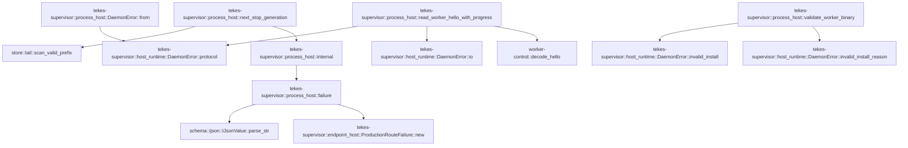

```mermaid
flowchart TD
  n0["engine::context::plan_context_compaction"]
  n1["schema::event::Event::from_value"]
  n2["schema::ijson::IJsonValue::parse"]
  n3["tekes-supervisor::host_runtime::DaemonError::protocol"]
  n4["tekes-supervisor::host_runtime::DaemonError::io"]
  n5["tekes-supervisor::host_runtime::DaemonError::invalid_config"]
  n6["tekes-supervisor::host_runtime::DaemonError::required_broker"]
  n7["tekes-supervisor::process_host::production_sandbox_backend"]
  n8["tekes-supervisor::process_host::ProductionProcessHost::publish_session_status"]
  n9["tekes-supervisor::process_host::ProductionProcessHost::refresh_worker_credentials"]
  n10["tekes-supervisor::process_host::ProductionProcessHost::ensure_verified"]
  n11["tekes-supervisor::process_host::spill_compaction_summary"]
  n12["tekes-supervisor::process_host::ProductionProcessHost::live_worker"]
  n13["tekes-supervisor::process_host::ProductionProcessHost::spawn_worker_at"]
  n14["tekes-supervisor::process_host::prompt_text"]
  n15["tekes-supervisor::process_host::ProductionProcessHost::worker_binary_digest"]
  n16["tekes-supervisor::process_host::ProductionProcessHost::refresh_limits"]
  n17["tekes-supervisor::process_host::ProductionProcessHost::preflight_mandatory_authorities"]
  n18["tekes-supervisor::process_host::ProductionProcessHost::is_mcp_only_app_sandbox_host"]
  n19["tekes-supervisor::process_host::ProductionProcessHost::freeze_tool_authority"]
  n20["tekes-supervisor::process_host::ProductionProcessHost::schedule_main"]
  n21["tekes-supervisor::process_host::ProductionProcessHost::schedule_line"]
  n22["tekes-supervisor::process_host::ProductionProcessHost::schedule_worker_at"]
  n23["tekes-supervisor::process_host::ProductionProcessHost::schedule_worker_at_with_startup"]
  n24["tekes-supervisor::process_host::ProductionProcessHost::spawn_reserved_worker"]
  n25["tekes-supervisor::process_host::ProductionProcessHost::schedule_child_from_parent"]
  n26["tekes-supervisor::process_host::ProductionProcessHost::wait_for_worker"]
  n27["tekes-supervisor::process_host::ProductionProcessHost::start_pending_workers"]
  n28["tekes-supervisor::process_host::ProductionProcessHost::has_worker_capacity"]
  n29["tekes-supervisor::process_host::ProductionProcessHost::request_provider_lease_with_liveness"]
  n30["tekes-supervisor::process_host::ProductionProcessHost::request_provider_lease_for_worker"]
  n31["tekes-supervisor::process_host::ProductionProcessHost::locked_prompt"]
  n32["tekes-supervisor::process_host::ProductionProcessHost::publish_queue_snapshot"]
  n33["tekes-supervisor::process_host::ProductionProcessHost::schedule_accepted_prompt"]
  n34["tekes-supervisor::process_host::ProductionProcessHost::locked_compact"]
  n35["tekes-supervisor::process_host::ProductionProcessHost::first_root_input"]
  n36["tekes-supervisor::process_host::ProductionProcessHost::seed_automatic_title"]
  n37["tekes-supervisor::process_host::ProductionProcessHost::spawn_automatic_title_refinement"]
  n38["tekes-supervisor::process_host::ProductionProcessHost::automatic_title_model_enabled"]
  n39["tekes-supervisor::process_host::ProductionProcessHost::summary_for_manual_compaction"]
  n40["tekes-supervisor::process_host::ProductionProcessHost::publish_appended"]
  n41["tekes-supervisor::process_host::ProductionProcessHost::reset_restart_backoff"]
  n42["tekes-supervisor::process_host::ProductionProcessHost::record_spawn_failure"]
  n43["tekes-supervisor::process_host::frozen_tool_launch_policy"]
  n44["tekes-supervisor::process_host::child_dependency_admitted"]
  n45["tekes-supervisor::process_host::terminate_worker"]
  n46["tekes-supervisor::process_host::steer_unavailable_error"]
  n47["tekes-supervisor::process_host::unresolved_parent_dependency"]
  n48["tekes-supervisor::process_host::line_schedule_target"]
  n49["tekes-supervisor::process_host::ledger_needs_worker"]
  n50["tekes-supervisor::process_host::internal"]
  n51["tools::runtime_backends::HelperJobLauncher::new"]
  n52["tools::runtime_backends::HelperJobLauncher::disabled"]
  n53["tools::sandbox::probe_backend"]
  n54["worker-control::encode_line"]
  n16 --> n5
  n17 --> n6
  n17 --> n7
  n17 --> n18
  n17 --> n51
  n17 --> n52
  n17 --> n53
  n18 --> n4
  n18 --> n6
  n19 --> n6
  n19 --> n7
  n19 --> n18
  n19 --> n43
  n19 --> n51
  n19 --> n52
  n19 --> n53
  n20 --> n22
  n21 --> n22
  n21 --> n25
  n21 --> n47
  n21 --> n48
  n22 --> n23
  n23 --> n3
  n23 --> n6
  n23 --> n9
  n23 --> n10
  n23 --> n12
  n23 --> n16
  n23 --> n24
  n23 --> n28
  n24 --> n6
  n24 --> n8
  n24 --> n13
  n24 --> n45
  n25 --> n6
  n25 --> n9
  n25 --> n16
  n25 --> n24
  n25 --> n28
  n25 --> n44
  n26 --> n6
  n27 --> n23
  n27 --> n28
  n27 --> n49
  n30 --> n29
  n30 --> n54
  n31 --> n2
  n31 --> n14
  n31 --> n32
  n31 --> n33
  n31 --> n35
  n31 --> n36
  n31 --> n37
  n31 --> n38
  n31 --> n41
  n31 --> n46
  n31 --> n50
  n33 --> n4
  n33 --> n42
  n34 --> n0
  n34 --> n1
  n34 --> n2
  n34 --> n11
  n34 --> n39
  n34 --> n40
  n34 --> n50
```

```mermaid
flowchart TD
  n0["endpoint::journal::EndpointJournal::open"]
  n1["engine::compaction_summary::admit_summary_artifact"]
  n2["engine::compaction_summary::summary_request_bytes"]
  n3["engine::compaction_summary::CompactionSummary::from_outcome"]
  n4["engine::compaction_summary::freeze_source_bundle"]
  n5["engine::context::plan_context_compaction"]
  n6["engine::permission_mode::read_permission_mode"]
  n7["provider::compaction_summary::prepare_summary_request"]
  n8["provider::compaction_summary::summary_completion_artifact"]
  n9["provider::http::HttpRuntime::new"]
  n10["schema::ijson::IJsonValue::parse"]
  n11["store::tail::scan_valid_prefix"]
  n12["store::tail::read_genesis"]
  n13["tekes-supervisor::host_runtime::DaemonError::protocol"]
  n14["tekes-supervisor::host_runtime::DaemonError::corrupt"]
  n15["tekes-supervisor::host_runtime::DaemonError::required_broker"]
  n16["tekes-supervisor::process_host::ProductionProcessHost::publish_session_status"]
  n17["tekes-supervisor::process_host::deterministic_automatic_thread_title"]
  n18["tekes-supervisor::process_host::normalized_automatic_thread_title"]
  n19["tekes-supervisor::process_host::automatic_title_origin"]
  n20["tekes-supervisor::process_host::ProductionProcessHost::is_mcp_only_app_sandbox_host"]
  n21["tekes-supervisor::process_host::automatic_title_policy"]
  n22["tekes-supervisor::process_host::truncate_automatic_title_source"]
  n23["tekes-supervisor::process_host::automatic_title_route"]
  n24["tekes-supervisor::process_host::session_model_route"]
  n25["tekes-supervisor::process_host::ProductionProcessHost::first_root_input"]
  n26["tekes-supervisor::process_host::ProductionProcessHost::seed_automatic_title"]
  n27["tekes-supervisor::process_host::ProductionProcessHost::try_seed_automatic_title"]
  n28["tekes-supervisor::process_host::ProductionProcessHost::wait_and_seed_automatic_title"]
  n29["tekes-supervisor::process_host::ProductionProcessHost::spawn_automatic_title_refinement"]
  n30["tekes-supervisor::process_host::ProductionProcessHost::spawn_automatic_title_seed_and_refinement"]
  n31["tekes-supervisor::process_host::ProductionProcessHost::automatic_title_model_enabled"]
  n32["tekes-supervisor::process_host::ProductionProcessHost::automatic_title_still_seed"]
  n33["tekes-supervisor::process_host::ProductionProcessHost::refine_automatic_title"]
  n34["tekes-supervisor::process_host::ProductionProcessHost::complete_automatic_text"]
  n35["tekes-supervisor::process_host::ProductionProcessHost::complete_automatic_terminal"]
  n36["tekes-supervisor::process_host::ProductionProcessHost::summary_for_manual_compaction"]
  n37["tekes-supervisor::process_host::ProductionProcessHost::generate_automatic_title"]
  n38["tekes-supervisor::process_host::ProductionProcessHost::current_tool_authority"]
  n39["tekes-supervisor::process_host::ProductionProcessHost::tool_authority_for_session"]
  n40["tekes-supervisor::process_host::ProductionProcessHost::handle_tool_control"]
  n41["tekes-supervisor::process_host::prepare_automatic_title_request"]
  n42["tekes-supervisor::process_host::ProductionProcessHost::handle_tool_continuation"]
  n43["tekes-supervisor::process_host::ProductionProcessHost::validate_child_proof"]
  n44["tekes-supervisor::process_host::ProductionProcessHost::publish_appended"]
  n45["tekes-supervisor::process_host::ProductionProcessHost::publish_appended_with"]
  n46["tekes-supervisor::process_host::ledger_damage_from_scan"]
  n47["tekes-supervisor::process_host::damage_under_lock"]
  n48["tekes-supervisor::production_tool_control::JobBrokerSupervisorAuthority::new"]
  n49["tekes-supervisor::production_tool_control::ProductionToolControlHandler::new"]
  n50["tekes-supervisor::production_tool_control::ProductionToolControlPolicy::new"]
  n51["tekes-supervisor::thread_card::journal_input"]
  n52["tekes-supervisor::thread_card::prepare"]
  n53["tekes-supervisor::tool_control::ToolControlSession::new"]
  n54["tools::runtime_backends::HelperJobLauncher::for_execution_access"]
  n55["tools::schema_registry::fixed_schema"]
  n56["worker-control::continuation::decode_tool_continuation"]
  n57["worker-control::continuation::encode_tool_continuation_result"]
  n25 --> n11
  n26 --> n27
  n27 --> n17
  n27 --> n19
  n27 --> n44
  n28 --> n27
  n31 --> n21
  n32 --> n11
  n33 --> n19
  n33 --> n21
  n33 --> n32
  n33 --> n37
  n33 --> n44
  n34 --> n35
  n35 --> n9
  n36 --> n1
  n36 --> n2
  n36 --> n3
  n36 --> n4
  n36 --> n5
  n36 --> n7
  n36 --> n8
  n36 --> n10
  n36 --> n11
  n36 --> n24
  n36 --> n35
  n36 --> n55
  n37 --> n18
  n37 --> n22
  n37 --> n23
  n37 --> n34
  n37 --> n41
  n38 --> n39
  n39 --> n6
  n39 --> n15
  n39 --> n20
  n39 --> n54
  n40 --> n13
  n40 --> n15
  n40 --> n38
  n40 --> n48
  n40 --> n49
  n40 --> n50
  n40 --> n53
  n42 --> n13
  n42 --> n15
  n42 --> n38
  n42 --> n48
  n42 --> n49
  n42 --> n50
  n42 --> n56
  n42 --> n57
  n43 --> n12
  n43 --> n14
  n44 --> n45
  n45 --> n0
  n45 --> n11
  n45 --> n14
  n45 --> n16
  n45 --> n46
  n45 --> n47
  n45 --> n51
  n45 --> n52
```

```mermaid
flowchart TD
  n0["endpoint::journal::EndpointJournal::open"]
  n1["engine::lifecycle::ensure_action_at"]
  n2["engine::lifecycle::classify"]
  n3["profile::resources::ResourceCatalog::skill_package_names"]
  n4["provider::request::endpoint_origin"]
  n5["schema::event::Event::from_value"]
  n6["schema::ijson::IJsonValue::parse"]
  n7["store::tail::LockedLedger::open"]
  n8["store::tail::scan_valid_prefix"]
  n9["store::tail::read_genesis"]
  n10["tekes-supervisor::host_runtime::system_timestamp"]
  n11["tekes-supervisor::host_runtime::DaemonError::protocol"]
  n12["tekes-supervisor::host_runtime::DaemonError::io"]
  n13["tekes-supervisor::host_runtime::DaemonError::invalid_config"]
  n14["tekes-supervisor::host_runtime::DaemonError::corrupt"]
  n15["tekes-supervisor::host_runtime::DaemonError::required_broker"]
  n16["tekes-supervisor::process_host::now_rfc3339"]
  n17["tekes-supervisor::process_host::session_event_time_now"]
  n18["tekes-supervisor::process_host::ProductionProcessHost::refresh_limits"]
  n19["tekes-supervisor::process_host::ProductionProcessHost::schedule_worker_at"]
  n20["tekes-supervisor::process_host::ProductionProcessHost::schedule_child_from_parent"]
  n21["tekes-supervisor::process_host::ProductionProcessHost::publish_appended"]
  n22["tekes-supervisor::process_host::ProductionProcessHost::publish_frame"]
  n23["tekes-supervisor::process_host::ProductionProcessHost::launch_child"]
  n24["tekes-supervisor::process_host::ProductionProcessHost::propagate_parent_stop"]
  n25["tekes-supervisor::process_host::ProductionProcessHost::cascade_stop_from"]
  n26["tekes-supervisor::process_host::ProductionProcessHost::reconcile_after_exit"]
  n27["tekes-supervisor::process_host::ProductionProcessHost::reset_restart_backoff"]
  n28["tekes-supervisor::process_host::ProductionProcessHost::restart_is_due"]
  n29["tekes-supervisor::process_host::ProductionProcessHost::note_restart_failure"]
  n30["tekes-supervisor::process_host::ProductionProcessHost::record_spawn_failure"]
  n31["tekes-supervisor::process_host::ProductionProcessHost::record_session_notice"]
  n32["tekes-supervisor::process_host::genesis_preset_skills"]
  n33["tekes-supervisor::process_host::missing_preset_skill_notice"]
  n34["tekes-supervisor::process_host::frozen_tool_launch_policy"]
  n35["tekes-supervisor::process_host::validator_tool_launch_policy"]
  n36["tekes-supervisor::process_host::private_validator_launch_policy"]
  n37["tekes-supervisor::process_host::web_search_scope_ready"]
  n38["tekes-supervisor::process_host::child_dependency_admitted"]
  n39["tekes-supervisor::process_host::WorkerHandle::write"]
  n40["tekes-supervisor::process_host::WorkerHandle::close_stdin"]
  n41["tekes-supervisor::process_host::WorkerHandle::wait_for_delivery"]
  n42["tekes-supervisor::process_host::terminate_worker"]
  n43["tekes-supervisor::process_host::line_schedule_target"]
  n44["tekes-supervisor::process_host::goal_continuation_due"]
  n45["tekes-supervisor::process_host::probe_line_lock"]
  n46["tekes-supervisor::process_host::internal"]
  n47["tools::preset::ResolvedPreset::from_genesis"]
  n48["tools::runtime_backends::JobLaunchPolicy::new"]
  n49["tools::sandbox::exposed_protected_roots"]
  n50["worker-control::encode_line"]
  n22 --> n0
  n22 --> n8
  n22 --> n14
  n22 --> n17
  n23 --> n1
  n23 --> n2
  n23 --> n8
  n23 --> n11
  n23 --> n14
  n23 --> n16
  n23 --> n20
  n23 --> n24
  n23 --> n45
  n24 --> n5
  n24 --> n6
  n24 --> n7
  n24 --> n8
  n24 --> n11
  n24 --> n14
  n24 --> n50
  n25 --> n8
  n25 --> n14
  n25 --> n20
  n25 --> n24
  n25 --> n25
  n25 --> n42
  n25 --> n43
  n26 --> n1
  n26 --> n2
  n26 --> n8
  n26 --> n14
  n26 --> n16
  n26 --> n18
  n26 --> n19
  n26 --> n21
  n26 --> n27
  n26 --> n28
  n26 --> n29
  n26 --> n44
  n26 --> n45
  n30 --> n31
  n31 --> n10
  n31 --> n21
  n32 --> n9
  n32 --> n47
  n33 --> n3
  n34 --> n13
  n34 --> n15
  n34 --> n48
  n34 --> n49
  n35 --> n8
  n35 --> n11
  n35 --> n14
  n35 --> n15
  n35 --> n36
  n36 --> n15
  n36 --> n48
  n37 --> n4
  n39 --> n12
  n41 --> n46
```

```mermaid
flowchart TD
  n0["schema::ijson::IJsonValue::parse"]
  n1["tekes-supervisor::endpoint_host::ProductionRouteFailure::new"]
  n2["tekes-supervisor::host_runtime::DaemonError::protocol"]
  n3["tekes-supervisor::process_host::prompt_text"]
  n4["tekes-supervisor::process_host::WorkerHandle::wait_for_delivery"]
  n5["tekes-supervisor::process_host::WorkerHandle::receipt"]
  n6["tekes-supervisor::process_host::WorkerHandle::receipt_confirmed"]
  n7["tekes-supervisor::process_host::WorkerHandle::queue_result_confirmed"]
  n8["tekes-supervisor::process_host::worker_reader"]
  n9["tekes-supervisor::process_host::terminate_worker"]
  n10["tekes-supervisor::process_host::fail_worker"]
  n11["tekes-supervisor::process_host::capture_worker_stderr"]
  n12["tekes-supervisor::process_host::preserve_first_failure"]
  n13["tekes-supervisor::process_host::ProductionProcessHost::workspace_metadata_changed"]
  n14["tekes-supervisor::process_host::ProductionProcessHost::session_metadata_changed"]
  n15["tekes-supervisor::process_host::ProductionProcessHost::prompt"]
  n16["tekes-supervisor::process_host::ProductionProcessHost::compact"]
  n17["tekes-supervisor::process_host::ProductionProcessHost::cancel"]
  n18["tekes-supervisor::process_host::ProductionProcessHost::rename"]
  n19["tekes-supervisor::process_host::ProductionProcessHost::deliver_if_live"]
  n20["tekes-supervisor::process_host::ProductionProcessHost::ensure_after_locked_append"]
  n21["tekes-supervisor::process_host::steer_unavailable_error"]
  n22["tekes-supervisor::process_host::accepted_but_not_confirmed_error"]
  n23["tekes-supervisor::process_host::cancel_stage_failure"]
  n24["tekes-supervisor::process_host::child_exited_within"]
  n25["tekes-supervisor::process_host::next_stop_generation"]
  n26["tekes-supervisor::process_host::internal"]
  n27["worker-control::continuation::decode_tool_continuation"]
  n28["worker-control::durable::decode_tool_control"]
  n29["worker-control::decode_worker"]
  n30["worker-control::encode_line"]
  n5 --> n4
  n5 --> n26
  n6 --> n4
  n6 --> n22
  n7 --> n4
  n7 --> n22
  n8 --> n2
  n8 --> n9
  n8 --> n10
  n8 --> n27
  n8 --> n28
  n8 --> n29
  n8 --> n30
  n10 --> n12
  n15 --> n3
  n15 --> n21
  n15 --> n24
  n15 --> n30
  n16 --> n24
  n16 --> n30
  n17 --> n9
  n17 --> n23
  n17 --> n24
  n17 --> n25
  n17 --> n26
  n17 --> n30
  n18 --> n24
  n18 --> n30
  n19 --> n24
  n19 --> n30
  n21 --> n0
  n21 --> n1
  n22 --> n0
  n22 --> n1
  n23 --> n1
```

```mermaid
flowchart TD
  n0["endpoint::service::genesis_cwd"]
  n1["endpoint::service::genesis_preset_summary"]
  n2["endpoint::service::permission_mode_of"]
  n3["endpoint::service::last_record_updated_ms"]
  n4["endpoint::types::validate_session_id"]
  n5["provider::dialect::validate_provider"]
  n6["provider::dialect::resolve_profile"]
  n7["provider::request::endpoint_origin"]
  n8["provider::secret_store::resolve_config_credentials"]
  n9["store::card::valid_line_name"]
  n10["store::folder_events::admitted_ids"]
  n11["store::tail::scan_valid_prefix"]
  n12["store::tail::read_genesis"]
  n13["tekes-supervisor::process_host::ProductionProcessHost::is_stale_ephemeral"]
  n14["tekes-supervisor::process_host::ProductionProcessHost::ensure_verified"]
  n15["tekes-supervisor::process_host::ProductionProcessHost::recently_failed"]
  n16["tekes-supervisor::process_host::child_exited_within"]
  n17["tekes-supervisor::process_host::neutral_lifecycle"]
  n18["tekes-supervisor::process_host::ledger_damage"]
  n19["tekes-supervisor::process_host::ledger_damage_from_scan"]
  n20["tekes-supervisor::process_host::damage_under_lock"]
  n21["tekes-supervisor::process_host::child_ledger_damage"]
  n22["tekes-supervisor::process_host::is_single_line_ledger"]
  n23["tekes-supervisor::process_host::ProductionProcessHost::list_wait"]
  n24["tekes-supervisor::process_host::ProductionProcessHost::is_running"]
  n25["tekes-supervisor::process_host::ProductionProcessHost::catalog_item"]
  n26["tekes-supervisor::process_host::ProductionProcessHost::verify_within"]
  n27["tekes-supervisor::process_host::ProductionProcessHost::build_inventory"]
  n28["tekes-supervisor::process_host::ProductionProcessHost::inventory_items"]
  n29["tekes-supervisor::process_host::ProductionProcessHost::ensure_verified"]
  n30["tekes-supervisor::process_host::ProductionProcessHost::has_catalog"]
  n31["tekes-supervisor::process_host::ProductionProcessHost::hold_catalog"]
  n32["tekes-supervisor::process_host::ProductionProcessHost::inventory_item"]
  n33["tekes-supervisor::process_host::ProductionProcessHost::live_sessions"]
  n34["tekes-supervisor::process_host::ProductionProcessHost::reconcile_projection"]
  n35["tekes-supervisor::process_host::ProductionProcessHost::execute"]
  n36["tekes-supervisor::process_host::ProductionProcessHost::readiness"]
  n37["worker-control::durable::encode_queue_transaction"]
  n18 --> n11
  n18 --> n19
  n20 --> n18
  n21 --> n9
  n21 --> n18
  n21 --> n20
  n25 --> n0
  n25 --> n1
  n25 --> n2
  n25 --> n3
  n25 --> n12
  n25 --> n13
  n25 --> n17
  n25 --> n22
  n25 --> n24
  n27 --> n4
  n27 --> n10
  n27 --> n15
  n27 --> n17
  n27 --> n25
  n27 --> n26
  n29 --> n14
  n35 --> n16
  n35 --> n37
  n36 --> n5
  n36 --> n6
  n36 --> n7
  n36 --> n8
```

```mermaid
flowchart TD
  n0["endpoint::types::validate_session_id"]
  n1["engine::lifecycle::ensure_action_at"]
  n2["engine::lifecycle::classify"]
  n3["schema::ijson::IJsonValue::parse"]
  n4["session-controls::read_goal"]
  n5["store::tail::scan_valid_prefix"]
  n6["tekes-supervisor::host_runtime::system_timestamp"]
  n7["tekes-supervisor::host_runtime::DaemonError::io"]
  n8["tekes-supervisor::host_runtime::DaemonError::invalid_config"]
  n9["tekes-supervisor::host_runtime::DaemonError::corrupt"]
  n10["tekes-supervisor::process_host::now_rfc3339"]
  n11["tekes-supervisor::process_host::ProductionProcessHost::config_mutation_succeeded"]
  n12["tekes-supervisor::process_host::ProcessToolRuntime::host"]
  n13["tekes-supervisor::process_host::ProcessToolRuntime::ensure_running"]
  n14["tekes-supervisor::process_host::ProcessToolRuntime::deliver_input"]
  n15["tekes-supervisor::process_host::ProcessToolRuntime::archive_session"]
  n16["tekes-supervisor::process_host::ProcessToolRuntime::interrupt"]
  n17["tekes-supervisor::process_host::ProcessToolRuntime::ensure_child"]
  n18["tekes-supervisor::process_host::ProcessToolRuntime::deliver_report"]
  n19["tekes-supervisor::process_host::unresolved_parent_dependency"]
  n20["tekes-supervisor::process_host::line_schedule_target"]
  n21["tekes-supervisor::process_host::operation_unavailable"]
  n22["tekes-supervisor::process_host::map_tool_archive_failure"]
  n23["tekes-supervisor::process_host::operation_value"]
  n24["tekes-supervisor::process_host::workspace_quiescence_lock_path"]
  n25["tekes-supervisor::process_host::scoped_client_file_path"]
  n26["tekes-supervisor::process_host::ledger_needs_worker"]
  n27["tekes-supervisor::process_host::goal_continuation_due"]
  n28["tekes-supervisor::process_host::probe_line_lock"]
  n29["tekes-supervisor::process_host::worker_startup_phase"]
  n30["tekes-supervisor::process_host::startup_log"]
  n13 --> n23
  n14 --> n6
  n14 --> n23
  n15 --> n0
  n15 --> n23
  n16 --> n5
  n16 --> n6
  n16 --> n7
  n16 --> n21
  n16 --> n23
  n17 --> n23
  n18 --> n23
  n19 --> n5
  n19 --> n9
  n19 --> n20
  n20 --> n9
  n23 --> n3
  n25 --> n8
  n26 --> n1
  n26 --> n2
  n26 --> n5
  n26 --> n9
  n26 --> n10
  n26 --> n27
  n26 --> n28
  n27 --> n4
  n27 --> n5
  n27 --> n8
  n27 --> n9
  n28 --> n7
  n28 --> n9
```

# tekes-supervisor::process_host

[Package atlas](index.md) · [Source](../../src/process_host.rs)

## Declarations

Visibility is the declaration spelling; trait members and reexports require their enclosing interface. `cfg` is not evaluated.

| Symbol | Kind | Visibility | Test / cfg |
|---|---|---|---|
| [tekes-supervisor::process_host::DELIVERY_TIMEOUT](../../src/process_host.rs#L58) | const_item | `private` |  |
| [tekes-supervisor::process_host::MCP_ONLY_APP_SANDBOX_MARKER](../../src/process_host.rs#L59) | const_item | `private` |  |
| [tekes-supervisor::process_host::WORKER_HANDSHAKE_TIMEOUT](../../src/process_host.rs#L63) | const_item | `private` |  |
| [tekes-supervisor::process_host::WORKER_STARTUP_SLOW_AFTER](../../src/process_host.rs#L68) | const_item | `private` |  |
| [tekes-supervisor::process_host::WORKER_HELLO_MAX_BYTES](../../src/process_host.rs#L69) | const_item | `private` |  |
| [tekes-supervisor::process_host::MANAGEMENT_RECOVERY_SECONDS](../../src/process_host.rs#L71) | const_item | `private` |  |
| [tekes-supervisor::process_host::PERIODIC_SWEEP_INTERVAL](../../src/process_host.rs#L72) | const_item | `private` |  |
| [tekes-supervisor::process_host::SweepLedgerIdentity](../../src/process_host.rs#L77) | struct_item | `private` |  |
| [tekes-supervisor::process_host::SweepLedgerIdentity::of](../../src/process_host.rs#L84) | function_item | `private` |  |
| [tekes-supervisor::process_host::SweepLedgerScan](../../src/process_host.rs#L97) | struct_item | `private` |  |
| [tekes-supervisor::process_host::AUTOMATIC_THREAD_TITLE_MAX_CHARS](../../src/process_host.rs#L106) | const_item | `private` |  |
| [tekes-supervisor::process_host::AUTOMATIC_THREAD_TITLE_TIMEOUT](../../src/process_host.rs#L107) | const_item | `private` |  |
| [tekes-supervisor::process_host::AUTOMATIC_THREAD_TITLE_MAX_OUTPUT_TOKENS](../../src/process_host.rs#L111) | const_item | `private` |  |
| [tekes-supervisor::process_host::COMPACTION_SUMMARY_TIMEOUT](../../src/process_host.rs#L112) | const_item | `private` |  |
| [tekes-supervisor::process_host::AUTOMATIC_THREAD_TITLE_SYSTEM](../../src/process_host.rs#L113) | const_item | `private` |  |
| [tekes-supervisor::process_host::LineLockState](../../src/process_host.rs#L116) | enum_item | `private` |  |
| [tekes-supervisor::process_host::production_sandbox_backend](../../src/process_host.rs#L121) | function_item | `private` |  |
| [tekes-supervisor::process_host::seq_ranges](../../src/process_host.rs#L132) | function_item | `private` |  |
| [tekes-supervisor::process_host::spill_compaction_summary](../../src/process_host.rs#L151) | function_item | `private` |  |
| [tekes-supervisor::process_host::now_rfc3339](../../src/process_host.rs#L168) | function_item | `private` |  |
| [tekes-supervisor::process_host::session_event_time_now](../../src/process_host.rs#L172) | function_item | `private` |  |
| [tekes-supervisor::process_host::session_event_time](../../src/process_host.rs#L176) | function_item | `private` |  |
| [tekes-supervisor::process_host::compact_title_source](../../src/process_host.rs#L186) | function_item | `private` |  |
| [tekes-supervisor::process_host::bounded_title](../../src/process_host.rs#L190) | function_item | `private` |  |
| [tekes-supervisor::process_host::deterministic_automatic_thread_title](../../src/process_host.rs#L197) | function_item | `private` |  |
| [tekes-supervisor::process_host::normalized_automatic_thread_title](../../src/process_host.rs#L201) | function_item | `private` |  |
| [tekes-supervisor::process_host::prompt_text](../../src/process_host.rs#L226) | function_item | `private` |  |
| [tekes-supervisor::process_host::automatic_title_origin](../../src/process_host.rs#L237) | function_item | `private` |  |
| [tekes-supervisor::process_host::automatic_title_policy](../../src/process_host.rs#L247) | function_item | `private` |  |
| [tekes-supervisor::process_host::truncate_automatic_title_source](../../src/process_host.rs#L262) | function_item | `private` |  |
| [tekes-supervisor::process_host::automatic_title_route](../../src/process_host.rs#L266) | function_item | `private` |  |
| [tekes-supervisor::process_host::session_model_route](../../src/process_host.rs#L300) | function_item | `private` |  |
| [tekes-supervisor::process_host::prepare_automatic_title_request](../../src/process_host.rs#L348) | function_item | `private` |  |
| [tekes-supervisor::process_host::prepare_automatic_text_request](../../src/process_host.rs#L365) | function_item | `private` |  |
| [tekes-supervisor::process_host::accepted_stream_event](../../src/process_host.rs#L416) | function_item | `private` | test; #[cfg(test)] |
| [tekes-supervisor::process_host::ProcessToolRuntime](../../src/process_host.rs#L431) | struct_item | `private` |  |
| [tekes-supervisor::process_host::ProductionProcessHost](../../src/process_host.rs#L435) | struct_item | `pub` |  |
| [tekes-supervisor::process_host::SessionProjectionCache](../../src/process_host.rs#L497) | struct_item | `private` |  |
| [tekes-supervisor::process_host::WorkerHandle](../../src/process_host.rs#L503) | struct_item | `private` |  |
| [tekes-supervisor::process_host::WorkerHandshakeGuard](../../src/process_host.rs#L526) | struct_item | `private` |  |
| [tekes-supervisor::process_host::WorkerHandshakeGuard::child_mut](../../src/process_host.rs#L533) | function_item | `private` |  |
| [tekes-supervisor::process_host::WorkerHandshakeGuard::take_child](../../src/process_host.rs#L537) | function_item | `private` |  |
| [tekes-supervisor::process_host::WorkerHandshakeGuard::take_credential_control](../../src/process_host.rs#L541) | function_item | `private` |  |
| [tekes-supervisor::process_host::WorkerHandshakeGuard::take_credential_broker](../../src/process_host.rs#L545) | function_item | `private` |  |
| [tekes-supervisor::process_host::WorkerHandshakeGuard::wait_for_exit](../../src/process_host.rs#L549) | function_item | `private` |  |
| [tekes-supervisor::process_host::WorkerHandshakeGuard::drop](../../src/process_host.rs#L562) | function_item | `private` |  |
| [tekes-supervisor::process_host::WorkerStartReservation](../../src/process_host.rs#L576) | struct_item | `private` |  |
| [tekes-supervisor::process_host::WorkerStartReservation::drop](../../src/process_host.rs#L581) | function_item | `private` |  |
| [tekes-supervisor::process_host::PendingWorker](../../src/process_host.rs#L592) | struct_item | `private` |  |
| [tekes-supervisor::process_host::WorkerProtocolQuarantine](../../src/process_host.rs#L599) | struct_item | `private` |  |
| [tekes-supervisor::process_host::RestartBackoff](../../src/process_host.rs#L606) | struct_item | `private` |  |
| [tekes-supervisor::process_host::ScheduledWorker](../../src/process_host.rs#L613) | struct_item | `private` |  |
| [tekes-supervisor::process_host::WorkerState](../../src/process_host.rs#L619) | struct_item | `private` |  |
| [tekes-supervisor::process_host::reconcile_credential_bindings](../../src/process_host.rs#L626) | function_item | `private` |  |
| [tekes-supervisor::process_host::credential_control](../../src/process_host.rs#L730) | function_item | `private` |  |
| [tekes-supervisor::process_host::active_material](../../src/process_host.rs#L741) | function_item | `private` |  |
| [tekes-supervisor::process_host::retain_prior_for_unknown_credentials](../../src/process_host.rs#L755) | function_item | `private` |  |
| [tekes-supervisor::process_host::ProductionProcessHost::open](../../src/process_host.rs#L798) | function_item | `pub` |  |
| [tekes-supervisor::process_host::ProductionProcessHost::open_with_secret_store](../../src/process_host.rs#L813) | function_item | `pub` |  |
| [tekes-supervisor::process_host::ProductionProcessHost::mcp_runtime](../../src/process_host.rs#L915) | function_item | `pub` |  |
| [tekes-supervisor::process_host::ProductionProcessHost::credential_is_ready](../../src/process_host.rs#L922) | function_item | `pub` |  |
| [tekes-supervisor::process_host::ProductionProcessHost::client_file_changes](../../src/process_host.rs#L934) | function_item | `pub(crate)` |  |
| [tekes-supervisor::process_host::ProductionProcessHost::client_file_page](../../src/process_host.rs#L966) | function_item | `pub(crate)` |  |
| [tekes-supervisor::process_host::ProductionProcessHost::session_scope](../../src/process_host.rs#L996) | function_item | `private` |  |
| [tekes-supervisor::process_host::ProductionProcessHost::user_agent_dir](../../src/process_host.rs#L1004) | function_item | `pub` |  |
| [tekes-supervisor::process_host::ProductionProcessHost::client_session_roots](../../src/process_host.rs#L1010) | function_item | `pub` |  |
| [tekes-supervisor::process_host::ProductionProcessHost::client_resource_catalog](../../src/process_host.rs#L1024) | function_item | `pub(crate)` |  |
| [tekes-supervisor::process_host::ProductionProcessHost::client_tool_catalog](../../src/process_host.rs#L1043) | function_item | `pub(crate)` |  |
| [tekes-supervisor::process_host::ProductionProcessHost::run_post_ready](../../src/process_host.rs#L1070) | function_item | `pub` |  |
| [tekes-supervisor::process_host::ProductionProcessHost::post_ready_tasks](../../src/process_host.rs#L1084) | function_item | `private` |  |
| [tekes-supervisor::process_host::ProductionProcessHost::cleanup_stale_ephemeral](../../src/process_host.rs#L1102) | function_item | `private` |  |
| [tekes-supervisor::process_host::ProductionProcessHost::live_sessions_for_cleanup](../../src/process_host.rs#L1127) | function_item | `private` |  |
| [tekes-supervisor::process_host::ProductionProcessHost::run_upgrade_pass](../../src/process_host.rs#L1140) | function_item | `private` |  |
| [tekes-supervisor::process_host::ProductionProcessHost::release_for_test](../../src/process_host.rs#L1183) | function_item | `pub(crate)` | test; #[cfg(test)] #[cfg_attr(not(target_os = "macos"), allow(dead_code))] |
| [tekes-supervisor::process_host::ProductionProcessHost::is_stale_ephemeral](../../src/process_host.rs#L1191) | function_item | `pub(crate)` |  |
| [tekes-supervisor::process_host::ProductionProcessHost::on_folder_event](../../src/process_host.rs#L1195) | function_item | `private` |  |
| [tekes-supervisor::process_host::ProductionProcessHost::attach_streams](../../src/process_host.rs#L1238) | function_item | `pub` |  |
| [tekes-supervisor::process_host::ProductionProcessHost::reconcile_child_line](../../src/process_host.rs#L1248) | function_item | `private` |  |
| [tekes-supervisor::process_host::ProductionProcessHost::publish_session_status](../../src/process_host.rs#L1266) | function_item | `private` |  |
| [tekes-supervisor::process_host::ProductionProcessHost::start_periodic_sweep](../../src/process_host.rs#L1283) | function_item | `pub` |  |
| [tekes-supervisor::process_host::ProductionProcessHost::recover_pending_management](../../src/process_host.rs#L1334) | function_item | `private` |  |
| [tekes-supervisor::process_host::ProductionProcessHost::refresh_live_credentials](../../src/process_host.rs#L1342) | function_item | `pub` |  |
| [tekes-supervisor::process_host::ProductionProcessHost::config_mutation_succeeded](../../src/process_host.rs#L1360) | function_item | `pub` |  |
| [tekes-supervisor::process_host::ProductionProcessHost::refresh_worker_credentials](../../src/process_host.rs#L1375) | function_item | `private` |  |
| [tekes-supervisor::process_host::ProductionProcessHost::boot_sweep](../../src/process_host.rs#L1414) | function_item | `pub` |  |
| [tekes-supervisor::process_host::ProductionProcessHost::arm_admission](../../src/process_host.rs#L1425) | function_item | `pub` |  |
| [tekes-supervisor::process_host::ProductionProcessHost::recover_client_sessions](../../src/process_host.rs#L1434) | function_item | `pub` |  |
| [tekes-supervisor::process_host::ProductionProcessHost::ensure_verified](../../src/process_host.rs#L1478) | function_item | `pub(crate)` |  |
| [tekes-supervisor::process_host::ProductionProcessHost::hydrate](../../src/process_host.rs#L1493) | function_item | `pub(crate)` |  |
| [tekes-supervisor::process_host::ProductionProcessHost::hydrate_with](../../src/process_host.rs#L1499) | function_item | `pub(crate)` |  |
| [tekes-supervisor::process_host::ProductionProcessHost::recently_failed](../../src/process_host.rs#L1519) | function_item | `private` |  |
| [tekes-supervisor::process_host::ProductionProcessHost::hydrate_unrecorded](../../src/process_host.rs#L1527) | function_item | `private` |  |
| [tekes-supervisor::process_host::ProductionProcessHost::repair_main_projection](../../src/process_host.rs#L1616) | function_item | `private` |  |
| [tekes-supervisor::process_host::ProductionProcessHost::periodic_sweep_once](../../src/process_host.rs#L1661) | function_item | `pub` |  |
| [tekes-supervisor::process_host::ProductionProcessHost::is_draining](../../src/process_host.rs#L1678) | function_item | `pub` |  |
| [tekes-supervisor::process_host::ProductionProcessHost::sweep_ledger_scan](../../src/process_host.rs#L1688) | function_item | `private` |  |
| [tekes-supervisor::process_host::ProductionProcessHost::sweep_once](../../src/process_host.rs#L1738) | function_item | `private` |  |
| [tekes-supervisor::process_host::ProductionProcessHost::sweep_ids](../../src/process_host.rs#L1777) | function_item | `private` |  |
| [tekes-supervisor::process_host::ProductionProcessHost::is_deferred](../../src/process_host.rs#L1806) | function_item | `private` |  |
| [tekes-supervisor::process_host::ProductionProcessHost::sweep_session](../../src/process_host.rs#L1818) | function_item | `private` |  |
| [tekes-supervisor::process_host::ProductionProcessHost::propagate_durable_stops_before_sweep](../../src/process_host.rs#L1901) | function_item | `private` |  |
| [tekes-supervisor::process_host::ProductionProcessHost::shutdown](../../src/process_host.rs#L1936) | function_item | `pub` |  |
| [tekes-supervisor::process_host::ProductionProcessHost::shutdown_with](../../src/process_host.rs#L1943) | function_item | `private` |  |
| [tekes-supervisor::process_host::ProductionProcessHost::ensure_running](../../src/process_host.rs#L2029) | function_item | `private` |  |
| [tekes-supervisor::process_host::ProductionProcessHost::live_worker](../../src/process_host.rs#L2043) | function_item | `private` |  |
| [tekes-supervisor::process_host::ProductionProcessHost::spawn_worker_at](../../src/process_host.rs#L2053) | function_item | `private` |  |
| [tekes-supervisor::process_host::ProductionProcessHost::spawn_worker_at_with_handshake_timeout](../../src/process_host.rs#L2069) | function_item | `private` |  |
| [tekes-supervisor::process_host::ProductionProcessHost::workspace_service_binary](../../src/process_host.rs#L2360) | function_item | `pub` |  |
| [tekes-supervisor::process_host::ProductionProcessHost::worker_binary_digest](../../src/process_host.rs#L2364) | function_item | `private` |  |
| [tekes-supervisor::process_host::ProductionProcessHost::refresh_limits](../../src/process_host.rs#L2369) | function_item | `private` |  |
| [tekes-supervisor::process_host::ProductionProcessHost::preflight_mandatory_authorities](../../src/process_host.rs#L2388) | function_item | `pub` |  |
| [tekes-supervisor::process_host::ProductionProcessHost::is_mcp_only_app_sandbox_host](../../src/process_host.rs#L2407) | function_item | `private` |  |
| [tekes-supervisor::process_host::ProductionProcessHost::freeze_tool_authority](../../src/process_host.rs#L2427) | function_item | `private` |  |
| [tekes-supervisor::process_host::ProductionProcessHost::schedule_main](../../src/process_host.rs#L2447) | function_item | `private` |  |
| [tekes-supervisor::process_host::ProductionProcessHost::schedule_line](../../src/process_host.rs#L2458) | function_item | `private` |  |
| [tekes-supervisor::process_host::ProductionProcessHost::schedule_worker_at](../../src/process_host.rs#L2474) | function_item | `private` |  |
| [tekes-supervisor::process_host::ProductionProcessHost::schedule_worker_at_with_startup](../../src/process_host.rs#L2485) | function_item | `private` |  |
| [tekes-supervisor::process_host::ProductionProcessHost::spawn_reserved_worker](../../src/process_host.rs#L2584) | function_item | `private` |  |
| [tekes-supervisor::process_host::ProductionProcessHost::schedule_child_from_parent](../../src/process_host.rs#L2616) | function_item | `private` |  |
| [tekes-supervisor::process_host::ProductionProcessHost::wait_for_worker](../../src/process_host.rs#L2672) | function_item | `private` |  |
| [tekes-supervisor::process_host::ProductionProcessHost::start_pending_workers](../../src/process_host.rs#L2700) | function_item | `private` |  |
| [tekes-supervisor::process_host::ProductionProcessHost::has_worker_capacity](../../src/process_host.rs#L2764) | function_item | `private` |  |
| [tekes-supervisor::process_host::ProductionProcessHost::request_provider_lease](../../src/process_host.rs#L2778) | function_item | `private` | test; #[cfg(test)] |
| [tekes-supervisor::process_host::ProductionProcessHost::request_provider_lease_with_liveness](../../src/process_host.rs#L2782) | function_item | `private` |  |
| [tekes-supervisor::process_host::ProductionProcessHost::request_provider_lease_for_worker](../../src/process_host.rs#L2825) | function_item | `private` |  |
| [tekes-supervisor::process_host::ProductionProcessHost::locked_prompt](../../src/process_host.rs#L2884) | function_item | `private` |  |
| [tekes-supervisor::process_host::ProductionProcessHost::publish_queue_snapshot](../../src/process_host.rs#L2919) | function_item | `private` |  |
| [tekes-supervisor::process_host::ProductionProcessHost::schedule_accepted_prompt](../../src/process_host.rs#L2932) | function_item | `private` |  |
| [tekes-supervisor::process_host::ProductionProcessHost::locked_compact](../../src/process_host.rs#L2961) | function_item | `private` |  |
| [tekes-supervisor::process_host::ProductionProcessHost::first_root_input](../../src/process_host.rs#L3038) | function_item | `private` |  |
| [tekes-supervisor::process_host::ProductionProcessHost::seed_automatic_title](../../src/process_host.rs#L3070) | function_item | `private` |  |
| [tekes-supervisor::process_host::ProductionProcessHost::try_seed_automatic_title](../../src/process_host.rs#L3082) | function_item | `private` |  |
| [tekes-supervisor::process_host::ProductionProcessHost::wait_and_seed_automatic_title](../../src/process_host.rs#L3110) | function_item | `private` |  |
| [tekes-supervisor::process_host::ProductionProcessHost::spawn_automatic_title_refinement](../../src/process_host.rs#L3135) | function_item | `private` |  |
| [tekes-supervisor::process_host::ProductionProcessHost::spawn_automatic_title_seed_and_refinement](../../src/process_host.rs#L3149) | function_item | `private` |  |
| [tekes-supervisor::process_host::ProductionProcessHost::automatic_title_model_enabled](../../src/process_host.rs#L3173) | function_item | `private` |  |
| [tekes-supervisor::process_host::ProductionProcessHost::automatic_title_still_seed](../../src/process_host.rs#L3180) | function_item | `private` |  |
| [tekes-supervisor::process_host::ProductionProcessHost::refine_automatic_title](../../src/process_host.rs#L3202) | function_item | `private` |  |
| [tekes-supervisor::process_host::ProductionProcessHost::complete_automatic_text](../../src/process_host.rs#L3246) | function_item | `private` |  |
| [tekes-supervisor::process_host::ProductionProcessHost::complete_automatic_terminal](../../src/process_host.rs#L3272) | function_item | `private` |  |
| [tekes-supervisor::process_host::ProductionProcessHost::summary_for_manual_compaction](../../src/process_host.rs#L3336) | function_item | `private` |  |
| [tekes-supervisor::process_host::ProductionProcessHost::generate_automatic_title](../../src/process_host.rs#L3407) | function_item | `private` |  |
| [tekes-supervisor::process_host::ProductionProcessHost::current_tool_authority](../../src/process_host.rs#L3437) | function_item | `private` |  |
| [tekes-supervisor::process_host::ProductionProcessHost::tool_authority_for_session](../../src/process_host.rs#L3449) | function_item | `private` |  |
| [tekes-supervisor::process_host::ProductionProcessHost::handle_tool_control](../../src/process_host.rs#L3476) | function_item | `private` |  |
| [tekes-supervisor::process_host::ProductionProcessHost::handle_tool_continuation](../../src/process_host.rs#L3512) | function_item | `private` |  |
| [tekes-supervisor::process_host::ProductionProcessHost::validate_child_proof](../../src/process_host.rs#L3551) | function_item | `private` |  |
| [tekes-supervisor::process_host::ProductionProcessHost::publish_appended](../../src/process_host.rs#L3568) | function_item | `private` |  |
| [tekes-supervisor::process_host::ProductionProcessHost::publish_appended_with](../../src/process_host.rs#L3574) | function_item | `private` |  |
| [tekes-supervisor::process_host::ProductionProcessHost::publish_frame](../../src/process_host.rs#L3804) | function_item | `private` |  |
| [tekes-supervisor::process_host::ProductionProcessHost::launch_child](../../src/process_host.rs#L3949) | function_item | `private` |  |
| [tekes-supervisor::process_host::ProductionProcessHost::propagate_parent_stop](../../src/process_host.rs#L4036) | function_item | `private` |  |
| [tekes-supervisor::process_host::ProductionProcessHost::cascade_stop_from](../../src/process_host.rs#L4129) | function_item | `private` |  |
| [tekes-supervisor::process_host::ProductionProcessHost::reconcile_after_exit](../../src/process_host.rs#L4215) | function_item | `private` |  |
| [tekes-supervisor::process_host::ProductionProcessHost::reset_restart_backoff](../../src/process_host.rs#L4278) | function_item | `private` |  |
| [tekes-supervisor::process_host::ProductionProcessHost::restart_is_due](../../src/process_host.rs#L4285) | function_item | `private` |  |
| [tekes-supervisor::process_host::ProductionProcessHost::note_restart_failure](../../src/process_host.rs#L4293) | function_item | `private` |  |
| [tekes-supervisor::process_host::ProductionProcessHost::record_spawn_failure](../../src/process_host.rs#L4334) | function_item | `private` |  |
| [tekes-supervisor::process_host::ProductionProcessHost::record_session_notice](../../src/process_host.rs#L4359) | function_item | `private` |  |
| [tekes-supervisor::process_host::genesis_preset_skills](../../src/process_host.rs#L4394) | function_item | `private` |  |
| [tekes-supervisor::process_host::missing_preset_skill_notice](../../src/process_host.rs#L4405) | function_item | `private` |  |
| [tekes-supervisor::process_host::frozen_tool_launch_policy](../../src/process_host.rs#L4426) | function_item | `private` |  |
| [tekes-supervisor::process_host::validator_tool_launch_policy](../../src/process_host.rs#L4456) | function_item | `private` |  |
| [tekes-supervisor::process_host::private_validator_launch_policy](../../src/process_host.rs#L4498) | function_item | `private` |  |
| [tekes-supervisor::process_host::web_search_scope_ready](../../src/process_host.rs#L4527) | function_item | `private` |  |
| [tekes-supervisor::process_host::child_dependency_admitted](../../src/process_host.rs#L4545) | function_item | `private` |  |
| [tekes-supervisor::process_host::WorkerHandle::write](../../src/process_host.rs#L4550) | function_item | `private` |  |
| [tekes-supervisor::process_host::WorkerHandle::close_stdin](../../src/process_host.rs#L4565) | function_item | `private` |  |
| [tekes-supervisor::process_host::WorkerHandle::wait_for_delivery](../../src/process_host.rs#L4574) | function_item | `private` |  |
| [tekes-supervisor::process_host::WorkerHandle::receipt](../../src/process_host.rs#L4603) | function_item | `private` |  |
| [tekes-supervisor::process_host::WorkerHandle::receipt_confirmed](../../src/process_host.rs#L4610) | function_item | `private` |  |
| [tekes-supervisor::process_host::WorkerHandle::queue_result_confirmed](../../src/process_host.rs#L4622) | function_item | `private` |  |
| [tekes-supervisor::process_host::worker_reader](../../src/process_host.rs#L4635) | function_item | `private` |  |
| [tekes-supervisor::process_host::terminate_worker](../../src/process_host.rs#L4897) | function_item | `private` |  |
| [tekes-supervisor::process_host::fail_worker](../../src/process_host.rs#L4934) | function_item | `private` |  |
| [tekes-supervisor::process_host::capture_worker_stderr](../../src/process_host.rs#L4958) | function_item | `private` |  |
| [tekes-supervisor::process_host::capture_worker_stderr::MAX_STDERR_TAIL](../../src/process_host.rs#L4959) | const_item | `private` |  |
| [tekes-supervisor::process_host::preserve_first_failure](../../src/process_host.rs#L4977) | function_item | `private` |  |
| [tekes-supervisor::process_host::ProductionProcessHost::workspace_metadata_changed](../../src/process_host.rs#L4984) | function_item | `private` |  |
| [tekes-supervisor::process_host::ProductionProcessHost::session_metadata_changed](../../src/process_host.rs#L4999) | function_item | `private` |  |
| [tekes-supervisor::process_host::ProductionProcessHost::prompt](../../src/process_host.rs#L5003) | function_item | `private` |  |
| [tekes-supervisor::process_host::ProductionProcessHost::compact](../../src/process_host.rs#L5069) | function_item | `private` |  |
| [tekes-supervisor::process_host::ProductionProcessHost::cancel](../../src/process_host.rs#L5108) | function_item | `private` |  |
| [tekes-supervisor::process_host::ProductionProcessHost::rename](../../src/process_host.rs#L5193) | function_item | `private` |  |
| [tekes-supervisor::process_host::ProductionProcessHost::deliver_if_live](../../src/process_host.rs#L5235) | function_item | `private` |  |
| [tekes-supervisor::process_host::ProductionProcessHost::ensure_after_locked_append](../../src/process_host.rs#L5259) | function_item | `private` |  |
| [tekes-supervisor::process_host::steer_unavailable_error](../../src/process_host.rs#L5273) | function_item | `private` |  |
| [tekes-supervisor::process_host::accepted_but_not_confirmed_error](../../src/process_host.rs#L5285) | function_item | `private` |  |
| [tekes-supervisor::process_host::cancel_stage_failure](../../src/process_host.rs#L5298) | function_item | `private` |  |
| [tekes-supervisor::process_host::child_exited_within](../../src/process_host.rs#L5317) | function_item | `private` |  |
| [tekes-supervisor::process_host::neutral_lifecycle](../../src/process_host.rs#L5339) | function_item | `private` |  |
| [tekes-supervisor::process_host::ledger_damage](../../src/process_host.rs#L5362) | function_item | `private` |  |
| [tekes-supervisor::process_host::ledger_damage_from_scan](../../src/process_host.rs#L5369) | function_item | `private` |  |
| [tekes-supervisor::process_host::DamageVerdict](../../src/process_host.rs#L5378) | enum_item | `private` |  |
| [tekes-supervisor::process_host::damage_under_lock](../../src/process_host.rs#L5394) | function_item | `private` |  |
| [tekes-supervisor::process_host::child_ledger_damage](../../src/process_host.rs#L5430) | function_item | `private` |  |
| [tekes-supervisor::process_host::is_single_line_ledger](../../src/process_host.rs#L5456) | function_item | `private` |  |
| [tekes-supervisor::process_host::HYDRATE_RETRY](../../src/process_host.rs#L5469) | const_item | `private` |  |
| [tekes-supervisor::process_host::DEFAULT_LIST_WAIT](../../src/process_host.rs#L5471) | const_item | `private` |  |
| [tekes-supervisor::process_host::ProductionProcessHost::list_wait](../../src/process_host.rs#L5474) | function_item | `private` |  |
| [tekes-supervisor::process_host::ProductionProcessHost::is_running](../../src/process_host.rs#L5489) | function_item | `private` |  |
| [tekes-supervisor::process_host::ProductionProcessHost::catalog_item](../../src/process_host.rs#L5499) | function_item | `private` |  |
| [tekes-supervisor::process_host::ProductionProcessHost::verify_within](../../src/process_host.rs#L5588) | function_item | `private` |  |
| [tekes-supervisor::process_host::ProductionProcessHost::build_inventory](../../src/process_host.rs#L5653) | function_item | `private` |  |
| [tekes-supervisor::process_host::ProductionProcessHost::inventory_items](../../src/process_host.rs#L5710) | function_item | `private` |  |
| [tekes-supervisor::process_host::ProductionProcessHost::ensure_verified](../../src/process_host.rs#L5720) | function_item | `private` |  |
| [tekes-supervisor::process_host::ProductionProcessHost::has_catalog](../../src/process_host.rs#L5735) | function_item | `private` |  |
| [tekes-supervisor::process_host::ProductionProcessHost::hold_catalog](../../src/process_host.rs#L5739) | function_item | `private` |  |
| [tekes-supervisor::process_host::ProductionProcessHost::inventory_item](../../src/process_host.rs#L5795) | function_item | `private` |  |
| [tekes-supervisor::process_host::ProductionProcessHost::live_sessions](../../src/process_host.rs#L5829) | function_item | `private` |  |
| [tekes-supervisor::process_host::ProductionProcessHost::reconcile_projection](../../src/process_host.rs#L5839) | function_item | `private` |  |
| [tekes-supervisor::process_host::ProductionProcessHost::execute](../../src/process_host.rs#L5849) | function_item | `private` |  |
| [tekes-supervisor::process_host::ProductionProcessHost::readiness](../../src/process_host.rs#L5921) | function_item | `private` |  |
| [tekes-supervisor::process_host::ProductionProcessHost::config_mutation_succeeded](../../src/process_host.rs#L5998) | function_item | `private` |  |
| [tekes-supervisor::process_host::ProcessToolRuntime::host](../../src/process_host.rs#L6022) | function_item | `private` |  |
| [tekes-supervisor::process_host::ProcessToolRuntime::ensure_running](../../src/process_host.rs#L6030) | function_item | `private` |  |
| [tekes-supervisor::process_host::ProcessToolRuntime::deliver_input](../../src/process_host.rs#L6041) | function_item | `private` |  |
| [tekes-supervisor::process_host::ProcessToolRuntime::archive_session](../../src/process_host.rs#L6077) | function_item | `private` |  |
| [tekes-supervisor::process_host::ProcessToolRuntime::interrupt](../../src/process_host.rs#L6103) | function_item | `private` |  |
| [tekes-supervisor::process_host::ProcessToolRuntime::ensure_child](../../src/process_host.rs#L6185) | function_item | `private` |  |
| [tekes-supervisor::process_host::ProcessToolRuntime::deliver_report](../../src/process_host.rs#L6199) | function_item | `private` |  |
| [tekes-supervisor::process_host::unresolved_parent_dependency](../../src/process_host.rs#L6221) | function_item | `private` |  |
| [tekes-supervisor::process_host::line_schedule_target](../../src/process_host.rs#L6299) | function_item | `private` |  |
| [tekes-supervisor::process_host::operation_unavailable](../../src/process_host.rs#L6335) | function_item | `private` |  |
| [tekes-supervisor::process_host::map_tool_archive_failure](../../src/process_host.rs#L6339) | function_item | `private` |  |
| [tekes-supervisor::process_host::archive_runtime_error_tests::archive_missing_or_inactive_target_is_not_a_retryable_outage](../../src/process_host.rs#L6364) | function_item | `private` | test; #[cfg(test)] |
| [tekes-supervisor::process_host::operation_value](../../src/process_host.rs#L6392) | function_item | `private` |  |
| [tekes-supervisor::process_host::workspace_quiescence_lock_path](../../src/process_host.rs#L6400) | function_item | `pub(crate)` |  |
| [tekes-supervisor::process_host::scoped_client_file_path](../../src/process_host.rs#L6405) | function_item | `private` |  |
| [tekes-supervisor::process_host::ledger_needs_worker](../../src/process_host.rs#L6448) | function_item | `private` |  |
| [tekes-supervisor::process_host::goal_continuation_due](../../src/process_host.rs#L6466) | function_item | `private` |  |
| [tekes-supervisor::process_host::probe_line_lock](../../src/process_host.rs#L6510) | function_item | `private` |  |
| [tekes-supervisor::process_host::worker_startup_phase](../../src/process_host.rs#L6546) | function_item | `private` |  |
| [tekes-supervisor::process_host::startup_log](../../src/process_host.rs#L6560) | function_item | `private` |  |
| [tekes-supervisor::process_host::read_worker_hello](../../src/process_host.rs#L6588) | function_item | `private` | test; #[cfg(test)] |
| [tekes-supervisor::process_host::read_worker_hello_with_progress](../../src/process_host.rs#L6595) | function_item | `private` |  |
| [tekes-supervisor::process_host::next_stop_generation](../../src/process_host.rs#L6687) | function_item | `private` |  |
| [tekes-supervisor::process_host::validate_worker_binary](../../src/process_host.rs#L6706) | function_item | `private` |  |
| [tekes-supervisor::process_host::failure](../../src/process_host.rs#L6718) | function_item | `private` |  |
| [tekes-supervisor::process_host::internal](../../src/process_host.rs#L6726) | function_item | `private` |  |
| [tekes-supervisor::process_host::DaemonError::from](../../src/process_host.rs#L6731) | function_item | `private` |  |
| [tekes-supervisor::process_host::tests::client_file_scope_uses_selected_directory_and_rejects_escape](../../src/process_host.rs#L6739) | function_item | `private` | test; #[cfg(test)] |
| [tekes-supervisor::process_host::tests::deepseek_title_provider](../../src/process_host.rs#L6783) | function_item | `private` | test; #[cfg(test)] |
| [tekes-supervisor::process_host::tests::serve_title_once](../../src/process_host.rs#L6806) | function_item | `private` | test; #[cfg(test)] |
| [tekes-supervisor::process_host::tests::serve_title_response](../../src/process_host.rs#L6821) | function_item | `private` | test; #[cfg(test)] |
| [tekes-supervisor::process_host::tests::automatic_title_text_normalization_matches_the_legacy_contract](../../src/process_host.rs#L6875) | function_item | `private` | test; #[cfg(test)] |
| [tekes-supervisor::process_host::tests::automatic_title_route_requires_explicit_model_mode_and_never_falls_back](../../src/process_host.rs#L6894) | function_item | `private` | test; #[cfg(test)] |
| [tekes-supervisor::process_host::tests::automatic_title_request_uses_explicit_target_and_truncates_input_chars](../../src/process_host.rs#L6943) | function_item | `private` | test; #[cfg(test)] |
| [tekes-supervisor::process_host::tests::automatic_title_uses_the_provider_runtime_and_normalizes_its_terminal](../../src/process_host.rs#L6989) | function_item | `private` | test; #[cfg(test)] |
| [tekes-supervisor::process_host::tests::automatic_title_rejects_cut_and_failed_responses](../../src/process_host.rs#L7049) | function_item | `private` | test; #[cfg(test)] |
| [tekes-supervisor::process_host::tests::automatic_title_request_fails_closed_without_a_reasoning_off_switch](../../src/process_host.rs#L7116) | function_item | `private` | test; #[cfg(test)] |
| [tekes-supervisor::process_host::tests::locked_manual_compact_covers_settled_history_and_is_keyed_by_origin](../../src/process_host.rs#L7149) | function_item | `private` | test; #[cfg(test)] |
| [tekes-supervisor::process_host::tests::full_access_job_authority_tracks_session_mode_and_preserves_private_boundaries](../../src/process_host.rs#L7248) | function_item | `private` | test; #[cfg(test)] |
| [tekes-supervisor::process_host::tests::worker_failure_preserves_first_root_cause](../../src/process_host.rs#L7327) | function_item | `private` | test; #[cfg(test)] |
| [tekes-supervisor::process_host::tests::restart_backoff_is_reason_scoped_bounded_and_user_resettable](../../src/process_host.rs#L7337) | function_item | `private` | test; #[cfg(test)] |
| [tekes-supervisor::process_host::tests::unavailable_credential_refresh_retains_last_authoritative_generation](../../src/process_host.rs#L7380) | function_item | `private` | test; #[cfg(test)] |
| [tekes-supervisor::process_host::tests::a_missing_preset_skill_is_one_warning](../../src/process_host.rs#L7418) | function_item | `private` | test; #[cfg(test)] |
| [tekes-supervisor::process_host::tests::durable_prompt_receipt_survives_spawn_failure_and_exact_retry_deduplicates](../../src/process_host.rs#L7448) | function_item | `private` | test; #[cfg(test)] #[cfg(target_os = "macos")] |
| [tekes-supervisor::process_host::tests::session_notices](../../src/process_host.rs#L7555) | function_item | `private` | test; #[cfg(test)] #[cfg(target_os = "macos")] |
| [tekes-supervisor::process_host::tests::late_provider_frame_does_not_reopen_sealed_output](../../src/process_host.rs#L7567) | function_item | `private` | test; #[cfg(test)] #[cfg(target_os = "macos")] |
| [tekes-supervisor::process_host::tests::late_provider_frame_does_not_reopen_sealed_output::SESSION](../../src/process_host.rs#L7568) | const_item | `private` | test; #[cfg(test)] #[cfg(target_os = "macos")] |
| [tekes-supervisor::process_host::tests::eager_tool_records_published_by_doorbell_do_not_drop_later_frames](../../src/process_host.rs#L7611) | function_item | `private` | test; #[cfg(test)] #[cfg(target_os = "macos")] |
| [tekes-supervisor::process_host::tests::eager_tool_records_published_by_doorbell_do_not_drop_later_frames::SESSION](../../src/process_host.rs#L7612) | const_item | `private` | test; #[cfg(test)] #[cfg(target_os = "macos")] |
| [tekes-supervisor::process_host::tests::late_stamped_frame_does_not_reopen_sealed_output](../../src/process_host.rs#L7696) | function_item | `private` | test; #[cfg(test)] #[cfg(target_os = "macos")] |
| [tekes-supervisor::process_host::tests::late_stamped_frame_does_not_reopen_sealed_output::SESSION](../../src/process_host.rs#L7697) | const_item | `private` | test; #[cfg(test)] #[cfg(target_os = "macos")] |
| [tekes-supervisor::process_host::tests::provider_frame_reaches_transient_sink_and_is_never_journaled](../../src/process_host.rs#L7734) | function_item | `private` | test; #[cfg(test)] |
| [tekes-supervisor::process_host::tests::provider_frame_reaches_transient_sink_and_is_never_journaled::SESSION](../../src/process_host.rs#L7735) | const_item | `private` | test; #[cfg(test)] |
| [tekes-supervisor::process_host::tests::block_on_ready](../../src/process_host.rs#L7821) | function_item | `private` | test; #[cfg(test)] |
| [tekes-supervisor::process_host::tests::appended_events_are_projected_before_any_endpoint_stream_is_attached](../../src/process_host.rs#L7833) | function_item | `private` | test; #[cfg(test)] #[cfg(target_os = "macos")] |
| [tekes-supervisor::process_host::tests::opening_a_thread_repairs_a_terminal_main_tail_missing_from_the_endpoint_journal](../../src/process_host.rs#L7882) | function_item | `private` | test; #[cfg(test)] #[cfg(target_os = "macos")] |
| [tekes-supervisor::process_host::tests::opening_a_thread_repairs_a_terminal_main_tail_missing_from_the_endpoint_journal::SESSION](../../src/process_host.rs#L7883) | const_item | `private` | test; #[cfg(test)] #[cfg(target_os = "macos")] |
| [tekes-supervisor::process_host::tests::attached_streams_report_inventory_running_from_the_line_lock_on_status_frames](../../src/process_host.rs#L7942) | function_item | `private` | test; #[cfg(test)] #[cfg(target_os = "macos")] |
| [tekes-supervisor::process_host::tests::periodic_sweep_repairs_a_stale_endpoint_journal_for_live_subscribers](../../src/process_host.rs#L8010) | function_item | `private` | test; #[cfg(test)] #[cfg(target_os = "macos")] |
| [tekes-supervisor::process_host::tests::periodic_sweep_repairs_a_stale_endpoint_journal_for_live_subscribers::SESSION](../../src/process_host.rs#L8011) | const_item | `private` | test; #[cfg(test)] #[cfg(target_os = "macos")] |
| [tekes-supervisor::process_host::tests::opening_a_mux_journal_reconciles_the_semantic_tail_first](../../src/process_host.rs#L8115) | function_item | `private` | test; #[cfg(test)] #[cfg(target_os = "macos")] |
| [tekes-supervisor::process_host::tests::opening_a_mux_journal_reconciles_the_semantic_tail_first::SESSION](../../src/process_host.rs#L8116) | const_item | `private` | test; #[cfg(test)] #[cfg(target_os = "macos")] |
| [tekes-supervisor::process_host::tests::wait_for_mux_frame](../../src/process_host.rs#L8168) | function_item | `private` | test; #[cfg(test)] #[cfg(target_os = "macos")] |
| [tekes-supervisor::process_host::tests::worker_exit_path_projects_the_settled_tail_and_refreshes_inventory](../../src/process_host.rs#L8200) | function_item | `private` | test; #[cfg(test)] #[cfg(target_os = "macos")] |
| [tekes-supervisor::process_host::tests::worker_exit_path_projects_the_settled_tail_and_refreshes_inventory::SESSION](../../src/process_host.rs#L8201) | const_item | `private` | test; #[cfg(test)] #[cfg(target_os = "macos")] |
| [tekes-supervisor::process_host::tests::sweep_retries_a_projection_that_failed_on_the_doorbell](../../src/process_host.rs#L8340) | function_item | `private` | test; #[cfg(test)] #[cfg(target_os = "macos")] |
| [tekes-supervisor::process_host::tests::sweep_retries_a_projection_that_failed_on_the_doorbell::SESSION](../../src/process_host.rs#L8341) | const_item | `private` | test; #[cfg(test)] #[cfg(target_os = "macos")] |
| [tekes-supervisor::process_host::tests::live_stream_time_is_integral_epoch_milliseconds](../../src/process_host.rs#L8405) | function_item | `private` | test; #[cfg(test)] |
| [tekes-supervisor::process_host::tests::terminal_attempt_pipe_tail_is_not_a_worker_failure](../../src/process_host.rs#L8412) | function_item | `private` | test; #[cfg(test)] |
| [tekes-supervisor::process_host::tests::report_wake_targets_the_exact_nested_parent_line](../../src/process_host.rs#L8428) | function_item | `private` | test; #[cfg(test)] |
| [tekes-supervisor::process_host::tests::report_wake_rejects_parent_line_aliases_and_path_escape](../../src/process_host.rs#L8438) | function_item | `private` | test; #[cfg(test)] |
| [tekes-supervisor::process_host::tests::child_dependency_overrides_only_its_live_parent_capacity_slot](../../src/process_host.rs#L8452) | function_item | `private` | test; #[cfg(test)] |
| [tekes-supervisor::process_host::tests::periodic_sweep_is_single_flight_and_stops_at_drain](../../src/process_host.rs#L8466) | function_item | `private` | test; #[cfg(test)] |
| [tekes-supervisor::process_host::tests::sweep_isolates_one_corrupt_session_and_still_recovers_the_next](../../src/process_host.rs#L8497) | function_item | `private` | test; #[cfg(test)] #[cfg(target_os = "macos")] |
| [tekes-supervisor::process_host::tests::builtin_recovery_waits_for_explicit_request_and_is_idempotent](../../src/process_host.rs#L8503) | function_item | `private` | test; #[cfg(test)] #[cfg(target_os = "macos")] |
| [tekes-supervisor::process_host::tests::client_recovery_receipt_lists_only_verified_released_sessions](../../src/process_host.rs#L8508) | function_item | `private` | test; #[cfg(test)] |
| [tekes-supervisor::process_host::tests::check_sweep_recovery](../../src/process_host.rs#L8583) | function_item | `private` | test; #[cfg(test)] #[cfg(target_os = "macos")] |
| [tekes-supervisor::process_host::tests::sweep_scans_a_ledger_once_per_file_identity](../../src/process_host.rs#L8682) | function_item | `private` | test; #[cfg(test)] |
| [tekes-supervisor::process_host::tests::sweep_quarantines_busy_unknown_until_the_file_lock_is_free](../../src/process_host.rs#L8723) | function_item | `private` | test; #[cfg(test)] #[cfg(target_os = "macos")] |
| [tekes-supervisor::process_host::tests::ensure_existing_worker_refreshes_adjacent_secret_revocation](../../src/process_host.rs#L8790) | function_item | `private` | test; #[cfg(test)] #[cfg(target_os = "macos")] |
| [tekes-supervisor::process_host::tests::queue_recovery_is_preloaded_during_worker_negotiation](../../src/process_host.rs#L8878) | function_item | `private` | test; #[cfg(test)] #[cfg(target_os = "macos")] |
| [tekes-supervisor::process_host::tests::pending_queue_recovery_survives_an_ordinary_ensure_race](../../src/process_host.rs#L8964) | function_item | `private` | test; #[cfg(test)] #[cfg(target_os = "macos")] |
| [tekes-supervisor::process_host::tests::queue_transaction_retries_same_identity_after_confirmed_child_exit](../../src/process_host.rs#L9074) | function_item | `private` | test; #[cfg(test)] #[cfg(target_os = "macos")] |
| [tekes-supervisor::process_host::tests::queue_transaction_does_not_retry_a_live_worker_failure](../../src/process_host.rs#L9195) | function_item | `private` | test; #[cfg(test)] #[cfg(target_os = "macos")] |
| [tekes-supervisor::process_host::tests::capacity_release_starts_a_pending_queue_transaction_on_a_settled_tail](../../src/process_host.rs#L9283) | function_item | `private` | test; #[cfg(test)] #[cfg(target_os = "macos")] |
| [tekes-supervisor::process_host::tests::no_mutual_worker_protocol_is_quarantined_until_binary_bytes_change](../../src/process_host.rs#L9403) | function_item | `private` | test; #[cfg(test)] #[cfg(target_os = "macos")] |
| [tekes-supervisor::process_host::tests::shutdown_interrupts_pre_main_hello_wait](../../src/process_host.rs#L9475) | function_item | `private` | test; #[cfg(test)] |
| [tekes-supervisor::process_host::tests::cold_worker_keeps_same_pid_past_slow_threshold](../../src/process_host.rs#L9498) | function_item | `private` | test; #[cfg(test)] |
| [tekes-supervisor::process_host::tests::startup_stderr_drains_before_hello_and_logs_only_allowlisted_witnesses](../../src/process_host.rs#L9535) | function_item | `private` | test; #[cfg(test)] |
| [tekes-supervisor::process_host::tests::worker_hello_timeout_kills_waits_and_closes_the_broker](../../src/process_host.rs#L9566) | function_item | `private` | test; #[cfg(test)] #[cfg(target_os = "macos")] |
| [tekes-supervisor::process_host::tests::malformed_worker_hello_kills_waits_and_closes_the_broker](../../src/process_host.rs#L9576) | function_item | `private` | test; #[cfg(test)] #[cfg(target_os = "macos")] |
| [tekes-supervisor::process_host::tests::worker_early_eof_is_reaped_before_spawn_returns](../../src/process_host.rs#L9586) | function_item | `private` | test; #[cfg(test)] #[cfg(target_os = "macos")] |
| [tekes-supervisor::process_host::tests::worker_without_a_startup_witness_times_out_and_is_reaped](../../src/process_host.rs#L9598) | function_item | `private` | test; #[cfg(test)] #[cfg(target_os = "macos")] |
| [tekes-supervisor::process_host::tests::assert_handshake_failure_reaps_worker](../../src/process_host.rs#L9626) | function_item | `private` | test; #[cfg(test)] #[cfg(target_os = "macos")] |
| [tekes-supervisor::process_host::tests::stop_cascade_durably_gates_the_entire_unpaired_spawn_graph](../../src/process_host.rs#L9761) | function_item | `private` | test; #[cfg(test)] #[cfg(target_os = "macos")] |
| [tekes-supervisor::process_host::tests::live_root_stop_receipt_precedes_the_same_durable_cascade](../../src/process_host.rs#L9767) | function_item | `private` | test; #[cfg(test)] #[cfg(target_os = "macos")] |
| [tekes-supervisor::process_host::tests::sweep_propagates_a_durable_root_stop_before_descendant_triage](../../src/process_host.rs#L9773) | function_item | `private` | test; #[cfg(test)] #[cfg(target_os = "macos")] |
| [tekes-supervisor::process_host::tests::exercise_stop_cascade](../../src/process_host.rs#L9858) | function_item | `private` | test; #[cfg(test)] #[cfg(target_os = "macos")] |
| [tekes-supervisor::process_host::tests::max_one_worker_dependency_chain_progresses_without_admitting_unrelated_work](../../src/process_host.rs#L9985) | function_item | `private` | test; #[cfg(test)] #[cfg(target_os = "macos")] |
| [tekes-supervisor::process_host::tests::prompt_after_confirmed_worker_exit_reuses_locked_origin](../../src/process_host.rs#L10150) | function_item | `private` | test; #[cfg(test)] #[cfg(target_os = "macos")] |
| [tekes-supervisor::process_host::tests::write_test_execution_config](../../src/process_host.rs#L10222) | function_item | `private` | test; #[cfg(test)] |
| [tekes-supervisor::process_host::tests::write_canonical_test_json](../../src/process_host.rs#L10244) | function_item | `private` | test; #[cfg(test)] #[cfg_attr(not(target_os = "macos"), allow(dead_code))] |
| [tekes-supervisor::process_host::tests::real_worker_recovers_final_before_settlement_with_resume_never](../../src/process_host.rs#L10253) | function_item | `private` | test; #[cfg(test)] #[cfg(target_os = "macos")] |
| [tekes-supervisor::process_host::tests::HELD_TS](../../src/process_host.rs#L10502) | const_item | `private` | test; #[cfg(test)] |
| [tekes-supervisor::process_host::tests::held_ledger_lines](../../src/process_host.rs#L10505) | function_item | `private` | test; #[cfg(test)] |
| [tekes-supervisor::process_host::tests::held_response_line](../../src/process_host.rs#L10551) | function_item | `private` | test; #[cfg(test)] #[cfg(target_os = "macos")] |
| [tekes-supervisor::process_host::tests::held_host](../../src/process_host.rs#L10558) | function_item | `private` | test; #[cfg(test)] #[cfg_attr(not(target_os = "macos"), allow(dead_code))] |
| [tekes-supervisor::process_host::tests::publish_appended_writes_a_fresh_card_that_matches_the_inventory_scan](../../src/process_host.rs#L10592) | function_item | `private` | test; #[cfg(test)] #[cfg(target_os = "macos")] |
| [tekes-supervisor::process_host::tests::card_writer_coalesces_and_flushes_at_shutdown](../../src/process_host.rs#L10639) | function_item | `private` | test; #[cfg(test)] #[cfg(target_os = "macos")] |
| [tekes-supervisor::process_host::tests::publish_appended_fast_path_publishes_the_pending_hold_from_one_decode](../../src/process_host.rs#L10672) | function_item | `private` | test; #[cfg(test)] #[cfg(target_os = "macos")] |
| [tekes-supervisor::process_host::tests::publish_appended_with_a_grown_ledger_does_not_resurrect_a_resolved_hold](../../src/process_host.rs#L10691) | function_item | `private` | test; #[cfg(test)] #[cfg(target_os = "macos")] |
| [tekes-supervisor::process_host::tests::a_reused_session_id_does_not_inherit_the_old_actionable_high_water_mark](../../src/process_host.rs#L10725) | function_item | `private` | test; #[cfg(test)] #[cfg(target_os = "macos")] |
| [tekes-supervisor::process_host::tests::held_thread_on_disk](../../src/process_host.rs#L10769) | function_item | `private` | test; #[cfg(test)] #[cfg_attr(not(target_os = "macos"), allow(dead_code))] |
| [tekes-supervisor::process_host::tests::the_catalog_list_equals_the_scan_list_and_a_late_thread_is_a_placeholder](../../src/process_host.rs#L10786) | function_item | `private` | test; #[cfg(test)] #[cfg(target_os = "macos")] |
| [tekes-supervisor::process_host::tests::only_threads_this_process_published_or_unarchived_are_admitted](../../src/process_host.rs#L10908) | function_item | `private` | test; #[cfg(test)] #[cfg(target_os = "macos")] |
| [tekes-supervisor::process_host::tests::open_host](../../src/process_host.rs#L10937) | function_item | `private` | test; #[cfg(test)] #[cfg_attr(not(target_os = "macos"), allow(dead_code))] |
| [tekes-supervisor::process_host::tests::poll_until_ready](../../src/process_host.rs#L10960) | function_item | `private` | test; #[cfg(test)] #[cfg_attr(not(target_os = "macos"), allow(dead_code))] |
| [tekes-supervisor::process_host::tests::a_thread_published_after_the_catalog_loaded_is_listed_swept_and_blank](../../src/process_host.rs#L10979) | function_item | `private` | test; #[cfg(test)] #[cfg(target_os = "macos")] |
| [tekes-supervisor::process_host::tests::idle_rename_sweep_updates_existing_unmounted_inventory](../../src/process_host.rs#L11032) | function_item | `private` | test; #[cfg(test)] #[cfg(target_os = "macos")] |
| [tekes-supervisor::process_host::tests::idle_title_inventory_recovers_after_a_transient_line_lock](../../src/process_host.rs#L11151) | function_item | `private` | test; #[cfg(test)] #[cfg(target_os = "macos")] |
| [tekes-supervisor::process_host::tests::hydrations_run_in_parallel_and_never_hold_up_a_doorbell](../../src/process_host.rs#L11362) | function_item | `private` | test; #[cfg(test)] #[cfg(target_os = "macos")] |
| [tekes-supervisor::process_host::tests::a_complete_invalid_line_quarantines_and_is_not_rehydrated](../../src/process_host.rs#L11437) | function_item | `private` | test; #[cfg(test)] #[cfg(target_os = "macos")] |
| [tekes-supervisor::process_host::tests::damage_in_a_held_ledger_is_deferred_until_the_lock_is_free](../../src/process_host.rs#L11480) | function_item | `private` | test; #[cfg(test)] #[cfg(target_os = "macos")] |
| [tekes-supervisor::process_host::tests::a_placeholder_row_is_followed_by_the_real_row_as_an_upsert](../../src/process_host.rs#L11527) | function_item | `private` | test; #[cfg(test)] #[cfg(target_os = "macos")] |
| [tekes-supervisor::process_host::tests::a_client_unarchive_admits_the_thread_and_lists_it_again](../../src/process_host.rs#L11574) | function_item | `private` | test; #[cfg(test)] #[cfg(target_os = "macos")] |
| [tekes-supervisor::process_host::tests::shutdown_stops_workers_before_it_flushes_the_cards_of_live_threads](../../src/process_host.rs#L11606) | function_item | `private` | test; #[cfg(test)] #[cfg(target_os = "macos")] |
| [tekes-supervisor::process_host::tests::a_fold_between_card_writes_does_not_rebuild_the_card_view](../../src/process_host.rs#L11641) | function_item | `private` | test; #[cfg(test)] #[cfg(target_os = "macos")] |
| [tekes-supervisor::process_host::tests::a_complete_invalid_line_in_a_child_ledger_quarantines_the_thread](../../src/process_host.rs#L11704) | function_item | `private` | test; #[cfg(test)] #[cfg(target_os = "macos")] |
| [tekes-supervisor::process_host::tests::a_published_folder_enters_the_catalog_unread](../../src/process_host.rs#L11727) | function_item | `private` | test; #[cfg(test)] #[cfg(target_os = "macos")] |
| [tekes-supervisor::process_host::tests::the_management_recovery_tick_runs_on_an_idle_root_and_reads_no_thread](../../src/process_host.rs#L11754) | function_item | `private` | test; #[cfg(test)] #[cfg(target_os = "macos")] |
| [tekes-supervisor::process_host::tests::a_thread_that_fails_verification_is_not_retried_by_every_list](../../src/process_host.rs#L11776) | function_item | `private` | test; #[cfg(test)] #[cfg(target_os = "macos")] |
| [tekes-supervisor::process_host::tests::opening_a_thread_bypasses_the_list_backoff](../../src/process_host.rs#L11809) | function_item | `private` | test; #[cfg(test)] #[cfg(target_os = "macos")] |
| [tekes-supervisor::process_host::tests::the_list_verifies_the_newest_ledgers_first](../../src/process_host.rs#L11835) | function_item | `private` | test; #[cfg(test)] #[cfg(target_os = "macos")] |
| [tekes-supervisor::process_host::tests::the_ready_path_does_not_read_any_thread_or_archive_folder](../../src/process_host.rs#L11882) | function_item | `private` | test; #[cfg(test)] #[cfg(target_os = "macos")] |
| [tekes-supervisor::process_host::tests::the_ready_path_does_not_read_any_thread_or_archive_folder::Restore](../../src/process_host.rs#L11900) | struct_item | `private` | test; #[cfg(test)] #[cfg(target_os = "macos")] |
| [tekes-supervisor::process_host::tests::the_ready_path_does_not_read_any_thread_or_archive_folder::Restore::drop](../../src/process_host.rs#L11902) | function_item | `private` | test; #[cfg(test)] #[cfg(target_os = "macos")] |
| [tekes-supervisor::process_host::tests::a_stale_projection_cannot_overwrite_a_newer_published_actionable_set](../../src/process_host.rs#L11937) | function_item | `private` | test; #[cfg(test)] #[cfg(target_os = "macos")] |
| [tekes-supervisor::process_host::tests::publish_appended_with_a_torn_tail_keeps_the_previous_error_path](../../src/process_host.rs#L11969) | function_item | `private` | test; #[cfg(test)] #[cfg(target_os = "macos")] |
| [tekes-supervisor::process_host::tests::write_test_genesis](../../src/process_host.rs#L11984) | function_item | `private` | test; #[cfg(test)] |
| [tekes-supervisor::process_host::tests::write_test_genesis_with_identity](../../src/process_host.rs#L11989) | function_item | `private` | test; #[cfg(test)] |
| [tekes-supervisor::process_host::tests::append_test_input](../../src/process_host.rs#L12018) | function_item | `private` | test; #[cfg(test)] |
| [tekes-supervisor::process_host::tests::append_test_stop](../../src/process_host.rs#L12041) | function_item | `private` | test; #[cfg(test)] #[cfg(target_os = "macos")] |
| [tekes-supervisor::process_host::tests::write_test_spawn_line](../../src/process_host.rs#L12064) | function_item | `private` | test; #[cfg(test)] #[cfg(target_os = "macos")] |
| [tekes-supervisor::process_host::tests::write_test_child_genesis](../../src/process_host.rs#L12124) | function_item | `private` | test; #[cfg(test)] #[cfg(target_os = "macos")] |
| [tekes-supervisor::process_host::tests::write_test_events](../../src/process_host.rs#L12148) | function_item | `private` | test; #[cfg(test)] #[cfg(target_os = "macos")] |
| [tekes-supervisor::process_host::tests::CHILD_TS](../../src/process_host.rs#L12161) | const_item | `private` | test; #[cfg(test)] #[cfg_attr(not(target_os = "macos"), allow(dead_code))] |
| [tekes-supervisor::process_host::tests::write_thread_with_child](../../src/process_host.rs#L12166) | function_item | `private` | test; #[cfg(test)] #[cfg(target_os = "macos")] |
| [tekes-supervisor::process_host::tests::child_request_event](../../src/process_host.rs#L12207) | function_item | `private` | test; #[cfg(test)] #[cfg(target_os = "macos")] |
| [tekes-supervisor::process_host::tests::child_response_event](../../src/process_host.rs#L12212) | function_item | `private` | test; #[cfg(test)] #[cfg(target_os = "macos")] |
| [tekes-supervisor::process_host::tests::append_test_events](../../src/process_host.rs#L12218) | function_item | `private` | test; #[cfg(test)] #[cfg(target_os = "macos")] |
| [tekes-supervisor::process_host::tests::child_rpc_id](../../src/process_host.rs#L12231) | function_item | `private` | test; #[cfg(test)] #[cfg(target_os = "macos")] |
| [tekes-supervisor::process_host::tests::a_live_child_hold_is_in_the_baseline_of_a_verified_thread_until_it_is_answered](../../src/process_host.rs#L12246) | function_item | `private` | test; #[cfg(test)] #[cfg(target_os = "macos")] |
| [tekes-supervisor::process_host::tests::a_child_exit_announces_a_hold_no_doorbell_announced](../../src/process_host.rs#L12287) | function_item | `private` | test; #[cfg(test)] #[cfg(target_os = "macos")] |
| [tekes-supervisor::process_host::tests::a_doorbell_fold_clears_child_exactness_and_the_prefilter_finds_the_new_hold](../../src/process_host.rs#L12312) | function_item | `private` | test; #[cfg(test)] #[cfg(target_os = "macos")] |
| [tekes-supervisor::process_host::tests::actionables_recomputes_do_not_reread_unchanged_child_files](../../src/process_host.rs#L12364) | function_item | `private` | test; #[cfg(test)] #[cfg(target_os = "macos")] |
| [tekes-supervisor::process_host::tests::a_busy_stale_scratch_thread_is_removed_by_the_retry](../../src/process_host.rs#L12402) | function_item | `private` | test; #[cfg(test)] #[cfg(target_os = "macos")] |
| [tekes-supervisor::process_host::tests::hydration_removes_a_dead_processs_card_temporary](../../src/process_host.rs#L12429) | function_item | `private` | test; #[cfg(test)] #[cfg(target_os = "macos")] |
| [tekes-supervisor::process_host::tests::hold_line_lock](../../src/process_host.rs#L12447) | function_item | `private` | test; #[cfg(test)] |
| [tekes-supervisor::process_host::tests::damage_is_decided_under_the_line_lock](../../src/process_host.rs#L12461) | function_item | `private` | test; #[cfg(test)] |
| [tekes-supervisor::process_host::tests::ledger_damage_from_scan_matches_wrapper_for_ledger_shapes](../../src/process_host.rs#L12516) | function_item | `private` | test; #[cfg(test)] |
| [tekes-supervisor::process_host::tests::ledger_damage_from_scan_matches_wrapper_for_ledger_shapes::CHILD_ENV](../../src/process_host.rs#L12517) | const_item | `private` | test; #[cfg(test)] |
| [tekes-supervisor::process_host::tests::ledger_damage_from_scan_matches_wrapper_for_ledger_shapes::TEST_NAME](../../src/process_host.rs#L12518) | const_item | `private` | test; #[cfg(test)] |
| [tekes-supervisor::process_host::tests::provider_admission_waits_fairly_and_drain_denies_waiter](../../src/process_host.rs#L12597) | function_item | `private` | test; #[cfg(test)] |
| [tekes-supervisor::process_host::tests::second_prompt_receipts_while_another_worker_waits_for_saturated_provider_lease](../../src/process_host.rs#L12659) | function_item | `private` | test; #[cfg(test)] #[cfg(target_os = "macos")] |
| [tekes-supervisor::process_host::tests::shutdown_closes_worker_stdin_for_graceful_teardown_and_stops_descendants](../../src/process_host.rs#L12803) | function_item | `private` | test; #[cfg(test)] #[cfg(target_os = "macos")] |
| [tekes-supervisor::process_host::tests::steer_prompt_on_idle_and_settled_sessions_returns_steer_unavailable_without_side_effects](../../src/process_host.rs#L12883) | function_item | `private` | test; #[cfg(test)] |
| [tekes-supervisor::process_host::tests::live_worker_steer_rejection_returns_steer_unavailable_without_title_or_queue_effects](../../src/process_host.rs#L13008) | function_item | `private` | test; #[cfg(test)] #[cfg(target_os = "macos")] |

## Imports / reexports

| Local name | Source path | Visibility |
|---|---|---|
| `BTreeMap` | `std::collections::BTreeMap` | `private` |
| `BTreeSet` | `std::collections::BTreeSet` | `private` |
| `HashMap` | `std::collections::HashMap` | `private` |
| `HashSet` | `std::collections::HashSet` | `private` |
| `VecDeque` | `std::collections::VecDeque` | `private` |
| `fs` | `std::fs` | `private` |
| `BufRead` | `std::io::BufRead` | `private` |
| `BufReader` | `std::io::BufReader` | `private` |
| `Read` | `std::io::Read` | `private` |
| `Write` | `std::io::Write` | `private` |
| `AsRawFd` | `std::os::fd::AsRawFd` | `private` |
| `MetadataExt` | `std::os::unix::fs::MetadataExt` | `private` |
| `OpenOptionsExt` | `std::os::unix::fs::OpenOptionsExt` | `private` |
| `Path` | `std::path::Path` | `private` |
| `PathBuf` | `std::path::PathBuf` | `private` |
| `Child` | `std::process::Child` | `private` |
| `ChildStdin` | `std::process::ChildStdin` | `private` |
| `AtomicBool` | `std::sync::atomic::AtomicBool` | `private` |
| `AtomicU64` | `std::sync::atomic::AtomicU64` | `private` |
| `Ordering` | `std::sync::atomic::Ordering` | `private` |
| `Arc` | `std::sync::Arc` | `private` |
| `Condvar` | `std::sync::Condvar` | `private` |
| `Mutex` | `std::sync::Mutex` | `private` |
| `TryLockError` | `std::sync::TryLockError` | `private` |
| `Weak` | `std::sync::Weak` | `private` |
| `Duration` | `std::time::Duration` | `private` |
| `Instant` | `std::time::Instant` | `private` |
| `UNIX_EPOCH` | `std::time::UNIX_EPOCH` | `private` |
| `Utc` | `chrono::Utc` | `private` |
| `AUTOMATIC_TITLE_REFINE_OPERATION` | `endpoint::AUTOMATIC_TITLE_REFINE_OPERATION` | `private` |
| `AUTOMATIC_TITLE_SEED_OPERATION` | `endpoint::AUTOMATIC_TITLE_SEED_OPERATION` | `private` |
| `AcceptedStreamFrame` | `endpoint::AcceptedStreamFrame` | `private` |
| `EndpointJournal` | `endpoint::EndpointJournal` | `private` |
| `MaterializedPrompt` | `endpoint::MaterializedPrompt` | `private` |
| `MutationReceipt` | `endpoint::MutationReceipt` | `private` |
| `NativeEndpoint` | `endpoint::NativeEndpoint` | `private` |
| `Projector` | `endpoint::Projector` | `private` |
| `SESSION_NOTICE_OPERATION` | `endpoint::SESSION_NOTICE_OPERATION` | `private` |
| `SessionInventoryItem` | `endpoint::SessionInventoryItem` | `private` |
| `SessionNotice` | `endpoint::SessionNotice` | `private` |
| `SessionNoticeSeverity` | `endpoint::SessionNoticeSeverity` | `private` |
| `AdmissionLease` | `engine::AdmissionLease` | `private` |
| `AdmissionPool` | `engine::AdmissionPool` | `private` |
| `EnsureAction` | `engine::EnsureAction` | `private` |
| `LockFacts` | `engine::LockFacts` | `private` |
| `classify` | `engine::classify` | `private` |
| `ensure_action_at` | `engine::ensure_action_at` | `private` |
| `ConfigRepository` | `profile::ConfigRepository` | `private` |
| `ConfigSnapshot` | `profile::ConfigSnapshot` | `private` |
| `DynamicToolCatalog` | `profile::DynamicToolCatalog` | `private` |
| `Block` | `schema::Block` | `private` |
| `Event` | `schema::Event` | `private` |
| `EventKind` | `schema::EventKind` | `private` |
| `IJsonValue` | `schema::IJsonValue` | `private` |
| `OriginTuple` | `schema::OriginTuple` | `private` |
| `Digest` | `sha2::Digest` | `private` |
| `Sha256` | `sha2::Sha256` | `private` |
| `AssetStore` | `store::AssetStore` | `private` |
| `LockedLedger` | `store::LockedLedger` | `private` |
| `ThreadStore` | `store::ThreadStore` | `private` |
| `scan_valid_prefix` | `store::scan_valid_prefix` | `private` |
| `ApprovalResponse` | `worker_control::ApprovalResponse` | `private` |
| `Frame` | `worker_control::Frame` | `private` |
| `FrameChannel` | `worker_control::FrameChannel` | `private` |
| `Input` | `worker_control::Input` | `private` |
| `LaunchChild` | `worker_control::LaunchChild` | `private` |
| `LaunchResult` | `worker_control::LaunchResult` | `private` |
| `Lease` | `worker_control::Lease` | `private` |
| `Meta` | `worker_control::Meta` | `private` |
| `Receipt` | `worker_control::Receipt` | `private` |
| `Reject` | `worker_control::Reject` | `private` |
| `Stop` | `worker_control::Stop` | `private` |
| `WorkerMessage` | `worker_control::WorkerMessage` | `private` |
| `decode_hello` | `worker_control::decode_hello` | `private` |
| `decode_worker` | `worker_control::decode_worker` | `private` |
| `encode_line` | `worker_control::encode_line` | `private` |
| `QueueTransaction` | `worker_control::QueueTransaction` | `private` |
| `QueueTransactionResult` | `worker_control::QueueTransactionResult` | `private` |
| `Selection` | `worker_control::Selection` | `private` |
| `WorkerStartup` | `worker_control::WorkerStartup` | `private` |
| `decode_tool_control` | `worker_control::decode_tool_control` | `private` |
| `encode_queue_transaction` | `worker_control::encode_queue_transaction` | `private` |
| `resolve_worker_launch_bindings` | `crate::dynamic_bindings::resolve_worker_launch_bindings` | `private` |
| `HoldCatalog` | `crate::endpoint_carrier::HoldCatalog` | `private` |
| `HoldRef` | `crate::endpoint_carrier::HoldRef` | `private` |
| `LiveRespondAuthority` | `crate::endpoint_carrier::LiveRespondAuthority` | `private` |
| `ProductionCarrierError` | `crate::endpoint_carrier::ProductionCarrierError` | `private` |
| `ProductionCarrierStreams` | `crate::endpoint_carrier::ProductionCarrierStreams` | `private` |
| `SessionGateError` | `crate::endpoint_carrier::SessionGateError` | `private` |
| `SupervisorSessionAuthority` | `crate::endpoint_carrier::SupervisorSessionAuthority` | `private` |
| `VerifiedHolds` | `crate::endpoint_carrier::VerifiedHolds` | `private` |
| `ProductionRouteFailure` | `crate::endpoint_host::ProductionRouteFailure` | `private` |
| `ProviderReadinessAuthority` | `crate::endpoint_host::ProviderReadinessAuthority` | `private` |
| `QueueTransactionAuthority` | `crate::endpoint_host::QueueTransactionAuthority` | `private` |
| `RuntimeModelReadiness` | `crate::endpoint_host::RuntimeModelReadiness` | `private` |
| `RuntimeProviderFailure` | `crate::endpoint_host::RuntimeProviderFailure` | `private` |
| `RuntimeProviderReadiness` | `crate::endpoint_host::RuntimeProviderReadiness` | `private` |
| `RuntimeProviderStatus` | `crate::endpoint_host::RuntimeProviderStatus` | `private` |
| `SessionDeliveryAuthority` | `crate::endpoint_host::SessionDeliveryAuthority` | `private` |
| `DaemonError` | `crate::host_runtime::DaemonError` | `private` |
| `McpRuntime` | `crate::mcp_runtime::McpRuntime` | `private` |
| `ChildLaunchProof` | `crate::production_tool_control::ChildLaunchProof` | `private` |
| `DeliveryRequest` | `crate::production_tool_control::DeliveryRequest` | `private` |
| `DynamicSupervisorAuthority` | `crate::production_tool_control::DynamicSupervisorAuthority` | `private` |
| `InterruptRequest` | `crate::production_tool_control::InterruptRequest` | `private` |
| `JobBrokerSupervisorAuthority` | `crate::production_tool_control::JobBrokerSupervisorAuthority` | `private` |
| `ParentReportProof` | `crate::production_tool_control::ParentReportProof` | `private` |
| `ProductionToolControlHandler` | `crate::production_tool_control::ProductionToolControlHandler` | `private` |
| `ProductionToolControlPolicy` | `crate::production_tool_control::ProductionToolControlPolicy` | `private` |
| `SupervisorOperationError` | `crate::production_tool_control::SupervisorOperationError` | `private` |
| `SupervisorRuntimeAuthority` | `crate::production_tool_control::SupervisorRuntimeAuthority` | `private` |
| `ToolControlSession` | `crate::tool_control::ToolControlSession` | `private` |
| `ProfiledWorkerLaunchSpec` | `crate::ProfiledWorkerLaunchSpec` | `private` |
| `launch_profiled_worker_with_secret_store_and_binding_resolver` | `crate::launch_profiled_worker_with_secret_store_and_binding_resolver` | `private` |
| `*` | `super::*` | `private` |
| `ProductionCarrierError` | `crate::endpoint_carrier::ProductionCarrierError` | `private` |
| `SessionOperationError` | `endpoint::SessionOperationError` | `private` |
| `Future` | `std::future::Future` | `private` |
| `_` | `std::io::Read` | `private` |
| `_` | `std::io::Write` | `private` |
| `TcpListener` | `std::net::TcpListener` | `private` |
| `PermissionsExt` | `std::os::unix::fs::PermissionsExt` | `private` |
| `mpsc` | `std::sync::mpsc` | `private` |
| `Context` | `std::task::Context` | `private` |
| `Poll` | `std::task::Poll` | `private` |
| `Waker` | `std::task::Waker` | `private` |
| `Value` | `serde_json::Value` | `private` |
| `json` | `serde_json::json` | `private` |
| `*` | `super::*` | `private` |

## Module declarations

| Module | Visibility | Attributes |
|---|---|---|
| `tekes-supervisor::process_host::archive_runtime_error_tests` | `private` | #[cfg(test)] |
| `tekes-supervisor::process_host::tests` | `private` | #[cfg(test)] |

## Function call graphs

Edges below are syntactically resolved calls only, including private functions. Graphs partition callers into groups of 20; they are not execution order. All unresolved sites are listed below and in the JSON inventory.

Functions 1–20: 13 direct edges

Functions 21–40: 35 direct edges

Functions 41–60: 30 direct edges

Functions 61–80: 68 direct edges

Functions 81–100: 66 direct edges

Functions 101–120: 63 direct edges

Functions 121–140: 60 direct edges

Functions 141–160: 35 direct edges

Functions 161–180: 28 direct edges

Functions 181–200: 31 direct edges

Functions 201–206: 11 direct edges

## Call sites

Includes test functions (marked in declarations). Receiver-type-required sites need type analysis/manual tracing. Calls in closures are attributed to their enclosing function; their occurrence here does not mean the closure executes immediately.

| Caller | Callee expression | Source lines | Target / classification |
|---|---|---|---|
| `DELIVERY_TIMEOUT` | `Duration::from_secs` | [58](../../src/process_host.rs#L58) | external-constructor-callback-or-unresolved |
| `WORKER_HANDSHAKE_TIMEOUT` | `Duration::from_secs` | [64](../../src/process_host.rs#L64), [66](../../src/process_host.rs#L66) | external-constructor-callback-or-unresolved |
| `WORKER_STARTUP_SLOW_AFTER` | `Duration::from_secs` | [68](../../src/process_host.rs#L68) | external-constructor-callback-or-unresolved |
| `PERIODIC_SWEEP_INTERVAL` | `Duration::from_secs` | [72](../../src/process_host.rs#L72) | external-constructor-callback-or-unresolved |
| `of` | `fs::metadata(path).map_err` | [85](../../src/process_host.rs#L85) | receiver-type-required |
| `of` | `fs::metadata` | [85](../../src/process_host.rs#L85) | external-constructor-callback-or-unresolved |
| `of` | `Ok` | [86](../../src/process_host.rs#L86) | external-constructor-callback-or-unresolved |
| `of` | `metadata.ino` | [87](../../src/process_host.rs#L87) | receiver-type-required |
| `of` | `metadata.len` | [88](../../src/process_host.rs#L88) | receiver-type-required |
| `of` | `i128::from` | [89](../../src/process_host.rs#L89), [90](../../src/process_host.rs#L90) | external-constructor-callback-or-unresolved |
| `of` | `metadata.mtime` | [89](../../src/process_host.rs#L89) | receiver-type-required |
| `of` | `metadata.mtime_nsec` | [90](../../src/process_host.rs#L90) | receiver-type-required |
| `AUTOMATIC_THREAD_TITLE_TIMEOUT` | `Duration::from_secs` | [107](../../src/process_host.rs#L107) | external-constructor-callback-or-unresolved |
| `COMPACTION_SUMMARY_TIMEOUT` | `Duration::from_secs` | [112](../../src/process_host.rs#L112) | external-constructor-callback-or-unresolved |
| `seq_ranges` | `Vec::new` | [133](../../src/process_host.rs#L133) | external-constructor-callback-or-unresolved |
| `seq_ranges` | `ranges.last_mut().and_then` | [135](../../src/process_host.rs#L135) | receiver-type-required |
| `seq_ranges` | `ranges.last_mut` | [135](../../src/process_host.rs#L135) | receiver-type-required |
| `seq_ranges` | `range.get("to").and_then` | [137](../../src/process_host.rs#L137) | receiver-type-required |
| `seq_ranges` | `range.get` | [137](../../src/process_host.rs#L137) | receiver-type-required |
| `seq_ranges` | `Some` | [138](../../src/process_host.rs#L138) | external-constructor-callback-or-unresolved |
| `seq_ranges` | `seq.saturating_sub` | [138](../../src/process_host.rs#L138) | receiver-type-required |
| `seq_ranges` | `range.insert` | [140](../../src/process_host.rs#L140) | receiver-type-required |
| `seq_ranges` | `"to".to_owned` | [140](../../src/process_host.rs#L140) | receiver-type-required |
| `seq_ranges` | `serde_json::Value::from` | [140](../../src/process_host.rs#L140) | external-constructor-callback-or-unresolved |
| `seq_ranges` | `ranges.push` | [142](../../src/process_host.rs#L142) | receiver-type-required |
| `spill_compaction_summary` | `serde_json_canonicalizer::to_vec(&serde_json::Value::String(summary.to_owned()))         .map_err` | [155](../../src/process_host.rs#L155) | receiver-type-required |
| `spill_compaction_summary` | `serde_json_canonicalizer::to_vec` | [155](../../src/process_host.rs#L155) | external-constructor-callback-or-unresolved |
| `spill_compaction_summary` | `serde_json::Value::String` | [155](../../src/process_host.rs#L155), [158](../../src/process_host.rs#L158) | external-constructor-callback-or-unresolved |
| `spill_compaction_summary` | `summary.to_owned` | [155](../../src/process_host.rs#L155), [158](../../src/process_host.rs#L158) | receiver-type-required |
| `spill_compaction_summary` | `store::StoreError::Corruption` | [156](../../src/process_host.rs#L156), [163](../../src/process_host.rs#L163) | external-constructor-callback-or-unresolved |
| `spill_compaction_summary` | `error.to_string` | [156](../../src/process_host.rs#L156) | receiver-type-required |
| `spill_compaction_summary` | `encoded.len` | [157](../../src/process_host.rs#L157) | receiver-type-required |
| `spill_compaction_summary` | `Ok` | [158](../../src/process_host.rs#L158), [165](../../src/process_host.rs#L165) | external-constructor-callback-or-unresolved |
| `spill_compaction_summary` | `ledger         .path()         .parent()         .ok_or_else` | [160](../../src/process_host.rs#L160) | receiver-type-required |
| `spill_compaction_summary` | `ledger         .path()         .parent` | [160](../../src/process_host.rs#L160) | receiver-type-required |
| `spill_compaction_summary` | `ledger         .path` | [160](../../src/process_host.rs#L160) | receiver-type-required |
| `spill_compaction_summary` | `"ledger has no folder".to_owned` | [163](../../src/process_host.rs#L163) | receiver-type-required |
| `spill_compaction_summary` | `AssetStore::new(folder.join("assets"))?.publish` | [164](../../src/process_host.rs#L164) | receiver-type-required |
| `spill_compaction_summary` | `AssetStore::new` | [164](../../src/process_host.rs#L164) | [store::asset::AssetStore::new](../../../store/src/asset.rs#L27) |
| `spill_compaction_summary` | `folder.join` | [164](../../src/process_host.rs#L164) | receiver-type-required |
| `now_rfc3339` | `Utc::now().to_rfc3339_opts` | [169](../../src/process_host.rs#L169) | receiver-type-required |
| `now_rfc3339` | `Utc::now` | [169](../../src/process_host.rs#L169) | external-constructor-callback-or-unresolved |
| `session_event_time_now` | `session_event_time` | [173](../../src/process_host.rs#L173) | [tekes-supervisor::process_host::session_event_time](../../src/process_host.rs#L176) |
| `session_event_time_now` | `std::time::SystemTime::now` | [173](../../src/process_host.rs#L173) | external-constructor-callback-or-unresolved |
| `session_event_time` | `time         .duration_since(std::time::UNIX_EPOCH)         .map_err(&#124;error&#124; DaemonError::protocol(error.to_string()))?         .as_millis` | [177](../../src/process_host.rs#L177) | receiver-type-required |
| `session_event_time` | `time         .duration_since(std::time::UNIX_EPOCH)         .map_err` | [177](../../src/process_host.rs#L177) | receiver-type-required |
| `session_event_time` | `time         .duration_since` | [177](../../src/process_host.rs#L177) | receiver-type-required |
| `session_event_time` | `DaemonError::protocol` | [179](../../src/process_host.rs#L179), [182](../../src/process_host.rs#L182) | [tekes-supervisor::host_runtime::DaemonError::protocol](../../src/host_runtime.rs#L447) |
| `session_event_time` | `error.to_string` | [179](../../src/process_host.rs#L179) | receiver-type-required |
| `session_event_time` | `u64::try_from(millis)         .map_err` | [181](../../src/process_host.rs#L181) | receiver-type-required |
| `session_event_time` | `u64::try_from` | [181](../../src/process_host.rs#L181) | external-constructor-callback-or-unresolved |
| `session_event_time` | `Ok` | [183](../../src/process_host.rs#L183) | external-constructor-callback-or-unresolved |
| `compact_title_source` | `value.split_whitespace().collect::<Vec<_>>().join` | [187](../../src/process_host.rs#L187) | receiver-type-required |
| `compact_title_source` | `value.split_whitespace().collect::<Vec<_>>` | [187](../../src/process_host.rs#L187) | receiver-type-required |
| `compact_title_source` | `value.split_whitespace` | [187](../../src/process_host.rs#L187) | receiver-type-required |
| `bounded_title` | `value         .chars()         .take(AUTOMATIC_THREAD_TITLE_MAX_CHARS)         .collect` | [191](../../src/process_host.rs#L191) | receiver-type-required |
| `bounded_title` | `value         .chars()         .take` | [191](../../src/process_host.rs#L191) | receiver-type-required |
| `bounded_title` | `value         .chars` | [191](../../src/process_host.rs#L191) | receiver-type-required |
| `deterministic_automatic_thread_title` | `bounded_title` | [198](../../src/process_host.rs#L198) | [tekes-supervisor::process_host::bounded_title](../../src/process_host.rs#L190) |
| `deterministic_automatic_thread_title` | `compact_title_source` | [198](../../src/process_host.rs#L198) | [tekes-supervisor::process_host::compact_title_source](../../src/process_host.rs#L186) |
| `normalized_automatic_thread_title` | `compact_title_source` | [202](../../src/process_host.rs#L202) | [tekes-supervisor::process_host::compact_title_source](../../src/process_host.rs#L186) |
| `normalized_automatic_thread_title` | `value.trim().to_owned` | [204](../../src/process_host.rs#L204), [214](../../src/process_host.rs#L214) | receiver-type-required |
| `normalized_automatic_thread_title` | `value.trim` | [204](../../src/process_host.rs#L204), [214](../../src/process_host.rs#L214) | receiver-type-required |
| `normalized_automatic_thread_title` | `value.chars().next` | [205](../../src/process_host.rs#L205) | receiver-type-required |
| `normalized_automatic_thread_title` | `value.chars` | [205](../../src/process_host.rs#L205), [215](../../src/process_host.rs#L215) | receiver-type-required |
| `normalized_automatic_thread_title` | `"#'\"'“‘".contains` | [208](../../src/process_host.rs#L208) | receiver-type-required |
| `normalized_automatic_thread_title` | `value.drain` | [211](../../src/process_host.rs#L211) | receiver-type-required |
| `normalized_automatic_thread_title` | `first.len_utf8` | [211](../../src/process_host.rs#L211) | receiver-type-required |
| `normalized_automatic_thread_title` | `value.chars().next_back` | [215](../../src/process_host.rs#L215) | receiver-type-required |
| `normalized_automatic_thread_title` | `"'\"'”’。.!！?？:：;；".contains` | [218](../../src/process_host.rs#L218) | receiver-type-required |
| `normalized_automatic_thread_title` | `value.truncate` | [221](../../src/process_host.rs#L221) | receiver-type-required |
| `normalized_automatic_thread_title` | `value.len` | [221](../../src/process_host.rs#L221) | receiver-type-required |
| `normalized_automatic_thread_title` | `last.len_utf8` | [221](../../src/process_host.rs#L221) | receiver-type-required |
| `normalized_automatic_thread_title` | `bounded_title` | [223](../../src/process_host.rs#L223) | [tekes-supervisor::process_host::bounded_title](../../src/process_host.rs#L190) |
| `prompt_text` | `blocks         .iter()         .filter_map(&#124;block&#124; match block {             Block::Text { text } => Some(text.as_str()),             _ => None,         })         .collect::<Vec<_>>()         .join` | [227](../../src/process_host.rs#L227) | receiver-type-required |
| `prompt_text` | `blocks         .iter()         .filter_map(&#124;block&#124; match block {             Block::Text { text } => Some(text.as_str()),             _ => None,         })         .collect::<Vec<_>>` | [227](../../src/process_host.rs#L227) | receiver-type-required |
| `prompt_text` | `blocks         .iter()         .filter_map` | [227](../../src/process_host.rs#L227) | receiver-type-required |
| `prompt_text` | `blocks         .iter` | [227](../../src/process_host.rs#L227) | receiver-type-required |
| `prompt_text` | `Some` | [230](../../src/process_host.rs#L230) | external-constructor-callback-or-unresolved |
| `prompt_text` | `text.as_str` | [230](../../src/process_host.rs#L230) | receiver-type-required |
| `automatic_title_origin` | `"host".to_owned` | [239](../../src/process_host.rs#L239) | receiver-type-required |
| `automatic_title_origin` | `"tekes-supervisor".to_owned` | [240](../../src/process_host.rs#L240) | receiver-type-required |
| `automatic_title_origin` | `session_id.to_owned` | [241](../../src/process_host.rs#L241) | receiver-type-required |
| `automatic_title_origin` | `operation.to_owned` | [242](../../src/process_host.rs#L242) | receiver-type-required |
| `automatic_title_policy` | `settings.automatic_title.as_ref` | [248](../../src/process_host.rs#L248) | receiver-type-required |
| `automatic_title_policy` | `config.provider.as_deref` | [252](../../src/process_host.rs#L252) | receiver-type-required |
| `automatic_title_policy` | `config.model.as_deref` | [253](../../src/process_host.rs#L253) | receiver-type-required |
| `automatic_title_policy` | `config         .max_input_chars         .and_then(&#124;limit&#124; usize::try_from(limit).ok())         .filter(&#124;limit&#124; *limit > 0)         .unwrap_or` | [254](../../src/process_host.rs#L254) | receiver-type-required |
| `automatic_title_policy` | `config         .max_input_chars         .and_then(&#124;limit&#124; usize::try_from(limit).ok())         .filter` | [254](../../src/process_host.rs#L254) | receiver-type-required |
| `automatic_title_policy` | `config         .max_input_chars         .and_then` | [254](../../src/process_host.rs#L254) | receiver-type-required |
| `automatic_title_policy` | `usize::try_from(limit).ok` | [256](../../src/process_host.rs#L256) | receiver-type-required |
| `automatic_title_policy` | `usize::try_from` | [256](../../src/process_host.rs#L256) | external-constructor-callback-or-unresolved |
| `automatic_title_policy` | `Some` | [259](../../src/process_host.rs#L259) | external-constructor-callback-or-unresolved |
| `truncate_automatic_title_source` | `source.chars().take(max_input_chars).collect` | [263](../../src/process_host.rs#L263) | receiver-type-required |
| `truncate_automatic_title_source` | `source.chars().take` | [263](../../src/process_host.rs#L263) | receiver-type-required |
| `truncate_automatic_title_source` | `source.chars` | [263](../../src/process_host.rs#L263) | receiver-type-required |
| `automatic_title_route` | `automatic_title_policy(settings)         .ok_or_else` | [278](../../src/process_host.rs#L278) | receiver-type-required |
| `automatic_title_route` | `automatic_title_policy` | [278](../../src/process_host.rs#L278) | [tekes-supervisor::process_host::automatic_title_policy](../../src/process_host.rs#L247) |
| `automatic_title_route` | `"automatic title refinement is disabled (local mode)".to_owned` | [279](../../src/process_host.rs#L279) | receiver-type-required |
| `automatic_title_route` | `providers         .providers         .iter()         .find(&#124;configured&#124; configured.id == provider_id)         .ok_or_else` | [280](../../src/process_host.rs#L280) | receiver-type-required |
| `automatic_title_route` | `providers         .providers         .iter()         .find` | [280](../../src/process_host.rs#L280) | receiver-type-required |
| `automatic_title_route` | `providers         .providers         .iter` | [280](../../src/process_host.rs#L280) | receiver-type-required |
| `automatic_title_route` | `configured         .models         .iter()         .find(&#124;model&#124; model.enabled && model.id == model_id)         .ok_or_else` | [285](../../src/process_host.rs#L285) | receiver-type-required |
| `automatic_title_route` | `configured         .models         .iter()         .find` | [285](../../src/process_host.rs#L285) | receiver-type-required |
| `automatic_title_route` | `configured         .models         .iter` | [285](../../src/process_host.rs#L285) | receiver-type-required |
| `automatic_title_route` | `provider::resolve_profile(configured, model)         .map_err` | [292](../../src/process_host.rs#L292) | receiver-type-required |
| `automatic_title_route` | `provider::resolve_profile` | [292](../../src/process_host.rs#L292) | [provider::dialect::resolve_profile](../../../provider/src/dialect.rs#L714) |
| `automatic_title_route` | `Ok` | [294](../../src/process_host.rs#L294) | external-constructor-callback-or-unresolved |
| `automatic_title_route` | `configured.clone` | [294](../../src/process_host.rs#L294) | receiver-type-required |
| `automatic_title_route` | `model.clone` | [294](../../src/process_host.rs#L294) | receiver-type-required |
| `session_model_route` | `session.provider.clone` | [315](../../src/process_host.rs#L315) | receiver-type-required |
| `session_model_route` | `session.model.clone` | [315](../../src/process_host.rs#L315) | receiver-type-required |
| `session_model_route` | `provider_id.clone` | [316](../../src/process_host.rs#L316) | receiver-type-required |
| `session_model_route` | `model_id.clone` | [316](../../src/process_host.rs#L316) | receiver-type-required |
| `session_model_route` | `config                 .providers                 .providers                 .iter()                 .find(&#124;configured&#124; configured.models.iter().any(&#124;model&#124; model.enabled))                 .ok_or` | [318](../../src/process_host.rs#L318) | receiver-type-required |
| `session_model_route` | `config                 .providers                 .providers                 .iter()                 .find` | [318](../../src/process_host.rs#L318) | receiver-type-required |
| `session_model_route` | `config                 .providers                 .providers                 .iter` | [318](../../src/process_host.rs#L318) | receiver-type-required |
| `session_model_route` | `configured.models.iter().any` | [322](../../src/process_host.rs#L322) | receiver-type-required |
| `session_model_route` | `configured.models.iter` | [322](../../src/process_host.rs#L322) | receiver-type-required |
| `session_model_route` | `configured                 .models                 .iter()                 .find(&#124;model&#124; model.enabled)                 .expect` | [324](../../src/process_host.rs#L324) | receiver-type-required |
| `session_model_route` | `configured                 .models                 .iter()                 .find` | [324](../../src/process_host.rs#L324) | receiver-type-required |
| `session_model_route` | `configured                 .models                 .iter` | [324](../../src/process_host.rs#L324) | receiver-type-required |
| `session_model_route` | `configured.id.clone` | [329](../../src/process_host.rs#L329) | receiver-type-required |
| `session_model_route` | `model.id.clone` | [329](../../src/process_host.rs#L329) | receiver-type-required |
| `session_model_route` | `config         .providers         .providers         .iter()         .find(&#124;configured&#124; configured.id == provider_id)         .ok_or_else` | [332](../../src/process_host.rs#L332) | receiver-type-required |
| `session_model_route` | `config         .providers         .providers         .iter()         .find` | [332](../../src/process_host.rs#L332) | receiver-type-required |
| `session_model_route` | `config         .providers         .providers         .iter` | [332](../../src/process_host.rs#L332) | receiver-type-required |
| `session_model_route` | `configured         .models         .iter()         .find(&#124;model&#124; model.enabled && model.id == model_id)         .ok_or_else` | [338](../../src/process_host.rs#L338) | receiver-type-required |
| `session_model_route` | `configured         .models         .iter()         .find` | [338](../../src/process_host.rs#L338) | receiver-type-required |
| `session_model_route` | `configured         .models         .iter` | [338](../../src/process_host.rs#L338) | receiver-type-required |
| `session_model_route` | `provider::resolve_profile(configured, model)         .map_err` | [343](../../src/process_host.rs#L343) | receiver-type-required |
| `session_model_route` | `provider::resolve_profile` | [343](../../src/process_host.rs#L343) | [provider::dialect::resolve_profile](../../../provider/src/dialect.rs#L714) |
| `session_model_route` | `Ok` | [345](../../src/process_host.rs#L345) | external-constructor-callback-or-unresolved |
| `session_model_route` | `configured.clone` | [345](../../src/process_host.rs#L345) | receiver-type-required |
| `session_model_route` | `model.clone` | [345](../../src/process_host.rs#L345) | receiver-type-required |
| `prepare_automatic_title_request` | `prepare_automatic_text_request` | [354](../../src/process_host.rs#L354) | [tekes-supervisor::process_host::prepare_automatic_text_request](../../src/process_host.rs#L365) |
| `prepare_automatic_text_request` | `IJsonValue::parse(         &serde_json_canonicalizer::to_vec(&serde_json::json!({             "controls": {                 "title_max_output_tokens": AUTOMATIC_THREAD_TITLE_MAX_OUTPUT_TOKENS,                 "reasoning_disabled": true,             },             "serializer_revision": resolved.serializer_revision,             "system": system,             "target": resolved.target,         }))         .map_err(&#124;error&#124; format!("request profile: {error}"))?,     )     .map_err` | [380](../../src/process_host.rs#L380) | receiver-type-required |
| `prepare_automatic_text_request` | `IJsonValue::parse` | [380](../../src/process_host.rs#L380), [393](../../src/process_host.rs#L393), [401](../../src/process_host.rs#L401) | [schema::ijson::IJsonValue::parse](../../../schema/src/ijson.rs#L16) |
| `prepare_automatic_text_request` | `serde_json_canonicalizer::to_vec(&serde_json::json!({             "controls": {                 "title_max_output_tokens": AUTOMATIC_THREAD_TITLE_MAX_OUTPUT_TOKENS,                 "reasoning_disabled": true,             },             "serializer_revision": resolved.serializer_revision,             "system": system,             "target": resolved.target,         }))         .map_err` | [381](../../src/process_host.rs#L381) | receiver-type-required |
| `prepare_automatic_text_request` | `serde_json_canonicalizer::to_vec` | [381](../../src/process_host.rs#L381), [394](../../src/process_host.rs#L394) | external-constructor-callback-or-unresolved |
| `prepare_automatic_text_request` | `IJsonValue::parse(         &serde_json_canonicalizer::to_vec(&serde_json::json!({             "content": [{"text": source, "type": "text"}],             "role": "user",         }))         .map_err(&#124;error&#124; format!("request input: {error}"))?,     )     .map_err` | [393](../../src/process_host.rs#L393) | receiver-type-required |
| `prepare_automatic_text_request` | `serde_json_canonicalizer::to_vec(&serde_json::json!({             "content": [{"text": source, "type": "text"}],             "role": "user",         }))         .map_err` | [394](../../src/process_host.rs#L394) | receiver-type-required |
| `prepare_automatic_text_request` | `IJsonValue::parse(b"[]").map_err` | [401](../../src/process_host.rs#L401) | receiver-type-required |
| `prepare_automatic_text_request` | `provider::prepare(&provider::PrepareInput {         attempt_id,         target: resolved.target.clone(),         endpoint: configured.endpoint.clone(),         epoch_profile,         continuation_id: None,         rendered_items: vec![rendered],         tool_catalog: tools,         stream: false,     })     .map_err` | [402](../../src/process_host.rs#L402) | receiver-type-required |
| `prepare_automatic_text_request` | `provider::prepare` | [402](../../src/process_host.rs#L402) | [provider::request::prepare](../../../provider/src/request.rs#L132) |
| `prepare_automatic_text_request` | `resolved.target.clone` | [404](../../src/process_host.rs#L404) | receiver-type-required |
| `prepare_automatic_text_request` | `configured.endpoint.clone` | [405](../../src/process_host.rs#L405) | receiver-type-required |
| `accepted_stream_event` | `Ok` | [420](../../src/process_host.rs#L420), [425](../../src/process_host.rs#L425) | external-constructor-callback-or-unresolved |
| `accepted_stream_event` | `Some` | [420](../../src/process_host.rs#L420) | external-constructor-callback-or-unresolved |
| `accepted_stream_event` | `Err` | [426](../../src/process_host.rs#L426) | external-constructor-callback-or-unresolved |
| `accepted_stream_event` | `DaemonError::protocol` | [426](../../src/process_host.rs#L426) | [tekes-supervisor::host_runtime::DaemonError::protocol](../../src/host_runtime.rs#L447) |
| `accepted_stream_event` | `error.to_string` | [426](../../src/process_host.rs#L426) | receiver-type-required |
| `child_mut` | `self.child.as_mut().expect` | [534](../../src/process_host.rs#L534) | receiver-type-required |
| `child_mut` | `self.child.as_mut` | [534](../../src/process_host.rs#L534) | receiver-type-required |
| `take_child` | `self.child.take().expect` | [538](../../src/process_host.rs#L538) | receiver-type-required |
| `take_child` | `self.child.take` | [538](../../src/process_host.rs#L538) | receiver-type-required |
| `take_credential_control` | `self.credential_control.take` | [542](../../src/process_host.rs#L542) | receiver-type-required |
| `take_credential_broker` | `self.credential_broker.take` | [546](../../src/process_host.rs#L546) | receiver-type-required |
| `wait_for_exit` | `Instant::now` | [550](../../src/process_host.rs#L550), [551](../../src/process_host.rs#L551) | external-constructor-callback-or-unresolved |
| `wait_for_exit` | `self.child_mut().try_wait` | [552](../../src/process_host.rs#L552) | receiver-type-required |
| `wait_for_exit` | `self.child_mut` | [552](../../src/process_host.rs#L552) | [tekes-supervisor::process_host::WorkerHandshakeGuard::child_mut](../../src/process_host.rs#L533) |
| `wait_for_exit` | `std::thread::sleep` | [554](../../src/process_host.rs#L554) | external-constructor-callback-or-unresolved |
| `wait_for_exit` | `Duration::from_millis` | [554](../../src/process_host.rs#L554) | external-constructor-callback-or-unresolved |
| `drop` | `self.child.take` | [563](../../src/process_host.rs#L563) | receiver-type-required |
| `drop` | `child.kill` | [564](../../src/process_host.rs#L564) | receiver-type-required |
| `drop` | `child.wait` | [565](../../src/process_host.rs#L565) | receiver-type-required |
| `drop` | `drop` | [567](../../src/process_host.rs#L567) | external-constructor-callback-or-unresolved |
| `drop` | `self.credential_control.take` | [567](../../src/process_host.rs#L567) | receiver-type-required |
| `drop` | `self.credential_broker.take` | [568](../../src/process_host.rs#L568) | receiver-type-required |
| `drop` | `join.join` | [569](../../src/process_host.rs#L569) | receiver-type-required |
| `drop` | `self.host             .starting_workers             .lock()             .unwrap_or_else(std::sync::PoisonError::into_inner)             .remove` | [582](../../src/process_host.rs#L582) | receiver-type-required |
| `drop` | `self.host             .starting_workers             .lock()             .unwrap_or_else` | [582](../../src/process_host.rs#L582) | receiver-type-required |
| `drop` | `self.host             .starting_workers             .lock` | [582](../../src/process_host.rs#L582) | receiver-type-required |
| `drop` | `self.host.workers_changed.notify_all` | [587](../../src/process_host.rs#L587) | receiver-type-required |
| `reconcile_credential_bindings` | `previous         .availability         .keys()         .chain(current.availability.keys())         .cloned()         .collect::<BTreeSet<_>>` | [631](../../src/process_host.rs#L631) | receiver-type-required |
| `reconcile_credential_bindings` | `previous         .availability         .keys()         .chain(current.availability.keys())         .cloned` | [631](../../src/process_host.rs#L631) | receiver-type-required |
| `reconcile_credential_bindings` | `previous         .availability         .keys()         .chain` | [631](../../src/process_host.rs#L631) | receiver-type-required |
| `reconcile_credential_bindings` | `previous         .availability         .keys` | [631](../../src/process_host.rs#L631) | receiver-type-required |
| `reconcile_credential_bindings` | `current.availability.keys` | [634](../../src/process_host.rs#L634) | receiver-type-required |
| `reconcile_credential_bindings` | `previous.availability.get` | [638](../../src/process_host.rs#L638) | receiver-type-required |
| `reconcile_credential_bindings` | `current.availability.get` | [639](../../src/process_host.rs#L639) | receiver-type-required |
| `reconcile_credential_bindings` | `active_material` | [650](../../src/process_host.rs#L650), [651](../../src/process_host.rs#L651), [666](../../src/process_host.rs#L666), [708](../../src/process_host.rs#L708) | [tekes-supervisor::process_host::active_material](../../src/process_host.rs#L741) |
| `reconcile_credential_bindings` | `Err` | [653](../../src/process_host.rs#L653), [721](../../src/process_host.rs#L721) | external-constructor-callback-or-unresolved |
| `reconcile_credential_bindings` | `DaemonError::required_broker` | [653](../../src/process_host.rs#L653), [667](../../src/process_host.rs#L667), [675](../../src/process_host.rs#L675), [698](../../src/process_host.rs#L698), [709](../../src/process_host.rs#L709), [717](../../src/process_host.rs#L717), [721](../../src/process_host.rs#L721) | [tekes-supervisor::host_runtime::DaemonError::required_broker](../../src/host_runtime.rs#L497) |
| `reconcile_credential_bindings` | `active_material(current, &credential_id).ok_or_else` | [666](../../src/process_host.rs#L666), [708](../../src/process_host.rs#L708) | receiver-type-required |
| `reconcile_credential_bindings` | `credential_control(worker)?                     .rotate(                         credential_id.clone(),                         after_generation.to_string(),                         material.to_owned(),                     )                     .map_err` | [669](../../src/process_host.rs#L669), [711](../../src/process_host.rs#L711) | receiver-type-required |
| `reconcile_credential_bindings` | `credential_control(worker)?                     .rotate` | [669](../../src/process_host.rs#L669), [711](../../src/process_host.rs#L711) | receiver-type-required |
| `reconcile_credential_bindings` | `credential_control` | [669](../../src/process_host.rs#L669), [696](../../src/process_host.rs#L696), [711](../../src/process_host.rs#L711) | [tekes-supervisor::process_host::credential_control](../../src/process_host.rs#L730) |
| `reconcile_credential_bindings` | `credential_id.clone` | [671](../../src/process_host.rs#L671), [697](../../src/process_host.rs#L697), [713](../../src/process_host.rs#L713) | receiver-type-required |
| `reconcile_credential_bindings` | `after_generation.to_string` | [672](../../src/process_host.rs#L672), [697](../../src/process_host.rs#L697), [714](../../src/process_host.rs#L714) | receiver-type-required |
| `reconcile_credential_bindings` | `material.to_owned` | [673](../../src/process_host.rs#L673), [715](../../src/process_host.rs#L715) | receiver-type-required |
| `reconcile_credential_bindings` | `credential_control(worker)?                     .revoke(credential_id.clone(), after_generation.to_string())                     .map_err` | [696](../../src/process_host.rs#L696) | receiver-type-required |
| `reconcile_credential_bindings` | `credential_control(worker)?                     .revoke` | [696](../../src/process_host.rs#L696) | receiver-type-required |
| `reconcile_credential_bindings` | `Ok` | [727](../../src/process_host.rs#L727) | external-constructor-callback-or-unresolved |
| `credential_control` | `worker         .credential_control         .lock()         .unwrap_or_else(std::sync::PoisonError::into_inner)         .clone()         .ok_or_else` | [733](../../src/process_host.rs#L733) | receiver-type-required |
| `credential_control` | `worker         .credential_control         .lock()         .unwrap_or_else(std::sync::PoisonError::into_inner)         .clone` | [733](../../src/process_host.rs#L733) | receiver-type-required |
| `credential_control` | `worker         .credential_control         .lock()         .unwrap_or_else` | [733](../../src/process_host.rs#L733) | receiver-type-required |
| `credential_control` | `worker         .credential_control         .lock` | [733](../../src/process_host.rs#L733) | receiver-type-required |
| `credential_control` | `DaemonError::required_broker` | [738](../../src/process_host.rs#L738) | [tekes-supervisor::host_runtime::DaemonError::required_broker](../../src/host_runtime.rs#L497) |
| `active_material` | `bindings         .active         .iter()         .filter` | [745](../../src/process_host.rs#L745) | receiver-type-required |
| `active_material` | `bindings         .active         .iter` | [745](../../src/process_host.rs#L745) | receiver-type-required |
| `active_material` | `scopes.next()?.material.as_str` | [749](../../src/process_host.rs#L749) | receiver-type-required |
| `active_material` | `scopes.next` | [749](../../src/process_host.rs#L749) | receiver-type-required |
| `active_material` | `scopes         .all(&#124;scope&#124; scope.material == material)         .then_some` | [750](../../src/process_host.rs#L750) | receiver-type-required |
| `active_material` | `scopes         .all` | [750](../../src/process_host.rs#L750) | receiver-type-required |
| `retain_prior_for_unknown_credentials` | `current         .availability         .iter()         .filter_map(&#124;(credential_id, availability)&#124; {             matches!(availability, provider::CredentialAvailability::Unavailable)                 .then_some(credential_id.clone())         })         .collect::<BTreeSet<_>>` | [759](../../src/process_host.rs#L759) | receiver-type-required |
| `retain_prior_for_unknown_credentials` | `current         .availability         .iter()         .filter_map` | [759](../../src/process_host.rs#L759) | receiver-type-required |
| `retain_prior_for_unknown_credentials` | `current         .availability         .iter` | [759](../../src/process_host.rs#L759) | receiver-type-required |
| `retain_prior_for_unknown_credentials` | `matches!(availability, provider::CredentialAvailability::Unavailable)                 .then_some` | [763](../../src/process_host.rs#L763) | receiver-type-required |
| `retain_prior_for_unknown_credentials` | `credential_id.clone` | [764](../../src/process_host.rs#L764), [773](../../src/process_host.rs#L773) | receiver-type-required |
| `retain_prior_for_unknown_credentials` | `previous.availability.get` | [768](../../src/process_host.rs#L768) | receiver-type-required |
| `retain_prior_for_unknown_credentials` | `current             .availability             .insert` | [771](../../src/process_host.rs#L771) | receiver-type-required |
| `retain_prior_for_unknown_credentials` | `prior_availability.clone` | [773](../../src/process_host.rs#L773) | receiver-type-required |
| `retain_prior_for_unknown_credentials` | `current             .active             .retain` | [774](../../src/process_host.rs#L774) | receiver-type-required |
| `retain_prior_for_unknown_credentials` | `current             .revoked             .retain` | [777](../../src/process_host.rs#L777) | receiver-type-required |
| `retain_prior_for_unknown_credentials` | `current.active.extend` | [780](../../src/process_host.rs#L780) | receiver-type-required |
| `retain_prior_for_unknown_credentials` | `previous                 .active                 .iter()                 .filter(&#124;scope&#124; scope.credential_id == credential_id)                 .cloned` | [781](../../src/process_host.rs#L781) | receiver-type-required |
| `retain_prior_for_unknown_credentials` | `previous                 .active                 .iter()                 .filter` | [781](../../src/process_host.rs#L781) | receiver-type-required |
| `retain_prior_for_unknown_credentials` | `previous                 .active                 .iter` | [781](../../src/process_host.rs#L781) | receiver-type-required |
| `retain_prior_for_unknown_credentials` | `current.revoked.extend` | [787](../../src/process_host.rs#L787) | receiver-type-required |
| `retain_prior_for_unknown_credentials` | `previous                 .revoked                 .iter()                 .filter(&#124;scope&#124; scope.credential_id == credential_id)                 .cloned` | [788](../../src/process_host.rs#L788) | receiver-type-required |
| `retain_prior_for_unknown_credentials` | `previous                 .revoked                 .iter()                 .filter` | [788](../../src/process_host.rs#L788) | receiver-type-required |
| `retain_prior_for_unknown_credentials` | `previous                 .revoked                 .iter` | [788](../../src/process_host.rs#L788) | receiver-type-required |
| `open` | `Self::open_with_secret_store` | [804](../../src/process_host.rs#L804) | [tekes-supervisor::process_host::ProductionProcessHost::open_with_secret_store](../../src/process_host.rs#L813) |
| `open` | `Arc::new` | [809](../../src/process_host.rs#L809) | external-constructor-callback-or-unresolved |
| `open` | `provider::MemorySecretStore::new` | [809](../../src/process_host.rs#L809) | [provider::secret_store::MemorySecretStore::new](../../../provider/src/secret_store.rs#L179) |
| `open_with_secret_store` | `root.as_ref().to_path_buf` | [820](../../src/process_host.rs#L820) | receiver-type-required |
| `open_with_secret_store` | `root.as_ref` | [820](../../src/process_host.rs#L820) | receiver-type-required |
| `open_with_secret_store` | `worker_binary.into` | [821](../../src/process_host.rs#L821) | receiver-type-required |
| `open_with_secret_store` | `validate_worker_binary` | [822](../../src/process_host.rs#L822) | [tekes-supervisor::process_host::validate_worker_binary](../../src/process_host.rs#L6706) |
| `open_with_secret_store` | `ConfigRepository::open(&root)             .map_err` | [823](../../src/process_host.rs#L823) | receiver-type-required |
| `open_with_secret_store` | `ConfigRepository::open` | [823](../../src/process_host.rs#L823) | [profile::config::ConfigRepository::open](../../../profile/src/config.rs#L568) |
| `open_with_secret_store` | `DaemonError::invalid_config` | [824](../../src/process_host.rs#L824) | [tekes-supervisor::host_runtime::DaemonError::invalid_config](../../src/host_runtime.rs#L489) |
| `open_with_secret_store` | `error.to_string` | [824](../../src/process_host.rs#L824), [826](../../src/process_host.rs#L826), [830](../../src/process_host.rs#L830) | receiver-type-required |
| `open_with_secret_store` | `NativeEndpoint::open(&root).map_err` | [826](../../src/process_host.rs#L826) | receiver-type-required |
| `open_with_secret_store` | `NativeEndpoint::open` | [826](../../src/process_host.rs#L826) | [endpoint::service::NativeEndpoint::open](../../../endpoint/src/service.rs#L263) |
| `open_with_secret_store` | `DaemonError::corrupt` | [826](../../src/process_host.rs#L826) | [tekes-supervisor::host_runtime::DaemonError::corrupt](../../src/host_runtime.rs#L493) |
| `open_with_secret_store` | `build.into` | [827](../../src/process_host.rs#L827) | receiver-type-required |
| `open_with_secret_store` | `Arc::new` | [828](../../src/process_host.rs#L828), [848](../../src/process_host.rs#L848), [864](../../src/process_host.rs#L864), [889](../../src/process_host.rs#L889) | external-constructor-callback-or-unresolved |
| `open_with_secret_store` | `McpRuntime::new(Arc::clone(&secret_store))                 .map_err` | [829](../../src/process_host.rs#L829) | receiver-type-required |
| `open_with_secret_store` | `McpRuntime::new` | [829](../../src/process_host.rs#L829) | [tekes-supervisor::mcp_runtime::McpRuntime::new](../../src/mcp_runtime.rs#L86) |
| `open_with_secret_store` | `Arc::clone` | [829](../../src/process_host.rs#L829) | external-constructor-callback-or-unresolved |
| `open_with_secret_store` | `DaemonError::required_broker` | [830](../../src/process_host.rs#L830) | [tekes-supervisor::host_runtime::DaemonError::required_broker](../../src/host_runtime.rs#L497) |
| `open_with_secret_store` | `root.clone` | [832](../../src/process_host.rs#L832) | receiver-type-required |
| `open_with_secret_store` | `ThreadStore::open(&root_for_catalog).map_err` | [833](../../src/process_host.rs#L833) | receiver-type-required |
| `open_with_secret_store` | `ThreadStore::open` | [833](../../src/process_host.rs#L833) | [store::folder::ThreadStore::open](../../../store/src/folder.rs#L36) |
| `open_with_secret_store` | `Arc::new_cyclic` | [834](../../src/process_host.rs#L834) | external-constructor-callback-or-unresolved |
| `open_with_secret_store` | `crate::thread_card::CardWriter::spawn_from_env` | [835](../../src/process_host.rs#L835) | [tekes-supervisor::thread_card::CardWriter::spawn_from_env](../../src/thread_card.rs#L437) |
| `open_with_secret_store` | `user_agent_dir.into` | [841](../../src/process_host.rs#L841) | receiver-type-required |
| `open_with_secret_store` | `Mutex::new` | [844](../../src/process_host.rs#L844), [845](../../src/process_host.rs#L845), [846](../../src/process_host.rs#L846), [847](../../src/process_host.rs#L847), [850](../../src/process_host.rs#L850), [851](../../src/process_host.rs#L851), [858](../../src/process_host.rs#L858), [860](../../src/process_host.rs#L860), [862](../../src/process_host.rs#L862), [864](../../src/process_host.rs#L864), [865](../../src/process_host.rs#L865), [871](../../src/process_host.rs#L871), [872](../../src/process_host.rs#L872), [873](../../src/process_host.rs#L873), [874](../../src/process_host.rs#L874), [875](../../src/process_host.rs#L875), [876](../../src/process_host.rs#L876), [877](../../src/process_host.rs#L877), [878](../../src/process_host.rs#L878), [880](../../src/process_host.rs#L880), [883](../../src/process_host.rs#L883) | external-constructor-callback-or-unresolved |
| `open_with_secret_store` | `HashMap::new` | [844](../../src/process_host.rs#L844), [850](../../src/process_host.rs#L850), [851](../../src/process_host.rs#L851), [872](../../src/process_host.rs#L872), [877](../../src/process_host.rs#L877), [880](../../src/process_host.rs#L880) | external-constructor-callback-or-unresolved |
| `open_with_secret_store` | `HashSet::new` | [845](../../src/process_host.rs#L845), [846](../../src/process_host.rs#L846), [847](../../src/process_host.rs#L847), [873](../../src/process_host.rs#L873), [874](../../src/process_host.rs#L874) | external-constructor-callback-or-unresolved |
| `open_with_secret_store` | `crate::catalog::Catalog::new` | [848](../../src/process_host.rs#L848) | [tekes-supervisor::catalog::Catalog::new](../../src/catalog.rs#L105) |
| `open_with_secret_store` | `std::sync::atomic::AtomicUsize::new` | [852](../../src/process_host.rs#L852) | external-constructor-callback-or-unresolved |
| `open_with_secret_store` | `AtomicU64::new` | [854](../../src/process_host.rs#L854), [856](../../src/process_host.rs#L856), [867](../../src/process_host.rs#L867), [868](../../src/process_host.rs#L868), [869](../../src/process_host.rs#L869) | external-constructor-callback-or-unresolved |
| `open_with_secret_store` | `Vec::new` | [858](../../src/process_host.rs#L858) | external-constructor-callback-or-unresolved |
| `open_with_secret_store` | `crate::file_observation::SessionFileObservations::default` | [861](../../src/process_host.rs#L861) | external-constructor-callback-or-unresolved |
| `open_with_secret_store` | `BTreeMap::new` | [862](../../src/process_host.rs#L862) | external-constructor-callback-or-unresolved |
| `open_with_secret_store` | `Condvar::new` | [863](../../src/process_host.rs#L863), [866](../../src/process_host.rs#L866) | external-constructor-callback-or-unresolved |
| `open_with_secret_store` | `AdmissionPool::new` | [864](../../src/process_host.rs#L864) | [engine::admission::AdmissionPool::new](../../../engine/src/admission.rs#L24) |
| `open_with_secret_store` | `VecDeque::new` | [865](../../src/process_host.rs#L865) | external-constructor-callback-or-unresolved |
| `open_with_secret_store` | `weak.clone` | [870](../../src/process_host.rs#L870) | receiver-type-required |
| `open_with_secret_store` | `BTreeSet::new` | [875](../../src/process_host.rs#L875) | external-constructor-callback-or-unresolved |
| `open_with_secret_store` | `AtomicBool::new` | [879](../../src/process_host.rs#L879), [881](../../src/process_host.rs#L881) | external-constructor-callback-or-unresolved |
| `open_with_secret_store` | `Arc::downgrade` | [887](../../src/process_host.rs#L887), [898](../../src/process_host.rs#L898) | external-constructor-callback-or-unresolved |
| `open_with_secret_store` | `store::folder_events::canonical_root` | [888](../../src/process_host.rs#L888) | [store::folder_events::canonical_root](../../../store/src/folder_events.rs#L69) |
| `open_with_secret_store` | `store::folder_events::subscribe` | [889](../../src/process_host.rs#L889) | [store::folder_events::subscribe](../../../store/src/folder_events.rs#L135) |
| `open_with_secret_store` | `events_host.upgrade` | [890](../../src/process_host.rs#L890) | receiver-type-required |
| `open_with_secret_store` | `event.root` | [893](../../src/process_host.rs#L893) | receiver-type-required |
| `open_with_secret_store` | `host.on_folder_event` | [894](../../src/process_host.rs#L894) | receiver-type-required |
| `open_with_secret_store` | `std::thread::spawn` | [899](../../src/process_host.rs#L899) | external-constructor-callback-or-unresolved |
| `open_with_secret_store` | `refresh_host.upgrade` | [900](../../src/process_host.rs#L900) | receiver-type-required |
| `open_with_secret_store` | `host.draining.load` | [901](../../src/process_host.rs#L901), [905](../../src/process_host.rs#L905) | receiver-type-required |
| `open_with_secret_store` | `std::thread::sleep` | [904](../../src/process_host.rs#L904) | external-constructor-callback-or-unresolved |
| `open_with_secret_store` | `Duration::from_secs` | [904](../../src/process_host.rs#L904) | external-constructor-callback-or-unresolved |
| `open_with_secret_store` | `host.refresh_live_credentials` | [908](../../src/process_host.rs#L908) | receiver-type-required |
| `open_with_secret_store` | `Ok` | [911](../../src/process_host.rs#L911) | external-constructor-callback-or-unresolved |
| `mcp_runtime` | `Arc::clone` | [916](../../src/process_host.rs#L916) | external-constructor-callback-or-unresolved |
| `credential_is_ready` | `Ok` | [924](../../src/process_host.rs#L924), [926](../../src/process_host.rs#L926) | external-constructor-callback-or-unresolved |
| `client_file_changes` | `self.session_scope` | [941](../../src/process_host.rs#L941) | [tekes-supervisor::process_host::ProductionProcessHost::session_scope](../../src/process_host.rs#L996) |
| `client_file_changes` | `self.root.clone` | [942](../../src/process_host.rs#L942) | receiver-type-required |
| `client_file_changes` | `session_id.to_owned` | [943](../../src/process_host.rs#L943) | receiver-type-required |
| `client_file_changes` | `self.repository.clone` | [944](../../src/process_host.rs#L944) | receiver-type-required |
| `client_file_changes` | `profile::SessionScope::locate(&root, &session)                 .and_then(&#124;scope&#124; scope.config(&repository))                 .map(&#124;config&#124; config.execution)                 .map_err` | [946](../../src/process_host.rs#L946) | receiver-type-required |
| `client_file_changes` | `profile::SessionScope::locate(&root, &session)                 .and_then(&#124;scope&#124; scope.config(&repository))                 .map` | [946](../../src/process_host.rs#L946) | receiver-type-required |
| `client_file_changes` | `profile::SessionScope::locate(&root, &session)                 .and_then` | [946](../../src/process_host.rs#L946) | receiver-type-required |
| `client_file_changes` | `profile::SessionScope::locate` | [946](../../src/process_host.rs#L946) | [profile::scope::SessionScope::locate](../../../profile/src/scope.rs#L11) |
| `client_file_changes` | `scope.config` | [947](../../src/process_host.rs#L947) | receiver-type-required |
| `client_file_changes` | `error.to_string` | [949](../../src/process_host.rs#L949) | receiver-type-required |
| `client_file_changes` | `resolve().map_err` | [951](../../src/process_host.rs#L951) | receiver-type-required |
| `client_file_changes` | `resolve` | [951](../../src/process_host.rs#L951), [957](../../src/process_host.rs#L957) | external-constructor-callback-or-unresolved |
| `client_file_changes` | `self             .file_observations             .open(session_id)             .map_err` | [952](../../src/process_host.rs#L952) | receiver-type-required |
| `client_file_changes` | `self             .file_observations             .open` | [952](../../src/process_host.rs#L952) | receiver-type-required |
| `client_file_changes` | `Ok` | [956](../../src/process_host.rs#L956), [960](../../src/process_host.rs#L960) | external-constructor-callback-or-unresolved |
| `client_file_changes` | `subscription.with_authority_check` | [956](../../src/process_host.rs#L956) | receiver-type-required |
| `client_file_changes` | `Err` | [958](../../src/process_host.rs#L958) | external-constructor-callback-or-unresolved |
| `client_file_changes` | `"Session workspace authority changed".into` | [958](../../src/process_host.rs#L958) | receiver-type-required |
| `client_file_page` | `self.session_scope` | [974](../../src/process_host.rs#L974) | [tekes-supervisor::process_host::ProductionProcessHost::session_scope](../../src/process_host.rs#L996) |
| `client_file_page` | `scope             .config(&self.repository)             .map_err` | [975](../../src/process_host.rs#L975) | receiver-type-required |
| `client_file_page` | `scope             .config` | [975](../../src/process_host.rs#L975) | receiver-type-required |
| `client_file_page` | `DaemonError::invalid_config` | [977](../../src/process_host.rs#L977), [984](../../src/process_host.rs#L984), [990](../../src/process_host.rs#L990) | [tekes-supervisor::host_runtime::DaemonError::invalid_config](../../src/host_runtime.rs#L489) |
| `client_file_page` | `error.to_string` | [977](../../src/process_host.rs#L977) | receiver-type-required |
| `client_file_page` | `scoped_client_file_path` | [978](../../src/process_host.rs#L978) | [tekes-supervisor::process_host::scoped_client_file_path](../../src/process_host.rs#L6405) |
| `client_file_page` | `self.file_observations             .register(session_id, &root, &relative)             .map_err` | [979](../../src/process_host.rs#L979) | receiver-type-required |
| `client_file_page` | `self.file_observations             .register` | [979](../../src/process_host.rs#L979) | receiver-type-required |
| `client_file_page` | `usize::try_from(offset)                 .map_err` | [983](../../src/process_host.rs#L983) | receiver-type-required |
| `client_file_page` | `usize::try_from` | [983](../../src/process_host.rs#L983) | external-constructor-callback-or-unresolved |
| `client_file_page` | `workspace_service::file_text_page` | [985](../../src/process_host.rs#L985) | [workspace-service::file_text_page](../../../workspace-service/src/lib.rs#L128) |
| `client_file_page` | `workspace_service::file_byte_page` | [987](../../src/process_host.rs#L987) | [workspace-service::file_byte_page](../../../workspace-service/src/lib.rs#L199) |
| `client_file_page` | `result.map_err` | [989](../../src/process_host.rs#L989) | receiver-type-required |
| `session_scope` | `endpoint::validate_session_id(session_id)             .map_err` | [997](../../src/process_host.rs#L997) | receiver-type-required |
| `session_scope` | `endpoint::validate_session_id` | [997](../../src/process_host.rs#L997) | [endpoint::types::validate_session_id](../../../endpoint/src/types.rs#L130) |
| `session_scope` | `DaemonError::invalid_config` | [998](../../src/process_host.rs#L998), [1000](../../src/process_host.rs#L1000) | [tekes-supervisor::host_runtime::DaemonError::invalid_config](../../src/host_runtime.rs#L489) |
| `session_scope` | `profile::SessionScope::locate(&self.root, session_id)             .map_err` | [999](../../src/process_host.rs#L999) | receiver-type-required |
| `session_scope` | `profile::SessionScope::locate` | [999](../../src/process_host.rs#L999) | [profile::scope::SessionScope::locate](../../../profile/src/scope.rs#L11) |
| `client_session_roots` | `self             .session_scope(session_id)?             .config(&self.repository)             .map_err` | [1011](../../src/process_host.rs#L1011) | receiver-type-required |
| `client_session_roots` | `self             .session_scope(session_id)?             .config` | [1011](../../src/process_host.rs#L1011) | receiver-type-required |
| `client_session_roots` | `self             .session_scope` | [1011](../../src/process_host.rs#L1011) | [tekes-supervisor::process_host::ProductionProcessHost::session_scope](../../src/process_host.rs#L996) |
| `client_session_roots` | `DaemonError::invalid_config` | [1014](../../src/process_host.rs#L1014) | [tekes-supervisor::host_runtime::DaemonError::invalid_config](../../src/host_runtime.rs#L489) |
| `client_session_roots` | `e.to_string` | [1014](../../src/process_host.rs#L1014) | receiver-type-required |
| `client_session_roots` | `config             .execution             .cwd             .iter()             .map(&#124;root&#124; Path::new(root).canonicalize().map_err(DaemonError::io))             .collect` | [1015](../../src/process_host.rs#L1015) | receiver-type-required |
| `client_session_roots` | `config             .execution             .cwd             .iter()             .map` | [1015](../../src/process_host.rs#L1015) | receiver-type-required |
| `client_session_roots` | `config             .execution             .cwd             .iter` | [1015](../../src/process_host.rs#L1015) | receiver-type-required |
| `client_session_roots` | `Path::new(root).canonicalize().map_err` | [1019](../../src/process_host.rs#L1019) | receiver-type-required |
| `client_session_roots` | `Path::new(root).canonicalize` | [1019](../../src/process_host.rs#L1019) | receiver-type-required |
| `client_session_roots` | `Path::new` | [1019](../../src/process_host.rs#L1019) | external-constructor-callback-or-unresolved |
| `client_resource_catalog` | `self.session_scope` | [1028](../../src/process_host.rs#L1028) | [tekes-supervisor::process_host::ProductionProcessHost::session_scope](../../src/process_host.rs#L996) |
| `client_resource_catalog` | `scope             .config(&self.repository)             .map_err` | [1029](../../src/process_host.rs#L1029) | receiver-type-required |
| `client_resource_catalog` | `scope             .config` | [1029](../../src/process_host.rs#L1029) | receiver-type-required |
| `client_resource_catalog` | `DaemonError::invalid_config` | [1031](../../src/process_host.rs#L1031), [1035](../../src/process_host.rs#L1035), [1037](../../src/process_host.rs#L1037) | [tekes-supervisor::host_runtime::DaemonError::invalid_config](../../src/host_runtime.rs#L489) |
| `client_resource_catalog` | `error.to_string` | [1031](../../src/process_host.rs#L1031), [1035](../../src/process_host.rs#L1035), [1037](../../src/process_host.rs#L1037) | receiver-type-required |
| `client_resource_catalog` | `scope             .instructions(&self.repository, &self.user_agent_dir, &config)             .and_then(&#124;resolver&#124; resolver.capture())             .map_err` | [1032](../../src/process_host.rs#L1032) | receiver-type-required |
| `client_resource_catalog` | `scope             .instructions(&self.repository, &self.user_agent_dir, &config)             .and_then` | [1032](../../src/process_host.rs#L1032) | receiver-type-required |
| `client_resource_catalog` | `scope             .instructions` | [1032](../../src/process_host.rs#L1032) | receiver-type-required |
| `client_resource_catalog` | `resolver.capture` | [1034](../../src/process_host.rs#L1034) | receiver-type-required |
| `client_resource_catalog` | `profile::ResourceCatalog::from_snapshot(&snapshot)             .map_err` | [1036](../../src/process_host.rs#L1036) | receiver-type-required |
| `client_resource_catalog` | `profile::ResourceCatalog::from_snapshot` | [1036](../../src/process_host.rs#L1036) | [profile::resources::ResourceCatalog::from_snapshot](../../../profile/src/resources.rs#L99) |
| `client_tool_catalog` | `self.session_scope` | [1047](../../src/process_host.rs#L1047) | [tekes-supervisor::process_host::ProductionProcessHost::session_scope](../../src/process_host.rs#L996) |
| `client_tool_catalog` | `scope             .config(&self.repository)             .map_err` | [1048](../../src/process_host.rs#L1048) | receiver-type-required |
| `client_tool_catalog` | `scope             .config` | [1048](../../src/process_host.rs#L1048) | receiver-type-required |
| `client_tool_catalog` | `DaemonError::invalid_config` | [1050](../../src/process_host.rs#L1050), [1054](../../src/process_host.rs#L1054) | [tekes-supervisor::host_runtime::DaemonError::invalid_config](../../src/host_runtime.rs#L489) |
| `client_tool_catalog` | `e.to_string` | [1050](../../src/process_host.rs#L1050), [1054](../../src/process_host.rs#L1054), [1058](../../src/process_host.rs#L1058), [1062](../../src/process_host.rs#L1062) | receiver-type-required |
| `client_tool_catalog` | `scope             .instructions(&self.repository, &self.user_agent_dir, &config)             .and_then(&#124;r&#124; r.capture())             .map_err` | [1051](../../src/process_host.rs#L1051) | receiver-type-required |
| `client_tool_catalog` | `scope             .instructions(&self.repository, &self.user_agent_dir, &config)             .and_then` | [1051](../../src/process_host.rs#L1051) | receiver-type-required |
| `client_tool_catalog` | `scope             .instructions` | [1051](../../src/process_host.rs#L1051) | receiver-type-required |
| `client_tool_catalog` | `r.capture` | [1053](../../src/process_host.rs#L1053) | receiver-type-required |
| `client_tool_catalog` | `self             .mcp_runtime             .prepare_session(scope.session_id(), &scope.execution().mcp)             .map_err` | [1055](../../src/process_host.rs#L1055) | receiver-type-required |
| `client_tool_catalog` | `self             .mcp_runtime             .prepare_session` | [1055](../../src/process_host.rs#L1055) | receiver-type-required |
| `client_tool_catalog` | `scope.session_id` | [1057](../../src/process_host.rs#L1057) | receiver-type-required |
| `client_tool_catalog` | `scope.execution` | [1057](../../src/process_host.rs#L1057) | receiver-type-required |
| `client_tool_catalog` | `DaemonError::required_broker` | [1058](../../src/process_host.rs#L1058), [1062](../../src/process_host.rs#L1062) | [tekes-supervisor::host_runtime::DaemonError::required_broker](../../src/host_runtime.rs#L497) |
| `client_tool_catalog` | `mcp.unavailable_tools` | [1059](../../src/process_host.rs#L1059) | receiver-type-required |
| `client_tool_catalog` | `resolve_worker_launch_bindings(&config, &instruction, None, mcp.catalog.tools, unavailable)             .map(&#124;b&#124; b.dynamic_catalog)             .map_err` | [1060](../../src/process_host.rs#L1060) | receiver-type-required |
| `client_tool_catalog` | `resolve_worker_launch_bindings(&config, &instruction, None, mcp.catalog.tools, unavailable)             .map` | [1060](../../src/process_host.rs#L1060) | receiver-type-required |
| `client_tool_catalog` | `resolve_worker_launch_bindings` | [1060](../../src/process_host.rs#L1060) | [tekes-supervisor::dynamic_bindings::resolve_worker_launch_bindings](../../src/dynamic_bindings.rs#L14) |
| `run_post_ready` | `Arc::downgrade` | [1071](../../src/process_host.rs#L1071) | external-constructor-callback-or-unresolved |
| `run_post_ready` | `std::thread::Builder::new()             .name("post-ready".to_owned())             .spawn` | [1072](../../src/process_host.rs#L1072) | receiver-type-required |
| `run_post_ready` | `std::thread::Builder::new()             .name` | [1072](../../src/process_host.rs#L1072) | receiver-type-required |
| `run_post_ready` | `std::thread::Builder::new` | [1072](../../src/process_host.rs#L1072) | external-constructor-callback-or-unresolved |
| `run_post_ready` | `"post-ready".to_owned` | [1073](../../src/process_host.rs#L1073) | receiver-type-required |
| `run_post_ready` | `host.upgrade` | [1075](../../src/process_host.rs#L1075) | receiver-type-required |
| `run_post_ready` | `host.post_ready_tasks` | [1076](../../src/process_host.rs#L1076) | receiver-type-required |
| `post_ready_tasks` | `self.catalog.ensure_loaded` | [1085](../../src/process_host.rs#L1085) | receiver-type-required |
| `post_ready_tasks` | `crate::boot_trace::phase` | [1086](../../src/process_host.rs#L1086), [1094](../../src/process_host.rs#L1094) | [tekes-supervisor::boot_trace::phase](../../src/boot_trace.rs#L60) |
| `post_ready_tasks` | `self.draining.load` | [1087](../../src/process_host.rs#L1087), [1091](../../src/process_host.rs#L1091) | receiver-type-required |
| `post_ready_tasks` | `self.cleanup_stale_ephemeral` | [1090](../../src/process_host.rs#L1090) | [tekes-supervisor::process_host::ProductionProcessHost::cleanup_stale_ephemeral](../../src/process_host.rs#L1102) |
| `post_ready_tasks` | `self.run_upgrade_pass` | [1095](../../src/process_host.rs#L1095) | [tekes-supervisor::process_host::ProductionProcessHost::run_upgrade_pass](../../src/process_host.rs#L1140) |
| `cleanup_stale_ephemeral` | `store::ThreadStore::open` | [1103](../../src/process_host.rs#L1103) | [store::folder::ThreadStore::open](../../../store/src/folder.rs#L36) |
| `cleanup_stale_ephemeral` | `self.live_sessions_for_cleanup` | [1106](../../src/process_host.rs#L1106) | [tekes-supervisor::process_host::ProductionProcessHost::live_sessions_for_cleanup](../../src/process_host.rs#L1127) |
| `cleanup_stale_ephemeral` | `threads.cleanup_stale_ephemeral` | [1107](../../src/process_host.rs#L1107) | receiver-type-required |
| `cleanup_stale_ephemeral` | `store::folder_events::is_admitted` | [1108](../../src/process_host.rs#L1108) | [store::folder_events::is_admitted](../../../store/src/folder_events.rs#L148) |
| `cleanup_stale_ephemeral` | `live.contains` | [1108](../../src/process_host.rs#L1108) | receiver-type-required |
| `cleanup_stale_ephemeral` | `self.stale_ephemeral_busy                     .store` | [1112](../../src/process_host.rs#L1112) | receiver-type-required |
| `cleanup_stale_ephemeral` | `report.busy.len` | [1113](../../src/process_host.rs#L1113) | receiver-type-required |
| `cleanup_stale_ephemeral` | `report.removed.is_empty` | [1114](../../src/process_host.rs#L1114) | receiver-type-required |
| `cleanup_stale_ephemeral` | `report.busy.is_empty` | [1114](../../src/process_host.rs#L1114) | receiver-type-required |
| `live_sessions_for_cleanup` | `self.workers             .lock()             .unwrap_or_else(std::sync::PoisonError::into_inner)             .iter()             .filter(&#124;(_, worker)&#124; worker.alive.load(Ordering::Acquire))             .map(&#124;(key, _)&#124; key.split(':').next().unwrap_or(key).to_owned())             .collect` | [1128](../../src/process_host.rs#L1128) | receiver-type-required |
| `live_sessions_for_cleanup` | `self.workers             .lock()             .unwrap_or_else(std::sync::PoisonError::into_inner)             .iter()             .filter(&#124;(_, worker)&#124; worker.alive.load(Ordering::Acquire))             .map` | [1128](../../src/process_host.rs#L1128) | receiver-type-required |
| `live_sessions_for_cleanup` | `self.workers             .lock()             .unwrap_or_else(std::sync::PoisonError::into_inner)             .iter()             .filter` | [1128](../../src/process_host.rs#L1128) | receiver-type-required |
| `live_sessions_for_cleanup` | `self.workers             .lock()             .unwrap_or_else(std::sync::PoisonError::into_inner)             .iter` | [1128](../../src/process_host.rs#L1128) | receiver-type-required |
| `live_sessions_for_cleanup` | `self.workers             .lock()             .unwrap_or_else` | [1128](../../src/process_host.rs#L1128) | receiver-type-required |
| `live_sessions_for_cleanup` | `self.workers             .lock` | [1128](../../src/process_host.rs#L1128) | receiver-type-required |
| `live_sessions_for_cleanup` | `worker.alive.load` | [1132](../../src/process_host.rs#L1132) | receiver-type-required |
| `live_sessions_for_cleanup` | `key.split(':').next().unwrap_or(key).to_owned` | [1133](../../src/process_host.rs#L1133) | receiver-type-required |
| `live_sessions_for_cleanup` | `key.split(':').next().unwrap_or` | [1133](../../src/process_host.rs#L1133) | receiver-type-required |
| `live_sessions_for_cleanup` | `key.split(':').next` | [1133](../../src/process_host.rs#L1133) | receiver-type-required |
| `live_sessions_for_cleanup` | `key.split` | [1133](../../src/process_host.rs#L1133) | receiver-type-required |
| `run_upgrade_pass` | `self.catalog.unverified` | [1141](../../src/process_host.rs#L1141) | receiver-type-required |
| `run_upgrade_pass` | `work.is_empty` | [1142](../../src/process_host.rs#L1142) | receiver-type-required |
| `run_upgrade_pass` | `Instant::now` | [1145](../../src/process_host.rs#L1145), [1148](../../src/process_host.rs#L1148), [1156](../../src/process_host.rs#L1156), [1168](../../src/process_host.rs#L1168) | external-constructor-callback-or-unresolved |
| `run_upgrade_pass` | `work.len` | [1146](../../src/process_host.rs#L1146) | receiver-type-required |
| `run_upgrade_pass` | `self.draining.load` | [1150](../../src/process_host.rs#L1150) | receiver-type-required |
| `run_upgrade_pass` | `self.recently_failed` | [1153](../../src/process_host.rs#L1153) | [tekes-supervisor::process_host::ProductionProcessHost::recently_failed](../../src/process_host.rs#L1519) |
| `run_upgrade_pass` | `self.hydrate` | [1157](../../src/process_host.rs#L1157) | [tekes-supervisor::process_host::ProductionProcessHost::hydrate](../../src/process_host.rs#L1493) |
| `run_upgrade_pass` | `last_report.elapsed` | [1163](../../src/process_host.rs#L1163) | receiver-type-required |
| `run_upgrade_pass` | `Duration::from_millis` | [1163](../../src/process_host.rs#L1163), [1172](../../src/process_host.rs#L1172) | external-constructor-callback-or-unresolved |
| `run_upgrade_pass` | `std::thread::sleep` | [1172](../../src/process_host.rs#L1172) | external-constructor-callback-or-unresolved |
| `run_upgrade_pass` | `began.elapsed().min` | [1172](../../src/process_host.rs#L1172) | receiver-type-required |
| `run_upgrade_pass` | `began.elapsed` | [1172](../../src/process_host.rs#L1172) | receiver-type-required |
| `release_for_test` | `self.released             .lock()             .unwrap_or_else(std::sync::PoisonError::into_inner)             .insert` | [1184](../../src/process_host.rs#L1184) | receiver-type-required |
| `release_for_test` | `self.released             .lock()             .unwrap_or_else` | [1184](../../src/process_host.rs#L1184) | receiver-type-required |
| `release_for_test` | `self.released             .lock` | [1184](../../src/process_host.rs#L1184) | receiver-type-required |
| `release_for_test` | `session_id.to_owned` | [1187](../../src/process_host.rs#L1187) | receiver-type-required |
| `is_stale_ephemeral` | `store::folder_events::is_admitted` | [1192](../../src/process_host.rs#L1192) | [store::folder_events::is_admitted](../../../store/src/folder_events.rs#L148) |
| `on_folder_event` | `event.id` | [1197](../../src/process_host.rs#L1197) | receiver-type-required |
| `on_folder_event` | `self.catalog.forget` | [1198](../../src/process_host.rs#L1198) | receiver-type-required |
| `on_folder_event` | `self.catalog.note_present` | [1212](../../src/process_host.rs#L1212) | receiver-type-required |
| `on_folder_event` | `self.projection_cache             .lock()             .unwrap_or_else(std::sync::PoisonError::into_inner)             .remove` | [1214](../../src/process_host.rs#L1214) | receiver-type-required |
| `on_folder_event` | `self.projection_cache             .lock()             .unwrap_or_else` | [1214](../../src/process_host.rs#L1214) | receiver-type-required |
| `on_folder_event` | `self.projection_cache             .lock` | [1214](../../src/process_host.rs#L1214) | receiver-type-required |
| `on_folder_event` | `self             .streams             .lock()             .unwrap_or_else(std::sync::PoisonError::into_inner)             .clone` | [1218](../../src/process_host.rs#L1218) | receiver-type-required |
| `on_folder_event` | `self             .streams             .lock()             .unwrap_or_else` | [1218](../../src/process_host.rs#L1218) | receiver-type-required |
| `on_folder_event` | `self             .streams             .lock` | [1218](../../src/process_host.rs#L1218) | receiver-type-required |
| `on_folder_event` | `streams.forget_session` | [1224](../../src/process_host.rs#L1224) | receiver-type-required |
| `on_folder_event` | `self.inventory_line_rechecks                 .lock()                 .unwrap_or_else(std::sync::PoisonError::into_inner)                 .remove` | [1227](../../src/process_host.rs#L1227) | receiver-type-required |
| `on_folder_event` | `self.inventory_line_rechecks                 .lock()                 .unwrap_or_else` | [1227](../../src/process_host.rs#L1227) | receiver-type-required |
| `on_folder_event` | `self.inventory_line_rechecks                 .lock` | [1227](../../src/process_host.rs#L1227) | receiver-type-required |
| `on_folder_event` | `self.released                 .lock()                 .unwrap_or_else(std::sync::PoisonError::into_inner)                 .remove` | [1231](../../src/process_host.rs#L1231) | receiver-type-required |
| `on_folder_event` | `self.released                 .lock()                 .unwrap_or_else` | [1231](../../src/process_host.rs#L1231) | receiver-type-required |
| `on_folder_event` | `self.released                 .lock` | [1231](../../src/process_host.rs#L1231) | receiver-type-required |
| `attach_streams` | `streams.attach_session_authority` | [1239](../../src/process_host.rs#L1239) | receiver-type-required |
| `attach_streams` | `self.self_weak.clone` | [1239](../../src/process_host.rs#L1239) | receiver-type-required |
| `attach_streams` | `self             .streams             .lock()             .unwrap_or_else` | [1240](../../src/process_host.rs#L1240) | receiver-type-required |
| `attach_streams` | `self             .streams             .lock` | [1240](../../src/process_host.rs#L1240) | receiver-type-required |
| `attach_streams` | `Some` | [1243](../../src/process_host.rs#L1243) | external-constructor-callback-or-unresolved |
| `reconcile_child_line` | `self             .streams             .lock()             .unwrap_or_else(std::sync::PoisonError::into_inner)             .clone` | [1249](../../src/process_host.rs#L1249) | receiver-type-required |
| `reconcile_child_line` | `self             .streams             .lock()             .unwrap_or_else` | [1249](../../src/process_host.rs#L1249) | receiver-type-required |
| `reconcile_child_line` | `self             .streams             .lock` | [1249](../../src/process_host.rs#L1249) | receiver-type-required |
| `reconcile_child_line` | `ledger.file_name().and_then` | [1255](../../src/process_host.rs#L1255) | receiver-type-required |
| `reconcile_child_line` | `ledger.file_name` | [1255](../../src/process_host.rs#L1255) | receiver-type-required |
| `reconcile_child_line` | `name.to_str` | [1255](../../src/process_host.rs#L1255) | receiver-type-required |
| `reconcile_child_line` | `streams.reconcile_actionables` | [1259](../../src/process_host.rs#L1259) | receiver-type-required |
| `reconcile_child_line` | `Some` | [1259](../../src/process_host.rs#L1259) | external-constructor-callback-or-unresolved |
| `publish_session_status` | `self             .streams             .lock()             .unwrap_or_else(std::sync::PoisonError::into_inner)             .clone` | [1267](../../src/process_host.rs#L1267) | receiver-type-required |
| `publish_session_status` | `self             .streams             .lock()             .unwrap_or_else` | [1267](../../src/process_host.rs#L1267) | receiver-type-required |
| `publish_session_status` | `self             .streams             .lock` | [1267](../../src/process_host.rs#L1267) | receiver-type-required |
| `publish_session_status` | `self.live_sessions().contains` | [1275](../../src/process_host.rs#L1275) | receiver-type-required |
| `publish_session_status` | `self.live_sessions` | [1275](../../src/process_host.rs#L1275) | receiver-type-required |
| `publish_session_status` | `streams.publish_session_status` | [1276](../../src/process_host.rs#L1276) | receiver-type-required |
| `start_periodic_sweep` | `self             .periodic_sweep_started             .compare_exchange(false, true, Ordering::AcqRel, Ordering::Acquire)             .is_err` | [1284](../../src/process_host.rs#L1284) | receiver-type-required |
| `start_periodic_sweep` | `self             .periodic_sweep_started             .compare_exchange` | [1284](../../src/process_host.rs#L1284) | receiver-type-required |
| `start_periodic_sweep` | `Arc::downgrade` | [1291](../../src/process_host.rs#L1291), [1308](../../src/process_host.rs#L1308) | external-constructor-callback-or-unresolved |
| `start_periodic_sweep` | `std::thread::spawn` | [1292](../../src/process_host.rs#L1292), [1309](../../src/process_host.rs#L1309) | external-constructor-callback-or-unresolved |
| `start_periodic_sweep` | `std::thread::sleep` | [1294](../../src/process_host.rs#L1294), [1313](../../src/process_host.rs#L1313) | external-constructor-callback-or-unresolved |
| `start_periodic_sweep` | `sweep_host.upgrade` | [1295](../../src/process_host.rs#L1295) | receiver-type-required |
| `start_periodic_sweep` | `host.draining.load` | [1298](../../src/process_host.rs#L1298), [1315](../../src/process_host.rs#L1315) | receiver-type-required |
| `start_periodic_sweep` | `host.periodic_sweep_once` | [1301](../../src/process_host.rs#L1301) | receiver-type-required |
| `start_periodic_sweep` | `endpoint::CompleteOperations::default` | [1310](../../src/process_host.rs#L1310) | external-constructor-callback-or-unresolved |
| `start_periodic_sweep` | `Duration::from_secs` | [1313](../../src/process_host.rs#L1313) | external-constructor-callback-or-unresolved |
| `start_periodic_sweep` | `recovery_host.upgrade` | [1314](../../src/process_host.rs#L1314), [1319](../../src/process_host.rs#L1319) | receiver-type-required |
| `start_periodic_sweep` | `host.recover_pending_management` | [1322](../../src/process_host.rs#L1322) | receiver-type-required |
| `start_periodic_sweep` | `host.stale_ephemeral_busy.load` | [1325](../../src/process_host.rs#L1325) | receiver-type-required |
| `start_periodic_sweep` | `host.cleanup_stale_ephemeral` | [1326](../../src/process_host.rs#L1326) | receiver-type-required |
| `recover_pending_management` | `crate::endpoint_host::recover_pending_management` | [1336](../../src/process_host.rs#L1336) | [tekes-supervisor::endpoint_host::recover_pending_management](../../src/endpoint_host.rs#L190) |
| `refresh_live_credentials` | `self             .workers             .lock()             .unwrap_or_else(std::sync::PoisonError::into_inner)             .values()             .filter(&#124;worker&#124; worker.alive.load(Ordering::Acquire))             .cloned()             .collect::<Vec<_>>` | [1343](../../src/process_host.rs#L1343) | receiver-type-required |
| `refresh_live_credentials` | `self             .workers             .lock()             .unwrap_or_else(std::sync::PoisonError::into_inner)             .values()             .filter(&#124;worker&#124; worker.alive.load(Ordering::Acquire))             .cloned` | [1343](../../src/process_host.rs#L1343) | receiver-type-required |
| `refresh_live_credentials` | `self             .workers             .lock()             .unwrap_or_else(std::sync::PoisonError::into_inner)             .values()             .filter` | [1343](../../src/process_host.rs#L1343) | receiver-type-required |
| `refresh_live_credentials` | `self             .workers             .lock()             .unwrap_or_else(std::sync::PoisonError::into_inner)             .values` | [1343](../../src/process_host.rs#L1343) | receiver-type-required |
| `refresh_live_credentials` | `self             .workers             .lock()             .unwrap_or_else` | [1343](../../src/process_host.rs#L1343) | receiver-type-required |
| `refresh_live_credentials` | `self             .workers             .lock` | [1343](../../src/process_host.rs#L1343) | receiver-type-required |
| `refresh_live_credentials` | `worker.alive.load` | [1348](../../src/process_host.rs#L1348) | receiver-type-required |
| `refresh_live_credentials` | `self.refresh_worker_credentials` | [1352](../../src/process_host.rs#L1352) | [tekes-supervisor::process_host::ProductionProcessHost::refresh_worker_credentials](../../src/process_host.rs#L1375) |
| `refresh_live_credentials` | `Ok` | [1354](../../src/process_host.rs#L1354) | external-constructor-callback-or-unresolved |
| `config_mutation_succeeded` | `self.refresh_live_credentials` | [1361](../../src/process_host.rs#L1361) | [tekes-supervisor::process_host::ProductionProcessHost::refresh_live_credentials](../../src/process_host.rs#L1342) |
| `config_mutation_succeeded` | `self             .streams             .lock()             .unwrap_or_else(std::sync::PoisonError::into_inner)             .clone` | [1362](../../src/process_host.rs#L1362) | receiver-type-required |
| `config_mutation_succeeded` | `self             .streams             .lock()             .unwrap_or_else` | [1362](../../src/process_host.rs#L1362) | receiver-type-required |
| `config_mutation_succeeded` | `self             .streams             .lock` | [1362](../../src/process_host.rs#L1362) | receiver-type-required |
| `config_mutation_succeeded` | `streams                 .refresh_all_context_projections()                 .map_err` | [1368](../../src/process_host.rs#L1368) | receiver-type-required |
| `config_mutation_succeeded` | `streams                 .refresh_all_context_projections` | [1368](../../src/process_host.rs#L1368) | receiver-type-required |
| `config_mutation_succeeded` | `Ok` | [1372](../../src/process_host.rs#L1372) | external-constructor-callback-or-unresolved |
| `refresh_worker_credentials` | `provider::resolve_config_credentials(             &worker.config_snapshot,             self.secret_store.as_ref(),         )         .map_err` | [1376](../../src/process_host.rs#L1376) | receiver-type-required |
| `refresh_worker_credentials` | `provider::resolve_config_credentials` | [1376](../../src/process_host.rs#L1376) | [provider::secret_store::resolve_config_credentials](../../../provider/src/secret_store.rs#L294) |
| `refresh_worker_credentials` | `self.secret_store.as_ref` | [1378](../../src/process_host.rs#L1378) | receiver-type-required |
| `refresh_worker_credentials` | `DaemonError::required_broker` | [1380](../../src/process_host.rs#L1380), [1388](../../src/process_host.rs#L1388) | [tekes-supervisor::host_runtime::DaemonError::required_broker](../../src/host_runtime.rs#L497) |
| `refresh_worker_credentials` | `worker             .credential_bindings             .lock()             .unwrap_or_else` | [1381](../../src/process_host.rs#L1381) | receiver-type-required |
| `refresh_worker_credentials` | `worker             .credential_bindings             .lock` | [1381](../../src/process_host.rs#L1381) | receiver-type-required |
| `refresh_worker_credentials` | `prior.as_ref` | [1385](../../src/process_host.rs#L1385) | receiver-type-required |
| `refresh_worker_credentials` | `current.availability.is_empty` | [1386](../../src/process_host.rs#L1386) | receiver-type-required |
| `refresh_worker_credentials` | `terminate_worker` | [1387](../../src/process_host.rs#L1387), [1397](../../src/process_host.rs#L1397), [1404](../../src/process_host.rs#L1404) | [tekes-supervisor::process_host::terminate_worker](../../src/process_host.rs#L4897) |
| `refresh_worker_credentials` | `Err` | [1388](../../src/process_host.rs#L1388), [1398](../../src/process_host.rs#L1398) | external-constructor-callback-or-unresolved |
| `refresh_worker_credentials` | `Some` | [1392](../../src/process_host.rs#L1392), [1403](../../src/process_host.rs#L1403), [1407](../../src/process_host.rs#L1407) | external-constructor-callback-or-unresolved |
| `refresh_worker_credentials` | `Ok` | [1393](../../src/process_host.rs#L1393), [1405](../../src/process_host.rs#L1405), [1408](../../src/process_host.rs#L1408) | external-constructor-callback-or-unresolved |
| `refresh_worker_credentials` | `retain_prior_for_unknown_credentials` | [1395](../../src/process_host.rs#L1395) | [tekes-supervisor::process_host::retain_prior_for_unknown_credentials](../../src/process_host.rs#L755) |
| `refresh_worker_credentials` | `reconcile_credential_bindings` | [1396](../../src/process_host.rs#L1396) | [tekes-supervisor::process_host::reconcile_credential_bindings](../../src/process_host.rs#L626) |
| `refresh_worker_credentials` | `web_search_scope_ready` | [1400](../../src/process_host.rs#L1400), [1401](../../src/process_host.rs#L1401) | [tekes-supervisor::process_host::web_search_scope_ready](../../src/process_host.rs#L4527) |
| `boot_sweep` | `self             .sweep_lock             .lock()             .unwrap_or_else` | [1415](../../src/process_host.rs#L1415) | receiver-type-required |
| `boot_sweep` | `self             .sweep_lock             .lock` | [1415](../../src/process_host.rs#L1415) | receiver-type-required |
| `boot_sweep` | `self.sweep_once` | [1419](../../src/process_host.rs#L1419) | [tekes-supervisor::process_host::ProductionProcessHost::sweep_once](../../src/process_host.rs#L1738) |
| `arm_admission` | `store::folder_events::arm_admission` | [1426](../../src/process_host.rs#L1426) | [store::folder_events::arm_admission](../../../store/src/folder_events.rs#L141) |
| `recover_client_sessions` | `session.is_empty` | [1436](../../src/process_host.rs#L1436) | receiver-type-required |
| `recover_client_sessions` | `session.contains` | [1437](../../src/process_host.rs#L1437) | receiver-type-required |
| `recover_client_sessions` | `self                     .root                     .join("threads")                     .join(session)                     .join("main.jsonl")                     .is_file` | [1440](../../src/process_host.rs#L1440) | receiver-type-required |
| `recover_client_sessions` | `self                     .root                     .join("threads")                     .join(session)                     .join` | [1440](../../src/process_host.rs#L1440) | receiver-type-required |
| `recover_client_sessions` | `self                     .root                     .join("threads")                     .join` | [1440](../../src/process_host.rs#L1440) | receiver-type-required |
| `recover_client_sessions` | `self                     .root                     .join` | [1440](../../src/process_host.rs#L1440) | receiver-type-required |
| `recover_client_sessions` | `Err` | [1447](../../src/process_host.rs#L1447) | external-constructor-callback-or-unresolved |
| `recover_client_sessions` | `DaemonError::invalid_config` | [1447](../../src/process_host.rs#L1447) | [tekes-supervisor::host_runtime::DaemonError::invalid_config](../../src/host_runtime.rs#L489) |
| `recover_client_sessions` | `Vec::new` | [1450](../../src/process_host.rs#L1450) | external-constructor-callback-or-unresolved |
| `recover_client_sessions` | `self.ensure_verified` | [1452](../../src/process_host.rs#L1452) | [tekes-supervisor::process_host::ProductionProcessHost::ensure_verified](../../src/process_host.rs#L1478) |
| `recover_client_sessions` | `self.released                 .lock()                 .unwrap_or_else(std::sync::PoisonError::into_inner)                 .insert` | [1457](../../src/process_host.rs#L1457) | receiver-type-required |
| `recover_client_sessions` | `self.released                 .lock()                 .unwrap_or_else` | [1457](../../src/process_host.rs#L1457) | receiver-type-required |
| `recover_client_sessions` | `self.released                 .lock` | [1457](../../src/process_host.rs#L1457) | receiver-type-required |
| `recover_client_sessions` | `session.clone` | [1460](../../src/process_host.rs#L1460), [1461](../../src/process_host.rs#L1461) | receiver-type-required |
| `recover_client_sessions` | `recovered.push` | [1461](../../src/process_host.rs#L1461) | receiver-type-required |
| `recover_client_sessions` | `self                 .sweep_lock                 .lock()                 .unwrap_or_else` | [1462](../../src/process_host.rs#L1462) | receiver-type-required |
| `recover_client_sessions` | `self                 .sweep_lock                 .lock` | [1462](../../src/process_host.rs#L1462) | receiver-type-required |
| `recover_client_sessions` | `self.sweep_session` | [1466](../../src/process_host.rs#L1466) | [tekes-supervisor::process_host::ProductionProcessHost::sweep_session](../../src/process_host.rs#L1818) |
| `recover_client_sessions` | `Ok` | [1470](../../src/process_host.rs#L1470) | external-constructor-callback-or-unresolved |
| `ensure_verified` | `self.catalog.get` | [1479](../../src/process_host.rs#L1479) | receiver-type-required |
| `ensure_verified` | `Err` | [1480](../../src/process_host.rs#L1480), [1485](../../src/process_host.rs#L1485) | external-constructor-callback-or-unresolved |
| `ensure_verified` | `DaemonError::invalid_config` | [1480](../../src/process_host.rs#L1480) | [tekes-supervisor::host_runtime::DaemonError::invalid_config](../../src/host_runtime.rs#L489) |
| `ensure_verified` | `Ok` | [1483](../../src/process_host.rs#L1483) | external-constructor-callback-or-unresolved |
| `ensure_verified` | `DaemonError::corrupt` | [1485](../../src/process_host.rs#L1485) | [tekes-supervisor::host_runtime::DaemonError::corrupt](../../src/host_runtime.rs#L493) |
| `ensure_verified` | `self.hydrate` | [1489](../../src/process_host.rs#L1489) | [tekes-supervisor::process_host::ProductionProcessHost::hydrate](../../src/process_host.rs#L1493) |
| `hydrate` | `self.hydrate_with` | [1494](../../src/process_host.rs#L1494) | [tekes-supervisor::process_host::ProductionProcessHost::hydrate_with](../../src/process_host.rs#L1499) |
| `hydrate_with` | `self.hydrate_unrecorded` | [1504](../../src/process_host.rs#L1504) | [tekes-supervisor::process_host::ProductionProcessHost::hydrate_unrecorded](../../src/process_host.rs#L1527) |
| `hydrate_with` | `self             .hydrate_failures             .lock()             .unwrap_or_else` | [1505](../../src/process_host.rs#L1505) | receiver-type-required |
| `hydrate_with` | `self             .hydrate_failures             .lock` | [1505](../../src/process_host.rs#L1505) | receiver-type-required |
| `hydrate_with` | `outcome.is_ok` | [1509](../../src/process_host.rs#L1509) | receiver-type-required |
| `hydrate_with` | `failures.remove` | [1510](../../src/process_host.rs#L1510) | receiver-type-required |
| `hydrate_with` | `failures.insert` | [1512](../../src/process_host.rs#L1512) | receiver-type-required |
| `hydrate_with` | `session_id.to_owned` | [1512](../../src/process_host.rs#L1512) | receiver-type-required |
| `hydrate_with` | `Instant::now` | [1512](../../src/process_host.rs#L1512) | external-constructor-callback-or-unresolved |
| `recently_failed` | `self.hydrate_failures             .lock()             .unwrap_or_else(std::sync::PoisonError::into_inner)             .get(session_id)             .is_some_and` | [1520](../../src/process_host.rs#L1520) | receiver-type-required |
| `recently_failed` | `self.hydrate_failures             .lock()             .unwrap_or_else(std::sync::PoisonError::into_inner)             .get` | [1520](../../src/process_host.rs#L1520) | receiver-type-required |
| `recently_failed` | `self.hydrate_failures             .lock()             .unwrap_or_else` | [1520](../../src/process_host.rs#L1520) | receiver-type-required |
| `recently_failed` | `self.hydrate_failures             .lock` | [1520](../../src/process_host.rs#L1520) | receiver-type-required |
| `recently_failed` | `at.elapsed` | [1524](../../src/process_host.rs#L1524) | receiver-type-required |
| `hydrate_unrecorded` | `self                 .hydrating                 .lock()                 .unwrap_or_else` | [1533](../../src/process_host.rs#L1533) | receiver-type-required |
| `hydrate_unrecorded` | `self                 .hydrating                 .lock` | [1533](../../src/process_host.rs#L1533) | receiver-type-required |
| `hydrate_unrecorded` | `Arc::clone` | [1537](../../src/process_host.rs#L1537) | external-constructor-callback-or-unresolved |
| `hydrate_unrecorded` | `gates.entry(session_id.to_owned()).or_default` | [1537](../../src/process_host.rs#L1537) | receiver-type-required |
| `hydrate_unrecorded` | `gates.entry` | [1537](../../src/process_host.rs#L1537) | receiver-type-required |
| `hydrate_unrecorded` | `session_id.to_owned` | [1537](../../src/process_host.rs#L1537) | receiver-type-required |
| `hydrate_unrecorded` | `gate             .lock()             .unwrap_or_else` | [1539](../../src/process_host.rs#L1539) | receiver-type-required |
| `hydrate_unrecorded` | `gate             .lock` | [1539](../../src/process_host.rs#L1539) | receiver-type-required |
| `hydrate_unrecorded` | `self.catalog.get` | [1543](../../src/process_host.rs#L1543) | receiver-type-required |
| `hydrate_unrecorded` | `Ok` | [1545](../../src/process_host.rs#L1545), [1607](../../src/process_host.rs#L1607) | external-constructor-callback-or-unresolved |
| `hydrate_unrecorded` | `Err` | [1547](../../src/process_host.rs#L1547), [1574](../../src/process_host.rs#L1574), [1599](../../src/process_host.rs#L1599) | external-constructor-callback-or-unresolved |
| `hydrate_unrecorded` | `DaemonError::corrupt` | [1547](../../src/process_host.rs#L1547), [1574](../../src/process_host.rs#L1574), [1599](../../src/process_host.rs#L1599) | [tekes-supervisor::host_runtime::DaemonError::corrupt](../../src/host_runtime.rs#L493) |
| `hydrate_unrecorded` | `self.root.join("threads").join` | [1552](../../src/process_host.rs#L1552) | receiver-type-required |
| `hydrate_unrecorded` | `self.root.join` | [1552](../../src/process_host.rs#L1552) | receiver-type-required |
| `hydrate_unrecorded` | `store::repair_thread_tails(&folder).map_err` | [1553](../../src/process_host.rs#L1553) | receiver-type-required |
| `hydrate_unrecorded` | `store::repair_thread_tails` | [1553](../../src/process_host.rs#L1553) | [store::tail::repair_thread_tails](../../../store/src/tail.rs#L676) |
| `hydrate_unrecorded` | `report             .corrupt             .iter()             .find` | [1557](../../src/process_host.rs#L1557) | receiver-type-required |
| `hydrate_unrecorded` | `report             .corrupt             .iter` | [1557](../../src/process_host.rs#L1557) | receiver-type-required |
| `hydrate_unrecorded` | `damage_under_lock` | [1560](../../src/process_host.rs#L1560) | [tekes-supervisor::process_host::damage_under_lock](../../src/process_host.rs#L5394) |
| `hydrate_unrecorded` | `folder.join` | [1560](../../src/process_host.rs#L1560) | receiver-type-required |
| `hydrate_unrecorded` | `self.catalog.mark_corrupt` | [1573](../../src/process_host.rs#L1573), [1598](../../src/process_host.rs#L1598) | receiver-type-required |
| `hydrate_unrecorded` | `self.card_writer.governor().charge` | [1583](../../src/process_host.rs#L1583) | receiver-type-required |
| `hydrate_unrecorded` | `self.card_writer.governor` | [1583](../../src/process_host.rs#L1583) | receiver-type-required |
| `hydrate_unrecorded` | `store::card::remove_stale_card_temps` | [1587](../../src/process_host.rs#L1587) | [store::card::remove_stale_card_temps](../../../store/src/card.rs#L722) |
| `hydrate_unrecorded` | `self.card_writer.reset_window` | [1591](../../src/process_host.rs#L1591) | receiver-type-required |
| `hydrate_unrecorded` | `self.hydrate_runs.fetch_add` | [1593](../../src/process_host.rs#L1593) | receiver-type-required |
| `hydrate_unrecorded` | `self.publish_appended_with` | [1594](../../src/process_host.rs#L1594) | [tekes-supervisor::process_host::ProductionProcessHost::publish_appended_with](../../src/process_host.rs#L3574) |
| `hydrate_unrecorded` | `child_ledger_damage` | [1596](../../src/process_host.rs#L1596) | [tekes-supervisor::process_host::child_ledger_damage](../../src/process_host.rs#L5430) |
| `hydrate_unrecorded` | `self.catalog.set_children` | [1603](../../src/process_host.rs#L1603) | receiver-type-required |
| `hydrate_unrecorded` | `crate::thread_card::fold_child_views` | [1605](../../src/process_host.rs#L1605) | [tekes-supervisor::thread_card::fold_child_views](../../src/thread_card.rs#L190) |
| `repair_main_projection` | `self             .projection_cache             .lock()             .unwrap_or_else(std::sync::PoisonError::into_inner)             .get(session_id)             .map` | [1617](../../src/process_host.rs#L1617) | receiver-type-required |
| `repair_main_projection` | `self             .projection_cache             .lock()             .unwrap_or_else(std::sync::PoisonError::into_inner)             .get` | [1617](../../src/process_host.rs#L1617) | receiver-type-required |
| `repair_main_projection` | `self             .projection_cache             .lock()             .unwrap_or_else` | [1617](../../src/process_host.rs#L1617) | receiver-type-required |
| `repair_main_projection` | `self             .projection_cache             .lock` | [1617](../../src/process_host.rs#L1617) | receiver-type-required |
| `repair_main_projection` | `cache.projector.processed_through().unwrap_or` | [1622](../../src/process_host.rs#L1622) | receiver-type-required |
| `repair_main_projection` | `cache.projector.processed_through` | [1622](../../src/process_host.rs#L1622) | receiver-type-required |
| `repair_main_projection` | `cached_through.is_some_and` | [1623](../../src/process_host.rs#L1623) | receiver-type-required |
| `repair_main_projection` | `self                 .context_projection_retries                 .lock()                 .unwrap_or_else(std::sync::PoisonError::into_inner)                 .contains` | [1624](../../src/process_host.rs#L1624) | receiver-type-required |
| `repair_main_projection` | `self                 .context_projection_retries                 .lock()                 .unwrap_or_else` | [1624](../../src/process_host.rs#L1624) | receiver-type-required |
| `repair_main_projection` | `self                 .context_projection_retries                 .lock` | [1624](../../src/process_host.rs#L1624) | receiver-type-required |
| `repair_main_projection` | `self.publish_appended` | [1632](../../src/process_host.rs#L1632) | [tekes-supervisor::process_host::ProductionProcessHost::publish_appended](../../src/process_host.rs#L3568) |
| `repair_main_projection` | `self.projection_repair_failures                     .lock()                     .unwrap_or_else(std::sync::PoisonError::into_inner)                     .remove` | [1634](../../src/process_host.rs#L1634) | receiver-type-required |
| `repair_main_projection` | `self.projection_repair_failures                     .lock()                     .unwrap_or_else` | [1634](../../src/process_host.rs#L1634) | receiver-type-required |
| `repair_main_projection` | `self.projection_repair_failures                     .lock` | [1634](../../src/process_host.rs#L1634) | receiver-type-required |
| `repair_main_projection` | `self                     .projection_repair_failures                     .lock()                     .unwrap_or_else(std::sync::PoisonError::into_inner)                     .insert` | [1642](../../src/process_host.rs#L1642) | receiver-type-required |
| `repair_main_projection` | `self                     .projection_repair_failures                     .lock()                     .unwrap_or_else` | [1642](../../src/process_host.rs#L1642) | receiver-type-required |
| `repair_main_projection` | `self                     .projection_repair_failures                     .lock` | [1642](../../src/process_host.rs#L1642) | receiver-type-required |
| `repair_main_projection` | `session_id.to_owned` | [1646](../../src/process_host.rs#L1646) | receiver-type-required |
| `periodic_sweep_once` | `self.draining.load` | [1662](../../src/process_host.rs#L1662), [1670](../../src/process_host.rs#L1670) | receiver-type-required |
| `periodic_sweep_once` | `Ok` | [1663](../../src/process_host.rs#L1663), [1667](../../src/process_host.rs#L1667), [1671](../../src/process_host.rs#L1671), [1674](../../src/process_host.rs#L1674) | external-constructor-callback-or-unresolved |
| `periodic_sweep_once` | `self.sweep_lock.try_lock` | [1665](../../src/process_host.rs#L1665) | receiver-type-required |
| `periodic_sweep_once` | `poisoned.into_inner` | [1668](../../src/process_host.rs#L1668) | receiver-type-required |
| `periodic_sweep_once` | `self.sweep_once` | [1673](../../src/process_host.rs#L1673) | [tekes-supervisor::process_host::ProductionProcessHost::sweep_once](../../src/process_host.rs#L1738) |
| `is_draining` | `self.draining.load` | [1679](../../src/process_host.rs#L1679) | receiver-type-required |
| `sweep_ledger_scan` | `SweepLedgerIdentity::of` | [1689](../../src/process_host.rs#L1689) | [tekes-supervisor::process_host::SweepLedgerIdentity::of](../../src/process_host.rs#L84) |
| `sweep_ledger_scan` | `self             .sweep_scans             .lock()             .unwrap_or_else(std::sync::PoisonError::into_inner)             .get(path)             .filter` | [1690](../../src/process_host.rs#L1690) | receiver-type-required |
| `sweep_ledger_scan` | `self             .sweep_scans             .lock()             .unwrap_or_else(std::sync::PoisonError::into_inner)             .get` | [1690](../../src/process_host.rs#L1690) | receiver-type-required |
| `sweep_ledger_scan` | `self             .sweep_scans             .lock()             .unwrap_or_else` | [1690](../../src/process_host.rs#L1690) | receiver-type-required |
| `sweep_ledger_scan` | `self             .sweep_scans             .lock` | [1690](../../src/process_host.rs#L1690) | receiver-type-required |
| `sweep_ledger_scan` | `Ok` | [1697](../../src/process_host.rs#L1697), [1735](../../src/process_host.rs#L1735) | external-constructor-callback-or-unresolved |
| `sweep_ledger_scan` | `Arc::clone` | [1697](../../src/process_host.rs#L1697), [1734](../../src/process_host.rs#L1734) | external-constructor-callback-or-unresolved |
| `sweep_ledger_scan` | `fs::read(path).map_err` | [1699](../../src/process_host.rs#L1699) | receiver-type-required |
| `sweep_ledger_scan` | `fs::read` | [1699](../../src/process_host.rs#L1699) | external-constructor-callback-or-unresolved |
| `sweep_ledger_scan` | `scan_valid_prefix` | [1702](../../src/process_host.rs#L1702) | [store::tail::scan_valid_prefix](../../../store/src/tail.rs#L37) |
| `sweep_ledger_scan` | `self.sweep_scans                 .lock()                 .unwrap_or_else(std::sync::PoisonError::into_inner)                 .remove` | [1704](../../src/process_host.rs#L1704) | receiver-type-required |
| `sweep_ledger_scan` | `self.sweep_scans                 .lock()                 .unwrap_or_else` | [1704](../../src/process_host.rs#L1704) | receiver-type-required |
| `sweep_ledger_scan` | `self.sweep_scans                 .lock` | [1704](../../src/process_host.rs#L1704) | receiver-type-required |
| `sweep_ledger_scan` | `Err` | [1708](../../src/process_host.rs#L1708) | external-constructor-callback-or-unresolved |
| `sweep_ledger_scan` | `DaemonError::corrupt` | [1708](../../src/process_host.rs#L1708), [1713](../../src/process_host.rs#L1713), [1716](../../src/process_host.rs#L1716) | [tekes-supervisor::host_runtime::DaemonError::corrupt](../../src/host_runtime.rs#L493) |
| `sweep_ledger_scan` | `projection             .events             .first()             .ok_or_else` | [1710](../../src/process_host.rs#L1710) | receiver-type-required |
| `sweep_ledger_scan` | `projection             .events             .first` | [1710](../../src/process_host.rs#L1710) | receiver-type-required |
| `sweep_ledger_scan` | `genesis             .string_field("thread")             .ok_or_else(&#124;&#124; DaemonError::corrupt("line genesis has no thread"))?             .to_owned` | [1714](../../src/process_host.rs#L1714) | receiver-type-required |
| `sweep_ledger_scan` | `genesis             .string_field("thread")             .ok_or_else` | [1714](../../src/process_host.rs#L1714) | receiver-type-required |
| `sweep_ledger_scan` | `genesis             .string_field` | [1714](../../src/process_host.rs#L1714) | receiver-type-required |
| `sweep_ledger_scan` | `serde_json::to_value(genesis.raw())             .map_err(&#124;error&#124; DaemonError::protocol(error.to_string()))?             .get("parent")             .and_then(&#124;parent&#124; parent.get("file"))             .and_then(serde_json::Value::as_str)             .map` | [1718](../../src/process_host.rs#L1718) | receiver-type-required |
| `sweep_ledger_scan` | `serde_json::to_value(genesis.raw())             .map_err(&#124;error&#124; DaemonError::protocol(error.to_string()))?             .get("parent")             .and_then(&#124;parent&#124; parent.get("file"))             .and_then` | [1718](../../src/process_host.rs#L1718) | receiver-type-required |
| `sweep_ledger_scan` | `serde_json::to_value(genesis.raw())             .map_err(&#124;error&#124; DaemonError::protocol(error.to_string()))?             .get("parent")             .and_then` | [1718](../../src/process_host.rs#L1718) | receiver-type-required |
| `sweep_ledger_scan` | `serde_json::to_value(genesis.raw())             .map_err(&#124;error&#124; DaemonError::protocol(error.to_string()))?             .get` | [1718](../../src/process_host.rs#L1718) | receiver-type-required |
| `sweep_ledger_scan` | `serde_json::to_value(genesis.raw())             .map_err` | [1718](../../src/process_host.rs#L1718) | receiver-type-required |
| `sweep_ledger_scan` | `serde_json::to_value` | [1718](../../src/process_host.rs#L1718) | external-constructor-callback-or-unresolved |
| `sweep_ledger_scan` | `genesis.raw` | [1718](../../src/process_host.rs#L1718) | receiver-type-required |
| `sweep_ledger_scan` | `DaemonError::protocol` | [1719](../../src/process_host.rs#L1719) | [tekes-supervisor::host_runtime::DaemonError::protocol](../../src/host_runtime.rs#L447) |
| `sweep_ledger_scan` | `error.to_string` | [1719](../../src/process_host.rs#L1719) | receiver-type-required |
| `sweep_ledger_scan` | `parent.get` | [1721](../../src/process_host.rs#L1721) | receiver-type-required |
| `sweep_ledger_scan` | `Arc::new` | [1724](../../src/process_host.rs#L1724) | external-constructor-callback-or-unresolved |
| `sweep_ledger_scan` | `self.sweep_scans             .lock()             .unwrap_or_else(std::sync::PoisonError::into_inner)             .insert` | [1731](../../src/process_host.rs#L1731) | receiver-type-required |
| `sweep_ledger_scan` | `self.sweep_scans             .lock()             .unwrap_or_else` | [1731](../../src/process_host.rs#L1731) | receiver-type-required |
| `sweep_ledger_scan` | `self.sweep_scans             .lock` | [1731](../../src/process_host.rs#L1731) | receiver-type-required |
| `sweep_ledger_scan` | `path.to_path_buf` | [1734](../../src/process_host.rs#L1734) | receiver-type-required |
| `sweep_once` | `self.sweep_ids` | [1739](../../src/process_host.rs#L1739) | [tekes-supervisor::process_host::ProductionProcessHost::sweep_ids](../../src/process_host.rs#L1777) |
| `sweep_once` | `Instant::now` | [1740](../../src/process_host.rs#L1740) | external-constructor-callback-or-unresolved |
| `sweep_once` | `self.sweep_session` | [1741](../../src/process_host.rs#L1741) | [tekes-supervisor::process_host::ProductionProcessHost::sweep_session](../../src/process_host.rs#L1818) |
| `sweep_once` | `crate::boot_trace::per_item_enabled` | [1746](../../src/process_host.rs#L1746) | [tekes-supervisor::boot_trace::per_item_enabled](../../src/boot_trace.rs#L93) |
| `sweep_once` | `started.elapsed().as_millis` | [1746](../../src/process_host.rs#L1746) | receiver-type-required |
| `sweep_once` | `started.elapsed` | [1746](../../src/process_host.rs#L1746) | receiver-type-required |
| `sweep_once` | `crate::boot_trace::detail` | [1747](../../src/process_host.rs#L1747) | [tekes-supervisor::boot_trace::detail](../../src/boot_trace.rs#L65) |
| `sweep_once` | `std::mem::take` | [1756](../../src/process_host.rs#L1756) | external-constructor-callback-or-unresolved |
| `sweep_once` | `self                 .inventory_line_rechecks                 .lock()                 .unwrap_or_else` | [1757](../../src/process_host.rs#L1757) | receiver-type-required |
| `sweep_once` | `self                 .inventory_line_rechecks                 .lock` | [1757](../../src/process_host.rs#L1757) | receiver-type-required |
| `sweep_once` | `self.is_running` | [1763](../../src/process_host.rs#L1763) | [tekes-supervisor::process_host::ProductionProcessHost::is_running](../../src/process_host.rs#L5489) |
| `sweep_once` | `self.live_sessions` | [1763](../../src/process_host.rs#L1763) | receiver-type-required |
| `sweep_once` | `self.inventory_line_rechecks                     .lock()                     .unwrap_or_else(std::sync::PoisonError::into_inner)                     .insert` | [1764](../../src/process_host.rs#L1764) | receiver-type-required |
| `sweep_once` | `self.inventory_line_rechecks                     .lock()                     .unwrap_or_else` | [1764](../../src/process_host.rs#L1764) | receiver-type-required |
| `sweep_once` | `self.inventory_line_rechecks                     .lock` | [1764](../../src/process_host.rs#L1764) | receiver-type-required |
| `sweep_once` | `self.publish_session_status` | [1769](../../src/process_host.rs#L1769) | [tekes-supervisor::process_host::ProductionProcessHost::publish_session_status](../../src/process_host.rs#L1266) |
| `sweep_once` | `Ok` | [1772](../../src/process_host.rs#L1772) | external-constructor-callback-or-unresolved |
| `sweep_ids` | `self.catalog.is_loaded` | [1778](../../src/process_host.rs#L1778) | receiver-type-required |
| `sweep_ids` | `self.catalog                 .entries_now()                 .into_iter()                 .map(&#124;(id, _)&#124; id)                 .collect::<Vec<_>>` | [1779](../../src/process_host.rs#L1779) | receiver-type-required |
| `sweep_ids` | `self.catalog                 .entries_now()                 .into_iter()                 .map` | [1779](../../src/process_host.rs#L1779) | receiver-type-required |
| `sweep_ids` | `self.catalog                 .entries_now()                 .into_iter` | [1779](../../src/process_host.rs#L1779) | receiver-type-required |
| `sweep_ids` | `self.catalog                 .entries_now` | [1779](../../src/process_host.rs#L1779) | receiver-type-required |
| `sweep_ids` | `Vec::new` | [1785](../../src/process_host.rs#L1785) | external-constructor-callback-or-unresolved |
| `sweep_ids` | `ids.extend` | [1789](../../src/process_host.rs#L1789), [1790](../../src/process_host.rs#L1790) | receiver-type-required |
| `sweep_ids` | `store::folder_events::admitted_ids` | [1789](../../src/process_host.rs#L1789) | [store::folder_events::admitted_ids](../../../store/src/folder_events.rs#L158) |
| `sweep_ids` | `self.released                 .lock()                 .unwrap_or_else(std::sync::PoisonError::into_inner)                 .iter()                 .cloned` | [1791](../../src/process_host.rs#L1791) | receiver-type-required |
| `sweep_ids` | `self.released                 .lock()                 .unwrap_or_else(std::sync::PoisonError::into_inner)                 .iter` | [1791](../../src/process_host.rs#L1791) | receiver-type-required |
| `sweep_ids` | `self.released                 .lock()                 .unwrap_or_else` | [1791](../../src/process_host.rs#L1791) | receiver-type-required |
| `sweep_ids` | `self.released                 .lock` | [1791](../../src/process_host.rs#L1791) | receiver-type-required |
| `sweep_ids` | `ids.sort` | [1797](../../src/process_host.rs#L1797) | receiver-type-required |
| `sweep_ids` | `ids.dedup` | [1798](../../src/process_host.rs#L1798) | receiver-type-required |
| `is_deferred` | `store::folder_events::is_admitted` | [1807](../../src/process_host.rs#L1807) | [store::folder_events::is_admitted](../../../store/src/folder_events.rs#L148) |
| `is_deferred` | `self                 .released                 .lock()                 .unwrap_or_else(std::sync::PoisonError::into_inner)                 .contains` | [1808](../../src/process_host.rs#L1808) | receiver-type-required |
| `is_deferred` | `self                 .released                 .lock()                 .unwrap_or_else` | [1808](../../src/process_host.rs#L1808) | receiver-type-required |
| `is_deferred` | `self                 .released                 .lock` | [1808](../../src/process_host.rs#L1808) | receiver-type-required |
| `sweep_session` | `self.catalog.get` | [1819](../../src/process_host.rs#L1819) | receiver-type-required |
| `sweep_session` | `Ok` | [1820](../../src/process_host.rs#L1820), [1823](../../src/process_host.rs#L1823), [1832](../../src/process_host.rs#L1832), [1855](../../src/process_host.rs#L1855), [1895](../../src/process_host.rs#L1895) | external-constructor-callback-or-unresolved |
| `sweep_session` | `self.is_deferred` | [1825](../../src/process_host.rs#L1825) | [tekes-supervisor::process_host::ProductionProcessHost::is_deferred](../../src/process_host.rs#L1806) |
| `sweep_session` | `entry                 .view                 .as_ref()                 .is_some_and` | [1827](../../src/process_host.rs#L1827) | receiver-type-required |
| `sweep_session` | `entry                 .view                 .as_ref` | [1827](../../src/process_host.rs#L1827) | receiver-type-required |
| `sweep_session` | `view.stop_active` | [1830](../../src/process_host.rs#L1830) | receiver-type-required |
| `sweep_session` | `self.root.join("threads").join` | [1834](../../src/process_host.rs#L1834) | receiver-type-required |
| `sweep_session` | `self.root.join` | [1834](../../src/process_host.rs#L1834) | receiver-type-required |
| `sweep_session` | `fs::read_dir(&session_dir)             .map_err(DaemonError::io)?             .collect::<Result<Vec<_>, _>>()             .map_err` | [1835](../../src/process_host.rs#L1835) | receiver-type-required |
| `sweep_session` | `fs::read_dir(&session_dir)             .map_err(DaemonError::io)?             .collect::<Result<Vec<_>, _>>` | [1835](../../src/process_host.rs#L1835) | receiver-type-required |
| `sweep_session` | `fs::read_dir(&session_dir)             .map_err` | [1835](../../src/process_host.rs#L1835) | receiver-type-required |
| `sweep_session` | `fs::read_dir` | [1835](../../src/process_host.rs#L1835) | external-constructor-callback-or-unresolved |
| `sweep_session` | `ledgers.retain` | [1839](../../src/process_host.rs#L1839) | receiver-type-required |
| `sweep_session` | `entry.file_type().is_ok_and` | [1840](../../src/process_host.rs#L1840) | receiver-type-required |
| `sweep_session` | `entry.file_type` | [1840](../../src/process_host.rs#L1840) | receiver-type-required |
| `sweep_session` | `kind.is_file` | [1840](../../src/process_host.rs#L1840) | receiver-type-required |
| `sweep_session` | `entry.path().extension().and_then` | [1841](../../src/process_host.rs#L1841) | receiver-type-required |
| `sweep_session` | `entry.path().extension` | [1841](../../src/process_host.rs#L1841) | receiver-type-required |
| `sweep_session` | `entry.path` | [1841](../../src/process_host.rs#L1841) | receiver-type-required |
| `sweep_session` | `value.to_str` | [1841](../../src/process_host.rs#L1841) | receiver-type-required |
| `sweep_session` | `Some` | [1841](../../src/process_host.rs#L1841), [1882](../../src/process_host.rs#L1882) | external-constructor-callback-or-unresolved |
| `sweep_session` | `entry                     .file_name()                     .to_str()                     .is_some_and` | [1842](../../src/process_host.rs#L1842) | receiver-type-required |
| `sweep_session` | `entry                     .file_name()                     .to_str` | [1842](../../src/process_host.rs#L1842) | receiver-type-required |
| `sweep_session` | `entry                     .file_name` | [1842](../../src/process_host.rs#L1842) | receiver-type-required |
| `sweep_session` | `ledgers.sort_by_key` | [1847](../../src/process_host.rs#L1847) | receiver-type-required |
| `sweep_session` | `entry.file_name` | [1849](../../src/process_host.rs#L1849), [1850](../../src/process_host.rs#L1850) | receiver-type-required |
| `sweep_session` | `std::ffi::OsStr::new` | [1849](../../src/process_host.rs#L1849), [1862](../../src/process_host.rs#L1862) | external-constructor-callback-or-unresolved |
| `sweep_session` | `self.propagate_durable_stops_before_sweep` | [1853](../../src/process_host.rs#L1853) | [tekes-supervisor::process_host::ProductionProcessHost::propagate_durable_stops_before_sweep](../../src/process_host.rs#L1901) |
| `sweep_session` | `ledger.path` | [1858](../../src/process_host.rs#L1858) | receiver-type-required |
| `sweep_session` | `self.sweep_ledger_scan` | [1859](../../src/process_host.rs#L1859) | [tekes-supervisor::process_host::ProductionProcessHost::sweep_ledger_scan](../../src/process_host.rs#L1688) |
| `sweep_session` | `ledger.file_name` | [1862](../../src/process_host.rs#L1862) | receiver-type-required |
| `sweep_session` | `session_id.to_owned` | [1863](../../src/process_host.rs#L1863) | receiver-type-required |
| `sweep_session` | `self                 .workers                 .lock()                 .unwrap_or_else(std::sync::PoisonError::into_inner)                 .get(&key)                 .is_some_and` | [1867](../../src/process_host.rs#L1867) | receiver-type-required |
| `sweep_session` | `self                 .workers                 .lock()                 .unwrap_or_else(std::sync::PoisonError::into_inner)                 .get` | [1867](../../src/process_host.rs#L1867) | receiver-type-required |
| `sweep_session` | `self                 .workers                 .lock()                 .unwrap_or_else` | [1867](../../src/process_host.rs#L1867) | receiver-type-required |
| `sweep_session` | `self                 .workers                 .lock` | [1867](../../src/process_host.rs#L1867) | receiver-type-required |
| `sweep_session` | `worker.alive.load` | [1872](../../src/process_host.rs#L1872) | receiver-type-required |
| `sweep_session` | `self.repair_main_projection` | [1874](../../src/process_host.rs#L1874) | [tekes-supervisor::process_host::ProductionProcessHost::repair_main_projection](../../src/process_host.rs#L1616) |
| `sweep_session` | `probe_line_lock` | [1876](../../src/process_host.rs#L1876) | [tekes-supervisor::process_host::probe_line_lock](../../src/process_host.rs#L6510) |
| `sweep_session` | `classify` | [1881](../../src/process_host.rs#L1881) | [engine::lifecycle::classify](../../../engine/src/lifecycle.rs#L84) |
| `sweep_session` | `ensure_action_at` | [1882](../../src/process_host.rs#L1882) | [engine::lifecycle::ensure_action_at](../../../engine/src/lifecycle.rs#L116) |
| `sweep_session` | `now_rfc3339` | [1882](../../src/process_host.rs#L1882) | [tekes-supervisor::process_host::now_rfc3339](../../src/process_host.rs#L168) |
| `sweep_session` | `goal_continuation_due` | [1883](../../src/process_host.rs#L1883) | [tekes-supervisor::process_host::goal_continuation_due](../../src/process_host.rs#L6466) |
| `sweep_session` | `self.restart_is_due` | [1887](../../src/process_host.rs#L1887) | [tekes-supervisor::process_host::ProductionProcessHost::restart_is_due](../../src/process_host.rs#L4285) |
| `sweep_session` | `self.refresh_limits` | [1890](../../src/process_host.rs#L1890) | [tekes-supervisor::process_host::ProductionProcessHost::refresh_limits](../../src/process_host.rs#L2369) |
| `sweep_session` | `self.schedule_worker_at` | [1891](../../src/process_host.rs#L1891) | [tekes-supervisor::process_host::ProductionProcessHost::schedule_worker_at](../../src/process_host.rs#L2474) |
| `sweep_session` | `self.note_restart_failure` | [1892](../../src/process_host.rs#L1892) | [tekes-supervisor::process_host::ProductionProcessHost::note_restart_failure](../../src/process_host.rs#L4293) |
| `sweep_session` | `error.bootstrap_code().as_bytes` | [1892](../../src/process_host.rs#L1892) | receiver-type-required |
| `sweep_session` | `error.bootstrap_code` | [1892](../../src/process_host.rs#L1892) | receiver-type-required |
| `propagate_durable_stops_before_sweep` | `self.root.join("threads").join` | [1906](../../src/process_host.rs#L1906) | receiver-type-required |
| `propagate_durable_stops_before_sweep` | `self.root.join` | [1906](../../src/process_host.rs#L1906) | receiver-type-required |
| `propagate_durable_stops_before_sweep` | `Vec::new` | [1907](../../src/process_host.rs#L1907) | external-constructor-callback-or-unresolved |
| `propagate_durable_stops_before_sweep` | `HashSet::new` | [1908](../../src/process_host.rs#L1908), [1931](../../src/process_host.rs#L1931) | external-constructor-callback-or-unresolved |
| `propagate_durable_stops_before_sweep` | `ledger.path` | [1910](../../src/process_host.rs#L1910) | receiver-type-required |
| `propagate_durable_stops_before_sweep` | `self.sweep_ledger_scan` | [1911](../../src/process_host.rs#L1911) | [tekes-supervisor::process_host::ProductionProcessHost::sweep_ledger_scan](../../src/process_host.rs#L1688) |
| `propagate_durable_stops_before_sweep` | `scan.parent_file.as_deref().map` | [1915](../../src/process_host.rs#L1915) | receiver-type-required |
| `propagate_durable_stops_before_sweep` | `scan.parent_file.as_deref` | [1915](../../src/process_host.rs#L1915) | receiver-type-required |
| `propagate_durable_stops_before_sweep` | `folder.join` | [1915](../../src/process_host.rs#L1915) | receiver-type-required |
| `propagate_durable_stops_before_sweep` | `active_paths.insert` | [1916](../../src/process_host.rs#L1916) | receiver-type-required |
| `propagate_durable_stops_before_sweep` | `path.clone` | [1916](../../src/process_host.rs#L1916) | receiver-type-required |
| `propagate_durable_stops_before_sweep` | `active.push` | [1917](../../src/process_host.rs#L1917) | receiver-type-required |
| `propagate_durable_stops_before_sweep` | `scan.line.clone` | [1917](../../src/process_host.rs#L1917) | receiver-type-required |
| `propagate_durable_stops_before_sweep` | `parent                 .as_ref()                 .is_some_and` | [1920](../../src/process_host.rs#L1920) | receiver-type-required |
| `propagate_durable_stops_before_sweep` | `parent                 .as_ref` | [1920](../../src/process_host.rs#L1920) | receiver-type-required |
| `propagate_durable_stops_before_sweep` | `active_paths.contains` | [1922](../../src/process_host.rs#L1922) | receiver-type-required |
| `propagate_durable_stops_before_sweep` | `path.file_name` | [1926](../../src/process_host.rs#L1926) | receiver-type-required |
| `propagate_durable_stops_before_sweep` | `Some` | [1926](../../src/process_host.rs#L1926) | external-constructor-callback-or-unresolved |
| `propagate_durable_stops_before_sweep` | `std::ffi::OsStr::new` | [1926](../../src/process_host.rs#L1926) | external-constructor-callback-or-unresolved |
| `propagate_durable_stops_before_sweep` | `session_id.to_owned` | [1927](../../src/process_host.rs#L1927) | receiver-type-required |
| `propagate_durable_stops_before_sweep` | `self.cascade_stop_from` | [1931](../../src/process_host.rs#L1931) | [tekes-supervisor::process_host::ProductionProcessHost::cascade_stop_from](../../src/process_host.rs#L4129) |
| `propagate_durable_stops_before_sweep` | `Ok` | [1933](../../src/process_host.rs#L1933) | external-constructor-callback-or-unresolved |
| `shutdown` | `self.shutdown_with` | [1937](../../src/process_host.rs#L1937) | [tekes-supervisor::process_host::ProductionProcessHost::shutdown_with](../../src/process_host.rs#L1943) |
| `shutdown` | `HashSet::new` | [1937](../../src/process_host.rs#L1937) | external-constructor-callback-or-unresolved |
| `shutdown_with` | `self.draining.store` | [1944](../../src/process_host.rs#L1944) | receiver-type-required |
| `shutdown_with` | `self.pending_workers             .lock()             .unwrap_or_else(std::sync::PoisonError::into_inner)             .clear` | [1945](../../src/process_host.rs#L1945) | receiver-type-required |
| `shutdown_with` | `self.pending_workers             .lock()             .unwrap_or_else` | [1945](../../src/process_host.rs#L1945) | receiver-type-required |
| `shutdown_with` | `self.pending_workers             .lock` | [1945](../../src/process_host.rs#L1945) | receiver-type-required |
| `shutdown_with` | `self.admission_changed.notify_all` | [1949](../../src/process_host.rs#L1949), [1986](../../src/process_host.rs#L1986) | receiver-type-required |
| `shutdown_with` | `self.workers_changed.notify_all` | [1950](../../src/process_host.rs#L1950) | receiver-type-required |
| `shutdown_with` | `self             .workers             .lock()             .unwrap_or_else` | [1953](../../src/process_host.rs#L1953), [1972](../../src/process_host.rs#L1972) | receiver-type-required |
| `shutdown_with` | `self             .workers             .lock` | [1953](../../src/process_host.rs#L1953), [1972](../../src/process_host.rs#L1972) | receiver-type-required |
| `shutdown_with` | `self             .starting_workers             .lock()             .unwrap_or_else(std::sync::PoisonError::into_inner)             .is_empty` | [1957](../../src/process_host.rs#L1957) | receiver-type-required |
| `shutdown_with` | `self             .starting_workers             .lock()             .unwrap_or_else` | [1957](../../src/process_host.rs#L1957) | receiver-type-required |
| `shutdown_with` | `self             .starting_workers             .lock` | [1957](../../src/process_host.rs#L1957) | receiver-type-required |
| `shutdown_with` | `self                 .workers_changed                 .wait_timeout(table, Duration::from_millis(100))                 .unwrap_or_else` | [1963](../../src/process_host.rs#L1963) | receiver-type-required |
| `shutdown_with` | `self                 .workers_changed                 .wait_timeout` | [1963](../../src/process_host.rs#L1963) | receiver-type-required |
| `shutdown_with` | `Duration::from_millis` | [1965](../../src/process_host.rs#L1965), [2004](../../src/process_host.rs#L2004) | external-constructor-callback-or-unresolved |
| `shutdown_with` | `drop` | [1969](../../src/process_host.rs#L1969) | external-constructor-callback-or-unresolved |
| `shutdown_with` | `self.live_sessions_for_cleanup` | [1970](../../src/process_host.rs#L1970) | [tekes-supervisor::process_host::ProductionProcessHost::live_sessions_for_cleanup](../../src/process_host.rs#L1127) |
| `shutdown_with` | `live_before.extend` | [1971](../../src/process_host.rs#L1971) | receiver-type-required |
| `shutdown_with` | `also_live.iter().cloned` | [1971](../../src/process_host.rs#L1971) | receiver-type-required |
| `shutdown_with` | `also_live.iter` | [1971](../../src/process_host.rs#L1971) | receiver-type-required |
| `shutdown_with` | `self             .workers             .lock()             .unwrap_or_else(std::sync::PoisonError::into_inner)             .values()             .cloned()             .collect::<Vec<_>>` | [1972](../../src/process_host.rs#L1972) | receiver-type-required |
| `shutdown_with` | `self             .workers             .lock()             .unwrap_or_else(std::sync::PoisonError::into_inner)             .values()             .cloned` | [1972](../../src/process_host.rs#L1972) | receiver-type-required |
| `shutdown_with` | `self             .workers             .lock()             .unwrap_or_else(std::sync::PoisonError::into_inner)             .values` | [1972](../../src/process_host.rs#L1972) | receiver-type-required |
| `shutdown_with` | `worker.tool_cancellation.cancel` | [1980](../../src/process_host.rs#L1980) | receiver-type-required |
| `shutdown_with` | `worker.dynamic_authority.as_ref` | [1981](../../src/process_host.rs#L1981) | receiver-type-required |
| `shutdown_with` | `authority.cancel_inflight` | [1982](../../src/process_host.rs#L1982) | receiver-type-required |
| `shutdown_with` | `worker.close_stdin` | [1984](../../src/process_host.rs#L1984) | receiver-type-required |
| `shutdown_with` | `Instant::now` | [1987](../../src/process_host.rs#L1987), [1989](../../src/process_host.rs#L1989) | external-constructor-callback-or-unresolved |
| `shutdown_with` | `Duration::from_secs` | [1987](../../src/process_host.rs#L1987) | external-constructor-callback-or-unresolved |
| `shutdown_with` | `pending.is_empty` | [1989](../../src/process_host.rs#L1989), [2003](../../src/process_host.rs#L2003) | receiver-type-required |
| `shutdown_with` | `pending.retain` | [1990](../../src/process_host.rs#L1990) | receiver-type-required |
| `shutdown_with` | `worker                     .child                     .lock()                     .unwrap_or_else` | [1991](../../src/process_host.rs#L1991) | receiver-type-required |
| `shutdown_with` | `worker                     .child                     .lock` | [1991](../../src/process_host.rs#L1991) | receiver-type-required |
| `shutdown_with` | `child.try_wait` | [1995](../../src/process_host.rs#L1995) | receiver-type-required |
| `shutdown_with` | `worker.alive.store` | [1997](../../src/process_host.rs#L1997), [2014](../../src/process_host.rs#L2014) | receiver-type-required |
| `shutdown_with` | `std::thread::sleep` | [2004](../../src/process_host.rs#L2004) | external-constructor-callback-or-unresolved |
| `shutdown_with` | `worker                 .child                 .lock()                 .unwrap_or_else` | [2008](../../src/process_host.rs#L2008) | receiver-type-required |
| `shutdown_with` | `worker                 .child                 .lock` | [2008](../../src/process_host.rs#L2008) | receiver-type-required |
| `shutdown_with` | `child.kill` | [2012](../../src/process_host.rs#L2012) | receiver-type-required |
| `shutdown_with` | `child.wait` | [2013](../../src/process_host.rs#L2013) | receiver-type-required |
| `shutdown_with` | `after_workers_stopped` | [2020](../../src/process_host.rs#L2020) | external-constructor-callback-or-unresolved |
| `shutdown_with` | `self.root.join("threads").join` | [2023](../../src/process_host.rs#L2023) | receiver-type-required |
| `shutdown_with` | `self.root.join` | [2023](../../src/process_host.rs#L2023) | receiver-type-required |
| `shutdown_with` | `self.card_writer.mark_dirty` | [2024](../../src/process_host.rs#L2024) | receiver-type-required |
| `shutdown_with` | `self.card_writer.shutdown` | [2026](../../src/process_host.rs#L2026) | receiver-type-required |
| `ensure_running` | `self.reset_restart_backoff` | [2030](../../src/process_host.rs#L2030) | [tekes-supervisor::process_host::ProductionProcessHost::reset_restart_backoff](../../src/process_host.rs#L4278) |
| `ensure_running` | `self             .root             .join("threads")             .join(session_id)             .join` | [2031](../../src/process_host.rs#L2031) | receiver-type-required |
| `ensure_running` | `self             .root             .join("threads")             .join` | [2031](../../src/process_host.rs#L2031) | receiver-type-required |
| `ensure_running` | `self             .root             .join` | [2031](../../src/process_host.rs#L2031) | receiver-type-required |
| `ensure_running` | `self.refresh_limits` | [2036](../../src/process_host.rs#L2036) | [tekes-supervisor::process_host::ProductionProcessHost::refresh_limits](../../src/process_host.rs#L2369) |
| `ensure_running` | `self.schedule_worker_at` | [2037](../../src/process_host.rs#L2037) | [tekes-supervisor::process_host::ProductionProcessHost::schedule_worker_at](../../src/process_host.rs#L2474) |
| `ensure_running` | `Ok` | [2038](../../src/process_host.rs#L2038) | external-constructor-callback-or-unresolved |
| `ensure_running` | `self.wait_for_worker` | [2040](../../src/process_host.rs#L2040) | [tekes-supervisor::process_host::ProductionProcessHost::wait_for_worker](../../src/process_host.rs#L2672) |
| `live_worker` | `self             .workers             .lock()             .unwrap_or_else(std::sync::PoisonError::into_inner)             .get(session_id)             .cloned` | [2044](../../src/process_host.rs#L2044) | receiver-type-required |
| `live_worker` | `self             .workers             .lock()             .unwrap_or_else(std::sync::PoisonError::into_inner)             .get` | [2044](../../src/process_host.rs#L2044) | receiver-type-required |
| `live_worker` | `self             .workers             .lock()             .unwrap_or_else` | [2044](../../src/process_host.rs#L2044) | receiver-type-required |
| `live_worker` | `self             .workers             .lock` | [2044](../../src/process_host.rs#L2044) | receiver-type-required |
| `live_worker` | `worker.alive.load(Ordering::Acquire).then_some` | [2050](../../src/process_host.rs#L2050) | receiver-type-required |
| `live_worker` | `worker.alive.load` | [2050](../../src/process_host.rs#L2050) | receiver-type-required |
| `spawn_worker_at` | `self.spawn_worker_at_with_handshake_timeout` | [2060](../../src/process_host.rs#L2060) | [tekes-supervisor::process_host::ProductionProcessHost::spawn_worker_at_with_handshake_timeout](../../src/process_host.rs#L2069) |
| `spawn_worker_at_with_handshake_timeout` | `self.worker_binary_digest` | [2077](../../src/process_host.rs#L2077) | [tekes-supervisor::process_host::ProductionProcessHost::worker_binary_digest](../../src/process_host.rs#L2364) |
| `spawn_worker_at_with_handshake_timeout` | `self             .protocol_quarantine             .lock()             .unwrap_or_else(std::sync::PoisonError::into_inner)             .iter()             .any` | [2078](../../src/process_host.rs#L2078) | receiver-type-required |
| `spawn_worker_at_with_handshake_timeout` | `self             .protocol_quarantine             .lock()             .unwrap_or_else(std::sync::PoisonError::into_inner)             .iter` | [2078](../../src/process_host.rs#L2078) | receiver-type-required |
| `spawn_worker_at_with_handshake_timeout` | `self             .protocol_quarantine             .lock()             .unwrap_or_else` | [2078](../../src/process_host.rs#L2078) | receiver-type-required |
| `spawn_worker_at_with_handshake_timeout` | `self             .protocol_quarantine             .lock` | [2078](../../src/process_host.rs#L2078) | receiver-type-required |
| `spawn_worker_at_with_handshake_timeout` | `Err` | [2085](../../src/process_host.rs#L2085), [2276](../../src/process_host.rs#L2276), [2278](../../src/process_host.rs#L2278) | external-constructor-callback-or-unresolved |
| `spawn_worker_at_with_handshake_timeout` | `DaemonError::protocol` | [2085](../../src/process_host.rs#L2085), [2193](../../src/process_host.rs#L2193), [2198](../../src/process_host.rs#L2198), [2203](../../src/process_host.rs#L2203), [2276](../../src/process_host.rs#L2276), [2278](../../src/process_host.rs#L2278), [2293](../../src/process_host.rs#L2293), [2319](../../src/process_host.rs#L2319) | [tekes-supervisor::host_runtime::DaemonError::protocol](../../src/host_runtime.rs#L447) |
| `spawn_worker_at_with_handshake_timeout` | `store::NamedLock::shared(workspace_quiescence_lock_path(             &self.root,             &format!("session:{session_id}"),         ))         .map_err` | [2089](../../src/process_host.rs#L2089) | receiver-type-required |
| `spawn_worker_at_with_handshake_timeout` | `store::NamedLock::shared` | [2089](../../src/process_host.rs#L2089) | [store::platform::NamedLock::shared](../../../store/src/platform.rs#L99) |
| `spawn_worker_at_with_handshake_timeout` | `workspace_quiescence_lock_path` | [2089](../../src/process_host.rs#L2089) | [tekes-supervisor::process_host::workspace_quiescence_lock_path](../../src/process_host.rs#L6400) |
| `spawn_worker_at_with_handshake_timeout` | `profile::SessionScope::for_ledger(&ledger)             .map_err` | [2094](../../src/process_host.rs#L2094) | receiver-type-required |
| `spawn_worker_at_with_handshake_timeout` | `profile::SessionScope::for_ledger` | [2094](../../src/process_host.rs#L2094) | [profile::scope::SessionScope::for_ledger](../../../profile/src/scope.rs#L25) |
| `spawn_worker_at_with_handshake_timeout` | `DaemonError::invalid_config` | [2095](../../src/process_host.rs#L2095), [2104](../../src/process_host.rs#L2104) | [tekes-supervisor::host_runtime::DaemonError::invalid_config](../../src/host_runtime.rs#L489) |
| `spawn_worker_at_with_handshake_timeout` | `error.to_string` | [2095](../../src/process_host.rs#L2095), [2104](../../src/process_host.rs#L2104), [2127](../../src/process_host.rs#L2127), [2142](../../src/process_host.rs#L2142), [2152](../../src/process_host.rs#L2152), [2278](../../src/process_host.rs#L2278), [2293](../../src/process_host.rs#L2293) | receiver-type-required |
| `spawn_worker_at_with_handshake_timeout` | `Arc::new` | [2096](../../src/process_host.rs#L2096), [2108](../../src/process_host.rs#L2108), [2206](../../src/process_host.rs#L2206), [2309](../../src/process_host.rs#L2309) | external-constructor-callback-or-unresolved |
| `spawn_worker_at_with_handshake_timeout` | `Mutex::new` | [2096](../../src/process_host.rs#L2096), [2108](../../src/process_host.rs#L2108), [2206](../../src/process_host.rs#L2206), [2311](../../src/process_host.rs#L2311), [2312](../../src/process_host.rs#L2312), [2313](../../src/process_host.rs#L2313), [2324](../../src/process_host.rs#L2324), [2325](../../src/process_host.rs#L2325), [2326](../../src/process_host.rs#L2326) | external-constructor-callback-or-unresolved |
| `spawn_worker_at_with_handshake_timeout` | `Arc::clone` | [2099](../../src/process_host.rs#L2099), [2109](../../src/process_host.rs#L2109), [2207](../../src/process_host.rs#L2207), [2332](../../src/process_host.rs#L2332) | external-constructor-callback-or-unresolved |
| `spawn_worker_at_with_handshake_timeout` | `session_controls::bound_goal_id(&self.root, session_id)             .map_err` | [2103](../../src/process_host.rs#L2103) | receiver-type-required |
| `spawn_worker_at_with_handshake_timeout` | `session_controls::bound_goal_id` | [2103](../../src/process_host.rs#L2103) | [session-controls::bound_goal_id](../../../session-controls/src/lib.rs#L352) |
| `spawn_worker_at_with_handshake_timeout` | `self.next_run.fetch_add` | [2105](../../src/process_host.rs#L2105) | receiver-type-required |
| `spawn_worker_at_with_handshake_timeout` | `crate::host_runtime::system_timestamp().map_err` | [2106](../../src/process_host.rs#L2106) | receiver-type-required |
| `spawn_worker_at_with_handshake_timeout` | `crate::host_runtime::system_timestamp` | [2106](../../src/process_host.rs#L2106) | [tekes-supervisor::host_runtime::system_timestamp](../../src/host_runtime.rs#L406) |
| `spawn_worker_at_with_handshake_timeout` | `Vec::<SessionNotice>::new` | [2108](../../src/process_host.rs#L2108) | external-constructor-callback-or-unresolved |
| `spawn_worker_at_with_handshake_timeout` | `genesis_preset_skills` | [2110](../../src/process_host.rs#L2110) | [tekes-supervisor::process_host::genesis_preset_skills](../../src/process_host.rs#L4394) |
| `spawn_worker_at_with_handshake_timeout` | `detached_scope.execution().clone` | [2111](../../src/process_host.rs#L2111) | receiver-type-required |
| `spawn_worker_at_with_handshake_timeout` | `detached_scope.execution` | [2111](../../src/process_host.rs#L2111) | receiver-type-required |
| `spawn_worker_at_with_handshake_timeout` | `launch_profiled_worker_with_secret_store_and_binding_resolver(             &self.repository,             &ProfiledWorkerLaunchSpec {                 binary: self.worker_binary.clone(),                 ledger: ledger.clone(),                 timestamp,                 run_id: run_id.clone(),                 binary_attribution: self.build.clone(),                  user_agent_dir: self.user_agent_dir.clone(),             },             self.secret_store.as_ref(),             move &#124;config, instruction&#124; {                 let mcp = mcp_runtime                     .prepare_session(&config.execution.session_id, &execution.mcp)                     .map_err(&#124;error&#124; error.to_string())?;                 *launch_notices_capture                     .lock()                     .unwrap_or_else(std::sync::PoisonError::into_inner) =                     missing_preset_skill_notice(preset_skills.as_deref(), instruction)                         .into_iter()                         .collect();                 let unavailable = mcp.unavailable_tools(&config.execution.policy.allowed_tools);                 let bindings = resolve_worker_launch_bindings(                     config,                     instruction,                     goal_id.clone(),                     mcp.catalog.tools,                     unavailable,                 )                 .map_err(&#124;error&#124; error.to_string())?;                 *mcp_routes_capture                     .lock()                     .unwrap_or_else(std::sync::PoisonError::into_inner) = Some((                     bindings.dynamic_catalog.clone(),                     mcp.authority as Arc<dyn DynamicSupervisorAuthority>,                 ));                 Ok(bindings)             },         )         .map_err` | [2112](../../src/process_host.rs#L2112) | receiver-type-required |
| `spawn_worker_at_with_handshake_timeout` | `launch_profiled_worker_with_secret_store_and_binding_resolver` | [2112](../../src/process_host.rs#L2112) | [tekes-supervisor::launch_profiled_worker_with_secret_store_and_binding_resolver](../../src/lib.rs#L198) |
| `spawn_worker_at_with_handshake_timeout` | `self.worker_binary.clone` | [2115](../../src/process_host.rs#L2115) | receiver-type-required |
| `spawn_worker_at_with_handshake_timeout` | `ledger.clone` | [2116](../../src/process_host.rs#L2116), [2336](../../src/process_host.rs#L2336) | receiver-type-required |
| `spawn_worker_at_with_handshake_timeout` | `run_id.clone` | [2118](../../src/process_host.rs#L2118) | receiver-type-required |
| `spawn_worker_at_with_handshake_timeout` | `self.build.clone` | [2119](../../src/process_host.rs#L2119) | receiver-type-required |
| `spawn_worker_at_with_handshake_timeout` | `self.user_agent_dir.clone` | [2121](../../src/process_host.rs#L2121) | receiver-type-required |
| `spawn_worker_at_with_handshake_timeout` | `self.secret_store.as_ref` | [2123](../../src/process_host.rs#L2123) | receiver-type-required |
| `spawn_worker_at_with_handshake_timeout` | `mcp_runtime                     .prepare_session(&config.execution.session_id, &execution.mcp)                     .map_err` | [2125](../../src/process_host.rs#L2125) | receiver-type-required |
| `spawn_worker_at_with_handshake_timeout` | `mcp_runtime                     .prepare_session` | [2125](../../src/process_host.rs#L2125) | receiver-type-required |
| `spawn_worker_at_with_handshake_timeout` | `launch_notices_capture                     .lock()                     .unwrap_or_else` | [2128](../../src/process_host.rs#L2128) | receiver-type-required |
| `spawn_worker_at_with_handshake_timeout` | `launch_notices_capture                     .lock` | [2128](../../src/process_host.rs#L2128) | receiver-type-required |
| `spawn_worker_at_with_handshake_timeout` | `missing_preset_skill_notice(preset_skills.as_deref(), instruction)                         .into_iter()                         .collect` | [2131](../../src/process_host.rs#L2131) | receiver-type-required |
| `spawn_worker_at_with_handshake_timeout` | `missing_preset_skill_notice(preset_skills.as_deref(), instruction)                         .into_iter` | [2131](../../src/process_host.rs#L2131) | receiver-type-required |
| `spawn_worker_at_with_handshake_timeout` | `missing_preset_skill_notice` | [2131](../../src/process_host.rs#L2131) | [tekes-supervisor::process_host::missing_preset_skill_notice](../../src/process_host.rs#L4405) |
| `spawn_worker_at_with_handshake_timeout` | `preset_skills.as_deref` | [2131](../../src/process_host.rs#L2131) | receiver-type-required |
| `spawn_worker_at_with_handshake_timeout` | `mcp.unavailable_tools` | [2134](../../src/process_host.rs#L2134) | receiver-type-required |
| `spawn_worker_at_with_handshake_timeout` | `resolve_worker_launch_bindings(                     config,                     instruction,                     goal_id.clone(),                     mcp.catalog.tools,                     unavailable,                 )                 .map_err` | [2135](../../src/process_host.rs#L2135) | receiver-type-required |
| `spawn_worker_at_with_handshake_timeout` | `resolve_worker_launch_bindings` | [2135](../../src/process_host.rs#L2135) | [tekes-supervisor::dynamic_bindings::resolve_worker_launch_bindings](../../src/dynamic_bindings.rs#L14) |
| `spawn_worker_at_with_handshake_timeout` | `goal_id.clone` | [2138](../../src/process_host.rs#L2138) | receiver-type-required |
| `spawn_worker_at_with_handshake_timeout` | `mcp_routes_capture                     .lock()                     .unwrap_or_else` | [2143](../../src/process_host.rs#L2143) | receiver-type-required |
| `spawn_worker_at_with_handshake_timeout` | `mcp_routes_capture                     .lock` | [2143](../../src/process_host.rs#L2143) | receiver-type-required |
| `spawn_worker_at_with_handshake_timeout` | `Some` | [2145](../../src/process_host.rs#L2145), [2164](../../src/process_host.rs#L2164), [2224](../../src/process_host.rs#L2224), [2238](../../src/process_host.rs#L2238), [2249](../../src/process_host.rs#L2249), [2307](../../src/process_host.rs#L2307), [2311](../../src/process_host.rs#L2311), [2354](../../src/process_host.rs#L2354) | external-constructor-callback-or-unresolved |
| `spawn_worker_at_with_handshake_timeout` | `bindings.dynamic_catalog.clone` | [2146](../../src/process_host.rs#L2146) | receiver-type-required |
| `spawn_worker_at_with_handshake_timeout` | `Ok` | [2149](../../src/process_host.rs#L2149), [2357](../../src/process_host.rs#L2357) | external-constructor-callback-or-unresolved |
| `spawn_worker_at_with_handshake_timeout` | `DaemonError::required_broker` | [2152](../../src/process_host.rs#L2152) | [tekes-supervisor::host_runtime::DaemonError::required_broker](../../src/host_runtime.rs#L497) |
| `spawn_worker_at_with_handshake_timeout` | `std::mem::take` | [2153](../../src/process_host.rs#L2153) | external-constructor-callback-or-unresolved |
| `spawn_worker_at_with_handshake_timeout` | `launch_notices                 .lock()                 .unwrap_or_else` | [2154](../../src/process_host.rs#L2154) | receiver-type-required |
| `spawn_worker_at_with_handshake_timeout` | `launch_notices                 .lock` | [2154](../../src/process_host.rs#L2154) | receiver-type-required |
| `spawn_worker_at_with_handshake_timeout` | `self.record_session_notice` | [2159](../../src/process_host.rs#L2159) | [tekes-supervisor::process_host::ProductionProcessHost::record_session_notice](../../src/process_host.rs#L4359) |
| `spawn_worker_at_with_handshake_timeout` | `Instant::now` | [2161](../../src/process_host.rs#L2161) | external-constructor-callback-or-unresolved |
| `spawn_worker_at_with_handshake_timeout` | `launch.credential_control.take` | [2165](../../src/process_host.rs#L2165) | receiver-type-required |
| `spawn_worker_at_with_handshake_timeout` | `launch.credential_broker.take` | [2166](../../src/process_host.rs#L2166) | receiver-type-required |
| `spawn_worker_at_with_handshake_timeout` | `startup_log` | [2168](../../src/process_host.rs#L2168), [2217](../../src/process_host.rs#L2217), [2231](../../src/process_host.rs#L2231), [2242](../../src/process_host.rs#L2242), [2347](../../src/process_host.rs#L2347) | [tekes-supervisor::process_host::startup_log](../../src/process_host.rs#L6560) |
| `spawn_worker_at_with_handshake_timeout` | `guard.child_mut().id` | [2171](../../src/process_host.rs#L2171), [2210](../../src/process_host.rs#L2210) | receiver-type-required |
| `spawn_worker_at_with_handshake_timeout` | `guard.child_mut` | [2171](../../src/process_host.rs#L2171), [2210](../../src/process_host.rs#L2210), [2230](../../src/process_host.rs#L2230) | receiver-type-required |
| `spawn_worker_at_with_handshake_timeout` | `self.freeze_tool_authority` | [2179](../../src/process_host.rs#L2179) | [tekes-supervisor::process_host::ProductionProcessHost::freeze_tool_authority](../../src/process_host.rs#L2427) |
| `spawn_worker_at_with_handshake_timeout` | `validator_tool_launch_policy` | [2181](../../src/process_host.rs#L2181) | [tekes-supervisor::process_host::validator_tool_launch_policy](../../src/process_host.rs#L4456) |
| `spawn_worker_at_with_handshake_timeout` | `guard             .child_mut()             .stdin             .take()             .ok_or_else` | [2189](../../src/process_host.rs#L2189) | receiver-type-required |
| `spawn_worker_at_with_handshake_timeout` | `guard             .child_mut()             .stdin             .take` | [2189](../../src/process_host.rs#L2189) | receiver-type-required |
| `spawn_worker_at_with_handshake_timeout` | `guard             .child_mut` | [2189](../../src/process_host.rs#L2189), [2194](../../src/process_host.rs#L2194), [2199](../../src/process_host.rs#L2199) | receiver-type-required |
| `spawn_worker_at_with_handshake_timeout` | `guard             .child_mut()             .stdout             .take()             .ok_or_else` | [2194](../../src/process_host.rs#L2194) | receiver-type-required |
| `spawn_worker_at_with_handshake_timeout` | `guard             .child_mut()             .stdout             .take` | [2194](../../src/process_host.rs#L2194) | receiver-type-required |
| `spawn_worker_at_with_handshake_timeout` | `guard             .child_mut()             .stderr             .take()             .ok_or_else` | [2199](../../src/process_host.rs#L2199) | receiver-type-required |
| `spawn_worker_at_with_handshake_timeout` | `guard             .child_mut()             .stderr             .take` | [2199](../../src/process_host.rs#L2199) | receiver-type-required |
| `spawn_worker_at_with_handshake_timeout` | `Vec::new` | [2206](../../src/process_host.rs#L2206) | external-constructor-callback-or-unresolved |
| `spawn_worker_at_with_handshake_timeout` | `std::thread::spawn` | [2208](../../src/process_host.rs#L2208), [2337](../../src/process_host.rs#L2337) | external-constructor-callback-or-unresolved |
| `spawn_worker_at_with_handshake_timeout` | `capture_worker_stderr` | [2208](../../src/process_host.rs#L2208) | [tekes-supervisor::process_host::capture_worker_stderr](../../src/process_host.rs#L4958) |
| `spawn_worker_at_with_handshake_timeout` | `BufReader::new` | [2208](../../src/process_host.rs#L2208), [2209](../../src/process_host.rs#L2209) | external-constructor-callback-or-unresolved |
| `spawn_worker_at_with_handshake_timeout` | `read_worker_hello_with_progress(             &mut reader,             handshake_deadline,             handshake_started + WORKER_STARTUP_SLOW_AFTER.min(handshake_timeout),             &#124;&#124; self.draining.load(Ordering::Acquire),             &#124;&#124; {                 startup_log(                     session_id,                     &run_id,                     pid,                     "waiting_for_hello",                     handshake_started,                     handshake_timeout,                     Some(&stderr_tail),                     None,                 )             },         )         .inspect_err` | [2211](../../src/process_host.rs#L2211) | receiver-type-required |
| `spawn_worker_at_with_handshake_timeout` | `read_worker_hello_with_progress` | [2211](../../src/process_host.rs#L2211) | [tekes-supervisor::process_host::read_worker_hello_with_progress](../../src/process_host.rs#L6595) |
| `spawn_worker_at_with_handshake_timeout` | `WORKER_STARTUP_SLOW_AFTER.min` | [2214](../../src/process_host.rs#L2214) | receiver-type-required |
| `spawn_worker_at_with_handshake_timeout` | `self.draining.load` | [2215](../../src/process_host.rs#L2215) | receiver-type-required |
| `spawn_worker_at_with_handshake_timeout` | `guard.child_mut().try_wait().ok().flatten` | [2230](../../src/process_host.rs#L2230) | receiver-type-required |
| `spawn_worker_at_with_handshake_timeout` | `guard.child_mut().try_wait().ok` | [2230](../../src/process_host.rs#L2230) | receiver-type-required |
| `spawn_worker_at_with_handshake_timeout` | `guard.child_mut().try_wait` | [2230](../../src/process_host.rs#L2230) | receiver-type-required |
| `spawn_worker_at_with_handshake_timeout` | `worker_control::negotiate` | [2252](../../src/process_host.rs#L2252) | [worker-control::negotiate](../../../worker-control/src/lib.rs#L278) |
| `spawn_worker_at_with_handshake_timeout` | `self.protocol_quarantine                     .lock()                     .unwrap_or_else(std::sync::PoisonError::into_inner)                     .insert` | [2259](../../src/process_host.rs#L2259) | receiver-type-required |
| `spawn_worker_at_with_handshake_timeout` | `self.protocol_quarantine                     .lock()                     .unwrap_or_else` | [2259](../../src/process_host.rs#L2259) | receiver-type-required |
| `spawn_worker_at_with_handshake_timeout` | `self.protocol_quarantine                     .lock` | [2259](../../src/process_host.rs#L2259) | receiver-type-required |
| `spawn_worker_at_with_handshake_timeout` | `encode_line` | [2267](../../src/process_host.rs#L2267), [2281](../../src/process_host.rs#L2281) | [worker-control::encode_line](../../../worker-control/src/lib.rs#L361) |
| `spawn_worker_at_with_handshake_timeout` | `"no_mutual_version".to_owned` | [2270](../../src/process_host.rs#L2270) | receiver-type-required |
| `spawn_worker_at_with_handshake_timeout` | `stdin.write_all(&reject).map_err` | [2273](../../src/process_host.rs#L2273) | receiver-type-required |
| `spawn_worker_at_with_handshake_timeout` | `stdin.write_all` | [2273](../../src/process_host.rs#L2273) | receiver-type-required |
| `spawn_worker_at_with_handshake_timeout` | `stdin.flush().map_err` | [2274](../../src/process_host.rs#L2274), [2297](../../src/process_host.rs#L2297) | receiver-type-required |
| `spawn_worker_at_with_handshake_timeout` | `stdin.flush` | [2274](../../src/process_host.rs#L2274), [2297](../../src/process_host.rs#L2297) | receiver-type-required |
| `spawn_worker_at_with_handshake_timeout` | `guard.wait_for_exit` | [2275](../../src/process_host.rs#L2275) | receiver-type-required |
| `spawn_worker_at_with_handshake_timeout` | `Duration::from_secs` | [2275](../../src/process_host.rs#L2275) | external-constructor-callback-or-unresolved |
| `spawn_worker_at_with_handshake_timeout` | `stdin             .write_all(&encode_line(                 "selected",                 &Selection {                     version: selected,                     startup: startup.map(&#124;_&#124; WorkerStartup::QueueTransaction),                 },             )?)             .map_err` | [2280](../../src/process_host.rs#L2280) | receiver-type-required |
| `spawn_worker_at_with_handshake_timeout` | `stdin             .write_all` | [2280](../../src/process_host.rs#L2280) | receiver-type-required |
| `spawn_worker_at_with_handshake_timeout` | `startup.map` | [2285](../../src/process_host.rs#L2285) | receiver-type-required |
| `spawn_worker_at_with_handshake_timeout` | `stdin                 .write_all(                     &encode_queue_transaction(transaction)                         .map_err(&#124;error&#124; DaemonError::protocol(error.to_string()))?,                 )                 .map_err` | [2290](../../src/process_host.rs#L2290) | receiver-type-required |
| `spawn_worker_at_with_handshake_timeout` | `stdin                 .write_all` | [2290](../../src/process_host.rs#L2290) | receiver-type-required |
| `spawn_worker_at_with_handshake_timeout` | `encode_queue_transaction(transaction)                         .map_err` | [2292](../../src/process_host.rs#L2292) | receiver-type-required |
| `spawn_worker_at_with_handshake_timeout` | `encode_queue_transaction` | [2292](../../src/process_host.rs#L2292) | [worker-control::durable::encode_queue_transaction](../../../worker-control/src/durable.rs#L499) |
| `spawn_worker_at_with_handshake_timeout` | `guard.take_child` | [2298](../../src/process_host.rs#L2298) | receiver-type-required |
| `spawn_worker_at_with_handshake_timeout` | `guard.take_credential_control` | [2299](../../src/process_host.rs#L2299) | receiver-type-required |
| `spawn_worker_at_with_handshake_timeout` | `guard.take_credential_broker` | [2300](../../src/process_host.rs#L2300) | receiver-type-required |
| `spawn_worker_at_with_handshake_timeout` | `mcp_routes             .lock()             .unwrap_or_else(std::sync::PoisonError::into_inner)             .take()             .map_or_else` | [2301](../../src/process_host.rs#L2301) | receiver-type-required |
| `spawn_worker_at_with_handshake_timeout` | `mcp_routes             .lock()             .unwrap_or_else(std::sync::PoisonError::into_inner)             .take` | [2301](../../src/process_host.rs#L2301) | receiver-type-required |
| `spawn_worker_at_with_handshake_timeout` | `mcp_routes             .lock()             .unwrap_or_else` | [2301](../../src/process_host.rs#L2301) | receiver-type-required |
| `spawn_worker_at_with_handshake_timeout` | `mcp_routes             .lock` | [2301](../../src/process_host.rs#L2301) | receiver-type-required |
| `spawn_worker_at_with_handshake_timeout` | `DynamicToolCatalog::default` | [2306](../../src/process_host.rs#L2306) | external-constructor-callback-or-unresolved |
| `spawn_worker_at_with_handshake_timeout` | `WorkerState::default` | [2313](../../src/process_host.rs#L2313) | external-constructor-callback-or-unresolved |
| `spawn_worker_at_with_handshake_timeout` | `Condvar::new` | [2315](../../src/process_host.rs#L2315) | external-constructor-callback-or-unresolved |
| `spawn_worker_at_with_handshake_timeout` | `AtomicBool::new` | [2316](../../src/process_host.rs#L2316) | external-constructor-callback-or-unresolved |
| `spawn_worker_at_with_handshake_timeout` | `ledger                 .parent()                 .ok_or_else(&#124;&#124; DaemonError::protocol("worker ledger has no folder"))?                 .to_path_buf` | [2317](../../src/process_host.rs#L2317) | receiver-type-required |
| `spawn_worker_at_with_handshake_timeout` | `ledger                 .parent()                 .ok_or_else` | [2317](../../src/process_host.rs#L2317) | receiver-type-required |
| `spawn_worker_at_with_handshake_timeout` | `ledger                 .parent` | [2317](../../src/process_host.rs#L2317) | receiver-type-required |
| `spawn_worker_at_with_handshake_timeout` | `launch.credential_bindings.take` | [2326](../../src/process_host.rs#L2326) | receiver-type-required |
| `spawn_worker_at_with_handshake_timeout` | `tools::CancellationToken::default` | [2330](../../src/process_host.rs#L2330) | external-constructor-callback-or-unresolved |
| `spawn_worker_at_with_handshake_timeout` | `self.self_weak.clone` | [2333](../../src/process_host.rs#L2333) | receiver-type-required |
| `spawn_worker_at_with_handshake_timeout` | `session_id.to_owned` | [2334](../../src/process_host.rs#L2334) | receiver-type-required |
| `spawn_worker_at_with_handshake_timeout` | `process_key.to_owned` | [2335](../../src/process_host.rs#L2335) | receiver-type-required |
| `spawn_worker_at_with_handshake_timeout` | `worker_reader` | [2338](../../src/process_host.rs#L2338) | [tekes-supervisor::process_host::worker_reader](../../src/process_host.rs#L4635) |
| `workspace_service_binary` | `self.worker_binary.with_file_name` | [2361](../../src/process_host.rs#L2361) | receiver-type-required |
| `worker_binary_digest` | `fs::read(&self.worker_binary).map_err` | [2365](../../src/process_host.rs#L2365) | receiver-type-required |
| `worker_binary_digest` | `fs::read` | [2365](../../src/process_host.rs#L2365) | external-constructor-callback-or-unresolved |
| `worker_binary_digest` | `Ok` | [2366](../../src/process_host.rs#L2366) | external-constructor-callback-or-unresolved |
| `worker_binary_digest` | `Sha256::digest(bytes).into` | [2366](../../src/process_host.rs#L2366) | receiver-type-required |
| `worker_binary_digest` | `Sha256::digest` | [2366](../../src/process_host.rs#L2366) | external-constructor-callback-or-unresolved |
| `refresh_limits` | `self             .repository             .settings()             .map_err` | [2370](../../src/process_host.rs#L2370) | receiver-type-required |
| `refresh_limits` | `self             .repository             .settings` | [2370](../../src/process_host.rs#L2370) | receiver-type-required |
| `refresh_limits` | `DaemonError::invalid_config` | [2373](../../src/process_host.rs#L2373) | [tekes-supervisor::host_runtime::DaemonError::invalid_config](../../src/host_runtime.rs#L489) |
| `refresh_limits` | `error.to_string` | [2373](../../src/process_host.rs#L2373) | receiver-type-required |
| `refresh_limits` | `settings.limits.as_ref` | [2374](../../src/process_host.rs#L2374) | receiver-type-required |
| `refresh_limits` | `self.max_workers.store` | [2375](../../src/process_host.rs#L2375) | receiver-type-required |
| `refresh_limits` | `limits.and_then(&#124;limits&#124; limits.max_workers).unwrap_or` | [2376](../../src/process_host.rs#L2376) | receiver-type-required |
| `refresh_limits` | `limits.and_then` | [2376](../../src/process_host.rs#L2376) | receiver-type-required |
| `refresh_limits` | `self.max_provider_leases.store` | [2379](../../src/process_host.rs#L2379) | receiver-type-required |
| `refresh_limits` | `limits                 .and_then(&#124;limits&#124; limits.max_provider_leases)                 .unwrap_or` | [2380](../../src/process_host.rs#L2380) | receiver-type-required |
| `refresh_limits` | `limits                 .and_then` | [2380](../../src/process_host.rs#L2380) | receiver-type-required |
| `refresh_limits` | `Ok` | [2385](../../src/process_host.rs#L2385) | external-constructor-callback-or-unresolved |
| `preflight_mandatory_authorities` | `self.root.join("jobs").is_dir` | [2389](../../src/process_host.rs#L2389) | receiver-type-required |
| `preflight_mandatory_authorities` | `self.root.join` | [2389](../../src/process_host.rs#L2389) | receiver-type-required |
| `preflight_mandatory_authorities` | `Err` | [2390](../../src/process_host.rs#L2390) | external-constructor-callback-or-unresolved |
| `preflight_mandatory_authorities` | `DaemonError::required_broker` | [2390](../../src/process_host.rs#L2390), [2396](../../src/process_host.rs#L2396), [2402](../../src/process_host.rs#L2402) | [tekes-supervisor::host_runtime::DaemonError::required_broker](../../src/host_runtime.rs#L497) |
| `preflight_mandatory_authorities` | `self.is_mcp_only_app_sandbox_host` | [2394](../../src/process_host.rs#L2394) | [tekes-supervisor::process_host::ProductionProcessHost::is_mcp_only_app_sandbox_host](../../src/process_host.rs#L2407) |
| `preflight_mandatory_authorities` | `tools::HelperJobLauncher::disabled(self.worker_binary.with_file_name("tekes-helper"))                 .map_err` | [2395](../../src/process_host.rs#L2395) | receiver-type-required |
| `preflight_mandatory_authorities` | `tools::HelperJobLauncher::disabled` | [2395](../../src/process_host.rs#L2395) | [tools::runtime_backends::HelperJobLauncher::disabled](../../../tools/src/runtime_backends.rs#L555) |
| `preflight_mandatory_authorities` | `self.worker_binary.with_file_name` | [2395](../../src/process_host.rs#L2395), [2399](../../src/process_host.rs#L2399) | receiver-type-required |
| `preflight_mandatory_authorities` | `error.to_string` | [2396](../../src/process_host.rs#L2396), [2402](../../src/process_host.rs#L2402) | receiver-type-required |
| `preflight_mandatory_authorities` | `tools::HelperJobLauncher::new(                 self.worker_binary.with_file_name("tekes-helper"),                 tools::probe_backend(production_sandbox_backend()),             )             .map_err` | [2398](../../src/process_host.rs#L2398) | receiver-type-required |
| `preflight_mandatory_authorities` | `tools::HelperJobLauncher::new` | [2398](../../src/process_host.rs#L2398) | [tools::runtime_backends::HelperJobLauncher::new](../../../tools/src/runtime_backends.rs#L511) |
| `preflight_mandatory_authorities` | `tools::probe_backend` | [2400](../../src/process_host.rs#L2400) | [tools::sandbox::probe_backend](../../../tools/src/sandbox.rs#L535) |
| `preflight_mandatory_authorities` | `production_sandbox_backend` | [2400](../../src/process_host.rs#L2400) | [tekes-supervisor::process_host::production_sandbox_backend](../../src/process_host.rs#L121) |
| `preflight_mandatory_authorities` | `Ok` | [2404](../../src/process_host.rs#L2404) | external-constructor-callback-or-unresolved |
| `is_mcp_only_app_sandbox_host` | `self.root.join` | [2408](../../src/process_host.rs#L2408) | receiver-type-required |
| `is_mcp_only_app_sandbox_host` | `libc::geteuid` | [2410](../../src/process_host.rs#L2410) | external-constructor-callback-or-unresolved |
| `is_mcp_only_app_sandbox_host` | `fs::symlink_metadata` | [2411](../../src/process_host.rs#L2411) | external-constructor-callback-or-unresolved |
| `is_mcp_only_app_sandbox_host` | `metadata.file_type().is_file` | [2413](../../src/process_host.rs#L2413) | receiver-type-required |
| `is_mcp_only_app_sandbox_host` | `metadata.file_type` | [2413](../../src/process_host.rs#L2413) | receiver-type-required |
| `is_mcp_only_app_sandbox_host` | `metadata.uid` | [2414](../../src/process_host.rs#L2414) | receiver-type-required |
| `is_mcp_only_app_sandbox_host` | `metadata.mode` | [2415](../../src/process_host.rs#L2415) | receiver-type-required |
| `is_mcp_only_app_sandbox_host` | `Ok` | [2417](../../src/process_host.rs#L2417), [2422](../../src/process_host.rs#L2422) | external-constructor-callback-or-unresolved |
| `is_mcp_only_app_sandbox_host` | `Err` | [2419](../../src/process_host.rs#L2419), [2423](../../src/process_host.rs#L2423) | external-constructor-callback-or-unresolved |
| `is_mcp_only_app_sandbox_host` | `DaemonError::required_broker` | [2419](../../src/process_host.rs#L2419) | [tekes-supervisor::host_runtime::DaemonError::required_broker](../../src/host_runtime.rs#L497) |
| `is_mcp_only_app_sandbox_host` | `error.kind` | [2422](../../src/process_host.rs#L2422) | receiver-type-required |
| `is_mcp_only_app_sandbox_host` | `DaemonError::io` | [2423](../../src/process_host.rs#L2423) | [tekes-supervisor::host_runtime::DaemonError::io](../../src/host_runtime.rs#L451) |
| `freeze_tool_authority` | `frozen_tool_launch_policy` | [2432](../../src/process_host.rs#L2432) | [tekes-supervisor::process_host::frozen_tool_launch_policy](../../src/process_host.rs#L4426) |
| `freeze_tool_authority` | `self.worker_binary.with_file_name` | [2433](../../src/process_host.rs#L2433) | receiver-type-required |
| `freeze_tool_authority` | `if self.is_mcp_only_app_sandbox_host()? {             tools::HelperJobLauncher::disabled(executable)         } else {             tools::HelperJobLauncher::new(                 executable,                 tools::probe_backend(production_sandbox_backend()),             )         }         .map_err` | [2434](../../src/process_host.rs#L2434) | receiver-type-required |
| `freeze_tool_authority` | `self.is_mcp_only_app_sandbox_host` | [2434](../../src/process_host.rs#L2434) | [tekes-supervisor::process_host::ProductionProcessHost::is_mcp_only_app_sandbox_host](../../src/process_host.rs#L2407) |
| `freeze_tool_authority` | `tools::HelperJobLauncher::disabled` | [2435](../../src/process_host.rs#L2435) | [tools::runtime_backends::HelperJobLauncher::disabled](../../../tools/src/runtime_backends.rs#L555) |
| `freeze_tool_authority` | `tools::HelperJobLauncher::new` | [2437](../../src/process_host.rs#L2437) | [tools::runtime_backends::HelperJobLauncher::new](../../../tools/src/runtime_backends.rs#L511) |
| `freeze_tool_authority` | `tools::probe_backend` | [2439](../../src/process_host.rs#L2439) | [tools::sandbox::probe_backend](../../../tools/src/sandbox.rs#L535) |
| `freeze_tool_authority` | `production_sandbox_backend` | [2439](../../src/process_host.rs#L2439) | [tekes-supervisor::process_host::production_sandbox_backend](../../src/process_host.rs#L121) |
| `freeze_tool_authority` | `DaemonError::required_broker` | [2442](../../src/process_host.rs#L2442) | [tekes-supervisor::host_runtime::DaemonError::required_broker](../../src/host_runtime.rs#L497) |
| `freeze_tool_authority` | `error.to_string` | [2442](../../src/process_host.rs#L2442) | receiver-type-required |
| `freeze_tool_authority` | `Arc::new` | [2443](../../src/process_host.rs#L2443) | external-constructor-callback-or-unresolved |
| `freeze_tool_authority` | `Ok` | [2444](../../src/process_host.rs#L2444) | external-constructor-callback-or-unresolved |
| `schedule_main` | `self.schedule_worker_at` | [2448](../../src/process_host.rs#L2448) | [tekes-supervisor::process_host::ProductionProcessHost::schedule_worker_at](../../src/process_host.rs#L2474) |
| `schedule_main` | `self.root                 .join("threads")                 .join(session_id)                 .join` | [2451](../../src/process_host.rs#L2451) | receiver-type-required |
| `schedule_main` | `self.root                 .join("threads")                 .join` | [2451](../../src/process_host.rs#L2451) | receiver-type-required |
| `schedule_main` | `self.root                 .join` | [2451](../../src/process_host.rs#L2451) | receiver-type-required |
| `schedule_line` | `line_schedule_target` | [2465](../../src/process_host.rs#L2465) | [tekes-supervisor::process_host::line_schedule_target](../../src/process_host.rs#L6299) |
| `schedule_line` | `unresolved_parent_dependency` | [2467](../../src/process_host.rs#L2467) | [tekes-supervisor::process_host::unresolved_parent_dependency](../../src/process_host.rs#L6221) |
| `schedule_line` | `self.schedule_child_from_parent` | [2469](../../src/process_host.rs#L2469) | [tekes-supervisor::process_host::ProductionProcessHost::schedule_child_from_parent](../../src/process_host.rs#L2616) |
| `schedule_line` | `self.schedule_worker_at` | [2471](../../src/process_host.rs#L2471) | [tekes-supervisor::process_host::ProductionProcessHost::schedule_worker_at](../../src/process_host.rs#L2474) |
| `schedule_worker_at` | `Ok` | [2480](../../src/process_host.rs#L2480) | external-constructor-callback-or-unresolved |
| `schedule_worker_at` | `self             .schedule_worker_at_with_startup` | [2480](../../src/process_host.rs#L2480) | [tekes-supervisor::process_host::ProductionProcessHost::schedule_worker_at_with_startup](../../src/process_host.rs#L2485) |
| `schedule_worker_at_with_startup` | `self.live_worker(process_key).is_none` | [2494](../../src/process_host.rs#L2494) | receiver-type-required |
| `schedule_worker_at_with_startup` | `self.live_worker` | [2494](../../src/process_host.rs#L2494) | [tekes-supervisor::process_host::ProductionProcessHost::live_worker](../../src/process_host.rs#L2043) |
| `schedule_worker_at_with_startup` | `ProductionProcessHost::ensure_verified` | [2495](../../src/process_host.rs#L2495) | [tekes-supervisor::process_host::ProductionProcessHost::ensure_verified](../../src/process_host.rs#L1478) |
| `schedule_worker_at_with_startup` | `self.refresh_limits` | [2497](../../src/process_host.rs#L2497) | [tekes-supervisor::process_host::ProductionProcessHost::refresh_limits](../../src/process_host.rs#L2369) |
| `schedule_worker_at_with_startup` | `self             .workers             .lock()             .unwrap_or_else` | [2498](../../src/process_host.rs#L2498) | receiver-type-required |
| `schedule_worker_at_with_startup` | `self             .workers             .lock` | [2498](../../src/process_host.rs#L2498) | receiver-type-required |
| `schedule_worker_at_with_startup` | `workers             .get(process_key)             .filter(&#124;worker&#124; worker.alive.load(Ordering::Acquire))             .cloned` | [2502](../../src/process_host.rs#L2502) | receiver-type-required |
| `schedule_worker_at_with_startup` | `workers             .get(process_key)             .filter` | [2502](../../src/process_host.rs#L2502) | receiver-type-required |
| `schedule_worker_at_with_startup` | `workers             .get` | [2502](../../src/process_host.rs#L2502) | receiver-type-required |
| `schedule_worker_at_with_startup` | `worker.alive.load` | [2504](../../src/process_host.rs#L2504) | receiver-type-required |
| `schedule_worker_at_with_startup` | `drop` | [2507](../../src/process_host.rs#L2507), [2575](../../src/process_host.rs#L2575) | external-constructor-callback-or-unresolved |
| `schedule_worker_at_with_startup` | `self.refresh_worker_credentials` | [2508](../../src/process_host.rs#L2508) | [tekes-supervisor::process_host::ProductionProcessHost::refresh_worker_credentials](../../src/process_host.rs#L1375) |
| `schedule_worker_at_with_startup` | `Ok` | [2509](../../src/process_host.rs#L2509), [2523](../../src/process_host.rs#L2523), [2551](../../src/process_host.rs#L2551), [2578](../../src/process_host.rs#L2578) | external-constructor-callback-or-unresolved |
| `schedule_worker_at_with_startup` | `Some` | [2510](../../src/process_host.rs#L2510), [2548](../../src/process_host.rs#L2548), [2568](../../src/process_host.rs#L2568), [2579](../../src/process_host.rs#L2579) | external-constructor-callback-or-unresolved |
| `schedule_worker_at_with_startup` | `self.draining.load` | [2514](../../src/process_host.rs#L2514) | receiver-type-required |
| `schedule_worker_at_with_startup` | `Err` | [2515](../../src/process_host.rs#L2515), [2543](../../src/process_host.rs#L2543), [2564](../../src/process_host.rs#L2564) | external-constructor-callback-or-unresolved |
| `schedule_worker_at_with_startup` | `DaemonError::required_broker` | [2515](../../src/process_host.rs#L2515) | [tekes-supervisor::host_runtime::DaemonError::required_broker](../../src/host_runtime.rs#L497) |
| `schedule_worker_at_with_startup` | `self             .starting_workers             .lock()             .unwrap_or_else(std::sync::PoisonError::into_inner)             .contains` | [2517](../../src/process_host.rs#L2517) | receiver-type-required |
| `schedule_worker_at_with_startup` | `self             .starting_workers             .lock()             .unwrap_or_else` | [2517](../../src/process_host.rs#L2517) | receiver-type-required |
| `schedule_worker_at_with_startup` | `self             .starting_workers             .lock` | [2517](../../src/process_host.rs#L2517) | receiver-type-required |
| `schedule_worker_at_with_startup` | `self.has_worker_capacity` | [2528](../../src/process_host.rs#L2528) | [tekes-supervisor::process_host::ProductionProcessHost::has_worker_capacity](../../src/process_host.rs#L2764) |
| `schedule_worker_at_with_startup` | `self                 .pending_workers                 .lock()                 .unwrap_or_else` | [2529](../../src/process_host.rs#L2529) | receiver-type-required |
| `schedule_worker_at_with_startup` | `self                 .pending_workers                 .lock` | [2529](../../src/process_host.rs#L2529) | receiver-type-required |
| `schedule_worker_at_with_startup` | `pending                 .entry(process_key.to_owned())                 .or_insert_with` | [2533](../../src/process_host.rs#L2533) | receiver-type-required |
| `schedule_worker_at_with_startup` | `pending                 .entry` | [2533](../../src/process_host.rs#L2533) | receiver-type-required |
| `schedule_worker_at_with_startup` | `process_key.to_owned` | [2534](../../src/process_host.rs#L2534), [2574](../../src/process_host.rs#L2574) | receiver-type-required |
| `schedule_worker_at_with_startup` | `session_id.to_owned` | [2536](../../src/process_host.rs#L2536) | receiver-type-required |
| `schedule_worker_at_with_startup` | `pending.startup.as_ref` | [2541](../../src/process_host.rs#L2541) | receiver-type-required |
| `schedule_worker_at_with_startup` | `DaemonError::protocol` | [2543](../../src/process_host.rs#L2543), [2564](../../src/process_host.rs#L2564) | [tekes-supervisor::host_runtime::DaemonError::protocol](../../src/host_runtime.rs#L447) |
| `schedule_worker_at_with_startup` | `startup.clone` | [2548](../../src/process_host.rs#L2548) | receiver-type-required |
| `schedule_worker_at_with_startup` | `startup.is_some` | [2553](../../src/process_host.rs#L2553) | receiver-type-required |
| `schedule_worker_at_with_startup` | `self             .pending_workers             .lock()             .unwrap_or_else(std::sync::PoisonError::into_inner)             .get(process_key)             .and_then` | [2556](../../src/process_host.rs#L2556) | receiver-type-required |
| `schedule_worker_at_with_startup` | `self             .pending_workers             .lock()             .unwrap_or_else(std::sync::PoisonError::into_inner)             .get` | [2556](../../src/process_host.rs#L2556) | receiver-type-required |
| `schedule_worker_at_with_startup` | `self             .pending_workers             .lock()             .unwrap_or_else` | [2556](../../src/process_host.rs#L2556) | receiver-type-required |
| `schedule_worker_at_with_startup` | `self             .pending_workers             .lock` | [2556](../../src/process_host.rs#L2556) | receiver-type-required |
| `schedule_worker_at_with_startup` | `pending.startup.clone` | [2561](../../src/process_host.rs#L2561) | receiver-type-required |
| `schedule_worker_at_with_startup` | `pending_startup.as_ref` | [2562](../../src/process_host.rs#L2562) | receiver-type-required |
| `schedule_worker_at_with_startup` | `self.starting_workers             .lock()             .unwrap_or_else(std::sync::PoisonError::into_inner)             .insert` | [2571](../../src/process_host.rs#L2571) | receiver-type-required |
| `schedule_worker_at_with_startup` | `self.starting_workers             .lock()             .unwrap_or_else` | [2571](../../src/process_host.rs#L2571) | receiver-type-required |
| `schedule_worker_at_with_startup` | `self.starting_workers             .lock` | [2571](../../src/process_host.rs#L2571) | receiver-type-required |
| `schedule_worker_at_with_startup` | `self.spawn_reserved_worker` | [2577](../../src/process_host.rs#L2577) | [tekes-supervisor::process_host::ProductionProcessHost::spawn_reserved_worker](../../src/process_host.rs#L2584) |
| `schedule_worker_at_with_startup` | `effective_startup.is_some` | [2580](../../src/process_host.rs#L2580) | receiver-type-required |
| `spawn_reserved_worker` | `self.spawn_worker_at` | [2592](../../src/process_host.rs#L2592) | [tekes-supervisor::process_host::ProductionProcessHost::spawn_worker_at](../../src/process_host.rs#L2053) |
| `spawn_reserved_worker` | `self             .workers             .lock()             .unwrap_or_else` | [2593](../../src/process_host.rs#L2593) | receiver-type-required |
| `spawn_reserved_worker` | `self             .workers             .lock` | [2593](../../src/process_host.rs#L2593) | receiver-type-required |
| `spawn_reserved_worker` | `self.draining.load` | [2597](../../src/process_host.rs#L2597) | receiver-type-required |
| `spawn_reserved_worker` | `drop` | [2598](../../src/process_host.rs#L2598), [2609](../../src/process_host.rs#L2609), [2610](../../src/process_host.rs#L2610) | external-constructor-callback-or-unresolved |
| `spawn_reserved_worker` | `terminate_worker` | [2599](../../src/process_host.rs#L2599) | [tekes-supervisor::process_host::terminate_worker](../../src/process_host.rs#L4897) |
| `spawn_reserved_worker` | `Err` | [2600](../../src/process_host.rs#L2600) | external-constructor-callback-or-unresolved |
| `spawn_reserved_worker` | `DaemonError::required_broker` | [2600](../../src/process_host.rs#L2600) | [tekes-supervisor::host_runtime::DaemonError::required_broker](../../src/host_runtime.rs#L497) |
| `spawn_reserved_worker` | `workers.insert` | [2602](../../src/process_host.rs#L2602) | receiver-type-required |
| `spawn_reserved_worker` | `key.to_owned` | [2602](../../src/process_host.rs#L2602) | receiver-type-required |
| `spawn_reserved_worker` | `Arc::clone` | [2602](../../src/process_host.rs#L2602) | external-constructor-callback-or-unresolved |
| `spawn_reserved_worker` | `self.pending_workers             .lock()             .unwrap_or_else(std::sync::PoisonError::into_inner)             .remove` | [2603](../../src/process_host.rs#L2603) | receiver-type-required |
| `spawn_reserved_worker` | `self.pending_workers             .lock()             .unwrap_or_else` | [2603](../../src/process_host.rs#L2603) | receiver-type-required |
| `spawn_reserved_worker` | `self.pending_workers             .lock` | [2603](../../src/process_host.rs#L2603) | receiver-type-required |
| `spawn_reserved_worker` | `self.workers_changed.notify_all` | [2611](../../src/process_host.rs#L2611) | receiver-type-required |
| `spawn_reserved_worker` | `self.publish_session_status` | [2612](../../src/process_host.rs#L2612) | [tekes-supervisor::process_host::ProductionProcessHost::publish_session_status](../../src/process_host.rs#L1266) |
| `spawn_reserved_worker` | `Ok` | [2613](../../src/process_host.rs#L2613) | external-constructor-callback-or-unresolved |
| `schedule_child_from_parent` | `self.refresh_limits` | [2623](../../src/process_host.rs#L2623) | [tekes-supervisor::process_host::ProductionProcessHost::refresh_limits](../../src/process_host.rs#L2369) |
| `schedule_child_from_parent` | `self             .workers             .lock()             .unwrap_or_else` | [2624](../../src/process_host.rs#L2624) | receiver-type-required |
| `schedule_child_from_parent` | `self             .workers             .lock` | [2624](../../src/process_host.rs#L2624) | receiver-type-required |
| `schedule_child_from_parent` | `workers             .get(child_process_key)             .filter(&#124;worker&#124; worker.alive.load(Ordering::Acquire))             .cloned` | [2628](../../src/process_host.rs#L2628) | receiver-type-required |
| `schedule_child_from_parent` | `workers             .get(child_process_key)             .filter` | [2628](../../src/process_host.rs#L2628) | receiver-type-required |
| `schedule_child_from_parent` | `workers             .get` | [2628](../../src/process_host.rs#L2628), [2648](../../src/process_host.rs#L2648) | receiver-type-required |
| `schedule_child_from_parent` | `worker.alive.load` | [2630](../../src/process_host.rs#L2630), [2650](../../src/process_host.rs#L2650) | receiver-type-required |
| `schedule_child_from_parent` | `drop` | [2633](../../src/process_host.rs#L2633), [2667](../../src/process_host.rs#L2667) | external-constructor-callback-or-unresolved |
| `schedule_child_from_parent` | `self.refresh_worker_credentials` | [2634](../../src/process_host.rs#L2634) | [tekes-supervisor::process_host::ProductionProcessHost::refresh_worker_credentials](../../src/process_host.rs#L1375) |
| `schedule_child_from_parent` | `Ok` | [2635](../../src/process_host.rs#L2635), [2646](../../src/process_host.rs#L2646), [2661](../../src/process_host.rs#L2661) | external-constructor-callback-or-unresolved |
| `schedule_child_from_parent` | `Some` | [2635](../../src/process_host.rs#L2635) | external-constructor-callback-or-unresolved |
| `schedule_child_from_parent` | `self.draining.load` | [2637](../../src/process_host.rs#L2637) | receiver-type-required |
| `schedule_child_from_parent` | `Err` | [2638](../../src/process_host.rs#L2638) | external-constructor-callback-or-unresolved |
| `schedule_child_from_parent` | `DaemonError::required_broker` | [2638](../../src/process_host.rs#L2638) | [tekes-supervisor::host_runtime::DaemonError::required_broker](../../src/host_runtime.rs#L497) |
| `schedule_child_from_parent` | `self             .starting_workers             .lock()             .unwrap_or_else(std::sync::PoisonError::into_inner)             .contains` | [2640](../../src/process_host.rs#L2640) | receiver-type-required |
| `schedule_child_from_parent` | `self             .starting_workers             .lock()             .unwrap_or_else` | [2640](../../src/process_host.rs#L2640) | receiver-type-required |
| `schedule_child_from_parent` | `self             .starting_workers             .lock` | [2640](../../src/process_host.rs#L2640) | receiver-type-required |
| `schedule_child_from_parent` | `workers             .get(parent_process_key)             .is_some_and` | [2648](../../src/process_host.rs#L2648) | receiver-type-required |
| `schedule_child_from_parent` | `child_dependency_admitted` | [2651](../../src/process_host.rs#L2651) | [tekes-supervisor::process_host::child_dependency_admitted](../../src/process_host.rs#L4545) |
| `schedule_child_from_parent` | `self.has_worker_capacity` | [2651](../../src/process_host.rs#L2651) | [tekes-supervisor::process_host::ProductionProcessHost::has_worker_capacity](../../src/process_host.rs#L2764) |
| `schedule_child_from_parent` | `self.pending_workers                 .lock()                 .unwrap_or_else(std::sync::PoisonError::into_inner)                 .entry(child_process_key.to_owned())                 .or_insert_with` | [2652](../../src/process_host.rs#L2652) | receiver-type-required |
| `schedule_child_from_parent` | `self.pending_workers                 .lock()                 .unwrap_or_else(std::sync::PoisonError::into_inner)                 .entry` | [2652](../../src/process_host.rs#L2652) | receiver-type-required |
| `schedule_child_from_parent` | `self.pending_workers                 .lock()                 .unwrap_or_else` | [2652](../../src/process_host.rs#L2652) | receiver-type-required |
| `schedule_child_from_parent` | `self.pending_workers                 .lock` | [2652](../../src/process_host.rs#L2652) | receiver-type-required |
| `schedule_child_from_parent` | `child_process_key.to_owned` | [2655](../../src/process_host.rs#L2655), [2666](../../src/process_host.rs#L2666) | receiver-type-required |
| `schedule_child_from_parent` | `session_id.to_owned` | [2657](../../src/process_host.rs#L2657) | receiver-type-required |
| `schedule_child_from_parent` | `self.starting_workers             .lock()             .unwrap_or_else(std::sync::PoisonError::into_inner)             .insert` | [2663](../../src/process_host.rs#L2663) | receiver-type-required |
| `schedule_child_from_parent` | `self.starting_workers             .lock()             .unwrap_or_else` | [2663](../../src/process_host.rs#L2663) | receiver-type-required |
| `schedule_child_from_parent` | `self.starting_workers             .lock` | [2663](../../src/process_host.rs#L2663) | receiver-type-required |
| `schedule_child_from_parent` | `self.spawn_reserved_worker(child_process_key, session_id, ledger, None)             .map` | [2668](../../src/process_host.rs#L2668) | receiver-type-required |
| `schedule_child_from_parent` | `self.spawn_reserved_worker` | [2668](../../src/process_host.rs#L2668) | [tekes-supervisor::process_host::ProductionProcessHost::spawn_reserved_worker](../../src/process_host.rs#L2584) |
| `wait_for_worker` | `Instant::now` | [2673](../../src/process_host.rs#L2673), [2688](../../src/process_host.rs#L2688) | external-constructor-callback-or-unresolved |
| `wait_for_worker` | `self             .workers             .lock()             .unwrap_or_else` | [2674](../../src/process_host.rs#L2674) | receiver-type-required |
| `wait_for_worker` | `self             .workers             .lock` | [2674](../../src/process_host.rs#L2674) | receiver-type-required |
| `wait_for_worker` | `workers                 .get(process_key)                 .filter` | [2679](../../src/process_host.rs#L2679) | receiver-type-required |
| `wait_for_worker` | `workers                 .get` | [2679](../../src/process_host.rs#L2679) | receiver-type-required |
| `wait_for_worker` | `worker.alive.load` | [2681](../../src/process_host.rs#L2681) | receiver-type-required |
| `wait_for_worker` | `Ok` | [2683](../../src/process_host.rs#L2683) | external-constructor-callback-or-unresolved |
| `wait_for_worker` | `Arc::clone` | [2683](../../src/process_host.rs#L2683) | external-constructor-callback-or-unresolved |
| `wait_for_worker` | `self.draining.load` | [2685](../../src/process_host.rs#L2685) | receiver-type-required |
| `wait_for_worker` | `Err` | [2686](../../src/process_host.rs#L2686), [2690](../../src/process_host.rs#L2690) | external-constructor-callback-or-unresolved |
| `wait_for_worker` | `DaemonError::required_broker` | [2686](../../src/process_host.rs#L2686), [2690](../../src/process_host.rs#L2690) | [tekes-supervisor::host_runtime::DaemonError::required_broker](../../src/host_runtime.rs#L497) |
| `wait_for_worker` | `self                 .workers_changed                 .wait_timeout(workers, deadline - now)                 .unwrap_or_else` | [2692](../../src/process_host.rs#L2692) | receiver-type-required |
| `wait_for_worker` | `self                 .workers_changed                 .wait_timeout` | [2692](../../src/process_host.rs#L2692) | receiver-type-required |
| `start_pending_workers` | `self.draining.load` | [2702](../../src/process_host.rs#L2702) | receiver-type-required |
| `start_pending_workers` | `self                 .workers                 .lock()                 .unwrap_or_else` | [2705](../../src/process_host.rs#L2705) | receiver-type-required |
| `start_pending_workers` | `self                 .workers                 .lock` | [2705](../../src/process_host.rs#L2705) | receiver-type-required |
| `start_pending_workers` | `self.has_worker_capacity` | [2709](../../src/process_host.rs#L2709) | [tekes-supervisor::process_host::ProductionProcessHost::has_worker_capacity](../../src/process_host.rs#L2764) |
| `start_pending_workers` | `self                     .pending_workers                     .lock()                     .unwrap_or_else` | [2713](../../src/process_host.rs#L2713) | receiver-type-required |
| `start_pending_workers` | `self                     .pending_workers                     .lock` | [2713](../../src/process_host.rs#L2713) | receiver-type-required |
| `start_pending_workers` | `self                     .starting_workers                     .lock()                     .unwrap_or_else` | [2717](../../src/process_host.rs#L2717) | receiver-type-required |
| `start_pending_workers` | `self                     .starting_workers                     .lock` | [2717](../../src/process_host.rs#L2717) | receiver-type-required |
| `start_pending_workers` | `pending.keys().find(&#124;key&#124; !starting.contains(*key)).cloned` | [2721](../../src/process_host.rs#L2721) | receiver-type-required |
| `start_pending_workers` | `pending.keys().find` | [2721](../../src/process_host.rs#L2721) | receiver-type-required |
| `start_pending_workers` | `pending.keys` | [2721](../../src/process_host.rs#L2721) | receiver-type-required |
| `start_pending_workers` | `starting.contains` | [2721](../../src/process_host.rs#L2721) | receiver-type-required |
| `start_pending_workers` | `pending.get(&key).cloned().map` | [2724](../../src/process_host.rs#L2724) | receiver-type-required |
| `start_pending_workers` | `pending.get(&key).cloned` | [2724](../../src/process_host.rs#L2724) | receiver-type-required |
| `start_pending_workers` | `pending.get` | [2724](../../src/process_host.rs#L2724) | receiver-type-required |
| `start_pending_workers` | `drop` | [2729](../../src/process_host.rs#L2729) | external-constructor-callback-or-unresolved |
| `start_pending_workers` | `pending.startup.is_some` | [2730](../../src/process_host.rs#L2730) | receiver-type-required |
| `start_pending_workers` | `ledger_needs_worker` | [2733](../../src/process_host.rs#L2733) | [tekes-supervisor::process_host::ledger_needs_worker](../../src/process_host.rs#L6448) |
| `start_pending_workers` | `self.pending_workers                     .lock()                     .unwrap_or_else(std::sync::PoisonError::into_inner)                     .remove` | [2742](../../src/process_host.rs#L2742) | receiver-type-required |
| `start_pending_workers` | `self.pending_workers                     .lock()                     .unwrap_or_else` | [2742](../../src/process_host.rs#L2742) | receiver-type-required |
| `start_pending_workers` | `self.pending_workers                     .lock` | [2742](../../src/process_host.rs#L2742) | receiver-type-required |
| `start_pending_workers` | `self.schedule_worker_at_with_startup` | [2748](../../src/process_host.rs#L2748) | [tekes-supervisor::process_host::ProductionProcessHost::schedule_worker_at_with_startup](../../src/process_host.rs#L2485) |
| `start_pending_workers` | `pending.ledger.clone` | [2751](../../src/process_host.rs#L2751) | receiver-type-required |
| `start_pending_workers` | `pending.startup.as_ref` | [2752](../../src/process_host.rs#L2752) | receiver-type-required |
| `start_pending_workers` | `scheduled.worker.is_some` | [2754](../../src/process_host.rs#L2754) | receiver-type-required |
| `has_worker_capacity` | `workers             .values()             .filter(&#124;worker&#124; worker.alive.load(Ordering::Acquire))             .count` | [2765](../../src/process_host.rs#L2765) | receiver-type-required |
| `has_worker_capacity` | `workers             .values()             .filter` | [2765](../../src/process_host.rs#L2765) | receiver-type-required |
| `has_worker_capacity` | `workers             .values` | [2765](../../src/process_host.rs#L2765) | receiver-type-required |
| `has_worker_capacity` | `worker.alive.load` | [2767](../../src/process_host.rs#L2767) | receiver-type-required |
| `has_worker_capacity` | `self             .starting_workers             .lock()             .unwrap_or_else(std::sync::PoisonError::into_inner)             .len` | [2769](../../src/process_host.rs#L2769) | receiver-type-required |
| `has_worker_capacity` | `self             .starting_workers             .lock()             .unwrap_or_else` | [2769](../../src/process_host.rs#L2769) | receiver-type-required |
| `has_worker_capacity` | `self             .starting_workers             .lock` | [2769](../../src/process_host.rs#L2769) | receiver-type-required |
| `has_worker_capacity` | `self.max_workers.load` | [2774](../../src/process_host.rs#L2774) | receiver-type-required |
| `request_provider_lease` | `self.request_provider_lease_with_liveness` | [2779](../../src/process_host.rs#L2779) | [tekes-supervisor::process_host::ProductionProcessHost::request_provider_lease_with_liveness](../../src/process_host.rs#L2782) |
| `request_provider_lease_with_liveness` | `lease.attempt.clone` | [2787](../../src/process_host.rs#L2787) | receiver-type-required |
| `request_provider_lease_with_liveness` | `self             .admission_waiters             .lock()             .unwrap_or_else` | [2788](../../src/process_host.rs#L2788) | receiver-type-required |
| `request_provider_lease_with_liveness` | `self             .admission_waiters             .lock` | [2788](../../src/process_host.rs#L2788) | receiver-type-required |
| `request_provider_lease_with_liveness` | `waiters.contains` | [2792](../../src/process_host.rs#L2792) | receiver-type-required |
| `request_provider_lease_with_liveness` | `waiters.push_back` | [2793](../../src/process_host.rs#L2793) | receiver-type-required |
| `request_provider_lease_with_liveness` | `attempt.clone` | [2793](../../src/process_host.rs#L2793) | receiver-type-required |
| `request_provider_lease_with_liveness` | `self.draining.load` | [2796](../../src/process_host.rs#L2796) | receiver-type-required |
| `request_provider_lease_with_liveness` | `is_alive` | [2796](../../src/process_host.rs#L2796) | external-constructor-callback-or-unresolved |
| `request_provider_lease_with_liveness` | `waiters.retain` | [2797](../../src/process_host.rs#L2797) | receiver-type-required |
| `request_provider_lease_with_liveness` | `self.admission_changed.notify_all` | [2798](../../src/process_host.rs#L2798), [2814](../../src/process_host.rs#L2814) | receiver-type-required |
| `request_provider_lease_with_liveness` | `waiters.front` | [2801](../../src/process_host.rs#L2801) | receiver-type-required |
| `request_provider_lease_with_liveness` | `Some` | [2801](../../src/process_host.rs#L2801) | external-constructor-callback-or-unresolved |
| `request_provider_lease_with_liveness` | `self                     .admission                     .lock()                     .unwrap_or_else` | [2803](../../src/process_host.rs#L2803) | receiver-type-required |
| `request_provider_lease_with_liveness` | `self                     .admission                     .lock` | [2803](../../src/process_host.rs#L2803) | receiver-type-required |
| `request_provider_lease_with_liveness` | `admission.is_held` | [2807](../../src/process_host.rs#L2807) | receiver-type-required |
| `request_provider_lease_with_liveness` | `admission.held_count` | [2808](../../src/process_host.rs#L2808) | receiver-type-required |
| `request_provider_lease_with_liveness` | `self.max_provider_leases.load` | [2809](../../src/process_host.rs#L2809) | receiver-type-required |
| `request_provider_lease_with_liveness` | `admission.request` | [2810](../../src/process_host.rs#L2810) | receiver-type-required |
| `request_provider_lease_with_liveness` | `lease.clone` | [2810](../../src/process_host.rs#L2810) | receiver-type-required |
| `request_provider_lease_with_liveness` | `waiters.pop_front` | [2812](../../src/process_host.rs#L2812) | receiver-type-required |
| `request_provider_lease_with_liveness` | `drop` | [2813](../../src/process_host.rs#L2813) | external-constructor-callback-or-unresolved |
| `request_provider_lease_with_liveness` | `self                 .admission_changed                 .wait(waiters)                 .unwrap_or_else` | [2818](../../src/process_host.rs#L2818) | receiver-type-required |
| `request_provider_lease_with_liveness` | `self                 .admission_changed                 .wait` | [2818](../../src/process_host.rs#L2818) | receiver-type-required |
| `request_provider_lease_for_worker` | `lease.attempt.clone` | [2826](../../src/process_host.rs#L2826) | receiver-type-required |
| `request_provider_lease_for_worker` | `handle.alive.load` | [2828](../../src/process_host.rs#L2828) | receiver-type-required |
| `request_provider_lease_for_worker` | `handle.tool_cancellation.is_cancelled` | [2828](../../src/process_host.rs#L2828) | receiver-type-required |
| `request_provider_lease_for_worker` | `self.request_provider_lease_with_liveness` | [2829](../../src/process_host.rs#L2829) | [tekes-supervisor::process_host::ProductionProcessHost::request_provider_lease_with_liveness](../../src/process_host.rs#L2782) |
| `request_provider_lease_for_worker` | `worker_active` | [2831](../../src/process_host.rs#L2831), [2850](../../src/process_host.rs#L2850) | external-constructor-callback-or-unresolved |
| `request_provider_lease_for_worker` | `handle.write` | [2832](../../src/process_host.rs#L2832), [2869](../../src/process_host.rs#L2869) | receiver-type-required |
| `request_provider_lease_for_worker` | `encode_line(                         "lease",                         &Lease {                             attempt,                             granted: false,                         },                     )                     .unwrap_or_default` | [2833](../../src/process_host.rs#L2833) | receiver-type-required |
| `request_provider_lease_for_worker` | `encode_line` | [2833](../../src/process_host.rs#L2833), [2861](../../src/process_host.rs#L2861) | [worker-control::encode_line](../../../worker-control/src/lib.rs#L361) |
| `request_provider_lease_for_worker` | `handle                 .state                 .lock()                 .unwrap_or_else` | [2846](../../src/process_host.rs#L2846), [2870](../../src/process_host.rs#L2870) | receiver-type-required |
| `request_provider_lease_for_worker` | `handle                 .state                 .lock` | [2846](../../src/process_host.rs#L2846), [2870](../../src/process_host.rs#L2870) | receiver-type-required |
| `request_provider_lease_for_worker` | `drop` | [2851](../../src/process_host.rs#L2851) | external-constructor-callback-or-unresolved |
| `request_provider_lease_for_worker` | `self.admission                     .lock()                     .unwrap_or_else(std::sync::PoisonError::into_inner)                     .settle` | [2852](../../src/process_host.rs#L2852) | receiver-type-required |
| `request_provider_lease_for_worker` | `self.admission                     .lock()                     .unwrap_or_else` | [2852](../../src/process_host.rs#L2852) | receiver-type-required |
| `request_provider_lease_for_worker` | `self.admission                     .lock` | [2852](../../src/process_host.rs#L2852) | receiver-type-required |
| `request_provider_lease_for_worker` | `self.admission_changed.notify_all` | [2856](../../src/process_host.rs#L2856), [2880](../../src/process_host.rs#L2880) | receiver-type-required |
| `request_provider_lease_for_worker` | `state.held_attempts.insert` | [2859](../../src/process_host.rs#L2859) | receiver-type-required |
| `request_provider_lease_for_worker` | `attempt.clone` | [2859](../../src/process_host.rs#L2859), [2864](../../src/process_host.rs#L2864) | receiver-type-required |
| `request_provider_lease_for_worker` | `encode_line(             "lease",             &Lease {                 attempt: attempt.clone(),                 granted: true,             },         )         .unwrap_or_default` | [2861](../../src/process_host.rs#L2861) | receiver-type-required |
| `request_provider_lease_for_worker` | `handle.write(&line).is_err` | [2869](../../src/process_host.rs#L2869) | receiver-type-required |
| `request_provider_lease_for_worker` | `handle                 .state                 .lock()                 .unwrap_or_else(std::sync::PoisonError::into_inner)                 .held_attempts                 .remove` | [2870](../../src/process_host.rs#L2870) | receiver-type-required |
| `request_provider_lease_for_worker` | `self.admission                 .lock()                 .unwrap_or_else(std::sync::PoisonError::into_inner)                 .settle` | [2876](../../src/process_host.rs#L2876) | receiver-type-required |
| `request_provider_lease_for_worker` | `self.admission                 .lock()                 .unwrap_or_else` | [2876](../../src/process_host.rs#L2876) | receiver-type-required |
| `request_provider_lease_for_worker` | `self.admission                 .lock` | [2876](../../src/process_host.rs#L2876) | receiver-type-required |
| `locked_prompt` | `IJsonValue::parse(&serde_json::to_vec(&prompt.blocks).map_err(internal)?)             .map_err` | [2892](../../src/process_host.rs#L2892) | receiver-type-required |
| `locked_prompt` | `IJsonValue::parse` | [2892](../../src/process_host.rs#L2892) | [schema::ijson::IJsonValue::parse](../../../schema/src/ijson.rs#L16) |
| `locked_prompt` | `serde_json::to_vec(&prompt.blocks).map_err` | [2892](../../src/process_host.rs#L2892) | receiver-type-required |
| `locked_prompt` | `serde_json::to_vec` | [2892](../../src/process_host.rs#L2892) | external-constructor-callback-or-unresolved |
| `locked_prompt` | `self             .endpoint             .prompt_for_endpoint(session_id, timestamp, origin, content, steer)             .map_err` | [2894](../../src/process_host.rs#L2894) | receiver-type-required |
| `locked_prompt` | `self             .endpoint             .prompt_for_endpoint` | [2894](../../src/process_host.rs#L2894) | receiver-type-required |
| `locked_prompt` | `steer_unavailable_error` | [2899](../../src/process_host.rs#L2899) | [tekes-supervisor::process_host::steer_unavailable_error](../../src/process_host.rs#L5273) |
| `locked_prompt` | `internal` | [2901](../../src/process_host.rs#L2901) | [tekes-supervisor::process_host::internal](../../src/process_host.rs#L6726) |
| `locked_prompt` | `self             .first_root_input(session_id)             .unwrap_or_else` | [2903](../../src/process_host.rs#L2903) | receiver-type-required |
| `locked_prompt` | `self             .first_root_input` | [2903](../../src/process_host.rs#L2903) | [tekes-supervisor::process_host::ProductionProcessHost::first_root_input](../../src/process_host.rs#L3038) |
| `locked_prompt` | `prompt_text` | [2905](../../src/process_host.rs#L2905) | [tekes-supervisor::process_host::prompt_text](../../src/process_host.rs#L226) |
| `locked_prompt` | `self.seed_automatic_title` | [2906](../../src/process_host.rs#L2906) | [tekes-supervisor::process_host::ProductionProcessHost::seed_automatic_title](../../src/process_host.rs#L3070) |
| `locked_prompt` | `self.reset_restart_backoff` | [2907](../../src/process_host.rs#L2907) | [tekes-supervisor::process_host::ProductionProcessHost::reset_restart_backoff](../../src/process_host.rs#L4278) |
| `locked_prompt` | `self.publish_queue_snapshot` | [2910](../../src/process_host.rs#L2910) | [tekes-supervisor::process_host::ProductionProcessHost::publish_queue_snapshot](../../src/process_host.rs#L2919) |
| `locked_prompt` | `self.schedule_accepted_prompt` | [2911](../../src/process_host.rs#L2911) | [tekes-supervisor::process_host::ProductionProcessHost::schedule_accepted_prompt](../../src/process_host.rs#L2932) |
| `locked_prompt` | `self.automatic_title_model_enabled` | [2913](../../src/process_host.rs#L2913) | [tekes-supervisor::process_host::ProductionProcessHost::automatic_title_model_enabled](../../src/process_host.rs#L3173) |
| `locked_prompt` | `self.spawn_automatic_title_refinement` | [2914](../../src/process_host.rs#L2914) | [tekes-supervisor::process_host::ProductionProcessHost::spawn_automatic_title_refinement](../../src/process_host.rs#L3135) |
| `locked_prompt` | `session_id.to_owned` | [2914](../../src/process_host.rs#L2914) | receiver-type-required |
| `locked_prompt` | `Ok` | [2916](../../src/process_host.rs#L2916) | external-constructor-callback-or-unresolved |
| `publish_queue_snapshot` | `self             .streams             .lock()             .unwrap_or_else(std::sync::PoisonError::into_inner)             .clone` | [2920](../../src/process_host.rs#L2920) | receiver-type-required |
| `publish_queue_snapshot` | `self             .streams             .lock()             .unwrap_or_else` | [2920](../../src/process_host.rs#L2920) | receiver-type-required |
| `publish_queue_snapshot` | `self             .streams             .lock` | [2920](../../src/process_host.rs#L2920) | receiver-type-required |
| `publish_queue_snapshot` | `streams.publish_queue_snapshot` | [2926](../../src/process_host.rs#L2926) | receiver-type-required |
| `schedule_accepted_prompt` | `self.self_weak.clone` | [2933](../../src/process_host.rs#L2933) | receiver-type-required |
| `schedule_accepted_prompt` | `session_id.to_owned` | [2934](../../src/process_host.rs#L2934) | receiver-type-required |
| `schedule_accepted_prompt` | `std::thread::Builder::new()             .name("worker-start".into())             .spawn` | [2937](../../src/process_host.rs#L2937) | receiver-type-required |
| `schedule_accepted_prompt` | `std::thread::Builder::new()             .name` | [2937](../../src/process_host.rs#L2937) | receiver-type-required |
| `schedule_accepted_prompt` | `std::thread::Builder::new` | [2937](../../src/process_host.rs#L2937) | external-constructor-callback-or-unresolved |
| `schedule_accepted_prompt` | `"worker-start".into` | [2938](../../src/process_host.rs#L2938) | receiver-type-required |
| `schedule_accepted_prompt` | `owner.upgrade` | [2940](../../src/process_host.rs#L2940) | receiver-type-required |
| `schedule_accepted_prompt` | `owner.draining.load` | [2943](../../src/process_host.rs#L2943) | receiver-type-required |
| `schedule_accepted_prompt` | `owner.schedule_main` | [2946](../../src/process_host.rs#L2946) | receiver-type-required |
| `schedule_accepted_prompt` | `owner.record_spawn_failure` | [2947](../../src/process_host.rs#L2947) | receiver-type-required |
| `schedule_accepted_prompt` | `self.record_spawn_failure` | [2951](../../src/process_host.rs#L2951) | [tekes-supervisor::process_host::ProductionProcessHost::record_spawn_failure](../../src/process_host.rs#L4334) |
| `schedule_accepted_prompt` | `DaemonError::io` | [2951](../../src/process_host.rs#L2951) | [tekes-supervisor::host_runtime::DaemonError::io](../../src/host_runtime.rs#L451) |
| `locked_compact` | `std::thread::scope` | [2972](../../src/process_host.rs#L2972) | external-constructor-callback-or-unresolved |
| `locked_compact` | `scope                 .spawn(&#124;&#124; self.summary_for_manual_compaction(session_id))                 .join()                 .unwrap_or_else` | [2973](../../src/process_host.rs#L2973) | receiver-type-required |
| `locked_compact` | `scope                 .spawn(&#124;&#124; self.summary_for_manual_compaction(session_id))                 .join` | [2973](../../src/process_host.rs#L2973) | receiver-type-required |
| `locked_compact` | `scope                 .spawn` | [2973](../../src/process_host.rs#L2973) | receiver-type-required |
| `locked_compact` | `self.summary_for_manual_compaction` | [2974](../../src/process_host.rs#L2974) | [tekes-supervisor::process_host::ProductionProcessHost::summary_for_manual_compaction](../../src/process_host.rs#L3336) |
| `locked_compact` | `Err` | [2976](../../src/process_host.rs#L2976) | external-constructor-callback-or-unresolved |
| `locked_compact` | `"summary request thread panicked".to_owned` | [2976](../../src/process_host.rs#L2976) | receiver-type-required |
| `locked_compact` | `self             .endpoint             .author_keyed_with_ledger(session_id, origin, &#124;ledger&#124; {                 let (turn, plan) = {                     let projection = ledger.projection().ok_or_else(&#124;&#124; {                         store::StoreError::Corruption("empty thread ledger".to_owned())                     })?;                     let turn = projection                         .latest_turn                         .unwrap_or(0)                         .saturating_add(u64::from(                             projection.terminal_tail &#124;&#124; projection.latest_turn.is_none(),                         ));                     let plan = engine::plan_context_compaction(&projection.events, turn).map_err(                         &#124;error&#124; store::StoreError::Corruption(format!("compaction plan: {error}")),                     )?;                     (turn, plan)                 };                 let _ = turn;                 let (summary_record, summary_text) = match summary.as_ref() {                     Some(model_summary) => {                         let (record, text) =                             model_summary.apply(&plan.covers, plan.summary.clone());                         (Some(record), text)                     }                     None => (None, plan.summary.clone()),                 };                 ledger.create_checkpoint(timestamp, "manual compaction boundary")?;                 let summary = spill_compaction_summary(ledger, &summary_text)?;                 let mut value = serde_json::json!({                     "v": 1, "seq": ledger.next_seq(), "kind": "compact", "ts": timestamp,                     "covers": seq_ranges(&plan.covers), "summary": summary,                     "origin_key": origin.key, "origin_tuple": origin,                 });                 if let Some(record) = summary_record {                     value["summary_request"] = record;                 }                 let bytes = serde_json::to_vec(&value)                     .map_err(&#124;error&#124; store::StoreError::Corruption(error.to_string()))?;                 let parsed = IJsonValue::parse(&bytes)                     .map_err(&#124;error&#124; store::StoreError::Corruption(error.to_string()))?;                 Ok(Some(schema::Event::from_value(parsed)?))             })             .map_err` | [2987](../../src/process_host.rs#L2987) | receiver-type-required |
| `locked_compact` | `self             .endpoint             .author_keyed_with_ledger` | [2987](../../src/process_host.rs#L2987) | receiver-type-required |
| `locked_compact` | `ledger.projection().ok_or_else` | [2991](../../src/process_host.rs#L2991) | receiver-type-required |
| `locked_compact` | `ledger.projection` | [2991](../../src/process_host.rs#L2991) | receiver-type-required |
| `locked_compact` | `store::StoreError::Corruption` | [2992](../../src/process_host.rs#L2992), [3001](../../src/process_host.rs#L3001), [3025](../../src/process_host.rs#L3025), [3027](../../src/process_host.rs#L3027) | external-constructor-callback-or-unresolved |
| `locked_compact` | `"empty thread ledger".to_owned` | [2992](../../src/process_host.rs#L2992) | receiver-type-required |
| `locked_compact` | `projection                         .latest_turn                         .unwrap_or(0)                         .saturating_add` | [2994](../../src/process_host.rs#L2994) | receiver-type-required |
| `locked_compact` | `projection                         .latest_turn                         .unwrap_or` | [2994](../../src/process_host.rs#L2994) | receiver-type-required |
| `locked_compact` | `u64::from` | [2997](../../src/process_host.rs#L2997) | external-constructor-callback-or-unresolved |
| `locked_compact` | `projection.latest_turn.is_none` | [2998](../../src/process_host.rs#L2998) | receiver-type-required |
| `locked_compact` | `engine::plan_context_compaction(&projection.events, turn).map_err` | [3000](../../src/process_host.rs#L3000) | receiver-type-required |
| `locked_compact` | `engine::plan_context_compaction` | [3000](../../src/process_host.rs#L3000) | [engine::context::plan_context_compaction](../../../engine/src/context.rs#L106) |
| `locked_compact` | `summary.as_ref` | [3006](../../src/process_host.rs#L3006) | receiver-type-required |
| `locked_compact` | `model_summary.apply` | [3009](../../src/process_host.rs#L3009) | receiver-type-required |
| `locked_compact` | `plan.summary.clone` | [3009](../../src/process_host.rs#L3009), [3012](../../src/process_host.rs#L3012) | receiver-type-required |
| `locked_compact` | `Some` | [3010](../../src/process_host.rs#L3010), [3028](../../src/process_host.rs#L3028) | external-constructor-callback-or-unresolved |
| `locked_compact` | `ledger.create_checkpoint` | [3014](../../src/process_host.rs#L3014) | receiver-type-required |
| `locked_compact` | `spill_compaction_summary` | [3015](../../src/process_host.rs#L3015) | [tekes-supervisor::process_host::spill_compaction_summary](../../src/process_host.rs#L151) |
| `locked_compact` | `serde_json::to_vec(&value)                     .map_err` | [3024](../../src/process_host.rs#L3024) | receiver-type-required |
| `locked_compact` | `serde_json::to_vec` | [3024](../../src/process_host.rs#L3024) | external-constructor-callback-or-unresolved |
| `locked_compact` | `error.to_string` | [3025](../../src/process_host.rs#L3025), [3027](../../src/process_host.rs#L3027) | receiver-type-required |
| `locked_compact` | `IJsonValue::parse(&bytes)                     .map_err` | [3026](../../src/process_host.rs#L3026) | receiver-type-required |
| `locked_compact` | `IJsonValue::parse` | [3026](../../src/process_host.rs#L3026) | [schema::ijson::IJsonValue::parse](../../../schema/src/ijson.rs#L16) |
| `locked_compact` | `Ok` | [3028](../../src/process_host.rs#L3028), [3035](../../src/process_host.rs#L3035) | external-constructor-callback-or-unresolved |
| `locked_compact` | `schema::Event::from_value` | [3028](../../src/process_host.rs#L3028) | [schema::event::Event::from_value](../../../schema/src/event.rs#L182) |
| `locked_compact` | `appended.ok_or_else` | [3031](../../src/process_host.rs#L3031) | receiver-type-required |
| `locked_compact` | `internal` | [3031](../../src/process_host.rs#L3031) | [tekes-supervisor::process_host::internal](../../src/process_host.rs#L6726) |
| `locked_compact` | `self.publish_appended(session_id).map_err` | [3033](../../src/process_host.rs#L3033) | receiver-type-required |
| `locked_compact` | `self.publish_appended` | [3033](../../src/process_host.rs#L3033) | [tekes-supervisor::process_host::ProductionProcessHost::publish_appended](../../src/process_host.rs#L3568) |
| `first_root_input` | `self.root.join("threads").join` | [3039](../../src/process_host.rs#L3039) | receiver-type-required |
| `first_root_input` | `self.root.join` | [3039](../../src/process_host.rs#L3039) | receiver-type-required |
| `first_root_input` | `fs::read(folder.join("main.jsonl")).ok` | [3040](../../src/process_host.rs#L3040) | receiver-type-required |
| `first_root_input` | `fs::read` | [3040](../../src/process_host.rs#L3040) | external-constructor-callback-or-unresolved |
| `first_root_input` | `folder.join` | [3040](../../src/process_host.rs#L3040) | receiver-type-required |
| `first_root_input` | `scan_valid_prefix` | [3041](../../src/process_host.rs#L3041) | [store::tail::scan_valid_prefix](../../../store/src/tail.rs#L37) |
| `first_root_input` | `projection             .events             .iter()             .find(&#124;event&#124; *event.kind() == EventKind::Input)             .and_then(&#124;event&#124; serde_json::to_value(event.raw()).ok())             .and_then(&#124;event&#124; {                 event                     .get("content")                     .and_then(serde_json::Value::as_array)                     .cloned()             })             .map(&#124;blocks&#124; {                 blocks                     .iter()                     .filter_map(&#124;block&#124; {                         (block.get("type").and_then(serde_json::Value::as_str) == Some("text"))                             .then(&#124;&#124; block.get("text").and_then(serde_json::Value::as_str))                             .flatten()                     })                     .collect::<Vec<_>>()                     .join("\n")             })             .filter` | [3042](../../src/process_host.rs#L3042) | receiver-type-required |
| `first_root_input` | `projection             .events             .iter()             .find(&#124;event&#124; *event.kind() == EventKind::Input)             .and_then(&#124;event&#124; serde_json::to_value(event.raw()).ok())             .and_then(&#124;event&#124; {                 event                     .get("content")                     .and_then(serde_json::Value::as_array)                     .cloned()             })             .map` | [3042](../../src/process_host.rs#L3042) | receiver-type-required |
| `first_root_input` | `projection             .events             .iter()             .find(&#124;event&#124; *event.kind() == EventKind::Input)             .and_then(&#124;event&#124; serde_json::to_value(event.raw()).ok())             .and_then` | [3042](../../src/process_host.rs#L3042) | receiver-type-required |
| `first_root_input` | `projection             .events             .iter()             .find(&#124;event&#124; *event.kind() == EventKind::Input)             .and_then` | [3042](../../src/process_host.rs#L3042) | receiver-type-required |
| `first_root_input` | `projection             .events             .iter()             .find` | [3042](../../src/process_host.rs#L3042) | receiver-type-required |
| `first_root_input` | `projection             .events             .iter` | [3042](../../src/process_host.rs#L3042) | receiver-type-required |
| `first_root_input` | `event.kind` | [3045](../../src/process_host.rs#L3045) | receiver-type-required |
| `first_root_input` | `serde_json::to_value(event.raw()).ok` | [3046](../../src/process_host.rs#L3046) | receiver-type-required |
| `first_root_input` | `serde_json::to_value` | [3046](../../src/process_host.rs#L3046) | external-constructor-callback-or-unresolved |
| `first_root_input` | `event.raw` | [3046](../../src/process_host.rs#L3046) | receiver-type-required |
| `first_root_input` | `event                     .get("content")                     .and_then(serde_json::Value::as_array)                     .cloned` | [3048](../../src/process_host.rs#L3048) | receiver-type-required |
| `first_root_input` | `event                     .get("content")                     .and_then` | [3048](../../src/process_host.rs#L3048) | receiver-type-required |
| `first_root_input` | `event                     .get` | [3048](../../src/process_host.rs#L3048) | receiver-type-required |
| `first_root_input` | `blocks                     .iter()                     .filter_map(&#124;block&#124; {                         (block.get("type").and_then(serde_json::Value::as_str) == Some("text"))                             .then(&#124;&#124; block.get("text").and_then(serde_json::Value::as_str))                             .flatten()                     })                     .collect::<Vec<_>>()                     .join` | [3054](../../src/process_host.rs#L3054) | receiver-type-required |
| `first_root_input` | `blocks                     .iter()                     .filter_map(&#124;block&#124; {                         (block.get("type").and_then(serde_json::Value::as_str) == Some("text"))                             .then(&#124;&#124; block.get("text").and_then(serde_json::Value::as_str))                             .flatten()                     })                     .collect::<Vec<_>>` | [3054](../../src/process_host.rs#L3054) | receiver-type-required |
| `first_root_input` | `blocks                     .iter()                     .filter_map` | [3054](../../src/process_host.rs#L3054) | receiver-type-required |
| `first_root_input` | `blocks                     .iter` | [3054](../../src/process_host.rs#L3054) | receiver-type-required |
| `first_root_input` | `(block.get("type").and_then(serde_json::Value::as_str) == Some("text"))                             .then(&#124;&#124; block.get("text").and_then(serde_json::Value::as_str))                             .flatten` | [3057](../../src/process_host.rs#L3057) | receiver-type-required |
| `first_root_input` | `(block.get("type").and_then(serde_json::Value::as_str) == Some("text"))                             .then` | [3057](../../src/process_host.rs#L3057) | receiver-type-required |
| `first_root_input` | `block.get("type").and_then` | [3057](../../src/process_host.rs#L3057) | receiver-type-required |
| `first_root_input` | `block.get` | [3057](../../src/process_host.rs#L3057), [3058](../../src/process_host.rs#L3058) | receiver-type-required |
| `first_root_input` | `Some` | [3057](../../src/process_host.rs#L3057) | external-constructor-callback-or-unresolved |
| `first_root_input` | `block.get("text").and_then` | [3058](../../src/process_host.rs#L3058) | receiver-type-required |
| `first_root_input` | `value.trim().is_empty` | [3064](../../src/process_host.rs#L3064) | receiver-type-required |
| `first_root_input` | `value.trim` | [3064](../../src/process_host.rs#L3064) | receiver-type-required |
| `seed_automatic_title` | `self.try_seed_automatic_title` | [3071](../../src/process_host.rs#L3071) | [tekes-supervisor::process_host::ProductionProcessHost::try_seed_automatic_title](../../src/process_host.rs#L3082) |
| `try_seed_automatic_title` | `deterministic_automatic_thread_title` | [3088](../../src/process_host.rs#L3088) | [tekes-supervisor::process_host::deterministic_automatic_thread_title](../../src/process_host.rs#L197) |
| `try_seed_automatic_title` | `fallback.is_empty` | [3089](../../src/process_host.rs#L3089) | receiver-type-required |
| `try_seed_automatic_title` | `Ok` | [3090](../../src/process_host.rs#L3090), [3103](../../src/process_host.rs#L3103), [3105](../../src/process_host.rs#L3105) | external-constructor-callback-or-unresolved |
| `try_seed_automatic_title` | `automatic_title_origin` | [3092](../../src/process_host.rs#L3092) | [tekes-supervisor::process_host::automatic_title_origin](../../src/process_host.rs#L237) |
| `try_seed_automatic_title` | `self             .endpoint             .seed_automatic_title_if_missing` | [3093](../../src/process_host.rs#L3093) | receiver-type-required |
| `try_seed_automatic_title` | `self.publish_appended` | [3098](../../src/process_host.rs#L3098) | [tekes-supervisor::process_host::ProductionProcessHost::publish_appended](../../src/process_host.rs#L3568) |
| `try_seed_automatic_title` | `Err` | [3106](../../src/process_host.rs#L3106) | external-constructor-callback-or-unresolved |
| `wait_and_seed_automatic_title` | `self.draining.load` | [3117](../../src/process_host.rs#L3117) | receiver-type-required |
| `wait_and_seed_automatic_title` | `self.try_seed_automatic_title` | [3120](../../src/process_host.rs#L3120) | [tekes-supervisor::process_host::ProductionProcessHost::try_seed_automatic_title](../../src/process_host.rs#L3082) |
| `wait_and_seed_automatic_title` | `std::thread::sleep` | [3123](../../src/process_host.rs#L3123) | external-constructor-callback-or-unresolved |
| `wait_and_seed_automatic_title` | `Duration::from_millis` | [3123](../../src/process_host.rs#L3123) | external-constructor-callback-or-unresolved |
| `spawn_automatic_title_refinement` | `self.self_weak.clone` | [3136](../../src/process_host.rs#L3136) | receiver-type-required |
| `spawn_automatic_title_refinement` | `std::thread::spawn` | [3137](../../src/process_host.rs#L3137) | external-constructor-callback-or-unresolved |
| `spawn_automatic_title_refinement` | `owner.upgrade` | [3138](../../src/process_host.rs#L3138) | receiver-type-required |
| `spawn_automatic_title_refinement` | `owner.refine_automatic_title` | [3141](../../src/process_host.rs#L3141) | receiver-type-required |
| `spawn_automatic_title_seed_and_refinement` | `self.self_weak.clone` | [3155](../../src/process_host.rs#L3155) | receiver-type-required |
| `spawn_automatic_title_seed_and_refinement` | `std::thread::spawn` | [3156](../../src/process_host.rs#L3156) | external-constructor-callback-or-unresolved |
| `spawn_automatic_title_seed_and_refinement` | `owner.upgrade` | [3157](../../src/process_host.rs#L3157) | receiver-type-required |
| `spawn_automatic_title_seed_and_refinement` | `owner                 .first_root_input(&session_id)                 .unwrap_or` | [3160](../../src/process_host.rs#L3160) | receiver-type-required |
| `spawn_automatic_title_seed_and_refinement` | `owner                 .first_root_input` | [3160](../../src/process_host.rs#L3160) | receiver-type-required |
| `spawn_automatic_title_seed_and_refinement` | `owner.wait_and_seed_automatic_title` | [3163](../../src/process_host.rs#L3163) | receiver-type-required |
| `spawn_automatic_title_seed_and_refinement` | `owner.refine_automatic_title` | [3164](../../src/process_host.rs#L3164) | receiver-type-required |
| `automatic_title_model_enabled` | `self.endpoint             .session_config_snapshot(session_id)             .ok()             .is_some_and` | [3174](../../src/process_host.rs#L3174) | receiver-type-required |
| `automatic_title_model_enabled` | `self.endpoint             .session_config_snapshot(session_id)             .ok` | [3174](../../src/process_host.rs#L3174) | receiver-type-required |
| `automatic_title_model_enabled` | `self.endpoint             .session_config_snapshot` | [3174](../../src/process_host.rs#L3174) | receiver-type-required |
| `automatic_title_model_enabled` | `automatic_title_policy(&config.settings).is_some` | [3177](../../src/process_host.rs#L3177) | receiver-type-required |
| `automatic_title_model_enabled` | `automatic_title_policy` | [3177](../../src/process_host.rs#L3177) | [tekes-supervisor::process_host::automatic_title_policy](../../src/process_host.rs#L247) |
| `automatic_title_still_seed` | `self.root.join("threads").join` | [3181](../../src/process_host.rs#L3181) | receiver-type-required |
| `automatic_title_still_seed` | `self.root.join` | [3181](../../src/process_host.rs#L3181) | receiver-type-required |
| `automatic_title_still_seed` | `fs::read` | [3182](../../src/process_host.rs#L3182) | external-constructor-callback-or-unresolved |
| `automatic_title_still_seed` | `folder.join` | [3182](../../src/process_host.rs#L3182) | receiver-type-required |
| `automatic_title_still_seed` | `scan_valid_prefix` | [3185](../../src/process_host.rs#L3185) | [store::tail::scan_valid_prefix](../../../store/src/tail.rs#L37) |
| `automatic_title_still_seed` | `projection.events.iter().rev().find` | [3189](../../src/process_host.rs#L3189) | receiver-type-required |
| `automatic_title_still_seed` | `projection.events.iter().rev` | [3189](../../src/process_host.rs#L3189) | receiver-type-required |
| `automatic_title_still_seed` | `projection.events.iter` | [3189](../../src/process_host.rs#L3189) | receiver-type-required |
| `automatic_title_still_seed` | `item.kind` | [3190](../../src/process_host.rs#L3190) | receiver-type-required |
| `automatic_title_still_seed` | `item.string_field("title").is_some` | [3190](../../src/process_host.rs#L3190) | receiver-type-required |
| `automatic_title_still_seed` | `item.string_field` | [3190](../../src/process_host.rs#L3190) | receiver-type-required |
| `automatic_title_still_seed` | `latest_title             .origin_tuple()             .ok()             .flatten()             .is_some_and` | [3195](../../src/process_host.rs#L3195) | receiver-type-required |
| `automatic_title_still_seed` | `latest_title             .origin_tuple()             .ok()             .flatten` | [3195](../../src/process_host.rs#L3195) | receiver-type-required |
| `automatic_title_still_seed` | `latest_title             .origin_tuple()             .ok` | [3195](../../src/process_host.rs#L3195) | receiver-type-required |
| `automatic_title_still_seed` | `latest_title             .origin_tuple` | [3195](../../src/process_host.rs#L3195) | receiver-type-required |
| `refine_automatic_title` | `self.draining.load` | [3203](../../src/process_host.rs#L3203), [3221](../../src/process_host.rs#L3221) | receiver-type-required |
| `refine_automatic_title` | `Ok` | [3204](../../src/process_host.rs#L3204), [3211](../../src/process_host.rs#L3211), [3214](../../src/process_host.rs#L3214), [3222](../../src/process_host.rs#L3222), [3242](../../src/process_host.rs#L3242) | external-constructor-callback-or-unresolved |
| `refine_automatic_title` | `self             .endpoint             .session_config_snapshot(session_id)             .map_err` | [3206](../../src/process_host.rs#L3206) | receiver-type-required |
| `refine_automatic_title` | `self             .endpoint             .session_config_snapshot` | [3206](../../src/process_host.rs#L3206) | receiver-type-required |
| `refine_automatic_title` | `automatic_title_policy(&config.settings).is_none` | [3210](../../src/process_host.rs#L3210) | receiver-type-required |
| `refine_automatic_title` | `automatic_title_policy` | [3210](../../src/process_host.rs#L3210) | [tekes-supervisor::process_host::automatic_title_policy](../../src/process_host.rs#L247) |
| `refine_automatic_title` | `self.automatic_title_still_seed` | [3213](../../src/process_host.rs#L3213) | [tekes-supervisor::process_host::ProductionProcessHost::automatic_title_still_seed](../../src/process_host.rs#L3180) |
| `refine_automatic_title` | `self.generate_automatic_title` | [3217](../../src/process_host.rs#L3217) | [tekes-supervisor::process_host::ProductionProcessHost::generate_automatic_title](../../src/process_host.rs#L3407) |
| `refine_automatic_title` | `automatic_title_origin` | [3218](../../src/process_host.rs#L3218) | [tekes-supervisor::process_host::automatic_title_origin](../../src/process_host.rs#L237) |
| `refine_automatic_title` | `Utc::now().to_rfc3339_opts` | [3219](../../src/process_host.rs#L3219) | receiver-type-required |
| `refine_automatic_title` | `Utc::now` | [3219](../../src/process_host.rs#L3219) | external-constructor-callback-or-unresolved |
| `refine_automatic_title` | `self                 .endpoint                 .refine_automatic_title` | [3224](../../src/process_host.rs#L3224) | receiver-type-required |
| `refine_automatic_title` | `std::thread::sleep` | [3233](../../src/process_host.rs#L3233) | external-constructor-callback-or-unresolved |
| `refine_automatic_title` | `Duration::from_millis` | [3233](../../src/process_host.rs#L3233) | external-constructor-callback-or-unresolved |
| `refine_automatic_title` | `Err` | [3235](../../src/process_host.rs#L3235) | external-constructor-callback-or-unresolved |
| `refine_automatic_title` | `receipt.is_some_and` | [3238](../../src/process_host.rs#L3238) | receiver-type-required |
| `refine_automatic_title` | `self.publish_appended(session_id)                 .map_err` | [3239](../../src/process_host.rs#L3239) | receiver-type-required |
| `refine_automatic_title` | `self.publish_appended` | [3239](../../src/process_host.rs#L3239) | [tekes-supervisor::process_host::ProductionProcessHost::publish_appended](../../src/process_host.rs#L3568) |
| `complete_automatic_text` | `self.complete_automatic_terminal` | [3253](../../src/process_host.rs#L3253) | [tekes-supervisor::process_host::ProductionProcessHost::complete_automatic_terminal](../../src/process_host.rs#L3272) |
| `complete_automatic_text` | `terminal.tool_calls.is_empty` | [3255](../../src/process_host.rs#L3255) | receiver-type-required |
| `complete_automatic_text` | `Err` | [3257](../../src/process_host.rs#L3257) | external-constructor-callback-or-unresolved |
| `complete_automatic_text` | `terminal             .content             .iter()             .filter_map(&#124;block&#124; match block {                 provider::ContentBlock::Text(text) => Some(text.as_str()),                 provider::ContentBlock::Reasoning(_) => None,             })             .collect::<Vec<_>>()             .join` | [3259](../../src/process_host.rs#L3259) | receiver-type-required |
| `complete_automatic_text` | `terminal             .content             .iter()             .filter_map(&#124;block&#124; match block {                 provider::ContentBlock::Text(text) => Some(text.as_str()),                 provider::ContentBlock::Reasoning(_) => None,             })             .collect::<Vec<_>>` | [3259](../../src/process_host.rs#L3259) | receiver-type-required |
| `complete_automatic_text` | `terminal             .content             .iter()             .filter_map` | [3259](../../src/process_host.rs#L3259) | receiver-type-required |
| `complete_automatic_text` | `terminal             .content             .iter` | [3259](../../src/process_host.rs#L3259) | receiver-type-required |
| `complete_automatic_text` | `Some` | [3263](../../src/process_host.rs#L3263) | external-constructor-callback-or-unresolved |
| `complete_automatic_text` | `text.as_str` | [3263](../../src/process_host.rs#L3263) | receiver-type-required |
| `complete_automatic_text` | `Ok` | [3268](../../src/process_host.rs#L3268) | external-constructor-callback-or-unresolved |
| `complete_automatic_terminal` | `configured             .credential_key             .as_deref()             .map(&#124;key&#124; self.secret_store.resolve(key))             .transpose()             .map_err` | [3279](../../src/process_host.rs#L3279) | receiver-type-required |
| `complete_automatic_terminal` | `configured             .credential_key             .as_deref()             .map(&#124;key&#124; self.secret_store.resolve(key))             .transpose` | [3279](../../src/process_host.rs#L3279) | receiver-type-required |
| `complete_automatic_terminal` | `configured             .credential_key             .as_deref()             .map` | [3279](../../src/process_host.rs#L3279) | receiver-type-required |
| `complete_automatic_terminal` | `configured             .credential_key             .as_deref` | [3279](../../src/process_host.rs#L3279) | receiver-type-required |
| `complete_automatic_terminal` | `self.secret_store.resolve` | [3282](../../src/process_host.rs#L3282) | receiver-type-required |
| `complete_automatic_terminal` | `credential.as_ref` | [3285](../../src/process_host.rs#L3285) | receiver-type-required |
| `complete_automatic_terminal` | `material.as_str` | [3289](../../src/process_host.rs#L3289) | receiver-type-required |
| `complete_automatic_terminal` | `Err` | [3294](../../src/process_host.rs#L3294), [3297](../../src/process_host.rs#L3297), [3325](../../src/process_host.rs#L3325) | external-constructor-callback-or-unresolved |
| `complete_automatic_terminal` | `"credential is revoked".to_owned` | [3294](../../src/process_host.rs#L3294) | receiver-type-required |
| `complete_automatic_terminal` | `"credential is missing".to_owned` | [3297](../../src/process_host.rs#L3297) | receiver-type-required |
| `complete_automatic_terminal` | `provider::HttpRuntime::new().map_err` | [3301](../../src/process_host.rs#L3301) | receiver-type-required |
| `complete_automatic_terminal` | `provider::HttpRuntime::new` | [3301](../../src/process_host.rs#L3301) | [provider::http::HttpRuntime::new](../../../provider/src/http.rs#L62) |
| `complete_automatic_terminal` | `error.to_string` | [3301](../../src/process_host.rs#L3301), [3321](../../src/process_host.rs#L3321) | receiver-type-required |
| `complete_automatic_terminal` | `Arc::new` | [3302](../../src/process_host.rs#L3302) | external-constructor-callback-or-unresolved |
| `complete_automatic_terminal` | `AtomicBool::new` | [3302](../../src/process_host.rs#L3302) | external-constructor-callback-or-unresolved |
| `complete_automatic_terminal` | `self             .automatic_title_test_redirect             .lock()             .unwrap_or_else(std::sync::PoisonError::into_inner)             .clone` | [3304](../../src/process_host.rs#L3304) | receiver-type-required |
| `complete_automatic_terminal` | `self             .automatic_title_test_redirect             .lock()             .unwrap_or_else` | [3304](../../src/process_host.rs#L3304) | receiver-type-required |
| `complete_automatic_terminal` | `self             .automatic_title_test_redirect             .lock` | [3304](../../src/process_host.rs#L3304) | receiver-type-required |
| `complete_automatic_terminal` | `runtime             .send_dialect_with_frames_and_wall_transport(                 resolved.dialect,                 prepared,                 transport_endpoint.as_deref(),                 material,                 &cancelled,                 Some(timeout),                 &#124;_&#124; Ok(()),             )             .map_err` | [3311](../../src/process_host.rs#L3311) | receiver-type-required |
| `complete_automatic_terminal` | `runtime             .send_dialect_with_frames_and_wall_transport` | [3311](../../src/process_host.rs#L3311) | receiver-type-required |
| `complete_automatic_terminal` | `transport_endpoint.as_deref` | [3315](../../src/process_host.rs#L3315) | receiver-type-required |
| `complete_automatic_terminal` | `Some` | [3318](../../src/process_host.rs#L3318) | external-constructor-callback-or-unresolved |
| `complete_automatic_terminal` | `Ok` | [3319](../../src/process_host.rs#L3319), [3323](../../src/process_host.rs#L3323) | external-constructor-callback-or-unresolved |
| `summary_for_manual_compaction` | `self             .endpoint             .session_config_snapshot(session_id)             .map_err` | [3340](../../src/process_host.rs#L3340) | receiver-type-required |
| `summary_for_manual_compaction` | `self             .endpoint             .session_config_snapshot` | [3340](../../src/process_host.rs#L3340) | receiver-type-required |
| `summary_for_manual_compaction` | `self.root.join("threads").join` | [3344](../../src/process_host.rs#L3344) | receiver-type-required |
| `summary_for_manual_compaction` | `self.root.join` | [3344](../../src/process_host.rs#L3344) | receiver-type-required |
| `summary_for_manual_compaction` | `fs::read(folder.join("main.jsonl")).map_err` | [3345](../../src/process_host.rs#L3345) | receiver-type-required |
| `summary_for_manual_compaction` | `fs::read` | [3345](../../src/process_host.rs#L3345) | external-constructor-callback-or-unresolved |
| `summary_for_manual_compaction` | `folder.join` | [3345](../../src/process_host.rs#L3345) | receiver-type-required |
| `summary_for_manual_compaction` | `error.to_string` | [3345](../../src/process_host.rs#L3345), [3356](../../src/process_host.rs#L3356), [3371](../../src/process_host.rs#L3371), [3373](../../src/process_host.rs#L3373) | receiver-type-required |
| `summary_for_manual_compaction` | `scan_valid_prefix(&bytes, schema::READER_VERSION)             .projection             .ok_or` | [3346](../../src/process_host.rs#L3346) | receiver-type-required |
| `summary_for_manual_compaction` | `scan_valid_prefix` | [3346](../../src/process_host.rs#L3346) | [store::tail::scan_valid_prefix](../../../store/src/tail.rs#L37) |
| `summary_for_manual_compaction` | `projection             .latest_turn             .unwrap_or(0)             .saturating_add` | [3349](../../src/process_host.rs#L3349) | receiver-type-required |
| `summary_for_manual_compaction` | `projection             .latest_turn             .unwrap_or` | [3349](../../src/process_host.rs#L3349) | receiver-type-required |
| `summary_for_manual_compaction` | `u64::from` | [3352](../../src/process_host.rs#L3352) | external-constructor-callback-or-unresolved |
| `summary_for_manual_compaction` | `projection.latest_turn.is_none` | [3353](../../src/process_host.rs#L3353) | receiver-type-required |
| `summary_for_manual_compaction` | `engine::plan_context_compaction(&projection.events, turn)             .map_err` | [3355](../../src/process_host.rs#L3355) | receiver-type-required |
| `summary_for_manual_compaction` | `engine::plan_context_compaction` | [3355](../../src/process_host.rs#L3355) | [engine::context::plan_context_compaction](../../../engine/src/context.rs#L106) |
| `summary_for_manual_compaction` | `plan.covers.is_empty` | [3357](../../src/process_host.rs#L3357) | receiver-type-required |
| `summary_for_manual_compaction` | `Ok` | [3358](../../src/process_host.rs#L3358), [3391](../../src/process_host.rs#L3391), [3402](../../src/process_host.rs#L3402) | external-constructor-callback-or-unresolved |
| `summary_for_manual_compaction` | `session_model_route` | [3360](../../src/process_host.rs#L3360) | [tekes-supervisor::process_host::session_model_route](../../src/process_host.rs#L300) |
| `summary_for_manual_compaction` | `engine::freeze_source_bundle` | [3361](../../src/process_host.rs#L3361) | [engine::compaction_summary::freeze_source_bundle](../../../engine/src/compaction_summary.rs#L39) |
| `summary_for_manual_compaction` | `engine::summary_request_bytes` | [3364](../../src/process_host.rs#L3364) | [engine::compaction_summary::summary_request_bytes](../../../engine/src/compaction_summary.rs#L18) |
| `summary_for_manual_compaction` | `(&#124;&#124; -> Result<_, String> {             let schema =                 tools::fixed_schema("summary_artifact").ok_or("summary_artifact schema missing")?;             let catalog = IJsonValue::parse(                 &serde_json::to_vec(&serde_json::json!([schema.model_schema()]))                     .map_err(&#124;error&#124; error.to_string())?,             )             .map_err(&#124;error&#124; error.to_string())?;             let prepared = provider::prepare_summary_request(                 &configured.endpoint,                 &resolved,                 engine::SUMMARY_SYSTEM,                 &bundle.rendered,                 catalog,                 format!("compaction-summary-{}", uuid::Uuid::new_v4()),             )?;             self.complete_automatic_terminal(                 &configured,                 &resolved,                 &prepared,                 COMPACTION_SUMMARY_TIMEOUT,             )         })` | [3366](../../src/process_host.rs#L3366) | external-constructor-callback-or-unresolved |
| `summary_for_manual_compaction` | `tools::fixed_schema("summary_artifact").ok_or` | [3368](../../src/process_host.rs#L3368) | receiver-type-required |
| `summary_for_manual_compaction` | `tools::fixed_schema` | [3368](../../src/process_host.rs#L3368) | [tools::schema_registry::fixed_schema](../../../tools/src/schema_registry.rs#L1222) |
| `summary_for_manual_compaction` | `IJsonValue::parse(                 &serde_json::to_vec(&serde_json::json!([schema.model_schema()]))                     .map_err(&#124;error&#124; error.to_string())?,             )             .map_err` | [3369](../../src/process_host.rs#L3369) | receiver-type-required |
| `summary_for_manual_compaction` | `IJsonValue::parse` | [3369](../../src/process_host.rs#L3369) | [schema::ijson::IJsonValue::parse](../../../schema/src/ijson.rs#L16) |
| `summary_for_manual_compaction` | `serde_json::to_vec(&serde_json::json!([schema.model_schema()]))                     .map_err` | [3370](../../src/process_host.rs#L3370) | receiver-type-required |
| `summary_for_manual_compaction` | `serde_json::to_vec` | [3370](../../src/process_host.rs#L3370) | external-constructor-callback-or-unresolved |
| `summary_for_manual_compaction` | `provider::prepare_summary_request` | [3374](../../src/process_host.rs#L3374) | [provider::compaction_summary::prepare_summary_request](../../../provider/src/compaction_summary.rs#L14) |
| `summary_for_manual_compaction` | `self.complete_automatic_terminal` | [3382](../../src/process_host.rs#L3382) | [tekes-supervisor::process_host::ProductionProcessHost::complete_automatic_terminal](../../src/process_host.rs#L3272) |
| `summary_for_manual_compaction` | `provider::summary_completion_artifact` | [3391](../../src/process_host.rs#L3391) | [provider::compaction_summary::summary_completion_artifact](../../../provider/src/compaction_summary.rs#L73) |
| `summary_for_manual_compaction` | `provider::ProviderCompletion::Terminal` | [3392](../../src/process_host.rs#L3392) | external-constructor-callback-or-unresolved |
| `summary_for_manual_compaction` | `artifact                         .and_then` | [3395](../../src/process_host.rs#L3395) | receiver-type-required |
| `summary_for_manual_compaction` | `engine::admit_summary_artifact` | [3396](../../src/process_host.rs#L3396) | [engine::compaction_summary::admit_summary_artifact](../../../engine/src/compaction_summary.rs#L103) |
| `summary_for_manual_compaction` | `Err` | [3400](../../src/process_host.rs#L3400) | external-constructor-callback-or-unresolved |
| `summary_for_manual_compaction` | `Some` | [3402](../../src/process_host.rs#L3402) | external-constructor-callback-or-unresolved |
| `summary_for_manual_compaction` | `engine::CompactionSummary::from_outcome` | [3402](../../src/process_host.rs#L3402) | [engine::compaction_summary::CompactionSummary::from_outcome](../../../engine/src/compaction_summary.rs#L192) |
| `generate_automatic_title` | `automatic_title_route` | [3414](../../src/process_host.rs#L3414) | [tekes-supervisor::process_host::automatic_title_route](../../src/process_host.rs#L266) |
| `generate_automatic_title` | `truncate_automatic_title_source` | [3415](../../src/process_host.rs#L3415) | [tekes-supervisor::process_host::truncate_automatic_title_source](../../src/process_host.rs#L262) |
| `generate_automatic_title` | `prepare_automatic_title_request` | [3416](../../src/process_host.rs#L3416) | [tekes-supervisor::process_host::prepare_automatic_title_request](../../src/process_host.rs#L348) |
| `generate_automatic_title` | `self.complete_automatic_text` | [3422](../../src/process_host.rs#L3422) | [tekes-supervisor::process_host::ProductionProcessHost::complete_automatic_text](../../src/process_host.rs#L3246) |
| `generate_automatic_title` | `normalized_automatic_thread_title` | [3428](../../src/process_host.rs#L3428) | [tekes-supervisor::process_host::normalized_automatic_thread_title](../../src/process_host.rs#L201) |
| `generate_automatic_title` | `title.is_empty` | [3429](../../src/process_host.rs#L3429) | receiver-type-required |
| `generate_automatic_title` | `Err` | [3430](../../src/process_host.rs#L3430) | external-constructor-callback-or-unresolved |
| `generate_automatic_title` | `"provider returned an empty title".to_owned` | [3430](../../src/process_host.rs#L3430) | receiver-type-required |
| `generate_automatic_title` | `Ok` | [3432](../../src/process_host.rs#L3432) | external-constructor-callback-or-unresolved |
| `current_tool_authority` | `self.tool_authority_for_session` | [3441](../../src/process_host.rs#L3441) | [tekes-supervisor::process_host::ProductionProcessHost::tool_authority_for_session](../../src/process_host.rs#L3449) |
| `tool_authority_for_session` | `engine::read_permission_mode` | [3456](../../src/process_host.rs#L3456) | [engine::permission_mode::read_permission_mode](../../../engine/src/permission_mode.rs#L94) |
| `tool_authority_for_session` | `mode.mode.execution_access` | [3458](../../src/process_host.rs#L3458) | receiver-type-required |
| `tool_authority_for_session` | `self.is_mcp_only_app_sandbox_host` | [3459](../../src/process_host.rs#L3459) | [tekes-supervisor::process_host::ProductionProcessHost::is_mcp_only_app_sandbox_host](../../src/process_host.rs#L2407) |
| `tool_authority_for_session` | `Ok` | [3461](../../src/process_host.rs#L3461), [3473](../../src/process_host.rs#L3473) | external-constructor-callback-or-unresolved |
| `tool_authority_for_session` | `restricted_policy.clone` | [3461](../../src/process_host.rs#L3461), [3463](../../src/process_host.rs#L3463) | receiver-type-required |
| `tool_authority_for_session` | `Arc::clone` | [3461](../../src/process_host.rs#L3461) | external-constructor-callback-or-unresolved |
| `tool_authority_for_session` | `restricted_policy.clone().full_access` | [3463](../../src/process_host.rs#L3463) | receiver-type-required |
| `tool_authority_for_session` | `tools::HelperJobLauncher::for_execution_access(             self.worker_binary.with_file_name("tekes-helper"),             tools::ProbeStatus::Unavailable {                 class: tools::ProbeFailure::Rejected,                 detail: "full access uses host execution".to_owned(),             },             tools::ExecutionAccess::FullAccess,         )         .map_err` | [3464](../../src/process_host.rs#L3464) | receiver-type-required |
| `tool_authority_for_session` | `tools::HelperJobLauncher::for_execution_access` | [3464](../../src/process_host.rs#L3464) | [tools::runtime_backends::HelperJobLauncher::for_execution_access](../../../tools/src/runtime_backends.rs#L531) |
| `tool_authority_for_session` | `self.worker_binary.with_file_name` | [3465](../../src/process_host.rs#L3465) | receiver-type-required |
| `tool_authority_for_session` | `"full access uses host execution".to_owned` | [3468](../../src/process_host.rs#L3468) | receiver-type-required |
| `tool_authority_for_session` | `DaemonError::required_broker` | [3472](../../src/process_host.rs#L3472) | [tekes-supervisor::host_runtime::DaemonError::required_broker](../../src/host_runtime.rs#L497) |
| `tool_authority_for_session` | `error.to_string` | [3472](../../src/process_host.rs#L3472) | receiver-type-required |
| `tool_authority_for_session` | `Arc::new` | [3473](../../src/process_host.rs#L3473) | external-constructor-callback-or-unresolved |
| `handle_tool_control` | `self.current_tool_authority` | [3481](../../src/process_host.rs#L3481) | [tekes-supervisor::process_host::ProductionProcessHost::current_tool_authority](../../src/process_host.rs#L3437) |
| `handle_tool_control` | `JobBrokerSupervisorAuthority::new(             self.root.join("jobs"),             64 * 1024,             launch_policy,             launcher,             handle.tool_cancellation.clone(),         )         .map_err` | [3482](../../src/process_host.rs#L3482) | receiver-type-required |
| `handle_tool_control` | `JobBrokerSupervisorAuthority::new` | [3482](../../src/process_host.rs#L3482) | [tekes-supervisor::production_tool_control::JobBrokerSupervisorAuthority::new](../../src/production_tool_control.rs#L201) |
| `handle_tool_control` | `self.root.join` | [3483](../../src/process_host.rs#L3483) | receiver-type-required |
| `handle_tool_control` | `handle.tool_cancellation.clone` | [3487](../../src/process_host.rs#L3487) | receiver-type-required |
| `handle_tool_control` | `DaemonError::required_broker` | [3489](../../src/process_host.rs#L3489) | [tekes-supervisor::host_runtime::DaemonError::required_broker](../../src/host_runtime.rs#L497) |
| `handle_tool_control` | `error.to_string` | [3489](../../src/process_host.rs#L3489), [3506](../../src/process_host.rs#L3506) | receiver-type-required |
| `handle_tool_control` | `self.self_weak.clone` | [3491](../../src/process_host.rs#L3491) | receiver-type-required |
| `handle_tool_control` | `ProductionToolControlHandler::new` | [3493](../../src/process_host.rs#L3493) | [tekes-supervisor::production_tool_control::ProductionToolControlHandler::new](../../src/production_tool_control.rs#L286) |
| `handle_tool_control` | `self.root.clone` | [3493](../../src/process_host.rs#L3493), [3499](../../src/process_host.rs#L3499) | receiver-type-required |
| `handle_tool_control` | `handle.dynamic_authority.as_ref` | [3494](../../src/process_host.rs#L3494) | receiver-type-required |
| `handle_tool_control` | `handler.with_dynamic_routes` | [3496](../../src/process_host.rs#L3496) | receiver-type-required |
| `handle_tool_control` | `handle.dynamic_catalog.clone` | [3496](../../src/process_host.rs#L3496) | receiver-type-required |
| `handle_tool_control` | `Arc::clone` | [3496](../../src/process_host.rs#L3496) | external-constructor-callback-or-unresolved |
| `handle_tool_control` | `ToolControlSession::new` | [3498](../../src/process_host.rs#L3498) | [tekes-supervisor::tool_control::ToolControlSession::new](../../src/tool_control.rs#L125) |
| `handle_tool_control` | `ProductionToolControlPolicy::new` | [3502](../../src/process_host.rs#L3502) | [tekes-supervisor::production_tool_control::ProductionToolControlPolicy::new](../../src/production_tool_control.rs#L870) |
| `handle_tool_control` | `tools::SecretScanner::default` | [3502](../../src/process_host.rs#L3502) | external-constructor-callback-or-unresolved |
| `handle_tool_control` | `session             .handle_line(line)             .map_err` | [3504](../../src/process_host.rs#L3504) | receiver-type-required |
| `handle_tool_control` | `session             .handle_line` | [3504](../../src/process_host.rs#L3504) | receiver-type-required |
| `handle_tool_control` | `DaemonError::protocol` | [3506](../../src/process_host.rs#L3506) | [tekes-supervisor::host_runtime::DaemonError::protocol](../../src/host_runtime.rs#L447) |
| `handle_tool_continuation` | `worker_control::continuation::decode_tool_continuation(line)             .map_err` | [3517](../../src/process_host.rs#L3517) | receiver-type-required |
| `handle_tool_continuation` | `worker_control::continuation::decode_tool_continuation` | [3517](../../src/process_host.rs#L3517) | [worker-control::continuation::decode_tool_continuation](../../../worker-control/src/continuation.rs#L277) |
| `handle_tool_continuation` | `DaemonError::protocol` | [3518](../../src/process_host.rs#L3518), [3521](../../src/process_host.rs#L3521), [3523](../../src/process_host.rs#L3523), [3548](../../src/process_host.rs#L3548) | [tekes-supervisor::host_runtime::DaemonError::protocol](../../src/host_runtime.rs#L447) |
| `handle_tool_continuation` | `error.to_string` | [3518](../../src/process_host.rs#L3518), [3535](../../src/process_host.rs#L3535), [3548](../../src/process_host.rs#L3548) | receiver-type-required |
| `handle_tool_continuation` | `self.root.join("threads").join` | [3519](../../src/process_host.rs#L3519) | receiver-type-required |
| `handle_tool_continuation` | `self.root.join` | [3519](../../src/process_host.rs#L3519), [3529](../../src/process_host.rs#L3529) | receiver-type-required |
| `handle_tool_continuation` | `fs::symlink_metadata(&thread_folder)             .map_err` | [3520](../../src/process_host.rs#L3520) | receiver-type-required |
| `handle_tool_continuation` | `fs::symlink_metadata` | [3520](../../src/process_host.rs#L3520) | external-constructor-callback-or-unresolved |
| `handle_tool_continuation` | `metadata.is_dir` | [3522](../../src/process_host.rs#L3522) | receiver-type-required |
| `handle_tool_continuation` | `metadata.file_type().is_symlink` | [3522](../../src/process_host.rs#L3522) | receiver-type-required |
| `handle_tool_continuation` | `metadata.file_type` | [3522](../../src/process_host.rs#L3522) | receiver-type-required |
| `handle_tool_continuation` | `Err` | [3523](../../src/process_host.rs#L3523) | external-constructor-callback-or-unresolved |
| `handle_tool_continuation` | `self.current_tool_authority` | [3527](../../src/process_host.rs#L3527) | [tekes-supervisor::process_host::ProductionProcessHost::current_tool_authority](../../src/process_host.rs#L3437) |
| `handle_tool_continuation` | `JobBrokerSupervisorAuthority::new(             self.root.join("jobs"),             64 * 1024,             launch_policy,             launcher,             handle.tool_cancellation.clone(),         )         .map_err` | [3528](../../src/process_host.rs#L3528) | receiver-type-required |
| `handle_tool_continuation` | `JobBrokerSupervisorAuthority::new` | [3528](../../src/process_host.rs#L3528) | [tekes-supervisor::production_tool_control::JobBrokerSupervisorAuthority::new](../../src/production_tool_control.rs#L201) |
| `handle_tool_continuation` | `handle.tool_cancellation.clone` | [3533](../../src/process_host.rs#L3533) | receiver-type-required |
| `handle_tool_continuation` | `DaemonError::required_broker` | [3535](../../src/process_host.rs#L3535) | [tekes-supervisor::host_runtime::DaemonError::required_broker](../../src/host_runtime.rs#L497) |
| `handle_tool_continuation` | `self.self_weak.clone` | [3537](../../src/process_host.rs#L3537) | receiver-type-required |
| `handle_tool_continuation` | `ProductionToolControlHandler::new` | [3539](../../src/process_host.rs#L3539) | [tekes-supervisor::production_tool_control::ProductionToolControlHandler::new](../../src/production_tool_control.rs#L286) |
| `handle_tool_continuation` | `self.root.clone` | [3539](../../src/process_host.rs#L3539) | receiver-type-required |
| `handle_tool_continuation` | `handle.dynamic_authority.as_ref` | [3540](../../src/process_host.rs#L3540) | receiver-type-required |
| `handle_tool_continuation` | `handler.with_dynamic_routes` | [3542](../../src/process_host.rs#L3542) | receiver-type-required |
| `handle_tool_continuation` | `handle.dynamic_catalog.clone` | [3542](../../src/process_host.rs#L3542) | receiver-type-required |
| `handle_tool_continuation` | `Arc::clone` | [3542](../../src/process_host.rs#L3542) | external-constructor-callback-or-unresolved |
| `handle_tool_continuation` | `handler.continue_task` | [3544](../../src/process_host.rs#L3544) | receiver-type-required |
| `handle_tool_continuation` | `ProductionToolControlPolicy::new(tools::SecretScanner::default())             .apply_continuation` | [3545](../../src/process_host.rs#L3545) | receiver-type-required |
| `handle_tool_continuation` | `ProductionToolControlPolicy::new` | [3545](../../src/process_host.rs#L3545) | [tekes-supervisor::production_tool_control::ProductionToolControlPolicy::new](../../src/production_tool_control.rs#L870) |
| `handle_tool_continuation` | `tools::SecretScanner::default` | [3545](../../src/process_host.rs#L3545) | external-constructor-callback-or-unresolved |
| `handle_tool_continuation` | `worker_control::continuation::encode_tool_continuation_result(&response)             .map_err` | [3547](../../src/process_host.rs#L3547) | receiver-type-required |
| `handle_tool_continuation` | `worker_control::continuation::encode_tool_continuation_result` | [3547](../../src/process_host.rs#L3547) | [worker-control::continuation::encode_tool_continuation_result](../../../worker-control/src/continuation.rs#L287) |
| `validate_child_proof` | `self             .root             .join("threads")             .join(&proof.session)             .join` | [3552](../../src/process_host.rs#L3552) | receiver-type-required |
| `validate_child_proof` | `self             .root             .join("threads")             .join` | [3552](../../src/process_host.rs#L3552) | receiver-type-required |
| `validate_child_proof` | `self             .root             .join` | [3552](../../src/process_host.rs#L3552) | receiver-type-required |
| `validate_child_proof` | `store::read_genesis(&ledger)             .map_err(DaemonError::store)?             .ok_or_else` | [3557](../../src/process_host.rs#L3557) | receiver-type-required |
| `validate_child_proof` | `store::read_genesis(&ledger)             .map_err` | [3557](../../src/process_host.rs#L3557) | receiver-type-required |
| `validate_child_proof` | `store::read_genesis` | [3557](../../src/process_host.rs#L3557) | [store::tail::read_genesis](../../../store/src/tail.rs#L86) |
| `validate_child_proof` | `DaemonError::corrupt` | [3559](../../src/process_host.rs#L3559), [3561](../../src/process_host.rs#L3561) | [tekes-supervisor::host_runtime::DaemonError::corrupt](../../src/host_runtime.rs#L493) |
| `validate_child_proof` | `genesis.string_field` | [3560](../../src/process_host.rs#L3560) | receiver-type-required |
| `validate_child_proof` | `Some` | [3560](../../src/process_host.rs#L3560) | external-constructor-callback-or-unresolved |
| `validate_child_proof` | `proof.child_line.as_str` | [3560](../../src/process_host.rs#L3560) | receiver-type-required |
| `validate_child_proof` | `Err` | [3561](../../src/process_host.rs#L3561) | external-constructor-callback-or-unresolved |
| `validate_child_proof` | `Ok` | [3565](../../src/process_host.rs#L3565) | external-constructor-callback-or-unresolved |
| `publish_appended` | `self.publish_appended_with` | [3569](../../src/process_host.rs#L3569) | [tekes-supervisor::process_host::ProductionProcessHost::publish_appended_with](../../src/process_host.rs#L3574) |
| `publish_appended_with` | `self             .streams             .lock()             .unwrap_or_else(std::sync::PoisonError::into_inner)             .clone` | [3579](../../src/process_host.rs#L3579) | receiver-type-required |
| `publish_appended_with` | `self             .streams             .lock()             .unwrap_or_else` | [3579](../../src/process_host.rs#L3579) | receiver-type-required |
| `publish_appended_with` | `self             .streams             .lock` | [3579](../../src/process_host.rs#L3579) | receiver-type-required |
| `publish_appended_with` | `self.root.join("threads").join` | [3584](../../src/process_host.rs#L3584) | receiver-type-required |
| `publish_appended_with` | `self.root.join` | [3584](../../src/process_host.rs#L3584) | receiver-type-required |
| `publish_appended_with` | `folder.join` | [3585](../../src/process_host.rs#L3585) | receiver-type-required |
| `publish_appended_with` | `fs::read(&ledger_path).map_err` | [3589](../../src/process_host.rs#L3589), [3607](../../src/process_host.rs#L3607) | receiver-type-required |
| `publish_appended_with` | `fs::read` | [3589](../../src/process_host.rs#L3589), [3607](../../src/process_host.rs#L3607) | external-constructor-callback-or-unresolved |
| `publish_appended_with` | `scan_valid_prefix` | [3590](../../src/process_host.rs#L3590), [3608](../../src/process_host.rs#L3608) | [store::tail::scan_valid_prefix](../../../store/src/tail.rs#L37) |
| `publish_appended_with` | `ledger_damage_from_scan(&bytes, &scan).is_some` | [3597](../../src/process_host.rs#L3597) | receiver-type-required |
| `publish_appended_with` | `ledger_damage_from_scan` | [3597](../../src/process_host.rs#L3597) | [tekes-supervisor::process_host::ledger_damage_from_scan](../../src/process_host.rs#L5369) |
| `publish_appended_with` | `damage_under_lock` | [3598](../../src/process_host.rs#L3598) | [tekes-supervisor::process_host::damage_under_lock](../../src/process_host.rs#L5394) |
| `publish_appended_with` | `self.catalog.mark_corrupt` | [3602](../../src/process_host.rs#L3602) | receiver-type-required |
| `publish_appended_with` | `Err` | [3603](../../src/process_host.rs#L3603), [3680](../../src/process_host.rs#L3680), [3710](../../src/process_host.rs#L3710) | external-constructor-callback-or-unresolved |
| `publish_appended_with` | `DaemonError::corrupt` | [3603](../../src/process_host.rs#L3603), [3620](../../src/process_host.rs#L3620), [3654](../../src/process_host.rs#L3654), [3658](../../src/process_host.rs#L3658) | [tekes-supervisor::host_runtime::DaemonError::corrupt](../../src/host_runtime.rs#L493) |
| `publish_appended_with` | `bytes.len` | [3612](../../src/process_host.rs#L3612) | receiver-type-required |
| `publish_appended_with` | `usize::try_from(scan.valid_bytes).unwrap_or` | [3613](../../src/process_host.rs#L3613) | receiver-type-required |
| `publish_appended_with` | `usize::try_from` | [3613](../../src/process_host.rs#L3613) | external-constructor-callback-or-unresolved |
| `publish_appended_with` | `scan.needs_repair` | [3617](../../src/process_host.rs#L3617) | receiver-type-required |
| `publish_appended_with` | `scan             .projection             .ok_or_else` | [3618](../../src/process_host.rs#L3618) | receiver-type-required |
| `publish_appended_with` | `self.card_writer.is_due` | [3621](../../src/process_host.rs#L3621) | receiver-type-required |
| `publish_appended_with` | `self.catalog.refresh_light` | [3625](../../src/process_host.rs#L3625) | receiver-type-required |
| `publish_appended_with` | `self.card_builds.fetch_add` | [3628](../../src/process_host.rs#L3628) | receiver-type-required |
| `publish_appended_with` | `crate::thread_card::prepare` | [3631](../../src/process_host.rs#L3631) | [tekes-supervisor::thread_card::prepare](../../src/thread_card.rs#L155) |
| `publish_appended_with` | `folder.clone` | [3633](../../src/process_host.rs#L3633), [3743](../../src/process_host.rs#L3743), [3764](../../src/process_host.rs#L3764), [3775](../../src/process_host.rs#L3775) | receiver-type-required |
| `publish_appended_with` | `after_decode` | [3643](../../src/process_host.rs#L3643) | external-constructor-callback-or-unresolved |
| `publish_appended_with` | `self             .projection_lock             .lock()             .unwrap_or_else` | [3649](../../src/process_host.rs#L3649) | receiver-type-required |
| `publish_appended_with` | `self             .projection_lock             .lock` | [3649](../../src/process_host.rs#L3649) | receiver-type-required |
| `publish_appended_with` | `EndpointJournal::open(&folder)             .map_err` | [3653](../../src/process_host.rs#L3653) | receiver-type-required |
| `publish_appended_with` | `EndpointJournal::open` | [3653](../../src/process_host.rs#L3653) | [endpoint::journal::EndpointJournal::open](../../../endpoint/src/journal.rs#L165) |
| `publish_appended_with` | `error.to_string` | [3654](../../src/process_host.rs#L3654), [3658](../../src/process_host.rs#L3658) | receiver-type-required |
| `publish_appended_with` | `Projector::default` | [3655](../../src/process_host.rs#L3655) | external-constructor-callback-or-unresolved |
| `publish_appended_with` | `projector             .reconcile(&projection.events, &journal)             .map_err` | [3656](../../src/process_host.rs#L3656) | receiver-type-required |
| `publish_appended_with` | `projector             .reconcile` | [3656](../../src/process_host.rs#L3656) | receiver-type-required |
| `publish_appended_with` | `fs::metadata(&ledger_path).is_ok_and` | [3664](../../src/process_host.rs#L3664) | receiver-type-required |
| `publish_appended_with` | `fs::metadata` | [3664](../../src/process_host.rs#L3664) | external-constructor-callback-or-unresolved |
| `publish_appended_with` | `metadata.len` | [3664](../../src/process_host.rs#L3664) | receiver-type-required |
| `publish_appended_with` | `ledger_unchanged` | [3667](../../src/process_host.rs#L3667), [3691](../../src/process_host.rs#L3691), [3712](../../src/process_host.rs#L3712) | external-constructor-callback-or-unresolved |
| `publish_appended_with` | `streams.reconcile_actionables_main` | [3668](../../src/process_host.rs#L3668) | receiver-type-required |
| `publish_appended_with` | `streams.reconcile_actionables` | [3670](../../src/process_host.rs#L3670) | receiver-type-required |
| `publish_appended_with` | `DaemonError::from` | [3680](../../src/process_host.rs#L3680), [3710](../../src/process_host.rs#L3710) | external-constructor-callback-or-unresolved |
| `publish_appended_with` | `streams                     .publish_durable_session_event_from_journal(session_id, &journal, event, None)                     .map_err` | [3685](../../src/process_host.rs#L3685) | receiver-type-required |
| `publish_appended_with` | `streams                     .publish_durable_session_event_from_journal` | [3685](../../src/process_host.rs#L3685) | receiver-type-required |
| `publish_appended_with` | `streams.publish_queue_projection_for_delivery` | [3692](../../src/process_host.rs#L3692) | receiver-type-required |
| `publish_appended_with` | `streams.publish_queue_snapshot` | [3699](../../src/process_host.rs#L3699) | receiver-type-required |
| `publish_appended_with` | `streams.refresh_context_projection_shared` | [3713](../../src/process_host.rs#L3713) | receiver-type-required |
| `publish_appended_with` | `streams.refresh_context_projection` | [3715](../../src/process_host.rs#L3715) | receiver-type-required |
| `publish_appended_with` | `self.context_projection_retries                         .lock()                         .unwrap_or_else(std::sync::PoisonError::into_inner)                         .remove` | [3719](../../src/process_host.rs#L3719) | receiver-type-required |
| `publish_appended_with` | `self.context_projection_retries                         .lock()                         .unwrap_or_else` | [3719](../../src/process_host.rs#L3719), [3725](../../src/process_host.rs#L3725) | receiver-type-required |
| `publish_appended_with` | `self.context_projection_retries                         .lock` | [3719](../../src/process_host.rs#L3719), [3725](../../src/process_host.rs#L3725) | receiver-type-required |
| `publish_appended_with` | `self.context_projection_retries                         .lock()                         .unwrap_or_else(std::sync::PoisonError::into_inner)                         .insert` | [3725](../../src/process_host.rs#L3725) | receiver-type-required |
| `publish_appended_with` | `session_id.to_owned` | [3728](../../src/process_host.rs#L3728), [3787](../../src/process_host.rs#L3787), [3791](../../src/process_host.rs#L3791) | receiver-type-required |
| `publish_appended_with` | `self.card_writer.mark_dirty` | [3741](../../src/process_host.rs#L3741), [3762](../../src/process_host.rs#L3762) | receiver-type-required |
| `publish_appended_with` | `crate::thread_card::journal_input` | [3744](../../src/process_host.rs#L3744), [3747](../../src/process_host.rs#L3747) | [tekes-supervisor::thread_card::journal_input](../../src/thread_card.rs#L117) |
| `publish_appended_with` | `card.with_journal` | [3750](../../src/process_host.rs#L3750) | receiver-type-required |
| `publish_appended_with` | `card.view` | [3751](../../src/process_host.rs#L3751) | receiver-type-required |
| `publish_appended_with` | `self                         .catalog                         .get(session_id)                         .and_then(&#124;entry&#124; entry.view)                         .and_then` | [3752](../../src/process_host.rs#L3752) | receiver-type-required |
| `publish_appended_with` | `self                         .catalog                         .get(session_id)                         .and_then` | [3752](../../src/process_host.rs#L3752) | receiver-type-required |
| `publish_appended_with` | `self                         .catalog                         .get` | [3752](../../src/process_host.rs#L3752) | receiver-type-required |
| `publish_appended_with` | `view.summary.title.clone` | [3756](../../src/process_host.rs#L3756) | receiver-type-required |
| `publish_appended_with` | `self.catalog.set_fresh_main` | [3758](../../src/process_host.rs#L3758) | receiver-type-required |
| `publish_appended_with` | `self.card_writer.submit` | [3760](../../src/process_host.rs#L3760) | receiver-type-required |
| `publish_appended_with` | `self.publish_session_status` | [3769](../../src/process_host.rs#L3769) | [tekes-supervisor::process_host::ProductionProcessHost::publish_session_status](../../src/process_host.rs#L1266) |
| `publish_appended_with` | `self.card_writer                         .mark_dirty` | [3774](../../src/process_host.rs#L3774) | receiver-type-required |
| `publish_appended_with` | `self             .projection_cache             .lock()             .unwrap_or_else` | [3780](../../src/process_host.rs#L3780) | receiver-type-required |
| `publish_appended_with` | `self             .projection_cache             .lock` | [3780](../../src/process_host.rs#L3780) | receiver-type-required |
| `publish_appended_with` | `projection_cache.remove` | [3784](../../src/process_host.rs#L3784) | receiver-type-required |
| `publish_appended_with` | `projection_cache.insert` | [3787](../../src/process_host.rs#L3787), [3790](../../src/process_host.rs#L3790) | receiver-type-required |
| `publish_appended_with` | `previous.map(&#124;cache&#124; cache.next_frames).unwrap_or_default` | [3795](../../src/process_host.rs#L3795) | receiver-type-required |
| `publish_appended_with` | `previous.map` | [3795](../../src/process_host.rs#L3795) | receiver-type-required |
| `publish_appended_with` | `drop` | [3800](../../src/process_host.rs#L3800) | external-constructor-callback-or-unresolved |
| `publish_appended_with` | `Ok` | [3801](../../src/process_host.rs#L3801) | external-constructor-callback-or-unresolved |
| `publish_frame` | `self             .projection_lock             .lock()             .unwrap_or_else` | [3805](../../src/process_host.rs#L3805) | receiver-type-required |
| `publish_frame` | `self             .projection_lock             .lock` | [3805](../../src/process_host.rs#L3805) | receiver-type-required |
| `publish_frame` | `self             .streams             .lock()             .unwrap_or_else(std::sync::PoisonError::into_inner)             .clone` | [3809](../../src/process_host.rs#L3809) | receiver-type-required |
| `publish_frame` | `self             .streams             .lock()             .unwrap_or_else` | [3809](../../src/process_host.rs#L3809) | receiver-type-required |
| `publish_frame` | `self             .streams             .lock` | [3809](../../src/process_host.rs#L3809) | receiver-type-required |
| `publish_frame` | `self.root.join("threads").join` | [3814](../../src/process_host.rs#L3814) | receiver-type-required |
| `publish_frame` | `self.root.join` | [3814](../../src/process_host.rs#L3814) | receiver-type-required |
| `publish_frame` | `folder.join` | [3815](../../src/process_host.rs#L3815) | receiver-type-required |
| `publish_frame` | `fs::metadata(&ledger_path).map_err(DaemonError::io)?.len` | [3816](../../src/process_host.rs#L3816) | receiver-type-required |
| `publish_frame` | `fs::metadata(&ledger_path).map_err` | [3816](../../src/process_host.rs#L3816) | receiver-type-required |
| `publish_frame` | `fs::metadata` | [3816](../../src/process_host.rs#L3816) | external-constructor-callback-or-unresolved |
| `publish_frame` | `self             .projection_cache             .lock()             .unwrap_or_else` | [3817](../../src/process_host.rs#L3817) | receiver-type-required |
| `publish_frame` | `self             .projection_cache             .lock` | [3817](../../src/process_host.rs#L3817) | receiver-type-required |
| `publish_frame` | `projection_cache.get(session_id).is_some_and` | [3821](../../src/process_host.rs#L3821) | receiver-type-required |
| `publish_frame` | `projection_cache.get` | [3821](../../src/process_host.rs#L3821) | receiver-type-required |
| `publish_frame` | `cache.next_frames.contains_key` | [3823](../../src/process_host.rs#L3823) | receiver-type-required |
| `publish_frame` | `fs::read(&ledger_path).map_err` | [3826](../../src/process_host.rs#L3826) | receiver-type-required |
| `publish_frame` | `fs::read` | [3826](../../src/process_host.rs#L3826) | external-constructor-callback-or-unresolved |
| `publish_frame` | `scan_valid_prefix(&bytes, schema::READER_VERSION)                 .projection                 .ok_or_else` | [3827](../../src/process_host.rs#L3827) | receiver-type-required |
| `publish_frame` | `scan_valid_prefix` | [3827](../../src/process_host.rs#L3827) | [store::tail::scan_valid_prefix](../../../store/src/tail.rs#L37) |
| `publish_frame` | `DaemonError::corrupt` | [3829](../../src/process_host.rs#L3829), [3831](../../src/process_host.rs#L3831), [3837](../../src/process_host.rs#L3837), [3878](../../src/process_host.rs#L3878), [3933](../../src/process_host.rs#L3933) | [tekes-supervisor::host_runtime::DaemonError::corrupt](../../src/host_runtime.rs#L493) |
| `publish_frame` | `EndpointJournal::open(&folder)                 .map_err` | [3830](../../src/process_host.rs#L3830) | receiver-type-required |
| `publish_frame` | `EndpointJournal::open` | [3830](../../src/process_host.rs#L3830) | [endpoint::journal::EndpointJournal::open](../../../endpoint/src/journal.rs#L165) |
| `publish_frame` | `error.to_string` | [3831](../../src/process_host.rs#L3831), [3837](../../src/process_host.rs#L3837), [3878](../../src/process_host.rs#L3878), [3933](../../src/process_host.rs#L3933) | receiver-type-required |
| `publish_frame` | `journal                 .records()                 .map_err(&#124;error&#124; DaemonError::corrupt(error.to_string()))?                 .iter()                 .flat_map(&#124;record&#124; record.kernel_seqs.iter().copied())                 .max()                 .unwrap_or` | [3835](../../src/process_host.rs#L3835) | receiver-type-required |
| `publish_frame` | `journal                 .records()                 .map_err(&#124;error&#124; DaemonError::corrupt(error.to_string()))?                 .iter()                 .flat_map(&#124;record&#124; record.kernel_seqs.iter().copied())                 .max` | [3835](../../src/process_host.rs#L3835) | receiver-type-required |
| `publish_frame` | `journal                 .records()                 .map_err(&#124;error&#124; DaemonError::corrupt(error.to_string()))?                 .iter()                 .flat_map` | [3835](../../src/process_host.rs#L3835) | receiver-type-required |
| `publish_frame` | `journal                 .records()                 .map_err(&#124;error&#124; DaemonError::corrupt(error.to_string()))?                 .iter` | [3835](../../src/process_host.rs#L3835) | receiver-type-required |
| `publish_frame` | `journal                 .records()                 .map_err` | [3835](../../src/process_host.rs#L3835) | receiver-type-required |
| `publish_frame` | `journal                 .records` | [3835](../../src/process_host.rs#L3835) | receiver-type-required |
| `publish_frame` | `record.kernel_seqs.iter().copied` | [3839](../../src/process_host.rs#L3839) | receiver-type-required |
| `publish_frame` | `record.kernel_seqs.iter` | [3839](../../src/process_host.rs#L3839) | receiver-type-required |
| `publish_frame` | `ledger_seq.max` | [3850](../../src/process_host.rs#L3850) | receiver-type-required |
| `publish_frame` | `projection                     .events                     .partition_point` | [3851](../../src/process_host.rs#L3851) | receiver-type-required |
| `publish_frame` | `event.seq` | [3853](../../src/process_host.rs#L3853) | receiver-type-required |
| `publish_frame` | `projection                     .events                     .iter()                     .position(&#124;event&#124; {                         event.string_field("attempt") == Some(frame.attempt.as_str())                             && matches!(                                 event.kind(),                                 EventKind::ToolCall &#124; EventKind::Output &#124; EventKind::Error                             )                     })                     .unwrap_or` | [3855](../../src/process_host.rs#L3855) | receiver-type-required |
| `publish_frame` | `projection                     .events                     .iter()                     .position` | [3855](../../src/process_host.rs#L3855) | receiver-type-required |
| `publish_frame` | `projection                     .events                     .iter` | [3855](../../src/process_host.rs#L3855) | receiver-type-required |
| `publish_frame` | `event.string_field` | [3859](../../src/process_host.rs#L3859) | receiver-type-required |
| `publish_frame` | `Some` | [3859](../../src/process_host.rs#L3859) | external-constructor-callback-or-unresolved |
| `publish_frame` | `frame.attempt.as_str` | [3859](../../src/process_host.rs#L3859) | receiver-type-required |
| `publish_frame` | `projection.events.len` | [3865](../../src/process_host.rs#L3865) | receiver-type-required |
| `publish_frame` | `prefix.last().map_or` | [3867](../../src/process_host.rs#L3867) | receiver-type-required |
| `publish_frame` | `prefix.last` | [3867](../../src/process_host.rs#L3867) | receiver-type-required |
| `publish_frame` | `Ok` | [3871](../../src/process_host.rs#L3871), [3932](../../src/process_host.rs#L3932), [3946](../../src/process_host.rs#L3946) | external-constructor-callback-or-unresolved |
| `publish_frame` | `Projector::default` | [3875](../../src/process_host.rs#L3875) | external-constructor-callback-or-unresolved |
| `publish_frame` | `projector                 .reconcile(prefix, &journal)                 .map_err` | [3876](../../src/process_host.rs#L3876) | receiver-type-required |
| `publish_frame` | `projector                 .reconcile` | [3876](../../src/process_host.rs#L3876) | receiver-type-required |
| `publish_frame` | `streams                         .publish_durable_session_event_from_journal(                             session_id, &journal, event, None,                         )                         .map_err` | [3881](../../src/process_host.rs#L3881) | receiver-type-required |
| `publish_frame` | `streams                         .publish_durable_session_event_from_journal` | [3881](../../src/process_host.rs#L3881) | receiver-type-required |
| `publish_frame` | `projection_cache                 .remove(session_id)                 .map(&#124;previous&#124; previous.next_frames)                 .unwrap_or_default` | [3888](../../src/process_host.rs#L3888) | receiver-type-required |
| `publish_frame` | `projection_cache                 .remove(session_id)                 .map` | [3888](../../src/process_host.rs#L3888) | receiver-type-required |
| `publish_frame` | `projection_cache                 .remove` | [3888](../../src/process_host.rs#L3888) | receiver-type-required |
| `publish_frame` | `projection_cache.insert` | [3892](../../src/process_host.rs#L3892) | receiver-type-required |
| `publish_frame` | `session_id.to_owned` | [3893](../../src/process_host.rs#L3893), [3940](../../src/process_host.rs#L3940) | receiver-type-required |
| `publish_frame` | `projection_cache             .get_mut(session_id)             .expect` | [3901](../../src/process_host.rs#L3901) | receiver-type-required |
| `publish_frame` | `projection_cache             .get_mut` | [3901](../../src/process_host.rs#L3901) | receiver-type-required |
| `publish_frame` | `cache.next_frames.get(&frame.attempt).copied().unwrap_or` | [3906](../../src/process_host.rs#L3906) | receiver-type-required |
| `publish_frame` | `cache.next_frames.get(&frame.attempt).copied` | [3906](../../src/process_host.rs#L3906) | receiver-type-required |
| `publish_frame` | `cache.next_frames.get` | [3906](../../src/process_host.rs#L3906) | receiver-type-required |
| `publish_frame` | `cache             .next_frames             .insert` | [3907](../../src/process_host.rs#L3907) | receiver-type-required |
| `publish_frame` | `frame.attempt.clone` | [3909](../../src/process_host.rs#L3909) | receiver-type-required |
| `publish_frame` | `next_frame.saturating_add` | [3909](../../src/process_host.rs#L3909) | receiver-type-required |
| `publish_frame` | `session_event_time_now` | [3910](../../src/process_host.rs#L3910) | [tekes-supervisor::process_host::session_event_time_now](../../src/process_host.rs#L172) |
| `publish_frame` | `match frame.channel {                 FrameChannel::Text => "text",                 FrameChannel::Reasoning => "reasoning",                 FrameChannel::Tool => "tool",                 FrameChannel::Usage => "usage",             }             .to_owned` | [3915](../../src/process_host.rs#L3915) | receiver-type-required |
| `publish_frame` | `cache.projector.stream_event` | [3928](../../src/process_host.rs#L3928) | receiver-type-required |
| `publish_frame` | `Err` | [3933](../../src/process_host.rs#L3933) | external-constructor-callback-or-unresolved |
| `publish_frame` | `streams                 .publish_session_frame(                     session_id,                     endpoint::MuxFrame::Transient {                         session_id: session_id.to_owned(),                         event: transient.clone(),                     },                 )                 .map_err` | [3936](../../src/process_host.rs#L3936) | receiver-type-required |
| `publish_frame` | `streams                 .publish_session_frame` | [3936](../../src/process_host.rs#L3936) | receiver-type-required |
| `publish_frame` | `transient.clone` | [3941](../../src/process_host.rs#L3941) | receiver-type-required |
| `launch_child` | `self.root.join("threads").join` | [3956](../../src/process_host.rs#L3956) | receiver-type-required |
| `launch_child` | `self.root.join` | [3956](../../src/process_host.rs#L3956) | receiver-type-required |
| `launch_child` | `fs::read_dir(&folder)             .map_err(DaemonError::io)?             .collect::<Result<Vec<_>, _>>()             .map_err` | [3957](../../src/process_host.rs#L3957) | receiver-type-required |
| `launch_child` | `fs::read_dir(&folder)             .map_err(DaemonError::io)?             .collect::<Result<Vec<_>, _>>` | [3957](../../src/process_host.rs#L3957) | receiver-type-required |
| `launch_child` | `fs::read_dir(&folder)             .map_err` | [3957](../../src/process_host.rs#L3957) | receiver-type-required |
| `launch_child` | `fs::read_dir` | [3957](../../src/process_host.rs#L3957) | external-constructor-callback-or-unresolved |
| `launch_child` | `ledgers.sort_by_key` | [3961](../../src/process_host.rs#L3961) | receiver-type-required |
| `launch_child` | `ledger.path` | [3963](../../src/process_host.rs#L3963) | receiver-type-required |
| `launch_child` | `ledger.file_type().map_err(DaemonError::io)?.is_file` | [3964](../../src/process_host.rs#L3964) | receiver-type-required |
| `launch_child` | `ledger.file_type().map_err` | [3964](../../src/process_host.rs#L3964) | receiver-type-required |
| `launch_child` | `ledger.file_type` | [3964](../../src/process_host.rs#L3964) | receiver-type-required |
| `launch_child` | `path.extension().and_then` | [3965](../../src/process_host.rs#L3965) | receiver-type-required |
| `launch_child` | `path.extension` | [3965](../../src/process_host.rs#L3965) | receiver-type-required |
| `launch_child` | `value.to_str` | [3965](../../src/process_host.rs#L3965), [3968](../../src/process_host.rs#L3968) | receiver-type-required |
| `launch_child` | `Some` | [3965](../../src/process_host.rs#L3965), [3980](../../src/process_host.rs#L3980), [3989](../../src/process_host.rs#L3989), [3995](../../src/process_host.rs#L3995), [4016](../../src/process_host.rs#L4016), [4032](../../src/process_host.rs#L4032) | external-constructor-callback-or-unresolved |
| `launch_child` | `path                     .file_name()                     .and_then(&#124;value&#124; value.to_str())                     .is_some_and` | [3966](../../src/process_host.rs#L3966) | receiver-type-required |
| `launch_child` | `path                     .file_name()                     .and_then` | [3966](../../src/process_host.rs#L3966) | receiver-type-required |
| `launch_child` | `path                     .file_name` | [3966](../../src/process_host.rs#L3966) | receiver-type-required |
| `launch_child` | `fs::read(&path).map_err` | [3973](../../src/process_host.rs#L3973), [4000](../../src/process_host.rs#L4000) | receiver-type-required |
| `launch_child` | `fs::read` | [3973](../../src/process_host.rs#L3973), [4000](../../src/process_host.rs#L4000) | external-constructor-callback-or-unresolved |
| `launch_child` | `scan_valid_prefix(&bytes, schema::READER_VERSION)                 .projection                 .ok_or_else` | [3974](../../src/process_host.rs#L3974), [4001](../../src/process_host.rs#L4001) | receiver-type-required |
| `launch_child` | `scan_valid_prefix` | [3974](../../src/process_host.rs#L3974), [4001](../../src/process_host.rs#L4001) | [store::tail::scan_valid_prefix](../../../store/src/tail.rs#L37) |
| `launch_child` | `DaemonError::corrupt` | [3976](../../src/process_host.rs#L3976), [4003](../../src/process_host.rs#L4003) | [tekes-supervisor::host_runtime::DaemonError::corrupt](../../src/host_runtime.rs#L493) |
| `launch_child` | `projection.events.first` | [3977](../../src/process_host.rs#L3977) | receiver-type-required |
| `launch_child` | `genesis.string_field` | [3980](../../src/process_host.rs#L3980) | receiver-type-required |
| `launch_child` | `request.child.as_str` | [3980](../../src/process_host.rs#L3980) | receiver-type-required |
| `launch_child` | `serde_json::to_value(genesis.raw())                 .map_err` | [3983](../../src/process_host.rs#L3983) | receiver-type-required |
| `launch_child` | `serde_json::to_value` | [3983](../../src/process_host.rs#L3983) | external-constructor-callback-or-unresolved |
| `launch_child` | `genesis.raw` | [3983](../../src/process_host.rs#L3983) | receiver-type-required |
| `launch_child` | `DaemonError::protocol` | [3984](../../src/process_host.rs#L3984) | [tekes-supervisor::host_runtime::DaemonError::protocol](../../src/host_runtime.rs#L447) |
| `launch_child` | `error.to_string` | [3984](../../src/process_host.rs#L3984) | receiver-type-required |
| `launch_child` | `genesis_value                 .get("parent")                 .and_then(&#124;parent&#124; parent.get("spawn_id"))                 .and_then` | [3985](../../src/process_host.rs#L3985) | receiver-type-required |
| `launch_child` | `genesis_value                 .get("parent")                 .and_then` | [3985](../../src/process_host.rs#L3985) | receiver-type-required |
| `launch_child` | `genesis_value                 .get` | [3985](../../src/process_host.rs#L3985) | receiver-type-required |
| `launch_child` | `parent.get` | [3987](../../src/process_host.rs#L3987) | receiver-type-required |
| `launch_child` | `request.spawn_id.as_str` | [3989](../../src/process_host.rs#L3989) | receiver-type-required |
| `launch_child` | `Ok` | [3991](../../src/process_host.rs#L3991), [4021](../../src/process_host.rs#L4021), [4028](../../src/process_host.rs#L4028) | external-constructor-callback-or-unresolved |
| `launch_child` | `request.child.clone` | [3992](../../src/process_host.rs#L3992), [4022](../../src/process_host.rs#L4022), [4029](../../src/process_host.rs#L4029) | receiver-type-required |
| `launch_child` | `request.spawn_id.clone` | [3993](../../src/process_host.rs#L3993), [4023](../../src/process_host.rs#L4023), [4030](../../src/process_host.rs#L4030) | receiver-type-required |
| `launch_child` | `"spawn_mismatch".to_owned` | [3995](../../src/process_host.rs#L3995) | receiver-type-required |
| `launch_child` | `self.propagate_parent_stop` | [3999](../../src/process_host.rs#L3999) | [tekes-supervisor::process_host::ProductionProcessHost::propagate_parent_stop](../../src/process_host.rs#L4036) |
| `launch_child` | `self                 .workers                 .lock()                 .unwrap_or_else(std::sync::PoisonError::into_inner)                 .get(&key)                 .is_some_and` | [4005](../../src/process_host.rs#L4005) | receiver-type-required |
| `launch_child` | `self                 .workers                 .lock()                 .unwrap_or_else(std::sync::PoisonError::into_inner)                 .get` | [4005](../../src/process_host.rs#L4005) | receiver-type-required |
| `launch_child` | `self                 .workers                 .lock()                 .unwrap_or_else` | [4005](../../src/process_host.rs#L4005) | receiver-type-required |
| `launch_child` | `self                 .workers                 .lock` | [4005](../../src/process_host.rs#L4005) | receiver-type-required |
| `launch_child` | `worker.alive.load` | [4010](../../src/process_host.rs#L4010) | receiver-type-required |
| `launch_child` | `probe_line_lock` | [4011](../../src/process_host.rs#L4011) | [tekes-supervisor::process_host::probe_line_lock](../../src/process_host.rs#L6510) |
| `launch_child` | `ensure_action_at` | [4016](../../src/process_host.rs#L4016) | [engine::lifecycle::ensure_action_at](../../../engine/src/lifecycle.rs#L116) |
| `launch_child` | `classify` | [4016](../../src/process_host.rs#L4016) | [engine::lifecycle::classify](../../../engine/src/lifecycle.rs#L84) |
| `launch_child` | `now_rfc3339` | [4016](../../src/process_host.rs#L4016) | [tekes-supervisor::process_host::now_rfc3339](../../src/process_host.rs#L168) |
| `launch_child` | `self.schedule_child_from_parent` | [4019](../../src/process_host.rs#L4019) | [tekes-supervisor::process_host::ProductionProcessHost::schedule_child_from_parent](../../src/process_host.rs#L2616) |
| `launch_child` | `"missing".to_owned` | [4032](../../src/process_host.rs#L4032) | receiver-type-required |
| `propagate_parent_stop` | `fs::read(parent_ledger).map_err` | [4043](../../src/process_host.rs#L4043) | receiver-type-required |
| `propagate_parent_stop` | `fs::read` | [4043](../../src/process_host.rs#L4043), [4069](../../src/process_host.rs#L4069) | external-constructor-callback-or-unresolved |
| `propagate_parent_stop` | `scan_valid_prefix(&parent_bytes, schema::READER_VERSION)             .projection             .ok_or_else` | [4044](../../src/process_host.rs#L4044) | receiver-type-required |
| `propagate_parent_stop` | `scan_valid_prefix` | [4044](../../src/process_host.rs#L4044), [4070](../../src/process_host.rs#L4070) | [store::tail::scan_valid_prefix](../../../store/src/tail.rs#L37) |
| `propagate_parent_stop` | `DaemonError::corrupt` | [4046](../../src/process_host.rs#L4046), [4055](../../src/process_host.rs#L4055), [4058](../../src/process_host.rs#L4058), [4065](../../src/process_host.rs#L4065), [4072](../../src/process_host.rs#L4072) | [tekes-supervisor::host_runtime::DaemonError::corrupt](../../src/host_runtime.rs#L493) |
| `propagate_parent_stop` | `Ok` | [4048](../../src/process_host.rs#L4048), [4084](../../src/process_host.rs#L4084), [4106](../../src/process_host.rs#L4106) | external-constructor-callback-or-unresolved |
| `propagate_parent_stop` | `parent             .events             .iter()             .rev()             .find(&#124;event&#124; event.kind() == &schema::EventKind::StopRequested)             .ok_or_else` | [4050](../../src/process_host.rs#L4050) | receiver-type-required |
| `propagate_parent_stop` | `parent             .events             .iter()             .rev()             .find` | [4050](../../src/process_host.rs#L4050) | receiver-type-required |
| `propagate_parent_stop` | `parent             .events             .iter()             .rev` | [4050](../../src/process_host.rs#L4050) | receiver-type-required |
| `propagate_parent_stop` | `parent             .events             .iter` | [4050](../../src/process_host.rs#L4050) | receiver-type-required |
| `propagate_parent_stop` | `event.kind` | [4054](../../src/process_host.rs#L4054), [4077](../../src/process_host.rs#L4077) | receiver-type-required |
| `propagate_parent_stop` | `stop             .integer_field("generation")             .ok_or_else` | [4056](../../src/process_host.rs#L4056) | receiver-type-required |
| `propagate_parent_stop` | `stop             .integer_field` | [4056](../../src/process_host.rs#L4056) | receiver-type-required |
| `propagate_parent_stop` | `serde_json::to_value(stop.raw())             .map_err` | [4059](../../src/process_host.rs#L4059) | receiver-type-required |
| `propagate_parent_stop` | `serde_json::to_value` | [4059](../../src/process_host.rs#L4059) | external-constructor-callback-or-unresolved |
| `propagate_parent_stop` | `stop.raw` | [4059](../../src/process_host.rs#L4059) | receiver-type-required |
| `propagate_parent_stop` | `DaemonError::protocol` | [4060](../../src/process_host.rs#L4060), [4067](../../src/process_host.rs#L4067), [4105](../../src/process_host.rs#L4105), [4121](../../src/process_host.rs#L4121), [4123](../../src/process_host.rs#L4123), [4125](../../src/process_host.rs#L4125) | [tekes-supervisor::host_runtime::DaemonError::protocol](../../src/host_runtime.rs#L447) |
| `propagate_parent_stop` | `error.to_string` | [4060](../../src/process_host.rs#L4060), [4067](../../src/process_host.rs#L4067), [4121](../../src/process_host.rs#L4121), [4123](../../src/process_host.rs#L4123), [4125](../../src/process_host.rs#L4125) | receiver-type-required |
| `propagate_parent_stop` | `serde_json::from_value(             value                 .get("origin_tuple")                 .cloned()                 .ok_or_else(&#124;&#124; DaemonError::corrupt("parent stop has no origin tuple"))?,         )         .map_err` | [4061](../../src/process_host.rs#L4061) | receiver-type-required |
| `propagate_parent_stop` | `serde_json::from_value` | [4061](../../src/process_host.rs#L4061) | external-constructor-callback-or-unresolved |
| `propagate_parent_stop` | `value                 .get("origin_tuple")                 .cloned()                 .ok_or_else` | [4062](../../src/process_host.rs#L4062) | receiver-type-required |
| `propagate_parent_stop` | `value                 .get("origin_tuple")                 .cloned` | [4062](../../src/process_host.rs#L4062) | receiver-type-required |
| `propagate_parent_stop` | `value                 .get` | [4062](../../src/process_host.rs#L4062) | receiver-type-required |
| `propagate_parent_stop` | `fs::read(child_ledger).map_err` | [4069](../../src/process_host.rs#L4069) | receiver-type-required |
| `propagate_parent_stop` | `scan_valid_prefix(&child_bytes, schema::READER_VERSION)             .projection             .ok_or_else` | [4070](../../src/process_host.rs#L4070) | receiver-type-required |
| `propagate_parent_stop` | `child             .events             .iter()             .filter_map(&#124;event&#124; {                 (event.kind() == &schema::EventKind::StopRequested)                     .then(&#124;&#124; event.integer_field("generation"))                     .flatten()             })             .max()             .unwrap_or` | [4073](../../src/process_host.rs#L4073) | receiver-type-required |
| `propagate_parent_stop` | `child             .events             .iter()             .filter_map(&#124;event&#124; {                 (event.kind() == &schema::EventKind::StopRequested)                     .then(&#124;&#124; event.integer_field("generation"))                     .flatten()             })             .max` | [4073](../../src/process_host.rs#L4073) | receiver-type-required |
| `propagate_parent_stop` | `child             .events             .iter()             .filter_map` | [4073](../../src/process_host.rs#L4073) | receiver-type-required |
| `propagate_parent_stop` | `child             .events             .iter` | [4073](../../src/process_host.rs#L4073) | receiver-type-required |
| `propagate_parent_stop` | `(event.kind() == &schema::EventKind::StopRequested)                     .then(&#124;&#124; event.integer_field("generation"))                     .flatten` | [4077](../../src/process_host.rs#L4077) | receiver-type-required |
| `propagate_parent_stop` | `(event.kind() == &schema::EventKind::StopRequested)                     .then` | [4077](../../src/process_host.rs#L4077) | receiver-type-required |
| `propagate_parent_stop` | `event.integer_field` | [4078](../../src/process_host.rs#L4078) | receiver-type-required |
| `propagate_parent_stop` | `self             .workers             .lock()             .unwrap_or_else(std::sync::PoisonError::into_inner)             .get(child_key)             .filter(&#124;worker&#124; worker.alive.load(Ordering::Acquire))             .cloned` | [4086](../../src/process_host.rs#L4086) | receiver-type-required |
| `propagate_parent_stop` | `self             .workers             .lock()             .unwrap_or_else(std::sync::PoisonError::into_inner)             .get(child_key)             .filter` | [4086](../../src/process_host.rs#L4086) | receiver-type-required |
| `propagate_parent_stop` | `self             .workers             .lock()             .unwrap_or_else(std::sync::PoisonError::into_inner)             .get` | [4086](../../src/process_host.rs#L4086) | receiver-type-required |
| `propagate_parent_stop` | `self             .workers             .lock()             .unwrap_or_else` | [4086](../../src/process_host.rs#L4086) | receiver-type-required |
| `propagate_parent_stop` | `self             .workers             .lock` | [4086](../../src/process_host.rs#L4086) | receiver-type-required |
| `propagate_parent_stop` | `worker.alive.load` | [4091](../../src/process_host.rs#L4091) | receiver-type-required |
| `propagate_parent_stop` | `worker.write` | [4095](../../src/process_host.rs#L4095) | receiver-type-required |
| `propagate_parent_stop` | `encode_line` | [4095](../../src/process_host.rs#L4095) | [worker-control::encode_line](../../../worker-control/src/lib.rs#L361) |
| `propagate_parent_stop` | `delivery.clone` | [4098](../../src/process_host.rs#L4098) | receiver-type-required |
| `propagate_parent_stop` | `worker                 .receipt(&delivery)                 .map_err` | [4103](../../src/process_host.rs#L4103) | receiver-type-required |
| `propagate_parent_stop` | `worker                 .receipt` | [4103](../../src/process_host.rs#L4103) | receiver-type-required |
| `propagate_parent_stop` | `LockedLedger::open(child_ledger, schema::READER_VERSION).map_err` | [4109](../../src/process_host.rs#L4109) | receiver-type-required |
| `propagate_parent_stop` | `LockedLedger::open` | [4109](../../src/process_host.rs#L4109) | [store::tail::LockedLedger::open](../../../store/src/tail.rs#L186) |
| `propagate_parent_stop` | `schema::Event::from_value(             IJsonValue::parse(                 &serde_json::to_vec(&serde_json::json!({                     "v":1,                     "seq":ledger.next_seq(),                     "ts":crate::host_runtime::system_timestamp().map_err(DaemonError::protocol)?,                     "kind":"stop_requested",                     "generation":generation,                     "origin_key":origin.key,                     "origin_tuple":origin,                 }))                 .map_err(&#124;error&#124; DaemonError::protocol(error.to_string()))?,             )             .map_err(&#124;error&#124; DaemonError::protocol(error.to_string()))?,         )         .map_err` | [4110](../../src/process_host.rs#L4110) | receiver-type-required |
| `propagate_parent_stop` | `schema::Event::from_value` | [4110](../../src/process_host.rs#L4110) | [schema::event::Event::from_value](../../../schema/src/event.rs#L182) |
| `propagate_parent_stop` | `IJsonValue::parse(                 &serde_json::to_vec(&serde_json::json!({                     "v":1,                     "seq":ledger.next_seq(),                     "ts":crate::host_runtime::system_timestamp().map_err(DaemonError::protocol)?,                     "kind":"stop_requested",                     "generation":generation,                     "origin_key":origin.key,                     "origin_tuple":origin,                 }))                 .map_err(&#124;error&#124; DaemonError::protocol(error.to_string()))?,             )             .map_err` | [4111](../../src/process_host.rs#L4111) | receiver-type-required |
| `propagate_parent_stop` | `IJsonValue::parse` | [4111](../../src/process_host.rs#L4111) | [schema::ijson::IJsonValue::parse](../../../schema/src/ijson.rs#L16) |
| `propagate_parent_stop` | `serde_json::to_vec(&serde_json::json!({                     "v":1,                     "seq":ledger.next_seq(),                     "ts":crate::host_runtime::system_timestamp().map_err(DaemonError::protocol)?,                     "kind":"stop_requested",                     "generation":generation,                     "origin_key":origin.key,                     "origin_tuple":origin,                 }))                 .map_err` | [4112](../../src/process_host.rs#L4112) | receiver-type-required |
| `propagate_parent_stop` | `serde_json::to_vec` | [4112](../../src/process_host.rs#L4112) | external-constructor-callback-or-unresolved |
| `propagate_parent_stop` | `ledger.append(event, true).map_err` | [4126](../../src/process_host.rs#L4126) | receiver-type-required |
| `propagate_parent_stop` | `ledger.append` | [4126](../../src/process_host.rs#L4126) | receiver-type-required |
| `cascade_stop_from` | `parent_ledger.canonicalize().map_err` | [4136](../../src/process_host.rs#L4136) | receiver-type-required |
| `cascade_stop_from` | `parent_ledger.canonicalize` | [4136](../../src/process_host.rs#L4136) | receiver-type-required |
| `cascade_stop_from` | `visited.insert` | [4137](../../src/process_host.rs#L4137) | receiver-type-required |
| `cascade_stop_from` | `Err` | [4138](../../src/process_host.rs#L4138), [4171](../../src/process_host.rs#L4171), [4185](../../src/process_host.rs#L4185) | external-constructor-callback-or-unresolved |
| `cascade_stop_from` | `DaemonError::corrupt` | [4138](../../src/process_host.rs#L4138), [4142](../../src/process_host.rs#L4142), [4146](../../src/process_host.rs#L4146), [4171](../../src/process_host.rs#L4171), [4176](../../src/process_host.rs#L4176), [4181](../../src/process_host.rs#L4181), [4185](../../src/process_host.rs#L4185) | [tekes-supervisor::host_runtime::DaemonError::corrupt](../../src/host_runtime.rs#L493) |
| `cascade_stop_from` | `parent_ledger             .parent()             .ok_or_else` | [4140](../../src/process_host.rs#L4140) | receiver-type-required |
| `cascade_stop_from` | `parent_ledger             .parent` | [4140](../../src/process_host.rs#L4140) | receiver-type-required |
| `cascade_stop_from` | `fs::read(parent_ledger).map_err` | [4143](../../src/process_host.rs#L4143) | receiver-type-required |
| `cascade_stop_from` | `fs::read` | [4143](../../src/process_host.rs#L4143), [4173](../../src/process_host.rs#L4173) | external-constructor-callback-or-unresolved |
| `cascade_stop_from` | `scan_valid_prefix(&bytes, schema::READER_VERSION)             .projection             .ok_or_else` | [4144](../../src/process_host.rs#L4144) | receiver-type-required |
| `cascade_stop_from` | `scan_valid_prefix` | [4144](../../src/process_host.rs#L4144), [4174](../../src/process_host.rs#L4174) | [store::tail::scan_valid_prefix](../../../store/src/tail.rs#L37) |
| `cascade_stop_from` | `projection             .events             .iter()             .filter(&#124;event&#124; event.kind() == &EventKind::ChildResult)             .filter_map(&#124;event&#124; event.string_field("call"))             .collect::<HashSet<_>>` | [4147](../../src/process_host.rs#L4147) | receiver-type-required |
| `cascade_stop_from` | `projection             .events             .iter()             .filter(&#124;event&#124; event.kind() == &EventKind::ChildResult)             .filter_map` | [4147](../../src/process_host.rs#L4147) | receiver-type-required |
| `cascade_stop_from` | `projection             .events             .iter()             .filter` | [4147](../../src/process_host.rs#L4147), [4153](../../src/process_host.rs#L4153) | receiver-type-required |
| `cascade_stop_from` | `projection             .events             .iter` | [4147](../../src/process_host.rs#L4147), [4153](../../src/process_host.rs#L4153) | receiver-type-required |
| `cascade_stop_from` | `event.kind` | [4150](../../src/process_host.rs#L4150), [4156](../../src/process_host.rs#L4156) | receiver-type-required |
| `cascade_stop_from` | `event.string_field` | [4151](../../src/process_host.rs#L4151), [4158](../../src/process_host.rs#L4158), [4160](../../src/process_host.rs#L4160), [4180](../../src/process_host.rs#L4180) | receiver-type-required |
| `cascade_stop_from` | `projection             .events             .iter()             .filter(&#124;event&#124; event.kind() == &EventKind::Spawn)             .filter_map(&#124;event&#124; {                 let call = event.string_field("call")?;                 (!completed_calls.contains(call))                     .then(&#124;&#124; event.string_field("child").map(str::to_owned))                     .flatten()             })             .collect::<Vec<_>>` | [4153](../../src/process_host.rs#L4153) | receiver-type-required |
| `cascade_stop_from` | `projection             .events             .iter()             .filter(&#124;event&#124; event.kind() == &EventKind::Spawn)             .filter_map` | [4153](../../src/process_host.rs#L4153) | receiver-type-required |
| `cascade_stop_from` | `(!completed_calls.contains(call))                     .then(&#124;&#124; event.string_field("child").map(str::to_owned))                     .flatten` | [4159](../../src/process_host.rs#L4159) | receiver-type-required |
| `cascade_stop_from` | `(!completed_calls.contains(call))                     .then` | [4159](../../src/process_host.rs#L4159) | receiver-type-required |
| `cascade_stop_from` | `completed_calls.contains` | [4159](../../src/process_host.rs#L4159) | receiver-type-required |
| `cascade_stop_from` | `event.string_field("child").map` | [4160](../../src/process_host.rs#L4160) | receiver-type-required |
| `cascade_stop_from` | `children.sort_by` | [4164](../../src/process_host.rs#L4164) | receiver-type-required |
| `cascade_stop_from` | `left.as_bytes().cmp` | [4164](../../src/process_host.rs#L4164) | receiver-type-required |
| `cascade_stop_from` | `left.as_bytes` | [4164](../../src/process_host.rs#L4164) | receiver-type-required |
| `cascade_stop_from` | `right.as_bytes` | [4164](../../src/process_host.rs#L4164) | receiver-type-required |
| `cascade_stop_from` | `children.dedup` | [4165](../../src/process_host.rs#L4165) | receiver-type-required |
| `cascade_stop_from` | `folder.join` | [4167](../../src/process_host.rs#L4167) | receiver-type-required |
| `cascade_stop_from` | `child_ledger.parent` | [4168](../../src/process_host.rs#L4168) | receiver-type-required |
| `cascade_stop_from` | `Some` | [4168](../../src/process_host.rs#L4168), [4169](../../src/process_host.rs#L4169) | external-constructor-callback-or-unresolved |
| `cascade_stop_from` | `child_ledger.extension().and_then` | [4169](../../src/process_host.rs#L4169) | receiver-type-required |
| `cascade_stop_from` | `child_ledger.extension` | [4169](../../src/process_host.rs#L4169) | receiver-type-required |
| `cascade_stop_from` | `v.to_str` | [4169](../../src/process_host.rs#L4169) | receiver-type-required |
| `cascade_stop_from` | `fs::read(&child_ledger).map_err` | [4173](../../src/process_host.rs#L4173) | receiver-type-required |
| `cascade_stop_from` | `scan_valid_prefix(&child_bytes, schema::READER_VERSION)                 .projection                 .ok_or_else` | [4174](../../src/process_host.rs#L4174) | receiver-type-required |
| `cascade_stop_from` | `child_projection                 .events                 .first()                 .and_then(&#124;event&#124; event.string_field("thread"))                 .ok_or_else` | [4177](../../src/process_host.rs#L4177) | receiver-type-required |
| `cascade_stop_from` | `child_projection                 .events                 .first()                 .and_then` | [4177](../../src/process_host.rs#L4177) | receiver-type-required |
| `cascade_stop_from` | `child_projection                 .events                 .first` | [4177](../../src/process_host.rs#L4177) | receiver-type-required |
| `cascade_stop_from` | `line_schedule_target` | [4183](../../src/process_host.rs#L4183) | [tekes-supervisor::process_host::line_schedule_target](../../src/process_host.rs#L6299) |
| `cascade_stop_from` | `self.propagate_parent_stop` | [4189](../../src/process_host.rs#L4189) | [tekes-supervisor::process_host::ProductionProcessHost::propagate_parent_stop](../../src/process_host.rs#L4036) |
| `cascade_stop_from` | `self.cascade_stop_from` | [4190](../../src/process_host.rs#L4190) | [tekes-supervisor::process_host::ProductionProcessHost::cascade_stop_from](../../src/process_host.rs#L4129) |
| `cascade_stop_from` | `self                 .workers                 .lock()                 .unwrap_or_else(std::sync::PoisonError::into_inner)                 .get(&child_key)                 .cloned` | [4191](../../src/process_host.rs#L4191) | receiver-type-required |
| `cascade_stop_from` | `self                 .workers                 .lock()                 .unwrap_or_else(std::sync::PoisonError::into_inner)                 .get` | [4191](../../src/process_host.rs#L4191) | receiver-type-required |
| `cascade_stop_from` | `self                 .workers                 .lock()                 .unwrap_or_else` | [4191](../../src/process_host.rs#L4191) | receiver-type-required |
| `cascade_stop_from` | `self                 .workers                 .lock` | [4191](../../src/process_host.rs#L4191) | receiver-type-required |
| `cascade_stop_from` | `terminate_worker` | [4198](../../src/process_host.rs#L4198) | [tekes-supervisor::process_host::terminate_worker](../../src/process_host.rs#L4897) |
| `cascade_stop_from` | `self.schedule_child_from_parent` | [4200](../../src/process_host.rs#L4200) | [tekes-supervisor::process_host::ProductionProcessHost::schedule_child_from_parent](../../src/process_host.rs#L2616) |
| `cascade_stop_from` | `Ok` | [4208](../../src/process_host.rs#L4208) | external-constructor-callback-or-unresolved |
| `reconcile_after_exit` | `self.draining.load` | [4222](../../src/process_host.rs#L4222) | receiver-type-required |
| `reconcile_after_exit` | `(&#124;&#124; {             if process_key == session_id {                 self.publish_appended(session_id)?;             }             self.refresh_limits(ledger)?;             let bytes = fs::read(ledger).map_err(DaemonError::io)?;             let facts = scan_valid_prefix(&bytes, schema::READER_VERSION)                 .projection                 .ok_or_else(&#124;&#124; DaemonError::corrupt("worker ledger has no projection"))?                 .lifecycle;             let lock_facts = if probe_line_lock(ledger)? == LineLockState::Busy {                 LockFacts::OTHER             } else {                 LockFacts::FREE             };             let state = classify(&facts, lock_facts);             if ensure_action_at(state, &facts, Some(&now_rfc3339())) == EnsureAction::None                 && !(process_key == session_id && goal_continuation_due(ledger)?)             {                 self.reset_restart_backoff(process_key);                 return Ok(());             }             match failure {                 Some(failure) => {                     let Some(delay) = self.note_restart_failure(process_key, session_id, failure)                     else {                         return Ok(());                     };                     std::thread::sleep(delay);                     if !self.restart_is_due(process_key) {                         return Ok(());                     }                 }                 None => self.reset_restart_backoff(process_key),             }             match self.schedule_worker_at(process_key, session_id, ledger.to_owned()) {                 Ok(Some(_)) => {}                 Ok(None) => {}                 Err(error) => {                     self.note_restart_failure(                         process_key,                         session_id,                         error.bootstrap_code().as_bytes(),                     );                 }             }             Ok::<_, DaemonError>(())         })` | [4225](../../src/process_host.rs#L4225) | external-constructor-callback-or-unresolved |
| `reconcile_after_exit` | `self.publish_appended` | [4227](../../src/process_host.rs#L4227) | [tekes-supervisor::process_host::ProductionProcessHost::publish_appended](../../src/process_host.rs#L3568) |
| `reconcile_after_exit` | `self.refresh_limits` | [4229](../../src/process_host.rs#L4229) | [tekes-supervisor::process_host::ProductionProcessHost::refresh_limits](../../src/process_host.rs#L2369) |
| `reconcile_after_exit` | `fs::read(ledger).map_err` | [4230](../../src/process_host.rs#L4230) | receiver-type-required |
| `reconcile_after_exit` | `fs::read` | [4230](../../src/process_host.rs#L4230) | external-constructor-callback-or-unresolved |
| `reconcile_after_exit` | `scan_valid_prefix(&bytes, schema::READER_VERSION)                 .projection                 .ok_or_else` | [4231](../../src/process_host.rs#L4231) | receiver-type-required |
| `reconcile_after_exit` | `scan_valid_prefix` | [4231](../../src/process_host.rs#L4231) | [store::tail::scan_valid_prefix](../../../store/src/tail.rs#L37) |
| `reconcile_after_exit` | `DaemonError::corrupt` | [4233](../../src/process_host.rs#L4233) | [tekes-supervisor::host_runtime::DaemonError::corrupt](../../src/host_runtime.rs#L493) |
| `reconcile_after_exit` | `probe_line_lock` | [4235](../../src/process_host.rs#L4235) | [tekes-supervisor::process_host::probe_line_lock](../../src/process_host.rs#L6510) |
| `reconcile_after_exit` | `classify` | [4240](../../src/process_host.rs#L4240) | [engine::lifecycle::classify](../../../engine/src/lifecycle.rs#L84) |
| `reconcile_after_exit` | `ensure_action_at` | [4241](../../src/process_host.rs#L4241) | [engine::lifecycle::ensure_action_at](../../../engine/src/lifecycle.rs#L116) |
| `reconcile_after_exit` | `Some` | [4241](../../src/process_host.rs#L4241) | external-constructor-callback-or-unresolved |
| `reconcile_after_exit` | `now_rfc3339` | [4241](../../src/process_host.rs#L4241) | [tekes-supervisor::process_host::now_rfc3339](../../src/process_host.rs#L168) |
| `reconcile_after_exit` | `goal_continuation_due` | [4242](../../src/process_host.rs#L4242) | [tekes-supervisor::process_host::goal_continuation_due](../../src/process_host.rs#L6466) |
| `reconcile_after_exit` | `self.reset_restart_backoff` | [4244](../../src/process_host.rs#L4244), [4258](../../src/process_host.rs#L4258) | [tekes-supervisor::process_host::ProductionProcessHost::reset_restart_backoff](../../src/process_host.rs#L4278) |
| `reconcile_after_exit` | `Ok` | [4245](../../src/process_host.rs#L4245), [4251](../../src/process_host.rs#L4251), [4255](../../src/process_host.rs#L4255) | external-constructor-callback-or-unresolved |
| `reconcile_after_exit` | `self.note_restart_failure` | [4249](../../src/process_host.rs#L4249), [4264](../../src/process_host.rs#L4264) | [tekes-supervisor::process_host::ProductionProcessHost::note_restart_failure](../../src/process_host.rs#L4293) |
| `reconcile_after_exit` | `std::thread::sleep` | [4253](../../src/process_host.rs#L4253) | external-constructor-callback-or-unresolved |
| `reconcile_after_exit` | `self.restart_is_due` | [4254](../../src/process_host.rs#L4254) | [tekes-supervisor::process_host::ProductionProcessHost::restart_is_due](../../src/process_host.rs#L4285) |
| `reconcile_after_exit` | `self.schedule_worker_at` | [4260](../../src/process_host.rs#L4260) | [tekes-supervisor::process_host::ProductionProcessHost::schedule_worker_at](../../src/process_host.rs#L2474) |
| `reconcile_after_exit` | `ledger.to_owned` | [4260](../../src/process_host.rs#L4260) | receiver-type-required |
| `reconcile_after_exit` | `error.bootstrap_code().as_bytes` | [4267](../../src/process_host.rs#L4267) | receiver-type-required |
| `reconcile_after_exit` | `error.bootstrap_code` | [4267](../../src/process_host.rs#L4267) | receiver-type-required |
| `reconcile_after_exit` | `Ok::<_, DaemonError>` | [4271](../../src/process_host.rs#L4271) | external-constructor-callback-or-unresolved |
| `reset_restart_backoff` | `self.restart_failures             .lock()             .unwrap_or_else(std::sync::PoisonError::into_inner)             .remove` | [4279](../../src/process_host.rs#L4279) | receiver-type-required |
| `reset_restart_backoff` | `self.restart_failures             .lock()             .unwrap_or_else` | [4279](../../src/process_host.rs#L4279) | receiver-type-required |
| `reset_restart_backoff` | `self.restart_failures             .lock` | [4279](../../src/process_host.rs#L4279) | receiver-type-required |
| `restart_is_due` | `self.restart_failures             .lock()             .unwrap_or_else(std::sync::PoisonError::into_inner)             .get(process_key)             .is_none_or` | [4286](../../src/process_host.rs#L4286) | receiver-type-required |
| `restart_is_due` | `self.restart_failures             .lock()             .unwrap_or_else(std::sync::PoisonError::into_inner)             .get` | [4286](../../src/process_host.rs#L4286) | receiver-type-required |
| `restart_is_due` | `self.restart_failures             .lock()             .unwrap_or_else` | [4286](../../src/process_host.rs#L4286) | receiver-type-required |
| `restart_is_due` | `self.restart_failures             .lock` | [4286](../../src/process_host.rs#L4286) | receiver-type-required |
| `restart_is_due` | `Instant::now` | [4290](../../src/process_host.rs#L4290) | external-constructor-callback-or-unresolved |
| `note_restart_failure` | `Sha256::digest(reason).into` | [4299](../../src/process_host.rs#L4299) | receiver-type-required |
| `note_restart_failure` | `Sha256::digest` | [4299](../../src/process_host.rs#L4299) | external-constructor-callback-or-unresolved |
| `note_restart_failure` | `self             .restart_failures             .lock()             .unwrap_or_else` | [4300](../../src/process_host.rs#L4300) | receiver-type-required |
| `note_restart_failure` | `self             .restart_failures             .lock` | [4300](../../src/process_host.rs#L4300) | receiver-type-required |
| `note_restart_failure` | `Instant::now` | [4304](../../src/process_host.rs#L4304) | external-constructor-callback-or-unresolved |
| `note_restart_failure` | `failures             .entry(process_key.to_owned())             .or_insert` | [4305](../../src/process_host.rs#L4305) | receiver-type-required |
| `note_restart_failure` | `failures             .entry` | [4305](../../src/process_host.rs#L4305) | receiver-type-required |
| `note_restart_failure` | `process_key.to_owned` | [4306](../../src/process_host.rs#L4306) | receiver-type-required |
| `note_restart_failure` | `backoff.failures.saturating_add` | [4318](../../src/process_host.rs#L4318) | receiver-type-required |
| `note_restart_failure` | `(1_u64 << backoff.failures.saturating_sub(1).min(4)).min` | [4324](../../src/process_host.rs#L4324) | receiver-type-required |
| `note_restart_failure` | `backoff.failures.saturating_sub(1).min` | [4324](../../src/process_host.rs#L4324) | receiver-type-required |
| `note_restart_failure` | `backoff.failures.saturating_sub` | [4324](../../src/process_host.rs#L4324) | receiver-type-required |
| `note_restart_failure` | `Duration::from_secs` | [4325](../../src/process_host.rs#L4325) | external-constructor-callback-or-unresolved |
| `note_restart_failure` | `Some` | [4327](../../src/process_host.rs#L4327) | external-constructor-callback-or-unresolved |
| `record_spawn_failure` | `self.record_session_notice` | [4344](../../src/process_host.rs#L4344) | [tekes-supervisor::process_host::ProductionProcessHost::record_session_notice](../../src/process_host.rs#L4359) |
| `record_spawn_failure` | `"worker_launch".to_owned` | [4349](../../src/process_host.rs#L4349) | receiver-type-required |
| `record_spawn_failure` | `operation.to_owned` | [4350](../../src/process_host.rs#L4350) | receiver-type-required |
| `record_session_notice` | `crate::host_runtime::system_timestamp` | [4360](../../src/process_host.rs#L4360) | [tekes-supervisor::host_runtime::system_timestamp](../../src/host_runtime.rs#L406) |
| `record_session_notice` | `"host".to_owned` | [4368](../../src/process_host.rs#L4368) | receiver-type-required |
| `record_session_notice` | `"tekes-supervisor".to_owned` | [4369](../../src/process_host.rs#L4369) | receiver-type-required |
| `record_session_notice` | `session_id.to_owned` | [4370](../../src/process_host.rs#L4370) | receiver-type-required |
| `record_session_notice` | `SESSION_NOTICE_OPERATION.to_owned` | [4371](../../src/process_host.rs#L4371) | receiver-type-required |
| `record_session_notice` | `self             .endpoint             .record_session_notice` | [4374](../../src/process_host.rs#L4374) | receiver-type-required |
| `record_session_notice` | `self.publish_appended` | [4379](../../src/process_host.rs#L4379) | [tekes-supervisor::process_host::ProductionProcessHost::publish_appended](../../src/process_host.rs#L3568) |
| `genesis_preset_skills` | `store::read_genesis(ledger).ok` | [4395](../../src/process_host.rs#L4395) | receiver-type-required |
| `genesis_preset_skills` | `store::read_genesis` | [4395](../../src/process_host.rs#L4395) | [store::tail::read_genesis](../../../store/src/tail.rs#L86) |
| `genesis_preset_skills` | `serde_json::to_value(genesis.raw()).ok` | [4396](../../src/process_host.rs#L4396) | receiver-type-required |
| `genesis_preset_skills` | `serde_json::to_value` | [4396](../../src/process_host.rs#L4396) | external-constructor-callback-or-unresolved |
| `genesis_preset_skills` | `genesis.raw` | [4396](../../src/process_host.rs#L4396) | receiver-type-required |
| `genesis_preset_skills` | `tools::ResolvedPreset::from_genesis(raw.get("preset")?)         .ok` | [4397](../../src/process_host.rs#L4397) | receiver-type-required |
| `genesis_preset_skills` | `tools::ResolvedPreset::from_genesis` | [4397](../../src/process_host.rs#L4397) | [tools::preset::ResolvedPreset::from_genesis](../../../tools/src/preset.rs#L855) |
| `genesis_preset_skills` | `raw.get` | [4397](../../src/process_host.rs#L4397) | receiver-type-required |
| `missing_preset_skill_notice` | `profile::ResourceCatalog::skill_package_names` | [4409](../../src/process_host.rs#L4409) | [profile::resources::ResourceCatalog::skill_package_names](../../../profile/src/resources.rs#L114) |
| `missing_preset_skill_notice` | `selected?         .iter()         .filter(&#124;name&#124; !packages.contains(name.as_str()))         .map(String::as_str)         .collect::<Vec<_>>` | [4410](../../src/process_host.rs#L4410) | receiver-type-required |
| `missing_preset_skill_notice` | `selected?         .iter()         .filter(&#124;name&#124; !packages.contains(name.as_str()))         .map` | [4410](../../src/process_host.rs#L4410) | receiver-type-required |
| `missing_preset_skill_notice` | `selected?         .iter()         .filter` | [4410](../../src/process_host.rs#L4410) | receiver-type-required |
| `missing_preset_skill_notice` | `selected?         .iter` | [4410](../../src/process_host.rs#L4410) | receiver-type-required |
| `missing_preset_skill_notice` | `packages.contains` | [4412](../../src/process_host.rs#L4412) | receiver-type-required |
| `missing_preset_skill_notice` | `name.as_str` | [4412](../../src/process_host.rs#L4412) | receiver-type-required |
| `missing_preset_skill_notice` | `(!missing.is_empty()).then` | [4415](../../src/process_host.rs#L4415) | receiver-type-required |
| `missing_preset_skill_notice` | `missing.is_empty` | [4415](../../src/process_host.rs#L4415) | receiver-type-required |
| `missing_preset_skill_notice` | `"preset_skill".to_owned` | [4417](../../src/process_host.rs#L4417) | receiver-type-required |
| `missing_preset_skill_notice` | `"worker-launch".to_owned` | [4418](../../src/process_host.rs#L4418) | receiver-type-required |
| `frozen_tool_launch_policy` | `instruction.meet_workspace_policy` | [4431](../../src/process_host.rs#L4431) | receiver-type-required |
| `frozen_tool_launch_policy` | `config         .execution_cwd()         .map(str::to_owned)         .ok_or_else` | [4432](../../src/process_host.rs#L4432) | receiver-type-required |
| `frozen_tool_launch_policy` | `config         .execution_cwd()         .map` | [4432](../../src/process_host.rs#L4432) | receiver-type-required |
| `frozen_tool_launch_policy` | `config         .execution_cwd` | [4432](../../src/process_host.rs#L4432) | receiver-type-required |
| `frozen_tool_launch_policy` | `DaemonError::invalid_config` | [4435](../../src/process_host.rs#L4435) | [tekes-supervisor::host_runtime::DaemonError::invalid_config](../../src/host_runtime.rs#L489) |
| `frozen_tool_launch_policy` | `config.execution.cwd.clone` | [4438](../../src/process_host.rs#L4438) | receiver-type-required |
| `frozen_tool_launch_policy` | `Vec::new` | [4439](../../src/process_host.rs#L4439) | external-constructor-callback-or-unresolved |
| `frozen_tool_launch_policy` | `tools::exposed_protected_roots` | [4447](../../src/process_host.rs#L4447) | [tools::sandbox::exposed_protected_roots](../../../tools/src/sandbox.rs#L215) |
| `frozen_tool_launch_policy` | `config.protected_roots` | [4448](../../src/process_host.rs#L4448) | receiver-type-required |
| `frozen_tool_launch_policy` | `tools::JobLaunchPolicy::new(execution_cwd, sandbox, effective.writable_roots)         .map_err` | [4452](../../src/process_host.rs#L4452) | receiver-type-required |
| `frozen_tool_launch_policy` | `tools::JobLaunchPolicy::new` | [4452](../../src/process_host.rs#L4452) | [tools::runtime_backends::JobLaunchPolicy::new](../../../tools/src/runtime_backends.rs#L320) |
| `frozen_tool_launch_policy` | `DaemonError::required_broker` | [4453](../../src/process_host.rs#L4453) | [tekes-supervisor::host_runtime::DaemonError::required_broker](../../src/host_runtime.rs#L497) |
| `frozen_tool_launch_policy` | `error.to_string` | [4453](../../src/process_host.rs#L4453) | receiver-type-required |
| `validator_tool_launch_policy` | `fs::read(ledger).map_err` | [4461](../../src/process_host.rs#L4461) | receiver-type-required |
| `validator_tool_launch_policy` | `fs::read` | [4461](../../src/process_host.rs#L4461) | external-constructor-callback-or-unresolved |
| `validator_tool_launch_policy` | `scan_valid_prefix(&bytes, schema::READER_VERSION)         .projection         .ok_or_else` | [4462](../../src/process_host.rs#L4462) | receiver-type-required |
| `validator_tool_launch_policy` | `scan_valid_prefix` | [4462](../../src/process_host.rs#L4462) | [store::tail::scan_valid_prefix](../../../store/src/tail.rs#L37) |
| `validator_tool_launch_policy` | `DaemonError::corrupt` | [4464](../../src/process_host.rs#L4464) | [tekes-supervisor::host_runtime::DaemonError::corrupt](../../src/host_runtime.rs#L493) |
| `validator_tool_launch_policy` | `projection         .events         .first()         .is_some_and` | [4465](../../src/process_host.rs#L4465) | receiver-type-required |
| `validator_tool_launch_policy` | `projection         .events         .first` | [4465](../../src/process_host.rs#L4465) | receiver-type-required |
| `validator_tool_launch_policy` | `genesis.has_field` | [4468](../../src/process_host.rs#L4468) | receiver-type-required |
| `validator_tool_launch_policy` | `Ok` | [4470](../../src/process_host.rs#L4470) | external-constructor-callback-or-unresolved |
| `validator_tool_launch_policy` | `ledger         .parent()         .ok_or_else(&#124;&#124; DaemonError::protocol("validator ledger has no folder"))?         .canonicalize()         .map_err` | [4472](../../src/process_host.rs#L4472) | receiver-type-required |
| `validator_tool_launch_policy` | `ledger         .parent()         .ok_or_else(&#124;&#124; DaemonError::protocol("validator ledger has no folder"))?         .canonicalize` | [4472](../../src/process_host.rs#L4472) | receiver-type-required |
| `validator_tool_launch_policy` | `ledger         .parent()         .ok_or_else` | [4472](../../src/process_host.rs#L4472) | receiver-type-required |
| `validator_tool_launch_policy` | `ledger         .parent` | [4472](../../src/process_host.rs#L4472) | receiver-type-required |
| `validator_tool_launch_policy` | `DaemonError::protocol` | [4474](../../src/process_host.rs#L4474), [4480](../../src/process_host.rs#L4480) | [tekes-supervisor::host_runtime::DaemonError::protocol](../../src/host_runtime.rs#L447) |
| `validator_tool_launch_policy` | `ledger         .file_stem()         .and_then(&#124;value&#124; value.to_str())         .ok_or_else` | [4477](../../src/process_host.rs#L4477) | receiver-type-required |
| `validator_tool_launch_policy` | `ledger         .file_stem()         .and_then` | [4477](../../src/process_host.rs#L4477) | receiver-type-required |
| `validator_tool_launch_policy` | `ledger         .file_stem` | [4477](../../src/process_host.rs#L4477) | receiver-type-required |
| `validator_tool_launch_policy` | `value.to_str` | [4479](../../src/process_host.rs#L4479) | receiver-type-required |
| `validator_tool_launch_policy` | `folder.join("validator-workspaces").join` | [4481](../../src/process_host.rs#L4481) | receiver-type-required |
| `validator_tool_launch_policy` | `folder.join` | [4481](../../src/process_host.rs#L4481) | receiver-type-required |
| `validator_tool_launch_policy` | `private         .join("scratch")         .canonicalize()         .map_err` | [4482](../../src/process_host.rs#L4482) | receiver-type-required |
| `validator_tool_launch_policy` | `private         .join("scratch")         .canonicalize` | [4482](../../src/process_host.rs#L4482) | receiver-type-required |
| `validator_tool_launch_policy` | `private         .join` | [4482](../../src/process_host.rs#L4482), [4486](../../src/process_host.rs#L4486) | receiver-type-required |
| `validator_tool_launch_policy` | `private         .join("snapshot")         .canonicalize()         .map_err` | [4486](../../src/process_host.rs#L4486) | receiver-type-required |
| `validator_tool_launch_policy` | `private         .join("snapshot")         .canonicalize` | [4486](../../src/process_host.rs#L4486) | receiver-type-required |
| `validator_tool_launch_policy` | `private.join` | [4490](../../src/process_host.rs#L4490) | receiver-type-required |
| `validator_tool_launch_policy` | `Err` | [4491](../../src/process_host.rs#L4491) | external-constructor-callback-or-unresolved |
| `validator_tool_launch_policy` | `DaemonError::required_broker` | [4491](../../src/process_host.rs#L4491) | [tekes-supervisor::host_runtime::DaemonError::required_broker](../../src/host_runtime.rs#L497) |
| `validator_tool_launch_policy` | `private_validator_launch_policy(&scratch, &snapshot, config, instruction).map` | [4495](../../src/process_host.rs#L4495) | receiver-type-required |
| `validator_tool_launch_policy` | `private_validator_launch_policy` | [4495](../../src/process_host.rs#L4495) | [tekes-supervisor::process_host::private_validator_launch_policy](../../src/process_host.rs#L4498) |
| `private_validator_launch_policy` | `scratch.to_string_lossy().into_owned` | [4504](../../src/process_host.rs#L4504) | receiver-type-required |
| `private_validator_launch_policy` | `scratch.to_string_lossy` | [4504](../../src/process_host.rs#L4504) | receiver-type-required |
| `private_validator_launch_policy` | `read_roots.extend` | [4506](../../src/process_host.rs#L4506) | receiver-type-required |
| `private_validator_launch_policy` | `config.execution.cwd.iter().cloned` | [4506](../../src/process_host.rs#L4506) | receiver-type-required |
| `private_validator_launch_policy` | `config.execution.cwd.iter` | [4506](../../src/process_host.rs#L4506) | receiver-type-required |
| `private_validator_launch_policy` | `read_roots.sort` | [4507](../../src/process_host.rs#L4507) | receiver-type-required |
| `private_validator_launch_policy` | `read_roots.dedup` | [4508](../../src/process_host.rs#L4508) | receiver-type-required |
| `private_validator_launch_policy` | `instruction.meet_workspace_policy` | [4509](../../src/process_host.rs#L4509) | receiver-type-required |
| `private_validator_launch_policy` | `Vec::new` | [4513](../../src/process_host.rs#L4513), [4521](../../src/process_host.rs#L4521) | external-constructor-callback-or-unresolved |
| `private_validator_launch_policy` | `tools::JobLaunchPolicy::new(scratch.clone(), sandbox, vec![scratch])         .map_err` | [4523](../../src/process_host.rs#L4523) | receiver-type-required |
| `private_validator_launch_policy` | `tools::JobLaunchPolicy::new` | [4523](../../src/process_host.rs#L4523) | [tools::runtime_backends::JobLaunchPolicy::new](../../../tools/src/runtime_backends.rs#L320) |
| `private_validator_launch_policy` | `scratch.clone` | [4523](../../src/process_host.rs#L4523) | receiver-type-required |
| `private_validator_launch_policy` | `DaemonError::required_broker` | [4524](../../src/process_host.rs#L4524) | [tekes-supervisor::host_runtime::DaemonError::required_broker](../../src/host_runtime.rs#L497) |
| `private_validator_launch_policy` | `error.to_string` | [4524](../../src/process_host.rs#L4524) | receiver-type-required |
| `web_search_scope_ready` | `provider::endpoint_origin` | [4534](../../src/process_host.rs#L4534) | [provider::request::endpoint_origin](../../../provider/src/request.rs#L113) |
| `web_search_scope_ready` | `bindings.active.iter().any` | [4537](../../src/process_host.rs#L4537) | receiver-type-required |
| `web_search_scope_ready` | `bindings.active.iter` | [4537](../../src/process_host.rs#L4537) | receiver-type-required |
| `write` | `self             .stdin             .lock()             .unwrap_or_else` | [4551](../../src/process_host.rs#L4551) | receiver-type-required |
| `write` | `self             .stdin             .lock` | [4551](../../src/process_host.rs#L4551) | receiver-type-required |
| `write` | `guard.as_mut` | [4555](../../src/process_host.rs#L4555) | receiver-type-required |
| `write` | `Err` | [4556](../../src/process_host.rs#L4556) | external-constructor-callback-or-unresolved |
| `write` | `DaemonError::io` | [4556](../../src/process_host.rs#L4556) | [tekes-supervisor::host_runtime::DaemonError::io](../../src/host_runtime.rs#L451) |
| `write` | `std::io::Error::new` | [4556](../../src/process_host.rs#L4556) | external-constructor-callback-or-unresolved |
| `write` | `stdin.write_all(bytes).map_err` | [4561](../../src/process_host.rs#L4561) | receiver-type-required |
| `write` | `stdin.write_all` | [4561](../../src/process_host.rs#L4561) | receiver-type-required |
| `write` | `stdin.flush().map_err` | [4562](../../src/process_host.rs#L4562) | receiver-type-required |
| `write` | `stdin.flush` | [4562](../../src/process_host.rs#L4562) | receiver-type-required |
| `close_stdin` | `drop` | [4566](../../src/process_host.rs#L4566) | external-constructor-callback-or-unresolved |
| `close_stdin` | `self.stdin                 .lock()                 .unwrap_or_else(std::sync::PoisonError::into_inner)                 .take` | [4567](../../src/process_host.rs#L4567) | receiver-type-required |
| `close_stdin` | `self.stdin                 .lock()                 .unwrap_or_else` | [4567](../../src/process_host.rs#L4567) | receiver-type-required |
| `close_stdin` | `self.stdin                 .lock` | [4567](../../src/process_host.rs#L4567) | receiver-type-required |
| `wait_for_delivery` | `Instant::now` | [4579](../../src/process_host.rs#L4579), [4591](../../src/process_host.rs#L4591) | external-constructor-callback-or-unresolved |
| `wait_for_delivery` | `self             .state             .lock()             .unwrap_or_else` | [4580](../../src/process_host.rs#L4580) | receiver-type-required |
| `wait_for_delivery` | `self             .state             .lock` | [4580](../../src/process_host.rs#L4580) | receiver-type-required |
| `wait_for_delivery` | `take` | [4585](../../src/process_host.rs#L4585) | external-constructor-callback-or-unresolved |
| `wait_for_delivery` | `Ok` | [4586](../../src/process_host.rs#L4586) | external-constructor-callback-or-unresolved |
| `wait_for_delivery` | `state.failure.as_ref` | [4588](../../src/process_host.rs#L4588) | receiver-type-required |
| `wait_for_delivery` | `Err` | [4589](../../src/process_host.rs#L4589), [4593](../../src/process_host.rs#L4593) | external-constructor-callback-or-unresolved |
| `wait_for_delivery` | `internal` | [4589](../../src/process_host.rs#L4589) | [tekes-supervisor::process_host::internal](../../src/process_host.rs#L6726) |
| `wait_for_delivery` | `on_timeout` | [4593](../../src/process_host.rs#L4593) | external-constructor-callback-or-unresolved |
| `wait_for_delivery` | `self                 .changed                 .wait_timeout(state, deadline - now)                 .unwrap_or_else` | [4595](../../src/process_host.rs#L4595) | receiver-type-required |
| `wait_for_delivery` | `self                 .changed                 .wait_timeout` | [4595](../../src/process_host.rs#L4595) | receiver-type-required |
| `receipt` | `self.wait_for_delivery` | [4604](../../src/process_host.rs#L4604) | [tekes-supervisor::process_host::WorkerHandle::wait_for_delivery](../../src/process_host.rs#L4574) |
| `receipt` | `state.receipts.remove` | [4605](../../src/process_host.rs#L4605) | receiver-type-required |
| `receipt` | `internal` | [4606](../../src/process_host.rs#L4606) | [tekes-supervisor::process_host::internal](../../src/process_host.rs#L6726) |
| `receipt_confirmed` | `self.wait_for_delivery` | [4616](../../src/process_host.rs#L4616) | [tekes-supervisor::process_host::WorkerHandle::wait_for_delivery](../../src/process_host.rs#L4574) |
| `receipt_confirmed` | `state.receipts.remove` | [4617](../../src/process_host.rs#L4617) | receiver-type-required |
| `receipt_confirmed` | `accepted_but_not_confirmed_error` | [4618](../../src/process_host.rs#L4618) | [tekes-supervisor::process_host::accepted_but_not_confirmed_error](../../src/process_host.rs#L5285) |
| `queue_result_confirmed` | `self.wait_for_delivery` | [4628](../../src/process_host.rs#L4628) | [tekes-supervisor::process_host::WorkerHandle::wait_for_delivery](../../src/process_host.rs#L4574) |
| `queue_result_confirmed` | `state.queue_results.remove` | [4629](../../src/process_host.rs#L4629) | receiver-type-required |
| `queue_result_confirmed` | `accepted_but_not_confirmed_error` | [4630](../../src/process_host.rs#L4630) | [tekes-supervisor::process_host::accepted_but_not_confirmed_error](../../src/process_host.rs#L5285) |
| `worker_reader` | `String::new` | [4643](../../src/process_host.rs#L4643) | external-constructor-callback-or-unresolved |
| `worker_reader` | `line.clear` | [4646](../../src/process_host.rs#L4646) | receiver-type-required |
| `worker_reader` | `reader.read_line` | [4647](../../src/process_host.rs#L4647) | receiver-type-required |
| `worker_reader` | `fail_worker` | [4651](../../src/process_host.rs#L4651), [4688](../../src/process_host.rs#L4688), [4765](../../src/process_host.rs#L4765), [4790](../../src/process_host.rs#L4790), [4799](../../src/process_host.rs#L4799), [4806](../../src/process_host.rs#L4806) | [tekes-supervisor::process_host::fail_worker](../../src/process_host.rs#L4934) |
| `worker_reader` | `error.to_string` | [4651](../../src/process_host.rs#L4651), [4760](../../src/process_host.rs#L4760), [4765](../../src/process_host.rs#L4765), [4790](../../src/process_host.rs#L4790), [4799](../../src/process_host.rs#L4799) | receiver-type-required |
| `worker_reader` | `decode_worker` | [4656](../../src/process_host.rs#L4656) | [worker-control::decode_worker](../../../worker-control/src/lib.rs#L332) |
| `worker_reader` | `line.as_bytes` | [4656](../../src/process_host.rs#L4656), [4772](../../src/process_host.rs#L4772), [4774](../../src/process_host.rs#L4774), [4782](../../src/process_host.rs#L4782), [4784](../../src/process_host.rs#L4784) | receiver-type-required |
| `worker_reader` | `handle                     .state                     .lock()                     .unwrap_or_else(std::sync::PoisonError::into_inner)                     .receipts                     .insert` | [4658](../../src/process_host.rs#L4658) | receiver-type-required |
| `worker_reader` | `handle                     .state                     .lock()                     .unwrap_or_else` | [4658](../../src/process_host.rs#L4658), [4667](../../src/process_host.rs#L4667) | receiver-type-required |
| `worker_reader` | `handle                     .state                     .lock` | [4658](../../src/process_host.rs#L4658), [4667](../../src/process_host.rs#L4667) | receiver-type-required |
| `worker_reader` | `receipt.delivery.clone` | [4663](../../src/process_host.rs#L4663) | receiver-type-required |
| `worker_reader` | `handle.changed.notify_all` | [4664](../../src/process_host.rs#L4664), [4673](../../src/process_host.rs#L4673) | receiver-type-required |
| `worker_reader` | `handle                     .state                     .lock()                     .unwrap_or_else(std::sync::PoisonError::into_inner)                     .queue_results                     .insert` | [4667](../../src/process_host.rs#L4667) | receiver-type-required |
| `worker_reader` | `result.delivery.clone` | [4672](../../src/process_host.rs#L4672) | receiver-type-required |
| `worker_reader` | `owner.upgrade` | [4676](../../src/process_host.rs#L4676), [4706](../../src/process_host.rs#L4706), [4723](../../src/process_host.rs#L4723), [4728](../../src/process_host.rs#L4728), [4736](../../src/process_host.rs#L4736), [4807](../../src/process_host.rs#L4807), [4840](../../src/process_host.rs#L4840) | receiver-type-required |
| `worker_reader` | `Arc::clone` | [4677](../../src/process_host.rs#L4677) | external-constructor-callback-or-unresolved |
| `worker_reader` | `std::thread::Builder::new()                         .name("provider-lease-waiter".into())                         .spawn` | [4682](../../src/process_host.rs#L4682) | receiver-type-required |
| `worker_reader` | `std::thread::Builder::new()                         .name` | [4682](../../src/process_host.rs#L4682) | receiver-type-required |
| `worker_reader` | `std::thread::Builder::new` | [4682](../../src/process_host.rs#L4682) | external-constructor-callback-or-unresolved |
| `worker_reader` | `"provider-lease-waiter".into` | [4683](../../src/process_host.rs#L4683) | receiver-type-required |
| `worker_reader` | `owner.request_provider_lease_for_worker` | [4685](../../src/process_host.rs#L4685) | receiver-type-required |
| `worker_reader` | `handle.write` | [4693](../../src/process_host.rs#L4693), [4759](../../src/process_host.rs#L4759), [4787](../../src/process_host.rs#L4787) | receiver-type-required |
| `worker_reader` | `encode_line(                             "lease",                             &Lease {                                 attempt: request.attempt,                                 granted: false,                             },                         )                         .unwrap_or_default` | [4694](../../src/process_host.rs#L4694) | receiver-type-required |
| `worker_reader` | `encode_line` | [4694](../../src/process_host.rs#L4694), [4758](../../src/process_host.rs#L4758) | [worker-control::encode_line](../../../worker-control/src/lib.rs#L361) |
| `worker_reader` | `handle                         .state                         .lock()                         .unwrap_or_else(std::sync::PoisonError::into_inner)                         .held_attempts                         .remove` | [4707](../../src/process_host.rs#L4707) | receiver-type-required |
| `worker_reader` | `handle                         .state                         .lock()                         .unwrap_or_else` | [4707](../../src/process_host.rs#L4707), [4878](../../src/process_host.rs#L4878) | receiver-type-required |
| `worker_reader` | `handle                         .state                         .lock` | [4707](../../src/process_host.rs#L4707), [4878](../../src/process_host.rs#L4878) | receiver-type-required |
| `worker_reader` | `owner                         .admission                         .lock()                         .unwrap_or_else(std::sync::PoisonError::into_inner)                         .settle` | [4713](../../src/process_host.rs#L4713) | receiver-type-required |
| `worker_reader` | `owner                         .admission                         .lock()                         .unwrap_or_else` | [4713](../../src/process_host.rs#L4713) | receiver-type-required |
| `worker_reader` | `owner                         .admission                         .lock` | [4713](../../src/process_host.rs#L4713) | receiver-type-required |
| `worker_reader` | `owner.admission_changed.notify_all` | [4718](../../src/process_host.rs#L4718), [4808](../../src/process_host.rs#L4808), [4853](../../src/process_host.rs#L4853) | receiver-type-required |
| `worker_reader` | `owner.reconcile_child_line` | [4725](../../src/process_host.rs#L4725), [4870](../../src/process_host.rs#L4870) | receiver-type-required |
| `worker_reader` | `owner.publish_appended` | [4729](../../src/process_host.rs#L4729) | receiver-type-required |
| `worker_reader` | `owner.publish_frame` | [4737](../../src/process_host.rs#L4737) | receiver-type-required |
| `worker_reader` | `owner                     .upgrade()                     .ok_or_else(&#124;&#124; DaemonError::protocol("process host was dropped"))                     .and_then` | [4743](../../src/process_host.rs#L4743) | receiver-type-required |
| `worker_reader` | `owner                     .upgrade()                     .ok_or_else` | [4743](../../src/process_host.rs#L4743) | receiver-type-required |
| `worker_reader` | `owner                     .upgrade` | [4743](../../src/process_host.rs#L4743) | receiver-type-required |
| `worker_reader` | `DaemonError::protocol` | [4745](../../src/process_host.rs#L4745), [4779](../../src/process_host.rs#L4779) | [tekes-supervisor::host_runtime::DaemonError::protocol](../../src/host_runtime.rs#L447) |
| `worker_reader` | `owner.launch_child` | [4747](../../src/process_host.rs#L4747) | receiver-type-required |
| `worker_reader` | `Some` | [4755](../../src/process_host.rs#L4755), [4877](../../src/process_host.rs#L4877) | external-constructor-callback-or-unresolved |
| `worker_reader` | `error.bootstrap_code().to_owned` | [4755](../../src/process_host.rs#L4755) | receiver-type-required |
| `worker_reader` | `error.bootstrap_code` | [4755](../../src/process_host.rs#L4755) | receiver-type-required |
| `worker_reader` | `encode_line("launch_result", &result).and_then` | [4758](../../src/process_host.rs#L4758) | receiver-type-required |
| `worker_reader` | `handle.write(&bytes).map_err` | [4759](../../src/process_host.rs#L4759) | receiver-type-required |
| `worker_reader` | `worker_control::ProtocolError::InvalidDurableControl` | [4760](../../src/process_host.rs#L4760) | external-constructor-callback-or-unresolved |
| `worker_reader` | `decode_tool_control(line.as_bytes()).is_ok` | [4772](../../src/process_host.rs#L4772) | receiver-type-required |
| `worker_reader` | `decode_tool_control` | [4772](../../src/process_host.rs#L4772) | [worker-control::durable::decode_tool_control](../../../worker-control/src/durable.rs#L474) |
| `worker_reader` | `worker_control::continuation::decode_tool_continuation(line.as_bytes())                         .is_ok` | [4774](../../src/process_host.rs#L4774) | receiver-type-required |
| `worker_reader` | `worker_control::continuation::decode_tool_continuation` | [4774](../../src/process_host.rs#L4774) | [worker-control::continuation::decode_tool_continuation](../../../worker-control/src/continuation.rs#L277) |
| `worker_reader` | `owner                         .upgrade()                         .ok_or_else(&#124;&#124; DaemonError::protocol("process host was dropped"))                         .and_then` | [4777](../../src/process_host.rs#L4777) | receiver-type-required |
| `worker_reader` | `owner                         .upgrade()                         .ok_or_else` | [4777](../../src/process_host.rs#L4777) | receiver-type-required |
| `worker_reader` | `owner                         .upgrade` | [4777](../../src/process_host.rs#L4777) | receiver-type-required |
| `worker_reader` | `owner.handle_tool_control` | [4782](../../src/process_host.rs#L4782) | receiver-type-required |
| `worker_reader` | `owner.handle_tool_continuation` | [4784](../../src/process_host.rs#L4784) | receiver-type-required |
| `worker_reader` | `result.and_then` | [4787](../../src/process_host.rs#L4787) | receiver-type-required |
| `worker_reader` | `handle.alive.store` | [4805](../../src/process_host.rs#L4805) | receiver-type-required |
| `worker_reader` | `"worker exited".to_owned` | [4806](../../src/process_host.rs#L4806) | receiver-type-required |
| `worker_reader` | `terminate_worker` | [4811](../../src/process_host.rs#L4811) | [tekes-supervisor::process_host::terminate_worker](../../src/process_host.rs#L4897) |
| `worker_reader` | `handle         .child         .lock()         .unwrap_or_else(std::sync::PoisonError::into_inner)         .wait` | [4813](../../src/process_host.rs#L4813) | receiver-type-required |
| `worker_reader` | `handle         .child         .lock()         .unwrap_or_else` | [4813](../../src/process_host.rs#L4813) | receiver-type-required |
| `worker_reader` | `handle         .child         .lock` | [4813](../../src/process_host.rs#L4813) | receiver-type-required |
| `worker_reader` | `exit_status             .as_ref()             .is_ok_and` | [4822](../../src/process_host.rs#L4822) | receiver-type-required |
| `worker_reader` | `exit_status             .as_ref` | [4822](../../src/process_host.rs#L4822) | receiver-type-required |
| `worker_reader` | `drop` | [4825](../../src/process_host.rs#L4825), [4864](../../src/process_host.rs#L4864) | external-constructor-callback-or-unresolved |
| `worker_reader` | `handle             .credential_control             .lock()             .unwrap_or_else(std::sync::PoisonError::into_inner)             .take` | [4826](../../src/process_host.rs#L4826) | receiver-type-required |
| `worker_reader` | `handle             .credential_control             .lock()             .unwrap_or_else` | [4826](../../src/process_host.rs#L4826) | receiver-type-required |
| `worker_reader` | `handle             .credential_control             .lock` | [4826](../../src/process_host.rs#L4826) | receiver-type-required |
| `worker_reader` | `handle         .credential_broker         .lock()         .unwrap_or_else(std::sync::PoisonError::into_inner)         .take` | [4832](../../src/process_host.rs#L4832) | receiver-type-required |
| `worker_reader` | `handle         .credential_broker         .lock()         .unwrap_or_else` | [4832](../../src/process_host.rs#L4832) | receiver-type-required |
| `worker_reader` | `handle         .credential_broker         .lock` | [4832](../../src/process_host.rs#L4832) | receiver-type-required |
| `worker_reader` | `join.join` | [4838](../../src/process_host.rs#L4838) | receiver-type-required |
| `worker_reader` | `std::mem::take` | [4841](../../src/process_host.rs#L4841) | external-constructor-callback-or-unresolved |
| `worker_reader` | `handle                 .state                 .lock()                 .unwrap_or_else` | [4842](../../src/process_host.rs#L4842) | receiver-type-required |
| `worker_reader` | `handle                 .state                 .lock` | [4842](../../src/process_host.rs#L4842) | receiver-type-required |
| `worker_reader` | `owner             .admission             .lock()             .unwrap_or_else(std::sync::PoisonError::into_inner)             .reap` | [4848](../../src/process_host.rs#L4848) | receiver-type-required |
| `worker_reader` | `owner             .admission             .lock()             .unwrap_or_else` | [4848](../../src/process_host.rs#L4848) | receiver-type-required |
| `worker_reader` | `owner             .admission             .lock` | [4848](../../src/process_host.rs#L4848) | receiver-type-required |
| `worker_reader` | `owner             .workers             .lock()             .unwrap_or_else` | [4854](../../src/process_host.rs#L4854) | receiver-type-required |
| `worker_reader` | `owner             .workers             .lock` | [4854](../../src/process_host.rs#L4854) | receiver-type-required |
| `worker_reader` | `workers             .get(&process_key)             .is_some_and` | [4858](../../src/process_host.rs#L4858) | receiver-type-required |
| `worker_reader` | `workers             .get` | [4858](../../src/process_host.rs#L4858) | receiver-type-required |
| `worker_reader` | `Arc::ptr_eq` | [4860](../../src/process_host.rs#L4860) | external-constructor-callback-or-unresolved |
| `worker_reader` | `workers.remove` | [4862](../../src/process_host.rs#L4862) | receiver-type-required |
| `worker_reader` | `owner.workers_changed.notify_all` | [4865](../../src/process_host.rs#L4865) | receiver-type-required |
| `worker_reader` | `owner.publish_session_status` | [4866](../../src/process_host.rs#L4866) | receiver-type-required |
| `worker_reader` | `owner.start_pending_workers` | [4872](../../src/process_host.rs#L4872) | receiver-type-required |
| `worker_reader` | `owner.draining.load` | [4873](../../src/process_host.rs#L4873) | receiver-type-required |
| `worker_reader` | `handle                         .state                         .lock()                         .unwrap_or_else(std::sync::PoisonError::into_inner)                         .failure                         .clone()                         .unwrap_or_else` | [4878](../../src/process_host.rs#L4878) | receiver-type-required |
| `worker_reader` | `handle                         .state                         .lock()                         .unwrap_or_else(std::sync::PoisonError::into_inner)                         .failure                         .clone` | [4878](../../src/process_host.rs#L4878) | receiver-type-required |
| `worker_reader` | `"worker-exit".to_owned` | [4884](../../src/process_host.rs#L4884) | receiver-type-required |
| `worker_reader` | `owner.reconcile_after_exit` | [4887](../../src/process_host.rs#L4887) | receiver-type-required |
| `worker_reader` | `failure.as_deref().map` | [4891](../../src/process_host.rs#L4891) | receiver-type-required |
| `worker_reader` | `failure.as_deref` | [4891](../../src/process_host.rs#L4891) | receiver-type-required |
| `terminate_worker` | `handle.tool_cancellation.cancel` | [4898](../../src/process_host.rs#L4898) | receiver-type-required |
| `terminate_worker` | `handle.dynamic_authority.as_ref` | [4899](../../src/process_host.rs#L4899) | receiver-type-required |
| `terminate_worker` | `authority.cancel_inflight` | [4900](../../src/process_host.rs#L4900) | receiver-type-required |
| `terminate_worker` | `handle.close_stdin` | [4902](../../src/process_host.rs#L4902) | receiver-type-required |
| `terminate_worker` | `handle         .child         .lock()         .unwrap_or_else` | [4903](../../src/process_host.rs#L4903) | receiver-type-required |
| `terminate_worker` | `handle         .child         .lock` | [4903](../../src/process_host.rs#L4903) | receiver-type-required |
| `terminate_worker` | `Instant::now` | [4907](../../src/process_host.rs#L4907), [4908](../../src/process_host.rs#L4908), [4918](../../src/process_host.rs#L4918), [4922](../../src/process_host.rs#L4922) | external-constructor-callback-or-unresolved |
| `terminate_worker` | `Duration::from_millis` | [4907](../../src/process_host.rs#L4907), [4911](../../src/process_host.rs#L4911), [4918](../../src/process_host.rs#L4918), [4923](../../src/process_host.rs#L4923) | external-constructor-callback-or-unresolved |
| `terminate_worker` | `child.try_wait` | [4909](../../src/process_host.rs#L4909), [4920](../../src/process_host.rs#L4920) | receiver-type-required |
| `terminate_worker` | `std::thread::sleep` | [4911](../../src/process_host.rs#L4911), [4923](../../src/process_host.rs#L4923) | external-constructor-callback-or-unresolved |
| `terminate_worker` | `child.id` | [4915](../../src/process_host.rs#L4915) | receiver-type-required |
| `terminate_worker` | `libc::kill` | [4917](../../src/process_host.rs#L4917) | external-constructor-callback-or-unresolved |
| `terminate_worker` | `child.kill` | [4926](../../src/process_host.rs#L4926) | receiver-type-required |
| `terminate_worker` | `child.wait` | [4927](../../src/process_host.rs#L4927) | receiver-type-required |
| `fail_worker` | `handle.tool_cancellation.cancel` | [4935](../../src/process_host.rs#L4935) | receiver-type-required |
| `fail_worker` | `handle.dynamic_authority.as_ref` | [4936](../../src/process_host.rs#L4936) | receiver-type-required |
| `fail_worker` | `authority.cancel_inflight` | [4937](../../src/process_host.rs#L4937) | receiver-type-required |
| `fail_worker` | `handle.alive.store` | [4939](../../src/process_host.rs#L4939) | receiver-type-required |
| `fail_worker` | `handle         .state         .lock()         .unwrap_or_else` | [4940](../../src/process_host.rs#L4940) | receiver-type-required |
| `fail_worker` | `handle         .state         .lock` | [4940](../../src/process_host.rs#L4940) | receiver-type-required |
| `fail_worker` | `handle         .stderr_tail         .lock()         .unwrap_or_else` | [4944](../../src/process_host.rs#L4944) | receiver-type-required |
| `fail_worker` | `handle         .stderr_tail         .lock` | [4944](../../src/process_host.rs#L4944) | receiver-type-required |
| `fail_worker` | `stderr.is_empty` | [4948](../../src/process_host.rs#L4948) | receiver-type-required |
| `fail_worker` | `preserve_first_failure` | [4953](../../src/process_host.rs#L4953) | [tekes-supervisor::process_host::preserve_first_failure](../../src/process_host.rs#L4977) |
| `fail_worker` | `drop` | [4954](../../src/process_host.rs#L4954) | external-constructor-callback-or-unresolved |
| `fail_worker` | `handle.changed.notify_all` | [4955](../../src/process_host.rs#L4955) | receiver-type-required |
| `capture_worker_stderr` | `reader.read` | [4962](../../src/process_host.rs#L4962) | receiver-type-required |
| `capture_worker_stderr` | `tail             .lock()             .unwrap_or_else` | [4966](../../src/process_host.rs#L4966) | receiver-type-required |
| `capture_worker_stderr` | `tail             .lock` | [4966](../../src/process_host.rs#L4966) | receiver-type-required |
| `capture_worker_stderr` | `tail.extend_from_slice` | [4969](../../src/process_host.rs#L4969) | receiver-type-required |
| `capture_worker_stderr` | `tail.len` | [4970](../../src/process_host.rs#L4970), [4971](../../src/process_host.rs#L4971) | receiver-type-required |
| `capture_worker_stderr` | `tail.drain` | [4972](../../src/process_host.rs#L4972) | receiver-type-required |
| `preserve_first_failure` | `failure.is_none` | [4978](../../src/process_host.rs#L4978) | receiver-type-required |
| `preserve_first_failure` | `Some` | [4979](../../src/process_host.rs#L4979) | external-constructor-callback-or-unresolved |
| `workspace_metadata_changed` | `self             .streams             .lock()             .unwrap_or_else(std::sync::PoisonError::into_inner)             .clone` | [4985](../../src/process_host.rs#L4985) | receiver-type-required |
| `workspace_metadata_changed` | `self             .streams             .lock()             .unwrap_or_else` | [4985](../../src/process_host.rs#L4985) | receiver-type-required |
| `workspace_metadata_changed` | `self             .streams             .lock` | [4985](../../src/process_host.rs#L4985) | receiver-type-required |
| `workspace_metadata_changed` | `streams.publish_workspace_changed` | [4991](../../src/process_host.rs#L4991) | receiver-type-required |
| `session_metadata_changed` | `self.publish_session_status` | [5000](../../src/process_host.rs#L5000) | receiver-type-required |
| `prompt` | `self.reset_restart_backoff` | [5011](../../src/process_host.rs#L5011) | receiver-type-required |
| `prompt` | `self.live_worker` | [5012](../../src/process_host.rs#L5012) | receiver-type-required |
| `prompt` | `origin.key.clone` | [5013](../../src/process_host.rs#L5013) | receiver-type-required |
| `prompt` | `encode_line(                 "input",                 &Input {                     delivery: delivery.clone(),                     origin: origin.clone(),                     content: prompt.blocks.clone(),                     submission: Some(                         self.endpoint                             .submission_snapshot(session_id)                             .map_err(internal)?,                     ),                     steer: Some(steer),                     assets: (!prompt.attachments.is_empty()).then(&#124;&#124; {                         prompt                             .attachments                             .iter()                             .map(&#124;attachment&#124; worker_control::AssetRef {                                 asset: attachment.attachment_id.clone(),                                 mime: attachment.media_type.as_str().to_owned(),                             })                             .collect()                     }),                 },             )             .map_err` | [5014](../../src/process_host.rs#L5014) | receiver-type-required |
| `prompt` | `encode_line` | [5014](../../src/process_host.rs#L5014) | [worker-control::encode_line](../../../worker-control/src/lib.rs#L361) |
| `prompt` | `delivery.clone` | [5017](../../src/process_host.rs#L5017) | receiver-type-required |
| `prompt` | `origin.clone` | [5018](../../src/process_host.rs#L5018) | receiver-type-required |
| `prompt` | `prompt.blocks.clone` | [5019](../../src/process_host.rs#L5019) | receiver-type-required |
| `prompt` | `Some` | [5020](../../src/process_host.rs#L5020), [5025](../../src/process_host.rs#L5025), [5044](../../src/process_host.rs#L5044) | external-constructor-callback-or-unresolved |
| `prompt` | `self.endpoint                             .submission_snapshot(session_id)                             .map_err` | [5021](../../src/process_host.rs#L5021) | receiver-type-required |
| `prompt` | `self.endpoint                             .submission_snapshot` | [5021](../../src/process_host.rs#L5021) | receiver-type-required |
| `prompt` | `(!prompt.attachments.is_empty()).then` | [5026](../../src/process_host.rs#L5026) | receiver-type-required |
| `prompt` | `prompt.attachments.is_empty` | [5026](../../src/process_host.rs#L5026) | receiver-type-required |
| `prompt` | `prompt                             .attachments                             .iter()                             .map(&#124;attachment&#124; worker_control::AssetRef {                                 asset: attachment.attachment_id.clone(),                                 mime: attachment.media_type.as_str().to_owned(),                             })                             .collect` | [5027](../../src/process_host.rs#L5027) | receiver-type-required |
| `prompt` | `prompt                             .attachments                             .iter()                             .map` | [5027](../../src/process_host.rs#L5027) | receiver-type-required |
| `prompt` | `prompt                             .attachments                             .iter` | [5027](../../src/process_host.rs#L5027) | receiver-type-required |
| `prompt` | `attachment.attachment_id.clone` | [5031](../../src/process_host.rs#L5031) | receiver-type-required |
| `prompt` | `attachment.media_type.as_str().to_owned` | [5032](../../src/process_host.rs#L5032) | receiver-type-required |
| `prompt` | `attachment.media_type.as_str` | [5032](../../src/process_host.rs#L5032) | receiver-type-required |
| `prompt` | `worker                 .write(&line)                 .map_err(internal)                 .and_then` | [5039](../../src/process_host.rs#L5039) | receiver-type-required |
| `prompt` | `worker                 .write(&line)                 .map_err` | [5039](../../src/process_host.rs#L5039) | receiver-type-required |
| `prompt` | `worker                 .write` | [5039](../../src/process_host.rs#L5039) | receiver-type-required |
| `prompt` | `worker.receipt_confirmed` | [5042](../../src/process_host.rs#L5042) | receiver-type-required |
| `prompt` | `receipt.rejected.as_deref` | [5044](../../src/process_host.rs#L5044) | receiver-type-required |
| `prompt` | `Err` | [5045](../../src/process_host.rs#L5045), [5062](../../src/process_host.rs#L5062) | external-constructor-callback-or-unresolved |
| `prompt` | `steer_unavailable_error` | [5045](../../src/process_host.rs#L5045) | [tekes-supervisor::process_host::steer_unavailable_error](../../src/process_host.rs#L5273) |
| `prompt` | `self.publish_queue_snapshot` | [5047](../../src/process_host.rs#L5047) | receiver-type-required |
| `prompt` | `self.spawn_automatic_title_seed_and_refinement` | [5048](../../src/process_host.rs#L5048) | receiver-type-required |
| `prompt` | `session_id.to_owned` | [5049](../../src/process_host.rs#L5049) | receiver-type-required |
| `prompt` | `timestamp.to_owned` | [5050](../../src/process_host.rs#L5050) | receiver-type-required |
| `prompt` | `prompt_text` | [5051](../../src/process_host.rs#L5051) | [tekes-supervisor::process_host::prompt_text](../../src/process_host.rs#L226) |
| `prompt` | `Ok` | [5053](../../src/process_host.rs#L5053) | external-constructor-callback-or-unresolved |
| `prompt` | `child_exited_within` | [5061](../../src/process_host.rs#L5061) | [tekes-supervisor::process_host::child_exited_within](../../src/process_host.rs#L5317) |
| `prompt` | `Duration::from_secs` | [5061](../../src/process_host.rs#L5061) | external-constructor-callback-or-unresolved |
| `prompt` | `delivered.unwrap_err` | [5062](../../src/process_host.rs#L5062) | receiver-type-required |
| `prompt` | `worker.alive.store` | [5064](../../src/process_host.rs#L5064) | receiver-type-required |
| `prompt` | `self.locked_prompt` | [5066](../../src/process_host.rs#L5066) | receiver-type-required |
| `compact` | `self.reset_restart_backoff` | [5075](../../src/process_host.rs#L5075) | receiver-type-required |
| `compact` | `self.live_worker` | [5076](../../src/process_host.rs#L5076) | receiver-type-required |
| `compact` | `origin.key.clone` | [5077](../../src/process_host.rs#L5077) | receiver-type-required |
| `compact` | `worker                 .write(                     &encode_line(                         "compact",                         &worker_control::Compact {                             delivery: delivery.clone(),                             origin: origin.clone(),                         },                     )                     .map_err(internal)?,                 )                 .map_err(internal)                 .and_then` | [5078](../../src/process_host.rs#L5078) | receiver-type-required |
| `compact` | `worker                 .write(                     &encode_line(                         "compact",                         &worker_control::Compact {                             delivery: delivery.clone(),                             origin: origin.clone(),                         },                     )                     .map_err(internal)?,                 )                 .map_err` | [5078](../../src/process_host.rs#L5078) | receiver-type-required |
| `compact` | `worker                 .write` | [5078](../../src/process_host.rs#L5078) | receiver-type-required |
| `compact` | `encode_line(                         "compact",                         &worker_control::Compact {                             delivery: delivery.clone(),                             origin: origin.clone(),                         },                     )                     .map_err` | [5080](../../src/process_host.rs#L5080) | receiver-type-required |
| `compact` | `encode_line` | [5080](../../src/process_host.rs#L5080) | [worker-control::encode_line](../../../worker-control/src/lib.rs#L361) |
| `compact` | `delivery.clone` | [5083](../../src/process_host.rs#L5083) | receiver-type-required |
| `compact` | `origin.clone` | [5084](../../src/process_host.rs#L5084) | receiver-type-required |
| `compact` | `worker.receipt` | [5090](../../src/process_host.rs#L5090) | receiver-type-required |
| `compact` | `Ok` | [5092](../../src/process_host.rs#L5092) | external-constructor-callback-or-unresolved |
| `compact` | `child_exited_within` | [5100](../../src/process_host.rs#L5100) | [tekes-supervisor::process_host::child_exited_within](../../src/process_host.rs#L5317) |
| `compact` | `Duration::from_secs` | [5100](../../src/process_host.rs#L5100) | external-constructor-callback-or-unresolved |
| `compact` | `Err` | [5101](../../src/process_host.rs#L5101) | external-constructor-callback-or-unresolved |
| `compact` | `delivered.unwrap_err` | [5101](../../src/process_host.rs#L5101) | receiver-type-required |
| `compact` | `worker.alive.store` | [5103](../../src/process_host.rs#L5103) | receiver-type-required |
| `compact` | `self.locked_compact` | [5105](../../src/process_host.rs#L5105) | receiver-type-required |
| `cancel` | `self.reset_restart_backoff` | [5114](../../src/process_host.rs#L5114) | receiver-type-required |
| `cancel` | `Instant::now` | [5115](../../src/process_host.rs#L5115) | external-constructor-callback-or-unresolved |
| `cancel` | `self.live_worker` | [5116](../../src/process_host.rs#L5116) | receiver-type-required |
| `cancel` | `worker.tool_cancellation.cancel` | [5117](../../src/process_host.rs#L5117) | receiver-type-required |
| `cancel` | `self.admission_changed.notify_all` | [5118](../../src/process_host.rs#L5118) | receiver-type-required |
| `cancel` | `worker.dynamic_authority.as_ref` | [5119](../../src/process_host.rs#L5119) | receiver-type-required |
| `cancel` | `authority.cancel_inflight` | [5120](../../src/process_host.rs#L5120) | receiver-type-required |
| `cancel` | `origin.key.clone` | [5122](../../src/process_host.rs#L5122) | receiver-type-required |
| `cancel` | `next_stop_generation` | [5123](../../src/process_host.rs#L5123) | [tekes-supervisor::process_host::next_stop_generation](../../src/process_host.rs#L6687) |
| `cancel` | `encode_line(                 "stop",                 &Stop {                     delivery: delivery.clone(),                     origin: origin.clone(),                     generation,                 },             )             .map_err` | [5124](../../src/process_host.rs#L5124) | receiver-type-required |
| `cancel` | `encode_line` | [5124](../../src/process_host.rs#L5124) | [worker-control::encode_line](../../../worker-control/src/lib.rs#L361) |
| `cancel` | `delivery.clone` | [5127](../../src/process_host.rs#L5127) | receiver-type-required |
| `cancel` | `origin.clone` | [5128](../../src/process_host.rs#L5128) | receiver-type-required |
| `cancel` | `worker                 .write(&stop)                 .map_err(&#124;error&#124; ("stop-write", internal(error)))                 .and_then` | [5133](../../src/process_host.rs#L5133) | receiver-type-required |
| `cancel` | `worker                 .write(&stop)                 .map_err` | [5133](../../src/process_host.rs#L5133) | receiver-type-required |
| `cancel` | `worker                 .write` | [5133](../../src/process_host.rs#L5133) | receiver-type-required |
| `cancel` | `internal` | [5135](../../src/process_host.rs#L5135), [5150](../../src/process_host.rs#L5150) | [tekes-supervisor::process_host::internal](../../src/process_host.rs#L6726) |
| `cancel` | `worker                         .receipt_confirmed(&delivery, "session.cancel", &origin.key)                         .map_err` | [5137](../../src/process_host.rs#L5137) | receiver-type-required |
| `cancel` | `worker                         .receipt_confirmed` | [5137](../../src/process_host.rs#L5137) | receiver-type-required |
| `cancel` | `self                         .root                         .join("threads")                         .join(session_id)                         .join` | [5143](../../src/process_host.rs#L5143) | receiver-type-required |
| `cancel` | `self                         .root                         .join("threads")                         .join` | [5143](../../src/process_host.rs#L5143) | receiver-type-required |
| `cancel` | `self                         .root                         .join` | [5143](../../src/process_host.rs#L5143) | receiver-type-required |
| `cancel` | `self.cascade_stop_from(session_id, session_id, &ledger, &mut HashSet::new())                         .map_err` | [5148](../../src/process_host.rs#L5148) | receiver-type-required |
| `cancel` | `self.cascade_stop_from` | [5148](../../src/process_host.rs#L5148), [5185](../../src/process_host.rs#L5185) | receiver-type-required |
| `cancel` | `HashSet::new` | [5148](../../src/process_host.rs#L5148), [5185](../../src/process_host.rs#L5185) | external-constructor-callback-or-unresolved |
| `cancel` | `cancel_stage_failure` | [5150](../../src/process_host.rs#L5150), [5166](../../src/process_host.rs#L5166) | [tekes-supervisor::process_host::cancel_stage_failure](../../src/process_host.rs#L5298) |
| `cancel` | `terminate_worker` | [5152](../../src/process_host.rs#L5152) | [tekes-supervisor::process_host::terminate_worker](../../src/process_host.rs#L4897) |
| `cancel` | `Ok` | [5153](../../src/process_host.rs#L5153), [5190](../../src/process_host.rs#L5190) | external-constructor-callback-or-unresolved |
| `cancel` | `child_exited_within` | [5165](../../src/process_host.rs#L5165) | [tekes-supervisor::process_host::child_exited_within](../../src/process_host.rs#L5317) |
| `cancel` | `Duration::from_secs` | [5165](../../src/process_host.rs#L5165) | external-constructor-callback-or-unresolved |
| `cancel` | `Err` | [5166](../../src/process_host.rs#L5166) | external-constructor-callback-or-unresolved |
| `cancel` | `worker.alive.store` | [5168](../../src/process_host.rs#L5168) | receiver-type-required |
| `cancel` | `self             .endpoint             .cancel_for_endpoint(session_id, timestamp, origin)             .map_err` | [5176](../../src/process_host.rs#L5176) | receiver-type-required |
| `cancel` | `self             .endpoint             .cancel_for_endpoint` | [5176](../../src/process_host.rs#L5176) | receiver-type-required |
| `cancel` | `self             .root             .join("threads")             .join(session_id)             .join` | [5180](../../src/process_host.rs#L5180) | receiver-type-required |
| `cancel` | `self             .root             .join("threads")             .join` | [5180](../../src/process_host.rs#L5180) | receiver-type-required |
| `cancel` | `self             .root             .join` | [5180](../../src/process_host.rs#L5180) | receiver-type-required |
| `cancel` | `self.cascade_stop_from(session_id, session_id, &ledger, &mut HashSet::new())             .map_err` | [5185](../../src/process_host.rs#L5185) | receiver-type-required |
| `cancel` | `self.schedule_main` | [5187](../../src/process_host.rs#L5187) | receiver-type-required |
| `cancel` | `self.record_spawn_failure` | [5188](../../src/process_host.rs#L5188) | receiver-type-required |
| `rename` | `self.reset_restart_backoff` | [5200](../../src/process_host.rs#L5200) | receiver-type-required |
| `rename` | `self.live_worker` | [5201](../../src/process_host.rs#L5201) | receiver-type-required |
| `rename` | `origin.key.clone` | [5202](../../src/process_host.rs#L5202) | receiver-type-required |
| `rename` | `encode_line(                 "meta",                 &Meta {                     delivery: delivery.clone(),                     origin: origin.clone(),                     title: Some(title.to_owned()),                     labels: None,                 },             )             .map_err` | [5203](../../src/process_host.rs#L5203) | receiver-type-required |
| `rename` | `encode_line` | [5203](../../src/process_host.rs#L5203) | [worker-control::encode_line](../../../worker-control/src/lib.rs#L361) |
| `rename` | `delivery.clone` | [5206](../../src/process_host.rs#L5206) | receiver-type-required |
| `rename` | `origin.clone` | [5207](../../src/process_host.rs#L5207) | receiver-type-required |
| `rename` | `Some` | [5208](../../src/process_host.rs#L5208) | external-constructor-callback-or-unresolved |
| `rename` | `title.to_owned` | [5208](../../src/process_host.rs#L5208) | receiver-type-required |
| `rename` | `worker                 .write(&line)                 .map_err(internal)                 .and_then` | [5213](../../src/process_host.rs#L5213) | receiver-type-required |
| `rename` | `worker                 .write(&line)                 .map_err` | [5213](../../src/process_host.rs#L5213) | receiver-type-required |
| `rename` | `worker                 .write` | [5213](../../src/process_host.rs#L5213) | receiver-type-required |
| `rename` | `worker.receipt_confirmed` | [5216](../../src/process_host.rs#L5216) | receiver-type-required |
| `rename` | `Ok` | [5218](../../src/process_host.rs#L5218) | external-constructor-callback-or-unresolved |
| `rename` | `child_exited_within` | [5223](../../src/process_host.rs#L5223) | [tekes-supervisor::process_host::child_exited_within](../../src/process_host.rs#L5317) |
| `rename` | `Duration::from_secs` | [5223](../../src/process_host.rs#L5223) | external-constructor-callback-or-unresolved |
| `rename` | `Err` | [5224](../../src/process_host.rs#L5224) | external-constructor-callback-or-unresolved |
| `rename` | `delivered.unwrap_err` | [5224](../../src/process_host.rs#L5224) | receiver-type-required |
| `rename` | `worker.alive.store` | [5226](../../src/process_host.rs#L5226) | receiver-type-required |
| `rename` | `self.endpoint             .rename_session_for_endpoint(session_id, timestamp, origin, title)             .map_err` | [5228](../../src/process_host.rs#L5228) | receiver-type-required |
| `rename` | `self.endpoint             .rename_session_for_endpoint` | [5228](../../src/process_host.rs#L5228) | receiver-type-required |
| `deliver_if_live` | `self.live_worker` | [5240](../../src/process_host.rs#L5240) | receiver-type-required |
| `deliver_if_live` | `Ok` | [5241](../../src/process_host.rs#L5241), [5254](../../src/process_host.rs#L5254) | external-constructor-callback-or-unresolved |
| `deliver_if_live` | `encode_line("approval_response", response).map_err` | [5243](../../src/process_host.rs#L5243) | receiver-type-required |
| `deliver_if_live` | `encode_line` | [5243](../../src/process_host.rs#L5243) | [worker-control::encode_line](../../../worker-control/src/lib.rs#L361) |
| `deliver_if_live` | `worker             .write(&bytes)             .map_err(internal)             .and_then(&#124;()&#124; worker.receipt(&response.delivery))             .map` | [5244](../../src/process_host.rs#L5244) | receiver-type-required |
| `deliver_if_live` | `worker             .write(&bytes)             .map_err(internal)             .and_then` | [5244](../../src/process_host.rs#L5244) | receiver-type-required |
| `deliver_if_live` | `worker             .write(&bytes)             .map_err` | [5244](../../src/process_host.rs#L5244) | receiver-type-required |
| `deliver_if_live` | `worker             .write` | [5244](../../src/process_host.rs#L5244) | receiver-type-required |
| `deliver_if_live` | `worker.receipt` | [5247](../../src/process_host.rs#L5247) | receiver-type-required |
| `deliver_if_live` | `result.is_err` | [5249](../../src/process_host.rs#L5249) | receiver-type-required |
| `deliver_if_live` | `child_exited_within` | [5249](../../src/process_host.rs#L5249) | [tekes-supervisor::process_host::child_exited_within](../../src/process_host.rs#L5317) |
| `deliver_if_live` | `Duration::from_secs` | [5249](../../src/process_host.rs#L5249) | external-constructor-callback-or-unresolved |
| `ensure_after_locked_append` | `session_id.split_once` | [5260](../../src/process_host.rs#L5260) | receiver-type-required |
| `ensure_after_locked_append` | `self.schedule_line(session, child, &format!("{child}.jsonl"))                 .map(&#124;_&#124; ())                 .map_err` | [5261](../../src/process_host.rs#L5261) | receiver-type-required |
| `ensure_after_locked_append` | `self.schedule_line(session, child, &format!("{child}.jsonl"))                 .map` | [5261](../../src/process_host.rs#L5261) | receiver-type-required |
| `ensure_after_locked_append` | `self.schedule_line` | [5261](../../src/process_host.rs#L5261) | receiver-type-required |
| `ensure_after_locked_append` | `self.schedule_main(session_id).map(&#124;_&#124; ()).map_err` | [5265](../../src/process_host.rs#L5265) | receiver-type-required |
| `ensure_after_locked_append` | `self.schedule_main(session_id).map` | [5265](../../src/process_host.rs#L5265) | receiver-type-required |
| `ensure_after_locked_append` | `self.schedule_main` | [5265](../../src/process_host.rs#L5265) | receiver-type-required |
| `steer_unavailable_error` | `serde_json::to_vec(&serde_json::json!({         "itemId": item_id,     }))     .expect` | [5274](../../src/process_host.rs#L5274) | receiver-type-required |
| `steer_unavailable_error` | `serde_json::to_vec` | [5274](../../src/process_host.rs#L5274) | external-constructor-callback-or-unresolved |
| `steer_unavailable_error` | `ProductionRouteFailure::new` | [5278](../../src/process_host.rs#L5278) | [tekes-supervisor::endpoint_host::ProductionRouteFailure::new](../../src/endpoint_host.rs#L499) |
| `steer_unavailable_error` | `IJsonValue::parse(&details).expect` | [5281](../../src/process_host.rs#L5281) | receiver-type-required |
| `steer_unavailable_error` | `IJsonValue::parse` | [5281](../../src/process_host.rs#L5281) | [schema::ijson::IJsonValue::parse](../../../schema/src/ijson.rs#L16) |
| `accepted_but_not_confirmed_error` | `serde_json::to_vec(&serde_json::json!({         "rpcId": rpc_id,         "operation": operation,     }))     .expect` | [5286](../../src/process_host.rs#L5286) | receiver-type-required |
| `accepted_but_not_confirmed_error` | `serde_json::to_vec` | [5286](../../src/process_host.rs#L5286) | external-constructor-callback-or-unresolved |
| `accepted_but_not_confirmed_error` | `ProductionRouteFailure::new` | [5291](../../src/process_host.rs#L5291) | [tekes-supervisor::endpoint_host::ProductionRouteFailure::new](../../src/endpoint_host.rs#L499) |
| `accepted_but_not_confirmed_error` | `IJsonValue::parse(&details).expect` | [5294](../../src/process_host.rs#L5294) | receiver-type-required |
| `accepted_but_not_confirmed_error` | `IJsonValue::parse` | [5294](../../src/process_host.rs#L5294) | [schema::ijson::IJsonValue::parse](../../../schema/src/ijson.rs#L16) |
| `cancel_stage_failure` | `ProductionRouteFailure::new` | [5306](../../src/process_host.rs#L5306) | [tekes-supervisor::endpoint_host::ProductionRouteFailure::new](../../src/endpoint_host.rs#L499) |
| `child_exited_within` | `Instant::now` | [5318](../../src/process_host.rs#L5318), [5329](../../src/process_host.rs#L5329) | external-constructor-callback-or-unresolved |
| `child_exited_within` | `child.try_lock` | [5320](../../src/process_host.rs#L5320) | receiver-type-required |
| `child_exited_within` | `child.try_wait` | [5321](../../src/process_host.rs#L5321) | receiver-type-required |
| `child_exited_within` | `std::thread::sleep` | [5332](../../src/process_host.rs#L5332) | external-constructor-callback-or-unresolved |
| `child_exited_within` | `Duration::from_millis` | [5332](../../src/process_host.rs#L5332) | external-constructor-callback-or-unresolved |
| `neutral_lifecycle` | `Vec::new` | [5347](../../src/process_host.rs#L5347), [5348](../../src/process_host.rs#L5348), [5349](../../src/process_host.rs#L5349) | external-constructor-callback-or-unresolved |
| `ledger_damage` | `scan_valid_prefix` | [5363](../../src/process_host.rs#L5363) | [store::tail::scan_valid_prefix](../../../store/src/tail.rs#L37) |
| `ledger_damage` | `ledger_damage_from_scan` | [5364](../../src/process_host.rs#L5364) | [tekes-supervisor::process_host::ledger_damage_from_scan](../../src/process_host.rs#L5369) |
| `ledger_damage_from_scan` | `usize::try_from(scan.valid_bytes).unwrap_or` | [5370](../../src/process_host.rs#L5370) | receiver-type-required |
| `ledger_damage_from_scan` | `usize::try_from` | [5370](../../src/process_host.rs#L5370) | external-constructor-callback-or-unresolved |
| `ledger_damage_from_scan` | `(scan.projection.is_none()         &#124;&#124; (scan.needs_repair() && bytes.get(valid..).is_some_and(&#124;tail&#124; tail.contains(&b'\n'))))     .then` | [5371](../../src/process_host.rs#L5371) | receiver-type-required |
| `ledger_damage_from_scan` | `scan.projection.is_none` | [5371](../../src/process_host.rs#L5371) | receiver-type-required |
| `ledger_damage_from_scan` | `scan.needs_repair` | [5372](../../src/process_host.rs#L5372) | receiver-type-required |
| `ledger_damage_from_scan` | `bytes.get(valid..).is_some_and` | [5372](../../src/process_host.rs#L5372) | receiver-type-required |
| `ledger_damage_from_scan` | `bytes.get` | [5372](../../src/process_host.rs#L5372) | receiver-type-required |
| `ledger_damage_from_scan` | `tail.contains` | [5372](../../src/process_host.rs#L5372) | receiver-type-required |
| `ledger_damage_from_scan` | `scan.first_invalid_offset.unwrap_or` | [5373](../../src/process_host.rs#L5373) | receiver-type-required |
| `damage_under_lock` | `fs::OpenOptions::new()         .read(true)         .append(true)         .custom_flags(libc::O_CLOEXEC &#124; libc::O_NOFOLLOW)         .open` | [5395](../../src/process_host.rs#L5395) | receiver-type-required |
| `damage_under_lock` | `fs::OpenOptions::new()         .read(true)         .append(true)         .custom_flags` | [5395](../../src/process_host.rs#L5395) | receiver-type-required |
| `damage_under_lock` | `fs::OpenOptions::new()         .read(true)         .append` | [5395](../../src/process_host.rs#L5395) | receiver-type-required |
| `damage_under_lock` | `fs::OpenOptions::new()         .read` | [5395](../../src/process_host.rs#L5395) | receiver-type-required |
| `damage_under_lock` | `fs::OpenOptions::new` | [5395](../../src/process_host.rs#L5395) | external-constructor-callback-or-unresolved |
| `damage_under_lock` | `libc::flock` | [5405](../../src/process_host.rs#L5405) | external-constructor-callback-or-unresolved |
| `damage_under_lock` | `file.as_raw_fd` | [5405](../../src/process_host.rs#L5405) | receiver-type-required |
| `damage_under_lock` | `std::io::Error::last_os_error().kind` | [5408](../../src/process_host.rs#L5408) | receiver-type-required |
| `damage_under_lock` | `std::io::Error::last_os_error` | [5408](../../src/process_host.rs#L5408) | external-constructor-callback-or-unresolved |
| `damage_under_lock` | `file.metadata` | [5414](../../src/process_host.rs#L5414) | receiver-type-required |
| `damage_under_lock` | `fs::metadata` | [5414](../../src/process_host.rs#L5414) | external-constructor-callback-or-unresolved |
| `damage_under_lock` | `descriptor.dev` | [5417](../../src/process_host.rs#L5417) | receiver-type-required |
| `damage_under_lock` | `pathname.dev` | [5417](../../src/process_host.rs#L5417) | receiver-type-required |
| `damage_under_lock` | `descriptor.ino` | [5417](../../src/process_host.rs#L5417) | receiver-type-required |
| `damage_under_lock` | `pathname.ino` | [5417](../../src/process_host.rs#L5417) | receiver-type-required |
| `damage_under_lock` | `fs::read` | [5420](../../src/process_host.rs#L5420) | external-constructor-callback-or-unresolved |
| `damage_under_lock` | `ledger_damage(&bytes).map_or` | [5421](../../src/process_host.rs#L5421) | receiver-type-required |
| `damage_under_lock` | `ledger_damage` | [5421](../../src/process_host.rs#L5421) | [tekes-supervisor::process_host::ledger_damage](../../src/process_host.rs#L5362) |
| `child_ledger_damage` | `fs::read_dir(folder).ok` | [5431](../../src/process_host.rs#L5431) | receiver-type-required |
| `child_ledger_damage` | `fs::read_dir` | [5431](../../src/process_host.rs#L5431) | external-constructor-callback-or-unresolved |
| `child_ledger_damage` | `entries.flatten` | [5432](../../src/process_host.rs#L5432) | receiver-type-required |
| `child_ledger_damage` | `entry.file_name().to_string_lossy().into_owned` | [5433](../../src/process_host.rs#L5433) | receiver-type-required |
| `child_ledger_damage` | `entry.file_name().to_string_lossy` | [5433](../../src/process_host.rs#L5433) | receiver-type-required |
| `child_ledger_damage` | `entry.file_name` | [5433](../../src/process_host.rs#L5433) | receiver-type-required |
| `child_ledger_damage` | `store::card::valid_line_name` | [5435](../../src/process_host.rs#L5435) | [store::card::valid_line_name](../../../store/src/card.rs#L256) |
| `child_ledger_damage` | `entry.file_type().is_ok_and` | [5436](../../src/process_host.rs#L5436) | receiver-type-required |
| `child_ledger_damage` | `entry.file_type` | [5436](../../src/process_host.rs#L5436) | receiver-type-required |
| `child_ledger_damage` | `kind.is_file` | [5436](../../src/process_host.rs#L5436) | receiver-type-required |
| `child_ledger_damage` | `fs::read` | [5440](../../src/process_host.rs#L5440) | external-constructor-callback-or-unresolved |
| `child_ledger_damage` | `entry.path` | [5440](../../src/process_host.rs#L5440), [5447](../../src/process_host.rs#L5447) | receiver-type-required |
| `child_ledger_damage` | `bytes.is_empty` | [5443](../../src/process_host.rs#L5443) | receiver-type-required |
| `child_ledger_damage` | `ledger_damage(&bytes).is_some` | [5446](../../src/process_host.rs#L5446) | receiver-type-required |
| `child_ledger_damage` | `ledger_damage` | [5446](../../src/process_host.rs#L5446) | [tekes-supervisor::process_host::ledger_damage](../../src/process_host.rs#L5362) |
| `child_ledger_damage` | `damage_under_lock` | [5447](../../src/process_host.rs#L5447) | [tekes-supervisor::process_host::damage_under_lock](../../src/process_host.rs#L5394) |
| `child_ledger_damage` | `Some` | [5449](../../src/process_host.rs#L5449) | external-constructor-callback-or-unresolved |
| `is_single_line_ledger` | `fs::File::open` | [5457](../../src/process_host.rs#L5457) | external-constructor-callback-or-unresolved |
| `is_single_line_ledger` | `BufReader::new` | [5460](../../src/process_host.rs#L5460) | external-constructor-callback-or-unresolved |
| `is_single_line_ledger` | `Vec::new` | [5461](../../src/process_host.rs#L5461) | external-constructor-callback-or-unresolved |
| `is_single_line_ledger` | `reader.read_until(b'\n', &mut first).is_err` | [5462](../../src/process_host.rs#L5462) | receiver-type-required |
| `is_single_line_ledger` | `reader.read_until` | [5462](../../src/process_host.rs#L5462) | receiver-type-required |
| `is_single_line_ledger` | `first.last` | [5462](../../src/process_host.rs#L5462) | receiver-type-required |
| `is_single_line_ledger` | `Some` | [5462](../../src/process_host.rs#L5462) | external-constructor-callback-or-unresolved |
| `is_single_line_ledger` | `reader.fill_buf().is_ok_and` | [5465](../../src/process_host.rs#L5465) | receiver-type-required |
| `is_single_line_ledger` | `reader.fill_buf` | [5465](../../src/process_host.rs#L5465) | receiver-type-required |
| `HYDRATE_RETRY` | `Duration::from_secs` | [5469](../../src/process_host.rs#L5469) | external-constructor-callback-or-unresolved |
| `DEFAULT_LIST_WAIT` | `Duration::from_millis` | [5471](../../src/process_host.rs#L5471) | external-constructor-callback-or-unresolved |
| `list_wait` | `self             .list_wait_override             .lock()             .unwrap_or_else` | [5476](../../src/process_host.rs#L5476) | receiver-type-required |
| `list_wait` | `self             .list_wait_override             .lock` | [5476](../../src/process_host.rs#L5476) | receiver-type-required |
| `list_wait` | `std::env::var("TEKES_KERNEL_LIST_COLD_WAIT_MS")             .ok()             .and_then(&#124;value&#124; value.parse::<u64>().ok())             .map_or` | [5483](../../src/process_host.rs#L5483) | receiver-type-required |
| `list_wait` | `std::env::var("TEKES_KERNEL_LIST_COLD_WAIT_MS")             .ok()             .and_then` | [5483](../../src/process_host.rs#L5483) | receiver-type-required |
| `list_wait` | `std::env::var("TEKES_KERNEL_LIST_COLD_WAIT_MS")             .ok` | [5483](../../src/process_host.rs#L5483) | receiver-type-required |
| `list_wait` | `std::env::var` | [5483](../../src/process_host.rs#L5483) | external-constructor-callback-or-unresolved |
| `list_wait` | `value.parse::<u64>().ok` | [5485](../../src/process_host.rs#L5485) | receiver-type-required |
| `list_wait` | `value.parse::<u64>` | [5485](../../src/process_host.rs#L5485) | receiver-type-required |
| `is_running` | `live.contains` | [5490](../../src/process_host.rs#L5490) | receiver-type-required |
| `is_running` | `self                 .threads                 .session_has_live_line_holder(session_id)                 .unwrap_or` | [5491](../../src/process_host.rs#L5491) | receiver-type-required |
| `is_running` | `self                 .threads                 .session_has_live_line_holder` | [5491](../../src/process_host.rs#L5491) | receiver-type-required |
| `catalog_item` | `self.root.join("threads").join` | [5505](../../src/process_host.rs#L5505) | receiver-type-required |
| `catalog_item` | `self.root.join` | [5505](../../src/process_host.rs#L5505) | receiver-type-required |
| `catalog_item` | `self.is_running` | [5506](../../src/process_host.rs#L5506) | [tekes-supervisor::process_host::ProductionProcessHost::is_running](../../src/process_host.rs#L5489) |
| `catalog_item` | `entry             .view             .as_ref()             .filter` | [5507](../../src/process_host.rs#L5507) | receiver-type-required |
| `catalog_item` | `entry             .view             .as_ref` | [5507](../../src/process_host.rs#L5507) | receiver-type-required |
| `catalog_item` | `view.main` | [5512](../../src/process_host.rs#L5512) | receiver-type-required |
| `catalog_item` | `self.is_stale_ephemeral` | [5513](../../src/process_host.rs#L5513), [5548](../../src/process_host.rs#L5548) | [tekes-supervisor::process_host::ProductionProcessHost::is_stale_ephemeral](../../src/process_host.rs#L1191) |
| `catalog_item` | `Some` | [5516](../../src/process_host.rs#L5516), [5562](../../src/process_host.rs#L5562), [5577](../../src/process_host.rs#L5577), [5578](../../src/process_host.rs#L5578) | external-constructor-callback-or-unresolved |
| `catalog_item` | `session_id.to_owned` | [5517](../../src/process_host.rs#L5517), [5563](../../src/process_host.rs#L5563) | receiver-type-required |
| `catalog_item` | `view                     .summary                     .cwd                     .clone()                     .or_else(&#124;&#124; {                         store::read_genesis(folder.join("main.jsonl"))                             .ok()                             .flatten()                             .map(&#124;g&#124; endpoint::genesis_cwd(&folder, &g))                     })                     .unwrap_or_default` | [5519](../../src/process_host.rs#L5519) | receiver-type-required |
| `catalog_item` | `view                     .summary                     .cwd                     .clone()                     .or_else` | [5519](../../src/process_host.rs#L5519) | receiver-type-required |
| `catalog_item` | `view                     .summary                     .cwd                     .clone` | [5519](../../src/process_host.rs#L5519) | receiver-type-required |
| `catalog_item` | `store::read_genesis(folder.join("main.jsonl"))                             .ok()                             .flatten()                             .map` | [5524](../../src/process_host.rs#L5524) | receiver-type-required |
| `catalog_item` | `store::read_genesis(folder.join("main.jsonl"))                             .ok()                             .flatten` | [5524](../../src/process_host.rs#L5524) | receiver-type-required |
| `catalog_item` | `store::read_genesis(folder.join("main.jsonl"))                             .ok` | [5524](../../src/process_host.rs#L5524) | receiver-type-required |
| `catalog_item` | `store::read_genesis` | [5524](../../src/process_host.rs#L5524), [5546](../../src/process_host.rs#L5546) | [store::tail::read_genesis](../../../store/src/tail.rs#L86) |
| `catalog_item` | `folder.join` | [5524](../../src/process_host.rs#L5524), [5546](../../src/process_host.rs#L5546), [5552](../../src/process_host.rs#L5552), [5554](../../src/process_host.rs#L5554), [5570](../../src/process_host.rs#L5570) | receiver-type-required |
| `catalog_item` | `endpoint::genesis_cwd` | [5527](../../src/process_host.rs#L5527), [5565](../../src/process_host.rs#L5565) | [endpoint::service::genesis_cwd](../../../endpoint/src/service.rs#L101) |
| `catalog_item` | `view.summary.title.clone` | [5531](../../src/process_host.rs#L5531) | receiver-type-required |
| `catalog_item` | `main.facts.clone` | [5537](../../src/process_host.rs#L5537) | receiver-type-required |
| `catalog_item` | `endpoint::permission_mode_of` | [5538](../../src/process_host.rs#L5538), [5573](../../src/process_host.rs#L5573) | [endpoint::service::permission_mode_of](../../../endpoint/src/service.rs#L116) |
| `catalog_item` | `view.summary.identity_profile.clone` | [5539](../../src/process_host.rs#L5539) | receiver-type-required |
| `catalog_item` | `view.summary.preset.clone` | [5540](../../src/process_host.rs#L5540) | receiver-type-required |
| `catalog_item` | `store::read_genesis(folder.join("main.jsonl")).ok` | [5546](../../src/process_host.rs#L5546) | receiver-type-required |
| `catalog_item` | `genesis.is_ephemeral_genesis` | [5547](../../src/process_host.rs#L5547) | receiver-type-required |
| `catalog_item` | `endpoint::last_record_updated_ms(&folder.join("main.jsonl"))             .unwrap_or_else` | [5552](../../src/process_host.rs#L5552) | receiver-type-required |
| `catalog_item` | `endpoint::last_record_updated_ms` | [5552](../../src/process_host.rs#L5552) | [endpoint::service::last_record_updated_ms](../../../endpoint/src/service.rs#L187) |
| `catalog_item` | `fs::metadata(folder.join("main.jsonl"))                     .and_then(&#124;metadata&#124; metadata.modified())                     .ok()                     .and_then(&#124;time&#124; time.duration_since(UNIX_EPOCH).ok())                     .map_or` | [5554](../../src/process_host.rs#L5554) | receiver-type-required |
| `catalog_item` | `fs::metadata(folder.join("main.jsonl"))                     .and_then(&#124;metadata&#124; metadata.modified())                     .ok()                     .and_then` | [5554](../../src/process_host.rs#L5554) | receiver-type-required |
| `catalog_item` | `fs::metadata(folder.join("main.jsonl"))                     .and_then(&#124;metadata&#124; metadata.modified())                     .ok` | [5554](../../src/process_host.rs#L5554) | receiver-type-required |
| `catalog_item` | `fs::metadata(folder.join("main.jsonl"))                     .and_then` | [5554](../../src/process_host.rs#L5554) | receiver-type-required |
| `catalog_item` | `fs::metadata` | [5554](../../src/process_host.rs#L5554) | external-constructor-callback-or-unresolved |
| `catalog_item` | `metadata.modified` | [5555](../../src/process_host.rs#L5555) | receiver-type-required |
| `catalog_item` | `time.duration_since(UNIX_EPOCH).ok` | [5557](../../src/process_host.rs#L5557) | receiver-type-required |
| `catalog_item` | `time.duration_since` | [5557](../../src/process_host.rs#L5557) | receiver-type-required |
| `catalog_item` | `u64::try_from(duration.as_millis()).unwrap_or` | [5559](../../src/process_host.rs#L5559) | receiver-type-required |
| `catalog_item` | `u64::try_from` | [5559](../../src/process_host.rs#L5559) | external-constructor-callback-or-unresolved |
| `catalog_item` | `duration.as_millis` | [5559](../../src/process_host.rs#L5559) | receiver-type-required |
| `catalog_item` | `is_single_line_ledger` | [5570](../../src/process_host.rs#L5570) | [tekes-supervisor::process_host::is_single_line_ledger](../../src/process_host.rs#L5456) |
| `catalog_item` | `neutral_lifecycle` | [5572](../../src/process_host.rs#L5572) | [tekes-supervisor::process_host::neutral_lifecycle](../../src/process_host.rs#L5339) |
| `catalog_item` | `endpoint::genesis_preset_summary` | [5574](../../src/process_host.rs#L5574), [5576](../../src/process_host.rs#L5576) | [endpoint::service::genesis_preset_summary](../../../endpoint/src/service.rs#L110) |
| `catalog_item` | `genesis.string_field` | [5575](../../src/process_host.rs#L5575) | receiver-type-required |
| `catalog_item` | `endpoint::genesis_preset_summary(&genesis).is_some` | [5576](../../src/process_host.rs#L5576) | receiver-type-required |
| `catalog_item` | `"coding".to_owned` | [5577](../../src/process_host.rs#L5577) | receiver-type-required |
| `catalog_item` | `profile.to_owned` | [5578](../../src/process_host.rs#L5578) | receiver-type-required |
| `verify_within` | `ids.is_empty` | [5589](../../src/process_host.rs#L5589) | receiver-type-required |
| `verify_within` | `self.self_weak.upgrade` | [5592](../../src/process_host.rs#L5592) | receiver-type-required |
| `verify_within` | `ids.len` | [5595](../../src/process_host.rs#L5595) | receiver-type-required |
| `verify_within` | `Arc::new` | [5596](../../src/process_host.rs#L5596), [5597](../../src/process_host.rs#L5597) | external-constructor-callback-or-unresolved |
| `verify_within` | `Mutex::new` | [5596](../../src/process_host.rs#L5596), [5597](../../src/process_host.rs#L5597) | external-constructor-callback-or-unresolved |
| `verify_within` | `ids.into_iter().collect::<VecDeque<_>>` | [5596](../../src/process_host.rs#L5596) | receiver-type-required |
| `verify_within` | `ids.into_iter` | [5596](../../src/process_host.rs#L5596) | receiver-type-required |
| `verify_within` | `Condvar::new` | [5597](../../src/process_host.rs#L5597) | external-constructor-callback-or-unresolved |
| `verify_within` | `std::thread::available_parallelism()             .map_or(2, std::num::NonZeroUsize::get)             .min(8)             .min` | [5598](../../src/process_host.rs#L5598) | receiver-type-required |
| `verify_within` | `std::thread::available_parallelism()             .map_or(2, std::num::NonZeroUsize::get)             .min` | [5598](../../src/process_host.rs#L5598) | receiver-type-required |
| `verify_within` | `std::thread::available_parallelism()             .map_or` | [5598](../../src/process_host.rs#L5598) | receiver-type-required |
| `verify_within` | `std::thread::available_parallelism` | [5598](../../src/process_host.rs#L5598) | external-constructor-callback-or-unresolved |
| `verify_within` | `Arc::clone` | [5604](../../src/process_host.rs#L5604) | external-constructor-callback-or-unresolved |
| `verify_within` | `std::thread::spawn` | [5605](../../src/process_host.rs#L5605) | external-constructor-callback-or-unresolved |
| `verify_within` | `queue                             .lock()                             .unwrap_or_else` | [5608](../../src/process_host.rs#L5608) | receiver-type-required |
| `verify_within` | `queue                             .lock` | [5608](../../src/process_host.rs#L5608) | receiver-type-required |
| `verify_within` | `queue.pop_front` | [5611](../../src/process_host.rs#L5611) | receiver-type-required |
| `verify_within` | `host.verify_order                                 .lock()                                 .unwrap_or_else(std::sync::PoisonError::into_inner)                                 .push` | [5615](../../src/process_host.rs#L5615) | receiver-type-required |
| `verify_within` | `host.verify_order                                 .lock()                                 .unwrap_or_else` | [5615](../../src/process_host.rs#L5615) | receiver-type-required |
| `verify_within` | `host.verify_order                                 .lock` | [5615](../../src/process_host.rs#L5615) | receiver-type-required |
| `verify_within` | `id.clone` | [5618](../../src/process_host.rs#L5618) | receiver-type-required |
| `verify_within` | `host.hydrate` | [5625](../../src/process_host.rs#L5625) | receiver-type-required |
| `verify_within` | `host.publish_session_status` | [5628](../../src/process_host.rs#L5628) | receiver-type-required |
| `verify_within` | `count                         .lock()                         .unwrap_or_else` | [5630](../../src/process_host.rs#L5630) | receiver-type-required |
| `verify_within` | `count                         .lock` | [5630](../../src/process_host.rs#L5630) | receiver-type-required |
| `verify_within` | `changed.notify_all` | [5633](../../src/process_host.rs#L5633) | receiver-type-required |
| `verify_within` | `Instant::now` | [5638](../../src/process_host.rs#L5638), [5643](../../src/process_host.rs#L5643) | external-constructor-callback-or-unresolved |
| `verify_within` | `count             .lock()             .unwrap_or_else` | [5639](../../src/process_host.rs#L5639) | receiver-type-required |
| `verify_within` | `count             .lock` | [5639](../../src/process_host.rs#L5639) | receiver-type-required |
| `verify_within` | `deadline.checked_duration_since` | [5643](../../src/process_host.rs#L5643) | receiver-type-required |
| `verify_within` | `changed                 .wait_timeout(done, remaining)                 .unwrap_or_else` | [5646](../../src/process_host.rs#L5646) | receiver-type-required |
| `verify_within` | `changed                 .wait_timeout` | [5646](../../src/process_host.rs#L5646) | receiver-type-required |
| `build_inventory` | `self.live_sessions` | [5658](../../src/process_host.rs#L5658) | receiver-type-required |
| `build_inventory` | `self.catalog.ensure_loaded` | [5659](../../src/process_host.rs#L5659) | receiver-type-required |
| `build_inventory` | `store::folder_events::admitted_ids` | [5660](../../src/process_host.rs#L5660) | [store::folder_events::admitted_ids](../../../store/src/folder_events.rs#L158) |
| `build_inventory` | `self.catalog.get` | [5661](../../src/process_host.rs#L5661) | receiver-type-required |
| `build_inventory` | `self             .catalog             .unverified()             .into_iter()             .filter(&#124;id&#124; !self.recently_failed(id))             .collect::<Vec<_>>` | [5664](../../src/process_host.rs#L5664) | receiver-type-required |
| `build_inventory` | `self             .catalog             .unverified()             .into_iter()             .filter` | [5664](../../src/process_host.rs#L5664) | receiver-type-required |
| `build_inventory` | `self             .catalog             .unverified()             .into_iter` | [5664](../../src/process_host.rs#L5664) | receiver-type-required |
| `build_inventory` | `self             .catalog             .unverified` | [5664](../../src/process_host.rs#L5664) | receiver-type-required |
| `build_inventory` | `self.recently_failed` | [5668](../../src/process_host.rs#L5668) | [tekes-supervisor::process_host::ProductionProcessHost::recently_failed](../../src/process_host.rs#L1519) |
| `build_inventory` | `self.verify_within` | [5670](../../src/process_host.rs#L5670) | [tekes-supervisor::process_host::ProductionProcessHost::verify_within](../../src/process_host.rs#L5588) |
| `build_inventory` | `self             .catalog             .entries_now()             .into_iter()             .filter_map(&#124;(id, entry)&#124; self.catalog_item(&id, &entry, &live))             .collect::<Vec<_>>` | [5671](../../src/process_host.rs#L5671) | receiver-type-required |
| `build_inventory` | `self             .catalog             .entries_now()             .into_iter()             .filter_map` | [5671](../../src/process_host.rs#L5671) | receiver-type-required |
| `build_inventory` | `self             .catalog             .entries_now()             .into_iter` | [5671](../../src/process_host.rs#L5671) | receiver-type-required |
| `build_inventory` | `self             .catalog             .entries_now` | [5671](../../src/process_host.rs#L5671) | receiver-type-required |
| `build_inventory` | `self.catalog_item` | [5675](../../src/process_host.rs#L5675) | [tekes-supervisor::process_host::ProductionProcessHost::catalog_item](../../src/process_host.rs#L5499) |
| `build_inventory` | `fs::read_dir(self.root.join("archive")).map_err` | [5678](../../src/process_host.rs#L5678) | receiver-type-required |
| `build_inventory` | `fs::read_dir` | [5678](../../src/process_host.rs#L5678) | external-constructor-callback-or-unresolved |
| `build_inventory` | `self.root.join` | [5678](../../src/process_host.rs#L5678) | receiver-type-required |
| `build_inventory` | `entry.map_err` | [5679](../../src/process_host.rs#L5679) | receiver-type-required |
| `build_inventory` | `entry.file_name().to_string_lossy().into_owned` | [5680](../../src/process_host.rs#L5680) | receiver-type-required |
| `build_inventory` | `entry.file_name().to_string_lossy` | [5680](../../src/process_host.rs#L5680) | receiver-type-required |
| `build_inventory` | `entry.file_name` | [5680](../../src/process_host.rs#L5680) | receiver-type-required |
| `build_inventory` | `entry.file_type().map_err(DaemonError::io)?.is_dir` | [5681](../../src/process_host.rs#L5681) | receiver-type-required |
| `build_inventory` | `entry.file_type().map_err` | [5681](../../src/process_host.rs#L5681) | receiver-type-required |
| `build_inventory` | `entry.file_type` | [5681](../../src/process_host.rs#L5681) | receiver-type-required |
| `build_inventory` | `endpoint::validate_session_id(&id).is_ok` | [5682](../../src/process_host.rs#L5682) | receiver-type-required |
| `build_inventory` | `endpoint::validate_session_id` | [5682](../../src/process_host.rs#L5682) | [endpoint::types::validate_session_id](../../../endpoint/src/types.rs#L130) |
| `build_inventory` | `items.push` | [5684](../../src/process_host.rs#L5684) | receiver-type-required |
| `build_inventory` | `String::new` | [5687](../../src/process_host.rs#L5687), [5696](../../src/process_host.rs#L5696) | external-constructor-callback-or-unresolved |
| `build_inventory` | `neutral_lifecycle` | [5695](../../src/process_host.rs#L5695) | [tekes-supervisor::process_host::neutral_lifecycle](../../src/process_host.rs#L5339) |
| `build_inventory` | `items.sort_by` | [5704](../../src/process_host.rs#L5704) | receiver-type-required |
| `build_inventory` | `left.session_id.as_bytes().cmp` | [5704](../../src/process_host.rs#L5704) | receiver-type-required |
| `build_inventory` | `left.session_id.as_bytes` | [5704](../../src/process_host.rs#L5704) | receiver-type-required |
| `build_inventory` | `right.session_id.as_bytes` | [5704](../../src/process_host.rs#L5704) | receiver-type-required |
| `build_inventory` | `Ok` | [5705](../../src/process_host.rs#L5705) | external-constructor-callback-or-unresolved |
| `inventory_items` | `Some` | [5714](../../src/process_host.rs#L5714) | external-constructor-callback-or-unresolved |
| `inventory_items` | `self.build_inventory(include_archived, self.list_wait())                 .map_err` | [5715](../../src/process_host.rs#L5715) | receiver-type-required |
| `inventory_items` | `self.build_inventory` | [5715](../../src/process_host.rs#L5715) | receiver-type-required |
| `inventory_items` | `self.list_wait` | [5715](../../src/process_host.rs#L5715) | receiver-type-required |
| `inventory_items` | `error.to_string` | [5716](../../src/process_host.rs#L5716) | receiver-type-required |
| `ensure_verified` | `self.live_worker(session_id).is_some` | [5722](../../src/process_host.rs#L5722) | receiver-type-required |
| `ensure_verified` | `self.live_worker` | [5722](../../src/process_host.rs#L5722) | receiver-type-required |
| `ensure_verified` | `Ok` | [5723](../../src/process_host.rs#L5723) | external-constructor-callback-or-unresolved |
| `ensure_verified` | `ProductionProcessHost::ensure_verified(self, session_id).map_err` | [5725](../../src/process_host.rs#L5725) | receiver-type-required |
| `ensure_verified` | `ProductionProcessHost::ensure_verified` | [5725](../../src/process_host.rs#L5725) | [tekes-supervisor::process_host::ProductionProcessHost::ensure_verified](../../src/process_host.rs#L1478) |
| `ensure_verified` | `error.to_string` | [5726](../../src/process_host.rs#L5726) | receiver-type-required |
| `ensure_verified` | `message.contains` | [5727](../../src/process_host.rs#L5727) | receiver-type-required |
| `ensure_verified` | `SessionGateError::Quarantined` | [5728](../../src/process_host.rs#L5728) | external-constructor-callback-or-unresolved |
| `ensure_verified` | `SessionGateError::Failed` | [5730](../../src/process_host.rs#L5730) | external-constructor-callback-or-unresolved |
| `hold_catalog` | `self.catalog.ensure_loaded` | [5741](../../src/process_host.rs#L5741) | receiver-type-required |
| `hold_catalog` | `HoldCatalog::default` | [5742](../../src/process_host.rs#L5742) | external-constructor-callback-or-unresolved |
| `hold_catalog` | `self.catalog.entries_now` | [5743](../../src/process_host.rs#L5743) | receiver-type-required |
| `hold_catalog` | `entry                 .view                 .as_ref()                 .map(&#124;view&#124; {                     view.lines                         .iter()                         .flat_map(&#124;line&#124; {                             line.holds.iter().map(&#124;hold&#124; HoldRef {                                 line: (line.file != "main.jsonl").then(&#124;&#124; line.file.clone()),                                 hold_seq: hold.hold_seq,                                 kind: if hold.kind == "question" {                                     endpoint::RequestFrameType::Question                                 } else {                                     endpoint::RequestFrameType::Approval                                 },                                 resolved: hold.resolved.is_some(),                             })                         })                         .collect::<Vec<_>>()                 })                 .unwrap_or_default` | [5744](../../src/process_host.rs#L5744) | receiver-type-required |
| `hold_catalog` | `entry                 .view                 .as_ref()                 .map` | [5744](../../src/process_host.rs#L5744) | receiver-type-required |
| `hold_catalog` | `entry                 .view                 .as_ref` | [5744](../../src/process_host.rs#L5744) | receiver-type-required |
| `hold_catalog` | `view.lines                         .iter()                         .flat_map(&#124;line&#124; {                             line.holds.iter().map(&#124;hold&#124; HoldRef {                                 line: (line.file != "main.jsonl").then(&#124;&#124; line.file.clone()),                                 hold_seq: hold.hold_seq,                                 kind: if hold.kind == "question" {                                     endpoint::RequestFrameType::Question                                 } else {                                     endpoint::RequestFrameType::Approval                                 },                                 resolved: hold.resolved.is_some(),                             })                         })                         .collect::<Vec<_>>` | [5748](../../src/process_host.rs#L5748) | receiver-type-required |
| `hold_catalog` | `view.lines                         .iter()                         .flat_map` | [5748](../../src/process_host.rs#L5748) | receiver-type-required |
| `hold_catalog` | `view.lines                         .iter` | [5748](../../src/process_host.rs#L5748) | receiver-type-required |
| `hold_catalog` | `line.holds.iter().map` | [5751](../../src/process_host.rs#L5751) | receiver-type-required |
| `hold_catalog` | `line.holds.iter` | [5751](../../src/process_host.rs#L5751) | receiver-type-required |
| `hold_catalog` | `(line.file != "main.jsonl").then` | [5752](../../src/process_host.rs#L5752) | receiver-type-required |
| `hold_catalog` | `line.file.clone` | [5752](../../src/process_host.rs#L5752) | receiver-type-required |
| `hold_catalog` | `hold.resolved.is_some` | [5759](../../src/process_host.rs#L5759) | receiver-type-required |
| `hold_catalog` | `entry.view.as_ref().is_some_and` | [5767](../../src/process_host.rs#L5767) | receiver-type-required |
| `hold_catalog` | `entry.view.as_ref` | [5767](../../src/process_host.rs#L5767) | receiver-type-required |
| `hold_catalog` | `result.children_unverified.push` | [5768](../../src/process_host.rs#L5768) | receiver-type-required |
| `hold_catalog` | `session.clone` | [5768](../../src/process_host.rs#L5768), [5783](../../src/process_host.rs#L5783) | receiver-type-required |
| `hold_catalog` | `result.verified.push` | [5770](../../src/process_host.rs#L5770), [5776](../../src/process_host.rs#L5776), [5782](../../src/process_host.rs#L5782) | receiver-type-required |
| `hold_catalog` | `result.unverified.push` | [5787](../../src/process_host.rs#L5787), [5789](../../src/process_host.rs#L5789) | receiver-type-required |
| `hold_catalog` | `Some` | [5792](../../src/process_host.rs#L5792) | external-constructor-callback-or-unresolved |
| `inventory_item` | `self.live_sessions` | [5799](../../src/process_host.rs#L5799) | receiver-type-required |
| `inventory_item` | `self.catalog.get` | [5800](../../src/process_host.rs#L5800), [5817](../../src/process_host.rs#L5817) | receiver-type-required |
| `inventory_item` | `entry.as_ref().is_some_and` | [5805](../../src/process_host.rs#L5805) | receiver-type-required |
| `inventory_item` | `entry.as_ref` | [5805](../../src/process_host.rs#L5805) | receiver-type-required |
| `inventory_item` | `self.live_worker(session_id).is_none` | [5810](../../src/process_host.rs#L5810) | receiver-type-required |
| `inventory_item` | `self.live_worker` | [5810](../../src/process_host.rs#L5810) | receiver-type-required |
| `inventory_item` | `self.hydrate` | [5812](../../src/process_host.rs#L5812) | receiver-type-required |
| `inventory_item` | `entry.and_then` | [5819](../../src/process_host.rs#L5819) | receiver-type-required |
| `inventory_item` | `self.catalog_item` | [5819](../../src/process_host.rs#L5819) | receiver-type-required |
| `inventory_item` | `item.as_ref().is_some_and` | [5820](../../src/process_host.rs#L5820) | receiver-type-required |
| `inventory_item` | `item.as_ref` | [5820](../../src/process_host.rs#L5820) | receiver-type-required |
| `inventory_item` | `live.contains` | [5820](../../src/process_host.rs#L5820) | receiver-type-required |
| `inventory_item` | `self.inventory_line_rechecks                 .lock()                 .unwrap_or_else(std::sync::PoisonError::into_inner)                 .insert` | [5821](../../src/process_host.rs#L5821) | receiver-type-required |
| `inventory_item` | `self.inventory_line_rechecks                 .lock()                 .unwrap_or_else` | [5821](../../src/process_host.rs#L5821) | receiver-type-required |
| `inventory_item` | `self.inventory_line_rechecks                 .lock` | [5821](../../src/process_host.rs#L5821) | receiver-type-required |
| `inventory_item` | `session_id.to_owned` | [5824](../../src/process_host.rs#L5824) | receiver-type-required |
| `inventory_item` | `Some` | [5826](../../src/process_host.rs#L5826) | external-constructor-callback-or-unresolved |
| `inventory_item` | `Ok` | [5826](../../src/process_host.rs#L5826) | external-constructor-callback-or-unresolved |
| `live_sessions` | `self.workers             .lock()             .unwrap_or_else(std::sync::PoisonError::into_inner)             .iter()             .filter(&#124;(_, worker)&#124; worker.alive.load(Ordering::Acquire))             .map(&#124;(key, _)&#124; key.split(':').next().unwrap_or(key).to_owned())             .collect` | [5830](../../src/process_host.rs#L5830) | receiver-type-required |
| `live_sessions` | `self.workers             .lock()             .unwrap_or_else(std::sync::PoisonError::into_inner)             .iter()             .filter(&#124;(_, worker)&#124; worker.alive.load(Ordering::Acquire))             .map` | [5830](../../src/process_host.rs#L5830) | receiver-type-required |
| `live_sessions` | `self.workers             .lock()             .unwrap_or_else(std::sync::PoisonError::into_inner)             .iter()             .filter` | [5830](../../src/process_host.rs#L5830) | receiver-type-required |
| `live_sessions` | `self.workers             .lock()             .unwrap_or_else(std::sync::PoisonError::into_inner)             .iter` | [5830](../../src/process_host.rs#L5830) | receiver-type-required |
| `live_sessions` | `self.workers             .lock()             .unwrap_or_else` | [5830](../../src/process_host.rs#L5830) | receiver-type-required |
| `live_sessions` | `self.workers             .lock` | [5830](../../src/process_host.rs#L5830) | receiver-type-required |
| `live_sessions` | `worker.alive.load` | [5834](../../src/process_host.rs#L5834) | receiver-type-required |
| `live_sessions` | `key.split(':').next().unwrap_or(key).to_owned` | [5835](../../src/process_host.rs#L5835) | receiver-type-required |
| `live_sessions` | `key.split(':').next().unwrap_or` | [5835](../../src/process_host.rs#L5835) | receiver-type-required |
| `live_sessions` | `key.split(':').next` | [5835](../../src/process_host.rs#L5835) | receiver-type-required |
| `live_sessions` | `key.split` | [5835](../../src/process_host.rs#L5835) | receiver-type-required |
| `reconcile_projection` | `self.live_worker(session_id).is_some` | [5840](../../src/process_host.rs#L5840) | receiver-type-required |
| `reconcile_projection` | `self.live_worker` | [5840](../../src/process_host.rs#L5840) | receiver-type-required |
| `reconcile_projection` | `Ok` | [5841](../../src/process_host.rs#L5841) | external-constructor-callback-or-unresolved |
| `reconcile_projection` | `self.publish_appended(session_id)             .map_err` | [5843](../../src/process_host.rs#L5843) | receiver-type-required |
| `reconcile_projection` | `self.publish_appended` | [5843](../../src/process_host.rs#L5843) | receiver-type-required |
| `reconcile_projection` | `error.to_string` | [5844](../../src/process_host.rs#L5844) | receiver-type-required |
| `execute` | `self.reset_restart_backoff` | [5854](../../src/process_host.rs#L5854) | receiver-type-required |
| `execute` | `self             .root             .join("threads")             .join(session_id)             .join` | [5855](../../src/process_host.rs#L5855) | receiver-type-required |
| `execute` | `self             .root             .join("threads")             .join` | [5855](../../src/process_host.rs#L5855) | receiver-type-required |
| `execute` | `self             .root             .join` | [5855](../../src/process_host.rs#L5855) | receiver-type-required |
| `execute` | `encode_queue_transaction(transaction).map_err` | [5860](../../src/process_host.rs#L5860) | receiver-type-required |
| `execute` | `encode_queue_transaction` | [5860](../../src/process_host.rs#L5860) | [worker-control::durable::encode_queue_transaction](../../../worker-control/src/durable.rs#L499) |
| `execute` | `self             .schedule_worker_at_with_startup(                 session_id,                 session_id,                 ledger.clone(),                 Some(transaction),             )             .map_err` | [5861](../../src/process_host.rs#L5861) | receiver-type-required |
| `execute` | `self             .schedule_worker_at_with_startup` | [5861](../../src/process_host.rs#L5861) | receiver-type-required |
| `execute` | `ledger.clone` | [5865](../../src/process_host.rs#L5865) | receiver-type-required |
| `execute` | `Some` | [5866](../../src/process_host.rs#L5866), [5900](../../src/process_host.rs#L5900) | external-constructor-callback-or-unresolved |
| `execute` | `self.wait_for_worker(session_id).map_err` | [5871](../../src/process_host.rs#L5871), [5905](../../src/process_host.rs#L5905) | receiver-type-required |
| `execute` | `self.wait_for_worker` | [5871](../../src/process_host.rs#L5871), [5905](../../src/process_host.rs#L5905) | receiver-type-required |
| `execute` | `Ok` | [5874](../../src/process_host.rs#L5874), [5886](../../src/process_host.rs#L5886) | external-constructor-callback-or-unresolved |
| `execute` | `worker.write(&bytes).map_err` | [5876](../../src/process_host.rs#L5876) | receiver-type-required |
| `execute` | `worker.write` | [5876](../../src/process_host.rs#L5876) | receiver-type-required |
| `execute` | `delivered.and_then` | [5878](../../src/process_host.rs#L5878) | receiver-type-required |
| `execute` | `worker.queue_result_confirmed` | [5879](../../src/process_host.rs#L5879) | receiver-type-required |
| `execute` | `child_exited_within` | [5891](../../src/process_host.rs#L5891) | [tekes-supervisor::process_host::child_exited_within](../../src/process_host.rs#L5317) |
| `execute` | `Duration::from_secs` | [5891](../../src/process_host.rs#L5891) | external-constructor-callback-or-unresolved |
| `execute` | `Err` | [5892](../../src/process_host.rs#L5892) | external-constructor-callback-or-unresolved |
| `execute` | `worker.alive.store` | [5894](../../src/process_host.rs#L5894) | receiver-type-required |
| `execute` | `self                     .schedule_worker_at_with_startup(                         session_id,                         session_id,                         ledger,                         Some(transaction),                     )                     .map_err` | [5895](../../src/process_host.rs#L5895) | receiver-type-required |
| `execute` | `self                     .schedule_worker_at_with_startup` | [5895](../../src/process_host.rs#L5895) | receiver-type-required |
| `execute` | `recovery_worker.write(&bytes).map_err` | [5908](../../src/process_host.rs#L5908) | receiver-type-required |
| `execute` | `recovery_worker.write` | [5908](../../src/process_host.rs#L5908) | receiver-type-required |
| `execute` | `recovery_worker.queue_result_confirmed` | [5910](../../src/process_host.rs#L5910) | receiver-type-required |
| `readiness` | `provider::resolve_config_credentials(config, self.secret_store.as_ref())             .map_err` | [5926](../../src/process_host.rs#L5926) | receiver-type-required |
| `readiness` | `provider::resolve_config_credentials` | [5926](../../src/process_host.rs#L5926) | [provider::secret_store::resolve_config_credentials](../../../provider/src/secret_store.rs#L294) |
| `readiness` | `self.secret_store.as_ref` | [5926](../../src/process_host.rs#L5926) | receiver-type-required |
| `readiness` | `Ok` | [5928](../../src/process_host.rs#L5928) | external-constructor-callback-or-unresolved |
| `readiness` | `config             .providers             .providers             .iter()             .map(&#124;configured&#124; {                 let route_misconfigured = provider::validate_provider(configured).is_err();                 let resolved_models = configured                     .models                     .iter()                     .filter(&#124;model&#124; model.enabled)                     .filter_map(&#124;model&#124; {                         provider::resolve_profile(configured, model)                             .ok()                             .map(&#124;profile&#124; (model, profile))                     })                     .collect::<Vec<_>>();                 let status = if route_misconfigured                     &#124;&#124; provider::endpoint_origin(&configured.endpoint).is_err()                     &#124;&#124; resolved_models.is_empty()                 {                     RuntimeProviderStatus::Failed {                         failure: RuntimeProviderFailure::Misconfigured,                     }                 } else if let Some(credential_id) = &configured.credential_key {                     match credentials.availability.get(credential_id) {                         Some(provider::CredentialAvailability::Active { .. }) => {                             RuntimeProviderStatus::Ready                         }                         Some(provider::CredentialAvailability::Unavailable) => {                             RuntimeProviderStatus::Failed {                                 failure: RuntimeProviderFailure::Unavailable,                             }                         }                         Some(                             provider::CredentialAvailability::Revoked { .. }                             &#124; provider::CredentialAvailability::NotFound,                         )                         &#124; None => RuntimeProviderStatus::Failed {                             failure: RuntimeProviderFailure::InvalidCredential,                         },                     }                 } else {                     RuntimeProviderStatus::Ready                 };                 RuntimeProviderReadiness {                     provider: configured.id.clone(),                     models: if status == RuntimeProviderStatus::Ready {                         resolved_models                             .into_iter()                             .map(&#124;(model, profile)&#124; RuntimeModelReadiness {                                 id: model.id.clone(),                                 efforts: profile                                     .reasoning_efforts()                                     .iter()                                     .map(&#124;value&#124; (*value).to_owned())                                     .collect(),                                 default_effort: profile                                     .default_reasoning_effort()                                     .map(str::to_owned),                             })                             .collect()                     } else {                         Vec::new()                     },                     status,                 }             })             .collect` | [5928](../../src/process_host.rs#L5928) | receiver-type-required |
| `readiness` | `config             .providers             .providers             .iter()             .map` | [5928](../../src/process_host.rs#L5928) | receiver-type-required |
| `readiness` | `config             .providers             .providers             .iter` | [5928](../../src/process_host.rs#L5928) | receiver-type-required |
| `readiness` | `provider::validate_provider(configured).is_err` | [5933](../../src/process_host.rs#L5933) | receiver-type-required |
| `readiness` | `provider::validate_provider` | [5933](../../src/process_host.rs#L5933) | [provider::dialect::validate_provider](../../../provider/src/dialect.rs#L705) |
| `readiness` | `configured                     .models                     .iter()                     .filter(&#124;model&#124; model.enabled)                     .filter_map(&#124;model&#124; {                         provider::resolve_profile(configured, model)                             .ok()                             .map(&#124;profile&#124; (model, profile))                     })                     .collect::<Vec<_>>` | [5934](../../src/process_host.rs#L5934) | receiver-type-required |
| `readiness` | `configured                     .models                     .iter()                     .filter(&#124;model&#124; model.enabled)                     .filter_map` | [5934](../../src/process_host.rs#L5934) | receiver-type-required |
| `readiness` | `configured                     .models                     .iter()                     .filter` | [5934](../../src/process_host.rs#L5934) | receiver-type-required |
| `readiness` | `configured                     .models                     .iter` | [5934](../../src/process_host.rs#L5934) | receiver-type-required |
| `readiness` | `provider::resolve_profile(configured, model)                             .ok()                             .map` | [5939](../../src/process_host.rs#L5939) | receiver-type-required |
| `readiness` | `provider::resolve_profile(configured, model)                             .ok` | [5939](../../src/process_host.rs#L5939) | receiver-type-required |
| `readiness` | `provider::resolve_profile` | [5939](../../src/process_host.rs#L5939) | [provider::dialect::resolve_profile](../../../provider/src/dialect.rs#L714) |
| `readiness` | `provider::endpoint_origin(&configured.endpoint).is_err` | [5945](../../src/process_host.rs#L5945) | receiver-type-required |
| `readiness` | `provider::endpoint_origin` | [5945](../../src/process_host.rs#L5945) | [provider::request::endpoint_origin](../../../provider/src/request.rs#L113) |
| `readiness` | `resolved_models.is_empty` | [5946](../../src/process_host.rs#L5946) | receiver-type-required |
| `readiness` | `credentials.availability.get` | [5952](../../src/process_host.rs#L5952) | receiver-type-required |
| `readiness` | `configured.id.clone` | [5973](../../src/process_host.rs#L5973) | receiver-type-required |
| `readiness` | `resolved_models                             .into_iter()                             .map(&#124;(model, profile)&#124; RuntimeModelReadiness {                                 id: model.id.clone(),                                 efforts: profile                                     .reasoning_efforts()                                     .iter()                                     .map(&#124;value&#124; (*value).to_owned())                                     .collect(),                                 default_effort: profile                                     .default_reasoning_effort()                                     .map(str::to_owned),                             })                             .collect` | [5975](../../src/process_host.rs#L5975) | receiver-type-required |
| `readiness` | `resolved_models                             .into_iter()                             .map` | [5975](../../src/process_host.rs#L5975) | receiver-type-required |
| `readiness` | `resolved_models                             .into_iter` | [5975](../../src/process_host.rs#L5975) | receiver-type-required |
| `readiness` | `model.id.clone` | [5978](../../src/process_host.rs#L5978) | receiver-type-required |
| `readiness` | `profile                                     .reasoning_efforts()                                     .iter()                                     .map(&#124;value&#124; (*value).to_owned())                                     .collect` | [5979](../../src/process_host.rs#L5979) | receiver-type-required |
| `readiness` | `profile                                     .reasoning_efforts()                                     .iter()                                     .map` | [5979](../../src/process_host.rs#L5979) | receiver-type-required |
| `readiness` | `profile                                     .reasoning_efforts()                                     .iter` | [5979](../../src/process_host.rs#L5979) | receiver-type-required |
| `readiness` | `profile                                     .reasoning_efforts` | [5979](../../src/process_host.rs#L5979) | receiver-type-required |
| `readiness` | `(*value).to_owned` | [5982](../../src/process_host.rs#L5982) | receiver-type-required |
| `readiness` | `profile                                     .default_reasoning_effort()                                     .map` | [5984](../../src/process_host.rs#L5984) | receiver-type-required |
| `readiness` | `profile                                     .default_reasoning_effort` | [5984](../../src/process_host.rs#L5984) | receiver-type-required |
| `readiness` | `Vec::new` | [5990](../../src/process_host.rs#L5990) | external-constructor-callback-or-unresolved |
| `config_mutation_succeeded` | `self.refresh_live_credentials().map_err` | [5999](../../src/process_host.rs#L5999) | receiver-type-required |
| `config_mutation_succeeded` | `self.refresh_live_credentials` | [5999](../../src/process_host.rs#L5999) | receiver-type-required |
| `config_mutation_succeeded` | `self             .streams             .lock()             .unwrap_or_else(std::sync::PoisonError::into_inner)             .clone` | [6000](../../src/process_host.rs#L6000) | receiver-type-required |
| `config_mutation_succeeded` | `self             .streams             .lock()             .unwrap_or_else` | [6000](../../src/process_host.rs#L6000) | receiver-type-required |
| `config_mutation_succeeded` | `self             .streams             .lock` | [6000](../../src/process_host.rs#L6000) | receiver-type-required |
| `config_mutation_succeeded` | `session_id.is_empty` | [6006](../../src/process_host.rs#L6006) | receiver-type-required |
| `config_mutation_succeeded` | `streams.refresh_all_context_projections` | [6007](../../src/process_host.rs#L6007) | receiver-type-required |
| `config_mutation_succeeded` | `streams.refresh_context_projection` | [6009](../../src/process_host.rs#L6009) | receiver-type-required |
| `config_mutation_succeeded` | `Ok` | [6017](../../src/process_host.rs#L6017) | external-constructor-callback-or-unresolved |
| `host` | `self.host.upgrade().ok_or_else` | [6023](../../src/process_host.rs#L6023) | receiver-type-required |
| `host` | `self.host.upgrade` | [6023](../../src/process_host.rs#L6023) | receiver-type-required |
| `host` | `SupervisorOperationError::Unavailable` | [6024](../../src/process_host.rs#L6024) | external-constructor-callback-or-unresolved |
| `host` | `"production process host was dropped".into` | [6024](../../src/process_host.rs#L6024) | receiver-type-required |
| `ensure_running` | `self.host()?             .ensure_running(session)             .map_err` | [6035](../../src/process_host.rs#L6035) | receiver-type-required |
| `ensure_running` | `self.host()?             .ensure_running` | [6035](../../src/process_host.rs#L6035) | receiver-type-required |
| `ensure_running` | `self.host` | [6035](../../src/process_host.rs#L6035) | receiver-type-required |
| `ensure_running` | `operation_value` | [6038](../../src/process_host.rs#L6038) | [tekes-supervisor::process_host::operation_value](../../src/process_host.rs#L6392) |
| `deliver_input` | `self.host` | [6045](../../src/process_host.rs#L6045) | receiver-type-required |
| `deliver_input` | `crate::host_runtime::system_timestamp().map_err` | [6047](../../src/process_host.rs#L6047) | receiver-type-required |
| `deliver_input` | `crate::host_runtime::system_timestamp` | [6047](../../src/process_host.rs#L6047) | [tekes-supervisor::host_runtime::system_timestamp](../../src/host_runtime.rs#L406) |
| `deliver_input` | `"kernel-worker".into` | [6049](../../src/process_host.rs#L6049) | receiver-type-required |
| `deliver_input` | `"context".into` | [6050](../../src/process_host.rs#L6050) | receiver-type-required |
| `deliver_input` | `request.target_session.clone` | [6051](../../src/process_host.rs#L6051) | receiver-type-required |
| `deliver_input` | `"session.prompt".into` | [6052](../../src/process_host.rs#L6052) | receiver-type-required |
| `deliver_input` | `request.request_id.clone` | [6053](../../src/process_host.rs#L6053) | receiver-type-required |
| `deliver_input` | `host             .prompt(                 &request.target_session,                 &timestamp,                 &origin,                 &MaterializedPrompt {                     blocks: vec![Block::Text {                         text: request.message.clone(),                     }],                     attachments: Vec::new(),                     files: Vec::new(),                 },                 false,             )             .map_err` | [6055](../../src/process_host.rs#L6055) | receiver-type-required |
| `deliver_input` | `host             .prompt` | [6055](../../src/process_host.rs#L6055) | receiver-type-required |
| `deliver_input` | `Vec::new` | [6064](../../src/process_host.rs#L6064), [6065](../../src/process_host.rs#L6065) | external-constructor-callback-or-unresolved |
| `deliver_input` | `SupervisorOperationError::Unavailable` | [6069](../../src/process_host.rs#L6069) | external-constructor-callback-or-unresolved |
| `deliver_input` | `operation_value` | [6070](../../src/process_host.rs#L6070) | [tekes-supervisor::process_host::operation_value](../../src/process_host.rs#L6392) |
| `archive_session` | `endpoint::validate_session_id(session)             .map_err` | [6084](../../src/process_host.rs#L6084) | receiver-type-required |
| `archive_session` | `endpoint::validate_session_id` | [6084](../../src/process_host.rs#L6084) | [endpoint::types::validate_session_id](../../../endpoint/src/types.rs#L130) |
| `archive_session` | `SupervisorOperationError::Invalid` | [6085](../../src/process_host.rs#L6085) | external-constructor-callback-or-unresolved |
| `archive_session` | `error.to_string` | [6085](../../src/process_host.rs#L6085) | receiver-type-required |
| `archive_session` | `self.host` | [6086](../../src/process_host.rs#L6086) | receiver-type-required |
| `archive_session` | `host             .streams             .lock()             .unwrap_or_else(std::sync::PoisonError::into_inner)             .clone()             .ok_or_else` | [6087](../../src/process_host.rs#L6087) | receiver-type-required |
| `archive_session` | `host             .streams             .lock()             .unwrap_or_else(std::sync::PoisonError::into_inner)             .clone` | [6087](../../src/process_host.rs#L6087) | receiver-type-required |
| `archive_session` | `host             .streams             .lock()             .unwrap_or_else` | [6087](../../src/process_host.rs#L6087) | receiver-type-required |
| `archive_session` | `host             .streams             .lock` | [6087](../../src/process_host.rs#L6087) | receiver-type-required |
| `archive_session` | `SupervisorOperationError::Unavailable` | [6093](../../src/process_host.rs#L6093) | external-constructor-callback-or-unresolved |
| `archive_session` | `"session archive carrier is not attached".to_owned` | [6094](../../src/process_host.rs#L6094) | receiver-type-required |
| `archive_session` | `streams             .archive_session(request_id, request_sha256, session, started_at)             .map_err` | [6097](../../src/process_host.rs#L6097) | receiver-type-required |
| `archive_session` | `streams             .archive_session` | [6097](../../src/process_host.rs#L6097) | receiver-type-required |
| `archive_session` | `operation_value` | [6100](../../src/process_host.rs#L6100) | [tekes-supervisor::process_host::operation_value](../../src/process_host.rs#L6392) |
| `interrupt` | `self.host` | [6107](../../src/process_host.rs#L6107) | receiver-type-required |
| `interrupt` | `host             .session_scope(&request.target_session)             .map_err` | [6112](../../src/process_host.rs#L6112) | receiver-type-required |
| `interrupt` | `host             .session_scope` | [6112](../../src/process_host.rs#L6112) | receiver-type-required |
| `interrupt` | `scope.session_folder` | [6115](../../src/process_host.rs#L6115) | receiver-type-required |
| `interrupt` | `fs::symlink_metadata(folder)             .map_err` | [6116](../../src/process_host.rs#L6116) | receiver-type-required |
| `interrupt` | `fs::symlink_metadata` | [6116](../../src/process_host.rs#L6116) | external-constructor-callback-or-unresolved |
| `interrupt` | `operation_unavailable` | [6117](../../src/process_host.rs#L6117), [6128](../../src/process_host.rs#L6128) | [tekes-supervisor::process_host::operation_unavailable](../../src/process_host.rs#L6335) |
| `interrupt` | `DaemonError::io` | [6117](../../src/process_host.rs#L6117), [6128](../../src/process_host.rs#L6128) | [tekes-supervisor::host_runtime::DaemonError::io](../../src/host_runtime.rs#L451) |
| `interrupt` | `metadata.is_dir` | [6118](../../src/process_host.rs#L6118) | receiver-type-required |
| `interrupt` | `metadata.file_type().is_symlink` | [6119](../../src/process_host.rs#L6119) | receiver-type-required |
| `interrupt` | `metadata.file_type` | [6119](../../src/process_host.rs#L6119) | receiver-type-required |
| `interrupt` | `folder.file_name().and_then` | [6120](../../src/process_host.rs#L6120) | receiver-type-required |
| `interrupt` | `folder.file_name` | [6120](../../src/process_host.rs#L6120) | receiver-type-required |
| `interrupt` | `name.to_str` | [6120](../../src/process_host.rs#L6120) | receiver-type-required |
| `interrupt` | `Some` | [6121](../../src/process_host.rs#L6121), [6138](../../src/process_host.rs#L6138), [6157](../../src/process_host.rs#L6157) | external-constructor-callback-or-unresolved |
| `interrupt` | `request.target_session.as_str` | [6121](../../src/process_host.rs#L6121), [6138](../../src/process_host.rs#L6138) | receiver-type-required |
| `interrupt` | `Err` | [6123](../../src/process_host.rs#L6123), [6140](../../src/process_host.rs#L6140) | external-constructor-callback-or-unresolved |
| `interrupt` | `SupervisorOperationError::Corruption` | [6123](../../src/process_host.rs#L6123), [6132](../../src/process_host.rs#L6132), [6140](../../src/process_host.rs#L6140), [6155](../../src/process_host.rs#L6155) | external-constructor-callback-or-unresolved |
| `interrupt` | `"interrupt target folder identity mismatch".into` | [6124](../../src/process_host.rs#L6124) | receiver-type-required |
| `interrupt` | `fs::read(folder.join("main.jsonl"))             .map_err` | [6127](../../src/process_host.rs#L6127) | receiver-type-required |
| `interrupt` | `fs::read` | [6127](../../src/process_host.rs#L6127) | external-constructor-callback-or-unresolved |
| `interrupt` | `folder.join` | [6127](../../src/process_host.rs#L6127) | receiver-type-required |
| `interrupt` | `scan_valid_prefix(&bytes, schema::READER_VERSION)             .projection             .ok_or_else` | [6129](../../src/process_host.rs#L6129) | receiver-type-required |
| `interrupt` | `scan_valid_prefix` | [6129](../../src/process_host.rs#L6129) | [store::tail::scan_valid_prefix](../../../store/src/tail.rs#L37) |
| `interrupt` | `"interrupt target has no valid prefix".into` | [6132](../../src/process_host.rs#L6132) | receiver-type-required |
| `interrupt` | `projection             .events             .first()             .and_then` | [6134](../../src/process_host.rs#L6134) | receiver-type-required |
| `interrupt` | `projection             .events             .first` | [6134](../../src/process_host.rs#L6134) | receiver-type-required |
| `interrupt` | `event.string_field` | [6137](../../src/process_host.rs#L6137) | receiver-type-required |
| `interrupt` | `"interrupt target genesis identity mismatch".into` | [6141](../../src/process_host.rs#L6141) | receiver-type-required |
| `interrupt` | `"kernel-worker".into` | [6145](../../src/process_host.rs#L6145), [6169](../../src/process_host.rs#L6169) | receiver-type-required |
| `interrupt` | `"context".into` | [6146](../../src/process_host.rs#L6146), [6170](../../src/process_host.rs#L6170) | receiver-type-required |
| `interrupt` | `request.target_session.clone` | [6147](../../src/process_host.rs#L6147), [6171](../../src/process_host.rs#L6171) | receiver-type-required |
| `interrupt` | `"cancel".into` | [6148](../../src/process_host.rs#L6148) | receiver-type-required |
| `interrupt` | `request.request_id.clone` | [6149](../../src/process_host.rs#L6149), [6173](../../src/process_host.rs#L6173) | receiver-type-required |
| `interrupt` | `event.kind` | [6152](../../src/process_host.rs#L6152) | receiver-type-required |
| `interrupt` | `event                     .origin_tuple()                     .map_err(&#124;error&#124; SupervisorOperationError::Corruption(error.to_string()))?                     .as_ref` | [6153](../../src/process_host.rs#L6153) | receiver-type-required |
| `interrupt` | `event                     .origin_tuple()                     .map_err` | [6153](../../src/process_host.rs#L6153) | receiver-type-required |
| `interrupt` | `event                     .origin_tuple` | [6153](../../src/process_host.rs#L6153) | receiver-type-required |
| `interrupt` | `error.to_string` | [6155](../../src/process_host.rs#L6155) | receiver-type-required |
| `interrupt` | `operation_value` | [6159](../../src/process_host.rs#L6159), [6178](../../src/process_host.rs#L6178) | [tekes-supervisor::process_host::operation_value](../../src/process_host.rs#L6392) |
| `interrupt` | `crate::host_runtime::system_timestamp().map_err` | [6167](../../src/process_host.rs#L6167) | receiver-type-required |
| `interrupt` | `crate::host_runtime::system_timestamp` | [6167](../../src/process_host.rs#L6167) | [tekes-supervisor::host_runtime::system_timestamp](../../src/host_runtime.rs#L406) |
| `interrupt` | `"session.cancel".into` | [6172](../../src/process_host.rs#L6172) | receiver-type-required |
| `interrupt` | `host             .cancel(&request.target_session, &timestamp, &origin)             .map_err` | [6175](../../src/process_host.rs#L6175) | receiver-type-required |
| `interrupt` | `host             .cancel` | [6175](../../src/process_host.rs#L6175) | receiver-type-required |
| `interrupt` | `SupervisorOperationError::Unavailable` | [6177](../../src/process_host.rs#L6177) | external-constructor-callback-or-unresolved |
| `ensure_child` | `self.host()?             .validate_child_proof(proof)             .map_err` | [6189](../../src/process_host.rs#L6189) | receiver-type-required |
| `ensure_child` | `self.host()?             .validate_child_proof` | [6189](../../src/process_host.rs#L6189) | receiver-type-required |
| `ensure_child` | `self.host` | [6189](../../src/process_host.rs#L6189) | receiver-type-required |
| `ensure_child` | `operation_value` | [6192](../../src/process_host.rs#L6192) | [tekes-supervisor::process_host::operation_value](../../src/process_host.rs#L6392) |
| `deliver_report` | `self.host()?             .schedule_line(&proof.session, &proof.parent_line, &proof.parent_file)             .map_err` | [6207](../../src/process_host.rs#L6207) | receiver-type-required |
| `deliver_report` | `self.host()?             .schedule_line` | [6207](../../src/process_host.rs#L6207) | receiver-type-required |
| `deliver_report` | `self.host` | [6207](../../src/process_host.rs#L6207) | receiver-type-required |
| `deliver_report` | `operation_value` | [6210](../../src/process_host.rs#L6210) | [tekes-supervisor::process_host::operation_value](../../src/process_host.rs#L6392) |
| `unresolved_parent_dependency` | `scan_valid_prefix(             &fs::read(path).map_err(DaemonError::io)?,             schema::READER_VERSION,         )         .projection         .ok_or_else` | [6228](../../src/process_host.rs#L6228) | receiver-type-required |
| `unresolved_parent_dependency` | `scan_valid_prefix` | [6228](../../src/process_host.rs#L6228) | [store::tail::scan_valid_prefix](../../../store/src/tail.rs#L37) |
| `unresolved_parent_dependency` | `fs::read(path).map_err` | [6229](../../src/process_host.rs#L6229) | receiver-type-required |
| `unresolved_parent_dependency` | `fs::read` | [6229](../../src/process_host.rs#L6229) | external-constructor-callback-or-unresolved |
| `unresolved_parent_dependency` | `DaemonError::corrupt` | [6233](../../src/process_host.rs#L6233), [6239](../../src/process_host.rs#L6239), [6241](../../src/process_host.rs#L6241), [6244](../../src/process_host.rs#L6244), [6250](../../src/process_host.rs#L6250), [6255](../../src/process_host.rs#L6255), [6259](../../src/process_host.rs#L6259), [6268](../../src/process_host.rs#L6268), [6272](../../src/process_host.rs#L6272), [6275](../../src/process_host.rs#L6275), [6280](../../src/process_host.rs#L6280), [6284](../../src/process_host.rs#L6284) | [tekes-supervisor::host_runtime::DaemonError::corrupt](../../src/host_runtime.rs#L493) |
| `unresolved_parent_dependency` | `read` | [6235](../../src/process_host.rs#L6235), [6261](../../src/process_host.rs#L6261) | external-constructor-callback-or-unresolved |
| `unresolved_parent_dependency` | `child         .events         .first()         .ok_or_else` | [6236](../../src/process_host.rs#L6236) | receiver-type-required |
| `unresolved_parent_dependency` | `child         .events         .first` | [6236](../../src/process_host.rs#L6236) | receiver-type-required |
| `unresolved_parent_dependency` | `genesis.string_field` | [6240](../../src/process_host.rs#L6240) | receiver-type-required |
| `unresolved_parent_dependency` | `Some` | [6240](../../src/process_host.rs#L6240), [6266](../../src/process_host.rs#L6266), [6282](../../src/process_host.rs#L6282), [6290](../../src/process_host.rs#L6290), [6296](../../src/process_host.rs#L6296) | external-constructor-callback-or-unresolved |
| `unresolved_parent_dependency` | `Err` | [6241](../../src/process_host.rs#L6241), [6259](../../src/process_host.rs#L6259), [6268](../../src/process_host.rs#L6268), [6284](../../src/process_host.rs#L6284) | external-constructor-callback-or-unresolved |
| `unresolved_parent_dependency` | `serde_json::to_value(genesis.raw()).map_err` | [6244](../../src/process_host.rs#L6244) | receiver-type-required |
| `unresolved_parent_dependency` | `serde_json::to_value` | [6244](../../src/process_host.rs#L6244) | external-constructor-callback-or-unresolved |
| `unresolved_parent_dependency` | `genesis.raw` | [6244](../../src/process_host.rs#L6244) | receiver-type-required |
| `unresolved_parent_dependency` | `e.to_string` | [6244](../../src/process_host.rs#L6244) | receiver-type-required |
| `unresolved_parent_dependency` | `raw.get` | [6245](../../src/process_host.rs#L6245) | receiver-type-required |
| `unresolved_parent_dependency` | `Ok` | [6246](../../src/process_host.rs#L6246), [6294](../../src/process_host.rs#L6294), [6296](../../src/process_host.rs#L6296) | external-constructor-callback-or-unresolved |
| `unresolved_parent_dependency` | `parent["file"]         .as_str()         .ok_or_else` | [6248](../../src/process_host.rs#L6248) | receiver-type-required |
| `unresolved_parent_dependency` | `parent["file"]         .as_str` | [6248](../../src/process_host.rs#L6248) | receiver-type-required |
| `unresolved_parent_dependency` | `file.strip_suffix(".jsonl")             .ok_or_else` | [6254](../../src/process_host.rs#L6254) | receiver-type-required |
| `unresolved_parent_dependency` | `file.strip_suffix` | [6254](../../src/process_host.rs#L6254) | receiver-type-required |
| `unresolved_parent_dependency` | `line_schedule_target` | [6257](../../src/process_host.rs#L6257) | [tekes-supervisor::process_host::line_schedule_target](../../src/process_host.rs#L6299) |
| `unresolved_parent_dependency` | `projection         .events         .first()         .and_then` | [6262](../../src/process_host.rs#L6262) | receiver-type-required |
| `unresolved_parent_dependency` | `projection         .events         .first` | [6262](../../src/process_host.rs#L6262) | receiver-type-required |
| `unresolved_parent_dependency` | `e.string_field` | [6265](../../src/process_host.rs#L6265), [6290](../../src/process_host.rs#L6290) | receiver-type-required |
| `unresolved_parent_dependency` | `parent["seq"]         .as_u64()         .ok_or_else` | [6270](../../src/process_host.rs#L6270) | receiver-type-required |
| `unresolved_parent_dependency` | `parent["seq"]         .as_u64` | [6270](../../src/process_host.rs#L6270) | receiver-type-required |
| `unresolved_parent_dependency` | `parent["spawn_id"]         .as_str()         .ok_or_else` | [6273](../../src/process_host.rs#L6273) | receiver-type-required |
| `unresolved_parent_dependency` | `parent["spawn_id"]         .as_str` | [6273](../../src/process_host.rs#L6273) | receiver-type-required |
| `unresolved_parent_dependency` | `projection         .events         .iter()         .find(&#124;e&#124; e.seq() == seq && e.kind() == &EventKind::Spawn)         .ok_or_else` | [6276](../../src/process_host.rs#L6276) | receiver-type-required |
| `unresolved_parent_dependency` | `projection         .events         .iter()         .find` | [6276](../../src/process_host.rs#L6276) | receiver-type-required |
| `unresolved_parent_dependency` | `projection         .events         .iter` | [6276](../../src/process_host.rs#L6276) | receiver-type-required |
| `unresolved_parent_dependency` | `e.seq` | [6279](../../src/process_host.rs#L6279), [6288](../../src/process_host.rs#L6288) | receiver-type-required |
| `unresolved_parent_dependency` | `e.kind` | [6279](../../src/process_host.rs#L6279), [6289](../../src/process_host.rs#L6289), [6291](../../src/process_host.rs#L6291) | receiver-type-required |
| `unresolved_parent_dependency` | `spawn.string_field` | [6281](../../src/process_host.rs#L6281), [6282](../../src/process_host.rs#L6282) | receiver-type-required |
| `unresolved_parent_dependency` | `child_path.file_name().and_then` | [6281](../../src/process_host.rs#L6281) | receiver-type-required |
| `unresolved_parent_dependency` | `child_path.file_name` | [6281](../../src/process_host.rs#L6281) | receiver-type-required |
| `unresolved_parent_dependency` | `n.to_str` | [6281](../../src/process_host.rs#L6281) | receiver-type-required |
| `unresolved_parent_dependency` | `spawn.turn` | [6286](../../src/process_host.rs#L6286), [6291](../../src/process_host.rs#L6291) | receiver-type-required |
| `unresolved_parent_dependency` | `projection.events.iter().any` | [6287](../../src/process_host.rs#L6287) | receiver-type-required |
| `unresolved_parent_dependency` | `projection.events.iter` | [6287](../../src/process_host.rs#L6287) | receiver-type-required |
| `unresolved_parent_dependency` | `e.turn` | [6291](../../src/process_host.rs#L6291) | receiver-type-required |
| `line_schedule_target` | `Path::new` | [6305](../../src/process_host.rs#L6305) | external-constructor-callback-or-unresolved |
| `line_schedule_target` | `file_path.file_name().and_then` | [6306](../../src/process_host.rs#L6306) | receiver-type-required |
| `line_schedule_target` | `file_path.file_name` | [6306](../../src/process_host.rs#L6306) | receiver-type-required |
| `line_schedule_target` | `name.to_str` | [6306](../../src/process_host.rs#L6306) | receiver-type-required |
| `line_schedule_target` | `Some` | [6306](../../src/process_host.rs#L6306), [6310](../../src/process_host.rs#L6310) | external-constructor-callback-or-unresolved |
| `line_schedule_target` | `file_path             .extension()             .and_then` | [6307](../../src/process_host.rs#L6307) | receiver-type-required |
| `line_schedule_target` | `file_path             .extension` | [6307](../../src/process_host.rs#L6307) | receiver-type-required |
| `line_schedule_target` | `extension.to_str` | [6309](../../src/process_host.rs#L6309) | receiver-type-required |
| `line_schedule_target` | `Err` | [6312](../../src/process_host.rs#L6312), [6316](../../src/process_host.rs#L6316), [6323](../../src/process_host.rs#L6323) | external-constructor-callback-or-unresolved |
| `line_schedule_target` | `DaemonError::corrupt` | [6312](../../src/process_host.rs#L6312), [6316](../../src/process_host.rs#L6316), [6323](../../src/process_host.rs#L6323) | [tekes-supervisor::host_runtime::DaemonError::corrupt](../../src/host_runtime.rs#L493) |
| `line_schedule_target` | `session_id.to_owned` | [6320](../../src/process_host.rs#L6320) | receiver-type-required |
| `line_schedule_target` | `Ok` | [6329](../../src/process_host.rs#L6329) | external-constructor-callback-or-unresolved |
| `line_schedule_target` | `root.join("threads").join(session_id).join` | [6331](../../src/process_host.rs#L6331) | receiver-type-required |
| `line_schedule_target` | `root.join("threads").join` | [6331](../../src/process_host.rs#L6331) | receiver-type-required |
| `line_schedule_target` | `root.join` | [6331](../../src/process_host.rs#L6331) | receiver-type-required |
| `operation_unavailable` | `SupervisorOperationError::Unavailable` | [6336](../../src/process_host.rs#L6336) | external-constructor-callback-or-unresolved |
| `operation_unavailable` | `error.to_string` | [6336](../../src/process_host.rs#L6336) | receiver-type-required |
| `map_tool_archive_failure` | `SupervisorOperationError::NotFound` | [6347](../../src/process_host.rs#L6347) | external-constructor-callback-or-unresolved |
| `map_tool_archive_failure` | `"active thread not found".to_owned` | [6347](../../src/process_host.rs#L6347) | receiver-type-required |
| `map_tool_archive_failure` | `SupervisorOperationError::Conflict` | [6352](../../src/process_host.rs#L6352) | external-constructor-callback-or-unresolved |
| `map_tool_archive_failure` | `error.to_string` | [6352](../../src/process_host.rs#L6352) | receiver-type-required |
| `map_tool_archive_failure` | `SupervisorOperationError::Unavailable` | [6353](../../src/process_host.rs#L6353) | external-constructor-callback-or-unresolved |
| `map_tool_archive_failure` | `other.to_string` | [6353](../../src/process_host.rs#L6353) | receiver-type-required |
| `archive_missing_or_inactive_target_is_not_a_retryable_outage` | `SessionOperationError::SessionNotFound` | [6366](../../src/process_host.rs#L6366) | external-constructor-callback-or-unresolved |
| `archive_missing_or_inactive_target_is_not_a_retryable_outage` | `"missing".into` | [6366](../../src/process_host.rs#L6366) | receiver-type-required |
| `archive_missing_or_inactive_target_is_not_a_retryable_outage` | `SessionOperationError::SessionArchived` | [6367](../../src/process_host.rs#L6367) | external-constructor-callback-or-unresolved |
| `archive_missing_or_inactive_target_is_not_a_retryable_outage` | `"archived".into` | [6367](../../src/process_host.rs#L6367) | receiver-type-required |
| `operation_value` | `IJsonValue::parse(         &serde_json::to_vec(&value)             .map_err(&#124;error&#124; SupervisorOperationError::Protocol(error.to_string()))?,     )     .map_err` | [6393](../../src/process_host.rs#L6393) | receiver-type-required |
| `operation_value` | `IJsonValue::parse` | [6393](../../src/process_host.rs#L6393) | [schema::ijson::IJsonValue::parse](../../../schema/src/ijson.rs#L16) |
| `operation_value` | `serde_json::to_vec(&value)             .map_err` | [6394](../../src/process_host.rs#L6394) | receiver-type-required |
| `operation_value` | `serde_json::to_vec` | [6394](../../src/process_host.rs#L6394) | external-constructor-callback-or-unresolved |
| `operation_value` | `SupervisorOperationError::Protocol` | [6395](../../src/process_host.rs#L6395), [6397](../../src/process_host.rs#L6397) | external-constructor-callback-or-unresolved |
| `operation_value` | `error.to_string` | [6395](../../src/process_host.rs#L6395), [6397](../../src/process_host.rs#L6397) | receiver-type-required |
| `workspace_quiescence_lock_path` | `Sha256::digest` | [6401](../../src/process_host.rs#L6401) | external-constructor-callback-or-unresolved |
| `workspace_quiescence_lock_path` | `workspace_id.as_bytes` | [6401](../../src/process_host.rs#L6401) | receiver-type-required |
| `workspace_quiescence_lock_path` | `root.join` | [6402](../../src/process_host.rs#L6402) | receiver-type-required |
| `scoped_client_file_path` | `Path::new` | [6409](../../src/process_host.rs#L6409), [6421](../../src/process_host.rs#L6421), [6431](../../src/process_host.rs#L6431) | external-constructor-callback-or-unresolved |
| `scoped_client_file_path` | `path.is_empty` | [6410](../../src/process_host.rs#L6410) | receiver-type-required |
| `scoped_client_file_path` | `path.contains` | [6411](../../src/process_host.rs#L6411) | receiver-type-required |
| `scoped_client_file_path` | `requested             .components()             .any` | [6412](../../src/process_host.rs#L6412) | receiver-type-required |
| `scoped_client_file_path` | `requested             .components` | [6412](../../src/process_host.rs#L6412) | receiver-type-required |
| `scoped_client_file_path` | `Err` | [6416](../../src/process_host.rs#L6416) | external-constructor-callback-or-unresolved |
| `scoped_client_file_path` | `DaemonError::invalid_config` | [6416](../../src/process_host.rs#L6416), [6430](../../src/process_host.rs#L6430), [6438](../../src/process_host.rs#L6438), [6443](../../src/process_host.rs#L6443) | [tekes-supervisor::host_runtime::DaemonError::invalid_config](../../src/host_runtime.rs#L489) |
| `scoped_client_file_path` | `workspace         .cwd         .iter()         .map(&#124;root&#124; Path::new(root).canonicalize().map_err(DaemonError::io))         .collect::<Result<Vec<_>, _>>` | [6418](../../src/process_host.rs#L6418) | receiver-type-required |
| `scoped_client_file_path` | `workspace         .cwd         .iter()         .map` | [6418](../../src/process_host.rs#L6418) | receiver-type-required |
| `scoped_client_file_path` | `workspace         .cwd         .iter` | [6418](../../src/process_host.rs#L6418) | receiver-type-required |
| `scoped_client_file_path` | `Path::new(root).canonicalize().map_err` | [6421](../../src/process_host.rs#L6421) | receiver-type-required |
| `scoped_client_file_path` | `Path::new(root).canonicalize` | [6421](../../src/process_host.rs#L6421) | receiver-type-required |
| `scoped_client_file_path` | `if requested.is_absolute() {         requested.to_owned()     } else {         let selected = workspace             .cwd             .first()             .map(String::as_str)             .ok_or_else(&#124;&#124; DaemonError::invalid_config("session has no directory"))?;         Path::new(selected).join(requested)     }     .canonicalize()     .map_err` | [6423](../../src/process_host.rs#L6423) | receiver-type-required |
| `scoped_client_file_path` | `if requested.is_absolute() {         requested.to_owned()     } else {         let selected = workspace             .cwd             .first()             .map(String::as_str)             .ok_or_else(&#124;&#124; DaemonError::invalid_config("session has no directory"))?;         Path::new(selected).join(requested)     }     .canonicalize` | [6423](../../src/process_host.rs#L6423) | receiver-type-required |
| `scoped_client_file_path` | `requested.is_absolute` | [6423](../../src/process_host.rs#L6423) | receiver-type-required |
| `scoped_client_file_path` | `requested.to_owned` | [6424](../../src/process_host.rs#L6424) | receiver-type-required |
| `scoped_client_file_path` | `workspace             .cwd             .first()             .map(String::as_str)             .ok_or_else` | [6426](../../src/process_host.rs#L6426) | receiver-type-required |
| `scoped_client_file_path` | `workspace             .cwd             .first()             .map` | [6426](../../src/process_host.rs#L6426) | receiver-type-required |
| `scoped_client_file_path` | `workspace             .cwd             .first` | [6426](../../src/process_host.rs#L6426) | receiver-type-required |
| `scoped_client_file_path` | `Path::new(selected).join` | [6431](../../src/process_host.rs#L6431) | receiver-type-required |
| `scoped_client_file_path` | `roots         .into_iter()         .find(&#124;root&#124; target.starts_with(root))         .ok_or_else` | [6435](../../src/process_host.rs#L6435) | receiver-type-required |
| `scoped_client_file_path` | `roots         .into_iter()         .find` | [6435](../../src/process_host.rs#L6435) | receiver-type-required |
| `scoped_client_file_path` | `roots         .into_iter` | [6435](../../src/process_host.rs#L6435) | receiver-type-required |
| `scoped_client_file_path` | `target.starts_with` | [6437](../../src/process_host.rs#L6437) | receiver-type-required |
| `scoped_client_file_path` | `target         .strip_prefix(&root)         .unwrap()         .to_str()         .ok_or_else(&#124;&#124; DaemonError::invalid_config("file path is not UTF-8"))?         .to_owned` | [6439](../../src/process_host.rs#L6439) | receiver-type-required |
| `scoped_client_file_path` | `target         .strip_prefix(&root)         .unwrap()         .to_str()         .ok_or_else` | [6439](../../src/process_host.rs#L6439) | receiver-type-required |
| `scoped_client_file_path` | `target         .strip_prefix(&root)         .unwrap()         .to_str` | [6439](../../src/process_host.rs#L6439) | receiver-type-required |
| `scoped_client_file_path` | `target         .strip_prefix(&root)         .unwrap` | [6439](../../src/process_host.rs#L6439) | receiver-type-required |
| `scoped_client_file_path` | `target         .strip_prefix` | [6439](../../src/process_host.rs#L6439) | receiver-type-required |
| `scoped_client_file_path` | `Ok` | [6445](../../src/process_host.rs#L6445) | external-constructor-callback-or-unresolved |
| `ledger_needs_worker` | `fs::read(ledger).map_err` | [6449](../../src/process_host.rs#L6449) | receiver-type-required |
| `ledger_needs_worker` | `fs::read` | [6449](../../src/process_host.rs#L6449) | external-constructor-callback-or-unresolved |
| `ledger_needs_worker` | `scan_valid_prefix(&bytes, schema::READER_VERSION)         .projection         .ok_or_else` | [6450](../../src/process_host.rs#L6450) | receiver-type-required |
| `ledger_needs_worker` | `scan_valid_prefix` | [6450](../../src/process_host.rs#L6450) | [store::tail::scan_valid_prefix](../../../store/src/tail.rs#L37) |
| `ledger_needs_worker` | `DaemonError::corrupt` | [6452](../../src/process_host.rs#L6452) | [tekes-supervisor::host_runtime::DaemonError::corrupt](../../src/host_runtime.rs#L493) |
| `ledger_needs_worker` | `probe_line_lock` | [6454](../../src/process_host.rs#L6454) | [tekes-supervisor::process_host::probe_line_lock](../../src/process_host.rs#L6510) |
| `ledger_needs_worker` | `Ok` | [6459](../../src/process_host.rs#L6459) | external-constructor-callback-or-unresolved |
| `ledger_needs_worker` | `ensure_action_at` | [6460](../../src/process_host.rs#L6460) | [engine::lifecycle::ensure_action_at](../../../engine/src/lifecycle.rs#L116) |
| `ledger_needs_worker` | `classify` | [6460](../../src/process_host.rs#L6460) | [engine::lifecycle::classify](../../../engine/src/lifecycle.rs#L84) |
| `ledger_needs_worker` | `Some` | [6460](../../src/process_host.rs#L6460) | external-constructor-callback-or-unresolved |
| `ledger_needs_worker` | `now_rfc3339` | [6460](../../src/process_host.rs#L6460) | [tekes-supervisor::process_host::now_rfc3339](../../src/process_host.rs#L168) |
| `ledger_needs_worker` | `goal_continuation_due` | [6462](../../src/process_host.rs#L6462) | [tekes-supervisor::process_host::goal_continuation_due](../../src/process_host.rs#L6466) |
| `goal_continuation_due` | `ledger.file_name` | [6467](../../src/process_host.rs#L6467) | receiver-type-required |
| `goal_continuation_due` | `Some` | [6467](../../src/process_host.rs#L6467), [6506](../../src/process_host.rs#L6506) | external-constructor-callback-or-unresolved |
| `goal_continuation_due` | `std::ffi::OsStr::new` | [6467](../../src/process_host.rs#L6467) | external-constructor-callback-or-unresolved |
| `goal_continuation_due` | `Ok` | [6468](../../src/process_host.rs#L6468), [6484](../../src/process_host.rs#L6484), [6487](../../src/process_host.rs#L6487), [6495](../../src/process_host.rs#L6495), [6498](../../src/process_host.rs#L6498), [6500](../../src/process_host.rs#L6500) | external-constructor-callback-or-unresolved |
| `goal_continuation_due` | `ledger         .parent()         .ok_or_else` | [6470](../../src/process_host.rs#L6470) | receiver-type-required |
| `goal_continuation_due` | `ledger         .parent` | [6470](../../src/process_host.rs#L6470) | receiver-type-required |
| `goal_continuation_due` | `DaemonError::corrupt` | [6472](../../src/process_host.rs#L6472), [6476](../../src/process_host.rs#L6476), [6480](../../src/process_host.rs#L6480), [6492](../../src/process_host.rs#L6492) | [tekes-supervisor::host_runtime::DaemonError::corrupt](../../src/host_runtime.rs#L493) |
| `goal_continuation_due` | `folder         .file_name()         .and_then(&#124;name&#124; name.to_str())         .ok_or_else` | [6473](../../src/process_host.rs#L6473) | receiver-type-required |
| `goal_continuation_due` | `folder         .file_name()         .and_then` | [6473](../../src/process_host.rs#L6473) | receiver-type-required |
| `goal_continuation_due` | `folder         .file_name` | [6473](../../src/process_host.rs#L6473) | receiver-type-required |
| `goal_continuation_due` | `name.to_str` | [6475](../../src/process_host.rs#L6475) | receiver-type-required |
| `goal_continuation_due` | `folder         .parent()         .and_then(Path::parent)         .ok_or_else` | [6477](../../src/process_host.rs#L6477) | receiver-type-required |
| `goal_continuation_due` | `folder         .parent()         .and_then` | [6477](../../src/process_host.rs#L6477) | receiver-type-required |
| `goal_continuation_due` | `folder         .parent` | [6477](../../src/process_host.rs#L6477) | receiver-type-required |
| `goal_continuation_due` | `session_controls::read_goal(root, session)         .map_err` | [6481](../../src/process_host.rs#L6481) | receiver-type-required |
| `goal_continuation_due` | `session_controls::read_goal` | [6481](../../src/process_host.rs#L6481) | [session-controls::read_goal](../../../session-controls/src/lib.rs#L366) |
| `goal_continuation_due` | `DaemonError::invalid_config` | [6482](../../src/process_host.rs#L6482) | [tekes-supervisor::host_runtime::DaemonError::invalid_config](../../src/host_runtime.rs#L489) |
| `goal_continuation_due` | `error.to_string` | [6482](../../src/process_host.rs#L6482) | receiver-type-required |
| `goal_continuation_due` | `fs::read(ledger).map_err` | [6489](../../src/process_host.rs#L6489) | receiver-type-required |
| `goal_continuation_due` | `fs::read` | [6489](../../src/process_host.rs#L6489) | external-constructor-callback-or-unresolved |
| `goal_continuation_due` | `scan_valid_prefix(&bytes, schema::READER_VERSION)         .projection         .ok_or_else` | [6490](../../src/process_host.rs#L6490) | receiver-type-required |
| `goal_continuation_due` | `scan_valid_prefix` | [6490](../../src/process_host.rs#L6490) | [store::tail::scan_valid_prefix](../../../store/src/tail.rs#L37) |
| `goal_continuation_due` | `facts.turn_open_inputs.is_empty` | [6494](../../src/process_host.rs#L6494) | receiver-type-required |
| `goal_continuation_due` | `projection         .events         .iter()         .rev()         .find(&#124;event&#124; event.kind() == &schema::EventKind::Settle)         .is_some_and` | [6500](../../src/process_host.rs#L6500) | receiver-type-required |
| `goal_continuation_due` | `projection         .events         .iter()         .rev()         .find` | [6500](../../src/process_host.rs#L6500) | receiver-type-required |
| `goal_continuation_due` | `projection         .events         .iter()         .rev` | [6500](../../src/process_host.rs#L6500) | receiver-type-required |
| `goal_continuation_due` | `projection         .events         .iter` | [6500](../../src/process_host.rs#L6500) | receiver-type-required |
| `goal_continuation_due` | `event.kind` | [6504](../../src/process_host.rs#L6504) | receiver-type-required |
| `goal_continuation_due` | `event.turn` | [6506](../../src/process_host.rs#L6506) | receiver-type-required |
| `goal_continuation_due` | `event.string_field` | [6506](../../src/process_host.rs#L6506) | receiver-type-required |
| `probe_line_lock` | `fs::OpenOptions::new()         .read(true)         .append(true)         .custom_flags(libc::O_CLOEXEC &#124; libc::O_NOFOLLOW)         .open(path)         .map_err` | [6511](../../src/process_host.rs#L6511) | receiver-type-required |
| `probe_line_lock` | `fs::OpenOptions::new()         .read(true)         .append(true)         .custom_flags(libc::O_CLOEXEC &#124; libc::O_NOFOLLOW)         .open` | [6511](../../src/process_host.rs#L6511) | receiver-type-required |
| `probe_line_lock` | `fs::OpenOptions::new()         .read(true)         .append(true)         .custom_flags` | [6511](../../src/process_host.rs#L6511) | receiver-type-required |
| `probe_line_lock` | `fs::OpenOptions::new()         .read(true)         .append` | [6511](../../src/process_host.rs#L6511) | receiver-type-required |
| `probe_line_lock` | `fs::OpenOptions::new()         .read` | [6511](../../src/process_host.rs#L6511) | receiver-type-required |
| `probe_line_lock` | `fs::OpenOptions::new` | [6511](../../src/process_host.rs#L6511) | external-constructor-callback-or-unresolved |
| `probe_line_lock` | `libc::flock` | [6519](../../src/process_host.rs#L6519), [6528](../../src/process_host.rs#L6528) | external-constructor-callback-or-unresolved |
| `probe_line_lock` | `file.as_raw_fd` | [6519](../../src/process_host.rs#L6519), [6528](../../src/process_host.rs#L6528) | receiver-type-required |
| `probe_line_lock` | `file.metadata().map_err` | [6520](../../src/process_host.rs#L6520) | receiver-type-required |
| `probe_line_lock` | `file.metadata` | [6520](../../src/process_host.rs#L6520) | receiver-type-required |
| `probe_line_lock` | `fs::metadata(path).map_err` | [6521](../../src/process_host.rs#L6521) | receiver-type-required |
| `probe_line_lock` | `fs::metadata` | [6521](../../src/process_host.rs#L6521) | external-constructor-callback-or-unresolved |
| `probe_line_lock` | `descriptor.dev` | [6522](../../src/process_host.rs#L6522) | receiver-type-required |
| `probe_line_lock` | `pathname.dev` | [6522](../../src/process_host.rs#L6522) | receiver-type-required |
| `probe_line_lock` | `descriptor.ino` | [6522](../../src/process_host.rs#L6522) | receiver-type-required |
| `probe_line_lock` | `pathname.ino` | [6522](../../src/process_host.rs#L6522) | receiver-type-required |
| `probe_line_lock` | `Err` | [6523](../../src/process_host.rs#L6523), [6529](../../src/process_host.rs#L6529), [6539](../../src/process_host.rs#L6539) | external-constructor-callback-or-unresolved |
| `probe_line_lock` | `DaemonError::corrupt` | [6523](../../src/process_host.rs#L6523) | [tekes-supervisor::host_runtime::DaemonError::corrupt](../../src/host_runtime.rs#L493) |
| `probe_line_lock` | `DaemonError::io` | [6529](../../src/process_host.rs#L6529), [6539](../../src/process_host.rs#L6539) | [tekes-supervisor::host_runtime::DaemonError::io](../../src/host_runtime.rs#L451) |
| `probe_line_lock` | `std::io::Error::last_os_error` | [6529](../../src/process_host.rs#L6529), [6533](../../src/process_host.rs#L6533) | external-constructor-callback-or-unresolved |
| `probe_line_lock` | `Ok` | [6531](../../src/process_host.rs#L6531), [6536](../../src/process_host.rs#L6536) | external-constructor-callback-or-unresolved |
| `probe_line_lock` | `error.raw_os_error` | [6534](../../src/process_host.rs#L6534) | receiver-type-required |
| `probe_line_lock` | `error.kind` | [6538](../../src/process_host.rs#L6538) | receiver-type-required |
| `worker_startup_phase` | `String::from_utf8_lossy` | [6547](../../src/process_host.rs#L6547) | external-constructor-callback-or-unresolved |
| `worker_startup_phase` | `text.lines().any` | [6552](../../src/process_host.rs#L6552) | receiver-type-required |
| `worker_startup_phase` | `text.lines` | [6552](../../src/process_host.rs#L6552) | receiver-type-required |
| `startup_log` | `tail.map` | [6570](../../src/process_host.rs#L6570) | receiver-type-required |
| `startup_log` | `tail.lock()             .unwrap_or_else` | [6571](../../src/process_host.rs#L6571) | receiver-type-required |
| `startup_log` | `tail.lock` | [6571](../../src/process_host.rs#L6571) | receiver-type-required |
| `startup_log` | `tail.as_deref().map_or` | [6574](../../src/process_host.rs#L6574) | receiver-type-required |
| `startup_log` | `tail.as_deref` | [6574](../../src/process_host.rs#L6574) | receiver-type-required |
| `startup_log` | `value.as_slice` | [6574](../../src/process_host.rs#L6574) | receiver-type-required |
| `read_worker_hello` | `read_worker_hello_with_progress` | [6592](../../src/process_host.rs#L6592) | [tekes-supervisor::process_host::read_worker_hello_with_progress](../../src/process_host.rs#L6595) |
| `read_worker_hello_with_progress` | `Vec::new` | [6602](../../src/process_host.rs#L6602) | external-constructor-callback-or-unresolved |
| `read_worker_hello_with_progress` | `cancelled` | [6605](../../src/process_host.rs#L6605) | external-constructor-callback-or-unresolved |
| `read_worker_hello_with_progress` | `Err` | [6606](../../src/process_host.rs#L6606), [6646](../../src/process_host.rs#L6646), [6653](../../src/process_host.rs#L6653), [6656](../../src/process_host.rs#L6656), [6663](../../src/process_host.rs#L6663), [6668](../../src/process_host.rs#L6668), [6674](../../src/process_host.rs#L6674) | external-constructor-callback-or-unresolved |
| `read_worker_hello_with_progress` | `DaemonError::protocol` | [6606](../../src/process_host.rs#L6606), [6646](../../src/process_host.rs#L6646), [6656](../../src/process_host.rs#L6656), [6663](../../src/process_host.rs#L6663), [6668](../../src/process_host.rs#L6668), [6674](../../src/process_host.rs#L6674), [6682](../../src/process_host.rs#L6682) | [tekes-supervisor::host_runtime::DaemonError::protocol](../../src/host_runtime.rs#L447) |
| `read_worker_hello_with_progress` | `Instant::now` | [6608](../../src/process_host.rs#L6608), [6643](../../src/process_host.rs#L6643) | external-constructor-callback-or-unresolved |
| `read_worker_hello_with_progress` | `slow` | [6610](../../src/process_host.rs#L6610) | external-constructor-callback-or-unresolved |
| `read_worker_hello_with_progress` | `if slow_reported {             deadline         } else {             slow_at.min(deadline)         }         .min` | [6613](../../src/process_host.rs#L6613) | receiver-type-required |
| `read_worker_hello_with_progress` | `slow_at.min` | [6616](../../src/process_host.rs#L6616) | receiver-type-required |
| `read_worker_hello_with_progress` | `Duration::from_millis` | [6618](../../src/process_host.rs#L6618) | external-constructor-callback-or-unresolved |
| `read_worker_hello_with_progress` | `remaining                 .as_millis()                 .saturating_add(u128::from(                     !remaining.subsec_nanos().is_multiple_of(1_000_000),                 ))                 .clamp` | [6628](../../src/process_host.rs#L6628) | receiver-type-required |
| `read_worker_hello_with_progress` | `remaining                 .as_millis()                 .saturating_add` | [6628](../../src/process_host.rs#L6628) | receiver-type-required |
| `read_worker_hello_with_progress` | `remaining                 .as_millis` | [6628](../../src/process_host.rs#L6628) | receiver-type-required |
| `read_worker_hello_with_progress` | `u128::from` | [6630](../../src/process_host.rs#L6630) | external-constructor-callback-or-unresolved |
| `read_worker_hello_with_progress` | `remaining.subsec_nanos().is_multiple_of` | [6631](../../src/process_host.rs#L6631) | receiver-type-required |
| `read_worker_hello_with_progress` | `remaining.subsec_nanos` | [6631](../../src/process_host.rs#L6631) | receiver-type-required |
| `read_worker_hello_with_progress` | `reader.get_ref().as_raw_fd` | [6636](../../src/process_host.rs#L6636) | receiver-type-required |
| `read_worker_hello_with_progress` | `reader.get_ref` | [6636](../../src/process_host.rs#L6636) | receiver-type-required |
| `read_worker_hello_with_progress` | `libc::poll` | [6641](../../src/process_host.rs#L6641) | external-constructor-callback-or-unresolved |
| `read_worker_hello_with_progress` | `std::io::Error::last_os_error` | [6649](../../src/process_host.rs#L6649) | external-constructor-callback-or-unresolved |
| `read_worker_hello_with_progress` | `error.kind` | [6650](../../src/process_host.rs#L6650) | receiver-type-required |
| `read_worker_hello_with_progress` | `DaemonError::io` | [6653](../../src/process_host.rs#L6653) | [tekes-supervisor::host_runtime::DaemonError::io](../../src/host_runtime.rs#L451) |
| `read_worker_hello_with_progress` | `reader.fill_buf().map_err` | [6661](../../src/process_host.rs#L6661) | receiver-type-required |
| `read_worker_hello_with_progress` | `reader.fill_buf` | [6661](../../src/process_host.rs#L6661) | receiver-type-required |
| `read_worker_hello_with_progress` | `available.is_empty` | [6662](../../src/process_host.rs#L6662) | receiver-type-required |
| `read_worker_hello_with_progress` | `available.iter().position` | [6665](../../src/process_host.rs#L6665) | receiver-type-required |
| `read_worker_hello_with_progress` | `available.iter` | [6665](../../src/process_host.rs#L6665) | receiver-type-required |
| `read_worker_hello_with_progress` | `line.len().saturating_add` | [6667](../../src/process_host.rs#L6667), [6673](../../src/process_host.rs#L6673) | receiver-type-required |
| `read_worker_hello_with_progress` | `line.len` | [6667](../../src/process_host.rs#L6667), [6673](../../src/process_host.rs#L6673) | receiver-type-required |
| `read_worker_hello_with_progress` | `line.extend_from_slice` | [6670](../../src/process_host.rs#L6670), [6676](../../src/process_host.rs#L6676) | receiver-type-required |
| `read_worker_hello_with_progress` | `available.len` | [6673](../../src/process_host.rs#L6673), [6677](../../src/process_host.rs#L6677) | receiver-type-required |
| `read_worker_hello_with_progress` | `reader.consume` | [6680](../../src/process_host.rs#L6680) | receiver-type-required |
| `read_worker_hello_with_progress` | `decode_hello(&line).map_err` | [6682](../../src/process_host.rs#L6682) | receiver-type-required |
| `read_worker_hello_with_progress` | `decode_hello` | [6682](../../src/process_host.rs#L6682) | [worker-control::decode_hello](../../../worker-control/src/lib.rs#L294) |
| `read_worker_hello_with_progress` | `error.to_string` | [6682](../../src/process_host.rs#L6682) | receiver-type-required |
| `next_stop_generation` | `root.join("threads").join(session_id).join` | [6688](../../src/process_host.rs#L6688) | receiver-type-required |
| `next_stop_generation` | `root.join("threads").join` | [6688](../../src/process_host.rs#L6688) | receiver-type-required |
| `next_stop_generation` | `root.join` | [6688](../../src/process_host.rs#L6688) | receiver-type-required |
| `next_stop_generation` | `fs::read(&ledger).map_err` | [6689](../../src/process_host.rs#L6689) | receiver-type-required |
| `next_stop_generation` | `fs::read` | [6689](../../src/process_host.rs#L6689) | external-constructor-callback-or-unresolved |
| `next_stop_generation` | `scan_valid_prefix(&bytes, schema::READER_VERSION)         .projection         .ok_or_else` | [6690](../../src/process_host.rs#L6690) | receiver-type-required |
| `next_stop_generation` | `scan_valid_prefix` | [6690](../../src/process_host.rs#L6690) | [store::tail::scan_valid_prefix](../../../store/src/tail.rs#L37) |
| `next_stop_generation` | `internal` | [6692](../../src/process_host.rs#L6692) | [tekes-supervisor::process_host::internal](../../src/process_host.rs#L6726) |
| `next_stop_generation` | `Ok` | [6693](../../src/process_host.rs#L6693) | external-constructor-callback-or-unresolved |
| `next_stop_generation` | `projection         .events         .iter()         .filter_map(&#124;event&#124; {             (event.kind() == &schema::EventKind::StopRequested)                 .then(&#124;&#124; event.integer_field("generation"))                 .flatten()         })         .max()         .unwrap_or(0)         .saturating_add` | [6693](../../src/process_host.rs#L6693) | receiver-type-required |
| `next_stop_generation` | `projection         .events         .iter()         .filter_map(&#124;event&#124; {             (event.kind() == &schema::EventKind::StopRequested)                 .then(&#124;&#124; event.integer_field("generation"))                 .flatten()         })         .max()         .unwrap_or` | [6693](../../src/process_host.rs#L6693) | receiver-type-required |
| `next_stop_generation` | `projection         .events         .iter()         .filter_map(&#124;event&#124; {             (event.kind() == &schema::EventKind::StopRequested)                 .then(&#124;&#124; event.integer_field("generation"))                 .flatten()         })         .max` | [6693](../../src/process_host.rs#L6693) | receiver-type-required |
| `next_stop_generation` | `projection         .events         .iter()         .filter_map` | [6693](../../src/process_host.rs#L6693) | receiver-type-required |
| `next_stop_generation` | `projection         .events         .iter` | [6693](../../src/process_host.rs#L6693) | receiver-type-required |
| `next_stop_generation` | `(event.kind() == &schema::EventKind::StopRequested)                 .then(&#124;&#124; event.integer_field("generation"))                 .flatten` | [6697](../../src/process_host.rs#L6697) | receiver-type-required |
| `next_stop_generation` | `(event.kind() == &schema::EventKind::StopRequested)                 .then` | [6697](../../src/process_host.rs#L6697) | receiver-type-required |
| `next_stop_generation` | `event.kind` | [6697](../../src/process_host.rs#L6697) | receiver-type-required |
| `next_stop_generation` | `event.integer_field` | [6698](../../src/process_host.rs#L6698) | receiver-type-required |
| `validate_worker_binary` | `fs::symlink_metadata(path)         .map_err` | [6707](../../src/process_host.rs#L6707) | receiver-type-required |
| `validate_worker_binary` | `fs::symlink_metadata` | [6707](../../src/process_host.rs#L6707) | external-constructor-callback-or-unresolved |
| `validate_worker_binary` | `DaemonError::invalid_install` | [6708](../../src/process_host.rs#L6708) | [tekes-supervisor::host_runtime::DaemonError::invalid_install](../../src/host_runtime.rs#L481) |
| `validate_worker_binary` | `path.to_path_buf` | [6708](../../src/process_host.rs#L6708) | receiver-type-required |
| `validate_worker_binary` | `metadata.file_type().is_symlink` | [6709](../../src/process_host.rs#L6709) | receiver-type-required |
| `validate_worker_binary` | `metadata.file_type` | [6709](../../src/process_host.rs#L6709) | receiver-type-required |
| `validate_worker_binary` | `metadata.file_type().is_file` | [6709](../../src/process_host.rs#L6709) | receiver-type-required |
| `validate_worker_binary` | `Err` | [6710](../../src/process_host.rs#L6710) | external-constructor-callback-or-unresolved |
| `validate_worker_binary` | `DaemonError::invalid_install_reason` | [6710](../../src/process_host.rs#L6710) | [tekes-supervisor::host_runtime::DaemonError::invalid_install_reason](../../src/host_runtime.rs#L485) |
| `validate_worker_binary` | `Ok` | [6715](../../src/process_host.rs#L6715) | external-constructor-callback-or-unresolved |
| `failure` | `ProductionRouteFailure::new` | [6719](../../src/process_host.rs#L6719) | [tekes-supervisor::endpoint_host::ProductionRouteFailure::new](../../src/endpoint_host.rs#L499) |
| `failure` | `IJsonValue::parse_str("{}").expect` | [6722](../../src/process_host.rs#L6722) | receiver-type-required |
| `failure` | `IJsonValue::parse_str` | [6722](../../src/process_host.rs#L6722) | [schema::ijson::IJsonValue::parse_str](../../../schema/src/ijson.rs#L23) |
| `internal` | `failure` | [6727](../../src/process_host.rs#L6727) | [tekes-supervisor::process_host::failure](../../src/process_host.rs#L6718) |
| `internal` | `error.to_string` | [6727](../../src/process_host.rs#L6727) | receiver-type-required |
| `from` | `DaemonError::protocol` | [6732](../../src/process_host.rs#L6732) | [tekes-supervisor::host_runtime::DaemonError::protocol](../../src/host_runtime.rs#L447) |
| `from` | `error.to_string` | [6732](../../src/process_host.rs#L6732) | receiver-type-required |
| `client_file_scope_uses_selected_directory_and_rejects_escape` | `tempfile::tempdir().unwrap` | [6740](../../src/process_host.rs#L6740), [6741](../../src/process_host.rs#L6741), [6742](../../src/process_host.rs#L6742) | receiver-type-required |
| `client_file_scope_uses_selected_directory_and_rejects_escape` | `tempfile::tempdir` | [6740](../../src/process_host.rs#L6740), [6741](../../src/process_host.rs#L6741), [6742](../../src/process_host.rs#L6742) | external-constructor-callback-or-unresolved |
| `client_file_scope_uses_selected_directory_and_rejects_escape` | `first.path` | [6743](../../src/process_host.rs#L6743) | receiver-type-required |
| `client_file_scope_uses_selected_directory_and_rejects_escape` | `selected.path` | [6743](../../src/process_host.rs#L6743), [6766](../../src/process_host.rs#L6766) | receiver-type-required |
| `client_file_scope_uses_selected_directory_and_rejects_escape` | `outside.path` | [6743](../../src/process_host.rs#L6743), [6766](../../src/process_host.rs#L6766) | receiver-type-required |
| `client_file_scope_uses_selected_directory_and_rejects_escape` | `std::fs::write(directory.join("file"), "fixture").unwrap` | [6744](../../src/process_host.rs#L6744) | receiver-type-required |
| `client_file_scope_uses_selected_directory_and_rejects_escape` | `std::fs::write` | [6744](../../src/process_host.rs#L6744) | external-constructor-callback-or-unresolved |
| `client_file_scope_uses_selected_directory_and_rejects_escape` | `directory.join` | [6744](../../src/process_host.rs#L6744) | receiver-type-required |
| `client_file_scope_uses_selected_directory_and_rejects_escape` | `serde_json::from_value(serde_json::json!({             "session_id":"s",             "cwd":[selected.path(),first.path()],"policy":{}         }))         .unwrap` | [6746](../../src/process_host.rs#L6746) | receiver-type-required |
| `client_file_scope_uses_selected_directory_and_rejects_escape` | `serde_json::from_value` | [6746](../../src/process_host.rs#L6746) | external-constructor-callback-or-unresolved |
| `client_file_scope_uses_selected_directory_and_rejects_escape` | `super::scoped_client_file_path(&execution, "file").unwrap` | [6751](../../src/process_host.rs#L6751) | receiver-type-required |
| `client_file_scope_uses_selected_directory_and_rejects_escape` | `super::scoped_client_file_path` | [6751](../../src/process_host.rs#L6751) | [tekes-supervisor::process_host::scoped_client_file_path](../../src/process_host.rs#L6405) |
| `client_file_scope_uses_selected_directory_and_rejects_escape` | `std::os::unix::fs::symlink(outside.path().join("file"), selected.path().join("escape"))             .unwrap` | [6766](../../src/process_host.rs#L6766) | receiver-type-required |
| `client_file_scope_uses_selected_directory_and_rejects_escape` | `std::os::unix::fs::symlink` | [6766](../../src/process_host.rs#L6766) | external-constructor-callback-or-unresolved |
| `client_file_scope_uses_selected_directory_and_rejects_escape` | `outside.path().join` | [6766](../../src/process_host.rs#L6766) | receiver-type-required |
| `client_file_scope_uses_selected_directory_and_rejects_escape` | `selected.path().join` | [6766](../../src/process_host.rs#L6766) | receiver-type-required |
| `deepseek_title_provider` | `"deepseek-responses".to_owned` | [6785](../../src/process_host.rs#L6785) | receiver-type-required |
| `deepseek_title_provider` | `Some` | [6786](../../src/process_host.rs#L6786), [6794](../../src/process_host.rs#L6794) | external-constructor-callback-or-unresolved |
| `deepseek_title_provider` | `"DeepSeek".to_owned` | [6786](../../src/process_host.rs#L6786) | receiver-type-required |
| `deepseek_title_provider` | `"responses".to_owned` | [6787](../../src/process_host.rs#L6787) | receiver-type-required |
| `deepseek_title_provider` | `"deepseek_responses_v1".to_owned` | [6788](../../src/process_host.rs#L6788) | receiver-type-required |
| `deepseek_title_provider` | `"deepseek".to_owned` | [6789](../../src/process_host.rs#L6789) | receiver-type-required |
| `deepseek_title_provider` | `"direct".to_owned` | [6790](../../src/process_host.rs#L6790) | receiver-type-required |
| `deepseek_title_provider` | `"deepseek-direct-responses-v4-2026-07-31+function-json-schema-strict-v1".to_owned` | [6792](../../src/process_host.rs#L6792) | receiver-type-required |
| `deepseek_title_provider` | `"https://api.deepseek.com".to_owned` | [6793](../../src/process_host.rs#L6793) | receiver-type-required |
| `deepseek_title_provider` | `"deepseek-key".to_owned` | [6794](../../src/process_host.rs#L6794) | receiver-type-required |
| `serve_title_once` | `serve_title_response` | [6807](../../src/process_host.rs#L6807) | [tekes-supervisor::process_host::tests::serve_title_response](../../src/process_host.rs#L6821) |
| `serve_title_response` | `TcpListener::bind("127.0.0.1:0").expect` | [6825](../../src/process_host.rs#L6825) | receiver-type-required |
| `serve_title_response` | `TcpListener::bind` | [6825](../../src/process_host.rs#L6825) | external-constructor-callback-or-unresolved |
| `serve_title_response` | `listener.local_addr().expect` | [6826](../../src/process_host.rs#L6826) | receiver-type-required |
| `serve_title_response` | `listener.local_addr` | [6826](../../src/process_host.rs#L6826) | receiver-type-required |
| `serve_title_response` | `serde_json::to_vec(response).expect` | [6827](../../src/process_host.rs#L6827) | receiver-type-required |
| `serve_title_response` | `serde_json::to_vec` | [6827](../../src/process_host.rs#L6827) | external-constructor-callback-or-unresolved |
| `serve_title_response` | `std::thread::spawn` | [6828](../../src/process_host.rs#L6828) | external-constructor-callback-or-unresolved |
| `serve_title_response` | `listener.accept().expect` | [6829](../../src/process_host.rs#L6829) | receiver-type-required |
| `serve_title_response` | `listener.accept` | [6829](../../src/process_host.rs#L6829) | receiver-type-required |
| `serve_title_response` | `stream                 .set_read_timeout(Some(Duration::from_secs(2)))                 .expect` | [6830](../../src/process_host.rs#L6830) | receiver-type-required |
| `serve_title_response` | `stream                 .set_read_timeout` | [6830](../../src/process_host.rs#L6830) | receiver-type-required |
| `serve_title_response` | `Some` | [6831](../../src/process_host.rs#L6831), [6854](../../src/process_host.rs#L6854) | external-constructor-callback-or-unresolved |
| `serve_title_response` | `Duration::from_secs` | [6831](../../src/process_host.rs#L6831) | external-constructor-callback-or-unresolved |
| `serve_title_response` | `Vec::new` | [6833](../../src/process_host.rs#L6833) | external-constructor-callback-or-unresolved |
| `serve_title_response` | `stream.read(&mut chunk).expect` | [6837](../../src/process_host.rs#L6837) | receiver-type-required |
| `serve_title_response` | `stream.read` | [6837](../../src/process_host.rs#L6837) | receiver-type-required |
| `serve_title_response` | `request.extend_from_slice` | [6841](../../src/process_host.rs#L6841) | receiver-type-required |
| `serve_title_response` | `expected.is_none` | [6842](../../src/process_host.rs#L6842) | receiver-type-required |
| `serve_title_response` | `request.windows(4).position` | [6843](../../src/process_host.rs#L6843) | receiver-type-required |
| `serve_title_response` | `request.windows` | [6843](../../src/process_host.rs#L6843) | receiver-type-required |
| `serve_title_response` | `String::from_utf8_lossy` | [6845](../../src/process_host.rs#L6845) | external-constructor-callback-or-unresolved |
| `serve_title_response` | `headers                         .lines()                         .find_map(&#124;line&#124; {                             line.strip_prefix("content-length: ")                                 .or_else(&#124;&#124; line.strip_prefix("Content-Length: "))                         })                         .and_then(&#124;value&#124; value.parse::<usize>().ok())                         .unwrap_or` | [6846](../../src/process_host.rs#L6846) | receiver-type-required |
| `serve_title_response` | `headers                         .lines()                         .find_map(&#124;line&#124; {                             line.strip_prefix("content-length: ")                                 .or_else(&#124;&#124; line.strip_prefix("Content-Length: "))                         })                         .and_then` | [6846](../../src/process_host.rs#L6846) | receiver-type-required |
| `serve_title_response` | `headers                         .lines()                         .find_map` | [6846](../../src/process_host.rs#L6846) | receiver-type-required |
| `serve_title_response` | `headers                         .lines` | [6846](../../src/process_host.rs#L6846) | receiver-type-required |
| `serve_title_response` | `line.strip_prefix("content-length: ")                                 .or_else` | [6849](../../src/process_host.rs#L6849) | receiver-type-required |
| `serve_title_response` | `line.strip_prefix` | [6849](../../src/process_host.rs#L6849), [6850](../../src/process_host.rs#L6850) | receiver-type-required |
| `serve_title_response` | `value.parse::<usize>().ok` | [6852](../../src/process_host.rs#L6852) | receiver-type-required |
| `serve_title_response` | `value.parse::<usize>` | [6852](../../src/process_host.rs#L6852) | receiver-type-required |
| `serve_title_response` | `expected.is_some_and` | [6856](../../src/process_host.rs#L6856) | receiver-type-required |
| `serve_title_response` | `request.len` | [6856](../../src/process_host.rs#L6856) | receiver-type-required |
| `serve_title_response` | `stream                 .write_all(header.as_bytes())                 .expect` | [6864](../../src/process_host.rs#L6864) | receiver-type-required |
| `serve_title_response` | `stream                 .write_all` | [6864](../../src/process_host.rs#L6864) | receiver-type-required |
| `serve_title_response` | `header.as_bytes` | [6865](../../src/process_host.rs#L6865) | receiver-type-required |
| `serve_title_response` | `stream.write_all(&body).expect` | [6867](../../src/process_host.rs#L6867) | receiver-type-required |
| `serve_title_response` | `stream.write_all` | [6867](../../src/process_host.rs#L6867) | receiver-type-required |
| `serve_title_response` | `stream.flush().expect` | [6868](../../src/process_host.rs#L6868) | receiver-type-required |
| `serve_title_response` | `stream.flush` | [6868](../../src/process_host.rs#L6868) | receiver-type-required |
| `automatic_title_route_requires_explicit_model_mode_and_never_falls_back` | `profile::SettingsConfig::default` | [6901](../../src/process_host.rs#L6901), [6911](../../src/process_host.rs#L6911), [6922](../../src/process_host.rs#L6922), [6937](../../src/process_host.rs#L6937) | external-constructor-callback-or-unresolved |
| `automatic_title_route_requires_explicit_model_mode_and_never_falls_back` | `Some` | [6905](../../src/process_host.rs#L6905), [6916](../../src/process_host.rs#L6916), [6918](../../src/process_host.rs#L6918), [6919](../../src/process_host.rs#L6919), [6920](../../src/process_host.rs#L6920), [6931](../../src/process_host.rs#L6931), [6933](../../src/process_host.rs#L6933), [6934](../../src/process_host.rs#L6934) | external-constructor-callback-or-unresolved |
| `automatic_title_route_requires_explicit_model_mode_and_never_falls_back` | `"deepseek-responses".to_owned` | [6918](../../src/process_host.rs#L6918), [6933](../../src/process_host.rs#L6933) | receiver-type-required |
| `automatic_title_route_requires_explicit_model_mode_and_never_falls_back` | `"deepseek-flash".to_owned` | [6919](../../src/process_host.rs#L6919) | receiver-type-required |
| `automatic_title_route_requires_explicit_model_mode_and_never_falls_back` | `automatic_title_route(&providers, &explicit).expect` | [6925](../../src/process_host.rs#L6925) | receiver-type-required |
| `automatic_title_route_requires_explicit_model_mode_and_never_falls_back` | `automatic_title_route` | [6925](../../src/process_host.rs#L6925) | external-constructor-callback-or-unresolved |
| `automatic_title_route_requires_explicit_model_mode_and_never_falls_back` | `"missing-model".to_owned` | [6934](../../src/process_host.rs#L6934) | receiver-type-required |
| `automatic_title_request_uses_explicit_target_and_truncates_input_chars` | `Some` | [6951](../../src/process_host.rs#L6951), [6953](../../src/process_host.rs#L6953), [6954](../../src/process_host.rs#L6954), [6955](../../src/process_host.rs#L6955) | external-constructor-callback-or-unresolved |
| `automatic_title_request_uses_explicit_target_and_truncates_input_chars` | `"deepseek-responses".to_owned` | [6953](../../src/process_host.rs#L6953) | receiver-type-required |
| `automatic_title_request_uses_explicit_target_and_truncates_input_chars` | `"deepseek-flash".to_owned` | [6954](../../src/process_host.rs#L6954) | receiver-type-required |
| `automatic_title_request_uses_explicit_target_and_truncates_input_chars` | `profile::SettingsConfig::default` | [6957](../../src/process_host.rs#L6957) | external-constructor-callback-or-unresolved |
| `automatic_title_request_uses_explicit_target_and_truncates_input_chars` | `automatic_title_route(&providers, &settings).expect` | [6960](../../src/process_host.rs#L6960) | receiver-type-required |
| `automatic_title_request_uses_explicit_target_and_truncates_input_chars` | `automatic_title_route` | [6960](../../src/process_host.rs#L6960) | external-constructor-callback-or-unresolved |
| `automatic_title_request_uses_explicit_target_and_truncates_input_chars` | `truncate_automatic_title_source` | [6963](../../src/process_host.rs#L6963) | external-constructor-callback-or-unresolved |
| `automatic_title_request_uses_explicit_target_and_truncates_input_chars` | `prepare_automatic_title_request(             &configured,             &resolved,             &bounded,             "automatic-title-test".to_owned(),         )         .expect` | [6964](../../src/process_host.rs#L6964) | receiver-type-required |
| `automatic_title_request_uses_explicit_target_and_truncates_input_chars` | `prepare_automatic_title_request` | [6964](../../src/process_host.rs#L6964) | external-constructor-callback-or-unresolved |
| `automatic_title_request_uses_explicit_target_and_truncates_input_chars` | `"automatic-title-test".to_owned` | [6968](../../src/process_host.rs#L6968) | receiver-type-required |
| `automatic_title_request_uses_explicit_target_and_truncates_input_chars` | `serde_json::from_slice(&prepared.body).expect` | [6972](../../src/process_host.rs#L6972) | receiver-type-required |
| `automatic_title_request_uses_explicit_target_and_truncates_input_chars` | `serde_json::from_slice` | [6972](../../src/process_host.rs#L6972) | external-constructor-callback-or-unresolved |
| `automatic_title_uses_the_provider_runtime_and_normalizes_its_terminal` | `tempfile::tempdir().expect` | [6990](../../src/process_host.rs#L6990) | receiver-type-required |
| `automatic_title_uses_the_provider_runtime_and_normalizes_its_terminal` | `tempfile::tempdir` | [6990](../../src/process_host.rs#L6990) | external-constructor-callback-or-unresolved |
| `automatic_title_uses_the_provider_runtime_and_normalizes_its_terminal` | `Arc::new` | [6991](../../src/process_host.rs#L6991) | external-constructor-callback-or-unresolved |
| `automatic_title_uses_the_provider_runtime_and_normalizes_its_terminal` | `provider::MemorySecretStore::new` | [6991](../../src/process_host.rs#L6991) | [provider::secret_store::MemorySecretStore::new](../../../provider/src/secret_store.rs#L179) |
| `automatic_title_uses_the_provider_runtime_and_normalizes_its_terminal` | `secrets             .publish(                 "deepseek-key",                 provider::SecretRecord::Active {                     generation: 1,                     material: "fixture-title-secret".to_owned(),                 },             )             .expect` | [6992](../../src/process_host.rs#L6992) | receiver-type-required |
| `automatic_title_uses_the_provider_runtime_and_normalizes_its_terminal` | `secrets             .publish` | [6992](../../src/process_host.rs#L6992) | receiver-type-required |
| `automatic_title_uses_the_provider_runtime_and_normalizes_its_terminal` | `"fixture-title-secret".to_owned` | [6997](../../src/process_host.rs#L6997) | receiver-type-required |
| `automatic_title_uses_the_provider_runtime_and_normalizes_its_terminal` | `ProductionProcessHost::open_with_secret_store(             root.path(),             std::env::current_exe().expect("test executable"),             "test-build",             root.path().join("missing-agent-home"),             secrets,         )         .expect` | [7001](../../src/process_host.rs#L7001) | receiver-type-required |
| `automatic_title_uses_the_provider_runtime_and_normalizes_its_terminal` | `ProductionProcessHost::open_with_secret_store` | [7001](../../src/process_host.rs#L7001) | external-constructor-callback-or-unresolved |
| `automatic_title_uses_the_provider_runtime_and_normalizes_its_terminal` | `root.path` | [7002](../../src/process_host.rs#L7002), [7005](../../src/process_host.rs#L7005) | receiver-type-required |
| `automatic_title_uses_the_provider_runtime_and_normalizes_its_terminal` | `std::env::current_exe().expect` | [7003](../../src/process_host.rs#L7003) | receiver-type-required |
| `automatic_title_uses_the_provider_runtime_and_normalizes_its_terminal` | `std::env::current_exe` | [7003](../../src/process_host.rs#L7003) | external-constructor-callback-or-unresolved |
| `automatic_title_uses_the_provider_runtime_and_normalizes_its_terminal` | `root.path().join` | [7005](../../src/process_host.rs#L7005) | receiver-type-required |
| `automatic_title_uses_the_provider_runtime_and_normalizes_its_terminal` | `serve_title_once` | [7009](../../src/process_host.rs#L7009) | [tekes-supervisor::process_host::tests::serve_title_once](../../src/process_host.rs#L6806) |
| `automatic_title_uses_the_provider_runtime_and_normalizes_its_terminal` | `host             .automatic_title_test_redirect             .lock()             .unwrap_or_else` | [7010](../../src/process_host.rs#L7010) | receiver-type-required |
| `automatic_title_uses_the_provider_runtime_and_normalizes_its_terminal` | `host             .automatic_title_test_redirect             .lock` | [7010](../../src/process_host.rs#L7010) | receiver-type-required |
| `automatic_title_uses_the_provider_runtime_and_normalizes_its_terminal` | `Some` | [7013](../../src/process_host.rs#L7013), [7021](../../src/process_host.rs#L7021), [7023](../../src/process_host.rs#L7023), [7024](../../src/process_host.rs#L7024), [7025](../../src/process_host.rs#L7025) | external-constructor-callback-or-unresolved |
| `automatic_title_uses_the_provider_runtime_and_normalizes_its_terminal` | `"deepseek-responses".to_owned` | [7023](../../src/process_host.rs#L7023) | receiver-type-required |
| `automatic_title_uses_the_provider_runtime_and_normalizes_its_terminal` | `"deepseek-flash".to_owned` | [7024](../../src/process_host.rs#L7024) | receiver-type-required |
| `automatic_title_uses_the_provider_runtime_and_normalizes_its_terminal` | `profile::SettingsConfig::default` | [7027](../../src/process_host.rs#L7027) | external-constructor-callback-or-unresolved |
| `automatic_title_uses_the_provider_runtime_and_normalizes_its_terminal` | `String::from_utf8(request.join().expect("title server")).expect` | [7034](../../src/process_host.rs#L7034) | receiver-type-required |
| `automatic_title_uses_the_provider_runtime_and_normalizes_its_terminal` | `String::from_utf8` | [7034](../../src/process_host.rs#L7034) | external-constructor-callback-or-unresolved |
| `automatic_title_uses_the_provider_runtime_and_normalizes_its_terminal` | `request.join().expect` | [7034](../../src/process_host.rs#L7034) | receiver-type-required |
| `automatic_title_uses_the_provider_runtime_and_normalizes_its_terminal` | `request.join` | [7034](../../src/process_host.rs#L7034) | receiver-type-required |
| `automatic_title_uses_the_provider_runtime_and_normalizes_its_terminal` | `request.split_once("\r\n\r\n").expect` | [7035](../../src/process_host.rs#L7035) | receiver-type-required |
| `automatic_title_uses_the_provider_runtime_and_normalizes_its_terminal` | `request.split_once` | [7035](../../src/process_host.rs#L7035) | receiver-type-required |
| `automatic_title_uses_the_provider_runtime_and_normalizes_its_terminal` | `serde_json::from_str(body_text).expect` | [7036](../../src/process_host.rs#L7036) | receiver-type-required |
| `automatic_title_uses_the_provider_runtime_and_normalizes_its_terminal` | `serde_json::from_str` | [7036](../../src/process_host.rs#L7036) | external-constructor-callback-or-unresolved |
| `automatic_title_uses_the_provider_runtime_and_normalizes_its_terminal` | `host.shutdown` | [7043](../../src/process_host.rs#L7043) | receiver-type-required |
| `automatic_title_rejects_cut_and_failed_responses` | `tempfile::tempdir().expect` | [7050](../../src/process_host.rs#L7050) | receiver-type-required |
| `automatic_title_rejects_cut_and_failed_responses` | `tempfile::tempdir` | [7050](../../src/process_host.rs#L7050) | external-constructor-callback-or-unresolved |
| `automatic_title_rejects_cut_and_failed_responses` | `Arc::new` | [7051](../../src/process_host.rs#L7051) | external-constructor-callback-or-unresolved |
| `automatic_title_rejects_cut_and_failed_responses` | `provider::MemorySecretStore::new` | [7051](../../src/process_host.rs#L7051) | [provider::secret_store::MemorySecretStore::new](../../../provider/src/secret_store.rs#L179) |
| `automatic_title_rejects_cut_and_failed_responses` | `secrets             .publish(                 "deepseek-key",                 provider::SecretRecord::Active {                     generation: 1,                     material: "fixture-title-secret".to_owned(),                 },             )             .expect` | [7052](../../src/process_host.rs#L7052) | receiver-type-required |
| `automatic_title_rejects_cut_and_failed_responses` | `secrets             .publish` | [7052](../../src/process_host.rs#L7052) | receiver-type-required |
| `automatic_title_rejects_cut_and_failed_responses` | `"fixture-title-secret".to_owned` | [7057](../../src/process_host.rs#L7057) | receiver-type-required |
| `automatic_title_rejects_cut_and_failed_responses` | `ProductionProcessHost::open_with_secret_store(             root.path(),             std::env::current_exe().expect("test executable"),             "test-build",             root.path().join("missing-agent-home"),             secrets,         )         .expect` | [7061](../../src/process_host.rs#L7061) | receiver-type-required |
| `automatic_title_rejects_cut_and_failed_responses` | `ProductionProcessHost::open_with_secret_store` | [7061](../../src/process_host.rs#L7061) | external-constructor-callback-or-unresolved |
| `automatic_title_rejects_cut_and_failed_responses` | `root.path` | [7062](../../src/process_host.rs#L7062), [7065](../../src/process_host.rs#L7065) | receiver-type-required |
| `automatic_title_rejects_cut_and_failed_responses` | `std::env::current_exe().expect` | [7063](../../src/process_host.rs#L7063) | receiver-type-required |
| `automatic_title_rejects_cut_and_failed_responses` | `std::env::current_exe` | [7063](../../src/process_host.rs#L7063) | external-constructor-callback-or-unresolved |
| `automatic_title_rejects_cut_and_failed_responses` | `root.path().join` | [7065](../../src/process_host.rs#L7065) | receiver-type-required |
| `automatic_title_rejects_cut_and_failed_responses` | `Some` | [7076](../../src/process_host.rs#L7076), [7078](../../src/process_host.rs#L7078), [7079](../../src/process_host.rs#L7079), [7100](../../src/process_host.rs#L7100) | external-constructor-callback-or-unresolved |
| `automatic_title_rejects_cut_and_failed_responses` | `"deepseek-responses".to_owned` | [7078](../../src/process_host.rs#L7078) | receiver-type-required |
| `automatic_title_rejects_cut_and_failed_responses` | `"deepseek-flash".to_owned` | [7079](../../src/process_host.rs#L7079) | receiver-type-required |
| `automatic_title_rejects_cut_and_failed_responses` | `profile::SettingsConfig::default` | [7082](../../src/process_host.rs#L7082) | external-constructor-callback-or-unresolved |
| `automatic_title_rejects_cut_and_failed_responses` | `serve_title_response` | [7096](../../src/process_host.rs#L7096) | [tekes-supervisor::process_host::tests::serve_title_response](../../src/process_host.rs#L6821) |
| `automatic_title_rejects_cut_and_failed_responses` | `host                 .automatic_title_test_redirect                 .lock()                 .unwrap_or_else` | [7097](../../src/process_host.rs#L7097) | receiver-type-required |
| `automatic_title_rejects_cut_and_failed_responses` | `host                 .automatic_title_test_redirect                 .lock` | [7097](../../src/process_host.rs#L7097) | receiver-type-required |
| `automatic_title_rejects_cut_and_failed_responses` | `request.join().expect` | [7110](../../src/process_host.rs#L7110) | receiver-type-required |
| `automatic_title_rejects_cut_and_failed_responses` | `request.join` | [7110](../../src/process_host.rs#L7110) | receiver-type-required |
| `automatic_title_rejects_cut_and_failed_responses` | `host.shutdown` | [7112](../../src/process_host.rs#L7112) | receiver-type-required |
| `automatic_title_request_fails_closed_without_a_reasoning_off_switch` | `"openai".to_owned` | [7118](../../src/process_host.rs#L7118), [7122](../../src/process_host.rs#L7122) | receiver-type-required |
| `automatic_title_request_fails_closed_without_a_reasoning_off_switch` | `"responses".to_owned` | [7120](../../src/process_host.rs#L7120) | receiver-type-required |
| `automatic_title_request_fails_closed_without_a_reasoning_off_switch` | `"openai_responses_v1".to_owned` | [7121](../../src/process_host.rs#L7121) | receiver-type-required |
| `automatic_title_request_fails_closed_without_a_reasoning_off_switch` | `"direct".to_owned` | [7123](../../src/process_host.rs#L7123) | receiver-type-required |
| `automatic_title_request_fails_closed_without_a_reasoning_off_switch` | `"openai-2026-08-01".to_owned` | [7124](../../src/process_host.rs#L7124) | receiver-type-required |
| `automatic_title_request_fails_closed_without_a_reasoning_off_switch` | `"https://api.openai.com/v1".to_owned` | [7125](../../src/process_host.rs#L7125) | receiver-type-required |
| `automatic_title_request_fails_closed_without_a_reasoning_off_switch` | `provider::resolve_profile(&configured, &configured.models[0]).expect` | [7136](../../src/process_host.rs#L7136) | receiver-type-required |
| `automatic_title_request_fails_closed_without_a_reasoning_off_switch` | `provider::resolve_profile` | [7136](../../src/process_host.rs#L7136) | [provider::dialect::resolve_profile](../../../provider/src/dialect.rs#L714) |
| `locked_manual_compact_covers_settled_history_and_is_keyed_by_origin` | `tempfile::tempdir().expect` | [7150](../../src/process_host.rs#L7150) | receiver-type-required |
| `locked_manual_compact_covers_settled_history_and_is_keyed_by_origin` | `tempfile::tempdir` | [7150](../../src/process_host.rs#L7150) | external-constructor-callback-or-unresolved |
| `locked_manual_compact_covers_settled_history_and_is_keyed_by_origin` | `ProductionProcessHost::open(             root.path(),             std::env::current_exe().expect("test executable"),             "test-build",             root.path().join("missing-agent-home"),         )         .expect` | [7151](../../src/process_host.rs#L7151) | receiver-type-required |
| `locked_manual_compact_covers_settled_history_and_is_keyed_by_origin` | `ProductionProcessHost::open` | [7151](../../src/process_host.rs#L7151) | external-constructor-callback-or-unresolved |
| `locked_manual_compact_covers_settled_history_and_is_keyed_by_origin` | `root.path` | [7152](../../src/process_host.rs#L7152), [7155](../../src/process_host.rs#L7155), [7159](../../src/process_host.rs#L7159) | receiver-type-required |
| `locked_manual_compact_covers_settled_history_and_is_keyed_by_origin` | `std::env::current_exe().expect` | [7153](../../src/process_host.rs#L7153) | receiver-type-required |
| `locked_manual_compact_covers_settled_history_and_is_keyed_by_origin` | `std::env::current_exe` | [7153](../../src/process_host.rs#L7153) | external-constructor-callback-or-unresolved |
| `locked_manual_compact_covers_settled_history_and_is_keyed_by_origin` | `root.path().join` | [7155](../../src/process_host.rs#L7155), [7159](../../src/process_host.rs#L7159) | receiver-type-required |
| `locked_manual_compact_covers_settled_history_and_is_keyed_by_origin` | `root.path().join("threads").join` | [7159](../../src/process_host.rs#L7159) | receiver-type-required |
| `locked_manual_compact_covers_settled_history_and_is_keyed_by_origin` | `fs::create_dir_all(folder.join("assets")).expect` | [7160](../../src/process_host.rs#L7160) | receiver-type-required |
| `locked_manual_compact_covers_settled_history_and_is_keyed_by_origin` | `fs::create_dir_all` | [7160](../../src/process_host.rs#L7160) | external-constructor-callback-or-unresolved |
| `locked_manual_compact_covers_settled_history_and_is_keyed_by_origin` | `folder.join` | [7160](../../src/process_host.rs#L7160), [7161](../../src/process_host.rs#L7161), [7162](../../src/process_host.rs#L7162), [7168](../../src/process_host.rs#L7168), [7200](../../src/process_host.rs#L7200) | receiver-type-required |
| `locked_manual_compact_covers_settled_history_and_is_keyed_by_origin` | `write_test_genesis` | [7161](../../src/process_host.rs#L7161) | [tekes-supervisor::process_host::tests::write_test_genesis](../../src/process_host.rs#L11984) |
| `locked_manual_compact_covers_settled_history_and_is_keyed_by_origin` | `AssetStore::new(folder.join("assets"))             .expect("assets")             .publish(b"system")             .expect` | [7162](../../src/process_host.rs#L7162) | receiver-type-required |
| `locked_manual_compact_covers_settled_history_and_is_keyed_by_origin` | `AssetStore::new(folder.join("assets"))             .expect("assets")             .publish` | [7162](../../src/process_host.rs#L7162) | receiver-type-required |
| `locked_manual_compact_covers_settled_history_and_is_keyed_by_origin` | `AssetStore::new(folder.join("assets"))             .expect` | [7162](../../src/process_host.rs#L7162) | receiver-type-required |
| `locked_manual_compact_covers_settled_history_and_is_keyed_by_origin` | `AssetStore::new` | [7162](../../src/process_host.rs#L7162) | external-constructor-callback-or-unresolved |
| `locked_manual_compact_covers_settled_history_and_is_keyed_by_origin` | `store::LockedLedger::open(folder.join("main.jsonl"), schema::READER_VERSION)                     .expect` | [7168](../../src/process_host.rs#L7168) | receiver-type-required |
| `locked_manual_compact_covers_settled_history_and_is_keyed_by_origin` | `store::LockedLedger::open` | [7168](../../src/process_host.rs#L7168) | [store::tail::LockedLedger::open](../../../store/src/tail.rs#L186) |
| `locked_manual_compact_covers_settled_history_and_is_keyed_by_origin` | `schema::Event::decode(&serde_json::to_vec(&value).expect("event JSON"))                     .expect` | [7182](../../src/process_host.rs#L7182) | receiver-type-required |
| `locked_manual_compact_covers_settled_history_and_is_keyed_by_origin` | `schema::Event::decode` | [7182](../../src/process_host.rs#L7182) | [schema::event::Event::decode](../../../schema/src/event.rs#L166) |
| `locked_manual_compact_covers_settled_history_and_is_keyed_by_origin` | `serde_json::to_vec(&value).expect` | [7182](../../src/process_host.rs#L7182) | receiver-type-required |
| `locked_manual_compact_covers_settled_history_and_is_keyed_by_origin` | `serde_json::to_vec` | [7182](../../src/process_host.rs#L7182) | external-constructor-callback-or-unresolved |
| `locked_manual_compact_covers_settled_history_and_is_keyed_by_origin` | `ledger                     .append_contract(event, store::BarrierContext::default())                     .expect` | [7184](../../src/process_host.rs#L7184) | receiver-type-required |
| `locked_manual_compact_covers_settled_history_and_is_keyed_by_origin` | `ledger                     .append_contract` | [7184](../../src/process_host.rs#L7184) | receiver-type-required |
| `locked_manual_compact_covers_settled_history_and_is_keyed_by_origin` | `store::BarrierContext::default` | [7185](../../src/process_host.rs#L7185) | external-constructor-callback-or-unresolved |
| `locked_manual_compact_covers_settled_history_and_is_keyed_by_origin` | `"uid:501".to_owned` | [7190](../../src/process_host.rs#L7190) | receiver-type-required |
| `locked_manual_compact_covers_settled_history_and_is_keyed_by_origin` | `"tekes-client-resource".to_owned` | [7191](../../src/process_host.rs#L7191) | receiver-type-required |
| `locked_manual_compact_covers_settled_history_and_is_keyed_by_origin` | `session.to_owned` | [7192](../../src/process_host.rs#L7192) | receiver-type-required |
| `locked_manual_compact_covers_settled_history_and_is_keyed_by_origin` | `"commands/run".to_owned` | [7193](../../src/process_host.rs#L7193) | receiver-type-required |
| `locked_manual_compact_covers_settled_history_and_is_keyed_by_origin` | `"compact-1".to_owned` | [7194](../../src/process_host.rs#L7194) | receiver-type-required |
| `locked_manual_compact_covers_settled_history_and_is_keyed_by_origin` | `host             .locked_compact(session, "2026-09-05T00:00:03.000Z", &origin)             .expect` | [7196](../../src/process_host.rs#L7196) | receiver-type-required |
| `locked_manual_compact_covers_settled_history_and_is_keyed_by_origin` | `host             .locked_compact` | [7196](../../src/process_host.rs#L7196), [7225](../../src/process_host.rs#L7225) | receiver-type-required |
| `locked_manual_compact_covers_settled_history_and_is_keyed_by_origin` | `fs::read_to_string(folder.join("main.jsonl")).expect` | [7200](../../src/process_host.rs#L7200) | receiver-type-required |
| `locked_manual_compact_covers_settled_history_and_is_keyed_by_origin` | `fs::read_to_string` | [7200](../../src/process_host.rs#L7200) | external-constructor-callback-or-unresolved |
| `locked_manual_compact_covers_settled_history_and_is_keyed_by_origin` | `ledger             .lines()             .map(&#124;line&#124; serde_json::from_str(line).expect("event"))             .collect` | [7201](../../src/process_host.rs#L7201) | receiver-type-required |
| `locked_manual_compact_covers_settled_history_and_is_keyed_by_origin` | `ledger             .lines()             .map` | [7201](../../src/process_host.rs#L7201) | receiver-type-required |
| `locked_manual_compact_covers_settled_history_and_is_keyed_by_origin` | `ledger             .lines` | [7201](../../src/process_host.rs#L7201) | receiver-type-required |
| `locked_manual_compact_covers_settled_history_and_is_keyed_by_origin` | `serde_json::from_str(line).expect` | [7203](../../src/process_host.rs#L7203) | receiver-type-required |
| `locked_manual_compact_covers_settled_history_and_is_keyed_by_origin` | `serde_json::from_str` | [7203](../../src/process_host.rs#L7203) | external-constructor-callback-or-unresolved |
| `locked_manual_compact_covers_settled_history_and_is_keyed_by_origin` | `events             .iter()             .find(&#124;event&#124; event["kind"] == "compact")             .expect` | [7205](../../src/process_host.rs#L7205) | receiver-type-required |
| `locked_manual_compact_covers_settled_history_and_is_keyed_by_origin` | `events             .iter()             .find` | [7205](../../src/process_host.rs#L7205) | receiver-type-required |
| `locked_manual_compact_covers_settled_history_and_is_keyed_by_origin` | `events             .iter` | [7205](../../src/process_host.rs#L7205) | receiver-type-required |
| `locked_manual_compact_covers_settled_history_and_is_keyed_by_origin` | `host             .locked_compact(session, "2026-09-05T00:00:04.000Z", &origin)             .expect` | [7225](../../src/process_host.rs#L7225) | receiver-type-required |
| `locked_manual_compact_covers_settled_history_and_is_keyed_by_origin` | `schema::validate_ledger(ledger.as_bytes(), schema::READER_VERSION)             .expect` | [7236](../../src/process_host.rs#L7236) | receiver-type-required |
| `locked_manual_compact_covers_settled_history_and_is_keyed_by_origin` | `schema::validate_ledger` | [7236](../../src/process_host.rs#L7236) | [schema::fold::validate_ledger](../../../schema/src/fold.rs#L1101) |
| `locked_manual_compact_covers_settled_history_and_is_keyed_by_origin` | `ledger.as_bytes` | [7236](../../src/process_host.rs#L7236) | receiver-type-required |
| `locked_manual_compact_covers_settled_history_and_is_keyed_by_origin` | `host.shutdown` | [7244](../../src/process_host.rs#L7244) | receiver-type-required |
| `full_access_job_authority_tracks_session_mode_and_preserves_private_boundaries` | `tempfile::tempdir().unwrap` | [7250](../../src/process_host.rs#L7250), [7251](../../src/process_host.rs#L7251) | receiver-type-required |
| `full_access_job_authority_tracks_session_mode_and_preserves_private_boundaries` | `tempfile::tempdir` | [7250](../../src/process_host.rs#L7250), [7251](../../src/process_host.rs#L7251) | external-constructor-callback-or-unresolved |
| `full_access_job_authority_tracks_session_mode_and_preserves_private_boundaries` | `workspace             .path()             .canonicalize()             .unwrap()             .to_string_lossy()             .into_owned` | [7252](../../src/process_host.rs#L7252) | receiver-type-required |
| `full_access_job_authority_tracks_session_mode_and_preserves_private_boundaries` | `workspace             .path()             .canonicalize()             .unwrap()             .to_string_lossy` | [7252](../../src/process_host.rs#L7252) | receiver-type-required |
| `full_access_job_authority_tracks_session_mode_and_preserves_private_boundaries` | `workspace             .path()             .canonicalize()             .unwrap` | [7252](../../src/process_host.rs#L7252) | receiver-type-required |
| `full_access_job_authority_tracks_session_mode_and_preserves_private_boundaries` | `workspace             .path()             .canonicalize` | [7252](../../src/process_host.rs#L7252) | receiver-type-required |
| `full_access_job_authority_tracks_session_mode_and_preserves_private_boundaries` | `workspace             .path` | [7252](../../src/process_host.rs#L7252) | receiver-type-required |
| `full_access_job_authority_tracks_session_mode_and_preserves_private_boundaries` | `root.path().join` | [7258](../../src/process_host.rs#L7258), [7260](../../src/process_host.rs#L7260), [7267](../../src/process_host.rs#L7267), [7285](../../src/process_host.rs#L7285), [7315](../../src/process_host.rs#L7315) | receiver-type-required |
| `full_access_job_authority_tracks_session_mode_and_preserves_private_boundaries` | `root.path` | [7258](../../src/process_host.rs#L7258), [7260](../../src/process_host.rs#L7260), [7264](../../src/process_host.rs#L7264), [7267](../../src/process_host.rs#L7267), [7285](../../src/process_host.rs#L7285), [7315](../../src/process_host.rs#L7315) | receiver-type-required |
| `full_access_job_authority_tracks_session_mode_and_preserves_private_boundaries` | `fs::write(&helper, b"fixture").unwrap` | [7259](../../src/process_host.rs#L7259) | receiver-type-required |
| `full_access_job_authority_tracks_session_mode_and_preserves_private_boundaries` | `fs::write` | [7259](../../src/process_host.rs#L7259), [7261](../../src/process_host.rs#L7261), [7312](../../src/process_host.rs#L7312), [7316](../../src/process_host.rs#L7316) | external-constructor-callback-or-unresolved |
| `full_access_job_authority_tracks_session_mode_and_preserves_private_boundaries` | `fs::write(&worker, b"#!/bin/sh\nexit 0\n").unwrap` | [7261](../../src/process_host.rs#L7261) | receiver-type-required |
| `full_access_job_authority_tracks_session_mode_and_preserves_private_boundaries` | `fs::set_permissions(&worker, fs::Permissions::from_mode(0o700)).unwrap` | [7262](../../src/process_host.rs#L7262) | receiver-type-required |
| `full_access_job_authority_tracks_session_mode_and_preserves_private_boundaries` | `fs::set_permissions` | [7262](../../src/process_host.rs#L7262), [7317](../../src/process_host.rs#L7317) | external-constructor-callback-or-unresolved |
| `full_access_job_authority_tracks_session_mode_and_preserves_private_boundaries` | `fs::Permissions::from_mode` | [7262](../../src/process_host.rs#L7262), [7317](../../src/process_host.rs#L7317) | external-constructor-callback-or-unresolved |
| `full_access_job_authority_tracks_session_mode_and_preserves_private_boundaries` | `ProductionProcessHost::open(             root.path(),             worker,             "test-build",             root.path().join("missing-agent-home"),         )         .unwrap` | [7263](../../src/process_host.rs#L7263) | receiver-type-required |
| `full_access_job_authority_tracks_session_mode_and_preserves_private_boundaries` | `ProductionProcessHost::open` | [7263](../../src/process_host.rs#L7263) | external-constructor-callback-or-unresolved |
| `full_access_job_authority_tracks_session_mode_and_preserves_private_boundaries` | `tools::JobLaunchPolicy::new(             cwd.clone(),             tools::SandboxPolicy {                 format: 1,                 read_roots: vec![cwd.clone()],                 write_roots: Vec::new(),                 network: tools::NetworkPolicy::Deny,                 allow_process: true,                 scratch: None,                 protected_roots: Vec::new(),             },             vec![cwd],         )         .unwrap` | [7270](../../src/process_host.rs#L7270) | receiver-type-required |
| `full_access_job_authority_tracks_session_mode_and_preserves_private_boundaries` | `tools::JobLaunchPolicy::new` | [7270](../../src/process_host.rs#L7270) | [tools::runtime_backends::JobLaunchPolicy::new](../../../tools/src/runtime_backends.rs#L320) |
| `full_access_job_authority_tracks_session_mode_and_preserves_private_boundaries` | `cwd.clone` | [7271](../../src/process_host.rs#L7271) | receiver-type-required |
| `full_access_job_authority_tracks_session_mode_and_preserves_private_boundaries` | `Vec::new` | [7275](../../src/process_host.rs#L7275), [7279](../../src/process_host.rs#L7279) | external-constructor-callback-or-unresolved |
| `full_access_job_authority_tracks_session_mode_and_preserves_private_boundaries` | `Arc::new` | [7284](../../src/process_host.rs#L7284) | external-constructor-callback-or-unresolved |
| `full_access_job_authority_tracks_session_mode_and_preserves_private_boundaries` | `tools::HelperJobLauncher::disabled(helper).unwrap` | [7284](../../src/process_host.rs#L7284) | receiver-type-required |
| `full_access_job_authority_tracks_session_mode_and_preserves_private_boundaries` | `tools::HelperJobLauncher::disabled` | [7284](../../src/process_host.rs#L7284) | [tools::runtime_backends::HelperJobLauncher::disabled](../../../tools/src/runtime_backends.rs#L555) |
| `full_access_job_authority_tracks_session_mode_and_preserves_private_boundaries` | `fs::create_dir_all(&folder).unwrap` | [7286](../../src/process_host.rs#L7286) | receiver-type-required |
| `full_access_job_authority_tracks_session_mode_and_preserves_private_boundaries` | `fs::create_dir_all` | [7286](../../src/process_host.rs#L7286) | external-constructor-callback-or-unresolved |
| `full_access_job_authority_tracks_session_mode_and_preserves_private_boundaries` | `host.tool_authority_for_session(&folder, private, &restricted, &launcher)                 .unwrap` | [7288](../../src/process_host.rs#L7288) | receiver-type-required |
| `full_access_job_authority_tracks_session_mode_and_preserves_private_boundaries` | `host.tool_authority_for_session` | [7288](../../src/process_host.rs#L7288) | receiver-type-required |
| `full_access_job_authority_tracks_session_mode_and_preserves_private_boundaries` | `engine::write_permission_mode(&folder, engine::PermissionMode::DangerFullAccess).unwrap` | [7292](../../src/process_host.rs#L7292), [7314](../../src/process_host.rs#L7314) | receiver-type-required |
| `full_access_job_authority_tracks_session_mode_and_preserves_private_boundaries` | `engine::write_permission_mode` | [7292](../../src/process_host.rs#L7292), [7305](../../src/process_host.rs#L7305), [7314](../../src/process_host.rs#L7314) | [engine::permission_mode::write_permission_mode](../../../engine/src/permission_mode.rs#L126) |
| `full_access_job_authority_tracks_session_mode_and_preserves_private_boundaries` | `current` | [7293](../../src/process_host.rs#L7293), [7306](../../src/process_host.rs#L7306) | external-constructor-callback-or-unresolved |
| `full_access_job_authority_tracks_session_mode_and_preserves_private_boundaries` | `engine::write_permission_mode(&folder, engine::PermissionMode::WorkspaceWrite).unwrap` | [7305](../../src/process_host.rs#L7305) | receiver-type-required |
| `full_access_job_authority_tracks_session_mode_and_preserves_private_boundaries` | `fs::write(engine::permission_mode_path(&folder), b"{").unwrap` | [7312](../../src/process_host.rs#L7312) | receiver-type-required |
| `full_access_job_authority_tracks_session_mode_and_preserves_private_boundaries` | `engine::permission_mode_path` | [7312](../../src/process_host.rs#L7312) | [engine::permission_mode::permission_mode_path](../../../engine/src/permission_mode.rs#L88) |
| `full_access_job_authority_tracks_session_mode_and_preserves_private_boundaries` | `fs::write(&marker, b"").unwrap` | [7316](../../src/process_host.rs#L7316) | receiver-type-required |
| `full_access_job_authority_tracks_session_mode_and_preserves_private_boundaries` | `fs::set_permissions(marker, fs::Permissions::from_mode(0o600)).unwrap` | [7317](../../src/process_host.rs#L7317) | receiver-type-required |
| `full_access_job_authority_tracks_session_mode_and_preserves_private_boundaries` | `host.shutdown` | [7323](../../src/process_host.rs#L7323) | receiver-type-required |
| `worker_failure_preserves_first_root_cause` | `preserve_first_failure` | [7330](../../src/process_host.rs#L7330), [7331](../../src/process_host.rs#L7331) | external-constructor-callback-or-unresolved |
| `worker_failure_preserves_first_root_cause` | `"publish frame failed".to_owned` | [7330](../../src/process_host.rs#L7330) | receiver-type-required |
| `worker_failure_preserves_first_root_cause` | `"worker exited".to_owned` | [7331](../../src/process_host.rs#L7331) | receiver-type-required |
| `restart_backoff_is_reason_scoped_bounded_and_user_resettable` | `tempfile::tempdir().expect` | [7338](../../src/process_host.rs#L7338) | receiver-type-required |
| `restart_backoff_is_reason_scoped_bounded_and_user_resettable` | `tempfile::tempdir` | [7338](../../src/process_host.rs#L7338) | external-constructor-callback-or-unresolved |
| `restart_backoff_is_reason_scoped_bounded_and_user_resettable` | `ProductionProcessHost::open(             root.path(),             std::env::current_exe().expect("test executable"),             "test-build",             root.path().join("missing-agent-home"),         )         .expect` | [7339](../../src/process_host.rs#L7339) | receiver-type-required |
| `restart_backoff_is_reason_scoped_bounded_and_user_resettable` | `ProductionProcessHost::open` | [7339](../../src/process_host.rs#L7339) | external-constructor-callback-or-unresolved |
| `restart_backoff_is_reason_scoped_bounded_and_user_resettable` | `root.path` | [7340](../../src/process_host.rs#L7340), [7343](../../src/process_host.rs#L7343) | receiver-type-required |
| `restart_backoff_is_reason_scoped_bounded_and_user_resettable` | `std::env::current_exe().expect` | [7341](../../src/process_host.rs#L7341) | receiver-type-required |
| `restart_backoff_is_reason_scoped_bounded_and_user_resettable` | `std::env::current_exe` | [7341](../../src/process_host.rs#L7341) | external-constructor-callback-or-unresolved |
| `restart_backoff_is_reason_scoped_bounded_and_user_resettable` | `root.path().join` | [7343](../../src/process_host.rs#L7343) | receiver-type-required |
| `restart_backoff_is_reason_scoped_bounded_and_user_resettable` | `host.reset_restart_backoff` | [7374](../../src/process_host.rs#L7374) | receiver-type-required |
| `restart_backoff_is_reason_scoped_bounded_and_user_resettable` | `host.shutdown` | [7376](../../src/process_host.rs#L7376) | receiver-type-required |
| `unavailable_credential_refresh_retains_last_authoritative_generation` | `"provider-key".to_owned` | [7382](../../src/process_host.rs#L7382), [7393](../../src/process_host.rs#L7393), [7403](../../src/process_host.rs#L7403) | receiver-type-required |
| `unavailable_credential_refresh_retains_last_authoritative_generation` | `"responses".to_owned` | [7383](../../src/process_host.rs#L7383) | receiver-type-required |
| `unavailable_credential_refresh_retains_last_authoritative_generation` | `"https://api.example.test".to_owned` | [7384](../../src/process_host.rs#L7384) | receiver-type-required |
| `unavailable_credential_refresh_retains_last_authoritative_generation` | `"provider".to_owned` | [7385](../../src/process_host.rs#L7385) | receiver-type-required |
| `unavailable_credential_refresh_retains_last_authoritative_generation` | `"7".to_owned` | [7386](../../src/process_host.rs#L7386) | receiver-type-required |
| `unavailable_credential_refresh_retains_last_authoritative_generation` | `"fixture-secret-never-log".to_owned` | [7387](../../src/process_host.rs#L7387) | receiver-type-required |
| `unavailable_credential_refresh_retains_last_authoritative_generation` | `Vec::new` | [7391](../../src/process_host.rs#L7391), [7400](../../src/process_host.rs#L7400), [7401](../../src/process_host.rs#L7401) | external-constructor-callback-or-unresolved |
| `unavailable_credential_refresh_retains_last_authoritative_generation` | `[(                 "provider-key".to_owned(),                 provider::CredentialAvailability::Active { generation: 7 },             )]             .into_iter()             .collect` | [7392](../../src/process_host.rs#L7392) | receiver-type-required |
| `unavailable_credential_refresh_retains_last_authoritative_generation` | `[(                 "provider-key".to_owned(),                 provider::CredentialAvailability::Active { generation: 7 },             )]             .into_iter` | [7392](../../src/process_host.rs#L7392) | receiver-type-required |
| `unavailable_credential_refresh_retains_last_authoritative_generation` | `[(                 "provider-key".to_owned(),                 provider::CredentialAvailability::Unavailable,             )]             .into_iter()             .collect` | [7402](../../src/process_host.rs#L7402) | receiver-type-required |
| `unavailable_credential_refresh_retains_last_authoritative_generation` | `[(                 "provider-key".to_owned(),                 provider::CredentialAvailability::Unavailable,             )]             .into_iter` | [7402](../../src/process_host.rs#L7402) | receiver-type-required |
| `unavailable_credential_refresh_retains_last_authoritative_generation` | `retain_prior_for_unknown_credentials` | [7410](../../src/process_host.rs#L7410) | external-constructor-callback-or-unresolved |
| `a_missing_preset_skill_is_one_warning` | `profile::EffectiveInstructions::default` | [7429](../../src/process_host.rs#L7429) | external-constructor-callback-or-unresolved |
| `a_missing_preset_skill_is_one_warning` | `missing_preset_skill_notice(Some(&selected), &instruction).expect` | [7432](../../src/process_host.rs#L7432) | receiver-type-required |
| `a_missing_preset_skill_is_one_warning` | `missing_preset_skill_notice` | [7432](../../src/process_host.rs#L7432) | external-constructor-callback-or-unresolved |
| `a_missing_preset_skill_is_one_warning` | `Some` | [7432](../../src/process_host.rs#L7432) | external-constructor-callback-or-unresolved |
| `durable_prompt_receipt_survives_spawn_failure_and_exact_retry_deduplicates` | `tempfile::tempdir().expect` | [7449](../../src/process_host.rs#L7449) | receiver-type-required |
| `durable_prompt_receipt_survives_spawn_failure_and_exact_retry_deduplicates` | `tempfile::tempdir` | [7449](../../src/process_host.rs#L7449), [7450](../../src/process_host.rs#L7450) | external-constructor-callback-or-unresolved |
| `durable_prompt_receipt_survives_spawn_failure_and_exact_retry_deduplicates` | `tempfile::tempdir().unwrap` | [7450](../../src/process_host.rs#L7450) | receiver-type-required |
| `durable_prompt_receipt_survives_spawn_failure_and_exact_retry_deduplicates` | `project_root.path().to_path_buf` | [7451](../../src/process_host.rs#L7451) | receiver-type-required |
| `durable_prompt_receipt_survives_spawn_failure_and_exact_retry_deduplicates` | `project_root.path` | [7451](../../src/process_host.rs#L7451) | receiver-type-required |
| `durable_prompt_receipt_survives_spawn_failure_and_exact_retry_deduplicates` | `fs::create_dir_all(&workspace).expect` | [7452](../../src/process_host.rs#L7452) | receiver-type-required |
| `durable_prompt_receipt_survives_spawn_failure_and_exact_retry_deduplicates` | `fs::create_dir_all` | [7452](../../src/process_host.rs#L7452), [7461](../../src/process_host.rs#L7461) | external-constructor-callback-or-unresolved |
| `durable_prompt_receipt_survives_spawn_failure_and_exact_retry_deduplicates` | `write_test_execution_config` | [7453](../../src/process_host.rs#L7453) | [tekes-supervisor::process_host::tests::write_test_execution_config](../../src/process_host.rs#L10222) |
| `durable_prompt_receipt_survives_spawn_failure_and_exact_retry_deduplicates` | `root.path` | [7454](../../src/process_host.rs#L7454), [7460](../../src/process_host.rs#L7460), [7464](../../src/process_host.rs#L7464), [7467](../../src/process_host.rs#L7467), [7471](../../src/process_host.rs#L7471), [7474](../../src/process_host.rs#L7474) | receiver-type-required |
| `durable_prompt_receipt_survives_spawn_failure_and_exact_retry_deduplicates` | `root.path().join("threads").join` | [7460](../../src/process_host.rs#L7460) | receiver-type-required |
| `durable_prompt_receipt_survives_spawn_failure_and_exact_retry_deduplicates` | `root.path().join` | [7460](../../src/process_host.rs#L7460), [7464](../../src/process_host.rs#L7464), [7467](../../src/process_host.rs#L7467), [7474](../../src/process_host.rs#L7474) | receiver-type-required |
| `durable_prompt_receipt_survives_spawn_failure_and_exact_retry_deduplicates` | `fs::create_dir_all(folder.join("assets")).expect` | [7461](../../src/process_host.rs#L7461) | receiver-type-required |
| `durable_prompt_receipt_survives_spawn_failure_and_exact_retry_deduplicates` | `folder.join` | [7461](../../src/process_host.rs#L7461), [7462](../../src/process_host.rs#L7462) | receiver-type-required |
| `durable_prompt_receipt_survives_spawn_failure_and_exact_retry_deduplicates` | `write_test_genesis` | [7463](../../src/process_host.rs#L7463) | [tekes-supervisor::process_host::tests::write_test_genesis](../../src/process_host.rs#L11984) |
| `durable_prompt_receipt_survives_spawn_failure_and_exact_retry_deduplicates` | `fs::write(&worker, b"#!/bin/sh\n/bin/sleep 1\nexit 1\n").expect` | [7465](../../src/process_host.rs#L7465) | receiver-type-required |
| `durable_prompt_receipt_survives_spawn_failure_and_exact_retry_deduplicates` | `fs::write` | [7465](../../src/process_host.rs#L7465), [7468](../../src/process_host.rs#L7468) | external-constructor-callback-or-unresolved |
| `durable_prompt_receipt_survives_spawn_failure_and_exact_retry_deduplicates` | `fs::set_permissions(&worker, fs::Permissions::from_mode(0o700)).expect` | [7466](../../src/process_host.rs#L7466) | receiver-type-required |
| `durable_prompt_receipt_survives_spawn_failure_and_exact_retry_deduplicates` | `fs::set_permissions` | [7466](../../src/process_host.rs#L7466), [7469](../../src/process_host.rs#L7469) | external-constructor-callback-or-unresolved |
| `durable_prompt_receipt_survives_spawn_failure_and_exact_retry_deduplicates` | `fs::Permissions::from_mode` | [7466](../../src/process_host.rs#L7466), [7469](../../src/process_host.rs#L7469) | external-constructor-callback-or-unresolved |
| `durable_prompt_receipt_survives_spawn_failure_and_exact_retry_deduplicates` | `fs::write(&helper, b"#!/bin/sh\nexit 0\n").expect` | [7468](../../src/process_host.rs#L7468) | receiver-type-required |
| `durable_prompt_receipt_survives_spawn_failure_and_exact_retry_deduplicates` | `fs::set_permissions(&helper, fs::Permissions::from_mode(0o700)).expect` | [7469](../../src/process_host.rs#L7469) | receiver-type-required |
| `durable_prompt_receipt_survives_spawn_failure_and_exact_retry_deduplicates` | `ProductionProcessHost::open(             root.path(),             worker,             "test-build",             root.path().join("missing-agent-home"),         )         .expect` | [7470](../../src/process_host.rs#L7470) | receiver-type-required |
| `durable_prompt_receipt_survives_spawn_failure_and_exact_retry_deduplicates` | `ProductionProcessHost::open` | [7470](../../src/process_host.rs#L7470) | external-constructor-callback-or-unresolved |
| `durable_prompt_receipt_survives_spawn_failure_and_exact_retry_deduplicates` | `"test".to_owned` | [7478](../../src/process_host.rs#L7478), [7479](../../src/process_host.rs#L7479) | receiver-type-required |
| `durable_prompt_receipt_survives_spawn_failure_and_exact_retry_deduplicates` | `session.to_owned` | [7480](../../src/process_host.rs#L7480) | receiver-type-required |
| `durable_prompt_receipt_survives_spawn_failure_and_exact_retry_deduplicates` | `"session.prompt".to_owned` | [7481](../../src/process_host.rs#L7481) | receiver-type-required |
| `durable_prompt_receipt_survives_spawn_failure_and_exact_retry_deduplicates` | `"rpc-durable-spawn-failure".to_owned` | [7482](../../src/process_host.rs#L7482) | receiver-type-required |
| `durable_prompt_receipt_survives_spawn_failure_and_exact_retry_deduplicates` | `Vec::new` | [7488](../../src/process_host.rs#L7488), [7489](../../src/process_host.rs#L7489) | external-constructor-callback-or-unresolved |
| `durable_prompt_receipt_survives_spawn_failure_and_exact_retry_deduplicates` | `Instant::now` | [7492](../../src/process_host.rs#L7492), [7504](../../src/process_host.rs#L7504), [7509](../../src/process_host.rs#L7509), [7518](../../src/process_host.rs#L7518) | external-constructor-callback-or-unresolved |
| `durable_prompt_receipt_survives_spawn_failure_and_exact_retry_deduplicates` | `host             .locked_prompt(session, "2026-08-28T00:00:01.000Z", &origin, &prompt, false)             .expect` | [7493](../../src/process_host.rs#L7493), [7496](../../src/process_host.rs#L7496) | receiver-type-required |
| `durable_prompt_receipt_survives_spawn_failure_and_exact_retry_deduplicates` | `host             .locked_prompt` | [7493](../../src/process_host.rs#L7493), [7496](../../src/process_host.rs#L7496) | receiver-type-required |
| `durable_prompt_receipt_survives_spawn_failure_and_exact_retry_deduplicates` | `Duration::from_secs` | [7504](../../src/process_host.rs#L7504), [7518](../../src/process_host.rs#L7518) | external-constructor-callback-or-unresolved |
| `durable_prompt_receipt_survives_spawn_failure_and_exact_retry_deduplicates` | `host.starting_workers.lock().unwrap().is_empty` | [7505](../../src/process_host.rs#L7505) | receiver-type-required |
| `durable_prompt_receipt_survives_spawn_failure_and_exact_retry_deduplicates` | `host.starting_workers.lock().unwrap` | [7505](../../src/process_host.rs#L7505) | receiver-type-required |
| `durable_prompt_receipt_survives_spawn_failure_and_exact_retry_deduplicates` | `host.starting_workers.lock` | [7505](../../src/process_host.rs#L7505) | receiver-type-required |
| `durable_prompt_receipt_survives_spawn_failure_and_exact_retry_deduplicates` | `std::thread::sleep` | [7507](../../src/process_host.rs#L7507), [7528](../../src/process_host.rs#L7528) | external-constructor-callback-or-unresolved |
| `durable_prompt_receipt_survives_spawn_failure_and_exact_retry_deduplicates` | `Duration::from_millis` | [7507](../../src/process_host.rs#L7507), [7528](../../src/process_host.rs#L7528) | external-constructor-callback-or-unresolved |
| `durable_prompt_receipt_survives_spawn_failure_and_exact_retry_deduplicates` | `fs::read(&ledger).expect` | [7520](../../src/process_host.rs#L7520) | receiver-type-required |
| `durable_prompt_receipt_survives_spawn_failure_and_exact_retry_deduplicates` | `fs::read` | [7520](../../src/process_host.rs#L7520) | external-constructor-callback-or-unresolved |
| `durable_prompt_receipt_survives_spawn_failure_and_exact_retry_deduplicates` | `session_notices(&bytes).is_empty` | [7521](../../src/process_host.rs#L7521) | receiver-type-required |
| `durable_prompt_receipt_survives_spawn_failure_and_exact_retry_deduplicates` | `session_notices` | [7521](../../src/process_host.rs#L7521), [7539](../../src/process_host.rs#L7539) | [tekes-supervisor::process_host::tests::session_notices](../../src/process_host.rs#L7555) |
| `durable_prompt_receipt_survives_spawn_failure_and_exact_retry_deduplicates` | `host.shutdown` | [7551](../../src/process_host.rs#L7551) | receiver-type-required |
| `session_notices` | `ledger             .split(&#124;byte&#124; *byte == b'\n')             .filter(&#124;line&#124; !line.is_empty())             .filter_map(&#124;line&#124; serde_json::from_slice::<serde_json::Value>(line).ok())             .filter(&#124;event&#124; event["kind"] == "meta")             .filter_map(&#124;event&#124; event.get("notice").cloned())             .collect` | [7556](../../src/process_host.rs#L7556) | receiver-type-required |
| `session_notices` | `ledger             .split(&#124;byte&#124; *byte == b'\n')             .filter(&#124;line&#124; !line.is_empty())             .filter_map(&#124;line&#124; serde_json::from_slice::<serde_json::Value>(line).ok())             .filter(&#124;event&#124; event["kind"] == "meta")             .filter_map` | [7556](../../src/process_host.rs#L7556) | receiver-type-required |
| `session_notices` | `ledger             .split(&#124;byte&#124; *byte == b'\n')             .filter(&#124;line&#124; !line.is_empty())             .filter_map(&#124;line&#124; serde_json::from_slice::<serde_json::Value>(line).ok())             .filter` | [7556](../../src/process_host.rs#L7556) | receiver-type-required |
| `session_notices` | `ledger             .split(&#124;byte&#124; *byte == b'\n')             .filter(&#124;line&#124; !line.is_empty())             .filter_map` | [7556](../../src/process_host.rs#L7556) | receiver-type-required |
| `session_notices` | `ledger             .split(&#124;byte&#124; *byte == b'\n')             .filter` | [7556](../../src/process_host.rs#L7556) | receiver-type-required |
| `session_notices` | `ledger             .split` | [7556](../../src/process_host.rs#L7556) | receiver-type-required |
| `session_notices` | `line.is_empty` | [7558](../../src/process_host.rs#L7558) | receiver-type-required |
| `session_notices` | `serde_json::from_slice::<serde_json::Value>(line).ok` | [7559](../../src/process_host.rs#L7559) | receiver-type-required |
| `session_notices` | `serde_json::from_slice::<serde_json::Value>` | [7559](../../src/process_host.rs#L7559) | external-constructor-callback-or-unresolved |
| `session_notices` | `event.get("notice").cloned` | [7561](../../src/process_host.rs#L7561) | receiver-type-required |
| `session_notices` | `event.get` | [7561](../../src/process_host.rs#L7561) | receiver-type-required |
| `late_provider_frame_does_not_reopen_sealed_output` | `tempfile::tempdir().unwrap` | [7569](../../src/process_host.rs#L7569) | receiver-type-required |
| `late_provider_frame_does_not_reopen_sealed_output` | `tempfile::tempdir` | [7569](../../src/process_host.rs#L7569) | external-constructor-callback-or-unresolved |
| `late_provider_frame_does_not_reopen_sealed_output` | `root.path().join("threads").join` | [7570](../../src/process_host.rs#L7570) | receiver-type-required |
| `late_provider_frame_does_not_reopen_sealed_output` | `root.path().join` | [7570](../../src/process_host.rs#L7570), [7581](../../src/process_host.rs#L7581) | receiver-type-required |
| `late_provider_frame_does_not_reopen_sealed_output` | `root.path` | [7570](../../src/process_host.rs#L7570), [7578](../../src/process_host.rs#L7578), [7581](../../src/process_host.rs#L7581) | receiver-type-required |
| `late_provider_frame_does_not_reopen_sealed_output` | `fs::create_dir_all(folder.join("assets")).unwrap` | [7571](../../src/process_host.rs#L7571) | receiver-type-required |
| `late_provider_frame_does_not_reopen_sealed_output` | `fs::create_dir_all` | [7571](../../src/process_host.rs#L7571) | external-constructor-callback-or-unresolved |
| `late_provider_frame_does_not_reopen_sealed_output` | `folder.join` | [7571](../../src/process_host.rs#L7571), [7573](../../src/process_host.rs#L7573), [7585](../../src/process_host.rs#L7585) | receiver-type-required |
| `late_provider_frame_does_not_reopen_sealed_output` | `fs::write(             folder.join("main.jsonl"),             include_str!("../../../fixtures/endpoint/projection-source.jsonl"),         )         .unwrap` | [7572](../../src/process_host.rs#L7572) | receiver-type-required |
| `late_provider_frame_does_not_reopen_sealed_output` | `fs::write` | [7572](../../src/process_host.rs#L7572) | external-constructor-callback-or-unresolved |
| `late_provider_frame_does_not_reopen_sealed_output` | `ProductionProcessHost::open(             root.path(),             std::env::current_exe().unwrap(),             "test-build",             root.path().join("missing-agent-home"),         )         .unwrap` | [7577](../../src/process_host.rs#L7577) | receiver-type-required |
| `late_provider_frame_does_not_reopen_sealed_output` | `ProductionProcessHost::open` | [7577](../../src/process_host.rs#L7577) | external-constructor-callback-or-unresolved |
| `late_provider_frame_does_not_reopen_sealed_output` | `std::env::current_exe().unwrap` | [7579](../../src/process_host.rs#L7579) | receiver-type-required |
| `late_provider_frame_does_not_reopen_sealed_output` | `std::env::current_exe` | [7579](../../src/process_host.rs#L7579) | external-constructor-callback-or-unresolved |
| `late_provider_frame_does_not_reopen_sealed_output` | `host.publish_appended(SESSION).unwrap` | [7584](../../src/process_host.rs#L7584), [7600](../../src/process_host.rs#L7600) | receiver-type-required |
| `late_provider_frame_does_not_reopen_sealed_output` | `host.publish_appended` | [7584](../../src/process_host.rs#L7584), [7600](../../src/process_host.rs#L7600) | receiver-type-required |
| `late_provider_frame_does_not_reopen_sealed_output` | `fs::read(folder.join("endpoint.jsonl")).unwrap` | [7585](../../src/process_host.rs#L7585) | receiver-type-required |
| `late_provider_frame_does_not_reopen_sealed_output` | `fs::read` | [7585](../../src/process_host.rs#L7585) | external-constructor-callback-or-unresolved |
| `late_provider_frame_does_not_reopen_sealed_output` | `host.publish_frame(             SESSION,             Frame {                 arguments_complete: None,                 ledger_seq: None,                 attempt: "a1".into(),                 channel: FrameChannel::Text,                 block: 0,                 delta: "late text".into(),                 call_id: None,                 name: None,             },         )         .unwrap` | [7586](../../src/process_host.rs#L7586) | receiver-type-required |
| `late_provider_frame_does_not_reopen_sealed_output` | `host.publish_frame` | [7586](../../src/process_host.rs#L7586) | receiver-type-required |
| `late_provider_frame_does_not_reopen_sealed_output` | `"a1".into` | [7591](../../src/process_host.rs#L7591) | receiver-type-required |
| `late_provider_frame_does_not_reopen_sealed_output` | `"late text".into` | [7594](../../src/process_host.rs#L7594) | receiver-type-required |
| `eager_tool_records_published_by_doorbell_do_not_drop_later_frames` | `tempfile::tempdir().unwrap` | [7613](../../src/process_host.rs#L7613) | receiver-type-required |
| `eager_tool_records_published_by_doorbell_do_not_drop_later_frames` | `tempfile::tempdir` | [7613](../../src/process_host.rs#L7613) | external-constructor-callback-or-unresolved |
| `eager_tool_records_published_by_doorbell_do_not_drop_later_frames` | `root.path().join("threads").join` | [7614](../../src/process_host.rs#L7614) | receiver-type-required |
| `eager_tool_records_published_by_doorbell_do_not_drop_later_frames` | `root.path().join` | [7614](../../src/process_host.rs#L7614), [7627](../../src/process_host.rs#L7627) | receiver-type-required |
| `eager_tool_records_published_by_doorbell_do_not_drop_later_frames` | `root.path` | [7614](../../src/process_host.rs#L7614), [7624](../../src/process_host.rs#L7624), [7627](../../src/process_host.rs#L7627) | receiver-type-required |
| `eager_tool_records_published_by_doorbell_do_not_drop_later_frames` | `fs::create_dir_all(folder.join("assets")).unwrap` | [7615](../../src/process_host.rs#L7615) | receiver-type-required |
| `eager_tool_records_published_by_doorbell_do_not_drop_later_frames` | `fs::create_dir_all` | [7615](../../src/process_host.rs#L7615) | external-constructor-callback-or-unresolved |
| `eager_tool_records_published_by_doorbell_do_not_drop_later_frames` | `folder.join` | [7615](../../src/process_host.rs#L7615), [7622](../../src/process_host.rs#L7622) | receiver-type-required |
| `eager_tool_records_published_by_doorbell_do_not_drop_later_frames` | `source.lines().take(6).collect::<Vec<_>>().join` | [7617](../../src/process_host.rs#L7617) | receiver-type-required |
| `eager_tool_records_published_by_doorbell_do_not_drop_later_frames` | `source.lines().take(6).collect::<Vec<_>>` | [7617](../../src/process_host.rs#L7617) | receiver-type-required |
| `eager_tool_records_published_by_doorbell_do_not_drop_later_frames` | `source.lines().take` | [7617](../../src/process_host.rs#L7617) | receiver-type-required |
| `eager_tool_records_published_by_doorbell_do_not_drop_later_frames` | `source.lines` | [7617](../../src/process_host.rs#L7617) | receiver-type-required |
| `eager_tool_records_published_by_doorbell_do_not_drop_later_frames` | `ledger.push_str` | [7618](../../src/process_host.rs#L7618), [7620](../../src/process_host.rs#L7620) | receiver-type-required |
| `eager_tool_records_published_by_doorbell_do_not_drop_later_frames` | `ledger.push` | [7619](../../src/process_host.rs#L7619), [7621](../../src/process_host.rs#L7621) | receiver-type-required |
| `eager_tool_records_published_by_doorbell_do_not_drop_later_frames` | `fs::write(folder.join("main.jsonl"), ledger).unwrap` | [7622](../../src/process_host.rs#L7622) | receiver-type-required |
| `eager_tool_records_published_by_doorbell_do_not_drop_later_frames` | `fs::write` | [7622](../../src/process_host.rs#L7622) | external-constructor-callback-or-unresolved |
| `eager_tool_records_published_by_doorbell_do_not_drop_later_frames` | `ProductionProcessHost::open(             root.path(),             std::env::current_exe().unwrap(),             "test-build",             root.path().join("missing-agent-home"),         )         .unwrap` | [7623](../../src/process_host.rs#L7623) | receiver-type-required |
| `eager_tool_records_published_by_doorbell_do_not_drop_later_frames` | `ProductionProcessHost::open` | [7623](../../src/process_host.rs#L7623) | external-constructor-callback-or-unresolved |
| `eager_tool_records_published_by_doorbell_do_not_drop_later_frames` | `std::env::current_exe().unwrap` | [7625](../../src/process_host.rs#L7625) | receiver-type-required |
| `eager_tool_records_published_by_doorbell_do_not_drop_later_frames` | `std::env::current_exe` | [7625](../../src/process_host.rs#L7625) | external-constructor-callback-or-unresolved |
| `eager_tool_records_published_by_doorbell_do_not_drop_later_frames` | `host.publish_appended(SESSION).unwrap` | [7630](../../src/process_host.rs#L7630) | receiver-type-required |
| `eager_tool_records_published_by_doorbell_do_not_drop_later_frames` | `host.publish_appended` | [7630](../../src/process_host.rs#L7630) | receiver-type-required |
| `eager_tool_records_published_by_doorbell_do_not_drop_later_frames` | `EndpointJournal::open(&folder).unwrap` | [7631](../../src/process_host.rs#L7631) | receiver-type-required |
| `eager_tool_records_published_by_doorbell_do_not_drop_later_frames` | `EndpointJournal::open` | [7631](../../src/process_host.rs#L7631) | external-constructor-callback-or-unresolved |
| `eager_tool_records_published_by_doorbell_do_not_drop_later_frames` | `host.publish_frame(             SESSION,             Frame {                 arguments_complete: None,                 ledger_seq: Some(8),                 attempt: "a1".into(),                 channel: FrameChannel::Text,                 block: 0,                 delta: "after the tool".into(),                 call_id: None,                 name: None,             },         )         .unwrap` | [7641](../../src/process_host.rs#L7641) | receiver-type-required |
| `eager_tool_records_published_by_doorbell_do_not_drop_later_frames` | `host.publish_frame` | [7641](../../src/process_host.rs#L7641), [7667](../../src/process_host.rs#L7667) | receiver-type-required |
| `eager_tool_records_published_by_doorbell_do_not_drop_later_frames` | `Some` | [7645](../../src/process_host.rs#L7645), [7671](../../src/process_host.rs#L7671) | external-constructor-callback-or-unresolved |
| `eager_tool_records_published_by_doorbell_do_not_drop_later_frames` | `"a1".into` | [7646](../../src/process_host.rs#L7646), [7672](../../src/process_host.rs#L7672) | receiver-type-required |
| `eager_tool_records_published_by_doorbell_do_not_drop_later_frames` | `"after the tool".into` | [7649](../../src/process_host.rs#L7649) | receiver-type-required |
| `eager_tool_records_published_by_doorbell_do_not_drop_later_frames` | `host.publish_frame(             SESSION,             Frame {                 arguments_complete: None,                 ledger_seq: Some(6),                 attempt: "a1".into(),                 channel: FrameChannel::Text,                 block: 1,                 delta: "stale stamp".into(),                 call_id: None,                 name: None,             },         )         .unwrap` | [7667](../../src/process_host.rs#L7667) | receiver-type-required |
| `eager_tool_records_published_by_doorbell_do_not_drop_later_frames` | `"stale stamp".into` | [7675](../../src/process_host.rs#L7675) | receiver-type-required |
| `late_stamped_frame_does_not_reopen_sealed_output` | `tempfile::tempdir().unwrap` | [7698](../../src/process_host.rs#L7698) | receiver-type-required |
| `late_stamped_frame_does_not_reopen_sealed_output` | `tempfile::tempdir` | [7698](../../src/process_host.rs#L7698) | external-constructor-callback-or-unresolved |
| `late_stamped_frame_does_not_reopen_sealed_output` | `root.path().join("threads").join` | [7699](../../src/process_host.rs#L7699) | receiver-type-required |
| `late_stamped_frame_does_not_reopen_sealed_output` | `root.path().join` | [7699](../../src/process_host.rs#L7699), [7710](../../src/process_host.rs#L7710) | receiver-type-required |
| `late_stamped_frame_does_not_reopen_sealed_output` | `root.path` | [7699](../../src/process_host.rs#L7699), [7707](../../src/process_host.rs#L7707), [7710](../../src/process_host.rs#L7710) | receiver-type-required |
| `late_stamped_frame_does_not_reopen_sealed_output` | `fs::create_dir_all(folder.join("assets")).unwrap` | [7700](../../src/process_host.rs#L7700) | receiver-type-required |
| `late_stamped_frame_does_not_reopen_sealed_output` | `fs::create_dir_all` | [7700](../../src/process_host.rs#L7700) | external-constructor-callback-or-unresolved |
| `late_stamped_frame_does_not_reopen_sealed_output` | `folder.join` | [7700](../../src/process_host.rs#L7700), [7702](../../src/process_host.rs#L7702), [7714](../../src/process_host.rs#L7714) | receiver-type-required |
| `late_stamped_frame_does_not_reopen_sealed_output` | `fs::write(             folder.join("main.jsonl"),             include_str!("../../../fixtures/endpoint/projection-source.jsonl"),         )         .unwrap` | [7701](../../src/process_host.rs#L7701) | receiver-type-required |
| `late_stamped_frame_does_not_reopen_sealed_output` | `fs::write` | [7701](../../src/process_host.rs#L7701) | external-constructor-callback-or-unresolved |
| `late_stamped_frame_does_not_reopen_sealed_output` | `ProductionProcessHost::open(             root.path(),             std::env::current_exe().unwrap(),             "test-build",             root.path().join("missing-agent-home"),         )         .unwrap` | [7706](../../src/process_host.rs#L7706) | receiver-type-required |
| `late_stamped_frame_does_not_reopen_sealed_output` | `ProductionProcessHost::open` | [7706](../../src/process_host.rs#L7706) | external-constructor-callback-or-unresolved |
| `late_stamped_frame_does_not_reopen_sealed_output` | `std::env::current_exe().unwrap` | [7708](../../src/process_host.rs#L7708) | receiver-type-required |
| `late_stamped_frame_does_not_reopen_sealed_output` | `std::env::current_exe` | [7708](../../src/process_host.rs#L7708) | external-constructor-callback-or-unresolved |
| `late_stamped_frame_does_not_reopen_sealed_output` | `host.publish_appended(SESSION).unwrap` | [7713](../../src/process_host.rs#L7713), [7729](../../src/process_host.rs#L7729) | receiver-type-required |
| `late_stamped_frame_does_not_reopen_sealed_output` | `host.publish_appended` | [7713](../../src/process_host.rs#L7713), [7729](../../src/process_host.rs#L7729) | receiver-type-required |
| `late_stamped_frame_does_not_reopen_sealed_output` | `fs::read(folder.join("endpoint.jsonl")).unwrap` | [7714](../../src/process_host.rs#L7714) | receiver-type-required |
| `late_stamped_frame_does_not_reopen_sealed_output` | `fs::read` | [7714](../../src/process_host.rs#L7714) | external-constructor-callback-or-unresolved |
| `late_stamped_frame_does_not_reopen_sealed_output` | `host.publish_frame(             SESSION,             Frame {                 arguments_complete: None,                 ledger_seq: Some(6),                 attempt: "a1".into(),                 channel: FrameChannel::Text,                 block: 0,                 delta: "late text".into(),                 call_id: None,                 name: None,             },         )         .unwrap` | [7715](../../src/process_host.rs#L7715) | receiver-type-required |
| `late_stamped_frame_does_not_reopen_sealed_output` | `host.publish_frame` | [7715](../../src/process_host.rs#L7715) | receiver-type-required |
| `late_stamped_frame_does_not_reopen_sealed_output` | `Some` | [7719](../../src/process_host.rs#L7719) | external-constructor-callback-or-unresolved |
| `late_stamped_frame_does_not_reopen_sealed_output` | `"a1".into` | [7720](../../src/process_host.rs#L7720) | receiver-type-required |
| `late_stamped_frame_does_not_reopen_sealed_output` | `"late text".into` | [7723](../../src/process_host.rs#L7723) | receiver-type-required |
| `provider_frame_reaches_transient_sink_and_is_never_journaled` | `tempfile::tempdir().expect` | [7736](../../src/process_host.rs#L7736) | receiver-type-required |
| `provider_frame_reaches_transient_sink_and_is_never_journaled` | `tempfile::tempdir` | [7736](../../src/process_host.rs#L7736) | external-constructor-callback-or-unresolved |
| `provider_frame_reaches_transient_sink_and_is_never_journaled` | `root.path().join("threads").join` | [7737](../../src/process_host.rs#L7737) | receiver-type-required |
| `provider_frame_reaches_transient_sink_and_is_never_journaled` | `root.path().join` | [7737](../../src/process_host.rs#L7737), [7747](../../src/process_host.rs#L7747) | receiver-type-required |
| `provider_frame_reaches_transient_sink_and_is_never_journaled` | `root.path` | [7737](../../src/process_host.rs#L7737), [7744](../../src/process_host.rs#L7744), [7747](../../src/process_host.rs#L7747), [7753](../../src/process_host.rs#L7753) | receiver-type-required |
| `provider_frame_reaches_transient_sink_and_is_never_journaled` | `fs::create_dir_all(folder.join("assets")).expect` | [7738](../../src/process_host.rs#L7738) | receiver-type-required |
| `provider_frame_reaches_transient_sink_and_is_never_journaled` | `fs::create_dir_all` | [7738](../../src/process_host.rs#L7738) | external-constructor-callback-or-unresolved |
| `provider_frame_reaches_transient_sink_and_is_never_journaled` | `folder.join` | [7738](../../src/process_host.rs#L7738), [7741](../../src/process_host.rs#L7741), [7770](../../src/process_host.rs#L7770) | receiver-type-required |
| `provider_frame_reaches_transient_sink_and_is_never_journaled` | `source.lines().take(6).collect::<Vec<_>>().join` | [7740](../../src/process_host.rs#L7740) | receiver-type-required |
| `provider_frame_reaches_transient_sink_and_is_never_journaled` | `source.lines().take(6).collect::<Vec<_>>` | [7740](../../src/process_host.rs#L7740) | receiver-type-required |
| `provider_frame_reaches_transient_sink_and_is_never_journaled` | `source.lines().take` | [7740](../../src/process_host.rs#L7740) | receiver-type-required |
| `provider_frame_reaches_transient_sink_and_is_never_journaled` | `source.lines` | [7740](../../src/process_host.rs#L7740) | receiver-type-required |
| `provider_frame_reaches_transient_sink_and_is_never_journaled` | `fs::write(folder.join("main.jsonl"), active_attempt).expect` | [7741](../../src/process_host.rs#L7741) | receiver-type-required |
| `provider_frame_reaches_transient_sink_and_is_never_journaled` | `fs::write` | [7741](../../src/process_host.rs#L7741), [7770](../../src/process_host.rs#L7770) | external-constructor-callback-or-unresolved |
| `provider_frame_reaches_transient_sink_and_is_never_journaled` | `ProductionProcessHost::open(             root.path(),             std::env::current_exe().expect("test executable"),             "test-build",             root.path().join("missing-agent-home"),         )         .expect` | [7743](../../src/process_host.rs#L7743) | receiver-type-required |
| `provider_frame_reaches_transient_sink_and_is_never_journaled` | `ProductionProcessHost::open` | [7743](../../src/process_host.rs#L7743) | external-constructor-callback-or-unresolved |
| `provider_frame_reaches_transient_sink_and_is_never_journaled` | `std::env::current_exe().expect` | [7745](../../src/process_host.rs#L7745) | receiver-type-required |
| `provider_frame_reaches_transient_sink_and_is_never_journaled` | `std::env::current_exe` | [7745](../../src/process_host.rs#L7745) | external-constructor-callback-or-unresolved |
| `provider_frame_reaches_transient_sink_and_is_never_journaled` | `host.publish_appended(SESSION)             .expect` | [7750](../../src/process_host.rs#L7750) | receiver-type-required |
| `provider_frame_reaches_transient_sink_and_is_never_journaled` | `host.publish_appended` | [7750](../../src/process_host.rs#L7750), [7806](../../src/process_host.rs#L7806) | receiver-type-required |
| `provider_frame_reaches_transient_sink_and_is_never_journaled` | `ProductionCarrierStreams::new` | [7753](../../src/process_host.rs#L7753) | external-constructor-callback-or-unresolved |
| `provider_frame_reaches_transient_sink_and_is_never_journaled` | `block_on_ready(endpoint::CarrierStreamHandler::open_stream(             &streams,             endpoint::StreamChannel::Mux,         ))         .expect` | [7754](../../src/process_host.rs#L7754) | receiver-type-required |
| `provider_frame_reaches_transient_sink_and_is_never_journaled` | `block_on_ready` | [7754](../../src/process_host.rs#L7754), [7763](../../src/process_host.rs#L7763), [7787](../../src/process_host.rs#L7787) | [tekes-supervisor::process_host::tests::block_on_ready](../../src/process_host.rs#L7821) |
| `provider_frame_reaches_transient_sink_and_is_never_journaled` | `endpoint::CarrierStreamHandler::open_stream` | [7754](../../src/process_host.rs#L7754) | external-constructor-callback-or-unresolved |
| `provider_frame_reaches_transient_sink_and_is_never_journaled` | `host.attach_streams` | [7759](../../src/process_host.rs#L7759) | receiver-type-required |
| `provider_frame_reaches_transient_sink_and_is_never_journaled` | `streams.clone` | [7759](../../src/process_host.rs#L7759) | receiver-type-required |
| `provider_frame_reaches_transient_sink_and_is_never_journaled` | `streams.attach_session(SESSION).expect` | [7762](../../src/process_host.rs#L7762) | receiver-type-required |
| `provider_frame_reaches_transient_sink_and_is_never_journaled` | `streams.attach_session` | [7762](../../src/process_host.rs#L7762) | receiver-type-required |
| `provider_frame_reaches_transient_sink_and_is_never_journaled` | `block_on_ready(mux.recv())             .expect("baseline item")             .expect` | [7763](../../src/process_host.rs#L7763) | receiver-type-required |
| `provider_frame_reaches_transient_sink_and_is_never_journaled` | `block_on_ready(mux.recv())             .expect` | [7763](../../src/process_host.rs#L7763), [7787](../../src/process_host.rs#L7787) | receiver-type-required |
| `provider_frame_reaches_transient_sink_and_is_never_journaled` | `mux.recv` | [7763](../../src/process_host.rs#L7763), [7787](../../src/process_host.rs#L7787) | receiver-type-required |
| `provider_frame_reaches_transient_sink_and_is_never_journaled` | `fs::write(folder.join("main.jsonl"), source).unwrap` | [7770](../../src/process_host.rs#L7770) | receiver-type-required |
| `provider_frame_reaches_transient_sink_and_is_never_journaled` | `host.publish_frame(             SESSION,             Frame {                 arguments_complete: None,                 ledger_seq: None,                 attempt: "a1".to_owned(),                 channel: FrameChannel::Reasoning,                 block: 0,                 delta: "live reasoning".to_owned(),                 call_id: None,                 name: None,             },         )         .expect` | [7772](../../src/process_host.rs#L7772) | receiver-type-required |
| `provider_frame_reaches_transient_sink_and_is_never_journaled` | `host.publish_frame` | [7772](../../src/process_host.rs#L7772) | receiver-type-required |
| `provider_frame_reaches_transient_sink_and_is_never_journaled` | `"a1".to_owned` | [7777](../../src/process_host.rs#L7777) | receiver-type-required |
| `provider_frame_reaches_transient_sink_and_is_never_journaled` | `"live reasoning".to_owned` | [7780](../../src/process_host.rs#L7780) | receiver-type-required |
| `provider_frame_reaches_transient_sink_and_is_never_journaled` | `block_on_ready(mux.recv())             .expect("transient item")             .expect` | [7787](../../src/process_host.rs#L7787) | receiver-type-required |
| `provider_frame_reaches_transient_sink_and_is_never_journaled` | `serde_json::from_slice(             &transient                 .payload                 .canonical_bytes()                 .expect("transient payload"),         )         .expect` | [7791](../../src/process_host.rs#L7791) | receiver-type-required |
| `provider_frame_reaches_transient_sink_and_is_never_journaled` | `serde_json::from_slice` | [7791](../../src/process_host.rs#L7791) | external-constructor-callback-or-unresolved |
| `provider_frame_reaches_transient_sink_and_is_never_journaled` | `transient                 .payload                 .canonical_bytes()                 .expect` | [7792](../../src/process_host.rs#L7792) | receiver-type-required |
| `provider_frame_reaches_transient_sink_and_is_never_journaled` | `transient                 .payload                 .canonical_bytes` | [7792](../../src/process_host.rs#L7792) | receiver-type-required |
| `provider_frame_reaches_transient_sink_and_is_never_journaled` | `host.publish_appended(SESSION).unwrap` | [7806](../../src/process_host.rs#L7806) | receiver-type-required |
| `provider_frame_reaches_transient_sink_and_is_never_journaled` | `EndpointJournal::open(&folder).expect` | [7807](../../src/process_host.rs#L7807) | receiver-type-required |
| `provider_frame_reaches_transient_sink_and_is_never_journaled` | `EndpointJournal::open` | [7807](../../src/process_host.rs#L7807) | external-constructor-callback-or-unresolved |
| `provider_frame_reaches_transient_sink_and_is_never_journaled` | `journal.records().unwrap` | [7808](../../src/process_host.rs#L7808) | receiver-type-required |
| `provider_frame_reaches_transient_sink_and_is_never_journaled` | `journal.records` | [7808](../../src/process_host.rs#L7808) | receiver-type-required |
| `provider_frame_reaches_transient_sink_and_is_never_journaled` | `host.shutdown` | [7818](../../src/process_host.rs#L7818) | receiver-type-required |
| `block_on_ready` | `Waker::noop` | [7822](../../src/process_host.rs#L7822) | external-constructor-callback-or-unresolved |
| `block_on_ready` | `Context::from_waker` | [7823](../../src/process_host.rs#L7823) | external-constructor-callback-or-unresolved |
| `block_on_ready` | `future.as_mut().poll` | [7825](../../src/process_host.rs#L7825) | receiver-type-required |
| `block_on_ready` | `future.as_mut` | [7825](../../src/process_host.rs#L7825) | receiver-type-required |
| `appended_events_are_projected_before_any_endpoint_stream_is_attached` | `tempfile::tempdir().expect` | [7834](../../src/process_host.rs#L7834) | receiver-type-required |
| `appended_events_are_projected_before_any_endpoint_stream_is_attached` | `tempfile::tempdir` | [7834](../../src/process_host.rs#L7834) | external-constructor-callback-or-unresolved |
| `appended_events_are_projected_before_any_endpoint_stream_is_attached` | `root.path().join("threads").join` | [7836](../../src/process_host.rs#L7836) | receiver-type-required |
| `appended_events_are_projected_before_any_endpoint_stream_is_attached` | `root.path().join` | [7836](../../src/process_host.rs#L7836), [7866](../../src/process_host.rs#L7866) | receiver-type-required |
| `appended_events_are_projected_before_any_endpoint_stream_is_attached` | `root.path` | [7836](../../src/process_host.rs#L7836), [7863](../../src/process_host.rs#L7863), [7866](../../src/process_host.rs#L7866) | receiver-type-required |
| `appended_events_are_projected_before_any_endpoint_stream_is_attached` | `fs::create_dir_all(folder.join("assets")).expect` | [7837](../../src/process_host.rs#L7837) | receiver-type-required |
| `appended_events_are_projected_before_any_endpoint_stream_is_attached` | `fs::create_dir_all` | [7837](../../src/process_host.rs#L7837) | external-constructor-callback-or-unresolved |
| `appended_events_are_projected_before_any_endpoint_stream_is_attached` | `folder.join` | [7837](../../src/process_host.rs#L7837), [7838](../../src/process_host.rs#L7838), [7839](../../src/process_host.rs#L7839), [7857](../../src/process_host.rs#L7857) | receiver-type-required |
| `appended_events_are_projected_before_any_endpoint_stream_is_attached` | `write_test_genesis` | [7838](../../src/process_host.rs#L7838) | [tekes-supervisor::process_host::tests::write_test_genesis](../../src/process_host.rs#L11984) |
| `appended_events_are_projected_before_any_endpoint_stream_is_attached` | `append_test_input` | [7839](../../src/process_host.rs#L7839) | [tekes-supervisor::process_host::tests::append_test_input](../../src/process_host.rs#L12018) |
| `appended_events_are_projected_before_any_endpoint_stream_is_attached` | `schema::Event::decode(&serde_json::to_vec(&value).expect("event JSON"))                 .expect` | [7851](../../src/process_host.rs#L7851) | receiver-type-required |
| `appended_events_are_projected_before_any_endpoint_stream_is_attached` | `schema::Event::decode` | [7851](../../src/process_host.rs#L7851) | [schema::event::Event::decode](../../../schema/src/event.rs#L166) |
| `appended_events_are_projected_before_any_endpoint_stream_is_attached` | `serde_json::to_vec(&value).expect` | [7851](../../src/process_host.rs#L7851) | receiver-type-required |
| `appended_events_are_projected_before_any_endpoint_stream_is_attached` | `serde_json::to_vec` | [7851](../../src/process_host.rs#L7851) | external-constructor-callback-or-unresolved |
| `appended_events_are_projected_before_any_endpoint_stream_is_attached` | `event.canonical_bytes().expect` | [7853](../../src/process_host.rs#L7853) | receiver-type-required |
| `appended_events_are_projected_before_any_endpoint_stream_is_attached` | `event.canonical_bytes` | [7853](../../src/process_host.rs#L7853) | receiver-type-required |
| `appended_events_are_projected_before_any_endpoint_stream_is_attached` | `bytes.push` | [7854](../../src/process_host.rs#L7854) | receiver-type-required |
| `appended_events_are_projected_before_any_endpoint_stream_is_attached` | `fs::OpenOptions::new()                 .append(true)                 .open(folder.join("main.jsonl"))                 .expect("open ledger")                 .write_all(&bytes)                 .expect` | [7855](../../src/process_host.rs#L7855) | receiver-type-required |
| `appended_events_are_projected_before_any_endpoint_stream_is_attached` | `fs::OpenOptions::new()                 .append(true)                 .open(folder.join("main.jsonl"))                 .expect("open ledger")                 .write_all` | [7855](../../src/process_host.rs#L7855) | receiver-type-required |
| `appended_events_are_projected_before_any_endpoint_stream_is_attached` | `fs::OpenOptions::new()                 .append(true)                 .open(folder.join("main.jsonl"))                 .expect` | [7855](../../src/process_host.rs#L7855) | receiver-type-required |
| `appended_events_are_projected_before_any_endpoint_stream_is_attached` | `fs::OpenOptions::new()                 .append(true)                 .open` | [7855](../../src/process_host.rs#L7855) | receiver-type-required |
| `appended_events_are_projected_before_any_endpoint_stream_is_attached` | `fs::OpenOptions::new()                 .append` | [7855](../../src/process_host.rs#L7855) | receiver-type-required |
| `appended_events_are_projected_before_any_endpoint_stream_is_attached` | `fs::OpenOptions::new` | [7855](../../src/process_host.rs#L7855) | external-constructor-callback-or-unresolved |
| `appended_events_are_projected_before_any_endpoint_stream_is_attached` | `ProductionProcessHost::open(             root.path(),             std::env::current_exe().expect("test executable"),             "test-build",             root.path().join("missing-agent-home"),         )         .expect` | [7862](../../src/process_host.rs#L7862) | receiver-type-required |
| `appended_events_are_projected_before_any_endpoint_stream_is_attached` | `ProductionProcessHost::open` | [7862](../../src/process_host.rs#L7862) | external-constructor-callback-or-unresolved |
| `appended_events_are_projected_before_any_endpoint_stream_is_attached` | `std::env::current_exe().expect` | [7864](../../src/process_host.rs#L7864) | receiver-type-required |
| `appended_events_are_projected_before_any_endpoint_stream_is_attached` | `std::env::current_exe` | [7864](../../src/process_host.rs#L7864) | external-constructor-callback-or-unresolved |
| `appended_events_are_projected_before_any_endpoint_stream_is_attached` | `host.publish_appended(session)             .expect` | [7870](../../src/process_host.rs#L7870) | receiver-type-required |
| `appended_events_are_projected_before_any_endpoint_stream_is_attached` | `host.publish_appended` | [7870](../../src/process_host.rs#L7870) | receiver-type-required |
| `appended_events_are_projected_before_any_endpoint_stream_is_attached` | `EndpointJournal::open(&folder).expect` | [7873](../../src/process_host.rs#L7873) | receiver-type-required |
| `appended_events_are_projected_before_any_endpoint_stream_is_attached` | `EndpointJournal::open` | [7873](../../src/process_host.rs#L7873) | external-constructor-callback-or-unresolved |
| `opening_a_thread_repairs_a_terminal_main_tail_missing_from_the_endpoint_journal` | `tempfile::tempdir().expect` | [7884](../../src/process_host.rs#L7884) | receiver-type-required |
| `opening_a_thread_repairs_a_terminal_main_tail_missing_from_the_endpoint_journal` | `tempfile::tempdir` | [7884](../../src/process_host.rs#L7884) | external-constructor-callback-or-unresolved |
| `opening_a_thread_repairs_a_terminal_main_tail_missing_from_the_endpoint_journal` | `root.path().join("threads").join` | [7885](../../src/process_host.rs#L7885) | receiver-type-required |
| `opening_a_thread_repairs_a_terminal_main_tail_missing_from_the_endpoint_journal` | `root.path().join` | [7885](../../src/process_host.rs#L7885), [7895](../../src/process_host.rs#L7895) | receiver-type-required |
| `opening_a_thread_repairs_a_terminal_main_tail_missing_from_the_endpoint_journal` | `root.path` | [7885](../../src/process_host.rs#L7885), [7892](../../src/process_host.rs#L7892), [7895](../../src/process_host.rs#L7895) | receiver-type-required |
| `opening_a_thread_repairs_a_terminal_main_tail_missing_from_the_endpoint_journal` | `fs::create_dir_all(folder.join("assets")).expect` | [7886](../../src/process_host.rs#L7886) | receiver-type-required |
| `opening_a_thread_repairs_a_terminal_main_tail_missing_from_the_endpoint_journal` | `fs::create_dir_all` | [7886](../../src/process_host.rs#L7886) | external-constructor-callback-or-unresolved |
| `opening_a_thread_repairs_a_terminal_main_tail_missing_from_the_endpoint_journal` | `folder.join` | [7886](../../src/process_host.rs#L7886), [7889](../../src/process_host.rs#L7889), [7914](../../src/process_host.rs#L7914) | receiver-type-required |
| `opening_a_thread_repairs_a_terminal_main_tail_missing_from_the_endpoint_journal` | `source.lines().collect::<Vec<_>>` | [7888](../../src/process_host.rs#L7888) | receiver-type-required |
| `opening_a_thread_repairs_a_terminal_main_tail_missing_from_the_endpoint_journal` | `source.lines` | [7888](../../src/process_host.rs#L7888) | receiver-type-required |
| `opening_a_thread_repairs_a_terminal_main_tail_missing_from_the_endpoint_journal` | `fs::write(folder.join("main.jsonl"), lines[..6].join("\n") + "\n")             .expect` | [7889](../../src/process_host.rs#L7889) | receiver-type-required |
| `opening_a_thread_repairs_a_terminal_main_tail_missing_from_the_endpoint_journal` | `fs::write` | [7889](../../src/process_host.rs#L7889), [7914](../../src/process_host.rs#L7914) | external-constructor-callback-or-unresolved |
| `opening_a_thread_repairs_a_terminal_main_tail_missing_from_the_endpoint_journal` | `lines[..6].join` | [7889](../../src/process_host.rs#L7889) | receiver-type-required |
| `opening_a_thread_repairs_a_terminal_main_tail_missing_from_the_endpoint_journal` | `ProductionProcessHost::open(             root.path(),             std::env::current_exe().expect("test executable"),             "test-build",             root.path().join("missing-agent-home"),         )         .expect` | [7891](../../src/process_host.rs#L7891) | receiver-type-required |
| `opening_a_thread_repairs_a_terminal_main_tail_missing_from_the_endpoint_journal` | `ProductionProcessHost::open` | [7891](../../src/process_host.rs#L7891) | external-constructor-callback-or-unresolved |
| `opening_a_thread_repairs_a_terminal_main_tail_missing_from_the_endpoint_journal` | `std::env::current_exe().expect` | [7893](../../src/process_host.rs#L7893) | receiver-type-required |
| `opening_a_thread_repairs_a_terminal_main_tail_missing_from_the_endpoint_journal` | `std::env::current_exe` | [7893](../../src/process_host.rs#L7893) | external-constructor-callback-or-unresolved |
| `opening_a_thread_repairs_a_terminal_main_tail_missing_from_the_endpoint_journal` | `host.publish_appended(SESSION)             .expect` | [7898](../../src/process_host.rs#L7898) | receiver-type-required |
| `opening_a_thread_repairs_a_terminal_main_tail_missing_from_the_endpoint_journal` | `host.publish_appended` | [7898](../../src/process_host.rs#L7898) | receiver-type-required |
| `opening_a_thread_repairs_a_terminal_main_tail_missing_from_the_endpoint_journal` | `host.publish_frame(             SESSION,             Frame {                 arguments_complete: None,                 ledger_seq: None,                 attempt: "a1".to_owned(),                 channel: FrameChannel::Text,                 block: 0,                 delta: "done".to_owned(),                 call_id: None,                 name: None,             },         )         .expect` | [7900](../../src/process_host.rs#L7900) | receiver-type-required |
| `opening_a_thread_repairs_a_terminal_main_tail_missing_from_the_endpoint_journal` | `host.publish_frame` | [7900](../../src/process_host.rs#L7900) | receiver-type-required |
| `opening_a_thread_repairs_a_terminal_main_tail_missing_from_the_endpoint_journal` | `"a1".to_owned` | [7905](../../src/process_host.rs#L7905) | receiver-type-required |
| `opening_a_thread_repairs_a_terminal_main_tail_missing_from_the_endpoint_journal` | `"done".to_owned` | [7908](../../src/process_host.rs#L7908) | receiver-type-required |
| `opening_a_thread_repairs_a_terminal_main_tail_missing_from_the_endpoint_journal` | `fs::write(folder.join("main.jsonl"), source).expect` | [7914](../../src/process_host.rs#L7914) | receiver-type-required |
| `opening_a_thread_repairs_a_terminal_main_tail_missing_from_the_endpoint_journal` | `SupervisorSessionAuthority::reconcile_projection(&*host, SESSION)             .expect` | [7918](../../src/process_host.rs#L7918) | receiver-type-required |
| `opening_a_thread_repairs_a_terminal_main_tail_missing_from_the_endpoint_journal` | `SupervisorSessionAuthority::reconcile_projection` | [7918](../../src/process_host.rs#L7918) | external-constructor-callback-or-unresolved |
| `opening_a_thread_repairs_a_terminal_main_tail_missing_from_the_endpoint_journal` | `EndpointJournal::open(&folder).expect` | [7921](../../src/process_host.rs#L7921) | receiver-type-required |
| `opening_a_thread_repairs_a_terminal_main_tail_missing_from_the_endpoint_journal` | `EndpointJournal::open` | [7921](../../src/process_host.rs#L7921) | external-constructor-callback-or-unresolved |
| `opening_a_thread_repairs_a_terminal_main_tail_missing_from_the_endpoint_journal` | `endpoint             .records()             .expect("endpoint records")             .into_iter()             .map(&#124;record&#124; record.event.event_type)             .collect::<Vec<_>>` | [7922](../../src/process_host.rs#L7922) | receiver-type-required |
| `opening_a_thread_repairs_a_terminal_main_tail_missing_from_the_endpoint_journal` | `endpoint             .records()             .expect("endpoint records")             .into_iter()             .map` | [7922](../../src/process_host.rs#L7922) | receiver-type-required |
| `opening_a_thread_repairs_a_terminal_main_tail_missing_from_the_endpoint_journal` | `endpoint             .records()             .expect("endpoint records")             .into_iter` | [7922](../../src/process_host.rs#L7922) | receiver-type-required |
| `opening_a_thread_repairs_a_terminal_main_tail_missing_from_the_endpoint_journal` | `endpoint             .records()             .expect` | [7922](../../src/process_host.rs#L7922) | receiver-type-required |
| `opening_a_thread_repairs_a_terminal_main_tail_missing_from_the_endpoint_journal` | `endpoint             .records` | [7922](../../src/process_host.rs#L7922) | receiver-type-required |
| `opening_a_thread_repairs_a_terminal_main_tail_missing_from_the_endpoint_journal` | `host.shutdown` | [7937](../../src/process_host.rs#L7937) | receiver-type-required |
| `attached_streams_report_inventory_running_from_the_line_lock_on_status_frames` | `tempfile::tempdir().expect` | [7943](../../src/process_host.rs#L7943) | receiver-type-required |
| `attached_streams_report_inventory_running_from_the_line_lock_on_status_frames` | `tempfile::tempdir` | [7943](../../src/process_host.rs#L7943) | external-constructor-callback-or-unresolved |
| `attached_streams_report_inventory_running_from_the_line_lock_on_status_frames` | `root.path().join("threads").join` | [7945](../../src/process_host.rs#L7945) | receiver-type-required |
| `attached_streams_report_inventory_running_from_the_line_lock_on_status_frames` | `root.path().join` | [7945](../../src/process_host.rs#L7945), [7947](../../src/process_host.rs#L7947), [7961](../../src/process_host.rs#L7961) | receiver-type-required |
| `attached_streams_report_inventory_running_from_the_line_lock_on_status_frames` | `root.path` | [7945](../../src/process_host.rs#L7945), [7947](../../src/process_host.rs#L7947), [7949](../../src/process_host.rs#L7949), [7958](../../src/process_host.rs#L7958), [7961](../../src/process_host.rs#L7961), [7964](../../src/process_host.rs#L7964) | receiver-type-required |
| `attached_streams_report_inventory_running_from_the_line_lock_on_status_frames` | `fs::create_dir_all(folder.join("assets")).expect` | [7946](../../src/process_host.rs#L7946) | receiver-type-required |
| `attached_streams_report_inventory_running_from_the_line_lock_on_status_frames` | `fs::create_dir_all` | [7946](../../src/process_host.rs#L7946), [7947](../../src/process_host.rs#L7947) | external-constructor-callback-or-unresolved |
| `attached_streams_report_inventory_running_from_the_line_lock_on_status_frames` | `folder.join` | [7946](../../src/process_host.rs#L7946), [7956](../../src/process_host.rs#L7956), [7980](../../src/process_host.rs#L7980) | receiver-type-required |
| `attached_streams_report_inventory_running_from_the_line_lock_on_status_frames` | `fs::create_dir_all(root.path().join("workspaces/ws")).expect` | [7947](../../src/process_host.rs#L7947) | receiver-type-required |
| `attached_streams_report_inventory_running_from_the_line_lock_on_status_frames` | `write_test_execution_config` | [7948](../../src/process_host.rs#L7948) | [tekes-supervisor::process_host::tests::write_test_execution_config](../../src/process_host.rs#L10222) |
| `attached_streams_report_inventory_running_from_the_line_lock_on_status_frames` | `write_test_genesis` | [7956](../../src/process_host.rs#L7956) | [tekes-supervisor::process_host::tests::write_test_genesis](../../src/process_host.rs#L11984) |
| `attached_streams_report_inventory_running_from_the_line_lock_on_status_frames` | `ProductionProcessHost::open(             root.path(),             std::env::current_exe().expect("test executable"),             "test-build",             root.path().join("missing-agent-home"),         )         .expect` | [7957](../../src/process_host.rs#L7957) | receiver-type-required |
| `attached_streams_report_inventory_running_from_the_line_lock_on_status_frames` | `ProductionProcessHost::open` | [7957](../../src/process_host.rs#L7957) | external-constructor-callback-or-unresolved |
| `attached_streams_report_inventory_running_from_the_line_lock_on_status_frames` | `std::env::current_exe().expect` | [7959](../../src/process_host.rs#L7959) | receiver-type-required |
| `attached_streams_report_inventory_running_from_the_line_lock_on_status_frames` | `std::env::current_exe` | [7959](../../src/process_host.rs#L7959) | external-constructor-callback-or-unresolved |
| `attached_streams_report_inventory_running_from_the_line_lock_on_status_frames` | `ProductionCarrierStreams::new` | [7964](../../src/process_host.rs#L7964) | external-constructor-callback-or-unresolved |
| `attached_streams_report_inventory_running_from_the_line_lock_on_status_frames` | `host.attach_streams` | [7965](../../src/process_host.rs#L7965) | receiver-type-required |
| `attached_streams_report_inventory_running_from_the_line_lock_on_status_frames` | `streams.clone` | [7965](../../src/process_host.rs#L7965) | receiver-type-required |
| `attached_streams_report_inventory_running_from_the_line_lock_on_status_frames` | `streams             .open_mux(1, endpoint::SessionStreamTarget::SessionInventory)             .expect` | [7966](../../src/process_host.rs#L7966) | receiver-type-required |
| `attached_streams_report_inventory_running_from_the_line_lock_on_status_frames` | `streams             .open_mux` | [7966](../../src/process_host.rs#L7966) | receiver-type-required |
| `attached_streams_report_inventory_running_from_the_line_lock_on_status_frames` | `block_on_ready(inventory.recv())                 .expect("baseline item")                 .expect` | [7970](../../src/process_host.rs#L7970) | receiver-type-required |
| `attached_streams_report_inventory_running_from_the_line_lock_on_status_frames` | `block_on_ready(inventory.recv())                 .expect` | [7970](../../src/process_host.rs#L7970) | receiver-type-required |
| `attached_streams_report_inventory_running_from_the_line_lock_on_status_frames` | `block_on_ready` | [7970](../../src/process_host.rs#L7970), [7985](../../src/process_host.rs#L7985), [7998](../../src/process_host.rs#L7998) | [tekes-supervisor::process_host::tests::block_on_ready](../../src/process_host.rs#L7821) |
| `attached_streams_report_inventory_running_from_the_line_lock_on_status_frames` | `inventory.recv` | [7970](../../src/process_host.rs#L7970), [7985](../../src/process_host.rs#L7985), [7998](../../src/process_host.rs#L7998) | receiver-type-required |
| `attached_streams_report_inventory_running_from_the_line_lock_on_status_frames` | `LockedLedger::open(folder.join("main.jsonl"), schema::READER_VERSION)             .expect` | [7980](../../src/process_host.rs#L7980) | receiver-type-required |
| `attached_streams_report_inventory_running_from_the_line_lock_on_status_frames` | `LockedLedger::open` | [7980](../../src/process_host.rs#L7980) | external-constructor-callback-or-unresolved |
| `attached_streams_report_inventory_running_from_the_line_lock_on_status_frames` | `host.publish_session_status` | [7982](../../src/process_host.rs#L7982), [7995](../../src/process_host.rs#L7995) | receiver-type-required |
| `attached_streams_report_inventory_running_from_the_line_lock_on_status_frames` | `block_on_ready(inventory.recv())             .expect("running upsert item")             .expect` | [7985](../../src/process_host.rs#L7985) | receiver-type-required |
| `attached_streams_report_inventory_running_from_the_line_lock_on_status_frames` | `block_on_ready(inventory.recv())             .expect` | [7985](../../src/process_host.rs#L7985), [7998](../../src/process_host.rs#L7998) | receiver-type-required |
| `attached_streams_report_inventory_running_from_the_line_lock_on_status_frames` | `drop` | [7994](../../src/process_host.rs#L7994) | external-constructor-callback-or-unresolved |
| `attached_streams_report_inventory_running_from_the_line_lock_on_status_frames` | `block_on_ready(inventory.recv())             .expect("idle upsert item")             .expect` | [7998](../../src/process_host.rs#L7998) | receiver-type-required |
| `attached_streams_report_inventory_running_from_the_line_lock_on_status_frames` | `host.shutdown` | [8005](../../src/process_host.rs#L8005) | receiver-type-required |
| `periodic_sweep_repairs_a_stale_endpoint_journal_for_live_subscribers` | `tempfile::tempdir().expect` | [8012](../../src/process_host.rs#L8012) | receiver-type-required |
| `periodic_sweep_repairs_a_stale_endpoint_journal_for_live_subscribers` | `tempfile::tempdir` | [8012](../../src/process_host.rs#L8012) | external-constructor-callback-or-unresolved |
| `periodic_sweep_repairs_a_stale_endpoint_journal_for_live_subscribers` | `root.path().join("threads").join` | [8013](../../src/process_host.rs#L8013) | receiver-type-required |
| `periodic_sweep_repairs_a_stale_endpoint_journal_for_live_subscribers` | `root.path().join` | [8013](../../src/process_host.rs#L8013), [8024](../../src/process_host.rs#L8024) | receiver-type-required |
| `periodic_sweep_repairs_a_stale_endpoint_journal_for_live_subscribers` | `root.path` | [8013](../../src/process_host.rs#L8013), [8021](../../src/process_host.rs#L8021), [8024](../../src/process_host.rs#L8024), [8028](../../src/process_host.rs#L8028) | receiver-type-required |
| `periodic_sweep_repairs_a_stale_endpoint_journal_for_live_subscribers` | `fs::create_dir_all(folder.join("assets")).expect` | [8014](../../src/process_host.rs#L8014) | receiver-type-required |
| `periodic_sweep_repairs_a_stale_endpoint_journal_for_live_subscribers` | `fs::create_dir_all` | [8014](../../src/process_host.rs#L8014) | external-constructor-callback-or-unresolved |
| `periodic_sweep_repairs_a_stale_endpoint_journal_for_live_subscribers` | `folder.join` | [8014](../../src/process_host.rs#L8014), [8018](../../src/process_host.rs#L8018), [8073](../../src/process_host.rs#L8073) | receiver-type-required |
| `periodic_sweep_repairs_a_stale_endpoint_journal_for_live_subscribers` | `include_str!("../../../fixtures/endpoint/projection-source.jsonl")             .replace` | [8015](../../src/process_host.rs#L8015) | receiver-type-required |
| `periodic_sweep_repairs_a_stale_endpoint_journal_for_live_subscribers` | `source.lines().collect::<Vec<_>>` | [8017](../../src/process_host.rs#L8017) | receiver-type-required |
| `periodic_sweep_repairs_a_stale_endpoint_journal_for_live_subscribers` | `source.lines` | [8017](../../src/process_host.rs#L8017) | receiver-type-required |
| `periodic_sweep_repairs_a_stale_endpoint_journal_for_live_subscribers` | `fs::write(folder.join("main.jsonl"), lines[..6].join("\n") + "\n")             .expect` | [8018](../../src/process_host.rs#L8018) | receiver-type-required |
| `periodic_sweep_repairs_a_stale_endpoint_journal_for_live_subscribers` | `fs::write` | [8018](../../src/process_host.rs#L8018), [8073](../../src/process_host.rs#L8073) | external-constructor-callback-or-unresolved |
| `periodic_sweep_repairs_a_stale_endpoint_journal_for_live_subscribers` | `lines[..6].join` | [8018](../../src/process_host.rs#L8018) | receiver-type-required |
| `periodic_sweep_repairs_a_stale_endpoint_journal_for_live_subscribers` | `ProductionProcessHost::open(             root.path(),             std::env::current_exe().expect("test executable"),             "test-build",             root.path().join("missing-agent-home"),         )         .expect` | [8020](../../src/process_host.rs#L8020) | receiver-type-required |
| `periodic_sweep_repairs_a_stale_endpoint_journal_for_live_subscribers` | `ProductionProcessHost::open` | [8020](../../src/process_host.rs#L8020) | external-constructor-callback-or-unresolved |
| `periodic_sweep_repairs_a_stale_endpoint_journal_for_live_subscribers` | `std::env::current_exe().expect` | [8022](../../src/process_host.rs#L8022) | receiver-type-required |
| `periodic_sweep_repairs_a_stale_endpoint_journal_for_live_subscribers` | `std::env::current_exe` | [8022](../../src/process_host.rs#L8022) | external-constructor-callback-or-unresolved |
| `periodic_sweep_repairs_a_stale_endpoint_journal_for_live_subscribers` | `host.release_for_test` | [8027](../../src/process_host.rs#L8027) | receiver-type-required |
| `periodic_sweep_repairs_a_stale_endpoint_journal_for_live_subscribers` | `ProductionCarrierStreams::new` | [8028](../../src/process_host.rs#L8028) | external-constructor-callback-or-unresolved |
| `periodic_sweep_repairs_a_stale_endpoint_journal_for_live_subscribers` | `host.attach_streams` | [8029](../../src/process_host.rs#L8029) | receiver-type-required |
| `periodic_sweep_repairs_a_stale_endpoint_journal_for_live_subscribers` | `streams.clone` | [8029](../../src/process_host.rs#L8029) | receiver-type-required |
| `periodic_sweep_repairs_a_stale_endpoint_journal_for_live_subscribers` | `host.publish_appended(SESSION)             .expect` | [8030](../../src/process_host.rs#L8030) | receiver-type-required |
| `periodic_sweep_repairs_a_stale_endpoint_journal_for_live_subscribers` | `host.publish_appended` | [8030](../../src/process_host.rs#L8030) | receiver-type-required |
| `periodic_sweep_repairs_a_stale_endpoint_journal_for_live_subscribers` | `host.publish_frame(             SESSION,             Frame {                 arguments_complete: None,                 ledger_seq: None,                 attempt: "a1".to_owned(),                 channel: FrameChannel::Text,                 block: 0,                 delta: "done".to_owned(),                 call_id: None,                 name: None,             },         )         .expect` | [8032](../../src/process_host.rs#L8032) | receiver-type-required |
| `periodic_sweep_repairs_a_stale_endpoint_journal_for_live_subscribers` | `host.publish_frame` | [8032](../../src/process_host.rs#L8032) | receiver-type-required |
| `periodic_sweep_repairs_a_stale_endpoint_journal_for_live_subscribers` | `"a1".to_owned` | [8037](../../src/process_host.rs#L8037) | receiver-type-required |
| `periodic_sweep_repairs_a_stale_endpoint_journal_for_live_subscribers` | `"done".to_owned` | [8040](../../src/process_host.rs#L8040) | receiver-type-required |
| `periodic_sweep_repairs_a_stale_endpoint_journal_for_live_subscribers` | `streams             .open_mux(                 1,                 endpoint::SessionStreamTarget::SessionJournal {                     address: endpoint::SessionAddress {                         session_id: SESSION.to_owned(),                     },                     max_messages: 50,                 },             )             .expect` | [8046](../../src/process_host.rs#L8046) | receiver-type-required |
| `periodic_sweep_repairs_a_stale_endpoint_journal_for_live_subscribers` | `streams             .open_mux` | [8046](../../src/process_host.rs#L8046) | receiver-type-required |
| `periodic_sweep_repairs_a_stale_endpoint_journal_for_live_subscribers` | `SESSION.to_owned` | [8051](../../src/process_host.rs#L8051) | receiver-type-required |
| `periodic_sweep_repairs_a_stale_endpoint_journal_for_live_subscribers` | `block_on_ready(journal.recv())                 .expect("snapshot item")                 .expect` | [8058](../../src/process_host.rs#L8058) | receiver-type-required |
| `periodic_sweep_repairs_a_stale_endpoint_journal_for_live_subscribers` | `block_on_ready(journal.recv())                 .expect` | [8058](../../src/process_host.rs#L8058), [8080](../../src/process_host.rs#L8080) | receiver-type-required |
| `periodic_sweep_repairs_a_stale_endpoint_journal_for_live_subscribers` | `block_on_ready` | [8058](../../src/process_host.rs#L8058), [8080](../../src/process_host.rs#L8080) | [tekes-supervisor::process_host::tests::block_on_ready](../../src/process_host.rs#L7821) |
| `periodic_sweep_repairs_a_stale_endpoint_journal_for_live_subscribers` | `journal.recv` | [8058](../../src/process_host.rs#L8058), [8080](../../src/process_host.rs#L8080) | receiver-type-required |
| `periodic_sweep_repairs_a_stale_endpoint_journal_for_live_subscribers` | `fs::write(folder.join("main.jsonl"), source).expect` | [8073](../../src/process_host.rs#L8073) | receiver-type-required |
| `periodic_sweep_repairs_a_stale_endpoint_journal_for_live_subscribers` | `Vec::new` | [8077](../../src/process_host.rs#L8077), [8078](../../src/process_host.rs#L8078) | external-constructor-callback-or-unresolved |
| `periodic_sweep_repairs_a_stale_endpoint_journal_for_live_subscribers` | `delivered.len` | [8079](../../src/process_host.rs#L8079) | receiver-type-required |
| `periodic_sweep_repairs_a_stale_endpoint_journal_for_live_subscribers` | `block_on_ready(journal.recv())                 .expect("live repair item")                 .expect` | [8080](../../src/process_host.rs#L8080) | receiver-type-required |
| `periodic_sweep_repairs_a_stale_endpoint_journal_for_live_subscribers` | `replayed.push` | [8086](../../src/process_host.rs#L8086) | receiver-type-required |
| `periodic_sweep_repairs_a_stale_endpoint_journal_for_live_subscribers` | `delivered.push` | [8088](../../src/process_host.rs#L8088) | receiver-type-required |
| `periodic_sweep_repairs_a_stale_endpoint_journal_for_live_subscribers` | `EndpointJournal::open(&folder)             .expect("endpoint journal")             .records()             .expect` | [8100](../../src/process_host.rs#L8100) | receiver-type-required |
| `periodic_sweep_repairs_a_stale_endpoint_journal_for_live_subscribers` | `EndpointJournal::open(&folder)             .expect("endpoint journal")             .records` | [8100](../../src/process_host.rs#L8100) | receiver-type-required |
| `periodic_sweep_repairs_a_stale_endpoint_journal_for_live_subscribers` | `EndpointJournal::open(&folder)             .expect` | [8100](../../src/process_host.rs#L8100) | receiver-type-required |
| `periodic_sweep_repairs_a_stale_endpoint_journal_for_live_subscribers` | `EndpointJournal::open` | [8100](../../src/process_host.rs#L8100) | external-constructor-callback-or-unresolved |
| `periodic_sweep_repairs_a_stale_endpoint_journal_for_live_subscribers` | `host.shutdown` | [8110](../../src/process_host.rs#L8110) | receiver-type-required |
| `opening_a_mux_journal_reconciles_the_semantic_tail_first` | `tempfile::tempdir().expect` | [8117](../../src/process_host.rs#L8117) | receiver-type-required |
| `opening_a_mux_journal_reconciles_the_semantic_tail_first` | `tempfile::tempdir` | [8117](../../src/process_host.rs#L8117) | external-constructor-callback-or-unresolved |
| `opening_a_mux_journal_reconciles_the_semantic_tail_first` | `root.path().join("threads").join` | [8118](../../src/process_host.rs#L8118) | receiver-type-required |
| `opening_a_mux_journal_reconciles_the_semantic_tail_first` | `root.path().join` | [8118](../../src/process_host.rs#L8118), [8127](../../src/process_host.rs#L8127) | receiver-type-required |
| `opening_a_mux_journal_reconciles_the_semantic_tail_first` | `root.path` | [8118](../../src/process_host.rs#L8118), [8124](../../src/process_host.rs#L8124), [8127](../../src/process_host.rs#L8127), [8130](../../src/process_host.rs#L8130) | receiver-type-required |
| `opening_a_mux_journal_reconciles_the_semantic_tail_first` | `fs::create_dir_all(folder.join("assets")).expect` | [8119](../../src/process_host.rs#L8119) | receiver-type-required |
| `opening_a_mux_journal_reconciles_the_semantic_tail_first` | `fs::create_dir_all` | [8119](../../src/process_host.rs#L8119) | external-constructor-callback-or-unresolved |
| `opening_a_mux_journal_reconciles_the_semantic_tail_first` | `folder.join` | [8119](../../src/process_host.rs#L8119), [8122](../../src/process_host.rs#L8122) | receiver-type-required |
| `opening_a_mux_journal_reconciles_the_semantic_tail_first` | `include_str!("../../../fixtures/endpoint/projection-source.jsonl")             .replace` | [8120](../../src/process_host.rs#L8120) | receiver-type-required |
| `opening_a_mux_journal_reconciles_the_semantic_tail_first` | `fs::write(folder.join("main.jsonl"), source).expect` | [8122](../../src/process_host.rs#L8122) | receiver-type-required |
| `opening_a_mux_journal_reconciles_the_semantic_tail_first` | `fs::write` | [8122](../../src/process_host.rs#L8122) | external-constructor-callback-or-unresolved |
| `opening_a_mux_journal_reconciles_the_semantic_tail_first` | `ProductionProcessHost::open(             root.path(),             std::env::current_exe().expect("test executable"),             "test-build",             root.path().join("missing-agent-home"),         )         .expect` | [8123](../../src/process_host.rs#L8123) | receiver-type-required |
| `opening_a_mux_journal_reconciles_the_semantic_tail_first` | `ProductionProcessHost::open` | [8123](../../src/process_host.rs#L8123) | external-constructor-callback-or-unresolved |
| `opening_a_mux_journal_reconciles_the_semantic_tail_first` | `std::env::current_exe().expect` | [8125](../../src/process_host.rs#L8125) | receiver-type-required |
| `opening_a_mux_journal_reconciles_the_semantic_tail_first` | `std::env::current_exe` | [8125](../../src/process_host.rs#L8125) | external-constructor-callback-or-unresolved |
| `opening_a_mux_journal_reconciles_the_semantic_tail_first` | `ProductionCarrierStreams::new` | [8130](../../src/process_host.rs#L8130) | external-constructor-callback-or-unresolved |
| `opening_a_mux_journal_reconciles_the_semantic_tail_first` | `host.attach_streams` | [8131](../../src/process_host.rs#L8131) | receiver-type-required |
| `opening_a_mux_journal_reconciles_the_semantic_tail_first` | `streams.clone` | [8131](../../src/process_host.rs#L8131) | receiver-type-required |
| `opening_a_mux_journal_reconciles_the_semantic_tail_first` | `streams             .open_mux(                 1,                 endpoint::SessionStreamTarget::SessionJournal {                     address: endpoint::SessionAddress {                         session_id: SESSION.to_owned(),                     },                     max_messages: 50,                 },             )             .expect` | [8132](../../src/process_host.rs#L8132) | receiver-type-required |
| `opening_a_mux_journal_reconciles_the_semantic_tail_first` | `streams             .open_mux` | [8132](../../src/process_host.rs#L8132) | receiver-type-required |
| `opening_a_mux_journal_reconciles_the_semantic_tail_first` | `SESSION.to_owned` | [8137](../../src/process_host.rs#L8137) | receiver-type-required |
| `opening_a_mux_journal_reconciles_the_semantic_tail_first` | `block_on_ready(journal.recv())                 .expect("snapshot item")                 .expect` | [8144](../../src/process_host.rs#L8144) | receiver-type-required |
| `opening_a_mux_journal_reconciles_the_semantic_tail_first` | `block_on_ready(journal.recv())                 .expect` | [8144](../../src/process_host.rs#L8144) | receiver-type-required |
| `opening_a_mux_journal_reconciles_the_semantic_tail_first` | `block_on_ready` | [8144](../../src/process_host.rs#L8144) | [tekes-supervisor::process_host::tests::block_on_ready](../../src/process_host.rs#L7821) |
| `opening_a_mux_journal_reconciles_the_semantic_tail_first` | `journal.recv` | [8144](../../src/process_host.rs#L8144) | receiver-type-required |
| `opening_a_mux_journal_reconciles_the_semantic_tail_first` | `host.shutdown` | [8162](../../src/process_host.rs#L8162) | receiver-type-required |
| `wait_for_mux_frame` | `Instant::now` | [8172](../../src/process_host.rs#L8172), [8188](../../src/process_host.rs#L8188) | external-constructor-callback-or-unresolved |
| `wait_for_mux_frame` | `Waker::noop` | [8174](../../src/process_host.rs#L8174) | external-constructor-callback-or-unresolved |
| `wait_for_mux_frame` | `Context::from_waker` | [8175](../../src/process_host.rs#L8175) | external-constructor-callback-or-unresolved |
| `wait_for_mux_frame` | `future.as_mut().poll` | [8178](../../src/process_host.rs#L8178) | receiver-type-required |
| `wait_for_mux_frame` | `future.as_mut` | [8178](../../src/process_host.rs#L8178) | receiver-type-required |
| `wait_for_mux_frame` | `Some` | [8179](../../src/process_host.rs#L8179), [8181](../../src/process_host.rs#L8181) | external-constructor-callback-or-unresolved |
| `wait_for_mux_frame` | `std::thread::sleep` | [8191](../../src/process_host.rs#L8191) | external-constructor-callback-or-unresolved |
| `wait_for_mux_frame` | `Duration::from_millis` | [8191](../../src/process_host.rs#L8191) | external-constructor-callback-or-unresolved |
| `worker_exit_path_projects_the_settled_tail_and_refreshes_inventory` | `tempfile::tempdir().expect` | [8202](../../src/process_host.rs#L8202) | receiver-type-required |
| `worker_exit_path_projects_the_settled_tail_and_refreshes_inventory` | `tempfile::tempdir` | [8202](../../src/process_host.rs#L8202), [8203](../../src/process_host.rs#L8203) | external-constructor-callback-or-unresolved |
| `worker_exit_path_projects_the_settled_tail_and_refreshes_inventory` | `tempfile::tempdir().unwrap` | [8203](../../src/process_host.rs#L8203) | receiver-type-required |
| `worker_exit_path_projects_the_settled_tail_and_refreshes_inventory` | `project_root.path().to_path_buf` | [8204](../../src/process_host.rs#L8204) | receiver-type-required |
| `worker_exit_path_projects_the_settled_tail_and_refreshes_inventory` | `project_root.path` | [8204](../../src/process_host.rs#L8204) | receiver-type-required |
| `worker_exit_path_projects_the_settled_tail_and_refreshes_inventory` | `fs::create_dir_all(&workspace).expect` | [8205](../../src/process_host.rs#L8205) | receiver-type-required |
| `worker_exit_path_projects_the_settled_tail_and_refreshes_inventory` | `fs::create_dir_all` | [8205](../../src/process_host.rs#L8205), [8206](../../src/process_host.rs#L8206), [8207](../../src/process_host.rs#L8207), [8208](../../src/process_host.rs#L8208), [8243](../../src/process_host.rs#L8243) | external-constructor-callback-or-unresolved |
| `worker_exit_path_projects_the_settled_tail_and_refreshes_inventory` | `fs::create_dir_all(root.path().join("config")).expect` | [8206](../../src/process_host.rs#L8206) | receiver-type-required |
| `worker_exit_path_projects_the_settled_tail_and_refreshes_inventory` | `root.path().join` | [8206](../../src/process_host.rs#L8206), [8207](../../src/process_host.rs#L8207), [8208](../../src/process_host.rs#L8208), [8221](../../src/process_host.rs#L8221), [8229](../../src/process_host.rs#L8229), [8238](../../src/process_host.rs#L8238), [8242](../../src/process_host.rs#L8242), [8250](../../src/process_host.rs#L8250) | receiver-type-required |
| `worker_exit_path_projects_the_settled_tail_and_refreshes_inventory` | `root.path` | [8206](../../src/process_host.rs#L8206), [8207](../../src/process_host.rs#L8207), [8208](../../src/process_host.rs#L8208), [8210](../../src/process_host.rs#L8210), [8221](../../src/process_host.rs#L8221), [8224](../../src/process_host.rs#L8224), [8229](../../src/process_host.rs#L8229), [8238](../../src/process_host.rs#L8238), [8242](../../src/process_host.rs#L8242), [8250](../../src/process_host.rs#L8250), [8253](../../src/process_host.rs#L8253) | receiver-type-required |
| `worker_exit_path_projects_the_settled_tail_and_refreshes_inventory` | `fs::create_dir_all(root.path().join("workspaces/ws")).expect` | [8207](../../src/process_host.rs#L8207) | receiver-type-required |
| `worker_exit_path_projects_the_settled_tail_and_refreshes_inventory` | `fs::create_dir_all(root.path().join("threads")).expect` | [8208](../../src/process_host.rs#L8208) | receiver-type-required |
| `worker_exit_path_projects_the_settled_tail_and_refreshes_inventory` | `write_test_execution_config` | [8209](../../src/process_host.rs#L8209) | [tekes-supervisor::process_host::tests::write_test_execution_config](../../src/process_host.rs#L10222) |
| `worker_exit_path_projects_the_settled_tail_and_refreshes_inventory` | `fs::copy(fixture, &staged_fixture).unwrap` | [8222](../../src/process_host.rs#L8222) | receiver-type-required |
| `worker_exit_path_projects_the_settled_tail_and_refreshes_inventory` | `fs::copy` | [8222](../../src/process_host.rs#L8222) | external-constructor-callback-or-unresolved |
| `worker_exit_path_projects_the_settled_tail_and_refreshes_inventory` | `test_support::bind_execution_fixture` | [8223](../../src/process_host.rs#L8223) | [test-support::bind_execution_fixture](../../../test-support/src/lib.rs#L240) |
| `worker_exit_path_projects_the_settled_tail_and_refreshes_inventory` | `ConfigRepository::open(root.path()).unwrap` | [8224](../../src/process_host.rs#L8224) | receiver-type-required |
| `worker_exit_path_projects_the_settled_tail_and_refreshes_inventory` | `ConfigRepository::open` | [8224](../../src/process_host.rs#L8224) | external-constructor-callback-or-unresolved |
| `worker_exit_path_projects_the_settled_tail_and_refreshes_inventory` | `staged_fixture.to_str().unwrap` | [8227](../../src/process_host.rs#L8227) | receiver-type-required |
| `worker_exit_path_projects_the_settled_tail_and_refreshes_inventory` | `staged_fixture.to_str` | [8227](../../src/process_host.rs#L8227) | receiver-type-required |
| `worker_exit_path_projects_the_settled_tail_and_refreshes_inventory` | `fs::write(             &bin,             format!(                 "#!/bin/sh\nLEDGER=\"$1\"\nprintf '%s\\n' '{{\"hello\":{{\"max\":2,\"min\":2,\"proto\":\"tekes-worker\"}}}}'\nIFS= read -r selected\nsleep 0.5\ncp '{fixture}' \"$LEDGER\"\nexit 0\n"             ),         )         .expect` | [8230](../../src/process_host.rs#L8230) | receiver-type-required |
| `worker_exit_path_projects_the_settled_tail_and_refreshes_inventory` | `fs::write` | [8230](../../src/process_host.rs#L8230), [8239](../../src/process_host.rs#L8239), [8246](../../src/process_host.rs#L8246) | external-constructor-callback-or-unresolved |
| `worker_exit_path_projects_the_settled_tail_and_refreshes_inventory` | `fs::set_permissions(&bin, fs::Permissions::from_mode(0o700)).expect` | [8237](../../src/process_host.rs#L8237) | receiver-type-required |
| `worker_exit_path_projects_the_settled_tail_and_refreshes_inventory` | `fs::set_permissions` | [8237](../../src/process_host.rs#L8237), [8240](../../src/process_host.rs#L8240) | external-constructor-callback-or-unresolved |
| `worker_exit_path_projects_the_settled_tail_and_refreshes_inventory` | `fs::Permissions::from_mode` | [8237](../../src/process_host.rs#L8237), [8240](../../src/process_host.rs#L8240) | external-constructor-callback-or-unresolved |
| `worker_exit_path_projects_the_settled_tail_and_refreshes_inventory` | `fs::write(&helper, b"#!/bin/sh\nexit 0\n").expect` | [8239](../../src/process_host.rs#L8239) | receiver-type-required |
| `worker_exit_path_projects_the_settled_tail_and_refreshes_inventory` | `fs::set_permissions(&helper, fs::Permissions::from_mode(0o700)).expect` | [8240](../../src/process_host.rs#L8240) | receiver-type-required |
| `worker_exit_path_projects_the_settled_tail_and_refreshes_inventory` | `root.path().join("threads").join` | [8242](../../src/process_host.rs#L8242) | receiver-type-required |
| `worker_exit_path_projects_the_settled_tail_and_refreshes_inventory` | `fs::create_dir_all(folder.join("assets")).expect` | [8243](../../src/process_host.rs#L8243) | receiver-type-required |
| `worker_exit_path_projects_the_settled_tail_and_refreshes_inventory` | `folder.join` | [8243](../../src/process_host.rs#L8243), [8246](../../src/process_host.rs#L8246) | receiver-type-required |
| `worker_exit_path_projects_the_settled_tail_and_refreshes_inventory` | `fs::read_to_string(fixture).expect` | [8244](../../src/process_host.rs#L8244) | receiver-type-required |
| `worker_exit_path_projects_the_settled_tail_and_refreshes_inventory` | `fs::read_to_string` | [8244](../../src/process_host.rs#L8244) | external-constructor-callback-or-unresolved |
| `worker_exit_path_projects_the_settled_tail_and_refreshes_inventory` | `source.lines().collect::<Vec<_>>` | [8245](../../src/process_host.rs#L8245) | receiver-type-required |
| `worker_exit_path_projects_the_settled_tail_and_refreshes_inventory` | `source.lines` | [8245](../../src/process_host.rs#L8245) | receiver-type-required |
| `worker_exit_path_projects_the_settled_tail_and_refreshes_inventory` | `fs::write(folder.join("main.jsonl"), lines[..2].join("\n") + "\n")             .expect` | [8246](../../src/process_host.rs#L8246) | receiver-type-required |
| `worker_exit_path_projects_the_settled_tail_and_refreshes_inventory` | `lines[..2].join` | [8246](../../src/process_host.rs#L8246) | receiver-type-required |
| `worker_exit_path_projects_the_settled_tail_and_refreshes_inventory` | `ProductionProcessHost::open(root.path(), &bin, "test", root.path().join(".agent"))                 .expect` | [8250](../../src/process_host.rs#L8250) | receiver-type-required |
| `worker_exit_path_projects_the_settled_tail_and_refreshes_inventory` | `ProductionProcessHost::open` | [8250](../../src/process_host.rs#L8250) | external-constructor-callback-or-unresolved |
| `worker_exit_path_projects_the_settled_tail_and_refreshes_inventory` | `host.release_for_test` | [8252](../../src/process_host.rs#L8252) | receiver-type-required |
| `worker_exit_path_projects_the_settled_tail_and_refreshes_inventory` | `ProductionCarrierStreams::new` | [8253](../../src/process_host.rs#L8253) | external-constructor-callback-or-unresolved |
| `worker_exit_path_projects_the_settled_tail_and_refreshes_inventory` | `host.attach_streams` | [8254](../../src/process_host.rs#L8254) | receiver-type-required |
| `worker_exit_path_projects_the_settled_tail_and_refreshes_inventory` | `streams.clone` | [8254](../../src/process_host.rs#L8254) | receiver-type-required |
| `worker_exit_path_projects_the_settled_tail_and_refreshes_inventory` | `streams             .open_mux(1, endpoint::SessionStreamTarget::SessionInventory)             .expect` | [8255](../../src/process_host.rs#L8255) | receiver-type-required |
| `worker_exit_path_projects_the_settled_tail_and_refreshes_inventory` | `streams             .open_mux` | [8255](../../src/process_host.rs#L8255), [8266](../../src/process_host.rs#L8266) | receiver-type-required |
| `worker_exit_path_projects_the_settled_tail_and_refreshes_inventory` | `block_on_ready(inventory.recv())                 .expect("baseline item")                 .expect` | [8259](../../src/process_host.rs#L8259) | receiver-type-required |
| `worker_exit_path_projects_the_settled_tail_and_refreshes_inventory` | `block_on_ready(inventory.recv())                 .expect` | [8259](../../src/process_host.rs#L8259) | receiver-type-required |
| `worker_exit_path_projects_the_settled_tail_and_refreshes_inventory` | `block_on_ready` | [8259](../../src/process_host.rs#L8259) | [tekes-supervisor::process_host::tests::block_on_ready](../../src/process_host.rs#L7821) |
| `worker_exit_path_projects_the_settled_tail_and_refreshes_inventory` | `inventory.recv` | [8259](../../src/process_host.rs#L8259) | receiver-type-required |
| `worker_exit_path_projects_the_settled_tail_and_refreshes_inventory` | `streams             .open_mux(                 1,                 endpoint::SessionStreamTarget::SessionJournal {                     address: endpoint::SessionAddress {                         session_id: SESSION.to_owned(),                     },                     max_messages: 50,                 },             )             .expect` | [8266](../../src/process_host.rs#L8266) | receiver-type-required |
| `worker_exit_path_projects_the_settled_tail_and_refreshes_inventory` | `SESSION.to_owned` | [8271](../../src/process_host.rs#L8271) | receiver-type-required |
| `worker_exit_path_projects_the_settled_tail_and_refreshes_inventory` | `wait_for_mux_frame` | [8288](../../src/process_host.rs#L8288), [8301](../../src/process_host.rs#L8301), [8318](../../src/process_host.rs#L8318) | [tekes-supervisor::process_host::tests::wait_for_mux_frame](../../src/process_host.rs#L8168) |
| `worker_exit_path_projects_the_settled_tail_and_refreshes_inventory` | `Duration::from_secs` | [8288](../../src/process_host.rs#L8288), [8295](../../src/process_host.rs#L8295), [8301](../../src/process_host.rs#L8301), [8312](../../src/process_host.rs#L8312) | external-constructor-callback-or-unresolved |
| `worker_exit_path_projects_the_settled_tail_and_refreshes_inventory` | `Vec::new` | [8294](../../src/process_host.rs#L8294) | external-constructor-callback-or-unresolved |
| `worker_exit_path_projects_the_settled_tail_and_refreshes_inventory` | `Instant::now` | [8295](../../src/process_host.rs#L8295), [8312](../../src/process_host.rs#L8312), [8320](../../src/process_host.rs#L8320) | external-constructor-callback-or-unresolved |
| `worker_exit_path_projects_the_settled_tail_and_refreshes_inventory` | `delivered.contains` | [8296](../../src/process_host.rs#L8296) | receiver-type-required |
| `worker_exit_path_projects_the_settled_tail_and_refreshes_inventory` | `"turn/end".to_owned` | [8296](../../src/process_host.rs#L8296) | receiver-type-required |
| `worker_exit_path_projects_the_settled_tail_and_refreshes_inventory` | `delivered.push` | [8303](../../src/process_host.rs#L8303) | receiver-type-required |
| `worker_exit_path_projects_the_settled_tail_and_refreshes_inventory` | `deadline.saturating_duration_since` | [8320](../../src/process_host.rs#L8320) | receiver-type-required |
| `worker_exit_path_projects_the_settled_tail_and_refreshes_inventory` | `host.shutdown` | [8333](../../src/process_host.rs#L8333) | receiver-type-required |
| `sweep_retries_a_projection_that_failed_on_the_doorbell` | `tempfile::tempdir().expect` | [8342](../../src/process_host.rs#L8342) | receiver-type-required |
| `sweep_retries_a_projection_that_failed_on_the_doorbell` | `tempfile::tempdir` | [8342](../../src/process_host.rs#L8342) | external-constructor-callback-or-unresolved |
| `sweep_retries_a_projection_that_failed_on_the_doorbell` | `root.path().join("threads").join` | [8343](../../src/process_host.rs#L8343) | receiver-type-required |
| `sweep_retries_a_projection_that_failed_on_the_doorbell` | `root.path().join` | [8343](../../src/process_host.rs#L8343), [8353](../../src/process_host.rs#L8353) | receiver-type-required |
| `sweep_retries_a_projection_that_failed_on_the_doorbell` | `root.path` | [8343](../../src/process_host.rs#L8343), [8350](../../src/process_host.rs#L8350), [8353](../../src/process_host.rs#L8353) | receiver-type-required |
| `sweep_retries_a_projection_that_failed_on_the_doorbell` | `fs::create_dir_all(folder.join("assets")).expect` | [8344](../../src/process_host.rs#L8344) | receiver-type-required |
| `sweep_retries_a_projection_that_failed_on_the_doorbell` | `fs::create_dir_all` | [8344](../../src/process_host.rs#L8344) | external-constructor-callback-or-unresolved |
| `sweep_retries_a_projection_that_failed_on_the_doorbell` | `folder.join` | [8344](../../src/process_host.rs#L8344), [8347](../../src/process_host.rs#L8347), [8359](../../src/process_host.rs#L8359), [8361](../../src/process_host.rs#L8361) | receiver-type-required |
| `sweep_retries_a_projection_that_failed_on_the_doorbell` | `source.lines().collect::<Vec<_>>` | [8346](../../src/process_host.rs#L8346) | receiver-type-required |
| `sweep_retries_a_projection_that_failed_on_the_doorbell` | `source.lines` | [8346](../../src/process_host.rs#L8346) | receiver-type-required |
| `sweep_retries_a_projection_that_failed_on_the_doorbell` | `fs::write(folder.join("main.jsonl"), lines[..6].join("\n") + "\n")             .expect` | [8347](../../src/process_host.rs#L8347) | receiver-type-required |
| `sweep_retries_a_projection_that_failed_on_the_doorbell` | `fs::write` | [8347](../../src/process_host.rs#L8347), [8359](../../src/process_host.rs#L8359) | external-constructor-callback-or-unresolved |
| `sweep_retries_a_projection_that_failed_on_the_doorbell` | `lines[..6].join` | [8347](../../src/process_host.rs#L8347) | receiver-type-required |
| `sweep_retries_a_projection_that_failed_on_the_doorbell` | `ProductionProcessHost::open(             root.path(),             std::env::current_exe().expect("test executable"),             "test-build",             root.path().join("missing-agent-home"),         )         .expect` | [8349](../../src/process_host.rs#L8349) | receiver-type-required |
| `sweep_retries_a_projection_that_failed_on_the_doorbell` | `ProductionProcessHost::open` | [8349](../../src/process_host.rs#L8349) | external-constructor-callback-or-unresolved |
| `sweep_retries_a_projection_that_failed_on_the_doorbell` | `std::env::current_exe().expect` | [8351](../../src/process_host.rs#L8351) | receiver-type-required |
| `sweep_retries_a_projection_that_failed_on_the_doorbell` | `std::env::current_exe` | [8351](../../src/process_host.rs#L8351) | external-constructor-callback-or-unresolved |
| `sweep_retries_a_projection_that_failed_on_the_doorbell` | `host.release_for_test` | [8356](../../src/process_host.rs#L8356) | receiver-type-required |
| `sweep_retries_a_projection_that_failed_on_the_doorbell` | `host.publish_appended(SESSION)             .expect` | [8357](../../src/process_host.rs#L8357) | receiver-type-required |
| `sweep_retries_a_projection_that_failed_on_the_doorbell` | `host.publish_appended` | [8357](../../src/process_host.rs#L8357) | receiver-type-required |
| `sweep_retries_a_projection_that_failed_on_the_doorbell` | `fs::write(folder.join("main.jsonl"), source).expect` | [8359](../../src/process_host.rs#L8359) | receiver-type-required |
| `sweep_retries_a_projection_that_failed_on_the_doorbell` | `fs::set_permissions(&journal_path, fs::Permissions::from_mode(0o400))             .expect` | [8362](../../src/process_host.rs#L8362) | receiver-type-required |
| `sweep_retries_a_projection_that_failed_on_the_doorbell` | `fs::set_permissions` | [8362](../../src/process_host.rs#L8362), [8382](../../src/process_host.rs#L8382) | external-constructor-callback-or-unresolved |
| `sweep_retries_a_projection_that_failed_on_the_doorbell` | `fs::Permissions::from_mode` | [8362](../../src/process_host.rs#L8362), [8382](../../src/process_host.rs#L8382) | external-constructor-callback-or-unresolved |
| `sweep_retries_a_projection_that_failed_on_the_doorbell` | `fs::read_to_string(&journal_path).expect` | [8376](../../src/process_host.rs#L8376) | receiver-type-required |
| `sweep_retries_a_projection_that_failed_on_the_doorbell` | `fs::read_to_string` | [8376](../../src/process_host.rs#L8376) | external-constructor-callback-or-unresolved |
| `sweep_retries_a_projection_that_failed_on_the_doorbell` | `fs::set_permissions(&journal_path, fs::Permissions::from_mode(0o644))             .expect` | [8382](../../src/process_host.rs#L8382) | receiver-type-required |
| `sweep_retries_a_projection_that_failed_on_the_doorbell` | `EndpointJournal::open(&folder)             .expect("endpoint journal")             .records()             .expect` | [8385](../../src/process_host.rs#L8385) | receiver-type-required |
| `sweep_retries_a_projection_that_failed_on_the_doorbell` | `EndpointJournal::open(&folder)             .expect("endpoint journal")             .records` | [8385](../../src/process_host.rs#L8385) | receiver-type-required |
| `sweep_retries_a_projection_that_failed_on_the_doorbell` | `EndpointJournal::open(&folder)             .expect` | [8385](../../src/process_host.rs#L8385) | receiver-type-required |
| `sweep_retries_a_projection_that_failed_on_the_doorbell` | `EndpointJournal::open` | [8385](../../src/process_host.rs#L8385) | external-constructor-callback-or-unresolved |
| `sweep_retries_a_projection_that_failed_on_the_doorbell` | `host.shutdown` | [8401](../../src/process_host.rs#L8401) | receiver-type-required |
| `live_stream_time_is_integral_epoch_milliseconds` | `Duration::from_micros` | [8406](../../src/process_host.rs#L8406) | external-constructor-callback-or-unresolved |
| `terminal_attempt_pipe_tail_is_not_a_worker_failure` | `accepted_stream_event(Err(endpoint::ProjectionError::TerminalAttempt(             "attempt-1".to_owned(),         )))         .expect` | [8413](../../src/process_host.rs#L8413) | receiver-type-required |
| `terminal_attempt_pipe_tail_is_not_a_worker_failure` | `accepted_stream_event` | [8413](../../src/process_host.rs#L8413) | external-constructor-callback-or-unresolved |
| `terminal_attempt_pipe_tail_is_not_a_worker_failure` | `Err` | [8413](../../src/process_host.rs#L8413) | external-constructor-callback-or-unresolved |
| `terminal_attempt_pipe_tail_is_not_a_worker_failure` | `endpoint::ProjectionError::TerminalAttempt` | [8413](../../src/process_host.rs#L8413) | external-constructor-callback-or-unresolved |
| `terminal_attempt_pipe_tail_is_not_a_worker_failure` | `"attempt-1".to_owned` | [8414](../../src/process_host.rs#L8414) | receiver-type-required |
| `report_wake_targets_the_exact_nested_parent_line` | `Path::new` | [8429](../../src/process_host.rs#L8429) | external-constructor-callback-or-unresolved |
| `report_wake_targets_the_exact_nested_parent_line` | `line_schedule_target(root, "session-1", "parent-child", "parent-child.jsonl")                 .expect` | [8431](../../src/process_host.rs#L8431) | receiver-type-required |
| `report_wake_targets_the_exact_nested_parent_line` | `line_schedule_target` | [8431](../../src/process_host.rs#L8431) | external-constructor-callback-or-unresolved |
| `report_wake_rejects_parent_line_aliases_and_path_escape` | `Path::new` | [8439](../../src/process_host.rs#L8439) | external-constructor-callback-or-unresolved |
| `periodic_sweep_is_single_flight_and_stops_at_drain` | `tempfile::tempdir().expect` | [8467](../../src/process_host.rs#L8467) | receiver-type-required |
| `periodic_sweep_is_single_flight_and_stops_at_drain` | `tempfile::tempdir` | [8467](../../src/process_host.rs#L8467) | external-constructor-callback-or-unresolved |
| `periodic_sweep_is_single_flight_and_stops_at_drain` | `fs::create_dir_all(root.path().join("threads")).expect` | [8468](../../src/process_host.rs#L8468) | receiver-type-required |
| `periodic_sweep_is_single_flight_and_stops_at_drain` | `fs::create_dir_all` | [8468](../../src/process_host.rs#L8468) | external-constructor-callback-or-unresolved |
| `periodic_sweep_is_single_flight_and_stops_at_drain` | `root.path().join` | [8468](../../src/process_host.rs#L8468), [8473](../../src/process_host.rs#L8473) | receiver-type-required |
| `periodic_sweep_is_single_flight_and_stops_at_drain` | `root.path` | [8468](../../src/process_host.rs#L8468), [8470](../../src/process_host.rs#L8470), [8473](../../src/process_host.rs#L8473) | receiver-type-required |
| `periodic_sweep_is_single_flight_and_stops_at_drain` | `ProductionProcessHost::open(             root.path(),             std::env::current_exe().expect("test executable"),             "test-build",             root.path().join("missing-agent-home"),         )         .expect` | [8469](../../src/process_host.rs#L8469) | receiver-type-required |
| `periodic_sweep_is_single_flight_and_stops_at_drain` | `ProductionProcessHost::open` | [8469](../../src/process_host.rs#L8469) | external-constructor-callback-or-unresolved |
| `periodic_sweep_is_single_flight_and_stops_at_drain` | `std::env::current_exe().expect` | [8471](../../src/process_host.rs#L8471) | receiver-type-required |
| `periodic_sweep_is_single_flight_and_stops_at_drain` | `std::env::current_exe` | [8471](../../src/process_host.rs#L8471) | external-constructor-callback-or-unresolved |
| `periodic_sweep_is_single_flight_and_stops_at_drain` | `host             .sweep_lock             .lock()             .unwrap_or_else` | [8477](../../src/process_host.rs#L8477) | receiver-type-required |
| `periodic_sweep_is_single_flight_and_stops_at_drain` | `host             .sweep_lock             .lock` | [8477](../../src/process_host.rs#L8477) | receiver-type-required |
| `periodic_sweep_is_single_flight_and_stops_at_drain` | `drop` | [8485](../../src/process_host.rs#L8485) | external-constructor-callback-or-unresolved |
| `periodic_sweep_is_single_flight_and_stops_at_drain` | `host.shutdown` | [8488](../../src/process_host.rs#L8488) | receiver-type-required |
| `sweep_isolates_one_corrupt_session_and_still_recovers_the_next` | `check_sweep_recovery` | [8498](../../src/process_host.rs#L8498) | [tekes-supervisor::process_host::tests::check_sweep_recovery](../../src/process_host.rs#L8583) |
| `builtin_recovery_waits_for_explicit_request_and_is_idempotent` | `check_sweep_recovery` | [8504](../../src/process_host.rs#L8504) | [tekes-supervisor::process_host::tests::check_sweep_recovery](../../src/process_host.rs#L8583) |
| `client_recovery_receipt_lists_only_verified_released_sessions` | `tempfile::tempdir().expect` | [8513](../../src/process_host.rs#L8513) | receiver-type-required |
| `client_recovery_receipt_lists_only_verified_released_sessions` | `tempfile::tempdir` | [8513](../../src/process_host.rs#L8513) | external-constructor-callback-or-unresolved |
| `client_recovery_receipt_lists_only_verified_released_sessions` | `fs::create_dir_all(root.path().join("threads").join(session).join("assets"))                 .expect` | [8517](../../src/process_host.rs#L8517) | receiver-type-required |
| `client_recovery_receipt_lists_only_verified_released_sessions` | `fs::create_dir_all` | [8517](../../src/process_host.rs#L8517) | external-constructor-callback-or-unresolved |
| `client_recovery_receipt_lists_only_verified_released_sessions` | `root.path().join("threads").join(session).join` | [8517](../../src/process_host.rs#L8517) | receiver-type-required |
| `client_recovery_receipt_lists_only_verified_released_sessions` | `root.path().join("threads").join` | [8517](../../src/process_host.rs#L8517), [8521](../../src/process_host.rs#L8521), [8526](../../src/process_host.rs#L8526) | receiver-type-required |
| `client_recovery_receipt_lists_only_verified_released_sessions` | `root.path().join` | [8517](../../src/process_host.rs#L8517), [8521](../../src/process_host.rs#L8521), [8526](../../src/process_host.rs#L8526), [8533](../../src/process_host.rs#L8533) | receiver-type-required |
| `client_recovery_receipt_lists_only_verified_released_sessions` | `root.path` | [8517](../../src/process_host.rs#L8517), [8521](../../src/process_host.rs#L8521), [8526](../../src/process_host.rs#L8526), [8530](../../src/process_host.rs#L8530), [8533](../../src/process_host.rs#L8533), [8541](../../src/process_host.rs#L8541), [8545](../../src/process_host.rs#L8545) | receiver-type-required |
| `client_recovery_receipt_lists_only_verified_released_sessions` | `fs::write(             root.path().join("threads").join(corrupt).join("main.jsonl"),             b"corrupt\n",         )         .expect` | [8520](../../src/process_host.rs#L8520) | receiver-type-required |
| `client_recovery_receipt_lists_only_verified_released_sessions` | `fs::write` | [8520](../../src/process_host.rs#L8520) | external-constructor-callback-or-unresolved |
| `client_recovery_receipt_lists_only_verified_released_sessions` | `root.path().join("threads").join(corrupt).join` | [8521](../../src/process_host.rs#L8521) | receiver-type-required |
| `client_recovery_receipt_lists_only_verified_released_sessions` | `write_test_genesis` | [8525](../../src/process_host.rs#L8525) | [tekes-supervisor::process_host::tests::write_test_genesis](../../src/process_host.rs#L11984) |
| `client_recovery_receipt_lists_only_verified_released_sessions` | `root.path().join("threads").join(healthy).join` | [8526](../../src/process_host.rs#L8526) | receiver-type-required |
| `client_recovery_receipt_lists_only_verified_released_sessions` | `ProductionProcessHost::open(             root.path(),             std::env::current_exe().expect("test executable"),             "test-build",             root.path().join(".agent"),         )         .expect` | [8529](../../src/process_host.rs#L8529) | receiver-type-required |
| `client_recovery_receipt_lists_only_verified_released_sessions` | `ProductionProcessHost::open` | [8529](../../src/process_host.rs#L8529) | external-constructor-callback-or-unresolved |
| `client_recovery_receipt_lists_only_verified_released_sessions` | `std::env::current_exe().expect` | [8531](../../src/process_host.rs#L8531) | receiver-type-required |
| `client_recovery_receipt_lists_only_verified_released_sessions` | `std::env::current_exe` | [8531](../../src/process_host.rs#L8531) | external-constructor-callback-or-unresolved |
| `client_recovery_receipt_lists_only_verified_released_sessions` | `host.arm_admission` | [8536](../../src/process_host.rs#L8536) | receiver-type-required |
| `client_recovery_receipt_lists_only_verified_released_sessions` | `EndpointCommandInputAuthority::new` | [8537](../../src/process_host.rs#L8537) | external-constructor-callback-or-unresolved |
| `client_recovery_receipt_lists_only_verified_released_sessions` | `Arc::clone` | [8538](../../src/process_host.rs#L8538), [8548](../../src/process_host.rs#L8548) | external-constructor-callback-or-unresolved |
| `client_recovery_receipt_lists_only_verified_released_sessions` | `Arc::new` | [8539](../../src/process_host.rs#L8539), [8540](../../src/process_host.rs#L8540) | external-constructor-callback-or-unresolved |
| `client_recovery_receipt_lists_only_verified_released_sessions` | `Ok` | [8539](../../src/process_host.rs#L8539) | external-constructor-callback-or-unresolved |
| `client_recovery_receipt_lists_only_verified_released_sessions` | `"2026-08-29T00:00:00.000Z".to_owned` | [8539](../../src/process_host.rs#L8539) | receiver-type-required |
| `client_recovery_receipt_lists_only_verified_released_sessions` | `SessionInputAdmissionAuthority::new` | [8540](../../src/process_host.rs#L8540) | external-constructor-callback-or-unresolved |
| `client_recovery_receipt_lists_only_verified_released_sessions` | `root.path().to_path_buf` | [8541](../../src/process_host.rs#L8541) | receiver-type-required |
| `client_recovery_receipt_lists_only_verified_released_sessions` | `ProductionClientExtensions::open(             root.path(),             profile::ResourceCatalog::default(),             commands,             Arc::clone(&host),         )         .expect` | [8544](../../src/process_host.rs#L8544) | receiver-type-required |
| `client_recovery_receipt_lists_only_verified_released_sessions` | `ProductionClientExtensions::open` | [8544](../../src/process_host.rs#L8544) | external-constructor-callback-or-unresolved |
| `client_recovery_receipt_lists_only_verified_released_sessions` | `profile::ResourceCatalog::default` | [8546](../../src/process_host.rs#L8546) | external-constructor-callback-or-unresolved |
| `client_recovery_receipt_lists_only_verified_released_sessions` | `ClientExtensionAuthority::execute(                 &extensions,                 "sessions.recover",                 &json!({"sessionIds":[corrupt, healthy]}),                 "test-client",                 rpc_id,                 false,             )             .expect` | [8555](../../src/process_host.rs#L8555) | receiver-type-required |
| `client_recovery_receipt_lists_only_verified_released_sessions` | `ClientExtensionAuthority::execute` | [8555](../../src/process_host.rs#L8555) | external-constructor-callback-or-unresolved |
| `client_recovery_receipt_lists_only_verified_released_sessions` | `host.shutdown` | [8579](../../src/process_host.rs#L8579) | receiver-type-required |
| `check_sweep_recovery` | `tempfile::tempdir().expect` | [8584](../../src/process_host.rs#L8584) | receiver-type-required |
| `check_sweep_recovery` | `tempfile::tempdir` | [8584](../../src/process_host.rs#L8584), [8585](../../src/process_host.rs#L8585) | external-constructor-callback-or-unresolved |
| `check_sweep_recovery` | `tempfile::tempdir().unwrap` | [8585](../../src/process_host.rs#L8585) | receiver-type-required |
| `check_sweep_recovery` | `project_root.path().to_path_buf` | [8586](../../src/process_host.rs#L8586) | receiver-type-required |
| `check_sweep_recovery` | `project_root.path` | [8586](../../src/process_host.rs#L8586) | receiver-type-required |
| `check_sweep_recovery` | `fs::create_dir_all(&workspace).expect` | [8587](../../src/process_host.rs#L8587) | receiver-type-required |
| `check_sweep_recovery` | `fs::create_dir_all` | [8587](../../src/process_host.rs#L8587), [8588](../../src/process_host.rs#L8588), [8589](../../src/process_host.rs#L8589), [8590](../../src/process_host.rs#L8590), [8615](../../src/process_host.rs#L8615), [8619](../../src/process_host.rs#L8619) | external-constructor-callback-or-unresolved |
| `check_sweep_recovery` | `fs::create_dir_all(root.path().join("config")).expect` | [8588](../../src/process_host.rs#L8588) | receiver-type-required |
| `check_sweep_recovery` | `root.path().join` | [8588](../../src/process_host.rs#L8588), [8589](../../src/process_host.rs#L8589), [8590](../../src/process_host.rs#L8590), [8599](../../src/process_host.rs#L8599), [8606](../../src/process_host.rs#L8606), [8611](../../src/process_host.rs#L8611), [8614](../../src/process_host.rs#L8614), [8618](../../src/process_host.rs#L8618) | receiver-type-required |
| `check_sweep_recovery` | `root.path` | [8588](../../src/process_host.rs#L8588), [8589](../../src/process_host.rs#L8589), [8590](../../src/process_host.rs#L8590), [8592](../../src/process_host.rs#L8592), [8599](../../src/process_host.rs#L8599), [8606](../../src/process_host.rs#L8606), [8611](../../src/process_host.rs#L8611), [8614](../../src/process_host.rs#L8614), [8618](../../src/process_host.rs#L8618) | receiver-type-required |
| `check_sweep_recovery` | `fs::create_dir_all(root.path().join("workspaces/ws")).expect` | [8589](../../src/process_host.rs#L8589) | receiver-type-required |
| `check_sweep_recovery` | `fs::create_dir_all(root.path().join("threads")).expect` | [8590](../../src/process_host.rs#L8590) | receiver-type-required |
| `check_sweep_recovery` | `write_test_execution_config` | [8591](../../src/process_host.rs#L8591) | [tekes-supervisor::process_host::tests::write_test_execution_config](../../src/process_host.rs#L10222) |
| `check_sweep_recovery` | `fs::write(             &bin,             b"#!/bin/sh\nprintf '%s\\n' '{\"hello\":{\"max\":2,\"min\":2,\"proto\":\"tekes-worker\"}}'\nIFS= read -r selected\nwhile IFS= read -r line; do :; done\n",         )         .expect` | [8600](../../src/process_host.rs#L8600) | receiver-type-required |
| `check_sweep_recovery` | `fs::write` | [8600](../../src/process_host.rs#L8600), [8607](../../src/process_host.rs#L8607), [8616](../../src/process_host.rs#L8616) | external-constructor-callback-or-unresolved |
| `check_sweep_recovery` | `fs::set_permissions(&bin, fs::Permissions::from_mode(0o700)).expect` | [8605](../../src/process_host.rs#L8605) | receiver-type-required |
| `check_sweep_recovery` | `fs::set_permissions` | [8605](../../src/process_host.rs#L8605), [8608](../../src/process_host.rs#L8608) | external-constructor-callback-or-unresolved |
| `check_sweep_recovery` | `fs::Permissions::from_mode` | [8605](../../src/process_host.rs#L8605), [8608](../../src/process_host.rs#L8608) | external-constructor-callback-or-unresolved |
| `check_sweep_recovery` | `fs::write(&helper, b"#!/bin/sh\nexit 0\n").expect` | [8607](../../src/process_host.rs#L8607) | receiver-type-required |
| `check_sweep_recovery` | `fs::set_permissions(&helper, fs::Permissions::from_mode(0o700)).expect` | [8608](../../src/process_host.rs#L8608) | receiver-type-required |
| `check_sweep_recovery` | `ProductionProcessHost::open(root.path(), &bin, "test", root.path().join(".agent"))                 .expect` | [8611](../../src/process_host.rs#L8611) | receiver-type-required |
| `check_sweep_recovery` | `ProductionProcessHost::open` | [8611](../../src/process_host.rs#L8611) | external-constructor-callback-or-unresolved |
| `check_sweep_recovery` | `root.path().join("threads").join` | [8614](../../src/process_host.rs#L8614), [8618](../../src/process_host.rs#L8618) | receiver-type-required |
| `check_sweep_recovery` | `fs::create_dir_all(corrupt_folder.join("assets")).expect` | [8615](../../src/process_host.rs#L8615) | receiver-type-required |
| `check_sweep_recovery` | `corrupt_folder.join` | [8615](../../src/process_host.rs#L8615), [8616](../../src/process_host.rs#L8616) | receiver-type-required |
| `check_sweep_recovery` | `fs::write(corrupt_folder.join("main.jsonl"), b"corrupt\n").expect` | [8616](../../src/process_host.rs#L8616) | receiver-type-required |
| `check_sweep_recovery` | `fs::create_dir_all(folder.join("assets")).expect` | [8619](../../src/process_host.rs#L8619) | receiver-type-required |
| `check_sweep_recovery` | `folder.join` | [8619](../../src/process_host.rs#L8619), [8620](../../src/process_host.rs#L8620), [8621](../../src/process_host.rs#L8621) | receiver-type-required |
| `check_sweep_recovery` | `write_test_genesis` | [8620](../../src/process_host.rs#L8620) | [tekes-supervisor::process_host::tests::write_test_genesis](../../src/process_host.rs#L11984) |
| `check_sweep_recovery` | `append_test_input` | [8621](../../src/process_host.rs#L8621) | [tekes-supervisor::process_host::tests::append_test_input](../../src/process_host.rs#L12018) |
| `check_sweep_recovery` | `host.boot_sweep().expect` | [8625](../../src/process_host.rs#L8625) | receiver-type-required |
| `check_sweep_recovery` | `host.boot_sweep` | [8625](../../src/process_host.rs#L8625) | receiver-type-required |
| `check_sweep_recovery` | `host.recover_client_sessions(&[session.to_owned()])                 .expect` | [8631](../../src/process_host.rs#L8631), [8640](../../src/process_host.rs#L8640) | receiver-type-required |
| `check_sweep_recovery` | `host.recover_client_sessions` | [8631](../../src/process_host.rs#L8631), [8640](../../src/process_host.rs#L8640) | receiver-type-required |
| `check_sweep_recovery` | `session.to_owned` | [8631](../../src/process_host.rs#L8631), [8640](../../src/process_host.rs#L8640), [8659](../../src/process_host.rs#L8659) | receiver-type-required |
| `check_sweep_recovery` | `host                 .workers                 .lock()                 .unwrap()                 .get(session)                 .cloned()                 .expect` | [8633](../../src/process_host.rs#L8633), [8642](../../src/process_host.rs#L8642) | receiver-type-required |
| `check_sweep_recovery` | `host                 .workers                 .lock()                 .unwrap()                 .get(session)                 .cloned` | [8633](../../src/process_host.rs#L8633), [8642](../../src/process_host.rs#L8642) | receiver-type-required |
| `check_sweep_recovery` | `host                 .workers                 .lock()                 .unwrap()                 .get` | [8633](../../src/process_host.rs#L8633), [8642](../../src/process_host.rs#L8642) | receiver-type-required |
| `check_sweep_recovery` | `host                 .workers                 .lock()                 .unwrap` | [8633](../../src/process_host.rs#L8633), [8642](../../src/process_host.rs#L8642) | receiver-type-required |
| `check_sweep_recovery` | `host                 .workers                 .lock` | [8633](../../src/process_host.rs#L8633), [8642](../../src/process_host.rs#L8642), [8664](../../src/process_host.rs#L8664) | receiver-type-required |
| `check_sweep_recovery` | `host.released                 .lock()                 .unwrap()                 .extend` | [8656](../../src/process_host.rs#L8656) | receiver-type-required |
| `check_sweep_recovery` | `host.released                 .lock()                 .unwrap` | [8656](../../src/process_host.rs#L8656) | receiver-type-required |
| `check_sweep_recovery` | `host.released                 .lock` | [8656](../../src/process_host.rs#L8656) | receiver-type-required |
| `check_sweep_recovery` | `corrupt.to_owned` | [8659](../../src/process_host.rs#L8659) | receiver-type-required |
| `check_sweep_recovery` | `host                 .workers                 .lock()                 .unwrap_or_else(std::sync::PoisonError::into_inner)                 .get(session)                 .is_some_and` | [8664](../../src/process_host.rs#L8664) | receiver-type-required |
| `check_sweep_recovery` | `host                 .workers                 .lock()                 .unwrap_or_else(std::sync::PoisonError::into_inner)                 .get` | [8664](../../src/process_host.rs#L8664) | receiver-type-required |
| `check_sweep_recovery` | `host                 .workers                 .lock()                 .unwrap_or_else` | [8664](../../src/process_host.rs#L8664) | receiver-type-required |
| `check_sweep_recovery` | `worker.alive.load` | [8669](../../src/process_host.rs#L8669) | receiver-type-required |
| `check_sweep_recovery` | `host.shutdown` | [8671](../../src/process_host.rs#L8671), [8676](../../src/process_host.rs#L8676) | receiver-type-required |
| `check_sweep_recovery` | `std::thread::sleep` | [8674](../../src/process_host.rs#L8674) | external-constructor-callback-or-unresolved |
| `check_sweep_recovery` | `Duration::from_millis` | [8674](../../src/process_host.rs#L8674) | external-constructor-callback-or-unresolved |
| `sweep_scans_a_ledger_once_per_file_identity` | `tempfile::tempdir().expect` | [8683](../../src/process_host.rs#L8683) | receiver-type-required |
| `sweep_scans_a_ledger_once_per_file_identity` | `tempfile::tempdir` | [8683](../../src/process_host.rs#L8683) | external-constructor-callback-or-unresolved |
| `sweep_scans_a_ledger_once_per_file_identity` | `fs::create_dir_all(root.path().join("config")).expect` | [8684](../../src/process_host.rs#L8684) | receiver-type-required |
| `sweep_scans_a_ledger_once_per_file_identity` | `fs::create_dir_all` | [8684](../../src/process_host.rs#L8684), [8685](../../src/process_host.rs#L8685), [8694](../../src/process_host.rs#L8694) | external-constructor-callback-or-unresolved |
| `sweep_scans_a_ledger_once_per_file_identity` | `root.path().join` | [8684](../../src/process_host.rs#L8684), [8685](../../src/process_host.rs#L8685), [8686](../../src/process_host.rs#L8686), [8690](../../src/process_host.rs#L8690), [8693](../../src/process_host.rs#L8693) | receiver-type-required |
| `sweep_scans_a_ledger_once_per_file_identity` | `root.path` | [8684](../../src/process_host.rs#L8684), [8685](../../src/process_host.rs#L8685), [8686](../../src/process_host.rs#L8686), [8690](../../src/process_host.rs#L8690), [8693](../../src/process_host.rs#L8693) | receiver-type-required |
| `sweep_scans_a_ledger_once_per_file_identity` | `fs::create_dir_all(root.path().join("threads")).expect` | [8685](../../src/process_host.rs#L8685) | receiver-type-required |
| `sweep_scans_a_ledger_once_per_file_identity` | `fs::write(&bin, b"#!/bin/sh\nexit 0\n").expect` | [8687](../../src/process_host.rs#L8687) | receiver-type-required |
| `sweep_scans_a_ledger_once_per_file_identity` | `fs::write` | [8687](../../src/process_host.rs#L8687), [8712](../../src/process_host.rs#L8712) | external-constructor-callback-or-unresolved |
| `sweep_scans_a_ledger_once_per_file_identity` | `fs::set_permissions(&bin, fs::Permissions::from_mode(0o700)).expect` | [8688](../../src/process_host.rs#L8688) | receiver-type-required |
| `sweep_scans_a_ledger_once_per_file_identity` | `fs::set_permissions` | [8688](../../src/process_host.rs#L8688) | external-constructor-callback-or-unresolved |
| `sweep_scans_a_ledger_once_per_file_identity` | `fs::Permissions::from_mode` | [8688](../../src/process_host.rs#L8688) | external-constructor-callback-or-unresolved |
| `sweep_scans_a_ledger_once_per_file_identity` | `ProductionProcessHost::open(root.path(), &bin, "test", root.path().join(".agent"))                 .expect` | [8690](../../src/process_host.rs#L8690) | receiver-type-required |
| `sweep_scans_a_ledger_once_per_file_identity` | `ProductionProcessHost::open` | [8690](../../src/process_host.rs#L8690) | external-constructor-callback-or-unresolved |
| `sweep_scans_a_ledger_once_per_file_identity` | `root.path().join("threads").join` | [8693](../../src/process_host.rs#L8693) | receiver-type-required |
| `sweep_scans_a_ledger_once_per_file_identity` | `fs::create_dir_all(&folder).expect` | [8694](../../src/process_host.rs#L8694) | receiver-type-required |
| `sweep_scans_a_ledger_once_per_file_identity` | `folder.join` | [8695](../../src/process_host.rs#L8695) | receiver-type-required |
| `sweep_scans_a_ledger_once_per_file_identity` | `write_test_genesis` | [8696](../../src/process_host.rs#L8696) | [tekes-supervisor::process_host::tests::write_test_genesis](../../src/process_host.rs#L11984) |
| `sweep_scans_a_ledger_once_per_file_identity` | `host.sweep_ledger_scan(&ledger).expect` | [8698](../../src/process_host.rs#L8698), [8699](../../src/process_host.rs#L8699), [8705](../../src/process_host.rs#L8705) | receiver-type-required |
| `sweep_scans_a_ledger_once_per_file_identity` | `host.sweep_ledger_scan` | [8698](../../src/process_host.rs#L8698), [8699](../../src/process_host.rs#L8699), [8705](../../src/process_host.rs#L8705) | receiver-type-required |
| `sweep_scans_a_ledger_once_per_file_identity` | `append_test_input` | [8704](../../src/process_host.rs#L8704) | [tekes-supervisor::process_host::tests::append_test_input](../../src/process_host.rs#L12018) |
| `sweep_scans_a_ledger_once_per_file_identity` | `fs::write(&ledger, b"corrupt\n").expect` | [8712](../../src/process_host.rs#L8712) | receiver-type-required |
| `sweep_scans_a_ledger_once_per_file_identity` | `host.shutdown` | [8718](../../src/process_host.rs#L8718) | receiver-type-required |
| `sweep_quarantines_busy_unknown_until_the_file_lock_is_free` | `tempfile::tempdir().expect` | [8724](../../src/process_host.rs#L8724) | receiver-type-required |
| `sweep_quarantines_busy_unknown_until_the_file_lock_is_free` | `tempfile::tempdir` | [8724](../../src/process_host.rs#L8724), [8725](../../src/process_host.rs#L8725) | external-constructor-callback-or-unresolved |
| `sweep_quarantines_busy_unknown_until_the_file_lock_is_free` | `tempfile::tempdir().unwrap` | [8725](../../src/process_host.rs#L8725) | receiver-type-required |
| `sweep_quarantines_busy_unknown_until_the_file_lock_is_free` | `project_root.path().to_path_buf` | [8726](../../src/process_host.rs#L8726) | receiver-type-required |
| `sweep_quarantines_busy_unknown_until_the_file_lock_is_free` | `project_root.path` | [8726](../../src/process_host.rs#L8726) | receiver-type-required |
| `sweep_quarantines_busy_unknown_until_the_file_lock_is_free` | `fs::create_dir_all(&workspace).expect` | [8727](../../src/process_host.rs#L8727) | receiver-type-required |
| `sweep_quarantines_busy_unknown_until_the_file_lock_is_free` | `fs::create_dir_all` | [8727](../../src/process_host.rs#L8727), [8728](../../src/process_host.rs#L8728), [8729](../../src/process_host.rs#L8729), [8730](../../src/process_host.rs#L8730), [8752](../../src/process_host.rs#L8752) | external-constructor-callback-or-unresolved |
| `sweep_quarantines_busy_unknown_until_the_file_lock_is_free` | `fs::create_dir_all(root.path().join("config")).expect` | [8728](../../src/process_host.rs#L8728) | receiver-type-required |
| `sweep_quarantines_busy_unknown_until_the_file_lock_is_free` | `root.path().join` | [8728](../../src/process_host.rs#L8728), [8729](../../src/process_host.rs#L8729), [8730](../../src/process_host.rs#L8730), [8739](../../src/process_host.rs#L8739), [8746](../../src/process_host.rs#L8746), [8751](../../src/process_host.rs#L8751), [8762](../../src/process_host.rs#L8762) | receiver-type-required |
| `sweep_quarantines_busy_unknown_until_the_file_lock_is_free` | `root.path` | [8728](../../src/process_host.rs#L8728), [8729](../../src/process_host.rs#L8729), [8730](../../src/process_host.rs#L8730), [8732](../../src/process_host.rs#L8732), [8739](../../src/process_host.rs#L8739), [8746](../../src/process_host.rs#L8746), [8751](../../src/process_host.rs#L8751), [8759](../../src/process_host.rs#L8759), [8762](../../src/process_host.rs#L8762) | receiver-type-required |
| `sweep_quarantines_busy_unknown_until_the_file_lock_is_free` | `fs::create_dir_all(root.path().join("workspaces/ws")).expect` | [8729](../../src/process_host.rs#L8729) | receiver-type-required |
| `sweep_quarantines_busy_unknown_until_the_file_lock_is_free` | `fs::create_dir_all(root.path().join("threads")).expect` | [8730](../../src/process_host.rs#L8730) | receiver-type-required |
| `sweep_quarantines_busy_unknown_until_the_file_lock_is_free` | `write_test_execution_config` | [8731](../../src/process_host.rs#L8731) | [tekes-supervisor::process_host::tests::write_test_execution_config](../../src/process_host.rs#L10222) |
| `sweep_quarantines_busy_unknown_until_the_file_lock_is_free` | `fs::write(             &bin,             b"#!/bin/sh\nprintf '%s\n' '{\"hello\":{\"max\":2,\"min\":2,\"proto\":\"tekes-worker\"}}'\nIFS= read -r selected\nwhile IFS= read -r line; do :; done\n",         )         .expect` | [8740](../../src/process_host.rs#L8740) | receiver-type-required |
| `sweep_quarantines_busy_unknown_until_the_file_lock_is_free` | `fs::write` | [8740](../../src/process_host.rs#L8740), [8747](../../src/process_host.rs#L8747) | external-constructor-callback-or-unresolved |
| `sweep_quarantines_busy_unknown_until_the_file_lock_is_free` | `fs::set_permissions(&bin, fs::Permissions::from_mode(0o700)).expect` | [8745](../../src/process_host.rs#L8745) | receiver-type-required |
| `sweep_quarantines_busy_unknown_until_the_file_lock_is_free` | `fs::set_permissions` | [8745](../../src/process_host.rs#L8745), [8748](../../src/process_host.rs#L8748) | external-constructor-callback-or-unresolved |
| `sweep_quarantines_busy_unknown_until_the_file_lock_is_free` | `fs::Permissions::from_mode` | [8745](../../src/process_host.rs#L8745), [8748](../../src/process_host.rs#L8748) | external-constructor-callback-or-unresolved |
| `sweep_quarantines_busy_unknown_until_the_file_lock_is_free` | `fs::write(&helper, b"#!/bin/sh\nexit 0\n").expect` | [8747](../../src/process_host.rs#L8747) | receiver-type-required |
| `sweep_quarantines_busy_unknown_until_the_file_lock_is_free` | `fs::set_permissions(&helper, fs::Permissions::from_mode(0o700)).expect` | [8748](../../src/process_host.rs#L8748) | receiver-type-required |
| `sweep_quarantines_busy_unknown_until_the_file_lock_is_free` | `root.path().join("threads").join` | [8751](../../src/process_host.rs#L8751) | receiver-type-required |
| `sweep_quarantines_busy_unknown_until_the_file_lock_is_free` | `fs::create_dir_all(folder.join("assets")).expect` | [8752](../../src/process_host.rs#L8752) | receiver-type-required |
| `sweep_quarantines_busy_unknown_until_the_file_lock_is_free` | `folder.join` | [8752](../../src/process_host.rs#L8752), [8753](../../src/process_host.rs#L8753) | receiver-type-required |
| `sweep_quarantines_busy_unknown_until_the_file_lock_is_free` | `write_test_genesis` | [8754](../../src/process_host.rs#L8754) | [tekes-supervisor::process_host::tests::write_test_genesis](../../src/process_host.rs#L11984) |
| `sweep_quarantines_busy_unknown_until_the_file_lock_is_free` | `append_test_input` | [8755](../../src/process_host.rs#L8755) | [tekes-supervisor::process_host::tests::append_test_input](../../src/process_host.rs#L12018) |
| `sweep_quarantines_busy_unknown_until_the_file_lock_is_free` | `LockedLedger::open(&ledger, schema::READER_VERSION).expect` | [8757](../../src/process_host.rs#L8757) | receiver-type-required |
| `sweep_quarantines_busy_unknown_until_the_file_lock_is_free` | `LockedLedger::open` | [8757](../../src/process_host.rs#L8757) | external-constructor-callback-or-unresolved |
| `sweep_quarantines_busy_unknown_until_the_file_lock_is_free` | `ProductionProcessHost::open(             root.path(),             &bin,             "test",             root.path().join("missing-agent-home"),         )         .expect` | [8758](../../src/process_host.rs#L8758) | receiver-type-required |
| `sweep_quarantines_busy_unknown_until_the_file_lock_is_free` | `ProductionProcessHost::open` | [8758](../../src/process_host.rs#L8758) | external-constructor-callback-or-unresolved |
| `sweep_quarantines_busy_unknown_until_the_file_lock_is_free` | `host.release_for_test` | [8765](../../src/process_host.rs#L8765) | receiver-type-required |
| `sweep_quarantines_busy_unknown_until_the_file_lock_is_free` | `drop` | [8775](../../src/process_host.rs#L8775) | external-constructor-callback-or-unresolved |
| `sweep_quarantines_busy_unknown_until_the_file_lock_is_free` | `host.shutdown` | [8785](../../src/process_host.rs#L8785) | receiver-type-required |
| `ensure_existing_worker_refreshes_adjacent_secret_revocation` | `tempfile::tempdir().expect` | [8791](../../src/process_host.rs#L8791) | receiver-type-required |
| `ensure_existing_worker_refreshes_adjacent_secret_revocation` | `tempfile::tempdir` | [8791](../../src/process_host.rs#L8791), [8792](../../src/process_host.rs#L8792) | external-constructor-callback-or-unresolved |
| `ensure_existing_worker_refreshes_adjacent_secret_revocation` | `tempfile::tempdir().unwrap` | [8792](../../src/process_host.rs#L8792) | receiver-type-required |
| `ensure_existing_worker_refreshes_adjacent_secret_revocation` | `project_root.path().to_path_buf` | [8793](../../src/process_host.rs#L8793) | receiver-type-required |
| `ensure_existing_worker_refreshes_adjacent_secret_revocation` | `project_root.path` | [8793](../../src/process_host.rs#L8793) | receiver-type-required |
| `ensure_existing_worker_refreshes_adjacent_secret_revocation` | `fs::create_dir_all(&workspace).expect` | [8794](../../src/process_host.rs#L8794) | receiver-type-required |
| `ensure_existing_worker_refreshes_adjacent_secret_revocation` | `fs::create_dir_all` | [8794](../../src/process_host.rs#L8794), [8795](../../src/process_host.rs#L8795), [8796](../../src/process_host.rs#L8796), [8831](../../src/process_host.rs#L8831) | external-constructor-callback-or-unresolved |
| `ensure_existing_worker_refreshes_adjacent_secret_revocation` | `fs::create_dir_all(root.path().join("config")).expect` | [8795](../../src/process_host.rs#L8795) | receiver-type-required |
| `ensure_existing_worker_refreshes_adjacent_secret_revocation` | `root.path().join` | [8795](../../src/process_host.rs#L8795), [8796](../../src/process_host.rs#L8796), [8806](../../src/process_host.rs#L8806), [8818](../../src/process_host.rs#L8818), [8825](../../src/process_host.rs#L8825), [8830](../../src/process_host.rs#L8830), [8847](../../src/process_host.rs#L8847) | receiver-type-required |
| `ensure_existing_worker_refreshes_adjacent_secret_revocation` | `root.path` | [8795](../../src/process_host.rs#L8795), [8796](../../src/process_host.rs#L8796), [8798](../../src/process_host.rs#L8798), [8806](../../src/process_host.rs#L8806), [8818](../../src/process_host.rs#L8818), [8825](../../src/process_host.rs#L8825), [8830](../../src/process_host.rs#L8830), [8844](../../src/process_host.rs#L8844), [8847](../../src/process_host.rs#L8847) | receiver-type-required |
| `ensure_existing_worker_refreshes_adjacent_secret_revocation` | `fs::create_dir_all(root.path().join("workspaces/ws")).expect` | [8796](../../src/process_host.rs#L8796) | receiver-type-required |
| `ensure_existing_worker_refreshes_adjacent_secret_revocation` | `write_test_execution_config` | [8797](../../src/process_host.rs#L8797) | [tekes-supervisor::process_host::tests::write_test_execution_config](../../src/process_host.rs#L10222) |
| `ensure_existing_worker_refreshes_adjacent_secret_revocation` | `write_canonical_test_json` | [8805](../../src/process_host.rs#L8805) | [tekes-supervisor::process_host::tests::write_canonical_test_json](../../src/process_host.rs#L10244) |
| `ensure_existing_worker_refreshes_adjacent_secret_revocation` | `fs::write(             &bin,             b"#!/bin/sh\nprintf '%s\\n' '{\"hello\":{\"max\":2,\"min\":2,\"proto\":\"tekes-worker\"}}'\nIFS= read -r selected\nwhile IFS= read -r line; do :; done\n",         )         .expect` | [8819](../../src/process_host.rs#L8819) | receiver-type-required |
| `ensure_existing_worker_refreshes_adjacent_secret_revocation` | `fs::write` | [8819](../../src/process_host.rs#L8819), [8826](../../src/process_host.rs#L8826) | external-constructor-callback-or-unresolved |
| `ensure_existing_worker_refreshes_adjacent_secret_revocation` | `fs::set_permissions(&bin, fs::Permissions::from_mode(0o700)).expect` | [8824](../../src/process_host.rs#L8824) | receiver-type-required |
| `ensure_existing_worker_refreshes_adjacent_secret_revocation` | `fs::set_permissions` | [8824](../../src/process_host.rs#L8824), [8827](../../src/process_host.rs#L8827) | external-constructor-callback-or-unresolved |
| `ensure_existing_worker_refreshes_adjacent_secret_revocation` | `fs::Permissions::from_mode` | [8824](../../src/process_host.rs#L8824), [8827](../../src/process_host.rs#L8827) | external-constructor-callback-or-unresolved |
| `ensure_existing_worker_refreshes_adjacent_secret_revocation` | `fs::write(&helper, b"#!/bin/sh\nexit 0\n").expect` | [8826](../../src/process_host.rs#L8826) | receiver-type-required |
| `ensure_existing_worker_refreshes_adjacent_secret_revocation` | `fs::set_permissions(&helper, fs::Permissions::from_mode(0o700)).expect` | [8827](../../src/process_host.rs#L8827) | receiver-type-required |
| `ensure_existing_worker_refreshes_adjacent_secret_revocation` | `root.path().join("threads").join` | [8830](../../src/process_host.rs#L8830) | receiver-type-required |
| `ensure_existing_worker_refreshes_adjacent_secret_revocation` | `fs::create_dir_all(folder.join("assets")).expect` | [8831](../../src/process_host.rs#L8831) | receiver-type-required |
| `ensure_existing_worker_refreshes_adjacent_secret_revocation` | `folder.join` | [8831](../../src/process_host.rs#L8831), [8832](../../src/process_host.rs#L8832), [8852](../../src/process_host.rs#L8852), [8860](../../src/process_host.rs#L8860) | receiver-type-required |
| `ensure_existing_worker_refreshes_adjacent_secret_revocation` | `write_test_genesis` | [8832](../../src/process_host.rs#L8832) | [tekes-supervisor::process_host::tests::write_test_genesis](../../src/process_host.rs#L11984) |
| `ensure_existing_worker_refreshes_adjacent_secret_revocation` | `Arc::new` | [8833](../../src/process_host.rs#L8833) | external-constructor-callback-or-unresolved |
| `ensure_existing_worker_refreshes_adjacent_secret_revocation` | `provider::MemorySecretStore::new` | [8833](../../src/process_host.rs#L8833) | [provider::secret_store::MemorySecretStore::new](../../../provider/src/secret_store.rs#L179) |
| `ensure_existing_worker_refreshes_adjacent_secret_revocation` | `store             .publish(                 "shared",                 provider::SecretRecord::Active {                     generation: 1,                     material: "fixture-secret-never-log".to_owned(),                 },             )             .expect` | [8834](../../src/process_host.rs#L8834) | receiver-type-required |
| `ensure_existing_worker_refreshes_adjacent_secret_revocation` | `store             .publish` | [8834](../../src/process_host.rs#L8834), [8856](../../src/process_host.rs#L8856) | receiver-type-required |
| `ensure_existing_worker_refreshes_adjacent_secret_revocation` | `"fixture-secret-never-log".to_owned` | [8839](../../src/process_host.rs#L8839) | receiver-type-required |
| `ensure_existing_worker_refreshes_adjacent_secret_revocation` | `ProductionProcessHost::open_with_secret_store(             root.path(),             &bin,             "test",             root.path().join(".agent"),             Arc::clone(&store) as Arc<dyn provider::SecretStore>,         )         .expect` | [8843](../../src/process_host.rs#L8843) | receiver-type-required |
| `ensure_existing_worker_refreshes_adjacent_secret_revocation` | `ProductionProcessHost::open_with_secret_store` | [8843](../../src/process_host.rs#L8843) | external-constructor-callback-or-unresolved |
| `ensure_existing_worker_refreshes_adjacent_secret_revocation` | `Arc::clone` | [8848](../../src/process_host.rs#L8848) | external-constructor-callback-or-unresolved |
| `ensure_existing_worker_refreshes_adjacent_secret_revocation` | `host             .schedule_worker_at(session, session, folder.join("main.jsonl"))             .expect("first ensure")             .expect` | [8851](../../src/process_host.rs#L8851) | receiver-type-required |
| `ensure_existing_worker_refreshes_adjacent_secret_revocation` | `host             .schedule_worker_at(session, session, folder.join("main.jsonl"))             .expect` | [8851](../../src/process_host.rs#L8851), [8859](../../src/process_host.rs#L8859) | receiver-type-required |
| `ensure_existing_worker_refreshes_adjacent_secret_revocation` | `host             .schedule_worker_at` | [8851](../../src/process_host.rs#L8851), [8859](../../src/process_host.rs#L8859) | receiver-type-required |
| `ensure_existing_worker_refreshes_adjacent_secret_revocation` | `store             .publish("shared", provider::SecretRecord::Revoked { generation: 2 })             .expect` | [8856](../../src/process_host.rs#L8856) | receiver-type-required |
| `ensure_existing_worker_refreshes_adjacent_secret_revocation` | `host             .schedule_worker_at(session, session, folder.join("main.jsonl"))             .expect("second ensure")             .expect` | [8859](../../src/process_host.rs#L8859) | receiver-type-required |
| `ensure_existing_worker_refreshes_adjacent_secret_revocation` | `host.shutdown` | [8873](../../src/process_host.rs#L8873) | receiver-type-required |
| `queue_recovery_is_preloaded_during_worker_negotiation` | `tempfile::tempdir().expect` | [8879](../../src/process_host.rs#L8879) | receiver-type-required |
| `queue_recovery_is_preloaded_during_worker_negotiation` | `tempfile::tempdir` | [8879](../../src/process_host.rs#L8879), [8880](../../src/process_host.rs#L8880) | external-constructor-callback-or-unresolved |
| `queue_recovery_is_preloaded_during_worker_negotiation` | `tempfile::tempdir().unwrap` | [8880](../../src/process_host.rs#L8880) | receiver-type-required |
| `queue_recovery_is_preloaded_during_worker_negotiation` | `project_root.path().to_path_buf` | [8881](../../src/process_host.rs#L8881) | receiver-type-required |
| `queue_recovery_is_preloaded_during_worker_negotiation` | `project_root.path` | [8881](../../src/process_host.rs#L8881) | receiver-type-required |
| `queue_recovery_is_preloaded_during_worker_negotiation` | `fs::create_dir_all(&workspace).expect` | [8882](../../src/process_host.rs#L8882) | receiver-type-required |
| `queue_recovery_is_preloaded_during_worker_negotiation` | `fs::create_dir_all` | [8882](../../src/process_host.rs#L8882), [8883](../../src/process_host.rs#L8883), [8884](../../src/process_host.rs#L8884), [8923](../../src/process_host.rs#L8923) | external-constructor-callback-or-unresolved |
| `queue_recovery_is_preloaded_during_worker_negotiation` | `fs::create_dir_all(root.path().join("config")).expect` | [8883](../../src/process_host.rs#L8883) | receiver-type-required |
| `queue_recovery_is_preloaded_during_worker_negotiation` | `root.path().join` | [8883](../../src/process_host.rs#L8883), [8884](../../src/process_host.rs#L8884), [8893](../../src/process_host.rs#L8893), [8906](../../src/process_host.rs#L8906), [8917](../../src/process_host.rs#L8917), [8922](../../src/process_host.rs#L8922), [8942](../../src/process_host.rs#L8942) | receiver-type-required |
| `queue_recovery_is_preloaded_during_worker_negotiation` | `root.path` | [8883](../../src/process_host.rs#L8883), [8884](../../src/process_host.rs#L8884), [8886](../../src/process_host.rs#L8886), [8893](../../src/process_host.rs#L8893), [8906](../../src/process_host.rs#L8906), [8917](../../src/process_host.rs#L8917), [8922](../../src/process_host.rs#L8922), [8939](../../src/process_host.rs#L8939), [8942](../../src/process_host.rs#L8942) | receiver-type-required |
| `queue_recovery_is_preloaded_during_worker_negotiation` | `fs::create_dir_all(root.path().join("workspaces/ws")).expect` | [8884](../../src/process_host.rs#L8884) | receiver-type-required |
| `queue_recovery_is_preloaded_during_worker_negotiation` | `write_test_execution_config` | [8885](../../src/process_host.rs#L8885) | [tekes-supervisor::process_host::tests::write_test_execution_config](../../src/process_host.rs#L10222) |
| `queue_recovery_is_preloaded_during_worker_negotiation` | `"rpc-queue".to_owned` | [8895](../../src/process_host.rs#L8895), [8926](../../src/process_host.rs#L8926), [8927](../../src/process_host.rs#L8927) | receiver-type-required |
| `queue_recovery_is_preloaded_during_worker_negotiation` | `String::from_utf8(             worker_control::encode_queue_transaction_result(&result).expect("queue result line"),         )         .expect` | [8902](../../src/process_host.rs#L8902) | receiver-type-required |
| `queue_recovery_is_preloaded_during_worker_negotiation` | `String::from_utf8` | [8902](../../src/process_host.rs#L8902) | external-constructor-callback-or-unresolved |
| `queue_recovery_is_preloaded_during_worker_negotiation` | `worker_control::encode_queue_transaction_result(&result).expect` | [8903](../../src/process_host.rs#L8903) | receiver-type-required |
| `queue_recovery_is_preloaded_during_worker_negotiation` | `worker_control::encode_queue_transaction_result` | [8903](../../src/process_host.rs#L8903) | [worker-control::durable::encode_queue_transaction_result](../../../worker-control/src/durable.rs#L512) |
| `queue_recovery_is_preloaded_during_worker_negotiation` | `fs::write(             &bin,             format!(                 "#!/bin/sh\nprintf '%s\\n' '{{\"hello\":{{\"max\":2,\"min\":2,\"proto\":\"tekes-worker\"}}}}'\nIFS= read -r selected\nIFS= read -r startup\nprintf '%s\\n%s\\n' \"$selected\" \"$startup\" > '{}'\nprintf '%s\\n' '{}'\nwhile IFS= read -r line; do :; done\n",                 capture.display(),                 result_line.trim_end()             ),         )         .expect` | [8907](../../src/process_host.rs#L8907) | receiver-type-required |
| `queue_recovery_is_preloaded_during_worker_negotiation` | `fs::write` | [8907](../../src/process_host.rs#L8907), [8918](../../src/process_host.rs#L8918) | external-constructor-callback-or-unresolved |
| `queue_recovery_is_preloaded_during_worker_negotiation` | `fs::set_permissions(&bin, fs::Permissions::from_mode(0o700)).expect` | [8916](../../src/process_host.rs#L8916) | receiver-type-required |
| `queue_recovery_is_preloaded_during_worker_negotiation` | `fs::set_permissions` | [8916](../../src/process_host.rs#L8916), [8919](../../src/process_host.rs#L8919) | external-constructor-callback-or-unresolved |
| `queue_recovery_is_preloaded_during_worker_negotiation` | `fs::Permissions::from_mode` | [8916](../../src/process_host.rs#L8916), [8919](../../src/process_host.rs#L8919) | external-constructor-callback-or-unresolved |
| `queue_recovery_is_preloaded_during_worker_negotiation` | `fs::write(&helper, b"#!/bin/sh\nexit 0\n").expect` | [8918](../../src/process_host.rs#L8918) | receiver-type-required |
| `queue_recovery_is_preloaded_during_worker_negotiation` | `fs::set_permissions(&helper, fs::Permissions::from_mode(0o700)).expect` | [8919](../../src/process_host.rs#L8919) | receiver-type-required |
| `queue_recovery_is_preloaded_during_worker_negotiation` | `root.path().join("threads").join` | [8922](../../src/process_host.rs#L8922) | receiver-type-required |
| `queue_recovery_is_preloaded_during_worker_negotiation` | `fs::create_dir_all(folder.join("assets")).expect` | [8923](../../src/process_host.rs#L8923) | receiver-type-required |
| `queue_recovery_is_preloaded_during_worker_negotiation` | `folder.join` | [8923](../../src/process_host.rs#L8923), [8924](../../src/process_host.rs#L8924) | receiver-type-required |
| `queue_recovery_is_preloaded_during_worker_negotiation` | `write_test_genesis` | [8924](../../src/process_host.rs#L8924) | [tekes-supervisor::process_host::tests::write_test_genesis](../../src/process_host.rs#L11984) |
| `queue_recovery_is_preloaded_during_worker_negotiation` | `"client".to_owned` | [8930](../../src/process_host.rs#L8930) | receiver-type-required |
| `queue_recovery_is_preloaded_during_worker_negotiation` | `"principal".to_owned` | [8931](../../src/process_host.rs#L8931) | receiver-type-required |
| `queue_recovery_is_preloaded_during_worker_negotiation` | `"session.updateQueue".to_owned` | [8932](../../src/process_host.rs#L8932) | receiver-type-required |
| `queue_recovery_is_preloaded_during_worker_negotiation` | `session.to_owned` | [8933](../../src/process_host.rs#L8933) | receiver-type-required |
| `queue_recovery_is_preloaded_during_worker_negotiation` | `"rpc-queue/retract".to_owned` | [8934](../../src/process_host.rs#L8934) | receiver-type-required |
| `queue_recovery_is_preloaded_during_worker_negotiation` | `ProductionProcessHost::open(             root.path(),             &bin,             "test",             root.path().join("missing-agent-home"),         )         .expect` | [8938](../../src/process_host.rs#L8938) | receiver-type-required |
| `queue_recovery_is_preloaded_during_worker_negotiation` | `ProductionProcessHost::open` | [8938](../../src/process_host.rs#L8938) | external-constructor-callback-or-unresolved |
| `queue_recovery_is_preloaded_during_worker_negotiation` | `QueueTransactionAuthority::execute(&*host, session, &transaction)             .expect` | [8945](../../src/process_host.rs#L8945) | receiver-type-required |
| `queue_recovery_is_preloaded_during_worker_negotiation` | `QueueTransactionAuthority::execute` | [8945](../../src/process_host.rs#L8945) | external-constructor-callback-or-unresolved |
| `queue_recovery_is_preloaded_during_worker_negotiation` | `fs::read(&capture).expect` | [8948](../../src/process_host.rs#L8948) | receiver-type-required |
| `queue_recovery_is_preloaded_during_worker_negotiation` | `fs::read` | [8948](../../src/process_host.rs#L8948) | external-constructor-callback-or-unresolved |
| `queue_recovery_is_preloaded_during_worker_negotiation` | `lines.split_inclusive` | [8949](../../src/process_host.rs#L8949) | receiver-type-required |
| `queue_recovery_is_preloaded_during_worker_negotiation` | `worker_control::decode_selection(lines.next().expect("selection line"))             .expect` | [8950](../../src/process_host.rs#L8950) | receiver-type-required |
| `queue_recovery_is_preloaded_during_worker_negotiation` | `worker_control::decode_selection` | [8950](../../src/process_host.rs#L8950) | [worker-control::durable::decode_selection](../../../worker-control/src/durable.rs#L493) |
| `queue_recovery_is_preloaded_during_worker_negotiation` | `lines.next().expect` | [8950](../../src/process_host.rs#L8950) | receiver-type-required |
| `queue_recovery_is_preloaded_during_worker_negotiation` | `lines.next` | [8950](../../src/process_host.rs#L8950) | receiver-type-required |
| `queue_recovery_is_preloaded_during_worker_negotiation` | `host.shutdown` | [8959](../../src/process_host.rs#L8959) | receiver-type-required |
| `pending_queue_recovery_survives_an_ordinary_ensure_race` | `tempfile::tempdir().expect` | [8965](../../src/process_host.rs#L8965) | receiver-type-required |
| `pending_queue_recovery_survives_an_ordinary_ensure_race` | `tempfile::tempdir` | [8965](../../src/process_host.rs#L8965), [8966](../../src/process_host.rs#L8966) | external-constructor-callback-or-unresolved |
| `pending_queue_recovery_survives_an_ordinary_ensure_race` | `tempfile::tempdir().unwrap` | [8966](../../src/process_host.rs#L8966) | receiver-type-required |
| `pending_queue_recovery_survives_an_ordinary_ensure_race` | `project_root.path().to_path_buf` | [8967](../../src/process_host.rs#L8967) | receiver-type-required |
| `pending_queue_recovery_survives_an_ordinary_ensure_race` | `project_root.path` | [8967](../../src/process_host.rs#L8967) | receiver-type-required |
| `pending_queue_recovery_survives_an_ordinary_ensure_race` | `fs::create_dir_all(&workspace).expect` | [8968](../../src/process_host.rs#L8968) | receiver-type-required |
| `pending_queue_recovery_survives_an_ordinary_ensure_race` | `fs::create_dir_all` | [8968](../../src/process_host.rs#L8968), [8969](../../src/process_host.rs#L8969), [8970](../../src/process_host.rs#L8970), [8971](../../src/process_host.rs#L8971), [9010](../../src/process_host.rs#L9010) | external-constructor-callback-or-unresolved |
| `pending_queue_recovery_survives_an_ordinary_ensure_race` | `fs::create_dir_all(root.path().join("config")).expect` | [8969](../../src/process_host.rs#L8969) | receiver-type-required |
| `pending_queue_recovery_survives_an_ordinary_ensure_race` | `root.path().join` | [8969](../../src/process_host.rs#L8969), [8970](../../src/process_host.rs#L8970), [8971](../../src/process_host.rs#L8971), [8980](../../src/process_host.rs#L8980), [8993](../../src/process_host.rs#L8993), [9004](../../src/process_host.rs#L9004), [9009](../../src/process_host.rs#L9009), [9030](../../src/process_host.rs#L9030) | receiver-type-required |
| `pending_queue_recovery_survives_an_ordinary_ensure_race` | `root.path` | [8969](../../src/process_host.rs#L8969), [8970](../../src/process_host.rs#L8970), [8971](../../src/process_host.rs#L8971), [8973](../../src/process_host.rs#L8973), [8980](../../src/process_host.rs#L8980), [8993](../../src/process_host.rs#L8993), [9004](../../src/process_host.rs#L9004), [9009](../../src/process_host.rs#L9009), [9027](../../src/process_host.rs#L9027), [9030](../../src/process_host.rs#L9030) | receiver-type-required |
| `pending_queue_recovery_survives_an_ordinary_ensure_race` | `fs::create_dir_all(root.path().join("workspaces/ws")).expect` | [8970](../../src/process_host.rs#L8970) | receiver-type-required |
| `pending_queue_recovery_survives_an_ordinary_ensure_race` | `fs::create_dir_all(root.path().join("threads")).expect` | [8971](../../src/process_host.rs#L8971) | receiver-type-required |
| `pending_queue_recovery_survives_an_ordinary_ensure_race` | `write_test_execution_config` | [8972](../../src/process_host.rs#L8972) | [tekes-supervisor::process_host::tests::write_test_execution_config](../../src/process_host.rs#L10222) |
| `pending_queue_recovery_survives_an_ordinary_ensure_race` | `"rpc-pending".to_owned` | [8982](../../src/process_host.rs#L8982), [9014](../../src/process_host.rs#L9014), [9015](../../src/process_host.rs#L9015) | receiver-type-required |
| `pending_queue_recovery_survives_an_ordinary_ensure_race` | `String::from_utf8(             worker_control::encode_queue_transaction_result(&result).expect("queue result line"),         )         .expect` | [8989](../../src/process_host.rs#L8989) | receiver-type-required |
| `pending_queue_recovery_survives_an_ordinary_ensure_race` | `String::from_utf8` | [8989](../../src/process_host.rs#L8989) | external-constructor-callback-or-unresolved |
| `pending_queue_recovery_survives_an_ordinary_ensure_race` | `worker_control::encode_queue_transaction_result(&result).expect` | [8990](../../src/process_host.rs#L8990) | receiver-type-required |
| `pending_queue_recovery_survives_an_ordinary_ensure_race` | `worker_control::encode_queue_transaction_result` | [8990](../../src/process_host.rs#L8990) | [worker-control::durable::encode_queue_transaction_result](../../../worker-control/src/durable.rs#L512) |
| `pending_queue_recovery_survives_an_ordinary_ensure_race` | `fs::write(             &bin,             format!(                 "#!/bin/sh\nprintf '%s\\n' '{{\"hello\":{{\"max\":2,\"min\":2,\"proto\":\"tekes-worker\"}}}}'\nIFS= read -r selected\nIFS= read -r startup\nprintf '%s\\n%s\\n' \"$selected\" \"$startup\" > '{}'\nprintf '%s\\n' '{}'\nwhile IFS= read -r line; do :; done\n",                 capture.display(),                 result_line.trim_end()             ),         )         .expect` | [8994](../../src/process_host.rs#L8994) | receiver-type-required |
| `pending_queue_recovery_survives_an_ordinary_ensure_race` | `fs::write` | [8994](../../src/process_host.rs#L8994), [9005](../../src/process_host.rs#L9005) | external-constructor-callback-or-unresolved |
| `pending_queue_recovery_survives_an_ordinary_ensure_race` | `fs::set_permissions(&bin, fs::Permissions::from_mode(0o700)).expect` | [9003](../../src/process_host.rs#L9003) | receiver-type-required |
| `pending_queue_recovery_survives_an_ordinary_ensure_race` | `fs::set_permissions` | [9003](../../src/process_host.rs#L9003), [9006](../../src/process_host.rs#L9006) | external-constructor-callback-or-unresolved |
| `pending_queue_recovery_survives_an_ordinary_ensure_race` | `fs::Permissions::from_mode` | [9003](../../src/process_host.rs#L9003), [9006](../../src/process_host.rs#L9006) | external-constructor-callback-or-unresolved |
| `pending_queue_recovery_survives_an_ordinary_ensure_race` | `fs::write(&helper, b"#!/bin/sh\nexit 0\n").expect` | [9005](../../src/process_host.rs#L9005) | receiver-type-required |
| `pending_queue_recovery_survives_an_ordinary_ensure_race` | `fs::set_permissions(&helper, fs::Permissions::from_mode(0o700)).expect` | [9006](../../src/process_host.rs#L9006) | receiver-type-required |
| `pending_queue_recovery_survives_an_ordinary_ensure_race` | `root.path().join("threads").join` | [9009](../../src/process_host.rs#L9009) | receiver-type-required |
| `pending_queue_recovery_survives_an_ordinary_ensure_race` | `fs::create_dir_all(folder.join("assets")).expect` | [9010](../../src/process_host.rs#L9010) | receiver-type-required |
| `pending_queue_recovery_survives_an_ordinary_ensure_race` | `folder.join` | [9010](../../src/process_host.rs#L9010), [9011](../../src/process_host.rs#L9011) | receiver-type-required |
| `pending_queue_recovery_survives_an_ordinary_ensure_race` | `write_test_genesis` | [9012](../../src/process_host.rs#L9012) | [tekes-supervisor::process_host::tests::write_test_genesis](../../src/process_host.rs#L11984) |
| `pending_queue_recovery_survives_an_ordinary_ensure_race` | `"client".to_owned` | [9018](../../src/process_host.rs#L9018) | receiver-type-required |
| `pending_queue_recovery_survives_an_ordinary_ensure_race` | `"principal".to_owned` | [9019](../../src/process_host.rs#L9019) | receiver-type-required |
| `pending_queue_recovery_survives_an_ordinary_ensure_race` | `"session.updateQueue".to_owned` | [9020](../../src/process_host.rs#L9020) | receiver-type-required |
| `pending_queue_recovery_survives_an_ordinary_ensure_race` | `session.to_owned` | [9021](../../src/process_host.rs#L9021), [9037](../../src/process_host.rs#L9037), [9039](../../src/process_host.rs#L9039) | receiver-type-required |
| `pending_queue_recovery_survives_an_ordinary_ensure_race` | `"rpc-pending/retract".to_owned` | [9022](../../src/process_host.rs#L9022) | receiver-type-required |
| `pending_queue_recovery_survives_an_ordinary_ensure_race` | `ProductionProcessHost::open(             root.path(),             &bin,             "test",             root.path().join("missing-agent-home"),         )         .expect` | [9026](../../src/process_host.rs#L9026) | receiver-type-required |
| `pending_queue_recovery_survives_an_ordinary_ensure_race` | `ProductionProcessHost::open` | [9026](../../src/process_host.rs#L9026) | external-constructor-callback-or-unresolved |
| `pending_queue_recovery_survives_an_ordinary_ensure_race` | `host.pending_workers             .lock()             .unwrap_or_else(std::sync::PoisonError::into_inner)             .insert` | [9033](../../src/process_host.rs#L9033) | receiver-type-required |
| `pending_queue_recovery_survives_an_ordinary_ensure_race` | `host.pending_workers             .lock()             .unwrap_or_else` | [9033](../../src/process_host.rs#L9033) | receiver-type-required |
| `pending_queue_recovery_survives_an_ordinary_ensure_race` | `host.pending_workers             .lock` | [9033](../../src/process_host.rs#L9033) | receiver-type-required |
| `pending_queue_recovery_survives_an_ordinary_ensure_race` | `ledger.clone` | [9040](../../src/process_host.rs#L9040) | receiver-type-required |
| `pending_queue_recovery_survives_an_ordinary_ensure_race` | `Some` | [9041](../../src/process_host.rs#L9041) | external-constructor-callback-or-unresolved |
| `pending_queue_recovery_survives_an_ordinary_ensure_race` | `transaction.clone` | [9041](../../src/process_host.rs#L9041) | receiver-type-required |
| `pending_queue_recovery_survives_an_ordinary_ensure_race` | `host             .schedule_worker_at(session, session, ledger)             .expect("ordinary ensure")             .expect` | [9044](../../src/process_host.rs#L9044) | receiver-type-required |
| `pending_queue_recovery_survives_an_ordinary_ensure_race` | `host             .schedule_worker_at(session, session, ledger)             .expect` | [9044](../../src/process_host.rs#L9044) | receiver-type-required |
| `pending_queue_recovery_survives_an_ordinary_ensure_race` | `host             .schedule_worker_at` | [9044](../../src/process_host.rs#L9044) | receiver-type-required |
| `pending_queue_recovery_survives_an_ordinary_ensure_race` | `fs::read(&capture).expect` | [9058](../../src/process_host.rs#L9058) | receiver-type-required |
| `pending_queue_recovery_survives_an_ordinary_ensure_race` | `fs::read` | [9058](../../src/process_host.rs#L9058) | external-constructor-callback-or-unresolved |
| `pending_queue_recovery_survives_an_ordinary_ensure_race` | `lines.split_inclusive` | [9059](../../src/process_host.rs#L9059) | receiver-type-required |
| `pending_queue_recovery_survives_an_ordinary_ensure_race` | `worker_control::decode_selection(lines.next().expect("selection line"))             .expect` | [9060](../../src/process_host.rs#L9060) | receiver-type-required |
| `pending_queue_recovery_survives_an_ordinary_ensure_race` | `worker_control::decode_selection` | [9060](../../src/process_host.rs#L9060) | [worker-control::durable::decode_selection](../../../worker-control/src/durable.rs#L493) |
| `pending_queue_recovery_survives_an_ordinary_ensure_race` | `lines.next().expect` | [9060](../../src/process_host.rs#L9060) | receiver-type-required |
| `pending_queue_recovery_survives_an_ordinary_ensure_race` | `lines.next` | [9060](../../src/process_host.rs#L9060) | receiver-type-required |
| `pending_queue_recovery_survives_an_ordinary_ensure_race` | `host.shutdown` | [9069](../../src/process_host.rs#L9069) | receiver-type-required |
| `queue_transaction_retries_same_identity_after_confirmed_child_exit` | `tempfile::tempdir().expect` | [9075](../../src/process_host.rs#L9075) | receiver-type-required |
| `queue_transaction_retries_same_identity_after_confirmed_child_exit` | `tempfile::tempdir` | [9075](../../src/process_host.rs#L9075), [9076](../../src/process_host.rs#L9076) | external-constructor-callback-or-unresolved |
| `queue_transaction_retries_same_identity_after_confirmed_child_exit` | `tempfile::tempdir().unwrap` | [9076](../../src/process_host.rs#L9076) | receiver-type-required |
| `queue_transaction_retries_same_identity_after_confirmed_child_exit` | `project_root.path().to_path_buf` | [9077](../../src/process_host.rs#L9077) | receiver-type-required |
| `queue_transaction_retries_same_identity_after_confirmed_child_exit` | `project_root.path` | [9077](../../src/process_host.rs#L9077) | receiver-type-required |
| `queue_transaction_retries_same_identity_after_confirmed_child_exit` | `fs::create_dir_all(&workspace).expect` | [9078](../../src/process_host.rs#L9078) | receiver-type-required |
| `queue_transaction_retries_same_identity_after_confirmed_child_exit` | `fs::create_dir_all` | [9078](../../src/process_host.rs#L9078), [9079](../../src/process_host.rs#L9079), [9080](../../src/process_host.rs#L9080), [9119](../../src/process_host.rs#L9119) | external-constructor-callback-or-unresolved |
| `queue_transaction_retries_same_identity_after_confirmed_child_exit` | `fs::create_dir_all(root.path().join("config")).expect` | [9079](../../src/process_host.rs#L9079) | receiver-type-required |
| `queue_transaction_retries_same_identity_after_confirmed_child_exit` | `root.path().join` | [9079](../../src/process_host.rs#L9079), [9080](../../src/process_host.rs#L9080), [9089](../../src/process_host.rs#L9089), [9102](../../src/process_host.rs#L9102), [9113](../../src/process_host.rs#L9113), [9118](../../src/process_host.rs#L9118), [9139](../../src/process_host.rs#L9139) | receiver-type-required |
| `queue_transaction_retries_same_identity_after_confirmed_child_exit` | `root.path` | [9079](../../src/process_host.rs#L9079), [9080](../../src/process_host.rs#L9080), [9082](../../src/process_host.rs#L9082), [9089](../../src/process_host.rs#L9089), [9102](../../src/process_host.rs#L9102), [9113](../../src/process_host.rs#L9113), [9118](../../src/process_host.rs#L9118), [9136](../../src/process_host.rs#L9136), [9139](../../src/process_host.rs#L9139) | receiver-type-required |
| `queue_transaction_retries_same_identity_after_confirmed_child_exit` | `fs::create_dir_all(root.path().join("workspaces/ws")).expect` | [9080](../../src/process_host.rs#L9080) | receiver-type-required |
| `queue_transaction_retries_same_identity_after_confirmed_child_exit` | `write_test_execution_config` | [9081](../../src/process_host.rs#L9081) | [tekes-supervisor::process_host::tests::write_test_execution_config](../../src/process_host.rs#L10222) |
| `queue_transaction_retries_same_identity_after_confirmed_child_exit` | `"rpc-retirement".to_owned` | [9091](../../src/process_host.rs#L9091), [9123](../../src/process_host.rs#L9123), [9124](../../src/process_host.rs#L9124) | receiver-type-required |
| `queue_transaction_retries_same_identity_after_confirmed_child_exit` | `String::from_utf8(             worker_control::encode_queue_transaction_result(&result).expect("queue result line"),         )         .expect` | [9098](../../src/process_host.rs#L9098) | receiver-type-required |
| `queue_transaction_retries_same_identity_after_confirmed_child_exit` | `String::from_utf8` | [9098](../../src/process_host.rs#L9098) | external-constructor-callback-or-unresolved |
| `queue_transaction_retries_same_identity_after_confirmed_child_exit` | `worker_control::encode_queue_transaction_result(&result).expect` | [9099](../../src/process_host.rs#L9099) | receiver-type-required |
| `queue_transaction_retries_same_identity_after_confirmed_child_exit` | `worker_control::encode_queue_transaction_result` | [9099](../../src/process_host.rs#L9099) | [worker-control::durable::encode_queue_transaction_result](../../../worker-control/src/durable.rs#L512) |
| `queue_transaction_retries_same_identity_after_confirmed_child_exit` | `fs::write(             &bin,             format!(                 "#!/bin/sh\nprintf '%s\\n' '{{\"hello\":{{\"max\":2,\"min\":2,\"proto\":\"tekes-worker\"}}}}'\nIFS= read -r selected\ncase \"$selected\" in\n  *queue-transaction*) IFS= read -r startup; printf '%s\\n' \"$startup\" > '{}'; printf '%s\\n' '{}'; while IFS= read -r line; do :; done ;;\n  *) while IFS= read -r line; do :; done ;;\nesac\n",                 captured_startup.display(),                 result_line.trim_end()             ),         )         .expect` | [9103](../../src/process_host.rs#L9103) | receiver-type-required |
| `queue_transaction_retries_same_identity_after_confirmed_child_exit` | `fs::write` | [9103](../../src/process_host.rs#L9103), [9114](../../src/process_host.rs#L9114) | external-constructor-callback-or-unresolved |
| `queue_transaction_retries_same_identity_after_confirmed_child_exit` | `fs::set_permissions(&bin, fs::Permissions::from_mode(0o700)).expect` | [9112](../../src/process_host.rs#L9112) | receiver-type-required |
| `queue_transaction_retries_same_identity_after_confirmed_child_exit` | `fs::set_permissions` | [9112](../../src/process_host.rs#L9112), [9115](../../src/process_host.rs#L9115) | external-constructor-callback-or-unresolved |
| `queue_transaction_retries_same_identity_after_confirmed_child_exit` | `fs::Permissions::from_mode` | [9112](../../src/process_host.rs#L9112), [9115](../../src/process_host.rs#L9115) | external-constructor-callback-or-unresolved |
| `queue_transaction_retries_same_identity_after_confirmed_child_exit` | `fs::write(&helper, b"#!/bin/sh\nexit 0\n").expect` | [9114](../../src/process_host.rs#L9114) | receiver-type-required |
| `queue_transaction_retries_same_identity_after_confirmed_child_exit` | `fs::set_permissions(&helper, fs::Permissions::from_mode(0o700)).expect` | [9115](../../src/process_host.rs#L9115) | receiver-type-required |
| `queue_transaction_retries_same_identity_after_confirmed_child_exit` | `root.path().join("threads").join` | [9118](../../src/process_host.rs#L9118) | receiver-type-required |
| `queue_transaction_retries_same_identity_after_confirmed_child_exit` | `fs::create_dir_all(folder.join("assets")).expect` | [9119](../../src/process_host.rs#L9119) | receiver-type-required |
| `queue_transaction_retries_same_identity_after_confirmed_child_exit` | `folder.join` | [9119](../../src/process_host.rs#L9119), [9120](../../src/process_host.rs#L9120) | receiver-type-required |
| `queue_transaction_retries_same_identity_after_confirmed_child_exit` | `write_test_genesis` | [9121](../../src/process_host.rs#L9121) | [tekes-supervisor::process_host::tests::write_test_genesis](../../src/process_host.rs#L11984) |
| `queue_transaction_retries_same_identity_after_confirmed_child_exit` | `"client".to_owned` | [9127](../../src/process_host.rs#L9127) | receiver-type-required |
| `queue_transaction_retries_same_identity_after_confirmed_child_exit` | `"principal".to_owned` | [9128](../../src/process_host.rs#L9128) | receiver-type-required |
| `queue_transaction_retries_same_identity_after_confirmed_child_exit` | `"session.updateQueue".to_owned` | [9129](../../src/process_host.rs#L9129) | receiver-type-required |
| `queue_transaction_retries_same_identity_after_confirmed_child_exit` | `session.to_owned` | [9130](../../src/process_host.rs#L9130), [9172](../../src/process_host.rs#L9172) | receiver-type-required |
| `queue_transaction_retries_same_identity_after_confirmed_child_exit` | `"rpc-retirement/retract".to_owned` | [9131](../../src/process_host.rs#L9131) | receiver-type-required |
| `queue_transaction_retries_same_identity_after_confirmed_child_exit` | `ProductionProcessHost::open(             root.path(),             &bin,             "test",             root.path().join("missing-agent-home"),         )         .expect` | [9135](../../src/process_host.rs#L9135) | receiver-type-required |
| `queue_transaction_retries_same_identity_after_confirmed_child_exit` | `ProductionProcessHost::open` | [9135](../../src/process_host.rs#L9135) | external-constructor-callback-or-unresolved |
| `queue_transaction_retries_same_identity_after_confirmed_child_exit` | `host             .schedule_worker_at(session, session, ledger)             .expect("initial worker start")             .expect` | [9142](../../src/process_host.rs#L9142) | receiver-type-required |
| `queue_transaction_retries_same_identity_after_confirmed_child_exit` | `host             .schedule_worker_at(session, session, ledger)             .expect` | [9142](../../src/process_host.rs#L9142) | receiver-type-required |
| `queue_transaction_retries_same_identity_after_confirmed_child_exit` | `host             .schedule_worker_at` | [9142](../../src/process_host.rs#L9142) | receiver-type-required |
| `queue_transaction_retries_same_identity_after_confirmed_child_exit` | `stale                 .child                 .lock()                 .unwrap_or_else` | [9147](../../src/process_host.rs#L9147) | receiver-type-required |
| `queue_transaction_retries_same_identity_after_confirmed_child_exit` | `stale                 .child                 .lock` | [9147](../../src/process_host.rs#L9147) | receiver-type-required |
| `queue_transaction_retries_same_identity_after_confirmed_child_exit` | `child.kill().expect` | [9151](../../src/process_host.rs#L9151) | receiver-type-required |
| `queue_transaction_retries_same_identity_after_confirmed_child_exit` | `child.kill` | [9151](../../src/process_host.rs#L9151) | receiver-type-required |
| `queue_transaction_retries_same_identity_after_confirmed_child_exit` | `child.wait().expect` | [9152](../../src/process_host.rs#L9152) | receiver-type-required |
| `queue_transaction_retries_same_identity_after_confirmed_child_exit` | `child.wait` | [9152](../../src/process_host.rs#L9152) | receiver-type-required |
| `queue_transaction_retries_same_identity_after_confirmed_child_exit` | `host                 .workers                 .lock()                 .unwrap_or_else` | [9158](../../src/process_host.rs#L9158) | receiver-type-required |
| `queue_transaction_retries_same_identity_after_confirmed_child_exit` | `host                 .workers                 .lock` | [9158](../../src/process_host.rs#L9158) | receiver-type-required |
| `queue_transaction_retries_same_identity_after_confirmed_child_exit` | `workers.get(session).is_some_and` | [9162](../../src/process_host.rs#L9162) | receiver-type-required |
| `queue_transaction_retries_same_identity_after_confirmed_child_exit` | `workers.get` | [9162](../../src/process_host.rs#L9162) | receiver-type-required |
| `queue_transaction_retries_same_identity_after_confirmed_child_exit` | `Arc::ptr_eq` | [9162](../../src/process_host.rs#L9162) | external-constructor-callback-or-unresolved |
| `queue_transaction_retries_same_identity_after_confirmed_child_exit` | `host                     .workers_changed                     .wait_timeout(workers, Duration::from_secs(2))                     .unwrap_or_else` | [9163](../../src/process_host.rs#L9163) | receiver-type-required |
| `queue_transaction_retries_same_identity_after_confirmed_child_exit` | `host                     .workers_changed                     .wait_timeout` | [9163](../../src/process_host.rs#L9163) | receiver-type-required |
| `queue_transaction_retries_same_identity_after_confirmed_child_exit` | `Duration::from_secs` | [9165](../../src/process_host.rs#L9165) | external-constructor-callback-or-unresolved |
| `queue_transaction_retries_same_identity_after_confirmed_child_exit` | `stale.alive.store` | [9171](../../src/process_host.rs#L9171) | receiver-type-required |
| `queue_transaction_retries_same_identity_after_confirmed_child_exit` | `workers.insert` | [9172](../../src/process_host.rs#L9172) | receiver-type-required |
| `queue_transaction_retries_same_identity_after_confirmed_child_exit` | `stale.clone` | [9172](../../src/process_host.rs#L9172) | receiver-type-required |
| `queue_transaction_retries_same_identity_after_confirmed_child_exit` | `QueueTransactionAuthority::execute(&*host, session, &transaction)             .expect` | [9175](../../src/process_host.rs#L9175) | receiver-type-required |
| `queue_transaction_retries_same_identity_after_confirmed_child_exit` | `QueueTransactionAuthority::execute` | [9175](../../src/process_host.rs#L9175) | external-constructor-callback-or-unresolved |
| `queue_transaction_retries_same_identity_after_confirmed_child_exit` | `fs::read(&captured_startup).expect` | [9178](../../src/process_host.rs#L9178) | receiver-type-required |
| `queue_transaction_retries_same_identity_after_confirmed_child_exit` | `fs::read` | [9178](../../src/process_host.rs#L9178) | external-constructor-callback-or-unresolved |
| `queue_transaction_retries_same_identity_after_confirmed_child_exit` | `worker_control::decode_queue_transaction(&captured)             .expect` | [9179](../../src/process_host.rs#L9179) | receiver-type-required |
| `queue_transaction_retries_same_identity_after_confirmed_child_exit` | `worker_control::decode_queue_transaction` | [9179](../../src/process_host.rs#L9179) | [worker-control::durable::decode_queue_transaction](../../../worker-control/src/durable.rs#L506) |
| `queue_transaction_retries_same_identity_after_confirmed_child_exit` | `host             .workers             .lock()             .unwrap_or_else(std::sync::PoisonError::into_inner)             .get(session)             .cloned()             .expect` | [9182](../../src/process_host.rs#L9182) | receiver-type-required |
| `queue_transaction_retries_same_identity_after_confirmed_child_exit` | `host             .workers             .lock()             .unwrap_or_else(std::sync::PoisonError::into_inner)             .get(session)             .cloned` | [9182](../../src/process_host.rs#L9182) | receiver-type-required |
| `queue_transaction_retries_same_identity_after_confirmed_child_exit` | `host             .workers             .lock()             .unwrap_or_else(std::sync::PoisonError::into_inner)             .get` | [9182](../../src/process_host.rs#L9182) | receiver-type-required |
| `queue_transaction_retries_same_identity_after_confirmed_child_exit` | `host             .workers             .lock()             .unwrap_or_else` | [9182](../../src/process_host.rs#L9182) | receiver-type-required |
| `queue_transaction_retries_same_identity_after_confirmed_child_exit` | `host             .workers             .lock` | [9182](../../src/process_host.rs#L9182) | receiver-type-required |
| `queue_transaction_retries_same_identity_after_confirmed_child_exit` | `host.shutdown` | [9190](../../src/process_host.rs#L9190) | receiver-type-required |
| `queue_transaction_does_not_retry_a_live_worker_failure` | `tempfile::tempdir().expect` | [9196](../../src/process_host.rs#L9196) | receiver-type-required |
| `queue_transaction_does_not_retry_a_live_worker_failure` | `tempfile::tempdir` | [9196](../../src/process_host.rs#L9196), [9197](../../src/process_host.rs#L9197) | external-constructor-callback-or-unresolved |
| `queue_transaction_does_not_retry_a_live_worker_failure` | `tempfile::tempdir().unwrap` | [9197](../../src/process_host.rs#L9197) | receiver-type-required |
| `queue_transaction_does_not_retry_a_live_worker_failure` | `project_root.path().to_path_buf` | [9198](../../src/process_host.rs#L9198) | receiver-type-required |
| `queue_transaction_does_not_retry_a_live_worker_failure` | `project_root.path` | [9198](../../src/process_host.rs#L9198) | receiver-type-required |
| `queue_transaction_does_not_retry_a_live_worker_failure` | `fs::create_dir_all(&workspace).expect` | [9199](../../src/process_host.rs#L9199) | receiver-type-required |
| `queue_transaction_does_not_retry_a_live_worker_failure` | `fs::create_dir_all` | [9199](../../src/process_host.rs#L9199), [9200](../../src/process_host.rs#L9200), [9201](../../src/process_host.rs#L9201), [9223](../../src/process_host.rs#L9223) | external-constructor-callback-or-unresolved |
| `queue_transaction_does_not_retry_a_live_worker_failure` | `fs::create_dir_all(root.path().join("config")).expect` | [9200](../../src/process_host.rs#L9200) | receiver-type-required |
| `queue_transaction_does_not_retry_a_live_worker_failure` | `root.path().join` | [9200](../../src/process_host.rs#L9200), [9201](../../src/process_host.rs#L9201), [9210](../../src/process_host.rs#L9210), [9217](../../src/process_host.rs#L9217), [9222](../../src/process_host.rs#L9222), [9243](../../src/process_host.rs#L9243) | receiver-type-required |
| `queue_transaction_does_not_retry_a_live_worker_failure` | `root.path` | [9200](../../src/process_host.rs#L9200), [9201](../../src/process_host.rs#L9201), [9203](../../src/process_host.rs#L9203), [9210](../../src/process_host.rs#L9210), [9217](../../src/process_host.rs#L9217), [9222](../../src/process_host.rs#L9222), [9240](../../src/process_host.rs#L9240), [9243](../../src/process_host.rs#L9243) | receiver-type-required |
| `queue_transaction_does_not_retry_a_live_worker_failure` | `fs::create_dir_all(root.path().join("workspaces/ws")).expect` | [9201](../../src/process_host.rs#L9201) | receiver-type-required |
| `queue_transaction_does_not_retry_a_live_worker_failure` | `write_test_execution_config` | [9202](../../src/process_host.rs#L9202) | [tekes-supervisor::process_host::tests::write_test_execution_config](../../src/process_host.rs#L10222) |
| `queue_transaction_does_not_retry_a_live_worker_failure` | `fs::write(             &bin,             b"#!/bin/sh\nprintf '%s\\n' '{\"hello\":{\"max\":2,\"min\":2,\"proto\":\"tekes-worker\"}}'\nIFS= read -r selected\nwhile IFS= read -r line; do :; done\n",         )         .expect` | [9211](../../src/process_host.rs#L9211) | receiver-type-required |
| `queue_transaction_does_not_retry_a_live_worker_failure` | `fs::write` | [9211](../../src/process_host.rs#L9211), [9218](../../src/process_host.rs#L9218) | external-constructor-callback-or-unresolved |
| `queue_transaction_does_not_retry_a_live_worker_failure` | `fs::set_permissions(&bin, fs::Permissions::from_mode(0o700)).expect` | [9216](../../src/process_host.rs#L9216) | receiver-type-required |
| `queue_transaction_does_not_retry_a_live_worker_failure` | `fs::set_permissions` | [9216](../../src/process_host.rs#L9216), [9219](../../src/process_host.rs#L9219) | external-constructor-callback-or-unresolved |
| `queue_transaction_does_not_retry_a_live_worker_failure` | `fs::Permissions::from_mode` | [9216](../../src/process_host.rs#L9216), [9219](../../src/process_host.rs#L9219) | external-constructor-callback-or-unresolved |
| `queue_transaction_does_not_retry_a_live_worker_failure` | `fs::write(&helper, b"#!/bin/sh\nexit 0\n").expect` | [9218](../../src/process_host.rs#L9218) | receiver-type-required |
| `queue_transaction_does_not_retry_a_live_worker_failure` | `fs::set_permissions(&helper, fs::Permissions::from_mode(0o700)).expect` | [9219](../../src/process_host.rs#L9219) | receiver-type-required |
| `queue_transaction_does_not_retry_a_live_worker_failure` | `root.path().join("threads").join` | [9222](../../src/process_host.rs#L9222) | receiver-type-required |
| `queue_transaction_does_not_retry_a_live_worker_failure` | `fs::create_dir_all(folder.join("assets")).expect` | [9223](../../src/process_host.rs#L9223) | receiver-type-required |
| `queue_transaction_does_not_retry_a_live_worker_failure` | `folder.join` | [9223](../../src/process_host.rs#L9223), [9224](../../src/process_host.rs#L9224) | receiver-type-required |
| `queue_transaction_does_not_retry_a_live_worker_failure` | `write_test_genesis` | [9225](../../src/process_host.rs#L9225) | [tekes-supervisor::process_host::tests::write_test_genesis](../../src/process_host.rs#L11984) |
| `queue_transaction_does_not_retry_a_live_worker_failure` | `"rpc-live-failure".to_owned` | [9227](../../src/process_host.rs#L9227), [9228](../../src/process_host.rs#L9228) | receiver-type-required |
| `queue_transaction_does_not_retry_a_live_worker_failure` | `"client".to_owned` | [9231](../../src/process_host.rs#L9231) | receiver-type-required |
| `queue_transaction_does_not_retry_a_live_worker_failure` | `"principal".to_owned` | [9232](../../src/process_host.rs#L9232) | receiver-type-required |
| `queue_transaction_does_not_retry_a_live_worker_failure` | `"session.updateQueue".to_owned` | [9233](../../src/process_host.rs#L9233) | receiver-type-required |
| `queue_transaction_does_not_retry_a_live_worker_failure` | `session.to_owned` | [9234](../../src/process_host.rs#L9234) | receiver-type-required |
| `queue_transaction_does_not_retry_a_live_worker_failure` | `"rpc-live-failure/retract".to_owned` | [9235](../../src/process_host.rs#L9235) | receiver-type-required |
| `queue_transaction_does_not_retry_a_live_worker_failure` | `ProductionProcessHost::open(             root.path(),             &bin,             "test",             root.path().join("missing-agent-home"),         )         .expect` | [9239](../../src/process_host.rs#L9239) | receiver-type-required |
| `queue_transaction_does_not_retry_a_live_worker_failure` | `ProductionProcessHost::open` | [9239](../../src/process_host.rs#L9239) | external-constructor-callback-or-unresolved |
| `queue_transaction_does_not_retry_a_live_worker_failure` | `host             .schedule_worker_at(session, session, ledger)             .expect("initial worker start")             .expect` | [9246](../../src/process_host.rs#L9246) | receiver-type-required |
| `queue_transaction_does_not_retry_a_live_worker_failure` | `host             .schedule_worker_at(session, session, ledger)             .expect` | [9246](../../src/process_host.rs#L9246) | receiver-type-required |
| `queue_transaction_does_not_retry_a_live_worker_failure` | `host             .schedule_worker_at` | [9246](../../src/process_host.rs#L9246) | receiver-type-required |
| `queue_transaction_does_not_retry_a_live_worker_failure` | `worker             .state             .lock()             .unwrap_or_else` | [9250](../../src/process_host.rs#L9250) | receiver-type-required |
| `queue_transaction_does_not_retry_a_live_worker_failure` | `worker             .state             .lock` | [9250](../../src/process_host.rs#L9250) | receiver-type-required |
| `queue_transaction_does_not_retry_a_live_worker_failure` | `Some` | [9254](../../src/process_host.rs#L9254) | external-constructor-callback-or-unresolved |
| `queue_transaction_does_not_retry_a_live_worker_failure` | `"controlled live worker failure".to_owned` | [9254](../../src/process_host.rs#L9254) | receiver-type-required |
| `queue_transaction_does_not_retry_a_live_worker_failure` | `QueueTransactionAuthority::execute(&*host, session, &transaction)             .expect_err` | [9256](../../src/process_host.rs#L9256) | receiver-type-required |
| `queue_transaction_does_not_retry_a_live_worker_failure` | `QueueTransactionAuthority::execute` | [9256](../../src/process_host.rs#L9256) | external-constructor-callback-or-unresolved |
| `queue_transaction_does_not_retry_a_live_worker_failure` | `host             .workers             .lock()             .unwrap_or_else(std::sync::PoisonError::into_inner)             .get(session)             .cloned()             .expect` | [9259](../../src/process_host.rs#L9259) | receiver-type-required |
| `queue_transaction_does_not_retry_a_live_worker_failure` | `host             .workers             .lock()             .unwrap_or_else(std::sync::PoisonError::into_inner)             .get(session)             .cloned` | [9259](../../src/process_host.rs#L9259) | receiver-type-required |
| `queue_transaction_does_not_retry_a_live_worker_failure` | `host             .workers             .lock()             .unwrap_or_else(std::sync::PoisonError::into_inner)             .get` | [9259](../../src/process_host.rs#L9259) | receiver-type-required |
| `queue_transaction_does_not_retry_a_live_worker_failure` | `host             .workers             .lock()             .unwrap_or_else` | [9259](../../src/process_host.rs#L9259) | receiver-type-required |
| `queue_transaction_does_not_retry_a_live_worker_failure` | `host             .workers             .lock` | [9259](../../src/process_host.rs#L9259) | receiver-type-required |
| `queue_transaction_does_not_retry_a_live_worker_failure` | `host.shutdown` | [9278](../../src/process_host.rs#L9278) | receiver-type-required |
| `capacity_release_starts_a_pending_queue_transaction_on_a_settled_tail` | `tempfile::tempdir().expect` | [9284](../../src/process_host.rs#L9284) | receiver-type-required |
| `capacity_release_starts_a_pending_queue_transaction_on_a_settled_tail` | `tempfile::tempdir` | [9284](../../src/process_host.rs#L9284), [9285](../../src/process_host.rs#L9285) | external-constructor-callback-or-unresolved |
| `capacity_release_starts_a_pending_queue_transaction_on_a_settled_tail` | `tempfile::tempdir().unwrap` | [9285](../../src/process_host.rs#L9285) | receiver-type-required |
| `capacity_release_starts_a_pending_queue_transaction_on_a_settled_tail` | `project_root.path().to_path_buf` | [9286](../../src/process_host.rs#L9286) | receiver-type-required |
| `capacity_release_starts_a_pending_queue_transaction_on_a_settled_tail` | `project_root.path` | [9286](../../src/process_host.rs#L9286) | receiver-type-required |
| `capacity_release_starts_a_pending_queue_transaction_on_a_settled_tail` | `fs::create_dir_all(&workspace).expect` | [9287](../../src/process_host.rs#L9287) | receiver-type-required |
| `capacity_release_starts_a_pending_queue_transaction_on_a_settled_tail` | `fs::create_dir_all` | [9287](../../src/process_host.rs#L9287), [9288](../../src/process_host.rs#L9288), [9289](../../src/process_host.rs#L9289), [9290](../../src/process_host.rs#L9290), [9335](../../src/process_host.rs#L9335) | external-constructor-callback-or-unresolved |
| `capacity_release_starts_a_pending_queue_transaction_on_a_settled_tail` | `fs::create_dir_all(root.path().join("config")).expect` | [9288](../../src/process_host.rs#L9288) | receiver-type-required |
| `capacity_release_starts_a_pending_queue_transaction_on_a_settled_tail` | `root.path().join` | [9288](../../src/process_host.rs#L9288), [9289](../../src/process_host.rs#L9289), [9290](../../src/process_host.rs#L9290), [9300](../../src/process_host.rs#L9300), [9315](../../src/process_host.rs#L9315), [9327](../../src/process_host.rs#L9327), [9334](../../src/process_host.rs#L9334), [9355](../../src/process_host.rs#L9355), [9366](../../src/process_host.rs#L9366) | receiver-type-required |
| `capacity_release_starts_a_pending_queue_transaction_on_a_settled_tail` | `root.path` | [9288](../../src/process_host.rs#L9288), [9289](../../src/process_host.rs#L9289), [9290](../../src/process_host.rs#L9290), [9292](../../src/process_host.rs#L9292), [9300](../../src/process_host.rs#L9300), [9315](../../src/process_host.rs#L9315), [9327](../../src/process_host.rs#L9327), [9334](../../src/process_host.rs#L9334), [9352](../../src/process_host.rs#L9352), [9355](../../src/process_host.rs#L9355), [9366](../../src/process_host.rs#L9366) | receiver-type-required |
| `capacity_release_starts_a_pending_queue_transaction_on_a_settled_tail` | `fs::create_dir_all(root.path().join("workspaces/ws")).expect` | [9289](../../src/process_host.rs#L9289) | receiver-type-required |
| `capacity_release_starts_a_pending_queue_transaction_on_a_settled_tail` | `fs::create_dir_all(root.path().join("threads")).expect` | [9290](../../src/process_host.rs#L9290) | receiver-type-required |
| `capacity_release_starts_a_pending_queue_transaction_on_a_settled_tail` | `write_test_execution_config` | [9291](../../src/process_host.rs#L9291) | [tekes-supervisor::process_host::tests::write_test_execution_config](../../src/process_host.rs#L10222) |
| `capacity_release_starts_a_pending_queue_transaction_on_a_settled_tail` | `write_canonical_test_json` | [9299](../../src/process_host.rs#L9299) | [tekes-supervisor::process_host::tests::write_canonical_test_json](../../src/process_host.rs#L10244) |
| `capacity_release_starts_a_pending_queue_transaction_on_a_settled_tail` | `"rpc-capacity".to_owned` | [9304](../../src/process_host.rs#L9304), [9339](../../src/process_host.rs#L9339), [9340](../../src/process_host.rs#L9340) | receiver-type-required |
| `capacity_release_starts_a_pending_queue_transaction_on_a_settled_tail` | `String::from_utf8(             worker_control::encode_queue_transaction_result(&result).expect("queue result line"),         )         .expect` | [9311](../../src/process_host.rs#L9311) | receiver-type-required |
| `capacity_release_starts_a_pending_queue_transaction_on_a_settled_tail` | `String::from_utf8` | [9311](../../src/process_host.rs#L9311) | external-constructor-callback-or-unresolved |
| `capacity_release_starts_a_pending_queue_transaction_on_a_settled_tail` | `worker_control::encode_queue_transaction_result(&result).expect` | [9312](../../src/process_host.rs#L9312) | receiver-type-required |
| `capacity_release_starts_a_pending_queue_transaction_on_a_settled_tail` | `worker_control::encode_queue_transaction_result` | [9312](../../src/process_host.rs#L9312) | [worker-control::durable::encode_queue_transaction_result](../../../worker-control/src/durable.rs#L512) |
| `capacity_release_starts_a_pending_queue_transaction_on_a_settled_tail` | `fs::write(             &bin,             format!(                 "#!/bin/sh\nprintf '%s\\n' '{{\"hello\":{{\"max\":2,\"min\":2,\"proto\":\"tekes-worker\"}}}}'\nIFS= read -r selected\ncase \"$selected\" in\n  *queue-transaction*) IFS= read -r startup; printf '%s\\n' '{}'; while IFS= read -r line; do :; done ;;\n  *) while IFS= read -r line; do :; done ;;\nesac\n",                 result_line.trim_end()             ),         )         .expect` | [9318](../../src/process_host.rs#L9318) | receiver-type-required |
| `capacity_release_starts_a_pending_queue_transaction_on_a_settled_tail` | `fs::write` | [9318](../../src/process_host.rs#L9318), [9328](../../src/process_host.rs#L9328) | external-constructor-callback-or-unresolved |
| `capacity_release_starts_a_pending_queue_transaction_on_a_settled_tail` | `fs::set_permissions(&bin, fs::Permissions::from_mode(0o700)).expect` | [9326](../../src/process_host.rs#L9326) | receiver-type-required |
| `capacity_release_starts_a_pending_queue_transaction_on_a_settled_tail` | `fs::set_permissions` | [9326](../../src/process_host.rs#L9326), [9329](../../src/process_host.rs#L9329) | external-constructor-callback-or-unresolved |
| `capacity_release_starts_a_pending_queue_transaction_on_a_settled_tail` | `fs::Permissions::from_mode` | [9326](../../src/process_host.rs#L9326), [9329](../../src/process_host.rs#L9329) | external-constructor-callback-or-unresolved |
| `capacity_release_starts_a_pending_queue_transaction_on_a_settled_tail` | `fs::write(&helper, b"#!/bin/sh\nexit 0\n").expect` | [9328](../../src/process_host.rs#L9328) | receiver-type-required |
| `capacity_release_starts_a_pending_queue_transaction_on_a_settled_tail` | `fs::set_permissions(&helper, fs::Permissions::from_mode(0o700)).expect` | [9329](../../src/process_host.rs#L9329) | receiver-type-required |
| `capacity_release_starts_a_pending_queue_transaction_on_a_settled_tail` | `root.path().join("threads").join` | [9334](../../src/process_host.rs#L9334), [9366](../../src/process_host.rs#L9366) | receiver-type-required |
| `capacity_release_starts_a_pending_queue_transaction_on_a_settled_tail` | `fs::create_dir_all(folder.join("assets")).expect` | [9335](../../src/process_host.rs#L9335) | receiver-type-required |
| `capacity_release_starts_a_pending_queue_transaction_on_a_settled_tail` | `folder.join` | [9335](../../src/process_host.rs#L9335), [9336](../../src/process_host.rs#L9336) | receiver-type-required |
| `capacity_release_starts_a_pending_queue_transaction_on_a_settled_tail` | `write_test_genesis` | [9336](../../src/process_host.rs#L9336) | [tekes-supervisor::process_host::tests::write_test_genesis](../../src/process_host.rs#L11984) |
| `capacity_release_starts_a_pending_queue_transaction_on_a_settled_tail` | `"client".to_owned` | [9343](../../src/process_host.rs#L9343) | receiver-type-required |
| `capacity_release_starts_a_pending_queue_transaction_on_a_settled_tail` | `"principal".to_owned` | [9344](../../src/process_host.rs#L9344) | receiver-type-required |
| `capacity_release_starts_a_pending_queue_transaction_on_a_settled_tail` | `"session.updateQueue".to_owned` | [9345](../../src/process_host.rs#L9345) | receiver-type-required |
| `capacity_release_starts_a_pending_queue_transaction_on_a_settled_tail` | `target.to_owned` | [9346](../../src/process_host.rs#L9346) | receiver-type-required |
| `capacity_release_starts_a_pending_queue_transaction_on_a_settled_tail` | `"rpc-capacity/retract".to_owned` | [9347](../../src/process_host.rs#L9347) | receiver-type-required |
| `capacity_release_starts_a_pending_queue_transaction_on_a_settled_tail` | `ProductionProcessHost::open(             root.path(),             &bin,             "test",             root.path().join("missing-agent-home"),         )         .expect` | [9351](../../src/process_host.rs#L9351) | receiver-type-required |
| `capacity_release_starts_a_pending_queue_transaction_on_a_settled_tail` | `ProductionProcessHost::open` | [9351](../../src/process_host.rs#L9351) | external-constructor-callback-or-unresolved |
| `capacity_release_starts_a_pending_queue_transaction_on_a_settled_tail` | `host             .schedule_main(blocker)             .expect("blocker schedule")             .expect` | [9358](../../src/process_host.rs#L9358) | receiver-type-required |
| `capacity_release_starts_a_pending_queue_transaction_on_a_settled_tail` | `host             .schedule_main(blocker)             .expect` | [9358](../../src/process_host.rs#L9358) | receiver-type-required |
| `capacity_release_starts_a_pending_queue_transaction_on_a_settled_tail` | `host             .schedule_main` | [9358](../../src/process_host.rs#L9358) | receiver-type-required |
| `capacity_release_starts_a_pending_queue_transaction_on_a_settled_tail` | `host             .schedule_worker_at_with_startup(                 target,                 target,                 root.path().join("threads").join(target).join("main.jsonl"),                 Some(&transaction),             )             .expect` | [9362](../../src/process_host.rs#L9362) | receiver-type-required |
| `capacity_release_starts_a_pending_queue_transaction_on_a_settled_tail` | `host             .schedule_worker_at_with_startup` | [9362](../../src/process_host.rs#L9362) | receiver-type-required |
| `capacity_release_starts_a_pending_queue_transaction_on_a_settled_tail` | `root.path().join("threads").join(target).join` | [9366](../../src/process_host.rs#L9366) | receiver-type-required |
| `capacity_release_starts_a_pending_queue_transaction_on_a_settled_tail` | `Some` | [9367](../../src/process_host.rs#L9367) | external-constructor-callback-or-unresolved |
| `capacity_release_starts_a_pending_queue_transaction_on_a_settled_tail` | `blocker_worker             .child             .lock()             .unwrap_or_else(std::sync::PoisonError::into_inner)             .kill()             .expect` | [9373](../../src/process_host.rs#L9373) | receiver-type-required |
| `capacity_release_starts_a_pending_queue_transaction_on_a_settled_tail` | `blocker_worker             .child             .lock()             .unwrap_or_else(std::sync::PoisonError::into_inner)             .kill` | [9373](../../src/process_host.rs#L9373) | receiver-type-required |
| `capacity_release_starts_a_pending_queue_transaction_on_a_settled_tail` | `blocker_worker             .child             .lock()             .unwrap_or_else` | [9373](../../src/process_host.rs#L9373) | receiver-type-required |
| `capacity_release_starts_a_pending_queue_transaction_on_a_settled_tail` | `blocker_worker             .child             .lock` | [9373](../../src/process_host.rs#L9373) | receiver-type-required |
| `capacity_release_starts_a_pending_queue_transaction_on_a_settled_tail` | `host.wait_for_worker(target).expect` | [9379](../../src/process_host.rs#L9379) | receiver-type-required |
| `capacity_release_starts_a_pending_queue_transaction_on_a_settled_tail` | `host.wait_for_worker` | [9379](../../src/process_host.rs#L9379) | receiver-type-required |
| `capacity_release_starts_a_pending_queue_transaction_on_a_settled_tail` | `host.shutdown` | [9398](../../src/process_host.rs#L9398) | receiver-type-required |
| `no_mutual_worker_protocol_is_quarantined_until_binary_bytes_change` | `tempfile::tempdir().expect` | [9404](../../src/process_host.rs#L9404) | receiver-type-required |
| `no_mutual_worker_protocol_is_quarantined_until_binary_bytes_change` | `tempfile::tempdir` | [9404](../../src/process_host.rs#L9404), [9405](../../src/process_host.rs#L9405) | external-constructor-callback-or-unresolved |
| `no_mutual_worker_protocol_is_quarantined_until_binary_bytes_change` | `tempfile::tempdir().unwrap` | [9405](../../src/process_host.rs#L9405) | receiver-type-required |
| `no_mutual_worker_protocol_is_quarantined_until_binary_bytes_change` | `project_root.path().to_path_buf` | [9406](../../src/process_host.rs#L9406) | receiver-type-required |
| `no_mutual_worker_protocol_is_quarantined_until_binary_bytes_change` | `project_root.path` | [9406](../../src/process_host.rs#L9406) | receiver-type-required |
| `no_mutual_worker_protocol_is_quarantined_until_binary_bytes_change` | `fs::create_dir_all(&workspace).expect` | [9407](../../src/process_host.rs#L9407) | receiver-type-required |
| `no_mutual_worker_protocol_is_quarantined_until_binary_bytes_change` | `fs::create_dir_all` | [9407](../../src/process_host.rs#L9407), [9408](../../src/process_host.rs#L9408), [9409](../../src/process_host.rs#L9409), [9410](../../src/process_host.rs#L9410), [9437](../../src/process_host.rs#L9437) | external-constructor-callback-or-unresolved |
| `no_mutual_worker_protocol_is_quarantined_until_binary_bytes_change` | `fs::create_dir_all(root.path().join("config")).expect` | [9408](../../src/process_host.rs#L9408) | receiver-type-required |
| `no_mutual_worker_protocol_is_quarantined_until_binary_bytes_change` | `root.path().join` | [9408](../../src/process_host.rs#L9408), [9409](../../src/process_host.rs#L9409), [9410](../../src/process_host.rs#L9410), [9421](../../src/process_host.rs#L9421), [9432](../../src/process_host.rs#L9432), [9436](../../src/process_host.rs#L9436), [9444](../../src/process_host.rs#L9444) | receiver-type-required |
| `no_mutual_worker_protocol_is_quarantined_until_binary_bytes_change` | `root.path` | [9408](../../src/process_host.rs#L9408), [9409](../../src/process_host.rs#L9409), [9410](../../src/process_host.rs#L9410), [9412](../../src/process_host.rs#L9412), [9421](../../src/process_host.rs#L9421), [9432](../../src/process_host.rs#L9432), [9436](../../src/process_host.rs#L9436), [9441](../../src/process_host.rs#L9441), [9444](../../src/process_host.rs#L9444) | receiver-type-required |
| `no_mutual_worker_protocol_is_quarantined_until_binary_bytes_change` | `fs::create_dir_all(root.path().join("workspaces/ws")).expect` | [9409](../../src/process_host.rs#L9409) | receiver-type-required |
| `no_mutual_worker_protocol_is_quarantined_until_binary_bytes_change` | `fs::create_dir_all(root.path().join("threads")).expect` | [9410](../../src/process_host.rs#L9410) | receiver-type-required |
| `no_mutual_worker_protocol_is_quarantined_until_binary_bytes_change` | `write_test_execution_config` | [9411](../../src/process_host.rs#L9411) | [tekes-supervisor::process_host::tests::write_test_execution_config](../../src/process_host.rs#L10222) |
| `no_mutual_worker_protocol_is_quarantined_until_binary_bytes_change` | `workspace.join` | [9419](../../src/process_host.rs#L9419), [9420](../../src/process_host.rs#L9420) | receiver-type-required |
| `no_mutual_worker_protocol_is_quarantined_until_binary_bytes_change` | `fs::write(             &bin,             format!(                 "#!/bin/sh\nprintf x >> '{}'\nprintf '%s\\n' '{{\"hello\":{{\"max\":4,\"min\":3,\"proto\":\"tekes-worker\"}}}}'\nIFS= read -r line\nprintf '%s\\n' \"$line\" > '{}'\nexit 76\n",                 launches.display(),                 reject.display(),             ),         )         .expect` | [9422](../../src/process_host.rs#L9422) | receiver-type-required |
| `no_mutual_worker_protocol_is_quarantined_until_binary_bytes_change` | `fs::write` | [9422](../../src/process_host.rs#L9422), [9433](../../src/process_host.rs#L9433) | external-constructor-callback-or-unresolved |
| `no_mutual_worker_protocol_is_quarantined_until_binary_bytes_change` | `fs::set_permissions(&bin, fs::Permissions::from_mode(0o700)).expect` | [9431](../../src/process_host.rs#L9431) | receiver-type-required |
| `no_mutual_worker_protocol_is_quarantined_until_binary_bytes_change` | `fs::set_permissions` | [9431](../../src/process_host.rs#L9431), [9434](../../src/process_host.rs#L9434) | external-constructor-callback-or-unresolved |
| `no_mutual_worker_protocol_is_quarantined_until_binary_bytes_change` | `fs::Permissions::from_mode` | [9431](../../src/process_host.rs#L9431), [9434](../../src/process_host.rs#L9434) | external-constructor-callback-or-unresolved |
| `no_mutual_worker_protocol_is_quarantined_until_binary_bytes_change` | `fs::write(&helper, b"#!/bin/sh\nexit 0\n").expect` | [9433](../../src/process_host.rs#L9433) | receiver-type-required |
| `no_mutual_worker_protocol_is_quarantined_until_binary_bytes_change` | `fs::set_permissions(&helper, fs::Permissions::from_mode(0o700)).expect` | [9434](../../src/process_host.rs#L9434) | receiver-type-required |
| `no_mutual_worker_protocol_is_quarantined_until_binary_bytes_change` | `root.path().join("threads").join` | [9436](../../src/process_host.rs#L9436) | receiver-type-required |
| `no_mutual_worker_protocol_is_quarantined_until_binary_bytes_change` | `fs::create_dir_all(folder.join("assets")).expect` | [9437](../../src/process_host.rs#L9437) | receiver-type-required |
| `no_mutual_worker_protocol_is_quarantined_until_binary_bytes_change` | `folder.join` | [9437](../../src/process_host.rs#L9437), [9438](../../src/process_host.rs#L9438) | receiver-type-required |
| `no_mutual_worker_protocol_is_quarantined_until_binary_bytes_change` | `write_test_genesis` | [9439](../../src/process_host.rs#L9439) | [tekes-supervisor::process_host::tests::write_test_genesis](../../src/process_host.rs#L11984) |
| `no_mutual_worker_protocol_is_quarantined_until_binary_bytes_change` | `ProductionProcessHost::open(             root.path(),             &bin,             "test",             root.path().join("missing-agent-home"),         )         .expect` | [9440](../../src/process_host.rs#L9440) | receiver-type-required |
| `no_mutual_worker_protocol_is_quarantined_until_binary_bytes_change` | `ProductionProcessHost::open` | [9440](../../src/process_host.rs#L9440) | external-constructor-callback-or-unresolved |
| `no_mutual_worker_protocol_is_quarantined_until_binary_bytes_change` | `host.schedule_worker_at` | [9448](../../src/process_host.rs#L9448), [9453](../../src/process_host.rs#L9453) | receiver-type-required |
| `no_mutual_worker_protocol_is_quarantined_until_binary_bytes_change` | `ledger.clone` | [9448](../../src/process_host.rs#L9448) | receiver-type-required |
| `no_mutual_worker_protocol_is_quarantined_until_binary_bytes_change` | `host.shutdown` | [9471](../../src/process_host.rs#L9471) | receiver-type-required |
| `shutdown_interrupts_pre_main_hello_wait` | `std::process::Command::new("/bin/sleep")             .arg("30")             .stdout(std::process::Stdio::piped())             .spawn()             .unwrap` | [9476](../../src/process_host.rs#L9476) | receiver-type-required |
| `shutdown_interrupts_pre_main_hello_wait` | `std::process::Command::new("/bin/sleep")             .arg("30")             .stdout(std::process::Stdio::piped())             .spawn` | [9476](../../src/process_host.rs#L9476) | receiver-type-required |
| `shutdown_interrupts_pre_main_hello_wait` | `std::process::Command::new("/bin/sleep")             .arg("30")             .stdout` | [9476](../../src/process_host.rs#L9476) | receiver-type-required |
| `shutdown_interrupts_pre_main_hello_wait` | `std::process::Command::new("/bin/sleep")             .arg` | [9476](../../src/process_host.rs#L9476) | receiver-type-required |
| `shutdown_interrupts_pre_main_hello_wait` | `std::process::Command::new` | [9476](../../src/process_host.rs#L9476) | external-constructor-callback-or-unresolved |
| `shutdown_interrupts_pre_main_hello_wait` | `std::process::Stdio::piped` | [9478](../../src/process_host.rs#L9478) | external-constructor-callback-or-unresolved |
| `shutdown_interrupts_pre_main_hello_wait` | `BufReader::new` | [9481](../../src/process_host.rs#L9481) | external-constructor-callback-or-unresolved |
| `shutdown_interrupts_pre_main_hello_wait` | `child.stdout.take().unwrap` | [9481](../../src/process_host.rs#L9481) | receiver-type-required |
| `shutdown_interrupts_pre_main_hello_wait` | `child.stdout.take` | [9481](../../src/process_host.rs#L9481) | receiver-type-required |
| `shutdown_interrupts_pre_main_hello_wait` | `Instant::now` | [9482](../../src/process_host.rs#L9482) | external-constructor-callback-or-unresolved |
| `shutdown_interrupts_pre_main_hello_wait` | `read_worker_hello_with_progress(             &mut reader,             start + WORKER_HANDSHAKE_TIMEOUT,             start + WORKER_STARTUP_SLOW_AFTER,             &#124;&#124; start.elapsed() >= Duration::from_millis(20),             &#124;&#124; {},         )         .unwrap_err` | [9483](../../src/process_host.rs#L9483) | receiver-type-required |
| `shutdown_interrupts_pre_main_hello_wait` | `read_worker_hello_with_progress` | [9483](../../src/process_host.rs#L9483) | external-constructor-callback-or-unresolved |
| `shutdown_interrupts_pre_main_hello_wait` | `start.elapsed` | [9487](../../src/process_host.rs#L9487) | receiver-type-required |
| `shutdown_interrupts_pre_main_hello_wait` | `Duration::from_millis` | [9487](../../src/process_host.rs#L9487) | external-constructor-callback-or-unresolved |
| `shutdown_interrupts_pre_main_hello_wait` | `child.kill().unwrap` | [9491](../../src/process_host.rs#L9491) | receiver-type-required |
| `shutdown_interrupts_pre_main_hello_wait` | `child.kill` | [9491](../../src/process_host.rs#L9491) | receiver-type-required |
| `shutdown_interrupts_pre_main_hello_wait` | `child.wait().unwrap` | [9492](../../src/process_host.rs#L9492) | receiver-type-required |
| `shutdown_interrupts_pre_main_hello_wait` | `child.wait` | [9492](../../src/process_host.rs#L9492) | receiver-type-required |
| `cold_worker_keeps_same_pid_past_slow_threshold` | `String::from_utf8(encode_line("hello", &worker_control::Hello::default()).unwrap())                 .unwrap` | [9501](../../src/process_host.rs#L9501) | receiver-type-required |
| `cold_worker_keeps_same_pid_past_slow_threshold` | `String::from_utf8` | [9501](../../src/process_host.rs#L9501) | external-constructor-callback-or-unresolved |
| `cold_worker_keeps_same_pid_past_slow_threshold` | `encode_line("hello", &worker_control::Hello::default()).unwrap` | [9501](../../src/process_host.rs#L9501) | receiver-type-required |
| `cold_worker_keeps_same_pid_past_slow_threshold` | `encode_line` | [9501](../../src/process_host.rs#L9501) | external-constructor-callback-or-unresolved |
| `cold_worker_keeps_same_pid_past_slow_threshold` | `worker_control::Hello::default` | [9501](../../src/process_host.rs#L9501) | external-constructor-callback-or-unresolved |
| `cold_worker_keeps_same_pid_past_slow_threshold` | `std::process::Command::new("/bin/sh")             .args([                 "-c",                 "sleep 0.15; printf '%s' \"$1\"; read ignored",                 "probe",                 &hello,             ])             .stdin(Stdio::piped())             .stdout(Stdio::piped())             .stderr(Stdio::null())             .spawn()             .unwrap` | [9503](../../src/process_host.rs#L9503) | receiver-type-required |
| `cold_worker_keeps_same_pid_past_slow_threshold` | `std::process::Command::new("/bin/sh")             .args([                 "-c",                 "sleep 0.15; printf '%s' \"$1\"; read ignored",                 "probe",                 &hello,             ])             .stdin(Stdio::piped())             .stdout(Stdio::piped())             .stderr(Stdio::null())             .spawn` | [9503](../../src/process_host.rs#L9503) | receiver-type-required |
| `cold_worker_keeps_same_pid_past_slow_threshold` | `std::process::Command::new("/bin/sh")             .args([                 "-c",                 "sleep 0.15; printf '%s' \"$1\"; read ignored",                 "probe",                 &hello,             ])             .stdin(Stdio::piped())             .stdout(Stdio::piped())             .stderr` | [9503](../../src/process_host.rs#L9503) | receiver-type-required |
| `cold_worker_keeps_same_pid_past_slow_threshold` | `std::process::Command::new("/bin/sh")             .args([                 "-c",                 "sleep 0.15; printf '%s' \"$1\"; read ignored",                 "probe",                 &hello,             ])             .stdin(Stdio::piped())             .stdout` | [9503](../../src/process_host.rs#L9503) | receiver-type-required |
| `cold_worker_keeps_same_pid_past_slow_threshold` | `std::process::Command::new("/bin/sh")             .args([                 "-c",                 "sleep 0.15; printf '%s' \"$1\"; read ignored",                 "probe",                 &hello,             ])             .stdin` | [9503](../../src/process_host.rs#L9503) | receiver-type-required |
| `cold_worker_keeps_same_pid_past_slow_threshold` | `std::process::Command::new("/bin/sh")             .args` | [9503](../../src/process_host.rs#L9503) | receiver-type-required |
| `cold_worker_keeps_same_pid_past_slow_threshold` | `std::process::Command::new` | [9503](../../src/process_host.rs#L9503) | external-constructor-callback-or-unresolved |
| `cold_worker_keeps_same_pid_past_slow_threshold` | `Stdio::piped` | [9510](../../src/process_host.rs#L9510), [9511](../../src/process_host.rs#L9511) | external-constructor-callback-or-unresolved |
| `cold_worker_keeps_same_pid_past_slow_threshold` | `Stdio::null` | [9512](../../src/process_host.rs#L9512) | external-constructor-callback-or-unresolved |
| `cold_worker_keeps_same_pid_past_slow_threshold` | `child.id` | [9515](../../src/process_host.rs#L9515) | receiver-type-required |
| `cold_worker_keeps_same_pid_past_slow_threshold` | `BufReader::new` | [9516](../../src/process_host.rs#L9516) | external-constructor-callback-or-unresolved |
| `cold_worker_keeps_same_pid_past_slow_threshold` | `child.stdout.take().unwrap` | [9516](../../src/process_host.rs#L9516) | receiver-type-required |
| `cold_worker_keeps_same_pid_past_slow_threshold` | `child.stdout.take` | [9516](../../src/process_host.rs#L9516) | receiver-type-required |
| `cold_worker_keeps_same_pid_past_slow_threshold` | `Instant::now` | [9517](../../src/process_host.rs#L9517) | external-constructor-callback-or-unresolved |
| `cold_worker_keeps_same_pid_past_slow_threshold` | `read_worker_hello_with_progress` | [9519](../../src/process_host.rs#L9519) | external-constructor-callback-or-unresolved |
| `cold_worker_keeps_same_pid_past_slow_threshold` | `Duration::from_secs` | [9521](../../src/process_host.rs#L9521) | external-constructor-callback-or-unresolved |
| `cold_worker_keeps_same_pid_past_slow_threshold` | `Duration::from_millis` | [9522](../../src/process_host.rs#L9522) | external-constructor-callback-or-unresolved |
| `cold_worker_keeps_same_pid_past_slow_threshold` | `child.kill` | [9526](../../src/process_host.rs#L9526) | receiver-type-required |
| `cold_worker_keeps_same_pid_past_slow_threshold` | `child.wait` | [9527](../../src/process_host.rs#L9527) | receiver-type-required |
| `startup_stderr_drains_before_hello_and_logs_only_allowlisted_witnesses` | `String::from_utf8(encode_line("hello", &worker_control::Hello::default()).unwrap())                 .unwrap` | [9538](../../src/process_host.rs#L9538) | receiver-type-required |
| `startup_stderr_drains_before_hello_and_logs_only_allowlisted_witnesses` | `String::from_utf8` | [9538](../../src/process_host.rs#L9538) | external-constructor-callback-or-unresolved |
| `startup_stderr_drains_before_hello_and_logs_only_allowlisted_witnesses` | `encode_line("hello", &worker_control::Hello::default()).unwrap` | [9538](../../src/process_host.rs#L9538) | receiver-type-required |
| `startup_stderr_drains_before_hello_and_logs_only_allowlisted_witnesses` | `encode_line` | [9538](../../src/process_host.rs#L9538) | external-constructor-callback-or-unresolved |
| `startup_stderr_drains_before_hello_and_logs_only_allowlisted_witnesses` | `worker_control::Hello::default` | [9538](../../src/process_host.rs#L9538) | external-constructor-callback-or-unresolved |
| `startup_stderr_drains_before_hello_and_logs_only_allowlisted_witnesses` | `std::process::Command::new("/bin/sh")             .args(["-c", "i=0; while [ $i -lt 5000 ]; do echo PRIVATE_CREDENTIAL_SENTINEL >&2; i=$((i+1)); done; echo 'tekes-worker-startup: phase=main_entered' >&2; printf '%s' \"$1\"", "probe", &hello])             .stdin(Stdio::null()).stdout(Stdio::piped()).stderr(Stdio::piped())             .spawn().unwrap` | [9540](../../src/process_host.rs#L9540) | receiver-type-required |
| `startup_stderr_drains_before_hello_and_logs_only_allowlisted_witnesses` | `std::process::Command::new("/bin/sh")             .args(["-c", "i=0; while [ $i -lt 5000 ]; do echo PRIVATE_CREDENTIAL_SENTINEL >&2; i=$((i+1)); done; echo 'tekes-worker-startup: phase=main_entered' >&2; printf '%s' \"$1\"", "probe", &hello])             .stdin(Stdio::null()).stdout(Stdio::piped()).stderr(Stdio::piped())             .spawn` | [9540](../../src/process_host.rs#L9540) | receiver-type-required |
| `startup_stderr_drains_before_hello_and_logs_only_allowlisted_witnesses` | `std::process::Command::new("/bin/sh")             .args(["-c", "i=0; while [ $i -lt 5000 ]; do echo PRIVATE_CREDENTIAL_SENTINEL >&2; i=$((i+1)); done; echo 'tekes-worker-startup: phase=main_entered' >&2; printf '%s' \"$1\"", "probe", &hello])             .stdin(Stdio::null()).stdout(Stdio::piped()).stderr` | [9540](../../src/process_host.rs#L9540) | receiver-type-required |
| `startup_stderr_drains_before_hello_and_logs_only_allowlisted_witnesses` | `std::process::Command::new("/bin/sh")             .args(["-c", "i=0; while [ $i -lt 5000 ]; do echo PRIVATE_CREDENTIAL_SENTINEL >&2; i=$((i+1)); done; echo 'tekes-worker-startup: phase=main_entered' >&2; printf '%s' \"$1\"", "probe", &hello])             .stdin(Stdio::null()).stdout` | [9540](../../src/process_host.rs#L9540) | receiver-type-required |
| `startup_stderr_drains_before_hello_and_logs_only_allowlisted_witnesses` | `std::process::Command::new("/bin/sh")             .args(["-c", "i=0; while [ $i -lt 5000 ]; do echo PRIVATE_CREDENTIAL_SENTINEL >&2; i=$((i+1)); done; echo 'tekes-worker-startup: phase=main_entered' >&2; printf '%s' \"$1\"", "probe", &hello])             .stdin` | [9540](../../src/process_host.rs#L9540) | receiver-type-required |
| `startup_stderr_drains_before_hello_and_logs_only_allowlisted_witnesses` | `std::process::Command::new("/bin/sh")             .args` | [9540](../../src/process_host.rs#L9540) | receiver-type-required |
| `startup_stderr_drains_before_hello_and_logs_only_allowlisted_witnesses` | `std::process::Command::new` | [9540](../../src/process_host.rs#L9540) | external-constructor-callback-or-unresolved |
| `startup_stderr_drains_before_hello_and_logs_only_allowlisted_witnesses` | `Stdio::null` | [9542](../../src/process_host.rs#L9542) | external-constructor-callback-or-unresolved |
| `startup_stderr_drains_before_hello_and_logs_only_allowlisted_witnesses` | `Stdio::piped` | [9542](../../src/process_host.rs#L9542) | external-constructor-callback-or-unresolved |
| `startup_stderr_drains_before_hello_and_logs_only_allowlisted_witnesses` | `Arc::new` | [9544](../../src/process_host.rs#L9544) | external-constructor-callback-or-unresolved |
| `startup_stderr_drains_before_hello_and_logs_only_allowlisted_witnesses` | `Mutex::new` | [9544](../../src/process_host.rs#L9544) | external-constructor-callback-or-unresolved |
| `startup_stderr_drains_before_hello_and_logs_only_allowlisted_witnesses` | `Vec::new` | [9544](../../src/process_host.rs#L9544) | external-constructor-callback-or-unresolved |
| `startup_stderr_drains_before_hello_and_logs_only_allowlisted_witnesses` | `Arc::clone` | [9545](../../src/process_host.rs#L9545) | external-constructor-callback-or-unresolved |
| `startup_stderr_drains_before_hello_and_logs_only_allowlisted_witnesses` | `child.stderr.take().unwrap` | [9546](../../src/process_host.rs#L9546) | receiver-type-required |
| `startup_stderr_drains_before_hello_and_logs_only_allowlisted_witnesses` | `child.stderr.take` | [9546](../../src/process_host.rs#L9546) | receiver-type-required |
| `startup_stderr_drains_before_hello_and_logs_only_allowlisted_witnesses` | `std::thread::spawn` | [9548](../../src/process_host.rs#L9548) | external-constructor-callback-or-unresolved |
| `startup_stderr_drains_before_hello_and_logs_only_allowlisted_witnesses` | `capture_worker_stderr` | [9548](../../src/process_host.rs#L9548) | external-constructor-callback-or-unresolved |
| `startup_stderr_drains_before_hello_and_logs_only_allowlisted_witnesses` | `BufReader::new` | [9548](../../src/process_host.rs#L9548), [9549](../../src/process_host.rs#L9549) | external-constructor-callback-or-unresolved |
| `startup_stderr_drains_before_hello_and_logs_only_allowlisted_witnesses` | `child.stdout.take().unwrap` | [9549](../../src/process_host.rs#L9549) | receiver-type-required |
| `startup_stderr_drains_before_hello_and_logs_only_allowlisted_witnesses` | `child.stdout.take` | [9549](../../src/process_host.rs#L9549) | receiver-type-required |
| `startup_stderr_drains_before_hello_and_logs_only_allowlisted_witnesses` | `read_worker_hello` | [9550](../../src/process_host.rs#L9550) | external-constructor-callback-or-unresolved |
| `startup_stderr_drains_before_hello_and_logs_only_allowlisted_witnesses` | `Instant::now` | [9550](../../src/process_host.rs#L9550) | external-constructor-callback-or-unresolved |
| `startup_stderr_drains_before_hello_and_logs_only_allowlisted_witnesses` | `Duration::from_secs` | [9550](../../src/process_host.rs#L9550) | external-constructor-callback-or-unresolved |
| `startup_stderr_drains_before_hello_and_logs_only_allowlisted_witnesses` | `child.kill` | [9551](../../src/process_host.rs#L9551) | receiver-type-required |
| `startup_stderr_drains_before_hello_and_logs_only_allowlisted_witnesses` | `child.wait` | [9552](../../src/process_host.rs#L9552) | receiver-type-required |
| `startup_stderr_drains_before_hello_and_logs_only_allowlisted_witnesses` | `drain.join().unwrap` | [9553](../../src/process_host.rs#L9553) | receiver-type-required |
| `startup_stderr_drains_before_hello_and_logs_only_allowlisted_witnesses` | `drain.join` | [9553](../../src/process_host.rs#L9553) | receiver-type-required |
| `startup_stderr_drains_before_hello_and_logs_only_allowlisted_witnesses` | `tail.lock().unwrap` | [9555](../../src/process_host.rs#L9555) | receiver-type-required |
| `startup_stderr_drains_before_hello_and_logs_only_allowlisted_witnesses` | `tail.lock` | [9555](../../src/process_host.rs#L9555) | receiver-type-required |
| `worker_hello_timeout_kills_waits_and_closes_the_broker` | `assert_handshake_failure_reaps_worker` | [9567](../../src/process_host.rs#L9567) | [tekes-supervisor::process_host::tests::assert_handshake_failure_reaps_worker](../../src/process_host.rs#L9626) |
| `worker_hello_timeout_kills_waits_and_closes_the_broker` | `Duration::from_secs` | [9569](../../src/process_host.rs#L9569) | external-constructor-callback-or-unresolved |
| `malformed_worker_hello_kills_waits_and_closes_the_broker` | `assert_handshake_failure_reaps_worker` | [9577](../../src/process_host.rs#L9577) | [tekes-supervisor::process_host::tests::assert_handshake_failure_reaps_worker](../../src/process_host.rs#L9626) |
| `malformed_worker_hello_kills_waits_and_closes_the_broker` | `Duration::from_secs` | [9579](../../src/process_host.rs#L9579) | external-constructor-callback-or-unresolved |
| `worker_early_eof_is_reaped_before_spawn_returns` | `assert_handshake_failure_reaps_worker` | [9587](../../src/process_host.rs#L9587) | [tekes-supervisor::process_host::tests::assert_handshake_failure_reaps_worker](../../src/process_host.rs#L9626) |
| `worker_early_eof_is_reaped_before_spawn_returns` | `Duration::from_secs` | [9589](../../src/process_host.rs#L9589) | external-constructor-callback-or-unresolved |
| `worker_without_a_startup_witness_times_out_and_is_reaped` | `std::process::Command::new("/bin/sleep")             .arg("30")             .stdin(std::process::Stdio::null())             .stdout(std::process::Stdio::piped())             .stderr(std::process::Stdio::null())             .spawn()             .expect` | [9599](../../src/process_host.rs#L9599) | receiver-type-required |
| `worker_without_a_startup_witness_times_out_and_is_reaped` | `std::process::Command::new("/bin/sleep")             .arg("30")             .stdin(std::process::Stdio::null())             .stdout(std::process::Stdio::piped())             .stderr(std::process::Stdio::null())             .spawn` | [9599](../../src/process_host.rs#L9599) | receiver-type-required |
| `worker_without_a_startup_witness_times_out_and_is_reaped` | `std::process::Command::new("/bin/sleep")             .arg("30")             .stdin(std::process::Stdio::null())             .stdout(std::process::Stdio::piped())             .stderr` | [9599](../../src/process_host.rs#L9599) | receiver-type-required |
| `worker_without_a_startup_witness_times_out_and_is_reaped` | `std::process::Command::new("/bin/sleep")             .arg("30")             .stdin(std::process::Stdio::null())             .stdout` | [9599](../../src/process_host.rs#L9599) | receiver-type-required |
| `worker_without_a_startup_witness_times_out_and_is_reaped` | `std::process::Command::new("/bin/sleep")             .arg("30")             .stdin` | [9599](../../src/process_host.rs#L9599) | receiver-type-required |
| `worker_without_a_startup_witness_times_out_and_is_reaped` | `std::process::Command::new("/bin/sleep")             .arg` | [9599](../../src/process_host.rs#L9599) | receiver-type-required |
| `worker_without_a_startup_witness_times_out_and_is_reaped` | `std::process::Command::new` | [9599](../../src/process_host.rs#L9599) | external-constructor-callback-or-unresolved |
| `worker_without_a_startup_witness_times_out_and_is_reaped` | `std::process::Stdio::null` | [9601](../../src/process_host.rs#L9601), [9603](../../src/process_host.rs#L9603) | external-constructor-callback-or-unresolved |
| `worker_without_a_startup_witness_times_out_and_is_reaped` | `std::process::Stdio::piped` | [9602](../../src/process_host.rs#L9602) | external-constructor-callback-or-unresolved |
| `worker_without_a_startup_witness_times_out_and_is_reaped` | `child.id` | [9606](../../src/process_host.rs#L9606) | receiver-type-required |
| `worker_without_a_startup_witness_times_out_and_is_reaped` | `Some` | [9608](../../src/process_host.rs#L9608) | external-constructor-callback-or-unresolved |
| `worker_without_a_startup_witness_times_out_and_is_reaped` | `BufReader::new` | [9612](../../src/process_host.rs#L9612) | external-constructor-callback-or-unresolved |
| `worker_without_a_startup_witness_times_out_and_is_reaped` | `guard.child_mut().stdout.take().unwrap` | [9612](../../src/process_host.rs#L9612) | receiver-type-required |
| `worker_without_a_startup_witness_times_out_and_is_reaped` | `guard.child_mut().stdout.take` | [9612](../../src/process_host.rs#L9612) | receiver-type-required |
| `worker_without_a_startup_witness_times_out_and_is_reaped` | `guard.child_mut` | [9612](../../src/process_host.rs#L9612) | receiver-type-required |
| `worker_without_a_startup_witness_times_out_and_is_reaped` | `read_worker_hello(&mut reader, Instant::now() + Duration::from_millis(20))             .expect_err` | [9613](../../src/process_host.rs#L9613) | receiver-type-required |
| `worker_without_a_startup_witness_times_out_and_is_reaped` | `read_worker_hello` | [9613](../../src/process_host.rs#L9613) | external-constructor-callback-or-unresolved |
| `worker_without_a_startup_witness_times_out_and_is_reaped` | `Instant::now` | [9613](../../src/process_host.rs#L9613) | external-constructor-callback-or-unresolved |
| `worker_without_a_startup_witness_times_out_and_is_reaped` | `Duration::from_millis` | [9613](../../src/process_host.rs#L9613) | external-constructor-callback-or-unresolved |
| `worker_without_a_startup_witness_times_out_and_is_reaped` | `drop` | [9616](../../src/process_host.rs#L9616) | external-constructor-callback-or-unresolved |
| `assert_handshake_failure_reaps_worker` | `tempfile::tempdir().expect` | [9631](../../src/process_host.rs#L9631) | receiver-type-required |
| `assert_handshake_failure_reaps_worker` | `tempfile::tempdir` | [9631](../../src/process_host.rs#L9631), [9632](../../src/process_host.rs#L9632) | external-constructor-callback-or-unresolved |
| `assert_handshake_failure_reaps_worker` | `tempfile::tempdir().unwrap` | [9632](../../src/process_host.rs#L9632) | receiver-type-required |
| `assert_handshake_failure_reaps_worker` | `project_root.path().to_path_buf` | [9633](../../src/process_host.rs#L9633) | receiver-type-required |
| `assert_handshake_failure_reaps_worker` | `project_root.path` | [9633](../../src/process_host.rs#L9633) | receiver-type-required |
| `assert_handshake_failure_reaps_worker` | `fs::create_dir_all(&workspace).expect` | [9634](../../src/process_host.rs#L9634) | receiver-type-required |
| `assert_handshake_failure_reaps_worker` | `fs::create_dir_all` | [9634](../../src/process_host.rs#L9634), [9635](../../src/process_host.rs#L9635), [9636](../../src/process_host.rs#L9636), [9637](../../src/process_host.rs#L9637), [9712](../../src/process_host.rs#L9712) | external-constructor-callback-or-unresolved |
| `assert_handshake_failure_reaps_worker` | `fs::create_dir_all(root.path().join("config")).expect` | [9635](../../src/process_host.rs#L9635) | receiver-type-required |
| `assert_handshake_failure_reaps_worker` | `root.path().join` | [9635](../../src/process_host.rs#L9635), [9636](../../src/process_host.rs#L9636), [9637](../../src/process_host.rs#L9637), [9648](../../src/process_host.rs#L9648), [9661](../../src/process_host.rs#L9661), [9706](../../src/process_host.rs#L9706), [9711](../../src/process_host.rs#L9711), [9729](../../src/process_host.rs#L9729) | receiver-type-required |
| `assert_handshake_failure_reaps_worker` | `root.path` | [9635](../../src/process_host.rs#L9635), [9636](../../src/process_host.rs#L9636), [9637](../../src/process_host.rs#L9637), [9639](../../src/process_host.rs#L9639), [9648](../../src/process_host.rs#L9648), [9661](../../src/process_host.rs#L9661), [9706](../../src/process_host.rs#L9706), [9711](../../src/process_host.rs#L9711), [9726](../../src/process_host.rs#L9726), [9729](../../src/process_host.rs#L9729) | receiver-type-required |
| `assert_handshake_failure_reaps_worker` | `fs::create_dir_all(root.path().join("workspaces/ws")).expect` | [9636](../../src/process_host.rs#L9636) | receiver-type-required |
| `assert_handshake_failure_reaps_worker` | `fs::create_dir_all(root.path().join("threads")).expect` | [9637](../../src/process_host.rs#L9637) | receiver-type-required |
| `assert_handshake_failure_reaps_worker` | `write_test_execution_config` | [9638](../../src/process_host.rs#L9638) | [tekes-supervisor::process_host::tests::write_test_execution_config](../../src/process_host.rs#L10222) |
| `assert_handshake_failure_reaps_worker` | `write_canonical_test_json` | [9647](../../src/process_host.rs#L9647) | [tekes-supervisor::process_host::tests::write_canonical_test_json](../../src/process_host.rs#L10244) |
| `assert_handshake_failure_reaps_worker` | `workspace.join` | [9660](../../src/process_host.rs#L9660) | receiver-type-required |
| `assert_handshake_failure_reaps_worker` | `fs::write(             &bin,             format!(                 "#!/bin/sh\nif [ \"$1\" = --fixture-preflight ]; then exit 0; fi\nprintf '%s\\n' \"$$\" > '{}'\n{behavior}\n",                 pid_file.display()             ),         )         .expect` | [9662](../../src/process_host.rs#L9662) | receiver-type-required |
| `assert_handshake_failure_reaps_worker` | `fs::write` | [9662](../../src/process_host.rs#L9662), [9707](../../src/process_host.rs#L9707) | external-constructor-callback-or-unresolved |
| `assert_handshake_failure_reaps_worker` | `fs::set_permissions(&bin, fs::Permissions::from_mode(0o700)).expect` | [9670](../../src/process_host.rs#L9670) | receiver-type-required |
| `assert_handshake_failure_reaps_worker` | `fs::set_permissions` | [9670](../../src/process_host.rs#L9670), [9708](../../src/process_host.rs#L9708) | external-constructor-callback-or-unresolved |
| `assert_handshake_failure_reaps_worker` | `fs::Permissions::from_mode` | [9670](../../src/process_host.rs#L9670), [9708](../../src/process_host.rs#L9708) | external-constructor-callback-or-unresolved |
| `assert_handshake_failure_reaps_worker` | `std::process::Command::new(&bin)             .arg("--fixture-preflight")             .env_clear()             .stdin(std::process::Stdio::null())             .stdout(std::process::Stdio::null())             .stderr(std::process::Stdio::null())             .spawn()             .expect` | [9677](../../src/process_host.rs#L9677) | receiver-type-required |
| `assert_handshake_failure_reaps_worker` | `std::process::Command::new(&bin)             .arg("--fixture-preflight")             .env_clear()             .stdin(std::process::Stdio::null())             .stdout(std::process::Stdio::null())             .stderr(std::process::Stdio::null())             .spawn` | [9677](../../src/process_host.rs#L9677) | receiver-type-required |
| `assert_handshake_failure_reaps_worker` | `std::process::Command::new(&bin)             .arg("--fixture-preflight")             .env_clear()             .stdin(std::process::Stdio::null())             .stdout(std::process::Stdio::null())             .stderr` | [9677](../../src/process_host.rs#L9677) | receiver-type-required |
| `assert_handshake_failure_reaps_worker` | `std::process::Command::new(&bin)             .arg("--fixture-preflight")             .env_clear()             .stdin(std::process::Stdio::null())             .stdout` | [9677](../../src/process_host.rs#L9677) | receiver-type-required |
| `assert_handshake_failure_reaps_worker` | `std::process::Command::new(&bin)             .arg("--fixture-preflight")             .env_clear()             .stdin` | [9677](../../src/process_host.rs#L9677) | receiver-type-required |
| `assert_handshake_failure_reaps_worker` | `std::process::Command::new(&bin)             .arg("--fixture-preflight")             .env_clear` | [9677](../../src/process_host.rs#L9677) | receiver-type-required |
| `assert_handshake_failure_reaps_worker` | `std::process::Command::new(&bin)             .arg` | [9677](../../src/process_host.rs#L9677) | receiver-type-required |
| `assert_handshake_failure_reaps_worker` | `std::process::Command::new` | [9677](../../src/process_host.rs#L9677) | external-constructor-callback-or-unresolved |
| `assert_handshake_failure_reaps_worker` | `std::process::Stdio::null` | [9680](../../src/process_host.rs#L9680), [9681](../../src/process_host.rs#L9681), [9682](../../src/process_host.rs#L9682) | external-constructor-callback-or-unresolved |
| `assert_handshake_failure_reaps_worker` | `Instant::now` | [9685](../../src/process_host.rs#L9685), [9692](../../src/process_host.rs#L9692) | external-constructor-callback-or-unresolved |
| `assert_handshake_failure_reaps_worker` | `Duration::from_secs` | [9685](../../src/process_host.rs#L9685) | external-constructor-callback-or-unresolved |
| `assert_handshake_failure_reaps_worker` | `preflight.try_wait` | [9687](../../src/process_host.rs#L9687) | receiver-type-required |
| `assert_handshake_failure_reaps_worker` | `std::thread::sleep` | [9693](../../src/process_host.rs#L9693) | external-constructor-callback-or-unresolved |
| `assert_handshake_failure_reaps_worker` | `Duration::from_millis` | [9693](../../src/process_host.rs#L9693) | external-constructor-callback-or-unresolved |
| `assert_handshake_failure_reaps_worker` | `preflight.kill` | [9696](../../src/process_host.rs#L9696) | receiver-type-required |
| `assert_handshake_failure_reaps_worker` | `preflight.wait` | [9697](../../src/process_host.rs#L9697) | receiver-type-required |
| `assert_handshake_failure_reaps_worker` | `fs::write(&helper, b"#!/bin/sh\nexit 0\n").expect` | [9707](../../src/process_host.rs#L9707) | receiver-type-required |
| `assert_handshake_failure_reaps_worker` | `fs::set_permissions(&helper, fs::Permissions::from_mode(0o700)).expect` | [9708](../../src/process_host.rs#L9708) | receiver-type-required |
| `assert_handshake_failure_reaps_worker` | `root.path().join("threads").join` | [9711](../../src/process_host.rs#L9711) | receiver-type-required |
| `assert_handshake_failure_reaps_worker` | `fs::create_dir_all(folder.join("assets")).expect` | [9712](../../src/process_host.rs#L9712) | receiver-type-required |
| `assert_handshake_failure_reaps_worker` | `folder.join` | [9712](../../src/process_host.rs#L9712), [9713](../../src/process_host.rs#L9713) | receiver-type-required |
| `assert_handshake_failure_reaps_worker` | `write_test_genesis` | [9714](../../src/process_host.rs#L9714) | [tekes-supervisor::process_host::tests::write_test_genesis](../../src/process_host.rs#L11984) |
| `assert_handshake_failure_reaps_worker` | `Arc::new` | [9715](../../src/process_host.rs#L9715) | external-constructor-callback-or-unresolved |
| `assert_handshake_failure_reaps_worker` | `provider::MemorySecretStore::new` | [9715](../../src/process_host.rs#L9715) | [provider::secret_store::MemorySecretStore::new](../../../provider/src/secret_store.rs#L179) |
| `assert_handshake_failure_reaps_worker` | `store             .publish(                 "shared",                 provider::SecretRecord::Active {                     generation: 1,                     material: "fixture-secret-never-log".to_owned(),                 },             )             .expect` | [9716](../../src/process_host.rs#L9716) | receiver-type-required |
| `assert_handshake_failure_reaps_worker` | `store             .publish` | [9716](../../src/process_host.rs#L9716) | receiver-type-required |
| `assert_handshake_failure_reaps_worker` | `"fixture-secret-never-log".to_owned` | [9721](../../src/process_host.rs#L9721) | receiver-type-required |
| `assert_handshake_failure_reaps_worker` | `ProductionProcessHost::open_with_secret_store(             root.path(),             &bin,             "test",             root.path().join("missing-agent-home"),             store as Arc<dyn provider::SecretStore>,         )         .expect` | [9725](../../src/process_host.rs#L9725) | receiver-type-required |
| `assert_handshake_failure_reaps_worker` | `ProductionProcessHost::open_with_secret_store` | [9725](../../src/process_host.rs#L9725) | external-constructor-callback-or-unresolved |
| `assert_handshake_failure_reaps_worker` | `host             .spawn_worker_at_with_handshake_timeout` | [9733](../../src/process_host.rs#L9733) | receiver-type-required |
| `assert_handshake_failure_reaps_worker` | `fs::read_to_string(&pid_file)             .expect("worker pid witness")             .trim()             .parse::<libc::pid_t>()             .expect` | [9744](../../src/process_host.rs#L9744) | receiver-type-required |
| `assert_handshake_failure_reaps_worker` | `fs::read_to_string(&pid_file)             .expect("worker pid witness")             .trim()             .parse::<libc::pid_t>` | [9744](../../src/process_host.rs#L9744) | receiver-type-required |
| `assert_handshake_failure_reaps_worker` | `fs::read_to_string(&pid_file)             .expect("worker pid witness")             .trim` | [9744](../../src/process_host.rs#L9744) | receiver-type-required |
| `assert_handshake_failure_reaps_worker` | `fs::read_to_string(&pid_file)             .expect` | [9744](../../src/process_host.rs#L9744) | receiver-type-required |
| `assert_handshake_failure_reaps_worker` | `fs::read_to_string` | [9744](../../src/process_host.rs#L9744) | external-constructor-callback-or-unresolved |
| `assert_handshake_failure_reaps_worker` | `host.shutdown` | [9756](../../src/process_host.rs#L9756) | receiver-type-required |
| `stop_cascade_durably_gates_the_entire_unpaired_spawn_graph` | `exercise_stop_cascade` | [9762](../../src/process_host.rs#L9762) | [tekes-supervisor::process_host::tests::exercise_stop_cascade](../../src/process_host.rs#L9858) |
| `live_root_stop_receipt_precedes_the_same_durable_cascade` | `exercise_stop_cascade` | [9768](../../src/process_host.rs#L9768) | [tekes-supervisor::process_host::tests::exercise_stop_cascade](../../src/process_host.rs#L9858) |
| `sweep_propagates_a_durable_root_stop_before_descendant_triage` | `tempfile::tempdir().expect` | [9774](../../src/process_host.rs#L9774) | receiver-type-required |
| `sweep_propagates_a_durable_root_stop_before_descendant_triage` | `tempfile::tempdir` | [9774](../../src/process_host.rs#L9774), [9775](../../src/process_host.rs#L9775) | external-constructor-callback-or-unresolved |
| `sweep_propagates_a_durable_root_stop_before_descendant_triage` | `tempfile::tempdir().unwrap` | [9775](../../src/process_host.rs#L9775) | receiver-type-required |
| `sweep_propagates_a_durable_root_stop_before_descendant_triage` | `project_root.path().to_path_buf` | [9776](../../src/process_host.rs#L9776) | receiver-type-required |
| `sweep_propagates_a_durable_root_stop_before_descendant_triage` | `project_root.path` | [9776](../../src/process_host.rs#L9776) | receiver-type-required |
| `sweep_propagates_a_durable_root_stop_before_descendant_triage` | `fs::create_dir_all(&workspace).expect` | [9777](../../src/process_host.rs#L9777) | receiver-type-required |
| `sweep_propagates_a_durable_root_stop_before_descendant_triage` | `fs::create_dir_all` | [9777](../../src/process_host.rs#L9777), [9778](../../src/process_host.rs#L9778), [9779](../../src/process_host.rs#L9779), [9780](../../src/process_host.rs#L9780), [9808](../../src/process_host.rs#L9808) | external-constructor-callback-or-unresolved |
| `sweep_propagates_a_durable_root_stop_before_descendant_triage` | `fs::create_dir_all(root.path().join("config")).expect` | [9778](../../src/process_host.rs#L9778) | receiver-type-required |
| `sweep_propagates_a_durable_root_stop_before_descendant_triage` | `root.path().join` | [9778](../../src/process_host.rs#L9778), [9779](../../src/process_host.rs#L9779), [9780](../../src/process_host.rs#L9780), [9790](../../src/process_host.rs#L9790), [9793](../../src/process_host.rs#L9793), [9800](../../src/process_host.rs#L9800), [9807](../../src/process_host.rs#L9807), [9835](../../src/process_host.rs#L9835) | receiver-type-required |
| `sweep_propagates_a_durable_root_stop_before_descendant_triage` | `root.path` | [9778](../../src/process_host.rs#L9778), [9779](../../src/process_host.rs#L9779), [9780](../../src/process_host.rs#L9780), [9782](../../src/process_host.rs#L9782), [9790](../../src/process_host.rs#L9790), [9793](../../src/process_host.rs#L9793), [9800](../../src/process_host.rs#L9800), [9807](../../src/process_host.rs#L9807), [9832](../../src/process_host.rs#L9832), [9835](../../src/process_host.rs#L9835) | receiver-type-required |
| `sweep_propagates_a_durable_root_stop_before_descendant_triage` | `fs::create_dir_all(root.path().join("workspaces/ws")).expect` | [9779](../../src/process_host.rs#L9779) | receiver-type-required |
| `sweep_propagates_a_durable_root_stop_before_descendant_triage` | `fs::create_dir_all(root.path().join("threads")).expect` | [9780](../../src/process_host.rs#L9780) | receiver-type-required |
| `sweep_propagates_a_durable_root_stop_before_descendant_triage` | `write_test_execution_config` | [9781](../../src/process_host.rs#L9781) | [tekes-supervisor::process_host::tests::write_test_execution_config](../../src/process_host.rs#L10222) |
| `sweep_propagates_a_durable_root_stop_before_descendant_triage` | `write_canonical_test_json` | [9789](../../src/process_host.rs#L9789) | [tekes-supervisor::process_host::tests::write_canonical_test_json](../../src/process_host.rs#L10244) |
| `sweep_propagates_a_durable_root_stop_before_descendant_triage` | `fs::write(             &bin,             b"#!/bin/sh\nprintf '%s\n' '{\"hello\":{\"max\":2,\"min\":2,\"proto\":\"tekes-worker\"}}'\nIFS= read -r selected\nwhile IFS= read -r line; do :; done\n",         )         .expect` | [9794](../../src/process_host.rs#L9794) | receiver-type-required |
| `sweep_propagates_a_durable_root_stop_before_descendant_triage` | `fs::write` | [9794](../../src/process_host.rs#L9794), [9801](../../src/process_host.rs#L9801) | external-constructor-callback-or-unresolved |
| `sweep_propagates_a_durable_root_stop_before_descendant_triage` | `fs::set_permissions(&bin, fs::Permissions::from_mode(0o700)).expect` | [9799](../../src/process_host.rs#L9799) | receiver-type-required |
| `sweep_propagates_a_durable_root_stop_before_descendant_triage` | `fs::set_permissions` | [9799](../../src/process_host.rs#L9799), [9802](../../src/process_host.rs#L9802) | external-constructor-callback-or-unresolved |
| `sweep_propagates_a_durable_root_stop_before_descendant_triage` | `fs::Permissions::from_mode` | [9799](../../src/process_host.rs#L9799), [9802](../../src/process_host.rs#L9802) | external-constructor-callback-or-unresolved |
| `sweep_propagates_a_durable_root_stop_before_descendant_triage` | `fs::write(&helper, b"#!/bin/sh\nexit 0\n").expect` | [9801](../../src/process_host.rs#L9801) | receiver-type-required |
| `sweep_propagates_a_durable_root_stop_before_descendant_triage` | `fs::set_permissions(&helper, fs::Permissions::from_mode(0o700)).expect` | [9802](../../src/process_host.rs#L9802) | receiver-type-required |
| `sweep_propagates_a_durable_root_stop_before_descendant_triage` | `root.path().join("threads").join` | [9807](../../src/process_host.rs#L9807) | receiver-type-required |
| `sweep_propagates_a_durable_root_stop_before_descendant_triage` | `fs::create_dir_all(folder.join("assets")).expect` | [9808](../../src/process_host.rs#L9808) | receiver-type-required |
| `sweep_propagates_a_durable_root_stop_before_descendant_triage` | `folder.join` | [9808](../../src/process_host.rs#L9808), [9809](../../src/process_host.rs#L9809), [9810](../../src/process_host.rs#L9810), [9811](../../src/process_host.rs#L9811) | receiver-type-required |
| `sweep_propagates_a_durable_root_stop_before_descendant_triage` | `write_test_spawn_line` | [9812](../../src/process_host.rs#L9812), [9813](../../src/process_host.rs#L9813) | [tekes-supervisor::process_host::tests::write_test_spawn_line](../../src/process_host.rs#L12064) |
| `sweep_propagates_a_durable_root_stop_before_descendant_triage` | `Some` | [9818](../../src/process_host.rs#L9818) | external-constructor-callback-or-unresolved |
| `sweep_propagates_a_durable_root_stop_before_descendant_triage` | `write_test_child_genesis` | [9822](../../src/process_host.rs#L9822) | [tekes-supervisor::process_host::tests::write_test_child_genesis](../../src/process_host.rs#L12124) |
| `sweep_propagates_a_durable_root_stop_before_descendant_triage` | `append_test_stop` | [9829](../../src/process_host.rs#L9829) | [tekes-supervisor::process_host::tests::append_test_stop](../../src/process_host.rs#L12041) |
| `sweep_propagates_a_durable_root_stop_before_descendant_triage` | `ProductionProcessHost::open(             root.path(),             &bin,             "test",             root.path().join("missing-agent-home"),         )         .expect` | [9831](../../src/process_host.rs#L9831) | receiver-type-required |
| `sweep_propagates_a_durable_root_stop_before_descendant_triage` | `ProductionProcessHost::open` | [9831](../../src/process_host.rs#L9831) | external-constructor-callback-or-unresolved |
| `sweep_propagates_a_durable_root_stop_before_descendant_triage` | `host.release_for_test` | [9838](../../src/process_host.rs#L9838) | receiver-type-required |
| `sweep_propagates_a_durable_root_stop_before_descendant_triage` | `host.boot_sweep().expect` | [9839](../../src/process_host.rs#L9839) | receiver-type-required |
| `sweep_propagates_a_durable_root_stop_before_descendant_triage` | `host.boot_sweep` | [9839](../../src/process_host.rs#L9839) | receiver-type-required |
| `sweep_propagates_a_durable_root_stop_before_descendant_triage` | `fs::read(ledger).expect` | [9842](../../src/process_host.rs#L9842) | receiver-type-required |
| `sweep_propagates_a_durable_root_stop_before_descendant_triage` | `fs::read` | [9842](../../src/process_host.rs#L9842) | external-constructor-callback-or-unresolved |
| `sweep_propagates_a_durable_root_stop_before_descendant_triage` | `scan_valid_prefix(&bytes, schema::READER_VERSION)                 .projection                 .expect` | [9843](../../src/process_host.rs#L9843) | receiver-type-required |
| `sweep_propagates_a_durable_root_stop_before_descendant_triage` | `scan_valid_prefix` | [9843](../../src/process_host.rs#L9843) | external-constructor-callback-or-unresolved |
| `sweep_propagates_a_durable_root_stop_before_descendant_triage` | `host.shutdown` | [9854](../../src/process_host.rs#L9854) | receiver-type-required |
| `exercise_stop_cascade` | `tempfile::tempdir().expect` | [9859](../../src/process_host.rs#L9859) | receiver-type-required |
| `exercise_stop_cascade` | `tempfile::tempdir` | [9859](../../src/process_host.rs#L9859), [9860](../../src/process_host.rs#L9860) | external-constructor-callback-or-unresolved |
| `exercise_stop_cascade` | `tempfile::tempdir().unwrap` | [9860](../../src/process_host.rs#L9860) | receiver-type-required |
| `exercise_stop_cascade` | `project_root.path().to_path_buf` | [9861](../../src/process_host.rs#L9861) | receiver-type-required |
| `exercise_stop_cascade` | `project_root.path` | [9861](../../src/process_host.rs#L9861) | receiver-type-required |
| `exercise_stop_cascade` | `fs::create_dir_all(&workspace).expect` | [9862](../../src/process_host.rs#L9862) | receiver-type-required |
| `exercise_stop_cascade` | `fs::create_dir_all` | [9862](../../src/process_host.rs#L9862), [9863](../../src/process_host.rs#L9863), [9864](../../src/process_host.rs#L9864), [9865](../../src/process_host.rs#L9865), [9893](../../src/process_host.rs#L9893) | external-constructor-callback-or-unresolved |
| `exercise_stop_cascade` | `fs::create_dir_all(root.path().join("config")).expect` | [9863](../../src/process_host.rs#L9863) | receiver-type-required |
| `exercise_stop_cascade` | `root.path().join` | [9863](../../src/process_host.rs#L9863), [9864](../../src/process_host.rs#L9864), [9865](../../src/process_host.rs#L9865), [9875](../../src/process_host.rs#L9875), [9878](../../src/process_host.rs#L9878), [9885](../../src/process_host.rs#L9885), [9892](../../src/process_host.rs#L9892), [9919](../../src/process_host.rs#L9919) | receiver-type-required |
| `exercise_stop_cascade` | `root.path` | [9863](../../src/process_host.rs#L9863), [9864](../../src/process_host.rs#L9864), [9865](../../src/process_host.rs#L9865), [9867](../../src/process_host.rs#L9867), [9875](../../src/process_host.rs#L9875), [9878](../../src/process_host.rs#L9878), [9885](../../src/process_host.rs#L9885), [9892](../../src/process_host.rs#L9892), [9916](../../src/process_host.rs#L9916), [9919](../../src/process_host.rs#L9919) | receiver-type-required |
| `exercise_stop_cascade` | `fs::create_dir_all(root.path().join("workspaces/ws")).expect` | [9864](../../src/process_host.rs#L9864) | receiver-type-required |
| `exercise_stop_cascade` | `fs::create_dir_all(root.path().join("threads")).expect` | [9865](../../src/process_host.rs#L9865) | receiver-type-required |
| `exercise_stop_cascade` | `write_test_execution_config` | [9866](../../src/process_host.rs#L9866) | [tekes-supervisor::process_host::tests::write_test_execution_config](../../src/process_host.rs#L10222) |
| `exercise_stop_cascade` | `write_canonical_test_json` | [9874](../../src/process_host.rs#L9874) | [tekes-supervisor::process_host::tests::write_canonical_test_json](../../src/process_host.rs#L10244) |
| `exercise_stop_cascade` | `fs::write(             &bin,             b"#!/bin/sh\nprintf '%s\\n' '{\"hello\":{\"max\":2,\"min\":2,\"proto\":\"tekes-worker\"}}'\nIFS= read -r selected\nwhile IFS= read -r line; do\n  case \"$line\" in\n    *'\"stop\"'*)\n      printf '%s\\n' '{\"generation\":1,\"kind\":\"stop_requested\",\"origin_key\":\"root-stop\",\"origin_tuple\":{\"client\":\"test\",\"key\":\"root-stop\",\"op\":\"session.cancel\",\"principal\":\"test\",\"target\":\"018f0000-0000-7000-8000-000000000109\"},\"seq\":6,\"ts\":\"2026-08-28T00:00:05.000Z\",\"v\":1}' >> \"$1\"\n      sync\n      printf '%s\\n' '{\"receipt\":{\"deduplicated\":false,\"delivery\":\"root-stop\",\"seq\":6}}'\n      ;;\n  esac\ndone\n",         )         .expect` | [9879](../../src/process_host.rs#L9879) | receiver-type-required |
| `exercise_stop_cascade` | `fs::write` | [9879](../../src/process_host.rs#L9879), [9886](../../src/process_host.rs#L9886) | external-constructor-callback-or-unresolved |
| `exercise_stop_cascade` | `fs::set_permissions(&bin, fs::Permissions::from_mode(0o700)).expect` | [9884](../../src/process_host.rs#L9884) | receiver-type-required |
| `exercise_stop_cascade` | `fs::set_permissions` | [9884](../../src/process_host.rs#L9884), [9887](../../src/process_host.rs#L9887) | external-constructor-callback-or-unresolved |
| `exercise_stop_cascade` | `fs::Permissions::from_mode` | [9884](../../src/process_host.rs#L9884), [9887](../../src/process_host.rs#L9887) | external-constructor-callback-or-unresolved |
| `exercise_stop_cascade` | `fs::write(&helper, b"#!/bin/sh\nexit 0\n").expect` | [9886](../../src/process_host.rs#L9886) | receiver-type-required |
| `exercise_stop_cascade` | `fs::set_permissions(&helper, fs::Permissions::from_mode(0o700)).expect` | [9887](../../src/process_host.rs#L9887) | receiver-type-required |
| `exercise_stop_cascade` | `root.path().join("threads").join` | [9892](../../src/process_host.rs#L9892) | receiver-type-required |
| `exercise_stop_cascade` | `fs::create_dir_all(folder.join("assets")).expect` | [9893](../../src/process_host.rs#L9893) | receiver-type-required |
| `exercise_stop_cascade` | `folder.join` | [9893](../../src/process_host.rs#L9893), [9894](../../src/process_host.rs#L9894), [9895](../../src/process_host.rs#L9895), [9896](../../src/process_host.rs#L9896) | receiver-type-required |
| `exercise_stop_cascade` | `write_test_spawn_line` | [9897](../../src/process_host.rs#L9897), [9898](../../src/process_host.rs#L9898) | [tekes-supervisor::process_host::tests::write_test_spawn_line](../../src/process_host.rs#L12064) |
| `exercise_stop_cascade` | `Some` | [9903](../../src/process_host.rs#L9903), [9923](../../src/process_host.rs#L9923) | external-constructor-callback-or-unresolved |
| `exercise_stop_cascade` | `write_test_child_genesis` | [9907](../../src/process_host.rs#L9907) | [tekes-supervisor::process_host::tests::write_test_child_genesis](../../src/process_host.rs#L12124) |
| `exercise_stop_cascade` | `ProductionProcessHost::open(             root.path(),             &bin,             "test",             root.path().join("missing-agent-home"),         )         .expect` | [9915](../../src/process_host.rs#L9915) | receiver-type-required |
| `exercise_stop_cascade` | `ProductionProcessHost::open` | [9915](../../src/process_host.rs#L9915) | external-constructor-callback-or-unresolved |
| `exercise_stop_cascade` | `host.schedule_worker_at(session, session, main.clone())                     .expect("schedule root")                     .expect` | [9924](../../src/process_host.rs#L9924) | receiver-type-required |
| `exercise_stop_cascade` | `host.schedule_worker_at(session, session, main.clone())                     .expect` | [9924](../../src/process_host.rs#L9924) | receiver-type-required |
| `exercise_stop_cascade` | `host.schedule_worker_at` | [9924](../../src/process_host.rs#L9924) | receiver-type-required |
| `exercise_stop_cascade` | `main.clone` | [9924](../../src/process_host.rs#L9924) | receiver-type-required |
| `exercise_stop_cascade` | `host             .cancel(                 session,                 "2026-08-28T00:00:05.000Z",                 &OriginTuple {                     principal: "test".to_owned(),                     client: "test".to_owned(),                     target: session.to_owned(),                     op: "session.cancel".to_owned(),                     key: "root-stop".to_owned(),                 },             )             .expect` | [9931](../../src/process_host.rs#L9931) | receiver-type-required |
| `exercise_stop_cascade` | `host             .cancel` | [9931](../../src/process_host.rs#L9931) | receiver-type-required |
| `exercise_stop_cascade` | `"test".to_owned` | [9936](../../src/process_host.rs#L9936), [9937](../../src/process_host.rs#L9937) | receiver-type-required |
| `exercise_stop_cascade` | `session.to_owned` | [9938](../../src/process_host.rs#L9938) | receiver-type-required |
| `exercise_stop_cascade` | `"session.cancel".to_owned` | [9939](../../src/process_host.rs#L9939) | receiver-type-required |
| `exercise_stop_cascade` | `"root-stop".to_owned` | [9940](../../src/process_host.rs#L9940) | receiver-type-required |
| `exercise_stop_cascade` | `fs::read(ledger).expect` | [9947](../../src/process_host.rs#L9947) | receiver-type-required |
| `exercise_stop_cascade` | `fs::read` | [9947](../../src/process_host.rs#L9947) | external-constructor-callback-or-unresolved |
| `exercise_stop_cascade` | `scan_valid_prefix(&bytes, schema::READER_VERSION)                 .projection                 .expect` | [9948](../../src/process_host.rs#L9948) | receiver-type-required |
| `exercise_stop_cascade` | `scan_valid_prefix` | [9948](../../src/process_host.rs#L9948) | external-constructor-callback-or-unresolved |
| `exercise_stop_cascade` | `host                     .workers                     .lock()                     .unwrap_or_else(std::sync::PoisonError::into_inner)                     .get(session)                     .filter(&#124;worker&#124; worker.alive.load(Ordering::Acquire))                     .is_some_and` | [9964](../../src/process_host.rs#L9964) | receiver-type-required |
| `exercise_stop_cascade` | `host                     .workers                     .lock()                     .unwrap_or_else(std::sync::PoisonError::into_inner)                     .get(session)                     .filter` | [9964](../../src/process_host.rs#L9964) | receiver-type-required |
| `exercise_stop_cascade` | `host                     .workers                     .lock()                     .unwrap_or_else(std::sync::PoisonError::into_inner)                     .get` | [9964](../../src/process_host.rs#L9964) | receiver-type-required |
| `exercise_stop_cascade` | `host                     .workers                     .lock()                     .unwrap_or_else` | [9964](../../src/process_host.rs#L9964) | receiver-type-required |
| `exercise_stop_cascade` | `host                     .workers                     .lock` | [9964](../../src/process_host.rs#L9964) | receiver-type-required |
| `exercise_stop_cascade` | `worker.alive.load` | [9969](../../src/process_host.rs#L9969) | receiver-type-required |
| `exercise_stop_cascade` | `Arc::ptr_eq` | [9970](../../src/process_host.rs#L9970) | external-constructor-callback-or-unresolved |
| `exercise_stop_cascade` | `host.shutdown` | [9972](../../src/process_host.rs#L9972), [9977](../../src/process_host.rs#L9977), [9980](../../src/process_host.rs#L9980) | receiver-type-required |
| `exercise_stop_cascade` | `std::thread::sleep` | [9975](../../src/process_host.rs#L9975) | external-constructor-callback-or-unresolved |
| `exercise_stop_cascade` | `Duration::from_millis` | [9975](../../src/process_host.rs#L9975) | external-constructor-callback-or-unresolved |
| `max_one_worker_dependency_chain_progresses_without_admitting_unrelated_work` | `tempfile::tempdir().expect` | [9986](../../src/process_host.rs#L9986) | receiver-type-required |
| `max_one_worker_dependency_chain_progresses_without_admitting_unrelated_work` | `tempfile::tempdir` | [9986](../../src/process_host.rs#L9986), [9987](../../src/process_host.rs#L9987) | external-constructor-callback-or-unresolved |
| `max_one_worker_dependency_chain_progresses_without_admitting_unrelated_work` | `tempfile::tempdir().unwrap` | [9987](../../src/process_host.rs#L9987) | receiver-type-required |
| `max_one_worker_dependency_chain_progresses_without_admitting_unrelated_work` | `project_root.path().to_path_buf` | [9988](../../src/process_host.rs#L9988) | receiver-type-required |
| `max_one_worker_dependency_chain_progresses_without_admitting_unrelated_work` | `project_root.path` | [9988](../../src/process_host.rs#L9988) | receiver-type-required |
| `max_one_worker_dependency_chain_progresses_without_admitting_unrelated_work` | `fs::create_dir_all(&workspace).expect` | [9989](../../src/process_host.rs#L9989) | receiver-type-required |
| `max_one_worker_dependency_chain_progresses_without_admitting_unrelated_work` | `fs::create_dir_all` | [9989](../../src/process_host.rs#L9989), [9990](../../src/process_host.rs#L9990), [9991](../../src/process_host.rs#L9991), [10020](../../src/process_host.rs#L10020) | external-constructor-callback-or-unresolved |
| `max_one_worker_dependency_chain_progresses_without_admitting_unrelated_work` | `fs::create_dir_all(root.path().join("config")).expect` | [9990](../../src/process_host.rs#L9990) | receiver-type-required |
| `max_one_worker_dependency_chain_progresses_without_admitting_unrelated_work` | `root.path().join` | [9990](../../src/process_host.rs#L9990), [9991](../../src/process_host.rs#L9991), [10001](../../src/process_host.rs#L10001), [10004](../../src/process_host.rs#L10004), [10011](../../src/process_host.rs#L10011), [10019](../../src/process_host.rs#L10019), [10027](../../src/process_host.rs#L10027) | receiver-type-required |
| `max_one_worker_dependency_chain_progresses_without_admitting_unrelated_work` | `root.path` | [9990](../../src/process_host.rs#L9990), [9991](../../src/process_host.rs#L9991), [9993](../../src/process_host.rs#L9993), [10001](../../src/process_host.rs#L10001), [10004](../../src/process_host.rs#L10004), [10011](../../src/process_host.rs#L10011), [10019](../../src/process_host.rs#L10019), [10027](../../src/process_host.rs#L10027) | receiver-type-required |
| `max_one_worker_dependency_chain_progresses_without_admitting_unrelated_work` | `fs::create_dir_all(root.path().join("workspaces/ws")).expect` | [9991](../../src/process_host.rs#L9991) | receiver-type-required |
| `max_one_worker_dependency_chain_progresses_without_admitting_unrelated_work` | `write_test_execution_config` | [9992](../../src/process_host.rs#L9992) | [tekes-supervisor::process_host::tests::write_test_execution_config](../../src/process_host.rs#L10222) |
| `max_one_worker_dependency_chain_progresses_without_admitting_unrelated_work` | `write_canonical_test_json` | [10000](../../src/process_host.rs#L10000) | [tekes-supervisor::process_host::tests::write_canonical_test_json](../../src/process_host.rs#L10244) |
| `max_one_worker_dependency_chain_progresses_without_admitting_unrelated_work` | `fs::write(             &bin,             b"#!/bin/sh\nprintf '%s\\n' '{\"hello\":{\"max\":2,\"min\":2,\"proto\":\"tekes-worker\"}}'\nIFS= read -r selected\nwhile IFS= read -r line; do :; done\n",         )         .expect` | [10005](../../src/process_host.rs#L10005) | receiver-type-required |
| `max_one_worker_dependency_chain_progresses_without_admitting_unrelated_work` | `fs::write` | [10005](../../src/process_host.rs#L10005), [10012](../../src/process_host.rs#L10012), [10059](../../src/process_host.rs#L10059), [10067](../../src/process_host.rs#L10067), [10080](../../src/process_host.rs#L10080) | external-constructor-callback-or-unresolved |
| `max_one_worker_dependency_chain_progresses_without_admitting_unrelated_work` | `fs::set_permissions(&bin, fs::Permissions::from_mode(0o700)).expect` | [10010](../../src/process_host.rs#L10010) | receiver-type-required |
| `max_one_worker_dependency_chain_progresses_without_admitting_unrelated_work` | `fs::set_permissions` | [10010](../../src/process_host.rs#L10010), [10013](../../src/process_host.rs#L10013) | external-constructor-callback-or-unresolved |
| `max_one_worker_dependency_chain_progresses_without_admitting_unrelated_work` | `fs::Permissions::from_mode` | [10010](../../src/process_host.rs#L10010), [10013](../../src/process_host.rs#L10013) | external-constructor-callback-or-unresolved |
| `max_one_worker_dependency_chain_progresses_without_admitting_unrelated_work` | `fs::write(&helper, b"#!/bin/sh\nexit 0\n").expect` | [10012](../../src/process_host.rs#L10012) | receiver-type-required |
| `max_one_worker_dependency_chain_progresses_without_admitting_unrelated_work` | `fs::set_permissions(&helper, fs::Permissions::from_mode(0o700)).expect` | [10013](../../src/process_host.rs#L10013) | receiver-type-required |
| `max_one_worker_dependency_chain_progresses_without_admitting_unrelated_work` | `root.path().join("threads").join` | [10019](../../src/process_host.rs#L10019) | receiver-type-required |
| `max_one_worker_dependency_chain_progresses_without_admitting_unrelated_work` | `fs::create_dir_all(folder.join("assets")).expect` | [10020](../../src/process_host.rs#L10020) | receiver-type-required |
| `max_one_worker_dependency_chain_progresses_without_admitting_unrelated_work` | `folder.join` | [10020](../../src/process_host.rs#L10020), [10021](../../src/process_host.rs#L10021), [10022](../../src/process_host.rs#L10022), [10023](../../src/process_host.rs#L10023), [10024](../../src/process_host.rs#L10024), [10029](../../src/process_host.rs#L10029), [10047](../../src/process_host.rs#L10047), [10048](../../src/process_host.rs#L10048), [10087](../../src/process_host.rs#L10087) | receiver-type-required |
| `max_one_worker_dependency_chain_progresses_without_admitting_unrelated_work` | `write_test_genesis` | [10021](../../src/process_host.rs#L10021), [10022](../../src/process_host.rs#L10022), [10023](../../src/process_host.rs#L10023), [10024](../../src/process_host.rs#L10024) | [tekes-supervisor::process_host::tests::write_test_genesis](../../src/process_host.rs#L11984) |
| `max_one_worker_dependency_chain_progresses_without_admitting_unrelated_work` | `ProductionProcessHost::open(root.path(), &bin, "test", root.path().join(".agent"))                 .expect` | [10027](../../src/process_host.rs#L10027) | receiver-type-required |
| `max_one_worker_dependency_chain_progresses_without_admitting_unrelated_work` | `ProductionProcessHost::open` | [10027](../../src/process_host.rs#L10027) | external-constructor-callback-or-unresolved |
| `max_one_worker_dependency_chain_progresses_without_admitting_unrelated_work` | `host.schedule_worker_at(session, session, folder.join("main.jsonl"))             .expect("parent schedule")             .expect` | [10029](../../src/process_host.rs#L10029) | receiver-type-required |
| `max_one_worker_dependency_chain_progresses_without_admitting_unrelated_work` | `host.schedule_worker_at(session, session, folder.join("main.jsonl"))             .expect` | [10029](../../src/process_host.rs#L10029) | receiver-type-required |
| `max_one_worker_dependency_chain_progresses_without_admitting_unrelated_work` | `host.schedule_worker_at` | [10029](../../src/process_host.rs#L10029) | receiver-type-required |
| `max_one_worker_dependency_chain_progresses_without_admitting_unrelated_work` | `append_test_input` | [10049](../../src/process_host.rs#L10049) | [tekes-supervisor::process_host::tests::append_test_input](../../src/process_host.rs#L12018) |
| `max_one_worker_dependency_chain_progresses_without_admitting_unrelated_work` | `fs::read(&parent_path).unwrap` | [10050](../../src/process_host.rs#L10050) | receiver-type-required |
| `max_one_worker_dependency_chain_progresses_without_admitting_unrelated_work` | `fs::read` | [10050](../../src/process_host.rs#L10050), [10061](../../src/process_host.rs#L10061) | external-constructor-callback-or-unresolved |
| `max_one_worker_dependency_chain_progresses_without_admitting_unrelated_work` | `Event::decode(&serde_json::to_vec(&value).unwrap()).unwrap` | [10055](../../src/process_host.rs#L10055) | receiver-type-required |
| `max_one_worker_dependency_chain_progresses_without_admitting_unrelated_work` | `Event::decode` | [10055](../../src/process_host.rs#L10055), [10064](../../src/process_host.rs#L10064), [10077](../../src/process_host.rs#L10077) | external-constructor-callback-or-unresolved |
| `max_one_worker_dependency_chain_progresses_without_admitting_unrelated_work` | `serde_json::to_vec(&value).unwrap` | [10055](../../src/process_host.rs#L10055) | receiver-type-required |
| `max_one_worker_dependency_chain_progresses_without_admitting_unrelated_work` | `serde_json::to_vec` | [10055](../../src/process_host.rs#L10055), [10064](../../src/process_host.rs#L10064), [10077](../../src/process_host.rs#L10077) | external-constructor-callback-or-unresolved |
| `max_one_worker_dependency_chain_progresses_without_admitting_unrelated_work` | `parent_bytes.extend` | [10056](../../src/process_host.rs#L10056) | receiver-type-required |
| `max_one_worker_dependency_chain_progresses_without_admitting_unrelated_work` | `event.canonical_bytes().unwrap` | [10056](../../src/process_host.rs#L10056), [10065](../../src/process_host.rs#L10065), [10078](../../src/process_host.rs#L10078) | receiver-type-required |
| `max_one_worker_dependency_chain_progresses_without_admitting_unrelated_work` | `event.canonical_bytes` | [10056](../../src/process_host.rs#L10056), [10065](../../src/process_host.rs#L10065), [10078](../../src/process_host.rs#L10078) | receiver-type-required |
| `max_one_worker_dependency_chain_progresses_without_admitting_unrelated_work` | `parent_bytes.push` | [10057](../../src/process_host.rs#L10057) | receiver-type-required |
| `max_one_worker_dependency_chain_progresses_without_admitting_unrelated_work` | `fs::write(&parent_path, &parent_bytes).unwrap` | [10059](../../src/process_host.rs#L10059) | receiver-type-required |
| `max_one_worker_dependency_chain_progresses_without_admitting_unrelated_work` | `serde_json::from_slice(&fs::read(&child_path).unwrap()).unwrap` | [10061](../../src/process_host.rs#L10061) | receiver-type-required |
| `max_one_worker_dependency_chain_progresses_without_admitting_unrelated_work` | `serde_json::from_slice` | [10061](../../src/process_host.rs#L10061) | external-constructor-callback-or-unresolved |
| `max_one_worker_dependency_chain_progresses_without_admitting_unrelated_work` | `fs::read(&child_path).unwrap` | [10061](../../src/process_host.rs#L10061) | receiver-type-required |
| `max_one_worker_dependency_chain_progresses_without_admitting_unrelated_work` | `Event::decode(&serde_json::to_vec(&child_genesis).unwrap()).unwrap` | [10064](../../src/process_host.rs#L10064), [10077](../../src/process_host.rs#L10077) | receiver-type-required |
| `max_one_worker_dependency_chain_progresses_without_admitting_unrelated_work` | `serde_json::to_vec(&child_genesis).unwrap` | [10064](../../src/process_host.rs#L10064), [10077](../../src/process_host.rs#L10077) | receiver-type-required |
| `max_one_worker_dependency_chain_progresses_without_admitting_unrelated_work` | `bytes.push` | [10066](../../src/process_host.rs#L10066), [10079](../../src/process_host.rs#L10079) | receiver-type-required |
| `max_one_worker_dependency_chain_progresses_without_admitting_unrelated_work` | `fs::write(&child_path, bytes).unwrap` | [10067](../../src/process_host.rs#L10067), [10080](../../src/process_host.rs#L10080) | receiver-type-required |
| `max_one_worker_dependency_chain_progresses_without_admitting_unrelated_work` | `host.ensure_after_locked_append(&child_key)             .expect` | [10072](../../src/process_host.rs#L10072) | receiver-type-required |
| `max_one_worker_dependency_chain_progresses_without_admitting_unrelated_work` | `host.ensure_after_locked_append` | [10072](../../src/process_host.rs#L10072) | receiver-type-required |
| `max_one_worker_dependency_chain_progresses_without_admitting_unrelated_work` | `host.schedule_child_from_parent(             &child_key,             &grandchild_key,             session,             folder.join(format!("{grandchild}.jsonl")),         )         .expect("grandchild dependency schedule")         .expect` | [10083](../../src/process_host.rs#L10083) | receiver-type-required |
| `max_one_worker_dependency_chain_progresses_without_admitting_unrelated_work` | `host.schedule_child_from_parent(             &child_key,             &grandchild_key,             session,             folder.join(format!("{grandchild}.jsonl")),         )         .expect` | [10083](../../src/process_host.rs#L10083) | receiver-type-required |
| `max_one_worker_dependency_chain_progresses_without_admitting_unrelated_work` | `host.schedule_child_from_parent` | [10083](../../src/process_host.rs#L10083) | receiver-type-required |
| `max_one_worker_dependency_chain_progresses_without_admitting_unrelated_work` | `host             .workers             .lock()             .unwrap_or_else(std::sync::PoisonError::into_inner)             .get(&grandchild_key)             .cloned()             .expect` | [10118](../../src/process_host.rs#L10118) | receiver-type-required |
| `max_one_worker_dependency_chain_progresses_without_admitting_unrelated_work` | `host             .workers             .lock()             .unwrap_or_else(std::sync::PoisonError::into_inner)             .get(&grandchild_key)             .cloned` | [10118](../../src/process_host.rs#L10118) | receiver-type-required |
| `max_one_worker_dependency_chain_progresses_without_admitting_unrelated_work` | `host             .workers             .lock()             .unwrap_or_else(std::sync::PoisonError::into_inner)             .get` | [10118](../../src/process_host.rs#L10118) | receiver-type-required |
| `max_one_worker_dependency_chain_progresses_without_admitting_unrelated_work` | `host             .workers             .lock()             .unwrap_or_else` | [10118](../../src/process_host.rs#L10118) | receiver-type-required |
| `max_one_worker_dependency_chain_progresses_without_admitting_unrelated_work` | `host             .workers             .lock` | [10118](../../src/process_host.rs#L10118) | receiver-type-required |
| `max_one_worker_dependency_chain_progresses_without_admitting_unrelated_work` | `grandchild_worker             .child             .lock()             .unwrap_or_else(std::sync::PoisonError::into_inner)             .kill()             .expect` | [10125](../../src/process_host.rs#L10125) | receiver-type-required |
| `max_one_worker_dependency_chain_progresses_without_admitting_unrelated_work` | `grandchild_worker             .child             .lock()             .unwrap_or_else(std::sync::PoisonError::into_inner)             .kill` | [10125](../../src/process_host.rs#L10125) | receiver-type-required |
| `max_one_worker_dependency_chain_progresses_without_admitting_unrelated_work` | `grandchild_worker             .child             .lock()             .unwrap_or_else` | [10125](../../src/process_host.rs#L10125) | receiver-type-required |
| `max_one_worker_dependency_chain_progresses_without_admitting_unrelated_work` | `grandchild_worker             .child             .lock` | [10125](../../src/process_host.rs#L10125) | receiver-type-required |
| `max_one_worker_dependency_chain_progresses_without_admitting_unrelated_work` | `grandchild_worker.alive.load` | [10132](../../src/process_host.rs#L10132) | receiver-type-required |
| `max_one_worker_dependency_chain_progresses_without_admitting_unrelated_work` | `std::thread::sleep` | [10135](../../src/process_host.rs#L10135) | external-constructor-callback-or-unresolved |
| `max_one_worker_dependency_chain_progresses_without_admitting_unrelated_work` | `Duration::from_millis` | [10135](../../src/process_host.rs#L10135) | external-constructor-callback-or-unresolved |
| `max_one_worker_dependency_chain_progresses_without_admitting_unrelated_work` | `host.shutdown` | [10145](../../src/process_host.rs#L10145) | receiver-type-required |
| `prompt_after_confirmed_worker_exit_reuses_locked_origin` | `tempfile::tempdir().unwrap` | [10151](../../src/process_host.rs#L10151), [10152](../../src/process_host.rs#L10152) | receiver-type-required |
| `prompt_after_confirmed_worker_exit_reuses_locked_origin` | `tempfile::tempdir` | [10151](../../src/process_host.rs#L10151), [10152](../../src/process_host.rs#L10152) | external-constructor-callback-or-unresolved |
| `prompt_after_confirmed_worker_exit_reuses_locked_origin` | `project_root.path().to_path_buf` | [10153](../../src/process_host.rs#L10153) | receiver-type-required |
| `prompt_after_confirmed_worker_exit_reuses_locked_origin` | `project_root.path` | [10153](../../src/process_host.rs#L10153) | receiver-type-required |
| `prompt_after_confirmed_worker_exit_reuses_locked_origin` | `fs::create_dir_all(&workspace).unwrap` | [10154](../../src/process_host.rs#L10154) | receiver-type-required |
| `prompt_after_confirmed_worker_exit_reuses_locked_origin` | `fs::create_dir_all` | [10154](../../src/process_host.rs#L10154), [10168](../../src/process_host.rs#L10168) | external-constructor-callback-or-unresolved |
| `prompt_after_confirmed_worker_exit_reuses_locked_origin` | `write_test_execution_config` | [10155](../../src/process_host.rs#L10155) | [tekes-supervisor::process_host::tests::write_test_execution_config](../../src/process_host.rs#L10222) |
| `prompt_after_confirmed_worker_exit_reuses_locked_origin` | `root.path` | [10156](../../src/process_host.rs#L10156), [10160](../../src/process_host.rs#L10160), [10163](../../src/process_host.rs#L10163), [10167](../../src/process_host.rs#L10167), [10172](../../src/process_host.rs#L10172) | receiver-type-required |
| `prompt_after_confirmed_worker_exit_reuses_locked_origin` | `root.path().join` | [10160](../../src/process_host.rs#L10160), [10163](../../src/process_host.rs#L10163), [10167](../../src/process_host.rs#L10167), [10172](../../src/process_host.rs#L10172) | receiver-type-required |
| `prompt_after_confirmed_worker_exit_reuses_locked_origin` | `fs::write(&bin,b"#!/bin/sh\nprintf '%s\\n' '{\"hello\":{\"max\":2,\"min\":2,\"proto\":\"tekes-worker\"}}'\nIFS= read -r selected\nexit 0\n").unwrap` | [10161](../../src/process_host.rs#L10161) | receiver-type-required |
| `prompt_after_confirmed_worker_exit_reuses_locked_origin` | `fs::write` | [10161](../../src/process_host.rs#L10161), [10164](../../src/process_host.rs#L10164) | external-constructor-callback-or-unresolved |
| `prompt_after_confirmed_worker_exit_reuses_locked_origin` | `fs::set_permissions(&bin, fs::Permissions::from_mode(0o700)).unwrap` | [10162](../../src/process_host.rs#L10162) | receiver-type-required |
| `prompt_after_confirmed_worker_exit_reuses_locked_origin` | `fs::set_permissions` | [10162](../../src/process_host.rs#L10162), [10165](../../src/process_host.rs#L10165) | external-constructor-callback-or-unresolved |
| `prompt_after_confirmed_worker_exit_reuses_locked_origin` | `fs::Permissions::from_mode` | [10162](../../src/process_host.rs#L10162), [10165](../../src/process_host.rs#L10165) | external-constructor-callback-or-unresolved |
| `prompt_after_confirmed_worker_exit_reuses_locked_origin` | `fs::write(&helper, b"#!/bin/sh\nexit 0\n").unwrap` | [10164](../../src/process_host.rs#L10164) | receiver-type-required |
| `prompt_after_confirmed_worker_exit_reuses_locked_origin` | `fs::set_permissions(&helper, fs::Permissions::from_mode(0o700)).unwrap` | [10165](../../src/process_host.rs#L10165) | receiver-type-required |
| `prompt_after_confirmed_worker_exit_reuses_locked_origin` | `root.path().join("threads").join` | [10167](../../src/process_host.rs#L10167) | receiver-type-required |
| `prompt_after_confirmed_worker_exit_reuses_locked_origin` | `fs::create_dir_all(folder.join("assets")).unwrap` | [10168](../../src/process_host.rs#L10168) | receiver-type-required |
| `prompt_after_confirmed_worker_exit_reuses_locked_origin` | `folder.join` | [10168](../../src/process_host.rs#L10168), [10169](../../src/process_host.rs#L10169) | receiver-type-required |
| `prompt_after_confirmed_worker_exit_reuses_locked_origin` | `write_test_genesis` | [10170](../../src/process_host.rs#L10170) | [tekes-supervisor::process_host::tests::write_test_genesis](../../src/process_host.rs#L11984) |
| `prompt_after_confirmed_worker_exit_reuses_locked_origin` | `ProductionProcessHost::open(root.path(), &bin, "test", root.path().join(".agent"))                 .unwrap` | [10172](../../src/process_host.rs#L10172) | receiver-type-required |
| `prompt_after_confirmed_worker_exit_reuses_locked_origin` | `ProductionProcessHost::open` | [10172](../../src/process_host.rs#L10172) | external-constructor-callback-or-unresolved |
| `prompt_after_confirmed_worker_exit_reuses_locked_origin` | `host             .spawn_worker_at(session, session, path.clone(), None)             .unwrap` | [10174](../../src/process_host.rs#L10174) | receiver-type-required |
| `prompt_after_confirmed_worker_exit_reuses_locked_origin` | `host             .spawn_worker_at` | [10174](../../src/process_host.rs#L10174) | receiver-type-required |
| `prompt_after_confirmed_worker_exit_reuses_locked_origin` | `path.clone` | [10175](../../src/process_host.rs#L10175) | receiver-type-required |
| `prompt_after_confirmed_worker_exit_reuses_locked_origin` | `worker.alive.store` | [10180](../../src/process_host.rs#L10180) | receiver-type-required |
| `prompt_after_confirmed_worker_exit_reuses_locked_origin` | `host.workers.lock().unwrap().insert` | [10181](../../src/process_host.rs#L10181) | receiver-type-required |
| `prompt_after_confirmed_worker_exit_reuses_locked_origin` | `host.workers.lock().unwrap` | [10181](../../src/process_host.rs#L10181) | receiver-type-required |
| `prompt_after_confirmed_worker_exit_reuses_locked_origin` | `host.workers.lock` | [10181](../../src/process_host.rs#L10181) | receiver-type-required |
| `prompt_after_confirmed_worker_exit_reuses_locked_origin` | `session.into` | [10181](../../src/process_host.rs#L10181), [10185](../../src/process_host.rs#L10185) | receiver-type-required |
| `prompt_after_confirmed_worker_exit_reuses_locked_origin` | `"test".into` | [10183](../../src/process_host.rs#L10183), [10184](../../src/process_host.rs#L10184) | receiver-type-required |
| `prompt_after_confirmed_worker_exit_reuses_locked_origin` | `"session.prompt".into` | [10186](../../src/process_host.rs#L10186) | receiver-type-required |
| `prompt_after_confirmed_worker_exit_reuses_locked_origin` | `"exit-input".into` | [10187](../../src/process_host.rs#L10187) | receiver-type-required |
| `prompt_after_confirmed_worker_exit_reuses_locked_origin` | `Vec::new` | [10194](../../src/process_host.rs#L10194) | external-constructor-callback-or-unresolved |
| `prompt_after_confirmed_worker_exit_reuses_locked_origin` | `SessionDeliveryAuthority::prompt(             &*host,             session,             "2026-09-04T00:00:00.000Z",             &origin,             &prompt,             false,         )         .unwrap` | [10196](../../src/process_host.rs#L10196) | receiver-type-required |
| `prompt_after_confirmed_worker_exit_reuses_locked_origin` | `SessionDeliveryAuthority::prompt` | [10196](../../src/process_host.rs#L10196) | external-constructor-callback-or-unresolved |
| `prompt_after_confirmed_worker_exit_reuses_locked_origin` | `host.shutdown` | [10205](../../src/process_host.rs#L10205) | receiver-type-required |
| `prompt_after_confirmed_worker_exit_reuses_locked_origin` | `LockedLedger::open(&path, schema::READER_VERSION).unwrap` | [10206](../../src/process_host.rs#L10206) | receiver-type-required |
| `prompt_after_confirmed_worker_exit_reuses_locked_origin` | `LockedLedger::open` | [10206](../../src/process_host.rs#L10206) | external-constructor-callback-or-unresolved |
| `prompt_after_confirmed_worker_exit_reuses_locked_origin` | `ledger.projection().unwrap` | [10207](../../src/process_host.rs#L10207) | receiver-type-required |
| `prompt_after_confirmed_worker_exit_reuses_locked_origin` | `ledger.projection` | [10207](../../src/process_host.rs#L10207) | receiver-type-required |
| `write_test_execution_config` | `scenario["policy"].clone` | [10223](../../src/process_host.rs#L10223) | receiver-type-required |
| `write_test_execution_config` | `policy             .as_object_mut()             .unwrap()             .remove("provider")             .and_then` | [10224](../../src/process_host.rs#L10224) | receiver-type-required |
| `write_test_execution_config` | `policy             .as_object_mut()             .unwrap()             .remove` | [10224](../../src/process_host.rs#L10224), [10229](../../src/process_host.rs#L10229) | receiver-type-required |
| `write_test_execution_config` | `policy             .as_object_mut()             .unwrap` | [10224](../../src/process_host.rs#L10224), [10229](../../src/process_host.rs#L10229) | receiver-type-required |
| `write_test_execution_config` | `policy             .as_object_mut` | [10224](../../src/process_host.rs#L10224), [10229](../../src/process_host.rs#L10229) | receiver-type-required |
| `write_test_execution_config` | `v.as_str().map` | [10228](../../src/process_host.rs#L10228), [10233](../../src/process_host.rs#L10233) | receiver-type-required |
| `write_test_execution_config` | `v.as_str` | [10228](../../src/process_host.rs#L10228), [10233](../../src/process_host.rs#L10233) | receiver-type-required |
| `write_test_execution_config` | `policy             .as_object_mut()             .unwrap()             .remove("model")             .and_then` | [10229](../../src/process_host.rs#L10229) | receiver-type-required |
| `write_test_execution_config` | `test_support::freeze_execution_fixture(             &ConfigRepository::open(root).unwrap(),             serde_json::from_value(scenario["cwd"].clone()).unwrap(),             Some(serde_json::from_value(policy).unwrap()),             [provider, model],         )         .unwrap` | [10234](../../src/process_host.rs#L10234) | receiver-type-required |
| `write_test_execution_config` | `test_support::freeze_execution_fixture` | [10234](../../src/process_host.rs#L10234) | [test-support::freeze_execution_fixture](../../../test-support/src/lib.rs#L197) |
| `write_test_execution_config` | `ConfigRepository::open(root).unwrap` | [10235](../../src/process_host.rs#L10235) | receiver-type-required |
| `write_test_execution_config` | `ConfigRepository::open` | [10235](../../src/process_host.rs#L10235) | external-constructor-callback-or-unresolved |
| `write_test_execution_config` | `serde_json::from_value(scenario["cwd"].clone()).unwrap` | [10236](../../src/process_host.rs#L10236) | receiver-type-required |
| `write_test_execution_config` | `serde_json::from_value` | [10236](../../src/process_host.rs#L10236), [10237](../../src/process_host.rs#L10237) | external-constructor-callback-or-unresolved |
| `write_test_execution_config` | `scenario["cwd"].clone` | [10236](../../src/process_host.rs#L10236) | receiver-type-required |
| `write_test_execution_config` | `Some` | [10237](../../src/process_host.rs#L10237) | external-constructor-callback-or-unresolved |
| `write_test_execution_config` | `serde_json::from_value(policy).unwrap` | [10237](../../src/process_host.rs#L10237) | receiver-type-required |
| `write_canonical_test_json` | `serde_json_canonicalizer::to_vec(&value).expect` | [10245](../../src/process_host.rs#L10245) | receiver-type-required |
| `write_canonical_test_json` | `serde_json_canonicalizer::to_vec` | [10245](../../src/process_host.rs#L10245) | external-constructor-callback-or-unresolved |
| `write_canonical_test_json` | `bytes.push` | [10246](../../src/process_host.rs#L10246) | receiver-type-required |
| `write_canonical_test_json` | `fs::write(path, bytes).expect` | [10247](../../src/process_host.rs#L10247) | receiver-type-required |
| `write_canonical_test_json` | `fs::write` | [10247](../../src/process_host.rs#L10247) | external-constructor-callback-or-unresolved |
| `real_worker_recovers_final_before_settlement_with_resume_never` | `boundary.contains` | [10261](../../src/process_host.rs#L10261) | receiver-type-required |
| `real_worker_recovers_final_before_settlement_with_resume_never` | `PathBuf::from` | [10264](../../src/process_host.rs#L10264) | external-constructor-callback-or-unresolved |
| `real_worker_recovers_final_before_settlement_with_resume_never` | `std::env::var("TEKES_TEST_REAL_WORKER").expect` | [10264](../../src/process_host.rs#L10264) | receiver-type-required |
| `real_worker_recovers_final_before_settlement_with_resume_never` | `std::env::var` | [10264](../../src/process_host.rs#L10264) | external-constructor-callback-or-unresolved |
| `real_worker_recovers_final_before_settlement_with_resume_never` | `tempfile::tempdir().unwrap` | [10265](../../src/process_host.rs#L10265), [10266](../../src/process_host.rs#L10266) | receiver-type-required |
| `real_worker_recovers_final_before_settlement_with_resume_never` | `tempfile::tempdir` | [10265](../../src/process_host.rs#L10265), [10266](../../src/process_host.rs#L10266) | external-constructor-callback-or-unresolved |
| `real_worker_recovers_final_before_settlement_with_resume_never` | `project_root.path().to_path_buf` | [10267](../../src/process_host.rs#L10267) | receiver-type-required |
| `real_worker_recovers_final_before_settlement_with_resume_never` | `project_root.path` | [10267](../../src/process_host.rs#L10267) | receiver-type-required |
| `real_worker_recovers_final_before_settlement_with_resume_never` | `fs::create_dir_all(&workspace).unwrap` | [10268](../../src/process_host.rs#L10268) | receiver-type-required |
| `real_worker_recovers_final_before_settlement_with_resume_never` | `fs::create_dir_all` | [10268](../../src/process_host.rs#L10268), [10276](../../src/process_host.rs#L10276) | external-constructor-callback-or-unresolved |
| `real_worker_recovers_final_before_settlement_with_resume_never` | `write_test_execution_config` | [10269](../../src/process_host.rs#L10269) | [tekes-supervisor::process_host::tests::write_test_execution_config](../../src/process_host.rs#L10222) |
| `real_worker_recovers_final_before_settlement_with_resume_never` | `root.path` | [10270](../../src/process_host.rs#L10270), [10275](../../src/process_host.rs#L10275), [10352](../../src/process_host.rs#L10352), [10355](../../src/process_host.rs#L10355) | receiver-type-required |
| `real_worker_recovers_final_before_settlement_with_resume_never` | `root.path().join("threads").join` | [10275](../../src/process_host.rs#L10275) | receiver-type-required |
| `real_worker_recovers_final_before_settlement_with_resume_never` | `root.path().join` | [10275](../../src/process_host.rs#L10275), [10355](../../src/process_host.rs#L10355) | receiver-type-required |
| `real_worker_recovers_final_before_settlement_with_resume_never` | `fs::create_dir_all(folder.join("assets")).unwrap` | [10276](../../src/process_host.rs#L10276) | receiver-type-required |
| `real_worker_recovers_final_before_settlement_with_resume_never` | `folder.join` | [10276](../../src/process_host.rs#L10276), [10277](../../src/process_host.rs#L10277), [10280](../../src/process_host.rs#L10280), [10477](../../src/process_host.rs#L10477) | receiver-type-required |
| `real_worker_recovers_final_before_settlement_with_resume_never` | `write_test_genesis` | [10278](../../src/process_host.rs#L10278) | [tekes-supervisor::process_host::tests::write_test_genesis](../../src/process_host.rs#L11984) |
| `real_worker_recovers_final_before_settlement_with_resume_never` | `append_test_input` | [10279](../../src/process_host.rs#L10279) | [tekes-supervisor::process_host::tests::append_test_input](../../src/process_host.rs#L12018) |
| `real_worker_recovers_final_before_settlement_with_resume_never` | `AssetStore::new(folder.join("assets"))                 .unwrap()                 .publish(b"{}")                 .unwrap` | [10280](../../src/process_host.rs#L10280) | receiver-type-required |
| `real_worker_recovers_final_before_settlement_with_resume_never` | `AssetStore::new(folder.join("assets"))                 .unwrap()                 .publish` | [10280](../../src/process_host.rs#L10280) | receiver-type-required |
| `real_worker_recovers_final_before_settlement_with_resume_never` | `AssetStore::new(folder.join("assets"))                 .unwrap` | [10280](../../src/process_host.rs#L10280) | receiver-type-required |
| `real_worker_recovers_final_before_settlement_with_resume_never` | `AssetStore::new` | [10280](../../src/process_host.rs#L10280) | external-constructor-callback-or-unresolved |
| `real_worker_recovers_final_before_settlement_with_resume_never` | `fs::read(&path).unwrap` | [10284](../../src/process_host.rs#L10284), [10349](../../src/process_host.rs#L10349) | receiver-type-required |
| `real_worker_recovers_final_before_settlement_with_resume_never` | `fs::read` | [10284](../../src/process_host.rs#L10284), [10349](../../src/process_host.rs#L10349) | external-constructor-callback-or-unresolved |
| `real_worker_recovers_final_before_settlement_with_resume_never` | `records                 .iter()                 .position(&#124;record&#124; record["kind"] == "output")                 .unwrap` | [10292](../../src/process_host.rs#L10292) | receiver-type-required |
| `real_worker_recovers_final_before_settlement_with_resume_never` | `records                 .iter()                 .position` | [10292](../../src/process_host.rs#L10292) | receiver-type-required |
| `real_worker_recovers_final_before_settlement_with_resume_never` | `records                 .iter` | [10292](../../src/process_host.rs#L10292) | receiver-type-required |
| `real_worker_recovers_final_before_settlement_with_resume_never` | `records.into_iter().enumerate` | [10297](../../src/process_host.rs#L10297) | receiver-type-required |
| `real_worker_recovers_final_before_settlement_with_resume_never` | `records.into_iter` | [10297](../../src/process_host.rs#L10297) | receiver-type-required |
| `real_worker_recovers_final_before_settlement_with_resume_never` | `schema::Event::decode(&serde_json::to_vec(&raw).unwrap()).unwrap` | [10301](../../src/process_host.rs#L10301), [10344](../../src/process_host.rs#L10344) | receiver-type-required |
| `real_worker_recovers_final_before_settlement_with_resume_never` | `schema::Event::decode` | [10301](../../src/process_host.rs#L10301), [10344](../../src/process_host.rs#L10344) | [schema::event::Event::decode](../../../schema/src/event.rs#L166) |
| `real_worker_recovers_final_before_settlement_with_resume_never` | `serde_json::to_vec(&raw).unwrap` | [10301](../../src/process_host.rs#L10301), [10344](../../src/process_host.rs#L10344) | receiver-type-required |
| `real_worker_recovers_final_before_settlement_with_resume_never` | `serde_json::to_vec` | [10301](../../src/process_host.rs#L10301), [10344](../../src/process_host.rs#L10344) | external-constructor-callback-or-unresolved |
| `real_worker_recovers_final_before_settlement_with_resume_never` | `bytes.extend` | [10302](../../src/process_host.rs#L10302) | receiver-type-required |
| `real_worker_recovers_final_before_settlement_with_resume_never` | `event.canonical_bytes().unwrap` | [10302](../../src/process_host.rs#L10302) | receiver-type-required |
| `real_worker_recovers_final_before_settlement_with_resume_never` | `event.canonical_bytes` | [10302](../../src/process_host.rs#L10302) | receiver-type-required |
| `real_worker_recovers_final_before_settlement_with_resume_never` | `bytes.push` | [10303](../../src/process_host.rs#L10303) | receiver-type-required |
| `real_worker_recovers_final_before_settlement_with_resume_never` | `fs::write(&path, bytes).unwrap` | [10305](../../src/process_host.rs#L10305) | receiver-type-required |
| `real_worker_recovers_final_before_settlement_with_resume_never` | `fs::write` | [10305](../../src/process_host.rs#L10305), [10318](../../src/process_host.rs#L10318) | external-constructor-callback-or-unresolved |
| `real_worker_recovers_final_before_settlement_with_resume_never` | `store::LockedLedger::open(&path, schema::READER_VERSION).unwrap` | [10307](../../src/process_host.rs#L10307), [10338](../../src/process_host.rs#L10338) | receiver-type-required |
| `real_worker_recovers_final_before_settlement_with_resume_never` | `store::LockedLedger::open` | [10307](../../src/process_host.rs#L10307), [10338](../../src/process_host.rs#L10338) | [store::tail::LockedLedger::open](../../../store/src/tail.rs#L186) |
| `real_worker_recovers_final_before_settlement_with_resume_never` | `session.into` | [10309](../../src/process_host.rs#L10309), [10310](../../src/process_host.rs#L10310) | receiver-type-required |
| `real_worker_recovers_final_before_settlement_with_resume_never` | `Default::default` | [10313](../../src/process_host.rs#L10313) | external-constructor-callback-or-unresolved |
| `real_worker_recovers_final_before_settlement_with_resume_never` | `workspace.join` | [10317](../../src/process_host.rs#L10317) | receiver-type-required |
| `real_worker_recovers_final_before_settlement_with_resume_never` | `fs::write(&artifact, b"frozen draft").unwrap` | [10318](../../src/process_host.rs#L10318) | receiver-type-required |
| `real_worker_recovers_final_before_settlement_with_resume_never` | `binding.snapshot.insert` | [10319](../../src/process_host.rs#L10319) | receiver-type-required |
| `real_worker_recovers_final_before_settlement_with_resume_never` | `artifact.to_string_lossy().into_owned` | [10320](../../src/process_host.rs#L10320) | receiver-type-required |
| `real_worker_recovers_final_before_settlement_with_resume_never` | `artifact.to_string_lossy` | [10320](../../src/process_host.rs#L10320) | receiver-type-required |
| `real_worker_recovers_final_before_settlement_with_resume_never` | `engine::begin_validation(&mut ledger, "2026-08-28T00:00:03.000Z", &binding)                         .unwrap` | [10325](../../src/process_host.rs#L10325) | receiver-type-required |
| `real_worker_recovers_final_before_settlement_with_resume_never` | `engine::begin_validation` | [10325](../../src/process_host.rs#L10325) | [engine::validation_writer::begin_validation](../../../engine/src/validation_writer.rs#L25) |
| `real_worker_recovers_final_before_settlement_with_resume_never` | `engine::commit_validation_decision(                         &mut ledger,                         "2026-08-28T00:00:04.000Z",                         candidate,                         candidate,                     )                     .unwrap` | [10328](../../src/process_host.rs#L10328) | receiver-type-required |
| `real_worker_recovers_final_before_settlement_with_resume_never` | `engine::commit_validation_decision` | [10328](../../src/process_host.rs#L10328) | [engine::validation_writer::commit_validation_decision](../../../engine/src/validation_writer.rs#L92) |
| `real_worker_recovers_final_before_settlement_with_resume_never` | `ledger                     .append(                         schema::Event::decode(&serde_json::to_vec(&raw).unwrap()).unwrap(),                         true,                     )                     .unwrap` | [10342](../../src/process_host.rs#L10342) | receiver-type-required |
| `real_worker_recovers_final_before_settlement_with_resume_never` | `ledger                     .append` | [10342](../../src/process_host.rs#L10342) | receiver-type-required |
| `real_worker_recovers_final_before_settlement_with_resume_never` | `ProductionProcessHost::open(                 root.path(),                 worker,                 "test",                 root.path().join(".agent"),             )             .unwrap` | [10351](../../src/process_host.rs#L10351) | receiver-type-required |
| `real_worker_recovers_final_before_settlement_with_resume_never` | `ProductionProcessHost::open` | [10351](../../src/process_host.rs#L10351) | external-constructor-callback-or-unresolved |
| `real_worker_recovers_final_before_settlement_with_resume_never` | `std::panic::catch_unwind` | [10358](../../src/process_host.rs#L10358) | external-constructor-callback-or-unresolved |
| `real_worker_recovers_final_before_settlement_with_resume_never` | `std::panic::AssertUnwindSafe` | [10358](../../src/process_host.rs#L10358) | external-constructor-callback-or-unresolved |
| `real_worker_recovers_final_before_settlement_with_resume_never` | `host.schedule_main(session)                     .unwrap()                     .expect` | [10359](../../src/process_host.rs#L10359) | receiver-type-required |
| `real_worker_recovers_final_before_settlement_with_resume_never` | `host.schedule_main(session)                     .unwrap` | [10359](../../src/process_host.rs#L10359) | receiver-type-required |
| `real_worker_recovers_final_before_settlement_with_resume_never` | `host.schedule_main` | [10359](../../src/process_host.rs#L10359) | receiver-type-required |
| `real_worker_recovers_final_before_settlement_with_resume_never` | `Instant::now` | [10362](../../src/process_host.rs#L10362) | external-constructor-callback-or-unresolved |
| `real_worker_recovers_final_before_settlement_with_resume_never` | `Duration::from_secs` | [10362](../../src/process_host.rs#L10362) | external-constructor-callback-or-unresolved |
| `real_worker_recovers_final_before_settlement_with_resume_never` | `fs::read_to_string(&path).unwrap` | [10364](../../src/process_host.rs#L10364) | receiver-type-required |
| `real_worker_recovers_final_before_settlement_with_resume_never` | `fs::read_to_string` | [10364](../../src/process_host.rs#L10364), [10446](../../src/process_host.rs#L10446), [10477](../../src/process_host.rs#L10477) | external-constructor-callback-or-unresolved |
| `real_worker_recovers_final_before_settlement_with_resume_never` | `text                         .lines()                         .map(&#124;line&#124; serde_json::from_str::<Value>(line).unwrap())                         .collect::<Vec<_>>` | [10365](../../src/process_host.rs#L10365) | receiver-type-required |
| `real_worker_recovers_final_before_settlement_with_resume_never` | `text                         .lines()                         .map` | [10365](../../src/process_host.rs#L10365) | receiver-type-required |
| `real_worker_recovers_final_before_settlement_with_resume_never` | `text                         .lines` | [10365](../../src/process_host.rs#L10365) | receiver-type-required |
| `real_worker_recovers_final_before_settlement_with_resume_never` | `serde_json::from_str::<Value>(line).unwrap` | [10367](../../src/process_host.rs#L10367), [10449](../../src/process_host.rs#L10449), [10480](../../src/process_host.rs#L10480) | receiver-type-required |
| `real_worker_recovers_final_before_settlement_with_resume_never` | `serde_json::from_str::<Value>` | [10367](../../src/process_host.rs#L10367), [10449](../../src/process_host.rs#L10449), [10480](../../src/process_host.rs#L10480) | external-constructor-callback-or-unresolved |
| `real_worker_recovers_final_before_settlement_with_resume_never` | `events.iter().find` | [10369](../../src/process_host.rs#L10369) | receiver-type-required |
| `real_worker_recovers_final_before_settlement_with_resume_never` | `events.iter` | [10369](../../src/process_host.rs#L10369) | receiver-type-required |
| `real_worker_recovers_final_before_settlement_with_resume_never` | `events                                 .iter()                                 .find` | [10393](../../src/process_host.rs#L10393) | receiver-type-required |
| `real_worker_recovers_final_before_settlement_with_resume_never` | `events                                 .iter` | [10393](../../src/process_host.rs#L10393) | receiver-type-required |
| `real_worker_recovers_final_before_settlement_with_resume_never` | `events                                     .iter()                                     .find(&#124;e&#124; e["kind"] == "turn_open" && e["turn"] == 2)                                     .unwrap` | [10397](../../src/process_host.rs#L10397) | receiver-type-required |
| `real_worker_recovers_final_before_settlement_with_resume_never` | `events                                     .iter()                                     .find` | [10397](../../src/process_host.rs#L10397), [10406](../../src/process_host.rs#L10406) | receiver-type-required |
| `real_worker_recovers_final_before_settlement_with_resume_never` | `events                                     .iter` | [10397](../../src/process_host.rs#L10397), [10406](../../src/process_host.rs#L10406) | receiver-type-required |
| `real_worker_recovers_final_before_settlement_with_resume_never` | `events                                     .iter()                                     .find(&#124;event&#124; {                                         event["kind"] == "input"                                             && event["origin_key"] == "queued-second"                                     })                                     .unwrap` | [10406](../../src/process_host.rs#L10406) | receiver-type-required |
| `real_worker_recovers_final_before_settlement_with_resume_never` | `std::thread::sleep` | [10432](../../src/process_host.rs#L10432) | external-constructor-callback-or-unresolved |
| `real_worker_recovers_final_before_settlement_with_resume_never` | `Duration::from_millis` | [10432](../../src/process_host.rs#L10432) | external-constructor-callback-or-unresolved |
| `real_worker_recovers_final_before_settlement_with_resume_never` | `host.shutdown` | [10435](../../src/process_host.rs#L10435) | receiver-type-required |
| `real_worker_recovers_final_before_settlement_with_resume_never` | `std::panic::resume_unwind` | [10437](../../src/process_host.rs#L10437) | external-constructor-callback-or-unresolved |
| `real_worker_recovers_final_before_settlement_with_resume_never` | `fs::read_to_string(&path)                 .unwrap()                 .lines()                 .map(&#124;line&#124; serde_json::from_str::<Value>(line).unwrap())                 .collect::<Vec<_>>` | [10446](../../src/process_host.rs#L10446) | receiver-type-required |
| `real_worker_recovers_final_before_settlement_with_resume_never` | `fs::read_to_string(&path)                 .unwrap()                 .lines()                 .map` | [10446](../../src/process_host.rs#L10446) | receiver-type-required |
| `real_worker_recovers_final_before_settlement_with_resume_never` | `fs::read_to_string(&path)                 .unwrap()                 .lines` | [10446](../../src/process_host.rs#L10446) | receiver-type-required |
| `real_worker_recovers_final_before_settlement_with_resume_never` | `fs::read_to_string(&path)                 .unwrap` | [10446](../../src/process_host.rs#L10446) | receiver-type-required |
| `real_worker_recovers_final_before_settlement_with_resume_never` | `records                     .iter()                     .find(&#124;e&#124; e["kind"] == "spawn")                     .expect` | [10472](../../src/process_host.rs#L10472) | receiver-type-required |
| `real_worker_recovers_final_before_settlement_with_resume_never` | `records                     .iter()                     .find` | [10472](../../src/process_host.rs#L10472) | receiver-type-required |
| `real_worker_recovers_final_before_settlement_with_resume_never` | `records                     .iter` | [10472](../../src/process_host.rs#L10472) | receiver-type-required |
| `real_worker_recovers_final_before_settlement_with_resume_never` | `fs::read_to_string(folder.join(spawn["child"].as_str().unwrap())).unwrap` | [10477](../../src/process_host.rs#L10477) | receiver-type-required |
| `real_worker_recovers_final_before_settlement_with_resume_never` | `spawn["child"].as_str().unwrap` | [10477](../../src/process_host.rs#L10477) | receiver-type-required |
| `real_worker_recovers_final_before_settlement_with_resume_never` | `spawn["child"].as_str` | [10477](../../src/process_host.rs#L10477) | receiver-type-required |
| `real_worker_recovers_final_before_settlement_with_resume_never` | `child                     .lines()                     .map(&#124;line&#124; serde_json::from_str::<Value>(line).unwrap())                     .collect::<Vec<_>>` | [10478](../../src/process_host.rs#L10478) | receiver-type-required |
| `real_worker_recovers_final_before_settlement_with_resume_never` | `child                     .lines()                     .map` | [10478](../../src/process_host.rs#L10478) | receiver-type-required |
| `real_worker_recovers_final_before_settlement_with_resume_never` | `child                     .lines` | [10478](../../src/process_host.rs#L10478) | receiver-type-required |
| `held_ledger_lines` | `serde_json::from_str(&lines[0]).unwrap` | [10535](../../src/process_host.rs#L10535) | receiver-type-required |
| `held_ledger_lines` | `serde_json::from_str` | [10535](../../src/process_host.rs#L10535) | external-constructor-callback-or-unresolved |
| `held_ledger_lines` | `genesis.as_object_mut().unwrap().remove` | [10536](../../src/process_host.rs#L10536) | receiver-type-required |
| `held_ledger_lines` | `genesis.as_object_mut().unwrap` | [10536](../../src/process_host.rs#L10536) | receiver-type-required |
| `held_ledger_lines` | `genesis.as_object_mut` | [10536](../../src/process_host.rs#L10536) | receiver-type-required |
| `held_ledger_lines` | `serde_json::to_value(test_support::execution_fixture()).unwrap` | [10537](../../src/process_host.rs#L10537) | receiver-type-required |
| `held_ledger_lines` | `serde_json::to_value` | [10537](../../src/process_host.rs#L10537) | external-constructor-callback-or-unresolved |
| `held_ledger_lines` | `test_support::execution_fixture` | [10537](../../src/process_host.rs#L10537) | [test-support::execution_fixture](../../../test-support/src/lib.rs#L188) |
| `held_ledger_lines` | `genesis["execution"]["cwd"].clone` | [10538](../../src/process_host.rs#L10538) | receiver-type-required |
| `held_ledger_lines` | `String::from_utf8(             schema::Event::decode(&serde_json::to_vec(&genesis).unwrap())                 .unwrap()                 .canonical_bytes()                 .unwrap(),         )         .unwrap` | [10540](../../src/process_host.rs#L10540) | receiver-type-required |
| `held_ledger_lines` | `String::from_utf8` | [10540](../../src/process_host.rs#L10540) | external-constructor-callback-or-unresolved |
| `held_ledger_lines` | `schema::Event::decode(&serde_json::to_vec(&genesis).unwrap())                 .unwrap()                 .canonical_bytes()                 .unwrap` | [10541](../../src/process_host.rs#L10541) | receiver-type-required |
| `held_ledger_lines` | `schema::Event::decode(&serde_json::to_vec(&genesis).unwrap())                 .unwrap()                 .canonical_bytes` | [10541](../../src/process_host.rs#L10541) | receiver-type-required |
| `held_ledger_lines` | `schema::Event::decode(&serde_json::to_vec(&genesis).unwrap())                 .unwrap` | [10541](../../src/process_host.rs#L10541) | receiver-type-required |
| `held_ledger_lines` | `schema::Event::decode` | [10541](../../src/process_host.rs#L10541) | [schema::event::Event::decode](../../../schema/src/event.rs#L166) |
| `held_ledger_lines` | `serde_json::to_vec(&genesis).unwrap` | [10541](../../src/process_host.rs#L10541) | receiver-type-required |
| `held_ledger_lines` | `serde_json::to_vec` | [10541](../../src/process_host.rs#L10541) | external-constructor-callback-or-unresolved |
| `held_host` | `root.join("threads").join` | [10567](../../src/process_host.rs#L10567) | receiver-type-required |
| `held_host` | `root.join` | [10567](../../src/process_host.rs#L10567), [10579](../../src/process_host.rs#L10579) | receiver-type-required |
| `held_host` | `fs::create_dir_all(folder.join("assets")).expect` | [10568](../../src/process_host.rs#L10568) | receiver-type-required |
| `held_host` | `fs::create_dir_all` | [10568](../../src/process_host.rs#L10568) | external-constructor-callback-or-unresolved |
| `held_host` | `folder.join` | [10568](../../src/process_host.rs#L10568), [10569](../../src/process_host.rs#L10569) | receiver-type-required |
| `held_host` | `fs::write(             &ledger,             held_ledger_lines(session).join("\n") + "\n" + extra,         )         .expect` | [10570](../../src/process_host.rs#L10570) | receiver-type-required |
| `held_host` | `fs::write` | [10570](../../src/process_host.rs#L10570) | external-constructor-callback-or-unresolved |
| `held_host` | `held_ledger_lines(session).join` | [10572](../../src/process_host.rs#L10572) | receiver-type-required |
| `held_host` | `held_ledger_lines` | [10572](../../src/process_host.rs#L10572) | [tekes-supervisor::process_host::tests::held_ledger_lines](../../src/process_host.rs#L10505) |
| `held_host` | `ProductionProcessHost::open(             root,             std::env::current_exe().expect("test executable"),             "test-build",             root.join("missing-agent-home"),         )         .expect` | [10575](../../src/process_host.rs#L10575) | receiver-type-required |
| `held_host` | `ProductionProcessHost::open` | [10575](../../src/process_host.rs#L10575) | external-constructor-callback-or-unresolved |
| `held_host` | `std::env::current_exe().expect` | [10577](../../src/process_host.rs#L10577) | receiver-type-required |
| `held_host` | `std::env::current_exe` | [10577](../../src/process_host.rs#L10577) | external-constructor-callback-or-unresolved |
| `held_host` | `ProductionCarrierStreams::new` | [10582](../../src/process_host.rs#L10582) | external-constructor-callback-or-unresolved |
| `held_host` | `host.attach_streams` | [10583](../../src/process_host.rs#L10583) | receiver-type-required |
| `held_host` | `streams.clone` | [10583](../../src/process_host.rs#L10583) | receiver-type-required |
| `publish_appended_writes_a_fresh_card_that_matches_the_inventory_scan` | `tempfile::tempdir().expect` | [10593](../../src/process_host.rs#L10593) | receiver-type-required |
| `publish_appended_writes_a_fresh_card_that_matches_the_inventory_scan` | `tempfile::tempdir` | [10593](../../src/process_host.rs#L10593) | external-constructor-callback-or-unresolved |
| `publish_appended_writes_a_fresh_card_that_matches_the_inventory_scan` | `held_host` | [10595](../../src/process_host.rs#L10595) | [tekes-supervisor::process_host::tests::held_host](../../src/process_host.rs#L10558) |
| `publish_appended_writes_a_fresh_card_that_matches_the_inventory_scan` | `root.path` | [10595](../../src/process_host.rs#L10595), [10598](../../src/process_host.rs#L10598), [10607](../../src/process_host.rs#L10607) | receiver-type-required |
| `publish_appended_writes_a_fresh_card_that_matches_the_inventory_scan` | `host.publish_appended(session).expect` | [10596](../../src/process_host.rs#L10596) | receiver-type-required |
| `publish_appended_writes_a_fresh_card_that_matches_the_inventory_scan` | `host.publish_appended` | [10596](../../src/process_host.rs#L10596) | receiver-type-required |
| `publish_appended_writes_a_fresh_card_that_matches_the_inventory_scan` | `host.card_writer.shutdown` | [10597](../../src/process_host.rs#L10597) | receiver-type-required |
| `publish_appended_writes_a_fresh_card_that_matches_the_inventory_scan` | `root.path().join("threads").join` | [10598](../../src/process_host.rs#L10598) | receiver-type-required |
| `publish_appended_writes_a_fresh_card_that_matches_the_inventory_scan` | `root.path().join` | [10598](../../src/process_host.rs#L10598) | receiver-type-required |
| `publish_appended_writes_a_fresh_card_that_matches_the_inventory_scan` | `store::card::read_card(&folder).expect` | [10599](../../src/process_host.rs#L10599) | receiver-type-required |
| `publish_appended_writes_a_fresh_card_that_matches_the_inventory_scan` | `store::card::read_card` | [10599](../../src/process_host.rs#L10599) | [store::card::read_card](../../../store/src/card.rs#L176) |
| `publish_appended_writes_a_fresh_card_that_matches_the_inventory_scan` | `store::card::classify(&folder, &card).expect` | [10600](../../src/process_host.rs#L10600), [10632](../../src/process_host.rs#L10632) | receiver-type-required |
| `publish_appended_writes_a_fresh_card_that_matches_the_inventory_scan` | `store::card::classify` | [10600](../../src/process_host.rs#L10600), [10632](../../src/process_host.rs#L10632) | [store::card::classify](../../../store/src/card.rs#L395) |
| `publish_appended_writes_a_fresh_card_that_matches_the_inventory_scan` | `NativeEndpoint::open(root.path())             .expect("endpoint")             .list_sessions(&HashSet::new())             .expect("scan")             .into_iter()             .find(&#124;item&#124; item.session_id == session)             .expect` | [10607](../../src/process_host.rs#L10607) | receiver-type-required |
| `publish_appended_writes_a_fresh_card_that_matches_the_inventory_scan` | `NativeEndpoint::open(root.path())             .expect("endpoint")             .list_sessions(&HashSet::new())             .expect("scan")             .into_iter()             .find` | [10607](../../src/process_host.rs#L10607) | receiver-type-required |
| `publish_appended_writes_a_fresh_card_that_matches_the_inventory_scan` | `NativeEndpoint::open(root.path())             .expect("endpoint")             .list_sessions(&HashSet::new())             .expect("scan")             .into_iter` | [10607](../../src/process_host.rs#L10607) | receiver-type-required |
| `publish_appended_writes_a_fresh_card_that_matches_the_inventory_scan` | `NativeEndpoint::open(root.path())             .expect("endpoint")             .list_sessions(&HashSet::new())             .expect` | [10607](../../src/process_host.rs#L10607) | receiver-type-required |
| `publish_appended_writes_a_fresh_card_that_matches_the_inventory_scan` | `NativeEndpoint::open(root.path())             .expect("endpoint")             .list_sessions` | [10607](../../src/process_host.rs#L10607) | receiver-type-required |
| `publish_appended_writes_a_fresh_card_that_matches_the_inventory_scan` | `NativeEndpoint::open(root.path())             .expect` | [10607](../../src/process_host.rs#L10607) | receiver-type-required |
| `publish_appended_writes_a_fresh_card_that_matches_the_inventory_scan` | `NativeEndpoint::open` | [10607](../../src/process_host.rs#L10607) | external-constructor-callback-or-unresolved |
| `publish_appended_writes_a_fresh_card_that_matches_the_inventory_scan` | `HashSet::new` | [10609](../../src/process_host.rs#L10609) | external-constructor-callback-or-unresolved |
| `publish_appended_writes_a_fresh_card_that_matches_the_inventory_scan` | `fs::OpenOptions::new()                 .append(true)                 .open(&ledger)                 .expect` | [10625](../../src/process_host.rs#L10625) | receiver-type-required |
| `publish_appended_writes_a_fresh_card_that_matches_the_inventory_scan` | `fs::OpenOptions::new()                 .append(true)                 .open` | [10625](../../src/process_host.rs#L10625) | receiver-type-required |
| `publish_appended_writes_a_fresh_card_that_matches_the_inventory_scan` | `fs::OpenOptions::new()                 .append` | [10625](../../src/process_host.rs#L10625) | receiver-type-required |
| `publish_appended_writes_a_fresh_card_that_matches_the_inventory_scan` | `fs::OpenOptions::new` | [10625](../../src/process_host.rs#L10625) | external-constructor-callback-or-unresolved |
| `publish_appended_writes_a_fresh_card_that_matches_the_inventory_scan` | `file.write_all((held_response_line(session) + "\n").as_bytes())                 .expect` | [10629](../../src/process_host.rs#L10629) | receiver-type-required |
| `publish_appended_writes_a_fresh_card_that_matches_the_inventory_scan` | `file.write_all` | [10629](../../src/process_host.rs#L10629) | receiver-type-required |
| `publish_appended_writes_a_fresh_card_that_matches_the_inventory_scan` | `(held_response_line(session) + "\n").as_bytes` | [10629](../../src/process_host.rs#L10629) | receiver-type-required |
| `publish_appended_writes_a_fresh_card_that_matches_the_inventory_scan` | `held_response_line` | [10629](../../src/process_host.rs#L10629) | [tekes-supervisor::process_host::tests::held_response_line](../../src/process_host.rs#L10551) |
| `publish_appended_writes_a_fresh_card_that_matches_the_inventory_scan` | `host.shutdown` | [10634](../../src/process_host.rs#L10634) | receiver-type-required |
| `card_writer_coalesces_and_flushes_at_shutdown` | `tempfile::tempdir().expect` | [10640](../../src/process_host.rs#L10640) | receiver-type-required |
| `card_writer_coalesces_and_flushes_at_shutdown` | `tempfile::tempdir` | [10640](../../src/process_host.rs#L10640) | external-constructor-callback-or-unresolved |
| `card_writer_coalesces_and_flushes_at_shutdown` | `held_host` | [10642](../../src/process_host.rs#L10642) | [tekes-supervisor::process_host::tests::held_host](../../src/process_host.rs#L10558) |
| `card_writer_coalesces_and_flushes_at_shutdown` | `root.path` | [10642](../../src/process_host.rs#L10642), [10655](../../src/process_host.rs#L10655) | receiver-type-required |
| `card_writer_coalesces_and_flushes_at_shutdown` | `host.publish_appended(session).expect` | [10643](../../src/process_host.rs#L10643), [10653](../../src/process_host.rs#L10653) | receiver-type-required |
| `card_writer_coalesces_and_flushes_at_shutdown` | `host.publish_appended` | [10643](../../src/process_host.rs#L10643), [10653](../../src/process_host.rs#L10653) | receiver-type-required |
| `card_writer_coalesces_and_flushes_at_shutdown` | `fs::OpenOptions::new()                 .append(true)                 .open(&ledger)                 .expect` | [10646](../../src/process_host.rs#L10646) | receiver-type-required |
| `card_writer_coalesces_and_flushes_at_shutdown` | `fs::OpenOptions::new()                 .append(true)                 .open` | [10646](../../src/process_host.rs#L10646) | receiver-type-required |
| `card_writer_coalesces_and_flushes_at_shutdown` | `fs::OpenOptions::new()                 .append` | [10646](../../src/process_host.rs#L10646) | receiver-type-required |
| `card_writer_coalesces_and_flushes_at_shutdown` | `fs::OpenOptions::new` | [10646](../../src/process_host.rs#L10646) | external-constructor-callback-or-unresolved |
| `card_writer_coalesces_and_flushes_at_shutdown` | `file.write_all((held_response_line(session) + "\n").as_bytes())                 .expect` | [10650](../../src/process_host.rs#L10650) | receiver-type-required |
| `card_writer_coalesces_and_flushes_at_shutdown` | `file.write_all` | [10650](../../src/process_host.rs#L10650) | receiver-type-required |
| `card_writer_coalesces_and_flushes_at_shutdown` | `(held_response_line(session) + "\n").as_bytes` | [10650](../../src/process_host.rs#L10650) | receiver-type-required |
| `card_writer_coalesces_and_flushes_at_shutdown` | `held_response_line` | [10650](../../src/process_host.rs#L10650) | [tekes-supervisor::process_host::tests::held_response_line](../../src/process_host.rs#L10551) |
| `card_writer_coalesces_and_flushes_at_shutdown` | `host.shutdown` | [10654](../../src/process_host.rs#L10654) | receiver-type-required |
| `card_writer_coalesces_and_flushes_at_shutdown` | `root.path().join("threads").join` | [10655](../../src/process_host.rs#L10655) | receiver-type-required |
| `card_writer_coalesces_and_flushes_at_shutdown` | `root.path().join` | [10655](../../src/process_host.rs#L10655) | receiver-type-required |
| `card_writer_coalesces_and_flushes_at_shutdown` | `store::card::read_card(&folder).expect` | [10656](../../src/process_host.rs#L10656) | receiver-type-required |
| `card_writer_coalesces_and_flushes_at_shutdown` | `store::card::read_card` | [10656](../../src/process_host.rs#L10656) | [store::card::read_card](../../../store/src/card.rs#L176) |
| `publish_appended_fast_path_publishes_the_pending_hold_from_one_decode` | `tempfile::tempdir().expect` | [10673](../../src/process_host.rs#L10673) | receiver-type-required |
| `publish_appended_fast_path_publishes_the_pending_hold_from_one_decode` | `tempfile::tempdir` | [10673](../../src/process_host.rs#L10673) | external-constructor-callback-or-unresolved |
| `publish_appended_fast_path_publishes_the_pending_hold_from_one_decode` | `held_host` | [10675](../../src/process_host.rs#L10675) | [tekes-supervisor::process_host::tests::held_host](../../src/process_host.rs#L10558) |
| `publish_appended_fast_path_publishes_the_pending_hold_from_one_decode` | `root.path` | [10675](../../src/process_host.rs#L10675) | receiver-type-required |
| `publish_appended_fast_path_publishes_the_pending_hold_from_one_decode` | `host.publish_appended(session).expect` | [10676](../../src/process_host.rs#L10676) | receiver-type-required |
| `publish_appended_fast_path_publishes_the_pending_hold_from_one_decode` | `host.publish_appended` | [10676](../../src/process_host.rs#L10676) | receiver-type-required |
| `publish_appended_fast_path_publishes_the_pending_hold_from_one_decode` | `host.shutdown` | [10682](../../src/process_host.rs#L10682) | receiver-type-required |
| `publish_appended_with_a_grown_ledger_does_not_resurrect_a_resolved_hold` | `tempfile::tempdir().expect` | [10692](../../src/process_host.rs#L10692) | receiver-type-required |
| `publish_appended_with_a_grown_ledger_does_not_resurrect_a_resolved_hold` | `tempfile::tempdir` | [10692](../../src/process_host.rs#L10692) | external-constructor-callback-or-unresolved |
| `publish_appended_with_a_grown_ledger_does_not_resurrect_a_resolved_hold` | `held_host` | [10694](../../src/process_host.rs#L10694) | [tekes-supervisor::process_host::tests::held_host](../../src/process_host.rs#L10558) |
| `publish_appended_with_a_grown_ledger_does_not_resurrect_a_resolved_hold` | `root.path` | [10694](../../src/process_host.rs#L10694) | receiver-type-required |
| `publish_appended_with_a_grown_ledger_does_not_resurrect_a_resolved_hold` | `host.publish_appended(session).expect` | [10696](../../src/process_host.rs#L10696) | receiver-type-required |
| `publish_appended_with_a_grown_ledger_does_not_resurrect_a_resolved_hold` | `host.publish_appended` | [10696](../../src/process_host.rs#L10696) | receiver-type-required |
| `publish_appended_with_a_grown_ledger_does_not_resurrect_a_resolved_hold` | `fs::OpenOptions::new()                 .append(true)                 .open(&ledger)                 .expect` | [10699](../../src/process_host.rs#L10699) | receiver-type-required |
| `publish_appended_with_a_grown_ledger_does_not_resurrect_a_resolved_hold` | `fs::OpenOptions::new()                 .append(true)                 .open` | [10699](../../src/process_host.rs#L10699) | receiver-type-required |
| `publish_appended_with_a_grown_ledger_does_not_resurrect_a_resolved_hold` | `fs::OpenOptions::new()                 .append` | [10699](../../src/process_host.rs#L10699) | receiver-type-required |
| `publish_appended_with_a_grown_ledger_does_not_resurrect_a_resolved_hold` | `fs::OpenOptions::new` | [10699](../../src/process_host.rs#L10699) | external-constructor-callback-or-unresolved |
| `publish_appended_with_a_grown_ledger_does_not_resurrect_a_resolved_hold` | `file.write_all((held_response_line(session) + "\n").as_bytes())                 .expect` | [10703](../../src/process_host.rs#L10703) | receiver-type-required |
| `publish_appended_with_a_grown_ledger_does_not_resurrect_a_resolved_hold` | `file.write_all` | [10703](../../src/process_host.rs#L10703) | receiver-type-required |
| `publish_appended_with_a_grown_ledger_does_not_resurrect_a_resolved_hold` | `(held_response_line(session) + "\n").as_bytes` | [10703](../../src/process_host.rs#L10703) | receiver-type-required |
| `publish_appended_with_a_grown_ledger_does_not_resurrect_a_resolved_hold` | `held_response_line` | [10703](../../src/process_host.rs#L10703) | [tekes-supervisor::process_host::tests::held_response_line](../../src/process_host.rs#L10551) |
| `publish_appended_with_a_grown_ledger_does_not_resurrect_a_resolved_hold` | `drop` | [10705](../../src/process_host.rs#L10705) | external-constructor-callback-or-unresolved |
| `publish_appended_with_a_grown_ledger_does_not_resurrect_a_resolved_hold` | `streams                 .reconcile_actionables(session, None)                 .expect` | [10706](../../src/process_host.rs#L10706) | receiver-type-required |
| `publish_appended_with_a_grown_ledger_does_not_resurrect_a_resolved_hold` | `streams                 .reconcile_actionables` | [10706](../../src/process_host.rs#L10706) | receiver-type-required |
| `publish_appended_with_a_grown_ledger_does_not_resurrect_a_resolved_hold` | `host.publish_appended_with(session, Some(&respond))             .expect` | [10710](../../src/process_host.rs#L10710) | receiver-type-required |
| `publish_appended_with_a_grown_ledger_does_not_resurrect_a_resolved_hold` | `host.publish_appended_with` | [10710](../../src/process_host.rs#L10710) | receiver-type-required |
| `publish_appended_with_a_grown_ledger_does_not_resurrect_a_resolved_hold` | `Some` | [10710](../../src/process_host.rs#L10710) | external-constructor-callback-or-unresolved |
| `publish_appended_with_a_grown_ledger_does_not_resurrect_a_resolved_hold` | `host.shutdown` | [10716](../../src/process_host.rs#L10716) | receiver-type-required |
| `a_reused_session_id_does_not_inherit_the_old_actionable_high_water_mark` | `tempfile::tempdir().expect` | [10726](../../src/process_host.rs#L10726) | receiver-type-required |
| `a_reused_session_id_does_not_inherit_the_old_actionable_high_water_mark` | `tempfile::tempdir` | [10726](../../src/process_host.rs#L10726) | external-constructor-callback-or-unresolved |
| `a_reused_session_id_does_not_inherit_the_old_actionable_high_water_mark` | `held_host` | [10728](../../src/process_host.rs#L10728) | [tekes-supervisor::process_host::tests::held_host](../../src/process_host.rs#L10558) |
| `a_reused_session_id_does_not_inherit_the_old_actionable_high_water_mark` | `root.path` | [10728](../../src/process_host.rs#L10728), [10748](../../src/process_host.rs#L10748), [10752](../../src/process_host.rs#L10752) | receiver-type-required |
| `a_reused_session_id_does_not_inherit_the_old_actionable_high_water_mark` | `fs::read_to_string(&ledger).expect` | [10730](../../src/process_host.rs#L10730) | receiver-type-required |
| `a_reused_session_id_does_not_inherit_the_old_actionable_high_water_mark` | `fs::read_to_string` | [10730](../../src/process_host.rs#L10730) | external-constructor-callback-or-unresolved |
| `a_reused_session_id_does_not_inherit_the_old_actionable_high_water_mark` | `text.replacen` | [10732](../../src/process_host.rs#L10732) | receiver-type-required |
| `a_reused_session_id_does_not_inherit_the_old_actionable_high_water_mark` | `fs::write(&ledger, &ephemeral).expect` | [10734](../../src/process_host.rs#L10734) | receiver-type-required |
| `a_reused_session_id_does_not_inherit_the_old_actionable_high_water_mark` | `fs::write` | [10734](../../src/process_host.rs#L10734), [10754](../../src/process_host.rs#L10754) | external-constructor-callback-or-unresolved |
| `a_reused_session_id_does_not_inherit_the_old_actionable_high_water_mark` | `fs::OpenOptions::new()                 .append(true)                 .open(&ledger)                 .expect` | [10737](../../src/process_host.rs#L10737) | receiver-type-required |
| `a_reused_session_id_does_not_inherit_the_old_actionable_high_water_mark` | `fs::OpenOptions::new()                 .append(true)                 .open` | [10737](../../src/process_host.rs#L10737) | receiver-type-required |
| `a_reused_session_id_does_not_inherit_the_old_actionable_high_water_mark` | `fs::OpenOptions::new()                 .append` | [10737](../../src/process_host.rs#L10737) | receiver-type-required |
| `a_reused_session_id_does_not_inherit_the_old_actionable_high_water_mark` | `fs::OpenOptions::new` | [10737](../../src/process_host.rs#L10737) | external-constructor-callback-or-unresolved |
| `a_reused_session_id_does_not_inherit_the_old_actionable_high_water_mark` | `file.write_all((held_response_line(session) + "\n").as_bytes())                 .expect` | [10741](../../src/process_host.rs#L10741) | receiver-type-required |
| `a_reused_session_id_does_not_inherit_the_old_actionable_high_water_mark` | `file.write_all` | [10741](../../src/process_host.rs#L10741) | receiver-type-required |
| `a_reused_session_id_does_not_inherit_the_old_actionable_high_water_mark` | `(held_response_line(session) + "\n").as_bytes` | [10741](../../src/process_host.rs#L10741) | receiver-type-required |
| `a_reused_session_id_does_not_inherit_the_old_actionable_high_water_mark` | `held_response_line` | [10741](../../src/process_host.rs#L10741) | [tekes-supervisor::process_host::tests::held_response_line](../../src/process_host.rs#L10551) |
| `a_reused_session_id_does_not_inherit_the_old_actionable_high_water_mark` | `host.publish_appended(session).expect` | [10744](../../src/process_host.rs#L10744), [10759](../../src/process_host.rs#L10759) | receiver-type-required |
| `a_reused_session_id_does_not_inherit_the_old_actionable_high_water_mark` | `host.publish_appended` | [10744](../../src/process_host.rs#L10744), [10759](../../src/process_host.rs#L10759) | receiver-type-required |
| `a_reused_session_id_does_not_inherit_the_old_actionable_high_water_mark` | `store::ThreadStore::open(root.path())             .expect("store")             .discard_ephemeral(session)             .expect` | [10748](../../src/process_host.rs#L10748) | receiver-type-required |
| `a_reused_session_id_does_not_inherit_the_old_actionable_high_water_mark` | `store::ThreadStore::open(root.path())             .expect("store")             .discard_ephemeral` | [10748](../../src/process_host.rs#L10748) | receiver-type-required |
| `a_reused_session_id_does_not_inherit_the_old_actionable_high_water_mark` | `store::ThreadStore::open(root.path())             .expect` | [10748](../../src/process_host.rs#L10748) | receiver-type-required |
| `a_reused_session_id_does_not_inherit_the_old_actionable_high_water_mark` | `store::ThreadStore::open` | [10748](../../src/process_host.rs#L10748) | [store::folder::ThreadStore::open](../../../store/src/folder.rs#L36) |
| `a_reused_session_id_does_not_inherit_the_old_actionable_high_water_mark` | `root.path().join("threads").join` | [10752](../../src/process_host.rs#L10752) | receiver-type-required |
| `a_reused_session_id_does_not_inherit_the_old_actionable_high_water_mark` | `root.path().join` | [10752](../../src/process_host.rs#L10752) | receiver-type-required |
| `a_reused_session_id_does_not_inherit_the_old_actionable_high_water_mark` | `fs::create_dir_all(folder.join("assets")).expect` | [10753](../../src/process_host.rs#L10753) | receiver-type-required |
| `a_reused_session_id_does_not_inherit_the_old_actionable_high_water_mark` | `fs::create_dir_all` | [10753](../../src/process_host.rs#L10753) | external-constructor-callback-or-unresolved |
| `a_reused_session_id_does_not_inherit_the_old_actionable_high_water_mark` | `folder.join` | [10753](../../src/process_host.rs#L10753), [10755](../../src/process_host.rs#L10755) | receiver-type-required |
| `a_reused_session_id_does_not_inherit_the_old_actionable_high_water_mark` | `fs::write(             folder.join("main.jsonl"),             held_ledger_lines(session).join("\n") + "\n",         )         .expect` | [10754](../../src/process_host.rs#L10754) | receiver-type-required |
| `a_reused_session_id_does_not_inherit_the_old_actionable_high_water_mark` | `held_ledger_lines(session).join` | [10756](../../src/process_host.rs#L10756) | receiver-type-required |
| `a_reused_session_id_does_not_inherit_the_old_actionable_high_water_mark` | `held_ledger_lines` | [10756](../../src/process_host.rs#L10756) | [tekes-supervisor::process_host::tests::held_ledger_lines](../../src/process_host.rs#L10505) |
| `a_reused_session_id_does_not_inherit_the_old_actionable_high_water_mark` | `host.shutdown` | [10765](../../src/process_host.rs#L10765) | receiver-type-required |
| `held_thread_on_disk` | `root.join("threads").join` | [10770](../../src/process_host.rs#L10770) | receiver-type-required |
| `held_thread_on_disk` | `root.join` | [10770](../../src/process_host.rs#L10770) | receiver-type-required |
| `held_thread_on_disk` | `fs::create_dir_all(folder.join("assets")).expect` | [10771](../../src/process_host.rs#L10771) | receiver-type-required |
| `held_thread_on_disk` | `fs::create_dir_all` | [10771](../../src/process_host.rs#L10771) | external-constructor-callback-or-unresolved |
| `held_thread_on_disk` | `folder.join` | [10771](../../src/process_host.rs#L10771), [10773](../../src/process_host.rs#L10773) | receiver-type-required |
| `held_thread_on_disk` | `fs::write(             folder.join("main.jsonl"),             held_ledger_lines(session).join("\n") + "\n",         )         .expect` | [10772](../../src/process_host.rs#L10772) | receiver-type-required |
| `held_thread_on_disk` | `fs::write` | [10772](../../src/process_host.rs#L10772) | external-constructor-callback-or-unresolved |
| `held_thread_on_disk` | `held_ledger_lines(session).join` | [10774](../../src/process_host.rs#L10774) | receiver-type-required |
| `held_thread_on_disk` | `held_ledger_lines` | [10774](../../src/process_host.rs#L10774) | [tekes-supervisor::process_host::tests::held_ledger_lines](../../src/process_host.rs#L10505) |
| `the_catalog_list_equals_the_scan_list_and_a_late_thread_is_a_placeholder` | `tempfile::tempdir().expect` | [10787](../../src/process_host.rs#L10787) | receiver-type-required |
| `the_catalog_list_equals_the_scan_list_and_a_late_thread_is_a_placeholder` | `tempfile::tempdir` | [10787](../../src/process_host.rs#L10787) | external-constructor-callback-or-unresolved |
| `the_catalog_list_equals_the_scan_list_and_a_late_thread_is_a_placeholder` | `(0..14)             .map(&#124;n&#124; format!("018f0000-0000-7000-8000-0000000000b{n:x}"))             .collect::<Vec<_>>` | [10788](../../src/process_host.rs#L10788) | receiver-type-required |
| `the_catalog_list_equals_the_scan_list_and_a_late_thread_is_a_placeholder` | `(0..14)             .map` | [10788](../../src/process_host.rs#L10788) | receiver-type-required |
| `the_catalog_list_equals_the_scan_list_and_a_late_thread_is_a_placeholder` | `ids.iter().enumerate` | [10791](../../src/process_host.rs#L10791) | receiver-type-required |
| `the_catalog_list_equals_the_scan_list_and_a_late_thread_is_a_placeholder` | `ids.iter` | [10791](../../src/process_host.rs#L10791) | receiver-type-required |
| `the_catalog_list_equals_the_scan_list_and_a_late_thread_is_a_placeholder` | `held_thread_on_disk` | [10795](../../src/process_host.rs#L10795), [10812](../../src/process_host.rs#L10812), [10832](../../src/process_host.rs#L10832) | [tekes-supervisor::process_host::tests::held_thread_on_disk](../../src/process_host.rs#L10769) |
| `the_catalog_list_equals_the_scan_list_and_a_late_thread_is_a_placeholder` | `root.path` | [10795](../../src/process_host.rs#L10795), [10799](../../src/process_host.rs#L10799), [10805](../../src/process_host.rs#L10805), [10812](../../src/process_host.rs#L10812), [10822](../../src/process_host.rs#L10822), [10832](../../src/process_host.rs#L10832), [10833](../../src/process_host.rs#L10833), [10836](../../src/process_host.rs#L10836), [10839](../../src/process_host.rs#L10839), [10842](../../src/process_host.rs#L10842), [10853](../../src/process_host.rs#L10853) | receiver-type-required |
| `the_catalog_list_equals_the_scan_list_and_a_late_thread_is_a_placeholder` | `root.path().join("threads").join` | [10799](../../src/process_host.rs#L10799), [10805](../../src/process_host.rs#L10805), [10822](../../src/process_host.rs#L10822) | receiver-type-required |
| `the_catalog_list_equals_the_scan_list_and_a_late_thread_is_a_placeholder` | `root.path().join` | [10799](../../src/process_host.rs#L10799), [10805](../../src/process_host.rs#L10805), [10822](../../src/process_host.rs#L10822), [10833](../../src/process_host.rs#L10833), [10836](../../src/process_host.rs#L10836) | receiver-type-required |
| `the_catalog_list_equals_the_scan_list_and_a_late_thread_is_a_placeholder` | `fs::create_dir_all(folder.join("assets")).expect` | [10800](../../src/process_host.rs#L10800), [10806](../../src/process_host.rs#L10806), [10823](../../src/process_host.rs#L10823) | receiver-type-required |
| `the_catalog_list_equals_the_scan_list_and_a_late_thread_is_a_placeholder` | `fs::create_dir_all` | [10800](../../src/process_host.rs#L10800), [10806](../../src/process_host.rs#L10806), [10823](../../src/process_host.rs#L10823), [10833](../../src/process_host.rs#L10833) | external-constructor-callback-or-unresolved |
| `the_catalog_list_equals_the_scan_list_and_a_late_thread_is_a_placeholder` | `folder.join` | [10800](../../src/process_host.rs#L10800), [10801](../../src/process_host.rs#L10801), [10806](../../src/process_host.rs#L10806), [10807](../../src/process_host.rs#L10807), [10808](../../src/process_host.rs#L10808), [10813](../../src/process_host.rs#L10813), [10815](../../src/process_host.rs#L10815), [10823](../../src/process_host.rs#L10823), [10824](../../src/process_host.rs#L10824), [10825](../../src/process_host.rs#L10825), [10826](../../src/process_host.rs#L10826) | receiver-type-required |
| `the_catalog_list_equals_the_scan_list_and_a_late_thread_is_a_placeholder` | `write_test_genesis` | [10801](../../src/process_host.rs#L10801), [10807](../../src/process_host.rs#L10807), [10824](../../src/process_host.rs#L10824) | [tekes-supervisor::process_host::tests::write_test_genesis](../../src/process_host.rs#L11984) |
| `the_catalog_list_equals_the_scan_list_and_a_late_thread_is_a_placeholder` | `append_test_input` | [10808](../../src/process_host.rs#L10808), [10825](../../src/process_host.rs#L10825) | [tekes-supervisor::process_host::tests::append_test_input](../../src/process_host.rs#L12018) |
| `the_catalog_list_equals_the_scan_list_and_a_late_thread_is_a_placeholder` | `fs::read_to_string(folder.join("main.jsonl")).expect` | [10813](../../src/process_host.rs#L10813) | receiver-type-required |
| `the_catalog_list_equals_the_scan_list_and_a_late_thread_is_a_placeholder` | `fs::read_to_string` | [10813](../../src/process_host.rs#L10813) | external-constructor-callback-or-unresolved |
| `the_catalog_list_equals_the_scan_list_and_a_late_thread_is_a_placeholder` | `fs::write(                         folder.join("main.jsonl"),                         text.replacen(r#""execution":"#, r#""ephemeral":true,"execution":"#, 1),                     )                     .expect` | [10814](../../src/process_host.rs#L10814) | receiver-type-required |
| `the_catalog_list_equals_the_scan_list_and_a_late_thread_is_a_placeholder` | `fs::write` | [10814](../../src/process_host.rs#L10814) | external-constructor-callback-or-unresolved |
| `the_catalog_list_equals_the_scan_list_and_a_late_thread_is_a_placeholder` | `text.replacen` | [10816](../../src/process_host.rs#L10816) | receiver-type-required |
| `the_catalog_list_equals_the_scan_list_and_a_late_thread_is_a_placeholder` | `append_test_stop` | [10826](../../src/process_host.rs#L10826) | [tekes-supervisor::process_host::tests::append_test_stop](../../src/process_host.rs#L12041) |
| `the_catalog_list_equals_the_scan_list_and_a_late_thread_is_a_placeholder` | `fs::create_dir_all(root.path().join("archive")).expect` | [10833](../../src/process_host.rs#L10833) | receiver-type-required |
| `the_catalog_list_equals_the_scan_list_and_a_late_thread_is_a_placeholder` | `store::move_thread_folder(             &archived_folder,             &root.path().join("archive").join(archived),         )         .expect` | [10834](../../src/process_host.rs#L10834) | receiver-type-required |
| `the_catalog_list_equals_the_scan_list_and_a_late_thread_is_a_placeholder` | `store::move_thread_folder` | [10834](../../src/process_host.rs#L10834) | [store::folder::move_thread_folder](../../../store/src/folder.rs#L986) |
| `the_catalog_list_equals_the_scan_list_and_a_late_thread_is_a_placeholder` | `root.path().join("archive").join` | [10836](../../src/process_host.rs#L10836) | receiver-type-required |
| `the_catalog_list_equals_the_scan_list_and_a_late_thread_is_a_placeholder` | `open_host` | [10839](../../src/process_host.rs#L10839) | [tekes-supervisor::process_host::tests::open_host](../../src/process_host.rs#L10937) |
| `the_catalog_list_equals_the_scan_list_and_a_late_thread_is_a_placeholder` | `host.arm_admission` | [10841](../../src/process_host.rs#L10841) | receiver-type-required |
| `the_catalog_list_equals_the_scan_list_and_a_late_thread_is_a_placeholder` | `store::folder_events::arm_admission` | [10842](../../src/process_host.rs#L10842) | [store::folder_events::arm_admission](../../../store/src/folder_events.rs#L141) |
| `the_catalog_list_equals_the_scan_list_and_a_late_thread_is_a_placeholder` | `host             .build_inventory(false, Duration::ZERO)             .expect` | [10845](../../src/process_host.rs#L10845) | receiver-type-required |
| `the_catalog_list_equals_the_scan_list_and_a_late_thread_is_a_placeholder` | `host             .build_inventory` | [10845](../../src/process_host.rs#L10845), [10850](../../src/process_host.rs#L10850) | receiver-type-required |
| `the_catalog_list_equals_the_scan_list_and_a_late_thread_is_a_placeholder` | `host             .build_inventory(true, Duration::from_secs(120))             .expect` | [10850](../../src/process_host.rs#L10850) | receiver-type-required |
| `the_catalog_list_equals_the_scan_list_and_a_late_thread_is_a_placeholder` | `Duration::from_secs` | [10851](../../src/process_host.rs#L10851) | external-constructor-callback-or-unresolved |
| `the_catalog_list_equals_the_scan_list_and_a_late_thread_is_a_placeholder` | `NativeEndpoint::open(root.path())             .expect("endpoint")             .list_sessions(&HashSet::new())             .expect` | [10853](../../src/process_host.rs#L10853) | receiver-type-required |
| `the_catalog_list_equals_the_scan_list_and_a_late_thread_is_a_placeholder` | `NativeEndpoint::open(root.path())             .expect("endpoint")             .list_sessions` | [10853](../../src/process_host.rs#L10853) | receiver-type-required |
| `the_catalog_list_equals_the_scan_list_and_a_late_thread_is_a_placeholder` | `NativeEndpoint::open(root.path())             .expect` | [10853](../../src/process_host.rs#L10853) | receiver-type-required |
| `the_catalog_list_equals_the_scan_list_and_a_late_thread_is_a_placeholder` | `NativeEndpoint::open` | [10853](../../src/process_host.rs#L10853) | external-constructor-callback-or-unresolved |
| `the_catalog_list_equals_the_scan_list_and_a_late_thread_is_a_placeholder` | `HashSet::new` | [10855](../../src/process_host.rs#L10855) | external-constructor-callback-or-unresolved |
| `the_catalog_list_equals_the_scan_list_and_a_late_thread_is_a_placeholder` | `items                 .iter()                 .filter(&#124;item&#124; !item.archived)                 .cloned()                 .collect::<Vec<_>>` | [10858](../../src/process_host.rs#L10858) | receiver-type-required |
| `the_catalog_list_equals_the_scan_list_and_a_late_thread_is_a_placeholder` | `items                 .iter()                 .filter(&#124;item&#124; !item.archived)                 .cloned` | [10858](../../src/process_host.rs#L10858) | receiver-type-required |
| `the_catalog_list_equals_the_scan_list_and_a_late_thread_is_a_placeholder` | `items                 .iter()                 .filter` | [10858](../../src/process_host.rs#L10858) | receiver-type-required |
| `the_catalog_list_equals_the_scan_list_and_a_late_thread_is_a_placeholder` | `items                 .iter` | [10858](../../src/process_host.rs#L10858) | receiver-type-required |
| `the_catalog_list_equals_the_scan_list_and_a_late_thread_is_a_placeholder` | `active` | [10864](../../src/process_host.rs#L10864) | external-constructor-callback-or-unresolved |
| `the_catalog_list_equals_the_scan_list_and_a_late_thread_is_a_placeholder` | `right             .into_iter()             .filter(&#124;item&#124; !item.ephemeral)             .collect::<Vec<_>>` | [10867](../../src/process_host.rs#L10867) | receiver-type-required |
| `the_catalog_list_equals_the_scan_list_and_a_late_thread_is_a_placeholder` | `right             .into_iter()             .filter` | [10867](../../src/process_host.rs#L10867) | receiver-type-required |
| `the_catalog_list_equals_the_scan_list_and_a_late_thread_is_a_placeholder` | `right             .into_iter` | [10867](../../src/process_host.rs#L10867) | receiver-type-required |
| `the_catalog_list_equals_the_scan_list_and_a_late_thread_is_a_placeholder` | `rows.iter()                 .map(&#124;row&#124; row.session_id.clone())                 .collect::<Vec<_>>` | [10872](../../src/process_host.rs#L10872) | receiver-type-required |
| `the_catalog_list_equals_the_scan_list_and_a_late_thread_is_a_placeholder` | `rows.iter()                 .map` | [10872](../../src/process_host.rs#L10872) | receiver-type-required |
| `the_catalog_list_equals_the_scan_list_and_a_late_thread_is_a_placeholder` | `rows.iter` | [10872](../../src/process_host.rs#L10872) | receiver-type-required |
| `the_catalog_list_equals_the_scan_list_and_a_late_thread_is_a_placeholder` | `row.session_id.clone` | [10873](../../src/process_host.rs#L10873) | receiver-type-required |
| `the_catalog_list_equals_the_scan_list_and_a_late_thread_is_a_placeholder` | `left.iter().zip` | [10877](../../src/process_host.rs#L10877) | receiver-type-required |
| `the_catalog_list_equals_the_scan_list_and_a_late_thread_is_a_placeholder` | `left.iter` | [10877](../../src/process_host.rs#L10877) | receiver-type-required |
| `the_catalog_list_equals_the_scan_list_and_a_late_thread_is_a_placeholder` | `patient             .iter()             .filter(&#124;item&#124; item.archived)             .map(&#124;item&#124; item.session_id.as_str())             .collect::<Vec<_>>` | [10880](../../src/process_host.rs#L10880) | receiver-type-required |
| `the_catalog_list_equals_the_scan_list_and_a_late_thread_is_a_placeholder` | `patient             .iter()             .filter(&#124;item&#124; item.archived)             .map` | [10880](../../src/process_host.rs#L10880) | receiver-type-required |
| `the_catalog_list_equals_the_scan_list_and_a_late_thread_is_a_placeholder` | `patient             .iter()             .filter` | [10880](../../src/process_host.rs#L10880) | receiver-type-required |
| `the_catalog_list_equals_the_scan_list_and_a_late_thread_is_a_placeholder` | `patient             .iter` | [10880](../../src/process_host.rs#L10880) | receiver-type-required |
| `the_catalog_list_equals_the_scan_list_and_a_late_thread_is_a_placeholder` | `item.session_id.as_str` | [10883](../../src/process_host.rs#L10883) | receiver-type-required |
| `the_catalog_list_equals_the_scan_list_and_a_late_thread_is_a_placeholder` | `host             .inventory_item(&ids[1])             .expect("catalog backed")             .expect("ok")             .expect` | [10887](../../src/process_host.rs#L10887) | receiver-type-required |
| `the_catalog_list_equals_the_scan_list_and_a_late_thread_is_a_placeholder` | `host             .inventory_item(&ids[1])             .expect("catalog backed")             .expect` | [10887](../../src/process_host.rs#L10887) | receiver-type-required |
| `the_catalog_list_equals_the_scan_list_and_a_late_thread_is_a_placeholder` | `host             .inventory_item(&ids[1])             .expect` | [10887](../../src/process_host.rs#L10887) | receiver-type-required |
| `the_catalog_list_equals_the_scan_list_and_a_late_thread_is_a_placeholder` | `host             .inventory_item` | [10887](../../src/process_host.rs#L10887) | receiver-type-required |
| `the_catalog_list_equals_the_scan_list_and_a_late_thread_is_a_placeholder` | `host.shutdown` | [10900](../../src/process_host.rs#L10900) | receiver-type-required |
| `only_threads_this_process_published_or_unarchived_are_admitted` | `tempfile::tempdir().expect` | [10909](../../src/process_host.rs#L10909) | receiver-type-required |
| `only_threads_this_process_published_or_unarchived_are_admitted` | `tempfile::tempdir` | [10909](../../src/process_host.rs#L10909) | external-constructor-callback-or-unresolved |
| `only_threads_this_process_published_or_unarchived_are_admitted` | `held_thread_on_disk` | [10912](../../src/process_host.rs#L10912), [10913](../../src/process_host.rs#L10913) | [tekes-supervisor::process_host::tests::held_thread_on_disk](../../src/process_host.rs#L10769) |
| `only_threads_this_process_published_or_unarchived_are_admitted` | `root.path` | [10912](../../src/process_host.rs#L10912), [10913](../../src/process_host.rs#L10913), [10914](../../src/process_host.rs#L10914), [10915](../../src/process_host.rs#L10915), [10918](../../src/process_host.rs#L10918), [10921](../../src/process_host.rs#L10921), [10927](../../src/process_host.rs#L10927) | receiver-type-required |
| `only_threads_this_process_published_or_unarchived_are_admitted` | `fs::create_dir_all(root.path().join("archive")).expect` | [10914](../../src/process_host.rs#L10914) | receiver-type-required |
| `only_threads_this_process_published_or_unarchived_are_admitted` | `fs::create_dir_all` | [10914](../../src/process_host.rs#L10914) | external-constructor-callback-or-unresolved |
| `only_threads_this_process_published_or_unarchived_are_admitted` | `root.path().join` | [10914](../../src/process_host.rs#L10914), [10915](../../src/process_host.rs#L10915), [10921](../../src/process_host.rs#L10921), [10927](../../src/process_host.rs#L10927) | receiver-type-required |
| `only_threads_this_process_published_or_unarchived_are_admitted` | `root.path().join("archive").join` | [10915](../../src/process_host.rs#L10915) | receiver-type-required |
| `only_threads_this_process_published_or_unarchived_are_admitted` | `store::move_thread_folder(&archived_folder, &in_archive).expect` | [10916](../../src/process_host.rs#L10916) | receiver-type-required |
| `only_threads_this_process_published_or_unarchived_are_admitted` | `store::move_thread_folder` | [10916](../../src/process_host.rs#L10916), [10927](../../src/process_host.rs#L10927) | [store::folder::move_thread_folder](../../../store/src/folder.rs#L986) |
| `only_threads_this_process_published_or_unarchived_are_admitted` | `ProductionProcessHost::open(             root.path(),             std::env::current_exe().expect("test executable"),             "test-build",             root.path().join("missing-agent-home"),         )         .expect` | [10917](../../src/process_host.rs#L10917) | receiver-type-required |
| `only_threads_this_process_published_or_unarchived_are_admitted` | `ProductionProcessHost::open` | [10917](../../src/process_host.rs#L10917) | external-constructor-callback-or-unresolved |
| `only_threads_this_process_published_or_unarchived_are_admitted` | `std::env::current_exe().expect` | [10919](../../src/process_host.rs#L10919) | receiver-type-required |
| `only_threads_this_process_published_or_unarchived_are_admitted` | `std::env::current_exe` | [10919](../../src/process_host.rs#L10919) | external-constructor-callback-or-unresolved |
| `only_threads_this_process_published_or_unarchived_are_admitted` | `host.arm_admission` | [10924](../../src/process_host.rs#L10924) | receiver-type-required |
| `only_threads_this_process_published_or_unarchived_are_admitted` | `store::move_thread_folder(&in_archive, &root.path().join("threads").join(archived))             .expect` | [10927](../../src/process_host.rs#L10927) | receiver-type-required |
| `only_threads_this_process_published_or_unarchived_are_admitted` | `root.path().join("threads").join` | [10927](../../src/process_host.rs#L10927) | receiver-type-required |
| `only_threads_this_process_published_or_unarchived_are_admitted` | `host.release_for_test` | [10931](../../src/process_host.rs#L10931) | receiver-type-required |
| `only_threads_this_process_published_or_unarchived_are_admitted` | `host.shutdown` | [10933](../../src/process_host.rs#L10933) | receiver-type-required |
| `open_host` | `fs::create_dir_all(root.join("workspaces/ws")).expect` | [10938](../../src/process_host.rs#L10938) | receiver-type-required |
| `open_host` | `fs::create_dir_all` | [10938](../../src/process_host.rs#L10938) | external-constructor-callback-or-unresolved |
| `open_host` | `root.join` | [10938](../../src/process_host.rs#L10938), [10951](../../src/process_host.rs#L10951) | receiver-type-required |
| `open_host` | `write_test_execution_config` | [10939](../../src/process_host.rs#L10939) | [tekes-supervisor::process_host::tests::write_test_execution_config](../../src/process_host.rs#L10222) |
| `open_host` | `ProductionProcessHost::open(             root,             std::env::current_exe().expect("test executable"),             "test-build",             root.join("missing-agent-home"),         )         .expect` | [10947](../../src/process_host.rs#L10947) | receiver-type-required |
| `open_host` | `ProductionProcessHost::open` | [10947](../../src/process_host.rs#L10947) | external-constructor-callback-or-unresolved |
| `open_host` | `std::env::current_exe().expect` | [10949](../../src/process_host.rs#L10949) | receiver-type-required |
| `open_host` | `std::env::current_exe` | [10949](../../src/process_host.rs#L10949) | external-constructor-callback-or-unresolved |
| `open_host` | `ProductionCarrierStreams::new` | [10954](../../src/process_host.rs#L10954) | external-constructor-callback-or-unresolved |
| `open_host` | `host.attach_streams` | [10955](../../src/process_host.rs#L10955) | receiver-type-required |
| `open_host` | `streams.clone` | [10955](../../src/process_host.rs#L10955) | receiver-type-required |
| `poll_until_ready` | `Waker::noop` | [10961](../../src/process_host.rs#L10961) | external-constructor-callback-or-unresolved |
| `poll_until_ready` | `Context::from_waker` | [10962](../../src/process_host.rs#L10962) | external-constructor-callback-or-unresolved |
| `poll_until_ready` | `Instant::now` | [10964](../../src/process_host.rs#L10964) | external-constructor-callback-or-unresolved |
| `poll_until_ready` | `Duration::from_secs` | [10964](../../src/process_host.rs#L10964) | external-constructor-callback-or-unresolved |
| `poll_until_ready` | `future.as_mut().poll` | [10966](../../src/process_host.rs#L10966) | receiver-type-required |
| `poll_until_ready` | `future.as_mut` | [10966](../../src/process_host.rs#L10966) | receiver-type-required |
| `poll_until_ready` | `std::thread::sleep` | [10970](../../src/process_host.rs#L10970) | external-constructor-callback-or-unresolved |
| `poll_until_ready` | `Duration::from_millis` | [10970](../../src/process_host.rs#L10970) | external-constructor-callback-or-unresolved |
| `a_thread_published_after_the_catalog_loaded_is_listed_swept_and_blank` | `tempfile::tempdir().expect` | [10980](../../src/process_host.rs#L10980) | receiver-type-required |
| `a_thread_published_after_the_catalog_loaded_is_listed_swept_and_blank` | `tempfile::tempdir` | [10980](../../src/process_host.rs#L10980) | external-constructor-callback-or-unresolved |
| `a_thread_published_after_the_catalog_loaded_is_listed_swept_and_blank` | `held_thread_on_disk` | [10983](../../src/process_host.rs#L10983) | [tekes-supervisor::process_host::tests::held_thread_on_disk](../../src/process_host.rs#L10769) |
| `a_thread_published_after_the_catalog_loaded_is_listed_swept_and_blank` | `root.path` | [10983](../../src/process_host.rs#L10983), [10984](../../src/process_host.rs#L10984), [10990](../../src/process_host.rs#L10990) | receiver-type-required |
| `a_thread_published_after_the_catalog_loaded_is_listed_swept_and_blank` | `open_host` | [10984](../../src/process_host.rs#L10984) | [tekes-supervisor::process_host::tests::open_host](../../src/process_host.rs#L10937) |
| `a_thread_published_after_the_catalog_loaded_is_listed_swept_and_blank` | `host.arm_admission` | [10985](../../src/process_host.rs#L10985) | receiver-type-required |
| `a_thread_published_after_the_catalog_loaded_is_listed_swept_and_blank` | `host.catalog.ensure_loaded` | [10986](../../src/process_host.rs#L10986) | receiver-type-required |
| `a_thread_published_after_the_catalog_loaded_is_listed_swept_and_blank` | `schema::Event::decode_canonical(held_ledger_lines(fresh)[0].as_bytes())             .expect` | [10988](../../src/process_host.rs#L10988) | receiver-type-required |
| `a_thread_published_after_the_catalog_loaded_is_listed_swept_and_blank` | `schema::Event::decode_canonical` | [10988](../../src/process_host.rs#L10988) | [schema::event::Event::decode_canonical](../../../schema/src/event.rs#L171) |
| `a_thread_published_after_the_catalog_loaded_is_listed_swept_and_blank` | `held_ledger_lines(fresh)[0].as_bytes` | [10988](../../src/process_host.rs#L10988) | receiver-type-required |
| `a_thread_published_after_the_catalog_loaded_is_listed_swept_and_blank` | `held_ledger_lines` | [10988](../../src/process_host.rs#L10988) | [tekes-supervisor::process_host::tests::held_ledger_lines](../../src/process_host.rs#L10505) |
| `a_thread_published_after_the_catalog_loaded_is_listed_swept_and_blank` | `store::ThreadStore::open(root.path())             .expect("store")             .create_thread(fresh, genesis)             .expect` | [10990](../../src/process_host.rs#L10990) | receiver-type-required |
| `a_thread_published_after_the_catalog_loaded_is_listed_swept_and_blank` | `store::ThreadStore::open(root.path())             .expect("store")             .create_thread` | [10990](../../src/process_host.rs#L10990) | receiver-type-required |
| `a_thread_published_after_the_catalog_loaded_is_listed_swept_and_blank` | `store::ThreadStore::open(root.path())             .expect` | [10990](../../src/process_host.rs#L10990) | receiver-type-required |
| `a_thread_published_after_the_catalog_loaded_is_listed_swept_and_blank` | `store::ThreadStore::open` | [10990](../../src/process_host.rs#L10990) | [store::folder::ThreadStore::open](../../../store/src/folder.rs#L36) |
| `a_thread_published_after_the_catalog_loaded_is_listed_swept_and_blank` | `host             .build_inventory(false, Duration::from_secs(60))             .expect` | [10998](../../src/process_host.rs#L10998) | receiver-type-required |
| `a_thread_published_after_the_catalog_loaded_is_listed_swept_and_blank` | `host             .build_inventory` | [10998](../../src/process_host.rs#L10998) | receiver-type-required |
| `a_thread_published_after_the_catalog_loaded_is_listed_swept_and_blank` | `Duration::from_secs` | [10999](../../src/process_host.rs#L10999) | external-constructor-callback-or-unresolved |
| `a_thread_published_after_the_catalog_loaded_is_listed_swept_and_blank` | `list             .iter()             .find(&#124;item&#124; item.session_id == fresh)             .expect` | [11001](../../src/process_host.rs#L11001) | receiver-type-required |
| `a_thread_published_after_the_catalog_loaded_is_listed_swept_and_blank` | `list             .iter()             .find` | [11001](../../src/process_host.rs#L11001) | receiver-type-required |
| `a_thread_published_after_the_catalog_loaded_is_listed_swept_and_blank` | `list             .iter` | [11001](../../src/process_host.rs#L11001) | receiver-type-required |
| `a_thread_published_after_the_catalog_loaded_is_listed_swept_and_blank` | `host             .inventory_item(fresh)             .expect("catalog backed")             .expect("ok")             .expect` | [11007](../../src/process_host.rs#L11007) | receiver-type-required |
| `a_thread_published_after_the_catalog_loaded_is_listed_swept_and_blank` | `host             .inventory_item(fresh)             .expect("catalog backed")             .expect` | [11007](../../src/process_host.rs#L11007) | receiver-type-required |
| `a_thread_published_after_the_catalog_loaded_is_listed_swept_and_blank` | `host             .inventory_item(fresh)             .expect` | [11007](../../src/process_host.rs#L11007) | receiver-type-required |
| `a_thread_published_after_the_catalog_loaded_is_listed_swept_and_blank` | `host             .inventory_item` | [11007](../../src/process_host.rs#L11007) | receiver-type-required |
| `a_thread_published_after_the_catalog_loaded_is_listed_swept_and_blank` | `streams             .open_mux(7, endpoint::SessionStreamTarget::SessionInventory)             .expect` | [11014](../../src/process_host.rs#L11014) | receiver-type-required |
| `a_thread_published_after_the_catalog_loaded_is_listed_swept_and_blank` | `streams             .open_mux` | [11014](../../src/process_host.rs#L11014) | receiver-type-required |
| `a_thread_published_after_the_catalog_loaded_is_listed_swept_and_blank` | `poll_until_ready(inventory.recv())                 .expect("baseline item")                 .expect` | [11018](../../src/process_host.rs#L11018) | receiver-type-required |
| `a_thread_published_after_the_catalog_loaded_is_listed_swept_and_blank` | `poll_until_ready(inventory.recv())                 .expect` | [11018](../../src/process_host.rs#L11018) | receiver-type-required |
| `a_thread_published_after_the_catalog_loaded_is_listed_swept_and_blank` | `poll_until_ready` | [11018](../../src/process_host.rs#L11018) | [tekes-supervisor::process_host::tests::poll_until_ready](../../src/process_host.rs#L10960) |
| `a_thread_published_after_the_catalog_loaded_is_listed_swept_and_blank` | `inventory.recv` | [11018](../../src/process_host.rs#L11018) | receiver-type-required |
| `a_thread_published_after_the_catalog_loaded_is_listed_swept_and_blank` | `host.shutdown` | [11025](../../src/process_host.rs#L11025) | receiver-type-required |
| `idle_rename_sweep_updates_existing_unmounted_inventory` | `tempfile::tempdir().expect` | [11033](../../src/process_host.rs#L11033) | receiver-type-required |
| `idle_rename_sweep_updates_existing_unmounted_inventory` | `tempfile::tempdir` | [11033](../../src/process_host.rs#L11033) | external-constructor-callback-or-unresolved |
| `idle_rename_sweep_updates_existing_unmounted_inventory` | `open_host` | [11035](../../src/process_host.rs#L11035) | [tekes-supervisor::process_host::tests::open_host](../../src/process_host.rs#L10937) |
| `idle_rename_sweep_updates_existing_unmounted_inventory` | `root.path` | [11035](../../src/process_host.rs#L11035), [11047](../../src/process_host.rs#L11047) | receiver-type-required |
| `idle_rename_sweep_updates_existing_unmounted_inventory` | `host.arm_admission` | [11036](../../src/process_host.rs#L11036) | receiver-type-required |
| `idle_rename_sweep_updates_existing_unmounted_inventory` | `streams             .open_mux(1, endpoint::SessionStreamTarget::SessionInventory)             .expect` | [11037](../../src/process_host.rs#L11037) | receiver-type-required |
| `idle_rename_sweep_updates_existing_unmounted_inventory` | `streams             .open_mux` | [11037](../../src/process_host.rs#L11037) | receiver-type-required |
| `idle_rename_sweep_updates_existing_unmounted_inventory` | `schema::Event::decode_canonical(held_ledger_lines(session)[0].as_bytes())             .expect` | [11045](../../src/process_host.rs#L11045) | receiver-type-required |
| `idle_rename_sweep_updates_existing_unmounted_inventory` | `schema::Event::decode_canonical` | [11045](../../src/process_host.rs#L11045) | [schema::event::Event::decode_canonical](../../../schema/src/event.rs#L171) |
| `idle_rename_sweep_updates_existing_unmounted_inventory` | `held_ledger_lines(session)[0].as_bytes` | [11045](../../src/process_host.rs#L11045) | receiver-type-required |
| `idle_rename_sweep_updates_existing_unmounted_inventory` | `held_ledger_lines` | [11045](../../src/process_host.rs#L11045) | [tekes-supervisor::process_host::tests::held_ledger_lines](../../src/process_host.rs#L10505) |
| `idle_rename_sweep_updates_existing_unmounted_inventory` | `store::ThreadStore::open(root.path())             .expect("store")             .create_thread(session, genesis)             .expect` | [11047](../../src/process_host.rs#L11047) | receiver-type-required |
| `idle_rename_sweep_updates_existing_unmounted_inventory` | `store::ThreadStore::open(root.path())             .expect("store")             .create_thread` | [11047](../../src/process_host.rs#L11047) | receiver-type-required |
| `idle_rename_sweep_updates_existing_unmounted_inventory` | `store::ThreadStore::open(root.path())             .expect` | [11047](../../src/process_host.rs#L11047) | receiver-type-required |
| `idle_rename_sweep_updates_existing_unmounted_inventory` | `store::ThreadStore::open` | [11047](../../src/process_host.rs#L11047) | [store::folder::ThreadStore::open](../../../store/src/folder.rs#L36) |
| `idle_rename_sweep_updates_existing_unmounted_inventory` | `host.hydrate(session).expect` | [11051](../../src/process_host.rs#L11051) | receiver-type-required |
| `idle_rename_sweep_updates_existing_unmounted_inventory` | `host.hydrate` | [11051](../../src/process_host.rs#L11051) | receiver-type-required |
| `idle_rename_sweep_updates_existing_unmounted_inventory` | `streams.attach_session(session).expect` | [11052](../../src/process_host.rs#L11052) | receiver-type-required |
| `idle_rename_sweep_updates_existing_unmounted_inventory` | `streams.attach_session` | [11052](../../src/process_host.rs#L11052) | receiver-type-required |
| `idle_rename_sweep_updates_existing_unmounted_inventory` | `["First title", "Second title"].into_iter().enumerate` | [11059](../../src/process_host.rs#L11059) | receiver-type-required |
| `idle_rename_sweep_updates_existing_unmounted_inventory` | `["First title", "Second title"].into_iter` | [11059](../../src/process_host.rs#L11059) | receiver-type-required |
| `idle_rename_sweep_updates_existing_unmounted_inventory` | `"test".into` | [11061](../../src/process_host.rs#L11061) | receiver-type-required |
| `idle_rename_sweep_updates_existing_unmounted_inventory` | `"session-endpoint".into` | [11062](../../src/process_host.rs#L11062) | receiver-type-required |
| `idle_rename_sweep_updates_existing_unmounted_inventory` | `session.into` | [11063](../../src/process_host.rs#L11063) | receiver-type-required |
| `idle_rename_sweep_updates_existing_unmounted_inventory` | `"session.rename".into` | [11064](../../src/process_host.rs#L11064) | receiver-type-required |
| `idle_rename_sweep_updates_existing_unmounted_inventory` | `host                 .rename(session, HELD_TS, &origin, title)                 .expect` | [11067](../../src/process_host.rs#L11067), [11071](../../src/process_host.rs#L11071) | receiver-type-required |
| `idle_rename_sweep_updates_existing_unmounted_inventory` | `host                 .rename` | [11067](../../src/process_host.rs#L11067), [11071](../../src/process_host.rs#L11071) | receiver-type-required |
| `idle_rename_sweep_updates_existing_unmounted_inventory` | `host.sweep_once().expect` | [11076](../../src/process_host.rs#L11076), [11138](../../src/process_host.rs#L11138) | receiver-type-required |
| `idle_rename_sweep_updates_existing_unmounted_inventory` | `host.sweep_once` | [11076](../../src/process_host.rs#L11076), [11138](../../src/process_host.rs#L11138) | receiver-type-required |
| `idle_rename_sweep_updates_existing_unmounted_inventory` | `streams                 .open_mux(                     2 + index as u64,                     endpoint::SessionStreamTarget::SessionInventory,                 )                 .expect` | [11091](../../src/process_host.rs#L11091) | receiver-type-required |
| `idle_rename_sweep_updates_existing_unmounted_inventory` | `streams                 .open_mux` | [11091](../../src/process_host.rs#L11091) | receiver-type-required |
| `idle_rename_sweep_updates_existing_unmounted_inventory` | `block_on_ready` | [11098](../../src/process_host.rs#L11098) | [tekes-supervisor::process_host::tests::block_on_ready](../../src/process_host.rs#L7821) |
| `idle_rename_sweep_updates_existing_unmounted_inventory` | `fresh.recv` | [11098](../../src/process_host.rs#L11098) | receiver-type-required |
| `idle_rename_sweep_updates_existing_unmounted_inventory` | `items                 .into_iter()                 .find(&#124;row&#124; row.session_id == session)                 .unwrap` | [11102](../../src/process_host.rs#L11102) | receiver-type-required |
| `idle_rename_sweep_updates_existing_unmounted_inventory` | `items                 .into_iter()                 .find` | [11102](../../src/process_host.rs#L11102) | receiver-type-required |
| `idle_rename_sweep_updates_existing_unmounted_inventory` | `items                 .into_iter` | [11102](../../src/process_host.rs#L11102) | receiver-type-required |
| `idle_rename_sweep_updates_existing_unmounted_inventory` | `serde_json::from_slice(                 &expected                     .projections                     .as_ref()                     .unwrap()                     .canonical_bytes()                     .unwrap(),             )             .unwrap` | [11106](../../src/process_host.rs#L11106) | receiver-type-required |
| `idle_rename_sweep_updates_existing_unmounted_inventory` | `serde_json::from_slice` | [11106](../../src/process_host.rs#L11106) | external-constructor-callback-or-unresolved |
| `idle_rename_sweep_updates_existing_unmounted_inventory` | `expected                     .projections                     .as_ref()                     .unwrap()                     .canonical_bytes()                     .unwrap` | [11107](../../src/process_host.rs#L11107) | receiver-type-required |
| `idle_rename_sweep_updates_existing_unmounted_inventory` | `expected                     .projections                     .as_ref()                     .unwrap()                     .canonical_bytes` | [11107](../../src/process_host.rs#L11107) | receiver-type-required |
| `idle_rename_sweep_updates_existing_unmounted_inventory` | `expected                     .projections                     .as_ref()                     .unwrap` | [11107](../../src/process_host.rs#L11107) | receiver-type-required |
| `idle_rename_sweep_updates_existing_unmounted_inventory` | `expected                     .projections                     .as_ref` | [11107](../../src/process_host.rs#L11107) | receiver-type-required |
| `idle_rename_sweep_updates_existing_unmounted_inventory` | `Waker::noop` | [11118](../../src/process_host.rs#L11118), [11139](../../src/process_host.rs#L11139) | external-constructor-callback-or-unresolved |
| `idle_rename_sweep_updates_existing_unmounted_inventory` | `Context::from_waker` | [11119](../../src/process_host.rs#L11119), [11140](../../src/process_host.rs#L11140) | external-constructor-callback-or-unresolved |
| `idle_rename_sweep_updates_existing_unmounted_inventory` | `next.as_mut().poll` | [11122](../../src/process_host.rs#L11122) | receiver-type-required |
| `idle_rename_sweep_updates_existing_unmounted_inventory` | `next.as_mut` | [11122](../../src/process_host.rs#L11122) | receiver-type-required |
| `idle_rename_sweep_updates_existing_unmounted_inventory` | `host.shutdown` | [11144](../../src/process_host.rs#L11144) | receiver-type-required |
| `idle_title_inventory_recovers_after_a_transient_line_lock` | `tempfile::tempdir().expect` | [11152](../../src/process_host.rs#L11152) | receiver-type-required |
| `idle_title_inventory_recovers_after_a_transient_line_lock` | `tempfile::tempdir` | [11152](../../src/process_host.rs#L11152) | external-constructor-callback-or-unresolved |
| `idle_title_inventory_recovers_after_a_transient_line_lock` | `open_host` | [11154](../../src/process_host.rs#L11154) | [tekes-supervisor::process_host::tests::open_host](../../src/process_host.rs#L10937) |
| `idle_title_inventory_recovers_after_a_transient_line_lock` | `root.path` | [11154](../../src/process_host.rs#L11154), [11166](../../src/process_host.rs#L11166), [11190](../../src/process_host.rs#L11190), [11260](../../src/process_host.rs#L11260), [11349](../../src/process_host.rs#L11349) | receiver-type-required |
| `idle_title_inventory_recovers_after_a_transient_line_lock` | `host.arm_admission` | [11155](../../src/process_host.rs#L11155) | receiver-type-required |
| `idle_title_inventory_recovers_after_a_transient_line_lock` | `streams             .open_mux(1, endpoint::SessionStreamTarget::SessionInventory)             .expect` | [11156](../../src/process_host.rs#L11156) | receiver-type-required |
| `idle_title_inventory_recovers_after_a_transient_line_lock` | `streams             .open_mux` | [11156](../../src/process_host.rs#L11156), [11219](../../src/process_host.rs#L11219) | receiver-type-required |
| `idle_title_inventory_recovers_after_a_transient_line_lock` | `schema::Event::decode_canonical(held_ledger_lines(session)[0].as_bytes())             .expect` | [11164](../../src/process_host.rs#L11164) | receiver-type-required |
| `idle_title_inventory_recovers_after_a_transient_line_lock` | `schema::Event::decode_canonical` | [11164](../../src/process_host.rs#L11164) | [schema::event::Event::decode_canonical](../../../schema/src/event.rs#L171) |
| `idle_title_inventory_recovers_after_a_transient_line_lock` | `held_ledger_lines(session)[0].as_bytes` | [11164](../../src/process_host.rs#L11164) | receiver-type-required |
| `idle_title_inventory_recovers_after_a_transient_line_lock` | `held_ledger_lines` | [11164](../../src/process_host.rs#L11164) | [tekes-supervisor::process_host::tests::held_ledger_lines](../../src/process_host.rs#L10505) |
| `idle_title_inventory_recovers_after_a_transient_line_lock` | `store::ThreadStore::open(root.path())             .expect("store")             .create_thread(session, genesis)             .expect` | [11166](../../src/process_host.rs#L11166) | receiver-type-required |
| `idle_title_inventory_recovers_after_a_transient_line_lock` | `store::ThreadStore::open(root.path())             .expect("store")             .create_thread` | [11166](../../src/process_host.rs#L11166) | receiver-type-required |
| `idle_title_inventory_recovers_after_a_transient_line_lock` | `store::ThreadStore::open(root.path())             .expect` | [11166](../../src/process_host.rs#L11166) | receiver-type-required |
| `idle_title_inventory_recovers_after_a_transient_line_lock` | `store::ThreadStore::open` | [11166](../../src/process_host.rs#L11166) | [store::folder::ThreadStore::open](../../../store/src/folder.rs#L36) |
| `idle_title_inventory_recovers_after_a_transient_line_lock` | `host.hydrate(session).expect` | [11170](../../src/process_host.rs#L11170) | receiver-type-required |
| `idle_title_inventory_recovers_after_a_transient_line_lock` | `host.hydrate` | [11170](../../src/process_host.rs#L11170) | receiver-type-required |
| `idle_title_inventory_recovers_after_a_transient_line_lock` | `streams.attach_session(session).expect` | [11171](../../src/process_host.rs#L11171) | receiver-type-required |
| `idle_title_inventory_recovers_after_a_transient_line_lock` | `streams.attach_session` | [11171](../../src/process_host.rs#L11171) | receiver-type-required |
| `idle_title_inventory_recovers_after_a_transient_line_lock` | `"test".into` | [11178](../../src/process_host.rs#L11178) | receiver-type-required |
| `idle_title_inventory_recovers_after_a_transient_line_lock` | `"session-endpoint".into` | [11179](../../src/process_host.rs#L11179) | receiver-type-required |
| `idle_title_inventory_recovers_after_a_transient_line_lock` | `session.into` | [11180](../../src/process_host.rs#L11180) | receiver-type-required |
| `idle_title_inventory_recovers_after_a_transient_line_lock` | `"session.rename".into` | [11181](../../src/process_host.rs#L11181) | receiver-type-required |
| `idle_title_inventory_recovers_after_a_transient_line_lock` | `"rename-before-transient-lock".into` | [11182](../../src/process_host.rs#L11182) | receiver-type-required |
| `idle_title_inventory_recovers_after_a_transient_line_lock` | `host.rename(session, HELD_TS, &origin, "Native topic")             .expect` | [11184](../../src/process_host.rs#L11184) | receiver-type-required |
| `idle_title_inventory_recovers_after_a_transient_line_lock` | `host.rename` | [11184](../../src/process_host.rs#L11184) | receiver-type-required |
| `idle_title_inventory_recovers_after_a_transient_line_lock` | `host.sweep_once().expect` | [11186](../../src/process_host.rs#L11186), [11203](../../src/process_host.rs#L11203), [11218](../../src/process_host.rs#L11218), [11269](../../src/process_host.rs#L11269), [11284](../../src/process_host.rs#L11284), [11318](../../src/process_host.rs#L11318), [11325](../../src/process_host.rs#L11325) | receiver-type-required |
| `idle_title_inventory_recovers_after_a_transient_line_lock` | `host.sweep_once` | [11186](../../src/process_host.rs#L11186), [11203](../../src/process_host.rs#L11203), [11218](../../src/process_host.rs#L11218), [11269](../../src/process_host.rs#L11269), [11284](../../src/process_host.rs#L11284), [11303](../../src/process_host.rs#L11303), [11318](../../src/process_host.rs#L11318), [11325](../../src/process_host.rs#L11325) | receiver-type-required |
| `idle_title_inventory_recovers_after_a_transient_line_lock` | `LockedLedger::open(             root.path().join("threads").join(session).join("main.jsonl"),             schema::READER_VERSION,         )         .expect` | [11189](../../src/process_host.rs#L11189) | receiver-type-required |
| `idle_title_inventory_recovers_after_a_transient_line_lock` | `LockedLedger::open` | [11189](../../src/process_host.rs#L11189), [11261](../../src/process_host.rs#L11261), [11270](../../src/process_host.rs#L11270), [11296](../../src/process_host.rs#L11296), [11333](../../src/process_host.rs#L11333) | external-constructor-callback-or-unresolved |
| `idle_title_inventory_recovers_after_a_transient_line_lock` | `root.path().join("threads").join(session).join` | [11190](../../src/process_host.rs#L11190), [11260](../../src/process_host.rs#L11260) | receiver-type-required |
| `idle_title_inventory_recovers_after_a_transient_line_lock` | `root.path().join("threads").join` | [11190](../../src/process_host.rs#L11190), [11260](../../src/process_host.rs#L11260) | receiver-type-required |
| `idle_title_inventory_recovers_after_a_transient_line_lock` | `root.path().join` | [11190](../../src/process_host.rs#L11190), [11260](../../src/process_host.rs#L11260) | receiver-type-required |
| `idle_title_inventory_recovers_after_a_transient_line_lock` | `block_on_ready` | [11195](../../src/process_host.rs#L11195), [11223](../../src/process_host.rs#L11223) | [tekes-supervisor::process_host::tests::block_on_ready](../../src/process_host.rs#L7821) |
| `idle_title_inventory_recovers_after_a_transient_line_lock` | `inventory.recv` | [11195](../../src/process_host.rs#L11195) | receiver-type-required |
| `idle_title_inventory_recovers_after_a_transient_line_lock` | `Waker::noop` | [11211](../../src/process_host.rs#L11211), [11239](../../src/process_host.rs#L11239), [11272](../../src/process_host.rs#L11272), [11312](../../src/process_host.rs#L11312), [11327](../../src/process_host.rs#L11327) | external-constructor-callback-or-unresolved |
| `idle_title_inventory_recovers_after_a_transient_line_lock` | `Context::from_waker` | [11212](../../src/process_host.rs#L11212), [11240](../../src/process_host.rs#L11240), [11273](../../src/process_host.rs#L11273), [11313](../../src/process_host.rs#L11313), [11328](../../src/process_host.rs#L11328) | external-constructor-callback-or-unresolved |
| `idle_title_inventory_recovers_after_a_transient_line_lock` | `drop` | [11216](../../src/process_host.rs#L11216), [11268](../../src/process_host.rs#L11268), [11283](../../src/process_host.rs#L11283), [11317](../../src/process_host.rs#L11317), [11346](../../src/process_host.rs#L11346) | external-constructor-callback-or-unresolved |
| `idle_title_inventory_recovers_after_a_transient_line_lock` | `streams             .open_mux(2, endpoint::SessionStreamTarget::SessionInventory)             .expect` | [11219](../../src/process_host.rs#L11219) | receiver-type-required |
| `idle_title_inventory_recovers_after_a_transient_line_lock` | `fresh.recv` | [11223](../../src/process_host.rs#L11223) | receiver-type-required |
| `idle_title_inventory_recovers_after_a_transient_line_lock` | `items             .into_iter()             .find(&#124;row&#124; row.session_id == session)             .unwrap` | [11227](../../src/process_host.rs#L11227) | receiver-type-required |
| `idle_title_inventory_recovers_after_a_transient_line_lock` | `items             .into_iter()             .find` | [11227](../../src/process_host.rs#L11227) | receiver-type-required |
| `idle_title_inventory_recovers_after_a_transient_line_lock` | `items             .into_iter` | [11227](../../src/process_host.rs#L11227) | receiver-type-required |
| `idle_title_inventory_recovers_after_a_transient_line_lock` | `next.as_mut().poll` | [11243](../../src/process_host.rs#L11243) | receiver-type-required |
| `idle_title_inventory_recovers_after_a_transient_line_lock` | `next.as_mut` | [11243](../../src/process_host.rs#L11243) | receiver-type-required |
| `idle_title_inventory_recovers_after_a_transient_line_lock` | `LockedLedger::open(&path, schema::READER_VERSION).unwrap` | [11261](../../src/process_host.rs#L11261), [11270](../../src/process_host.rs#L11270), [11333](../../src/process_host.rs#L11333) | receiver-type-required |
| `idle_title_inventory_recovers_after_a_transient_line_lock` | `host.publish_session_status` | [11262](../../src/process_host.rs#L11262), [11297](../../src/process_host.rs#L11297), [11334](../../src/process_host.rs#L11334) | receiver-type-required |
| `idle_title_inventory_recovers_after_a_transient_line_lock` | `path.parent().unwrap().join` | [11294](../../src/process_host.rs#L11294) | receiver-type-required |
| `idle_title_inventory_recovers_after_a_transient_line_lock` | `path.parent().unwrap` | [11294](../../src/process_host.rs#L11294), [11347](../../src/process_host.rs#L11347) | receiver-type-required |
| `idle_title_inventory_recovers_after_a_transient_line_lock` | `path.parent` | [11294](../../src/process_host.rs#L11294), [11347](../../src/process_host.rs#L11347) | receiver-type-required |
| `idle_title_inventory_recovers_after_a_transient_line_lock` | `fs::write(&child_path, format!("{}\n", held_ledger_lines(child)[0])).unwrap` | [11295](../../src/process_host.rs#L11295) | receiver-type-required |
| `idle_title_inventory_recovers_after_a_transient_line_lock` | `fs::write` | [11295](../../src/process_host.rs#L11295) | external-constructor-callback-or-unresolved |
| `idle_title_inventory_recovers_after_a_transient_line_lock` | `LockedLedger::open(&child_path, schema::READER_VERSION).unwrap` | [11296](../../src/process_host.rs#L11296) | receiver-type-required |
| `idle_title_inventory_recovers_after_a_transient_line_lock` | `host.sweep_once()             .expect` | [11303](../../src/process_host.rs#L11303) | receiver-type-required |
| `idle_title_inventory_recovers_after_a_transient_line_lock` | `fs::remove_dir_all(path.parent().unwrap()).expect` | [11347](../../src/process_host.rs#L11347) | receiver-type-required |
| `idle_title_inventory_recovers_after_a_transient_line_lock` | `fs::remove_dir_all` | [11347](../../src/process_host.rs#L11347) | external-constructor-callback-or-unresolved |
| `idle_title_inventory_recovers_after_a_transient_line_lock` | `host.on_folder_event` | [11348](../../src/process_host.rs#L11348) | receiver-type-required |
| `idle_title_inventory_recovers_after_a_transient_line_lock` | `root.path().to_path_buf` | [11349](../../src/process_host.rs#L11349) | receiver-type-required |
| `idle_title_inventory_recovers_after_a_transient_line_lock` | `session.to_owned` | [11350](../../src/process_host.rs#L11350) | receiver-type-required |
| `idle_title_inventory_recovers_after_a_transient_line_lock` | `host.shutdown` | [11354](../../src/process_host.rs#L11354) | receiver-type-required |
| `hydrations_run_in_parallel_and_never_hold_up_a_doorbell` | `tempfile::tempdir().expect` | [11363](../../src/process_host.rs#L11363) | receiver-type-required |
| `hydrations_run_in_parallel_and_never_hold_up_a_doorbell` | `tempfile::tempdir` | [11363](../../src/process_host.rs#L11363) | external-constructor-callback-or-unresolved |
| `hydrations_run_in_parallel_and_never_hold_up_a_doorbell` | `(0..8)             .map(&#124;n&#124; format!("018f0000-0000-7000-8000-0000000000f{n}"))             .collect::<Vec<_>>` | [11364](../../src/process_host.rs#L11364) | receiver-type-required |
| `hydrations_run_in_parallel_and_never_hold_up_a_doorbell` | `(0..8)             .map` | [11364](../../src/process_host.rs#L11364) | receiver-type-required |
| `hydrations_run_in_parallel_and_never_hold_up_a_doorbell` | `held_thread_on_disk` | [11368](../../src/process_host.rs#L11368), [11401](../../src/process_host.rs#L11401), [11402](../../src/process_host.rs#L11402) | [tekes-supervisor::process_host::tests::held_thread_on_disk](../../src/process_host.rs#L10769) |
| `hydrations_run_in_parallel_and_never_hold_up_a_doorbell` | `root.path` | [11368](../../src/process_host.rs#L11368), [11370](../../src/process_host.rs#L11370), [11401](../../src/process_host.rs#L11401), [11402](../../src/process_host.rs#L11402) | receiver-type-required |
| `hydrations_run_in_parallel_and_never_hold_up_a_doorbell` | `open_host` | [11370](../../src/process_host.rs#L11370) | [tekes-supervisor::process_host::tests::open_host](../../src/process_host.rs#L10937) |
| `hydrations_run_in_parallel_and_never_hold_up_a_doorbell` | `std::sync::atomic::AtomicUsize::new` | [11371](../../src/process_host.rs#L11371) | external-constructor-callback-or-unresolved |
| `hydrations_run_in_parallel_and_never_hold_up_a_doorbell` | `std::thread::scope` | [11372](../../src/process_host.rs#L11372), [11405](../../src/process_host.rs#L11405) | external-constructor-callback-or-unresolved |
| `hydrations_run_in_parallel_and_never_hold_up_a_doorbell` | `scope.spawn` | [11375](../../src/process_host.rs#L11375), [11407](../../src/process_host.rs#L11407) | receiver-type-required |
| `hydrations_run_in_parallel_and_never_hold_up_a_doorbell` | `arrived.fetch_add` | [11377](../../src/process_host.rs#L11377) | receiver-type-required |
| `hydrations_run_in_parallel_and_never_hold_up_a_doorbell` | `Instant::now` | [11378](../../src/process_host.rs#L11378), [11410](../../src/process_host.rs#L11410), [11420](../../src/process_host.rs#L11420) | external-constructor-callback-or-unresolved |
| `hydrations_run_in_parallel_and_never_hold_up_a_doorbell` | `Duration::from_secs` | [11378](../../src/process_host.rs#L11378), [11410](../../src/process_host.rs#L11410), [11420](../../src/process_host.rs#L11420) | external-constructor-callback-or-unresolved |
| `hydrations_run_in_parallel_and_never_hold_up_a_doorbell` | `arrived.load` | [11379](../../src/process_host.rs#L11379) | receiver-type-required |
| `hydrations_run_in_parallel_and_never_hold_up_a_doorbell` | `std::thread::sleep` | [11385](../../src/process_host.rs#L11385), [11413](../../src/process_host.rs#L11413), [11423](../../src/process_host.rs#L11423) | external-constructor-callback-or-unresolved |
| `hydrations_run_in_parallel_and_never_hold_up_a_doorbell` | `Duration::from_millis` | [11385](../../src/process_host.rs#L11385), [11413](../../src/process_host.rs#L11413), [11423](../../src/process_host.rs#L11423) | external-constructor-callback-or-unresolved |
| `hydrations_run_in_parallel_and_never_hold_up_a_doorbell` | `host.hydrate_with(id, Some(&rendezvous)).expect` | [11388](../../src/process_host.rs#L11388) | receiver-type-required |
| `hydrations_run_in_parallel_and_never_hold_up_a_doorbell` | `host.hydrate_with` | [11388](../../src/process_host.rs#L11388) | receiver-type-required |
| `hydrations_run_in_parallel_and_never_hold_up_a_doorbell` | `Some` | [11388](../../src/process_host.rs#L11388), [11417](../../src/process_host.rs#L11417) | external-constructor-callback-or-unresolved |
| `hydrations_run_in_parallel_and_never_hold_up_a_doorbell` | `std::sync::atomic::AtomicBool::new` | [11403](../../src/process_host.rs#L11403), [11404](../../src/process_host.rs#L11404) | external-constructor-callback-or-unresolved |
| `hydrations_run_in_parallel_and_never_hold_up_a_doorbell` | `holding.store` | [11409](../../src/process_host.rs#L11409) | receiver-type-required |
| `hydrations_run_in_parallel_and_never_hold_up_a_doorbell` | `release.load` | [11411](../../src/process_host.rs#L11411) | receiver-type-required |
| `hydrations_run_in_parallel_and_never_hold_up_a_doorbell` | `host_ref                     .hydrate_with(cold, Some(&hold))                     .expect` | [11416](../../src/process_host.rs#L11416) | receiver-type-required |
| `hydrations_run_in_parallel_and_never_hold_up_a_doorbell` | `host_ref                     .hydrate_with` | [11416](../../src/process_host.rs#L11416) | receiver-type-required |
| `hydrations_run_in_parallel_and_never_hold_up_a_doorbell` | `holding.load` | [11421](../../src/process_host.rs#L11421) | receiver-type-required |
| `hydrations_run_in_parallel_and_never_hold_up_a_doorbell` | `host.publish_appended(live)                 .expect` | [11425](../../src/process_host.rs#L11425) | receiver-type-required |
| `hydrations_run_in_parallel_and_never_hold_up_a_doorbell` | `host.publish_appended` | [11425](../../src/process_host.rs#L11425) | receiver-type-required |
| `hydrations_run_in_parallel_and_never_hold_up_a_doorbell` | `release.store` | [11427](../../src/process_host.rs#L11427) | receiver-type-required |
| `hydrations_run_in_parallel_and_never_hold_up_a_doorbell` | `slow.join().expect` | [11428](../../src/process_host.rs#L11428) | receiver-type-required |
| `hydrations_run_in_parallel_and_never_hold_up_a_doorbell` | `slow.join` | [11428](../../src/process_host.rs#L11428) | receiver-type-required |
| `hydrations_run_in_parallel_and_never_hold_up_a_doorbell` | `host.shutdown` | [11430](../../src/process_host.rs#L11430) | receiver-type-required |
| `a_complete_invalid_line_quarantines_and_is_not_rehydrated` | `tempfile::tempdir().expect` | [11438](../../src/process_host.rs#L11438) | receiver-type-required |
| `a_complete_invalid_line_quarantines_and_is_not_rehydrated` | `tempfile::tempdir` | [11438](../../src/process_host.rs#L11438) | external-constructor-callback-or-unresolved |
| `a_complete_invalid_line_quarantines_and_is_not_rehydrated` | `held_thread_on_disk` | [11441](../../src/process_host.rs#L11441), [11442](../../src/process_host.rs#L11442) | [tekes-supervisor::process_host::tests::held_thread_on_disk](../../src/process_host.rs#L10769) |
| `a_complete_invalid_line_quarantines_and_is_not_rehydrated` | `root.path` | [11441](../../src/process_host.rs#L11441), [11442](../../src/process_host.rs#L11442), [11453](../../src/process_host.rs#L11453) | receiver-type-required |
| `a_complete_invalid_line_quarantines_and_is_not_rehydrated` | `fs::OpenOptions::new()                 .append(true)                 .open(folder.join("main.jsonl"))                 .expect` | [11444](../../src/process_host.rs#L11444) | receiver-type-required |
| `a_complete_invalid_line_quarantines_and_is_not_rehydrated` | `fs::OpenOptions::new()                 .append(true)                 .open` | [11444](../../src/process_host.rs#L11444) | receiver-type-required |
| `a_complete_invalid_line_quarantines_and_is_not_rehydrated` | `fs::OpenOptions::new()                 .append` | [11444](../../src/process_host.rs#L11444) | receiver-type-required |
| `a_complete_invalid_line_quarantines_and_is_not_rehydrated` | `fs::OpenOptions::new` | [11444](../../src/process_host.rs#L11444) | external-constructor-callback-or-unresolved |
| `a_complete_invalid_line_quarantines_and_is_not_rehydrated` | `folder.join` | [11446](../../src/process_host.rs#L11446) | receiver-type-required |
| `a_complete_invalid_line_quarantines_and_is_not_rehydrated` | `ledger                 .write_all(b"{\"not\":\"an event\"}\n")                 .expect` | [11449](../../src/process_host.rs#L11449) | receiver-type-required |
| `a_complete_invalid_line_quarantines_and_is_not_rehydrated` | `ledger                 .write_all` | [11449](../../src/process_host.rs#L11449) | receiver-type-required |
| `a_complete_invalid_line_quarantines_and_is_not_rehydrated` | `open_host` | [11453](../../src/process_host.rs#L11453) | [tekes-supervisor::process_host::tests::open_host](../../src/process_host.rs#L10937) |
| `a_complete_invalid_line_quarantines_and_is_not_rehydrated` | `host.hydrate(bad).expect_err` | [11454](../../src/process_host.rs#L11454) | receiver-type-required |
| `a_complete_invalid_line_quarantines_and_is_not_rehydrated` | `host.hydrate` | [11454](../../src/process_host.rs#L11454) | receiver-type-required |
| `a_complete_invalid_line_quarantines_and_is_not_rehydrated` | `host.hydrate_runs.load` | [11460](../../src/process_host.rs#L11460) | receiver-type-required |
| `a_complete_invalid_line_quarantines_and_is_not_rehydrated` | `host                 .build_inventory(false, Duration::from_secs(60))                 .expect` | [11462](../../src/process_host.rs#L11462) | receiver-type-required |
| `a_complete_invalid_line_quarantines_and_is_not_rehydrated` | `host                 .build_inventory` | [11462](../../src/process_host.rs#L11462) | receiver-type-required |
| `a_complete_invalid_line_quarantines_and_is_not_rehydrated` | `Duration::from_secs` | [11463](../../src/process_host.rs#L11463) | external-constructor-callback-or-unresolved |
| `a_complete_invalid_line_quarantines_and_is_not_rehydrated` | `host.ensure_verified(bad).expect_err` | [11470](../../src/process_host.rs#L11470) | receiver-type-required |
| `a_complete_invalid_line_quarantines_and_is_not_rehydrated` | `host.ensure_verified` | [11470](../../src/process_host.rs#L11470) | receiver-type-required |
| `a_complete_invalid_line_quarantines_and_is_not_rehydrated` | `host.shutdown` | [11472](../../src/process_host.rs#L11472) | receiver-type-required |
| `damage_in_a_held_ledger_is_deferred_until_the_lock_is_free` | `tempfile::tempdir().expect` | [11481](../../src/process_host.rs#L11481) | receiver-type-required |
| `damage_in_a_held_ledger_is_deferred_until_the_lock_is_free` | `tempfile::tempdir` | [11481](../../src/process_host.rs#L11481) | external-constructor-callback-or-unresolved |
| `damage_in_a_held_ledger_is_deferred_until_the_lock_is_free` | `held_thread_on_disk` | [11483](../../src/process_host.rs#L11483) | [tekes-supervisor::process_host::tests::held_thread_on_disk](../../src/process_host.rs#L10769) |
| `damage_in_a_held_ledger_is_deferred_until_the_lock_is_free` | `root.path` | [11483](../../src/process_host.rs#L11483), [11490](../../src/process_host.rs#L11490), [11511](../../src/process_host.rs#L11511) | receiver-type-required |
| `damage_in_a_held_ledger_is_deferred_until_the_lock_is_free` | `fs::OpenOptions::new()             .append(true)             .open(folder.join("main.jsonl"))             .expect("ledger")             .write_all(b"{\"not\":\"an event\"}\n")             .expect` | [11484](../../src/process_host.rs#L11484) | receiver-type-required |
| `damage_in_a_held_ledger_is_deferred_until_the_lock_is_free` | `fs::OpenOptions::new()             .append(true)             .open(folder.join("main.jsonl"))             .expect("ledger")             .write_all` | [11484](../../src/process_host.rs#L11484) | receiver-type-required |
| `damage_in_a_held_ledger_is_deferred_until_the_lock_is_free` | `fs::OpenOptions::new()             .append(true)             .open(folder.join("main.jsonl"))             .expect` | [11484](../../src/process_host.rs#L11484) | receiver-type-required |
| `damage_in_a_held_ledger_is_deferred_until_the_lock_is_free` | `fs::OpenOptions::new()             .append(true)             .open` | [11484](../../src/process_host.rs#L11484) | receiver-type-required |
| `damage_in_a_held_ledger_is_deferred_until_the_lock_is_free` | `fs::OpenOptions::new()             .append` | [11484](../../src/process_host.rs#L11484) | receiver-type-required |
| `damage_in_a_held_ledger_is_deferred_until_the_lock_is_free` | `fs::OpenOptions::new` | [11484](../../src/process_host.rs#L11484), [11491](../../src/process_host.rs#L11491) | external-constructor-callback-or-unresolved |
| `damage_in_a_held_ledger_is_deferred_until_the_lock_is_free` | `folder.join` | [11486](../../src/process_host.rs#L11486), [11494](../../src/process_host.rs#L11494) | receiver-type-required |
| `damage_in_a_held_ledger_is_deferred_until_the_lock_is_free` | `open_host` | [11490](../../src/process_host.rs#L11490), [11511](../../src/process_host.rs#L11511) | [tekes-supervisor::process_host::tests::open_host](../../src/process_host.rs#L10937) |
| `damage_in_a_held_ledger_is_deferred_until_the_lock_is_free` | `fs::OpenOptions::new()             .read(true)             .append(true)             .open(folder.join("main.jsonl"))             .expect` | [11491](../../src/process_host.rs#L11491) | receiver-type-required |
| `damage_in_a_held_ledger_is_deferred_until_the_lock_is_free` | `fs::OpenOptions::new()             .read(true)             .append(true)             .open` | [11491](../../src/process_host.rs#L11491) | receiver-type-required |
| `damage_in_a_held_ledger_is_deferred_until_the_lock_is_free` | `fs::OpenOptions::new()             .read(true)             .append` | [11491](../../src/process_host.rs#L11491) | receiver-type-required |
| `damage_in_a_held_ledger_is_deferred_until_the_lock_is_free` | `fs::OpenOptions::new()             .read` | [11491](../../src/process_host.rs#L11491) | receiver-type-required |
| `damage_in_a_held_ledger_is_deferred_until_the_lock_is_free` | `hold_line_lock` | [11496](../../src/process_host.rs#L11496) | [tekes-supervisor::process_host::tests::hold_line_lock](../../src/process_host.rs#L12447) |
| `damage_in_a_held_ledger_is_deferred_until_the_lock_is_free` | `host.hydrate` | [11497](../../src/process_host.rs#L11497), [11512](../../src/process_host.rs#L11512) | receiver-type-required |
| `damage_in_a_held_ledger_is_deferred_until_the_lock_is_free` | `drop` | [11505](../../src/process_host.rs#L11505) | external-constructor-callback-or-unresolved |
| `damage_in_a_held_ledger_is_deferred_until_the_lock_is_free` | `host.shutdown` | [11506](../../src/process_host.rs#L11506), [11513](../../src/process_host.rs#L11513) | receiver-type-required |
| `damage_in_a_held_ledger_is_deferred_until_the_lock_is_free` | `outcome.is_err_and` | [11514](../../src/process_host.rs#L11514) | receiver-type-required |
| `damage_in_a_held_ledger_is_deferred_until_the_lock_is_free` | `error.to_string().contains` | [11514](../../src/process_host.rs#L11514) | receiver-type-required |
| `damage_in_a_held_ledger_is_deferred_until_the_lock_is_free` | `error.to_string` | [11514](../../src/process_host.rs#L11514) | receiver-type-required |
| `damage_in_a_held_ledger_is_deferred_until_the_lock_is_free` | `std::thread::sleep` | [11518](../../src/process_host.rs#L11518) | external-constructor-callback-or-unresolved |
| `damage_in_a_held_ledger_is_deferred_until_the_lock_is_free` | `Duration::from_millis` | [11518](../../src/process_host.rs#L11518) | external-constructor-callback-or-unresolved |
| `a_placeholder_row_is_followed_by_the_real_row_as_an_upsert` | `tempfile::tempdir().expect` | [11528](../../src/process_host.rs#L11528) | receiver-type-required |
| `a_placeholder_row_is_followed_by_the_real_row_as_an_upsert` | `tempfile::tempdir` | [11528](../../src/process_host.rs#L11528) | external-constructor-callback-or-unresolved |
| `a_placeholder_row_is_followed_by_the_real_row_as_an_upsert` | `held_thread_on_disk` | [11530](../../src/process_host.rs#L11530) | [tekes-supervisor::process_host::tests::held_thread_on_disk](../../src/process_host.rs#L10769) |
| `a_placeholder_row_is_followed_by_the_real_row_as_an_upsert` | `root.path` | [11530](../../src/process_host.rs#L11530), [11531](../../src/process_host.rs#L11531) | receiver-type-required |
| `a_placeholder_row_is_followed_by_the_real_row_as_an_upsert` | `open_host` | [11531](../../src/process_host.rs#L11531) | [tekes-supervisor::process_host::tests::open_host](../../src/process_host.rs#L10937) |
| `a_placeholder_row_is_followed_by_the_real_row_as_an_upsert` | `host             .list_wait_override             .lock()             .unwrap_or_else` | [11532](../../src/process_host.rs#L11532) | receiver-type-required |
| `a_placeholder_row_is_followed_by_the_real_row_as_an_upsert` | `host             .list_wait_override             .lock` | [11532](../../src/process_host.rs#L11532) | receiver-type-required |
| `a_placeholder_row_is_followed_by_the_real_row_as_an_upsert` | `Some` | [11535](../../src/process_host.rs#L11535) | external-constructor-callback-or-unresolved |
| `a_placeholder_row_is_followed_by_the_real_row_as_an_upsert` | `streams             .open_mux(3, endpoint::SessionStreamTarget::SessionInventory)             .expect` | [11536](../../src/process_host.rs#L11536) | receiver-type-required |
| `a_placeholder_row_is_followed_by_the_real_row_as_an_upsert` | `streams             .open_mux` | [11536](../../src/process_host.rs#L11536) | receiver-type-required |
| `a_placeholder_row_is_followed_by_the_real_row_as_an_upsert` | `poll_until_ready(inventory.recv())                 .expect("baseline item")                 .expect` | [11540](../../src/process_host.rs#L11540) | receiver-type-required |
| `a_placeholder_row_is_followed_by_the_real_row_as_an_upsert` | `poll_until_ready(inventory.recv())                 .expect` | [11540](../../src/process_host.rs#L11540), [11555](../../src/process_host.rs#L11555) | receiver-type-required |
| `a_placeholder_row_is_followed_by_the_real_row_as_an_upsert` | `poll_until_ready` | [11540](../../src/process_host.rs#L11540), [11555](../../src/process_host.rs#L11555) | [tekes-supervisor::process_host::tests::poll_until_ready](../../src/process_host.rs#L10960) |
| `a_placeholder_row_is_followed_by_the_real_row_as_an_upsert` | `inventory.recv` | [11540](../../src/process_host.rs#L11540), [11555](../../src/process_host.rs#L11555) | receiver-type-required |
| `a_placeholder_row_is_followed_by_the_real_row_as_an_upsert` | `poll_until_ready(inventory.recv())                 .expect("upsert item")                 .expect` | [11555](../../src/process_host.rs#L11555) | receiver-type-required |
| `a_placeholder_row_is_followed_by_the_real_row_as_an_upsert` | `host.shutdown` | [11567](../../src/process_host.rs#L11567) | receiver-type-required |
| `a_client_unarchive_admits_the_thread_and_lists_it_again` | `tempfile::tempdir().expect` | [11575](../../src/process_host.rs#L11575) | receiver-type-required |
| `a_client_unarchive_admits_the_thread_and_lists_it_again` | `tempfile::tempdir` | [11575](../../src/process_host.rs#L11575) | external-constructor-callback-or-unresolved |
| `a_client_unarchive_admits_the_thread_and_lists_it_again` | `held_thread_on_disk` | [11577](../../src/process_host.rs#L11577) | [tekes-supervisor::process_host::tests::held_thread_on_disk](../../src/process_host.rs#L10769) |
| `a_client_unarchive_admits_the_thread_and_lists_it_again` | `root.path` | [11577](../../src/process_host.rs#L11577), [11578](../../src/process_host.rs#L11578), [11583](../../src/process_host.rs#L11583) | receiver-type-required |
| `a_client_unarchive_admits_the_thread_and_lists_it_again` | `open_host` | [11578](../../src/process_host.rs#L11578) | [tekes-supervisor::process_host::tests::open_host](../../src/process_host.rs#L10937) |
| `a_client_unarchive_admits_the_thread_and_lists_it_again` | `host.arm_admission` | [11579](../../src/process_host.rs#L11579) | receiver-type-required |
| `a_client_unarchive_admits_the_thread_and_lists_it_again` | `host.catalog.ensure_loaded` | [11580](../../src/process_host.rs#L11580) | receiver-type-required |
| `a_client_unarchive_admits_the_thread_and_lists_it_again` | `endpoint::SessionOperations::open_sessions(root.path()).expect` | [11583](../../src/process_host.rs#L11583) | receiver-type-required |
| `a_client_unarchive_admits_the_thread_and_lists_it_again` | `endpoint::SessionOperations::open_sessions` | [11583](../../src/process_host.rs#L11583) | [endpoint::session_operations::SessionOperations::open_sessions](../../../endpoint/src/session_operations.rs#L364) |
| `a_client_unarchive_admits_the_thread_and_lists_it_again` | `"a".repeat` | [11584](../../src/process_host.rs#L11584) | receiver-type-required |
| `a_client_unarchive_admits_the_thread_and_lists_it_again` | `management             .archive_session("rpc-archive-1", &sha, session, "2026-10-12T00:00:00.000Z")             .expect` | [11585](../../src/process_host.rs#L11585) | receiver-type-required |
| `a_client_unarchive_admits_the_thread_and_lists_it_again` | `management             .archive_session` | [11585](../../src/process_host.rs#L11585) | receiver-type-required |
| `a_client_unarchive_admits_the_thread_and_lists_it_again` | `management             .unarchive_session("rpc-unarchive-1", &sha, session, "2026-10-12T00:00:00.000Z")             .expect` | [11589](../../src/process_host.rs#L11589) | receiver-type-required |
| `a_client_unarchive_admits_the_thread_and_lists_it_again` | `management             .unarchive_session` | [11589](../../src/process_host.rs#L11589) | receiver-type-required |
| `a_client_unarchive_admits_the_thread_and_lists_it_again` | `host.shutdown` | [11599](../../src/process_host.rs#L11599) | receiver-type-required |
| `shutdown_stops_workers_before_it_flushes_the_cards_of_live_threads` | `tempfile::tempdir().expect` | [11607](../../src/process_host.rs#L11607) | receiver-type-required |
| `shutdown_stops_workers_before_it_flushes_the_cards_of_live_threads` | `tempfile::tempdir` | [11607](../../src/process_host.rs#L11607) | external-constructor-callback-or-unresolved |
| `shutdown_stops_workers_before_it_flushes_the_cards_of_live_threads` | `held_host` | [11609](../../src/process_host.rs#L11609) | [tekes-supervisor::process_host::tests::held_host](../../src/process_host.rs#L10558) |
| `shutdown_stops_workers_before_it_flushes_the_cards_of_live_threads` | `root.path` | [11609](../../src/process_host.rs#L11609), [11611](../../src/process_host.rs#L11611) | receiver-type-required |
| `shutdown_stops_workers_before_it_flushes_the_cards_of_live_threads` | `host.publish_appended(session).expect` | [11610](../../src/process_host.rs#L11610) | receiver-type-required |
| `shutdown_stops_workers_before_it_flushes_the_cards_of_live_threads` | `host.publish_appended` | [11610](../../src/process_host.rs#L11610) | receiver-type-required |
| `shutdown_stops_workers_before_it_flushes_the_cards_of_live_threads` | `root.path().join("threads").join` | [11611](../../src/process_host.rs#L11611) | receiver-type-required |
| `shutdown_stops_workers_before_it_flushes_the_cards_of_live_threads` | `root.path().join` | [11611](../../src/process_host.rs#L11611) | receiver-type-required |
| `shutdown_stops_workers_before_it_flushes_the_cards_of_live_threads` | `fs::OpenOptions::new()                 .append(true)                 .open(&ledger)                 .expect` | [11613](../../src/process_host.rs#L11613) | receiver-type-required |
| `shutdown_stops_workers_before_it_flushes_the_cards_of_live_threads` | `fs::OpenOptions::new()                 .append(true)                 .open` | [11613](../../src/process_host.rs#L11613) | receiver-type-required |
| `shutdown_stops_workers_before_it_flushes_the_cards_of_live_threads` | `fs::OpenOptions::new()                 .append` | [11613](../../src/process_host.rs#L11613) | receiver-type-required |
| `shutdown_stops_workers_before_it_flushes_the_cards_of_live_threads` | `fs::OpenOptions::new` | [11613](../../src/process_host.rs#L11613) | external-constructor-callback-or-unresolved |
| `shutdown_stops_workers_before_it_flushes_the_cards_of_live_threads` | `file.write_all((held_response_line(session) + "\n").as_bytes())                 .expect` | [11617](../../src/process_host.rs#L11617) | receiver-type-required |
| `shutdown_stops_workers_before_it_flushes_the_cards_of_live_threads` | `file.write_all` | [11617](../../src/process_host.rs#L11617) | receiver-type-required |
| `shutdown_stops_workers_before_it_flushes_the_cards_of_live_threads` | `(held_response_line(session) + "\n").as_bytes` | [11617](../../src/process_host.rs#L11617) | receiver-type-required |
| `shutdown_stops_workers_before_it_flushes_the_cards_of_live_threads` | `held_response_line` | [11617](../../src/process_host.rs#L11617) | [tekes-supervisor::process_host::tests::held_response_line](../../src/process_host.rs#L10551) |
| `shutdown_stops_workers_before_it_flushes_the_cards_of_live_threads` | `host.shutdown_with` | [11620](../../src/process_host.rs#L11620) | receiver-type-required |
| `shutdown_stops_workers_before_it_flushes_the_cards_of_live_threads` | `Some` | [11621](../../src/process_host.rs#L11621) | external-constructor-callback-or-unresolved |
| `shutdown_stops_workers_before_it_flushes_the_cards_of_live_threads` | `HashSet::from` | [11622](../../src/process_host.rs#L11622) | external-constructor-callback-or-unresolved |
| `shutdown_stops_workers_before_it_flushes_the_cards_of_live_threads` | `session.to_owned` | [11622](../../src/process_host.rs#L11622) | receiver-type-required |
| `shutdown_stops_workers_before_it_flushes_the_cards_of_live_threads` | `store::card::read_card(&folder).expect` | [11624](../../src/process_host.rs#L11624) | receiver-type-required |
| `shutdown_stops_workers_before_it_flushes_the_cards_of_live_threads` | `store::card::read_card` | [11624](../../src/process_host.rs#L11624) | [store::card::read_card](../../../store/src/card.rs#L176) |
| `a_fold_between_card_writes_does_not_rebuild_the_card_view` | `tempfile::tempdir().expect` | [11642](../../src/process_host.rs#L11642) | receiver-type-required |
| `a_fold_between_card_writes_does_not_rebuild_the_card_view` | `tempfile::tempdir` | [11642](../../src/process_host.rs#L11642) | external-constructor-callback-or-unresolved |
| `a_fold_between_card_writes_does_not_rebuild_the_card_view` | `root.path().join("threads").join` | [11644](../../src/process_host.rs#L11644) | receiver-type-required |
| `a_fold_between_card_writes_does_not_rebuild_the_card_view` | `root.path().join` | [11644](../../src/process_host.rs#L11644) | receiver-type-required |
| `a_fold_between_card_writes_does_not_rebuild_the_card_view` | `root.path` | [11644](../../src/process_host.rs#L11644), [11647](../../src/process_host.rs#L11647), [11667](../../src/process_host.rs#L11667) | receiver-type-required |
| `a_fold_between_card_writes_does_not_rebuild_the_card_view` | `fs::create_dir_all(folder.join("assets")).expect` | [11645](../../src/process_host.rs#L11645) | receiver-type-required |
| `a_fold_between_card_writes_does_not_rebuild_the_card_view` | `fs::create_dir_all` | [11645](../../src/process_host.rs#L11645) | external-constructor-callback-or-unresolved |
| `a_fold_between_card_writes_does_not_rebuild_the_card_view` | `folder.join` | [11645](../../src/process_host.rs#L11645), [11646](../../src/process_host.rs#L11646), [11652](../../src/process_host.rs#L11652), [11681](../../src/process_host.rs#L11681) | receiver-type-required |
| `a_fold_between_card_writes_does_not_rebuild_the_card_view` | `write_test_genesis` | [11646](../../src/process_host.rs#L11646) | [tekes-supervisor::process_host::tests::write_test_genesis](../../src/process_host.rs#L11984) |
| `a_fold_between_card_writes_does_not_rebuild_the_card_view` | `open_host` | [11647](../../src/process_host.rs#L11647) | [tekes-supervisor::process_host::tests::open_host](../../src/process_host.rs#L10937) |
| `a_fold_between_card_writes_does_not_rebuild_the_card_view` | `host.publish_appended(session).expect` | [11648](../../src/process_host.rs#L11648), [11653](../../src/process_host.rs#L11653), [11691](../../src/process_host.rs#L11691) | receiver-type-required |
| `a_fold_between_card_writes_does_not_rebuild_the_card_view` | `host.publish_appended` | [11648](../../src/process_host.rs#L11648), [11653](../../src/process_host.rs#L11653), [11691](../../src/process_host.rs#L11691) | receiver-type-required |
| `a_fold_between_card_writes_does_not_rebuild_the_card_view` | `append_test_input` | [11652](../../src/process_host.rs#L11652) | [tekes-supervisor::process_host::tests::append_test_input](../../src/process_host.rs#L12018) |
| `a_fold_between_card_writes_does_not_rebuild_the_card_view` | `host.catalog.get(session).expect` | [11659](../../src/process_host.rs#L11659), [11693](../../src/process_host.rs#L11693) | receiver-type-required |
| `a_fold_between_card_writes_does_not_rebuild_the_card_view` | `host.catalog.get` | [11659](../../src/process_host.rs#L11659), [11693](../../src/process_host.rs#L11693) | receiver-type-required |
| `a_fold_between_card_writes_does_not_rebuild_the_card_view` | `entry             .view             .as_ref()             .and_then(&#124;view&#124; view.main())             .expect` | [11660](../../src/process_host.rs#L11660) | receiver-type-required |
| `a_fold_between_card_writes_does_not_rebuild_the_card_view` | `entry             .view             .as_ref()             .and_then` | [11660](../../src/process_host.rs#L11660) | receiver-type-required |
| `a_fold_between_card_writes_does_not_rebuild_the_card_view` | `entry             .view             .as_ref` | [11660](../../src/process_host.rs#L11660) | receiver-type-required |
| `a_fold_between_card_writes_does_not_rebuild_the_card_view` | `view.main` | [11663](../../src/process_host.rs#L11663) | receiver-type-required |
| `a_fold_between_card_writes_does_not_rebuild_the_card_view` | `NativeEndpoint::open(root.path())             .expect("endpoint")             .list_sessions(&HashSet::new())             .expect("scan")             .into_iter()             .find(&#124;item&#124; item.session_id == session)             .expect` | [11667](../../src/process_host.rs#L11667) | receiver-type-required |
| `a_fold_between_card_writes_does_not_rebuild_the_card_view` | `NativeEndpoint::open(root.path())             .expect("endpoint")             .list_sessions(&HashSet::new())             .expect("scan")             .into_iter()             .find` | [11667](../../src/process_host.rs#L11667) | receiver-type-required |
| `a_fold_between_card_writes_does_not_rebuild_the_card_view` | `NativeEndpoint::open(root.path())             .expect("endpoint")             .list_sessions(&HashSet::new())             .expect("scan")             .into_iter` | [11667](../../src/process_host.rs#L11667) | receiver-type-required |
| `a_fold_between_card_writes_does_not_rebuild_the_card_view` | `NativeEndpoint::open(root.path())             .expect("endpoint")             .list_sessions(&HashSet::new())             .expect` | [11667](../../src/process_host.rs#L11667) | receiver-type-required |
| `a_fold_between_card_writes_does_not_rebuild_the_card_view` | `NativeEndpoint::open(root.path())             .expect("endpoint")             .list_sessions` | [11667](../../src/process_host.rs#L11667) | receiver-type-required |
| `a_fold_between_card_writes_does_not_rebuild_the_card_view` | `NativeEndpoint::open(root.path())             .expect` | [11667](../../src/process_host.rs#L11667) | receiver-type-required |
| `a_fold_between_card_writes_does_not_rebuild_the_card_view` | `NativeEndpoint::open` | [11667](../../src/process_host.rs#L11667) | external-constructor-callback-or-unresolved |
| `a_fold_between_card_writes_does_not_rebuild_the_card_view` | `HashSet::new` | [11669](../../src/process_host.rs#L11669), [11674](../../src/process_host.rs#L11674) | external-constructor-callback-or-unresolved |
| `a_fold_between_card_writes_does_not_rebuild_the_card_view` | `host.catalog_item(session, &entry, &live).expect` | [11675](../../src/process_host.rs#L11675) | receiver-type-required |
| `a_fold_between_card_writes_does_not_rebuild_the_card_view` | `host.catalog_item` | [11675](../../src/process_host.rs#L11675) | receiver-type-required |
| `a_fold_between_card_writes_does_not_rebuild_the_card_view` | `fs::OpenOptions::new()                 .append(true)                 .open(folder.join("main.jsonl"))                 .expect` | [11679](../../src/process_host.rs#L11679) | receiver-type-required |
| `a_fold_between_card_writes_does_not_rebuild_the_card_view` | `fs::OpenOptions::new()                 .append(true)                 .open` | [11679](../../src/process_host.rs#L11679) | receiver-type-required |
| `a_fold_between_card_writes_does_not_rebuild_the_card_view` | `fs::OpenOptions::new()                 .append` | [11679](../../src/process_host.rs#L11679) | receiver-type-required |
| `a_fold_between_card_writes_does_not_rebuild_the_card_view` | `fs::OpenOptions::new` | [11679](../../src/process_host.rs#L11679) | external-constructor-callback-or-unresolved |
| `a_fold_between_card_writes_does_not_rebuild_the_card_view` | `ledger                 .write_all(                     (r#"{"kind":"meta","seq":3,"title":"A title","ts":"2026-08-28T00:00:02.000Z","v":1}"#.to_owned()                         + "\n")                         .as_bytes(),                 )                 .expect` | [11683](../../src/process_host.rs#L11683) | receiver-type-required |
| `a_fold_between_card_writes_does_not_rebuild_the_card_view` | `ledger                 .write_all` | [11683](../../src/process_host.rs#L11683) | receiver-type-required |
| `a_fold_between_card_writes_does_not_rebuild_the_card_view` | `(r#"{"kind":"meta","seq":3,"title":"A title","ts":"2026-08-28T00:00:02.000Z","v":1}"#.to_owned()                         + "\n")                         .as_bytes` | [11685](../../src/process_host.rs#L11685) | receiver-type-required |
| `a_fold_between_card_writes_does_not_rebuild_the_card_view` | `r#"{"kind":"meta","seq":3,"title":"A title","ts":"2026-08-28T00:00:02.000Z","v":1}"#.to_owned` | [11685](../../src/process_host.rs#L11685) | receiver-type-required |
| `a_fold_between_card_writes_does_not_rebuild_the_card_view` | `host.shutdown` | [11698](../../src/process_host.rs#L11698) | receiver-type-required |
| `a_complete_invalid_line_in_a_child_ledger_quarantines_the_thread` | `tempfile::tempdir().expect` | [11705](../../src/process_host.rs#L11705) | receiver-type-required |
| `a_complete_invalid_line_in_a_child_ledger_quarantines_the_thread` | `tempfile::tempdir` | [11705](../../src/process_host.rs#L11705) | external-constructor-callback-or-unresolved |
| `a_complete_invalid_line_in_a_child_ledger_quarantines_the_thread` | `held_thread_on_disk` | [11707](../../src/process_host.rs#L11707) | [tekes-supervisor::process_host::tests::held_thread_on_disk](../../src/process_host.rs#L10769) |
| `a_complete_invalid_line_in_a_child_ledger_quarantines_the_thread` | `root.path` | [11707](../../src/process_host.rs#L11707), [11713](../../src/process_host.rs#L11713) | receiver-type-required |
| `a_complete_invalid_line_in_a_child_ledger_quarantines_the_thread` | `fs::write(             folder.join("018f0000-0000-7000-8000-0000000000c0.jsonl"),             b"{\"not\":\"a record\"}\n",         )         .expect` | [11708](../../src/process_host.rs#L11708) | receiver-type-required |
| `a_complete_invalid_line_in_a_child_ledger_quarantines_the_thread` | `fs::write` | [11708](../../src/process_host.rs#L11708) | external-constructor-callback-or-unresolved |
| `a_complete_invalid_line_in_a_child_ledger_quarantines_the_thread` | `folder.join` | [11709](../../src/process_host.rs#L11709) | receiver-type-required |
| `a_complete_invalid_line_in_a_child_ledger_quarantines_the_thread` | `open_host` | [11713](../../src/process_host.rs#L11713) | [tekes-supervisor::process_host::tests::open_host](../../src/process_host.rs#L10937) |
| `a_complete_invalid_line_in_a_child_ledger_quarantines_the_thread` | `host.hydrate(session).expect_err` | [11714](../../src/process_host.rs#L11714) | receiver-type-required |
| `a_complete_invalid_line_in_a_child_ledger_quarantines_the_thread` | `host.hydrate` | [11714](../../src/process_host.rs#L11714) | receiver-type-required |
| `a_complete_invalid_line_in_a_child_ledger_quarantines_the_thread` | `host.shutdown` | [11720](../../src/process_host.rs#L11720) | receiver-type-required |
| `a_published_folder_enters_the_catalog_unread` | `tempfile::tempdir().expect` | [11728](../../src/process_host.rs#L11728) | receiver-type-required |
| `a_published_folder_enters_the_catalog_unread` | `tempfile::tempdir` | [11728](../../src/process_host.rs#L11728) | external-constructor-callback-or-unresolved |
| `a_published_folder_enters_the_catalog_unread` | `open_host` | [11730](../../src/process_host.rs#L11730) | [tekes-supervisor::process_host::tests::open_host](../../src/process_host.rs#L10937) |
| `a_published_folder_enters_the_catalog_unread` | `root.path` | [11730](../../src/process_host.rs#L11730), [11734](../../src/process_host.rs#L11734) | receiver-type-required |
| `a_published_folder_enters_the_catalog_unread` | `host.arm_admission` | [11731](../../src/process_host.rs#L11731) | receiver-type-required |
| `a_published_folder_enters_the_catalog_unread` | `schema::Event::decode_canonical(held_ledger_lines(session)[0].as_bytes())             .expect` | [11732](../../src/process_host.rs#L11732) | receiver-type-required |
| `a_published_folder_enters_the_catalog_unread` | `schema::Event::decode_canonical` | [11732](../../src/process_host.rs#L11732) | [schema::event::Event::decode_canonical](../../../schema/src/event.rs#L171) |
| `a_published_folder_enters_the_catalog_unread` | `held_ledger_lines(session)[0].as_bytes` | [11732](../../src/process_host.rs#L11732) | receiver-type-required |
| `a_published_folder_enters_the_catalog_unread` | `held_ledger_lines` | [11732](../../src/process_host.rs#L11732) | [tekes-supervisor::process_host::tests::held_ledger_lines](../../src/process_host.rs#L10505) |
| `a_published_folder_enters_the_catalog_unread` | `store::ThreadStore::open(root.path())             .expect("store")             .create_thread(session, genesis)             .expect` | [11734](../../src/process_host.rs#L11734) | receiver-type-required |
| `a_published_folder_enters_the_catalog_unread` | `store::ThreadStore::open(root.path())             .expect("store")             .create_thread` | [11734](../../src/process_host.rs#L11734) | receiver-type-required |
| `a_published_folder_enters_the_catalog_unread` | `store::ThreadStore::open(root.path())             .expect` | [11734](../../src/process_host.rs#L11734) | receiver-type-required |
| `a_published_folder_enters_the_catalog_unread` | `store::ThreadStore::open` | [11734](../../src/process_host.rs#L11734) | [store::folder::ThreadStore::open](../../../store/src/folder.rs#L36) |
| `a_published_folder_enters_the_catalog_unread` | `host.catalog.entries_now` | [11738](../../src/process_host.rs#L11738) | receiver-type-required |
| `a_published_folder_enters_the_catalog_unread` | `listed             .iter()             .find(&#124;(id, _)&#124; id == session)             .expect` | [11739](../../src/process_host.rs#L11739) | receiver-type-required |
| `a_published_folder_enters_the_catalog_unread` | `listed             .iter()             .find` | [11739](../../src/process_host.rs#L11739) | receiver-type-required |
| `a_published_folder_enters_the_catalog_unread` | `listed             .iter` | [11739](../../src/process_host.rs#L11739) | receiver-type-required |
| `a_published_folder_enters_the_catalog_unread` | `host.catalog.get(session).expect` | [11745](../../src/process_host.rs#L11745) | receiver-type-required |
| `a_published_folder_enters_the_catalog_unread` | `host.catalog.get` | [11745](../../src/process_host.rs#L11745) | receiver-type-required |
| `a_published_folder_enters_the_catalog_unread` | `host.shutdown` | [11747](../../src/process_host.rs#L11747) | receiver-type-required |
| `the_management_recovery_tick_runs_on_an_idle_root_and_reads_no_thread` | `tempfile::tempdir().expect` | [11756](../../src/process_host.rs#L11756) | receiver-type-required |
| `the_management_recovery_tick_runs_on_an_idle_root_and_reads_no_thread` | `tempfile::tempdir` | [11756](../../src/process_host.rs#L11756) | external-constructor-callback-or-unresolved |
| `the_management_recovery_tick_runs_on_an_idle_root_and_reads_no_thread` | `held_thread_on_disk` | [11758](../../src/process_host.rs#L11758) | [tekes-supervisor::process_host::tests::held_thread_on_disk](../../src/process_host.rs#L10769) |
| `the_management_recovery_tick_runs_on_an_idle_root_and_reads_no_thread` | `root.path` | [11758](../../src/process_host.rs#L11758), [11759](../../src/process_host.rs#L11759), [11762](../../src/process_host.rs#L11762), [11766](../../src/process_host.rs#L11766) | receiver-type-required |
| `the_management_recovery_tick_runs_on_an_idle_root_and_reads_no_thread` | `open_host` | [11759](../../src/process_host.rs#L11759) | [tekes-supervisor::process_host::tests::open_host](../../src/process_host.rs#L10937) |
| `the_management_recovery_tick_runs_on_an_idle_root_and_reads_no_thread` | `endpoint::CompleteOperations::default` | [11761](../../src/process_host.rs#L11761) | external-constructor-callback-or-unresolved |
| `the_management_recovery_tick_runs_on_an_idle_root_and_reads_no_thread` | `crate::endpoint_host::recover_pending_management(root.path(), &*host, &mut validated)             .expect` | [11762](../../src/process_host.rs#L11762) | receiver-type-required |
| `the_management_recovery_tick_runs_on_an_idle_root_and_reads_no_thread` | `crate::endpoint_host::recover_pending_management` | [11762](../../src/process_host.rs#L11762), [11766](../../src/process_host.rs#L11766) | [tekes-supervisor::endpoint_host::recover_pending_management](../../src/endpoint_host.rs#L190) |
| `the_management_recovery_tick_runs_on_an_idle_root_and_reads_no_thread` | `fs::set_permissions(&folder, fs::Permissions::from_mode(0o000)).expect` | [11764](../../src/process_host.rs#L11764) | receiver-type-required |
| `the_management_recovery_tick_runs_on_an_idle_root_and_reads_no_thread` | `fs::set_permissions` | [11764](../../src/process_host.rs#L11764), [11767](../../src/process_host.rs#L11767) | external-constructor-callback-or-unresolved |
| `the_management_recovery_tick_runs_on_an_idle_root_and_reads_no_thread` | `fs::Permissions::from_mode` | [11764](../../src/process_host.rs#L11764), [11767](../../src/process_host.rs#L11767) | external-constructor-callback-or-unresolved |
| `the_management_recovery_tick_runs_on_an_idle_root_and_reads_no_thread` | `fs::set_permissions(&folder, fs::Permissions::from_mode(0o700)).expect` | [11767](../../src/process_host.rs#L11767) | receiver-type-required |
| `the_management_recovery_tick_runs_on_an_idle_root_and_reads_no_thread` | `outcome.expect` | [11768](../../src/process_host.rs#L11768) | receiver-type-required |
| `the_management_recovery_tick_runs_on_an_idle_root_and_reads_no_thread` | `host.shutdown` | [11769](../../src/process_host.rs#L11769) | receiver-type-required |
| `a_thread_that_fails_verification_is_not_retried_by_every_list` | `tempfile::tempdir().expect` | [11777](../../src/process_host.rs#L11777) | receiver-type-required |
| `a_thread_that_fails_verification_is_not_retried_by_every_list` | `tempfile::tempdir` | [11777](../../src/process_host.rs#L11777) | external-constructor-callback-or-unresolved |
| `a_thread_that_fails_verification_is_not_retried_by_every_list` | `held_thread_on_disk` | [11779](../../src/process_host.rs#L11779) | [tekes-supervisor::process_host::tests::held_thread_on_disk](../../src/process_host.rs#L10769) |
| `a_thread_that_fails_verification_is_not_retried_by_every_list` | `root.path` | [11779](../../src/process_host.rs#L11779), [11781](../../src/process_host.rs#L11781) | receiver-type-required |
| `a_thread_that_fails_verification_is_not_retried_by_every_list` | `fs::create_dir(folder.join("endpoint.jsonl")).expect` | [11780](../../src/process_host.rs#L11780) | receiver-type-required |
| `a_thread_that_fails_verification_is_not_retried_by_every_list` | `fs::create_dir` | [11780](../../src/process_host.rs#L11780) | external-constructor-callback-or-unresolved |
| `a_thread_that_fails_verification_is_not_retried_by_every_list` | `folder.join` | [11780](../../src/process_host.rs#L11780) | receiver-type-required |
| `a_thread_that_fails_verification_is_not_retried_by_every_list` | `open_host` | [11781](../../src/process_host.rs#L11781) | [tekes-supervisor::process_host::tests::open_host](../../src/process_host.rs#L10937) |
| `a_thread_that_fails_verification_is_not_retried_by_every_list` | `host             .build_inventory(false, Duration::from_secs(30))             .expect` | [11782](../../src/process_host.rs#L11782) | receiver-type-required |
| `a_thread_that_fails_verification_is_not_retried_by_every_list` | `host             .build_inventory` | [11782](../../src/process_host.rs#L11782) | receiver-type-required |
| `a_thread_that_fails_verification_is_not_retried_by_every_list` | `Duration::from_secs` | [11783](../../src/process_host.rs#L11783), [11794](../../src/process_host.rs#L11794) | external-constructor-callback-or-unresolved |
| `a_thread_that_fails_verification_is_not_retried_by_every_list` | `host.hydrate_runs.load` | [11786](../../src/process_host.rs#L11786) | receiver-type-required |
| `a_thread_that_fails_verification_is_not_retried_by_every_list` | `host.build_inventory(false, Duration::from_secs(30))                 .expect` | [11794](../../src/process_host.rs#L11794) | receiver-type-required |
| `a_thread_that_fails_verification_is_not_retried_by_every_list` | `host.build_inventory` | [11794](../../src/process_host.rs#L11794) | receiver-type-required |
| `a_thread_that_fails_verification_is_not_retried_by_every_list` | `host.shutdown` | [11802](../../src/process_host.rs#L11802) | receiver-type-required |
| `opening_a_thread_bypasses_the_list_backoff` | `tempfile::tempdir().expect` | [11810](../../src/process_host.rs#L11810) | receiver-type-required |
| `opening_a_thread_bypasses_the_list_backoff` | `tempfile::tempdir` | [11810](../../src/process_host.rs#L11810) | external-constructor-callback-or-unresolved |
| `opening_a_thread_bypasses_the_list_backoff` | `held_thread_on_disk` | [11812](../../src/process_host.rs#L11812) | [tekes-supervisor::process_host::tests::held_thread_on_disk](../../src/process_host.rs#L10769) |
| `opening_a_thread_bypasses_the_list_backoff` | `root.path` | [11812](../../src/process_host.rs#L11812), [11814](../../src/process_host.rs#L11814) | receiver-type-required |
| `opening_a_thread_bypasses_the_list_backoff` | `fs::create_dir(folder.join("endpoint.jsonl")).expect` | [11813](../../src/process_host.rs#L11813) | receiver-type-required |
| `opening_a_thread_bypasses_the_list_backoff` | `fs::create_dir` | [11813](../../src/process_host.rs#L11813) | external-constructor-callback-or-unresolved |
| `opening_a_thread_bypasses_the_list_backoff` | `folder.join` | [11813](../../src/process_host.rs#L11813), [11820](../../src/process_host.rs#L11820) | receiver-type-required |
| `opening_a_thread_bypasses_the_list_backoff` | `open_host` | [11814](../../src/process_host.rs#L11814) | [tekes-supervisor::process_host::tests::open_host](../../src/process_host.rs#L10937) |
| `opening_a_thread_bypasses_the_list_backoff` | `host.build_inventory(false, Duration::from_secs(30))             .expect` | [11815](../../src/process_host.rs#L11815), [11821](../../src/process_host.rs#L11821) | receiver-type-required |
| `opening_a_thread_bypasses_the_list_backoff` | `host.build_inventory` | [11815](../../src/process_host.rs#L11815), [11821](../../src/process_host.rs#L11821) | receiver-type-required |
| `opening_a_thread_bypasses_the_list_backoff` | `Duration::from_secs` | [11815](../../src/process_host.rs#L11815), [11821](../../src/process_host.rs#L11821) | external-constructor-callback-or-unresolved |
| `opening_a_thread_bypasses_the_list_backoff` | `host.hydrate_runs.load` | [11817](../../src/process_host.rs#L11817) | receiver-type-required |
| `opening_a_thread_bypasses_the_list_backoff` | `fs::remove_dir(folder.join("endpoint.jsonl")).expect` | [11820](../../src/process_host.rs#L11820) | receiver-type-required |
| `opening_a_thread_bypasses_the_list_backoff` | `fs::remove_dir` | [11820](../../src/process_host.rs#L11820) | external-constructor-callback-or-unresolved |
| `opening_a_thread_bypasses_the_list_backoff` | `host.ensure_verified(broken)             .expect` | [11824](../../src/process_host.rs#L11824) | receiver-type-required |
| `opening_a_thread_bypasses_the_list_backoff` | `host.ensure_verified` | [11824](../../src/process_host.rs#L11824) | receiver-type-required |
| `opening_a_thread_bypasses_the_list_backoff` | `host.shutdown` | [11828](../../src/process_host.rs#L11828) | receiver-type-required |
| `the_list_verifies_the_newest_ledgers_first` | `tempfile::tempdir().expect` | [11836](../../src/process_host.rs#L11836) | receiver-type-required |
| `the_list_verifies_the_newest_ledgers_first` | `tempfile::tempdir` | [11836](../../src/process_host.rs#L11836) | external-constructor-callback-or-unresolved |
| `the_list_verifies_the_newest_ledgers_first` | `std::time::SystemTime::now` | [11845](../../src/process_host.rs#L11845) | external-constructor-callback-or-unresolved |
| `the_list_verifies_the_newest_ledgers_first` | `Duration::from_secs` | [11845](../../src/process_host.rs#L11845), [11852](../../src/process_host.rs#L11852), [11863](../../src/process_host.rs#L11863) | external-constructor-callback-or-unresolved |
| `the_list_verifies_the_newest_ledgers_first` | `ids.iter().enumerate` | [11846](../../src/process_host.rs#L11846) | receiver-type-required |
| `the_list_verifies_the_newest_ledgers_first` | `ids.iter` | [11846](../../src/process_host.rs#L11846) | receiver-type-required |
| `the_list_verifies_the_newest_ledgers_first` | `held_thread_on_disk` | [11847](../../src/process_host.rs#L11847) | [tekes-supervisor::process_host::tests::held_thread_on_disk](../../src/process_host.rs#L10769) |
| `the_list_verifies_the_newest_ledgers_first` | `root.path` | [11847](../../src/process_host.rs#L11847), [11855](../../src/process_host.rs#L11855) | receiver-type-required |
| `the_list_verifies_the_newest_ledgers_first` | `fs::OpenOptions::new()                 .write(true)                 .open(folder.join("main.jsonl"))                 .expect` | [11848](../../src/process_host.rs#L11848) | receiver-type-required |
| `the_list_verifies_the_newest_ledgers_first` | `fs::OpenOptions::new()                 .write(true)                 .open` | [11848](../../src/process_host.rs#L11848) | receiver-type-required |
| `the_list_verifies_the_newest_ledgers_first` | `fs::OpenOptions::new()                 .write` | [11848](../../src/process_host.rs#L11848) | receiver-type-required |
| `the_list_verifies_the_newest_ledgers_first` | `fs::OpenOptions::new` | [11848](../../src/process_host.rs#L11848) | external-constructor-callback-or-unresolved |
| `the_list_verifies_the_newest_ledgers_first` | `folder.join` | [11850](../../src/process_host.rs#L11850) | receiver-type-required |
| `the_list_verifies_the_newest_ledgers_first` | `file.set_modified(base + Duration::from_secs(1_000 * (n as u64 + 1)))                 .expect` | [11852](../../src/process_host.rs#L11852) | receiver-type-required |
| `the_list_verifies_the_newest_ledgers_first` | `file.set_modified` | [11852](../../src/process_host.rs#L11852) | receiver-type-required |
| `the_list_verifies_the_newest_ledgers_first` | `open_host` | [11855](../../src/process_host.rs#L11855) | [tekes-supervisor::process_host::tests::open_host](../../src/process_host.rs#L10937) |
| `the_list_verifies_the_newest_ledgers_first` | `host.catalog.ensure_loaded` | [11856](../../src/process_host.rs#L11856) | receiver-type-required |
| `the_list_verifies_the_newest_ledgers_first` | `ids             .iter()             .rev()             .map(ToString::to_string)             .collect::<Vec<_>>` | [11857](../../src/process_host.rs#L11857) | receiver-type-required |
| `the_list_verifies_the_newest_ledgers_first` | `ids             .iter()             .rev()             .map` | [11857](../../src/process_host.rs#L11857) | receiver-type-required |
| `the_list_verifies_the_newest_ledgers_first` | `ids             .iter()             .rev` | [11857](../../src/process_host.rs#L11857) | receiver-type-required |
| `the_list_verifies_the_newest_ledgers_first` | `ids             .iter` | [11857](../../src/process_host.rs#L11857) | receiver-type-required |
| `the_list_verifies_the_newest_ledgers_first` | `host.build_inventory(false, Duration::from_secs(30))             .expect` | [11863](../../src/process_host.rs#L11863) | receiver-type-required |
| `the_list_verifies_the_newest_ledgers_first` | `host.build_inventory` | [11863](../../src/process_host.rs#L11863) | receiver-type-required |
| `the_list_verifies_the_newest_ledgers_first` | `host.shutdown` | [11873](../../src/process_host.rs#L11873) | receiver-type-required |
| `the_ready_path_does_not_read_any_thread_or_archive_folder` | `tempfile::tempdir().expect` | [11884](../../src/process_host.rs#L11884) | receiver-type-required |
| `the_ready_path_does_not_read_any_thread_or_archive_folder` | `tempfile::tempdir` | [11884](../../src/process_host.rs#L11884) | external-constructor-callback-or-unresolved |
| `the_ready_path_does_not_read_any_thread_or_archive_folder` | `fs::canonicalize(root_dir.path()).expect` | [11885](../../src/process_host.rs#L11885) | receiver-type-required |
| `the_ready_path_does_not_read_any_thread_or_archive_folder` | `fs::canonicalize` | [11885](../../src/process_host.rs#L11885) | external-constructor-callback-or-unresolved |
| `the_ready_path_does_not_read_any_thread_or_archive_folder` | `root_dir.path` | [11885](../../src/process_host.rs#L11885) | receiver-type-required |
| `the_ready_path_does_not_read_any_thread_or_archive_folder` | `Vec::new` | [11886](../../src/process_host.rs#L11886) | external-constructor-callback-or-unresolved |
| `the_ready_path_does_not_read_any_thread_or_archive_folder` | `["threads", "archive"].into_iter().enumerate` | [11887](../../src/process_host.rs#L11887) | receiver-type-required |
| `the_ready_path_does_not_read_any_thread_or_archive_folder` | `["threads", "archive"].into_iter` | [11887](../../src/process_host.rs#L11887) | receiver-type-required |
| `the_ready_path_does_not_read_any_thread_or_archive_folder` | `root_path.join(area).join` | [11890](../../src/process_host.rs#L11890) | receiver-type-required |
| `the_ready_path_does_not_read_any_thread_or_archive_folder` | `root_path.join` | [11890](../../src/process_host.rs#L11890), [11913](../../src/process_host.rs#L11913), [11916](../../src/process_host.rs#L11916), [11922](../../src/process_host.rs#L11922) | receiver-type-required |
| `the_ready_path_does_not_read_any_thread_or_archive_folder` | `fs::create_dir_all(folder.join("assets")).expect` | [11891](../../src/process_host.rs#L11891) | receiver-type-required |
| `the_ready_path_does_not_read_any_thread_or_archive_folder` | `fs::create_dir_all` | [11891](../../src/process_host.rs#L11891) | external-constructor-callback-or-unresolved |
| `the_ready_path_does_not_read_any_thread_or_archive_folder` | `folder.join` | [11891](../../src/process_host.rs#L11891), [11893](../../src/process_host.rs#L11893) | receiver-type-required |
| `the_ready_path_does_not_read_any_thread_or_archive_folder` | `fs::write(                     folder.join("main.jsonl"),                     held_ledger_lines(&id).join("\n") + "\n",                 )                 .expect` | [11892](../../src/process_host.rs#L11892) | receiver-type-required |
| `the_ready_path_does_not_read_any_thread_or_archive_folder` | `fs::write` | [11892](../../src/process_host.rs#L11892) | external-constructor-callback-or-unresolved |
| `the_ready_path_does_not_read_any_thread_or_archive_folder` | `held_ledger_lines(&id).join` | [11894](../../src/process_host.rs#L11894) | receiver-type-required |
| `the_ready_path_does_not_read_any_thread_or_archive_folder` | `held_ledger_lines` | [11894](../../src/process_host.rs#L11894) | [tekes-supervisor::process_host::tests::held_ledger_lines](../../src/process_host.rs#L10505) |
| `the_ready_path_does_not_read_any_thread_or_archive_folder` | `locked.push` | [11897](../../src/process_host.rs#L11897) | receiver-type-required |
| `the_ready_path_does_not_read_any_thread_or_archive_folder` | `Restore` | [11908](../../src/process_host.rs#L11908) | external-constructor-callback-or-unresolved |
| `the_ready_path_does_not_read_any_thread_or_archive_folder` | `locked.clone` | [11908](../../src/process_host.rs#L11908) | receiver-type-required |
| `the_ready_path_does_not_read_any_thread_or_archive_folder` | `fs::set_permissions(folder, fs::Permissions::from_mode(0o000)).expect` | [11910](../../src/process_host.rs#L11910) | receiver-type-required |
| `the_ready_path_does_not_read_any_thread_or_archive_folder` | `fs::set_permissions` | [11910](../../src/process_host.rs#L11910), [11913](../../src/process_host.rs#L11913) | external-constructor-callback-or-unresolved |
| `the_ready_path_does_not_read_any_thread_or_archive_folder` | `fs::Permissions::from_mode` | [11910](../../src/process_host.rs#L11910), [11913](../../src/process_host.rs#L11913) | external-constructor-callback-or-unresolved |
| `the_ready_path_does_not_read_any_thread_or_archive_folder` | `fs::set_permissions(root_path.join(area), fs::Permissions::from_mode(0o700))                 .expect` | [11913](../../src/process_host.rs#L11913) | receiver-type-required |
| `the_ready_path_does_not_read_any_thread_or_archive_folder` | `crate::host_runtime::prepare_storage(&root_path.join("threads"))             .expect` | [11916](../../src/process_host.rs#L11916) | receiver-type-required |
| `the_ready_path_does_not_read_any_thread_or_archive_folder` | `crate::host_runtime::prepare_storage` | [11916](../../src/process_host.rs#L11916) | [tekes-supervisor::host_runtime::prepare_storage](../../src/host_runtime.rs#L160) |
| `the_ready_path_does_not_read_any_thread_or_archive_folder` | `ProductionProcessHost::open(             &root_path,             std::env::current_exe().expect("test executable"),             "test-build",             root_path.join("missing-agent-home"),         )         .expect` | [11918](../../src/process_host.rs#L11918) | receiver-type-required |
| `the_ready_path_does_not_read_any_thread_or_archive_folder` | `ProductionProcessHost::open` | [11918](../../src/process_host.rs#L11918) | external-constructor-callback-or-unresolved |
| `the_ready_path_does_not_read_any_thread_or_archive_folder` | `std::env::current_exe().expect` | [11920](../../src/process_host.rs#L11920) | receiver-type-required |
| `the_ready_path_does_not_read_any_thread_or_archive_folder` | `std::env::current_exe` | [11920](../../src/process_host.rs#L11920) | external-constructor-callback-or-unresolved |
| `the_ready_path_does_not_read_any_thread_or_archive_folder` | `host.arm_admission` | [11925](../../src/process_host.rs#L11925) | receiver-type-required |
| `the_ready_path_does_not_read_any_thread_or_archive_folder` | `host.shutdown` | [11930](../../src/process_host.rs#L11930) | receiver-type-required |
| `drop` | `fs::set_permissions` | [11904](../../src/process_host.rs#L11904) | external-constructor-callback-or-unresolved |
| `drop` | `fs::Permissions::from_mode` | [11904](../../src/process_host.rs#L11904) | external-constructor-callback-or-unresolved |
| `a_stale_projection_cannot_overwrite_a_newer_published_actionable_set` | `tempfile::tempdir().expect` | [11938](../../src/process_host.rs#L11938) | receiver-type-required |
| `a_stale_projection_cannot_overwrite_a_newer_published_actionable_set` | `tempfile::tempdir` | [11938](../../src/process_host.rs#L11938) | external-constructor-callback-or-unresolved |
| `a_stale_projection_cannot_overwrite_a_newer_published_actionable_set` | `held_host` | [11940](../../src/process_host.rs#L11940) | [tekes-supervisor::process_host::tests::held_host](../../src/process_host.rs#L10558) |
| `a_stale_projection_cannot_overwrite_a_newer_published_actionable_set` | `root.path` | [11940](../../src/process_host.rs#L11940) | receiver-type-required |
| `a_stale_projection_cannot_overwrite_a_newer_published_actionable_set` | `scan_valid_prefix(&fs::read(&ledger).expect("ledger"), schema::READER_VERSION)             .projection             .expect` | [11941](../../src/process_host.rs#L11941) | receiver-type-required |
| `a_stale_projection_cannot_overwrite_a_newer_published_actionable_set` | `scan_valid_prefix` | [11941](../../src/process_host.rs#L11941) | external-constructor-callback-or-unresolved |
| `a_stale_projection_cannot_overwrite_a_newer_published_actionable_set` | `fs::read(&ledger).expect` | [11941](../../src/process_host.rs#L11941) | receiver-type-required |
| `a_stale_projection_cannot_overwrite_a_newer_published_actionable_set` | `fs::read` | [11941](../../src/process_host.rs#L11941) | external-constructor-callback-or-unresolved |
| `a_stale_projection_cannot_overwrite_a_newer_published_actionable_set` | `fs::OpenOptions::new()                 .append(true)                 .open(&ledger)                 .expect` | [11946](../../src/process_host.rs#L11946) | receiver-type-required |
| `a_stale_projection_cannot_overwrite_a_newer_published_actionable_set` | `fs::OpenOptions::new()                 .append(true)                 .open` | [11946](../../src/process_host.rs#L11946) | receiver-type-required |
| `a_stale_projection_cannot_overwrite_a_newer_published_actionable_set` | `fs::OpenOptions::new()                 .append` | [11946](../../src/process_host.rs#L11946) | receiver-type-required |
| `a_stale_projection_cannot_overwrite_a_newer_published_actionable_set` | `fs::OpenOptions::new` | [11946](../../src/process_host.rs#L11946) | external-constructor-callback-or-unresolved |
| `a_stale_projection_cannot_overwrite_a_newer_published_actionable_set` | `file.write_all((held_response_line(session) + "\n").as_bytes())                 .expect` | [11950](../../src/process_host.rs#L11950) | receiver-type-required |
| `a_stale_projection_cannot_overwrite_a_newer_published_actionable_set` | `file.write_all` | [11950](../../src/process_host.rs#L11950) | receiver-type-required |
| `a_stale_projection_cannot_overwrite_a_newer_published_actionable_set` | `(held_response_line(session) + "\n").as_bytes` | [11950](../../src/process_host.rs#L11950) | receiver-type-required |
| `a_stale_projection_cannot_overwrite_a_newer_published_actionable_set` | `held_response_line` | [11950](../../src/process_host.rs#L11950) | [tekes-supervisor::process_host::tests::held_response_line](../../src/process_host.rs#L10551) |
| `a_stale_projection_cannot_overwrite_a_newer_published_actionable_set` | `host.publish_appended(session)             .expect` | [11953](../../src/process_host.rs#L11953) | receiver-type-required |
| `a_stale_projection_cannot_overwrite_a_newer_published_actionable_set` | `host.publish_appended` | [11953](../../src/process_host.rs#L11953) | receiver-type-required |
| `a_stale_projection_cannot_overwrite_a_newer_published_actionable_set` | `streams             .reconcile_actionables_main(session, &stale)             .expect` | [11957](../../src/process_host.rs#L11957) | receiver-type-required |
| `a_stale_projection_cannot_overwrite_a_newer_published_actionable_set` | `streams             .reconcile_actionables_main` | [11957](../../src/process_host.rs#L11957) | receiver-type-required |
| `a_stale_projection_cannot_overwrite_a_newer_published_actionable_set` | `host.shutdown` | [11964](../../src/process_host.rs#L11964) | receiver-type-required |
| `publish_appended_with_a_torn_tail_keeps_the_previous_error_path` | `tempfile::tempdir().expect` | [11970](../../src/process_host.rs#L11970) | receiver-type-required |
| `publish_appended_with_a_torn_tail_keeps_the_previous_error_path` | `tempfile::tempdir` | [11970](../../src/process_host.rs#L11970) | external-constructor-callback-or-unresolved |
| `publish_appended_with_a_torn_tail_keeps_the_previous_error_path` | `held_host` | [11972](../../src/process_host.rs#L11972) | [tekes-supervisor::process_host::tests::held_host](../../src/process_host.rs#L10558) |
| `publish_appended_with_a_torn_tail_keeps_the_previous_error_path` | `root.path` | [11972](../../src/process_host.rs#L11972) | receiver-type-required |
| `publish_appended_with_a_torn_tail_keeps_the_previous_error_path` | `host             .publish_appended(session)             .expect_err` | [11973](../../src/process_host.rs#L11973) | receiver-type-required |
| `publish_appended_with_a_torn_tail_keeps_the_previous_error_path` | `host             .publish_appended` | [11973](../../src/process_host.rs#L11973) | receiver-type-required |
| `publish_appended_with_a_torn_tail_keeps_the_previous_error_path` | `host.shutdown` | [11981](../../src/process_host.rs#L11981) | receiver-type-required |
| `write_test_genesis` | `write_test_genesis_with_identity` | [11985](../../src/process_host.rs#L11985) | [tekes-supervisor::process_host::tests::write_test_genesis_with_identity](../../src/process_host.rs#L11989) |
| `write_test_genesis_with_identity` | `path.parent().unwrap().parent().unwrap().parent().unwrap` | [11998](../../src/process_host.rs#L11998) | receiver-type-required |
| `write_test_genesis_with_identity` | `path.parent().unwrap().parent().unwrap().parent` | [11998](../../src/process_host.rs#L11998) | receiver-type-required |
| `write_test_genesis_with_identity` | `path.parent().unwrap().parent().unwrap` | [11998](../../src/process_host.rs#L11998) | receiver-type-required |
| `write_test_genesis_with_identity` | `path.parent().unwrap().parent` | [11998](../../src/process_host.rs#L11998) | receiver-type-required |
| `write_test_genesis_with_identity` | `path.parent().unwrap` | [11998](../../src/process_host.rs#L11998) | receiver-type-required |
| `write_test_genesis_with_identity` | `path.parent` | [11998](../../src/process_host.rs#L11998) | receiver-type-required |
| `write_test_genesis_with_identity` | `fs::read` | [11999](../../src/process_host.rs#L11999), [12002](../../src/process_host.rs#L12002) | external-constructor-callback-or-unresolved |
| `write_test_genesis_with_identity` | `root.join` | [11999](../../src/process_host.rs#L11999), [12002](../../src/process_host.rs#L12002) | receiver-type-required |
| `write_test_genesis_with_identity` | `serde_json::from_slice::<Value>(&bytes).unwrap` | [12000](../../src/process_host.rs#L12000) | receiver-type-required |
| `write_test_genesis_with_identity` | `serde_json::from_slice::<Value>` | [12000](../../src/process_host.rs#L12000) | external-constructor-callback-or-unresolved |
| `write_test_genesis_with_identity` | `serde_json::from_slice(&bytes).unwrap` | [12003](../../src/process_host.rs#L12003) | receiver-type-required |
| `write_test_genesis_with_identity` | `serde_json::from_slice` | [12003](../../src/process_host.rs#L12003) | external-constructor-callback-or-unresolved |
| `write_test_genesis_with_identity` | `genesis["execution"]["cwd"].clone` | [12007](../../src/process_host.rs#L12007) | receiver-type-required |
| `write_test_genesis_with_identity` | `schema::Event::decode(&serde_json::to_vec(&genesis).expect("genesis JSON"))             .expect` | [12011](../../src/process_host.rs#L12011) | receiver-type-required |
| `write_test_genesis_with_identity` | `schema::Event::decode` | [12011](../../src/process_host.rs#L12011) | [schema::event::Event::decode](../../../schema/src/event.rs#L166) |
| `write_test_genesis_with_identity` | `serde_json::to_vec(&genesis).expect` | [12011](../../src/process_host.rs#L12011) | receiver-type-required |
| `write_test_genesis_with_identity` | `serde_json::to_vec` | [12011](../../src/process_host.rs#L12011) | external-constructor-callback-or-unresolved |
| `write_test_genesis_with_identity` | `event.canonical_bytes().expect` | [12013](../../src/process_host.rs#L12013) | receiver-type-required |
| `write_test_genesis_with_identity` | `event.canonical_bytes` | [12013](../../src/process_host.rs#L12013) | receiver-type-required |
| `write_test_genesis_with_identity` | `bytes.push` | [12014](../../src/process_host.rs#L12014) | receiver-type-required |
| `write_test_genesis_with_identity` | `fs::write(path, bytes).expect` | [12015](../../src/process_host.rs#L12015) | receiver-type-required |
| `write_test_genesis_with_identity` | `fs::write` | [12015](../../src/process_host.rs#L12015) | external-constructor-callback-or-unresolved |
| `append_test_input` | `schema::Event::decode(             &serde_json::to_vec(&json!({                 "v":1,"seq":2,"kind":"input","ts":"2026-08-28T00:00:01.000Z",                 "content":[{"type":"text","text":"recover"}],                 "origin_key":"periodic-input",                 "origin_tuple":{"principal":"test","client":"test","target":thread,                     "op":"submit","key":"periodic-input"}             }))             .expect("input JSON"),         )         .expect` | [12019](../../src/process_host.rs#L12019) | receiver-type-required |
| `append_test_input` | `schema::Event::decode` | [12019](../../src/process_host.rs#L12019) | [schema::event::Event::decode](../../../schema/src/event.rs#L166) |
| `append_test_input` | `serde_json::to_vec(&json!({                 "v":1,"seq":2,"kind":"input","ts":"2026-08-28T00:00:01.000Z",                 "content":[{"type":"text","text":"recover"}],                 "origin_key":"periodic-input",                 "origin_tuple":{"principal":"test","client":"test","target":thread,                     "op":"submit","key":"periodic-input"}             }))             .expect` | [12020](../../src/process_host.rs#L12020) | receiver-type-required |
| `append_test_input` | `serde_json::to_vec` | [12020](../../src/process_host.rs#L12020) | external-constructor-callback-or-unresolved |
| `append_test_input` | `event.canonical_bytes().expect` | [12030](../../src/process_host.rs#L12030) | receiver-type-required |
| `append_test_input` | `event.canonical_bytes` | [12030](../../src/process_host.rs#L12030) | receiver-type-required |
| `append_test_input` | `bytes.push` | [12031](../../src/process_host.rs#L12031) | receiver-type-required |
| `append_test_input` | `fs::OpenOptions::new()             .append(true)             .open(path)             .expect("open ledger")             .write_all(&bytes)             .expect` | [12032](../../src/process_host.rs#L12032) | receiver-type-required |
| `append_test_input` | `fs::OpenOptions::new()             .append(true)             .open(path)             .expect("open ledger")             .write_all` | [12032](../../src/process_host.rs#L12032) | receiver-type-required |
| `append_test_input` | `fs::OpenOptions::new()             .append(true)             .open(path)             .expect` | [12032](../../src/process_host.rs#L12032) | receiver-type-required |
| `append_test_input` | `fs::OpenOptions::new()             .append(true)             .open` | [12032](../../src/process_host.rs#L12032) | receiver-type-required |
| `append_test_input` | `fs::OpenOptions::new()             .append` | [12032](../../src/process_host.rs#L12032) | receiver-type-required |
| `append_test_input` | `fs::OpenOptions::new` | [12032](../../src/process_host.rs#L12032) | external-constructor-callback-or-unresolved |
| `append_test_stop` | `schema::Event::decode(             &serde_json::to_vec(&json!({                 "v":1,"seq":seq,"kind":"stop_requested",                 "ts":"2026-08-28T00:00:05.000Z","generation":generation,                 "origin_key":"root-stop",                 "origin_tuple":{"principal":"test","client":"test","target":thread,                     "op":"session.cancel","key":"root-stop"}             }))             .expect("stop JSON"),         )         .expect` | [12042](../../src/process_host.rs#L12042) | receiver-type-required |
| `append_test_stop` | `schema::Event::decode` | [12042](../../src/process_host.rs#L12042) | [schema::event::Event::decode](../../../schema/src/event.rs#L166) |
| `append_test_stop` | `serde_json::to_vec(&json!({                 "v":1,"seq":seq,"kind":"stop_requested",                 "ts":"2026-08-28T00:00:05.000Z","generation":generation,                 "origin_key":"root-stop",                 "origin_tuple":{"principal":"test","client":"test","target":thread,                     "op":"session.cancel","key":"root-stop"}             }))             .expect` | [12043](../../src/process_host.rs#L12043) | receiver-type-required |
| `append_test_stop` | `serde_json::to_vec` | [12043](../../src/process_host.rs#L12043) | external-constructor-callback-or-unresolved |
| `append_test_stop` | `event.canonical_bytes().expect` | [12053](../../src/process_host.rs#L12053) | receiver-type-required |
| `append_test_stop` | `event.canonical_bytes` | [12053](../../src/process_host.rs#L12053) | receiver-type-required |
| `append_test_stop` | `bytes.push` | [12054](../../src/process_host.rs#L12054) | receiver-type-required |
| `append_test_stop` | `fs::OpenOptions::new()             .append(true)             .open(path)             .expect("open ledger")             .write_all(&bytes)             .expect` | [12055](../../src/process_host.rs#L12055) | receiver-type-required |
| `append_test_stop` | `fs::OpenOptions::new()             .append(true)             .open(path)             .expect("open ledger")             .write_all` | [12055](../../src/process_host.rs#L12055) | receiver-type-required |
| `append_test_stop` | `fs::OpenOptions::new()             .append(true)             .open(path)             .expect` | [12055](../../src/process_host.rs#L12055) | receiver-type-required |
| `append_test_stop` | `fs::OpenOptions::new()             .append(true)             .open` | [12055](../../src/process_host.rs#L12055) | receiver-type-required |
| `append_test_stop` | `fs::OpenOptions::new()             .append` | [12055](../../src/process_host.rs#L12055) | receiver-type-required |
| `append_test_stop` | `fs::OpenOptions::new` | [12055](../../src/process_host.rs#L12055) | external-constructor-callback-or-unresolved |
| `write_test_spawn_line` | `parent.is_none` | [12091](../../src/process_host.rs#L12091) | receiver-type-required |
| `write_test_spawn_line` | `events.extend` | [12092](../../src/process_host.rs#L12092) | receiver-type-required |
| `write_test_spawn_line` | `events.push` | [12110](../../src/process_host.rs#L12110), [12115](../../src/process_host.rs#L12115) | receiver-type-required |
| `write_test_spawn_line` | `write_test_events` | [12120](../../src/process_host.rs#L12120) | [tekes-supervisor::process_host::tests::write_test_events](../../src/process_host.rs#L12148) |
| `write_test_child_genesis` | `write_test_events` | [12131](../../src/process_host.rs#L12131) | [tekes-supervisor::process_host::tests::write_test_events](../../src/process_host.rs#L12148) |
| `write_test_events` | `Vec::new` | [12149](../../src/process_host.rs#L12149) | external-constructor-callback-or-unresolved |
| `write_test_events` | `schema::Event::decode(&serde_json::to_vec(&value).expect("event JSON"))                 .expect` | [12151](../../src/process_host.rs#L12151) | receiver-type-required |
| `write_test_events` | `schema::Event::decode` | [12151](../../src/process_host.rs#L12151) | [schema::event::Event::decode](../../../schema/src/event.rs#L166) |
| `write_test_events` | `serde_json::to_vec(&value).expect` | [12151](../../src/process_host.rs#L12151) | receiver-type-required |
| `write_test_events` | `serde_json::to_vec` | [12151](../../src/process_host.rs#L12151) | external-constructor-callback-or-unresolved |
| `write_test_events` | `bytes.extend_from_slice` | [12153](../../src/process_host.rs#L12153) | receiver-type-required |
| `write_test_events` | `event.canonical_bytes().expect` | [12153](../../src/process_host.rs#L12153) | receiver-type-required |
| `write_test_events` | `event.canonical_bytes` | [12153](../../src/process_host.rs#L12153) | receiver-type-required |
| `write_test_events` | `bytes.push` | [12154](../../src/process_host.rs#L12154) | receiver-type-required |
| `write_test_events` | `schema::validate_ledger(&bytes, schema::READER_VERSION).expect` | [12156](../../src/process_host.rs#L12156) | receiver-type-required |
| `write_test_events` | `schema::validate_ledger` | [12156](../../src/process_host.rs#L12156) | [schema::fold::validate_ledger](../../../schema/src/fold.rs#L1101) |
| `write_test_events` | `fs::write(path, bytes).expect` | [12157](../../src/process_host.rs#L12157) | receiver-type-required |
| `write_test_events` | `fs::write` | [12157](../../src/process_host.rs#L12157) | external-constructor-callback-or-unresolved |
| `write_thread_with_child` | `root.join("threads").join` | [12167](../../src/process_host.rs#L12167) | receiver-type-required |
| `write_thread_with_child` | `root.join` | [12167](../../src/process_host.rs#L12167) | receiver-type-required |
| `write_thread_with_child` | `fs::create_dir_all(folder.join("assets")).expect` | [12168](../../src/process_host.rs#L12168) | receiver-type-required |
| `write_thread_with_child` | `fs::create_dir_all` | [12168](../../src/process_host.rs#L12168) | external-constructor-callback-or-unresolved |
| `write_thread_with_child` | `folder.join` | [12168](../../src/process_host.rs#L12168), [12170](../../src/process_host.rs#L12170), [12201](../../src/process_host.rs#L12201) | receiver-type-required |
| `write_thread_with_child` | `write_test_spawn_line` | [12169](../../src/process_host.rs#L12169) | [tekes-supervisor::process_host::tests::write_test_spawn_line](../../src/process_host.rs#L12064) |
| `write_thread_with_child` | `events.push` | [12199](../../src/process_host.rs#L12199) | receiver-type-required |
| `write_thread_with_child` | `child_request_event` | [12199](../../src/process_host.rs#L12199) | [tekes-supervisor::process_host::tests::child_request_event](../../src/process_host.rs#L12207) |
| `write_thread_with_child` | `write_test_events` | [12202](../../src/process_host.rs#L12202) | [tekes-supervisor::process_host::tests::write_test_events](../../src/process_host.rs#L12148) |
| `append_test_events` | `fs::read(path).expect` | [12219](../../src/process_host.rs#L12219) | receiver-type-required |
| `append_test_events` | `fs::read` | [12219](../../src/process_host.rs#L12219) | external-constructor-callback-or-unresolved |
| `append_test_events` | `schema::Event::decode(&serde_json::to_vec(&value).expect("event JSON"))                 .expect` | [12221](../../src/process_host.rs#L12221) | receiver-type-required |
| `append_test_events` | `schema::Event::decode` | [12221](../../src/process_host.rs#L12221) | [schema::event::Event::decode](../../../schema/src/event.rs#L166) |
| `append_test_events` | `serde_json::to_vec(&value).expect` | [12221](../../src/process_host.rs#L12221) | receiver-type-required |
| `append_test_events` | `serde_json::to_vec` | [12221](../../src/process_host.rs#L12221) | external-constructor-callback-or-unresolved |
| `append_test_events` | `bytes.extend_from_slice` | [12223](../../src/process_host.rs#L12223) | receiver-type-required |
| `append_test_events` | `event.canonical_bytes().expect` | [12223](../../src/process_host.rs#L12223) | receiver-type-required |
| `append_test_events` | `event.canonical_bytes` | [12223](../../src/process_host.rs#L12223) | receiver-type-required |
| `append_test_events` | `bytes.push` | [12224](../../src/process_host.rs#L12224) | receiver-type-required |
| `append_test_events` | `schema::validate_ledger(&bytes, schema::READER_VERSION).expect` | [12226](../../src/process_host.rs#L12226) | receiver-type-required |
| `append_test_events` | `schema::validate_ledger` | [12226](../../src/process_host.rs#L12226) | [schema::fold::validate_ledger](../../../schema/src/fold.rs#L1101) |
| `append_test_events` | `fs::write(path, bytes).expect` | [12227](../../src/process_host.rs#L12227) | receiver-type-required |
| `append_test_events` | `fs::write` | [12227](../../src/process_host.rs#L12227) | external-constructor-callback-or-unresolved |
| `child_rpc_id` | `endpoint::derive_line_request_rpc_id` | [12232](../../src/process_host.rs#L12232) | [endpoint::requests::derive_line_request_rpc_id](../../../endpoint/src/requests.rs#L128) |
| `child_rpc_id` | `Some` | [12234](../../src/process_host.rs#L12234) | external-constructor-callback-or-unresolved |
| `a_live_child_hold_is_in_the_baseline_of_a_verified_thread_until_it_is_answered` | `tempfile::tempdir().expect` | [12247](../../src/process_host.rs#L12247) | receiver-type-required |
| `a_live_child_hold_is_in_the_baseline_of_a_verified_thread_until_it_is_answered` | `tempfile::tempdir` | [12247](../../src/process_host.rs#L12247) | external-constructor-callback-or-unresolved |
| `a_live_child_hold_is_in_the_baseline_of_a_verified_thread_until_it_is_answered` | `write_thread_with_child` | [12250](../../src/process_host.rs#L12250) | [tekes-supervisor::process_host::tests::write_thread_with_child](../../src/process_host.rs#L12166) |
| `a_live_child_hold_is_in_the_baseline_of_a_verified_thread_until_it_is_answered` | `root.path` | [12250](../../src/process_host.rs#L12250), [12251](../../src/process_host.rs#L12251) | receiver-type-required |
| `a_live_child_hold_is_in_the_baseline_of_a_verified_thread_until_it_is_answered` | `open_host` | [12251](../../src/process_host.rs#L12251) | [tekes-supervisor::process_host::tests::open_host](../../src/process_host.rs#L10937) |
| `a_live_child_hold_is_in_the_baseline_of_a_verified_thread_until_it_is_answered` | `host.hydrate(session).expect` | [12252](../../src/process_host.rs#L12252) | receiver-type-required |
| `a_live_child_hold_is_in_the_baseline_of_a_verified_thread_until_it_is_answered` | `host.hydrate` | [12252](../../src/process_host.rs#L12252) | receiver-type-required |
| `a_live_child_hold_is_in_the_baseline_of_a_verified_thread_until_it_is_answered` | `host             .catalog             .get(session)             .and_then(&#124;entry&#124; entry.view)             .expect` | [12253](../../src/process_host.rs#L12253) | receiver-type-required |
| `a_live_child_hold_is_in_the_baseline_of_a_verified_thread_until_it_is_answered` | `host             .catalog             .get(session)             .and_then` | [12253](../../src/process_host.rs#L12253) | receiver-type-required |
| `a_live_child_hold_is_in_the_baseline_of_a_verified_thread_until_it_is_answered` | `host             .catalog             .get` | [12253](../../src/process_host.rs#L12253) | receiver-type-required |
| `a_live_child_hold_is_in_the_baseline_of_a_verified_thread_until_it_is_answered` | `append_test_events` | [12262](../../src/process_host.rs#L12262), [12272](../../src/process_host.rs#L12272) | [tekes-supervisor::process_host::tests::append_test_events](../../src/process_host.rs#L12218) |
| `a_live_child_hold_is_in_the_baseline_of_a_verified_thread_until_it_is_answered` | `streams             .reconcile_actionables(session, Some(&line))             .expect` | [12264](../../src/process_host.rs#L12264), [12273](../../src/process_host.rs#L12273) | receiver-type-required |
| `a_live_child_hold_is_in_the_baseline_of_a_verified_thread_until_it_is_answered` | `streams             .reconcile_actionables` | [12264](../../src/process_host.rs#L12264), [12273](../../src/process_host.rs#L12273) | receiver-type-required |
| `a_live_child_hold_is_in_the_baseline_of_a_verified_thread_until_it_is_answered` | `Some` | [12265](../../src/process_host.rs#L12265), [12274](../../src/process_host.rs#L12274) | external-constructor-callback-or-unresolved |
| `a_live_child_hold_is_in_the_baseline_of_a_verified_thread_until_it_is_answered` | `host.shutdown` | [12280](../../src/process_host.rs#L12280) | receiver-type-required |
| `a_child_exit_announces_a_hold_no_doorbell_announced` | `tempfile::tempdir().expect` | [12288](../../src/process_host.rs#L12288) | receiver-type-required |
| `a_child_exit_announces_a_hold_no_doorbell_announced` | `tempfile::tempdir` | [12288](../../src/process_host.rs#L12288) | external-constructor-callback-or-unresolved |
| `a_child_exit_announces_a_hold_no_doorbell_announced` | `write_thread_with_child` | [12291](../../src/process_host.rs#L12291) | [tekes-supervisor::process_host::tests::write_thread_with_child](../../src/process_host.rs#L12166) |
| `a_child_exit_announces_a_hold_no_doorbell_announced` | `root.path` | [12291](../../src/process_host.rs#L12291), [12292](../../src/process_host.rs#L12292) | receiver-type-required |
| `a_child_exit_announces_a_hold_no_doorbell_announced` | `open_host` | [12292](../../src/process_host.rs#L12292) | [tekes-supervisor::process_host::tests::open_host](../../src/process_host.rs#L10937) |
| `a_child_exit_announces_a_hold_no_doorbell_announced` | `host.hydrate(session).expect` | [12293](../../src/process_host.rs#L12293) | receiver-type-required |
| `a_child_exit_announces_a_hold_no_doorbell_announced` | `host.hydrate` | [12293](../../src/process_host.rs#L12293) | receiver-type-required |
| `a_child_exit_announces_a_hold_no_doorbell_announced` | `append_test_events` | [12294](../../src/process_host.rs#L12294) | [tekes-supervisor::process_host::tests::append_test_events](../../src/process_host.rs#L12218) |
| `a_child_exit_announces_a_hold_no_doorbell_announced` | `host.reconcile_child_line` | [12299](../../src/process_host.rs#L12299) | receiver-type-required |
| `a_child_exit_announces_a_hold_no_doorbell_announced` | `host.shutdown` | [12304](../../src/process_host.rs#L12304) | receiver-type-required |
| `a_doorbell_fold_clears_child_exactness_and_the_prefilter_finds_the_new_hold` | `tempfile::tempdir().expect` | [12313](../../src/process_host.rs#L12313) | receiver-type-required |
| `a_doorbell_fold_clears_child_exactness_and_the_prefilter_finds_the_new_hold` | `tempfile::tempdir` | [12313](../../src/process_host.rs#L12313) | external-constructor-callback-or-unresolved |
| `a_doorbell_fold_clears_child_exactness_and_the_prefilter_finds_the_new_hold` | `write_thread_with_child` | [12316](../../src/process_host.rs#L12316) | [tekes-supervisor::process_host::tests::write_thread_with_child](../../src/process_host.rs#L12166) |
| `a_doorbell_fold_clears_child_exactness_and_the_prefilter_finds_the_new_hold` | `root.path` | [12316](../../src/process_host.rs#L12316), [12317](../../src/process_host.rs#L12317) | receiver-type-required |
| `a_doorbell_fold_clears_child_exactness_and_the_prefilter_finds_the_new_hold` | `open_host` | [12317](../../src/process_host.rs#L12317) | [tekes-supervisor::process_host::tests::open_host](../../src/process_host.rs#L10937) |
| `a_doorbell_fold_clears_child_exactness_and_the_prefilter_finds_the_new_hold` | `host.hydrate(session).expect` | [12318](../../src/process_host.rs#L12318) | receiver-type-required |
| `a_doorbell_fold_clears_child_exactness_and_the_prefilter_finds_the_new_hold` | `host.hydrate` | [12318](../../src/process_host.rs#L12318) | receiver-type-required |
| `a_doorbell_fold_clears_child_exactness_and_the_prefilter_finds_the_new_hold` | `append_test_events` | [12334](../../src/process_host.rs#L12334) | [tekes-supervisor::process_host::tests::append_test_events](../../src/process_host.rs#L12218) |
| `a_doorbell_fold_clears_child_exactness_and_the_prefilter_finds_the_new_hold` | `host.publish_appended(session).expect` | [12335](../../src/process_host.rs#L12335) | receiver-type-required |
| `a_doorbell_fold_clears_child_exactness_and_the_prefilter_finds_the_new_hold` | `host.publish_appended` | [12335](../../src/process_host.rs#L12335) | receiver-type-required |
| `a_doorbell_fold_clears_child_exactness_and_the_prefilter_finds_the_new_hold` | `host.shutdown` | [12356](../../src/process_host.rs#L12356) | receiver-type-required |
| `actionables_recomputes_do_not_reread_unchanged_child_files` | `tempfile::tempdir().expect` | [12365](../../src/process_host.rs#L12365) | receiver-type-required |
| `actionables_recomputes_do_not_reread_unchanged_child_files` | `tempfile::tempdir` | [12365](../../src/process_host.rs#L12365) | external-constructor-callback-or-unresolved |
| `actionables_recomputes_do_not_reread_unchanged_child_files` | `write_thread_with_child` | [12368](../../src/process_host.rs#L12368) | [tekes-supervisor::process_host::tests::write_thread_with_child](../../src/process_host.rs#L12166) |
| `actionables_recomputes_do_not_reread_unchanged_child_files` | `root.path` | [12368](../../src/process_host.rs#L12368), [12369](../../src/process_host.rs#L12369) | receiver-type-required |
| `actionables_recomputes_do_not_reread_unchanged_child_files` | `open_host` | [12369](../../src/process_host.rs#L12369) | [tekes-supervisor::process_host::tests::open_host](../../src/process_host.rs#L10937) |
| `actionables_recomputes_do_not_reread_unchanged_child_files` | `host.hydrate(session).expect` | [12370](../../src/process_host.rs#L12370) | receiver-type-required |
| `actionables_recomputes_do_not_reread_unchanged_child_files` | `host.hydrate` | [12370](../../src/process_host.rs#L12370) | receiver-type-required |
| `actionables_recomputes_do_not_reread_unchanged_child_files` | `host.publish_appended(session).expect` | [12371](../../src/process_host.rs#L12371) | receiver-type-required |
| `actionables_recomputes_do_not_reread_unchanged_child_files` | `host.publish_appended` | [12371](../../src/process_host.rs#L12371) | receiver-type-required |
| `actionables_recomputes_do_not_reread_unchanged_child_files` | `append_test_events` | [12387](../../src/process_host.rs#L12387) | [tekes-supervisor::process_host::tests::append_test_events](../../src/process_host.rs#L12218) |
| `actionables_recomputes_do_not_reread_unchanged_child_files` | `host.shutdown` | [12394](../../src/process_host.rs#L12394) | receiver-type-required |
| `a_busy_stale_scratch_thread_is_removed_by_the_retry` | `tempfile::tempdir().expect` | [12403](../../src/process_host.rs#L12403) | receiver-type-required |
| `a_busy_stale_scratch_thread_is_removed_by_the_retry` | `tempfile::tempdir` | [12403](../../src/process_host.rs#L12403) | external-constructor-callback-or-unresolved |
| `a_busy_stale_scratch_thread_is_removed_by_the_retry` | `held_thread_on_disk` | [12405](../../src/process_host.rs#L12405) | [tekes-supervisor::process_host::tests::held_thread_on_disk](../../src/process_host.rs#L10769) |
| `a_busy_stale_scratch_thread_is_removed_by_the_retry` | `root.path` | [12405](../../src/process_host.rs#L12405), [12413](../../src/process_host.rs#L12413) | receiver-type-required |
| `a_busy_stale_scratch_thread_is_removed_by_the_retry` | `folder.join` | [12406](../../src/process_host.rs#L12406) | receiver-type-required |
| `a_busy_stale_scratch_thread_is_removed_by_the_retry` | `fs::read_to_string(&ledger).expect` | [12407](../../src/process_host.rs#L12407) | receiver-type-required |
| `a_busy_stale_scratch_thread_is_removed_by_the_retry` | `fs::read_to_string` | [12407](../../src/process_host.rs#L12407) | external-constructor-callback-or-unresolved |
| `a_busy_stale_scratch_thread_is_removed_by_the_retry` | `fs::write(             &ledger,             text.replacen(r#""execution":"#, r#""ephemeral":true,"execution":"#, 1),         )         .expect` | [12408](../../src/process_host.rs#L12408) | receiver-type-required |
| `a_busy_stale_scratch_thread_is_removed_by_the_retry` | `fs::write` | [12408](../../src/process_host.rs#L12408) | external-constructor-callback-or-unresolved |
| `a_busy_stale_scratch_thread_is_removed_by_the_retry` | `text.replacen` | [12410](../../src/process_host.rs#L12410) | receiver-type-required |
| `a_busy_stale_scratch_thread_is_removed_by_the_retry` | `open_host` | [12413](../../src/process_host.rs#L12413) | [tekes-supervisor::process_host::tests::open_host](../../src/process_host.rs#L10937) |
| `a_busy_stale_scratch_thread_is_removed_by_the_retry` | `store::LockedLedger::open(ledger.clone(), schema::READER_VERSION)             .expect` | [12414](../../src/process_host.rs#L12414) | receiver-type-required |
| `a_busy_stale_scratch_thread_is_removed_by_the_retry` | `store::LockedLedger::open` | [12414](../../src/process_host.rs#L12414) | [store::tail::LockedLedger::open](../../../store/src/tail.rs#L186) |
| `a_busy_stale_scratch_thread_is_removed_by_the_retry` | `ledger.clone` | [12414](../../src/process_host.rs#L12414) | receiver-type-required |
| `a_busy_stale_scratch_thread_is_removed_by_the_retry` | `host.cleanup_stale_ephemeral` | [12416](../../src/process_host.rs#L12416), [12420](../../src/process_host.rs#L12420) | receiver-type-required |
| `a_busy_stale_scratch_thread_is_removed_by_the_retry` | `drop` | [12419](../../src/process_host.rs#L12419) | external-constructor-callback-or-unresolved |
| `a_busy_stale_scratch_thread_is_removed_by_the_retry` | `host.shutdown` | [12423](../../src/process_host.rs#L12423) | receiver-type-required |
| `hydration_removes_a_dead_processs_card_temporary` | `tempfile::tempdir().expect` | [12430](../../src/process_host.rs#L12430) | receiver-type-required |
| `hydration_removes_a_dead_processs_card_temporary` | `tempfile::tempdir` | [12430](../../src/process_host.rs#L12430) | external-constructor-callback-or-unresolved |
| `hydration_removes_a_dead_processs_card_temporary` | `held_thread_on_disk` | [12432](../../src/process_host.rs#L12432) | [tekes-supervisor::process_host::tests::held_thread_on_disk](../../src/process_host.rs#L10769) |
| `hydration_removes_a_dead_processs_card_temporary` | `root.path` | [12432](../../src/process_host.rs#L12432), [12438](../../src/process_host.rs#L12438) | receiver-type-required |
| `hydration_removes_a_dead_processs_card_temporary` | `std::process::Command::new("true").spawn().expect` | [12433](../../src/process_host.rs#L12433) | receiver-type-required |
| `hydration_removes_a_dead_processs_card_temporary` | `std::process::Command::new("true").spawn` | [12433](../../src/process_host.rs#L12433) | receiver-type-required |
| `hydration_removes_a_dead_processs_card_temporary` | `std::process::Command::new` | [12433](../../src/process_host.rs#L12433) | external-constructor-callback-or-unresolved |
| `hydration_removes_a_dead_processs_card_temporary` | `gone.id` | [12434](../../src/process_host.rs#L12434) | receiver-type-required |
| `hydration_removes_a_dead_processs_card_temporary` | `gone.wait().expect` | [12435](../../src/process_host.rs#L12435) | receiver-type-required |
| `hydration_removes_a_dead_processs_card_temporary` | `gone.wait` | [12435](../../src/process_host.rs#L12435) | receiver-type-required |
| `hydration_removes_a_dead_processs_card_temporary` | `folder.join` | [12436](../../src/process_host.rs#L12436) | receiver-type-required |
| `hydration_removes_a_dead_processs_card_temporary` | `fs::write(&stale, b"half a card").expect` | [12437](../../src/process_host.rs#L12437) | receiver-type-required |
| `hydration_removes_a_dead_processs_card_temporary` | `fs::write` | [12437](../../src/process_host.rs#L12437) | external-constructor-callback-or-unresolved |
| `hydration_removes_a_dead_processs_card_temporary` | `open_host` | [12438](../../src/process_host.rs#L12438) | [tekes-supervisor::process_host::tests::open_host](../../src/process_host.rs#L10937) |
| `hydration_removes_a_dead_processs_card_temporary` | `host.hydrate(session).expect` | [12439](../../src/process_host.rs#L12439) | receiver-type-required |
| `hydration_removes_a_dead_processs_card_temporary` | `host.hydrate` | [12439](../../src/process_host.rs#L12439) | receiver-type-required |
| `hydration_removes_a_dead_processs_card_temporary` | `host.shutdown` | [12441](../../src/process_host.rs#L12441) | receiver-type-required |
| `hold_line_lock` | `libc::flock` | [12450](../../src/process_host.rs#L12450) | external-constructor-callback-or-unresolved |
| `hold_line_lock` | `holder.as_raw_fd` | [12450](../../src/process_host.rs#L12450) | receiver-type-required |
| `hold_line_lock` | `std::thread::sleep` | [12453](../../src/process_host.rs#L12453) | external-constructor-callback-or-unresolved |
| `hold_line_lock` | `Duration::from_millis` | [12453](../../src/process_host.rs#L12453) | external-constructor-callback-or-unresolved |
| `damage_is_decided_under_the_line_lock` | `damage_under_lock` | [12466](../../src/process_host.rs#L12466) | external-constructor-callback-or-unresolved |
| `damage_is_decided_under_the_line_lock` | `std::thread::sleep` | [12470](../../src/process_host.rs#L12470) | external-constructor-callback-or-unresolved |
| `damage_is_decided_under_the_line_lock` | `Duration::from_millis` | [12470](../../src/process_host.rs#L12470) | external-constructor-callback-or-unresolved |
| `damage_is_decided_under_the_line_lock` | `tempfile::tempdir().expect` | [12474](../../src/process_host.rs#L12474) | receiver-type-required |
| `damage_is_decided_under_the_line_lock` | `tempfile::tempdir` | [12474](../../src/process_host.rs#L12474) | external-constructor-callback-or-unresolved |
| `damage_is_decided_under_the_line_lock` | `dir.path().join` | [12475](../../src/process_host.rs#L12475) | receiver-type-required |
| `damage_is_decided_under_the_line_lock` | `dir.path` | [12475](../../src/process_host.rs#L12475) | receiver-type-required |
| `damage_is_decided_under_the_line_lock` | `fs::write(&path, &good).expect` | [12480](../../src/process_host.rs#L12480) | receiver-type-required |
| `damage_is_decided_under_the_line_lock` | `fs::write` | [12480](../../src/process_host.rs#L12480), [12488](../../src/process_host.rs#L12488) | external-constructor-callback-or-unresolved |
| `damage_is_decided_under_the_line_lock` | `fs::write(&path, &damaged).expect` | [12488](../../src/process_host.rs#L12488) | receiver-type-required |
| `damage_is_decided_under_the_line_lock` | `ledger_damage(damaged.as_bytes()).expect` | [12489](../../src/process_host.rs#L12489) | receiver-type-required |
| `damage_is_decided_under_the_line_lock` | `ledger_damage` | [12489](../../src/process_host.rs#L12489) | external-constructor-callback-or-unresolved |
| `damage_is_decided_under_the_line_lock` | `damaged.as_bytes` | [12489](../../src/process_host.rs#L12489) | receiver-type-required |
| `damage_is_decided_under_the_line_lock` | `fs::OpenOptions::new()             .read(true)             .append(true)             .open(&path)             .expect` | [12496](../../src/process_host.rs#L12496) | receiver-type-required |
| `damage_is_decided_under_the_line_lock` | `fs::OpenOptions::new()             .read(true)             .append(true)             .open` | [12496](../../src/process_host.rs#L12496) | receiver-type-required |
| `damage_is_decided_under_the_line_lock` | `fs::OpenOptions::new()             .read(true)             .append` | [12496](../../src/process_host.rs#L12496) | receiver-type-required |
| `damage_is_decided_under_the_line_lock` | `fs::OpenOptions::new()             .read` | [12496](../../src/process_host.rs#L12496) | receiver-type-required |
| `damage_is_decided_under_the_line_lock` | `fs::OpenOptions::new` | [12496](../../src/process_host.rs#L12496) | external-constructor-callback-or-unresolved |
| `damage_is_decided_under_the_line_lock` | `hold_line_lock` | [12501](../../src/process_host.rs#L12501) | [tekes-supervisor::process_host::tests::hold_line_lock](../../src/process_host.rs#L12447) |
| `damage_is_decided_under_the_line_lock` | `drop` | [12503](../../src/process_host.rs#L12503) | external-constructor-callback-or-unresolved |
| `ledger_damage_from_scan_matches_wrapper_for_ledger_shapes` | `std::env::var_os(CHILD_ENV).is_none` | [12521](../../src/process_host.rs#L12521) | receiver-type-required |
| `ledger_damage_from_scan_matches_wrapper_for_ledger_shapes` | `std::env::var_os` | [12521](../../src/process_host.rs#L12521) | external-constructor-callback-or-unresolved |
| `ledger_damage_from_scan_matches_wrapper_for_ledger_shapes` | `std::process::Command::new(std::env::current_exe().expect("test executable"))                     .args(["--exact", TEST_NAME, "--nocapture"])                     .env(CHILD_ENV, "1")                     .output()                     .expect` | [12523](../../src/process_host.rs#L12523) | receiver-type-required |
| `ledger_damage_from_scan_matches_wrapper_for_ledger_shapes` | `std::process::Command::new(std::env::current_exe().expect("test executable"))                     .args(["--exact", TEST_NAME, "--nocapture"])                     .env(CHILD_ENV, "1")                     .output` | [12523](../../src/process_host.rs#L12523) | receiver-type-required |
| `ledger_damage_from_scan_matches_wrapper_for_ledger_shapes` | `std::process::Command::new(std::env::current_exe().expect("test executable"))                     .args(["--exact", TEST_NAME, "--nocapture"])                     .env` | [12523](../../src/process_host.rs#L12523) | receiver-type-required |
| `ledger_damage_from_scan_matches_wrapper_for_ledger_shapes` | `std::process::Command::new(std::env::current_exe().expect("test executable"))                     .args` | [12523](../../src/process_host.rs#L12523) | receiver-type-required |
| `ledger_damage_from_scan_matches_wrapper_for_ledger_shapes` | `std::process::Command::new` | [12523](../../src/process_host.rs#L12523) | external-constructor-callback-or-unresolved |
| `ledger_damage_from_scan_matches_wrapper_for_ledger_shapes` | `std::env::current_exe().expect` | [12523](../../src/process_host.rs#L12523) | receiver-type-required |
| `ledger_damage_from_scan_matches_wrapper_for_ledger_shapes` | `std::env::current_exe` | [12523](../../src/process_host.rs#L12523) | external-constructor-callback-or-unresolved |
| `ledger_damage_from_scan_matches_wrapper_for_ledger_shapes` | `scan_valid_prefix` | [12548](../../src/process_host.rs#L12548), [12585](../../src/process_host.rs#L12585) | external-constructor-callback-or-unresolved |
| `ledger_damage_from_scan_matches_wrapper_for_ledger_shapes` | `valid.as_bytes` | [12548](../../src/process_host.rs#L12548) | receiver-type-required |
| `ledger_damage_from_scan_matches_wrapper_for_ledger_shapes` | `schema::metrics::snapshot` | [12549](../../src/process_host.rs#L12549), [12559](../../src/process_host.rs#L12559) | [schema::metrics::snapshot](../../../schema/src/metrics.rs#L41) |
| `ledger_damage_from_scan_matches_wrapper_for_ledger_shapes` | `valid.as_str` | [12574](../../src/process_host.rs#L12574) | receiver-type-required |
| `ledger_damage_from_scan_matches_wrapper_for_ledger_shapes` | `Some` | [12575](../../src/process_host.rs#L12575), [12579](../../src/process_host.rs#L12579) | external-constructor-callback-or-unresolved |
| `ledger_damage_from_scan_matches_wrapper_for_ledger_shapes` | `complete_invalid.as_str` | [12578](../../src/process_host.rs#L12578) | receiver-type-required |
| `ledger_damage_from_scan_matches_wrapper_for_ledger_shapes` | `valid.len` | [12579](../../src/process_host.rs#L12579) | receiver-type-required |
| `ledger_damage_from_scan_matches_wrapper_for_ledger_shapes` | `torn_tail.as_str` | [12581](../../src/process_host.rs#L12581) | receiver-type-required |
| `ledger_damage_from_scan_matches_wrapper_for_ledger_shapes` | `bytes.as_bytes` | [12585](../../src/process_host.rs#L12585), [12586](../../src/process_host.rs#L12586) | receiver-type-required |
| `ledger_damage_from_scan_matches_wrapper_for_ledger_shapes` | `ledger_damage_from_scan` | [12586](../../src/process_host.rs#L12586) | external-constructor-callback-or-unresolved |
| `provider_admission_waits_fairly_and_drain_denies_waiter` | `tempfile::tempdir().expect` | [12598](../../src/process_host.rs#L12598) | receiver-type-required |
| `provider_admission_waits_fairly_and_drain_denies_waiter` | `tempfile::tempdir` | [12598](../../src/process_host.rs#L12598) | external-constructor-callback-or-unresolved |
| `provider_admission_waits_fairly_and_drain_denies_waiter` | `ProductionProcessHost::open(             root.path(),             std::env::current_exe().expect("test executable"),             "test-build",             root.path().join("missing-agent-home"),         )         .expect` | [12599](../../src/process_host.rs#L12599) | receiver-type-required |
| `provider_admission_waits_fairly_and_drain_denies_waiter` | `ProductionProcessHost::open` | [12599](../../src/process_host.rs#L12599) | external-constructor-callback-or-unresolved |
| `provider_admission_waits_fairly_and_drain_denies_waiter` | `root.path` | [12600](../../src/process_host.rs#L12600), [12603](../../src/process_host.rs#L12603) | receiver-type-required |
| `provider_admission_waits_fairly_and_drain_denies_waiter` | `std::env::current_exe().expect` | [12601](../../src/process_host.rs#L12601) | receiver-type-required |
| `provider_admission_waits_fairly_and_drain_denies_waiter` | `std::env::current_exe` | [12601](../../src/process_host.rs#L12601) | external-constructor-callback-or-unresolved |
| `provider_admission_waits_fairly_and_drain_denies_waiter` | `root.path().join` | [12603](../../src/process_host.rs#L12603) | receiver-type-required |
| `provider_admission_waits_fairly_and_drain_denies_waiter` | `host.max_provider_leases.store` | [12606](../../src/process_host.rs#L12606) | receiver-type-required |
| `provider_admission_waits_fairly_and_drain_denies_waiter` | `mpsc::channel` | [12612](../../src/process_host.rs#L12612), [12637](../../src/process_host.rs#L12637) | external-constructor-callback-or-unresolved |
| `provider_admission_waits_fairly_and_drain_denies_waiter` | `Arc::clone` | [12613](../../src/process_host.rs#L12613), [12638](../../src/process_host.rs#L12638) | external-constructor-callback-or-unresolved |
| `provider_admission_waits_fairly_and_drain_denies_waiter` | `std::thread::spawn` | [12614](../../src/process_host.rs#L12614), [12639](../../src/process_host.rs#L12639) | external-constructor-callback-or-unresolved |
| `provider_admission_waits_fairly_and_drain_denies_waiter` | `sent.send(waiter.request_provider_lease(AdmissionLease {                 attempt: "attempt-b".to_owned(),                 class: "provider".to_owned(),             }))             .expect` | [12615](../../src/process_host.rs#L12615) | receiver-type-required |
| `provider_admission_waits_fairly_and_drain_denies_waiter` | `sent.send` | [12615](../../src/process_host.rs#L12615), [12640](../../src/process_host.rs#L12640) | receiver-type-required |
| `provider_admission_waits_fairly_and_drain_denies_waiter` | `waiter.request_provider_lease` | [12615](../../src/process_host.rs#L12615), [12640](../../src/process_host.rs#L12640) | receiver-type-required |
| `provider_admission_waits_fairly_and_drain_denies_waiter` | `"attempt-b".to_owned` | [12616](../../src/process_host.rs#L12616) | receiver-type-required |
| `provider_admission_waits_fairly_and_drain_denies_waiter` | `"provider".to_owned` | [12617](../../src/process_host.rs#L12617), [12642](../../src/process_host.rs#L12642) | receiver-type-required |
| `provider_admission_waits_fairly_and_drain_denies_waiter` | `host.admission             .lock()             .unwrap_or_else(std::sync::PoisonError::into_inner)             .settle` | [12625](../../src/process_host.rs#L12625) | receiver-type-required |
| `provider_admission_waits_fairly_and_drain_denies_waiter` | `host.admission             .lock()             .unwrap_or_else` | [12625](../../src/process_host.rs#L12625) | receiver-type-required |
| `provider_admission_waits_fairly_and_drain_denies_waiter` | `host.admission             .lock` | [12625](../../src/process_host.rs#L12625) | receiver-type-required |
| `provider_admission_waits_fairly_and_drain_denies_waiter` | `host.admission_changed.notify_all` | [12629](../../src/process_host.rs#L12629), [12648](../../src/process_host.rs#L12648) | receiver-type-required |
| `provider_admission_waits_fairly_and_drain_denies_waiter` | `join.join().expect` | [12635](../../src/process_host.rs#L12635), [12654](../../src/process_host.rs#L12654) | receiver-type-required |
| `provider_admission_waits_fairly_and_drain_denies_waiter` | `join.join` | [12635](../../src/process_host.rs#L12635), [12654](../../src/process_host.rs#L12654) | receiver-type-required |
| `provider_admission_waits_fairly_and_drain_denies_waiter` | `sent.send(waiter.request_provider_lease(AdmissionLease {                 attempt: "attempt-c".to_owned(),                 class: "provider".to_owned(),             }))             .expect` | [12640](../../src/process_host.rs#L12640) | receiver-type-required |
| `provider_admission_waits_fairly_and_drain_denies_waiter` | `"attempt-c".to_owned` | [12641](../../src/process_host.rs#L12641) | receiver-type-required |
| `provider_admission_waits_fairly_and_drain_denies_waiter` | `host.draining.store` | [12647](../../src/process_host.rs#L12647) | receiver-type-required |
| `second_prompt_receipts_while_another_worker_waits_for_saturated_provider_lease` | `tempfile::tempdir().expect` | [12660](../../src/process_host.rs#L12660) | receiver-type-required |
| `second_prompt_receipts_while_another_worker_waits_for_saturated_provider_lease` | `tempfile::tempdir` | [12660](../../src/process_host.rs#L12660), [12661](../../src/process_host.rs#L12661) | external-constructor-callback-or-unresolved |
| `second_prompt_receipts_while_another_worker_waits_for_saturated_provider_lease` | `tempfile::tempdir().unwrap` | [12661](../../src/process_host.rs#L12661) | receiver-type-required |
| `second_prompt_receipts_while_another_worker_waits_for_saturated_provider_lease` | `project_root.path().to_path_buf` | [12662](../../src/process_host.rs#L12662) | receiver-type-required |
| `second_prompt_receipts_while_another_worker_waits_for_saturated_provider_lease` | `project_root.path` | [12662](../../src/process_host.rs#L12662) | receiver-type-required |
| `second_prompt_receipts_while_another_worker_waits_for_saturated_provider_lease` | `fs::create_dir_all(&workspace).expect` | [12663](../../src/process_host.rs#L12663) | receiver-type-required |
| `second_prompt_receipts_while_another_worker_waits_for_saturated_provider_lease` | `fs::create_dir_all` | [12663](../../src/process_host.rs#L12663), [12664](../../src/process_host.rs#L12664), [12665](../../src/process_host.rs#L12665), [12680](../../src/process_host.rs#L12680) | external-constructor-callback-or-unresolved |
| `second_prompt_receipts_while_another_worker_waits_for_saturated_provider_lease` | `fs::create_dir_all(root.path().join("config")).expect` | [12664](../../src/process_host.rs#L12664) | receiver-type-required |
| `second_prompt_receipts_while_another_worker_waits_for_saturated_provider_lease` | `root.path().join` | [12664](../../src/process_host.rs#L12664), [12665](../../src/process_host.rs#L12665), [12675](../../src/process_host.rs#L12675), [12679](../../src/process_host.rs#L12679), [12702](../../src/process_host.rs#L12702), [12712](../../src/process_host.rs#L12712), [12720](../../src/process_host.rs#L12720) | receiver-type-required |
| `second_prompt_receipts_while_another_worker_waits_for_saturated_provider_lease` | `root.path` | [12664](../../src/process_host.rs#L12664), [12665](../../src/process_host.rs#L12665), [12667](../../src/process_host.rs#L12667), [12675](../../src/process_host.rs#L12675), [12679](../../src/process_host.rs#L12679), [12702](../../src/process_host.rs#L12702), [12712](../../src/process_host.rs#L12712), [12717](../../src/process_host.rs#L12717), [12720](../../src/process_host.rs#L12720) | receiver-type-required |
| `second_prompt_receipts_while_another_worker_waits_for_saturated_provider_lease` | `fs::create_dir_all(root.path().join("workspaces/ws")).expect` | [12665](../../src/process_host.rs#L12665) | receiver-type-required |
| `second_prompt_receipts_while_another_worker_waits_for_saturated_provider_lease` | `write_test_execution_config` | [12666](../../src/process_host.rs#L12666) | [tekes-supervisor::process_host::tests::write_test_execution_config](../../src/process_host.rs#L10222) |
| `second_prompt_receipts_while_another_worker_waits_for_saturated_provider_lease` | `write_canonical_test_json` | [12674](../../src/process_host.rs#L12674) | [tekes-supervisor::process_host::tests::write_canonical_test_json](../../src/process_host.rs#L10244) |
| `second_prompt_receipts_while_another_worker_waits_for_saturated_provider_lease` | `root.path().join("threads").join` | [12679](../../src/process_host.rs#L12679) | receiver-type-required |
| `second_prompt_receipts_while_another_worker_waits_for_saturated_provider_lease` | `fs::create_dir_all(folder_b.join("assets")).expect` | [12680](../../src/process_host.rs#L12680) | receiver-type-required |
| `second_prompt_receipts_while_another_worker_waits_for_saturated_provider_lease` | `folder_b.join` | [12680](../../src/process_host.rs#L12680), [12681](../../src/process_host.rs#L12681) | receiver-type-required |
| `second_prompt_receipts_while_another_worker_waits_for_saturated_provider_lease` | `write_test_genesis` | [12682](../../src/process_host.rs#L12682) | [tekes-supervisor::process_host::tests::write_test_genesis](../../src/process_host.rs#L11984) |
| `second_prompt_receipts_while_another_worker_waits_for_saturated_provider_lease` | `append_test_input` | [12683](../../src/process_host.rs#L12683) | [tekes-supervisor::process_host::tests::append_test_input](../../src/process_host.rs#L12018) |
| `second_prompt_receipts_while_another_worker_waits_for_saturated_provider_lease` | `workspace.join` | [12685](../../src/process_host.rs#L12685) | receiver-type-required |
| `second_prompt_receipts_while_another_worker_waits_for_saturated_provider_lease` | `serde_json_canonicalizer::to_string(&json!({             "v": 1,             "seq": 3,             "ts": "2026-08-28T00:00:02.000Z",             "kind": "input",             "content": [{"type": "text", "text": "B2 during lease wait"}],             "origin_key": "rpc-b2",             "origin_tuple": {                 "principal": "test",                 "client": "test",                 "target": session_b,                 "op": "session.prompt",                 "key": "rpc-b2"             }         }))         .expect` | [12686](../../src/process_host.rs#L12686) | receiver-type-required |
| `second_prompt_receipts_while_another_worker_waits_for_saturated_provider_lease` | `serde_json_canonicalizer::to_string` | [12686](../../src/process_host.rs#L12686) | external-constructor-callback-or-unresolved |
| `second_prompt_receipts_while_another_worker_waits_for_saturated_provider_lease` | `fs::write(             &bin,             format!(                 "#!/bin/sh\nprintf '%s\\n' '{{\"hello\":{{\"max\":2,\"min\":2,\"proto\":\"tekes-worker\"}}}}'\nIFS= read -r selected\nprintf '%s\\n' '{{\"lease_request\":{{\"attempt\":\"attempt-b1\",\"class\":\"provider\"}}}}'\nwhile IFS= read -r line; do\n  case \"$line\" in\n    *'\"input\"'*)\n      printf '%s\\n' '{input_event}' >> \"$1\"\n      sync\n      printf '%s\\n' '{{\"receipt\":{{\"deduplicated\":false,\"delivery\":\"rpc-b2\",\"seq\":3}}}}'\n      ;;\n    *'\"lease\"'*'\"granted\":true'*)\n      printf 'GRANTED\\n' > '{witness}'\n      ;;\n  esac\ndone\n",                 witness = lease_witness.display(),             ),         )         .expect` | [12703](../../src/process_host.rs#L12703) | receiver-type-required |
| `second_prompt_receipts_while_another_worker_waits_for_saturated_provider_lease` | `fs::write` | [12703](../../src/process_host.rs#L12703), [12713](../../src/process_host.rs#L12713) | external-constructor-callback-or-unresolved |
| `second_prompt_receipts_while_another_worker_waits_for_saturated_provider_lease` | `fs::set_permissions(&bin, fs::Permissions::from_mode(0o700)).expect` | [12711](../../src/process_host.rs#L12711) | receiver-type-required |
| `second_prompt_receipts_while_another_worker_waits_for_saturated_provider_lease` | `fs::set_permissions` | [12711](../../src/process_host.rs#L12711), [12714](../../src/process_host.rs#L12714) | external-constructor-callback-or-unresolved |
| `second_prompt_receipts_while_another_worker_waits_for_saturated_provider_lease` | `fs::Permissions::from_mode` | [12711](../../src/process_host.rs#L12711), [12714](../../src/process_host.rs#L12714) | external-constructor-callback-or-unresolved |
| `second_prompt_receipts_while_another_worker_waits_for_saturated_provider_lease` | `fs::write(&helper, b"#!/bin/sh\nexit 0\n").expect` | [12713](../../src/process_host.rs#L12713) | receiver-type-required |
| `second_prompt_receipts_while_another_worker_waits_for_saturated_provider_lease` | `fs::set_permissions(&helper, fs::Permissions::from_mode(0o700)).expect` | [12714](../../src/process_host.rs#L12714) | receiver-type-required |
| `second_prompt_receipts_while_another_worker_waits_for_saturated_provider_lease` | `ProductionProcessHost::open(             root.path(),             &bin,             "test",             root.path().join("missing-agent-home"),         )         .expect` | [12716](../../src/process_host.rs#L12716) | receiver-type-required |
| `second_prompt_receipts_while_another_worker_waits_for_saturated_provider_lease` | `ProductionProcessHost::open` | [12716](../../src/process_host.rs#L12716) | external-constructor-callback-or-unresolved |
| `second_prompt_receipts_while_another_worker_waits_for_saturated_provider_lease` | `host.max_workers.store` | [12723](../../src/process_host.rs#L12723) | receiver-type-required |
| `second_prompt_receipts_while_another_worker_waits_for_saturated_provider_lease` | `host.max_provider_leases.store` | [12724](../../src/process_host.rs#L12724) | receiver-type-required |
| `second_prompt_receipts_while_another_worker_waits_for_saturated_provider_lease` | `host.schedule_worker_at(session_b, session_b, ledger_b.clone())             .expect("schedule B")             .expect` | [12736](../../src/process_host.rs#L12736) | receiver-type-required |
| `second_prompt_receipts_while_another_worker_waits_for_saturated_provider_lease` | `host.schedule_worker_at(session_b, session_b, ledger_b.clone())             .expect` | [12736](../../src/process_host.rs#L12736) | receiver-type-required |
| `second_prompt_receipts_while_another_worker_waits_for_saturated_provider_lease` | `host.schedule_worker_at` | [12736](../../src/process_host.rs#L12736) | receiver-type-required |
| `second_prompt_receipts_while_another_worker_waits_for_saturated_provider_lease` | `ledger_b.clone` | [12736](../../src/process_host.rs#L12736) | receiver-type-required |
| `second_prompt_receipts_while_another_worker_waits_for_saturated_provider_lease` | `Instant::now` | [12739](../../src/process_host.rs#L12739), [12767](../../src/process_host.rs#L12767), [12790](../../src/process_host.rs#L12790) | external-constructor-callback-or-unresolved |
| `second_prompt_receipts_while_another_worker_waits_for_saturated_provider_lease` | `Duration::from_secs` | [12739](../../src/process_host.rs#L12739), [12790](../../src/process_host.rs#L12790) | external-constructor-callback-or-unresolved |
| `second_prompt_receipts_while_another_worker_waits_for_saturated_provider_lease` | `host             .admission_waiters             .lock()             .unwrap_or_else(std::sync::PoisonError::into_inner)             .contains` | [12740](../../src/process_host.rs#L12740) | receiver-type-required |
| `second_prompt_receipts_while_another_worker_waits_for_saturated_provider_lease` | `host             .admission_waiters             .lock()             .unwrap_or_else` | [12740](../../src/process_host.rs#L12740) | receiver-type-required |
| `second_prompt_receipts_while_another_worker_waits_for_saturated_provider_lease` | `host             .admission_waiters             .lock` | [12740](../../src/process_host.rs#L12740) | receiver-type-required |
| `second_prompt_receipts_while_another_worker_waits_for_saturated_provider_lease` | `"attempt-b1".to_owned` | [12744](../../src/process_host.rs#L12744) | receiver-type-required |
| `second_prompt_receipts_while_another_worker_waits_for_saturated_provider_lease` | `std::thread::sleep` | [12750](../../src/process_host.rs#L12750), [12796](../../src/process_host.rs#L12796) | external-constructor-callback-or-unresolved |
| `second_prompt_receipts_while_another_worker_waits_for_saturated_provider_lease` | `Duration::from_millis` | [12750](../../src/process_host.rs#L12750), [12796](../../src/process_host.rs#L12796) | external-constructor-callback-or-unresolved |
| `second_prompt_receipts_while_another_worker_waits_for_saturated_provider_lease` | `"test".to_owned` | [12754](../../src/process_host.rs#L12754), [12755](../../src/process_host.rs#L12755) | receiver-type-required |
| `second_prompt_receipts_while_another_worker_waits_for_saturated_provider_lease` | `session_b.to_owned` | [12756](../../src/process_host.rs#L12756) | receiver-type-required |
| `second_prompt_receipts_while_another_worker_waits_for_saturated_provider_lease` | `"session.prompt".to_owned` | [12757](../../src/process_host.rs#L12757) | receiver-type-required |
| `second_prompt_receipts_while_another_worker_waits_for_saturated_provider_lease` | `"rpc-b2".to_owned` | [12758](../../src/process_host.rs#L12758) | receiver-type-required |
| `second_prompt_receipts_while_another_worker_waits_for_saturated_provider_lease` | `Vec::new` | [12764](../../src/process_host.rs#L12764), [12765](../../src/process_host.rs#L12765) | external-constructor-callback-or-unresolved |
| `second_prompt_receipts_while_another_worker_waits_for_saturated_provider_lease` | `host             .prompt(                 session_b,                 "2026-08-28T00:00:02.000Z",                 &origin,                 &prompt,                 false,             )             .expect` | [12768](../../src/process_host.rs#L12768) | receiver-type-required |
| `second_prompt_receipts_while_another_worker_waits_for_saturated_provider_lease` | `host             .prompt` | [12768](../../src/process_host.rs#L12768) | receiver-type-required |
| `second_prompt_receipts_while_another_worker_waits_for_saturated_provider_lease` | `host.admission             .lock()             .unwrap_or_else(std::sync::PoisonError::into_inner)             .settle` | [12785](../../src/process_host.rs#L12785) | receiver-type-required |
| `second_prompt_receipts_while_another_worker_waits_for_saturated_provider_lease` | `host.admission             .lock()             .unwrap_or_else` | [12785](../../src/process_host.rs#L12785) | receiver-type-required |
| `second_prompt_receipts_while_another_worker_waits_for_saturated_provider_lease` | `host.admission             .lock` | [12785](../../src/process_host.rs#L12785) | receiver-type-required |
| `second_prompt_receipts_while_another_worker_waits_for_saturated_provider_lease` | `host.admission_changed.notify_all` | [12789](../../src/process_host.rs#L12789) | receiver-type-required |
| `second_prompt_receipts_while_another_worker_waits_for_saturated_provider_lease` | `lease_witness.is_file` | [12791](../../src/process_host.rs#L12791) | receiver-type-required |
| `second_prompt_receipts_while_another_worker_waits_for_saturated_provider_lease` | `host.shutdown` | [12798](../../src/process_host.rs#L12798) | receiver-type-required |
| `shutdown_closes_worker_stdin_for_graceful_teardown_and_stops_descendants` | `tempfile::tempdir().expect` | [12804](../../src/process_host.rs#L12804) | receiver-type-required |
| `shutdown_closes_worker_stdin_for_graceful_teardown_and_stops_descendants` | `tempfile::tempdir` | [12804](../../src/process_host.rs#L12804), [12805](../../src/process_host.rs#L12805) | external-constructor-callback-or-unresolved |
| `shutdown_closes_worker_stdin_for_graceful_teardown_and_stops_descendants` | `tempfile::tempdir().unwrap` | [12805](../../src/process_host.rs#L12805) | receiver-type-required |
| `shutdown_closes_worker_stdin_for_graceful_teardown_and_stops_descendants` | `project_root.path().to_path_buf` | [12806](../../src/process_host.rs#L12806) | receiver-type-required |
| `shutdown_closes_worker_stdin_for_graceful_teardown_and_stops_descendants` | `project_root.path` | [12806](../../src/process_host.rs#L12806) | receiver-type-required |
| `shutdown_closes_worker_stdin_for_graceful_teardown_and_stops_descendants` | `fs::create_dir_all(&workspace).expect` | [12807](../../src/process_host.rs#L12807) | receiver-type-required |
| `shutdown_closes_worker_stdin_for_graceful_teardown_and_stops_descendants` | `fs::create_dir_all` | [12807](../../src/process_host.rs#L12807), [12808](../../src/process_host.rs#L12808), [12809](../../src/process_host.rs#L12809), [12820](../../src/process_host.rs#L12820) | external-constructor-callback-or-unresolved |
| `shutdown_closes_worker_stdin_for_graceful_teardown_and_stops_descendants` | `fs::create_dir_all(root.path().join("config")).expect` | [12808](../../src/process_host.rs#L12808) | receiver-type-required |
| `shutdown_closes_worker_stdin_for_graceful_teardown_and_stops_descendants` | `root.path().join` | [12808](../../src/process_host.rs#L12808), [12809](../../src/process_host.rs#L12809), [12819](../../src/process_host.rs#L12819), [12827](../../src/process_host.rs#L12827), [12839](../../src/process_host.rs#L12839), [12847](../../src/process_host.rs#L12847) | receiver-type-required |
| `shutdown_closes_worker_stdin_for_graceful_teardown_and_stops_descendants` | `root.path` | [12808](../../src/process_host.rs#L12808), [12809](../../src/process_host.rs#L12809), [12811](../../src/process_host.rs#L12811), [12819](../../src/process_host.rs#L12819), [12827](../../src/process_host.rs#L12827), [12839](../../src/process_host.rs#L12839), [12844](../../src/process_host.rs#L12844), [12847](../../src/process_host.rs#L12847) | receiver-type-required |
| `shutdown_closes_worker_stdin_for_graceful_teardown_and_stops_descendants` | `fs::create_dir_all(root.path().join("workspaces/ws")).expect` | [12809](../../src/process_host.rs#L12809) | receiver-type-required |
| `shutdown_closes_worker_stdin_for_graceful_teardown_and_stops_descendants` | `write_test_execution_config` | [12810](../../src/process_host.rs#L12810) | [tekes-supervisor::process_host::tests::write_test_execution_config](../../src/process_host.rs#L10222) |
| `shutdown_closes_worker_stdin_for_graceful_teardown_and_stops_descendants` | `root.path().join("threads").join` | [12819](../../src/process_host.rs#L12819) | receiver-type-required |
| `shutdown_closes_worker_stdin_for_graceful_teardown_and_stops_descendants` | `fs::create_dir_all(folder.join("assets")).expect` | [12820](../../src/process_host.rs#L12820) | receiver-type-required |
| `shutdown_closes_worker_stdin_for_graceful_teardown_and_stops_descendants` | `folder.join` | [12820](../../src/process_host.rs#L12820), [12821](../../src/process_host.rs#L12821) | receiver-type-required |
| `shutdown_closes_worker_stdin_for_graceful_teardown_and_stops_descendants` | `write_test_genesis` | [12822](../../src/process_host.rs#L12822) | [tekes-supervisor::process_host::tests::write_test_genesis](../../src/process_host.rs#L11984) |
| `shutdown_closes_worker_stdin_for_graceful_teardown_and_stops_descendants` | `workspace.join` | [12824](../../src/process_host.rs#L12824), [12825](../../src/process_host.rs#L12825), [12826](../../src/process_host.rs#L12826) | receiver-type-required |
| `shutdown_closes_worker_stdin_for_graceful_teardown_and_stops_descendants` | `fs::write(             &bin,             format!(                 "#!/bin/sh\nprintf '%s\\n' '{{\"hello\":{{\"max\":2,\"min\":2,\"proto\":\"tekes-worker\"}}}}'\nIFS= read -r selected\n(sleep 2 && printf LATE > '{late}') &\nCHILD=$!\nprintf '%s\\n%s\\n' \"$$\" \"$CHILD\" > '{started}.tmp'\nmv '{started}.tmp' '{started}'\nwhile IFS= read -r line; do :; done\nkill -TERM \"$CHILD\" 2>/dev/null &#124;&#124; true\nwait \"$CHILD\" 2>/dev/null &#124;&#124; true\nprintf 'EOF_CLEAN\\n' > '{clean}'\nexit 0\n",                 late = late_marker.display(),                 started = started.display(),                 clean = clean_teardown.display(),             ),         )         .expect` | [12828](../../src/process_host.rs#L12828) | receiver-type-required |
| `shutdown_closes_worker_stdin_for_graceful_teardown_and_stops_descendants` | `fs::write` | [12828](../../src/process_host.rs#L12828), [12840](../../src/process_host.rs#L12840) | external-constructor-callback-or-unresolved |
| `shutdown_closes_worker_stdin_for_graceful_teardown_and_stops_descendants` | `fs::set_permissions(&bin, fs::Permissions::from_mode(0o700)).expect` | [12838](../../src/process_host.rs#L12838) | receiver-type-required |
| `shutdown_closes_worker_stdin_for_graceful_teardown_and_stops_descendants` | `fs::set_permissions` | [12838](../../src/process_host.rs#L12838), [12841](../../src/process_host.rs#L12841) | external-constructor-callback-or-unresolved |
| `shutdown_closes_worker_stdin_for_graceful_teardown_and_stops_descendants` | `fs::Permissions::from_mode` | [12838](../../src/process_host.rs#L12838), [12841](../../src/process_host.rs#L12841) | external-constructor-callback-or-unresolved |
| `shutdown_closes_worker_stdin_for_graceful_teardown_and_stops_descendants` | `fs::write(&helper, b"#!/bin/sh\nexit 0\n").expect` | [12840](../../src/process_host.rs#L12840) | receiver-type-required |
| `shutdown_closes_worker_stdin_for_graceful_teardown_and_stops_descendants` | `fs::set_permissions(&helper, fs::Permissions::from_mode(0o700)).expect` | [12841](../../src/process_host.rs#L12841) | receiver-type-required |
| `shutdown_closes_worker_stdin_for_graceful_teardown_and_stops_descendants` | `ProductionProcessHost::open(             root.path(),             &bin,             "test",             root.path().join("missing-agent-home"),         )         .expect` | [12843](../../src/process_host.rs#L12843) | receiver-type-required |
| `shutdown_closes_worker_stdin_for_graceful_teardown_and_stops_descendants` | `ProductionProcessHost::open` | [12843](../../src/process_host.rs#L12843) | external-constructor-callback-or-unresolved |
| `shutdown_closes_worker_stdin_for_graceful_teardown_and_stops_descendants` | `host.schedule_worker_at(session, session, ledger)             .expect("schedule worker")             .expect` | [12850](../../src/process_host.rs#L12850) | receiver-type-required |
| `shutdown_closes_worker_stdin_for_graceful_teardown_and_stops_descendants` | `host.schedule_worker_at(session, session, ledger)             .expect` | [12850](../../src/process_host.rs#L12850) | receiver-type-required |
| `shutdown_closes_worker_stdin_for_graceful_teardown_and_stops_descendants` | `host.schedule_worker_at` | [12850](../../src/process_host.rs#L12850) | receiver-type-required |
| `shutdown_closes_worker_stdin_for_graceful_teardown_and_stops_descendants` | `Instant::now` | [12854](../../src/process_host.rs#L12854) | external-constructor-callback-or-unresolved |
| `shutdown_closes_worker_stdin_for_graceful_teardown_and_stops_descendants` | `Duration::from_secs` | [12854](../../src/process_host.rs#L12854) | external-constructor-callback-or-unresolved |
| `shutdown_closes_worker_stdin_for_graceful_teardown_and_stops_descendants` | `started.is_file` | [12855](../../src/process_host.rs#L12855) | receiver-type-required |
| `shutdown_closes_worker_stdin_for_graceful_teardown_and_stops_descendants` | `std::thread::sleep` | [12857](../../src/process_host.rs#L12857), [12878](../../src/process_host.rs#L12878) | external-constructor-callback-or-unresolved |
| `shutdown_closes_worker_stdin_for_graceful_teardown_and_stops_descendants` | `Duration::from_millis` | [12857](../../src/process_host.rs#L12857), [12878](../../src/process_host.rs#L12878) | external-constructor-callback-or-unresolved |
| `shutdown_closes_worker_stdin_for_graceful_teardown_and_stops_descendants` | `host.shutdown` | [12859](../../src/process_host.rs#L12859) | receiver-type-required |
| `shutdown_closes_worker_stdin_for_graceful_teardown_and_stops_descendants` | `fs::read_to_string(&started)             .expect("started pids")             .lines()             .map(&#124;line&#124; line.trim().parse::<libc::pid_t>().expect("pid"))             .collect` | [12865](../../src/process_host.rs#L12865) | receiver-type-required |
| `shutdown_closes_worker_stdin_for_graceful_teardown_and_stops_descendants` | `fs::read_to_string(&started)             .expect("started pids")             .lines()             .map` | [12865](../../src/process_host.rs#L12865) | receiver-type-required |
| `shutdown_closes_worker_stdin_for_graceful_teardown_and_stops_descendants` | `fs::read_to_string(&started)             .expect("started pids")             .lines` | [12865](../../src/process_host.rs#L12865) | receiver-type-required |
| `shutdown_closes_worker_stdin_for_graceful_teardown_and_stops_descendants` | `fs::read_to_string(&started)             .expect` | [12865](../../src/process_host.rs#L12865) | receiver-type-required |
| `shutdown_closes_worker_stdin_for_graceful_teardown_and_stops_descendants` | `fs::read_to_string` | [12865](../../src/process_host.rs#L12865) | external-constructor-callback-or-unresolved |
| `shutdown_closes_worker_stdin_for_graceful_teardown_and_stops_descendants` | `line.trim().parse::<libc::pid_t>().expect` | [12868](../../src/process_host.rs#L12868) | receiver-type-required |
| `shutdown_closes_worker_stdin_for_graceful_teardown_and_stops_descendants` | `line.trim().parse::<libc::pid_t>` | [12868](../../src/process_host.rs#L12868) | receiver-type-required |
| `shutdown_closes_worker_stdin_for_graceful_teardown_and_stops_descendants` | `line.trim` | [12868](../../src/process_host.rs#L12868) | receiver-type-required |
| `steer_prompt_on_idle_and_settled_sessions_returns_steer_unavailable_without_side_effects` | `tempfile::tempdir().expect` | [12884](../../src/process_host.rs#L12884) | receiver-type-required |
| `steer_prompt_on_idle_and_settled_sessions_returns_steer_unavailable_without_side_effects` | `tempfile::tempdir` | [12884](../../src/process_host.rs#L12884), [12885](../../src/process_host.rs#L12885) | external-constructor-callback-or-unresolved |
| `steer_prompt_on_idle_and_settled_sessions_returns_steer_unavailable_without_side_effects` | `tempfile::tempdir().unwrap` | [12885](../../src/process_host.rs#L12885) | receiver-type-required |
| `steer_prompt_on_idle_and_settled_sessions_returns_steer_unavailable_without_side_effects` | `project_root.path().to_path_buf` | [12886](../../src/process_host.rs#L12886) | receiver-type-required |
| `steer_prompt_on_idle_and_settled_sessions_returns_steer_unavailable_without_side_effects` | `project_root.path` | [12886](../../src/process_host.rs#L12886) | receiver-type-required |
| `steer_prompt_on_idle_and_settled_sessions_returns_steer_unavailable_without_side_effects` | `fs::create_dir_all(&workspace).expect` | [12887](../../src/process_host.rs#L12887) | receiver-type-required |
| `steer_prompt_on_idle_and_settled_sessions_returns_steer_unavailable_without_side_effects` | `fs::create_dir_all` | [12887](../../src/process_host.rs#L12887), [12888](../../src/process_host.rs#L12888), [12889](../../src/process_host.rs#L12889), [12900](../../src/process_host.rs#L12900) | external-constructor-callback-or-unresolved |
| `steer_prompt_on_idle_and_settled_sessions_returns_steer_unavailable_without_side_effects` | `fs::create_dir_all(root.path().join("config")).expect` | [12888](../../src/process_host.rs#L12888) | receiver-type-required |
| `steer_prompt_on_idle_and_settled_sessions_returns_steer_unavailable_without_side_effects` | `root.path().join` | [12888](../../src/process_host.rs#L12888), [12889](../../src/process_host.rs#L12889), [12899](../../src/process_host.rs#L12899), [12909](../../src/process_host.rs#L12909) | receiver-type-required |
| `steer_prompt_on_idle_and_settled_sessions_returns_steer_unavailable_without_side_effects` | `root.path` | [12888](../../src/process_host.rs#L12888), [12889](../../src/process_host.rs#L12889), [12891](../../src/process_host.rs#L12891), [12899](../../src/process_host.rs#L12899), [12906](../../src/process_host.rs#L12906), [12909](../../src/process_host.rs#L12909) | receiver-type-required |
| `steer_prompt_on_idle_and_settled_sessions_returns_steer_unavailable_without_side_effects` | `fs::create_dir_all(root.path().join("workspaces/ws")).expect` | [12889](../../src/process_host.rs#L12889) | receiver-type-required |
| `steer_prompt_on_idle_and_settled_sessions_returns_steer_unavailable_without_side_effects` | `write_test_execution_config` | [12890](../../src/process_host.rs#L12890) | [tekes-supervisor::process_host::tests::write_test_execution_config](../../src/process_host.rs#L10222) |
| `steer_prompt_on_idle_and_settled_sessions_returns_steer_unavailable_without_side_effects` | `root.path().join("threads").join` | [12899](../../src/process_host.rs#L12899) | receiver-type-required |
| `steer_prompt_on_idle_and_settled_sessions_returns_steer_unavailable_without_side_effects` | `fs::create_dir_all(folder.join("assets")).expect` | [12900](../../src/process_host.rs#L12900) | receiver-type-required |
| `steer_prompt_on_idle_and_settled_sessions_returns_steer_unavailable_without_side_effects` | `folder.join` | [12900](../../src/process_host.rs#L12900), [12901](../../src/process_host.rs#L12901) | receiver-type-required |
| `steer_prompt_on_idle_and_settled_sessions_returns_steer_unavailable_without_side_effects` | `write_test_genesis` | [12902](../../src/process_host.rs#L12902) | [tekes-supervisor::process_host::tests::write_test_genesis](../../src/process_host.rs#L11984) |
| `steer_prompt_on_idle_and_settled_sessions_returns_steer_unavailable_without_side_effects` | `std::env::current_exe().expect` | [12904](../../src/process_host.rs#L12904) | receiver-type-required |
| `steer_prompt_on_idle_and_settled_sessions_returns_steer_unavailable_without_side_effects` | `std::env::current_exe` | [12904](../../src/process_host.rs#L12904) | external-constructor-callback-or-unresolved |
| `steer_prompt_on_idle_and_settled_sessions_returns_steer_unavailable_without_side_effects` | `ProductionProcessHost::open(             root.path(),             &bin,             "test",             root.path().join("missing-agent-home"),         )         .expect` | [12905](../../src/process_host.rs#L12905) | receiver-type-required |
| `steer_prompt_on_idle_and_settled_sessions_returns_steer_unavailable_without_side_effects` | `ProductionProcessHost::open` | [12905](../../src/process_host.rs#L12905) | external-constructor-callback-or-unresolved |
| `steer_prompt_on_idle_and_settled_sessions_returns_steer_unavailable_without_side_effects` | `"test".to_owned` | [12914](../../src/process_host.rs#L12914), [12915](../../src/process_host.rs#L12915) | receiver-type-required |
| `steer_prompt_on_idle_and_settled_sessions_returns_steer_unavailable_without_side_effects` | `session.to_owned` | [12916](../../src/process_host.rs#L12916) | receiver-type-required |
| `steer_prompt_on_idle_and_settled_sessions_returns_steer_unavailable_without_side_effects` | `"session.prompt".to_owned` | [12917](../../src/process_host.rs#L12917) | receiver-type-required |
| `steer_prompt_on_idle_and_settled_sessions_returns_steer_unavailable_without_side_effects` | `"rpc-idle-steer".to_owned` | [12918](../../src/process_host.rs#L12918) | receiver-type-required |
| `steer_prompt_on_idle_and_settled_sessions_returns_steer_unavailable_without_side_effects` | `Vec::new` | [12924](../../src/process_host.rs#L12924), [12925](../../src/process_host.rs#L12925) | external-constructor-callback-or-unresolved |
| `steer_prompt_on_idle_and_settled_sessions_returns_steer_unavailable_without_side_effects` | `host                 .prompt(                     session,                     "2026-08-28T00:00:01.000Z",                     &steer_origin,                     &steer_prompt,                     true,                 )                 .expect_err` | [12928](../../src/process_host.rs#L12928) | receiver-type-required |
| `steer_prompt_on_idle_and_settled_sessions_returns_steer_unavailable_without_side_effects` | `host                 .prompt` | [12928](../../src/process_host.rs#L12928) | receiver-type-required |
| `steer_prompt_on_idle_and_settled_sessions_returns_steer_unavailable_without_side_effects` | `fs::read_to_string(&ledger).expect` | [12944](../../src/process_host.rs#L12944) | receiver-type-required |
| `steer_prompt_on_idle_and_settled_sessions_returns_steer_unavailable_without_side_effects` | `fs::read_to_string` | [12944](../../src/process_host.rs#L12944), [12983](../../src/process_host.rs#L12983) | external-constructor-callback-or-unresolved |
| `steer_prompt_on_idle_and_settled_sessions_returns_steer_unavailable_without_side_effects` | `schema::validate_ledger(ledger_text.as_bytes(), schema::READER_VERSION)             .expect` | [12950](../../src/process_host.rs#L12950) | receiver-type-required |
| `steer_prompt_on_idle_and_settled_sessions_returns_steer_unavailable_without_side_effects` | `schema::validate_ledger` | [12950](../../src/process_host.rs#L12950) | [schema::fold::validate_ledger](../../../schema/src/fold.rs#L1101) |
| `steer_prompt_on_idle_and_settled_sessions_returns_steer_unavailable_without_side_effects` | `ledger_text.as_bytes` | [12950](../../src/process_host.rs#L12950) | receiver-type-required |
| `steer_prompt_on_idle_and_settled_sessions_returns_steer_unavailable_without_side_effects` | `host             .endpoint             .list_sessions(&std::collections::HashSet::new())             .expect` | [12953](../../src/process_host.rs#L12953) | receiver-type-required |
| `steer_prompt_on_idle_and_settled_sessions_returns_steer_unavailable_without_side_effects` | `host             .endpoint             .list_sessions` | [12953](../../src/process_host.rs#L12953) | receiver-type-required |
| `steer_prompt_on_idle_and_settled_sessions_returns_steer_unavailable_without_side_effects` | `std::collections::HashSet::new` | [12955](../../src/process_host.rs#L12955) | external-constructor-callback-or-unresolved |
| `steer_prompt_on_idle_and_settled_sessions_returns_steer_unavailable_without_side_effects` | `inventory             .into_iter()             .find(&#124;item&#124; item.session_id == session)             .expect` | [12957](../../src/process_host.rs#L12957) | receiver-type-required |
| `steer_prompt_on_idle_and_settled_sessions_returns_steer_unavailable_without_side_effects` | `inventory             .into_iter()             .find` | [12957](../../src/process_host.rs#L12957) | receiver-type-required |
| `steer_prompt_on_idle_and_settled_sessions_returns_steer_unavailable_without_side_effects` | `inventory             .into_iter` | [12957](../../src/process_host.rs#L12957) | receiver-type-required |
| `steer_prompt_on_idle_and_settled_sessions_returns_steer_unavailable_without_side_effects` | `fs::OpenOptions::new().append(true).open(&ledger).unwrap` | [12965](../../src/process_host.rs#L12965) | receiver-type-required |
| `steer_prompt_on_idle_and_settled_sessions_returns_steer_unavailable_without_side_effects` | `fs::OpenOptions::new().append(true).open` | [12965](../../src/process_host.rs#L12965) | receiver-type-required |
| `steer_prompt_on_idle_and_settled_sessions_returns_steer_unavailable_without_side_effects` | `fs::OpenOptions::new().append` | [12965](../../src/process_host.rs#L12965) | receiver-type-required |
| `steer_prompt_on_idle_and_settled_sessions_returns_steer_unavailable_without_side_effects` | `fs::OpenOptions::new` | [12965](../../src/process_host.rs#L12965) | external-constructor-callback-or-unresolved |
| `steer_prompt_on_idle_and_settled_sessions_returns_steer_unavailable_without_side_effects` | `writeln!(                     file,                     "{}",                     serde_json_canonicalizer::to_string(&line).unwrap()                 )                 .unwrap` | [12975](../../src/process_host.rs#L12975) | receiver-type-required |
| `steer_prompt_on_idle_and_settled_sessions_returns_steer_unavailable_without_side_effects` | `fs::read_to_string(&ledger).unwrap` | [12983](../../src/process_host.rs#L12983) | receiver-type-required |
| `steer_prompt_on_idle_and_settled_sessions_returns_steer_unavailable_without_side_effects` | `"rpc-settled-steer".to_owned` | [12985](../../src/process_host.rs#L12985) | receiver-type-required |
| `steer_prompt_on_idle_and_settled_sessions_returns_steer_unavailable_without_side_effects` | `host             .prompt(                 session,                 "2026-08-28T00:00:04.000Z",                 &settled_origin,                 &steer_prompt,                 true,             )             .expect_err` | [12988](../../src/process_host.rs#L12988) | receiver-type-required |
| `steer_prompt_on_idle_and_settled_sessions_returns_steer_unavailable_without_side_effects` | `host             .prompt` | [12988](../../src/process_host.rs#L12988) | receiver-type-required |
| `steer_prompt_on_idle_and_settled_sessions_returns_steer_unavailable_without_side_effects` | `host.shutdown` | [13003](../../src/process_host.rs#L13003) | receiver-type-required |
| `live_worker_steer_rejection_returns_steer_unavailable_without_title_or_queue_effects` | `tempfile::tempdir().expect` | [13009](../../src/process_host.rs#L13009) | receiver-type-required |
| `live_worker_steer_rejection_returns_steer_unavailable_without_title_or_queue_effects` | `tempfile::tempdir` | [13009](../../src/process_host.rs#L13009), [13010](../../src/process_host.rs#L13010) | external-constructor-callback-or-unresolved |
| `live_worker_steer_rejection_returns_steer_unavailable_without_title_or_queue_effects` | `tempfile::tempdir().unwrap` | [13010](../../src/process_host.rs#L13010) | receiver-type-required |
| `live_worker_steer_rejection_returns_steer_unavailable_without_title_or_queue_effects` | `project_root.path().to_path_buf` | [13011](../../src/process_host.rs#L13011) | receiver-type-required |
| `live_worker_steer_rejection_returns_steer_unavailable_without_title_or_queue_effects` | `project_root.path` | [13011](../../src/process_host.rs#L13011) | receiver-type-required |
| `live_worker_steer_rejection_returns_steer_unavailable_without_title_or_queue_effects` | `fs::create_dir_all(&workspace).expect` | [13012](../../src/process_host.rs#L13012) | receiver-type-required |
| `live_worker_steer_rejection_returns_steer_unavailable_without_title_or_queue_effects` | `fs::create_dir_all` | [13012](../../src/process_host.rs#L13012), [13013](../../src/process_host.rs#L13013), [13014](../../src/process_host.rs#L13014), [13025](../../src/process_host.rs#L13025) | external-constructor-callback-or-unresolved |
| `live_worker_steer_rejection_returns_steer_unavailable_without_title_or_queue_effects` | `fs::create_dir_all(root.path().join("config")).expect` | [13013](../../src/process_host.rs#L13013) | receiver-type-required |
| `live_worker_steer_rejection_returns_steer_unavailable_without_title_or_queue_effects` | `root.path().join` | [13013](../../src/process_host.rs#L13013), [13014](../../src/process_host.rs#L13014), [13024](../../src/process_host.rs#L13024), [13029](../../src/process_host.rs#L13029), [13044](../../src/process_host.rs#L13044), [13052](../../src/process_host.rs#L13052) | receiver-type-required |
| `live_worker_steer_rejection_returns_steer_unavailable_without_title_or_queue_effects` | `root.path` | [13013](../../src/process_host.rs#L13013), [13014](../../src/process_host.rs#L13014), [13016](../../src/process_host.rs#L13016), [13024](../../src/process_host.rs#L13024), [13029](../../src/process_host.rs#L13029), [13044](../../src/process_host.rs#L13044), [13049](../../src/process_host.rs#L13049), [13052](../../src/process_host.rs#L13052) | receiver-type-required |
| `live_worker_steer_rejection_returns_steer_unavailable_without_title_or_queue_effects` | `fs::create_dir_all(root.path().join("workspaces/ws")).expect` | [13014](../../src/process_host.rs#L13014) | receiver-type-required |
| `live_worker_steer_rejection_returns_steer_unavailable_without_title_or_queue_effects` | `write_test_execution_config` | [13015](../../src/process_host.rs#L13015) | [tekes-supervisor::process_host::tests::write_test_execution_config](../../src/process_host.rs#L10222) |
| `live_worker_steer_rejection_returns_steer_unavailable_without_title_or_queue_effects` | `root.path().join("threads").join` | [13024](../../src/process_host.rs#L13024) | receiver-type-required |
| `live_worker_steer_rejection_returns_steer_unavailable_without_title_or_queue_effects` | `fs::create_dir_all(folder.join("assets")).expect` | [13025](../../src/process_host.rs#L13025) | receiver-type-required |
| `live_worker_steer_rejection_returns_steer_unavailable_without_title_or_queue_effects` | `folder.join` | [13025](../../src/process_host.rs#L13025), [13026](../../src/process_host.rs#L13026) | receiver-type-required |
| `live_worker_steer_rejection_returns_steer_unavailable_without_title_or_queue_effects` | `write_test_genesis` | [13027](../../src/process_host.rs#L13027) | [tekes-supervisor::process_host::tests::write_test_genesis](../../src/process_host.rs#L11984) |
| `live_worker_steer_rejection_returns_steer_unavailable_without_title_or_queue_effects` | `fs::write(             &bin,             "#!/bin/sh\n\              printf '%s\\n' '{\"hello\":{\"max\":2,\"min\":2,\"proto\":\"tekes-worker\"}}'\n\              IFS= read -r selected\n\              while IFS= read -r line; do\n\                delivery=$(printf '%s' \"$line\" &#124; sed -n 's/.*\"delivery\":\"\\([^\"]*\\)\".*/\\1/p')\n\                if [ -n \"$delivery\" ]; then\n\                  printf '{\"receipt\":{\"deduplicated\":false,\"delivery\":\"%s\",\"rejected\":\"steer-unavailable\",\"seq\":0}}\\n' \"$delivery\"\n\                fi\n\              done\n",         )         .expect` | [13030](../../src/process_host.rs#L13030) | receiver-type-required |
| `live_worker_steer_rejection_returns_steer_unavailable_without_title_or_queue_effects` | `fs::write` | [13030](../../src/process_host.rs#L13030), [13045](../../src/process_host.rs#L13045) | external-constructor-callback-or-unresolved |
| `live_worker_steer_rejection_returns_steer_unavailable_without_title_or_queue_effects` | `fs::set_permissions(&bin, fs::Permissions::from_mode(0o700)).expect` | [13043](../../src/process_host.rs#L13043) | receiver-type-required |
| `live_worker_steer_rejection_returns_steer_unavailable_without_title_or_queue_effects` | `fs::set_permissions` | [13043](../../src/process_host.rs#L13043), [13046](../../src/process_host.rs#L13046) | external-constructor-callback-or-unresolved |
| `live_worker_steer_rejection_returns_steer_unavailable_without_title_or_queue_effects` | `fs::Permissions::from_mode` | [13043](../../src/process_host.rs#L13043), [13046](../../src/process_host.rs#L13046) | external-constructor-callback-or-unresolved |
| `live_worker_steer_rejection_returns_steer_unavailable_without_title_or_queue_effects` | `fs::write(&helper, b"#!/bin/sh\nexit 0\n").expect` | [13045](../../src/process_host.rs#L13045) | receiver-type-required |
| `live_worker_steer_rejection_returns_steer_unavailable_without_title_or_queue_effects` | `fs::set_permissions(&helper, fs::Permissions::from_mode(0o700)).expect` | [13046](../../src/process_host.rs#L13046) | receiver-type-required |
| `live_worker_steer_rejection_returns_steer_unavailable_without_title_or_queue_effects` | `ProductionProcessHost::open(             root.path(),             &bin,             "test",             root.path().join("missing-agent-home"),         )         .expect` | [13048](../../src/process_host.rs#L13048) | receiver-type-required |
| `live_worker_steer_rejection_returns_steer_unavailable_without_title_or_queue_effects` | `ProductionProcessHost::open` | [13048](../../src/process_host.rs#L13048) | external-constructor-callback-or-unresolved |
| `live_worker_steer_rejection_returns_steer_unavailable_without_title_or_queue_effects` | `host.schedule_worker_at(session, session, ledger.clone())             .expect("schedule")             .expect` | [13055](../../src/process_host.rs#L13055) | receiver-type-required |
| `live_worker_steer_rejection_returns_steer_unavailable_without_title_or_queue_effects` | `host.schedule_worker_at(session, session, ledger.clone())             .expect` | [13055](../../src/process_host.rs#L13055) | receiver-type-required |
| `live_worker_steer_rejection_returns_steer_unavailable_without_title_or_queue_effects` | `host.schedule_worker_at` | [13055](../../src/process_host.rs#L13055) | receiver-type-required |
| `live_worker_steer_rejection_returns_steer_unavailable_without_title_or_queue_effects` | `ledger.clone` | [13055](../../src/process_host.rs#L13055) | receiver-type-required |
| `live_worker_steer_rejection_returns_steer_unavailable_without_title_or_queue_effects` | `"test".to_owned` | [13060](../../src/process_host.rs#L13060), [13061](../../src/process_host.rs#L13061) | receiver-type-required |
| `live_worker_steer_rejection_returns_steer_unavailable_without_title_or_queue_effects` | `session.to_owned` | [13062](../../src/process_host.rs#L13062) | receiver-type-required |
| `live_worker_steer_rejection_returns_steer_unavailable_without_title_or_queue_effects` | `"session.prompt".to_owned` | [13063](../../src/process_host.rs#L13063) | receiver-type-required |
| `live_worker_steer_rejection_returns_steer_unavailable_without_title_or_queue_effects` | `"rpc-live-reject".to_owned` | [13064](../../src/process_host.rs#L13064) | receiver-type-required |
| `live_worker_steer_rejection_returns_steer_unavailable_without_title_or_queue_effects` | `Vec::new` | [13070](../../src/process_host.rs#L13070), [13071](../../src/process_host.rs#L13071) | external-constructor-callback-or-unresolved |
| `live_worker_steer_rejection_returns_steer_unavailable_without_title_or_queue_effects` | `host             .prompt(session, "2026-08-28T00:00:01.000Z", &origin, &prompt, true)             .expect_err` | [13073](../../src/process_host.rs#L13073) | receiver-type-required |
| `live_worker_steer_rejection_returns_steer_unavailable_without_title_or_queue_effects` | `host             .prompt` | [13073](../../src/process_host.rs#L13073) | receiver-type-required |
| `live_worker_steer_rejection_returns_steer_unavailable_without_title_or_queue_effects` | `fs::read_to_string(&ledger).unwrap` | [13081](../../src/process_host.rs#L13081) | receiver-type-required |
| `live_worker_steer_rejection_returns_steer_unavailable_without_title_or_queue_effects` | `fs::read_to_string` | [13081](../../src/process_host.rs#L13081) | external-constructor-callback-or-unresolved |
| `live_worker_steer_rejection_returns_steer_unavailable_without_title_or_queue_effects` | `schema::validate_ledger(ledger_text.as_bytes(), schema::READER_VERSION)             .expect` | [13083](../../src/process_host.rs#L13083) | receiver-type-required |
| `live_worker_steer_rejection_returns_steer_unavailable_without_title_or_queue_effects` | `schema::validate_ledger` | [13083](../../src/process_host.rs#L13083) | [schema::fold::validate_ledger](../../../schema/src/fold.rs#L1101) |
| `live_worker_steer_rejection_returns_steer_unavailable_without_title_or_queue_effects` | `ledger_text.as_bytes` | [13083](../../src/process_host.rs#L13083) | receiver-type-required |
| `live_worker_steer_rejection_returns_steer_unavailable_without_title_or_queue_effects` | `host             .endpoint             .list_sessions(&std::collections::HashSet::new())             .expect` | [13086](../../src/process_host.rs#L13086) | receiver-type-required |
| `live_worker_steer_rejection_returns_steer_unavailable_without_title_or_queue_effects` | `host             .endpoint             .list_sessions` | [13086](../../src/process_host.rs#L13086) | receiver-type-required |
| `live_worker_steer_rejection_returns_steer_unavailable_without_title_or_queue_effects` | `std::collections::HashSet::new` | [13088](../../src/process_host.rs#L13088) | external-constructor-callback-or-unresolved |
| `live_worker_steer_rejection_returns_steer_unavailable_without_title_or_queue_effects` | `inventory             .into_iter()             .find(&#124;item&#124; item.session_id == session)             .expect` | [13090](../../src/process_host.rs#L13090) | receiver-type-required |
| `live_worker_steer_rejection_returns_steer_unavailable_without_title_or_queue_effects` | `inventory             .into_iter()             .find` | [13090](../../src/process_host.rs#L13090) | receiver-type-required |
| `live_worker_steer_rejection_returns_steer_unavailable_without_title_or_queue_effects` | `inventory             .into_iter` | [13090](../../src/process_host.rs#L13090) | receiver-type-required |
| `live_worker_steer_rejection_returns_steer_unavailable_without_title_or_queue_effects` | `host.shutdown` | [13095](../../src/process_host.rs#L13095) | receiver-type-required |
