```mermaid
flowchart TD
  n0["endpoint::service::NativeEndpoint::open"]
  n1["endpoint::types::validate_session_id"]
  n2["engine::admission::AdmissionPool::new"]
  n3["profile::config::ConfigRepository::open"]
  n4["profile::resources::ResourceCatalog::from_snapshot"]
  n5["profile::scope::SessionScope::locate"]
  n6["provider::secret_store::MemorySecretStore::new"]
  n7["store::folder::ThreadStore::open"]
  n8["store::folder_events::subscribe"]
  n9["store::folder_events::canonical_root"]
  n10["tekes-supervisor::boot_trace::phase"]
  n11["tekes-supervisor::catalog::Catalog::new"]
  n12["tekes-supervisor::dynamic_bindings::resolve_worker_launch_bindings"]
  n13["tekes-supervisor::host_runtime::DaemonError::invalid_config"]
  n14["tekes-supervisor::host_runtime::DaemonError::corrupt"]
  n15["tekes-supervisor::host_runtime::DaemonError::required_broker"]
  n16["tekes-supervisor::mcp_runtime::McpRuntime::new"]
  n17["tekes-supervisor::process_host::ProductionProcessHost::client_tool_catalog"]
  n18["tekes-supervisor::process_host::ProductionProcessHost::run_post_ready"]
  n19["tekes-supervisor::process_host::ProductionProcessHost::post_ready_tasks"]
  n20["tekes-supervisor::process_host::ProductionProcessHost::cleanup_stale_ephemeral"]
  n21["tekes-supervisor::process_host::ProductionProcessHost::run_upgrade_pass"]
  n22["tekes-supervisor::process_host::WorkerHandshakeGuard::child_mut"]
  n23["tekes-supervisor::process_host::WorkerHandshakeGuard::take_credential_broker"]
  n24["tekes-supervisor::process_host::WorkerHandshakeGuard::wait_for_exit"]
  n25["tekes-supervisor::process_host::WorkerHandshakeGuard::drop"]
  n26["tekes-supervisor::process_host::scoped_client_file_path"]
  n27["tekes-supervisor::process_host::reconcile_credential_bindings"]
  n28["tekes-supervisor::process_host::validate_worker_binary"]
  n29["tekes-supervisor::process_host::credential_control"]
  n30["tekes-supervisor::process_host::active_material"]
  n31["tekes-supervisor::process_host::retain_prior_for_unknown_credentials"]
  n32["tekes-supervisor::process_host::ProductionProcessHost::open"]
  n33["tekes-supervisor::process_host::ProductionProcessHost::open_with_secret_store"]
  n34["tekes-supervisor::process_host::ProductionProcessHost::mcp_runtime"]
  n35["tekes-supervisor::process_host::ProductionProcessHost::credential_is_ready"]
  n36["tekes-supervisor::process_host::ProductionProcessHost::client_file_changes"]
  n37["tekes-supervisor::process_host::ProductionProcessHost::client_file_page"]
  n38["tekes-supervisor::process_host::ProductionProcessHost::session_scope"]
  n39["tekes-supervisor::process_host::ProductionProcessHost::user_agent_dir"]
  n40["tekes-supervisor::process_host::ProductionProcessHost::client_session_roots"]
  n41["tekes-supervisor::process_host::ProductionProcessHost::client_resource_catalog"]
  n42["tekes-supervisor::thread_card::CardWriter::spawn_from_env"]
  n43["workspace-service::file_text_page"]
  n44["workspace-service::file_byte_page"]
  n17 --> n12
  n17 --> n13
  n17 --> n15
  n17 --> n38
  n19 --> n10
  n19 --> n20
  n19 --> n21
  n24 --> n22
  n27 --> n15
  n27 --> n29
  n27 --> n30
  n29 --> n15
  n32 --> n6
  n32 --> n33
  n33 --> n0
  n33 --> n2
  n33 --> n3
  n33 --> n7
  n33 --> n8
  n33 --> n9
  n33 --> n11
  n33 --> n13
  n33 --> n14
  n33 --> n15
  n33 --> n16
  n33 --> n28
  n33 --> n42
  n36 --> n5
  n36 --> n38
  n37 --> n13
  n37 --> n26
  n37 --> n38
  n37 --> n43
  n37 --> n44
  n38 --> n1
  n38 --> n5
  n38 --> n13
  n40 --> n13
  n40 --> n38
  n41 --> n4
  n41 --> n13
  n41 --> n38
```

```mermaid
flowchart TD
  n0["provider::secret_store::resolve_config_credentials"]
  n1["store::folder::ThreadStore::open"]
  n2["store::folder_events::arm_admission"]
  n3["store::folder_events::is_admitted"]
  n4["tekes-supervisor::endpoint_host::recover_pending_management"]
  n5["tekes-supervisor::host_runtime::DaemonError::invalid_config"]
  n6["tekes-supervisor::host_runtime::DaemonError::corrupt"]
  n7["tekes-supervisor::host_runtime::DaemonError::required_broker"]
  n8["tekes-supervisor::process_host::ProductionProcessHost::cleanup_stale_ephemeral"]
  n9["tekes-supervisor::process_host::ProductionProcessHost::live_sessions_for_cleanup"]
  n10["tekes-supervisor::process_host::ProductionProcessHost::run_upgrade_pass"]
  n11["tekes-supervisor::process_host::ProductionProcessHost::is_stale_ephemeral"]
  n12["tekes-supervisor::process_host::ProductionProcessHost::on_folder_event"]
  n13["tekes-supervisor::process_host::ProductionProcessHost::attach_streams"]
  n14["tekes-supervisor::process_host::ProductionProcessHost::reconcile_child_line"]
  n15["tekes-supervisor::process_host::ProductionProcessHost::publish_session_status"]
  n16["tekes-supervisor::process_host::ProductionProcessHost::start_periodic_sweep"]
  n17["tekes-supervisor::process_host::ProductionProcessHost::recover_pending_management"]
  n18["tekes-supervisor::process_host::ProductionProcessHost::refresh_live_credentials"]
  n19["tekes-supervisor::process_host::ProductionProcessHost::config_mutation_succeeded"]
  n20["tekes-supervisor::process_host::ProductionProcessHost::refresh_worker_credentials"]
  n21["tekes-supervisor::process_host::ProductionProcessHost::boot_sweep"]
  n22["tekes-supervisor::process_host::ProductionProcessHost::arm_admission"]
  n23["tekes-supervisor::process_host::ProductionProcessHost::recover_client_sessions"]
  n24["tekes-supervisor::process_host::ProductionProcessHost::ensure_verified"]
  n25["tekes-supervisor::process_host::ProductionProcessHost::hydrate"]
  n26["tekes-supervisor::process_host::ProductionProcessHost::hydrate_with"]
  n27["tekes-supervisor::process_host::ProductionProcessHost::recently_failed"]
  n28["tekes-supervisor::process_host::ProductionProcessHost::hydrate_unrecorded"]
  n29["tekes-supervisor::process_host::ProductionProcessHost::sweep_once"]
  n30["tekes-supervisor::process_host::ProductionProcessHost::sweep_session"]
  n31["tekes-supervisor::process_host::web_search_scope_ready"]
  n32["tekes-supervisor::process_host::terminate_worker"]
  n33["tekes-supervisor::process_host::reconcile_credential_bindings"]
  n34["tekes-supervisor::process_host::retain_prior_for_unknown_credentials"]
  n8 --> n1
  n8 --> n3
  n8 --> n9
  n10 --> n25
  n10 --> n27
  n11 --> n3
  n17 --> n4
  n18 --> n20
  n19 --> n18
  n20 --> n0
  n20 --> n7
  n20 --> n31
  n20 --> n32
  n20 --> n33
  n20 --> n34
  n21 --> n29
  n22 --> n2
  n23 --> n5
  n23 --> n24
  n23 --> n30
  n24 --> n5
  n24 --> n6
  n24 --> n25
  n25 --> n26
  n26 --> n28
```

```mermaid
flowchart TD
  n0["engine::lifecycle::ensure_action_at"]
  n1["engine::lifecycle::classify"]
  n2["profile::scope::SessionScope::for_ledger"]
  n3["session-controls::bound_goal_id"]
  n4["store::card::remove_stale_card_temps"]
  n5["store::folder_events::is_admitted"]
  n6["store::folder_events::admitted_ids"]
  n7["store::platform::NamedLock::shared"]
  n8["store::tail::scan_valid_prefix"]
  n9["store::tail::repair_thread_tails"]
  n10["tekes-supervisor::boot_trace::detail"]
  n11["tekes-supervisor::boot_trace::per_item_enabled"]
  n12["tekes-supervisor::dynamic_bindings::resolve_worker_launch_bindings"]
  n13["tekes-supervisor::host_runtime::system_timestamp"]
  n14["tekes-supervisor::host_runtime::DaemonError::protocol"]
  n15["tekes-supervisor::host_runtime::DaemonError::invalid_config"]
  n16["tekes-supervisor::host_runtime::DaemonError::corrupt"]
  n17["tekes-supervisor::host_runtime::DaemonError::required_broker"]
  n18["tekes-supervisor::launch_profiled_worker_with_secret_store_and_binding_resolver"]
  n19["tekes-supervisor::process_host::ProductionProcessHost::live_sessions_for_cleanup"]
  n20["tekes-supervisor::process_host::production_sandbox_backend"]
  n21["tekes-supervisor::process_host::ProductionProcessHost::hydrate_unrecorded"]
  n22["tekes-supervisor::process_host::ProductionProcessHost::repair_main_projection"]
  n23["tekes-supervisor::process_host::ProductionProcessHost::periodic_sweep_once"]
  n24["tekes-supervisor::process_host::ProductionProcessHost::is_draining"]
  n25["tekes-supervisor::process_host::ProductionProcessHost::sweep_ledger_scan"]
  n26["tekes-supervisor::process_host::ProductionProcessHost::sweep_once"]
  n27["tekes-supervisor::process_host::ProductionProcessHost::sweep_ids"]
  n28["tekes-supervisor::process_host::now_rfc3339"]
  n29["tekes-supervisor::process_host::ProductionProcessHost::is_deferred"]
  n30["tekes-supervisor::process_host::ProductionProcessHost::sweep_session"]
  n31["tekes-supervisor::process_host::ProductionProcessHost::propagate_durable_stops_before_sweep"]
  n32["tekes-supervisor::process_host::ProductionProcessHost::shutdown"]
  n33["tekes-supervisor::process_host::ProductionProcessHost::shutdown_with"]
  n34["tekes-supervisor::process_host::ProductionProcessHost::ensure_running"]
  n35["tekes-supervisor::process_host::ProductionProcessHost::live_worker"]
  n36["tekes-supervisor::process_host::ProductionProcessHost::spawn_worker_at"]
  n37["tekes-supervisor::process_host::ProductionProcessHost::spawn_worker_at_with_handshake_timeout"]
  n38["tekes-supervisor::process_host::ProductionProcessHost::workspace_service_binary"]
  n39["tekes-supervisor::process_host::ProductionProcessHost::worker_binary_digest"]
  n40["tekes-supervisor::process_host::ProductionProcessHost::refresh_limits"]
  n41["tekes-supervisor::process_host::ProductionProcessHost::preflight_mandatory_authorities"]
  n42["tekes-supervisor::process_host::ProductionProcessHost::is_mcp_only_app_sandbox_host"]
  n43["tekes-supervisor::process_host::ProductionProcessHost::freeze_tool_authority"]
  n44["tekes-supervisor::process_host::ProductionProcessHost::schedule_worker_at"]
  n45["tekes-supervisor::process_host::ProductionProcessHost::wait_for_worker"]
  n46["tekes-supervisor::process_host::ProductionProcessHost::publish_appended"]
  n47["tekes-supervisor::process_host::ProductionProcessHost::publish_appended_with"]
  n48["tekes-supervisor::process_host::ProductionProcessHost::cascade_stop_from"]
  n49["tekes-supervisor::process_host::ProductionProcessHost::reset_restart_backoff"]
  n50["tekes-supervisor::process_host::ProductionProcessHost::restart_is_due"]
  n51["tekes-supervisor::process_host::ProductionProcessHost::note_restart_failure"]
  n52["tekes-supervisor::process_host::ProductionProcessHost::record_session_notice"]
  n53["tekes-supervisor::process_host::genesis_preset_skills"]
  n54["tekes-supervisor::process_host::missing_preset_skill_notice"]
  n55["tekes-supervisor::process_host::validator_tool_launch_policy"]
  n56["tekes-supervisor::process_host::worker_reader"]
  n57["tekes-supervisor::process_host::capture_worker_stderr"]
  n58["tekes-supervisor::process_host::damage_under_lock"]
  n59["tekes-supervisor::process_host::child_ledger_damage"]
  n60["tekes-supervisor::process_host::workspace_quiescence_lock_path"]
  n61["tekes-supervisor::process_host::goal_continuation_due"]
  n62["tekes-supervisor::process_host::probe_line_lock"]
  n63["tekes-supervisor::process_host::startup_log"]
  n64["tekes-supervisor::process_host::read_worker_hello_with_progress"]
  n65["tekes-supervisor::process_host::SweepLedgerIdentity::of"]
  n66["tekes-supervisor::thread_card::fold_child_views"]
  n67["tools::runtime_backends::HelperJobLauncher::new"]
  n68["tools::runtime_backends::HelperJobLauncher::disabled"]
  n69["tools::sandbox::probe_backend"]
  n70["worker-control::durable::encode_queue_transaction"]
  n71["worker-control::negotiate"]
  n72["worker-control::encode_line"]
  n21 --> n4
  n21 --> n9
  n21 --> n16
  n21 --> n47
  n21 --> n58
  n21 --> n59
  n21 --> n66
  n22 --> n46
  n23 --> n26
  n25 --> n8
  n25 --> n14
  n25 --> n16
  n25 --> n65
  n26 --> n10
  n26 --> n11
  n26 --> n27
  n26 --> n30
  n27 --> n6
  n29 --> n5
  n30 --> n0
  n30 --> n1
  n30 --> n22
  n30 --> n25
  n30 --> n28
  n30 --> n29
  n30 --> n31
  n30 --> n40
  n30 --> n44
  n30 --> n50
  n30 --> n51
  n30 --> n61
  n30 --> n62
  n31 --> n25
  n31 --> n48
  n32 --> n33
  n33 --> n19
  n34 --> n40
  n34 --> n44
  n34 --> n45
  n34 --> n49
  n36 --> n37
  n37 --> n2
  n37 --> n3
  n37 --> n7
  n37 --> n12
  n37 --> n13
  n37 --> n14
  n37 --> n15
  n37 --> n17
  n37 --> n18
  n37 --> n39
  n37 --> n43
  n37 --> n52
  n37 --> n53
  n37 --> n54
  n37 --> n55
  n37 --> n56
  n37 --> n57
  n37 --> n60
  n37 --> n63
  n37 --> n64
  n37 --> n70
  n37 --> n71
  n37 --> n72
  n40 --> n15
  n41 --> n17
  n41 --> n20
  n41 --> n42
  n41 --> n67
  n41 --> n68
  n41 --> n69
```

```mermaid
flowchart TD
  n0["engine::context::plan_context_compaction"]
  n1["schema::event::Event::from_value"]
  n2["schema::ijson::IJsonValue::parse"]
  n3["store::tail::scan_valid_prefix"]
  n4["tekes-supervisor::host_runtime::DaemonError::protocol"]
  n5["tekes-supervisor::host_runtime::DaemonError::io"]
  n6["tekes-supervisor::host_runtime::DaemonError::required_broker"]
  n7["tekes-supervisor::process_host::ProductionProcessHost::publish_session_status"]
  n8["tekes-supervisor::process_host::production_sandbox_backend"]
  n9["tekes-supervisor::process_host::ProductionProcessHost::refresh_worker_credentials"]
  n10["tekes-supervisor::process_host::ProductionProcessHost::ensure_verified"]
  n11["tekes-supervisor::process_host::spill_compaction_summary"]
  n12["tekes-supervisor::process_host::ProductionProcessHost::live_worker"]
  n13["tekes-supervisor::process_host::ProductionProcessHost::spawn_worker_at"]
  n14["tekes-supervisor::process_host::deterministic_automatic_thread_title"]
  n15["tekes-supervisor::process_host::ProductionProcessHost::refresh_limits"]
  n16["tekes-supervisor::process_host::ProductionProcessHost::is_mcp_only_app_sandbox_host"]
  n17["tekes-supervisor::process_host::ProductionProcessHost::freeze_tool_authority"]
  n18["tekes-supervisor::process_host::prompt_text"]
  n19["tekes-supervisor::process_host::ProductionProcessHost::schedule_main"]
  n20["tekes-supervisor::process_host::ProductionProcessHost::schedule_line"]
  n21["tekes-supervisor::process_host::ProductionProcessHost::schedule_worker_at"]
  n22["tekes-supervisor::process_host::ProductionProcessHost::schedule_worker_at_with_startup"]
  n23["tekes-supervisor::process_host::automatic_title_origin"]
  n24["tekes-supervisor::process_host::ProductionProcessHost::schedule_child_from_parent"]
  n25["tekes-supervisor::process_host::ProductionProcessHost::wait_for_worker"]
  n26["tekes-supervisor::process_host::ProductionProcessHost::start_pending_workers"]
  n27["tekes-supervisor::process_host::ProductionProcessHost::has_worker_capacity"]
  n28["tekes-supervisor::process_host::ProductionProcessHost::request_provider_lease"]
  n29["tekes-supervisor::process_host::ProductionProcessHost::locked_prompt"]
  n30["tekes-supervisor::process_host::ProductionProcessHost::locked_compact"]
  n31["tekes-supervisor::process_host::ProductionProcessHost::first_root_input"]
  n32["tekes-supervisor::process_host::ProductionProcessHost::seed_automatic_title"]
  n33["tekes-supervisor::process_host::ProductionProcessHost::try_seed_automatic_title"]
  n34["tekes-supervisor::process_host::ProductionProcessHost::wait_and_seed_automatic_title"]
  n35["tekes-supervisor::process_host::ProductionProcessHost::spawn_automatic_title_refinement"]
  n36["tekes-supervisor::process_host::ProductionProcessHost::spawn_automatic_title_seed_and_refinement"]
  n37["tekes-supervisor::process_host::ProductionProcessHost::refine_automatic_title"]
  n38["tekes-supervisor::process_host::ProductionProcessHost::summary_for_manual_compaction"]
  n39["tekes-supervisor::process_host::ProductionProcessHost::generate_automatic_title"]
  n40["tekes-supervisor::process_host::ProductionProcessHost::publish_appended"]
  n41["tekes-supervisor::process_host::ProductionProcessHost::reset_restart_backoff"]
  n42["tekes-supervisor::process_host::ProductionProcessHost::record_spawn_failure"]
  n43["tekes-supervisor::process_host::frozen_tool_launch_policy"]
  n44["tekes-supervisor::process_host::child_dependency_admitted"]
  n45["tekes-supervisor::process_host::unresolved_parent_dependency"]
  n46["tekes-supervisor::process_host::line_schedule_target"]
  n47["tekes-supervisor::process_host::ledger_needs_worker"]
  n48["tekes-supervisor::process_host::internal"]
  n49["tools::runtime_backends::HelperJobLauncher::new"]
  n50["tools::runtime_backends::HelperJobLauncher::disabled"]
  n51["tools::sandbox::probe_backend"]
  n16 --> n5
  n16 --> n6
  n17 --> n6
  n17 --> n8
  n17 --> n16
  n17 --> n43
  n17 --> n49
  n17 --> n50
  n17 --> n51
  n19 --> n21
  n20 --> n21
  n20 --> n24
  n20 --> n45
  n20 --> n46
  n21 --> n22
  n22 --> n4
  n22 --> n7
  n22 --> n9
  n22 --> n10
  n22 --> n12
  n22 --> n13
  n22 --> n15
  n22 --> n27
  n24 --> n7
  n24 --> n9
  n24 --> n13
  n24 --> n15
  n24 --> n27
  n24 --> n44
  n25 --> n6
  n26 --> n7
  n26 --> n13
  n26 --> n27
  n26 --> n47
  n29 --> n2
  n29 --> n18
  n29 --> n19
  n29 --> n31
  n29 --> n32
  n29 --> n35
  n29 --> n41
  n29 --> n42
  n30 --> n0
  n30 --> n1
  n30 --> n2
  n30 --> n11
  n30 --> n38
  n30 --> n40
  n30 --> n48
  n31 --> n3
  n32 --> n33
  n33 --> n14
  n33 --> n23
  n33 --> n40
  n34 --> n33
  n37 --> n23
  n37 --> n39
  n37 --> n40
```

```mermaid
flowchart TD
  n0["endpoint::journal::EndpointJournal::open"]
  n1["engine::compaction_summary::admit_summary_artifact"]
  n2["engine::compaction_summary::summary_request_bytes"]
  n3["engine::compaction_summary::CompactionSummary::from_outcome"]
  n4["engine::compaction_summary::freeze_source_bundle"]
  n5["engine::context::plan_context_compaction"]
  n6["engine::lifecycle::ensure_action_at"]
  n7["engine::lifecycle::classify"]
  n8["engine::permission_mode::read_permission_mode"]
  n9["provider::compaction_summary::prepare_summary_request"]
  n10["provider::compaction_summary::summary_completion_artifact"]
  n11["provider::http::HttpRuntime::new"]
  n12["schema::event::Event::from_value"]
  n13["schema::ijson::IJsonValue::parse"]
  n14["store::tail::LockedLedger::open"]
  n15["store::tail::scan_valid_prefix"]
  n16["store::tail::read_genesis"]
  n17["tekes-supervisor::host_runtime::DaemonError::protocol"]
  n18["tekes-supervisor::host_runtime::DaemonError::corrupt"]
  n19["tekes-supervisor::host_runtime::DaemonError::required_broker"]
  n20["tekes-supervisor::process_host::now_rfc3339"]
  n21["tekes-supervisor::process_host::session_event_time_now"]
  n22["tekes-supervisor::process_host::normalized_automatic_thread_title"]
  n23["tekes-supervisor::process_host::ProductionProcessHost::refresh_limits"]
  n24["tekes-supervisor::process_host::ProductionProcessHost::is_mcp_only_app_sandbox_host"]
  n25["tekes-supervisor::process_host::ProductionProcessHost::schedule_worker_at"]
  n26["tekes-supervisor::process_host::ProductionProcessHost::schedule_child_from_parent"]
  n27["tekes-supervisor::process_host::automatic_title_route"]
  n28["tekes-supervisor::process_host::session_model_route"]
  n29["tekes-supervisor::process_host::ProductionProcessHost::complete_automatic_text"]
  n30["tekes-supervisor::process_host::ProductionProcessHost::complete_automatic_terminal"]
  n31["tekes-supervisor::process_host::ProductionProcessHost::summary_for_manual_compaction"]
  n32["tekes-supervisor::process_host::ProductionProcessHost::generate_automatic_title"]
  n33["tekes-supervisor::process_host::ProductionProcessHost::current_tool_authority"]
  n34["tekes-supervisor::process_host::ProductionProcessHost::tool_authority_for_session"]
  n35["tekes-supervisor::process_host::ProductionProcessHost::handle_tool_control"]
  n36["tekes-supervisor::process_host::ProductionProcessHost::handle_tool_continuation"]
  n37["tekes-supervisor::process_host::ProductionProcessHost::validate_child_proof"]
  n38["tekes-supervisor::process_host::ProductionProcessHost::publish_appended"]
  n39["tekes-supervisor::process_host::ProductionProcessHost::publish_appended_with"]
  n40["tekes-supervisor::process_host::prepare_automatic_title_request"]
  n41["tekes-supervisor::process_host::ProductionProcessHost::publish_frame"]
  n42["tekes-supervisor::process_host::ProductionProcessHost::launch_child"]
  n43["tekes-supervisor::process_host::ProductionProcessHost::propagate_parent_stop"]
  n44["tekes-supervisor::process_host::ProductionProcessHost::cascade_stop_from"]
  n45["tekes-supervisor::process_host::ProductionProcessHost::reconcile_after_exit"]
  n46["tekes-supervisor::process_host::ProductionProcessHost::reset_restart_backoff"]
  n47["tekes-supervisor::process_host::ProductionProcessHost::restart_is_due"]
  n48["tekes-supervisor::process_host::ProductionProcessHost::note_restart_failure"]
  n49["tekes-supervisor::process_host::ProductionProcessHost::record_spawn_failure"]
  n50["tekes-supervisor::process_host::ProductionProcessHost::record_session_notice"]
  n51["tekes-supervisor::process_host::terminate_worker"]
  n52["tekes-supervisor::process_host::ledger_damage"]
  n53["tekes-supervisor::process_host::damage_under_lock"]
  n54["tekes-supervisor::process_host::line_schedule_target"]
  n55["tekes-supervisor::process_host::goal_continuation_due"]
  n56["tekes-supervisor::process_host::probe_line_lock"]
  n57["tekes-supervisor::production_tool_control::JobBrokerSupervisorAuthority::new"]
  n58["tekes-supervisor::production_tool_control::ProductionToolControlHandler::new"]
  n59["tekes-supervisor::production_tool_control::ProductionToolControlPolicy::new"]
  n60["tekes-supervisor::thread_card::journal_input"]
  n61["tekes-supervisor::thread_card::prepare"]
  n62["tekes-supervisor::tool_control::ToolControlSession::new"]
  n63["tools::runtime_backends::HelperJobLauncher::for_execution_access"]
  n64["tools::schema_registry::fixed_schema"]
  n65["worker-control::continuation::decode_tool_continuation"]
  n66["worker-control::continuation::encode_tool_continuation_result"]
  n67["worker-control::encode_line"]
  n29 --> n30
  n30 --> n11
  n31 --> n1
  n31 --> n2
  n31 --> n3
  n31 --> n4
  n31 --> n5
  n31 --> n9
  n31 --> n10
  n31 --> n13
  n31 --> n15
  n31 --> n28
  n31 --> n30
  n31 --> n64
  n32 --> n22
  n32 --> n27
  n32 --> n29
  n32 --> n40
  n33 --> n34
  n34 --> n8
  n34 --> n19
  n34 --> n24
  n34 --> n63
  n35 --> n17
  n35 --> n19
  n35 --> n33
  n35 --> n57
  n35 --> n58
  n35 --> n59
  n35 --> n62
  n36 --> n17
  n36 --> n19
  n36 --> n33
  n36 --> n57
  n36 --> n58
  n36 --> n59
  n36 --> n65
  n36 --> n66
  n37 --> n16
  n37 --> n18
  n38 --> n39
  n39 --> n0
  n39 --> n15
  n39 --> n18
  n39 --> n52
  n39 --> n53
  n39 --> n60
  n39 --> n61
  n41 --> n0
  n41 --> n15
  n41 --> n18
  n41 --> n21
  n42 --> n6
  n42 --> n7
  n42 --> n15
  n42 --> n17
  n42 --> n18
  n42 --> n20
  n42 --> n26
  n42 --> n43
  n42 --> n56
  n43 --> n12
  n43 --> n13
  n43 --> n14
  n43 --> n15
  n43 --> n17
  n43 --> n18
  n43 --> n67
  n44 --> n15
  n44 --> n18
  n44 --> n26
  n44 --> n43
  n44 --> n44
  n44 --> n51
  n44 --> n54
  n45 --> n6
  n45 --> n7
  n45 --> n15
  n45 --> n18
  n45 --> n20
  n45 --> n23
  n45 --> n25
  n45 --> n38
  n45 --> n46
  n45 --> n47
  n45 --> n48
  n45 --> n55
  n45 --> n56
  n49 --> n50
```

```mermaid
flowchart TD
  n0["profile::resources::ResourceCatalog::skill_package_names"]
  n1["provider::request::endpoint_origin"]
  n2["store::tail::scan_valid_prefix"]
  n3["store::tail::read_genesis"]
  n4["tekes-supervisor::host_runtime::system_timestamp"]
  n5["tekes-supervisor::host_runtime::DaemonError::protocol"]
  n6["tekes-supervisor::host_runtime::DaemonError::invalid_config"]
  n7["tekes-supervisor::host_runtime::DaemonError::corrupt"]
  n8["tekes-supervisor::host_runtime::DaemonError::required_broker"]
  n9["tekes-supervisor::process_host::prompt_text"]
  n10["tekes-supervisor::process_host::ProductionProcessHost::publish_appended"]
  n11["tekes-supervisor::process_host::ProductionProcessHost::record_session_notice"]
  n12["tekes-supervisor::process_host::genesis_preset_skills"]
  n13["tekes-supervisor::process_host::missing_preset_skill_notice"]
  n14["tekes-supervisor::process_host::frozen_tool_launch_policy"]
  n15["tekes-supervisor::process_host::validator_tool_launch_policy"]
  n16["tekes-supervisor::process_host::private_validator_launch_policy"]
  n17["tekes-supervisor::process_host::web_search_scope_ready"]
  n18["tekes-supervisor::process_host::child_dependency_admitted"]
  n19["tekes-supervisor::process_host::WorkerHandle::write"]
  n20["tekes-supervisor::process_host::WorkerHandle::receipt"]
  n21["tekes-supervisor::process_host::WorkerHandle::queue_result"]
  n22["tekes-supervisor::process_host::worker_reader"]
  n23["tekes-supervisor::process_host::terminate_worker"]
  n24["tekes-supervisor::process_host::fail_worker"]
  n25["tekes-supervisor::process_host::capture_worker_stderr"]
  n26["tekes-supervisor::process_host::preserve_first_failure"]
  n27["tekes-supervisor::process_host::ProductionProcessHost::workspace_metadata_changed"]
  n28["tekes-supervisor::process_host::ProductionProcessHost::session_metadata_changed"]
  n29["tekes-supervisor::process_host::ProductionProcessHost::prompt"]
  n30["tekes-supervisor::process_host::ProductionProcessHost::compact"]
  n31["tekes-supervisor::process_host::child_exited_within"]
  n32["tekes-supervisor::process_host::internal"]
  n33["tools::preset::ResolvedPreset::from_genesis"]
  n34["tools::runtime_backends::JobLaunchPolicy::new"]
  n35["tools::sandbox::exposed_protected_roots"]
  n36["worker-control::continuation::decode_tool_continuation"]
  n37["worker-control::durable::decode_tool_control"]
  n38["worker-control::decode_worker"]
  n39["worker-control::encode_line"]
  n11 --> n4
  n11 --> n10
  n12 --> n3
  n12 --> n33
  n13 --> n0
  n14 --> n6
  n14 --> n8
  n14 --> n34
  n14 --> n35
  n15 --> n2
  n15 --> n5
  n15 --> n7
  n15 --> n8
  n15 --> n16
  n16 --> n8
  n16 --> n34
  n17 --> n1
  n20 --> n32
  n21 --> n32
  n22 --> n5
  n22 --> n23
  n22 --> n24
  n22 --> n36
  n22 --> n37
  n22 --> n38
  n22 --> n39
  n24 --> n26
  n29 --> n9
  n29 --> n31
  n29 --> n39
  n30 --> n31
  n30 --> n39
```

```mermaid
flowchart TD
  n0["endpoint::service::genesis_cwd"]
  n1["endpoint::service::genesis_preset_summary"]
  n2["endpoint::service::permission_mode_of"]
  n3["endpoint::service::last_record_updated_ms"]
  n4["endpoint::types::validate_session_id"]
  n5["store::card::valid_line_name"]
  n6["store::folder_events::admitted_ids"]
  n7["store::tail::scan_valid_prefix"]
  n8["store::tail::read_genesis"]
  n9["tekes-supervisor::endpoint_host::ProductionRouteFailure::new"]
  n10["tekes-supervisor::process_host::ProductionProcessHost::is_stale_ephemeral"]
  n11["tekes-supervisor::process_host::ProductionProcessHost::ensure_verified"]
  n12["tekes-supervisor::process_host::ProductionProcessHost::recently_failed"]
  n13["tekes-supervisor::process_host::terminate_worker"]
  n14["tekes-supervisor::process_host::ProductionProcessHost::cancel"]
  n15["tekes-supervisor::process_host::ProductionProcessHost::rename"]
  n16["tekes-supervisor::process_host::ProductionProcessHost::deliver_if_live"]
  n17["tekes-supervisor::process_host::ProductionProcessHost::ensure_after_locked_append"]
  n18["tekes-supervisor::process_host::cancel_stage_failure"]
  n19["tekes-supervisor::process_host::child_exited_within"]
  n20["tekes-supervisor::process_host::neutral_lifecycle"]
  n21["tekes-supervisor::process_host::ledger_damage"]
  n22["tekes-supervisor::process_host::damage_under_lock"]
  n23["tekes-supervisor::process_host::child_ledger_damage"]
  n24["tekes-supervisor::process_host::is_single_line_ledger"]
  n25["tekes-supervisor::process_host::ProductionProcessHost::list_wait"]
  n26["tekes-supervisor::process_host::ProductionProcessHost::is_running"]
  n27["tekes-supervisor::process_host::ProductionProcessHost::catalog_item"]
  n28["tekes-supervisor::process_host::ProductionProcessHost::verify_within"]
  n29["tekes-supervisor::process_host::ProductionProcessHost::build_inventory"]
  n30["tekes-supervisor::process_host::ProductionProcessHost::inventory_items"]
  n31["tekes-supervisor::process_host::ProductionProcessHost::ensure_verified"]
  n32["tekes-supervisor::process_host::ProductionProcessHost::has_catalog"]
  n33["tekes-supervisor::process_host::ProductionProcessHost::hold_catalog"]
  n34["tekes-supervisor::process_host::next_stop_generation"]
  n35["tekes-supervisor::process_host::internal"]
  n36["worker-control::encode_line"]
  n14 --> n13
  n14 --> n18
  n14 --> n19
  n14 --> n34
  n14 --> n35
  n14 --> n36
  n15 --> n36
  n16 --> n19
  n16 --> n36
  n18 --> n9
  n21 --> n7
  n22 --> n21
  n23 --> n5
  n23 --> n21
  n23 --> n22
  n27 --> n0
  n27 --> n1
  n27 --> n2
  n27 --> n3
  n27 --> n8
  n27 --> n10
  n27 --> n20
  n27 --> n24
  n27 --> n26
  n29 --> n4
  n29 --> n6
  n29 --> n12
  n29 --> n20
  n29 --> n27
  n29 --> n28
  n31 --> n11
```

```mermaid
flowchart TD
  n0["engine::lifecycle::ensure_action_at"]
  n1["engine::lifecycle::classify"]
  n2["provider::dialect::validate_provider"]
  n3["provider::dialect::resolve_profile"]
  n4["provider::request::endpoint_origin"]
  n5["provider::secret_store::resolve_config_credentials"]
  n6["schema::ijson::IJsonValue::parse"]
  n7["session-controls::read_goal"]
  n8["store::tail::scan_valid_prefix"]
  n9["tekes-supervisor::host_runtime::system_timestamp"]
  n10["tekes-supervisor::host_runtime::DaemonError::io"]
  n11["tekes-supervisor::host_runtime::DaemonError::invalid_config"]
  n12["tekes-supervisor::host_runtime::DaemonError::corrupt"]
  n13["tekes-supervisor::process_host::now_rfc3339"]
  n14["tekes-supervisor::process_host::ProductionProcessHost::inventory_item"]
  n15["tekes-supervisor::process_host::ProductionProcessHost::live_sessions"]
  n16["tekes-supervisor::process_host::ProductionProcessHost::reconcile_projection"]
  n17["tekes-supervisor::process_host::ProductionProcessHost::execute"]
  n18["tekes-supervisor::process_host::ProductionProcessHost::readiness"]
  n19["tekes-supervisor::process_host::ProductionProcessHost::config_mutation_succeeded"]
  n20["tekes-supervisor::process_host::ProcessToolRuntime::host"]
  n21["tekes-supervisor::process_host::ProcessToolRuntime::ensure_running"]
  n22["tekes-supervisor::process_host::ProcessToolRuntime::deliver_input"]
  n23["tekes-supervisor::process_host::ProcessToolRuntime::interrupt"]
  n24["tekes-supervisor::process_host::ProcessToolRuntime::ensure_child"]
  n25["tekes-supervisor::process_host::ProcessToolRuntime::deliver_report"]
  n26["tekes-supervisor::process_host::unresolved_parent_dependency"]
  n27["tekes-supervisor::process_host::line_schedule_target"]
  n28["tekes-supervisor::process_host::operation_unavailable"]
  n29["tekes-supervisor::process_host::operation_value"]
  n30["tekes-supervisor::process_host::workspace_quiescence_lock_path"]
  n31["tekes-supervisor::process_host::scoped_client_file_path"]
  n32["tekes-supervisor::process_host::ledger_needs_worker"]
  n33["tekes-supervisor::process_host::goal_continuation_due"]
  n34["tekes-supervisor::process_host::probe_line_lock"]
  n35["worker-control::durable::encode_queue_transaction"]
  n17 --> n35
  n18 --> n2
  n18 --> n3
  n18 --> n4
  n18 --> n5
  n21 --> n29
  n22 --> n9
  n22 --> n29
  n23 --> n8
  n23 --> n9
  n23 --> n10
  n23 --> n28
  n23 --> n29
  n24 --> n29
  n25 --> n29
  n26 --> n8
  n26 --> n12
  n26 --> n27
  n27 --> n12
  n29 --> n6
  n31 --> n11
  n32 --> n0
  n32 --> n1
  n32 --> n8
  n32 --> n12
  n32 --> n13
  n32 --> n33
  n32 --> n34
  n33 --> n7
  n33 --> n8
  n33 --> n11
  n33 --> n12
```

# tekes-supervisor::process_host

[Package atlas](index.md) · [Source](../../src/process_host.rs)

## Declarations

Visibility is the declaration spelling; trait members and reexports require their enclosing interface. `cfg` is not evaluated.

| Symbol | Kind | Visibility | Test / cfg |
|---|---|---|---|
| [tekes-supervisor::process_host::DELIVERY_TIMEOUT](../../src/process_host.rs#L58) | const_item | `private` |  |
| [tekes-supervisor::process_host::MCP_ONLY_APP_SANDBOX_MARKER](../../src/process_host.rs#L59) | const_item | `private` |  |
| [tekes-supervisor::process_host::WORKER_HANDSHAKE_TIMEOUT](../../src/process_host.rs#L63) | const_item | `private` |  |
| [tekes-supervisor::process_host::WORKER_STARTUP_SLOW_AFTER](../../src/process_host.rs#L68) | const_item | `private` |  |
| [tekes-supervisor::process_host::WORKER_HELLO_MAX_BYTES](../../src/process_host.rs#L69) | const_item | `private` |  |
| [tekes-supervisor::process_host::MANAGEMENT_RECOVERY_SECONDS](../../src/process_host.rs#L71) | const_item | `private` |  |
| [tekes-supervisor::process_host::PERIODIC_SWEEP_INTERVAL](../../src/process_host.rs#L72) | const_item | `private` |  |
| [tekes-supervisor::process_host::SweepLedgerIdentity](../../src/process_host.rs#L77) | struct_item | `private` |  |
| [tekes-supervisor::process_host::SweepLedgerIdentity::of](../../src/process_host.rs#L84) | function_item | `private` |  |
| [tekes-supervisor::process_host::SweepLedgerScan](../../src/process_host.rs#L97) | struct_item | `private` |  |
| [tekes-supervisor::process_host::AUTOMATIC_THREAD_TITLE_MODEL_HINT](../../src/process_host.rs#L111) | const_item | `private` |  |
| [tekes-supervisor::process_host::AUTOMATIC_THREAD_TITLE_MAX_CHARS](../../src/process_host.rs#L112) | const_item | `private` |  |
| [tekes-supervisor::process_host::AUTOMATIC_THREAD_TITLE_TIMEOUT](../../src/process_host.rs#L113) | const_item | `private` |  |
| [tekes-supervisor::process_host::AUTOMATIC_THREAD_TITLE_MAX_OUTPUT_TOKENS](../../src/process_host.rs#L117) | const_item | `private` |  |
| [tekes-supervisor::process_host::COMPACTION_SUMMARY_TIMEOUT](../../src/process_host.rs#L118) | const_item | `private` |  |
| [tekes-supervisor::process_host::AUTOMATIC_THREAD_TITLE_SYSTEM](../../src/process_host.rs#L119) | const_item | `private` |  |
| [tekes-supervisor::process_host::LineLockState](../../src/process_host.rs#L122) | enum_item | `private` |  |
| [tekes-supervisor::process_host::production_sandbox_backend](../../src/process_host.rs#L127) | function_item | `private` |  |
| [tekes-supervisor::process_host::seq_ranges](../../src/process_host.rs#L138) | function_item | `private` |  |
| [tekes-supervisor::process_host::spill_compaction_summary](../../src/process_host.rs#L157) | function_item | `private` |  |
| [tekes-supervisor::process_host::now_rfc3339](../../src/process_host.rs#L174) | function_item | `private` |  |
| [tekes-supervisor::process_host::session_event_time_now](../../src/process_host.rs#L178) | function_item | `private` |  |
| [tekes-supervisor::process_host::session_event_time](../../src/process_host.rs#L182) | function_item | `private` |  |
| [tekes-supervisor::process_host::compact_title_source](../../src/process_host.rs#L192) | function_item | `private` |  |
| [tekes-supervisor::process_host::bounded_title](../../src/process_host.rs#L196) | function_item | `private` |  |
| [tekes-supervisor::process_host::deterministic_automatic_thread_title](../../src/process_host.rs#L203) | function_item | `private` |  |
| [tekes-supervisor::process_host::normalized_automatic_thread_title](../../src/process_host.rs#L207) | function_item | `private` |  |
| [tekes-supervisor::process_host::prompt_text](../../src/process_host.rs#L232) | function_item | `private` |  |
| [tekes-supervisor::process_host::automatic_title_origin](../../src/process_host.rs#L243) | function_item | `private` |  |
| [tekes-supervisor::process_host::automatic_title_route](../../src/process_host.rs#L253) | function_item | `private` |  |
| [tekes-supervisor::process_host::session_model_route](../../src/process_host.rs#L292) | function_item | `private` |  |
| [tekes-supervisor::process_host::prepare_automatic_title_request](../../src/process_host.rs#L340) | function_item | `private` |  |
| [tekes-supervisor::process_host::prepare_automatic_text_request](../../src/process_host.rs#L357) | function_item | `private` |  |
| [tekes-supervisor::process_host::accepted_stream_event](../../src/process_host.rs#L408) | function_item | `private` | test; #[cfg(test)] |
| [tekes-supervisor::process_host::ProcessToolRuntime](../../src/process_host.rs#L423) | struct_item | `private` |  |
| [tekes-supervisor::process_host::ProductionProcessHost](../../src/process_host.rs#L427) | struct_item | `pub` |  |
| [tekes-supervisor::process_host::SessionProjectionCache](../../src/process_host.rs#L485) | struct_item | `private` |  |
| [tekes-supervisor::process_host::WorkerHandle](../../src/process_host.rs#L491) | struct_item | `private` |  |
| [tekes-supervisor::process_host::WorkerHandshakeGuard](../../src/process_host.rs#L514) | struct_item | `private` |  |
| [tekes-supervisor::process_host::WorkerHandshakeGuard::child_mut](../../src/process_host.rs#L521) | function_item | `private` |  |
| [tekes-supervisor::process_host::WorkerHandshakeGuard::take_child](../../src/process_host.rs#L525) | function_item | `private` |  |
| [tekes-supervisor::process_host::WorkerHandshakeGuard::take_credential_control](../../src/process_host.rs#L529) | function_item | `private` |  |
| [tekes-supervisor::process_host::WorkerHandshakeGuard::take_credential_broker](../../src/process_host.rs#L533) | function_item | `private` |  |
| [tekes-supervisor::process_host::WorkerHandshakeGuard::wait_for_exit](../../src/process_host.rs#L537) | function_item | `private` |  |
| [tekes-supervisor::process_host::WorkerHandshakeGuard::drop](../../src/process_host.rs#L550) | function_item | `private` |  |
| [tekes-supervisor::process_host::PendingWorker](../../src/process_host.rs#L563) | struct_item | `private` |  |
| [tekes-supervisor::process_host::WorkerProtocolQuarantine](../../src/process_host.rs#L570) | struct_item | `private` |  |
| [tekes-supervisor::process_host::RestartBackoff](../../src/process_host.rs#L577) | struct_item | `private` |  |
| [tekes-supervisor::process_host::ScheduledWorker](../../src/process_host.rs#L584) | struct_item | `private` |  |
| [tekes-supervisor::process_host::WorkerState](../../src/process_host.rs#L590) | struct_item | `private` |  |
| [tekes-supervisor::process_host::reconcile_credential_bindings](../../src/process_host.rs#L597) | function_item | `private` |  |
| [tekes-supervisor::process_host::credential_control](../../src/process_host.rs#L701) | function_item | `private` |  |
| [tekes-supervisor::process_host::active_material](../../src/process_host.rs#L712) | function_item | `private` |  |
| [tekes-supervisor::process_host::retain_prior_for_unknown_credentials](../../src/process_host.rs#L726) | function_item | `private` |  |
| [tekes-supervisor::process_host::ProductionProcessHost::open](../../src/process_host.rs#L769) | function_item | `pub` |  |
| [tekes-supervisor::process_host::ProductionProcessHost::open_with_secret_store](../../src/process_host.rs#L784) | function_item | `pub` |  |
| [tekes-supervisor::process_host::ProductionProcessHost::mcp_runtime](../../src/process_host.rs#L884) | function_item | `pub` |  |
| [tekes-supervisor::process_host::ProductionProcessHost::credential_is_ready](../../src/process_host.rs#L891) | function_item | `pub` |  |
| [tekes-supervisor::process_host::ProductionProcessHost::client_file_changes](../../src/process_host.rs#L903) | function_item | `pub(crate)` |  |
| [tekes-supervisor::process_host::ProductionProcessHost::client_file_page](../../src/process_host.rs#L935) | function_item | `pub(crate)` |  |
| [tekes-supervisor::process_host::ProductionProcessHost::session_scope](../../src/process_host.rs#L965) | function_item | `private` |  |
| [tekes-supervisor::process_host::ProductionProcessHost::user_agent_dir](../../src/process_host.rs#L973) | function_item | `pub` |  |
| [tekes-supervisor::process_host::ProductionProcessHost::client_session_roots](../../src/process_host.rs#L979) | function_item | `pub` |  |
| [tekes-supervisor::process_host::ProductionProcessHost::client_resource_catalog](../../src/process_host.rs#L993) | function_item | `pub(crate)` |  |
| [tekes-supervisor::process_host::ProductionProcessHost::client_tool_catalog](../../src/process_host.rs#L1012) | function_item | `pub(crate)` |  |
| [tekes-supervisor::process_host::ProductionProcessHost::run_post_ready](../../src/process_host.rs#L1039) | function_item | `pub` |  |
| [tekes-supervisor::process_host::ProductionProcessHost::post_ready_tasks](../../src/process_host.rs#L1053) | function_item | `private` |  |
| [tekes-supervisor::process_host::ProductionProcessHost::cleanup_stale_ephemeral](../../src/process_host.rs#L1071) | function_item | `private` |  |
| [tekes-supervisor::process_host::ProductionProcessHost::live_sessions_for_cleanup](../../src/process_host.rs#L1096) | function_item | `private` |  |
| [tekes-supervisor::process_host::ProductionProcessHost::run_upgrade_pass](../../src/process_host.rs#L1109) | function_item | `private` |  |
| [tekes-supervisor::process_host::ProductionProcessHost::release_for_test](../../src/process_host.rs#L1152) | function_item | `pub(crate)` | test; #[cfg(test)] #[cfg_attr(not(target_os = "macos"), allow(dead_code))] |
| [tekes-supervisor::process_host::ProductionProcessHost::is_stale_ephemeral](../../src/process_host.rs#L1160) | function_item | `pub(crate)` |  |
| [tekes-supervisor::process_host::ProductionProcessHost::on_folder_event](../../src/process_host.rs#L1164) | function_item | `private` |  |
| [tekes-supervisor::process_host::ProductionProcessHost::attach_streams](../../src/process_host.rs#L1203) | function_item | `pub` |  |
| [tekes-supervisor::process_host::ProductionProcessHost::reconcile_child_line](../../src/process_host.rs#L1213) | function_item | `private` |  |
| [tekes-supervisor::process_host::ProductionProcessHost::publish_session_status](../../src/process_host.rs#L1232) | function_item | `private` |  |
| [tekes-supervisor::process_host::ProductionProcessHost::start_periodic_sweep](../../src/process_host.rs#L1249) | function_item | `pub` |  |
| [tekes-supervisor::process_host::ProductionProcessHost::recover_pending_management](../../src/process_host.rs#L1300) | function_item | `private` |  |
| [tekes-supervisor::process_host::ProductionProcessHost::refresh_live_credentials](../../src/process_host.rs#L1308) | function_item | `pub` |  |
| [tekes-supervisor::process_host::ProductionProcessHost::config_mutation_succeeded](../../src/process_host.rs#L1326) | function_item | `pub` |  |
| [tekes-supervisor::process_host::ProductionProcessHost::refresh_worker_credentials](../../src/process_host.rs#L1341) | function_item | `private` |  |
| [tekes-supervisor::process_host::ProductionProcessHost::boot_sweep](../../src/process_host.rs#L1380) | function_item | `pub` |  |
| [tekes-supervisor::process_host::ProductionProcessHost::arm_admission](../../src/process_host.rs#L1391) | function_item | `pub` |  |
| [tekes-supervisor::process_host::ProductionProcessHost::recover_client_sessions](../../src/process_host.rs#L1400) | function_item | `pub` |  |
| [tekes-supervisor::process_host::ProductionProcessHost::ensure_verified](../../src/process_host.rs#L1442) | function_item | `pub(crate)` |  |
| [tekes-supervisor::process_host::ProductionProcessHost::hydrate](../../src/process_host.rs#L1457) | function_item | `pub(crate)` |  |
| [tekes-supervisor::process_host::ProductionProcessHost::hydrate_with](../../src/process_host.rs#L1463) | function_item | `pub(crate)` |  |
| [tekes-supervisor::process_host::ProductionProcessHost::recently_failed](../../src/process_host.rs#L1483) | function_item | `private` |  |
| [tekes-supervisor::process_host::ProductionProcessHost::hydrate_unrecorded](../../src/process_host.rs#L1491) | function_item | `private` |  |
| [tekes-supervisor::process_host::ProductionProcessHost::repair_main_projection](../../src/process_host.rs#L1580) | function_item | `private` |  |
| [tekes-supervisor::process_host::ProductionProcessHost::periodic_sweep_once](../../src/process_host.rs#L1625) | function_item | `pub` |  |
| [tekes-supervisor::process_host::ProductionProcessHost::is_draining](../../src/process_host.rs#L1642) | function_item | `pub` |  |
| [tekes-supervisor::process_host::ProductionProcessHost::sweep_ledger_scan](../../src/process_host.rs#L1652) | function_item | `private` |  |
| [tekes-supervisor::process_host::ProductionProcessHost::sweep_once](../../src/process_host.rs#L1702) | function_item | `private` |  |
| [tekes-supervisor::process_host::ProductionProcessHost::sweep_ids](../../src/process_host.rs#L1722) | function_item | `private` |  |
| [tekes-supervisor::process_host::ProductionProcessHost::is_deferred](../../src/process_host.rs#L1751) | function_item | `private` |  |
| [tekes-supervisor::process_host::ProductionProcessHost::sweep_session](../../src/process_host.rs#L1763) | function_item | `private` |  |
| [tekes-supervisor::process_host::ProductionProcessHost::propagate_durable_stops_before_sweep](../../src/process_host.rs#L1846) | function_item | `private` |  |
| [tekes-supervisor::process_host::ProductionProcessHost::shutdown](../../src/process_host.rs#L1881) | function_item | `pub` |  |
| [tekes-supervisor::process_host::ProductionProcessHost::shutdown_with](../../src/process_host.rs#L1888) | function_item | `private` |  |
| [tekes-supervisor::process_host::ProductionProcessHost::ensure_running](../../src/process_host.rs#L1927) | function_item | `private` |  |
| [tekes-supervisor::process_host::ProductionProcessHost::live_worker](../../src/process_host.rs#L1941) | function_item | `private` |  |
| [tekes-supervisor::process_host::ProductionProcessHost::spawn_worker_at](../../src/process_host.rs#L1951) | function_item | `private` |  |
| [tekes-supervisor::process_host::ProductionProcessHost::spawn_worker_at_with_handshake_timeout](../../src/process_host.rs#L1967) | function_item | `private` |  |
| [tekes-supervisor::process_host::ProductionProcessHost::workspace_service_binary](../../src/process_host.rs#L2257) | function_item | `pub` |  |
| [tekes-supervisor::process_host::ProductionProcessHost::worker_binary_digest](../../src/process_host.rs#L2261) | function_item | `private` |  |
| [tekes-supervisor::process_host::ProductionProcessHost::refresh_limits](../../src/process_host.rs#L2266) | function_item | `private` |  |
| [tekes-supervisor::process_host::ProductionProcessHost::preflight_mandatory_authorities](../../src/process_host.rs#L2285) | function_item | `pub` |  |
| [tekes-supervisor::process_host::ProductionProcessHost::is_mcp_only_app_sandbox_host](../../src/process_host.rs#L2304) | function_item | `private` |  |
| [tekes-supervisor::process_host::ProductionProcessHost::freeze_tool_authority](../../src/process_host.rs#L2324) | function_item | `private` |  |
| [tekes-supervisor::process_host::ProductionProcessHost::schedule_main](../../src/process_host.rs#L2344) | function_item | `private` |  |
| [tekes-supervisor::process_host::ProductionProcessHost::schedule_line](../../src/process_host.rs#L2355) | function_item | `private` |  |
| [tekes-supervisor::process_host::ProductionProcessHost::schedule_worker_at](../../src/process_host.rs#L2371) | function_item | `private` |  |
| [tekes-supervisor::process_host::ProductionProcessHost::schedule_worker_at_with_startup](../../src/process_host.rs#L2382) | function_item | `private` |  |
| [tekes-supervisor::process_host::ProductionProcessHost::schedule_child_from_parent](../../src/process_host.rs#L2469) | function_item | `private` |  |
| [tekes-supervisor::process_host::ProductionProcessHost::wait_for_worker](../../src/process_host.rs#L2517) | function_item | `private` |  |
| [tekes-supervisor::process_host::ProductionProcessHost::start_pending_workers](../../src/process_host.rs#L2545) | function_item | `private` |  |
| [tekes-supervisor::process_host::ProductionProcessHost::has_worker_capacity](../../src/process_host.rs#L2612) | function_item | `private` |  |
| [tekes-supervisor::process_host::ProductionProcessHost::request_provider_lease](../../src/process_host.rs#L2620) | function_item | `private` |  |
| [tekes-supervisor::process_host::ProductionProcessHost::locked_prompt](../../src/process_host.rs#L2659) | function_item | `private` |  |
| [tekes-supervisor::process_host::ProductionProcessHost::locked_compact](../../src/process_host.rs#L2693) | function_item | `private` |  |
| [tekes-supervisor::process_host::ProductionProcessHost::first_root_input](../../src/process_host.rs#L2770) | function_item | `private` |  |
| [tekes-supervisor::process_host::ProductionProcessHost::seed_automatic_title](../../src/process_host.rs#L2802) | function_item | `private` |  |
| [tekes-supervisor::process_host::ProductionProcessHost::try_seed_automatic_title](../../src/process_host.rs#L2814) | function_item | `private` |  |
| [tekes-supervisor::process_host::ProductionProcessHost::wait_and_seed_automatic_title](../../src/process_host.rs#L2842) | function_item | `private` |  |
| [tekes-supervisor::process_host::ProductionProcessHost::spawn_automatic_title_refinement](../../src/process_host.rs#L2867) | function_item | `private` |  |
| [tekes-supervisor::process_host::ProductionProcessHost::spawn_automatic_title_seed_and_refinement](../../src/process_host.rs#L2881) | function_item | `private` |  |
| [tekes-supervisor::process_host::ProductionProcessHost::refine_automatic_title](../../src/process_host.rs#L2905) | function_item | `private` |  |
| [tekes-supervisor::process_host::ProductionProcessHost::complete_automatic_text](../../src/process_host.rs#L2942) | function_item | `private` |  |
| [tekes-supervisor::process_host::ProductionProcessHost::complete_automatic_terminal](../../src/process_host.rs#L2968) | function_item | `private` |  |
| [tekes-supervisor::process_host::ProductionProcessHost::summary_for_manual_compaction](../../src/process_host.rs#L3032) | function_item | `private` |  |
| [tekes-supervisor::process_host::ProductionProcessHost::generate_automatic_title](../../src/process_host.rs#L3103) | function_item | `private` |  |
| [tekes-supervisor::process_host::ProductionProcessHost::current_tool_authority](../../src/process_host.rs#L3130) | function_item | `private` |  |
| [tekes-supervisor::process_host::ProductionProcessHost::tool_authority_for_session](../../src/process_host.rs#L3142) | function_item | `private` |  |
| [tekes-supervisor::process_host::ProductionProcessHost::handle_tool_control](../../src/process_host.rs#L3169) | function_item | `private` |  |
| [tekes-supervisor::process_host::ProductionProcessHost::handle_tool_continuation](../../src/process_host.rs#L3205) | function_item | `private` |  |
| [tekes-supervisor::process_host::ProductionProcessHost::validate_child_proof](../../src/process_host.rs#L3244) | function_item | `private` |  |
| [tekes-supervisor::process_host::ProductionProcessHost::publish_appended](../../src/process_host.rs#L3261) | function_item | `private` |  |
| [tekes-supervisor::process_host::ProductionProcessHost::publish_appended_with](../../src/process_host.rs#L3267) | function_item | `private` |  |
| [tekes-supervisor::process_host::ProductionProcessHost::publish_frame](../../src/process_host.rs#L3466) | function_item | `private` |  |
| [tekes-supervisor::process_host::ProductionProcessHost::launch_child](../../src/process_host.rs#L3611) | function_item | `private` |  |
| [tekes-supervisor::process_host::ProductionProcessHost::propagate_parent_stop](../../src/process_host.rs#L3698) | function_item | `private` |  |
| [tekes-supervisor::process_host::ProductionProcessHost::cascade_stop_from](../../src/process_host.rs#L3791) | function_item | `private` |  |
| [tekes-supervisor::process_host::ProductionProcessHost::reconcile_after_exit](../../src/process_host.rs#L3877) | function_item | `private` |  |
| [tekes-supervisor::process_host::ProductionProcessHost::reset_restart_backoff](../../src/process_host.rs#L3940) | function_item | `private` |  |
| [tekes-supervisor::process_host::ProductionProcessHost::restart_is_due](../../src/process_host.rs#L3947) | function_item | `private` |  |
| [tekes-supervisor::process_host::ProductionProcessHost::note_restart_failure](../../src/process_host.rs#L3955) | function_item | `private` |  |
| [tekes-supervisor::process_host::ProductionProcessHost::record_spawn_failure](../../src/process_host.rs#L3996) | function_item | `private` |  |
| [tekes-supervisor::process_host::ProductionProcessHost::record_session_notice](../../src/process_host.rs#L4021) | function_item | `private` |  |
| [tekes-supervisor::process_host::genesis_preset_skills](../../src/process_host.rs#L4056) | function_item | `private` |  |
| [tekes-supervisor::process_host::missing_preset_skill_notice](../../src/process_host.rs#L4067) | function_item | `private` |  |
| [tekes-supervisor::process_host::frozen_tool_launch_policy](../../src/process_host.rs#L4088) | function_item | `private` |  |
| [tekes-supervisor::process_host::validator_tool_launch_policy](../../src/process_host.rs#L4118) | function_item | `private` |  |
| [tekes-supervisor::process_host::private_validator_launch_policy](../../src/process_host.rs#L4160) | function_item | `private` |  |
| [tekes-supervisor::process_host::web_search_scope_ready](../../src/process_host.rs#L4189) | function_item | `private` |  |
| [tekes-supervisor::process_host::child_dependency_admitted](../../src/process_host.rs#L4207) | function_item | `private` |  |
| [tekes-supervisor::process_host::WorkerHandle::write](../../src/process_host.rs#L4212) | function_item | `private` |  |
| [tekes-supervisor::process_host::WorkerHandle::receipt](../../src/process_host.rs#L4221) | function_item | `private` |  |
| [tekes-supervisor::process_host::WorkerHandle::queue_result](../../src/process_host.rs#L4246) | function_item | `private` |  |
| [tekes-supervisor::process_host::worker_reader](../../src/process_host.rs#L4275) | function_item | `private` |  |
| [tekes-supervisor::process_host::terminate_worker](../../src/process_host.rs#L4530) | function_item | `private` |  |
| [tekes-supervisor::process_host::fail_worker](../../src/process_host.rs#L4557) | function_item | `private` |  |
| [tekes-supervisor::process_host::capture_worker_stderr](../../src/process_host.rs#L4581) | function_item | `private` |  |
| [tekes-supervisor::process_host::capture_worker_stderr::MAX_STDERR_TAIL](../../src/process_host.rs#L4582) | const_item | `private` |  |
| [tekes-supervisor::process_host::preserve_first_failure](../../src/process_host.rs#L4600) | function_item | `private` |  |
| [tekes-supervisor::process_host::ProductionProcessHost::workspace_metadata_changed](../../src/process_host.rs#L4607) | function_item | `private` |  |
| [tekes-supervisor::process_host::ProductionProcessHost::session_metadata_changed](../../src/process_host.rs#L4622) | function_item | `private` |  |
| [tekes-supervisor::process_host::ProductionProcessHost::prompt](../../src/process_host.rs#L4626) | function_item | `private` |  |
| [tekes-supervisor::process_host::ProductionProcessHost::compact](../../src/process_host.rs#L4689) | function_item | `private` |  |
| [tekes-supervisor::process_host::ProductionProcessHost::cancel](../../src/process_host.rs#L4728) | function_item | `private` |  |
| [tekes-supervisor::process_host::ProductionProcessHost::rename](../../src/process_host.rs#L4812) | function_item | `private` |  |
| [tekes-supervisor::process_host::ProductionProcessHost::deliver_if_live](../../src/process_host.rs#L4849) | function_item | `private` |  |
| [tekes-supervisor::process_host::ProductionProcessHost::ensure_after_locked_append](../../src/process_host.rs#L4873) | function_item | `private` |  |
| [tekes-supervisor::process_host::cancel_stage_failure](../../src/process_host.rs#L4887) | function_item | `private` |  |
| [tekes-supervisor::process_host::child_exited_within](../../src/process_host.rs#L4906) | function_item | `private` |  |
| [tekes-supervisor::process_host::neutral_lifecycle](../../src/process_host.rs#L4928) | function_item | `private` |  |
| [tekes-supervisor::process_host::ledger_damage](../../src/process_host.rs#L4951) | function_item | `private` |  |
| [tekes-supervisor::process_host::DamageVerdict](../../src/process_host.rs#L4961) | enum_item | `private` |  |
| [tekes-supervisor::process_host::damage_under_lock](../../src/process_host.rs#L4977) | function_item | `private` |  |
| [tekes-supervisor::process_host::child_ledger_damage](../../src/process_host.rs#L5013) | function_item | `private` |  |
| [tekes-supervisor::process_host::is_single_line_ledger](../../src/process_host.rs#L5039) | function_item | `private` |  |
| [tekes-supervisor::process_host::HYDRATE_RETRY](../../src/process_host.rs#L5052) | const_item | `private` |  |
| [tekes-supervisor::process_host::DEFAULT_LIST_WAIT](../../src/process_host.rs#L5054) | const_item | `private` |  |
| [tekes-supervisor::process_host::ProductionProcessHost::list_wait](../../src/process_host.rs#L5057) | function_item | `private` |  |
| [tekes-supervisor::process_host::ProductionProcessHost::is_running](../../src/process_host.rs#L5072) | function_item | `private` |  |
| [tekes-supervisor::process_host::ProductionProcessHost::catalog_item](../../src/process_host.rs#L5082) | function_item | `private` |  |
| [tekes-supervisor::process_host::ProductionProcessHost::verify_within](../../src/process_host.rs#L5171) | function_item | `private` |  |
| [tekes-supervisor::process_host::ProductionProcessHost::build_inventory](../../src/process_host.rs#L5236) | function_item | `private` |  |
| [tekes-supervisor::process_host::ProductionProcessHost::inventory_items](../../src/process_host.rs#L5293) | function_item | `private` |  |
| [tekes-supervisor::process_host::ProductionProcessHost::ensure_verified](../../src/process_host.rs#L5303) | function_item | `private` |  |
| [tekes-supervisor::process_host::ProductionProcessHost::has_catalog](../../src/process_host.rs#L5318) | function_item | `private` |  |
| [tekes-supervisor::process_host::ProductionProcessHost::hold_catalog](../../src/process_host.rs#L5322) | function_item | `private` |  |
| [tekes-supervisor::process_host::ProductionProcessHost::inventory_item](../../src/process_host.rs#L5378) | function_item | `private` |  |
| [tekes-supervisor::process_host::ProductionProcessHost::live_sessions](../../src/process_host.rs#L5407) | function_item | `private` |  |
| [tekes-supervisor::process_host::ProductionProcessHost::reconcile_projection](../../src/process_host.rs#L5417) | function_item | `private` |  |
| [tekes-supervisor::process_host::ProductionProcessHost::execute](../../src/process_host.rs#L5427) | function_item | `private` |  |
| [tekes-supervisor::process_host::ProductionProcessHost::readiness](../../src/process_host.rs#L5455) | function_item | `private` |  |
| [tekes-supervisor::process_host::ProductionProcessHost::config_mutation_succeeded](../../src/process_host.rs#L5532) | function_item | `private` |  |
| [tekes-supervisor::process_host::ProcessToolRuntime::host](../../src/process_host.rs#L5556) | function_item | `private` |  |
| [tekes-supervisor::process_host::ProcessToolRuntime::ensure_running](../../src/process_host.rs#L5564) | function_item | `private` |  |
| [tekes-supervisor::process_host::ProcessToolRuntime::deliver_input](../../src/process_host.rs#L5575) | function_item | `private` |  |
| [tekes-supervisor::process_host::ProcessToolRuntime::interrupt](../../src/process_host.rs#L5611) | function_item | `private` |  |
| [tekes-supervisor::process_host::ProcessToolRuntime::ensure_child](../../src/process_host.rs#L5693) | function_item | `private` |  |
| [tekes-supervisor::process_host::ProcessToolRuntime::deliver_report](../../src/process_host.rs#L5707) | function_item | `private` |  |
| [tekes-supervisor::process_host::unresolved_parent_dependency](../../src/process_host.rs#L5729) | function_item | `private` |  |
| [tekes-supervisor::process_host::line_schedule_target](../../src/process_host.rs#L5807) | function_item | `private` |  |
| [tekes-supervisor::process_host::operation_unavailable](../../src/process_host.rs#L5843) | function_item | `private` |  |
| [tekes-supervisor::process_host::operation_value](../../src/process_host.rs#L5847) | function_item | `private` |  |
| [tekes-supervisor::process_host::workspace_quiescence_lock_path](../../src/process_host.rs#L5855) | function_item | `pub(crate)` |  |
| [tekes-supervisor::process_host::scoped_client_file_path](../../src/process_host.rs#L5860) | function_item | `private` |  |
| [tekes-supervisor::process_host::ledger_needs_worker](../../src/process_host.rs#L5903) | function_item | `private` |  |
| [tekes-supervisor::process_host::goal_continuation_due](../../src/process_host.rs#L5921) | function_item | `private` |  |
| [tekes-supervisor::process_host::probe_line_lock](../../src/process_host.rs#L5965) | function_item | `private` |  |
| [tekes-supervisor::process_host::worker_startup_phase](../../src/process_host.rs#L6001) | function_item | `private` |  |
| [tekes-supervisor::process_host::startup_log](../../src/process_host.rs#L6015) | function_item | `private` |  |
| [tekes-supervisor::process_host::read_worker_hello](../../src/process_host.rs#L6043) | function_item | `private` | test; #[cfg(test)] |
| [tekes-supervisor::process_host::read_worker_hello_with_progress](../../src/process_host.rs#L6050) | function_item | `private` |  |
| [tekes-supervisor::process_host::next_stop_generation](../../src/process_host.rs#L6137) | function_item | `private` |  |
| [tekes-supervisor::process_host::validate_worker_binary](../../src/process_host.rs#L6156) | function_item | `private` |  |
| [tekes-supervisor::process_host::failure](../../src/process_host.rs#L6168) | function_item | `private` |  |
| [tekes-supervisor::process_host::internal](../../src/process_host.rs#L6176) | function_item | `private` |  |
| [tekes-supervisor::process_host::DaemonError::from](../../src/process_host.rs#L6181) | function_item | `private` |  |
| [tekes-supervisor::process_host::tests::client_file_scope_uses_selected_directory_and_rejects_escape](../../src/process_host.rs#L6189) | function_item | `private` | test; #[cfg(test)] |
| [tekes-supervisor::process_host::tests::deepseek_title_provider](../../src/process_host.rs#L6233) | function_item | `private` | test; #[cfg(test)] |
| [tekes-supervisor::process_host::tests::serve_title_once](../../src/process_host.rs#L6256) | function_item | `private` | test; #[cfg(test)] |
| [tekes-supervisor::process_host::tests::serve_title_response](../../src/process_host.rs#L6271) | function_item | `private` | test; #[cfg(test)] |
| [tekes-supervisor::process_host::tests::automatic_title_text_normalization_matches_the_legacy_contract](../../src/process_host.rs#L6325) | function_item | `private` | test; #[cfg(test)] |
| [tekes-supervisor::process_host::tests::automatic_title_route_finds_flash_by_hint_and_falls_back_to_any_deepseek](../../src/process_host.rs#L6348) | function_item | `private` | test; #[cfg(test)] |
| [tekes-supervisor::process_host::tests::automatic_title_route_finds_flash_by_hint_and_falls_back_to_any_deepseek::providers_with](../../src/process_host.rs#L6349) | function_item | `private` | test; #[cfg(test)] |
| [tekes-supervisor::process_host::tests::automatic_title_request_uses_configured_deepseek_adapter_and_pins_flash](../../src/process_host.rs#L6392) | function_item | `private` | test; #[cfg(test)] |
| [tekes-supervisor::process_host::tests::automatic_title_uses_the_provider_runtime_and_normalizes_its_terminal](../../src/process_host.rs#L6428) | function_item | `private` | test; #[cfg(test)] |
| [tekes-supervisor::process_host::tests::automatic_title_rejects_cut_and_failed_responses](../../src/process_host.rs#L6473) | function_item | `private` | test; #[cfg(test)] |
| [tekes-supervisor::process_host::tests::automatic_title_request_fails_closed_without_a_reasoning_off_switch](../../src/process_host.rs#L6527) | function_item | `private` | test; #[cfg(test)] |
| [tekes-supervisor::process_host::tests::locked_manual_compact_covers_settled_history_and_is_keyed_by_origin](../../src/process_host.rs#L6560) | function_item | `private` | test; #[cfg(test)] |
| [tekes-supervisor::process_host::tests::full_access_job_authority_tracks_session_mode_and_preserves_private_boundaries](../../src/process_host.rs#L6659) | function_item | `private` | test; #[cfg(test)] |
| [tekes-supervisor::process_host::tests::worker_failure_preserves_first_root_cause](../../src/process_host.rs#L6738) | function_item | `private` | test; #[cfg(test)] |
| [tekes-supervisor::process_host::tests::restart_backoff_is_reason_scoped_bounded_and_user_resettable](../../src/process_host.rs#L6748) | function_item | `private` | test; #[cfg(test)] |
| [tekes-supervisor::process_host::tests::unavailable_credential_refresh_retains_last_authoritative_generation](../../src/process_host.rs#L6791) | function_item | `private` | test; #[cfg(test)] |
| [tekes-supervisor::process_host::tests::a_missing_preset_skill_is_one_warning](../../src/process_host.rs#L6829) | function_item | `private` | test; #[cfg(test)] |
| [tekes-supervisor::process_host::tests::durable_prompt_receipt_survives_spawn_failure_and_exact_retry_deduplicates](../../src/process_host.rs#L6859) | function_item | `private` | test; #[cfg(test)] #[cfg(target_os = "macos")] |
| [tekes-supervisor::process_host::tests::session_notices](../../src/process_host.rs#L6939) | function_item | `private` | test; #[cfg(test)] #[cfg(target_os = "macos")] |
| [tekes-supervisor::process_host::tests::late_provider_frame_does_not_reopen_sealed_output](../../src/process_host.rs#L6951) | function_item | `private` | test; #[cfg(test)] #[cfg(target_os = "macos")] |
| [tekes-supervisor::process_host::tests::late_provider_frame_does_not_reopen_sealed_output::SESSION](../../src/process_host.rs#L6952) | const_item | `private` | test; #[cfg(test)] #[cfg(target_os = "macos")] |
| [tekes-supervisor::process_host::tests::eager_tool_records_published_by_doorbell_do_not_drop_later_frames](../../src/process_host.rs#L6995) | function_item | `private` | test; #[cfg(test)] #[cfg(target_os = "macos")] |
| [tekes-supervisor::process_host::tests::eager_tool_records_published_by_doorbell_do_not_drop_later_frames::SESSION](../../src/process_host.rs#L6996) | const_item | `private` | test; #[cfg(test)] #[cfg(target_os = "macos")] |
| [tekes-supervisor::process_host::tests::late_stamped_frame_does_not_reopen_sealed_output](../../src/process_host.rs#L7080) | function_item | `private` | test; #[cfg(test)] #[cfg(target_os = "macos")] |
| [tekes-supervisor::process_host::tests::late_stamped_frame_does_not_reopen_sealed_output::SESSION](../../src/process_host.rs#L7081) | const_item | `private` | test; #[cfg(test)] #[cfg(target_os = "macos")] |
| [tekes-supervisor::process_host::tests::provider_frame_reaches_transient_sink_and_is_never_journaled](../../src/process_host.rs#L7118) | function_item | `private` | test; #[cfg(test)] |
| [tekes-supervisor::process_host::tests::provider_frame_reaches_transient_sink_and_is_never_journaled::SESSION](../../src/process_host.rs#L7119) | const_item | `private` | test; #[cfg(test)] |
| [tekes-supervisor::process_host::tests::block_on_ready](../../src/process_host.rs#L7205) | function_item | `private` | test; #[cfg(test)] |
| [tekes-supervisor::process_host::tests::appended_events_are_projected_before_any_endpoint_stream_is_attached](../../src/process_host.rs#L7217) | function_item | `private` | test; #[cfg(test)] #[cfg(target_os = "macos")] |
| [tekes-supervisor::process_host::tests::opening_a_thread_repairs_a_terminal_main_tail_missing_from_the_endpoint_journal](../../src/process_host.rs#L7266) | function_item | `private` | test; #[cfg(test)] #[cfg(target_os = "macos")] |
| [tekes-supervisor::process_host::tests::opening_a_thread_repairs_a_terminal_main_tail_missing_from_the_endpoint_journal::SESSION](../../src/process_host.rs#L7267) | const_item | `private` | test; #[cfg(test)] #[cfg(target_os = "macos")] |
| [tekes-supervisor::process_host::tests::attached_streams_report_inventory_running_from_the_line_lock_on_status_frames](../../src/process_host.rs#L7326) | function_item | `private` | test; #[cfg(test)] #[cfg(target_os = "macos")] |
| [tekes-supervisor::process_host::tests::periodic_sweep_repairs_a_stale_endpoint_journal_for_live_subscribers](../../src/process_host.rs#L7394) | function_item | `private` | test; #[cfg(test)] #[cfg(target_os = "macos")] |
| [tekes-supervisor::process_host::tests::periodic_sweep_repairs_a_stale_endpoint_journal_for_live_subscribers::SESSION](../../src/process_host.rs#L7395) | const_item | `private` | test; #[cfg(test)] #[cfg(target_os = "macos")] |
| [tekes-supervisor::process_host::tests::opening_a_mux_journal_reconciles_the_semantic_tail_first](../../src/process_host.rs#L7499) | function_item | `private` | test; #[cfg(test)] #[cfg(target_os = "macos")] |
| [tekes-supervisor::process_host::tests::opening_a_mux_journal_reconciles_the_semantic_tail_first::SESSION](../../src/process_host.rs#L7500) | const_item | `private` | test; #[cfg(test)] #[cfg(target_os = "macos")] |
| [tekes-supervisor::process_host::tests::wait_for_mux_frame](../../src/process_host.rs#L7552) | function_item | `private` | test; #[cfg(test)] #[cfg(target_os = "macos")] |
| [tekes-supervisor::process_host::tests::worker_exit_path_projects_the_settled_tail_and_refreshes_inventory](../../src/process_host.rs#L7584) | function_item | `private` | test; #[cfg(test)] #[cfg(target_os = "macos")] |
| [tekes-supervisor::process_host::tests::worker_exit_path_projects_the_settled_tail_and_refreshes_inventory::SESSION](../../src/process_host.rs#L7585) | const_item | `private` | test; #[cfg(test)] #[cfg(target_os = "macos")] |
| [tekes-supervisor::process_host::tests::sweep_retries_a_projection_that_failed_on_the_doorbell](../../src/process_host.rs#L7724) | function_item | `private` | test; #[cfg(test)] #[cfg(target_os = "macos")] |
| [tekes-supervisor::process_host::tests::sweep_retries_a_projection_that_failed_on_the_doorbell::SESSION](../../src/process_host.rs#L7725) | const_item | `private` | test; #[cfg(test)] #[cfg(target_os = "macos")] |
| [tekes-supervisor::process_host::tests::live_stream_time_is_integral_epoch_milliseconds](../../src/process_host.rs#L7789) | function_item | `private` | test; #[cfg(test)] |
| [tekes-supervisor::process_host::tests::terminal_attempt_pipe_tail_is_not_a_worker_failure](../../src/process_host.rs#L7796) | function_item | `private` | test; #[cfg(test)] |
| [tekes-supervisor::process_host::tests::report_wake_targets_the_exact_nested_parent_line](../../src/process_host.rs#L7812) | function_item | `private` | test; #[cfg(test)] |
| [tekes-supervisor::process_host::tests::report_wake_rejects_parent_line_aliases_and_path_escape](../../src/process_host.rs#L7822) | function_item | `private` | test; #[cfg(test)] |
| [tekes-supervisor::process_host::tests::child_dependency_overrides_only_its_live_parent_capacity_slot](../../src/process_host.rs#L7836) | function_item | `private` | test; #[cfg(test)] |
| [tekes-supervisor::process_host::tests::periodic_sweep_is_single_flight_and_stops_at_drain](../../src/process_host.rs#L7850) | function_item | `private` | test; #[cfg(test)] |
| [tekes-supervisor::process_host::tests::sweep_isolates_one_corrupt_session_and_still_recovers_the_next](../../src/process_host.rs#L7881) | function_item | `private` | test; #[cfg(test)] #[cfg(target_os = "macos")] |
| [tekes-supervisor::process_host::tests::builtin_recovery_waits_for_explicit_request_and_is_idempotent](../../src/process_host.rs#L7887) | function_item | `private` | test; #[cfg(test)] #[cfg(target_os = "macos")] |
| [tekes-supervisor::process_host::tests::check_sweep_recovery](../../src/process_host.rs#L7892) | function_item | `private` | test; #[cfg(test)] #[cfg(target_os = "macos")] |
| [tekes-supervisor::process_host::tests::sweep_scans_a_ledger_once_per_file_identity](../../src/process_host.rs#L7991) | function_item | `private` | test; #[cfg(test)] |
| [tekes-supervisor::process_host::tests::sweep_quarantines_busy_unknown_until_the_file_lock_is_free](../../src/process_host.rs#L8032) | function_item | `private` | test; #[cfg(test)] #[cfg(target_os = "macos")] |
| [tekes-supervisor::process_host::tests::ensure_existing_worker_refreshes_adjacent_secret_revocation](../../src/process_host.rs#L8099) | function_item | `private` | test; #[cfg(test)] #[cfg(target_os = "macos")] |
| [tekes-supervisor::process_host::tests::queue_recovery_is_preloaded_during_worker_negotiation](../../src/process_host.rs#L8187) | function_item | `private` | test; #[cfg(test)] #[cfg(target_os = "macos")] |
| [tekes-supervisor::process_host::tests::pending_queue_recovery_survives_an_ordinary_ensure_race](../../src/process_host.rs#L8273) | function_item | `private` | test; #[cfg(test)] #[cfg(target_os = "macos")] |
| [tekes-supervisor::process_host::tests::capacity_release_starts_a_pending_queue_transaction_on_a_settled_tail](../../src/process_host.rs#L8379) | function_item | `private` | test; #[cfg(test)] #[cfg(target_os = "macos")] |
| [tekes-supervisor::process_host::tests::no_mutual_worker_protocol_is_quarantined_until_binary_bytes_change](../../src/process_host.rs#L8495) | function_item | `private` | test; #[cfg(test)] #[cfg(target_os = "macos")] |
| [tekes-supervisor::process_host::tests::cold_worker_keeps_same_pid_past_slow_threshold](../../src/process_host.rs#L8567) | function_item | `private` | test; #[cfg(test)] |
| [tekes-supervisor::process_host::tests::startup_stderr_drains_before_hello_and_logs_only_allowlisted_witnesses](../../src/process_host.rs#L8603) | function_item | `private` | test; #[cfg(test)] |
| [tekes-supervisor::process_host::tests::worker_hello_timeout_kills_waits_and_closes_the_broker](../../src/process_host.rs#L8634) | function_item | `private` | test; #[cfg(test)] #[cfg(target_os = "macos")] |
| [tekes-supervisor::process_host::tests::malformed_worker_hello_kills_waits_and_closes_the_broker](../../src/process_host.rs#L8644) | function_item | `private` | test; #[cfg(test)] #[cfg(target_os = "macos")] |
| [tekes-supervisor::process_host::tests::worker_early_eof_is_reaped_before_spawn_returns](../../src/process_host.rs#L8654) | function_item | `private` | test; #[cfg(test)] #[cfg(target_os = "macos")] |
| [tekes-supervisor::process_host::tests::worker_without_a_startup_witness_times_out_and_is_reaped](../../src/process_host.rs#L8666) | function_item | `private` | test; #[cfg(test)] #[cfg(target_os = "macos")] |
| [tekes-supervisor::process_host::tests::assert_handshake_failure_reaps_worker](../../src/process_host.rs#L8694) | function_item | `private` | test; #[cfg(test)] #[cfg(target_os = "macos")] |
| [tekes-supervisor::process_host::tests::stop_cascade_durably_gates_the_entire_unpaired_spawn_graph](../../src/process_host.rs#L8829) | function_item | `private` | test; #[cfg(test)] #[cfg(target_os = "macos")] |
| [tekes-supervisor::process_host::tests::live_root_stop_receipt_precedes_the_same_durable_cascade](../../src/process_host.rs#L8835) | function_item | `private` | test; #[cfg(test)] #[cfg(target_os = "macos")] |
| [tekes-supervisor::process_host::tests::sweep_propagates_a_durable_root_stop_before_descendant_triage](../../src/process_host.rs#L8841) | function_item | `private` | test; #[cfg(test)] #[cfg(target_os = "macos")] |
| [tekes-supervisor::process_host::tests::exercise_stop_cascade](../../src/process_host.rs#L8926) | function_item | `private` | test; #[cfg(test)] #[cfg(target_os = "macos")] |
| [tekes-supervisor::process_host::tests::max_one_worker_dependency_chain_progresses_without_admitting_unrelated_work](../../src/process_host.rs#L9053) | function_item | `private` | test; #[cfg(test)] #[cfg(target_os = "macos")] |
| [tekes-supervisor::process_host::tests::prompt_after_confirmed_worker_exit_reuses_locked_origin](../../src/process_host.rs#L9218) | function_item | `private` | test; #[cfg(test)] #[cfg(target_os = "macos")] |
| [tekes-supervisor::process_host::tests::write_test_execution_config](../../src/process_host.rs#L9290) | function_item | `private` | test; #[cfg(test)] |
| [tekes-supervisor::process_host::tests::write_canonical_test_json](../../src/process_host.rs#L9312) | function_item | `private` | test; #[cfg(test)] #[cfg_attr(not(target_os = "macos"), allow(dead_code))] |
| [tekes-supervisor::process_host::tests::real_worker_recovers_final_before_settlement_with_resume_never](../../src/process_host.rs#L9321) | function_item | `private` | test; #[cfg(test)] #[cfg(target_os = "macos")] |
| [tekes-supervisor::process_host::tests::HELD_TS](../../src/process_host.rs#L9570) | const_item | `private` | test; #[cfg(test)] |
| [tekes-supervisor::process_host::tests::held_ledger_lines](../../src/process_host.rs#L9573) | function_item | `private` | test; #[cfg(test)] |
| [tekes-supervisor::process_host::tests::held_response_line](../../src/process_host.rs#L9619) | function_item | `private` | test; #[cfg(test)] #[cfg(target_os = "macos")] |
| [tekes-supervisor::process_host::tests::held_host](../../src/process_host.rs#L9626) | function_item | `private` | test; #[cfg(test)] #[cfg_attr(not(target_os = "macos"), allow(dead_code))] |
| [tekes-supervisor::process_host::tests::publish_appended_writes_a_fresh_card_that_matches_the_inventory_scan](../../src/process_host.rs#L9660) | function_item | `private` | test; #[cfg(test)] #[cfg(target_os = "macos")] |
| [tekes-supervisor::process_host::tests::card_writer_coalesces_and_flushes_at_shutdown](../../src/process_host.rs#L9707) | function_item | `private` | test; #[cfg(test)] #[cfg(target_os = "macos")] |
| [tekes-supervisor::process_host::tests::publish_appended_fast_path_publishes_the_pending_hold_from_one_decode](../../src/process_host.rs#L9740) | function_item | `private` | test; #[cfg(test)] #[cfg(target_os = "macos")] |
| [tekes-supervisor::process_host::tests::publish_appended_with_a_grown_ledger_does_not_resurrect_a_resolved_hold](../../src/process_host.rs#L9759) | function_item | `private` | test; #[cfg(test)] #[cfg(target_os = "macos")] |
| [tekes-supervisor::process_host::tests::a_reused_session_id_does_not_inherit_the_old_actionable_high_water_mark](../../src/process_host.rs#L9793) | function_item | `private` | test; #[cfg(test)] #[cfg(target_os = "macos")] |
| [tekes-supervisor::process_host::tests::held_thread_on_disk](../../src/process_host.rs#L9837) | function_item | `private` | test; #[cfg(test)] #[cfg_attr(not(target_os = "macos"), allow(dead_code))] |
| [tekes-supervisor::process_host::tests::the_catalog_list_equals_the_scan_list_and_a_late_thread_is_a_placeholder](../../src/process_host.rs#L9854) | function_item | `private` | test; #[cfg(test)] #[cfg(target_os = "macos")] |
| [tekes-supervisor::process_host::tests::only_threads_this_process_published_or_unarchived_are_admitted](../../src/process_host.rs#L9976) | function_item | `private` | test; #[cfg(test)] #[cfg(target_os = "macos")] |
| [tekes-supervisor::process_host::tests::open_host](../../src/process_host.rs#L10005) | function_item | `private` | test; #[cfg(test)] #[cfg_attr(not(target_os = "macos"), allow(dead_code))] |
| [tekes-supervisor::process_host::tests::poll_until_ready](../../src/process_host.rs#L10028) | function_item | `private` | test; #[cfg(test)] #[cfg_attr(not(target_os = "macos"), allow(dead_code))] |
| [tekes-supervisor::process_host::tests::a_thread_published_after_the_catalog_loaded_is_listed_swept_and_blank](../../src/process_host.rs#L10047) | function_item | `private` | test; #[cfg(test)] #[cfg(target_os = "macos")] |
| [tekes-supervisor::process_host::tests::hydrations_run_in_parallel_and_never_hold_up_a_doorbell](../../src/process_host.rs#L10101) | function_item | `private` | test; #[cfg(test)] #[cfg(target_os = "macos")] |
| [tekes-supervisor::process_host::tests::a_complete_invalid_line_quarantines_and_is_not_rehydrated](../../src/process_host.rs#L10176) | function_item | `private` | test; #[cfg(test)] #[cfg(target_os = "macos")] |
| [tekes-supervisor::process_host::tests::damage_in_a_held_ledger_is_deferred_until_the_lock_is_free](../../src/process_host.rs#L10219) | function_item | `private` | test; #[cfg(test)] #[cfg(target_os = "macos")] |
| [tekes-supervisor::process_host::tests::a_placeholder_row_is_followed_by_the_real_row_as_an_upsert](../../src/process_host.rs#L10266) | function_item | `private` | test; #[cfg(test)] #[cfg(target_os = "macos")] |
| [tekes-supervisor::process_host::tests::a_client_unarchive_admits_the_thread_and_lists_it_again](../../src/process_host.rs#L10313) | function_item | `private` | test; #[cfg(test)] #[cfg(target_os = "macos")] |
| [tekes-supervisor::process_host::tests::shutdown_stops_workers_before_it_flushes_the_cards_of_live_threads](../../src/process_host.rs#L10345) | function_item | `private` | test; #[cfg(test)] #[cfg(target_os = "macos")] |
| [tekes-supervisor::process_host::tests::a_fold_between_card_writes_does_not_rebuild_the_card_view](../../src/process_host.rs#L10380) | function_item | `private` | test; #[cfg(test)] #[cfg(target_os = "macos")] |
| [tekes-supervisor::process_host::tests::a_complete_invalid_line_in_a_child_ledger_quarantines_the_thread](../../src/process_host.rs#L10443) | function_item | `private` | test; #[cfg(test)] #[cfg(target_os = "macos")] |
| [tekes-supervisor::process_host::tests::a_published_folder_enters_the_catalog_unread](../../src/process_host.rs#L10466) | function_item | `private` | test; #[cfg(test)] #[cfg(target_os = "macos")] |
| [tekes-supervisor::process_host::tests::the_management_recovery_tick_runs_on_an_idle_root_and_reads_no_thread](../../src/process_host.rs#L10493) | function_item | `private` | test; #[cfg(test)] #[cfg(target_os = "macos")] |
| [tekes-supervisor::process_host::tests::a_thread_that_fails_verification_is_not_retried_by_every_list](../../src/process_host.rs#L10515) | function_item | `private` | test; #[cfg(test)] #[cfg(target_os = "macos")] |
| [tekes-supervisor::process_host::tests::opening_a_thread_bypasses_the_list_backoff](../../src/process_host.rs#L10548) | function_item | `private` | test; #[cfg(test)] #[cfg(target_os = "macos")] |
| [tekes-supervisor::process_host::tests::the_list_verifies_the_newest_ledgers_first](../../src/process_host.rs#L10574) | function_item | `private` | test; #[cfg(test)] #[cfg(target_os = "macos")] |
| [tekes-supervisor::process_host::tests::the_ready_path_does_not_read_any_thread_or_archive_folder](../../src/process_host.rs#L10621) | function_item | `private` | test; #[cfg(test)] #[cfg(target_os = "macos")] |
| [tekes-supervisor::process_host::tests::the_ready_path_does_not_read_any_thread_or_archive_folder::Restore](../../src/process_host.rs#L10639) | struct_item | `private` | test; #[cfg(test)] #[cfg(target_os = "macos")] |
| [tekes-supervisor::process_host::tests::the_ready_path_does_not_read_any_thread_or_archive_folder::Restore::drop](../../src/process_host.rs#L10641) | function_item | `private` | test; #[cfg(test)] #[cfg(target_os = "macos")] |
| [tekes-supervisor::process_host::tests::a_stale_projection_cannot_overwrite_a_newer_published_actionable_set](../../src/process_host.rs#L10676) | function_item | `private` | test; #[cfg(test)] #[cfg(target_os = "macos")] |
| [tekes-supervisor::process_host::tests::publish_appended_with_a_torn_tail_keeps_the_previous_error_path](../../src/process_host.rs#L10708) | function_item | `private` | test; #[cfg(test)] #[cfg(target_os = "macos")] |
| [tekes-supervisor::process_host::tests::write_test_genesis](../../src/process_host.rs#L10723) | function_item | `private` | test; #[cfg(test)] |
| [tekes-supervisor::process_host::tests::write_test_genesis_with_identity](../../src/process_host.rs#L10728) | function_item | `private` | test; #[cfg(test)] |
| [tekes-supervisor::process_host::tests::append_test_input](../../src/process_host.rs#L10757) | function_item | `private` | test; #[cfg(test)] |
| [tekes-supervisor::process_host::tests::append_test_stop](../../src/process_host.rs#L10780) | function_item | `private` | test; #[cfg(test)] #[cfg(target_os = "macos")] |
| [tekes-supervisor::process_host::tests::write_test_spawn_line](../../src/process_host.rs#L10803) | function_item | `private` | test; #[cfg(test)] #[cfg(target_os = "macos")] |
| [tekes-supervisor::process_host::tests::write_test_child_genesis](../../src/process_host.rs#L10863) | function_item | `private` | test; #[cfg(test)] #[cfg(target_os = "macos")] |
| [tekes-supervisor::process_host::tests::write_test_events](../../src/process_host.rs#L10887) | function_item | `private` | test; #[cfg(test)] #[cfg(target_os = "macos")] |
| [tekes-supervisor::process_host::tests::CHILD_TS](../../src/process_host.rs#L10900) | const_item | `private` | test; #[cfg(test)] #[cfg_attr(not(target_os = "macos"), allow(dead_code))] |
| [tekes-supervisor::process_host::tests::write_thread_with_child](../../src/process_host.rs#L10905) | function_item | `private` | test; #[cfg(test)] #[cfg(target_os = "macos")] |
| [tekes-supervisor::process_host::tests::child_request_event](../../src/process_host.rs#L10946) | function_item | `private` | test; #[cfg(test)] #[cfg(target_os = "macos")] |
| [tekes-supervisor::process_host::tests::child_response_event](../../src/process_host.rs#L10951) | function_item | `private` | test; #[cfg(test)] #[cfg(target_os = "macos")] |
| [tekes-supervisor::process_host::tests::append_test_events](../../src/process_host.rs#L10957) | function_item | `private` | test; #[cfg(test)] #[cfg(target_os = "macos")] |
| [tekes-supervisor::process_host::tests::child_rpc_id](../../src/process_host.rs#L10970) | function_item | `private` | test; #[cfg(test)] #[cfg(target_os = "macos")] |
| [tekes-supervisor::process_host::tests::a_live_child_hold_is_in_the_baseline_of_a_verified_thread_until_it_is_answered](../../src/process_host.rs#L10985) | function_item | `private` | test; #[cfg(test)] #[cfg(target_os = "macos")] |
| [tekes-supervisor::process_host::tests::a_child_exit_announces_a_hold_no_doorbell_announced](../../src/process_host.rs#L11026) | function_item | `private` | test; #[cfg(test)] #[cfg(target_os = "macos")] |
| [tekes-supervisor::process_host::tests::a_doorbell_fold_clears_child_exactness_and_the_prefilter_finds_the_new_hold](../../src/process_host.rs#L11051) | function_item | `private` | test; #[cfg(test)] #[cfg(target_os = "macos")] |
| [tekes-supervisor::process_host::tests::actionables_recomputes_do_not_reread_unchanged_child_files](../../src/process_host.rs#L11103) | function_item | `private` | test; #[cfg(test)] #[cfg(target_os = "macos")] |
| [tekes-supervisor::process_host::tests::a_busy_stale_scratch_thread_is_removed_by_the_retry](../../src/process_host.rs#L11141) | function_item | `private` | test; #[cfg(test)] #[cfg(target_os = "macos")] |
| [tekes-supervisor::process_host::tests::hydration_removes_a_dead_processs_card_temporary](../../src/process_host.rs#L11168) | function_item | `private` | test; #[cfg(test)] #[cfg(target_os = "macos")] |
| [tekes-supervisor::process_host::tests::hold_line_lock](../../src/process_host.rs#L11186) | function_item | `private` | test; #[cfg(test)] |
| [tekes-supervisor::process_host::tests::damage_is_decided_under_the_line_lock](../../src/process_host.rs#L11200) | function_item | `private` | test; #[cfg(test)] |
| [tekes-supervisor::process_host::tests::provider_admission_waits_fairly_and_drain_denies_waiter](../../src/process_host.rs#L11255) | function_item | `private` | test; #[cfg(test)] |

## Imports / reexports

| Local name | Source path | Visibility |
|---|---|---|
| `BTreeMap` | `std::collections::BTreeMap` | `private` |
| `BTreeSet` | `std::collections::BTreeSet` | `private` |
| `HashMap` | `std::collections::HashMap` | `private` |
| `HashSet` | `std::collections::HashSet` | `private` |
| `VecDeque` | `std::collections::VecDeque` | `private` |
| `fs` | `std::fs` | `private` |
| `BufRead` | `std::io::BufRead` | `private` |
| `BufReader` | `std::io::BufReader` | `private` |
| `Read` | `std::io::Read` | `private` |
| `Write` | `std::io::Write` | `private` |
| `AsRawFd` | `std::os::fd::AsRawFd` | `private` |
| `MetadataExt` | `std::os::unix::fs::MetadataExt` | `private` |
| `OpenOptionsExt` | `std::os::unix::fs::OpenOptionsExt` | `private` |
| `Path` | `std::path::Path` | `private` |
| `PathBuf` | `std::path::PathBuf` | `private` |
| `Child` | `std::process::Child` | `private` |
| `ChildStdin` | `std::process::ChildStdin` | `private` |
| `AtomicBool` | `std::sync::atomic::AtomicBool` | `private` |
| `AtomicU64` | `std::sync::atomic::AtomicU64` | `private` |
| `Ordering` | `std::sync::atomic::Ordering` | `private` |
| `Arc` | `std::sync::Arc` | `private` |
| `Condvar` | `std::sync::Condvar` | `private` |
| `Mutex` | `std::sync::Mutex` | `private` |
| `TryLockError` | `std::sync::TryLockError` | `private` |
| `Weak` | `std::sync::Weak` | `private` |
| `Duration` | `std::time::Duration` | `private` |
| `Instant` | `std::time::Instant` | `private` |
| `UNIX_EPOCH` | `std::time::UNIX_EPOCH` | `private` |
| `Utc` | `chrono::Utc` | `private` |
| `AUTOMATIC_TITLE_REFINE_OPERATION` | `endpoint::AUTOMATIC_TITLE_REFINE_OPERATION` | `private` |
| `AUTOMATIC_TITLE_SEED_OPERATION` | `endpoint::AUTOMATIC_TITLE_SEED_OPERATION` | `private` |
| `AcceptedStreamFrame` | `endpoint::AcceptedStreamFrame` | `private` |
| `EndpointJournal` | `endpoint::EndpointJournal` | `private` |
| `MaterializedPrompt` | `endpoint::MaterializedPrompt` | `private` |
| `MutationReceipt` | `endpoint::MutationReceipt` | `private` |
| `NativeEndpoint` | `endpoint::NativeEndpoint` | `private` |
| `Projector` | `endpoint::Projector` | `private` |
| `SESSION_NOTICE_OPERATION` | `endpoint::SESSION_NOTICE_OPERATION` | `private` |
| `SessionInventoryItem` | `endpoint::SessionInventoryItem` | `private` |
| `SessionNotice` | `endpoint::SessionNotice` | `private` |
| `SessionNoticeSeverity` | `endpoint::SessionNoticeSeverity` | `private` |
| `AdmissionLease` | `engine::AdmissionLease` | `private` |
| `AdmissionPool` | `engine::AdmissionPool` | `private` |
| `EnsureAction` | `engine::EnsureAction` | `private` |
| `LockFacts` | `engine::LockFacts` | `private` |
| `classify` | `engine::classify` | `private` |
| `ensure_action_at` | `engine::ensure_action_at` | `private` |
| `ConfigRepository` | `profile::ConfigRepository` | `private` |
| `ConfigSnapshot` | `profile::ConfigSnapshot` | `private` |
| `DynamicToolCatalog` | `profile::DynamicToolCatalog` | `private` |
| `Block` | `schema::Block` | `private` |
| `Event` | `schema::Event` | `private` |
| `EventKind` | `schema::EventKind` | `private` |
| `IJsonValue` | `schema::IJsonValue` | `private` |
| `OriginTuple` | `schema::OriginTuple` | `private` |
| `Digest` | `sha2::Digest` | `private` |
| `Sha256` | `sha2::Sha256` | `private` |
| `AssetStore` | `store::AssetStore` | `private` |
| `LockedLedger` | `store::LockedLedger` | `private` |
| `ThreadStore` | `store::ThreadStore` | `private` |
| `scan_valid_prefix` | `store::scan_valid_prefix` | `private` |
| `ApprovalResponse` | `worker_control::ApprovalResponse` | `private` |
| `Frame` | `worker_control::Frame` | `private` |
| `FrameChannel` | `worker_control::FrameChannel` | `private` |
| `Input` | `worker_control::Input` | `private` |
| `LaunchChild` | `worker_control::LaunchChild` | `private` |
| `LaunchResult` | `worker_control::LaunchResult` | `private` |
| `Lease` | `worker_control::Lease` | `private` |
| `Meta` | `worker_control::Meta` | `private` |
| `Receipt` | `worker_control::Receipt` | `private` |
| `Reject` | `worker_control::Reject` | `private` |
| `Stop` | `worker_control::Stop` | `private` |
| `WorkerMessage` | `worker_control::WorkerMessage` | `private` |
| `decode_hello` | `worker_control::decode_hello` | `private` |
| `decode_worker` | `worker_control::decode_worker` | `private` |
| `encode_line` | `worker_control::encode_line` | `private` |
| `QueueTransaction` | `worker_control::QueueTransaction` | `private` |
| `QueueTransactionResult` | `worker_control::QueueTransactionResult` | `private` |
| `Selection` | `worker_control::Selection` | `private` |
| `WorkerStartup` | `worker_control::WorkerStartup` | `private` |
| `decode_tool_control` | `worker_control::decode_tool_control` | `private` |
| `encode_queue_transaction` | `worker_control::encode_queue_transaction` | `private` |
| `resolve_worker_launch_bindings` | `crate::dynamic_bindings::resolve_worker_launch_bindings` | `private` |
| `HoldCatalog` | `crate::endpoint_carrier::HoldCatalog` | `private` |
| `HoldRef` | `crate::endpoint_carrier::HoldRef` | `private` |
| `LiveRespondAuthority` | `crate::endpoint_carrier::LiveRespondAuthority` | `private` |
| `ProductionCarrierError` | `crate::endpoint_carrier::ProductionCarrierError` | `private` |
| `ProductionCarrierStreams` | `crate::endpoint_carrier::ProductionCarrierStreams` | `private` |
| `SessionGateError` | `crate::endpoint_carrier::SessionGateError` | `private` |
| `SupervisorSessionAuthority` | `crate::endpoint_carrier::SupervisorSessionAuthority` | `private` |
| `VerifiedHolds` | `crate::endpoint_carrier::VerifiedHolds` | `private` |
| `ProductionRouteFailure` | `crate::endpoint_host::ProductionRouteFailure` | `private` |
| `ProviderReadinessAuthority` | `crate::endpoint_host::ProviderReadinessAuthority` | `private` |
| `QueueTransactionAuthority` | `crate::endpoint_host::QueueTransactionAuthority` | `private` |
| `RuntimeModelReadiness` | `crate::endpoint_host::RuntimeModelReadiness` | `private` |
| `RuntimeProviderFailure` | `crate::endpoint_host::RuntimeProviderFailure` | `private` |
| `RuntimeProviderReadiness` | `crate::endpoint_host::RuntimeProviderReadiness` | `private` |
| `RuntimeProviderStatus` | `crate::endpoint_host::RuntimeProviderStatus` | `private` |
| `SessionDeliveryAuthority` | `crate::endpoint_host::SessionDeliveryAuthority` | `private` |
| `DaemonError` | `crate::host_runtime::DaemonError` | `private` |
| `McpRuntime` | `crate::mcp_runtime::McpRuntime` | `private` |
| `ChildLaunchProof` | `crate::production_tool_control::ChildLaunchProof` | `private` |
| `DeliveryRequest` | `crate::production_tool_control::DeliveryRequest` | `private` |
| `DynamicSupervisorAuthority` | `crate::production_tool_control::DynamicSupervisorAuthority` | `private` |
| `InterruptRequest` | `crate::production_tool_control::InterruptRequest` | `private` |
| `JobBrokerSupervisorAuthority` | `crate::production_tool_control::JobBrokerSupervisorAuthority` | `private` |
| `ParentReportProof` | `crate::production_tool_control::ParentReportProof` | `private` |
| `ProductionToolControlHandler` | `crate::production_tool_control::ProductionToolControlHandler` | `private` |
| `ProductionToolControlPolicy` | `crate::production_tool_control::ProductionToolControlPolicy` | `private` |
| `SupervisorOperationError` | `crate::production_tool_control::SupervisorOperationError` | `private` |
| `SupervisorRuntimeAuthority` | `crate::production_tool_control::SupervisorRuntimeAuthority` | `private` |
| `ToolControlSession` | `crate::tool_control::ToolControlSession` | `private` |
| `ProfiledWorkerLaunchSpec` | `crate::ProfiledWorkerLaunchSpec` | `private` |
| `launch_profiled_worker_with_secret_store_and_binding_resolver` | `crate::launch_profiled_worker_with_secret_store_and_binding_resolver` | `private` |
| `Future` | `std::future::Future` | `private` |
| `_` | `std::io::Read` | `private` |
| `_` | `std::io::Write` | `private` |
| `TcpListener` | `std::net::TcpListener` | `private` |
| `PermissionsExt` | `std::os::unix::fs::PermissionsExt` | `private` |
| `mpsc` | `std::sync::mpsc` | `private` |
| `Context` | `std::task::Context` | `private` |
| `Poll` | `std::task::Poll` | `private` |
| `Waker` | `std::task::Waker` | `private` |
| `Value` | `serde_json::Value` | `private` |
| `json` | `serde_json::json` | `private` |
| `*` | `super::*` | `private` |

## Module declarations

| Module | Visibility | Attributes |
|---|---|---|
| `tekes-supervisor::process_host::tests` | `private` | #[cfg(test)] |

## Function call graphs

Edges below are syntactically resolved calls only, including private functions. Graphs partition callers into groups of 20; they are not execution order. All unresolved sites are listed below and in the JSON inventory.

Functions 1–20: 12 direct edges

Functions 21–40: 42 direct edges

Functions 41–60: 25 direct edges

Functions 61–80: 71 direct edges

Functions 81–100: 58 direct edges

Functions 101–120: 89 direct edges

Functions 121–140: 32 direct edges

Functions 141–160: 31 direct edges

Functions 161–180: 32 direct edges

Functions 181–189: 13 direct edges

```mermaid
flowchart TD
  n0["schema::ijson::IJsonValue::parse_str"]
  n1["store::tail::scan_valid_prefix"]
  n2["tekes-supervisor::endpoint_host::ProductionRouteFailure::new"]
  n3["tekes-supervisor::host_runtime::DaemonError::protocol"]
  n4["tekes-supervisor::host_runtime::DaemonError::io"]
  n5["tekes-supervisor::host_runtime::DaemonError::invalid_install"]
  n6["tekes-supervisor::host_runtime::DaemonError::invalid_install_reason"]
  n7["tekes-supervisor::host_runtime::DaemonError::corrupt"]
  n8["tekes-supervisor::process_host::probe_line_lock"]
  n9["tekes-supervisor::process_host::worker_startup_phase"]
  n10["tekes-supervisor::process_host::startup_log"]
  n11["tekes-supervisor::process_host::read_worker_hello_with_progress"]
  n12["tekes-supervisor::process_host::next_stop_generation"]
  n13["tekes-supervisor::process_host::validate_worker_binary"]
  n14["tekes-supervisor::process_host::failure"]
  n15["tekes-supervisor::process_host::internal"]
  n16["tekes-supervisor::process_host::DaemonError::from"]
  n17["worker-control::decode_hello"]
  n8 --> n4
  n8 --> n7
  n11 --> n3
  n11 --> n4
  n11 --> n17
  n12 --> n1
  n12 --> n15
  n13 --> n5
  n13 --> n6
  n14 --> n0
  n14 --> n2
  n15 --> n14
  n16 --> n3
```

## Call sites

Includes test functions (marked in declarations). Receiver-type-required sites need type analysis/manual tracing. Calls in closures are attributed to their enclosing function; their occurrence here does not mean the closure executes immediately.

| Caller | Callee expression | Source lines | Target / classification |
|---|---|---|---|
| `DELIVERY_TIMEOUT` | `Duration::from_secs` | [58](../../src/process_host.rs#L58) | external-constructor-callback-or-unresolved |
| `WORKER_HANDSHAKE_TIMEOUT` | `Duration::from_secs` | [64](../../src/process_host.rs#L64), [66](../../src/process_host.rs#L66) | external-constructor-callback-or-unresolved |
| `WORKER_STARTUP_SLOW_AFTER` | `Duration::from_secs` | [68](../../src/process_host.rs#L68) | external-constructor-callback-or-unresolved |
| `PERIODIC_SWEEP_INTERVAL` | `Duration::from_secs` | [72](../../src/process_host.rs#L72) | external-constructor-callback-or-unresolved |
| `of` | `fs::metadata(path).map_err` | [85](../../src/process_host.rs#L85) | receiver-type-required |
| `of` | `fs::metadata` | [85](../../src/process_host.rs#L85) | external-constructor-callback-or-unresolved |
| `of` | `Ok` | [86](../../src/process_host.rs#L86) | external-constructor-callback-or-unresolved |
| `of` | `metadata.ino` | [87](../../src/process_host.rs#L87) | receiver-type-required |
| `of` | `metadata.len` | [88](../../src/process_host.rs#L88) | receiver-type-required |
| `of` | `i128::from` | [89](../../src/process_host.rs#L89), [90](../../src/process_host.rs#L90) | external-constructor-callback-or-unresolved |
| `of` | `metadata.mtime` | [89](../../src/process_host.rs#L89) | receiver-type-required |
| `of` | `metadata.mtime_nsec` | [90](../../src/process_host.rs#L90) | receiver-type-required |
| `AUTOMATIC_THREAD_TITLE_TIMEOUT` | `Duration::from_secs` | [113](../../src/process_host.rs#L113) | external-constructor-callback-or-unresolved |
| `COMPACTION_SUMMARY_TIMEOUT` | `Duration::from_secs` | [118](../../src/process_host.rs#L118) | external-constructor-callback-or-unresolved |
| `seq_ranges` | `Vec::new` | [139](../../src/process_host.rs#L139) | external-constructor-callback-or-unresolved |
| `seq_ranges` | `ranges.last_mut().and_then` | [141](../../src/process_host.rs#L141) | receiver-type-required |
| `seq_ranges` | `ranges.last_mut` | [141](../../src/process_host.rs#L141) | receiver-type-required |
| `seq_ranges` | `range.get("to").and_then` | [143](../../src/process_host.rs#L143) | receiver-type-required |
| `seq_ranges` | `range.get` | [143](../../src/process_host.rs#L143) | receiver-type-required |
| `seq_ranges` | `Some` | [144](../../src/process_host.rs#L144) | external-constructor-callback-or-unresolved |
| `seq_ranges` | `seq.saturating_sub` | [144](../../src/process_host.rs#L144) | receiver-type-required |
| `seq_ranges` | `range.insert` | [146](../../src/process_host.rs#L146) | receiver-type-required |
| `seq_ranges` | `"to".to_owned` | [146](../../src/process_host.rs#L146) | receiver-type-required |
| `seq_ranges` | `serde_json::Value::from` | [146](../../src/process_host.rs#L146) | external-constructor-callback-or-unresolved |
| `seq_ranges` | `ranges.push` | [148](../../src/process_host.rs#L148) | receiver-type-required |
| `spill_compaction_summary` | `serde_json_canonicalizer::to_vec(&serde_json::Value::String(summary.to_owned()))         .map_err` | [161](../../src/process_host.rs#L161) | receiver-type-required |
| `spill_compaction_summary` | `serde_json_canonicalizer::to_vec` | [161](../../src/process_host.rs#L161) | external-constructor-callback-or-unresolved |
| `spill_compaction_summary` | `serde_json::Value::String` | [161](../../src/process_host.rs#L161), [164](../../src/process_host.rs#L164) | external-constructor-callback-or-unresolved |
| `spill_compaction_summary` | `summary.to_owned` | [161](../../src/process_host.rs#L161), [164](../../src/process_host.rs#L164) | receiver-type-required |
| `spill_compaction_summary` | `store::StoreError::Corruption` | [162](../../src/process_host.rs#L162), [169](../../src/process_host.rs#L169) | external-constructor-callback-or-unresolved |
| `spill_compaction_summary` | `error.to_string` | [162](../../src/process_host.rs#L162) | receiver-type-required |
| `spill_compaction_summary` | `encoded.len` | [163](../../src/process_host.rs#L163) | receiver-type-required |
| `spill_compaction_summary` | `Ok` | [164](../../src/process_host.rs#L164), [171](../../src/process_host.rs#L171) | external-constructor-callback-or-unresolved |
| `spill_compaction_summary` | `ledger         .path()         .parent()         .ok_or_else` | [166](../../src/process_host.rs#L166) | receiver-type-required |
| `spill_compaction_summary` | `ledger         .path()         .parent` | [166](../../src/process_host.rs#L166) | receiver-type-required |
| `spill_compaction_summary` | `ledger         .path` | [166](../../src/process_host.rs#L166) | receiver-type-required |
| `spill_compaction_summary` | `"ledger has no folder".to_owned` | [169](../../src/process_host.rs#L169) | receiver-type-required |
| `spill_compaction_summary` | `AssetStore::new(folder.join("assets"))?.publish` | [170](../../src/process_host.rs#L170) | receiver-type-required |
| `spill_compaction_summary` | `AssetStore::new` | [170](../../src/process_host.rs#L170) | [store::asset::AssetStore::new](../../../store/src/asset.rs#L27) |
| `spill_compaction_summary` | `folder.join` | [170](../../src/process_host.rs#L170) | receiver-type-required |
| `now_rfc3339` | `Utc::now().to_rfc3339_opts` | [175](../../src/process_host.rs#L175) | receiver-type-required |
| `now_rfc3339` | `Utc::now` | [175](../../src/process_host.rs#L175) | external-constructor-callback-or-unresolved |
| `session_event_time_now` | `session_event_time` | [179](../../src/process_host.rs#L179) | [tekes-supervisor::process_host::session_event_time](../../src/process_host.rs#L182) |
| `session_event_time_now` | `std::time::SystemTime::now` | [179](../../src/process_host.rs#L179) | external-constructor-callback-or-unresolved |
| `session_event_time` | `time         .duration_since(std::time::UNIX_EPOCH)         .map_err(&#124;error&#124; DaemonError::protocol(error.to_string()))?         .as_millis` | [183](../../src/process_host.rs#L183) | receiver-type-required |
| `session_event_time` | `time         .duration_since(std::time::UNIX_EPOCH)         .map_err` | [183](../../src/process_host.rs#L183) | receiver-type-required |
| `session_event_time` | `time         .duration_since` | [183](../../src/process_host.rs#L183) | receiver-type-required |
| `session_event_time` | `DaemonError::protocol` | [185](../../src/process_host.rs#L185), [188](../../src/process_host.rs#L188) | [tekes-supervisor::host_runtime::DaemonError::protocol](../../src/host_runtime.rs#L447) |
| `session_event_time` | `error.to_string` | [185](../../src/process_host.rs#L185) | receiver-type-required |
| `session_event_time` | `u64::try_from(millis)         .map_err` | [187](../../src/process_host.rs#L187) | receiver-type-required |
| `session_event_time` | `u64::try_from` | [187](../../src/process_host.rs#L187) | external-constructor-callback-or-unresolved |
| `session_event_time` | `Ok` | [189](../../src/process_host.rs#L189) | external-constructor-callback-or-unresolved |
| `compact_title_source` | `value.split_whitespace().collect::<Vec<_>>().join` | [193](../../src/process_host.rs#L193) | receiver-type-required |
| `compact_title_source` | `value.split_whitespace().collect::<Vec<_>>` | [193](../../src/process_host.rs#L193) | receiver-type-required |
| `compact_title_source` | `value.split_whitespace` | [193](../../src/process_host.rs#L193) | receiver-type-required |
| `bounded_title` | `value         .chars()         .take(AUTOMATIC_THREAD_TITLE_MAX_CHARS)         .collect` | [197](../../src/process_host.rs#L197) | receiver-type-required |
| `bounded_title` | `value         .chars()         .take` | [197](../../src/process_host.rs#L197) | receiver-type-required |
| `bounded_title` | `value         .chars` | [197](../../src/process_host.rs#L197) | receiver-type-required |
| `deterministic_automatic_thread_title` | `bounded_title` | [204](../../src/process_host.rs#L204) | [tekes-supervisor::process_host::bounded_title](../../src/process_host.rs#L196) |
| `deterministic_automatic_thread_title` | `compact_title_source` | [204](../../src/process_host.rs#L204) | [tekes-supervisor::process_host::compact_title_source](../../src/process_host.rs#L192) |
| `normalized_automatic_thread_title` | `compact_title_source` | [208](../../src/process_host.rs#L208) | [tekes-supervisor::process_host::compact_title_source](../../src/process_host.rs#L192) |
| `normalized_automatic_thread_title` | `value.trim().to_owned` | [210](../../src/process_host.rs#L210), [220](../../src/process_host.rs#L220) | receiver-type-required |
| `normalized_automatic_thread_title` | `value.trim` | [210](../../src/process_host.rs#L210), [220](../../src/process_host.rs#L220) | receiver-type-required |
| `normalized_automatic_thread_title` | `value.chars().next` | [211](../../src/process_host.rs#L211) | receiver-type-required |
| `normalized_automatic_thread_title` | `value.chars` | [211](../../src/process_host.rs#L211), [221](../../src/process_host.rs#L221) | receiver-type-required |
| `normalized_automatic_thread_title` | `"#'\"'“‘".contains` | [214](../../src/process_host.rs#L214) | receiver-type-required |
| `normalized_automatic_thread_title` | `value.drain` | [217](../../src/process_host.rs#L217) | receiver-type-required |
| `normalized_automatic_thread_title` | `first.len_utf8` | [217](../../src/process_host.rs#L217) | receiver-type-required |
| `normalized_automatic_thread_title` | `value.chars().next_back` | [221](../../src/process_host.rs#L221) | receiver-type-required |
| `normalized_automatic_thread_title` | `"'\"'”’。.!！?？:：;；".contains` | [224](../../src/process_host.rs#L224) | receiver-type-required |
| `normalized_automatic_thread_title` | `value.truncate` | [227](../../src/process_host.rs#L227) | receiver-type-required |
| `normalized_automatic_thread_title` | `value.len` | [227](../../src/process_host.rs#L227) | receiver-type-required |
| `normalized_automatic_thread_title` | `last.len_utf8` | [227](../../src/process_host.rs#L227) | receiver-type-required |
| `normalized_automatic_thread_title` | `bounded_title` | [229](../../src/process_host.rs#L229) | [tekes-supervisor::process_host::bounded_title](../../src/process_host.rs#L196) |
| `prompt_text` | `blocks         .iter()         .filter_map(&#124;block&#124; match block {             Block::Text { text } => Some(text.as_str()),             _ => None,         })         .collect::<Vec<_>>()         .join` | [233](../../src/process_host.rs#L233) | receiver-type-required |
| `prompt_text` | `blocks         .iter()         .filter_map(&#124;block&#124; match block {             Block::Text { text } => Some(text.as_str()),             _ => None,         })         .collect::<Vec<_>>` | [233](../../src/process_host.rs#L233) | receiver-type-required |
| `prompt_text` | `blocks         .iter()         .filter_map` | [233](../../src/process_host.rs#L233) | receiver-type-required |
| `prompt_text` | `blocks         .iter` | [233](../../src/process_host.rs#L233) | receiver-type-required |
| `prompt_text` | `Some` | [236](../../src/process_host.rs#L236) | external-constructor-callback-or-unresolved |
| `prompt_text` | `text.as_str` | [236](../../src/process_host.rs#L236) | receiver-type-required |
| `automatic_title_origin` | `"host".to_owned` | [245](../../src/process_host.rs#L245) | receiver-type-required |
| `automatic_title_origin` | `"tekes-supervisor".to_owned` | [246](../../src/process_host.rs#L246) | receiver-type-required |
| `automatic_title_origin` | `session_id.to_owned` | [247](../../src/process_host.rs#L247) | receiver-type-required |
| `automatic_title_origin` | `operation.to_owned` | [248](../../src/process_host.rs#L248) | receiver-type-required |
| `automatic_title_route` | `configured.models.iter().filter` | [267](../../src/process_host.rs#L267) | receiver-type-required |
| `automatic_title_route` | `configured.models.iter` | [267](../../src/process_host.rs#L267) | receiver-type-required |
| `automatic_title_route` | `provider::resolve_profile` | [268](../../src/process_host.rs#L268) | [provider::dialect::resolve_profile](../../../provider/src/dialect.rs#L692) |
| `automatic_title_route` | `configured.clone` | [277](../../src/process_host.rs#L277) | receiver-type-required |
| `automatic_title_route` | `model.clone` | [277](../../src/process_host.rs#L277) | receiver-type-required |
| `automatic_title_route` | `model.id.contains` | [278](../../src/process_host.rs#L278) | receiver-type-required |
| `automatic_title_route` | `model.profile.contains` | [279](../../src/process_host.rs#L279) | receiver-type-required |
| `automatic_title_route` | `Ok` | [281](../../src/process_host.rs#L281) | external-constructor-callback-or-unresolved |
| `automatic_title_route` | `fallback.get_or_insert` | [283](../../src/process_host.rs#L283) | receiver-type-required |
| `automatic_title_route` | `fallback.ok_or_else` | [286](../../src/process_host.rs#L286) | receiver-type-required |
| `automatic_title_route` | `"no enabled DeepSeek model is configured".to_owned` | [286](../../src/process_host.rs#L286) | receiver-type-required |
| `session_model_route` | `session.provider.clone` | [307](../../src/process_host.rs#L307) | receiver-type-required |
| `session_model_route` | `session.model.clone` | [307](../../src/process_host.rs#L307) | receiver-type-required |
| `session_model_route` | `provider_id.clone` | [308](../../src/process_host.rs#L308) | receiver-type-required |
| `session_model_route` | `model_id.clone` | [308](../../src/process_host.rs#L308) | receiver-type-required |
| `session_model_route` | `config                 .providers                 .providers                 .iter()                 .find(&#124;configured&#124; configured.models.iter().any(&#124;model&#124; model.enabled))                 .ok_or` | [310](../../src/process_host.rs#L310) | receiver-type-required |
| `session_model_route` | `config                 .providers                 .providers                 .iter()                 .find` | [310](../../src/process_host.rs#L310) | receiver-type-required |
| `session_model_route` | `config                 .providers                 .providers                 .iter` | [310](../../src/process_host.rs#L310) | receiver-type-required |
| `session_model_route` | `configured.models.iter().any` | [314](../../src/process_host.rs#L314) | receiver-type-required |
| `session_model_route` | `configured.models.iter` | [314](../../src/process_host.rs#L314) | receiver-type-required |
| `session_model_route` | `configured                 .models                 .iter()                 .find(&#124;model&#124; model.enabled)                 .expect` | [316](../../src/process_host.rs#L316) | receiver-type-required |
| `session_model_route` | `configured                 .models                 .iter()                 .find` | [316](../../src/process_host.rs#L316) | receiver-type-required |
| `session_model_route` | `configured                 .models                 .iter` | [316](../../src/process_host.rs#L316) | receiver-type-required |
| `session_model_route` | `configured.id.clone` | [321](../../src/process_host.rs#L321) | receiver-type-required |
| `session_model_route` | `model.id.clone` | [321](../../src/process_host.rs#L321) | receiver-type-required |
| `session_model_route` | `config         .providers         .providers         .iter()         .find(&#124;configured&#124; configured.id == provider_id)         .ok_or_else` | [324](../../src/process_host.rs#L324) | receiver-type-required |
| `session_model_route` | `config         .providers         .providers         .iter()         .find` | [324](../../src/process_host.rs#L324) | receiver-type-required |
| `session_model_route` | `config         .providers         .providers         .iter` | [324](../../src/process_host.rs#L324) | receiver-type-required |
| `session_model_route` | `configured         .models         .iter()         .find(&#124;model&#124; model.enabled && model.id == model_id)         .ok_or_else` | [330](../../src/process_host.rs#L330) | receiver-type-required |
| `session_model_route` | `configured         .models         .iter()         .find` | [330](../../src/process_host.rs#L330) | receiver-type-required |
| `session_model_route` | `configured         .models         .iter` | [330](../../src/process_host.rs#L330) | receiver-type-required |
| `session_model_route` | `provider::resolve_profile(configured, model)         .map_err` | [335](../../src/process_host.rs#L335) | receiver-type-required |
| `session_model_route` | `provider::resolve_profile` | [335](../../src/process_host.rs#L335) | [provider::dialect::resolve_profile](../../../provider/src/dialect.rs#L692) |
| `session_model_route` | `Ok` | [337](../../src/process_host.rs#L337) | external-constructor-callback-or-unresolved |
| `session_model_route` | `configured.clone` | [337](../../src/process_host.rs#L337) | receiver-type-required |
| `session_model_route` | `model.clone` | [337](../../src/process_host.rs#L337) | receiver-type-required |
| `prepare_automatic_title_request` | `prepare_automatic_text_request` | [346](../../src/process_host.rs#L346) | [tekes-supervisor::process_host::prepare_automatic_text_request](../../src/process_host.rs#L357) |
| `prepare_automatic_text_request` | `IJsonValue::parse(         &serde_json_canonicalizer::to_vec(&serde_json::json!({             "controls": {                 "title_max_output_tokens": AUTOMATIC_THREAD_TITLE_MAX_OUTPUT_TOKENS,                 "reasoning_disabled": true,             },             "serializer_revision": resolved.serializer_revision,             "system": system,             "target": resolved.target,         }))         .map_err(&#124;error&#124; format!("request profile: {error}"))?,     )     .map_err` | [372](../../src/process_host.rs#L372) | receiver-type-required |
| `prepare_automatic_text_request` | `IJsonValue::parse` | [372](../../src/process_host.rs#L372), [385](../../src/process_host.rs#L385), [393](../../src/process_host.rs#L393) | [schema::ijson::IJsonValue::parse](../../../schema/src/ijson.rs#L16) |
| `prepare_automatic_text_request` | `serde_json_canonicalizer::to_vec(&serde_json::json!({             "controls": {                 "title_max_output_tokens": AUTOMATIC_THREAD_TITLE_MAX_OUTPUT_TOKENS,                 "reasoning_disabled": true,             },             "serializer_revision": resolved.serializer_revision,             "system": system,             "target": resolved.target,         }))         .map_err` | [373](../../src/process_host.rs#L373) | receiver-type-required |
| `prepare_automatic_text_request` | `serde_json_canonicalizer::to_vec` | [373](../../src/process_host.rs#L373), [386](../../src/process_host.rs#L386) | external-constructor-callback-or-unresolved |
| `prepare_automatic_text_request` | `IJsonValue::parse(         &serde_json_canonicalizer::to_vec(&serde_json::json!({             "content": [{"text": source, "type": "text"}],             "role": "user",         }))         .map_err(&#124;error&#124; format!("request input: {error}"))?,     )     .map_err` | [385](../../src/process_host.rs#L385) | receiver-type-required |
| `prepare_automatic_text_request` | `serde_json_canonicalizer::to_vec(&serde_json::json!({             "content": [{"text": source, "type": "text"}],             "role": "user",         }))         .map_err` | [386](../../src/process_host.rs#L386) | receiver-type-required |
| `prepare_automatic_text_request` | `IJsonValue::parse(b"[]").map_err` | [393](../../src/process_host.rs#L393) | receiver-type-required |
| `prepare_automatic_text_request` | `provider::prepare(&provider::PrepareInput {         attempt_id,         target: resolved.target.clone(),         endpoint: configured.endpoint.clone(),         epoch_profile,         continuation_id: None,         rendered_items: vec![rendered],         tool_catalog: tools,         stream: false,     })     .map_err` | [394](../../src/process_host.rs#L394) | receiver-type-required |
| `prepare_automatic_text_request` | `provider::prepare` | [394](../../src/process_host.rs#L394) | [provider::request::prepare](../../../provider/src/request.rs#L132) |
| `prepare_automatic_text_request` | `resolved.target.clone` | [396](../../src/process_host.rs#L396) | receiver-type-required |
| `prepare_automatic_text_request` | `configured.endpoint.clone` | [397](../../src/process_host.rs#L397) | receiver-type-required |
| `accepted_stream_event` | `Ok` | [412](../../src/process_host.rs#L412), [417](../../src/process_host.rs#L417) | external-constructor-callback-or-unresolved |
| `accepted_stream_event` | `Some` | [412](../../src/process_host.rs#L412) | external-constructor-callback-or-unresolved |
| `accepted_stream_event` | `Err` | [418](../../src/process_host.rs#L418) | external-constructor-callback-or-unresolved |
| `accepted_stream_event` | `DaemonError::protocol` | [418](../../src/process_host.rs#L418) | [tekes-supervisor::host_runtime::DaemonError::protocol](../../src/host_runtime.rs#L447) |
| `accepted_stream_event` | `error.to_string` | [418](../../src/process_host.rs#L418) | receiver-type-required |
| `child_mut` | `self.child.as_mut().expect` | [522](../../src/process_host.rs#L522) | receiver-type-required |
| `child_mut` | `self.child.as_mut` | [522](../../src/process_host.rs#L522) | receiver-type-required |
| `take_child` | `self.child.take().expect` | [526](../../src/process_host.rs#L526) | receiver-type-required |
| `take_child` | `self.child.take` | [526](../../src/process_host.rs#L526) | receiver-type-required |
| `take_credential_control` | `self.credential_control.take` | [530](../../src/process_host.rs#L530) | receiver-type-required |
| `take_credential_broker` | `self.credential_broker.take` | [534](../../src/process_host.rs#L534) | receiver-type-required |
| `wait_for_exit` | `Instant::now` | [538](../../src/process_host.rs#L538), [539](../../src/process_host.rs#L539) | external-constructor-callback-or-unresolved |
| `wait_for_exit` | `self.child_mut().try_wait` | [540](../../src/process_host.rs#L540) | receiver-type-required |
| `wait_for_exit` | `self.child_mut` | [540](../../src/process_host.rs#L540) | [tekes-supervisor::process_host::WorkerHandshakeGuard::child_mut](../../src/process_host.rs#L521) |
| `wait_for_exit` | `std::thread::sleep` | [542](../../src/process_host.rs#L542) | external-constructor-callback-or-unresolved |
| `wait_for_exit` | `Duration::from_millis` | [542](../../src/process_host.rs#L542) | external-constructor-callback-or-unresolved |
| `drop` | `self.child.take` | [551](../../src/process_host.rs#L551) | receiver-type-required |
| `drop` | `child.kill` | [552](../../src/process_host.rs#L552) | receiver-type-required |
| `drop` | `child.wait` | [553](../../src/process_host.rs#L553) | receiver-type-required |
| `drop` | `drop` | [555](../../src/process_host.rs#L555) | external-constructor-callback-or-unresolved |
| `drop` | `self.credential_control.take` | [555](../../src/process_host.rs#L555) | receiver-type-required |
| `drop` | `self.credential_broker.take` | [556](../../src/process_host.rs#L556) | receiver-type-required |
| `drop` | `join.join` | [557](../../src/process_host.rs#L557) | receiver-type-required |
| `reconcile_credential_bindings` | `previous         .availability         .keys()         .chain(current.availability.keys())         .cloned()         .collect::<BTreeSet<_>>` | [602](../../src/process_host.rs#L602) | receiver-type-required |
| `reconcile_credential_bindings` | `previous         .availability         .keys()         .chain(current.availability.keys())         .cloned` | [602](../../src/process_host.rs#L602) | receiver-type-required |
| `reconcile_credential_bindings` | `previous         .availability         .keys()         .chain` | [602](../../src/process_host.rs#L602) | receiver-type-required |
| `reconcile_credential_bindings` | `previous         .availability         .keys` | [602](../../src/process_host.rs#L602) | receiver-type-required |
| `reconcile_credential_bindings` | `current.availability.keys` | [605](../../src/process_host.rs#L605) | receiver-type-required |
| `reconcile_credential_bindings` | `previous.availability.get` | [609](../../src/process_host.rs#L609) | receiver-type-required |
| `reconcile_credential_bindings` | `current.availability.get` | [610](../../src/process_host.rs#L610) | receiver-type-required |
| `reconcile_credential_bindings` | `active_material` | [621](../../src/process_host.rs#L621), [622](../../src/process_host.rs#L622), [637](../../src/process_host.rs#L637), [679](../../src/process_host.rs#L679) | [tekes-supervisor::process_host::active_material](../../src/process_host.rs#L712) |
| `reconcile_credential_bindings` | `Err` | [624](../../src/process_host.rs#L624), [692](../../src/process_host.rs#L692) | external-constructor-callback-or-unresolved |
| `reconcile_credential_bindings` | `DaemonError::required_broker` | [624](../../src/process_host.rs#L624), [638](../../src/process_host.rs#L638), [646](../../src/process_host.rs#L646), [669](../../src/process_host.rs#L669), [680](../../src/process_host.rs#L680), [688](../../src/process_host.rs#L688), [692](../../src/process_host.rs#L692) | [tekes-supervisor::host_runtime::DaemonError::required_broker](../../src/host_runtime.rs#L497) |
| `reconcile_credential_bindings` | `active_material(current, &credential_id).ok_or_else` | [637](../../src/process_host.rs#L637), [679](../../src/process_host.rs#L679) | receiver-type-required |
| `reconcile_credential_bindings` | `credential_control(worker)?                     .rotate(                         credential_id.clone(),                         after_generation.to_string(),                         material.to_owned(),                     )                     .map_err` | [640](../../src/process_host.rs#L640), [682](../../src/process_host.rs#L682) | receiver-type-required |
| `reconcile_credential_bindings` | `credential_control(worker)?                     .rotate` | [640](../../src/process_host.rs#L640), [682](../../src/process_host.rs#L682) | receiver-type-required |
| `reconcile_credential_bindings` | `credential_control` | [640](../../src/process_host.rs#L640), [667](../../src/process_host.rs#L667), [682](../../src/process_host.rs#L682) | [tekes-supervisor::process_host::credential_control](../../src/process_host.rs#L701) |
| `reconcile_credential_bindings` | `credential_id.clone` | [642](../../src/process_host.rs#L642), [668](../../src/process_host.rs#L668), [684](../../src/process_host.rs#L684) | receiver-type-required |
| `reconcile_credential_bindings` | `after_generation.to_string` | [643](../../src/process_host.rs#L643), [668](../../src/process_host.rs#L668), [685](../../src/process_host.rs#L685) | receiver-type-required |
| `reconcile_credential_bindings` | `material.to_owned` | [644](../../src/process_host.rs#L644), [686](../../src/process_host.rs#L686) | receiver-type-required |
| `reconcile_credential_bindings` | `credential_control(worker)?                     .revoke(credential_id.clone(), after_generation.to_string())                     .map_err` | [667](../../src/process_host.rs#L667) | receiver-type-required |
| `reconcile_credential_bindings` | `credential_control(worker)?                     .revoke` | [667](../../src/process_host.rs#L667) | receiver-type-required |
| `reconcile_credential_bindings` | `Ok` | [698](../../src/process_host.rs#L698) | external-constructor-callback-or-unresolved |
| `credential_control` | `worker         .credential_control         .lock()         .unwrap_or_else(std::sync::PoisonError::into_inner)         .clone()         .ok_or_else` | [704](../../src/process_host.rs#L704) | receiver-type-required |
| `credential_control` | `worker         .credential_control         .lock()         .unwrap_or_else(std::sync::PoisonError::into_inner)         .clone` | [704](../../src/process_host.rs#L704) | receiver-type-required |
| `credential_control` | `worker         .credential_control         .lock()         .unwrap_or_else` | [704](../../src/process_host.rs#L704) | receiver-type-required |
| `credential_control` | `worker         .credential_control         .lock` | [704](../../src/process_host.rs#L704) | receiver-type-required |
| `credential_control` | `DaemonError::required_broker` | [709](../../src/process_host.rs#L709) | [tekes-supervisor::host_runtime::DaemonError::required_broker](../../src/host_runtime.rs#L497) |
| `active_material` | `bindings         .active         .iter()         .filter` | [716](../../src/process_host.rs#L716) | receiver-type-required |
| `active_material` | `bindings         .active         .iter` | [716](../../src/process_host.rs#L716) | receiver-type-required |
| `active_material` | `scopes.next()?.material.as_str` | [720](../../src/process_host.rs#L720) | receiver-type-required |
| `active_material` | `scopes.next` | [720](../../src/process_host.rs#L720) | receiver-type-required |
| `active_material` | `scopes         .all(&#124;scope&#124; scope.material == material)         .then_some` | [721](../../src/process_host.rs#L721) | receiver-type-required |
| `active_material` | `scopes         .all` | [721](../../src/process_host.rs#L721) | receiver-type-required |
| `retain_prior_for_unknown_credentials` | `current         .availability         .iter()         .filter_map(&#124;(credential_id, availability)&#124; {             matches!(availability, provider::CredentialAvailability::Unavailable)                 .then_some(credential_id.clone())         })         .collect::<BTreeSet<_>>` | [730](../../src/process_host.rs#L730) | receiver-type-required |
| `retain_prior_for_unknown_credentials` | `current         .availability         .iter()         .filter_map` | [730](../../src/process_host.rs#L730) | receiver-type-required |
| `retain_prior_for_unknown_credentials` | `current         .availability         .iter` | [730](../../src/process_host.rs#L730) | receiver-type-required |
| `retain_prior_for_unknown_credentials` | `matches!(availability, provider::CredentialAvailability::Unavailable)                 .then_some` | [734](../../src/process_host.rs#L734) | receiver-type-required |
| `retain_prior_for_unknown_credentials` | `credential_id.clone` | [735](../../src/process_host.rs#L735), [744](../../src/process_host.rs#L744) | receiver-type-required |
| `retain_prior_for_unknown_credentials` | `previous.availability.get` | [739](../../src/process_host.rs#L739) | receiver-type-required |
| `retain_prior_for_unknown_credentials` | `current             .availability             .insert` | [742](../../src/process_host.rs#L742) | receiver-type-required |
| `retain_prior_for_unknown_credentials` | `prior_availability.clone` | [744](../../src/process_host.rs#L744) | receiver-type-required |
| `retain_prior_for_unknown_credentials` | `current             .active             .retain` | [745](../../src/process_host.rs#L745) | receiver-type-required |
| `retain_prior_for_unknown_credentials` | `current             .revoked             .retain` | [748](../../src/process_host.rs#L748) | receiver-type-required |
| `retain_prior_for_unknown_credentials` | `current.active.extend` | [751](../../src/process_host.rs#L751) | receiver-type-required |
| `retain_prior_for_unknown_credentials` | `previous                 .active                 .iter()                 .filter(&#124;scope&#124; scope.credential_id == credential_id)                 .cloned` | [752](../../src/process_host.rs#L752) | receiver-type-required |
| `retain_prior_for_unknown_credentials` | `previous                 .active                 .iter()                 .filter` | [752](../../src/process_host.rs#L752) | receiver-type-required |
| `retain_prior_for_unknown_credentials` | `previous                 .active                 .iter` | [752](../../src/process_host.rs#L752) | receiver-type-required |
| `retain_prior_for_unknown_credentials` | `current.revoked.extend` | [758](../../src/process_host.rs#L758) | receiver-type-required |
| `retain_prior_for_unknown_credentials` | `previous                 .revoked                 .iter()                 .filter(&#124;scope&#124; scope.credential_id == credential_id)                 .cloned` | [759](../../src/process_host.rs#L759) | receiver-type-required |
| `retain_prior_for_unknown_credentials` | `previous                 .revoked                 .iter()                 .filter` | [759](../../src/process_host.rs#L759) | receiver-type-required |
| `retain_prior_for_unknown_credentials` | `previous                 .revoked                 .iter` | [759](../../src/process_host.rs#L759) | receiver-type-required |
| `open` | `Self::open_with_secret_store` | [775](../../src/process_host.rs#L775) | [tekes-supervisor::process_host::ProductionProcessHost::open_with_secret_store](../../src/process_host.rs#L784) |
| `open` | `Arc::new` | [780](../../src/process_host.rs#L780) | external-constructor-callback-or-unresolved |
| `open` | `provider::MemorySecretStore::new` | [780](../../src/process_host.rs#L780) | [provider::secret_store::MemorySecretStore::new](../../../provider/src/secret_store.rs#L179) |
| `open_with_secret_store` | `root.as_ref().to_path_buf` | [791](../../src/process_host.rs#L791) | receiver-type-required |
| `open_with_secret_store` | `root.as_ref` | [791](../../src/process_host.rs#L791) | receiver-type-required |
| `open_with_secret_store` | `worker_binary.into` | [792](../../src/process_host.rs#L792) | receiver-type-required |
| `open_with_secret_store` | `validate_worker_binary` | [793](../../src/process_host.rs#L793) | [tekes-supervisor::process_host::validate_worker_binary](../../src/process_host.rs#L6156) |
| `open_with_secret_store` | `ConfigRepository::open(&root)             .map_err` | [794](../../src/process_host.rs#L794) | receiver-type-required |
| `open_with_secret_store` | `ConfigRepository::open` | [794](../../src/process_host.rs#L794) | [profile::config::ConfigRepository::open](../../../profile/src/config.rs#L543) |
| `open_with_secret_store` | `DaemonError::invalid_config` | [795](../../src/process_host.rs#L795) | [tekes-supervisor::host_runtime::DaemonError::invalid_config](../../src/host_runtime.rs#L489) |
| `open_with_secret_store` | `error.to_string` | [795](../../src/process_host.rs#L795), [797](../../src/process_host.rs#L797), [801](../../src/process_host.rs#L801) | receiver-type-required |
| `open_with_secret_store` | `NativeEndpoint::open(&root).map_err` | [797](../../src/process_host.rs#L797) | receiver-type-required |
| `open_with_secret_store` | `NativeEndpoint::open` | [797](../../src/process_host.rs#L797) | [endpoint::service::NativeEndpoint::open](../../../endpoint/src/service.rs#L263) |
| `open_with_secret_store` | `DaemonError::corrupt` | [797](../../src/process_host.rs#L797) | [tekes-supervisor::host_runtime::DaemonError::corrupt](../../src/host_runtime.rs#L493) |
| `open_with_secret_store` | `build.into` | [798](../../src/process_host.rs#L798) | receiver-type-required |
| `open_with_secret_store` | `Arc::new` | [799](../../src/process_host.rs#L799), [817](../../src/process_host.rs#L817), [833](../../src/process_host.rs#L833), [858](../../src/process_host.rs#L858) | external-constructor-callback-or-unresolved |
| `open_with_secret_store` | `McpRuntime::new(Arc::clone(&secret_store))                 .map_err` | [800](../../src/process_host.rs#L800) | receiver-type-required |
| `open_with_secret_store` | `McpRuntime::new` | [800](../../src/process_host.rs#L800) | [tekes-supervisor::mcp_runtime::McpRuntime::new](../../src/mcp_runtime.rs#L86) |
| `open_with_secret_store` | `Arc::clone` | [800](../../src/process_host.rs#L800) | external-constructor-callback-or-unresolved |
| `open_with_secret_store` | `DaemonError::required_broker` | [801](../../src/process_host.rs#L801) | [tekes-supervisor::host_runtime::DaemonError::required_broker](../../src/host_runtime.rs#L497) |
| `open_with_secret_store` | `root.clone` | [803](../../src/process_host.rs#L803) | receiver-type-required |
| `open_with_secret_store` | `ThreadStore::open(&root_for_catalog).map_err` | [804](../../src/process_host.rs#L804) | receiver-type-required |
| `open_with_secret_store` | `ThreadStore::open` | [804](../../src/process_host.rs#L804) | [store::folder::ThreadStore::open](../../../store/src/folder.rs#L36) |
| `open_with_secret_store` | `Arc::new_cyclic` | [805](../../src/process_host.rs#L805) | external-constructor-callback-or-unresolved |
| `open_with_secret_store` | `crate::thread_card::CardWriter::spawn_from_env` | [806](../../src/process_host.rs#L806) | [tekes-supervisor::thread_card::CardWriter::spawn_from_env](../../src/thread_card.rs#L437) |
| `open_with_secret_store` | `user_agent_dir.into` | [812](../../src/process_host.rs#L812) | receiver-type-required |
| `open_with_secret_store` | `Mutex::new` | [815](../../src/process_host.rs#L815), [816](../../src/process_host.rs#L816), [819](../../src/process_host.rs#L819), [820](../../src/process_host.rs#L820), [827](../../src/process_host.rs#L827), [829](../../src/process_host.rs#L829), [831](../../src/process_host.rs#L831), [833](../../src/process_host.rs#L833), [834](../../src/process_host.rs#L834), [840](../../src/process_host.rs#L840), [841](../../src/process_host.rs#L841), [842](../../src/process_host.rs#L842), [843](../../src/process_host.rs#L843), [844](../../src/process_host.rs#L844), [845](../../src/process_host.rs#L845), [846](../../src/process_host.rs#L846), [847](../../src/process_host.rs#L847), [849](../../src/process_host.rs#L849), [852](../../src/process_host.rs#L852) | external-constructor-callback-or-unresolved |
| `open_with_secret_store` | `HashMap::new` | [815](../../src/process_host.rs#L815), [819](../../src/process_host.rs#L819), [820](../../src/process_host.rs#L820), [841](../../src/process_host.rs#L841), [846](../../src/process_host.rs#L846), [849](../../src/process_host.rs#L849) | external-constructor-callback-or-unresolved |
| `open_with_secret_store` | `HashSet::new` | [816](../../src/process_host.rs#L816), [842](../../src/process_host.rs#L842), [843](../../src/process_host.rs#L843) | external-constructor-callback-or-unresolved |
| `open_with_secret_store` | `crate::catalog::Catalog::new` | [817](../../src/process_host.rs#L817) | [tekes-supervisor::catalog::Catalog::new](../../src/catalog.rs#L105) |
| `open_with_secret_store` | `std::sync::atomic::AtomicUsize::new` | [821](../../src/process_host.rs#L821) | external-constructor-callback-or-unresolved |
| `open_with_secret_store` | `AtomicU64::new` | [823](../../src/process_host.rs#L823), [825](../../src/process_host.rs#L825), [836](../../src/process_host.rs#L836), [837](../../src/process_host.rs#L837), [838](../../src/process_host.rs#L838) | external-constructor-callback-or-unresolved |
| `open_with_secret_store` | `Vec::new` | [827](../../src/process_host.rs#L827) | external-constructor-callback-or-unresolved |
| `open_with_secret_store` | `crate::file_observation::SessionFileObservations::default` | [830](../../src/process_host.rs#L830) | external-constructor-callback-or-unresolved |
| `open_with_secret_store` | `BTreeMap::new` | [831](../../src/process_host.rs#L831) | external-constructor-callback-or-unresolved |
| `open_with_secret_store` | `Condvar::new` | [832](../../src/process_host.rs#L832), [835](../../src/process_host.rs#L835) | external-constructor-callback-or-unresolved |
| `open_with_secret_store` | `AdmissionPool::new` | [833](../../src/process_host.rs#L833) | [engine::admission::AdmissionPool::new](../../../engine/src/admission.rs#L24) |
| `open_with_secret_store` | `VecDeque::new` | [834](../../src/process_host.rs#L834) | external-constructor-callback-or-unresolved |
| `open_with_secret_store` | `weak.clone` | [839](../../src/process_host.rs#L839) | receiver-type-required |
| `open_with_secret_store` | `BTreeSet::new` | [844](../../src/process_host.rs#L844) | external-constructor-callback-or-unresolved |
| `open_with_secret_store` | `AtomicBool::new` | [848](../../src/process_host.rs#L848), [850](../../src/process_host.rs#L850) | external-constructor-callback-or-unresolved |
| `open_with_secret_store` | `Arc::downgrade` | [856](../../src/process_host.rs#L856), [867](../../src/process_host.rs#L867) | external-constructor-callback-or-unresolved |
| `open_with_secret_store` | `store::folder_events::canonical_root` | [857](../../src/process_host.rs#L857) | [store::folder_events::canonical_root](../../../store/src/folder_events.rs#L69) |
| `open_with_secret_store` | `store::folder_events::subscribe` | [858](../../src/process_host.rs#L858) | [store::folder_events::subscribe](../../../store/src/folder_events.rs#L135) |
| `open_with_secret_store` | `events_host.upgrade` | [859](../../src/process_host.rs#L859) | receiver-type-required |
| `open_with_secret_store` | `event.root` | [862](../../src/process_host.rs#L862) | receiver-type-required |
| `open_with_secret_store` | `host.on_folder_event` | [863](../../src/process_host.rs#L863) | receiver-type-required |
| `open_with_secret_store` | `std::thread::spawn` | [868](../../src/process_host.rs#L868) | external-constructor-callback-or-unresolved |
| `open_with_secret_store` | `refresh_host.upgrade` | [869](../../src/process_host.rs#L869) | receiver-type-required |
| `open_with_secret_store` | `host.draining.load` | [870](../../src/process_host.rs#L870), [874](../../src/process_host.rs#L874) | receiver-type-required |
| `open_with_secret_store` | `std::thread::sleep` | [873](../../src/process_host.rs#L873) | external-constructor-callback-or-unresolved |
| `open_with_secret_store` | `Duration::from_secs` | [873](../../src/process_host.rs#L873) | external-constructor-callback-or-unresolved |
| `open_with_secret_store` | `host.refresh_live_credentials` | [877](../../src/process_host.rs#L877) | receiver-type-required |
| `open_with_secret_store` | `Ok` | [880](../../src/process_host.rs#L880) | external-constructor-callback-or-unresolved |
| `mcp_runtime` | `Arc::clone` | [885](../../src/process_host.rs#L885) | external-constructor-callback-or-unresolved |
| `credential_is_ready` | `Ok` | [893](../../src/process_host.rs#L893), [895](../../src/process_host.rs#L895) | external-constructor-callback-or-unresolved |
| `client_file_changes` | `self.session_scope` | [910](../../src/process_host.rs#L910) | [tekes-supervisor::process_host::ProductionProcessHost::session_scope](../../src/process_host.rs#L965) |
| `client_file_changes` | `self.root.clone` | [911](../../src/process_host.rs#L911) | receiver-type-required |
| `client_file_changes` | `session_id.to_owned` | [912](../../src/process_host.rs#L912) | receiver-type-required |
| `client_file_changes` | `self.repository.clone` | [913](../../src/process_host.rs#L913) | receiver-type-required |
| `client_file_changes` | `profile::SessionScope::locate(&root, &session)                 .and_then(&#124;scope&#124; scope.config(&repository))                 .map(&#124;config&#124; config.execution)                 .map_err` | [915](../../src/process_host.rs#L915) | receiver-type-required |
| `client_file_changes` | `profile::SessionScope::locate(&root, &session)                 .and_then(&#124;scope&#124; scope.config(&repository))                 .map` | [915](../../src/process_host.rs#L915) | receiver-type-required |
| `client_file_changes` | `profile::SessionScope::locate(&root, &session)                 .and_then` | [915](../../src/process_host.rs#L915) | receiver-type-required |
| `client_file_changes` | `profile::SessionScope::locate` | [915](../../src/process_host.rs#L915) | [profile::scope::SessionScope::locate](../../../profile/src/scope.rs#L11) |
| `client_file_changes` | `scope.config` | [916](../../src/process_host.rs#L916) | receiver-type-required |
| `client_file_changes` | `error.to_string` | [918](../../src/process_host.rs#L918) | receiver-type-required |
| `client_file_changes` | `resolve().map_err` | [920](../../src/process_host.rs#L920) | receiver-type-required |
| `client_file_changes` | `resolve` | [920](../../src/process_host.rs#L920), [926](../../src/process_host.rs#L926) | external-constructor-callback-or-unresolved |
| `client_file_changes` | `self             .file_observations             .open(session_id)             .map_err` | [921](../../src/process_host.rs#L921) | receiver-type-required |
| `client_file_changes` | `self             .file_observations             .open` | [921](../../src/process_host.rs#L921) | receiver-type-required |
| `client_file_changes` | `Ok` | [925](../../src/process_host.rs#L925), [929](../../src/process_host.rs#L929) | external-constructor-callback-or-unresolved |
| `client_file_changes` | `subscription.with_authority_check` | [925](../../src/process_host.rs#L925) | receiver-type-required |
| `client_file_changes` | `Err` | [927](../../src/process_host.rs#L927) | external-constructor-callback-or-unresolved |
| `client_file_changes` | `"Session workspace authority changed".into` | [927](../../src/process_host.rs#L927) | receiver-type-required |
| `client_file_page` | `self.session_scope` | [943](../../src/process_host.rs#L943) | [tekes-supervisor::process_host::ProductionProcessHost::session_scope](../../src/process_host.rs#L965) |
| `client_file_page` | `scope             .config(&self.repository)             .map_err` | [944](../../src/process_host.rs#L944) | receiver-type-required |
| `client_file_page` | `scope             .config` | [944](../../src/process_host.rs#L944) | receiver-type-required |
| `client_file_page` | `DaemonError::invalid_config` | [946](../../src/process_host.rs#L946), [953](../../src/process_host.rs#L953), [959](../../src/process_host.rs#L959) | [tekes-supervisor::host_runtime::DaemonError::invalid_config](../../src/host_runtime.rs#L489) |
| `client_file_page` | `error.to_string` | [946](../../src/process_host.rs#L946) | receiver-type-required |
| `client_file_page` | `scoped_client_file_path` | [947](../../src/process_host.rs#L947) | [tekes-supervisor::process_host::scoped_client_file_path](../../src/process_host.rs#L5860) |
| `client_file_page` | `self.file_observations             .register(session_id, &root, &relative)             .map_err` | [948](../../src/process_host.rs#L948) | receiver-type-required |
| `client_file_page` | `self.file_observations             .register` | [948](../../src/process_host.rs#L948) | receiver-type-required |
| `client_file_page` | `usize::try_from(offset)                 .map_err` | [952](../../src/process_host.rs#L952) | receiver-type-required |
| `client_file_page` | `usize::try_from` | [952](../../src/process_host.rs#L952) | external-constructor-callback-or-unresolved |
| `client_file_page` | `workspace_service::file_text_page` | [954](../../src/process_host.rs#L954) | [workspace-service::file_text_page](../../../workspace-service/src/lib.rs#L128) |
| `client_file_page` | `workspace_service::file_byte_page` | [956](../../src/process_host.rs#L956) | [workspace-service::file_byte_page](../../../workspace-service/src/lib.rs#L199) |
| `client_file_page` | `result.map_err` | [958](../../src/process_host.rs#L958) | receiver-type-required |
| `session_scope` | `endpoint::validate_session_id(session_id)             .map_err` | [966](../../src/process_host.rs#L966) | receiver-type-required |
| `session_scope` | `endpoint::validate_session_id` | [966](../../src/process_host.rs#L966) | [endpoint::types::validate_session_id](../../../endpoint/src/types.rs#L130) |
| `session_scope` | `DaemonError::invalid_config` | [967](../../src/process_host.rs#L967), [969](../../src/process_host.rs#L969) | [tekes-supervisor::host_runtime::DaemonError::invalid_config](../../src/host_runtime.rs#L489) |
| `session_scope` | `profile::SessionScope::locate(&self.root, session_id)             .map_err` | [968](../../src/process_host.rs#L968) | receiver-type-required |
| `session_scope` | `profile::SessionScope::locate` | [968](../../src/process_host.rs#L968) | [profile::scope::SessionScope::locate](../../../profile/src/scope.rs#L11) |
| `client_session_roots` | `self             .session_scope(session_id)?             .config(&self.repository)             .map_err` | [980](../../src/process_host.rs#L980) | receiver-type-required |
| `client_session_roots` | `self             .session_scope(session_id)?             .config` | [980](../../src/process_host.rs#L980) | receiver-type-required |
| `client_session_roots` | `self             .session_scope` | [980](../../src/process_host.rs#L980) | [tekes-supervisor::process_host::ProductionProcessHost::session_scope](../../src/process_host.rs#L965) |
| `client_session_roots` | `DaemonError::invalid_config` | [983](../../src/process_host.rs#L983) | [tekes-supervisor::host_runtime::DaemonError::invalid_config](../../src/host_runtime.rs#L489) |
| `client_session_roots` | `e.to_string` | [983](../../src/process_host.rs#L983) | receiver-type-required |
| `client_session_roots` | `config             .execution             .cwd             .iter()             .map(&#124;root&#124; Path::new(root).canonicalize().map_err(DaemonError::io))             .collect` | [984](../../src/process_host.rs#L984) | receiver-type-required |
| `client_session_roots` | `config             .execution             .cwd             .iter()             .map` | [984](../../src/process_host.rs#L984) | receiver-type-required |
| `client_session_roots` | `config             .execution             .cwd             .iter` | [984](../../src/process_host.rs#L984) | receiver-type-required |
| `client_session_roots` | `Path::new(root).canonicalize().map_err` | [988](../../src/process_host.rs#L988) | receiver-type-required |
| `client_session_roots` | `Path::new(root).canonicalize` | [988](../../src/process_host.rs#L988) | receiver-type-required |
| `client_session_roots` | `Path::new` | [988](../../src/process_host.rs#L988) | external-constructor-callback-or-unresolved |
| `client_resource_catalog` | `self.session_scope` | [997](../../src/process_host.rs#L997) | [tekes-supervisor::process_host::ProductionProcessHost::session_scope](../../src/process_host.rs#L965) |
| `client_resource_catalog` | `scope             .config(&self.repository)             .map_err` | [998](../../src/process_host.rs#L998) | receiver-type-required |
| `client_resource_catalog` | `scope             .config` | [998](../../src/process_host.rs#L998) | receiver-type-required |
| `client_resource_catalog` | `DaemonError::invalid_config` | [1000](../../src/process_host.rs#L1000), [1004](../../src/process_host.rs#L1004), [1006](../../src/process_host.rs#L1006) | [tekes-supervisor::host_runtime::DaemonError::invalid_config](../../src/host_runtime.rs#L489) |
| `client_resource_catalog` | `error.to_string` | [1000](../../src/process_host.rs#L1000), [1004](../../src/process_host.rs#L1004), [1006](../../src/process_host.rs#L1006) | receiver-type-required |
| `client_resource_catalog` | `scope             .instructions(&self.repository, &self.user_agent_dir, &config)             .and_then(&#124;resolver&#124; resolver.capture())             .map_err` | [1001](../../src/process_host.rs#L1001) | receiver-type-required |
| `client_resource_catalog` | `scope             .instructions(&self.repository, &self.user_agent_dir, &config)             .and_then` | [1001](../../src/process_host.rs#L1001) | receiver-type-required |
| `client_resource_catalog` | `scope             .instructions` | [1001](../../src/process_host.rs#L1001) | receiver-type-required |
| `client_resource_catalog` | `resolver.capture` | [1003](../../src/process_host.rs#L1003) | receiver-type-required |
| `client_resource_catalog` | `profile::ResourceCatalog::from_snapshot(&snapshot)             .map_err` | [1005](../../src/process_host.rs#L1005) | receiver-type-required |
| `client_resource_catalog` | `profile::ResourceCatalog::from_snapshot` | [1005](../../src/process_host.rs#L1005) | [profile::resources::ResourceCatalog::from_snapshot](../../../profile/src/resources.rs#L99) |
| `client_tool_catalog` | `self.session_scope` | [1016](../../src/process_host.rs#L1016) | [tekes-supervisor::process_host::ProductionProcessHost::session_scope](../../src/process_host.rs#L965) |
| `client_tool_catalog` | `scope             .config(&self.repository)             .map_err` | [1017](../../src/process_host.rs#L1017) | receiver-type-required |
| `client_tool_catalog` | `scope             .config` | [1017](../../src/process_host.rs#L1017) | receiver-type-required |
| `client_tool_catalog` | `DaemonError::invalid_config` | [1019](../../src/process_host.rs#L1019), [1023](../../src/process_host.rs#L1023) | [tekes-supervisor::host_runtime::DaemonError::invalid_config](../../src/host_runtime.rs#L489) |
| `client_tool_catalog` | `e.to_string` | [1019](../../src/process_host.rs#L1019), [1023](../../src/process_host.rs#L1023), [1027](../../src/process_host.rs#L1027), [1031](../../src/process_host.rs#L1031) | receiver-type-required |
| `client_tool_catalog` | `scope             .instructions(&self.repository, &self.user_agent_dir, &config)             .and_then(&#124;r&#124; r.capture())             .map_err` | [1020](../../src/process_host.rs#L1020) | receiver-type-required |
| `client_tool_catalog` | `scope             .instructions(&self.repository, &self.user_agent_dir, &config)             .and_then` | [1020](../../src/process_host.rs#L1020) | receiver-type-required |
| `client_tool_catalog` | `scope             .instructions` | [1020](../../src/process_host.rs#L1020) | receiver-type-required |
| `client_tool_catalog` | `r.capture` | [1022](../../src/process_host.rs#L1022) | receiver-type-required |
| `client_tool_catalog` | `self             .mcp_runtime             .prepare_session(scope.session_id(), &scope.execution().mcp)             .map_err` | [1024](../../src/process_host.rs#L1024) | receiver-type-required |
| `client_tool_catalog` | `self             .mcp_runtime             .prepare_session` | [1024](../../src/process_host.rs#L1024) | receiver-type-required |
| `client_tool_catalog` | `scope.session_id` | [1026](../../src/process_host.rs#L1026) | receiver-type-required |
| `client_tool_catalog` | `scope.execution` | [1026](../../src/process_host.rs#L1026) | receiver-type-required |
| `client_tool_catalog` | `DaemonError::required_broker` | [1027](../../src/process_host.rs#L1027), [1031](../../src/process_host.rs#L1031) | [tekes-supervisor::host_runtime::DaemonError::required_broker](../../src/host_runtime.rs#L497) |
| `client_tool_catalog` | `mcp.unavailable_tools` | [1028](../../src/process_host.rs#L1028) | receiver-type-required |
| `client_tool_catalog` | `resolve_worker_launch_bindings(&config, &instruction, None, mcp.catalog.tools, unavailable)             .map(&#124;b&#124; b.dynamic_catalog)             .map_err` | [1029](../../src/process_host.rs#L1029) | receiver-type-required |
| `client_tool_catalog` | `resolve_worker_launch_bindings(&config, &instruction, None, mcp.catalog.tools, unavailable)             .map` | [1029](../../src/process_host.rs#L1029) | receiver-type-required |
| `client_tool_catalog` | `resolve_worker_launch_bindings` | [1029](../../src/process_host.rs#L1029) | [tekes-supervisor::dynamic_bindings::resolve_worker_launch_bindings](../../src/dynamic_bindings.rs#L14) |
| `run_post_ready` | `Arc::downgrade` | [1040](../../src/process_host.rs#L1040) | external-constructor-callback-or-unresolved |
| `run_post_ready` | `std::thread::Builder::new()             .name("post-ready".to_owned())             .spawn` | [1041](../../src/process_host.rs#L1041) | receiver-type-required |
| `run_post_ready` | `std::thread::Builder::new()             .name` | [1041](../../src/process_host.rs#L1041) | receiver-type-required |
| `run_post_ready` | `std::thread::Builder::new` | [1041](../../src/process_host.rs#L1041) | external-constructor-callback-or-unresolved |
| `run_post_ready` | `"post-ready".to_owned` | [1042](../../src/process_host.rs#L1042) | receiver-type-required |
| `run_post_ready` | `host.upgrade` | [1044](../../src/process_host.rs#L1044) | receiver-type-required |
| `run_post_ready` | `host.post_ready_tasks` | [1045](../../src/process_host.rs#L1045) | receiver-type-required |
| `post_ready_tasks` | `self.catalog.ensure_loaded` | [1054](../../src/process_host.rs#L1054) | receiver-type-required |
| `post_ready_tasks` | `crate::boot_trace::phase` | [1055](../../src/process_host.rs#L1055), [1063](../../src/process_host.rs#L1063) | [tekes-supervisor::boot_trace::phase](../../src/boot_trace.rs#L60) |
| `post_ready_tasks` | `self.draining.load` | [1056](../../src/process_host.rs#L1056), [1060](../../src/process_host.rs#L1060) | receiver-type-required |
| `post_ready_tasks` | `self.cleanup_stale_ephemeral` | [1059](../../src/process_host.rs#L1059) | [tekes-supervisor::process_host::ProductionProcessHost::cleanup_stale_ephemeral](../../src/process_host.rs#L1071) |
| `post_ready_tasks` | `self.run_upgrade_pass` | [1064](../../src/process_host.rs#L1064) | [tekes-supervisor::process_host::ProductionProcessHost::run_upgrade_pass](../../src/process_host.rs#L1109) |
| `cleanup_stale_ephemeral` | `store::ThreadStore::open` | [1072](../../src/process_host.rs#L1072) | [store::folder::ThreadStore::open](../../../store/src/folder.rs#L36) |
| `cleanup_stale_ephemeral` | `self.live_sessions_for_cleanup` | [1075](../../src/process_host.rs#L1075) | [tekes-supervisor::process_host::ProductionProcessHost::live_sessions_for_cleanup](../../src/process_host.rs#L1096) |
| `cleanup_stale_ephemeral` | `threads.cleanup_stale_ephemeral` | [1076](../../src/process_host.rs#L1076) | receiver-type-required |
| `cleanup_stale_ephemeral` | `store::folder_events::is_admitted` | [1077](../../src/process_host.rs#L1077) | [store::folder_events::is_admitted](../../../store/src/folder_events.rs#L148) |
| `cleanup_stale_ephemeral` | `live.contains` | [1077](../../src/process_host.rs#L1077) | receiver-type-required |
| `cleanup_stale_ephemeral` | `self.stale_ephemeral_busy                     .store` | [1081](../../src/process_host.rs#L1081) | receiver-type-required |
| `cleanup_stale_ephemeral` | `report.busy.len` | [1082](../../src/process_host.rs#L1082) | receiver-type-required |
| `cleanup_stale_ephemeral` | `report.removed.is_empty` | [1083](../../src/process_host.rs#L1083) | receiver-type-required |
| `cleanup_stale_ephemeral` | `report.busy.is_empty` | [1083](../../src/process_host.rs#L1083) | receiver-type-required |
| `live_sessions_for_cleanup` | `self.workers             .lock()             .unwrap_or_else(std::sync::PoisonError::into_inner)             .iter()             .filter(&#124;(_, worker)&#124; worker.alive.load(Ordering::Acquire))             .map(&#124;(key, _)&#124; key.split(':').next().unwrap_or(key).to_owned())             .collect` | [1097](../../src/process_host.rs#L1097) | receiver-type-required |
| `live_sessions_for_cleanup` | `self.workers             .lock()             .unwrap_or_else(std::sync::PoisonError::into_inner)             .iter()             .filter(&#124;(_, worker)&#124; worker.alive.load(Ordering::Acquire))             .map` | [1097](../../src/process_host.rs#L1097) | receiver-type-required |
| `live_sessions_for_cleanup` | `self.workers             .lock()             .unwrap_or_else(std::sync::PoisonError::into_inner)             .iter()             .filter` | [1097](../../src/process_host.rs#L1097) | receiver-type-required |
| `live_sessions_for_cleanup` | `self.workers             .lock()             .unwrap_or_else(std::sync::PoisonError::into_inner)             .iter` | [1097](../../src/process_host.rs#L1097) | receiver-type-required |
| `live_sessions_for_cleanup` | `self.workers             .lock()             .unwrap_or_else` | [1097](../../src/process_host.rs#L1097) | receiver-type-required |
| `live_sessions_for_cleanup` | `self.workers             .lock` | [1097](../../src/process_host.rs#L1097) | receiver-type-required |
| `live_sessions_for_cleanup` | `worker.alive.load` | [1101](../../src/process_host.rs#L1101) | receiver-type-required |
| `live_sessions_for_cleanup` | `key.split(':').next().unwrap_or(key).to_owned` | [1102](../../src/process_host.rs#L1102) | receiver-type-required |
| `live_sessions_for_cleanup` | `key.split(':').next().unwrap_or` | [1102](../../src/process_host.rs#L1102) | receiver-type-required |
| `live_sessions_for_cleanup` | `key.split(':').next` | [1102](../../src/process_host.rs#L1102) | receiver-type-required |
| `live_sessions_for_cleanup` | `key.split` | [1102](../../src/process_host.rs#L1102) | receiver-type-required |
| `run_upgrade_pass` | `self.catalog.unverified` | [1110](../../src/process_host.rs#L1110) | receiver-type-required |
| `run_upgrade_pass` | `work.is_empty` | [1111](../../src/process_host.rs#L1111) | receiver-type-required |
| `run_upgrade_pass` | `Instant::now` | [1114](../../src/process_host.rs#L1114), [1117](../../src/process_host.rs#L1117), [1125](../../src/process_host.rs#L1125), [1137](../../src/process_host.rs#L1137) | external-constructor-callback-or-unresolved |
| `run_upgrade_pass` | `work.len` | [1115](../../src/process_host.rs#L1115) | receiver-type-required |
| `run_upgrade_pass` | `self.draining.load` | [1119](../../src/process_host.rs#L1119) | receiver-type-required |
| `run_upgrade_pass` | `self.recently_failed` | [1122](../../src/process_host.rs#L1122) | [tekes-supervisor::process_host::ProductionProcessHost::recently_failed](../../src/process_host.rs#L1483) |
| `run_upgrade_pass` | `self.hydrate` | [1126](../../src/process_host.rs#L1126) | [tekes-supervisor::process_host::ProductionProcessHost::hydrate](../../src/process_host.rs#L1457) |
| `run_upgrade_pass` | `last_report.elapsed` | [1132](../../src/process_host.rs#L1132) | receiver-type-required |
| `run_upgrade_pass` | `Duration::from_millis` | [1132](../../src/process_host.rs#L1132), [1141](../../src/process_host.rs#L1141) | external-constructor-callback-or-unresolved |
| `run_upgrade_pass` | `std::thread::sleep` | [1141](../../src/process_host.rs#L1141) | external-constructor-callback-or-unresolved |
| `run_upgrade_pass` | `began.elapsed().min` | [1141](../../src/process_host.rs#L1141) | receiver-type-required |
| `run_upgrade_pass` | `began.elapsed` | [1141](../../src/process_host.rs#L1141) | receiver-type-required |
| `release_for_test` | `self.released             .lock()             .unwrap_or_else(std::sync::PoisonError::into_inner)             .insert` | [1153](../../src/process_host.rs#L1153) | receiver-type-required |
| `release_for_test` | `self.released             .lock()             .unwrap_or_else` | [1153](../../src/process_host.rs#L1153) | receiver-type-required |
| `release_for_test` | `self.released             .lock` | [1153](../../src/process_host.rs#L1153) | receiver-type-required |
| `release_for_test` | `session_id.to_owned` | [1156](../../src/process_host.rs#L1156) | receiver-type-required |
| `is_stale_ephemeral` | `store::folder_events::is_admitted` | [1161](../../src/process_host.rs#L1161) | [store::folder_events::is_admitted](../../../store/src/folder_events.rs#L148) |
| `on_folder_event` | `event.id` | [1166](../../src/process_host.rs#L1166) | receiver-type-required |
| `on_folder_event` | `self.catalog.forget` | [1167](../../src/process_host.rs#L1167) | receiver-type-required |
| `on_folder_event` | `self.catalog.note_present` | [1181](../../src/process_host.rs#L1181) | receiver-type-required |
| `on_folder_event` | `self.projection_cache             .lock()             .unwrap_or_else(std::sync::PoisonError::into_inner)             .remove` | [1183](../../src/process_host.rs#L1183) | receiver-type-required |
| `on_folder_event` | `self.projection_cache             .lock()             .unwrap_or_else` | [1183](../../src/process_host.rs#L1183) | receiver-type-required |
| `on_folder_event` | `self.projection_cache             .lock` | [1183](../../src/process_host.rs#L1183) | receiver-type-required |
| `on_folder_event` | `self             .streams             .lock()             .unwrap_or_else(std::sync::PoisonError::into_inner)             .clone` | [1187](../../src/process_host.rs#L1187) | receiver-type-required |
| `on_folder_event` | `self             .streams             .lock()             .unwrap_or_else` | [1187](../../src/process_host.rs#L1187) | receiver-type-required |
| `on_folder_event` | `self             .streams             .lock` | [1187](../../src/process_host.rs#L1187) | receiver-type-required |
| `on_folder_event` | `streams.forget_session` | [1193](../../src/process_host.rs#L1193) | receiver-type-required |
| `on_folder_event` | `self.released                 .lock()                 .unwrap_or_else(std::sync::PoisonError::into_inner)                 .remove` | [1196](../../src/process_host.rs#L1196) | receiver-type-required |
| `on_folder_event` | `self.released                 .lock()                 .unwrap_or_else` | [1196](../../src/process_host.rs#L1196) | receiver-type-required |
| `on_folder_event` | `self.released                 .lock` | [1196](../../src/process_host.rs#L1196) | receiver-type-required |
| `attach_streams` | `streams.attach_session_authority` | [1204](../../src/process_host.rs#L1204) | receiver-type-required |
| `attach_streams` | `self.self_weak.clone` | [1204](../../src/process_host.rs#L1204) | receiver-type-required |
| `attach_streams` | `self             .streams             .lock()             .unwrap_or_else` | [1205](../../src/process_host.rs#L1205) | receiver-type-required |
| `attach_streams` | `self             .streams             .lock` | [1205](../../src/process_host.rs#L1205) | receiver-type-required |
| `attach_streams` | `Some` | [1208](../../src/process_host.rs#L1208) | external-constructor-callback-or-unresolved |
| `reconcile_child_line` | `self             .streams             .lock()             .unwrap_or_else(std::sync::PoisonError::into_inner)             .clone` | [1214](../../src/process_host.rs#L1214) | receiver-type-required |
| `reconcile_child_line` | `self             .streams             .lock()             .unwrap_or_else` | [1214](../../src/process_host.rs#L1214) | receiver-type-required |
| `reconcile_child_line` | `self             .streams             .lock` | [1214](../../src/process_host.rs#L1214) | receiver-type-required |
| `reconcile_child_line` | `ledger.file_name().and_then` | [1220](../../src/process_host.rs#L1220) | receiver-type-required |
| `reconcile_child_line` | `ledger.file_name` | [1220](../../src/process_host.rs#L1220) | receiver-type-required |
| `reconcile_child_line` | `name.to_str` | [1220](../../src/process_host.rs#L1220) | receiver-type-required |
| `reconcile_child_line` | `streams.reconcile_actionables` | [1224](../../src/process_host.rs#L1224) | receiver-type-required |
| `reconcile_child_line` | `Some` | [1224](../../src/process_host.rs#L1224) | external-constructor-callback-or-unresolved |
| `publish_session_status` | `self             .streams             .lock()             .unwrap_or_else(std::sync::PoisonError::into_inner)             .clone` | [1233](../../src/process_host.rs#L1233) | receiver-type-required |
| `publish_session_status` | `self             .streams             .lock()             .unwrap_or_else` | [1233](../../src/process_host.rs#L1233) | receiver-type-required |
| `publish_session_status` | `self             .streams             .lock` | [1233](../../src/process_host.rs#L1233) | receiver-type-required |
| `publish_session_status` | `self.live_sessions().contains` | [1241](../../src/process_host.rs#L1241) | receiver-type-required |
| `publish_session_status` | `self.live_sessions` | [1241](../../src/process_host.rs#L1241) | receiver-type-required |
| `publish_session_status` | `streams.publish_session_status` | [1242](../../src/process_host.rs#L1242) | receiver-type-required |
| `start_periodic_sweep` | `self             .periodic_sweep_started             .compare_exchange(false, true, Ordering::AcqRel, Ordering::Acquire)             .is_err` | [1250](../../src/process_host.rs#L1250) | receiver-type-required |
| `start_periodic_sweep` | `self             .periodic_sweep_started             .compare_exchange` | [1250](../../src/process_host.rs#L1250) | receiver-type-required |
| `start_periodic_sweep` | `Arc::downgrade` | [1257](../../src/process_host.rs#L1257), [1274](../../src/process_host.rs#L1274) | external-constructor-callback-or-unresolved |
| `start_periodic_sweep` | `std::thread::spawn` | [1258](../../src/process_host.rs#L1258), [1275](../../src/process_host.rs#L1275) | external-constructor-callback-or-unresolved |
| `start_periodic_sweep` | `std::thread::sleep` | [1260](../../src/process_host.rs#L1260), [1279](../../src/process_host.rs#L1279) | external-constructor-callback-or-unresolved |
| `start_periodic_sweep` | `sweep_host.upgrade` | [1261](../../src/process_host.rs#L1261) | receiver-type-required |
| `start_periodic_sweep` | `host.draining.load` | [1264](../../src/process_host.rs#L1264), [1281](../../src/process_host.rs#L1281) | receiver-type-required |
| `start_periodic_sweep` | `host.periodic_sweep_once` | [1267](../../src/process_host.rs#L1267) | receiver-type-required |
| `start_periodic_sweep` | `endpoint::CompleteOperations::default` | [1276](../../src/process_host.rs#L1276) | external-constructor-callback-or-unresolved |
| `start_periodic_sweep` | `Duration::from_secs` | [1279](../../src/process_host.rs#L1279) | external-constructor-callback-or-unresolved |
| `start_periodic_sweep` | `recovery_host.upgrade` | [1280](../../src/process_host.rs#L1280), [1285](../../src/process_host.rs#L1285) | receiver-type-required |
| `start_periodic_sweep` | `host.recover_pending_management` | [1288](../../src/process_host.rs#L1288) | receiver-type-required |
| `start_periodic_sweep` | `host.stale_ephemeral_busy.load` | [1291](../../src/process_host.rs#L1291) | receiver-type-required |
| `start_periodic_sweep` | `host.cleanup_stale_ephemeral` | [1292](../../src/process_host.rs#L1292) | receiver-type-required |
| `recover_pending_management` | `crate::endpoint_host::recover_pending_management` | [1302](../../src/process_host.rs#L1302) | [tekes-supervisor::endpoint_host::recover_pending_management](../../src/endpoint_host.rs#L190) |
| `refresh_live_credentials` | `self             .workers             .lock()             .unwrap_or_else(std::sync::PoisonError::into_inner)             .values()             .filter(&#124;worker&#124; worker.alive.load(Ordering::Acquire))             .cloned()             .collect::<Vec<_>>` | [1309](../../src/process_host.rs#L1309) | receiver-type-required |
| `refresh_live_credentials` | `self             .workers             .lock()             .unwrap_or_else(std::sync::PoisonError::into_inner)             .values()             .filter(&#124;worker&#124; worker.alive.load(Ordering::Acquire))             .cloned` | [1309](../../src/process_host.rs#L1309) | receiver-type-required |
| `refresh_live_credentials` | `self             .workers             .lock()             .unwrap_or_else(std::sync::PoisonError::into_inner)             .values()             .filter` | [1309](../../src/process_host.rs#L1309) | receiver-type-required |
| `refresh_live_credentials` | `self             .workers             .lock()             .unwrap_or_else(std::sync::PoisonError::into_inner)             .values` | [1309](../../src/process_host.rs#L1309) | receiver-type-required |
| `refresh_live_credentials` | `self             .workers             .lock()             .unwrap_or_else` | [1309](../../src/process_host.rs#L1309) | receiver-type-required |
| `refresh_live_credentials` | `self             .workers             .lock` | [1309](../../src/process_host.rs#L1309) | receiver-type-required |
| `refresh_live_credentials` | `worker.alive.load` | [1314](../../src/process_host.rs#L1314) | receiver-type-required |
| `refresh_live_credentials` | `self.refresh_worker_credentials` | [1318](../../src/process_host.rs#L1318) | [tekes-supervisor::process_host::ProductionProcessHost::refresh_worker_credentials](../../src/process_host.rs#L1341) |
| `refresh_live_credentials` | `Ok` | [1320](../../src/process_host.rs#L1320) | external-constructor-callback-or-unresolved |
| `config_mutation_succeeded` | `self.refresh_live_credentials` | [1327](../../src/process_host.rs#L1327) | [tekes-supervisor::process_host::ProductionProcessHost::refresh_live_credentials](../../src/process_host.rs#L1308) |
| `config_mutation_succeeded` | `self             .streams             .lock()             .unwrap_or_else(std::sync::PoisonError::into_inner)             .clone` | [1328](../../src/process_host.rs#L1328) | receiver-type-required |
| `config_mutation_succeeded` | `self             .streams             .lock()             .unwrap_or_else` | [1328](../../src/process_host.rs#L1328) | receiver-type-required |
| `config_mutation_succeeded` | `self             .streams             .lock` | [1328](../../src/process_host.rs#L1328) | receiver-type-required |
| `config_mutation_succeeded` | `streams                 .refresh_all_context_projections()                 .map_err` | [1334](../../src/process_host.rs#L1334) | receiver-type-required |
| `config_mutation_succeeded` | `streams                 .refresh_all_context_projections` | [1334](../../src/process_host.rs#L1334) | receiver-type-required |
| `config_mutation_succeeded` | `Ok` | [1338](../../src/process_host.rs#L1338) | external-constructor-callback-or-unresolved |
| `refresh_worker_credentials` | `provider::resolve_config_credentials(             &worker.config_snapshot,             self.secret_store.as_ref(),         )         .map_err` | [1342](../../src/process_host.rs#L1342) | receiver-type-required |
| `refresh_worker_credentials` | `provider::resolve_config_credentials` | [1342](../../src/process_host.rs#L1342) | [provider::secret_store::resolve_config_credentials](../../../provider/src/secret_store.rs#L294) |
| `refresh_worker_credentials` | `self.secret_store.as_ref` | [1344](../../src/process_host.rs#L1344) | receiver-type-required |
| `refresh_worker_credentials` | `DaemonError::required_broker` | [1346](../../src/process_host.rs#L1346), [1354](../../src/process_host.rs#L1354) | [tekes-supervisor::host_runtime::DaemonError::required_broker](../../src/host_runtime.rs#L497) |
| `refresh_worker_credentials` | `worker             .credential_bindings             .lock()             .unwrap_or_else` | [1347](../../src/process_host.rs#L1347) | receiver-type-required |
| `refresh_worker_credentials` | `worker             .credential_bindings             .lock` | [1347](../../src/process_host.rs#L1347) | receiver-type-required |
| `refresh_worker_credentials` | `prior.as_ref` | [1351](../../src/process_host.rs#L1351) | receiver-type-required |
| `refresh_worker_credentials` | `current.availability.is_empty` | [1352](../../src/process_host.rs#L1352) | receiver-type-required |
| `refresh_worker_credentials` | `terminate_worker` | [1353](../../src/process_host.rs#L1353), [1363](../../src/process_host.rs#L1363), [1370](../../src/process_host.rs#L1370) | [tekes-supervisor::process_host::terminate_worker](../../src/process_host.rs#L4530) |
| `refresh_worker_credentials` | `Err` | [1354](../../src/process_host.rs#L1354), [1364](../../src/process_host.rs#L1364) | external-constructor-callback-or-unresolved |
| `refresh_worker_credentials` | `Some` | [1358](../../src/process_host.rs#L1358), [1369](../../src/process_host.rs#L1369), [1373](../../src/process_host.rs#L1373) | external-constructor-callback-or-unresolved |
| `refresh_worker_credentials` | `Ok` | [1359](../../src/process_host.rs#L1359), [1371](../../src/process_host.rs#L1371), [1374](../../src/process_host.rs#L1374) | external-constructor-callback-or-unresolved |
| `refresh_worker_credentials` | `retain_prior_for_unknown_credentials` | [1361](../../src/process_host.rs#L1361) | [tekes-supervisor::process_host::retain_prior_for_unknown_credentials](../../src/process_host.rs#L726) |
| `refresh_worker_credentials` | `reconcile_credential_bindings` | [1362](../../src/process_host.rs#L1362) | [tekes-supervisor::process_host::reconcile_credential_bindings](../../src/process_host.rs#L597) |
| `refresh_worker_credentials` | `web_search_scope_ready` | [1366](../../src/process_host.rs#L1366), [1367](../../src/process_host.rs#L1367) | [tekes-supervisor::process_host::web_search_scope_ready](../../src/process_host.rs#L4189) |
| `boot_sweep` | `self             .sweep_lock             .lock()             .unwrap_or_else` | [1381](../../src/process_host.rs#L1381) | receiver-type-required |
| `boot_sweep` | `self             .sweep_lock             .lock` | [1381](../../src/process_host.rs#L1381) | receiver-type-required |
| `boot_sweep` | `self.sweep_once` | [1385](../../src/process_host.rs#L1385) | [tekes-supervisor::process_host::ProductionProcessHost::sweep_once](../../src/process_host.rs#L1702) |
| `arm_admission` | `store::folder_events::arm_admission` | [1392](../../src/process_host.rs#L1392) | [store::folder_events::arm_admission](../../../store/src/folder_events.rs#L141) |
| `recover_client_sessions` | `session.is_empty` | [1402](../../src/process_host.rs#L1402) | receiver-type-required |
| `recover_client_sessions` | `session.contains` | [1403](../../src/process_host.rs#L1403) | receiver-type-required |
| `recover_client_sessions` | `self                     .root                     .join("threads")                     .join(session)                     .join("main.jsonl")                     .is_file` | [1406](../../src/process_host.rs#L1406) | receiver-type-required |
| `recover_client_sessions` | `self                     .root                     .join("threads")                     .join(session)                     .join` | [1406](../../src/process_host.rs#L1406) | receiver-type-required |
| `recover_client_sessions` | `self                     .root                     .join("threads")                     .join` | [1406](../../src/process_host.rs#L1406) | receiver-type-required |
| `recover_client_sessions` | `self                     .root                     .join` | [1406](../../src/process_host.rs#L1406) | receiver-type-required |
| `recover_client_sessions` | `Err` | [1413](../../src/process_host.rs#L1413) | external-constructor-callback-or-unresolved |
| `recover_client_sessions` | `DaemonError::invalid_config` | [1413](../../src/process_host.rs#L1413) | [tekes-supervisor::host_runtime::DaemonError::invalid_config](../../src/host_runtime.rs#L489) |
| `recover_client_sessions` | `self.ensure_verified` | [1417](../../src/process_host.rs#L1417) | [tekes-supervisor::process_host::ProductionProcessHost::ensure_verified](../../src/process_host.rs#L1442) |
| `recover_client_sessions` | `self.released                 .lock()                 .unwrap_or_else(std::sync::PoisonError::into_inner)                 .insert` | [1422](../../src/process_host.rs#L1422) | receiver-type-required |
| `recover_client_sessions` | `self.released                 .lock()                 .unwrap_or_else` | [1422](../../src/process_host.rs#L1422) | receiver-type-required |
| `recover_client_sessions` | `self.released                 .lock` | [1422](../../src/process_host.rs#L1422) | receiver-type-required |
| `recover_client_sessions` | `session.clone` | [1425](../../src/process_host.rs#L1425) | receiver-type-required |
| `recover_client_sessions` | `self                 .sweep_lock                 .lock()                 .unwrap_or_else` | [1426](../../src/process_host.rs#L1426) | receiver-type-required |
| `recover_client_sessions` | `self                 .sweep_lock                 .lock` | [1426](../../src/process_host.rs#L1426) | receiver-type-required |
| `recover_client_sessions` | `self.sweep_session` | [1430](../../src/process_host.rs#L1430) | [tekes-supervisor::process_host::ProductionProcessHost::sweep_session](../../src/process_host.rs#L1763) |
| `recover_client_sessions` | `Ok` | [1434](../../src/process_host.rs#L1434) | external-constructor-callback-or-unresolved |
| `ensure_verified` | `self.catalog.get` | [1443](../../src/process_host.rs#L1443) | receiver-type-required |
| `ensure_verified` | `Err` | [1444](../../src/process_host.rs#L1444), [1449](../../src/process_host.rs#L1449) | external-constructor-callback-or-unresolved |
| `ensure_verified` | `DaemonError::invalid_config` | [1444](../../src/process_host.rs#L1444) | [tekes-supervisor::host_runtime::DaemonError::invalid_config](../../src/host_runtime.rs#L489) |
| `ensure_verified` | `Ok` | [1447](../../src/process_host.rs#L1447) | external-constructor-callback-or-unresolved |
| `ensure_verified` | `DaemonError::corrupt` | [1449](../../src/process_host.rs#L1449) | [tekes-supervisor::host_runtime::DaemonError::corrupt](../../src/host_runtime.rs#L493) |
| `ensure_verified` | `self.hydrate` | [1453](../../src/process_host.rs#L1453) | [tekes-supervisor::process_host::ProductionProcessHost::hydrate](../../src/process_host.rs#L1457) |
| `hydrate` | `self.hydrate_with` | [1458](../../src/process_host.rs#L1458) | [tekes-supervisor::process_host::ProductionProcessHost::hydrate_with](../../src/process_host.rs#L1463) |
| `hydrate_with` | `self.hydrate_unrecorded` | [1468](../../src/process_host.rs#L1468) | [tekes-supervisor::process_host::ProductionProcessHost::hydrate_unrecorded](../../src/process_host.rs#L1491) |
| `hydrate_with` | `self             .hydrate_failures             .lock()             .unwrap_or_else` | [1469](../../src/process_host.rs#L1469) | receiver-type-required |
| `hydrate_with` | `self             .hydrate_failures             .lock` | [1469](../../src/process_host.rs#L1469) | receiver-type-required |
| `hydrate_with` | `outcome.is_ok` | [1473](../../src/process_host.rs#L1473) | receiver-type-required |
| `hydrate_with` | `failures.remove` | [1474](../../src/process_host.rs#L1474) | receiver-type-required |
| `hydrate_with` | `failures.insert` | [1476](../../src/process_host.rs#L1476) | receiver-type-required |
| `hydrate_with` | `session_id.to_owned` | [1476](../../src/process_host.rs#L1476) | receiver-type-required |
| `hydrate_with` | `Instant::now` | [1476](../../src/process_host.rs#L1476) | external-constructor-callback-or-unresolved |
| `recently_failed` | `self.hydrate_failures             .lock()             .unwrap_or_else(std::sync::PoisonError::into_inner)             .get(session_id)             .is_some_and` | [1484](../../src/process_host.rs#L1484) | receiver-type-required |
| `recently_failed` | `self.hydrate_failures             .lock()             .unwrap_or_else(std::sync::PoisonError::into_inner)             .get` | [1484](../../src/process_host.rs#L1484) | receiver-type-required |
| `recently_failed` | `self.hydrate_failures             .lock()             .unwrap_or_else` | [1484](../../src/process_host.rs#L1484) | receiver-type-required |
| `recently_failed` | `self.hydrate_failures             .lock` | [1484](../../src/process_host.rs#L1484) | receiver-type-required |
| `recently_failed` | `at.elapsed` | [1488](../../src/process_host.rs#L1488) | receiver-type-required |
| `hydrate_unrecorded` | `self                 .hydrating                 .lock()                 .unwrap_or_else` | [1497](../../src/process_host.rs#L1497) | receiver-type-required |
| `hydrate_unrecorded` | `self                 .hydrating                 .lock` | [1497](../../src/process_host.rs#L1497) | receiver-type-required |
| `hydrate_unrecorded` | `Arc::clone` | [1501](../../src/process_host.rs#L1501) | external-constructor-callback-or-unresolved |
| `hydrate_unrecorded` | `gates.entry(session_id.to_owned()).or_default` | [1501](../../src/process_host.rs#L1501) | receiver-type-required |
| `hydrate_unrecorded` | `gates.entry` | [1501](../../src/process_host.rs#L1501) | receiver-type-required |
| `hydrate_unrecorded` | `session_id.to_owned` | [1501](../../src/process_host.rs#L1501) | receiver-type-required |
| `hydrate_unrecorded` | `gate             .lock()             .unwrap_or_else` | [1503](../../src/process_host.rs#L1503) | receiver-type-required |
| `hydrate_unrecorded` | `gate             .lock` | [1503](../../src/process_host.rs#L1503) | receiver-type-required |
| `hydrate_unrecorded` | `self.catalog.get` | [1507](../../src/process_host.rs#L1507) | receiver-type-required |
| `hydrate_unrecorded` | `Ok` | [1509](../../src/process_host.rs#L1509), [1571](../../src/process_host.rs#L1571) | external-constructor-callback-or-unresolved |
| `hydrate_unrecorded` | `Err` | [1511](../../src/process_host.rs#L1511), [1538](../../src/process_host.rs#L1538), [1563](../../src/process_host.rs#L1563) | external-constructor-callback-or-unresolved |
| `hydrate_unrecorded` | `DaemonError::corrupt` | [1511](../../src/process_host.rs#L1511), [1538](../../src/process_host.rs#L1538), [1563](../../src/process_host.rs#L1563) | [tekes-supervisor::host_runtime::DaemonError::corrupt](../../src/host_runtime.rs#L493) |
| `hydrate_unrecorded` | `self.root.join("threads").join` | [1516](../../src/process_host.rs#L1516) | receiver-type-required |
| `hydrate_unrecorded` | `self.root.join` | [1516](../../src/process_host.rs#L1516) | receiver-type-required |
| `hydrate_unrecorded` | `store::repair_thread_tails(&folder).map_err` | [1517](../../src/process_host.rs#L1517) | receiver-type-required |
| `hydrate_unrecorded` | `store::repair_thread_tails` | [1517](../../src/process_host.rs#L1517) | [store::tail::repair_thread_tails](../../../store/src/tail.rs#L676) |
| `hydrate_unrecorded` | `report             .corrupt             .iter()             .find` | [1521](../../src/process_host.rs#L1521) | receiver-type-required |
| `hydrate_unrecorded` | `report             .corrupt             .iter` | [1521](../../src/process_host.rs#L1521) | receiver-type-required |
| `hydrate_unrecorded` | `damage_under_lock` | [1524](../../src/process_host.rs#L1524) | [tekes-supervisor::process_host::damage_under_lock](../../src/process_host.rs#L4977) |
| `hydrate_unrecorded` | `folder.join` | [1524](../../src/process_host.rs#L1524) | receiver-type-required |
| `hydrate_unrecorded` | `self.catalog.mark_corrupt` | [1537](../../src/process_host.rs#L1537), [1562](../../src/process_host.rs#L1562) | receiver-type-required |
| `hydrate_unrecorded` | `self.card_writer.governor().charge` | [1547](../../src/process_host.rs#L1547) | receiver-type-required |
| `hydrate_unrecorded` | `self.card_writer.governor` | [1547](../../src/process_host.rs#L1547) | receiver-type-required |
| `hydrate_unrecorded` | `store::card::remove_stale_card_temps` | [1551](../../src/process_host.rs#L1551) | [store::card::remove_stale_card_temps](../../../store/src/card.rs#L718) |
| `hydrate_unrecorded` | `self.card_writer.reset_window` | [1555](../../src/process_host.rs#L1555) | receiver-type-required |
| `hydrate_unrecorded` | `self.hydrate_runs.fetch_add` | [1557](../../src/process_host.rs#L1557) | receiver-type-required |
| `hydrate_unrecorded` | `self.publish_appended_with` | [1558](../../src/process_host.rs#L1558) | [tekes-supervisor::process_host::ProductionProcessHost::publish_appended_with](../../src/process_host.rs#L3267) |
| `hydrate_unrecorded` | `child_ledger_damage` | [1560](../../src/process_host.rs#L1560) | [tekes-supervisor::process_host::child_ledger_damage](../../src/process_host.rs#L5013) |
| `hydrate_unrecorded` | `self.catalog.set_children` | [1567](../../src/process_host.rs#L1567) | receiver-type-required |
| `hydrate_unrecorded` | `crate::thread_card::fold_child_views` | [1569](../../src/process_host.rs#L1569) | [tekes-supervisor::thread_card::fold_child_views](../../src/thread_card.rs#L190) |
| `repair_main_projection` | `self             .projection_cache             .lock()             .unwrap_or_else(std::sync::PoisonError::into_inner)             .get(session_id)             .map` | [1581](../../src/process_host.rs#L1581) | receiver-type-required |
| `repair_main_projection` | `self             .projection_cache             .lock()             .unwrap_or_else(std::sync::PoisonError::into_inner)             .get` | [1581](../../src/process_host.rs#L1581) | receiver-type-required |
| `repair_main_projection` | `self             .projection_cache             .lock()             .unwrap_or_else` | [1581](../../src/process_host.rs#L1581) | receiver-type-required |
| `repair_main_projection` | `self             .projection_cache             .lock` | [1581](../../src/process_host.rs#L1581) | receiver-type-required |
| `repair_main_projection` | `cache.projector.processed_through().unwrap_or` | [1586](../../src/process_host.rs#L1586) | receiver-type-required |
| `repair_main_projection` | `cache.projector.processed_through` | [1586](../../src/process_host.rs#L1586) | receiver-type-required |
| `repair_main_projection` | `cached_through.is_some_and` | [1587](../../src/process_host.rs#L1587) | receiver-type-required |
| `repair_main_projection` | `self                 .context_projection_retries                 .lock()                 .unwrap_or_else(std::sync::PoisonError::into_inner)                 .contains` | [1588](../../src/process_host.rs#L1588) | receiver-type-required |
| `repair_main_projection` | `self                 .context_projection_retries                 .lock()                 .unwrap_or_else` | [1588](../../src/process_host.rs#L1588) | receiver-type-required |
| `repair_main_projection` | `self                 .context_projection_retries                 .lock` | [1588](../../src/process_host.rs#L1588) | receiver-type-required |
| `repair_main_projection` | `self.publish_appended` | [1596](../../src/process_host.rs#L1596) | [tekes-supervisor::process_host::ProductionProcessHost::publish_appended](../../src/process_host.rs#L3261) |
| `repair_main_projection` | `self.projection_repair_failures                     .lock()                     .unwrap_or_else(std::sync::PoisonError::into_inner)                     .remove` | [1598](../../src/process_host.rs#L1598) | receiver-type-required |
| `repair_main_projection` | `self.projection_repair_failures                     .lock()                     .unwrap_or_else` | [1598](../../src/process_host.rs#L1598) | receiver-type-required |
| `repair_main_projection` | `self.projection_repair_failures                     .lock` | [1598](../../src/process_host.rs#L1598) | receiver-type-required |
| `repair_main_projection` | `self                     .projection_repair_failures                     .lock()                     .unwrap_or_else(std::sync::PoisonError::into_inner)                     .insert` | [1606](../../src/process_host.rs#L1606) | receiver-type-required |
| `repair_main_projection` | `self                     .projection_repair_failures                     .lock()                     .unwrap_or_else` | [1606](../../src/process_host.rs#L1606) | receiver-type-required |
| `repair_main_projection` | `self                     .projection_repair_failures                     .lock` | [1606](../../src/process_host.rs#L1606) | receiver-type-required |
| `repair_main_projection` | `session_id.to_owned` | [1610](../../src/process_host.rs#L1610) | receiver-type-required |
| `periodic_sweep_once` | `self.draining.load` | [1626](../../src/process_host.rs#L1626), [1634](../../src/process_host.rs#L1634) | receiver-type-required |
| `periodic_sweep_once` | `Ok` | [1627](../../src/process_host.rs#L1627), [1631](../../src/process_host.rs#L1631), [1635](../../src/process_host.rs#L1635), [1638](../../src/process_host.rs#L1638) | external-constructor-callback-or-unresolved |
| `periodic_sweep_once` | `self.sweep_lock.try_lock` | [1629](../../src/process_host.rs#L1629) | receiver-type-required |
| `periodic_sweep_once` | `poisoned.into_inner` | [1632](../../src/process_host.rs#L1632) | receiver-type-required |
| `periodic_sweep_once` | `self.sweep_once` | [1637](../../src/process_host.rs#L1637) | [tekes-supervisor::process_host::ProductionProcessHost::sweep_once](../../src/process_host.rs#L1702) |
| `is_draining` | `self.draining.load` | [1643](../../src/process_host.rs#L1643) | receiver-type-required |
| `sweep_ledger_scan` | `SweepLedgerIdentity::of` | [1653](../../src/process_host.rs#L1653) | [tekes-supervisor::process_host::SweepLedgerIdentity::of](../../src/process_host.rs#L84) |
| `sweep_ledger_scan` | `self             .sweep_scans             .lock()             .unwrap_or_else(std::sync::PoisonError::into_inner)             .get(path)             .filter` | [1654](../../src/process_host.rs#L1654) | receiver-type-required |
| `sweep_ledger_scan` | `self             .sweep_scans             .lock()             .unwrap_or_else(std::sync::PoisonError::into_inner)             .get` | [1654](../../src/process_host.rs#L1654) | receiver-type-required |
| `sweep_ledger_scan` | `self             .sweep_scans             .lock()             .unwrap_or_else` | [1654](../../src/process_host.rs#L1654) | receiver-type-required |
| `sweep_ledger_scan` | `self             .sweep_scans             .lock` | [1654](../../src/process_host.rs#L1654) | receiver-type-required |
| `sweep_ledger_scan` | `Ok` | [1661](../../src/process_host.rs#L1661), [1699](../../src/process_host.rs#L1699) | external-constructor-callback-or-unresolved |
| `sweep_ledger_scan` | `Arc::clone` | [1661](../../src/process_host.rs#L1661), [1698](../../src/process_host.rs#L1698) | external-constructor-callback-or-unresolved |
| `sweep_ledger_scan` | `fs::read(path).map_err` | [1663](../../src/process_host.rs#L1663) | receiver-type-required |
| `sweep_ledger_scan` | `fs::read` | [1663](../../src/process_host.rs#L1663) | external-constructor-callback-or-unresolved |
| `sweep_ledger_scan` | `scan_valid_prefix` | [1666](../../src/process_host.rs#L1666) | [store::tail::scan_valid_prefix](../../../store/src/tail.rs#L37) |
| `sweep_ledger_scan` | `self.sweep_scans                 .lock()                 .unwrap_or_else(std::sync::PoisonError::into_inner)                 .remove` | [1668](../../src/process_host.rs#L1668) | receiver-type-required |
| `sweep_ledger_scan` | `self.sweep_scans                 .lock()                 .unwrap_or_else` | [1668](../../src/process_host.rs#L1668) | receiver-type-required |
| `sweep_ledger_scan` | `self.sweep_scans                 .lock` | [1668](../../src/process_host.rs#L1668) | receiver-type-required |
| `sweep_ledger_scan` | `Err` | [1672](../../src/process_host.rs#L1672) | external-constructor-callback-or-unresolved |
| `sweep_ledger_scan` | `DaemonError::corrupt` | [1672](../../src/process_host.rs#L1672), [1677](../../src/process_host.rs#L1677), [1680](../../src/process_host.rs#L1680) | [tekes-supervisor::host_runtime::DaemonError::corrupt](../../src/host_runtime.rs#L493) |
| `sweep_ledger_scan` | `projection             .events             .first()             .ok_or_else` | [1674](../../src/process_host.rs#L1674) | receiver-type-required |
| `sweep_ledger_scan` | `projection             .events             .first` | [1674](../../src/process_host.rs#L1674) | receiver-type-required |
| `sweep_ledger_scan` | `genesis             .string_field("thread")             .ok_or_else(&#124;&#124; DaemonError::corrupt("line genesis has no thread"))?             .to_owned` | [1678](../../src/process_host.rs#L1678) | receiver-type-required |
| `sweep_ledger_scan` | `genesis             .string_field("thread")             .ok_or_else` | [1678](../../src/process_host.rs#L1678) | receiver-type-required |
| `sweep_ledger_scan` | `genesis             .string_field` | [1678](../../src/process_host.rs#L1678) | receiver-type-required |
| `sweep_ledger_scan` | `serde_json::to_value(genesis.raw())             .map_err(&#124;error&#124; DaemonError::protocol(error.to_string()))?             .get("parent")             .and_then(&#124;parent&#124; parent.get("file"))             .and_then(serde_json::Value::as_str)             .map` | [1682](../../src/process_host.rs#L1682) | receiver-type-required |
| `sweep_ledger_scan` | `serde_json::to_value(genesis.raw())             .map_err(&#124;error&#124; DaemonError::protocol(error.to_string()))?             .get("parent")             .and_then(&#124;parent&#124; parent.get("file"))             .and_then` | [1682](../../src/process_host.rs#L1682) | receiver-type-required |
| `sweep_ledger_scan` | `serde_json::to_value(genesis.raw())             .map_err(&#124;error&#124; DaemonError::protocol(error.to_string()))?             .get("parent")             .and_then` | [1682](../../src/process_host.rs#L1682) | receiver-type-required |
| `sweep_ledger_scan` | `serde_json::to_value(genesis.raw())             .map_err(&#124;error&#124; DaemonError::protocol(error.to_string()))?             .get` | [1682](../../src/process_host.rs#L1682) | receiver-type-required |
| `sweep_ledger_scan` | `serde_json::to_value(genesis.raw())             .map_err` | [1682](../../src/process_host.rs#L1682) | receiver-type-required |
| `sweep_ledger_scan` | `serde_json::to_value` | [1682](../../src/process_host.rs#L1682) | external-constructor-callback-or-unresolved |
| `sweep_ledger_scan` | `genesis.raw` | [1682](../../src/process_host.rs#L1682) | receiver-type-required |
| `sweep_ledger_scan` | `DaemonError::protocol` | [1683](../../src/process_host.rs#L1683) | [tekes-supervisor::host_runtime::DaemonError::protocol](../../src/host_runtime.rs#L447) |
| `sweep_ledger_scan` | `error.to_string` | [1683](../../src/process_host.rs#L1683) | receiver-type-required |
| `sweep_ledger_scan` | `parent.get` | [1685](../../src/process_host.rs#L1685) | receiver-type-required |
| `sweep_ledger_scan` | `Arc::new` | [1688](../../src/process_host.rs#L1688) | external-constructor-callback-or-unresolved |
| `sweep_ledger_scan` | `self.sweep_scans             .lock()             .unwrap_or_else(std::sync::PoisonError::into_inner)             .insert` | [1695](../../src/process_host.rs#L1695) | receiver-type-required |
| `sweep_ledger_scan` | `self.sweep_scans             .lock()             .unwrap_or_else` | [1695](../../src/process_host.rs#L1695) | receiver-type-required |
| `sweep_ledger_scan` | `self.sweep_scans             .lock` | [1695](../../src/process_host.rs#L1695) | receiver-type-required |
| `sweep_ledger_scan` | `path.to_path_buf` | [1698](../../src/process_host.rs#L1698) | receiver-type-required |
| `sweep_once` | `self.sweep_ids` | [1703](../../src/process_host.rs#L1703) | [tekes-supervisor::process_host::ProductionProcessHost::sweep_ids](../../src/process_host.rs#L1722) |
| `sweep_once` | `Instant::now` | [1704](../../src/process_host.rs#L1704) | external-constructor-callback-or-unresolved |
| `sweep_once` | `self.sweep_session` | [1705](../../src/process_host.rs#L1705) | [tekes-supervisor::process_host::ProductionProcessHost::sweep_session](../../src/process_host.rs#L1763) |
| `sweep_once` | `crate::boot_trace::per_item_enabled` | [1710](../../src/process_host.rs#L1710) | [tekes-supervisor::boot_trace::per_item_enabled](../../src/boot_trace.rs#L93) |
| `sweep_once` | `started.elapsed().as_millis` | [1710](../../src/process_host.rs#L1710) | receiver-type-required |
| `sweep_once` | `started.elapsed` | [1710](../../src/process_host.rs#L1710) | receiver-type-required |
| `sweep_once` | `crate::boot_trace::detail` | [1711](../../src/process_host.rs#L1711) | [tekes-supervisor::boot_trace::detail](../../src/boot_trace.rs#L65) |
| `sweep_once` | `Ok` | [1717](../../src/process_host.rs#L1717) | external-constructor-callback-or-unresolved |
| `sweep_ids` | `self.catalog.is_loaded` | [1723](../../src/process_host.rs#L1723) | receiver-type-required |
| `sweep_ids` | `self.catalog                 .entries_now()                 .into_iter()                 .map(&#124;(id, _)&#124; id)                 .collect::<Vec<_>>` | [1724](../../src/process_host.rs#L1724) | receiver-type-required |
| `sweep_ids` | `self.catalog                 .entries_now()                 .into_iter()                 .map` | [1724](../../src/process_host.rs#L1724) | receiver-type-required |
| `sweep_ids` | `self.catalog                 .entries_now()                 .into_iter` | [1724](../../src/process_host.rs#L1724) | receiver-type-required |
| `sweep_ids` | `self.catalog                 .entries_now` | [1724](../../src/process_host.rs#L1724) | receiver-type-required |
| `sweep_ids` | `Vec::new` | [1730](../../src/process_host.rs#L1730) | external-constructor-callback-or-unresolved |
| `sweep_ids` | `ids.extend` | [1734](../../src/process_host.rs#L1734), [1735](../../src/process_host.rs#L1735) | receiver-type-required |
| `sweep_ids` | `store::folder_events::admitted_ids` | [1734](../../src/process_host.rs#L1734) | [store::folder_events::admitted_ids](../../../store/src/folder_events.rs#L158) |
| `sweep_ids` | `self.released                 .lock()                 .unwrap_or_else(std::sync::PoisonError::into_inner)                 .iter()                 .cloned` | [1736](../../src/process_host.rs#L1736) | receiver-type-required |
| `sweep_ids` | `self.released                 .lock()                 .unwrap_or_else(std::sync::PoisonError::into_inner)                 .iter` | [1736](../../src/process_host.rs#L1736) | receiver-type-required |
| `sweep_ids` | `self.released                 .lock()                 .unwrap_or_else` | [1736](../../src/process_host.rs#L1736) | receiver-type-required |
| `sweep_ids` | `self.released                 .lock` | [1736](../../src/process_host.rs#L1736) | receiver-type-required |
| `sweep_ids` | `ids.sort` | [1742](../../src/process_host.rs#L1742) | receiver-type-required |
| `sweep_ids` | `ids.dedup` | [1743](../../src/process_host.rs#L1743) | receiver-type-required |
| `is_deferred` | `store::folder_events::is_admitted` | [1752](../../src/process_host.rs#L1752) | [store::folder_events::is_admitted](../../../store/src/folder_events.rs#L148) |
| `is_deferred` | `self                 .released                 .lock()                 .unwrap_or_else(std::sync::PoisonError::into_inner)                 .contains` | [1753](../../src/process_host.rs#L1753) | receiver-type-required |
| `is_deferred` | `self                 .released                 .lock()                 .unwrap_or_else` | [1753](../../src/process_host.rs#L1753) | receiver-type-required |
| `is_deferred` | `self                 .released                 .lock` | [1753](../../src/process_host.rs#L1753) | receiver-type-required |
| `sweep_session` | `self.catalog.get` | [1764](../../src/process_host.rs#L1764) | receiver-type-required |
| `sweep_session` | `Ok` | [1765](../../src/process_host.rs#L1765), [1768](../../src/process_host.rs#L1768), [1777](../../src/process_host.rs#L1777), [1800](../../src/process_host.rs#L1800), [1840](../../src/process_host.rs#L1840) | external-constructor-callback-or-unresolved |
| `sweep_session` | `self.is_deferred` | [1770](../../src/process_host.rs#L1770) | [tekes-supervisor::process_host::ProductionProcessHost::is_deferred](../../src/process_host.rs#L1751) |
| `sweep_session` | `entry                 .view                 .as_ref()                 .is_some_and` | [1772](../../src/process_host.rs#L1772) | receiver-type-required |
| `sweep_session` | `entry                 .view                 .as_ref` | [1772](../../src/process_host.rs#L1772) | receiver-type-required |
| `sweep_session` | `view.stop_active` | [1775](../../src/process_host.rs#L1775) | receiver-type-required |
| `sweep_session` | `self.root.join("threads").join` | [1779](../../src/process_host.rs#L1779) | receiver-type-required |
| `sweep_session` | `self.root.join` | [1779](../../src/process_host.rs#L1779) | receiver-type-required |
| `sweep_session` | `fs::read_dir(&session_dir)             .map_err(DaemonError::io)?             .collect::<Result<Vec<_>, _>>()             .map_err` | [1780](../../src/process_host.rs#L1780) | receiver-type-required |
| `sweep_session` | `fs::read_dir(&session_dir)             .map_err(DaemonError::io)?             .collect::<Result<Vec<_>, _>>` | [1780](../../src/process_host.rs#L1780) | receiver-type-required |
| `sweep_session` | `fs::read_dir(&session_dir)             .map_err` | [1780](../../src/process_host.rs#L1780) | receiver-type-required |
| `sweep_session` | `fs::read_dir` | [1780](../../src/process_host.rs#L1780) | external-constructor-callback-or-unresolved |
| `sweep_session` | `ledgers.retain` | [1784](../../src/process_host.rs#L1784) | receiver-type-required |
| `sweep_session` | `entry.file_type().is_ok_and` | [1785](../../src/process_host.rs#L1785) | receiver-type-required |
| `sweep_session` | `entry.file_type` | [1785](../../src/process_host.rs#L1785) | receiver-type-required |
| `sweep_session` | `kind.is_file` | [1785](../../src/process_host.rs#L1785) | receiver-type-required |
| `sweep_session` | `entry.path().extension().and_then` | [1786](../../src/process_host.rs#L1786) | receiver-type-required |
| `sweep_session` | `entry.path().extension` | [1786](../../src/process_host.rs#L1786) | receiver-type-required |
| `sweep_session` | `entry.path` | [1786](../../src/process_host.rs#L1786) | receiver-type-required |
| `sweep_session` | `value.to_str` | [1786](../../src/process_host.rs#L1786) | receiver-type-required |
| `sweep_session` | `Some` | [1786](../../src/process_host.rs#L1786), [1827](../../src/process_host.rs#L1827) | external-constructor-callback-or-unresolved |
| `sweep_session` | `entry                     .file_name()                     .to_str()                     .is_some_and` | [1787](../../src/process_host.rs#L1787) | receiver-type-required |
| `sweep_session` | `entry                     .file_name()                     .to_str` | [1787](../../src/process_host.rs#L1787) | receiver-type-required |
| `sweep_session` | `entry                     .file_name` | [1787](../../src/process_host.rs#L1787) | receiver-type-required |
| `sweep_session` | `ledgers.sort_by_key` | [1792](../../src/process_host.rs#L1792) | receiver-type-required |
| `sweep_session` | `entry.file_name` | [1794](../../src/process_host.rs#L1794), [1795](../../src/process_host.rs#L1795) | receiver-type-required |
| `sweep_session` | `std::ffi::OsStr::new` | [1794](../../src/process_host.rs#L1794), [1807](../../src/process_host.rs#L1807) | external-constructor-callback-or-unresolved |
| `sweep_session` | `self.propagate_durable_stops_before_sweep` | [1798](../../src/process_host.rs#L1798) | [tekes-supervisor::process_host::ProductionProcessHost::propagate_durable_stops_before_sweep](../../src/process_host.rs#L1846) |
| `sweep_session` | `ledger.path` | [1803](../../src/process_host.rs#L1803) | receiver-type-required |
| `sweep_session` | `self.sweep_ledger_scan` | [1804](../../src/process_host.rs#L1804) | [tekes-supervisor::process_host::ProductionProcessHost::sweep_ledger_scan](../../src/process_host.rs#L1652) |
| `sweep_session` | `ledger.file_name` | [1807](../../src/process_host.rs#L1807) | receiver-type-required |
| `sweep_session` | `session_id.to_owned` | [1808](../../src/process_host.rs#L1808) | receiver-type-required |
| `sweep_session` | `self                 .workers                 .lock()                 .unwrap_or_else(std::sync::PoisonError::into_inner)                 .get(&key)                 .is_some_and` | [1812](../../src/process_host.rs#L1812) | receiver-type-required |
| `sweep_session` | `self                 .workers                 .lock()                 .unwrap_or_else(std::sync::PoisonError::into_inner)                 .get` | [1812](../../src/process_host.rs#L1812) | receiver-type-required |
| `sweep_session` | `self                 .workers                 .lock()                 .unwrap_or_else` | [1812](../../src/process_host.rs#L1812) | receiver-type-required |
| `sweep_session` | `self                 .workers                 .lock` | [1812](../../src/process_host.rs#L1812) | receiver-type-required |
| `sweep_session` | `worker.alive.load` | [1817](../../src/process_host.rs#L1817) | receiver-type-required |
| `sweep_session` | `self.repair_main_projection` | [1819](../../src/process_host.rs#L1819) | [tekes-supervisor::process_host::ProductionProcessHost::repair_main_projection](../../src/process_host.rs#L1580) |
| `sweep_session` | `probe_line_lock` | [1821](../../src/process_host.rs#L1821) | [tekes-supervisor::process_host::probe_line_lock](../../src/process_host.rs#L5965) |
| `sweep_session` | `classify` | [1826](../../src/process_host.rs#L1826) | [engine::lifecycle::classify](../../../engine/src/lifecycle.rs#L84) |
| `sweep_session` | `ensure_action_at` | [1827](../../src/process_host.rs#L1827) | [engine::lifecycle::ensure_action_at](../../../engine/src/lifecycle.rs#L116) |
| `sweep_session` | `now_rfc3339` | [1827](../../src/process_host.rs#L1827) | [tekes-supervisor::process_host::now_rfc3339](../../src/process_host.rs#L174) |
| `sweep_session` | `goal_continuation_due` | [1828](../../src/process_host.rs#L1828) | [tekes-supervisor::process_host::goal_continuation_due](../../src/process_host.rs#L5921) |
| `sweep_session` | `self.restart_is_due` | [1832](../../src/process_host.rs#L1832) | [tekes-supervisor::process_host::ProductionProcessHost::restart_is_due](../../src/process_host.rs#L3947) |
| `sweep_session` | `self.refresh_limits` | [1835](../../src/process_host.rs#L1835) | [tekes-supervisor::process_host::ProductionProcessHost::refresh_limits](../../src/process_host.rs#L2266) |
| `sweep_session` | `self.schedule_worker_at` | [1836](../../src/process_host.rs#L1836) | [tekes-supervisor::process_host::ProductionProcessHost::schedule_worker_at](../../src/process_host.rs#L2371) |
| `sweep_session` | `self.note_restart_failure` | [1837](../../src/process_host.rs#L1837) | [tekes-supervisor::process_host::ProductionProcessHost::note_restart_failure](../../src/process_host.rs#L3955) |
| `sweep_session` | `error.bootstrap_code().as_bytes` | [1837](../../src/process_host.rs#L1837) | receiver-type-required |
| `sweep_session` | `error.bootstrap_code` | [1837](../../src/process_host.rs#L1837) | receiver-type-required |
| `propagate_durable_stops_before_sweep` | `self.root.join("threads").join` | [1851](../../src/process_host.rs#L1851) | receiver-type-required |
| `propagate_durable_stops_before_sweep` | `self.root.join` | [1851](../../src/process_host.rs#L1851) | receiver-type-required |
| `propagate_durable_stops_before_sweep` | `Vec::new` | [1852](../../src/process_host.rs#L1852) | external-constructor-callback-or-unresolved |
| `propagate_durable_stops_before_sweep` | `HashSet::new` | [1853](../../src/process_host.rs#L1853), [1876](../../src/process_host.rs#L1876) | external-constructor-callback-or-unresolved |
| `propagate_durable_stops_before_sweep` | `ledger.path` | [1855](../../src/process_host.rs#L1855) | receiver-type-required |
| `propagate_durable_stops_before_sweep` | `self.sweep_ledger_scan` | [1856](../../src/process_host.rs#L1856) | [tekes-supervisor::process_host::ProductionProcessHost::sweep_ledger_scan](../../src/process_host.rs#L1652) |
| `propagate_durable_stops_before_sweep` | `scan.parent_file.as_deref().map` | [1860](../../src/process_host.rs#L1860) | receiver-type-required |
| `propagate_durable_stops_before_sweep` | `scan.parent_file.as_deref` | [1860](../../src/process_host.rs#L1860) | receiver-type-required |
| `propagate_durable_stops_before_sweep` | `folder.join` | [1860](../../src/process_host.rs#L1860) | receiver-type-required |
| `propagate_durable_stops_before_sweep` | `active_paths.insert` | [1861](../../src/process_host.rs#L1861) | receiver-type-required |
| `propagate_durable_stops_before_sweep` | `path.clone` | [1861](../../src/process_host.rs#L1861) | receiver-type-required |
| `propagate_durable_stops_before_sweep` | `active.push` | [1862](../../src/process_host.rs#L1862) | receiver-type-required |
| `propagate_durable_stops_before_sweep` | `scan.line.clone` | [1862](../../src/process_host.rs#L1862) | receiver-type-required |
| `propagate_durable_stops_before_sweep` | `parent                 .as_ref()                 .is_some_and` | [1865](../../src/process_host.rs#L1865) | receiver-type-required |
| `propagate_durable_stops_before_sweep` | `parent                 .as_ref` | [1865](../../src/process_host.rs#L1865) | receiver-type-required |
| `propagate_durable_stops_before_sweep` | `active_paths.contains` | [1867](../../src/process_host.rs#L1867) | receiver-type-required |
| `propagate_durable_stops_before_sweep` | `path.file_name` | [1871](../../src/process_host.rs#L1871) | receiver-type-required |
| `propagate_durable_stops_before_sweep` | `Some` | [1871](../../src/process_host.rs#L1871) | external-constructor-callback-or-unresolved |
| `propagate_durable_stops_before_sweep` | `std::ffi::OsStr::new` | [1871](../../src/process_host.rs#L1871) | external-constructor-callback-or-unresolved |
| `propagate_durable_stops_before_sweep` | `session_id.to_owned` | [1872](../../src/process_host.rs#L1872) | receiver-type-required |
| `propagate_durable_stops_before_sweep` | `self.cascade_stop_from` | [1876](../../src/process_host.rs#L1876) | [tekes-supervisor::process_host::ProductionProcessHost::cascade_stop_from](../../src/process_host.rs#L3791) |
| `propagate_durable_stops_before_sweep` | `Ok` | [1878](../../src/process_host.rs#L1878) | external-constructor-callback-or-unresolved |
| `shutdown` | `self.shutdown_with` | [1882](../../src/process_host.rs#L1882) | [tekes-supervisor::process_host::ProductionProcessHost::shutdown_with](../../src/process_host.rs#L1888) |
| `shutdown` | `HashSet::new` | [1882](../../src/process_host.rs#L1882) | external-constructor-callback-or-unresolved |
| `shutdown_with` | `self.draining.store` | [1889](../../src/process_host.rs#L1889) | receiver-type-required |
| `shutdown_with` | `self.pending_workers             .lock()             .unwrap_or_else(std::sync::PoisonError::into_inner)             .clear` | [1890](../../src/process_host.rs#L1890) | receiver-type-required |
| `shutdown_with` | `self.pending_workers             .lock()             .unwrap_or_else` | [1890](../../src/process_host.rs#L1890) | receiver-type-required |
| `shutdown_with` | `self.pending_workers             .lock` | [1890](../../src/process_host.rs#L1890) | receiver-type-required |
| `shutdown_with` | `self.admission_changed.notify_all` | [1894](../../src/process_host.rs#L1894) | receiver-type-required |
| `shutdown_with` | `self.workers_changed.notify_all` | [1895](../../src/process_host.rs#L1895) | receiver-type-required |
| `shutdown_with` | `self.live_sessions_for_cleanup` | [1896](../../src/process_host.rs#L1896) | [tekes-supervisor::process_host::ProductionProcessHost::live_sessions_for_cleanup](../../src/process_host.rs#L1096) |
| `shutdown_with` | `live_before.extend` | [1897](../../src/process_host.rs#L1897) | receiver-type-required |
| `shutdown_with` | `also_live.iter().cloned` | [1897](../../src/process_host.rs#L1897) | receiver-type-required |
| `shutdown_with` | `also_live.iter` | [1897](../../src/process_host.rs#L1897) | receiver-type-required |
| `shutdown_with` | `self             .workers             .lock()             .unwrap_or_else(std::sync::PoisonError::into_inner)             .values()             .cloned()             .collect::<Vec<_>>` | [1898](../../src/process_host.rs#L1898) | receiver-type-required |
| `shutdown_with` | `self             .workers             .lock()             .unwrap_or_else(std::sync::PoisonError::into_inner)             .values()             .cloned` | [1898](../../src/process_host.rs#L1898) | receiver-type-required |
| `shutdown_with` | `self             .workers             .lock()             .unwrap_or_else(std::sync::PoisonError::into_inner)             .values` | [1898](../../src/process_host.rs#L1898) | receiver-type-required |
| `shutdown_with` | `self             .workers             .lock()             .unwrap_or_else` | [1898](../../src/process_host.rs#L1898) | receiver-type-required |
| `shutdown_with` | `self             .workers             .lock` | [1898](../../src/process_host.rs#L1898) | receiver-type-required |
| `shutdown_with` | `worker                 .child                 .lock()                 .unwrap_or_else` | [1906](../../src/process_host.rs#L1906) | receiver-type-required |
| `shutdown_with` | `worker                 .child                 .lock` | [1906](../../src/process_host.rs#L1906) | receiver-type-required |
| `shutdown_with` | `child.kill` | [1910](../../src/process_host.rs#L1910) | receiver-type-required |
| `shutdown_with` | `child.wait` | [1911](../../src/process_host.rs#L1911) | receiver-type-required |
| `shutdown_with` | `worker.alive.store` | [1912](../../src/process_host.rs#L1912) | receiver-type-required |
| `shutdown_with` | `after_workers_stopped` | [1918](../../src/process_host.rs#L1918) | external-constructor-callback-or-unresolved |
| `shutdown_with` | `self.root.join("threads").join` | [1921](../../src/process_host.rs#L1921) | receiver-type-required |
| `shutdown_with` | `self.root.join` | [1921](../../src/process_host.rs#L1921) | receiver-type-required |
| `shutdown_with` | `self.card_writer.mark_dirty` | [1922](../../src/process_host.rs#L1922) | receiver-type-required |
| `shutdown_with` | `self.card_writer.shutdown` | [1924](../../src/process_host.rs#L1924) | receiver-type-required |
| `ensure_running` | `self.reset_restart_backoff` | [1928](../../src/process_host.rs#L1928) | [tekes-supervisor::process_host::ProductionProcessHost::reset_restart_backoff](../../src/process_host.rs#L3940) |
| `ensure_running` | `self             .root             .join("threads")             .join(session_id)             .join` | [1929](../../src/process_host.rs#L1929) | receiver-type-required |
| `ensure_running` | `self             .root             .join("threads")             .join` | [1929](../../src/process_host.rs#L1929) | receiver-type-required |
| `ensure_running` | `self             .root             .join` | [1929](../../src/process_host.rs#L1929) | receiver-type-required |
| `ensure_running` | `self.refresh_limits` | [1934](../../src/process_host.rs#L1934) | [tekes-supervisor::process_host::ProductionProcessHost::refresh_limits](../../src/process_host.rs#L2266) |
| `ensure_running` | `self.schedule_worker_at` | [1935](../../src/process_host.rs#L1935) | [tekes-supervisor::process_host::ProductionProcessHost::schedule_worker_at](../../src/process_host.rs#L2371) |
| `ensure_running` | `Ok` | [1936](../../src/process_host.rs#L1936) | external-constructor-callback-or-unresolved |
| `ensure_running` | `self.wait_for_worker` | [1938](../../src/process_host.rs#L1938) | [tekes-supervisor::process_host::ProductionProcessHost::wait_for_worker](../../src/process_host.rs#L2517) |
| `live_worker` | `self             .workers             .lock()             .unwrap_or_else(std::sync::PoisonError::into_inner)             .get(session_id)             .cloned` | [1942](../../src/process_host.rs#L1942) | receiver-type-required |
| `live_worker` | `self             .workers             .lock()             .unwrap_or_else(std::sync::PoisonError::into_inner)             .get` | [1942](../../src/process_host.rs#L1942) | receiver-type-required |
| `live_worker` | `self             .workers             .lock()             .unwrap_or_else` | [1942](../../src/process_host.rs#L1942) | receiver-type-required |
| `live_worker` | `self             .workers             .lock` | [1942](../../src/process_host.rs#L1942) | receiver-type-required |
| `live_worker` | `worker.alive.load(Ordering::Acquire).then_some` | [1948](../../src/process_host.rs#L1948) | receiver-type-required |
| `live_worker` | `worker.alive.load` | [1948](../../src/process_host.rs#L1948) | receiver-type-required |
| `spawn_worker_at` | `self.spawn_worker_at_with_handshake_timeout` | [1958](../../src/process_host.rs#L1958) | [tekes-supervisor::process_host::ProductionProcessHost::spawn_worker_at_with_handshake_timeout](../../src/process_host.rs#L1967) |
| `spawn_worker_at_with_handshake_timeout` | `self.worker_binary_digest` | [1975](../../src/process_host.rs#L1975) | [tekes-supervisor::process_host::ProductionProcessHost::worker_binary_digest](../../src/process_host.rs#L2261) |
| `spawn_worker_at_with_handshake_timeout` | `self             .protocol_quarantine             .lock()             .unwrap_or_else(std::sync::PoisonError::into_inner)             .iter()             .any` | [1976](../../src/process_host.rs#L1976) | receiver-type-required |
| `spawn_worker_at_with_handshake_timeout` | `self             .protocol_quarantine             .lock()             .unwrap_or_else(std::sync::PoisonError::into_inner)             .iter` | [1976](../../src/process_host.rs#L1976) | receiver-type-required |
| `spawn_worker_at_with_handshake_timeout` | `self             .protocol_quarantine             .lock()             .unwrap_or_else` | [1976](../../src/process_host.rs#L1976) | receiver-type-required |
| `spawn_worker_at_with_handshake_timeout` | `self             .protocol_quarantine             .lock` | [1976](../../src/process_host.rs#L1976) | receiver-type-required |
| `spawn_worker_at_with_handshake_timeout` | `Err` | [1983](../../src/process_host.rs#L1983), [2173](../../src/process_host.rs#L2173), [2175](../../src/process_host.rs#L2175) | external-constructor-callback-or-unresolved |
| `spawn_worker_at_with_handshake_timeout` | `DaemonError::protocol` | [1983](../../src/process_host.rs#L1983), [2091](../../src/process_host.rs#L2091), [2096](../../src/process_host.rs#L2096), [2101](../../src/process_host.rs#L2101), [2173](../../src/process_host.rs#L2173), [2175](../../src/process_host.rs#L2175), [2190](../../src/process_host.rs#L2190), [2216](../../src/process_host.rs#L2216) | [tekes-supervisor::host_runtime::DaemonError::protocol](../../src/host_runtime.rs#L447) |
| `spawn_worker_at_with_handshake_timeout` | `store::NamedLock::shared(workspace_quiescence_lock_path(             &self.root,             &format!("session:{session_id}"),         ))         .map_err` | [1987](../../src/process_host.rs#L1987) | receiver-type-required |
| `spawn_worker_at_with_handshake_timeout` | `store::NamedLock::shared` | [1987](../../src/process_host.rs#L1987) | [store::platform::NamedLock::shared](../../../store/src/platform.rs#L99) |
| `spawn_worker_at_with_handshake_timeout` | `workspace_quiescence_lock_path` | [1987](../../src/process_host.rs#L1987) | [tekes-supervisor::process_host::workspace_quiescence_lock_path](../../src/process_host.rs#L5855) |
| `spawn_worker_at_with_handshake_timeout` | `profile::SessionScope::for_ledger(&ledger)             .map_err` | [1992](../../src/process_host.rs#L1992) | receiver-type-required |
| `spawn_worker_at_with_handshake_timeout` | `profile::SessionScope::for_ledger` | [1992](../../src/process_host.rs#L1992) | [profile::scope::SessionScope::for_ledger](../../../profile/src/scope.rs#L25) |
| `spawn_worker_at_with_handshake_timeout` | `DaemonError::invalid_config` | [1993](../../src/process_host.rs#L1993), [2002](../../src/process_host.rs#L2002) | [tekes-supervisor::host_runtime::DaemonError::invalid_config](../../src/host_runtime.rs#L489) |
| `spawn_worker_at_with_handshake_timeout` | `error.to_string` | [1993](../../src/process_host.rs#L1993), [2002](../../src/process_host.rs#L2002), [2025](../../src/process_host.rs#L2025), [2040](../../src/process_host.rs#L2040), [2050](../../src/process_host.rs#L2050), [2175](../../src/process_host.rs#L2175), [2190](../../src/process_host.rs#L2190) | receiver-type-required |
| `spawn_worker_at_with_handshake_timeout` | `Arc::new` | [1994](../../src/process_host.rs#L1994), [2006](../../src/process_host.rs#L2006), [2104](../../src/process_host.rs#L2104), [2206](../../src/process_host.rs#L2206) | external-constructor-callback-or-unresolved |
| `spawn_worker_at_with_handshake_timeout` | `Mutex::new` | [1994](../../src/process_host.rs#L1994), [2006](../../src/process_host.rs#L2006), [2104](../../src/process_host.rs#L2104), [2208](../../src/process_host.rs#L2208), [2209](../../src/process_host.rs#L2209), [2210](../../src/process_host.rs#L2210), [2221](../../src/process_host.rs#L2221), [2222](../../src/process_host.rs#L2222), [2223](../../src/process_host.rs#L2223) | external-constructor-callback-or-unresolved |
| `spawn_worker_at_with_handshake_timeout` | `Arc::clone` | [1997](../../src/process_host.rs#L1997), [2007](../../src/process_host.rs#L2007), [2105](../../src/process_host.rs#L2105), [2229](../../src/process_host.rs#L2229) | external-constructor-callback-or-unresolved |
| `spawn_worker_at_with_handshake_timeout` | `session_controls::bound_goal_id(&self.root, session_id)             .map_err` | [2001](../../src/process_host.rs#L2001) | receiver-type-required |
| `spawn_worker_at_with_handshake_timeout` | `session_controls::bound_goal_id` | [2001](../../src/process_host.rs#L2001) | [session-controls::bound_goal_id](../../../session-controls/src/lib.rs#L352) |
| `spawn_worker_at_with_handshake_timeout` | `self.next_run.fetch_add` | [2003](../../src/process_host.rs#L2003) | receiver-type-required |
| `spawn_worker_at_with_handshake_timeout` | `crate::host_runtime::system_timestamp().map_err` | [2004](../../src/process_host.rs#L2004) | receiver-type-required |
| `spawn_worker_at_with_handshake_timeout` | `crate::host_runtime::system_timestamp` | [2004](../../src/process_host.rs#L2004) | [tekes-supervisor::host_runtime::system_timestamp](../../src/host_runtime.rs#L406) |
| `spawn_worker_at_with_handshake_timeout` | `Vec::<SessionNotice>::new` | [2006](../../src/process_host.rs#L2006) | external-constructor-callback-or-unresolved |
| `spawn_worker_at_with_handshake_timeout` | `genesis_preset_skills` | [2008](../../src/process_host.rs#L2008) | [tekes-supervisor::process_host::genesis_preset_skills](../../src/process_host.rs#L4056) |
| `spawn_worker_at_with_handshake_timeout` | `detached_scope.execution().clone` | [2009](../../src/process_host.rs#L2009) | receiver-type-required |
| `spawn_worker_at_with_handshake_timeout` | `detached_scope.execution` | [2009](../../src/process_host.rs#L2009) | receiver-type-required |
| `spawn_worker_at_with_handshake_timeout` | `launch_profiled_worker_with_secret_store_and_binding_resolver(             &self.repository,             &ProfiledWorkerLaunchSpec {                 binary: self.worker_binary.clone(),                 ledger: ledger.clone(),                 timestamp,                 run_id: run_id.clone(),                 binary_attribution: self.build.clone(),                  user_agent_dir: self.user_agent_dir.clone(),             },             self.secret_store.as_ref(),             move &#124;config, instruction&#124; {                 let mcp = mcp_runtime                     .prepare_session(&config.execution.session_id, &execution.mcp)                     .map_err(&#124;error&#124; error.to_string())?;                 *launch_notices_capture                     .lock()                     .unwrap_or_else(std::sync::PoisonError::into_inner) =                     missing_preset_skill_notice(preset_skills.as_deref(), instruction)                         .into_iter()                         .collect();                 let unavailable = mcp.unavailable_tools(&config.execution.policy.allowed_tools);                 let bindings = resolve_worker_launch_bindings(                     config,                     instruction,                     goal_id.clone(),                     mcp.catalog.tools,                     unavailable,                 )                 .map_err(&#124;error&#124; error.to_string())?;                 *mcp_routes_capture                     .lock()                     .unwrap_or_else(std::sync::PoisonError::into_inner) = Some((                     bindings.dynamic_catalog.clone(),                     mcp.authority as Arc<dyn DynamicSupervisorAuthority>,                 ));                 Ok(bindings)             },         )         .map_err` | [2010](../../src/process_host.rs#L2010) | receiver-type-required |
| `spawn_worker_at_with_handshake_timeout` | `launch_profiled_worker_with_secret_store_and_binding_resolver` | [2010](../../src/process_host.rs#L2010) | [tekes-supervisor::launch_profiled_worker_with_secret_store_and_binding_resolver](../../src/lib.rs#L198) |
| `spawn_worker_at_with_handshake_timeout` | `self.worker_binary.clone` | [2013](../../src/process_host.rs#L2013) | receiver-type-required |
| `spawn_worker_at_with_handshake_timeout` | `ledger.clone` | [2014](../../src/process_host.rs#L2014), [2233](../../src/process_host.rs#L2233) | receiver-type-required |
| `spawn_worker_at_with_handshake_timeout` | `run_id.clone` | [2016](../../src/process_host.rs#L2016) | receiver-type-required |
| `spawn_worker_at_with_handshake_timeout` | `self.build.clone` | [2017](../../src/process_host.rs#L2017) | receiver-type-required |
| `spawn_worker_at_with_handshake_timeout` | `self.user_agent_dir.clone` | [2019](../../src/process_host.rs#L2019) | receiver-type-required |
| `spawn_worker_at_with_handshake_timeout` | `self.secret_store.as_ref` | [2021](../../src/process_host.rs#L2021) | receiver-type-required |
| `spawn_worker_at_with_handshake_timeout` | `mcp_runtime                     .prepare_session(&config.execution.session_id, &execution.mcp)                     .map_err` | [2023](../../src/process_host.rs#L2023) | receiver-type-required |
| `spawn_worker_at_with_handshake_timeout` | `mcp_runtime                     .prepare_session` | [2023](../../src/process_host.rs#L2023) | receiver-type-required |
| `spawn_worker_at_with_handshake_timeout` | `launch_notices_capture                     .lock()                     .unwrap_or_else` | [2026](../../src/process_host.rs#L2026) | receiver-type-required |
| `spawn_worker_at_with_handshake_timeout` | `launch_notices_capture                     .lock` | [2026](../../src/process_host.rs#L2026) | receiver-type-required |
| `spawn_worker_at_with_handshake_timeout` | `missing_preset_skill_notice(preset_skills.as_deref(), instruction)                         .into_iter()                         .collect` | [2029](../../src/process_host.rs#L2029) | receiver-type-required |
| `spawn_worker_at_with_handshake_timeout` | `missing_preset_skill_notice(preset_skills.as_deref(), instruction)                         .into_iter` | [2029](../../src/process_host.rs#L2029) | receiver-type-required |
| `spawn_worker_at_with_handshake_timeout` | `missing_preset_skill_notice` | [2029](../../src/process_host.rs#L2029) | [tekes-supervisor::process_host::missing_preset_skill_notice](../../src/process_host.rs#L4067) |
| `spawn_worker_at_with_handshake_timeout` | `preset_skills.as_deref` | [2029](../../src/process_host.rs#L2029) | receiver-type-required |
| `spawn_worker_at_with_handshake_timeout` | `mcp.unavailable_tools` | [2032](../../src/process_host.rs#L2032) | receiver-type-required |
| `spawn_worker_at_with_handshake_timeout` | `resolve_worker_launch_bindings(                     config,                     instruction,                     goal_id.clone(),                     mcp.catalog.tools,                     unavailable,                 )                 .map_err` | [2033](../../src/process_host.rs#L2033) | receiver-type-required |
| `spawn_worker_at_with_handshake_timeout` | `resolve_worker_launch_bindings` | [2033](../../src/process_host.rs#L2033) | [tekes-supervisor::dynamic_bindings::resolve_worker_launch_bindings](../../src/dynamic_bindings.rs#L14) |
| `spawn_worker_at_with_handshake_timeout` | `goal_id.clone` | [2036](../../src/process_host.rs#L2036) | receiver-type-required |
| `spawn_worker_at_with_handshake_timeout` | `mcp_routes_capture                     .lock()                     .unwrap_or_else` | [2041](../../src/process_host.rs#L2041) | receiver-type-required |
| `spawn_worker_at_with_handshake_timeout` | `mcp_routes_capture                     .lock` | [2041](../../src/process_host.rs#L2041) | receiver-type-required |
| `spawn_worker_at_with_handshake_timeout` | `Some` | [2043](../../src/process_host.rs#L2043), [2062](../../src/process_host.rs#L2062), [2121](../../src/process_host.rs#L2121), [2135](../../src/process_host.rs#L2135), [2146](../../src/process_host.rs#L2146), [2204](../../src/process_host.rs#L2204), [2251](../../src/process_host.rs#L2251) | external-constructor-callback-or-unresolved |
| `spawn_worker_at_with_handshake_timeout` | `bindings.dynamic_catalog.clone` | [2044](../../src/process_host.rs#L2044) | receiver-type-required |
| `spawn_worker_at_with_handshake_timeout` | `Ok` | [2047](../../src/process_host.rs#L2047), [2254](../../src/process_host.rs#L2254) | external-constructor-callback-or-unresolved |
| `spawn_worker_at_with_handshake_timeout` | `DaemonError::required_broker` | [2050](../../src/process_host.rs#L2050) | [tekes-supervisor::host_runtime::DaemonError::required_broker](../../src/host_runtime.rs#L497) |
| `spawn_worker_at_with_handshake_timeout` | `std::mem::take` | [2051](../../src/process_host.rs#L2051) | external-constructor-callback-or-unresolved |
| `spawn_worker_at_with_handshake_timeout` | `launch_notices                 .lock()                 .unwrap_or_else` | [2052](../../src/process_host.rs#L2052) | receiver-type-required |
| `spawn_worker_at_with_handshake_timeout` | `launch_notices                 .lock` | [2052](../../src/process_host.rs#L2052) | receiver-type-required |
| `spawn_worker_at_with_handshake_timeout` | `self.record_session_notice` | [2057](../../src/process_host.rs#L2057) | [tekes-supervisor::process_host::ProductionProcessHost::record_session_notice](../../src/process_host.rs#L4021) |
| `spawn_worker_at_with_handshake_timeout` | `Instant::now` | [2059](../../src/process_host.rs#L2059) | external-constructor-callback-or-unresolved |
| `spawn_worker_at_with_handshake_timeout` | `launch.credential_control.take` | [2063](../../src/process_host.rs#L2063) | receiver-type-required |
| `spawn_worker_at_with_handshake_timeout` | `launch.credential_broker.take` | [2064](../../src/process_host.rs#L2064) | receiver-type-required |
| `spawn_worker_at_with_handshake_timeout` | `startup_log` | [2066](../../src/process_host.rs#L2066), [2114](../../src/process_host.rs#L2114), [2128](../../src/process_host.rs#L2128), [2139](../../src/process_host.rs#L2139), [2244](../../src/process_host.rs#L2244) | [tekes-supervisor::process_host::startup_log](../../src/process_host.rs#L6015) |
| `spawn_worker_at_with_handshake_timeout` | `guard.child_mut().id` | [2069](../../src/process_host.rs#L2069), [2108](../../src/process_host.rs#L2108) | receiver-type-required |
| `spawn_worker_at_with_handshake_timeout` | `guard.child_mut` | [2069](../../src/process_host.rs#L2069), [2108](../../src/process_host.rs#L2108), [2127](../../src/process_host.rs#L2127) | receiver-type-required |
| `spawn_worker_at_with_handshake_timeout` | `self.freeze_tool_authority` | [2077](../../src/process_host.rs#L2077) | [tekes-supervisor::process_host::ProductionProcessHost::freeze_tool_authority](../../src/process_host.rs#L2324) |
| `spawn_worker_at_with_handshake_timeout` | `validator_tool_launch_policy` | [2079](../../src/process_host.rs#L2079) | [tekes-supervisor::process_host::validator_tool_launch_policy](../../src/process_host.rs#L4118) |
| `spawn_worker_at_with_handshake_timeout` | `guard             .child_mut()             .stdin             .take()             .ok_or_else` | [2087](../../src/process_host.rs#L2087) | receiver-type-required |
| `spawn_worker_at_with_handshake_timeout` | `guard             .child_mut()             .stdin             .take` | [2087](../../src/process_host.rs#L2087) | receiver-type-required |
| `spawn_worker_at_with_handshake_timeout` | `guard             .child_mut` | [2087](../../src/process_host.rs#L2087), [2092](../../src/process_host.rs#L2092), [2097](../../src/process_host.rs#L2097) | receiver-type-required |
| `spawn_worker_at_with_handshake_timeout` | `guard             .child_mut()             .stdout             .take()             .ok_or_else` | [2092](../../src/process_host.rs#L2092) | receiver-type-required |
| `spawn_worker_at_with_handshake_timeout` | `guard             .child_mut()             .stdout             .take` | [2092](../../src/process_host.rs#L2092) | receiver-type-required |
| `spawn_worker_at_with_handshake_timeout` | `guard             .child_mut()             .stderr             .take()             .ok_or_else` | [2097](../../src/process_host.rs#L2097) | receiver-type-required |
| `spawn_worker_at_with_handshake_timeout` | `guard             .child_mut()             .stderr             .take` | [2097](../../src/process_host.rs#L2097) | receiver-type-required |
| `spawn_worker_at_with_handshake_timeout` | `Vec::new` | [2104](../../src/process_host.rs#L2104) | external-constructor-callback-or-unresolved |
| `spawn_worker_at_with_handshake_timeout` | `std::thread::spawn` | [2106](../../src/process_host.rs#L2106), [2234](../../src/process_host.rs#L2234) | external-constructor-callback-or-unresolved |
| `spawn_worker_at_with_handshake_timeout` | `capture_worker_stderr` | [2106](../../src/process_host.rs#L2106) | [tekes-supervisor::process_host::capture_worker_stderr](../../src/process_host.rs#L4581) |
| `spawn_worker_at_with_handshake_timeout` | `BufReader::new` | [2106](../../src/process_host.rs#L2106), [2107](../../src/process_host.rs#L2107) | external-constructor-callback-or-unresolved |
| `spawn_worker_at_with_handshake_timeout` | `read_worker_hello_with_progress(             &mut reader,             handshake_deadline,             handshake_started + WORKER_STARTUP_SLOW_AFTER.min(handshake_timeout),             &#124;&#124; {                 startup_log(                     session_id,                     &run_id,                     pid,                     "waiting_for_hello",                     handshake_started,                     handshake_timeout,                     Some(&stderr_tail),                     None,                 )             },         )         .inspect_err` | [2109](../../src/process_host.rs#L2109) | receiver-type-required |
| `spawn_worker_at_with_handshake_timeout` | `read_worker_hello_with_progress` | [2109](../../src/process_host.rs#L2109) | [tekes-supervisor::process_host::read_worker_hello_with_progress](../../src/process_host.rs#L6050) |
| `spawn_worker_at_with_handshake_timeout` | `WORKER_STARTUP_SLOW_AFTER.min` | [2112](../../src/process_host.rs#L2112) | receiver-type-required |
| `spawn_worker_at_with_handshake_timeout` | `guard.child_mut().try_wait().ok().flatten` | [2127](../../src/process_host.rs#L2127) | receiver-type-required |
| `spawn_worker_at_with_handshake_timeout` | `guard.child_mut().try_wait().ok` | [2127](../../src/process_host.rs#L2127) | receiver-type-required |
| `spawn_worker_at_with_handshake_timeout` | `guard.child_mut().try_wait` | [2127](../../src/process_host.rs#L2127) | receiver-type-required |
| `spawn_worker_at_with_handshake_timeout` | `worker_control::negotiate` | [2149](../../src/process_host.rs#L2149) | [worker-control::negotiate](../../../worker-control/src/lib.rs#L276) |
| `spawn_worker_at_with_handshake_timeout` | `self.protocol_quarantine                     .lock()                     .unwrap_or_else(std::sync::PoisonError::into_inner)                     .insert` | [2156](../../src/process_host.rs#L2156) | receiver-type-required |
| `spawn_worker_at_with_handshake_timeout` | `self.protocol_quarantine                     .lock()                     .unwrap_or_else` | [2156](../../src/process_host.rs#L2156) | receiver-type-required |
| `spawn_worker_at_with_handshake_timeout` | `self.protocol_quarantine                     .lock` | [2156](../../src/process_host.rs#L2156) | receiver-type-required |
| `spawn_worker_at_with_handshake_timeout` | `encode_line` | [2164](../../src/process_host.rs#L2164), [2178](../../src/process_host.rs#L2178) | [worker-control::encode_line](../../../worker-control/src/lib.rs#L359) |
| `spawn_worker_at_with_handshake_timeout` | `"no_mutual_version".to_owned` | [2167](../../src/process_host.rs#L2167) | receiver-type-required |
| `spawn_worker_at_with_handshake_timeout` | `stdin.write_all(&reject).map_err` | [2170](../../src/process_host.rs#L2170) | receiver-type-required |
| `spawn_worker_at_with_handshake_timeout` | `stdin.write_all` | [2170](../../src/process_host.rs#L2170) | receiver-type-required |
| `spawn_worker_at_with_handshake_timeout` | `stdin.flush().map_err` | [2171](../../src/process_host.rs#L2171), [2194](../../src/process_host.rs#L2194) | receiver-type-required |
| `spawn_worker_at_with_handshake_timeout` | `stdin.flush` | [2171](../../src/process_host.rs#L2171), [2194](../../src/process_host.rs#L2194) | receiver-type-required |
| `spawn_worker_at_with_handshake_timeout` | `guard.wait_for_exit` | [2172](../../src/process_host.rs#L2172) | receiver-type-required |
| `spawn_worker_at_with_handshake_timeout` | `Duration::from_secs` | [2172](../../src/process_host.rs#L2172) | external-constructor-callback-or-unresolved |
| `spawn_worker_at_with_handshake_timeout` | `stdin             .write_all(&encode_line(                 "selected",                 &Selection {                     version: selected,                     startup: startup.map(&#124;_&#124; WorkerStartup::QueueTransaction),                 },             )?)             .map_err` | [2177](../../src/process_host.rs#L2177) | receiver-type-required |
| `spawn_worker_at_with_handshake_timeout` | `stdin             .write_all` | [2177](../../src/process_host.rs#L2177) | receiver-type-required |
| `spawn_worker_at_with_handshake_timeout` | `startup.map` | [2182](../../src/process_host.rs#L2182) | receiver-type-required |
| `spawn_worker_at_with_handshake_timeout` | `stdin                 .write_all(                     &encode_queue_transaction(transaction)                         .map_err(&#124;error&#124; DaemonError::protocol(error.to_string()))?,                 )                 .map_err` | [2187](../../src/process_host.rs#L2187) | receiver-type-required |
| `spawn_worker_at_with_handshake_timeout` | `stdin                 .write_all` | [2187](../../src/process_host.rs#L2187) | receiver-type-required |
| `spawn_worker_at_with_handshake_timeout` | `encode_queue_transaction(transaction)                         .map_err` | [2189](../../src/process_host.rs#L2189) | receiver-type-required |
| `spawn_worker_at_with_handshake_timeout` | `encode_queue_transaction` | [2189](../../src/process_host.rs#L2189) | [worker-control::durable::encode_queue_transaction](../../../worker-control/src/durable.rs#L499) |
| `spawn_worker_at_with_handshake_timeout` | `guard.take_child` | [2195](../../src/process_host.rs#L2195) | receiver-type-required |
| `spawn_worker_at_with_handshake_timeout` | `guard.take_credential_control` | [2196](../../src/process_host.rs#L2196) | receiver-type-required |
| `spawn_worker_at_with_handshake_timeout` | `guard.take_credential_broker` | [2197](../../src/process_host.rs#L2197) | receiver-type-required |
| `spawn_worker_at_with_handshake_timeout` | `mcp_routes             .lock()             .unwrap_or_else(std::sync::PoisonError::into_inner)             .take()             .map_or_else` | [2198](../../src/process_host.rs#L2198) | receiver-type-required |
| `spawn_worker_at_with_handshake_timeout` | `mcp_routes             .lock()             .unwrap_or_else(std::sync::PoisonError::into_inner)             .take` | [2198](../../src/process_host.rs#L2198) | receiver-type-required |
| `spawn_worker_at_with_handshake_timeout` | `mcp_routes             .lock()             .unwrap_or_else` | [2198](../../src/process_host.rs#L2198) | receiver-type-required |
| `spawn_worker_at_with_handshake_timeout` | `mcp_routes             .lock` | [2198](../../src/process_host.rs#L2198) | receiver-type-required |
| `spawn_worker_at_with_handshake_timeout` | `DynamicToolCatalog::default` | [2203](../../src/process_host.rs#L2203) | external-constructor-callback-or-unresolved |
| `spawn_worker_at_with_handshake_timeout` | `WorkerState::default` | [2210](../../src/process_host.rs#L2210) | external-constructor-callback-or-unresolved |
| `spawn_worker_at_with_handshake_timeout` | `Condvar::new` | [2212](../../src/process_host.rs#L2212) | external-constructor-callback-or-unresolved |
| `spawn_worker_at_with_handshake_timeout` | `AtomicBool::new` | [2213](../../src/process_host.rs#L2213) | external-constructor-callback-or-unresolved |
| `spawn_worker_at_with_handshake_timeout` | `ledger                 .parent()                 .ok_or_else(&#124;&#124; DaemonError::protocol("worker ledger has no folder"))?                 .to_path_buf` | [2214](../../src/process_host.rs#L2214) | receiver-type-required |
| `spawn_worker_at_with_handshake_timeout` | `ledger                 .parent()                 .ok_or_else` | [2214](../../src/process_host.rs#L2214) | receiver-type-required |
| `spawn_worker_at_with_handshake_timeout` | `ledger                 .parent` | [2214](../../src/process_host.rs#L2214) | receiver-type-required |
| `spawn_worker_at_with_handshake_timeout` | `launch.credential_bindings.take` | [2223](../../src/process_host.rs#L2223) | receiver-type-required |
| `spawn_worker_at_with_handshake_timeout` | `tools::CancellationToken::default` | [2227](../../src/process_host.rs#L2227) | external-constructor-callback-or-unresolved |
| `spawn_worker_at_with_handshake_timeout` | `self.self_weak.clone` | [2230](../../src/process_host.rs#L2230) | receiver-type-required |
| `spawn_worker_at_with_handshake_timeout` | `session_id.to_owned` | [2231](../../src/process_host.rs#L2231) | receiver-type-required |
| `spawn_worker_at_with_handshake_timeout` | `process_key.to_owned` | [2232](../../src/process_host.rs#L2232) | receiver-type-required |
| `spawn_worker_at_with_handshake_timeout` | `worker_reader` | [2235](../../src/process_host.rs#L2235) | [tekes-supervisor::process_host::worker_reader](../../src/process_host.rs#L4275) |
| `workspace_service_binary` | `self.worker_binary.with_file_name` | [2258](../../src/process_host.rs#L2258) | receiver-type-required |
| `worker_binary_digest` | `fs::read(&self.worker_binary).map_err` | [2262](../../src/process_host.rs#L2262) | receiver-type-required |
| `worker_binary_digest` | `fs::read` | [2262](../../src/process_host.rs#L2262) | external-constructor-callback-or-unresolved |
| `worker_binary_digest` | `Ok` | [2263](../../src/process_host.rs#L2263) | external-constructor-callback-or-unresolved |
| `worker_binary_digest` | `Sha256::digest(bytes).into` | [2263](../../src/process_host.rs#L2263) | receiver-type-required |
| `worker_binary_digest` | `Sha256::digest` | [2263](../../src/process_host.rs#L2263) | external-constructor-callback-or-unresolved |
| `refresh_limits` | `self             .repository             .settings()             .map_err` | [2267](../../src/process_host.rs#L2267) | receiver-type-required |
| `refresh_limits` | `self             .repository             .settings` | [2267](../../src/process_host.rs#L2267) | receiver-type-required |
| `refresh_limits` | `DaemonError::invalid_config` | [2270](../../src/process_host.rs#L2270) | [tekes-supervisor::host_runtime::DaemonError::invalid_config](../../src/host_runtime.rs#L489) |
| `refresh_limits` | `error.to_string` | [2270](../../src/process_host.rs#L2270) | receiver-type-required |
| `refresh_limits` | `settings.limits.as_ref` | [2271](../../src/process_host.rs#L2271) | receiver-type-required |
| `refresh_limits` | `self.max_workers.store` | [2272](../../src/process_host.rs#L2272) | receiver-type-required |
| `refresh_limits` | `limits.and_then(&#124;limits&#124; limits.max_workers).unwrap_or` | [2273](../../src/process_host.rs#L2273) | receiver-type-required |
| `refresh_limits` | `limits.and_then` | [2273](../../src/process_host.rs#L2273) | receiver-type-required |
| `refresh_limits` | `self.max_provider_leases.store` | [2276](../../src/process_host.rs#L2276) | receiver-type-required |
| `refresh_limits` | `limits                 .and_then(&#124;limits&#124; limits.max_provider_leases)                 .unwrap_or` | [2277](../../src/process_host.rs#L2277) | receiver-type-required |
| `refresh_limits` | `limits                 .and_then` | [2277](../../src/process_host.rs#L2277) | receiver-type-required |
| `refresh_limits` | `Ok` | [2282](../../src/process_host.rs#L2282) | external-constructor-callback-or-unresolved |
| `preflight_mandatory_authorities` | `self.root.join("jobs").is_dir` | [2286](../../src/process_host.rs#L2286) | receiver-type-required |
| `preflight_mandatory_authorities` | `self.root.join` | [2286](../../src/process_host.rs#L2286) | receiver-type-required |
| `preflight_mandatory_authorities` | `Err` | [2287](../../src/process_host.rs#L2287) | external-constructor-callback-or-unresolved |
| `preflight_mandatory_authorities` | `DaemonError::required_broker` | [2287](../../src/process_host.rs#L2287), [2293](../../src/process_host.rs#L2293), [2299](../../src/process_host.rs#L2299) | [tekes-supervisor::host_runtime::DaemonError::required_broker](../../src/host_runtime.rs#L497) |
| `preflight_mandatory_authorities` | `self.is_mcp_only_app_sandbox_host` | [2291](../../src/process_host.rs#L2291) | [tekes-supervisor::process_host::ProductionProcessHost::is_mcp_only_app_sandbox_host](../../src/process_host.rs#L2304) |
| `preflight_mandatory_authorities` | `tools::HelperJobLauncher::disabled(self.worker_binary.with_file_name("tekes-helper"))                 .map_err` | [2292](../../src/process_host.rs#L2292) | receiver-type-required |
| `preflight_mandatory_authorities` | `tools::HelperJobLauncher::disabled` | [2292](../../src/process_host.rs#L2292) | [tools::runtime_backends::HelperJobLauncher::disabled](../../../tools/src/runtime_backends.rs#L555) |
| `preflight_mandatory_authorities` | `self.worker_binary.with_file_name` | [2292](../../src/process_host.rs#L2292), [2296](../../src/process_host.rs#L2296) | receiver-type-required |
| `preflight_mandatory_authorities` | `error.to_string` | [2293](../../src/process_host.rs#L2293), [2299](../../src/process_host.rs#L2299) | receiver-type-required |
| `preflight_mandatory_authorities` | `tools::HelperJobLauncher::new(                 self.worker_binary.with_file_name("tekes-helper"),                 tools::probe_backend(production_sandbox_backend()),             )             .map_err` | [2295](../../src/process_host.rs#L2295) | receiver-type-required |
| `preflight_mandatory_authorities` | `tools::HelperJobLauncher::new` | [2295](../../src/process_host.rs#L2295) | [tools::runtime_backends::HelperJobLauncher::new](../../../tools/src/runtime_backends.rs#L511) |
| `preflight_mandatory_authorities` | `tools::probe_backend` | [2297](../../src/process_host.rs#L2297) | [tools::sandbox::probe_backend](../../../tools/src/sandbox.rs#L534) |
| `preflight_mandatory_authorities` | `production_sandbox_backend` | [2297](../../src/process_host.rs#L2297) | [tekes-supervisor::process_host::production_sandbox_backend](../../src/process_host.rs#L127) |
| `preflight_mandatory_authorities` | `Ok` | [2301](../../src/process_host.rs#L2301) | external-constructor-callback-or-unresolved |
| `is_mcp_only_app_sandbox_host` | `self.root.join` | [2305](../../src/process_host.rs#L2305) | receiver-type-required |
| `is_mcp_only_app_sandbox_host` | `libc::geteuid` | [2307](../../src/process_host.rs#L2307) | external-constructor-callback-or-unresolved |
| `is_mcp_only_app_sandbox_host` | `fs::symlink_metadata` | [2308](../../src/process_host.rs#L2308) | external-constructor-callback-or-unresolved |
| `is_mcp_only_app_sandbox_host` | `metadata.file_type().is_file` | [2310](../../src/process_host.rs#L2310) | receiver-type-required |
| `is_mcp_only_app_sandbox_host` | `metadata.file_type` | [2310](../../src/process_host.rs#L2310) | receiver-type-required |
| `is_mcp_only_app_sandbox_host` | `metadata.uid` | [2311](../../src/process_host.rs#L2311) | receiver-type-required |
| `is_mcp_only_app_sandbox_host` | `metadata.mode` | [2312](../../src/process_host.rs#L2312) | receiver-type-required |
| `is_mcp_only_app_sandbox_host` | `Ok` | [2314](../../src/process_host.rs#L2314), [2319](../../src/process_host.rs#L2319) | external-constructor-callback-or-unresolved |
| `is_mcp_only_app_sandbox_host` | `Err` | [2316](../../src/process_host.rs#L2316), [2320](../../src/process_host.rs#L2320) | external-constructor-callback-or-unresolved |
| `is_mcp_only_app_sandbox_host` | `DaemonError::required_broker` | [2316](../../src/process_host.rs#L2316) | [tekes-supervisor::host_runtime::DaemonError::required_broker](../../src/host_runtime.rs#L497) |
| `is_mcp_only_app_sandbox_host` | `error.kind` | [2319](../../src/process_host.rs#L2319) | receiver-type-required |
| `is_mcp_only_app_sandbox_host` | `DaemonError::io` | [2320](../../src/process_host.rs#L2320) | [tekes-supervisor::host_runtime::DaemonError::io](../../src/host_runtime.rs#L451) |
| `freeze_tool_authority` | `frozen_tool_launch_policy` | [2329](../../src/process_host.rs#L2329) | [tekes-supervisor::process_host::frozen_tool_launch_policy](../../src/process_host.rs#L4088) |
| `freeze_tool_authority` | `self.worker_binary.with_file_name` | [2330](../../src/process_host.rs#L2330) | receiver-type-required |
| `freeze_tool_authority` | `if self.is_mcp_only_app_sandbox_host()? {             tools::HelperJobLauncher::disabled(executable)         } else {             tools::HelperJobLauncher::new(                 executable,                 tools::probe_backend(production_sandbox_backend()),             )         }         .map_err` | [2331](../../src/process_host.rs#L2331) | receiver-type-required |
| `freeze_tool_authority` | `self.is_mcp_only_app_sandbox_host` | [2331](../../src/process_host.rs#L2331) | [tekes-supervisor::process_host::ProductionProcessHost::is_mcp_only_app_sandbox_host](../../src/process_host.rs#L2304) |
| `freeze_tool_authority` | `tools::HelperJobLauncher::disabled` | [2332](../../src/process_host.rs#L2332) | [tools::runtime_backends::HelperJobLauncher::disabled](../../../tools/src/runtime_backends.rs#L555) |
| `freeze_tool_authority` | `tools::HelperJobLauncher::new` | [2334](../../src/process_host.rs#L2334) | [tools::runtime_backends::HelperJobLauncher::new](../../../tools/src/runtime_backends.rs#L511) |
| `freeze_tool_authority` | `tools::probe_backend` | [2336](../../src/process_host.rs#L2336) | [tools::sandbox::probe_backend](../../../tools/src/sandbox.rs#L534) |
| `freeze_tool_authority` | `production_sandbox_backend` | [2336](../../src/process_host.rs#L2336) | [tekes-supervisor::process_host::production_sandbox_backend](../../src/process_host.rs#L127) |
| `freeze_tool_authority` | `DaemonError::required_broker` | [2339](../../src/process_host.rs#L2339) | [tekes-supervisor::host_runtime::DaemonError::required_broker](../../src/host_runtime.rs#L497) |
| `freeze_tool_authority` | `error.to_string` | [2339](../../src/process_host.rs#L2339) | receiver-type-required |
| `freeze_tool_authority` | `Arc::new` | [2340](../../src/process_host.rs#L2340) | external-constructor-callback-or-unresolved |
| `freeze_tool_authority` | `Ok` | [2341](../../src/process_host.rs#L2341) | external-constructor-callback-or-unresolved |
| `schedule_main` | `self.schedule_worker_at` | [2345](../../src/process_host.rs#L2345) | [tekes-supervisor::process_host::ProductionProcessHost::schedule_worker_at](../../src/process_host.rs#L2371) |
| `schedule_main` | `self.root                 .join("threads")                 .join(session_id)                 .join` | [2348](../../src/process_host.rs#L2348) | receiver-type-required |
| `schedule_main` | `self.root                 .join("threads")                 .join` | [2348](../../src/process_host.rs#L2348) | receiver-type-required |
| `schedule_main` | `self.root                 .join` | [2348](../../src/process_host.rs#L2348) | receiver-type-required |
| `schedule_line` | `line_schedule_target` | [2362](../../src/process_host.rs#L2362) | [tekes-supervisor::process_host::line_schedule_target](../../src/process_host.rs#L5807) |
| `schedule_line` | `unresolved_parent_dependency` | [2364](../../src/process_host.rs#L2364) | [tekes-supervisor::process_host::unresolved_parent_dependency](../../src/process_host.rs#L5729) |
| `schedule_line` | `self.schedule_child_from_parent` | [2366](../../src/process_host.rs#L2366) | [tekes-supervisor::process_host::ProductionProcessHost::schedule_child_from_parent](../../src/process_host.rs#L2469) |
| `schedule_line` | `self.schedule_worker_at` | [2368](../../src/process_host.rs#L2368) | [tekes-supervisor::process_host::ProductionProcessHost::schedule_worker_at](../../src/process_host.rs#L2371) |
| `schedule_worker_at` | `Ok` | [2377](../../src/process_host.rs#L2377) | external-constructor-callback-or-unresolved |
| `schedule_worker_at` | `self             .schedule_worker_at_with_startup` | [2377](../../src/process_host.rs#L2377) | [tekes-supervisor::process_host::ProductionProcessHost::schedule_worker_at_with_startup](../../src/process_host.rs#L2382) |
| `schedule_worker_at_with_startup` | `self.live_worker(process_key).is_none` | [2391](../../src/process_host.rs#L2391) | receiver-type-required |
| `schedule_worker_at_with_startup` | `self.live_worker` | [2391](../../src/process_host.rs#L2391) | [tekes-supervisor::process_host::ProductionProcessHost::live_worker](../../src/process_host.rs#L1941) |
| `schedule_worker_at_with_startup` | `ProductionProcessHost::ensure_verified` | [2392](../../src/process_host.rs#L2392) | [tekes-supervisor::process_host::ProductionProcessHost::ensure_verified](../../src/process_host.rs#L1442) |
| `schedule_worker_at_with_startup` | `self.refresh_limits` | [2394](../../src/process_host.rs#L2394) | [tekes-supervisor::process_host::ProductionProcessHost::refresh_limits](../../src/process_host.rs#L2266) |
| `schedule_worker_at_with_startup` | `self             .workers             .lock()             .unwrap_or_else` | [2395](../../src/process_host.rs#L2395) | receiver-type-required |
| `schedule_worker_at_with_startup` | `self             .workers             .lock` | [2395](../../src/process_host.rs#L2395) | receiver-type-required |
| `schedule_worker_at_with_startup` | `workers             .get(process_key)             .filter(&#124;worker&#124; worker.alive.load(Ordering::Acquire))             .cloned` | [2399](../../src/process_host.rs#L2399) | receiver-type-required |
| `schedule_worker_at_with_startup` | `workers             .get(process_key)             .filter` | [2399](../../src/process_host.rs#L2399) | receiver-type-required |
| `schedule_worker_at_with_startup` | `workers             .get` | [2399](../../src/process_host.rs#L2399) | receiver-type-required |
| `schedule_worker_at_with_startup` | `worker.alive.load` | [2401](../../src/process_host.rs#L2401) | receiver-type-required |
| `schedule_worker_at_with_startup` | `drop` | [2404](../../src/process_host.rs#L2404), [2460](../../src/process_host.rs#L2460) | external-constructor-callback-or-unresolved |
| `schedule_worker_at_with_startup` | `self.refresh_worker_credentials` | [2405](../../src/process_host.rs#L2405) | [tekes-supervisor::process_host::ProductionProcessHost::refresh_worker_credentials](../../src/process_host.rs#L1341) |
| `schedule_worker_at_with_startup` | `Ok` | [2406](../../src/process_host.rs#L2406), [2434](../../src/process_host.rs#L2434), [2463](../../src/process_host.rs#L2463) | external-constructor-callback-or-unresolved |
| `schedule_worker_at_with_startup` | `Some` | [2407](../../src/process_host.rs#L2407), [2431](../../src/process_host.rs#L2431), [2451](../../src/process_host.rs#L2451), [2464](../../src/process_host.rs#L2464) | external-constructor-callback-or-unresolved |
| `schedule_worker_at_with_startup` | `self.has_worker_capacity` | [2411](../../src/process_host.rs#L2411) | [tekes-supervisor::process_host::ProductionProcessHost::has_worker_capacity](../../src/process_host.rs#L2612) |
| `schedule_worker_at_with_startup` | `self                 .pending_workers                 .lock()                 .unwrap_or_else` | [2412](../../src/process_host.rs#L2412) | receiver-type-required |
| `schedule_worker_at_with_startup` | `self                 .pending_workers                 .lock` | [2412](../../src/process_host.rs#L2412) | receiver-type-required |
| `schedule_worker_at_with_startup` | `pending                 .entry(process_key.to_owned())                 .or_insert_with` | [2416](../../src/process_host.rs#L2416) | receiver-type-required |
| `schedule_worker_at_with_startup` | `pending                 .entry` | [2416](../../src/process_host.rs#L2416) | receiver-type-required |
| `schedule_worker_at_with_startup` | `process_key.to_owned` | [2417](../../src/process_host.rs#L2417), [2459](../../src/process_host.rs#L2459) | receiver-type-required |
| `schedule_worker_at_with_startup` | `session_id.to_owned` | [2419](../../src/process_host.rs#L2419) | receiver-type-required |
| `schedule_worker_at_with_startup` | `pending.startup.as_ref` | [2424](../../src/process_host.rs#L2424) | receiver-type-required |
| `schedule_worker_at_with_startup` | `Err` | [2426](../../src/process_host.rs#L2426), [2447](../../src/process_host.rs#L2447) | external-constructor-callback-or-unresolved |
| `schedule_worker_at_with_startup` | `DaemonError::protocol` | [2426](../../src/process_host.rs#L2426), [2447](../../src/process_host.rs#L2447) | [tekes-supervisor::host_runtime::DaemonError::protocol](../../src/host_runtime.rs#L447) |
| `schedule_worker_at_with_startup` | `startup.clone` | [2431](../../src/process_host.rs#L2431) | receiver-type-required |
| `schedule_worker_at_with_startup` | `startup.is_some` | [2436](../../src/process_host.rs#L2436) | receiver-type-required |
| `schedule_worker_at_with_startup` | `self             .pending_workers             .lock()             .unwrap_or_else(std::sync::PoisonError::into_inner)             .get(process_key)             .and_then` | [2439](../../src/process_host.rs#L2439) | receiver-type-required |
| `schedule_worker_at_with_startup` | `self             .pending_workers             .lock()             .unwrap_or_else(std::sync::PoisonError::into_inner)             .get` | [2439](../../src/process_host.rs#L2439) | receiver-type-required |
| `schedule_worker_at_with_startup` | `self             .pending_workers             .lock()             .unwrap_or_else` | [2439](../../src/process_host.rs#L2439) | receiver-type-required |
| `schedule_worker_at_with_startup` | `self             .pending_workers             .lock` | [2439](../../src/process_host.rs#L2439) | receiver-type-required |
| `schedule_worker_at_with_startup` | `pending.startup.clone` | [2444](../../src/process_host.rs#L2444) | receiver-type-required |
| `schedule_worker_at_with_startup` | `pending_startup.as_ref` | [2445](../../src/process_host.rs#L2445) | receiver-type-required |
| `schedule_worker_at_with_startup` | `self.spawn_worker_at` | [2454](../../src/process_host.rs#L2454) | [tekes-supervisor::process_host::ProductionProcessHost::spawn_worker_at](../../src/process_host.rs#L1951) |
| `schedule_worker_at_with_startup` | `self.pending_workers             .lock()             .unwrap_or_else(std::sync::PoisonError::into_inner)             .remove` | [2455](../../src/process_host.rs#L2455) | receiver-type-required |
| `schedule_worker_at_with_startup` | `self.pending_workers             .lock()             .unwrap_or_else` | [2455](../../src/process_host.rs#L2455) | receiver-type-required |
| `schedule_worker_at_with_startup` | `self.pending_workers             .lock` | [2455](../../src/process_host.rs#L2455) | receiver-type-required |
| `schedule_worker_at_with_startup` | `workers.insert` | [2459](../../src/process_host.rs#L2459) | receiver-type-required |
| `schedule_worker_at_with_startup` | `Arc::clone` | [2459](../../src/process_host.rs#L2459) | external-constructor-callback-or-unresolved |
| `schedule_worker_at_with_startup` | `self.workers_changed.notify_all` | [2461](../../src/process_host.rs#L2461) | receiver-type-required |
| `schedule_worker_at_with_startup` | `self.publish_session_status` | [2462](../../src/process_host.rs#L2462) | [tekes-supervisor::process_host::ProductionProcessHost::publish_session_status](../../src/process_host.rs#L1232) |
| `schedule_worker_at_with_startup` | `effective_startup.is_some` | [2465](../../src/process_host.rs#L2465) | receiver-type-required |
| `schedule_child_from_parent` | `self.refresh_limits` | [2476](../../src/process_host.rs#L2476) | [tekes-supervisor::process_host::ProductionProcessHost::refresh_limits](../../src/process_host.rs#L2266) |
| `schedule_child_from_parent` | `self             .workers             .lock()             .unwrap_or_else` | [2477](../../src/process_host.rs#L2477) | receiver-type-required |
| `schedule_child_from_parent` | `self             .workers             .lock` | [2477](../../src/process_host.rs#L2477) | receiver-type-required |
| `schedule_child_from_parent` | `workers             .get(child_process_key)             .filter(&#124;worker&#124; worker.alive.load(Ordering::Acquire))             .cloned` | [2481](../../src/process_host.rs#L2481) | receiver-type-required |
| `schedule_child_from_parent` | `workers             .get(child_process_key)             .filter` | [2481](../../src/process_host.rs#L2481) | receiver-type-required |
| `schedule_child_from_parent` | `workers             .get` | [2481](../../src/process_host.rs#L2481), [2490](../../src/process_host.rs#L2490) | receiver-type-required |
| `schedule_child_from_parent` | `worker.alive.load` | [2483](../../src/process_host.rs#L2483), [2492](../../src/process_host.rs#L2492) | receiver-type-required |
| `schedule_child_from_parent` | `drop` | [2486](../../src/process_host.rs#L2486), [2511](../../src/process_host.rs#L2511) | external-constructor-callback-or-unresolved |
| `schedule_child_from_parent` | `self.refresh_worker_credentials` | [2487](../../src/process_host.rs#L2487) | [tekes-supervisor::process_host::ProductionProcessHost::refresh_worker_credentials](../../src/process_host.rs#L1341) |
| `schedule_child_from_parent` | `Ok` | [2488](../../src/process_host.rs#L2488), [2503](../../src/process_host.rs#L2503), [2514](../../src/process_host.rs#L2514) | external-constructor-callback-or-unresolved |
| `schedule_child_from_parent` | `Some` | [2488](../../src/process_host.rs#L2488), [2514](../../src/process_host.rs#L2514) | external-constructor-callback-or-unresolved |
| `schedule_child_from_parent` | `workers             .get(parent_process_key)             .is_some_and` | [2490](../../src/process_host.rs#L2490) | receiver-type-required |
| `schedule_child_from_parent` | `child_dependency_admitted` | [2493](../../src/process_host.rs#L2493) | [tekes-supervisor::process_host::child_dependency_admitted](../../src/process_host.rs#L4207) |
| `schedule_child_from_parent` | `self.has_worker_capacity` | [2493](../../src/process_host.rs#L2493) | [tekes-supervisor::process_host::ProductionProcessHost::has_worker_capacity](../../src/process_host.rs#L2612) |
| `schedule_child_from_parent` | `self.pending_workers                 .lock()                 .unwrap_or_else(std::sync::PoisonError::into_inner)                 .entry(child_process_key.to_owned())                 .or_insert_with` | [2494](../../src/process_host.rs#L2494) | receiver-type-required |
| `schedule_child_from_parent` | `self.pending_workers                 .lock()                 .unwrap_or_else(std::sync::PoisonError::into_inner)                 .entry` | [2494](../../src/process_host.rs#L2494) | receiver-type-required |
| `schedule_child_from_parent` | `self.pending_workers                 .lock()                 .unwrap_or_else` | [2494](../../src/process_host.rs#L2494) | receiver-type-required |
| `schedule_child_from_parent` | `self.pending_workers                 .lock` | [2494](../../src/process_host.rs#L2494) | receiver-type-required |
| `schedule_child_from_parent` | `child_process_key.to_owned` | [2497](../../src/process_host.rs#L2497), [2510](../../src/process_host.rs#L2510) | receiver-type-required |
| `schedule_child_from_parent` | `session_id.to_owned` | [2499](../../src/process_host.rs#L2499) | receiver-type-required |
| `schedule_child_from_parent` | `self.spawn_worker_at` | [2505](../../src/process_host.rs#L2505) | [tekes-supervisor::process_host::ProductionProcessHost::spawn_worker_at](../../src/process_host.rs#L1951) |
| `schedule_child_from_parent` | `self.pending_workers             .lock()             .unwrap_or_else(std::sync::PoisonError::into_inner)             .remove` | [2506](../../src/process_host.rs#L2506) | receiver-type-required |
| `schedule_child_from_parent` | `self.pending_workers             .lock()             .unwrap_or_else` | [2506](../../src/process_host.rs#L2506) | receiver-type-required |
| `schedule_child_from_parent` | `self.pending_workers             .lock` | [2506](../../src/process_host.rs#L2506) | receiver-type-required |
| `schedule_child_from_parent` | `workers.insert` | [2510](../../src/process_host.rs#L2510) | receiver-type-required |
| `schedule_child_from_parent` | `Arc::clone` | [2510](../../src/process_host.rs#L2510) | external-constructor-callback-or-unresolved |
| `schedule_child_from_parent` | `self.workers_changed.notify_all` | [2512](../../src/process_host.rs#L2512) | receiver-type-required |
| `schedule_child_from_parent` | `self.publish_session_status` | [2513](../../src/process_host.rs#L2513) | [tekes-supervisor::process_host::ProductionProcessHost::publish_session_status](../../src/process_host.rs#L1232) |
| `wait_for_worker` | `Instant::now` | [2518](../../src/process_host.rs#L2518), [2533](../../src/process_host.rs#L2533) | external-constructor-callback-or-unresolved |
| `wait_for_worker` | `self             .workers             .lock()             .unwrap_or_else` | [2519](../../src/process_host.rs#L2519) | receiver-type-required |
| `wait_for_worker` | `self             .workers             .lock` | [2519](../../src/process_host.rs#L2519) | receiver-type-required |
| `wait_for_worker` | `workers                 .get(process_key)                 .filter` | [2524](../../src/process_host.rs#L2524) | receiver-type-required |
| `wait_for_worker` | `workers                 .get` | [2524](../../src/process_host.rs#L2524) | receiver-type-required |
| `wait_for_worker` | `worker.alive.load` | [2526](../../src/process_host.rs#L2526) | receiver-type-required |
| `wait_for_worker` | `Ok` | [2528](../../src/process_host.rs#L2528) | external-constructor-callback-or-unresolved |
| `wait_for_worker` | `Arc::clone` | [2528](../../src/process_host.rs#L2528) | external-constructor-callback-or-unresolved |
| `wait_for_worker` | `self.draining.load` | [2530](../../src/process_host.rs#L2530) | receiver-type-required |
| `wait_for_worker` | `Err` | [2531](../../src/process_host.rs#L2531), [2535](../../src/process_host.rs#L2535) | external-constructor-callback-or-unresolved |
| `wait_for_worker` | `DaemonError::required_broker` | [2531](../../src/process_host.rs#L2531), [2535](../../src/process_host.rs#L2535) | [tekes-supervisor::host_runtime::DaemonError::required_broker](../../src/host_runtime.rs#L497) |
| `wait_for_worker` | `self                 .workers_changed                 .wait_timeout(workers, deadline - now)                 .unwrap_or_else` | [2537](../../src/process_host.rs#L2537) | receiver-type-required |
| `wait_for_worker` | `self                 .workers_changed                 .wait_timeout` | [2537](../../src/process_host.rs#L2537) | receiver-type-required |
| `start_pending_workers` | `self.draining.load` | [2547](../../src/process_host.rs#L2547) | receiver-type-required |
| `start_pending_workers` | `self                 .workers                 .lock()                 .unwrap_or_else` | [2550](../../src/process_host.rs#L2550) | receiver-type-required |
| `start_pending_workers` | `self                 .workers                 .lock` | [2550](../../src/process_host.rs#L2550) | receiver-type-required |
| `start_pending_workers` | `self.has_worker_capacity` | [2554](../../src/process_host.rs#L2554) | [tekes-supervisor::process_host::ProductionProcessHost::has_worker_capacity](../../src/process_host.rs#L2612) |
| `start_pending_workers` | `self                     .pending_workers                     .lock()                     .unwrap_or_else` | [2558](../../src/process_host.rs#L2558) | receiver-type-required |
| `start_pending_workers` | `self                     .pending_workers                     .lock` | [2558](../../src/process_host.rs#L2558) | receiver-type-required |
| `start_pending_workers` | `pending.keys().next().cloned` | [2562](../../src/process_host.rs#L2562) | receiver-type-required |
| `start_pending_workers` | `pending.keys().next` | [2562](../../src/process_host.rs#L2562) | receiver-type-required |
| `start_pending_workers` | `pending.keys` | [2562](../../src/process_host.rs#L2562) | receiver-type-required |
| `start_pending_workers` | `pending.get(&key).cloned().map` | [2565](../../src/process_host.rs#L2565) | receiver-type-required |
| `start_pending_workers` | `pending.get(&key).cloned` | [2565](../../src/process_host.rs#L2565) | receiver-type-required |
| `start_pending_workers` | `pending.get` | [2565](../../src/process_host.rs#L2565) | receiver-type-required |
| `start_pending_workers` | `pending.startup.is_some` | [2570](../../src/process_host.rs#L2570) | receiver-type-required |
| `start_pending_workers` | `ledger_needs_worker` | [2573](../../src/process_host.rs#L2573) | [tekes-supervisor::process_host::ledger_needs_worker](../../src/process_host.rs#L5903) |
| `start_pending_workers` | `self.pending_workers                     .lock()                     .unwrap_or_else(std::sync::PoisonError::into_inner)                     .remove` | [2582](../../src/process_host.rs#L2582) | receiver-type-required |
| `start_pending_workers` | `self.pending_workers                     .lock()                     .unwrap_or_else` | [2582](../../src/process_host.rs#L2582) | receiver-type-required |
| `start_pending_workers` | `self.pending_workers                     .lock` | [2582](../../src/process_host.rs#L2582) | receiver-type-required |
| `start_pending_workers` | `self.spawn_worker_at` | [2588](../../src/process_host.rs#L2588) | [tekes-supervisor::process_host::ProductionProcessHost::spawn_worker_at](../../src/process_host.rs#L1951) |
| `start_pending_workers` | `pending.ledger.clone` | [2591](../../src/process_host.rs#L2591) | receiver-type-required |
| `start_pending_workers` | `pending.startup.as_ref` | [2592](../../src/process_host.rs#L2592) | receiver-type-required |
| `start_pending_workers` | `self.pending_workers                         .lock()                         .unwrap_or_else(std::sync::PoisonError::into_inner)                         .remove` | [2595](../../src/process_host.rs#L2595) | receiver-type-required |
| `start_pending_workers` | `self.pending_workers                         .lock()                         .unwrap_or_else` | [2595](../../src/process_host.rs#L2595) | receiver-type-required |
| `start_pending_workers` | `self.pending_workers                         .lock` | [2595](../../src/process_host.rs#L2595) | receiver-type-required |
| `start_pending_workers` | `workers.insert` | [2599](../../src/process_host.rs#L2599) | receiver-type-required |
| `start_pending_workers` | `drop` | [2600](../../src/process_host.rs#L2600) | external-constructor-callback-or-unresolved |
| `start_pending_workers` | `self.workers_changed.notify_all` | [2601](../../src/process_host.rs#L2601) | receiver-type-required |
| `start_pending_workers` | `self.publish_session_status` | [2602](../../src/process_host.rs#L2602) | [tekes-supervisor::process_host::ProductionProcessHost::publish_session_status](../../src/process_host.rs#L1232) |
| `has_worker_capacity` | `workers             .values()             .filter(&#124;worker&#124; worker.alive.load(Ordering::Acquire))             .count` | [2613](../../src/process_host.rs#L2613) | receiver-type-required |
| `has_worker_capacity` | `workers             .values()             .filter` | [2613](../../src/process_host.rs#L2613) | receiver-type-required |
| `has_worker_capacity` | `workers             .values` | [2613](../../src/process_host.rs#L2613) | receiver-type-required |
| `has_worker_capacity` | `worker.alive.load` | [2615](../../src/process_host.rs#L2615) | receiver-type-required |
| `has_worker_capacity` | `self.max_workers.load` | [2617](../../src/process_host.rs#L2617) | receiver-type-required |
| `request_provider_lease` | `lease.attempt.clone` | [2621](../../src/process_host.rs#L2621) | receiver-type-required |
| `request_provider_lease` | `self             .admission_waiters             .lock()             .unwrap_or_else` | [2622](../../src/process_host.rs#L2622) | receiver-type-required |
| `request_provider_lease` | `self             .admission_waiters             .lock` | [2622](../../src/process_host.rs#L2622) | receiver-type-required |
| `request_provider_lease` | `waiters.contains` | [2626](../../src/process_host.rs#L2626) | receiver-type-required |
| `request_provider_lease` | `waiters.push_back` | [2627](../../src/process_host.rs#L2627) | receiver-type-required |
| `request_provider_lease` | `attempt.clone` | [2627](../../src/process_host.rs#L2627) | receiver-type-required |
| `request_provider_lease` | `self.draining.load` | [2630](../../src/process_host.rs#L2630) | receiver-type-required |
| `request_provider_lease` | `waiters.retain` | [2631](../../src/process_host.rs#L2631) | receiver-type-required |
| `request_provider_lease` | `self.admission_changed.notify_all` | [2632](../../src/process_host.rs#L2632), [2648](../../src/process_host.rs#L2648) | receiver-type-required |
| `request_provider_lease` | `waiters.front` | [2635](../../src/process_host.rs#L2635) | receiver-type-required |
| `request_provider_lease` | `Some` | [2635](../../src/process_host.rs#L2635) | external-constructor-callback-or-unresolved |
| `request_provider_lease` | `self                     .admission                     .lock()                     .unwrap_or_else` | [2637](../../src/process_host.rs#L2637) | receiver-type-required |
| `request_provider_lease` | `self                     .admission                     .lock` | [2637](../../src/process_host.rs#L2637) | receiver-type-required |
| `request_provider_lease` | `admission.is_held` | [2641](../../src/process_host.rs#L2641) | receiver-type-required |
| `request_provider_lease` | `admission.held_count` | [2642](../../src/process_host.rs#L2642) | receiver-type-required |
| `request_provider_lease` | `self.max_provider_leases.load` | [2643](../../src/process_host.rs#L2643) | receiver-type-required |
| `request_provider_lease` | `admission.request` | [2644](../../src/process_host.rs#L2644) | receiver-type-required |
| `request_provider_lease` | `lease.clone` | [2644](../../src/process_host.rs#L2644) | receiver-type-required |
| `request_provider_lease` | `waiters.pop_front` | [2646](../../src/process_host.rs#L2646) | receiver-type-required |
| `request_provider_lease` | `drop` | [2647](../../src/process_host.rs#L2647) | external-constructor-callback-or-unresolved |
| `request_provider_lease` | `self                 .admission_changed                 .wait(waiters)                 .unwrap_or_else` | [2652](../../src/process_host.rs#L2652) | receiver-type-required |
| `request_provider_lease` | `self                 .admission_changed                 .wait` | [2652](../../src/process_host.rs#L2652) | receiver-type-required |
| `locked_prompt` | `IJsonValue::parse(&serde_json::to_vec(&prompt.blocks).map_err(internal)?)             .map_err` | [2667](../../src/process_host.rs#L2667) | receiver-type-required |
| `locked_prompt` | `IJsonValue::parse` | [2667](../../src/process_host.rs#L2667) | [schema::ijson::IJsonValue::parse](../../../schema/src/ijson.rs#L16) |
| `locked_prompt` | `serde_json::to_vec(&prompt.blocks).map_err` | [2667](../../src/process_host.rs#L2667) | receiver-type-required |
| `locked_prompt` | `serde_json::to_vec` | [2667](../../src/process_host.rs#L2667) | external-constructor-callback-or-unresolved |
| `locked_prompt` | `self             .endpoint             .prompt_for_endpoint(session_id, timestamp, origin, content, steer)             .map_err` | [2669](../../src/process_host.rs#L2669) | receiver-type-required |
| `locked_prompt` | `self             .endpoint             .prompt_for_endpoint` | [2669](../../src/process_host.rs#L2669) | receiver-type-required |
| `locked_prompt` | `self             .first_root_input(session_id)             .unwrap_or_else` | [2673](../../src/process_host.rs#L2673) | receiver-type-required |
| `locked_prompt` | `self             .first_root_input` | [2673](../../src/process_host.rs#L2673) | [tekes-supervisor::process_host::ProductionProcessHost::first_root_input](../../src/process_host.rs#L2770) |
| `locked_prompt` | `prompt_text` | [2675](../../src/process_host.rs#L2675) | [tekes-supervisor::process_host::prompt_text](../../src/process_host.rs#L232) |
| `locked_prompt` | `self.seed_automatic_title` | [2676](../../src/process_host.rs#L2676) | [tekes-supervisor::process_host::ProductionProcessHost::seed_automatic_title](../../src/process_host.rs#L2802) |
| `locked_prompt` | `self.reset_restart_backoff` | [2677](../../src/process_host.rs#L2677) | [tekes-supervisor::process_host::ProductionProcessHost::reset_restart_backoff](../../src/process_host.rs#L3940) |
| `locked_prompt` | `self.schedule_main` | [2678](../../src/process_host.rs#L2678) | [tekes-supervisor::process_host::ProductionProcessHost::schedule_main](../../src/process_host.rs#L2344) |
| `locked_prompt` | `self.record_spawn_failure` | [2679](../../src/process_host.rs#L2679) | [tekes-supervisor::process_host::ProductionProcessHost::record_spawn_failure](../../src/process_host.rs#L3996) |
| `locked_prompt` | `self.spawn_automatic_title_refinement` | [2682](../../src/process_host.rs#L2682) | [tekes-supervisor::process_host::ProductionProcessHost::spawn_automatic_title_refinement](../../src/process_host.rs#L2867) |
| `locked_prompt` | `session_id.to_owned` | [2682](../../src/process_host.rs#L2682) | receiver-type-required |
| `locked_prompt` | `Ok` | [2684](../../src/process_host.rs#L2684) | external-constructor-callback-or-unresolved |
| `locked_compact` | `std::thread::scope` | [2704](../../src/process_host.rs#L2704) | external-constructor-callback-or-unresolved |
| `locked_compact` | `scope                 .spawn(&#124;&#124; self.summary_for_manual_compaction(session_id))                 .join()                 .unwrap_or_else` | [2705](../../src/process_host.rs#L2705) | receiver-type-required |
| `locked_compact` | `scope                 .spawn(&#124;&#124; self.summary_for_manual_compaction(session_id))                 .join` | [2705](../../src/process_host.rs#L2705) | receiver-type-required |
| `locked_compact` | `scope                 .spawn` | [2705](../../src/process_host.rs#L2705) | receiver-type-required |
| `locked_compact` | `self.summary_for_manual_compaction` | [2706](../../src/process_host.rs#L2706) | [tekes-supervisor::process_host::ProductionProcessHost::summary_for_manual_compaction](../../src/process_host.rs#L3032) |
| `locked_compact` | `Err` | [2708](../../src/process_host.rs#L2708) | external-constructor-callback-or-unresolved |
| `locked_compact` | `"summary request thread panicked".to_owned` | [2708](../../src/process_host.rs#L2708) | receiver-type-required |
| `locked_compact` | `self             .endpoint             .author_keyed_with_ledger(session_id, origin, &#124;ledger&#124; {                 let (turn, plan) = {                     let projection = ledger.projection().ok_or_else(&#124;&#124; {                         store::StoreError::Corruption("empty thread ledger".to_owned())                     })?;                     let turn = projection                         .latest_turn                         .unwrap_or(0)                         .saturating_add(u64::from(                             projection.terminal_tail &#124;&#124; projection.latest_turn.is_none(),                         ));                     let plan = engine::plan_context_compaction(&projection.events, turn).map_err(                         &#124;error&#124; store::StoreError::Corruption(format!("compaction plan: {error}")),                     )?;                     (turn, plan)                 };                 let _ = turn;                 let (summary_record, summary_text) = match summary.as_ref() {                     Some(model_summary) => {                         let (record, text) =                             model_summary.apply(&plan.covers, plan.summary.clone());                         (Some(record), text)                     }                     None => (None, plan.summary.clone()),                 };                 ledger.create_checkpoint(timestamp, "manual compaction boundary")?;                 let summary = spill_compaction_summary(ledger, &summary_text)?;                 let mut value = serde_json::json!({                     "v": 1, "seq": ledger.next_seq(), "kind": "compact", "ts": timestamp,                     "covers": seq_ranges(&plan.covers), "summary": summary,                     "origin_key": origin.key, "origin_tuple": origin,                 });                 if let Some(record) = summary_record {                     value["summary_request"] = record;                 }                 let bytes = serde_json::to_vec(&value)                     .map_err(&#124;error&#124; store::StoreError::Corruption(error.to_string()))?;                 let parsed = IJsonValue::parse(&bytes)                     .map_err(&#124;error&#124; store::StoreError::Corruption(error.to_string()))?;                 Ok(Some(schema::Event::from_value(parsed)?))             })             .map_err` | [2719](../../src/process_host.rs#L2719) | receiver-type-required |
| `locked_compact` | `self             .endpoint             .author_keyed_with_ledger` | [2719](../../src/process_host.rs#L2719) | receiver-type-required |
| `locked_compact` | `ledger.projection().ok_or_else` | [2723](../../src/process_host.rs#L2723) | receiver-type-required |
| `locked_compact` | `ledger.projection` | [2723](../../src/process_host.rs#L2723) | receiver-type-required |
| `locked_compact` | `store::StoreError::Corruption` | [2724](../../src/process_host.rs#L2724), [2733](../../src/process_host.rs#L2733), [2757](../../src/process_host.rs#L2757), [2759](../../src/process_host.rs#L2759) | external-constructor-callback-or-unresolved |
| `locked_compact` | `"empty thread ledger".to_owned` | [2724](../../src/process_host.rs#L2724) | receiver-type-required |
| `locked_compact` | `projection                         .latest_turn                         .unwrap_or(0)                         .saturating_add` | [2726](../../src/process_host.rs#L2726) | receiver-type-required |
| `locked_compact` | `projection                         .latest_turn                         .unwrap_or` | [2726](../../src/process_host.rs#L2726) | receiver-type-required |
| `locked_compact` | `u64::from` | [2729](../../src/process_host.rs#L2729) | external-constructor-callback-or-unresolved |
| `locked_compact` | `projection.latest_turn.is_none` | [2730](../../src/process_host.rs#L2730) | receiver-type-required |
| `locked_compact` | `engine::plan_context_compaction(&projection.events, turn).map_err` | [2732](../../src/process_host.rs#L2732) | receiver-type-required |
| `locked_compact` | `engine::plan_context_compaction` | [2732](../../src/process_host.rs#L2732) | [engine::context::plan_context_compaction](../../../engine/src/context.rs#L106) |
| `locked_compact` | `summary.as_ref` | [2738](../../src/process_host.rs#L2738) | receiver-type-required |
| `locked_compact` | `model_summary.apply` | [2741](../../src/process_host.rs#L2741) | receiver-type-required |
| `locked_compact` | `plan.summary.clone` | [2741](../../src/process_host.rs#L2741), [2744](../../src/process_host.rs#L2744) | receiver-type-required |
| `locked_compact` | `Some` | [2742](../../src/process_host.rs#L2742), [2760](../../src/process_host.rs#L2760) | external-constructor-callback-or-unresolved |
| `locked_compact` | `ledger.create_checkpoint` | [2746](../../src/process_host.rs#L2746) | receiver-type-required |
| `locked_compact` | `spill_compaction_summary` | [2747](../../src/process_host.rs#L2747) | [tekes-supervisor::process_host::spill_compaction_summary](../../src/process_host.rs#L157) |
| `locked_compact` | `serde_json::to_vec(&value)                     .map_err` | [2756](../../src/process_host.rs#L2756) | receiver-type-required |
| `locked_compact` | `serde_json::to_vec` | [2756](../../src/process_host.rs#L2756) | external-constructor-callback-or-unresolved |
| `locked_compact` | `error.to_string` | [2757](../../src/process_host.rs#L2757), [2759](../../src/process_host.rs#L2759) | receiver-type-required |
| `locked_compact` | `IJsonValue::parse(&bytes)                     .map_err` | [2758](../../src/process_host.rs#L2758) | receiver-type-required |
| `locked_compact` | `IJsonValue::parse` | [2758](../../src/process_host.rs#L2758) | [schema::ijson::IJsonValue::parse](../../../schema/src/ijson.rs#L16) |
| `locked_compact` | `Ok` | [2760](../../src/process_host.rs#L2760), [2767](../../src/process_host.rs#L2767) | external-constructor-callback-or-unresolved |
| `locked_compact` | `schema::Event::from_value` | [2760](../../src/process_host.rs#L2760) | [schema::event::Event::from_value](../../../schema/src/event.rs#L179) |
| `locked_compact` | `appended.ok_or_else` | [2763](../../src/process_host.rs#L2763) | receiver-type-required |
| `locked_compact` | `internal` | [2763](../../src/process_host.rs#L2763) | [tekes-supervisor::process_host::internal](../../src/process_host.rs#L6176) |
| `locked_compact` | `self.publish_appended(session_id).map_err` | [2765](../../src/process_host.rs#L2765) | receiver-type-required |
| `locked_compact` | `self.publish_appended` | [2765](../../src/process_host.rs#L2765) | [tekes-supervisor::process_host::ProductionProcessHost::publish_appended](../../src/process_host.rs#L3261) |
| `first_root_input` | `self.root.join("threads").join` | [2771](../../src/process_host.rs#L2771) | receiver-type-required |
| `first_root_input` | `self.root.join` | [2771](../../src/process_host.rs#L2771) | receiver-type-required |
| `first_root_input` | `fs::read(folder.join("main.jsonl")).ok` | [2772](../../src/process_host.rs#L2772) | receiver-type-required |
| `first_root_input` | `fs::read` | [2772](../../src/process_host.rs#L2772) | external-constructor-callback-or-unresolved |
| `first_root_input` | `folder.join` | [2772](../../src/process_host.rs#L2772) | receiver-type-required |
| `first_root_input` | `scan_valid_prefix` | [2773](../../src/process_host.rs#L2773) | [store::tail::scan_valid_prefix](../../../store/src/tail.rs#L37) |
| `first_root_input` | `projection             .events             .iter()             .find(&#124;event&#124; *event.kind() == EventKind::Input)             .and_then(&#124;event&#124; serde_json::to_value(event.raw()).ok())             .and_then(&#124;event&#124; {                 event                     .get("content")                     .and_then(serde_json::Value::as_array)                     .cloned()             })             .map(&#124;blocks&#124; {                 blocks                     .iter()                     .filter_map(&#124;block&#124; {                         (block.get("type").and_then(serde_json::Value::as_str) == Some("text"))                             .then(&#124;&#124; block.get("text").and_then(serde_json::Value::as_str))                             .flatten()                     })                     .collect::<Vec<_>>()                     .join("\n")             })             .filter` | [2774](../../src/process_host.rs#L2774) | receiver-type-required |
| `first_root_input` | `projection             .events             .iter()             .find(&#124;event&#124; *event.kind() == EventKind::Input)             .and_then(&#124;event&#124; serde_json::to_value(event.raw()).ok())             .and_then(&#124;event&#124; {                 event                     .get("content")                     .and_then(serde_json::Value::as_array)                     .cloned()             })             .map` | [2774](../../src/process_host.rs#L2774) | receiver-type-required |
| `first_root_input` | `projection             .events             .iter()             .find(&#124;event&#124; *event.kind() == EventKind::Input)             .and_then(&#124;event&#124; serde_json::to_value(event.raw()).ok())             .and_then` | [2774](../../src/process_host.rs#L2774) | receiver-type-required |
| `first_root_input` | `projection             .events             .iter()             .find(&#124;event&#124; *event.kind() == EventKind::Input)             .and_then` | [2774](../../src/process_host.rs#L2774) | receiver-type-required |
| `first_root_input` | `projection             .events             .iter()             .find` | [2774](../../src/process_host.rs#L2774) | receiver-type-required |
| `first_root_input` | `projection             .events             .iter` | [2774](../../src/process_host.rs#L2774) | receiver-type-required |
| `first_root_input` | `event.kind` | [2777](../../src/process_host.rs#L2777) | receiver-type-required |
| `first_root_input` | `serde_json::to_value(event.raw()).ok` | [2778](../../src/process_host.rs#L2778) | receiver-type-required |
| `first_root_input` | `serde_json::to_value` | [2778](../../src/process_host.rs#L2778) | external-constructor-callback-or-unresolved |
| `first_root_input` | `event.raw` | [2778](../../src/process_host.rs#L2778) | receiver-type-required |
| `first_root_input` | `event                     .get("content")                     .and_then(serde_json::Value::as_array)                     .cloned` | [2780](../../src/process_host.rs#L2780) | receiver-type-required |
| `first_root_input` | `event                     .get("content")                     .and_then` | [2780](../../src/process_host.rs#L2780) | receiver-type-required |
| `first_root_input` | `event                     .get` | [2780](../../src/process_host.rs#L2780) | receiver-type-required |
| `first_root_input` | `blocks                     .iter()                     .filter_map(&#124;block&#124; {                         (block.get("type").and_then(serde_json::Value::as_str) == Some("text"))                             .then(&#124;&#124; block.get("text").and_then(serde_json::Value::as_str))                             .flatten()                     })                     .collect::<Vec<_>>()                     .join` | [2786](../../src/process_host.rs#L2786) | receiver-type-required |
| `first_root_input` | `blocks                     .iter()                     .filter_map(&#124;block&#124; {                         (block.get("type").and_then(serde_json::Value::as_str) == Some("text"))                             .then(&#124;&#124; block.get("text").and_then(serde_json::Value::as_str))                             .flatten()                     })                     .collect::<Vec<_>>` | [2786](../../src/process_host.rs#L2786) | receiver-type-required |
| `first_root_input` | `blocks                     .iter()                     .filter_map` | [2786](../../src/process_host.rs#L2786) | receiver-type-required |
| `first_root_input` | `blocks                     .iter` | [2786](../../src/process_host.rs#L2786) | receiver-type-required |
| `first_root_input` | `(block.get("type").and_then(serde_json::Value::as_str) == Some("text"))                             .then(&#124;&#124; block.get("text").and_then(serde_json::Value::as_str))                             .flatten` | [2789](../../src/process_host.rs#L2789) | receiver-type-required |
| `first_root_input` | `(block.get("type").and_then(serde_json::Value::as_str) == Some("text"))                             .then` | [2789](../../src/process_host.rs#L2789) | receiver-type-required |
| `first_root_input` | `block.get("type").and_then` | [2789](../../src/process_host.rs#L2789) | receiver-type-required |
| `first_root_input` | `block.get` | [2789](../../src/process_host.rs#L2789), [2790](../../src/process_host.rs#L2790) | receiver-type-required |
| `first_root_input` | `Some` | [2789](../../src/process_host.rs#L2789) | external-constructor-callback-or-unresolved |
| `first_root_input` | `block.get("text").and_then` | [2790](../../src/process_host.rs#L2790) | receiver-type-required |
| `first_root_input` | `value.trim().is_empty` | [2796](../../src/process_host.rs#L2796) | receiver-type-required |
| `first_root_input` | `value.trim` | [2796](../../src/process_host.rs#L2796) | receiver-type-required |
| `seed_automatic_title` | `self.try_seed_automatic_title` | [2803](../../src/process_host.rs#L2803) | [tekes-supervisor::process_host::ProductionProcessHost::try_seed_automatic_title](../../src/process_host.rs#L2814) |
| `try_seed_automatic_title` | `deterministic_automatic_thread_title` | [2820](../../src/process_host.rs#L2820) | [tekes-supervisor::process_host::deterministic_automatic_thread_title](../../src/process_host.rs#L203) |
| `try_seed_automatic_title` | `fallback.is_empty` | [2821](../../src/process_host.rs#L2821) | receiver-type-required |
| `try_seed_automatic_title` | `Ok` | [2822](../../src/process_host.rs#L2822), [2835](../../src/process_host.rs#L2835), [2837](../../src/process_host.rs#L2837) | external-constructor-callback-or-unresolved |
| `try_seed_automatic_title` | `automatic_title_origin` | [2824](../../src/process_host.rs#L2824) | [tekes-supervisor::process_host::automatic_title_origin](../../src/process_host.rs#L243) |
| `try_seed_automatic_title` | `self             .endpoint             .seed_automatic_title_if_missing` | [2825](../../src/process_host.rs#L2825) | receiver-type-required |
| `try_seed_automatic_title` | `self.publish_appended` | [2830](../../src/process_host.rs#L2830) | [tekes-supervisor::process_host::ProductionProcessHost::publish_appended](../../src/process_host.rs#L3261) |
| `try_seed_automatic_title` | `Err` | [2838](../../src/process_host.rs#L2838) | external-constructor-callback-or-unresolved |
| `wait_and_seed_automatic_title` | `self.draining.load` | [2849](../../src/process_host.rs#L2849) | receiver-type-required |
| `wait_and_seed_automatic_title` | `self.try_seed_automatic_title` | [2852](../../src/process_host.rs#L2852) | [tekes-supervisor::process_host::ProductionProcessHost::try_seed_automatic_title](../../src/process_host.rs#L2814) |
| `wait_and_seed_automatic_title` | `std::thread::sleep` | [2855](../../src/process_host.rs#L2855) | external-constructor-callback-or-unresolved |
| `wait_and_seed_automatic_title` | `Duration::from_millis` | [2855](../../src/process_host.rs#L2855) | external-constructor-callback-or-unresolved |
| `spawn_automatic_title_refinement` | `self.self_weak.clone` | [2868](../../src/process_host.rs#L2868) | receiver-type-required |
| `spawn_automatic_title_refinement` | `std::thread::spawn` | [2869](../../src/process_host.rs#L2869) | external-constructor-callback-or-unresolved |
| `spawn_automatic_title_refinement` | `owner.upgrade` | [2870](../../src/process_host.rs#L2870) | receiver-type-required |
| `spawn_automatic_title_refinement` | `owner.refine_automatic_title` | [2873](../../src/process_host.rs#L2873) | receiver-type-required |
| `spawn_automatic_title_seed_and_refinement` | `self.self_weak.clone` | [2887](../../src/process_host.rs#L2887) | receiver-type-required |
| `spawn_automatic_title_seed_and_refinement` | `std::thread::spawn` | [2888](../../src/process_host.rs#L2888) | external-constructor-callback-or-unresolved |
| `spawn_automatic_title_seed_and_refinement` | `owner.upgrade` | [2889](../../src/process_host.rs#L2889) | receiver-type-required |
| `spawn_automatic_title_seed_and_refinement` | `owner                 .first_root_input(&session_id)                 .unwrap_or` | [2892](../../src/process_host.rs#L2892) | receiver-type-required |
| `spawn_automatic_title_seed_and_refinement` | `owner                 .first_root_input` | [2892](../../src/process_host.rs#L2892) | receiver-type-required |
| `spawn_automatic_title_seed_and_refinement` | `owner.wait_and_seed_automatic_title` | [2895](../../src/process_host.rs#L2895) | receiver-type-required |
| `spawn_automatic_title_seed_and_refinement` | `owner.refine_automatic_title` | [2896](../../src/process_host.rs#L2896) | receiver-type-required |
| `refine_automatic_title` | `self.draining.load` | [2906](../../src/process_host.rs#L2906), [2917](../../src/process_host.rs#L2917) | receiver-type-required |
| `refine_automatic_title` | `Ok` | [2907](../../src/process_host.rs#L2907), [2918](../../src/process_host.rs#L2918), [2938](../../src/process_host.rs#L2938) | external-constructor-callback-or-unresolved |
| `refine_automatic_title` | `self             .endpoint             .session_config_snapshot(session_id)             .map_err` | [2909](../../src/process_host.rs#L2909) | receiver-type-required |
| `refine_automatic_title` | `self             .endpoint             .session_config_snapshot` | [2909](../../src/process_host.rs#L2909) | receiver-type-required |
| `refine_automatic_title` | `self.generate_automatic_title` | [2913](../../src/process_host.rs#L2913) | [tekes-supervisor::process_host::ProductionProcessHost::generate_automatic_title](../../src/process_host.rs#L3103) |
| `refine_automatic_title` | `automatic_title_origin` | [2914](../../src/process_host.rs#L2914) | [tekes-supervisor::process_host::automatic_title_origin](../../src/process_host.rs#L243) |
| `refine_automatic_title` | `Utc::now().to_rfc3339_opts` | [2915](../../src/process_host.rs#L2915) | receiver-type-required |
| `refine_automatic_title` | `Utc::now` | [2915](../../src/process_host.rs#L2915) | external-constructor-callback-or-unresolved |
| `refine_automatic_title` | `self                 .endpoint                 .refine_automatic_title` | [2920](../../src/process_host.rs#L2920) | receiver-type-required |
| `refine_automatic_title` | `std::thread::sleep` | [2929](../../src/process_host.rs#L2929) | external-constructor-callback-or-unresolved |
| `refine_automatic_title` | `Duration::from_millis` | [2929](../../src/process_host.rs#L2929) | external-constructor-callback-or-unresolved |
| `refine_automatic_title` | `Err` | [2931](../../src/process_host.rs#L2931) | external-constructor-callback-or-unresolved |
| `refine_automatic_title` | `receipt.is_some_and` | [2934](../../src/process_host.rs#L2934) | receiver-type-required |
| `refine_automatic_title` | `self.publish_appended(session_id)                 .map_err` | [2935](../../src/process_host.rs#L2935) | receiver-type-required |
| `refine_automatic_title` | `self.publish_appended` | [2935](../../src/process_host.rs#L2935) | [tekes-supervisor::process_host::ProductionProcessHost::publish_appended](../../src/process_host.rs#L3261) |
| `complete_automatic_text` | `self.complete_automatic_terminal` | [2949](../../src/process_host.rs#L2949) | [tekes-supervisor::process_host::ProductionProcessHost::complete_automatic_terminal](../../src/process_host.rs#L2968) |
| `complete_automatic_text` | `terminal.tool_calls.is_empty` | [2951](../../src/process_host.rs#L2951) | receiver-type-required |
| `complete_automatic_text` | `Err` | [2953](../../src/process_host.rs#L2953) | external-constructor-callback-or-unresolved |
| `complete_automatic_text` | `terminal             .content             .iter()             .filter_map(&#124;block&#124; match block {                 provider::ContentBlock::Text(text) => Some(text.as_str()),                 provider::ContentBlock::Reasoning(_) => None,             })             .collect::<Vec<_>>()             .join` | [2955](../../src/process_host.rs#L2955) | receiver-type-required |
| `complete_automatic_text` | `terminal             .content             .iter()             .filter_map(&#124;block&#124; match block {                 provider::ContentBlock::Text(text) => Some(text.as_str()),                 provider::ContentBlock::Reasoning(_) => None,             })             .collect::<Vec<_>>` | [2955](../../src/process_host.rs#L2955) | receiver-type-required |
| `complete_automatic_text` | `terminal             .content             .iter()             .filter_map` | [2955](../../src/process_host.rs#L2955) | receiver-type-required |
| `complete_automatic_text` | `terminal             .content             .iter` | [2955](../../src/process_host.rs#L2955) | receiver-type-required |
| `complete_automatic_text` | `Some` | [2959](../../src/process_host.rs#L2959) | external-constructor-callback-or-unresolved |
| `complete_automatic_text` | `text.as_str` | [2959](../../src/process_host.rs#L2959) | receiver-type-required |
| `complete_automatic_text` | `Ok` | [2964](../../src/process_host.rs#L2964) | external-constructor-callback-or-unresolved |
| `complete_automatic_terminal` | `configured             .credential_key             .as_deref()             .map(&#124;key&#124; self.secret_store.resolve(key))             .transpose()             .map_err` | [2975](../../src/process_host.rs#L2975) | receiver-type-required |
| `complete_automatic_terminal` | `configured             .credential_key             .as_deref()             .map(&#124;key&#124; self.secret_store.resolve(key))             .transpose` | [2975](../../src/process_host.rs#L2975) | receiver-type-required |
| `complete_automatic_terminal` | `configured             .credential_key             .as_deref()             .map` | [2975](../../src/process_host.rs#L2975) | receiver-type-required |
| `complete_automatic_terminal` | `configured             .credential_key             .as_deref` | [2975](../../src/process_host.rs#L2975) | receiver-type-required |
| `complete_automatic_terminal` | `self.secret_store.resolve` | [2978](../../src/process_host.rs#L2978) | receiver-type-required |
| `complete_automatic_terminal` | `credential.as_ref` | [2981](../../src/process_host.rs#L2981) | receiver-type-required |
| `complete_automatic_terminal` | `material.as_str` | [2985](../../src/process_host.rs#L2985) | receiver-type-required |
| `complete_automatic_terminal` | `Err` | [2990](../../src/process_host.rs#L2990), [2993](../../src/process_host.rs#L2993), [3021](../../src/process_host.rs#L3021) | external-constructor-callback-or-unresolved |
| `complete_automatic_terminal` | `"credential is revoked".to_owned` | [2990](../../src/process_host.rs#L2990) | receiver-type-required |
| `complete_automatic_terminal` | `"credential is missing".to_owned` | [2993](../../src/process_host.rs#L2993) | receiver-type-required |
| `complete_automatic_terminal` | `provider::HttpRuntime::new().map_err` | [2997](../../src/process_host.rs#L2997) | receiver-type-required |
| `complete_automatic_terminal` | `provider::HttpRuntime::new` | [2997](../../src/process_host.rs#L2997) | [provider::http::HttpRuntime::new](../../../provider/src/http.rs#L62) |
| `complete_automatic_terminal` | `error.to_string` | [2997](../../src/process_host.rs#L2997), [3017](../../src/process_host.rs#L3017) | receiver-type-required |
| `complete_automatic_terminal` | `Arc::new` | [2998](../../src/process_host.rs#L2998) | external-constructor-callback-or-unresolved |
| `complete_automatic_terminal` | `AtomicBool::new` | [2998](../../src/process_host.rs#L2998) | external-constructor-callback-or-unresolved |
| `complete_automatic_terminal` | `self             .automatic_title_test_redirect             .lock()             .unwrap_or_else(std::sync::PoisonError::into_inner)             .clone` | [3000](../../src/process_host.rs#L3000) | receiver-type-required |
| `complete_automatic_terminal` | `self             .automatic_title_test_redirect             .lock()             .unwrap_or_else` | [3000](../../src/process_host.rs#L3000) | receiver-type-required |
| `complete_automatic_terminal` | `self             .automatic_title_test_redirect             .lock` | [3000](../../src/process_host.rs#L3000) | receiver-type-required |
| `complete_automatic_terminal` | `runtime             .send_dialect_with_frames_and_wall_transport(                 resolved.dialect,                 prepared,                 transport_endpoint.as_deref(),                 material,                 &cancelled,                 Some(timeout),                 &#124;_&#124; Ok(()),             )             .map_err` | [3007](../../src/process_host.rs#L3007) | receiver-type-required |
| `complete_automatic_terminal` | `runtime             .send_dialect_with_frames_and_wall_transport` | [3007](../../src/process_host.rs#L3007) | receiver-type-required |
| `complete_automatic_terminal` | `transport_endpoint.as_deref` | [3011](../../src/process_host.rs#L3011) | receiver-type-required |
| `complete_automatic_terminal` | `Some` | [3014](../../src/process_host.rs#L3014) | external-constructor-callback-or-unresolved |
| `complete_automatic_terminal` | `Ok` | [3015](../../src/process_host.rs#L3015), [3019](../../src/process_host.rs#L3019) | external-constructor-callback-or-unresolved |
| `summary_for_manual_compaction` | `self             .endpoint             .session_config_snapshot(session_id)             .map_err` | [3036](../../src/process_host.rs#L3036) | receiver-type-required |
| `summary_for_manual_compaction` | `self             .endpoint             .session_config_snapshot` | [3036](../../src/process_host.rs#L3036) | receiver-type-required |
| `summary_for_manual_compaction` | `self.root.join("threads").join` | [3040](../../src/process_host.rs#L3040) | receiver-type-required |
| `summary_for_manual_compaction` | `self.root.join` | [3040](../../src/process_host.rs#L3040) | receiver-type-required |
| `summary_for_manual_compaction` | `fs::read(folder.join("main.jsonl")).map_err` | [3041](../../src/process_host.rs#L3041) | receiver-type-required |
| `summary_for_manual_compaction` | `fs::read` | [3041](../../src/process_host.rs#L3041) | external-constructor-callback-or-unresolved |
| `summary_for_manual_compaction` | `folder.join` | [3041](../../src/process_host.rs#L3041) | receiver-type-required |
| `summary_for_manual_compaction` | `error.to_string` | [3041](../../src/process_host.rs#L3041), [3052](../../src/process_host.rs#L3052), [3067](../../src/process_host.rs#L3067), [3069](../../src/process_host.rs#L3069) | receiver-type-required |
| `summary_for_manual_compaction` | `scan_valid_prefix(&bytes, schema::READER_VERSION)             .projection             .ok_or` | [3042](../../src/process_host.rs#L3042) | receiver-type-required |
| `summary_for_manual_compaction` | `scan_valid_prefix` | [3042](../../src/process_host.rs#L3042) | [store::tail::scan_valid_prefix](../../../store/src/tail.rs#L37) |
| `summary_for_manual_compaction` | `projection             .latest_turn             .unwrap_or(0)             .saturating_add` | [3045](../../src/process_host.rs#L3045) | receiver-type-required |
| `summary_for_manual_compaction` | `projection             .latest_turn             .unwrap_or` | [3045](../../src/process_host.rs#L3045) | receiver-type-required |
| `summary_for_manual_compaction` | `u64::from` | [3048](../../src/process_host.rs#L3048) | external-constructor-callback-or-unresolved |
| `summary_for_manual_compaction` | `projection.latest_turn.is_none` | [3049](../../src/process_host.rs#L3049) | receiver-type-required |
| `summary_for_manual_compaction` | `engine::plan_context_compaction(&projection.events, turn)             .map_err` | [3051](../../src/process_host.rs#L3051) | receiver-type-required |
| `summary_for_manual_compaction` | `engine::plan_context_compaction` | [3051](../../src/process_host.rs#L3051) | [engine::context::plan_context_compaction](../../../engine/src/context.rs#L106) |
| `summary_for_manual_compaction` | `plan.covers.is_empty` | [3053](../../src/process_host.rs#L3053) | receiver-type-required |
| `summary_for_manual_compaction` | `Ok` | [3054](../../src/process_host.rs#L3054), [3087](../../src/process_host.rs#L3087), [3098](../../src/process_host.rs#L3098) | external-constructor-callback-or-unresolved |
| `summary_for_manual_compaction` | `session_model_route` | [3056](../../src/process_host.rs#L3056) | [tekes-supervisor::process_host::session_model_route](../../src/process_host.rs#L292) |
| `summary_for_manual_compaction` | `engine::freeze_source_bundle` | [3057](../../src/process_host.rs#L3057) | [engine::compaction_summary::freeze_source_bundle](../../../engine/src/compaction_summary.rs#L39) |
| `summary_for_manual_compaction` | `engine::summary_request_bytes` | [3060](../../src/process_host.rs#L3060) | [engine::compaction_summary::summary_request_bytes](../../../engine/src/compaction_summary.rs#L18) |
| `summary_for_manual_compaction` | `(&#124;&#124; -> Result<_, String> {             let schema =                 tools::fixed_schema("summary_artifact").ok_or("summary_artifact schema missing")?;             let catalog = IJsonValue::parse(                 &serde_json::to_vec(&serde_json::json!([schema.model_schema()]))                     .map_err(&#124;error&#124; error.to_string())?,             )             .map_err(&#124;error&#124; error.to_string())?;             let prepared = provider::prepare_summary_request(                 &configured.endpoint,                 &resolved,                 engine::SUMMARY_SYSTEM,                 &bundle.rendered,                 catalog,                 format!("compaction-summary-{}", uuid::Uuid::new_v4()),             )?;             self.complete_automatic_terminal(                 &configured,                 &resolved,                 &prepared,                 COMPACTION_SUMMARY_TIMEOUT,             )         })` | [3062](../../src/process_host.rs#L3062) | external-constructor-callback-or-unresolved |
| `summary_for_manual_compaction` | `tools::fixed_schema("summary_artifact").ok_or` | [3064](../../src/process_host.rs#L3064) | receiver-type-required |
| `summary_for_manual_compaction` | `tools::fixed_schema` | [3064](../../src/process_host.rs#L3064) | [tools::schema_registry::fixed_schema](../../../tools/src/schema_registry.rs#L1222) |
| `summary_for_manual_compaction` | `IJsonValue::parse(                 &serde_json::to_vec(&serde_json::json!([schema.model_schema()]))                     .map_err(&#124;error&#124; error.to_string())?,             )             .map_err` | [3065](../../src/process_host.rs#L3065) | receiver-type-required |
| `summary_for_manual_compaction` | `IJsonValue::parse` | [3065](../../src/process_host.rs#L3065) | [schema::ijson::IJsonValue::parse](../../../schema/src/ijson.rs#L16) |
| `summary_for_manual_compaction` | `serde_json::to_vec(&serde_json::json!([schema.model_schema()]))                     .map_err` | [3066](../../src/process_host.rs#L3066) | receiver-type-required |
| `summary_for_manual_compaction` | `serde_json::to_vec` | [3066](../../src/process_host.rs#L3066) | external-constructor-callback-or-unresolved |
| `summary_for_manual_compaction` | `provider::prepare_summary_request` | [3070](../../src/process_host.rs#L3070) | [provider::compaction_summary::prepare_summary_request](../../../provider/src/compaction_summary.rs#L14) |
| `summary_for_manual_compaction` | `self.complete_automatic_terminal` | [3078](../../src/process_host.rs#L3078) | [tekes-supervisor::process_host::ProductionProcessHost::complete_automatic_terminal](../../src/process_host.rs#L2968) |
| `summary_for_manual_compaction` | `provider::summary_completion_artifact` | [3087](../../src/process_host.rs#L3087) | [provider::compaction_summary::summary_completion_artifact](../../../provider/src/compaction_summary.rs#L62) |
| `summary_for_manual_compaction` | `provider::ProviderCompletion::Terminal` | [3088](../../src/process_host.rs#L3088) | external-constructor-callback-or-unresolved |
| `summary_for_manual_compaction` | `artifact                         .and_then` | [3091](../../src/process_host.rs#L3091) | receiver-type-required |
| `summary_for_manual_compaction` | `engine::admit_summary_artifact` | [3092](../../src/process_host.rs#L3092) | [engine::compaction_summary::admit_summary_artifact](../../../engine/src/compaction_summary.rs#L103) |
| `summary_for_manual_compaction` | `Err` | [3096](../../src/process_host.rs#L3096) | external-constructor-callback-or-unresolved |
| `summary_for_manual_compaction` | `Some` | [3098](../../src/process_host.rs#L3098) | external-constructor-callback-or-unresolved |
| `summary_for_manual_compaction` | `engine::CompactionSummary::from_outcome` | [3098](../../src/process_host.rs#L3098) | [engine::compaction_summary::CompactionSummary::from_outcome](../../../engine/src/compaction_summary.rs#L192) |
| `generate_automatic_title` | `automatic_title_route` | [3108](../../src/process_host.rs#L3108) | [tekes-supervisor::process_host::automatic_title_route](../../src/process_host.rs#L253) |
| `generate_automatic_title` | `prepare_automatic_title_request` | [3109](../../src/process_host.rs#L3109) | [tekes-supervisor::process_host::prepare_automatic_title_request](../../src/process_host.rs#L340) |
| `generate_automatic_title` | `self.complete_automatic_text` | [3115](../../src/process_host.rs#L3115) | [tekes-supervisor::process_host::ProductionProcessHost::complete_automatic_text](../../src/process_host.rs#L2942) |
| `generate_automatic_title` | `normalized_automatic_thread_title` | [3121](../../src/process_host.rs#L3121) | [tekes-supervisor::process_host::normalized_automatic_thread_title](../../src/process_host.rs#L207) |
| `generate_automatic_title` | `title.is_empty` | [3122](../../src/process_host.rs#L3122) | receiver-type-required |
| `generate_automatic_title` | `Err` | [3123](../../src/process_host.rs#L3123) | external-constructor-callback-or-unresolved |
| `generate_automatic_title` | `"provider returned an empty title".to_owned` | [3123](../../src/process_host.rs#L3123) | receiver-type-required |
| `generate_automatic_title` | `Ok` | [3125](../../src/process_host.rs#L3125) | external-constructor-callback-or-unresolved |
| `current_tool_authority` | `self.tool_authority_for_session` | [3134](../../src/process_host.rs#L3134) | [tekes-supervisor::process_host::ProductionProcessHost::tool_authority_for_session](../../src/process_host.rs#L3142) |
| `tool_authority_for_session` | `engine::read_permission_mode` | [3149](../../src/process_host.rs#L3149) | [engine::permission_mode::read_permission_mode](../../../engine/src/permission_mode.rs#L94) |
| `tool_authority_for_session` | `mode.mode.execution_access` | [3151](../../src/process_host.rs#L3151) | receiver-type-required |
| `tool_authority_for_session` | `self.is_mcp_only_app_sandbox_host` | [3152](../../src/process_host.rs#L3152) | [tekes-supervisor::process_host::ProductionProcessHost::is_mcp_only_app_sandbox_host](../../src/process_host.rs#L2304) |
| `tool_authority_for_session` | `Ok` | [3154](../../src/process_host.rs#L3154), [3166](../../src/process_host.rs#L3166) | external-constructor-callback-or-unresolved |
| `tool_authority_for_session` | `restricted_policy.clone` | [3154](../../src/process_host.rs#L3154), [3156](../../src/process_host.rs#L3156) | receiver-type-required |
| `tool_authority_for_session` | `Arc::clone` | [3154](../../src/process_host.rs#L3154) | external-constructor-callback-or-unresolved |
| `tool_authority_for_session` | `restricted_policy.clone().full_access` | [3156](../../src/process_host.rs#L3156) | receiver-type-required |
| `tool_authority_for_session` | `tools::HelperJobLauncher::for_execution_access(             self.worker_binary.with_file_name("tekes-helper"),             tools::ProbeStatus::Unavailable {                 class: tools::ProbeFailure::Rejected,                 detail: "full access uses host execution".to_owned(),             },             tools::ExecutionAccess::FullAccess,         )         .map_err` | [3157](../../src/process_host.rs#L3157) | receiver-type-required |
| `tool_authority_for_session` | `tools::HelperJobLauncher::for_execution_access` | [3157](../../src/process_host.rs#L3157) | [tools::runtime_backends::HelperJobLauncher::for_execution_access](../../../tools/src/runtime_backends.rs#L531) |
| `tool_authority_for_session` | `self.worker_binary.with_file_name` | [3158](../../src/process_host.rs#L3158) | receiver-type-required |
| `tool_authority_for_session` | `"full access uses host execution".to_owned` | [3161](../../src/process_host.rs#L3161) | receiver-type-required |
| `tool_authority_for_session` | `DaemonError::required_broker` | [3165](../../src/process_host.rs#L3165) | [tekes-supervisor::host_runtime::DaemonError::required_broker](../../src/host_runtime.rs#L497) |
| `tool_authority_for_session` | `error.to_string` | [3165](../../src/process_host.rs#L3165) | receiver-type-required |
| `tool_authority_for_session` | `Arc::new` | [3166](../../src/process_host.rs#L3166) | external-constructor-callback-or-unresolved |
| `handle_tool_control` | `self.current_tool_authority` | [3174](../../src/process_host.rs#L3174) | [tekes-supervisor::process_host::ProductionProcessHost::current_tool_authority](../../src/process_host.rs#L3130) |
| `handle_tool_control` | `JobBrokerSupervisorAuthority::new(             self.root.join("jobs"),             64 * 1024,             launch_policy,             launcher,             handle.tool_cancellation.clone(),         )         .map_err` | [3175](../../src/process_host.rs#L3175) | receiver-type-required |
| `handle_tool_control` | `JobBrokerSupervisorAuthority::new` | [3175](../../src/process_host.rs#L3175) | [tekes-supervisor::production_tool_control::JobBrokerSupervisorAuthority::new](../../src/production_tool_control.rs#L188) |
| `handle_tool_control` | `self.root.join` | [3176](../../src/process_host.rs#L3176) | receiver-type-required |
| `handle_tool_control` | `handle.tool_cancellation.clone` | [3180](../../src/process_host.rs#L3180) | receiver-type-required |
| `handle_tool_control` | `DaemonError::required_broker` | [3182](../../src/process_host.rs#L3182) | [tekes-supervisor::host_runtime::DaemonError::required_broker](../../src/host_runtime.rs#L497) |
| `handle_tool_control` | `error.to_string` | [3182](../../src/process_host.rs#L3182), [3199](../../src/process_host.rs#L3199) | receiver-type-required |
| `handle_tool_control` | `self.self_weak.clone` | [3184](../../src/process_host.rs#L3184) | receiver-type-required |
| `handle_tool_control` | `ProductionToolControlHandler::new` | [3186](../../src/process_host.rs#L3186) | [tekes-supervisor::production_tool_control::ProductionToolControlHandler::new](../../src/production_tool_control.rs#L273) |
| `handle_tool_control` | `self.root.clone` | [3186](../../src/process_host.rs#L3186), [3192](../../src/process_host.rs#L3192) | receiver-type-required |
| `handle_tool_control` | `handle.dynamic_authority.as_ref` | [3187](../../src/process_host.rs#L3187) | receiver-type-required |
| `handle_tool_control` | `handler.with_dynamic_routes` | [3189](../../src/process_host.rs#L3189) | receiver-type-required |
| `handle_tool_control` | `handle.dynamic_catalog.clone` | [3189](../../src/process_host.rs#L3189) | receiver-type-required |
| `handle_tool_control` | `Arc::clone` | [3189](../../src/process_host.rs#L3189) | external-constructor-callback-or-unresolved |
| `handle_tool_control` | `ToolControlSession::new` | [3191](../../src/process_host.rs#L3191) | [tekes-supervisor::tool_control::ToolControlSession::new](../../src/tool_control.rs#L125) |
| `handle_tool_control` | `ProductionToolControlPolicy::new` | [3195](../../src/process_host.rs#L3195) | [tekes-supervisor::production_tool_control::ProductionToolControlPolicy::new](../../src/production_tool_control.rs#L853) |
| `handle_tool_control` | `tools::SecretScanner::default` | [3195](../../src/process_host.rs#L3195) | external-constructor-callback-or-unresolved |
| `handle_tool_control` | `session             .handle_line(line)             .map_err` | [3197](../../src/process_host.rs#L3197) | receiver-type-required |
| `handle_tool_control` | `session             .handle_line` | [3197](../../src/process_host.rs#L3197) | receiver-type-required |
| `handle_tool_control` | `DaemonError::protocol` | [3199](../../src/process_host.rs#L3199) | [tekes-supervisor::host_runtime::DaemonError::protocol](../../src/host_runtime.rs#L447) |
| `handle_tool_continuation` | `worker_control::continuation::decode_tool_continuation(line)             .map_err` | [3210](../../src/process_host.rs#L3210) | receiver-type-required |
| `handle_tool_continuation` | `worker_control::continuation::decode_tool_continuation` | [3210](../../src/process_host.rs#L3210) | [worker-control::continuation::decode_tool_continuation](../../../worker-control/src/continuation.rs#L277) |
| `handle_tool_continuation` | `DaemonError::protocol` | [3211](../../src/process_host.rs#L3211), [3214](../../src/process_host.rs#L3214), [3216](../../src/process_host.rs#L3216), [3241](../../src/process_host.rs#L3241) | [tekes-supervisor::host_runtime::DaemonError::protocol](../../src/host_runtime.rs#L447) |
| `handle_tool_continuation` | `error.to_string` | [3211](../../src/process_host.rs#L3211), [3228](../../src/process_host.rs#L3228), [3241](../../src/process_host.rs#L3241) | receiver-type-required |
| `handle_tool_continuation` | `self.root.join("threads").join` | [3212](../../src/process_host.rs#L3212) | receiver-type-required |
| `handle_tool_continuation` | `self.root.join` | [3212](../../src/process_host.rs#L3212), [3222](../../src/process_host.rs#L3222) | receiver-type-required |
| `handle_tool_continuation` | `fs::symlink_metadata(&thread_folder)             .map_err` | [3213](../../src/process_host.rs#L3213) | receiver-type-required |
| `handle_tool_continuation` | `fs::symlink_metadata` | [3213](../../src/process_host.rs#L3213) | external-constructor-callback-or-unresolved |
| `handle_tool_continuation` | `metadata.is_dir` | [3215](../../src/process_host.rs#L3215) | receiver-type-required |
| `handle_tool_continuation` | `metadata.file_type().is_symlink` | [3215](../../src/process_host.rs#L3215) | receiver-type-required |
| `handle_tool_continuation` | `metadata.file_type` | [3215](../../src/process_host.rs#L3215) | receiver-type-required |
| `handle_tool_continuation` | `Err` | [3216](../../src/process_host.rs#L3216) | external-constructor-callback-or-unresolved |
| `handle_tool_continuation` | `self.current_tool_authority` | [3220](../../src/process_host.rs#L3220) | [tekes-supervisor::process_host::ProductionProcessHost::current_tool_authority](../../src/process_host.rs#L3130) |
| `handle_tool_continuation` | `JobBrokerSupervisorAuthority::new(             self.root.join("jobs"),             64 * 1024,             launch_policy,             launcher,             handle.tool_cancellation.clone(),         )         .map_err` | [3221](../../src/process_host.rs#L3221) | receiver-type-required |
| `handle_tool_continuation` | `JobBrokerSupervisorAuthority::new` | [3221](../../src/process_host.rs#L3221) | [tekes-supervisor::production_tool_control::JobBrokerSupervisorAuthority::new](../../src/production_tool_control.rs#L188) |
| `handle_tool_continuation` | `handle.tool_cancellation.clone` | [3226](../../src/process_host.rs#L3226) | receiver-type-required |
| `handle_tool_continuation` | `DaemonError::required_broker` | [3228](../../src/process_host.rs#L3228) | [tekes-supervisor::host_runtime::DaemonError::required_broker](../../src/host_runtime.rs#L497) |
| `handle_tool_continuation` | `self.self_weak.clone` | [3230](../../src/process_host.rs#L3230) | receiver-type-required |
| `handle_tool_continuation` | `ProductionToolControlHandler::new` | [3232](../../src/process_host.rs#L3232) | [tekes-supervisor::production_tool_control::ProductionToolControlHandler::new](../../src/production_tool_control.rs#L273) |
| `handle_tool_continuation` | `self.root.clone` | [3232](../../src/process_host.rs#L3232) | receiver-type-required |
| `handle_tool_continuation` | `handle.dynamic_authority.as_ref` | [3233](../../src/process_host.rs#L3233) | receiver-type-required |
| `handle_tool_continuation` | `handler.with_dynamic_routes` | [3235](../../src/process_host.rs#L3235) | receiver-type-required |
| `handle_tool_continuation` | `handle.dynamic_catalog.clone` | [3235](../../src/process_host.rs#L3235) | receiver-type-required |
| `handle_tool_continuation` | `Arc::clone` | [3235](../../src/process_host.rs#L3235) | external-constructor-callback-or-unresolved |
| `handle_tool_continuation` | `handler.continue_task` | [3237](../../src/process_host.rs#L3237) | receiver-type-required |
| `handle_tool_continuation` | `ProductionToolControlPolicy::new(tools::SecretScanner::default())             .apply_continuation` | [3238](../../src/process_host.rs#L3238) | receiver-type-required |
| `handle_tool_continuation` | `ProductionToolControlPolicy::new` | [3238](../../src/process_host.rs#L3238) | [tekes-supervisor::production_tool_control::ProductionToolControlPolicy::new](../../src/production_tool_control.rs#L853) |
| `handle_tool_continuation` | `tools::SecretScanner::default` | [3238](../../src/process_host.rs#L3238) | external-constructor-callback-or-unresolved |
| `handle_tool_continuation` | `worker_control::continuation::encode_tool_continuation_result(&response)             .map_err` | [3240](../../src/process_host.rs#L3240) | receiver-type-required |
| `handle_tool_continuation` | `worker_control::continuation::encode_tool_continuation_result` | [3240](../../src/process_host.rs#L3240) | [worker-control::continuation::encode_tool_continuation_result](../../../worker-control/src/continuation.rs#L287) |
| `validate_child_proof` | `self             .root             .join("threads")             .join(&proof.session)             .join` | [3245](../../src/process_host.rs#L3245) | receiver-type-required |
| `validate_child_proof` | `self             .root             .join("threads")             .join` | [3245](../../src/process_host.rs#L3245) | receiver-type-required |
| `validate_child_proof` | `self             .root             .join` | [3245](../../src/process_host.rs#L3245) | receiver-type-required |
| `validate_child_proof` | `store::read_genesis(&ledger)             .map_err(DaemonError::store)?             .ok_or_else` | [3250](../../src/process_host.rs#L3250) | receiver-type-required |
| `validate_child_proof` | `store::read_genesis(&ledger)             .map_err` | [3250](../../src/process_host.rs#L3250) | receiver-type-required |
| `validate_child_proof` | `store::read_genesis` | [3250](../../src/process_host.rs#L3250) | [store::tail::read_genesis](../../../store/src/tail.rs#L86) |
| `validate_child_proof` | `DaemonError::corrupt` | [3252](../../src/process_host.rs#L3252), [3254](../../src/process_host.rs#L3254) | [tekes-supervisor::host_runtime::DaemonError::corrupt](../../src/host_runtime.rs#L493) |
| `validate_child_proof` | `genesis.string_field` | [3253](../../src/process_host.rs#L3253) | receiver-type-required |
| `validate_child_proof` | `Some` | [3253](../../src/process_host.rs#L3253) | external-constructor-callback-or-unresolved |
| `validate_child_proof` | `proof.child_line.as_str` | [3253](../../src/process_host.rs#L3253) | receiver-type-required |
| `validate_child_proof` | `Err` | [3254](../../src/process_host.rs#L3254) | external-constructor-callback-or-unresolved |
| `validate_child_proof` | `Ok` | [3258](../../src/process_host.rs#L3258) | external-constructor-callback-or-unresolved |
| `publish_appended` | `self.publish_appended_with` | [3262](../../src/process_host.rs#L3262) | [tekes-supervisor::process_host::ProductionProcessHost::publish_appended_with](../../src/process_host.rs#L3267) |
| `publish_appended_with` | `self             .streams             .lock()             .unwrap_or_else(std::sync::PoisonError::into_inner)             .clone` | [3272](../../src/process_host.rs#L3272) | receiver-type-required |
| `publish_appended_with` | `self             .streams             .lock()             .unwrap_or_else` | [3272](../../src/process_host.rs#L3272) | receiver-type-required |
| `publish_appended_with` | `self             .streams             .lock` | [3272](../../src/process_host.rs#L3272) | receiver-type-required |
| `publish_appended_with` | `self.root.join("threads").join` | [3277](../../src/process_host.rs#L3277) | receiver-type-required |
| `publish_appended_with` | `self.root.join` | [3277](../../src/process_host.rs#L3277) | receiver-type-required |
| `publish_appended_with` | `folder.join` | [3278](../../src/process_host.rs#L3278) | receiver-type-required |
| `publish_appended_with` | `fs::read(&ledger_path).map_err` | [3282](../../src/process_host.rs#L3282), [3300](../../src/process_host.rs#L3300) | receiver-type-required |
| `publish_appended_with` | `fs::read` | [3282](../../src/process_host.rs#L3282), [3300](../../src/process_host.rs#L3300) | external-constructor-callback-or-unresolved |
| `publish_appended_with` | `scan_valid_prefix` | [3283](../../src/process_host.rs#L3283), [3301](../../src/process_host.rs#L3301) | [store::tail::scan_valid_prefix](../../../store/src/tail.rs#L37) |
| `publish_appended_with` | `ledger_damage(&bytes).is_some` | [3290](../../src/process_host.rs#L3290) | receiver-type-required |
| `publish_appended_with` | `ledger_damage` | [3290](../../src/process_host.rs#L3290) | [tekes-supervisor::process_host::ledger_damage](../../src/process_host.rs#L4951) |
| `publish_appended_with` | `damage_under_lock` | [3291](../../src/process_host.rs#L3291) | [tekes-supervisor::process_host::damage_under_lock](../../src/process_host.rs#L4977) |
| `publish_appended_with` | `self.catalog.mark_corrupt` | [3295](../../src/process_host.rs#L3295) | receiver-type-required |
| `publish_appended_with` | `Err` | [3296](../../src/process_host.rs#L3296), [3373](../../src/process_host.rs#L3373) | external-constructor-callback-or-unresolved |
| `publish_appended_with` | `DaemonError::corrupt` | [3296](../../src/process_host.rs#L3296), [3313](../../src/process_host.rs#L3313), [3347](../../src/process_host.rs#L3347), [3351](../../src/process_host.rs#L3351) | [tekes-supervisor::host_runtime::DaemonError::corrupt](../../src/host_runtime.rs#L493) |
| `publish_appended_with` | `bytes.len` | [3305](../../src/process_host.rs#L3305) | receiver-type-required |
| `publish_appended_with` | `usize::try_from(scan.valid_bytes).unwrap_or` | [3306](../../src/process_host.rs#L3306) | receiver-type-required |
| `publish_appended_with` | `usize::try_from` | [3306](../../src/process_host.rs#L3306) | external-constructor-callback-or-unresolved |
| `publish_appended_with` | `scan.needs_repair` | [3310](../../src/process_host.rs#L3310) | receiver-type-required |
| `publish_appended_with` | `scan             .projection             .ok_or_else` | [3311](../../src/process_host.rs#L3311) | receiver-type-required |
| `publish_appended_with` | `self.card_writer.is_due` | [3314](../../src/process_host.rs#L3314) | receiver-type-required |
| `publish_appended_with` | `self.catalog.refresh_light` | [3318](../../src/process_host.rs#L3318) | receiver-type-required |
| `publish_appended_with` | `self.card_builds.fetch_add` | [3321](../../src/process_host.rs#L3321) | receiver-type-required |
| `publish_appended_with` | `crate::thread_card::prepare` | [3324](../../src/process_host.rs#L3324) | [tekes-supervisor::thread_card::prepare](../../src/thread_card.rs#L155) |
| `publish_appended_with` | `folder.clone` | [3326](../../src/process_host.rs#L3326), [3415](../../src/process_host.rs#L3415), [3429](../../src/process_host.rs#L3429), [3437](../../src/process_host.rs#L3437) | receiver-type-required |
| `publish_appended_with` | `after_decode` | [3336](../../src/process_host.rs#L3336) | external-constructor-callback-or-unresolved |
| `publish_appended_with` | `self             .projection_lock             .lock()             .unwrap_or_else` | [3342](../../src/process_host.rs#L3342) | receiver-type-required |
| `publish_appended_with` | `self             .projection_lock             .lock` | [3342](../../src/process_host.rs#L3342) | receiver-type-required |
| `publish_appended_with` | `EndpointJournal::open(&folder)             .map_err` | [3346](../../src/process_host.rs#L3346) | receiver-type-required |
| `publish_appended_with` | `EndpointJournal::open` | [3346](../../src/process_host.rs#L3346) | [endpoint::journal::EndpointJournal::open](../../../endpoint/src/journal.rs#L165) |
| `publish_appended_with` | `error.to_string` | [3347](../../src/process_host.rs#L3347), [3351](../../src/process_host.rs#L3351) | receiver-type-required |
| `publish_appended_with` | `Projector::default` | [3348](../../src/process_host.rs#L3348) | external-constructor-callback-or-unresolved |
| `publish_appended_with` | `projector             .reconcile(&projection.events, &journal)             .map_err` | [3349](../../src/process_host.rs#L3349) | receiver-type-required |
| `publish_appended_with` | `projector             .reconcile` | [3349](../../src/process_host.rs#L3349) | receiver-type-required |
| `publish_appended_with` | `fs::metadata(&ledger_path).is_ok_and` | [3357](../../src/process_host.rs#L3357) | receiver-type-required |
| `publish_appended_with` | `fs::metadata` | [3357](../../src/process_host.rs#L3357) | external-constructor-callback-or-unresolved |
| `publish_appended_with` | `metadata.len` | [3357](../../src/process_host.rs#L3357) | receiver-type-required |
| `publish_appended_with` | `ledger_unchanged` | [3360](../../src/process_host.rs#L3360), [3384](../../src/process_host.rs#L3384) | external-constructor-callback-or-unresolved |
| `publish_appended_with` | `streams.reconcile_actionables_main` | [3361](../../src/process_host.rs#L3361) | receiver-type-required |
| `publish_appended_with` | `streams.reconcile_actionables` | [3363](../../src/process_host.rs#L3363) | receiver-type-required |
| `publish_appended_with` | `DaemonError::from` | [3373](../../src/process_host.rs#L3373) | external-constructor-callback-or-unresolved |
| `publish_appended_with` | `streams                     .publish_durable_session_event_from_journal(session_id, &journal, event, None)                     .map_err` | [3378](../../src/process_host.rs#L3378) | receiver-type-required |
| `publish_appended_with` | `streams                     .publish_durable_session_event_from_journal` | [3378](../../src/process_host.rs#L3378) | receiver-type-required |
| `publish_appended_with` | `streams.refresh_context_projection_shared` | [3385](../../src/process_host.rs#L3385) | receiver-type-required |
| `publish_appended_with` | `streams.refresh_context_projection` | [3387](../../src/process_host.rs#L3387) | receiver-type-required |
| `publish_appended_with` | `self.context_projection_retries                         .lock()                         .unwrap_or_else(std::sync::PoisonError::into_inner)                         .remove` | [3391](../../src/process_host.rs#L3391) | receiver-type-required |
| `publish_appended_with` | `self.context_projection_retries                         .lock()                         .unwrap_or_else` | [3391](../../src/process_host.rs#L3391), [3397](../../src/process_host.rs#L3397) | receiver-type-required |
| `publish_appended_with` | `self.context_projection_retries                         .lock` | [3391](../../src/process_host.rs#L3391), [3397](../../src/process_host.rs#L3397) | receiver-type-required |
| `publish_appended_with` | `self.context_projection_retries                         .lock()                         .unwrap_or_else(std::sync::PoisonError::into_inner)                         .insert` | [3397](../../src/process_host.rs#L3397) | receiver-type-required |
| `publish_appended_with` | `session_id.to_owned` | [3400](../../src/process_host.rs#L3400), [3449](../../src/process_host.rs#L3449), [3453](../../src/process_host.rs#L3453) | receiver-type-required |
| `publish_appended_with` | `self.card_writer.mark_dirty` | [3413](../../src/process_host.rs#L3413), [3427](../../src/process_host.rs#L3427) | receiver-type-required |
| `publish_appended_with` | `crate::thread_card::journal_input` | [3416](../../src/process_host.rs#L3416), [3419](../../src/process_host.rs#L3419) | [tekes-supervisor::thread_card::journal_input](../../src/thread_card.rs#L117) |
| `publish_appended_with` | `card.with_journal` | [3422](../../src/process_host.rs#L3422) | receiver-type-required |
| `publish_appended_with` | `self.catalog.set_fresh_main` | [3423](../../src/process_host.rs#L3423) | receiver-type-required |
| `publish_appended_with` | `card.view` | [3423](../../src/process_host.rs#L3423) | receiver-type-required |
| `publish_appended_with` | `self.card_writer.submit` | [3425](../../src/process_host.rs#L3425) | receiver-type-required |
| `publish_appended_with` | `self.card_writer                         .mark_dirty` | [3436](../../src/process_host.rs#L3436) | receiver-type-required |
| `publish_appended_with` | `self             .projection_cache             .lock()             .unwrap_or_else` | [3442](../../src/process_host.rs#L3442) | receiver-type-required |
| `publish_appended_with` | `self             .projection_cache             .lock` | [3442](../../src/process_host.rs#L3442) | receiver-type-required |
| `publish_appended_with` | `projection_cache.remove` | [3446](../../src/process_host.rs#L3446) | receiver-type-required |
| `publish_appended_with` | `projection_cache.insert` | [3449](../../src/process_host.rs#L3449), [3452](../../src/process_host.rs#L3452) | receiver-type-required |
| `publish_appended_with` | `previous.map(&#124;cache&#124; cache.next_frames).unwrap_or_default` | [3457](../../src/process_host.rs#L3457) | receiver-type-required |
| `publish_appended_with` | `previous.map` | [3457](../../src/process_host.rs#L3457) | receiver-type-required |
| `publish_appended_with` | `drop` | [3462](../../src/process_host.rs#L3462) | external-constructor-callback-or-unresolved |
| `publish_appended_with` | `Ok` | [3463](../../src/process_host.rs#L3463) | external-constructor-callback-or-unresolved |
| `publish_frame` | `self             .projection_lock             .lock()             .unwrap_or_else` | [3467](../../src/process_host.rs#L3467) | receiver-type-required |
| `publish_frame` | `self             .projection_lock             .lock` | [3467](../../src/process_host.rs#L3467) | receiver-type-required |
| `publish_frame` | `self             .streams             .lock()             .unwrap_or_else(std::sync::PoisonError::into_inner)             .clone` | [3471](../../src/process_host.rs#L3471) | receiver-type-required |
| `publish_frame` | `self             .streams             .lock()             .unwrap_or_else` | [3471](../../src/process_host.rs#L3471) | receiver-type-required |
| `publish_frame` | `self             .streams             .lock` | [3471](../../src/process_host.rs#L3471) | receiver-type-required |
| `publish_frame` | `self.root.join("threads").join` | [3476](../../src/process_host.rs#L3476) | receiver-type-required |
| `publish_frame` | `self.root.join` | [3476](../../src/process_host.rs#L3476) | receiver-type-required |
| `publish_frame` | `folder.join` | [3477](../../src/process_host.rs#L3477) | receiver-type-required |
| `publish_frame` | `fs::metadata(&ledger_path).map_err(DaemonError::io)?.len` | [3478](../../src/process_host.rs#L3478) | receiver-type-required |
| `publish_frame` | `fs::metadata(&ledger_path).map_err` | [3478](../../src/process_host.rs#L3478) | receiver-type-required |
| `publish_frame` | `fs::metadata` | [3478](../../src/process_host.rs#L3478) | external-constructor-callback-or-unresolved |
| `publish_frame` | `self             .projection_cache             .lock()             .unwrap_or_else` | [3479](../../src/process_host.rs#L3479) | receiver-type-required |
| `publish_frame` | `self             .projection_cache             .lock` | [3479](../../src/process_host.rs#L3479) | receiver-type-required |
| `publish_frame` | `projection_cache.get(session_id).is_some_and` | [3483](../../src/process_host.rs#L3483) | receiver-type-required |
| `publish_frame` | `projection_cache.get` | [3483](../../src/process_host.rs#L3483) | receiver-type-required |
| `publish_frame` | `cache.next_frames.contains_key` | [3485](../../src/process_host.rs#L3485) | receiver-type-required |
| `publish_frame` | `fs::read(&ledger_path).map_err` | [3488](../../src/process_host.rs#L3488) | receiver-type-required |
| `publish_frame` | `fs::read` | [3488](../../src/process_host.rs#L3488) | external-constructor-callback-or-unresolved |
| `publish_frame` | `scan_valid_prefix(&bytes, schema::READER_VERSION)                 .projection                 .ok_or_else` | [3489](../../src/process_host.rs#L3489) | receiver-type-required |
| `publish_frame` | `scan_valid_prefix` | [3489](../../src/process_host.rs#L3489) | [store::tail::scan_valid_prefix](../../../store/src/tail.rs#L37) |
| `publish_frame` | `DaemonError::corrupt` | [3491](../../src/process_host.rs#L3491), [3493](../../src/process_host.rs#L3493), [3499](../../src/process_host.rs#L3499), [3540](../../src/process_host.rs#L3540), [3595](../../src/process_host.rs#L3595) | [tekes-supervisor::host_runtime::DaemonError::corrupt](../../src/host_runtime.rs#L493) |
| `publish_frame` | `EndpointJournal::open(&folder)                 .map_err` | [3492](../../src/process_host.rs#L3492) | receiver-type-required |
| `publish_frame` | `EndpointJournal::open` | [3492](../../src/process_host.rs#L3492) | [endpoint::journal::EndpointJournal::open](../../../endpoint/src/journal.rs#L165) |
| `publish_frame` | `error.to_string` | [3493](../../src/process_host.rs#L3493), [3499](../../src/process_host.rs#L3499), [3540](../../src/process_host.rs#L3540), [3595](../../src/process_host.rs#L3595) | receiver-type-required |
| `publish_frame` | `journal                 .records()                 .map_err(&#124;error&#124; DaemonError::corrupt(error.to_string()))?                 .iter()                 .flat_map(&#124;record&#124; record.kernel_seqs.iter().copied())                 .max()                 .unwrap_or` | [3497](../../src/process_host.rs#L3497) | receiver-type-required |
| `publish_frame` | `journal                 .records()                 .map_err(&#124;error&#124; DaemonError::corrupt(error.to_string()))?                 .iter()                 .flat_map(&#124;record&#124; record.kernel_seqs.iter().copied())                 .max` | [3497](../../src/process_host.rs#L3497) | receiver-type-required |
| `publish_frame` | `journal                 .records()                 .map_err(&#124;error&#124; DaemonError::corrupt(error.to_string()))?                 .iter()                 .flat_map` | [3497](../../src/process_host.rs#L3497) | receiver-type-required |
| `publish_frame` | `journal                 .records()                 .map_err(&#124;error&#124; DaemonError::corrupt(error.to_string()))?                 .iter` | [3497](../../src/process_host.rs#L3497) | receiver-type-required |
| `publish_frame` | `journal                 .records()                 .map_err` | [3497](../../src/process_host.rs#L3497) | receiver-type-required |
| `publish_frame` | `journal                 .records` | [3497](../../src/process_host.rs#L3497) | receiver-type-required |
| `publish_frame` | `record.kernel_seqs.iter().copied` | [3501](../../src/process_host.rs#L3501) | receiver-type-required |
| `publish_frame` | `record.kernel_seqs.iter` | [3501](../../src/process_host.rs#L3501) | receiver-type-required |
| `publish_frame` | `ledger_seq.max` | [3512](../../src/process_host.rs#L3512) | receiver-type-required |
| `publish_frame` | `projection                     .events                     .partition_point` | [3513](../../src/process_host.rs#L3513) | receiver-type-required |
| `publish_frame` | `event.seq` | [3515](../../src/process_host.rs#L3515) | receiver-type-required |
| `publish_frame` | `projection                     .events                     .iter()                     .position(&#124;event&#124; {                         event.string_field("attempt") == Some(frame.attempt.as_str())                             && matches!(                                 event.kind(),                                 EventKind::ToolCall &#124; EventKind::Output &#124; EventKind::Error                             )                     })                     .unwrap_or` | [3517](../../src/process_host.rs#L3517) | receiver-type-required |
| `publish_frame` | `projection                     .events                     .iter()                     .position` | [3517](../../src/process_host.rs#L3517) | receiver-type-required |
| `publish_frame` | `projection                     .events                     .iter` | [3517](../../src/process_host.rs#L3517) | receiver-type-required |
| `publish_frame` | `event.string_field` | [3521](../../src/process_host.rs#L3521) | receiver-type-required |
| `publish_frame` | `Some` | [3521](../../src/process_host.rs#L3521) | external-constructor-callback-or-unresolved |
| `publish_frame` | `frame.attempt.as_str` | [3521](../../src/process_host.rs#L3521) | receiver-type-required |
| `publish_frame` | `projection.events.len` | [3527](../../src/process_host.rs#L3527) | receiver-type-required |
| `publish_frame` | `prefix.last().map_or` | [3529](../../src/process_host.rs#L3529) | receiver-type-required |
| `publish_frame` | `prefix.last` | [3529](../../src/process_host.rs#L3529) | receiver-type-required |
| `publish_frame` | `Ok` | [3533](../../src/process_host.rs#L3533), [3594](../../src/process_host.rs#L3594), [3608](../../src/process_host.rs#L3608) | external-constructor-callback-or-unresolved |
| `publish_frame` | `Projector::default` | [3537](../../src/process_host.rs#L3537) | external-constructor-callback-or-unresolved |
| `publish_frame` | `projector                 .reconcile(prefix, &journal)                 .map_err` | [3538](../../src/process_host.rs#L3538) | receiver-type-required |
| `publish_frame` | `projector                 .reconcile` | [3538](../../src/process_host.rs#L3538) | receiver-type-required |
| `publish_frame` | `streams                         .publish_durable_session_event_from_journal(                             session_id, &journal, event, None,                         )                         .map_err` | [3543](../../src/process_host.rs#L3543) | receiver-type-required |
| `publish_frame` | `streams                         .publish_durable_session_event_from_journal` | [3543](../../src/process_host.rs#L3543) | receiver-type-required |
| `publish_frame` | `projection_cache                 .remove(session_id)                 .map(&#124;previous&#124; previous.next_frames)                 .unwrap_or_default` | [3550](../../src/process_host.rs#L3550) | receiver-type-required |
| `publish_frame` | `projection_cache                 .remove(session_id)                 .map` | [3550](../../src/process_host.rs#L3550) | receiver-type-required |
| `publish_frame` | `projection_cache                 .remove` | [3550](../../src/process_host.rs#L3550) | receiver-type-required |
| `publish_frame` | `projection_cache.insert` | [3554](../../src/process_host.rs#L3554) | receiver-type-required |
| `publish_frame` | `session_id.to_owned` | [3555](../../src/process_host.rs#L3555), [3602](../../src/process_host.rs#L3602) | receiver-type-required |
| `publish_frame` | `projection_cache             .get_mut(session_id)             .expect` | [3563](../../src/process_host.rs#L3563) | receiver-type-required |
| `publish_frame` | `projection_cache             .get_mut` | [3563](../../src/process_host.rs#L3563) | receiver-type-required |
| `publish_frame` | `cache.next_frames.get(&frame.attempt).copied().unwrap_or` | [3568](../../src/process_host.rs#L3568) | receiver-type-required |
| `publish_frame` | `cache.next_frames.get(&frame.attempt).copied` | [3568](../../src/process_host.rs#L3568) | receiver-type-required |
| `publish_frame` | `cache.next_frames.get` | [3568](../../src/process_host.rs#L3568) | receiver-type-required |
| `publish_frame` | `cache             .next_frames             .insert` | [3569](../../src/process_host.rs#L3569) | receiver-type-required |
| `publish_frame` | `frame.attempt.clone` | [3571](../../src/process_host.rs#L3571) | receiver-type-required |
| `publish_frame` | `next_frame.saturating_add` | [3571](../../src/process_host.rs#L3571) | receiver-type-required |
| `publish_frame` | `session_event_time_now` | [3572](../../src/process_host.rs#L3572) | [tekes-supervisor::process_host::session_event_time_now](../../src/process_host.rs#L178) |
| `publish_frame` | `match frame.channel {                 FrameChannel::Text => "text",                 FrameChannel::Reasoning => "reasoning",                 FrameChannel::Tool => "tool",                 FrameChannel::Usage => "usage",             }             .to_owned` | [3577](../../src/process_host.rs#L3577) | receiver-type-required |
| `publish_frame` | `cache.projector.stream_event` | [3590](../../src/process_host.rs#L3590) | receiver-type-required |
| `publish_frame` | `Err` | [3595](../../src/process_host.rs#L3595) | external-constructor-callback-or-unresolved |
| `publish_frame` | `streams                 .publish_session_frame(                     session_id,                     endpoint::MuxFrame::Transient {                         session_id: session_id.to_owned(),                         event: transient.clone(),                     },                 )                 .map_err` | [3598](../../src/process_host.rs#L3598) | receiver-type-required |
| `publish_frame` | `streams                 .publish_session_frame` | [3598](../../src/process_host.rs#L3598) | receiver-type-required |
| `publish_frame` | `transient.clone` | [3603](../../src/process_host.rs#L3603) | receiver-type-required |
| `launch_child` | `self.root.join("threads").join` | [3618](../../src/process_host.rs#L3618) | receiver-type-required |
| `launch_child` | `self.root.join` | [3618](../../src/process_host.rs#L3618) | receiver-type-required |
| `launch_child` | `fs::read_dir(&folder)             .map_err(DaemonError::io)?             .collect::<Result<Vec<_>, _>>()             .map_err` | [3619](../../src/process_host.rs#L3619) | receiver-type-required |
| `launch_child` | `fs::read_dir(&folder)             .map_err(DaemonError::io)?             .collect::<Result<Vec<_>, _>>` | [3619](../../src/process_host.rs#L3619) | receiver-type-required |
| `launch_child` | `fs::read_dir(&folder)             .map_err` | [3619](../../src/process_host.rs#L3619) | receiver-type-required |
| `launch_child` | `fs::read_dir` | [3619](../../src/process_host.rs#L3619) | external-constructor-callback-or-unresolved |
| `launch_child` | `ledgers.sort_by_key` | [3623](../../src/process_host.rs#L3623) | receiver-type-required |
| `launch_child` | `ledger.path` | [3625](../../src/process_host.rs#L3625) | receiver-type-required |
| `launch_child` | `ledger.file_type().map_err(DaemonError::io)?.is_file` | [3626](../../src/process_host.rs#L3626) | receiver-type-required |
| `launch_child` | `ledger.file_type().map_err` | [3626](../../src/process_host.rs#L3626) | receiver-type-required |
| `launch_child` | `ledger.file_type` | [3626](../../src/process_host.rs#L3626) | receiver-type-required |
| `launch_child` | `path.extension().and_then` | [3627](../../src/process_host.rs#L3627) | receiver-type-required |
| `launch_child` | `path.extension` | [3627](../../src/process_host.rs#L3627) | receiver-type-required |
| `launch_child` | `value.to_str` | [3627](../../src/process_host.rs#L3627), [3630](../../src/process_host.rs#L3630) | receiver-type-required |
| `launch_child` | `Some` | [3627](../../src/process_host.rs#L3627), [3642](../../src/process_host.rs#L3642), [3651](../../src/process_host.rs#L3651), [3657](../../src/process_host.rs#L3657), [3678](../../src/process_host.rs#L3678), [3694](../../src/process_host.rs#L3694) | external-constructor-callback-or-unresolved |
| `launch_child` | `path                     .file_name()                     .and_then(&#124;value&#124; value.to_str())                     .is_some_and` | [3628](../../src/process_host.rs#L3628) | receiver-type-required |
| `launch_child` | `path                     .file_name()                     .and_then` | [3628](../../src/process_host.rs#L3628) | receiver-type-required |
| `launch_child` | `path                     .file_name` | [3628](../../src/process_host.rs#L3628) | receiver-type-required |
| `launch_child` | `fs::read(&path).map_err` | [3635](../../src/process_host.rs#L3635), [3662](../../src/process_host.rs#L3662) | receiver-type-required |
| `launch_child` | `fs::read` | [3635](../../src/process_host.rs#L3635), [3662](../../src/process_host.rs#L3662) | external-constructor-callback-or-unresolved |
| `launch_child` | `scan_valid_prefix(&bytes, schema::READER_VERSION)                 .projection                 .ok_or_else` | [3636](../../src/process_host.rs#L3636), [3663](../../src/process_host.rs#L3663) | receiver-type-required |
| `launch_child` | `scan_valid_prefix` | [3636](../../src/process_host.rs#L3636), [3663](../../src/process_host.rs#L3663) | [store::tail::scan_valid_prefix](../../../store/src/tail.rs#L37) |
| `launch_child` | `DaemonError::corrupt` | [3638](../../src/process_host.rs#L3638), [3665](../../src/process_host.rs#L3665) | [tekes-supervisor::host_runtime::DaemonError::corrupt](../../src/host_runtime.rs#L493) |
| `launch_child` | `projection.events.first` | [3639](../../src/process_host.rs#L3639) | receiver-type-required |
| `launch_child` | `genesis.string_field` | [3642](../../src/process_host.rs#L3642) | receiver-type-required |
| `launch_child` | `request.child.as_str` | [3642](../../src/process_host.rs#L3642) | receiver-type-required |
| `launch_child` | `serde_json::to_value(genesis.raw())                 .map_err` | [3645](../../src/process_host.rs#L3645) | receiver-type-required |
| `launch_child` | `serde_json::to_value` | [3645](../../src/process_host.rs#L3645) | external-constructor-callback-or-unresolved |
| `launch_child` | `genesis.raw` | [3645](../../src/process_host.rs#L3645) | receiver-type-required |
| `launch_child` | `DaemonError::protocol` | [3646](../../src/process_host.rs#L3646) | [tekes-supervisor::host_runtime::DaemonError::protocol](../../src/host_runtime.rs#L447) |
| `launch_child` | `error.to_string` | [3646](../../src/process_host.rs#L3646) | receiver-type-required |
| `launch_child` | `genesis_value                 .get("parent")                 .and_then(&#124;parent&#124; parent.get("spawn_id"))                 .and_then` | [3647](../../src/process_host.rs#L3647) | receiver-type-required |
| `launch_child` | `genesis_value                 .get("parent")                 .and_then` | [3647](../../src/process_host.rs#L3647) | receiver-type-required |
| `launch_child` | `genesis_value                 .get` | [3647](../../src/process_host.rs#L3647) | receiver-type-required |
| `launch_child` | `parent.get` | [3649](../../src/process_host.rs#L3649) | receiver-type-required |
| `launch_child` | `request.spawn_id.as_str` | [3651](../../src/process_host.rs#L3651) | receiver-type-required |
| `launch_child` | `Ok` | [3653](../../src/process_host.rs#L3653), [3683](../../src/process_host.rs#L3683), [3690](../../src/process_host.rs#L3690) | external-constructor-callback-or-unresolved |
| `launch_child` | `request.child.clone` | [3654](../../src/process_host.rs#L3654), [3684](../../src/process_host.rs#L3684), [3691](../../src/process_host.rs#L3691) | receiver-type-required |
| `launch_child` | `request.spawn_id.clone` | [3655](../../src/process_host.rs#L3655), [3685](../../src/process_host.rs#L3685), [3692](../../src/process_host.rs#L3692) | receiver-type-required |
| `launch_child` | `"spawn_mismatch".to_owned` | [3657](../../src/process_host.rs#L3657) | receiver-type-required |
| `launch_child` | `self.propagate_parent_stop` | [3661](../../src/process_host.rs#L3661) | [tekes-supervisor::process_host::ProductionProcessHost::propagate_parent_stop](../../src/process_host.rs#L3698) |
| `launch_child` | `self                 .workers                 .lock()                 .unwrap_or_else(std::sync::PoisonError::into_inner)                 .get(&key)                 .is_some_and` | [3667](../../src/process_host.rs#L3667) | receiver-type-required |
| `launch_child` | `self                 .workers                 .lock()                 .unwrap_or_else(std::sync::PoisonError::into_inner)                 .get` | [3667](../../src/process_host.rs#L3667) | receiver-type-required |
| `launch_child` | `self                 .workers                 .lock()                 .unwrap_or_else` | [3667](../../src/process_host.rs#L3667) | receiver-type-required |
| `launch_child` | `self                 .workers                 .lock` | [3667](../../src/process_host.rs#L3667) | receiver-type-required |
| `launch_child` | `worker.alive.load` | [3672](../../src/process_host.rs#L3672) | receiver-type-required |
| `launch_child` | `probe_line_lock` | [3673](../../src/process_host.rs#L3673) | [tekes-supervisor::process_host::probe_line_lock](../../src/process_host.rs#L5965) |
| `launch_child` | `ensure_action_at` | [3678](../../src/process_host.rs#L3678) | [engine::lifecycle::ensure_action_at](../../../engine/src/lifecycle.rs#L116) |
| `launch_child` | `classify` | [3678](../../src/process_host.rs#L3678) | [engine::lifecycle::classify](../../../engine/src/lifecycle.rs#L84) |
| `launch_child` | `now_rfc3339` | [3678](../../src/process_host.rs#L3678) | [tekes-supervisor::process_host::now_rfc3339](../../src/process_host.rs#L174) |
| `launch_child` | `self.schedule_child_from_parent` | [3681](../../src/process_host.rs#L3681) | [tekes-supervisor::process_host::ProductionProcessHost::schedule_child_from_parent](../../src/process_host.rs#L2469) |
| `launch_child` | `"missing".to_owned` | [3694](../../src/process_host.rs#L3694) | receiver-type-required |
| `propagate_parent_stop` | `fs::read(parent_ledger).map_err` | [3705](../../src/process_host.rs#L3705) | receiver-type-required |
| `propagate_parent_stop` | `fs::read` | [3705](../../src/process_host.rs#L3705), [3731](../../src/process_host.rs#L3731) | external-constructor-callback-or-unresolved |
| `propagate_parent_stop` | `scan_valid_prefix(&parent_bytes, schema::READER_VERSION)             .projection             .ok_or_else` | [3706](../../src/process_host.rs#L3706) | receiver-type-required |
| `propagate_parent_stop` | `scan_valid_prefix` | [3706](../../src/process_host.rs#L3706), [3732](../../src/process_host.rs#L3732) | [store::tail::scan_valid_prefix](../../../store/src/tail.rs#L37) |
| `propagate_parent_stop` | `DaemonError::corrupt` | [3708](../../src/process_host.rs#L3708), [3717](../../src/process_host.rs#L3717), [3720](../../src/process_host.rs#L3720), [3727](../../src/process_host.rs#L3727), [3734](../../src/process_host.rs#L3734) | [tekes-supervisor::host_runtime::DaemonError::corrupt](../../src/host_runtime.rs#L493) |
| `propagate_parent_stop` | `Ok` | [3710](../../src/process_host.rs#L3710), [3746](../../src/process_host.rs#L3746), [3768](../../src/process_host.rs#L3768) | external-constructor-callback-or-unresolved |
| `propagate_parent_stop` | `parent             .events             .iter()             .rev()             .find(&#124;event&#124; event.kind() == &schema::EventKind::StopRequested)             .ok_or_else` | [3712](../../src/process_host.rs#L3712) | receiver-type-required |
| `propagate_parent_stop` | `parent             .events             .iter()             .rev()             .find` | [3712](../../src/process_host.rs#L3712) | receiver-type-required |
| `propagate_parent_stop` | `parent             .events             .iter()             .rev` | [3712](../../src/process_host.rs#L3712) | receiver-type-required |
| `propagate_parent_stop` | `parent             .events             .iter` | [3712](../../src/process_host.rs#L3712) | receiver-type-required |
| `propagate_parent_stop` | `event.kind` | [3716](../../src/process_host.rs#L3716), [3739](../../src/process_host.rs#L3739) | receiver-type-required |
| `propagate_parent_stop` | `stop             .integer_field("generation")             .ok_or_else` | [3718](../../src/process_host.rs#L3718) | receiver-type-required |
| `propagate_parent_stop` | `stop             .integer_field` | [3718](../../src/process_host.rs#L3718) | receiver-type-required |
| `propagate_parent_stop` | `serde_json::to_value(stop.raw())             .map_err` | [3721](../../src/process_host.rs#L3721) | receiver-type-required |
| `propagate_parent_stop` | `serde_json::to_value` | [3721](../../src/process_host.rs#L3721) | external-constructor-callback-or-unresolved |
| `propagate_parent_stop` | `stop.raw` | [3721](../../src/process_host.rs#L3721) | receiver-type-required |
| `propagate_parent_stop` | `DaemonError::protocol` | [3722](../../src/process_host.rs#L3722), [3729](../../src/process_host.rs#L3729), [3767](../../src/process_host.rs#L3767), [3783](../../src/process_host.rs#L3783), [3785](../../src/process_host.rs#L3785), [3787](../../src/process_host.rs#L3787) | [tekes-supervisor::host_runtime::DaemonError::protocol](../../src/host_runtime.rs#L447) |
| `propagate_parent_stop` | `error.to_string` | [3722](../../src/process_host.rs#L3722), [3729](../../src/process_host.rs#L3729), [3783](../../src/process_host.rs#L3783), [3785](../../src/process_host.rs#L3785), [3787](../../src/process_host.rs#L3787) | receiver-type-required |
| `propagate_parent_stop` | `serde_json::from_value(             value                 .get("origin_tuple")                 .cloned()                 .ok_or_else(&#124;&#124; DaemonError::corrupt("parent stop has no origin tuple"))?,         )         .map_err` | [3723](../../src/process_host.rs#L3723) | receiver-type-required |
| `propagate_parent_stop` | `serde_json::from_value` | [3723](../../src/process_host.rs#L3723) | external-constructor-callback-or-unresolved |
| `propagate_parent_stop` | `value                 .get("origin_tuple")                 .cloned()                 .ok_or_else` | [3724](../../src/process_host.rs#L3724) | receiver-type-required |
| `propagate_parent_stop` | `value                 .get("origin_tuple")                 .cloned` | [3724](../../src/process_host.rs#L3724) | receiver-type-required |
| `propagate_parent_stop` | `value                 .get` | [3724](../../src/process_host.rs#L3724) | receiver-type-required |
| `propagate_parent_stop` | `fs::read(child_ledger).map_err` | [3731](../../src/process_host.rs#L3731) | receiver-type-required |
| `propagate_parent_stop` | `scan_valid_prefix(&child_bytes, schema::READER_VERSION)             .projection             .ok_or_else` | [3732](../../src/process_host.rs#L3732) | receiver-type-required |
| `propagate_parent_stop` | `child             .events             .iter()             .filter_map(&#124;event&#124; {                 (event.kind() == &schema::EventKind::StopRequested)                     .then(&#124;&#124; event.integer_field("generation"))                     .flatten()             })             .max()             .unwrap_or` | [3735](../../src/process_host.rs#L3735) | receiver-type-required |
| `propagate_parent_stop` | `child             .events             .iter()             .filter_map(&#124;event&#124; {                 (event.kind() == &schema::EventKind::StopRequested)                     .then(&#124;&#124; event.integer_field("generation"))                     .flatten()             })             .max` | [3735](../../src/process_host.rs#L3735) | receiver-type-required |
| `propagate_parent_stop` | `child             .events             .iter()             .filter_map` | [3735](../../src/process_host.rs#L3735) | receiver-type-required |
| `propagate_parent_stop` | `child             .events             .iter` | [3735](../../src/process_host.rs#L3735) | receiver-type-required |
| `propagate_parent_stop` | `(event.kind() == &schema::EventKind::StopRequested)                     .then(&#124;&#124; event.integer_field("generation"))                     .flatten` | [3739](../../src/process_host.rs#L3739) | receiver-type-required |
| `propagate_parent_stop` | `(event.kind() == &schema::EventKind::StopRequested)                     .then` | [3739](../../src/process_host.rs#L3739) | receiver-type-required |
| `propagate_parent_stop` | `event.integer_field` | [3740](../../src/process_host.rs#L3740) | receiver-type-required |
| `propagate_parent_stop` | `self             .workers             .lock()             .unwrap_or_else(std::sync::PoisonError::into_inner)             .get(child_key)             .filter(&#124;worker&#124; worker.alive.load(Ordering::Acquire))             .cloned` | [3748](../../src/process_host.rs#L3748) | receiver-type-required |
| `propagate_parent_stop` | `self             .workers             .lock()             .unwrap_or_else(std::sync::PoisonError::into_inner)             .get(child_key)             .filter` | [3748](../../src/process_host.rs#L3748) | receiver-type-required |
| `propagate_parent_stop` | `self             .workers             .lock()             .unwrap_or_else(std::sync::PoisonError::into_inner)             .get` | [3748](../../src/process_host.rs#L3748) | receiver-type-required |
| `propagate_parent_stop` | `self             .workers             .lock()             .unwrap_or_else` | [3748](../../src/process_host.rs#L3748) | receiver-type-required |
| `propagate_parent_stop` | `self             .workers             .lock` | [3748](../../src/process_host.rs#L3748) | receiver-type-required |
| `propagate_parent_stop` | `worker.alive.load` | [3753](../../src/process_host.rs#L3753) | receiver-type-required |
| `propagate_parent_stop` | `worker.write` | [3757](../../src/process_host.rs#L3757) | receiver-type-required |
| `propagate_parent_stop` | `encode_line` | [3757](../../src/process_host.rs#L3757) | [worker-control::encode_line](../../../worker-control/src/lib.rs#L359) |
| `propagate_parent_stop` | `delivery.clone` | [3760](../../src/process_host.rs#L3760) | receiver-type-required |
| `propagate_parent_stop` | `worker                 .receipt(&delivery)                 .map_err` | [3765](../../src/process_host.rs#L3765) | receiver-type-required |
| `propagate_parent_stop` | `worker                 .receipt` | [3765](../../src/process_host.rs#L3765) | receiver-type-required |
| `propagate_parent_stop` | `LockedLedger::open(child_ledger, schema::READER_VERSION).map_err` | [3771](../../src/process_host.rs#L3771) | receiver-type-required |
| `propagate_parent_stop` | `LockedLedger::open` | [3771](../../src/process_host.rs#L3771) | [store::tail::LockedLedger::open](../../../store/src/tail.rs#L186) |
| `propagate_parent_stop` | `schema::Event::from_value(             IJsonValue::parse(                 &serde_json::to_vec(&serde_json::json!({                     "v":1,                     "seq":ledger.next_seq(),                     "ts":crate::host_runtime::system_timestamp().map_err(DaemonError::protocol)?,                     "kind":"stop_requested",                     "generation":generation,                     "origin_key":origin.key,                     "origin_tuple":origin,                 }))                 .map_err(&#124;error&#124; DaemonError::protocol(error.to_string()))?,             )             .map_err(&#124;error&#124; DaemonError::protocol(error.to_string()))?,         )         .map_err` | [3772](../../src/process_host.rs#L3772) | receiver-type-required |
| `propagate_parent_stop` | `schema::Event::from_value` | [3772](../../src/process_host.rs#L3772) | [schema::event::Event::from_value](../../../schema/src/event.rs#L179) |
| `propagate_parent_stop` | `IJsonValue::parse(                 &serde_json::to_vec(&serde_json::json!({                     "v":1,                     "seq":ledger.next_seq(),                     "ts":crate::host_runtime::system_timestamp().map_err(DaemonError::protocol)?,                     "kind":"stop_requested",                     "generation":generation,                     "origin_key":origin.key,                     "origin_tuple":origin,                 }))                 .map_err(&#124;error&#124; DaemonError::protocol(error.to_string()))?,             )             .map_err` | [3773](../../src/process_host.rs#L3773) | receiver-type-required |
| `propagate_parent_stop` | `IJsonValue::parse` | [3773](../../src/process_host.rs#L3773) | [schema::ijson::IJsonValue::parse](../../../schema/src/ijson.rs#L16) |
| `propagate_parent_stop` | `serde_json::to_vec(&serde_json::json!({                     "v":1,                     "seq":ledger.next_seq(),                     "ts":crate::host_runtime::system_timestamp().map_err(DaemonError::protocol)?,                     "kind":"stop_requested",                     "generation":generation,                     "origin_key":origin.key,                     "origin_tuple":origin,                 }))                 .map_err` | [3774](../../src/process_host.rs#L3774) | receiver-type-required |
| `propagate_parent_stop` | `serde_json::to_vec` | [3774](../../src/process_host.rs#L3774) | external-constructor-callback-or-unresolved |
| `propagate_parent_stop` | `ledger.append(event, true).map_err` | [3788](../../src/process_host.rs#L3788) | receiver-type-required |
| `propagate_parent_stop` | `ledger.append` | [3788](../../src/process_host.rs#L3788) | receiver-type-required |
| `cascade_stop_from` | `parent_ledger.canonicalize().map_err` | [3798](../../src/process_host.rs#L3798) | receiver-type-required |
| `cascade_stop_from` | `parent_ledger.canonicalize` | [3798](../../src/process_host.rs#L3798) | receiver-type-required |
| `cascade_stop_from` | `visited.insert` | [3799](../../src/process_host.rs#L3799) | receiver-type-required |
| `cascade_stop_from` | `Err` | [3800](../../src/process_host.rs#L3800), [3833](../../src/process_host.rs#L3833), [3847](../../src/process_host.rs#L3847) | external-constructor-callback-or-unresolved |
| `cascade_stop_from` | `DaemonError::corrupt` | [3800](../../src/process_host.rs#L3800), [3804](../../src/process_host.rs#L3804), [3808](../../src/process_host.rs#L3808), [3833](../../src/process_host.rs#L3833), [3838](../../src/process_host.rs#L3838), [3843](../../src/process_host.rs#L3843), [3847](../../src/process_host.rs#L3847) | [tekes-supervisor::host_runtime::DaemonError::corrupt](../../src/host_runtime.rs#L493) |
| `cascade_stop_from` | `parent_ledger             .parent()             .ok_or_else` | [3802](../../src/process_host.rs#L3802) | receiver-type-required |
| `cascade_stop_from` | `parent_ledger             .parent` | [3802](../../src/process_host.rs#L3802) | receiver-type-required |
| `cascade_stop_from` | `fs::read(parent_ledger).map_err` | [3805](../../src/process_host.rs#L3805) | receiver-type-required |
| `cascade_stop_from` | `fs::read` | [3805](../../src/process_host.rs#L3805), [3835](../../src/process_host.rs#L3835) | external-constructor-callback-or-unresolved |
| `cascade_stop_from` | `scan_valid_prefix(&bytes, schema::READER_VERSION)             .projection             .ok_or_else` | [3806](../../src/process_host.rs#L3806) | receiver-type-required |
| `cascade_stop_from` | `scan_valid_prefix` | [3806](../../src/process_host.rs#L3806), [3836](../../src/process_host.rs#L3836) | [store::tail::scan_valid_prefix](../../../store/src/tail.rs#L37) |
| `cascade_stop_from` | `projection             .events             .iter()             .filter(&#124;event&#124; event.kind() == &EventKind::ChildResult)             .filter_map(&#124;event&#124; event.string_field("call"))             .collect::<HashSet<_>>` | [3809](../../src/process_host.rs#L3809) | receiver-type-required |
| `cascade_stop_from` | `projection             .events             .iter()             .filter(&#124;event&#124; event.kind() == &EventKind::ChildResult)             .filter_map` | [3809](../../src/process_host.rs#L3809) | receiver-type-required |
| `cascade_stop_from` | `projection             .events             .iter()             .filter` | [3809](../../src/process_host.rs#L3809), [3815](../../src/process_host.rs#L3815) | receiver-type-required |
| `cascade_stop_from` | `projection             .events             .iter` | [3809](../../src/process_host.rs#L3809), [3815](../../src/process_host.rs#L3815) | receiver-type-required |
| `cascade_stop_from` | `event.kind` | [3812](../../src/process_host.rs#L3812), [3818](../../src/process_host.rs#L3818) | receiver-type-required |
| `cascade_stop_from` | `event.string_field` | [3813](../../src/process_host.rs#L3813), [3820](../../src/process_host.rs#L3820), [3822](../../src/process_host.rs#L3822), [3842](../../src/process_host.rs#L3842) | receiver-type-required |
| `cascade_stop_from` | `projection             .events             .iter()             .filter(&#124;event&#124; event.kind() == &EventKind::Spawn)             .filter_map(&#124;event&#124; {                 let call = event.string_field("call")?;                 (!completed_calls.contains(call))                     .then(&#124;&#124; event.string_field("child").map(str::to_owned))                     .flatten()             })             .collect::<Vec<_>>` | [3815](../../src/process_host.rs#L3815) | receiver-type-required |
| `cascade_stop_from` | `projection             .events             .iter()             .filter(&#124;event&#124; event.kind() == &EventKind::Spawn)             .filter_map` | [3815](../../src/process_host.rs#L3815) | receiver-type-required |
| `cascade_stop_from` | `(!completed_calls.contains(call))                     .then(&#124;&#124; event.string_field("child").map(str::to_owned))                     .flatten` | [3821](../../src/process_host.rs#L3821) | receiver-type-required |
| `cascade_stop_from` | `(!completed_calls.contains(call))                     .then` | [3821](../../src/process_host.rs#L3821) | receiver-type-required |
| `cascade_stop_from` | `completed_calls.contains` | [3821](../../src/process_host.rs#L3821) | receiver-type-required |
| `cascade_stop_from` | `event.string_field("child").map` | [3822](../../src/process_host.rs#L3822) | receiver-type-required |
| `cascade_stop_from` | `children.sort_by` | [3826](../../src/process_host.rs#L3826) | receiver-type-required |
| `cascade_stop_from` | `left.as_bytes().cmp` | [3826](../../src/process_host.rs#L3826) | receiver-type-required |
| `cascade_stop_from` | `left.as_bytes` | [3826](../../src/process_host.rs#L3826) | receiver-type-required |
| `cascade_stop_from` | `right.as_bytes` | [3826](../../src/process_host.rs#L3826) | receiver-type-required |
| `cascade_stop_from` | `children.dedup` | [3827](../../src/process_host.rs#L3827) | receiver-type-required |
| `cascade_stop_from` | `folder.join` | [3829](../../src/process_host.rs#L3829) | receiver-type-required |
| `cascade_stop_from` | `child_ledger.parent` | [3830](../../src/process_host.rs#L3830) | receiver-type-required |
| `cascade_stop_from` | `Some` | [3830](../../src/process_host.rs#L3830), [3831](../../src/process_host.rs#L3831) | external-constructor-callback-or-unresolved |
| `cascade_stop_from` | `child_ledger.extension().and_then` | [3831](../../src/process_host.rs#L3831) | receiver-type-required |
| `cascade_stop_from` | `child_ledger.extension` | [3831](../../src/process_host.rs#L3831) | receiver-type-required |
| `cascade_stop_from` | `v.to_str` | [3831](../../src/process_host.rs#L3831) | receiver-type-required |
| `cascade_stop_from` | `fs::read(&child_ledger).map_err` | [3835](../../src/process_host.rs#L3835) | receiver-type-required |
| `cascade_stop_from` | `scan_valid_prefix(&child_bytes, schema::READER_VERSION)                 .projection                 .ok_or_else` | [3836](../../src/process_host.rs#L3836) | receiver-type-required |
| `cascade_stop_from` | `child_projection                 .events                 .first()                 .and_then(&#124;event&#124; event.string_field("thread"))                 .ok_or_else` | [3839](../../src/process_host.rs#L3839) | receiver-type-required |
| `cascade_stop_from` | `child_projection                 .events                 .first()                 .and_then` | [3839](../../src/process_host.rs#L3839) | receiver-type-required |
| `cascade_stop_from` | `child_projection                 .events                 .first` | [3839](../../src/process_host.rs#L3839) | receiver-type-required |
| `cascade_stop_from` | `line_schedule_target` | [3845](../../src/process_host.rs#L3845) | [tekes-supervisor::process_host::line_schedule_target](../../src/process_host.rs#L5807) |
| `cascade_stop_from` | `self.propagate_parent_stop` | [3851](../../src/process_host.rs#L3851) | [tekes-supervisor::process_host::ProductionProcessHost::propagate_parent_stop](../../src/process_host.rs#L3698) |
| `cascade_stop_from` | `self.cascade_stop_from` | [3852](../../src/process_host.rs#L3852) | [tekes-supervisor::process_host::ProductionProcessHost::cascade_stop_from](../../src/process_host.rs#L3791) |
| `cascade_stop_from` | `self                 .workers                 .lock()                 .unwrap_or_else(std::sync::PoisonError::into_inner)                 .get(&child_key)                 .cloned` | [3853](../../src/process_host.rs#L3853) | receiver-type-required |
| `cascade_stop_from` | `self                 .workers                 .lock()                 .unwrap_or_else(std::sync::PoisonError::into_inner)                 .get` | [3853](../../src/process_host.rs#L3853) | receiver-type-required |
| `cascade_stop_from` | `self                 .workers                 .lock()                 .unwrap_or_else` | [3853](../../src/process_host.rs#L3853) | receiver-type-required |
| `cascade_stop_from` | `self                 .workers                 .lock` | [3853](../../src/process_host.rs#L3853) | receiver-type-required |
| `cascade_stop_from` | `terminate_worker` | [3860](../../src/process_host.rs#L3860) | [tekes-supervisor::process_host::terminate_worker](../../src/process_host.rs#L4530) |
| `cascade_stop_from` | `self.schedule_child_from_parent` | [3862](../../src/process_host.rs#L3862) | [tekes-supervisor::process_host::ProductionProcessHost::schedule_child_from_parent](../../src/process_host.rs#L2469) |
| `cascade_stop_from` | `Ok` | [3870](../../src/process_host.rs#L3870) | external-constructor-callback-or-unresolved |
| `reconcile_after_exit` | `self.draining.load` | [3884](../../src/process_host.rs#L3884) | receiver-type-required |
| `reconcile_after_exit` | `(&#124;&#124; {             if process_key == session_id {                 self.publish_appended(session_id)?;             }             self.refresh_limits(ledger)?;             let bytes = fs::read(ledger).map_err(DaemonError::io)?;             let facts = scan_valid_prefix(&bytes, schema::READER_VERSION)                 .projection                 .ok_or_else(&#124;&#124; DaemonError::corrupt("worker ledger has no projection"))?                 .lifecycle;             let lock_facts = if probe_line_lock(ledger)? == LineLockState::Busy {                 LockFacts::OTHER             } else {                 LockFacts::FREE             };             let state = classify(&facts, lock_facts);             if ensure_action_at(state, &facts, Some(&now_rfc3339())) == EnsureAction::None                 && !(process_key == session_id && goal_continuation_due(ledger)?)             {                 self.reset_restart_backoff(process_key);                 return Ok(());             }             match failure {                 Some(failure) => {                     let Some(delay) = self.note_restart_failure(process_key, session_id, failure)                     else {                         return Ok(());                     };                     std::thread::sleep(delay);                     if !self.restart_is_due(process_key) {                         return Ok(());                     }                 }                 None => self.reset_restart_backoff(process_key),             }             match self.schedule_worker_at(process_key, session_id, ledger.to_owned()) {                 Ok(Some(_)) => {}                 Ok(None) => {}                 Err(error) => {                     self.note_restart_failure(                         process_key,                         session_id,                         error.bootstrap_code().as_bytes(),                     );                 }             }             Ok::<_, DaemonError>(())         })` | [3887](../../src/process_host.rs#L3887) | external-constructor-callback-or-unresolved |
| `reconcile_after_exit` | `self.publish_appended` | [3889](../../src/process_host.rs#L3889) | [tekes-supervisor::process_host::ProductionProcessHost::publish_appended](../../src/process_host.rs#L3261) |
| `reconcile_after_exit` | `self.refresh_limits` | [3891](../../src/process_host.rs#L3891) | [tekes-supervisor::process_host::ProductionProcessHost::refresh_limits](../../src/process_host.rs#L2266) |
| `reconcile_after_exit` | `fs::read(ledger).map_err` | [3892](../../src/process_host.rs#L3892) | receiver-type-required |
| `reconcile_after_exit` | `fs::read` | [3892](../../src/process_host.rs#L3892) | external-constructor-callback-or-unresolved |
| `reconcile_after_exit` | `scan_valid_prefix(&bytes, schema::READER_VERSION)                 .projection                 .ok_or_else` | [3893](../../src/process_host.rs#L3893) | receiver-type-required |
| `reconcile_after_exit` | `scan_valid_prefix` | [3893](../../src/process_host.rs#L3893) | [store::tail::scan_valid_prefix](../../../store/src/tail.rs#L37) |
| `reconcile_after_exit` | `DaemonError::corrupt` | [3895](../../src/process_host.rs#L3895) | [tekes-supervisor::host_runtime::DaemonError::corrupt](../../src/host_runtime.rs#L493) |
| `reconcile_after_exit` | `probe_line_lock` | [3897](../../src/process_host.rs#L3897) | [tekes-supervisor::process_host::probe_line_lock](../../src/process_host.rs#L5965) |
| `reconcile_after_exit` | `classify` | [3902](../../src/process_host.rs#L3902) | [engine::lifecycle::classify](../../../engine/src/lifecycle.rs#L84) |
| `reconcile_after_exit` | `ensure_action_at` | [3903](../../src/process_host.rs#L3903) | [engine::lifecycle::ensure_action_at](../../../engine/src/lifecycle.rs#L116) |
| `reconcile_after_exit` | `Some` | [3903](../../src/process_host.rs#L3903) | external-constructor-callback-or-unresolved |
| `reconcile_after_exit` | `now_rfc3339` | [3903](../../src/process_host.rs#L3903) | [tekes-supervisor::process_host::now_rfc3339](../../src/process_host.rs#L174) |
| `reconcile_after_exit` | `goal_continuation_due` | [3904](../../src/process_host.rs#L3904) | [tekes-supervisor::process_host::goal_continuation_due](../../src/process_host.rs#L5921) |
| `reconcile_after_exit` | `self.reset_restart_backoff` | [3906](../../src/process_host.rs#L3906), [3920](../../src/process_host.rs#L3920) | [tekes-supervisor::process_host::ProductionProcessHost::reset_restart_backoff](../../src/process_host.rs#L3940) |
| `reconcile_after_exit` | `Ok` | [3907](../../src/process_host.rs#L3907), [3913](../../src/process_host.rs#L3913), [3917](../../src/process_host.rs#L3917) | external-constructor-callback-or-unresolved |
| `reconcile_after_exit` | `self.note_restart_failure` | [3911](../../src/process_host.rs#L3911), [3926](../../src/process_host.rs#L3926) | [tekes-supervisor::process_host::ProductionProcessHost::note_restart_failure](../../src/process_host.rs#L3955) |
| `reconcile_after_exit` | `std::thread::sleep` | [3915](../../src/process_host.rs#L3915) | external-constructor-callback-or-unresolved |
| `reconcile_after_exit` | `self.restart_is_due` | [3916](../../src/process_host.rs#L3916) | [tekes-supervisor::process_host::ProductionProcessHost::restart_is_due](../../src/process_host.rs#L3947) |
| `reconcile_after_exit` | `self.schedule_worker_at` | [3922](../../src/process_host.rs#L3922) | [tekes-supervisor::process_host::ProductionProcessHost::schedule_worker_at](../../src/process_host.rs#L2371) |
| `reconcile_after_exit` | `ledger.to_owned` | [3922](../../src/process_host.rs#L3922) | receiver-type-required |
| `reconcile_after_exit` | `error.bootstrap_code().as_bytes` | [3929](../../src/process_host.rs#L3929) | receiver-type-required |
| `reconcile_after_exit` | `error.bootstrap_code` | [3929](../../src/process_host.rs#L3929) | receiver-type-required |
| `reconcile_after_exit` | `Ok::<_, DaemonError>` | [3933](../../src/process_host.rs#L3933) | external-constructor-callback-or-unresolved |
| `reset_restart_backoff` | `self.restart_failures             .lock()             .unwrap_or_else(std::sync::PoisonError::into_inner)             .remove` | [3941](../../src/process_host.rs#L3941) | receiver-type-required |
| `reset_restart_backoff` | `self.restart_failures             .lock()             .unwrap_or_else` | [3941](../../src/process_host.rs#L3941) | receiver-type-required |
| `reset_restart_backoff` | `self.restart_failures             .lock` | [3941](../../src/process_host.rs#L3941) | receiver-type-required |
| `restart_is_due` | `self.restart_failures             .lock()             .unwrap_or_else(std::sync::PoisonError::into_inner)             .get(process_key)             .is_none_or` | [3948](../../src/process_host.rs#L3948) | receiver-type-required |
| `restart_is_due` | `self.restart_failures             .lock()             .unwrap_or_else(std::sync::PoisonError::into_inner)             .get` | [3948](../../src/process_host.rs#L3948) | receiver-type-required |
| `restart_is_due` | `self.restart_failures             .lock()             .unwrap_or_else` | [3948](../../src/process_host.rs#L3948) | receiver-type-required |
| `restart_is_due` | `self.restart_failures             .lock` | [3948](../../src/process_host.rs#L3948) | receiver-type-required |
| `restart_is_due` | `Instant::now` | [3952](../../src/process_host.rs#L3952) | external-constructor-callback-or-unresolved |
| `note_restart_failure` | `Sha256::digest(reason).into` | [3961](../../src/process_host.rs#L3961) | receiver-type-required |
| `note_restart_failure` | `Sha256::digest` | [3961](../../src/process_host.rs#L3961) | external-constructor-callback-or-unresolved |
| `note_restart_failure` | `self             .restart_failures             .lock()             .unwrap_or_else` | [3962](../../src/process_host.rs#L3962) | receiver-type-required |
| `note_restart_failure` | `self             .restart_failures             .lock` | [3962](../../src/process_host.rs#L3962) | receiver-type-required |
| `note_restart_failure` | `Instant::now` | [3966](../../src/process_host.rs#L3966) | external-constructor-callback-or-unresolved |
| `note_restart_failure` | `failures             .entry(process_key.to_owned())             .or_insert` | [3967](../../src/process_host.rs#L3967) | receiver-type-required |
| `note_restart_failure` | `failures             .entry` | [3967](../../src/process_host.rs#L3967) | receiver-type-required |
| `note_restart_failure` | `process_key.to_owned` | [3968](../../src/process_host.rs#L3968) | receiver-type-required |
| `note_restart_failure` | `backoff.failures.saturating_add` | [3980](../../src/process_host.rs#L3980) | receiver-type-required |
| `note_restart_failure` | `(1_u64 << backoff.failures.saturating_sub(1).min(4)).min` | [3986](../../src/process_host.rs#L3986) | receiver-type-required |
| `note_restart_failure` | `backoff.failures.saturating_sub(1).min` | [3986](../../src/process_host.rs#L3986) | receiver-type-required |
| `note_restart_failure` | `backoff.failures.saturating_sub` | [3986](../../src/process_host.rs#L3986) | receiver-type-required |
| `note_restart_failure` | `Duration::from_secs` | [3987](../../src/process_host.rs#L3987) | external-constructor-callback-or-unresolved |
| `note_restart_failure` | `Some` | [3989](../../src/process_host.rs#L3989) | external-constructor-callback-or-unresolved |
| `record_spawn_failure` | `self.record_session_notice` | [4006](../../src/process_host.rs#L4006) | [tekes-supervisor::process_host::ProductionProcessHost::record_session_notice](../../src/process_host.rs#L4021) |
| `record_spawn_failure` | `"worker_launch".to_owned` | [4011](../../src/process_host.rs#L4011) | receiver-type-required |
| `record_spawn_failure` | `operation.to_owned` | [4012](../../src/process_host.rs#L4012) | receiver-type-required |
| `record_session_notice` | `crate::host_runtime::system_timestamp` | [4022](../../src/process_host.rs#L4022) | [tekes-supervisor::host_runtime::system_timestamp](../../src/host_runtime.rs#L406) |
| `record_session_notice` | `"host".to_owned` | [4030](../../src/process_host.rs#L4030) | receiver-type-required |
| `record_session_notice` | `"tekes-supervisor".to_owned` | [4031](../../src/process_host.rs#L4031) | receiver-type-required |
| `record_session_notice` | `session_id.to_owned` | [4032](../../src/process_host.rs#L4032) | receiver-type-required |
| `record_session_notice` | `SESSION_NOTICE_OPERATION.to_owned` | [4033](../../src/process_host.rs#L4033) | receiver-type-required |
| `record_session_notice` | `self             .endpoint             .record_session_notice` | [4036](../../src/process_host.rs#L4036) | receiver-type-required |
| `record_session_notice` | `self.publish_appended` | [4041](../../src/process_host.rs#L4041) | [tekes-supervisor::process_host::ProductionProcessHost::publish_appended](../../src/process_host.rs#L3261) |
| `genesis_preset_skills` | `store::read_genesis(ledger).ok` | [4057](../../src/process_host.rs#L4057) | receiver-type-required |
| `genesis_preset_skills` | `store::read_genesis` | [4057](../../src/process_host.rs#L4057) | [store::tail::read_genesis](../../../store/src/tail.rs#L86) |
| `genesis_preset_skills` | `serde_json::to_value(genesis.raw()).ok` | [4058](../../src/process_host.rs#L4058) | receiver-type-required |
| `genesis_preset_skills` | `serde_json::to_value` | [4058](../../src/process_host.rs#L4058) | external-constructor-callback-or-unresolved |
| `genesis_preset_skills` | `genesis.raw` | [4058](../../src/process_host.rs#L4058) | receiver-type-required |
| `genesis_preset_skills` | `tools::ResolvedPreset::from_genesis(raw.get("preset")?)         .ok` | [4059](../../src/process_host.rs#L4059) | receiver-type-required |
| `genesis_preset_skills` | `tools::ResolvedPreset::from_genesis` | [4059](../../src/process_host.rs#L4059) | [tools::preset::ResolvedPreset::from_genesis](../../../tools/src/preset.rs#L855) |
| `genesis_preset_skills` | `raw.get` | [4059](../../src/process_host.rs#L4059) | receiver-type-required |
| `missing_preset_skill_notice` | `profile::ResourceCatalog::skill_package_names` | [4071](../../src/process_host.rs#L4071) | [profile::resources::ResourceCatalog::skill_package_names](../../../profile/src/resources.rs#L114) |
| `missing_preset_skill_notice` | `selected?         .iter()         .filter(&#124;name&#124; !packages.contains(name.as_str()))         .map(String::as_str)         .collect::<Vec<_>>` | [4072](../../src/process_host.rs#L4072) | receiver-type-required |
| `missing_preset_skill_notice` | `selected?         .iter()         .filter(&#124;name&#124; !packages.contains(name.as_str()))         .map` | [4072](../../src/process_host.rs#L4072) | receiver-type-required |
| `missing_preset_skill_notice` | `selected?         .iter()         .filter` | [4072](../../src/process_host.rs#L4072) | receiver-type-required |
| `missing_preset_skill_notice` | `selected?         .iter` | [4072](../../src/process_host.rs#L4072) | receiver-type-required |
| `missing_preset_skill_notice` | `packages.contains` | [4074](../../src/process_host.rs#L4074) | receiver-type-required |
| `missing_preset_skill_notice` | `name.as_str` | [4074](../../src/process_host.rs#L4074) | receiver-type-required |
| `missing_preset_skill_notice` | `(!missing.is_empty()).then` | [4077](../../src/process_host.rs#L4077) | receiver-type-required |
| `missing_preset_skill_notice` | `missing.is_empty` | [4077](../../src/process_host.rs#L4077) | receiver-type-required |
| `missing_preset_skill_notice` | `"preset_skill".to_owned` | [4079](../../src/process_host.rs#L4079) | receiver-type-required |
| `missing_preset_skill_notice` | `"worker-launch".to_owned` | [4080](../../src/process_host.rs#L4080) | receiver-type-required |
| `frozen_tool_launch_policy` | `instruction.meet_workspace_policy` | [4093](../../src/process_host.rs#L4093) | receiver-type-required |
| `frozen_tool_launch_policy` | `config         .execution_cwd()         .map(str::to_owned)         .ok_or_else` | [4094](../../src/process_host.rs#L4094) | receiver-type-required |
| `frozen_tool_launch_policy` | `config         .execution_cwd()         .map` | [4094](../../src/process_host.rs#L4094) | receiver-type-required |
| `frozen_tool_launch_policy` | `config         .execution_cwd` | [4094](../../src/process_host.rs#L4094) | receiver-type-required |
| `frozen_tool_launch_policy` | `DaemonError::invalid_config` | [4097](../../src/process_host.rs#L4097) | [tekes-supervisor::host_runtime::DaemonError::invalid_config](../../src/host_runtime.rs#L489) |
| `frozen_tool_launch_policy` | `config.execution.cwd.clone` | [4100](../../src/process_host.rs#L4100) | receiver-type-required |
| `frozen_tool_launch_policy` | `Vec::new` | [4101](../../src/process_host.rs#L4101) | external-constructor-callback-or-unresolved |
| `frozen_tool_launch_policy` | `tools::exposed_protected_roots` | [4109](../../src/process_host.rs#L4109) | [tools::sandbox::exposed_protected_roots](../../../tools/src/sandbox.rs#L215) |
| `frozen_tool_launch_policy` | `config.protected_roots` | [4110](../../src/process_host.rs#L4110) | receiver-type-required |
| `frozen_tool_launch_policy` | `tools::JobLaunchPolicy::new(execution_cwd, sandbox, effective.writable_roots)         .map_err` | [4114](../../src/process_host.rs#L4114) | receiver-type-required |
| `frozen_tool_launch_policy` | `tools::JobLaunchPolicy::new` | [4114](../../src/process_host.rs#L4114) | [tools::runtime_backends::JobLaunchPolicy::new](../../../tools/src/runtime_backends.rs#L320) |
| `frozen_tool_launch_policy` | `DaemonError::required_broker` | [4115](../../src/process_host.rs#L4115) | [tekes-supervisor::host_runtime::DaemonError::required_broker](../../src/host_runtime.rs#L497) |
| `frozen_tool_launch_policy` | `error.to_string` | [4115](../../src/process_host.rs#L4115) | receiver-type-required |
| `validator_tool_launch_policy` | `fs::read(ledger).map_err` | [4123](../../src/process_host.rs#L4123) | receiver-type-required |
| `validator_tool_launch_policy` | `fs::read` | [4123](../../src/process_host.rs#L4123) | external-constructor-callback-or-unresolved |
| `validator_tool_launch_policy` | `scan_valid_prefix(&bytes, schema::READER_VERSION)         .projection         .ok_or_else` | [4124](../../src/process_host.rs#L4124) | receiver-type-required |
| `validator_tool_launch_policy` | `scan_valid_prefix` | [4124](../../src/process_host.rs#L4124) | [store::tail::scan_valid_prefix](../../../store/src/tail.rs#L37) |
| `validator_tool_launch_policy` | `DaemonError::corrupt` | [4126](../../src/process_host.rs#L4126) | [tekes-supervisor::host_runtime::DaemonError::corrupt](../../src/host_runtime.rs#L493) |
| `validator_tool_launch_policy` | `projection         .events         .first()         .is_some_and` | [4127](../../src/process_host.rs#L4127) | receiver-type-required |
| `validator_tool_launch_policy` | `projection         .events         .first` | [4127](../../src/process_host.rs#L4127) | receiver-type-required |
| `validator_tool_launch_policy` | `genesis.has_field` | [4130](../../src/process_host.rs#L4130) | receiver-type-required |
| `validator_tool_launch_policy` | `Ok` | [4132](../../src/process_host.rs#L4132) | external-constructor-callback-or-unresolved |
| `validator_tool_launch_policy` | `ledger         .parent()         .ok_or_else(&#124;&#124; DaemonError::protocol("validator ledger has no folder"))?         .canonicalize()         .map_err` | [4134](../../src/process_host.rs#L4134) | receiver-type-required |
| `validator_tool_launch_policy` | `ledger         .parent()         .ok_or_else(&#124;&#124; DaemonError::protocol("validator ledger has no folder"))?         .canonicalize` | [4134](../../src/process_host.rs#L4134) | receiver-type-required |
| `validator_tool_launch_policy` | `ledger         .parent()         .ok_or_else` | [4134](../../src/process_host.rs#L4134) | receiver-type-required |
| `validator_tool_launch_policy` | `ledger         .parent` | [4134](../../src/process_host.rs#L4134) | receiver-type-required |
| `validator_tool_launch_policy` | `DaemonError::protocol` | [4136](../../src/process_host.rs#L4136), [4142](../../src/process_host.rs#L4142) | [tekes-supervisor::host_runtime::DaemonError::protocol](../../src/host_runtime.rs#L447) |
| `validator_tool_launch_policy` | `ledger         .file_stem()         .and_then(&#124;value&#124; value.to_str())         .ok_or_else` | [4139](../../src/process_host.rs#L4139) | receiver-type-required |
| `validator_tool_launch_policy` | `ledger         .file_stem()         .and_then` | [4139](../../src/process_host.rs#L4139) | receiver-type-required |
| `validator_tool_launch_policy` | `ledger         .file_stem` | [4139](../../src/process_host.rs#L4139) | receiver-type-required |
| `validator_tool_launch_policy` | `value.to_str` | [4141](../../src/process_host.rs#L4141) | receiver-type-required |
| `validator_tool_launch_policy` | `folder.join("validator-workspaces").join` | [4143](../../src/process_host.rs#L4143) | receiver-type-required |
| `validator_tool_launch_policy` | `folder.join` | [4143](../../src/process_host.rs#L4143) | receiver-type-required |
| `validator_tool_launch_policy` | `private         .join("scratch")         .canonicalize()         .map_err` | [4144](../../src/process_host.rs#L4144) | receiver-type-required |
| `validator_tool_launch_policy` | `private         .join("scratch")         .canonicalize` | [4144](../../src/process_host.rs#L4144) | receiver-type-required |
| `validator_tool_launch_policy` | `private         .join` | [4144](../../src/process_host.rs#L4144), [4148](../../src/process_host.rs#L4148) | receiver-type-required |
| `validator_tool_launch_policy` | `private         .join("snapshot")         .canonicalize()         .map_err` | [4148](../../src/process_host.rs#L4148) | receiver-type-required |
| `validator_tool_launch_policy` | `private         .join("snapshot")         .canonicalize` | [4148](../../src/process_host.rs#L4148) | receiver-type-required |
| `validator_tool_launch_policy` | `private.join` | [4152](../../src/process_host.rs#L4152) | receiver-type-required |
| `validator_tool_launch_policy` | `Err` | [4153](../../src/process_host.rs#L4153) | external-constructor-callback-or-unresolved |
| `validator_tool_launch_policy` | `DaemonError::required_broker` | [4153](../../src/process_host.rs#L4153) | [tekes-supervisor::host_runtime::DaemonError::required_broker](../../src/host_runtime.rs#L497) |
| `validator_tool_launch_policy` | `private_validator_launch_policy(&scratch, &snapshot, config, instruction).map` | [4157](../../src/process_host.rs#L4157) | receiver-type-required |
| `validator_tool_launch_policy` | `private_validator_launch_policy` | [4157](../../src/process_host.rs#L4157) | [tekes-supervisor::process_host::private_validator_launch_policy](../../src/process_host.rs#L4160) |
| `private_validator_launch_policy` | `scratch.to_string_lossy().into_owned` | [4166](../../src/process_host.rs#L4166) | receiver-type-required |
| `private_validator_launch_policy` | `scratch.to_string_lossy` | [4166](../../src/process_host.rs#L4166) | receiver-type-required |
| `private_validator_launch_policy` | `read_roots.extend` | [4168](../../src/process_host.rs#L4168) | receiver-type-required |
| `private_validator_launch_policy` | `config.execution.cwd.iter().cloned` | [4168](../../src/process_host.rs#L4168) | receiver-type-required |
| `private_validator_launch_policy` | `config.execution.cwd.iter` | [4168](../../src/process_host.rs#L4168) | receiver-type-required |
| `private_validator_launch_policy` | `read_roots.sort` | [4169](../../src/process_host.rs#L4169) | receiver-type-required |
| `private_validator_launch_policy` | `read_roots.dedup` | [4170](../../src/process_host.rs#L4170) | receiver-type-required |
| `private_validator_launch_policy` | `instruction.meet_workspace_policy` | [4171](../../src/process_host.rs#L4171) | receiver-type-required |
| `private_validator_launch_policy` | `Vec::new` | [4175](../../src/process_host.rs#L4175), [4183](../../src/process_host.rs#L4183) | external-constructor-callback-or-unresolved |
| `private_validator_launch_policy` | `tools::JobLaunchPolicy::new(scratch.clone(), sandbox, vec![scratch])         .map_err` | [4185](../../src/process_host.rs#L4185) | receiver-type-required |
| `private_validator_launch_policy` | `tools::JobLaunchPolicy::new` | [4185](../../src/process_host.rs#L4185) | [tools::runtime_backends::JobLaunchPolicy::new](../../../tools/src/runtime_backends.rs#L320) |
| `private_validator_launch_policy` | `scratch.clone` | [4185](../../src/process_host.rs#L4185) | receiver-type-required |
| `private_validator_launch_policy` | `DaemonError::required_broker` | [4186](../../src/process_host.rs#L4186) | [tekes-supervisor::host_runtime::DaemonError::required_broker](../../src/host_runtime.rs#L497) |
| `private_validator_launch_policy` | `error.to_string` | [4186](../../src/process_host.rs#L4186) | receiver-type-required |
| `web_search_scope_ready` | `provider::endpoint_origin` | [4196](../../src/process_host.rs#L4196) | [provider::request::endpoint_origin](../../../provider/src/request.rs#L113) |
| `web_search_scope_ready` | `bindings.active.iter().any` | [4199](../../src/process_host.rs#L4199) | receiver-type-required |
| `web_search_scope_ready` | `bindings.active.iter` | [4199](../../src/process_host.rs#L4199) | receiver-type-required |
| `write` | `self             .stdin             .lock()             .unwrap_or_else` | [4213](../../src/process_host.rs#L4213) | receiver-type-required |
| `write` | `self             .stdin             .lock` | [4213](../../src/process_host.rs#L4213) | receiver-type-required |
| `write` | `stdin.write_all(bytes).map_err` | [4217](../../src/process_host.rs#L4217) | receiver-type-required |
| `write` | `stdin.write_all` | [4217](../../src/process_host.rs#L4217) | receiver-type-required |
| `write` | `stdin.flush().map_err` | [4218](../../src/process_host.rs#L4218) | receiver-type-required |
| `write` | `stdin.flush` | [4218](../../src/process_host.rs#L4218) | receiver-type-required |
| `receipt` | `Instant::now` | [4222](../../src/process_host.rs#L4222), [4234](../../src/process_host.rs#L4234) | external-constructor-callback-or-unresolved |
| `receipt` | `self             .state             .lock()             .unwrap_or_else` | [4223](../../src/process_host.rs#L4223) | receiver-type-required |
| `receipt` | `self             .state             .lock` | [4223](../../src/process_host.rs#L4223) | receiver-type-required |
| `receipt` | `state.receipts.remove` | [4228](../../src/process_host.rs#L4228) | receiver-type-required |
| `receipt` | `Ok` | [4229](../../src/process_host.rs#L4229) | external-constructor-callback-or-unresolved |
| `receipt` | `state.failure.as_ref` | [4231](../../src/process_host.rs#L4231) | receiver-type-required |
| `receipt` | `Err` | [4232](../../src/process_host.rs#L4232), [4236](../../src/process_host.rs#L4236) | external-constructor-callback-or-unresolved |
| `receipt` | `internal` | [4232](../../src/process_host.rs#L4232), [4236](../../src/process_host.rs#L4236) | [tekes-supervisor::process_host::internal](../../src/process_host.rs#L6176) |
| `receipt` | `self                 .changed                 .wait_timeout(state, deadline - now)                 .unwrap_or_else` | [4238](../../src/process_host.rs#L4238) | receiver-type-required |
| `receipt` | `self                 .changed                 .wait_timeout` | [4238](../../src/process_host.rs#L4238) | receiver-type-required |
| `queue_result` | `Instant::now` | [4250](../../src/process_host.rs#L4250), [4262](../../src/process_host.rs#L4262) | external-constructor-callback-or-unresolved |
| `queue_result` | `self             .state             .lock()             .unwrap_or_else` | [4251](../../src/process_host.rs#L4251) | receiver-type-required |
| `queue_result` | `self             .state             .lock` | [4251](../../src/process_host.rs#L4251) | receiver-type-required |
| `queue_result` | `state.queue_results.remove` | [4256](../../src/process_host.rs#L4256) | receiver-type-required |
| `queue_result` | `Ok` | [4257](../../src/process_host.rs#L4257) | external-constructor-callback-or-unresolved |
| `queue_result` | `state.failure.as_ref` | [4259](../../src/process_host.rs#L4259) | receiver-type-required |
| `queue_result` | `Err` | [4260](../../src/process_host.rs#L4260), [4264](../../src/process_host.rs#L4264) | external-constructor-callback-or-unresolved |
| `queue_result` | `internal` | [4260](../../src/process_host.rs#L4260), [4264](../../src/process_host.rs#L4264) | [tekes-supervisor::process_host::internal](../../src/process_host.rs#L6176) |
| `queue_result` | `self                 .changed                 .wait_timeout(state, deadline - now)                 .unwrap_or_else` | [4266](../../src/process_host.rs#L4266) | receiver-type-required |
| `queue_result` | `self                 .changed                 .wait_timeout` | [4266](../../src/process_host.rs#L4266) | receiver-type-required |
| `worker_reader` | `String::new` | [4283](../../src/process_host.rs#L4283) | external-constructor-callback-or-unresolved |
| `worker_reader` | `line.clear` | [4286](../../src/process_host.rs#L4286) | receiver-type-required |
| `worker_reader` | `reader.read_line` | [4287](../../src/process_host.rs#L4287) | receiver-type-required |
| `worker_reader` | `fail_worker` | [4291](../../src/process_host.rs#L4291), [4401](../../src/process_host.rs#L4401), [4426](../../src/process_host.rs#L4426), [4435](../../src/process_host.rs#L4435), [4442](../../src/process_host.rs#L4442) | [tekes-supervisor::process_host::fail_worker](../../src/process_host.rs#L4557) |
| `worker_reader` | `error.to_string` | [4291](../../src/process_host.rs#L4291), [4396](../../src/process_host.rs#L4396), [4401](../../src/process_host.rs#L4401), [4426](../../src/process_host.rs#L4426), [4435](../../src/process_host.rs#L4435) | receiver-type-required |
| `worker_reader` | `decode_worker` | [4296](../../src/process_host.rs#L4296) | [worker-control::decode_worker](../../../worker-control/src/lib.rs#L330) |
| `worker_reader` | `line.as_bytes` | [4296](../../src/process_host.rs#L4296), [4408](../../src/process_host.rs#L4408), [4410](../../src/process_host.rs#L4410), [4418](../../src/process_host.rs#L4418), [4420](../../src/process_host.rs#L4420) | receiver-type-required |
| `worker_reader` | `handle                     .state                     .lock()                     .unwrap_or_else(std::sync::PoisonError::into_inner)                     .receipts                     .insert` | [4298](../../src/process_host.rs#L4298) | receiver-type-required |
| `worker_reader` | `handle                     .state                     .lock()                     .unwrap_or_else` | [4298](../../src/process_host.rs#L4298), [4307](../../src/process_host.rs#L4307) | receiver-type-required |
| `worker_reader` | `handle                     .state                     .lock` | [4298](../../src/process_host.rs#L4298), [4307](../../src/process_host.rs#L4307) | receiver-type-required |
| `worker_reader` | `receipt.delivery.clone` | [4303](../../src/process_host.rs#L4303) | receiver-type-required |
| `worker_reader` | `handle.changed.notify_all` | [4304](../../src/process_host.rs#L4304), [4313](../../src/process_host.rs#L4313) | receiver-type-required |
| `worker_reader` | `handle                     .state                     .lock()                     .unwrap_or_else(std::sync::PoisonError::into_inner)                     .queue_results                     .insert` | [4307](../../src/process_host.rs#L4307) | receiver-type-required |
| `worker_reader` | `result.delivery.clone` | [4312](../../src/process_host.rs#L4312) | receiver-type-required |
| `worker_reader` | `owner.upgrade().is_some_and` | [4316](../../src/process_host.rs#L4316) | receiver-type-required |
| `worker_reader` | `owner.upgrade` | [4316](../../src/process_host.rs#L4316), [4342](../../src/process_host.rs#L4342), [4359](../../src/process_host.rs#L4359), [4364](../../src/process_host.rs#L4364), [4372](../../src/process_host.rs#L4372), [4473](../../src/process_host.rs#L4473) | receiver-type-required |
| `worker_reader` | `owner.request_provider_lease` | [4317](../../src/process_host.rs#L4317) | receiver-type-required |
| `worker_reader` | `request.attempt.clone` | [4318](../../src/process_host.rs#L4318), [4328](../../src/process_host.rs#L4328) | receiver-type-required |
| `worker_reader` | `handle                         .state                         .lock()                         .unwrap_or_else(std::sync::PoisonError::into_inner)                         .held_attempts                         .insert` | [4323](../../src/process_host.rs#L4323) | receiver-type-required |
| `worker_reader` | `handle                         .state                         .lock()                         .unwrap_or_else` | [4323](../../src/process_host.rs#L4323), [4343](../../src/process_host.rs#L4343), [4511](../../src/process_host.rs#L4511) | receiver-type-required |
| `worker_reader` | `handle                         .state                         .lock` | [4323](../../src/process_host.rs#L4323), [4343](../../src/process_host.rs#L4343), [4511](../../src/process_host.rs#L4511) | receiver-type-required |
| `worker_reader` | `handle.write` | [4330](../../src/process_host.rs#L4330), [4395](../../src/process_host.rs#L4395), [4423](../../src/process_host.rs#L4423) | receiver-type-required |
| `worker_reader` | `encode_line(                         "lease",                         &Lease {                             attempt: request.attempt,                             granted,                         },                     )                     .unwrap_or_default` | [4331](../../src/process_host.rs#L4331) | receiver-type-required |
| `worker_reader` | `encode_line` | [4331](../../src/process_host.rs#L4331), [4394](../../src/process_host.rs#L4394) | [worker-control::encode_line](../../../worker-control/src/lib.rs#L359) |
| `worker_reader` | `handle                         .state                         .lock()                         .unwrap_or_else(std::sync::PoisonError::into_inner)                         .held_attempts                         .remove` | [4343](../../src/process_host.rs#L4343) | receiver-type-required |
| `worker_reader` | `owner                         .admission                         .lock()                         .unwrap_or_else(std::sync::PoisonError::into_inner)                         .settle` | [4349](../../src/process_host.rs#L4349) | receiver-type-required |
| `worker_reader` | `owner                         .admission                         .lock()                         .unwrap_or_else` | [4349](../../src/process_host.rs#L4349) | receiver-type-required |
| `worker_reader` | `owner                         .admission                         .lock` | [4349](../../src/process_host.rs#L4349) | receiver-type-required |
| `worker_reader` | `owner.admission_changed.notify_all` | [4354](../../src/process_host.rs#L4354), [4486](../../src/process_host.rs#L4486) | receiver-type-required |
| `worker_reader` | `owner.reconcile_child_line` | [4361](../../src/process_host.rs#L4361), [4503](../../src/process_host.rs#L4503) | receiver-type-required |
| `worker_reader` | `owner.publish_appended` | [4365](../../src/process_host.rs#L4365) | receiver-type-required |
| `worker_reader` | `owner.publish_frame` | [4373](../../src/process_host.rs#L4373) | receiver-type-required |
| `worker_reader` | `owner                     .upgrade()                     .ok_or_else(&#124;&#124; DaemonError::protocol("process host was dropped"))                     .and_then` | [4379](../../src/process_host.rs#L4379) | receiver-type-required |
| `worker_reader` | `owner                     .upgrade()                     .ok_or_else` | [4379](../../src/process_host.rs#L4379) | receiver-type-required |
| `worker_reader` | `owner                     .upgrade` | [4379](../../src/process_host.rs#L4379) | receiver-type-required |
| `worker_reader` | `DaemonError::protocol` | [4381](../../src/process_host.rs#L4381), [4415](../../src/process_host.rs#L4415) | [tekes-supervisor::host_runtime::DaemonError::protocol](../../src/host_runtime.rs#L447) |
| `worker_reader` | `owner.launch_child` | [4383](../../src/process_host.rs#L4383) | receiver-type-required |
| `worker_reader` | `Some` | [4391](../../src/process_host.rs#L4391), [4510](../../src/process_host.rs#L4510) | external-constructor-callback-or-unresolved |
| `worker_reader` | `error.bootstrap_code().to_owned` | [4391](../../src/process_host.rs#L4391) | receiver-type-required |
| `worker_reader` | `error.bootstrap_code` | [4391](../../src/process_host.rs#L4391) | receiver-type-required |
| `worker_reader` | `encode_line("launch_result", &result).and_then` | [4394](../../src/process_host.rs#L4394) | receiver-type-required |
| `worker_reader` | `handle.write(&bytes).map_err` | [4395](../../src/process_host.rs#L4395) | receiver-type-required |
| `worker_reader` | `worker_control::ProtocolError::InvalidDurableControl` | [4396](../../src/process_host.rs#L4396) | external-constructor-callback-or-unresolved |
| `worker_reader` | `decode_tool_control(line.as_bytes()).is_ok` | [4408](../../src/process_host.rs#L4408) | receiver-type-required |
| `worker_reader` | `decode_tool_control` | [4408](../../src/process_host.rs#L4408) | [worker-control::durable::decode_tool_control](../../../worker-control/src/durable.rs#L474) |
| `worker_reader` | `worker_control::continuation::decode_tool_continuation(line.as_bytes())                         .is_ok` | [4410](../../src/process_host.rs#L4410) | receiver-type-required |
| `worker_reader` | `worker_control::continuation::decode_tool_continuation` | [4410](../../src/process_host.rs#L4410) | [worker-control::continuation::decode_tool_continuation](../../../worker-control/src/continuation.rs#L277) |
| `worker_reader` | `owner                         .upgrade()                         .ok_or_else(&#124;&#124; DaemonError::protocol("process host was dropped"))                         .and_then` | [4413](../../src/process_host.rs#L4413) | receiver-type-required |
| `worker_reader` | `owner                         .upgrade()                         .ok_or_else` | [4413](../../src/process_host.rs#L4413) | receiver-type-required |
| `worker_reader` | `owner                         .upgrade` | [4413](../../src/process_host.rs#L4413) | receiver-type-required |
| `worker_reader` | `owner.handle_tool_control` | [4418](../../src/process_host.rs#L4418) | receiver-type-required |
| `worker_reader` | `owner.handle_tool_continuation` | [4420](../../src/process_host.rs#L4420) | receiver-type-required |
| `worker_reader` | `result.and_then` | [4423](../../src/process_host.rs#L4423) | receiver-type-required |
| `worker_reader` | `handle.alive.store` | [4441](../../src/process_host.rs#L4441) | receiver-type-required |
| `worker_reader` | `"worker exited".to_owned` | [4442](../../src/process_host.rs#L4442) | receiver-type-required |
| `worker_reader` | `terminate_worker` | [4444](../../src/process_host.rs#L4444) | [tekes-supervisor::process_host::terminate_worker](../../src/process_host.rs#L4530) |
| `worker_reader` | `handle         .child         .lock()         .unwrap_or_else(std::sync::PoisonError::into_inner)         .wait` | [4446](../../src/process_host.rs#L4446) | receiver-type-required |
| `worker_reader` | `handle         .child         .lock()         .unwrap_or_else` | [4446](../../src/process_host.rs#L4446) | receiver-type-required |
| `worker_reader` | `handle         .child         .lock` | [4446](../../src/process_host.rs#L4446) | receiver-type-required |
| `worker_reader` | `exit_status             .as_ref()             .is_ok_and` | [4455](../../src/process_host.rs#L4455) | receiver-type-required |
| `worker_reader` | `exit_status             .as_ref` | [4455](../../src/process_host.rs#L4455) | receiver-type-required |
| `worker_reader` | `drop` | [4458](../../src/process_host.rs#L4458), [4497](../../src/process_host.rs#L4497) | external-constructor-callback-or-unresolved |
| `worker_reader` | `handle             .credential_control             .lock()             .unwrap_or_else(std::sync::PoisonError::into_inner)             .take` | [4459](../../src/process_host.rs#L4459) | receiver-type-required |
| `worker_reader` | `handle             .credential_control             .lock()             .unwrap_or_else` | [4459](../../src/process_host.rs#L4459) | receiver-type-required |
| `worker_reader` | `handle             .credential_control             .lock` | [4459](../../src/process_host.rs#L4459) | receiver-type-required |
| `worker_reader` | `handle         .credential_broker         .lock()         .unwrap_or_else(std::sync::PoisonError::into_inner)         .take` | [4465](../../src/process_host.rs#L4465) | receiver-type-required |
| `worker_reader` | `handle         .credential_broker         .lock()         .unwrap_or_else` | [4465](../../src/process_host.rs#L4465) | receiver-type-required |
| `worker_reader` | `handle         .credential_broker         .lock` | [4465](../../src/process_host.rs#L4465) | receiver-type-required |
| `worker_reader` | `join.join` | [4471](../../src/process_host.rs#L4471) | receiver-type-required |
| `worker_reader` | `std::mem::take` | [4474](../../src/process_host.rs#L4474) | external-constructor-callback-or-unresolved |
| `worker_reader` | `handle                 .state                 .lock()                 .unwrap_or_else` | [4475](../../src/process_host.rs#L4475) | receiver-type-required |
| `worker_reader` | `handle                 .state                 .lock` | [4475](../../src/process_host.rs#L4475) | receiver-type-required |
| `worker_reader` | `owner             .admission             .lock()             .unwrap_or_else(std::sync::PoisonError::into_inner)             .reap` | [4481](../../src/process_host.rs#L4481) | receiver-type-required |
| `worker_reader` | `owner             .admission             .lock()             .unwrap_or_else` | [4481](../../src/process_host.rs#L4481) | receiver-type-required |
| `worker_reader` | `owner             .admission             .lock` | [4481](../../src/process_host.rs#L4481) | receiver-type-required |
| `worker_reader` | `owner             .workers             .lock()             .unwrap_or_else` | [4487](../../src/process_host.rs#L4487) | receiver-type-required |
| `worker_reader` | `owner             .workers             .lock` | [4487](../../src/process_host.rs#L4487) | receiver-type-required |
| `worker_reader` | `workers             .get(&process_key)             .is_some_and` | [4491](../../src/process_host.rs#L4491) | receiver-type-required |
| `worker_reader` | `workers             .get` | [4491](../../src/process_host.rs#L4491) | receiver-type-required |
| `worker_reader` | `Arc::ptr_eq` | [4493](../../src/process_host.rs#L4493) | external-constructor-callback-or-unresolved |
| `worker_reader` | `workers.remove` | [4495](../../src/process_host.rs#L4495) | receiver-type-required |
| `worker_reader` | `owner.workers_changed.notify_all` | [4498](../../src/process_host.rs#L4498) | receiver-type-required |
| `worker_reader` | `owner.publish_session_status` | [4499](../../src/process_host.rs#L4499) | receiver-type-required |
| `worker_reader` | `owner.start_pending_workers` | [4505](../../src/process_host.rs#L4505) | receiver-type-required |
| `worker_reader` | `owner.draining.load` | [4506](../../src/process_host.rs#L4506) | receiver-type-required |
| `worker_reader` | `handle                         .state                         .lock()                         .unwrap_or_else(std::sync::PoisonError::into_inner)                         .failure                         .clone()                         .unwrap_or_else` | [4511](../../src/process_host.rs#L4511) | receiver-type-required |
| `worker_reader` | `handle                         .state                         .lock()                         .unwrap_or_else(std::sync::PoisonError::into_inner)                         .failure                         .clone` | [4511](../../src/process_host.rs#L4511) | receiver-type-required |
| `worker_reader` | `"worker-exit".to_owned` | [4517](../../src/process_host.rs#L4517) | receiver-type-required |
| `worker_reader` | `owner.reconcile_after_exit` | [4520](../../src/process_host.rs#L4520) | receiver-type-required |
| `worker_reader` | `failure.as_deref().map` | [4524](../../src/process_host.rs#L4524) | receiver-type-required |
| `worker_reader` | `failure.as_deref` | [4524](../../src/process_host.rs#L4524) | receiver-type-required |
| `terminate_worker` | `handle.tool_cancellation.cancel` | [4531](../../src/process_host.rs#L4531) | receiver-type-required |
| `terminate_worker` | `handle.dynamic_authority.as_ref` | [4532](../../src/process_host.rs#L4532) | receiver-type-required |
| `terminate_worker` | `authority.cancel_inflight` | [4533](../../src/process_host.rs#L4533) | receiver-type-required |
| `terminate_worker` | `handle         .child         .lock()         .unwrap_or_else` | [4535](../../src/process_host.rs#L4535) | receiver-type-required |
| `terminate_worker` | `handle         .child         .lock` | [4535](../../src/process_host.rs#L4535) | receiver-type-required |
| `terminate_worker` | `child.id` | [4539](../../src/process_host.rs#L4539) | receiver-type-required |
| `terminate_worker` | `libc::kill` | [4541](../../src/process_host.rs#L4541) | external-constructor-callback-or-unresolved |
| `terminate_worker` | `Instant::now` | [4542](../../src/process_host.rs#L4542), [4546](../../src/process_host.rs#L4546) | external-constructor-callback-or-unresolved |
| `terminate_worker` | `Duration::from_secs` | [4542](../../src/process_host.rs#L4542) | external-constructor-callback-or-unresolved |
| `terminate_worker` | `child.try_wait` | [4544](../../src/process_host.rs#L4544) | receiver-type-required |
| `terminate_worker` | `std::thread::sleep` | [4547](../../src/process_host.rs#L4547) | external-constructor-callback-or-unresolved |
| `terminate_worker` | `Duration::from_millis` | [4547](../../src/process_host.rs#L4547) | external-constructor-callback-or-unresolved |
| `terminate_worker` | `child.kill` | [4550](../../src/process_host.rs#L4550) | receiver-type-required |
| `fail_worker` | `handle.tool_cancellation.cancel` | [4558](../../src/process_host.rs#L4558) | receiver-type-required |
| `fail_worker` | `handle.dynamic_authority.as_ref` | [4559](../../src/process_host.rs#L4559) | receiver-type-required |
| `fail_worker` | `authority.cancel_inflight` | [4560](../../src/process_host.rs#L4560) | receiver-type-required |
| `fail_worker` | `handle.alive.store` | [4562](../../src/process_host.rs#L4562) | receiver-type-required |
| `fail_worker` | `handle         .state         .lock()         .unwrap_or_else` | [4563](../../src/process_host.rs#L4563) | receiver-type-required |
| `fail_worker` | `handle         .state         .lock` | [4563](../../src/process_host.rs#L4563) | receiver-type-required |
| `fail_worker` | `handle         .stderr_tail         .lock()         .unwrap_or_else` | [4567](../../src/process_host.rs#L4567) | receiver-type-required |
| `fail_worker` | `handle         .stderr_tail         .lock` | [4567](../../src/process_host.rs#L4567) | receiver-type-required |
| `fail_worker` | `stderr.is_empty` | [4571](../../src/process_host.rs#L4571) | receiver-type-required |
| `fail_worker` | `preserve_first_failure` | [4576](../../src/process_host.rs#L4576) | [tekes-supervisor::process_host::preserve_first_failure](../../src/process_host.rs#L4600) |
| `fail_worker` | `drop` | [4577](../../src/process_host.rs#L4577) | external-constructor-callback-or-unresolved |
| `fail_worker` | `handle.changed.notify_all` | [4578](../../src/process_host.rs#L4578) | receiver-type-required |
| `capture_worker_stderr` | `reader.read` | [4585](../../src/process_host.rs#L4585) | receiver-type-required |
| `capture_worker_stderr` | `tail             .lock()             .unwrap_or_else` | [4589](../../src/process_host.rs#L4589) | receiver-type-required |
| `capture_worker_stderr` | `tail             .lock` | [4589](../../src/process_host.rs#L4589) | receiver-type-required |
| `capture_worker_stderr` | `tail.extend_from_slice` | [4592](../../src/process_host.rs#L4592) | receiver-type-required |
| `capture_worker_stderr` | `tail.len` | [4593](../../src/process_host.rs#L4593), [4594](../../src/process_host.rs#L4594) | receiver-type-required |
| `capture_worker_stderr` | `tail.drain` | [4595](../../src/process_host.rs#L4595) | receiver-type-required |
| `preserve_first_failure` | `failure.is_none` | [4601](../../src/process_host.rs#L4601) | receiver-type-required |
| `preserve_first_failure` | `Some` | [4602](../../src/process_host.rs#L4602) | external-constructor-callback-or-unresolved |
| `workspace_metadata_changed` | `self             .streams             .lock()             .unwrap_or_else(std::sync::PoisonError::into_inner)             .clone` | [4608](../../src/process_host.rs#L4608) | receiver-type-required |
| `workspace_metadata_changed` | `self             .streams             .lock()             .unwrap_or_else` | [4608](../../src/process_host.rs#L4608) | receiver-type-required |
| `workspace_metadata_changed` | `self             .streams             .lock` | [4608](../../src/process_host.rs#L4608) | receiver-type-required |
| `workspace_metadata_changed` | `streams.publish_workspace_changed` | [4614](../../src/process_host.rs#L4614) | receiver-type-required |
| `session_metadata_changed` | `self.publish_session_status` | [4623](../../src/process_host.rs#L4623) | receiver-type-required |
| `prompt` | `self.reset_restart_backoff` | [4634](../../src/process_host.rs#L4634) | receiver-type-required |
| `prompt` | `self.live_worker` | [4635](../../src/process_host.rs#L4635) | receiver-type-required |
| `prompt` | `origin.key.clone` | [4636](../../src/process_host.rs#L4636) | receiver-type-required |
| `prompt` | `worker                 .write(                     &encode_line(                         "input",                         &Input {                             delivery: delivery.clone(),                             origin: origin.clone(),                             content: prompt.blocks.clone(),                             submission: Some(                                 self.endpoint                                     .submission_snapshot(session_id)                                     .map_err(internal)?,                             ),                             steer: Some(steer),                             assets: (!prompt.attachments.is_empty()).then(&#124;&#124; {                                 prompt                                     .attachments                                     .iter()                                     .map(&#124;attachment&#124; worker_control::AssetRef {                                         asset: attachment.attachment_id.clone(),                                         mime: attachment.media_type.as_str().to_owned(),                                     })                                     .collect()                             }),                         },                     )                     .map_err(internal)?,                 )                 .map_err(internal)                 .and_then` | [4637](../../src/process_host.rs#L4637) | receiver-type-required |
| `prompt` | `worker                 .write(                     &encode_line(                         "input",                         &Input {                             delivery: delivery.clone(),                             origin: origin.clone(),                             content: prompt.blocks.clone(),                             submission: Some(                                 self.endpoint                                     .submission_snapshot(session_id)                                     .map_err(internal)?,                             ),                             steer: Some(steer),                             assets: (!prompt.attachments.is_empty()).then(&#124;&#124; {                                 prompt                                     .attachments                                     .iter()                                     .map(&#124;attachment&#124; worker_control::AssetRef {                                         asset: attachment.attachment_id.clone(),                                         mime: attachment.media_type.as_str().to_owned(),                                     })                                     .collect()                             }),                         },                     )                     .map_err(internal)?,                 )                 .map_err` | [4637](../../src/process_host.rs#L4637) | receiver-type-required |
| `prompt` | `worker                 .write` | [4637](../../src/process_host.rs#L4637) | receiver-type-required |
| `prompt` | `encode_line(                         "input",                         &Input {                             delivery: delivery.clone(),                             origin: origin.clone(),                             content: prompt.blocks.clone(),                             submission: Some(                                 self.endpoint                                     .submission_snapshot(session_id)                                     .map_err(internal)?,                             ),                             steer: Some(steer),                             assets: (!prompt.attachments.is_empty()).then(&#124;&#124; {                                 prompt                                     .attachments                                     .iter()                                     .map(&#124;attachment&#124; worker_control::AssetRef {                                         asset: attachment.attachment_id.clone(),                                         mime: attachment.media_type.as_str().to_owned(),                                     })                                     .collect()                             }),                         },                     )                     .map_err` | [4639](../../src/process_host.rs#L4639) | receiver-type-required |
| `prompt` | `encode_line` | [4639](../../src/process_host.rs#L4639) | [worker-control::encode_line](../../../worker-control/src/lib.rs#L359) |
| `prompt` | `delivery.clone` | [4642](../../src/process_host.rs#L4642) | receiver-type-required |
| `prompt` | `origin.clone` | [4643](../../src/process_host.rs#L4643) | receiver-type-required |
| `prompt` | `prompt.blocks.clone` | [4644](../../src/process_host.rs#L4644) | receiver-type-required |
| `prompt` | `Some` | [4645](../../src/process_host.rs#L4645), [4650](../../src/process_host.rs#L4650) | external-constructor-callback-or-unresolved |
| `prompt` | `self.endpoint                                     .submission_snapshot(session_id)                                     .map_err` | [4646](../../src/process_host.rs#L4646) | receiver-type-required |
| `prompt` | `self.endpoint                                     .submission_snapshot` | [4646](../../src/process_host.rs#L4646) | receiver-type-required |
| `prompt` | `(!prompt.attachments.is_empty()).then` | [4651](../../src/process_host.rs#L4651) | receiver-type-required |
| `prompt` | `prompt.attachments.is_empty` | [4651](../../src/process_host.rs#L4651) | receiver-type-required |
| `prompt` | `prompt                                     .attachments                                     .iter()                                     .map(&#124;attachment&#124; worker_control::AssetRef {                                         asset: attachment.attachment_id.clone(),                                         mime: attachment.media_type.as_str().to_owned(),                                     })                                     .collect` | [4652](../../src/process_host.rs#L4652) | receiver-type-required |
| `prompt` | `prompt                                     .attachments                                     .iter()                                     .map` | [4652](../../src/process_host.rs#L4652) | receiver-type-required |
| `prompt` | `prompt                                     .attachments                                     .iter` | [4652](../../src/process_host.rs#L4652) | receiver-type-required |
| `prompt` | `attachment.attachment_id.clone` | [4656](../../src/process_host.rs#L4656) | receiver-type-required |
| `prompt` | `attachment.media_type.as_str().to_owned` | [4657](../../src/process_host.rs#L4657) | receiver-type-required |
| `prompt` | `attachment.media_type.as_str` | [4657](../../src/process_host.rs#L4657) | receiver-type-required |
| `prompt` | `worker.receipt` | [4666](../../src/process_host.rs#L4666) | receiver-type-required |
| `prompt` | `self.spawn_automatic_title_seed_and_refinement` | [4668](../../src/process_host.rs#L4668) | receiver-type-required |
| `prompt` | `session_id.to_owned` | [4669](../../src/process_host.rs#L4669) | receiver-type-required |
| `prompt` | `timestamp.to_owned` | [4670](../../src/process_host.rs#L4670) | receiver-type-required |
| `prompt` | `prompt_text` | [4671](../../src/process_host.rs#L4671) | [tekes-supervisor::process_host::prompt_text](../../src/process_host.rs#L232) |
| `prompt` | `Ok` | [4673](../../src/process_host.rs#L4673) | external-constructor-callback-or-unresolved |
| `prompt` | `child_exited_within` | [4681](../../src/process_host.rs#L4681) | [tekes-supervisor::process_host::child_exited_within](../../src/process_host.rs#L4906) |
| `prompt` | `Duration::from_secs` | [4681](../../src/process_host.rs#L4681) | external-constructor-callback-or-unresolved |
| `prompt` | `Err` | [4682](../../src/process_host.rs#L4682) | external-constructor-callback-or-unresolved |
| `prompt` | `delivered.unwrap_err` | [4682](../../src/process_host.rs#L4682) | receiver-type-required |
| `prompt` | `worker.alive.store` | [4684](../../src/process_host.rs#L4684) | receiver-type-required |
| `prompt` | `self.locked_prompt` | [4686](../../src/process_host.rs#L4686) | receiver-type-required |
| `compact` | `self.reset_restart_backoff` | [4695](../../src/process_host.rs#L4695) | receiver-type-required |
| `compact` | `self.live_worker` | [4696](../../src/process_host.rs#L4696) | receiver-type-required |
| `compact` | `origin.key.clone` | [4697](../../src/process_host.rs#L4697) | receiver-type-required |
| `compact` | `worker                 .write(                     &encode_line(                         "compact",                         &worker_control::Compact {                             delivery: delivery.clone(),                             origin: origin.clone(),                         },                     )                     .map_err(internal)?,                 )                 .map_err(internal)                 .and_then` | [4698](../../src/process_host.rs#L4698) | receiver-type-required |
| `compact` | `worker                 .write(                     &encode_line(                         "compact",                         &worker_control::Compact {                             delivery: delivery.clone(),                             origin: origin.clone(),                         },                     )                     .map_err(internal)?,                 )                 .map_err` | [4698](../../src/process_host.rs#L4698) | receiver-type-required |
| `compact` | `worker                 .write` | [4698](../../src/process_host.rs#L4698) | receiver-type-required |
| `compact` | `encode_line(                         "compact",                         &worker_control::Compact {                             delivery: delivery.clone(),                             origin: origin.clone(),                         },                     )                     .map_err` | [4700](../../src/process_host.rs#L4700) | receiver-type-required |
| `compact` | `encode_line` | [4700](../../src/process_host.rs#L4700) | [worker-control::encode_line](../../../worker-control/src/lib.rs#L359) |
| `compact` | `delivery.clone` | [4703](../../src/process_host.rs#L4703) | receiver-type-required |
| `compact` | `origin.clone` | [4704](../../src/process_host.rs#L4704) | receiver-type-required |
| `compact` | `worker.receipt` | [4710](../../src/process_host.rs#L4710) | receiver-type-required |
| `compact` | `Ok` | [4712](../../src/process_host.rs#L4712) | external-constructor-callback-or-unresolved |
| `compact` | `child_exited_within` | [4720](../../src/process_host.rs#L4720) | [tekes-supervisor::process_host::child_exited_within](../../src/process_host.rs#L4906) |
| `compact` | `Duration::from_secs` | [4720](../../src/process_host.rs#L4720) | external-constructor-callback-or-unresolved |
| `compact` | `Err` | [4721](../../src/process_host.rs#L4721) | external-constructor-callback-or-unresolved |
| `compact` | `delivered.unwrap_err` | [4721](../../src/process_host.rs#L4721) | receiver-type-required |
| `compact` | `worker.alive.store` | [4723](../../src/process_host.rs#L4723) | receiver-type-required |
| `compact` | `self.locked_compact` | [4725](../../src/process_host.rs#L4725) | receiver-type-required |
| `cancel` | `self.reset_restart_backoff` | [4734](../../src/process_host.rs#L4734) | receiver-type-required |
| `cancel` | `Instant::now` | [4735](../../src/process_host.rs#L4735) | external-constructor-callback-or-unresolved |
| `cancel` | `self.live_worker` | [4736](../../src/process_host.rs#L4736) | receiver-type-required |
| `cancel` | `worker.tool_cancellation.cancel` | [4737](../../src/process_host.rs#L4737) | receiver-type-required |
| `cancel` | `worker.dynamic_authority.as_ref` | [4738](../../src/process_host.rs#L4738) | receiver-type-required |
| `cancel` | `authority.cancel_inflight` | [4739](../../src/process_host.rs#L4739) | receiver-type-required |
| `cancel` | `origin.key.clone` | [4741](../../src/process_host.rs#L4741) | receiver-type-required |
| `cancel` | `next_stop_generation` | [4742](../../src/process_host.rs#L4742) | [tekes-supervisor::process_host::next_stop_generation](../../src/process_host.rs#L6137) |
| `cancel` | `encode_line(                 "stop",                 &Stop {                     delivery: delivery.clone(),                     origin: origin.clone(),                     generation,                 },             )             .map_err` | [4743](../../src/process_host.rs#L4743) | receiver-type-required |
| `cancel` | `encode_line` | [4743](../../src/process_host.rs#L4743) | [worker-control::encode_line](../../../worker-control/src/lib.rs#L359) |
| `cancel` | `delivery.clone` | [4746](../../src/process_host.rs#L4746) | receiver-type-required |
| `cancel` | `origin.clone` | [4747](../../src/process_host.rs#L4747) | receiver-type-required |
| `cancel` | `worker                 .write(&stop)                 .map_err(&#124;error&#124; ("stop-write", internal(error)))                 .and_then` | [4752](../../src/process_host.rs#L4752) | receiver-type-required |
| `cancel` | `worker                 .write(&stop)                 .map_err` | [4752](../../src/process_host.rs#L4752) | receiver-type-required |
| `cancel` | `worker                 .write` | [4752](../../src/process_host.rs#L4752) | receiver-type-required |
| `cancel` | `internal` | [4754](../../src/process_host.rs#L4754), [4769](../../src/process_host.rs#L4769) | [tekes-supervisor::process_host::internal](../../src/process_host.rs#L6176) |
| `cancel` | `worker                         .receipt(&delivery)                         .map_err` | [4756](../../src/process_host.rs#L4756) | receiver-type-required |
| `cancel` | `worker                         .receipt` | [4756](../../src/process_host.rs#L4756) | receiver-type-required |
| `cancel` | `self                         .root                         .join("threads")                         .join(session_id)                         .join` | [4762](../../src/process_host.rs#L4762) | receiver-type-required |
| `cancel` | `self                         .root                         .join("threads")                         .join` | [4762](../../src/process_host.rs#L4762) | receiver-type-required |
| `cancel` | `self                         .root                         .join` | [4762](../../src/process_host.rs#L4762) | receiver-type-required |
| `cancel` | `self.cascade_stop_from(session_id, session_id, &ledger, &mut HashSet::new())                         .map_err` | [4767](../../src/process_host.rs#L4767) | receiver-type-required |
| `cancel` | `self.cascade_stop_from` | [4767](../../src/process_host.rs#L4767), [4804](../../src/process_host.rs#L4804) | receiver-type-required |
| `cancel` | `HashSet::new` | [4767](../../src/process_host.rs#L4767), [4804](../../src/process_host.rs#L4804) | external-constructor-callback-or-unresolved |
| `cancel` | `cancel_stage_failure` | [4769](../../src/process_host.rs#L4769), [4785](../../src/process_host.rs#L4785) | [tekes-supervisor::process_host::cancel_stage_failure](../../src/process_host.rs#L4887) |
| `cancel` | `terminate_worker` | [4771](../../src/process_host.rs#L4771) | [tekes-supervisor::process_host::terminate_worker](../../src/process_host.rs#L4530) |
| `cancel` | `Ok` | [4772](../../src/process_host.rs#L4772), [4809](../../src/process_host.rs#L4809) | external-constructor-callback-or-unresolved |
| `cancel` | `child_exited_within` | [4784](../../src/process_host.rs#L4784) | [tekes-supervisor::process_host::child_exited_within](../../src/process_host.rs#L4906) |
| `cancel` | `Duration::from_secs` | [4784](../../src/process_host.rs#L4784) | external-constructor-callback-or-unresolved |
| `cancel` | `Err` | [4785](../../src/process_host.rs#L4785) | external-constructor-callback-or-unresolved |
| `cancel` | `worker.alive.store` | [4787](../../src/process_host.rs#L4787) | receiver-type-required |
| `cancel` | `self             .endpoint             .cancel_for_endpoint(session_id, timestamp, origin)             .map_err` | [4795](../../src/process_host.rs#L4795) | receiver-type-required |
| `cancel` | `self             .endpoint             .cancel_for_endpoint` | [4795](../../src/process_host.rs#L4795) | receiver-type-required |
| `cancel` | `self             .root             .join("threads")             .join(session_id)             .join` | [4799](../../src/process_host.rs#L4799) | receiver-type-required |
| `cancel` | `self             .root             .join("threads")             .join` | [4799](../../src/process_host.rs#L4799) | receiver-type-required |
| `cancel` | `self             .root             .join` | [4799](../../src/process_host.rs#L4799) | receiver-type-required |
| `cancel` | `self.cascade_stop_from(session_id, session_id, &ledger, &mut HashSet::new())             .map_err` | [4804](../../src/process_host.rs#L4804) | receiver-type-required |
| `cancel` | `self.schedule_main` | [4806](../../src/process_host.rs#L4806) | receiver-type-required |
| `cancel` | `self.record_spawn_failure` | [4807](../../src/process_host.rs#L4807) | receiver-type-required |
| `rename` | `self.reset_restart_backoff` | [4819](../../src/process_host.rs#L4819) | receiver-type-required |
| `rename` | `self.live_worker` | [4820](../../src/process_host.rs#L4820) | receiver-type-required |
| `rename` | `origin.key.clone` | [4821](../../src/process_host.rs#L4821) | receiver-type-required |
| `rename` | `worker                 .write(                     &encode_line(                         "meta",                         &Meta {                             delivery: delivery.clone(),                             origin: origin.clone(),                             title: Some(title.to_owned()),                             labels: None,                         },                     )                     .map_err(internal)?,                 )                 .map_err` | [4822](../../src/process_host.rs#L4822) | receiver-type-required |
| `rename` | `worker                 .write` | [4822](../../src/process_host.rs#L4822) | receiver-type-required |
| `rename` | `encode_line(                         "meta",                         &Meta {                             delivery: delivery.clone(),                             origin: origin.clone(),                             title: Some(title.to_owned()),                             labels: None,                         },                     )                     .map_err` | [4824](../../src/process_host.rs#L4824) | receiver-type-required |
| `rename` | `encode_line` | [4824](../../src/process_host.rs#L4824) | [worker-control::encode_line](../../../worker-control/src/lib.rs#L359) |
| `rename` | `delivery.clone` | [4827](../../src/process_host.rs#L4827) | receiver-type-required |
| `rename` | `origin.clone` | [4828](../../src/process_host.rs#L4828) | receiver-type-required |
| `rename` | `Some` | [4829](../../src/process_host.rs#L4829) | external-constructor-callback-or-unresolved |
| `rename` | `title.to_owned` | [4829](../../src/process_host.rs#L4829) | receiver-type-required |
| `rename` | `worker.receipt` | [4836](../../src/process_host.rs#L4836) | receiver-type-required |
| `rename` | `Ok` | [4837](../../src/process_host.rs#L4837) | external-constructor-callback-or-unresolved |
| `rename` | `self.endpoint             .rename_session_for_endpoint(session_id, timestamp, origin, title)             .map_err` | [4842](../../src/process_host.rs#L4842) | receiver-type-required |
| `rename` | `self.endpoint             .rename_session_for_endpoint` | [4842](../../src/process_host.rs#L4842) | receiver-type-required |
| `deliver_if_live` | `self.live_worker` | [4854](../../src/process_host.rs#L4854) | receiver-type-required |
| `deliver_if_live` | `Ok` | [4855](../../src/process_host.rs#L4855), [4868](../../src/process_host.rs#L4868) | external-constructor-callback-or-unresolved |
| `deliver_if_live` | `encode_line("approval_response", response).map_err` | [4857](../../src/process_host.rs#L4857) | receiver-type-required |
| `deliver_if_live` | `encode_line` | [4857](../../src/process_host.rs#L4857) | [worker-control::encode_line](../../../worker-control/src/lib.rs#L359) |
| `deliver_if_live` | `worker             .write(&bytes)             .map_err(internal)             .and_then(&#124;()&#124; worker.receipt(&response.delivery))             .map` | [4858](../../src/process_host.rs#L4858) | receiver-type-required |
| `deliver_if_live` | `worker             .write(&bytes)             .map_err(internal)             .and_then` | [4858](../../src/process_host.rs#L4858) | receiver-type-required |
| `deliver_if_live` | `worker             .write(&bytes)             .map_err` | [4858](../../src/process_host.rs#L4858) | receiver-type-required |
| `deliver_if_live` | `worker             .write` | [4858](../../src/process_host.rs#L4858) | receiver-type-required |
| `deliver_if_live` | `worker.receipt` | [4861](../../src/process_host.rs#L4861) | receiver-type-required |
| `deliver_if_live` | `result.is_err` | [4863](../../src/process_host.rs#L4863) | receiver-type-required |
| `deliver_if_live` | `child_exited_within` | [4863](../../src/process_host.rs#L4863) | [tekes-supervisor::process_host::child_exited_within](../../src/process_host.rs#L4906) |
| `deliver_if_live` | `Duration::from_secs` | [4863](../../src/process_host.rs#L4863) | external-constructor-callback-or-unresolved |
| `ensure_after_locked_append` | `session_id.split_once` | [4874](../../src/process_host.rs#L4874) | receiver-type-required |
| `ensure_after_locked_append` | `self.schedule_line(session, child, &format!("{child}.jsonl"))                 .map(&#124;_&#124; ())                 .map_err` | [4875](../../src/process_host.rs#L4875) | receiver-type-required |
| `ensure_after_locked_append` | `self.schedule_line(session, child, &format!("{child}.jsonl"))                 .map` | [4875](../../src/process_host.rs#L4875) | receiver-type-required |
| `ensure_after_locked_append` | `self.schedule_line` | [4875](../../src/process_host.rs#L4875) | receiver-type-required |
| `ensure_after_locked_append` | `self.schedule_main(session_id).map(&#124;_&#124; ()).map_err` | [4879](../../src/process_host.rs#L4879) | receiver-type-required |
| `ensure_after_locked_append` | `self.schedule_main(session_id).map` | [4879](../../src/process_host.rs#L4879) | receiver-type-required |
| `ensure_after_locked_append` | `self.schedule_main` | [4879](../../src/process_host.rs#L4879) | receiver-type-required |
| `cancel_stage_failure` | `ProductionRouteFailure::new` | [4895](../../src/process_host.rs#L4895) | [tekes-supervisor::endpoint_host::ProductionRouteFailure::new](../../src/endpoint_host.rs#L499) |
| `child_exited_within` | `Instant::now` | [4907](../../src/process_host.rs#L4907), [4918](../../src/process_host.rs#L4918) | external-constructor-callback-or-unresolved |
| `child_exited_within` | `child.try_lock` | [4909](../../src/process_host.rs#L4909) | receiver-type-required |
| `child_exited_within` | `child.try_wait` | [4910](../../src/process_host.rs#L4910) | receiver-type-required |
| `child_exited_within` | `std::thread::sleep` | [4921](../../src/process_host.rs#L4921) | external-constructor-callback-or-unresolved |
| `child_exited_within` | `Duration::from_millis` | [4921](../../src/process_host.rs#L4921) | external-constructor-callback-or-unresolved |
| `neutral_lifecycle` | `Vec::new` | [4936](../../src/process_host.rs#L4936), [4937](../../src/process_host.rs#L4937), [4938](../../src/process_host.rs#L4938) | external-constructor-callback-or-unresolved |
| `ledger_damage` | `scan_valid_prefix` | [4952](../../src/process_host.rs#L4952) | [store::tail::scan_valid_prefix](../../../store/src/tail.rs#L37) |
| `ledger_damage` | `usize::try_from(scan.valid_bytes).unwrap_or` | [4953](../../src/process_host.rs#L4953) | receiver-type-required |
| `ledger_damage` | `usize::try_from` | [4953](../../src/process_host.rs#L4953) | external-constructor-callback-or-unresolved |
| `ledger_damage` | `(scan.projection.is_none()         &#124;&#124; (scan.needs_repair() && bytes.get(valid..).is_some_and(&#124;tail&#124; tail.contains(&b'\n'))))     .then` | [4954](../../src/process_host.rs#L4954) | receiver-type-required |
| `ledger_damage` | `scan.projection.is_none` | [4954](../../src/process_host.rs#L4954) | receiver-type-required |
| `ledger_damage` | `scan.needs_repair` | [4955](../../src/process_host.rs#L4955) | receiver-type-required |
| `ledger_damage` | `bytes.get(valid..).is_some_and` | [4955](../../src/process_host.rs#L4955) | receiver-type-required |
| `ledger_damage` | `bytes.get` | [4955](../../src/process_host.rs#L4955) | receiver-type-required |
| `ledger_damage` | `tail.contains` | [4955](../../src/process_host.rs#L4955) | receiver-type-required |
| `ledger_damage` | `scan.first_invalid_offset.unwrap_or` | [4956](../../src/process_host.rs#L4956) | receiver-type-required |
| `damage_under_lock` | `fs::OpenOptions::new()         .read(true)         .append(true)         .custom_flags(libc::O_CLOEXEC &#124; libc::O_NOFOLLOW)         .open` | [4978](../../src/process_host.rs#L4978) | receiver-type-required |
| `damage_under_lock` | `fs::OpenOptions::new()         .read(true)         .append(true)         .custom_flags` | [4978](../../src/process_host.rs#L4978) | receiver-type-required |
| `damage_under_lock` | `fs::OpenOptions::new()         .read(true)         .append` | [4978](../../src/process_host.rs#L4978) | receiver-type-required |
| `damage_under_lock` | `fs::OpenOptions::new()         .read` | [4978](../../src/process_host.rs#L4978) | receiver-type-required |
| `damage_under_lock` | `fs::OpenOptions::new` | [4978](../../src/process_host.rs#L4978) | external-constructor-callback-or-unresolved |
| `damage_under_lock` | `libc::flock` | [4988](../../src/process_host.rs#L4988) | external-constructor-callback-or-unresolved |
| `damage_under_lock` | `file.as_raw_fd` | [4988](../../src/process_host.rs#L4988) | receiver-type-required |
| `damage_under_lock` | `std::io::Error::last_os_error().kind` | [4991](../../src/process_host.rs#L4991) | receiver-type-required |
| `damage_under_lock` | `std::io::Error::last_os_error` | [4991](../../src/process_host.rs#L4991) | external-constructor-callback-or-unresolved |
| `damage_under_lock` | `file.metadata` | [4997](../../src/process_host.rs#L4997) | receiver-type-required |
| `damage_under_lock` | `fs::metadata` | [4997](../../src/process_host.rs#L4997) | external-constructor-callback-or-unresolved |
| `damage_under_lock` | `descriptor.dev` | [5000](../../src/process_host.rs#L5000) | receiver-type-required |
| `damage_under_lock` | `pathname.dev` | [5000](../../src/process_host.rs#L5000) | receiver-type-required |
| `damage_under_lock` | `descriptor.ino` | [5000](../../src/process_host.rs#L5000) | receiver-type-required |
| `damage_under_lock` | `pathname.ino` | [5000](../../src/process_host.rs#L5000) | receiver-type-required |
| `damage_under_lock` | `fs::read` | [5003](../../src/process_host.rs#L5003) | external-constructor-callback-or-unresolved |
| `damage_under_lock` | `ledger_damage(&bytes).map_or` | [5004](../../src/process_host.rs#L5004) | receiver-type-required |
| `damage_under_lock` | `ledger_damage` | [5004](../../src/process_host.rs#L5004) | [tekes-supervisor::process_host::ledger_damage](../../src/process_host.rs#L4951) |
| `child_ledger_damage` | `fs::read_dir(folder).ok` | [5014](../../src/process_host.rs#L5014) | receiver-type-required |
| `child_ledger_damage` | `fs::read_dir` | [5014](../../src/process_host.rs#L5014) | external-constructor-callback-or-unresolved |
| `child_ledger_damage` | `entries.flatten` | [5015](../../src/process_host.rs#L5015) | receiver-type-required |
| `child_ledger_damage` | `entry.file_name().to_string_lossy().into_owned` | [5016](../../src/process_host.rs#L5016) | receiver-type-required |
| `child_ledger_damage` | `entry.file_name().to_string_lossy` | [5016](../../src/process_host.rs#L5016) | receiver-type-required |
| `child_ledger_damage` | `entry.file_name` | [5016](../../src/process_host.rs#L5016) | receiver-type-required |
| `child_ledger_damage` | `store::card::valid_line_name` | [5018](../../src/process_host.rs#L5018) | [store::card::valid_line_name](../../../store/src/card.rs#L256) |
| `child_ledger_damage` | `entry.file_type().is_ok_and` | [5019](../../src/process_host.rs#L5019) | receiver-type-required |
| `child_ledger_damage` | `entry.file_type` | [5019](../../src/process_host.rs#L5019) | receiver-type-required |
| `child_ledger_damage` | `kind.is_file` | [5019](../../src/process_host.rs#L5019) | receiver-type-required |
| `child_ledger_damage` | `fs::read` | [5023](../../src/process_host.rs#L5023) | external-constructor-callback-or-unresolved |
| `child_ledger_damage` | `entry.path` | [5023](../../src/process_host.rs#L5023), [5030](../../src/process_host.rs#L5030) | receiver-type-required |
| `child_ledger_damage` | `bytes.is_empty` | [5026](../../src/process_host.rs#L5026) | receiver-type-required |
| `child_ledger_damage` | `ledger_damage(&bytes).is_some` | [5029](../../src/process_host.rs#L5029) | receiver-type-required |
| `child_ledger_damage` | `ledger_damage` | [5029](../../src/process_host.rs#L5029) | [tekes-supervisor::process_host::ledger_damage](../../src/process_host.rs#L4951) |
| `child_ledger_damage` | `damage_under_lock` | [5030](../../src/process_host.rs#L5030) | [tekes-supervisor::process_host::damage_under_lock](../../src/process_host.rs#L4977) |
| `child_ledger_damage` | `Some` | [5032](../../src/process_host.rs#L5032) | external-constructor-callback-or-unresolved |
| `is_single_line_ledger` | `fs::File::open` | [5040](../../src/process_host.rs#L5040) | external-constructor-callback-or-unresolved |
| `is_single_line_ledger` | `BufReader::new` | [5043](../../src/process_host.rs#L5043) | external-constructor-callback-or-unresolved |
| `is_single_line_ledger` | `Vec::new` | [5044](../../src/process_host.rs#L5044) | external-constructor-callback-or-unresolved |
| `is_single_line_ledger` | `reader.read_until(b'\n', &mut first).is_err` | [5045](../../src/process_host.rs#L5045) | receiver-type-required |
| `is_single_line_ledger` | `reader.read_until` | [5045](../../src/process_host.rs#L5045) | receiver-type-required |
| `is_single_line_ledger` | `first.last` | [5045](../../src/process_host.rs#L5045) | receiver-type-required |
| `is_single_line_ledger` | `Some` | [5045](../../src/process_host.rs#L5045) | external-constructor-callback-or-unresolved |
| `is_single_line_ledger` | `reader.fill_buf().is_ok_and` | [5048](../../src/process_host.rs#L5048) | receiver-type-required |
| `is_single_line_ledger` | `reader.fill_buf` | [5048](../../src/process_host.rs#L5048) | receiver-type-required |
| `HYDRATE_RETRY` | `Duration::from_secs` | [5052](../../src/process_host.rs#L5052) | external-constructor-callback-or-unresolved |
| `DEFAULT_LIST_WAIT` | `Duration::from_millis` | [5054](../../src/process_host.rs#L5054) | external-constructor-callback-or-unresolved |
| `list_wait` | `self             .list_wait_override             .lock()             .unwrap_or_else` | [5059](../../src/process_host.rs#L5059) | receiver-type-required |
| `list_wait` | `self             .list_wait_override             .lock` | [5059](../../src/process_host.rs#L5059) | receiver-type-required |
| `list_wait` | `std::env::var("TEKES_KERNEL_LIST_COLD_WAIT_MS")             .ok()             .and_then(&#124;value&#124; value.parse::<u64>().ok())             .map_or` | [5066](../../src/process_host.rs#L5066) | receiver-type-required |
| `list_wait` | `std::env::var("TEKES_KERNEL_LIST_COLD_WAIT_MS")             .ok()             .and_then` | [5066](../../src/process_host.rs#L5066) | receiver-type-required |
| `list_wait` | `std::env::var("TEKES_KERNEL_LIST_COLD_WAIT_MS")             .ok` | [5066](../../src/process_host.rs#L5066) | receiver-type-required |
| `list_wait` | `std::env::var` | [5066](../../src/process_host.rs#L5066) | external-constructor-callback-or-unresolved |
| `list_wait` | `value.parse::<u64>().ok` | [5068](../../src/process_host.rs#L5068) | receiver-type-required |
| `list_wait` | `value.parse::<u64>` | [5068](../../src/process_host.rs#L5068) | receiver-type-required |
| `is_running` | `live.contains` | [5073](../../src/process_host.rs#L5073) | receiver-type-required |
| `is_running` | `self                 .threads                 .session_has_live_line_holder(session_id)                 .unwrap_or` | [5074](../../src/process_host.rs#L5074) | receiver-type-required |
| `is_running` | `self                 .threads                 .session_has_live_line_holder` | [5074](../../src/process_host.rs#L5074) | receiver-type-required |
| `catalog_item` | `self.root.join("threads").join` | [5088](../../src/process_host.rs#L5088) | receiver-type-required |
| `catalog_item` | `self.root.join` | [5088](../../src/process_host.rs#L5088) | receiver-type-required |
| `catalog_item` | `self.is_running` | [5089](../../src/process_host.rs#L5089) | [tekes-supervisor::process_host::ProductionProcessHost::is_running](../../src/process_host.rs#L5072) |
| `catalog_item` | `entry             .view             .as_ref()             .filter` | [5090](../../src/process_host.rs#L5090) | receiver-type-required |
| `catalog_item` | `entry             .view             .as_ref` | [5090](../../src/process_host.rs#L5090) | receiver-type-required |
| `catalog_item` | `view.main` | [5095](../../src/process_host.rs#L5095) | receiver-type-required |
| `catalog_item` | `self.is_stale_ephemeral` | [5096](../../src/process_host.rs#L5096), [5131](../../src/process_host.rs#L5131) | [tekes-supervisor::process_host::ProductionProcessHost::is_stale_ephemeral](../../src/process_host.rs#L1160) |
| `catalog_item` | `Some` | [5099](../../src/process_host.rs#L5099), [5145](../../src/process_host.rs#L5145), [5160](../../src/process_host.rs#L5160), [5161](../../src/process_host.rs#L5161) | external-constructor-callback-or-unresolved |
| `catalog_item` | `session_id.to_owned` | [5100](../../src/process_host.rs#L5100), [5146](../../src/process_host.rs#L5146) | receiver-type-required |
| `catalog_item` | `view                     .summary                     .cwd                     .clone()                     .or_else(&#124;&#124; {                         store::read_genesis(folder.join("main.jsonl"))                             .ok()                             .flatten()                             .map(&#124;g&#124; endpoint::genesis_cwd(&folder, &g))                     })                     .unwrap_or_default` | [5102](../../src/process_host.rs#L5102) | receiver-type-required |
| `catalog_item` | `view                     .summary                     .cwd                     .clone()                     .or_else` | [5102](../../src/process_host.rs#L5102) | receiver-type-required |
| `catalog_item` | `view                     .summary                     .cwd                     .clone` | [5102](../../src/process_host.rs#L5102) | receiver-type-required |
| `catalog_item` | `store::read_genesis(folder.join("main.jsonl"))                             .ok()                             .flatten()                             .map` | [5107](../../src/process_host.rs#L5107) | receiver-type-required |
| `catalog_item` | `store::read_genesis(folder.join("main.jsonl"))                             .ok()                             .flatten` | [5107](../../src/process_host.rs#L5107) | receiver-type-required |
| `catalog_item` | `store::read_genesis(folder.join("main.jsonl"))                             .ok` | [5107](../../src/process_host.rs#L5107) | receiver-type-required |
| `catalog_item` | `store::read_genesis` | [5107](../../src/process_host.rs#L5107), [5129](../../src/process_host.rs#L5129) | [store::tail::read_genesis](../../../store/src/tail.rs#L86) |
| `catalog_item` | `folder.join` | [5107](../../src/process_host.rs#L5107), [5129](../../src/process_host.rs#L5129), [5135](../../src/process_host.rs#L5135), [5137](../../src/process_host.rs#L5137), [5153](../../src/process_host.rs#L5153) | receiver-type-required |
| `catalog_item` | `endpoint::genesis_cwd` | [5110](../../src/process_host.rs#L5110), [5148](../../src/process_host.rs#L5148) | [endpoint::service::genesis_cwd](../../../endpoint/src/service.rs#L101) |
| `catalog_item` | `view.summary.title.clone` | [5114](../../src/process_host.rs#L5114) | receiver-type-required |
| `catalog_item` | `main.facts.clone` | [5120](../../src/process_host.rs#L5120) | receiver-type-required |
| `catalog_item` | `endpoint::permission_mode_of` | [5121](../../src/process_host.rs#L5121), [5156](../../src/process_host.rs#L5156) | [endpoint::service::permission_mode_of](../../../endpoint/src/service.rs#L116) |
| `catalog_item` | `view.summary.identity_profile.clone` | [5122](../../src/process_host.rs#L5122) | receiver-type-required |
| `catalog_item` | `view.summary.preset.clone` | [5123](../../src/process_host.rs#L5123) | receiver-type-required |
| `catalog_item` | `store::read_genesis(folder.join("main.jsonl")).ok` | [5129](../../src/process_host.rs#L5129) | receiver-type-required |
| `catalog_item` | `genesis.is_ephemeral_genesis` | [5130](../../src/process_host.rs#L5130) | receiver-type-required |
| `catalog_item` | `endpoint::last_record_updated_ms(&folder.join("main.jsonl"))             .unwrap_or_else` | [5135](../../src/process_host.rs#L5135) | receiver-type-required |
| `catalog_item` | `endpoint::last_record_updated_ms` | [5135](../../src/process_host.rs#L5135) | [endpoint::service::last_record_updated_ms](../../../endpoint/src/service.rs#L187) |
| `catalog_item` | `fs::metadata(folder.join("main.jsonl"))                     .and_then(&#124;metadata&#124; metadata.modified())                     .ok()                     .and_then(&#124;time&#124; time.duration_since(UNIX_EPOCH).ok())                     .map_or` | [5137](../../src/process_host.rs#L5137) | receiver-type-required |
| `catalog_item` | `fs::metadata(folder.join("main.jsonl"))                     .and_then(&#124;metadata&#124; metadata.modified())                     .ok()                     .and_then` | [5137](../../src/process_host.rs#L5137) | receiver-type-required |
| `catalog_item` | `fs::metadata(folder.join("main.jsonl"))                     .and_then(&#124;metadata&#124; metadata.modified())                     .ok` | [5137](../../src/process_host.rs#L5137) | receiver-type-required |
| `catalog_item` | `fs::metadata(folder.join("main.jsonl"))                     .and_then` | [5137](../../src/process_host.rs#L5137) | receiver-type-required |
| `catalog_item` | `fs::metadata` | [5137](../../src/process_host.rs#L5137) | external-constructor-callback-or-unresolved |
| `catalog_item` | `metadata.modified` | [5138](../../src/process_host.rs#L5138) | receiver-type-required |
| `catalog_item` | `time.duration_since(UNIX_EPOCH).ok` | [5140](../../src/process_host.rs#L5140) | receiver-type-required |
| `catalog_item` | `time.duration_since` | [5140](../../src/process_host.rs#L5140) | receiver-type-required |
| `catalog_item` | `u64::try_from(duration.as_millis()).unwrap_or` | [5142](../../src/process_host.rs#L5142) | receiver-type-required |
| `catalog_item` | `u64::try_from` | [5142](../../src/process_host.rs#L5142) | external-constructor-callback-or-unresolved |
| `catalog_item` | `duration.as_millis` | [5142](../../src/process_host.rs#L5142) | receiver-type-required |
| `catalog_item` | `is_single_line_ledger` | [5153](../../src/process_host.rs#L5153) | [tekes-supervisor::process_host::is_single_line_ledger](../../src/process_host.rs#L5039) |
| `catalog_item` | `neutral_lifecycle` | [5155](../../src/process_host.rs#L5155) | [tekes-supervisor::process_host::neutral_lifecycle](../../src/process_host.rs#L4928) |
| `catalog_item` | `endpoint::genesis_preset_summary` | [5157](../../src/process_host.rs#L5157), [5159](../../src/process_host.rs#L5159) | [endpoint::service::genesis_preset_summary](../../../endpoint/src/service.rs#L110) |
| `catalog_item` | `genesis.string_field` | [5158](../../src/process_host.rs#L5158) | receiver-type-required |
| `catalog_item` | `endpoint::genesis_preset_summary(&genesis).is_some` | [5159](../../src/process_host.rs#L5159) | receiver-type-required |
| `catalog_item` | `"coding".to_owned` | [5160](../../src/process_host.rs#L5160) | receiver-type-required |
| `catalog_item` | `profile.to_owned` | [5161](../../src/process_host.rs#L5161) | receiver-type-required |
| `verify_within` | `ids.is_empty` | [5172](../../src/process_host.rs#L5172) | receiver-type-required |
| `verify_within` | `self.self_weak.upgrade` | [5175](../../src/process_host.rs#L5175) | receiver-type-required |
| `verify_within` | `ids.len` | [5178](../../src/process_host.rs#L5178) | receiver-type-required |
| `verify_within` | `Arc::new` | [5179](../../src/process_host.rs#L5179), [5180](../../src/process_host.rs#L5180) | external-constructor-callback-or-unresolved |
| `verify_within` | `Mutex::new` | [5179](../../src/process_host.rs#L5179), [5180](../../src/process_host.rs#L5180) | external-constructor-callback-or-unresolved |
| `verify_within` | `ids.into_iter().collect::<VecDeque<_>>` | [5179](../../src/process_host.rs#L5179) | receiver-type-required |
| `verify_within` | `ids.into_iter` | [5179](../../src/process_host.rs#L5179) | receiver-type-required |
| `verify_within` | `Condvar::new` | [5180](../../src/process_host.rs#L5180) | external-constructor-callback-or-unresolved |
| `verify_within` | `std::thread::available_parallelism()             .map_or(2, std::num::NonZeroUsize::get)             .min(8)             .min` | [5181](../../src/process_host.rs#L5181) | receiver-type-required |
| `verify_within` | `std::thread::available_parallelism()             .map_or(2, std::num::NonZeroUsize::get)             .min` | [5181](../../src/process_host.rs#L5181) | receiver-type-required |
| `verify_within` | `std::thread::available_parallelism()             .map_or` | [5181](../../src/process_host.rs#L5181) | receiver-type-required |
| `verify_within` | `std::thread::available_parallelism` | [5181](../../src/process_host.rs#L5181) | external-constructor-callback-or-unresolved |
| `verify_within` | `Arc::clone` | [5187](../../src/process_host.rs#L5187) | external-constructor-callback-or-unresolved |
| `verify_within` | `std::thread::spawn` | [5188](../../src/process_host.rs#L5188) | external-constructor-callback-or-unresolved |
| `verify_within` | `queue                             .lock()                             .unwrap_or_else` | [5191](../../src/process_host.rs#L5191) | receiver-type-required |
| `verify_within` | `queue                             .lock` | [5191](../../src/process_host.rs#L5191) | receiver-type-required |
| `verify_within` | `queue.pop_front` | [5194](../../src/process_host.rs#L5194) | receiver-type-required |
| `verify_within` | `host.verify_order                                 .lock()                                 .unwrap_or_else(std::sync::PoisonError::into_inner)                                 .push` | [5198](../../src/process_host.rs#L5198) | receiver-type-required |
| `verify_within` | `host.verify_order                                 .lock()                                 .unwrap_or_else` | [5198](../../src/process_host.rs#L5198) | receiver-type-required |
| `verify_within` | `host.verify_order                                 .lock` | [5198](../../src/process_host.rs#L5198) | receiver-type-required |
| `verify_within` | `id.clone` | [5201](../../src/process_host.rs#L5201) | receiver-type-required |
| `verify_within` | `host.hydrate` | [5208](../../src/process_host.rs#L5208) | receiver-type-required |
| `verify_within` | `host.publish_session_status` | [5211](../../src/process_host.rs#L5211) | receiver-type-required |
| `verify_within` | `count                         .lock()                         .unwrap_or_else` | [5213](../../src/process_host.rs#L5213) | receiver-type-required |
| `verify_within` | `count                         .lock` | [5213](../../src/process_host.rs#L5213) | receiver-type-required |
| `verify_within` | `changed.notify_all` | [5216](../../src/process_host.rs#L5216) | receiver-type-required |
| `verify_within` | `Instant::now` | [5221](../../src/process_host.rs#L5221), [5226](../../src/process_host.rs#L5226) | external-constructor-callback-or-unresolved |
| `verify_within` | `count             .lock()             .unwrap_or_else` | [5222](../../src/process_host.rs#L5222) | receiver-type-required |
| `verify_within` | `count             .lock` | [5222](../../src/process_host.rs#L5222) | receiver-type-required |
| `verify_within` | `deadline.checked_duration_since` | [5226](../../src/process_host.rs#L5226) | receiver-type-required |
| `verify_within` | `changed                 .wait_timeout(done, remaining)                 .unwrap_or_else` | [5229](../../src/process_host.rs#L5229) | receiver-type-required |
| `verify_within` | `changed                 .wait_timeout` | [5229](../../src/process_host.rs#L5229) | receiver-type-required |
| `build_inventory` | `self.live_sessions` | [5241](../../src/process_host.rs#L5241) | receiver-type-required |
| `build_inventory` | `self.catalog.ensure_loaded` | [5242](../../src/process_host.rs#L5242) | receiver-type-required |
| `build_inventory` | `store::folder_events::admitted_ids` | [5243](../../src/process_host.rs#L5243) | [store::folder_events::admitted_ids](../../../store/src/folder_events.rs#L158) |
| `build_inventory` | `self.catalog.get` | [5244](../../src/process_host.rs#L5244) | receiver-type-required |
| `build_inventory` | `self             .catalog             .unverified()             .into_iter()             .filter(&#124;id&#124; !self.recently_failed(id))             .collect::<Vec<_>>` | [5247](../../src/process_host.rs#L5247) | receiver-type-required |
| `build_inventory` | `self             .catalog             .unverified()             .into_iter()             .filter` | [5247](../../src/process_host.rs#L5247) | receiver-type-required |
| `build_inventory` | `self             .catalog             .unverified()             .into_iter` | [5247](../../src/process_host.rs#L5247) | receiver-type-required |
| `build_inventory` | `self             .catalog             .unverified` | [5247](../../src/process_host.rs#L5247) | receiver-type-required |
| `build_inventory` | `self.recently_failed` | [5251](../../src/process_host.rs#L5251) | [tekes-supervisor::process_host::ProductionProcessHost::recently_failed](../../src/process_host.rs#L1483) |
| `build_inventory` | `self.verify_within` | [5253](../../src/process_host.rs#L5253) | [tekes-supervisor::process_host::ProductionProcessHost::verify_within](../../src/process_host.rs#L5171) |
| `build_inventory` | `self             .catalog             .entries_now()             .into_iter()             .filter_map(&#124;(id, entry)&#124; self.catalog_item(&id, &entry, &live))             .collect::<Vec<_>>` | [5254](../../src/process_host.rs#L5254) | receiver-type-required |
| `build_inventory` | `self             .catalog             .entries_now()             .into_iter()             .filter_map` | [5254](../../src/process_host.rs#L5254) | receiver-type-required |
| `build_inventory` | `self             .catalog             .entries_now()             .into_iter` | [5254](../../src/process_host.rs#L5254) | receiver-type-required |
| `build_inventory` | `self             .catalog             .entries_now` | [5254](../../src/process_host.rs#L5254) | receiver-type-required |
| `build_inventory` | `self.catalog_item` | [5258](../../src/process_host.rs#L5258) | [tekes-supervisor::process_host::ProductionProcessHost::catalog_item](../../src/process_host.rs#L5082) |
| `build_inventory` | `fs::read_dir(self.root.join("archive")).map_err` | [5261](../../src/process_host.rs#L5261) | receiver-type-required |
| `build_inventory` | `fs::read_dir` | [5261](../../src/process_host.rs#L5261) | external-constructor-callback-or-unresolved |
| `build_inventory` | `self.root.join` | [5261](../../src/process_host.rs#L5261) | receiver-type-required |
| `build_inventory` | `entry.map_err` | [5262](../../src/process_host.rs#L5262) | receiver-type-required |
| `build_inventory` | `entry.file_name().to_string_lossy().into_owned` | [5263](../../src/process_host.rs#L5263) | receiver-type-required |
| `build_inventory` | `entry.file_name().to_string_lossy` | [5263](../../src/process_host.rs#L5263) | receiver-type-required |
| `build_inventory` | `entry.file_name` | [5263](../../src/process_host.rs#L5263) | receiver-type-required |
| `build_inventory` | `entry.file_type().map_err(DaemonError::io)?.is_dir` | [5264](../../src/process_host.rs#L5264) | receiver-type-required |
| `build_inventory` | `entry.file_type().map_err` | [5264](../../src/process_host.rs#L5264) | receiver-type-required |
| `build_inventory` | `entry.file_type` | [5264](../../src/process_host.rs#L5264) | receiver-type-required |
| `build_inventory` | `endpoint::validate_session_id(&id).is_ok` | [5265](../../src/process_host.rs#L5265) | receiver-type-required |
| `build_inventory` | `endpoint::validate_session_id` | [5265](../../src/process_host.rs#L5265) | [endpoint::types::validate_session_id](../../../endpoint/src/types.rs#L130) |
| `build_inventory` | `items.push` | [5267](../../src/process_host.rs#L5267) | receiver-type-required |
| `build_inventory` | `String::new` | [5270](../../src/process_host.rs#L5270), [5279](../../src/process_host.rs#L5279) | external-constructor-callback-or-unresolved |
| `build_inventory` | `neutral_lifecycle` | [5278](../../src/process_host.rs#L5278) | [tekes-supervisor::process_host::neutral_lifecycle](../../src/process_host.rs#L4928) |
| `build_inventory` | `items.sort_by` | [5287](../../src/process_host.rs#L5287) | receiver-type-required |
| `build_inventory` | `left.session_id.as_bytes().cmp` | [5287](../../src/process_host.rs#L5287) | receiver-type-required |
| `build_inventory` | `left.session_id.as_bytes` | [5287](../../src/process_host.rs#L5287) | receiver-type-required |
| `build_inventory` | `right.session_id.as_bytes` | [5287](../../src/process_host.rs#L5287) | receiver-type-required |
| `build_inventory` | `Ok` | [5288](../../src/process_host.rs#L5288) | external-constructor-callback-or-unresolved |
| `inventory_items` | `Some` | [5297](../../src/process_host.rs#L5297) | external-constructor-callback-or-unresolved |
| `inventory_items` | `self.build_inventory(include_archived, self.list_wait())                 .map_err` | [5298](../../src/process_host.rs#L5298) | receiver-type-required |
| `inventory_items` | `self.build_inventory` | [5298](../../src/process_host.rs#L5298) | receiver-type-required |
| `inventory_items` | `self.list_wait` | [5298](../../src/process_host.rs#L5298) | receiver-type-required |
| `inventory_items` | `error.to_string` | [5299](../../src/process_host.rs#L5299) | receiver-type-required |
| `ensure_verified` | `self.live_worker(session_id).is_some` | [5305](../../src/process_host.rs#L5305) | receiver-type-required |
| `ensure_verified` | `self.live_worker` | [5305](../../src/process_host.rs#L5305) | receiver-type-required |
| `ensure_verified` | `Ok` | [5306](../../src/process_host.rs#L5306) | external-constructor-callback-or-unresolved |
| `ensure_verified` | `ProductionProcessHost::ensure_verified(self, session_id).map_err` | [5308](../../src/process_host.rs#L5308) | receiver-type-required |
| `ensure_verified` | `ProductionProcessHost::ensure_verified` | [5308](../../src/process_host.rs#L5308) | [tekes-supervisor::process_host::ProductionProcessHost::ensure_verified](../../src/process_host.rs#L1442) |
| `ensure_verified` | `error.to_string` | [5309](../../src/process_host.rs#L5309) | receiver-type-required |
| `ensure_verified` | `message.contains` | [5310](../../src/process_host.rs#L5310) | receiver-type-required |
| `ensure_verified` | `SessionGateError::Quarantined` | [5311](../../src/process_host.rs#L5311) | external-constructor-callback-or-unresolved |
| `ensure_verified` | `SessionGateError::Failed` | [5313](../../src/process_host.rs#L5313) | external-constructor-callback-or-unresolved |
| `hold_catalog` | `self.catalog.ensure_loaded` | [5324](../../src/process_host.rs#L5324) | receiver-type-required |
| `hold_catalog` | `HoldCatalog::default` | [5325](../../src/process_host.rs#L5325) | external-constructor-callback-or-unresolved |
| `hold_catalog` | `self.catalog.entries_now` | [5326](../../src/process_host.rs#L5326) | receiver-type-required |
| `hold_catalog` | `entry                 .view                 .as_ref()                 .map(&#124;view&#124; {                     view.lines                         .iter()                         .flat_map(&#124;line&#124; {                             line.holds.iter().map(&#124;hold&#124; HoldRef {                                 line: (line.file != "main.jsonl").then(&#124;&#124; line.file.clone()),                                 hold_seq: hold.hold_seq,                                 kind: if hold.kind == "question" {                                     endpoint::RequestFrameType::Question                                 } else {                                     endpoint::RequestFrameType::Approval                                 },                                 resolved: hold.resolved.is_some(),                             })                         })                         .collect::<Vec<_>>()                 })                 .unwrap_or_default` | [5327](../../src/process_host.rs#L5327) | receiver-type-required |
| `hold_catalog` | `entry                 .view                 .as_ref()                 .map` | [5327](../../src/process_host.rs#L5327) | receiver-type-required |
| `hold_catalog` | `entry                 .view                 .as_ref` | [5327](../../src/process_host.rs#L5327) | receiver-type-required |
| `hold_catalog` | `view.lines                         .iter()                         .flat_map(&#124;line&#124; {                             line.holds.iter().map(&#124;hold&#124; HoldRef {                                 line: (line.file != "main.jsonl").then(&#124;&#124; line.file.clone()),                                 hold_seq: hold.hold_seq,                                 kind: if hold.kind == "question" {                                     endpoint::RequestFrameType::Question                                 } else {                                     endpoint::RequestFrameType::Approval                                 },                                 resolved: hold.resolved.is_some(),                             })                         })                         .collect::<Vec<_>>` | [5331](../../src/process_host.rs#L5331) | receiver-type-required |
| `hold_catalog` | `view.lines                         .iter()                         .flat_map` | [5331](../../src/process_host.rs#L5331) | receiver-type-required |
| `hold_catalog` | `view.lines                         .iter` | [5331](../../src/process_host.rs#L5331) | receiver-type-required |
| `hold_catalog` | `line.holds.iter().map` | [5334](../../src/process_host.rs#L5334) | receiver-type-required |
| `hold_catalog` | `line.holds.iter` | [5334](../../src/process_host.rs#L5334) | receiver-type-required |
| `hold_catalog` | `(line.file != "main.jsonl").then` | [5335](../../src/process_host.rs#L5335) | receiver-type-required |
| `hold_catalog` | `line.file.clone` | [5335](../../src/process_host.rs#L5335) | receiver-type-required |
| `hold_catalog` | `hold.resolved.is_some` | [5342](../../src/process_host.rs#L5342) | receiver-type-required |
| `hold_catalog` | `entry.view.as_ref().is_some_and` | [5350](../../src/process_host.rs#L5350) | receiver-type-required |
| `hold_catalog` | `entry.view.as_ref` | [5350](../../src/process_host.rs#L5350) | receiver-type-required |
| `hold_catalog` | `result.children_unverified.push` | [5351](../../src/process_host.rs#L5351) | receiver-type-required |
| `hold_catalog` | `session.clone` | [5351](../../src/process_host.rs#L5351), [5366](../../src/process_host.rs#L5366) | receiver-type-required |
| `hold_catalog` | `result.verified.push` | [5353](../../src/process_host.rs#L5353), [5359](../../src/process_host.rs#L5359), [5365](../../src/process_host.rs#L5365) | receiver-type-required |
| `hold_catalog` | `result.unverified.push` | [5370](../../src/process_host.rs#L5370), [5372](../../src/process_host.rs#L5372) | receiver-type-required |
| `hold_catalog` | `Some` | [5375](../../src/process_host.rs#L5375) | external-constructor-callback-or-unresolved |
| `inventory_item` | `self.live_sessions` | [5382](../../src/process_host.rs#L5382) | receiver-type-required |
| `inventory_item` | `self.catalog.get` | [5383](../../src/process_host.rs#L5383), [5400](../../src/process_host.rs#L5400) | receiver-type-required |
| `inventory_item` | `entry.as_ref().is_some_and` | [5388](../../src/process_host.rs#L5388) | receiver-type-required |
| `inventory_item` | `entry.as_ref` | [5388](../../src/process_host.rs#L5388) | receiver-type-required |
| `inventory_item` | `self.live_worker(session_id).is_none` | [5393](../../src/process_host.rs#L5393) | receiver-type-required |
| `inventory_item` | `self.live_worker` | [5393](../../src/process_host.rs#L5393) | receiver-type-required |
| `inventory_item` | `self.hydrate` | [5395](../../src/process_host.rs#L5395) | receiver-type-required |
| `inventory_item` | `Some` | [5402](../../src/process_host.rs#L5402) | external-constructor-callback-or-unresolved |
| `inventory_item` | `Ok` | [5402](../../src/process_host.rs#L5402) | external-constructor-callback-or-unresolved |
| `inventory_item` | `entry.and_then` | [5402](../../src/process_host.rs#L5402) | receiver-type-required |
| `inventory_item` | `self.catalog_item` | [5403](../../src/process_host.rs#L5403) | receiver-type-required |
| `live_sessions` | `self.workers             .lock()             .unwrap_or_else(std::sync::PoisonError::into_inner)             .iter()             .filter(&#124;(_, worker)&#124; worker.alive.load(Ordering::Acquire))             .map(&#124;(key, _)&#124; key.split(':').next().unwrap_or(key).to_owned())             .collect` | [5408](../../src/process_host.rs#L5408) | receiver-type-required |
| `live_sessions` | `self.workers             .lock()             .unwrap_or_else(std::sync::PoisonError::into_inner)             .iter()             .filter(&#124;(_, worker)&#124; worker.alive.load(Ordering::Acquire))             .map` | [5408](../../src/process_host.rs#L5408) | receiver-type-required |
| `live_sessions` | `self.workers             .lock()             .unwrap_or_else(std::sync::PoisonError::into_inner)             .iter()             .filter` | [5408](../../src/process_host.rs#L5408) | receiver-type-required |
| `live_sessions` | `self.workers             .lock()             .unwrap_or_else(std::sync::PoisonError::into_inner)             .iter` | [5408](../../src/process_host.rs#L5408) | receiver-type-required |
| `live_sessions` | `self.workers             .lock()             .unwrap_or_else` | [5408](../../src/process_host.rs#L5408) | receiver-type-required |
| `live_sessions` | `self.workers             .lock` | [5408](../../src/process_host.rs#L5408) | receiver-type-required |
| `live_sessions` | `worker.alive.load` | [5412](../../src/process_host.rs#L5412) | receiver-type-required |
| `live_sessions` | `key.split(':').next().unwrap_or(key).to_owned` | [5413](../../src/process_host.rs#L5413) | receiver-type-required |
| `live_sessions` | `key.split(':').next().unwrap_or` | [5413](../../src/process_host.rs#L5413) | receiver-type-required |
| `live_sessions` | `key.split(':').next` | [5413](../../src/process_host.rs#L5413) | receiver-type-required |
| `live_sessions` | `key.split` | [5413](../../src/process_host.rs#L5413) | receiver-type-required |
| `reconcile_projection` | `self.live_worker(session_id).is_some` | [5418](../../src/process_host.rs#L5418) | receiver-type-required |
| `reconcile_projection` | `self.live_worker` | [5418](../../src/process_host.rs#L5418) | receiver-type-required |
| `reconcile_projection` | `Ok` | [5419](../../src/process_host.rs#L5419) | external-constructor-callback-or-unresolved |
| `reconcile_projection` | `self.publish_appended(session_id)             .map_err` | [5421](../../src/process_host.rs#L5421) | receiver-type-required |
| `reconcile_projection` | `self.publish_appended` | [5421](../../src/process_host.rs#L5421) | receiver-type-required |
| `reconcile_projection` | `error.to_string` | [5422](../../src/process_host.rs#L5422) | receiver-type-required |
| `execute` | `self.reset_restart_backoff` | [5432](../../src/process_host.rs#L5432) | receiver-type-required |
| `execute` | `self             .root             .join("threads")             .join(session_id)             .join` | [5433](../../src/process_host.rs#L5433) | receiver-type-required |
| `execute` | `self             .root             .join("threads")             .join` | [5433](../../src/process_host.rs#L5433) | receiver-type-required |
| `execute` | `self             .root             .join` | [5433](../../src/process_host.rs#L5433) | receiver-type-required |
| `execute` | `self             .schedule_worker_at_with_startup(session_id, session_id, ledger, Some(transaction))             .map_err` | [5438](../../src/process_host.rs#L5438) | receiver-type-required |
| `execute` | `self             .schedule_worker_at_with_startup` | [5438](../../src/process_host.rs#L5438) | receiver-type-required |
| `execute` | `Some` | [5439](../../src/process_host.rs#L5439) | external-constructor-callback-or-unresolved |
| `execute` | `self.wait_for_worker(session_id).map_err` | [5443](../../src/process_host.rs#L5443) | receiver-type-required |
| `execute` | `self.wait_for_worker` | [5443](../../src/process_host.rs#L5443) | receiver-type-required |
| `execute` | `worker                 .write(&encode_queue_transaction(transaction).map_err(internal)?)                 .map_err` | [5446](../../src/process_host.rs#L5446) | receiver-type-required |
| `execute` | `worker                 .write` | [5446](../../src/process_host.rs#L5446) | receiver-type-required |
| `execute` | `encode_queue_transaction(transaction).map_err` | [5447](../../src/process_host.rs#L5447) | receiver-type-required |
| `execute` | `encode_queue_transaction` | [5447](../../src/process_host.rs#L5447) | [worker-control::durable::encode_queue_transaction](../../../worker-control/src/durable.rs#L499) |
| `execute` | `worker.queue_result` | [5450](../../src/process_host.rs#L5450) | receiver-type-required |
| `readiness` | `provider::resolve_config_credentials(config, self.secret_store.as_ref())             .map_err` | [5460](../../src/process_host.rs#L5460) | receiver-type-required |
| `readiness` | `provider::resolve_config_credentials` | [5460](../../src/process_host.rs#L5460) | [provider::secret_store::resolve_config_credentials](../../../provider/src/secret_store.rs#L294) |
| `readiness` | `self.secret_store.as_ref` | [5460](../../src/process_host.rs#L5460) | receiver-type-required |
| `readiness` | `Ok` | [5462](../../src/process_host.rs#L5462) | external-constructor-callback-or-unresolved |
| `readiness` | `config             .providers             .providers             .iter()             .map(&#124;configured&#124; {                 let route_misconfigured = provider::validate_provider(configured).is_err();                 let resolved_models = configured                     .models                     .iter()                     .filter(&#124;model&#124; model.enabled)                     .filter_map(&#124;model&#124; {                         provider::resolve_profile(configured, model)                             .ok()                             .map(&#124;profile&#124; (model, profile))                     })                     .collect::<Vec<_>>();                 let status = if route_misconfigured                     &#124;&#124; provider::endpoint_origin(&configured.endpoint).is_err()                     &#124;&#124; resolved_models.is_empty()                 {                     RuntimeProviderStatus::Failed {                         failure: RuntimeProviderFailure::Misconfigured,                     }                 } else if let Some(credential_id) = &configured.credential_key {                     match credentials.availability.get(credential_id) {                         Some(provider::CredentialAvailability::Active { .. }) => {                             RuntimeProviderStatus::Ready                         }                         Some(provider::CredentialAvailability::Unavailable) => {                             RuntimeProviderStatus::Failed {                                 failure: RuntimeProviderFailure::Unavailable,                             }                         }                         Some(                             provider::CredentialAvailability::Revoked { .. }                             &#124; provider::CredentialAvailability::NotFound,                         )                         &#124; None => RuntimeProviderStatus::Failed {                             failure: RuntimeProviderFailure::InvalidCredential,                         },                     }                 } else {                     RuntimeProviderStatus::Ready                 };                 RuntimeProviderReadiness {                     provider: configured.id.clone(),                     models: if status == RuntimeProviderStatus::Ready {                         resolved_models                             .into_iter()                             .map(&#124;(model, profile)&#124; RuntimeModelReadiness {                                 id: model.id.clone(),                                 efforts: profile                                     .reasoning_efforts()                                     .iter()                                     .map(&#124;value&#124; (*value).to_owned())                                     .collect(),                                 default_effort: profile                                     .default_reasoning_effort()                                     .map(str::to_owned),                             })                             .collect()                     } else {                         Vec::new()                     },                     status,                 }             })             .collect` | [5462](../../src/process_host.rs#L5462) | receiver-type-required |
| `readiness` | `config             .providers             .providers             .iter()             .map` | [5462](../../src/process_host.rs#L5462) | receiver-type-required |
| `readiness` | `config             .providers             .providers             .iter` | [5462](../../src/process_host.rs#L5462) | receiver-type-required |
| `readiness` | `provider::validate_provider(configured).is_err` | [5467](../../src/process_host.rs#L5467) | receiver-type-required |
| `readiness` | `provider::validate_provider` | [5467](../../src/process_host.rs#L5467) | [provider::dialect::validate_provider](../../../provider/src/dialect.rs#L683) |
| `readiness` | `configured                     .models                     .iter()                     .filter(&#124;model&#124; model.enabled)                     .filter_map(&#124;model&#124; {                         provider::resolve_profile(configured, model)                             .ok()                             .map(&#124;profile&#124; (model, profile))                     })                     .collect::<Vec<_>>` | [5468](../../src/process_host.rs#L5468) | receiver-type-required |
| `readiness` | `configured                     .models                     .iter()                     .filter(&#124;model&#124; model.enabled)                     .filter_map` | [5468](../../src/process_host.rs#L5468) | receiver-type-required |
| `readiness` | `configured                     .models                     .iter()                     .filter` | [5468](../../src/process_host.rs#L5468) | receiver-type-required |
| `readiness` | `configured                     .models                     .iter` | [5468](../../src/process_host.rs#L5468) | receiver-type-required |
| `readiness` | `provider::resolve_profile(configured, model)                             .ok()                             .map` | [5473](../../src/process_host.rs#L5473) | receiver-type-required |
| `readiness` | `provider::resolve_profile(configured, model)                             .ok` | [5473](../../src/process_host.rs#L5473) | receiver-type-required |
| `readiness` | `provider::resolve_profile` | [5473](../../src/process_host.rs#L5473) | [provider::dialect::resolve_profile](../../../provider/src/dialect.rs#L692) |
| `readiness` | `provider::endpoint_origin(&configured.endpoint).is_err` | [5479](../../src/process_host.rs#L5479) | receiver-type-required |
| `readiness` | `provider::endpoint_origin` | [5479](../../src/process_host.rs#L5479) | [provider::request::endpoint_origin](../../../provider/src/request.rs#L113) |
| `readiness` | `resolved_models.is_empty` | [5480](../../src/process_host.rs#L5480) | receiver-type-required |
| `readiness` | `credentials.availability.get` | [5486](../../src/process_host.rs#L5486) | receiver-type-required |
| `readiness` | `configured.id.clone` | [5507](../../src/process_host.rs#L5507) | receiver-type-required |
| `readiness` | `resolved_models                             .into_iter()                             .map(&#124;(model, profile)&#124; RuntimeModelReadiness {                                 id: model.id.clone(),                                 efforts: profile                                     .reasoning_efforts()                                     .iter()                                     .map(&#124;value&#124; (*value).to_owned())                                     .collect(),                                 default_effort: profile                                     .default_reasoning_effort()                                     .map(str::to_owned),                             })                             .collect` | [5509](../../src/process_host.rs#L5509) | receiver-type-required |
| `readiness` | `resolved_models                             .into_iter()                             .map` | [5509](../../src/process_host.rs#L5509) | receiver-type-required |
| `readiness` | `resolved_models                             .into_iter` | [5509](../../src/process_host.rs#L5509) | receiver-type-required |
| `readiness` | `model.id.clone` | [5512](../../src/process_host.rs#L5512) | receiver-type-required |
| `readiness` | `profile                                     .reasoning_efforts()                                     .iter()                                     .map(&#124;value&#124; (*value).to_owned())                                     .collect` | [5513](../../src/process_host.rs#L5513) | receiver-type-required |
| `readiness` | `profile                                     .reasoning_efforts()                                     .iter()                                     .map` | [5513](../../src/process_host.rs#L5513) | receiver-type-required |
| `readiness` | `profile                                     .reasoning_efforts()                                     .iter` | [5513](../../src/process_host.rs#L5513) | receiver-type-required |
| `readiness` | `profile                                     .reasoning_efforts` | [5513](../../src/process_host.rs#L5513) | receiver-type-required |
| `readiness` | `(*value).to_owned` | [5516](../../src/process_host.rs#L5516) | receiver-type-required |
| `readiness` | `profile                                     .default_reasoning_effort()                                     .map` | [5518](../../src/process_host.rs#L5518) | receiver-type-required |
| `readiness` | `profile                                     .default_reasoning_effort` | [5518](../../src/process_host.rs#L5518) | receiver-type-required |
| `readiness` | `Vec::new` | [5524](../../src/process_host.rs#L5524) | external-constructor-callback-or-unresolved |
| `config_mutation_succeeded` | `self.refresh_live_credentials().map_err` | [5533](../../src/process_host.rs#L5533) | receiver-type-required |
| `config_mutation_succeeded` | `self.refresh_live_credentials` | [5533](../../src/process_host.rs#L5533) | receiver-type-required |
| `config_mutation_succeeded` | `self             .streams             .lock()             .unwrap_or_else(std::sync::PoisonError::into_inner)             .clone` | [5534](../../src/process_host.rs#L5534) | receiver-type-required |
| `config_mutation_succeeded` | `self             .streams             .lock()             .unwrap_or_else` | [5534](../../src/process_host.rs#L5534) | receiver-type-required |
| `config_mutation_succeeded` | `self             .streams             .lock` | [5534](../../src/process_host.rs#L5534) | receiver-type-required |
| `config_mutation_succeeded` | `session_id.is_empty` | [5540](../../src/process_host.rs#L5540) | receiver-type-required |
| `config_mutation_succeeded` | `streams.refresh_all_context_projections` | [5541](../../src/process_host.rs#L5541) | receiver-type-required |
| `config_mutation_succeeded` | `streams.refresh_context_projection` | [5543](../../src/process_host.rs#L5543) | receiver-type-required |
| `config_mutation_succeeded` | `Ok` | [5551](../../src/process_host.rs#L5551) | external-constructor-callback-or-unresolved |
| `host` | `self.host.upgrade().ok_or_else` | [5557](../../src/process_host.rs#L5557) | receiver-type-required |
| `host` | `self.host.upgrade` | [5557](../../src/process_host.rs#L5557) | receiver-type-required |
| `host` | `SupervisorOperationError::Unavailable` | [5558](../../src/process_host.rs#L5558) | external-constructor-callback-or-unresolved |
| `host` | `"production process host was dropped".into` | [5558](../../src/process_host.rs#L5558) | receiver-type-required |
| `ensure_running` | `self.host()?             .ensure_running(session)             .map_err` | [5569](../../src/process_host.rs#L5569) | receiver-type-required |
| `ensure_running` | `self.host()?             .ensure_running` | [5569](../../src/process_host.rs#L5569) | receiver-type-required |
| `ensure_running` | `self.host` | [5569](../../src/process_host.rs#L5569) | receiver-type-required |
| `ensure_running` | `operation_value` | [5572](../../src/process_host.rs#L5572) | [tekes-supervisor::process_host::operation_value](../../src/process_host.rs#L5847) |
| `deliver_input` | `self.host` | [5579](../../src/process_host.rs#L5579) | receiver-type-required |
| `deliver_input` | `crate::host_runtime::system_timestamp().map_err` | [5581](../../src/process_host.rs#L5581) | receiver-type-required |
| `deliver_input` | `crate::host_runtime::system_timestamp` | [5581](../../src/process_host.rs#L5581) | [tekes-supervisor::host_runtime::system_timestamp](../../src/host_runtime.rs#L406) |
| `deliver_input` | `"kernel-worker".into` | [5583](../../src/process_host.rs#L5583) | receiver-type-required |
| `deliver_input` | `"context".into` | [5584](../../src/process_host.rs#L5584) | receiver-type-required |
| `deliver_input` | `request.target_session.clone` | [5585](../../src/process_host.rs#L5585) | receiver-type-required |
| `deliver_input` | `"session.prompt".into` | [5586](../../src/process_host.rs#L5586) | receiver-type-required |
| `deliver_input` | `request.request_id.clone` | [5587](../../src/process_host.rs#L5587) | receiver-type-required |
| `deliver_input` | `host             .prompt(                 &request.target_session,                 &timestamp,                 &origin,                 &MaterializedPrompt {                     blocks: vec![Block::Text {                         text: request.message.clone(),                     }],                     attachments: Vec::new(),                     files: Vec::new(),                 },                 false,             )             .map_err` | [5589](../../src/process_host.rs#L5589) | receiver-type-required |
| `deliver_input` | `host             .prompt` | [5589](../../src/process_host.rs#L5589) | receiver-type-required |
| `deliver_input` | `Vec::new` | [5598](../../src/process_host.rs#L5598), [5599](../../src/process_host.rs#L5599) | external-constructor-callback-or-unresolved |
| `deliver_input` | `SupervisorOperationError::Unavailable` | [5603](../../src/process_host.rs#L5603) | external-constructor-callback-or-unresolved |
| `deliver_input` | `operation_value` | [5604](../../src/process_host.rs#L5604) | [tekes-supervisor::process_host::operation_value](../../src/process_host.rs#L5847) |
| `interrupt` | `self.host` | [5615](../../src/process_host.rs#L5615) | receiver-type-required |
| `interrupt` | `host             .session_scope(&request.target_session)             .map_err` | [5620](../../src/process_host.rs#L5620) | receiver-type-required |
| `interrupt` | `host             .session_scope` | [5620](../../src/process_host.rs#L5620) | receiver-type-required |
| `interrupt` | `scope.session_folder` | [5623](../../src/process_host.rs#L5623) | receiver-type-required |
| `interrupt` | `fs::symlink_metadata(folder)             .map_err` | [5624](../../src/process_host.rs#L5624) | receiver-type-required |
| `interrupt` | `fs::symlink_metadata` | [5624](../../src/process_host.rs#L5624) | external-constructor-callback-or-unresolved |
| `interrupt` | `operation_unavailable` | [5625](../../src/process_host.rs#L5625), [5636](../../src/process_host.rs#L5636) | [tekes-supervisor::process_host::operation_unavailable](../../src/process_host.rs#L5843) |
| `interrupt` | `DaemonError::io` | [5625](../../src/process_host.rs#L5625), [5636](../../src/process_host.rs#L5636) | [tekes-supervisor::host_runtime::DaemonError::io](../../src/host_runtime.rs#L451) |
| `interrupt` | `metadata.is_dir` | [5626](../../src/process_host.rs#L5626) | receiver-type-required |
| `interrupt` | `metadata.file_type().is_symlink` | [5627](../../src/process_host.rs#L5627) | receiver-type-required |
| `interrupt` | `metadata.file_type` | [5627](../../src/process_host.rs#L5627) | receiver-type-required |
| `interrupt` | `folder.file_name().and_then` | [5628](../../src/process_host.rs#L5628) | receiver-type-required |
| `interrupt` | `folder.file_name` | [5628](../../src/process_host.rs#L5628) | receiver-type-required |
| `interrupt` | `name.to_str` | [5628](../../src/process_host.rs#L5628) | receiver-type-required |
| `interrupt` | `Some` | [5629](../../src/process_host.rs#L5629), [5646](../../src/process_host.rs#L5646), [5665](../../src/process_host.rs#L5665) | external-constructor-callback-or-unresolved |
| `interrupt` | `request.target_session.as_str` | [5629](../../src/process_host.rs#L5629), [5646](../../src/process_host.rs#L5646) | receiver-type-required |
| `interrupt` | `Err` | [5631](../../src/process_host.rs#L5631), [5648](../../src/process_host.rs#L5648) | external-constructor-callback-or-unresolved |
| `interrupt` | `SupervisorOperationError::Corruption` | [5631](../../src/process_host.rs#L5631), [5640](../../src/process_host.rs#L5640), [5648](../../src/process_host.rs#L5648), [5663](../../src/process_host.rs#L5663) | external-constructor-callback-or-unresolved |
| `interrupt` | `"interrupt target folder identity mismatch".into` | [5632](../../src/process_host.rs#L5632) | receiver-type-required |
| `interrupt` | `fs::read(folder.join("main.jsonl"))             .map_err` | [5635](../../src/process_host.rs#L5635) | receiver-type-required |
| `interrupt` | `fs::read` | [5635](../../src/process_host.rs#L5635) | external-constructor-callback-or-unresolved |
| `interrupt` | `folder.join` | [5635](../../src/process_host.rs#L5635) | receiver-type-required |
| `interrupt` | `scan_valid_prefix(&bytes, schema::READER_VERSION)             .projection             .ok_or_else` | [5637](../../src/process_host.rs#L5637) | receiver-type-required |
| `interrupt` | `scan_valid_prefix` | [5637](../../src/process_host.rs#L5637) | [store::tail::scan_valid_prefix](../../../store/src/tail.rs#L37) |
| `interrupt` | `"interrupt target has no valid prefix".into` | [5640](../../src/process_host.rs#L5640) | receiver-type-required |
| `interrupt` | `projection             .events             .first()             .and_then` | [5642](../../src/process_host.rs#L5642) | receiver-type-required |
| `interrupt` | `projection             .events             .first` | [5642](../../src/process_host.rs#L5642) | receiver-type-required |
| `interrupt` | `event.string_field` | [5645](../../src/process_host.rs#L5645) | receiver-type-required |
| `interrupt` | `"interrupt target genesis identity mismatch".into` | [5649](../../src/process_host.rs#L5649) | receiver-type-required |
| `interrupt` | `"kernel-worker".into` | [5653](../../src/process_host.rs#L5653), [5677](../../src/process_host.rs#L5677) | receiver-type-required |
| `interrupt` | `"context".into` | [5654](../../src/process_host.rs#L5654), [5678](../../src/process_host.rs#L5678) | receiver-type-required |
| `interrupt` | `request.target_session.clone` | [5655](../../src/process_host.rs#L5655), [5679](../../src/process_host.rs#L5679) | receiver-type-required |
| `interrupt` | `"cancel".into` | [5656](../../src/process_host.rs#L5656) | receiver-type-required |
| `interrupt` | `request.request_id.clone` | [5657](../../src/process_host.rs#L5657), [5681](../../src/process_host.rs#L5681) | receiver-type-required |
| `interrupt` | `event.kind` | [5660](../../src/process_host.rs#L5660) | receiver-type-required |
| `interrupt` | `event                     .origin_tuple()                     .map_err(&#124;error&#124; SupervisorOperationError::Corruption(error.to_string()))?                     .as_ref` | [5661](../../src/process_host.rs#L5661) | receiver-type-required |
| `interrupt` | `event                     .origin_tuple()                     .map_err` | [5661](../../src/process_host.rs#L5661) | receiver-type-required |
| `interrupt` | `event                     .origin_tuple` | [5661](../../src/process_host.rs#L5661) | receiver-type-required |
| `interrupt` | `error.to_string` | [5663](../../src/process_host.rs#L5663) | receiver-type-required |
| `interrupt` | `operation_value` | [5667](../../src/process_host.rs#L5667), [5686](../../src/process_host.rs#L5686) | [tekes-supervisor::process_host::operation_value](../../src/process_host.rs#L5847) |
| `interrupt` | `crate::host_runtime::system_timestamp().map_err` | [5675](../../src/process_host.rs#L5675) | receiver-type-required |
| `interrupt` | `crate::host_runtime::system_timestamp` | [5675](../../src/process_host.rs#L5675) | [tekes-supervisor::host_runtime::system_timestamp](../../src/host_runtime.rs#L406) |
| `interrupt` | `"session.cancel".into` | [5680](../../src/process_host.rs#L5680) | receiver-type-required |
| `interrupt` | `host             .cancel(&request.target_session, &timestamp, &origin)             .map_err` | [5683](../../src/process_host.rs#L5683) | receiver-type-required |
| `interrupt` | `host             .cancel` | [5683](../../src/process_host.rs#L5683) | receiver-type-required |
| `interrupt` | `SupervisorOperationError::Unavailable` | [5685](../../src/process_host.rs#L5685) | external-constructor-callback-or-unresolved |
| `ensure_child` | `self.host()?             .validate_child_proof(proof)             .map_err` | [5697](../../src/process_host.rs#L5697) | receiver-type-required |
| `ensure_child` | `self.host()?             .validate_child_proof` | [5697](../../src/process_host.rs#L5697) | receiver-type-required |
| `ensure_child` | `self.host` | [5697](../../src/process_host.rs#L5697) | receiver-type-required |
| `ensure_child` | `operation_value` | [5700](../../src/process_host.rs#L5700) | [tekes-supervisor::process_host::operation_value](../../src/process_host.rs#L5847) |
| `deliver_report` | `self.host()?             .schedule_line(&proof.session, &proof.parent_line, &proof.parent_file)             .map_err` | [5715](../../src/process_host.rs#L5715) | receiver-type-required |
| `deliver_report` | `self.host()?             .schedule_line` | [5715](../../src/process_host.rs#L5715) | receiver-type-required |
| `deliver_report` | `self.host` | [5715](../../src/process_host.rs#L5715) | receiver-type-required |
| `deliver_report` | `operation_value` | [5718](../../src/process_host.rs#L5718) | [tekes-supervisor::process_host::operation_value](../../src/process_host.rs#L5847) |
| `unresolved_parent_dependency` | `scan_valid_prefix(             &fs::read(path).map_err(DaemonError::io)?,             schema::READER_VERSION,         )         .projection         .ok_or_else` | [5736](../../src/process_host.rs#L5736) | receiver-type-required |
| `unresolved_parent_dependency` | `scan_valid_prefix` | [5736](../../src/process_host.rs#L5736) | [store::tail::scan_valid_prefix](../../../store/src/tail.rs#L37) |
| `unresolved_parent_dependency` | `fs::read(path).map_err` | [5737](../../src/process_host.rs#L5737) | receiver-type-required |
| `unresolved_parent_dependency` | `fs::read` | [5737](../../src/process_host.rs#L5737) | external-constructor-callback-or-unresolved |
| `unresolved_parent_dependency` | `DaemonError::corrupt` | [5741](../../src/process_host.rs#L5741), [5747](../../src/process_host.rs#L5747), [5749](../../src/process_host.rs#L5749), [5752](../../src/process_host.rs#L5752), [5758](../../src/process_host.rs#L5758), [5763](../../src/process_host.rs#L5763), [5767](../../src/process_host.rs#L5767), [5776](../../src/process_host.rs#L5776), [5780](../../src/process_host.rs#L5780), [5783](../../src/process_host.rs#L5783), [5788](../../src/process_host.rs#L5788), [5792](../../src/process_host.rs#L5792) | [tekes-supervisor::host_runtime::DaemonError::corrupt](../../src/host_runtime.rs#L493) |
| `unresolved_parent_dependency` | `read` | [5743](../../src/process_host.rs#L5743), [5769](../../src/process_host.rs#L5769) | external-constructor-callback-or-unresolved |
| `unresolved_parent_dependency` | `child         .events         .first()         .ok_or_else` | [5744](../../src/process_host.rs#L5744) | receiver-type-required |
| `unresolved_parent_dependency` | `child         .events         .first` | [5744](../../src/process_host.rs#L5744) | receiver-type-required |
| `unresolved_parent_dependency` | `genesis.string_field` | [5748](../../src/process_host.rs#L5748) | receiver-type-required |
| `unresolved_parent_dependency` | `Some` | [5748](../../src/process_host.rs#L5748), [5774](../../src/process_host.rs#L5774), [5790](../../src/process_host.rs#L5790), [5798](../../src/process_host.rs#L5798), [5804](../../src/process_host.rs#L5804) | external-constructor-callback-or-unresolved |
| `unresolved_parent_dependency` | `Err` | [5749](../../src/process_host.rs#L5749), [5767](../../src/process_host.rs#L5767), [5776](../../src/process_host.rs#L5776), [5792](../../src/process_host.rs#L5792) | external-constructor-callback-or-unresolved |
| `unresolved_parent_dependency` | `serde_json::to_value(genesis.raw()).map_err` | [5752](../../src/process_host.rs#L5752) | receiver-type-required |
| `unresolved_parent_dependency` | `serde_json::to_value` | [5752](../../src/process_host.rs#L5752) | external-constructor-callback-or-unresolved |
| `unresolved_parent_dependency` | `genesis.raw` | [5752](../../src/process_host.rs#L5752) | receiver-type-required |
| `unresolved_parent_dependency` | `e.to_string` | [5752](../../src/process_host.rs#L5752) | receiver-type-required |
| `unresolved_parent_dependency` | `raw.get` | [5753](../../src/process_host.rs#L5753) | receiver-type-required |
| `unresolved_parent_dependency` | `Ok` | [5754](../../src/process_host.rs#L5754), [5802](../../src/process_host.rs#L5802), [5804](../../src/process_host.rs#L5804) | external-constructor-callback-or-unresolved |
| `unresolved_parent_dependency` | `parent["file"]         .as_str()         .ok_or_else` | [5756](../../src/process_host.rs#L5756) | receiver-type-required |
| `unresolved_parent_dependency` | `parent["file"]         .as_str` | [5756](../../src/process_host.rs#L5756) | receiver-type-required |
| `unresolved_parent_dependency` | `file.strip_suffix(".jsonl")             .ok_or_else` | [5762](../../src/process_host.rs#L5762) | receiver-type-required |
| `unresolved_parent_dependency` | `file.strip_suffix` | [5762](../../src/process_host.rs#L5762) | receiver-type-required |
| `unresolved_parent_dependency` | `line_schedule_target` | [5765](../../src/process_host.rs#L5765) | [tekes-supervisor::process_host::line_schedule_target](../../src/process_host.rs#L5807) |
| `unresolved_parent_dependency` | `projection         .events         .first()         .and_then` | [5770](../../src/process_host.rs#L5770) | receiver-type-required |
| `unresolved_parent_dependency` | `projection         .events         .first` | [5770](../../src/process_host.rs#L5770) | receiver-type-required |
| `unresolved_parent_dependency` | `e.string_field` | [5773](../../src/process_host.rs#L5773), [5798](../../src/process_host.rs#L5798) | receiver-type-required |
| `unresolved_parent_dependency` | `parent["seq"]         .as_u64()         .ok_or_else` | [5778](../../src/process_host.rs#L5778) | receiver-type-required |
| `unresolved_parent_dependency` | `parent["seq"]         .as_u64` | [5778](../../src/process_host.rs#L5778) | receiver-type-required |
| `unresolved_parent_dependency` | `parent["spawn_id"]         .as_str()         .ok_or_else` | [5781](../../src/process_host.rs#L5781) | receiver-type-required |
| `unresolved_parent_dependency` | `parent["spawn_id"]         .as_str` | [5781](../../src/process_host.rs#L5781) | receiver-type-required |
| `unresolved_parent_dependency` | `projection         .events         .iter()         .find(&#124;e&#124; e.seq() == seq && e.kind() == &EventKind::Spawn)         .ok_or_else` | [5784](../../src/process_host.rs#L5784) | receiver-type-required |
| `unresolved_parent_dependency` | `projection         .events         .iter()         .find` | [5784](../../src/process_host.rs#L5784) | receiver-type-required |
| `unresolved_parent_dependency` | `projection         .events         .iter` | [5784](../../src/process_host.rs#L5784) | receiver-type-required |
| `unresolved_parent_dependency` | `e.seq` | [5787](../../src/process_host.rs#L5787), [5796](../../src/process_host.rs#L5796) | receiver-type-required |
| `unresolved_parent_dependency` | `e.kind` | [5787](../../src/process_host.rs#L5787), [5797](../../src/process_host.rs#L5797), [5799](../../src/process_host.rs#L5799) | receiver-type-required |
| `unresolved_parent_dependency` | `spawn.string_field` | [5789](../../src/process_host.rs#L5789), [5790](../../src/process_host.rs#L5790) | receiver-type-required |
| `unresolved_parent_dependency` | `child_path.file_name().and_then` | [5789](../../src/process_host.rs#L5789) | receiver-type-required |
| `unresolved_parent_dependency` | `child_path.file_name` | [5789](../../src/process_host.rs#L5789) | receiver-type-required |
| `unresolved_parent_dependency` | `n.to_str` | [5789](../../src/process_host.rs#L5789) | receiver-type-required |
| `unresolved_parent_dependency` | `spawn.turn` | [5794](../../src/process_host.rs#L5794), [5799](../../src/process_host.rs#L5799) | receiver-type-required |
| `unresolved_parent_dependency` | `projection.events.iter().any` | [5795](../../src/process_host.rs#L5795) | receiver-type-required |
| `unresolved_parent_dependency` | `projection.events.iter` | [5795](../../src/process_host.rs#L5795) | receiver-type-required |
| `unresolved_parent_dependency` | `e.turn` | [5799](../../src/process_host.rs#L5799) | receiver-type-required |
| `line_schedule_target` | `Path::new` | [5813](../../src/process_host.rs#L5813) | external-constructor-callback-or-unresolved |
| `line_schedule_target` | `file_path.file_name().and_then` | [5814](../../src/process_host.rs#L5814) | receiver-type-required |
| `line_schedule_target` | `file_path.file_name` | [5814](../../src/process_host.rs#L5814) | receiver-type-required |
| `line_schedule_target` | `name.to_str` | [5814](../../src/process_host.rs#L5814) | receiver-type-required |
| `line_schedule_target` | `Some` | [5814](../../src/process_host.rs#L5814), [5818](../../src/process_host.rs#L5818) | external-constructor-callback-or-unresolved |
| `line_schedule_target` | `file_path             .extension()             .and_then` | [5815](../../src/process_host.rs#L5815) | receiver-type-required |
| `line_schedule_target` | `file_path             .extension` | [5815](../../src/process_host.rs#L5815) | receiver-type-required |
| `line_schedule_target` | `extension.to_str` | [5817](../../src/process_host.rs#L5817) | receiver-type-required |
| `line_schedule_target` | `Err` | [5820](../../src/process_host.rs#L5820), [5824](../../src/process_host.rs#L5824), [5831](../../src/process_host.rs#L5831) | external-constructor-callback-or-unresolved |
| `line_schedule_target` | `DaemonError::corrupt` | [5820](../../src/process_host.rs#L5820), [5824](../../src/process_host.rs#L5824), [5831](../../src/process_host.rs#L5831) | [tekes-supervisor::host_runtime::DaemonError::corrupt](../../src/host_runtime.rs#L493) |
| `line_schedule_target` | `session_id.to_owned` | [5828](../../src/process_host.rs#L5828) | receiver-type-required |
| `line_schedule_target` | `Ok` | [5837](../../src/process_host.rs#L5837) | external-constructor-callback-or-unresolved |
| `line_schedule_target` | `root.join("threads").join(session_id).join` | [5839](../../src/process_host.rs#L5839) | receiver-type-required |
| `line_schedule_target` | `root.join("threads").join` | [5839](../../src/process_host.rs#L5839) | receiver-type-required |
| `line_schedule_target` | `root.join` | [5839](../../src/process_host.rs#L5839) | receiver-type-required |
| `operation_unavailable` | `SupervisorOperationError::Unavailable` | [5844](../../src/process_host.rs#L5844) | external-constructor-callback-or-unresolved |
| `operation_unavailable` | `error.to_string` | [5844](../../src/process_host.rs#L5844) | receiver-type-required |
| `operation_value` | `IJsonValue::parse(         &serde_json::to_vec(&value)             .map_err(&#124;error&#124; SupervisorOperationError::Protocol(error.to_string()))?,     )     .map_err` | [5848](../../src/process_host.rs#L5848) | receiver-type-required |
| `operation_value` | `IJsonValue::parse` | [5848](../../src/process_host.rs#L5848) | [schema::ijson::IJsonValue::parse](../../../schema/src/ijson.rs#L16) |
| `operation_value` | `serde_json::to_vec(&value)             .map_err` | [5849](../../src/process_host.rs#L5849) | receiver-type-required |
| `operation_value` | `serde_json::to_vec` | [5849](../../src/process_host.rs#L5849) | external-constructor-callback-or-unresolved |
| `operation_value` | `SupervisorOperationError::Protocol` | [5850](../../src/process_host.rs#L5850), [5852](../../src/process_host.rs#L5852) | external-constructor-callback-or-unresolved |
| `operation_value` | `error.to_string` | [5850](../../src/process_host.rs#L5850), [5852](../../src/process_host.rs#L5852) | receiver-type-required |
| `workspace_quiescence_lock_path` | `Sha256::digest` | [5856](../../src/process_host.rs#L5856) | external-constructor-callback-or-unresolved |
| `workspace_quiescence_lock_path` | `workspace_id.as_bytes` | [5856](../../src/process_host.rs#L5856) | receiver-type-required |
| `workspace_quiescence_lock_path` | `root.join` | [5857](../../src/process_host.rs#L5857) | receiver-type-required |
| `scoped_client_file_path` | `Path::new` | [5864](../../src/process_host.rs#L5864), [5876](../../src/process_host.rs#L5876), [5886](../../src/process_host.rs#L5886) | external-constructor-callback-or-unresolved |
| `scoped_client_file_path` | `path.is_empty` | [5865](../../src/process_host.rs#L5865) | receiver-type-required |
| `scoped_client_file_path` | `path.contains` | [5866](../../src/process_host.rs#L5866) | receiver-type-required |
| `scoped_client_file_path` | `requested             .components()             .any` | [5867](../../src/process_host.rs#L5867) | receiver-type-required |
| `scoped_client_file_path` | `requested             .components` | [5867](../../src/process_host.rs#L5867) | receiver-type-required |
| `scoped_client_file_path` | `Err` | [5871](../../src/process_host.rs#L5871) | external-constructor-callback-or-unresolved |
| `scoped_client_file_path` | `DaemonError::invalid_config` | [5871](../../src/process_host.rs#L5871), [5885](../../src/process_host.rs#L5885), [5893](../../src/process_host.rs#L5893), [5898](../../src/process_host.rs#L5898) | [tekes-supervisor::host_runtime::DaemonError::invalid_config](../../src/host_runtime.rs#L489) |
| `scoped_client_file_path` | `workspace         .cwd         .iter()         .map(&#124;root&#124; Path::new(root).canonicalize().map_err(DaemonError::io))         .collect::<Result<Vec<_>, _>>` | [5873](../../src/process_host.rs#L5873) | receiver-type-required |
| `scoped_client_file_path` | `workspace         .cwd         .iter()         .map` | [5873](../../src/process_host.rs#L5873) | receiver-type-required |
| `scoped_client_file_path` | `workspace         .cwd         .iter` | [5873](../../src/process_host.rs#L5873) | receiver-type-required |
| `scoped_client_file_path` | `Path::new(root).canonicalize().map_err` | [5876](../../src/process_host.rs#L5876) | receiver-type-required |
| `scoped_client_file_path` | `Path::new(root).canonicalize` | [5876](../../src/process_host.rs#L5876) | receiver-type-required |
| `scoped_client_file_path` | `if requested.is_absolute() {         requested.to_owned()     } else {         let selected = workspace             .cwd             .first()             .map(String::as_str)             .ok_or_else(&#124;&#124; DaemonError::invalid_config("session has no directory"))?;         Path::new(selected).join(requested)     }     .canonicalize()     .map_err` | [5878](../../src/process_host.rs#L5878) | receiver-type-required |
| `scoped_client_file_path` | `if requested.is_absolute() {         requested.to_owned()     } else {         let selected = workspace             .cwd             .first()             .map(String::as_str)             .ok_or_else(&#124;&#124; DaemonError::invalid_config("session has no directory"))?;         Path::new(selected).join(requested)     }     .canonicalize` | [5878](../../src/process_host.rs#L5878) | receiver-type-required |
| `scoped_client_file_path` | `requested.is_absolute` | [5878](../../src/process_host.rs#L5878) | receiver-type-required |
| `scoped_client_file_path` | `requested.to_owned` | [5879](../../src/process_host.rs#L5879) | receiver-type-required |
| `scoped_client_file_path` | `workspace             .cwd             .first()             .map(String::as_str)             .ok_or_else` | [5881](../../src/process_host.rs#L5881) | receiver-type-required |
| `scoped_client_file_path` | `workspace             .cwd             .first()             .map` | [5881](../../src/process_host.rs#L5881) | receiver-type-required |
| `scoped_client_file_path` | `workspace             .cwd             .first` | [5881](../../src/process_host.rs#L5881) | receiver-type-required |
| `scoped_client_file_path` | `Path::new(selected).join` | [5886](../../src/process_host.rs#L5886) | receiver-type-required |
| `scoped_client_file_path` | `roots         .into_iter()         .find(&#124;root&#124; target.starts_with(root))         .ok_or_else` | [5890](../../src/process_host.rs#L5890) | receiver-type-required |
| `scoped_client_file_path` | `roots         .into_iter()         .find` | [5890](../../src/process_host.rs#L5890) | receiver-type-required |
| `scoped_client_file_path` | `roots         .into_iter` | [5890](../../src/process_host.rs#L5890) | receiver-type-required |
| `scoped_client_file_path` | `target.starts_with` | [5892](../../src/process_host.rs#L5892) | receiver-type-required |
| `scoped_client_file_path` | `target         .strip_prefix(&root)         .unwrap()         .to_str()         .ok_or_else(&#124;&#124; DaemonError::invalid_config("file path is not UTF-8"))?         .to_owned` | [5894](../../src/process_host.rs#L5894) | receiver-type-required |
| `scoped_client_file_path` | `target         .strip_prefix(&root)         .unwrap()         .to_str()         .ok_or_else` | [5894](../../src/process_host.rs#L5894) | receiver-type-required |
| `scoped_client_file_path` | `target         .strip_prefix(&root)         .unwrap()         .to_str` | [5894](../../src/process_host.rs#L5894) | receiver-type-required |
| `scoped_client_file_path` | `target         .strip_prefix(&root)         .unwrap` | [5894](../../src/process_host.rs#L5894) | receiver-type-required |
| `scoped_client_file_path` | `target         .strip_prefix` | [5894](../../src/process_host.rs#L5894) | receiver-type-required |
| `scoped_client_file_path` | `Ok` | [5900](../../src/process_host.rs#L5900) | external-constructor-callback-or-unresolved |
| `ledger_needs_worker` | `fs::read(ledger).map_err` | [5904](../../src/process_host.rs#L5904) | receiver-type-required |
| `ledger_needs_worker` | `fs::read` | [5904](../../src/process_host.rs#L5904) | external-constructor-callback-or-unresolved |
| `ledger_needs_worker` | `scan_valid_prefix(&bytes, schema::READER_VERSION)         .projection         .ok_or_else` | [5905](../../src/process_host.rs#L5905) | receiver-type-required |
| `ledger_needs_worker` | `scan_valid_prefix` | [5905](../../src/process_host.rs#L5905) | [store::tail::scan_valid_prefix](../../../store/src/tail.rs#L37) |
| `ledger_needs_worker` | `DaemonError::corrupt` | [5907](../../src/process_host.rs#L5907) | [tekes-supervisor::host_runtime::DaemonError::corrupt](../../src/host_runtime.rs#L493) |
| `ledger_needs_worker` | `probe_line_lock` | [5909](../../src/process_host.rs#L5909) | [tekes-supervisor::process_host::probe_line_lock](../../src/process_host.rs#L5965) |
| `ledger_needs_worker` | `Ok` | [5914](../../src/process_host.rs#L5914) | external-constructor-callback-or-unresolved |
| `ledger_needs_worker` | `ensure_action_at` | [5915](../../src/process_host.rs#L5915) | [engine::lifecycle::ensure_action_at](../../../engine/src/lifecycle.rs#L116) |
| `ledger_needs_worker` | `classify` | [5915](../../src/process_host.rs#L5915) | [engine::lifecycle::classify](../../../engine/src/lifecycle.rs#L84) |
| `ledger_needs_worker` | `Some` | [5915](../../src/process_host.rs#L5915) | external-constructor-callback-or-unresolved |
| `ledger_needs_worker` | `now_rfc3339` | [5915](../../src/process_host.rs#L5915) | [tekes-supervisor::process_host::now_rfc3339](../../src/process_host.rs#L174) |
| `ledger_needs_worker` | `goal_continuation_due` | [5917](../../src/process_host.rs#L5917) | [tekes-supervisor::process_host::goal_continuation_due](../../src/process_host.rs#L5921) |
| `goal_continuation_due` | `ledger.file_name` | [5922](../../src/process_host.rs#L5922) | receiver-type-required |
| `goal_continuation_due` | `Some` | [5922](../../src/process_host.rs#L5922), [5961](../../src/process_host.rs#L5961) | external-constructor-callback-or-unresolved |
| `goal_continuation_due` | `std::ffi::OsStr::new` | [5922](../../src/process_host.rs#L5922) | external-constructor-callback-or-unresolved |
| `goal_continuation_due` | `Ok` | [5923](../../src/process_host.rs#L5923), [5939](../../src/process_host.rs#L5939), [5942](../../src/process_host.rs#L5942), [5950](../../src/process_host.rs#L5950), [5953](../../src/process_host.rs#L5953), [5955](../../src/process_host.rs#L5955) | external-constructor-callback-or-unresolved |
| `goal_continuation_due` | `ledger         .parent()         .ok_or_else` | [5925](../../src/process_host.rs#L5925) | receiver-type-required |
| `goal_continuation_due` | `ledger         .parent` | [5925](../../src/process_host.rs#L5925) | receiver-type-required |
| `goal_continuation_due` | `DaemonError::corrupt` | [5927](../../src/process_host.rs#L5927), [5931](../../src/process_host.rs#L5931), [5935](../../src/process_host.rs#L5935), [5947](../../src/process_host.rs#L5947) | [tekes-supervisor::host_runtime::DaemonError::corrupt](../../src/host_runtime.rs#L493) |
| `goal_continuation_due` | `folder         .file_name()         .and_then(&#124;name&#124; name.to_str())         .ok_or_else` | [5928](../../src/process_host.rs#L5928) | receiver-type-required |
| `goal_continuation_due` | `folder         .file_name()         .and_then` | [5928](../../src/process_host.rs#L5928) | receiver-type-required |
| `goal_continuation_due` | `folder         .file_name` | [5928](../../src/process_host.rs#L5928) | receiver-type-required |
| `goal_continuation_due` | `name.to_str` | [5930](../../src/process_host.rs#L5930) | receiver-type-required |
| `goal_continuation_due` | `folder         .parent()         .and_then(Path::parent)         .ok_or_else` | [5932](../../src/process_host.rs#L5932) | receiver-type-required |
| `goal_continuation_due` | `folder         .parent()         .and_then` | [5932](../../src/process_host.rs#L5932) | receiver-type-required |
| `goal_continuation_due` | `folder         .parent` | [5932](../../src/process_host.rs#L5932) | receiver-type-required |
| `goal_continuation_due` | `session_controls::read_goal(root, session)         .map_err` | [5936](../../src/process_host.rs#L5936) | receiver-type-required |
| `goal_continuation_due` | `session_controls::read_goal` | [5936](../../src/process_host.rs#L5936) | [session-controls::read_goal](../../../session-controls/src/lib.rs#L366) |
| `goal_continuation_due` | `DaemonError::invalid_config` | [5937](../../src/process_host.rs#L5937) | [tekes-supervisor::host_runtime::DaemonError::invalid_config](../../src/host_runtime.rs#L489) |
| `goal_continuation_due` | `error.to_string` | [5937](../../src/process_host.rs#L5937) | receiver-type-required |
| `goal_continuation_due` | `fs::read(ledger).map_err` | [5944](../../src/process_host.rs#L5944) | receiver-type-required |
| `goal_continuation_due` | `fs::read` | [5944](../../src/process_host.rs#L5944) | external-constructor-callback-or-unresolved |
| `goal_continuation_due` | `scan_valid_prefix(&bytes, schema::READER_VERSION)         .projection         .ok_or_else` | [5945](../../src/process_host.rs#L5945) | receiver-type-required |
| `goal_continuation_due` | `scan_valid_prefix` | [5945](../../src/process_host.rs#L5945) | [store::tail::scan_valid_prefix](../../../store/src/tail.rs#L37) |
| `goal_continuation_due` | `facts.turn_open_inputs.is_empty` | [5949](../../src/process_host.rs#L5949) | receiver-type-required |
| `goal_continuation_due` | `projection         .events         .iter()         .rev()         .find(&#124;event&#124; event.kind() == &schema::EventKind::Settle)         .is_some_and` | [5955](../../src/process_host.rs#L5955) | receiver-type-required |
| `goal_continuation_due` | `projection         .events         .iter()         .rev()         .find` | [5955](../../src/process_host.rs#L5955) | receiver-type-required |
| `goal_continuation_due` | `projection         .events         .iter()         .rev` | [5955](../../src/process_host.rs#L5955) | receiver-type-required |
| `goal_continuation_due` | `projection         .events         .iter` | [5955](../../src/process_host.rs#L5955) | receiver-type-required |
| `goal_continuation_due` | `event.kind` | [5959](../../src/process_host.rs#L5959) | receiver-type-required |
| `goal_continuation_due` | `event.turn` | [5961](../../src/process_host.rs#L5961) | receiver-type-required |
| `goal_continuation_due` | `event.string_field` | [5961](../../src/process_host.rs#L5961) | receiver-type-required |
| `probe_line_lock` | `fs::OpenOptions::new()         .read(true)         .append(true)         .custom_flags(libc::O_CLOEXEC &#124; libc::O_NOFOLLOW)         .open(path)         .map_err` | [5966](../../src/process_host.rs#L5966) | receiver-type-required |
| `probe_line_lock` | `fs::OpenOptions::new()         .read(true)         .append(true)         .custom_flags(libc::O_CLOEXEC &#124; libc::O_NOFOLLOW)         .open` | [5966](../../src/process_host.rs#L5966) | receiver-type-required |
| `probe_line_lock` | `fs::OpenOptions::new()         .read(true)         .append(true)         .custom_flags` | [5966](../../src/process_host.rs#L5966) | receiver-type-required |
| `probe_line_lock` | `fs::OpenOptions::new()         .read(true)         .append` | [5966](../../src/process_host.rs#L5966) | receiver-type-required |
| `probe_line_lock` | `fs::OpenOptions::new()         .read` | [5966](../../src/process_host.rs#L5966) | receiver-type-required |
| `probe_line_lock` | `fs::OpenOptions::new` | [5966](../../src/process_host.rs#L5966) | external-constructor-callback-or-unresolved |
| `probe_line_lock` | `libc::flock` | [5974](../../src/process_host.rs#L5974), [5983](../../src/process_host.rs#L5983) | external-constructor-callback-or-unresolved |
| `probe_line_lock` | `file.as_raw_fd` | [5974](../../src/process_host.rs#L5974), [5983](../../src/process_host.rs#L5983) | receiver-type-required |
| `probe_line_lock` | `file.metadata().map_err` | [5975](../../src/process_host.rs#L5975) | receiver-type-required |
| `probe_line_lock` | `file.metadata` | [5975](../../src/process_host.rs#L5975) | receiver-type-required |
| `probe_line_lock` | `fs::metadata(path).map_err` | [5976](../../src/process_host.rs#L5976) | receiver-type-required |
| `probe_line_lock` | `fs::metadata` | [5976](../../src/process_host.rs#L5976) | external-constructor-callback-or-unresolved |
| `probe_line_lock` | `descriptor.dev` | [5977](../../src/process_host.rs#L5977) | receiver-type-required |
| `probe_line_lock` | `pathname.dev` | [5977](../../src/process_host.rs#L5977) | receiver-type-required |
| `probe_line_lock` | `descriptor.ino` | [5977](../../src/process_host.rs#L5977) | receiver-type-required |
| `probe_line_lock` | `pathname.ino` | [5977](../../src/process_host.rs#L5977) | receiver-type-required |
| `probe_line_lock` | `Err` | [5978](../../src/process_host.rs#L5978), [5984](../../src/process_host.rs#L5984), [5994](../../src/process_host.rs#L5994) | external-constructor-callback-or-unresolved |
| `probe_line_lock` | `DaemonError::corrupt` | [5978](../../src/process_host.rs#L5978) | [tekes-supervisor::host_runtime::DaemonError::corrupt](../../src/host_runtime.rs#L493) |
| `probe_line_lock` | `DaemonError::io` | [5984](../../src/process_host.rs#L5984), [5994](../../src/process_host.rs#L5994) | [tekes-supervisor::host_runtime::DaemonError::io](../../src/host_runtime.rs#L451) |
| `probe_line_lock` | `std::io::Error::last_os_error` | [5984](../../src/process_host.rs#L5984), [5988](../../src/process_host.rs#L5988) | external-constructor-callback-or-unresolved |
| `probe_line_lock` | `Ok` | [5986](../../src/process_host.rs#L5986), [5991](../../src/process_host.rs#L5991) | external-constructor-callback-or-unresolved |
| `probe_line_lock` | `error.raw_os_error` | [5989](../../src/process_host.rs#L5989) | receiver-type-required |
| `probe_line_lock` | `error.kind` | [5993](../../src/process_host.rs#L5993) | receiver-type-required |
| `worker_startup_phase` | `String::from_utf8_lossy` | [6002](../../src/process_host.rs#L6002) | external-constructor-callback-or-unresolved |
| `worker_startup_phase` | `text.lines().any` | [6007](../../src/process_host.rs#L6007) | receiver-type-required |
| `worker_startup_phase` | `text.lines` | [6007](../../src/process_host.rs#L6007) | receiver-type-required |
| `startup_log` | `tail.map` | [6025](../../src/process_host.rs#L6025) | receiver-type-required |
| `startup_log` | `tail.lock()             .unwrap_or_else` | [6026](../../src/process_host.rs#L6026) | receiver-type-required |
| `startup_log` | `tail.lock` | [6026](../../src/process_host.rs#L6026) | receiver-type-required |
| `startup_log` | `tail.as_deref().map_or` | [6029](../../src/process_host.rs#L6029) | receiver-type-required |
| `startup_log` | `tail.as_deref` | [6029](../../src/process_host.rs#L6029) | receiver-type-required |
| `startup_log` | `value.as_slice` | [6029](../../src/process_host.rs#L6029) | receiver-type-required |
| `read_worker_hello` | `read_worker_hello_with_progress` | [6047](../../src/process_host.rs#L6047) | [tekes-supervisor::process_host::read_worker_hello_with_progress](../../src/process_host.rs#L6050) |
| `read_worker_hello_with_progress` | `Vec::new` | [6056](../../src/process_host.rs#L6056) | external-constructor-callback-or-unresolved |
| `read_worker_hello_with_progress` | `Instant::now` | [6059](../../src/process_host.rs#L6059), [6093](../../src/process_host.rs#L6093) | external-constructor-callback-or-unresolved |
| `read_worker_hello_with_progress` | `slow` | [6061](../../src/process_host.rs#L6061) | external-constructor-callback-or-unresolved |
| `read_worker_hello_with_progress` | `slow_at.min` | [6067](../../src/process_host.rs#L6067) | receiver-type-required |
| `read_worker_hello_with_progress` | `remaining                 .as_millis()                 .saturating_add(u128::from(                     !remaining.subsec_nanos().is_multiple_of(1_000_000),                 ))                 .clamp` | [6078](../../src/process_host.rs#L6078) | receiver-type-required |
| `read_worker_hello_with_progress` | `remaining                 .as_millis()                 .saturating_add` | [6078](../../src/process_host.rs#L6078) | receiver-type-required |
| `read_worker_hello_with_progress` | `remaining                 .as_millis` | [6078](../../src/process_host.rs#L6078) | receiver-type-required |
| `read_worker_hello_with_progress` | `u128::from` | [6080](../../src/process_host.rs#L6080) | external-constructor-callback-or-unresolved |
| `read_worker_hello_with_progress` | `remaining.subsec_nanos().is_multiple_of` | [6081](../../src/process_host.rs#L6081) | receiver-type-required |
| `read_worker_hello_with_progress` | `remaining.subsec_nanos` | [6081](../../src/process_host.rs#L6081) | receiver-type-required |
| `read_worker_hello_with_progress` | `reader.get_ref().as_raw_fd` | [6086](../../src/process_host.rs#L6086) | receiver-type-required |
| `read_worker_hello_with_progress` | `reader.get_ref` | [6086](../../src/process_host.rs#L6086) | receiver-type-required |
| `read_worker_hello_with_progress` | `libc::poll` | [6091](../../src/process_host.rs#L6091) | external-constructor-callback-or-unresolved |
| `read_worker_hello_with_progress` | `Err` | [6096](../../src/process_host.rs#L6096), [6103](../../src/process_host.rs#L6103), [6106](../../src/process_host.rs#L6106), [6113](../../src/process_host.rs#L6113), [6118](../../src/process_host.rs#L6118), [6124](../../src/process_host.rs#L6124) | external-constructor-callback-or-unresolved |
| `read_worker_hello_with_progress` | `DaemonError::protocol` | [6096](../../src/process_host.rs#L6096), [6106](../../src/process_host.rs#L6106), [6113](../../src/process_host.rs#L6113), [6118](../../src/process_host.rs#L6118), [6124](../../src/process_host.rs#L6124), [6132](../../src/process_host.rs#L6132) | [tekes-supervisor::host_runtime::DaemonError::protocol](../../src/host_runtime.rs#L447) |
| `read_worker_hello_with_progress` | `std::io::Error::last_os_error` | [6099](../../src/process_host.rs#L6099) | external-constructor-callback-or-unresolved |
| `read_worker_hello_with_progress` | `error.kind` | [6100](../../src/process_host.rs#L6100) | receiver-type-required |
| `read_worker_hello_with_progress` | `DaemonError::io` | [6103](../../src/process_host.rs#L6103) | [tekes-supervisor::host_runtime::DaemonError::io](../../src/host_runtime.rs#L451) |
| `read_worker_hello_with_progress` | `reader.fill_buf().map_err` | [6111](../../src/process_host.rs#L6111) | receiver-type-required |
| `read_worker_hello_with_progress` | `reader.fill_buf` | [6111](../../src/process_host.rs#L6111) | receiver-type-required |
| `read_worker_hello_with_progress` | `available.is_empty` | [6112](../../src/process_host.rs#L6112) | receiver-type-required |
| `read_worker_hello_with_progress` | `available.iter().position` | [6115](../../src/process_host.rs#L6115) | receiver-type-required |
| `read_worker_hello_with_progress` | `available.iter` | [6115](../../src/process_host.rs#L6115) | receiver-type-required |
| `read_worker_hello_with_progress` | `line.len().saturating_add` | [6117](../../src/process_host.rs#L6117), [6123](../../src/process_host.rs#L6123) | receiver-type-required |
| `read_worker_hello_with_progress` | `line.len` | [6117](../../src/process_host.rs#L6117), [6123](../../src/process_host.rs#L6123) | receiver-type-required |
| `read_worker_hello_with_progress` | `line.extend_from_slice` | [6120](../../src/process_host.rs#L6120), [6126](../../src/process_host.rs#L6126) | receiver-type-required |
| `read_worker_hello_with_progress` | `available.len` | [6123](../../src/process_host.rs#L6123), [6127](../../src/process_host.rs#L6127) | receiver-type-required |
| `read_worker_hello_with_progress` | `reader.consume` | [6130](../../src/process_host.rs#L6130) | receiver-type-required |
| `read_worker_hello_with_progress` | `decode_hello(&line).map_err` | [6132](../../src/process_host.rs#L6132) | receiver-type-required |
| `read_worker_hello_with_progress` | `decode_hello` | [6132](../../src/process_host.rs#L6132) | [worker-control::decode_hello](../../../worker-control/src/lib.rs#L292) |
| `read_worker_hello_with_progress` | `error.to_string` | [6132](../../src/process_host.rs#L6132) | receiver-type-required |
| `next_stop_generation` | `root.join("threads").join(session_id).join` | [6138](../../src/process_host.rs#L6138) | receiver-type-required |
| `next_stop_generation` | `root.join("threads").join` | [6138](../../src/process_host.rs#L6138) | receiver-type-required |
| `next_stop_generation` | `root.join` | [6138](../../src/process_host.rs#L6138) | receiver-type-required |
| `next_stop_generation` | `fs::read(&ledger).map_err` | [6139](../../src/process_host.rs#L6139) | receiver-type-required |
| `next_stop_generation` | `fs::read` | [6139](../../src/process_host.rs#L6139) | external-constructor-callback-or-unresolved |
| `next_stop_generation` | `scan_valid_prefix(&bytes, schema::READER_VERSION)         .projection         .ok_or_else` | [6140](../../src/process_host.rs#L6140) | receiver-type-required |
| `next_stop_generation` | `scan_valid_prefix` | [6140](../../src/process_host.rs#L6140) | [store::tail::scan_valid_prefix](../../../store/src/tail.rs#L37) |
| `next_stop_generation` | `internal` | [6142](../../src/process_host.rs#L6142) | [tekes-supervisor::process_host::internal](../../src/process_host.rs#L6176) |
| `next_stop_generation` | `Ok` | [6143](../../src/process_host.rs#L6143) | external-constructor-callback-or-unresolved |
| `next_stop_generation` | `projection         .events         .iter()         .filter_map(&#124;event&#124; {             (event.kind() == &schema::EventKind::StopRequested)                 .then(&#124;&#124; event.integer_field("generation"))                 .flatten()         })         .max()         .unwrap_or(0)         .saturating_add` | [6143](../../src/process_host.rs#L6143) | receiver-type-required |
| `next_stop_generation` | `projection         .events         .iter()         .filter_map(&#124;event&#124; {             (event.kind() == &schema::EventKind::StopRequested)                 .then(&#124;&#124; event.integer_field("generation"))                 .flatten()         })         .max()         .unwrap_or` | [6143](../../src/process_host.rs#L6143) | receiver-type-required |
| `next_stop_generation` | `projection         .events         .iter()         .filter_map(&#124;event&#124; {             (event.kind() == &schema::EventKind::StopRequested)                 .then(&#124;&#124; event.integer_field("generation"))                 .flatten()         })         .max` | [6143](../../src/process_host.rs#L6143) | receiver-type-required |
| `next_stop_generation` | `projection         .events         .iter()         .filter_map` | [6143](../../src/process_host.rs#L6143) | receiver-type-required |
| `next_stop_generation` | `projection         .events         .iter` | [6143](../../src/process_host.rs#L6143) | receiver-type-required |
| `next_stop_generation` | `(event.kind() == &schema::EventKind::StopRequested)                 .then(&#124;&#124; event.integer_field("generation"))                 .flatten` | [6147](../../src/process_host.rs#L6147) | receiver-type-required |
| `next_stop_generation` | `(event.kind() == &schema::EventKind::StopRequested)                 .then` | [6147](../../src/process_host.rs#L6147) | receiver-type-required |
| `next_stop_generation` | `event.kind` | [6147](../../src/process_host.rs#L6147) | receiver-type-required |
| `next_stop_generation` | `event.integer_field` | [6148](../../src/process_host.rs#L6148) | receiver-type-required |
| `validate_worker_binary` | `fs::symlink_metadata(path)         .map_err` | [6157](../../src/process_host.rs#L6157) | receiver-type-required |
| `validate_worker_binary` | `fs::symlink_metadata` | [6157](../../src/process_host.rs#L6157) | external-constructor-callback-or-unresolved |
| `validate_worker_binary` | `DaemonError::invalid_install` | [6158](../../src/process_host.rs#L6158) | [tekes-supervisor::host_runtime::DaemonError::invalid_install](../../src/host_runtime.rs#L481) |
| `validate_worker_binary` | `path.to_path_buf` | [6158](../../src/process_host.rs#L6158) | receiver-type-required |
| `validate_worker_binary` | `metadata.file_type().is_symlink` | [6159](../../src/process_host.rs#L6159) | receiver-type-required |
| `validate_worker_binary` | `metadata.file_type` | [6159](../../src/process_host.rs#L6159) | receiver-type-required |
| `validate_worker_binary` | `metadata.file_type().is_file` | [6159](../../src/process_host.rs#L6159) | receiver-type-required |
| `validate_worker_binary` | `Err` | [6160](../../src/process_host.rs#L6160) | external-constructor-callback-or-unresolved |
| `validate_worker_binary` | `DaemonError::invalid_install_reason` | [6160](../../src/process_host.rs#L6160) | [tekes-supervisor::host_runtime::DaemonError::invalid_install_reason](../../src/host_runtime.rs#L485) |
| `validate_worker_binary` | `Ok` | [6165](../../src/process_host.rs#L6165) | external-constructor-callback-or-unresolved |
| `failure` | `ProductionRouteFailure::new` | [6169](../../src/process_host.rs#L6169) | [tekes-supervisor::endpoint_host::ProductionRouteFailure::new](../../src/endpoint_host.rs#L499) |
| `failure` | `IJsonValue::parse_str("{}").expect` | [6172](../../src/process_host.rs#L6172) | receiver-type-required |
| `failure` | `IJsonValue::parse_str` | [6172](../../src/process_host.rs#L6172) | [schema::ijson::IJsonValue::parse_str](../../../schema/src/ijson.rs#L23) |
| `internal` | `failure` | [6177](../../src/process_host.rs#L6177) | [tekes-supervisor::process_host::failure](../../src/process_host.rs#L6168) |
| `internal` | `error.to_string` | [6177](../../src/process_host.rs#L6177) | receiver-type-required |
| `from` | `DaemonError::protocol` | [6182](../../src/process_host.rs#L6182) | [tekes-supervisor::host_runtime::DaemonError::protocol](../../src/host_runtime.rs#L447) |
| `from` | `error.to_string` | [6182](../../src/process_host.rs#L6182) | receiver-type-required |
| `client_file_scope_uses_selected_directory_and_rejects_escape` | `tempfile::tempdir().unwrap` | [6190](../../src/process_host.rs#L6190), [6191](../../src/process_host.rs#L6191), [6192](../../src/process_host.rs#L6192) | receiver-type-required |
| `client_file_scope_uses_selected_directory_and_rejects_escape` | `tempfile::tempdir` | [6190](../../src/process_host.rs#L6190), [6191](../../src/process_host.rs#L6191), [6192](../../src/process_host.rs#L6192) | external-constructor-callback-or-unresolved |
| `client_file_scope_uses_selected_directory_and_rejects_escape` | `first.path` | [6193](../../src/process_host.rs#L6193) | receiver-type-required |
| `client_file_scope_uses_selected_directory_and_rejects_escape` | `selected.path` | [6193](../../src/process_host.rs#L6193), [6216](../../src/process_host.rs#L6216) | receiver-type-required |
| `client_file_scope_uses_selected_directory_and_rejects_escape` | `outside.path` | [6193](../../src/process_host.rs#L6193), [6216](../../src/process_host.rs#L6216) | receiver-type-required |
| `client_file_scope_uses_selected_directory_and_rejects_escape` | `std::fs::write(directory.join("file"), "fixture").unwrap` | [6194](../../src/process_host.rs#L6194) | receiver-type-required |
| `client_file_scope_uses_selected_directory_and_rejects_escape` | `std::fs::write` | [6194](../../src/process_host.rs#L6194) | external-constructor-callback-or-unresolved |
| `client_file_scope_uses_selected_directory_and_rejects_escape` | `directory.join` | [6194](../../src/process_host.rs#L6194) | receiver-type-required |
| `client_file_scope_uses_selected_directory_and_rejects_escape` | `serde_json::from_value(serde_json::json!({             "session_id":"s",             "cwd":[selected.path(),first.path()],"policy":{}         }))         .unwrap` | [6196](../../src/process_host.rs#L6196) | receiver-type-required |
| `client_file_scope_uses_selected_directory_and_rejects_escape` | `serde_json::from_value` | [6196](../../src/process_host.rs#L6196) | external-constructor-callback-or-unresolved |
| `client_file_scope_uses_selected_directory_and_rejects_escape` | `super::scoped_client_file_path(&execution, "file").unwrap` | [6201](../../src/process_host.rs#L6201) | receiver-type-required |
| `client_file_scope_uses_selected_directory_and_rejects_escape` | `super::scoped_client_file_path` | [6201](../../src/process_host.rs#L6201) | [tekes-supervisor::process_host::scoped_client_file_path](../../src/process_host.rs#L5860) |
| `client_file_scope_uses_selected_directory_and_rejects_escape` | `std::os::unix::fs::symlink(outside.path().join("file"), selected.path().join("escape"))             .unwrap` | [6216](../../src/process_host.rs#L6216) | receiver-type-required |
| `client_file_scope_uses_selected_directory_and_rejects_escape` | `std::os::unix::fs::symlink` | [6216](../../src/process_host.rs#L6216) | external-constructor-callback-or-unresolved |
| `client_file_scope_uses_selected_directory_and_rejects_escape` | `outside.path().join` | [6216](../../src/process_host.rs#L6216) | receiver-type-required |
| `client_file_scope_uses_selected_directory_and_rejects_escape` | `selected.path().join` | [6216](../../src/process_host.rs#L6216) | receiver-type-required |
| `deepseek_title_provider` | `"deepseek-responses".to_owned` | [6235](../../src/process_host.rs#L6235) | receiver-type-required |
| `deepseek_title_provider` | `Some` | [6236](../../src/process_host.rs#L6236), [6244](../../src/process_host.rs#L6244) | external-constructor-callback-or-unresolved |
| `deepseek_title_provider` | `"DeepSeek".to_owned` | [6236](../../src/process_host.rs#L6236) | receiver-type-required |
| `deepseek_title_provider` | `"responses".to_owned` | [6237](../../src/process_host.rs#L6237) | receiver-type-required |
| `deepseek_title_provider` | `"deepseek_responses_v1".to_owned` | [6238](../../src/process_host.rs#L6238) | receiver-type-required |
| `deepseek_title_provider` | `"deepseek".to_owned` | [6239](../../src/process_host.rs#L6239) | receiver-type-required |
| `deepseek_title_provider` | `"direct".to_owned` | [6240](../../src/process_host.rs#L6240) | receiver-type-required |
| `deepseek_title_provider` | `"deepseek-direct-responses-v4-2026-07-31+function-json-schema-strict-v1".to_owned` | [6242](../../src/process_host.rs#L6242) | receiver-type-required |
| `deepseek_title_provider` | `"https://api.deepseek.com".to_owned` | [6243](../../src/process_host.rs#L6243) | receiver-type-required |
| `deepseek_title_provider` | `"deepseek-key".to_owned` | [6244](../../src/process_host.rs#L6244) | receiver-type-required |
| `serve_title_once` | `serve_title_response` | [6257](../../src/process_host.rs#L6257) | [tekes-supervisor::process_host::tests::serve_title_response](../../src/process_host.rs#L6271) |
| `serve_title_response` | `TcpListener::bind("127.0.0.1:0").expect` | [6275](../../src/process_host.rs#L6275) | receiver-type-required |
| `serve_title_response` | `TcpListener::bind` | [6275](../../src/process_host.rs#L6275) | external-constructor-callback-or-unresolved |
| `serve_title_response` | `listener.local_addr().expect` | [6276](../../src/process_host.rs#L6276) | receiver-type-required |
| `serve_title_response` | `listener.local_addr` | [6276](../../src/process_host.rs#L6276) | receiver-type-required |
| `serve_title_response` | `serde_json::to_vec(response).expect` | [6277](../../src/process_host.rs#L6277) | receiver-type-required |
| `serve_title_response` | `serde_json::to_vec` | [6277](../../src/process_host.rs#L6277) | external-constructor-callback-or-unresolved |
| `serve_title_response` | `std::thread::spawn` | [6278](../../src/process_host.rs#L6278) | external-constructor-callback-or-unresolved |
| `serve_title_response` | `listener.accept().expect` | [6279](../../src/process_host.rs#L6279) | receiver-type-required |
| `serve_title_response` | `listener.accept` | [6279](../../src/process_host.rs#L6279) | receiver-type-required |
| `serve_title_response` | `stream                 .set_read_timeout(Some(Duration::from_secs(2)))                 .expect` | [6280](../../src/process_host.rs#L6280) | receiver-type-required |
| `serve_title_response` | `stream                 .set_read_timeout` | [6280](../../src/process_host.rs#L6280) | receiver-type-required |
| `serve_title_response` | `Some` | [6281](../../src/process_host.rs#L6281), [6304](../../src/process_host.rs#L6304) | external-constructor-callback-or-unresolved |
| `serve_title_response` | `Duration::from_secs` | [6281](../../src/process_host.rs#L6281) | external-constructor-callback-or-unresolved |
| `serve_title_response` | `Vec::new` | [6283](../../src/process_host.rs#L6283) | external-constructor-callback-or-unresolved |
| `serve_title_response` | `stream.read(&mut chunk).expect` | [6287](../../src/process_host.rs#L6287) | receiver-type-required |
| `serve_title_response` | `stream.read` | [6287](../../src/process_host.rs#L6287) | receiver-type-required |
| `serve_title_response` | `request.extend_from_slice` | [6291](../../src/process_host.rs#L6291) | receiver-type-required |
| `serve_title_response` | `expected.is_none` | [6292](../../src/process_host.rs#L6292) | receiver-type-required |
| `serve_title_response` | `request.windows(4).position` | [6293](../../src/process_host.rs#L6293) | receiver-type-required |
| `serve_title_response` | `request.windows` | [6293](../../src/process_host.rs#L6293) | receiver-type-required |
| `serve_title_response` | `String::from_utf8_lossy` | [6295](../../src/process_host.rs#L6295) | external-constructor-callback-or-unresolved |
| `serve_title_response` | `headers                         .lines()                         .find_map(&#124;line&#124; {                             line.strip_prefix("content-length: ")                                 .or_else(&#124;&#124; line.strip_prefix("Content-Length: "))                         })                         .and_then(&#124;value&#124; value.parse::<usize>().ok())                         .unwrap_or` | [6296](../../src/process_host.rs#L6296) | receiver-type-required |
| `serve_title_response` | `headers                         .lines()                         .find_map(&#124;line&#124; {                             line.strip_prefix("content-length: ")                                 .or_else(&#124;&#124; line.strip_prefix("Content-Length: "))                         })                         .and_then` | [6296](../../src/process_host.rs#L6296) | receiver-type-required |
| `serve_title_response` | `headers                         .lines()                         .find_map` | [6296](../../src/process_host.rs#L6296) | receiver-type-required |
| `serve_title_response` | `headers                         .lines` | [6296](../../src/process_host.rs#L6296) | receiver-type-required |
| `serve_title_response` | `line.strip_prefix("content-length: ")                                 .or_else` | [6299](../../src/process_host.rs#L6299) | receiver-type-required |
| `serve_title_response` | `line.strip_prefix` | [6299](../../src/process_host.rs#L6299), [6300](../../src/process_host.rs#L6300) | receiver-type-required |
| `serve_title_response` | `value.parse::<usize>().ok` | [6302](../../src/process_host.rs#L6302) | receiver-type-required |
| `serve_title_response` | `value.parse::<usize>` | [6302](../../src/process_host.rs#L6302) | receiver-type-required |
| `serve_title_response` | `expected.is_some_and` | [6306](../../src/process_host.rs#L6306) | receiver-type-required |
| `serve_title_response` | `request.len` | [6306](../../src/process_host.rs#L6306) | receiver-type-required |
| `serve_title_response` | `stream                 .write_all(header.as_bytes())                 .expect` | [6314](../../src/process_host.rs#L6314) | receiver-type-required |
| `serve_title_response` | `stream                 .write_all` | [6314](../../src/process_host.rs#L6314) | receiver-type-required |
| `serve_title_response` | `header.as_bytes` | [6315](../../src/process_host.rs#L6315) | receiver-type-required |
| `serve_title_response` | `stream.write_all(&body).expect` | [6317](../../src/process_host.rs#L6317) | receiver-type-required |
| `serve_title_response` | `stream.write_all` | [6317](../../src/process_host.rs#L6317) | receiver-type-required |
| `serve_title_response` | `stream.flush().expect` | [6318](../../src/process_host.rs#L6318) | receiver-type-required |
| `serve_title_response` | `stream.flush` | [6318](../../src/process_host.rs#L6318) | receiver-type-required |
| `automatic_title_route_finds_flash_by_hint_and_falls_back_to_any_deepseek` | `providers_with` | [6370](../../src/process_host.rs#L6370), [6378](../../src/process_host.rs#L6378), [6383](../../src/process_host.rs#L6383) | external-constructor-callback-or-unresolved |
| `automatic_title_route_finds_flash_by_hint_and_falls_back_to_any_deepseek` | `automatic_title_route(&production).expect` | [6374](../../src/process_host.rs#L6374) | receiver-type-required |
| `automatic_title_route_finds_flash_by_hint_and_falls_back_to_any_deepseek` | `automatic_title_route` | [6374](../../src/process_host.rs#L6374), [6379](../../src/process_host.rs#L6379), [6387](../../src/process_host.rs#L6387) | external-constructor-callback-or-unresolved |
| `automatic_title_route_finds_flash_by_hint_and_falls_back_to_any_deepseek` | `automatic_title_route(&renamed).expect` | [6379](../../src/process_host.rs#L6379) | receiver-type-required |
| `automatic_title_route_finds_flash_by_hint_and_falls_back_to_any_deepseek` | `automatic_title_route(&pro_only).expect` | [6387](../../src/process_host.rs#L6387) | receiver-type-required |
| `providers_with` | `deepseek_title_provider` | [6350](../../src/process_host.rs#L6350) | external-constructor-callback-or-unresolved |
| `providers_with` | `models                 .into_iter()                 .map(&#124;(id, profile_id)&#124; profile::Model {                     id: id.to_owned(),                     profile: profile_id.to_owned(),                     enabled: true,                     context_window_tokens: 200_000,                     compact_trigger_tokens: 180_000,                 })                 .collect` | [6351](../../src/process_host.rs#L6351) | receiver-type-required |
| `providers_with` | `models                 .into_iter()                 .map` | [6351](../../src/process_host.rs#L6351) | receiver-type-required |
| `providers_with` | `models                 .into_iter` | [6351](../../src/process_host.rs#L6351) | receiver-type-required |
| `providers_with` | `id.to_owned` | [6354](../../src/process_host.rs#L6354) | receiver-type-required |
| `providers_with` | `profile_id.to_owned` | [6355](../../src/process_host.rs#L6355) | receiver-type-required |
| `automatic_title_request_uses_configured_deepseek_adapter_and_pins_flash` | `automatic_title_route(&providers).expect` | [6400](../../src/process_host.rs#L6400) | receiver-type-required |
| `automatic_title_request_uses_configured_deepseek_adapter_and_pins_flash` | `automatic_title_route` | [6400](../../src/process_host.rs#L6400) | external-constructor-callback-or-unresolved |
| `automatic_title_request_uses_configured_deepseek_adapter_and_pins_flash` | `prepare_automatic_title_request(             &configured,             &resolved,             "请修复登录问题",             "automatic-title-test".to_owned(),         )         .expect` | [6403](../../src/process_host.rs#L6403) | receiver-type-required |
| `automatic_title_request_uses_configured_deepseek_adapter_and_pins_flash` | `prepare_automatic_title_request` | [6403](../../src/process_host.rs#L6403) | external-constructor-callback-or-unresolved |
| `automatic_title_request_uses_configured_deepseek_adapter_and_pins_flash` | `"automatic-title-test".to_owned` | [6407](../../src/process_host.rs#L6407) | receiver-type-required |
| `automatic_title_request_uses_configured_deepseek_adapter_and_pins_flash` | `serde_json::from_slice(&prepared.body).expect` | [6411](../../src/process_host.rs#L6411) | receiver-type-required |
| `automatic_title_request_uses_configured_deepseek_adapter_and_pins_flash` | `serde_json::from_slice` | [6411](../../src/process_host.rs#L6411) | external-constructor-callback-or-unresolved |
| `automatic_title_uses_the_provider_runtime_and_normalizes_its_terminal` | `tempfile::tempdir().expect` | [6429](../../src/process_host.rs#L6429) | receiver-type-required |
| `automatic_title_uses_the_provider_runtime_and_normalizes_its_terminal` | `tempfile::tempdir` | [6429](../../src/process_host.rs#L6429) | external-constructor-callback-or-unresolved |
| `automatic_title_uses_the_provider_runtime_and_normalizes_its_terminal` | `Arc::new` | [6430](../../src/process_host.rs#L6430) | external-constructor-callback-or-unresolved |
| `automatic_title_uses_the_provider_runtime_and_normalizes_its_terminal` | `provider::MemorySecretStore::new` | [6430](../../src/process_host.rs#L6430) | [provider::secret_store::MemorySecretStore::new](../../../provider/src/secret_store.rs#L179) |
| `automatic_title_uses_the_provider_runtime_and_normalizes_its_terminal` | `secrets             .publish(                 "deepseek-key",                 provider::SecretRecord::Active {                     generation: 1,                     material: "fixture-title-secret".to_owned(),                 },             )             .expect` | [6431](../../src/process_host.rs#L6431) | receiver-type-required |
| `automatic_title_uses_the_provider_runtime_and_normalizes_its_terminal` | `secrets             .publish` | [6431](../../src/process_host.rs#L6431) | receiver-type-required |
| `automatic_title_uses_the_provider_runtime_and_normalizes_its_terminal` | `"fixture-title-secret".to_owned` | [6436](../../src/process_host.rs#L6436) | receiver-type-required |
| `automatic_title_uses_the_provider_runtime_and_normalizes_its_terminal` | `ProductionProcessHost::open_with_secret_store(             root.path(),             std::env::current_exe().expect("test executable"),             "test-build",             root.path().join("missing-agent-home"),             secrets,         )         .expect` | [6440](../../src/process_host.rs#L6440) | receiver-type-required |
| `automatic_title_uses_the_provider_runtime_and_normalizes_its_terminal` | `ProductionProcessHost::open_with_secret_store` | [6440](../../src/process_host.rs#L6440) | external-constructor-callback-or-unresolved |
| `automatic_title_uses_the_provider_runtime_and_normalizes_its_terminal` | `root.path` | [6441](../../src/process_host.rs#L6441), [6444](../../src/process_host.rs#L6444) | receiver-type-required |
| `automatic_title_uses_the_provider_runtime_and_normalizes_its_terminal` | `std::env::current_exe().expect` | [6442](../../src/process_host.rs#L6442) | receiver-type-required |
| `automatic_title_uses_the_provider_runtime_and_normalizes_its_terminal` | `std::env::current_exe` | [6442](../../src/process_host.rs#L6442) | external-constructor-callback-or-unresolved |
| `automatic_title_uses_the_provider_runtime_and_normalizes_its_terminal` | `root.path().join` | [6444](../../src/process_host.rs#L6444) | receiver-type-required |
| `automatic_title_uses_the_provider_runtime_and_normalizes_its_terminal` | `serve_title_once` | [6448](../../src/process_host.rs#L6448) | [tekes-supervisor::process_host::tests::serve_title_once](../../src/process_host.rs#L6256) |
| `automatic_title_uses_the_provider_runtime_and_normalizes_its_terminal` | `host             .automatic_title_test_redirect             .lock()             .unwrap_or_else` | [6449](../../src/process_host.rs#L6449) | receiver-type-required |
| `automatic_title_uses_the_provider_runtime_and_normalizes_its_terminal` | `host             .automatic_title_test_redirect             .lock` | [6449](../../src/process_host.rs#L6449) | receiver-type-required |
| `automatic_title_uses_the_provider_runtime_and_normalizes_its_terminal` | `Some` | [6452](../../src/process_host.rs#L6452) | external-constructor-callback-or-unresolved |
| `automatic_title_uses_the_provider_runtime_and_normalizes_its_terminal` | `String::from_utf8(request.join().expect("title server")).expect` | [6464](../../src/process_host.rs#L6464) | receiver-type-required |
| `automatic_title_uses_the_provider_runtime_and_normalizes_its_terminal` | `String::from_utf8` | [6464](../../src/process_host.rs#L6464) | external-constructor-callback-or-unresolved |
| `automatic_title_uses_the_provider_runtime_and_normalizes_its_terminal` | `request.join().expect` | [6464](../../src/process_host.rs#L6464) | receiver-type-required |
| `automatic_title_uses_the_provider_runtime_and_normalizes_its_terminal` | `request.join` | [6464](../../src/process_host.rs#L6464) | receiver-type-required |
| `automatic_title_uses_the_provider_runtime_and_normalizes_its_terminal` | `host.shutdown` | [6467](../../src/process_host.rs#L6467) | receiver-type-required |
| `automatic_title_rejects_cut_and_failed_responses` | `tempfile::tempdir().expect` | [6474](../../src/process_host.rs#L6474) | receiver-type-required |
| `automatic_title_rejects_cut_and_failed_responses` | `tempfile::tempdir` | [6474](../../src/process_host.rs#L6474) | external-constructor-callback-or-unresolved |
| `automatic_title_rejects_cut_and_failed_responses` | `Arc::new` | [6475](../../src/process_host.rs#L6475) | external-constructor-callback-or-unresolved |
| `automatic_title_rejects_cut_and_failed_responses` | `provider::MemorySecretStore::new` | [6475](../../src/process_host.rs#L6475) | [provider::secret_store::MemorySecretStore::new](../../../provider/src/secret_store.rs#L179) |
| `automatic_title_rejects_cut_and_failed_responses` | `secrets             .publish(                 "deepseek-key",                 provider::SecretRecord::Active {                     generation: 1,                     material: "fixture-title-secret".to_owned(),                 },             )             .expect` | [6476](../../src/process_host.rs#L6476) | receiver-type-required |
| `automatic_title_rejects_cut_and_failed_responses` | `secrets             .publish` | [6476](../../src/process_host.rs#L6476) | receiver-type-required |
| `automatic_title_rejects_cut_and_failed_responses` | `"fixture-title-secret".to_owned` | [6481](../../src/process_host.rs#L6481) | receiver-type-required |
| `automatic_title_rejects_cut_and_failed_responses` | `ProductionProcessHost::open_with_secret_store(             root.path(),             std::env::current_exe().expect("test executable"),             "test-build",             root.path().join("missing-agent-home"),             secrets,         )         .expect` | [6485](../../src/process_host.rs#L6485) | receiver-type-required |
| `automatic_title_rejects_cut_and_failed_responses` | `ProductionProcessHost::open_with_secret_store` | [6485](../../src/process_host.rs#L6485) | external-constructor-callback-or-unresolved |
| `automatic_title_rejects_cut_and_failed_responses` | `root.path` | [6486](../../src/process_host.rs#L6486), [6489](../../src/process_host.rs#L6489) | receiver-type-required |
| `automatic_title_rejects_cut_and_failed_responses` | `std::env::current_exe().expect` | [6487](../../src/process_host.rs#L6487) | receiver-type-required |
| `automatic_title_rejects_cut_and_failed_responses` | `std::env::current_exe` | [6487](../../src/process_host.rs#L6487) | external-constructor-callback-or-unresolved |
| `automatic_title_rejects_cut_and_failed_responses` | `root.path().join` | [6489](../../src/process_host.rs#L6489) | receiver-type-required |
| `automatic_title_rejects_cut_and_failed_responses` | `serve_title_response` | [6511](../../src/process_host.rs#L6511) | [tekes-supervisor::process_host::tests::serve_title_response](../../src/process_host.rs#L6271) |
| `automatic_title_rejects_cut_and_failed_responses` | `host                 .automatic_title_test_redirect                 .lock()                 .unwrap_or_else` | [6512](../../src/process_host.rs#L6512) | receiver-type-required |
| `automatic_title_rejects_cut_and_failed_responses` | `host                 .automatic_title_test_redirect                 .lock` | [6512](../../src/process_host.rs#L6512) | receiver-type-required |
| `automatic_title_rejects_cut_and_failed_responses` | `Some` | [6515](../../src/process_host.rs#L6515) | external-constructor-callback-or-unresolved |
| `automatic_title_rejects_cut_and_failed_responses` | `request.join().expect` | [6521](../../src/process_host.rs#L6521) | receiver-type-required |
| `automatic_title_rejects_cut_and_failed_responses` | `request.join` | [6521](../../src/process_host.rs#L6521) | receiver-type-required |
| `automatic_title_rejects_cut_and_failed_responses` | `host.shutdown` | [6523](../../src/process_host.rs#L6523) | receiver-type-required |
| `automatic_title_request_fails_closed_without_a_reasoning_off_switch` | `"openai".to_owned` | [6529](../../src/process_host.rs#L6529), [6533](../../src/process_host.rs#L6533) | receiver-type-required |
| `automatic_title_request_fails_closed_without_a_reasoning_off_switch` | `"responses".to_owned` | [6531](../../src/process_host.rs#L6531) | receiver-type-required |
| `automatic_title_request_fails_closed_without_a_reasoning_off_switch` | `"openai_responses_v1".to_owned` | [6532](../../src/process_host.rs#L6532) | receiver-type-required |
| `automatic_title_request_fails_closed_without_a_reasoning_off_switch` | `"direct".to_owned` | [6534](../../src/process_host.rs#L6534) | receiver-type-required |
| `automatic_title_request_fails_closed_without_a_reasoning_off_switch` | `"openai-2026-08-01".to_owned` | [6535](../../src/process_host.rs#L6535) | receiver-type-required |
| `automatic_title_request_fails_closed_without_a_reasoning_off_switch` | `"https://api.openai.com/v1".to_owned` | [6536](../../src/process_host.rs#L6536) | receiver-type-required |
| `automatic_title_request_fails_closed_without_a_reasoning_off_switch` | `provider::resolve_profile(&configured, &configured.models[0]).expect` | [6547](../../src/process_host.rs#L6547) | receiver-type-required |
| `automatic_title_request_fails_closed_without_a_reasoning_off_switch` | `provider::resolve_profile` | [6547](../../src/process_host.rs#L6547) | [provider::dialect::resolve_profile](../../../provider/src/dialect.rs#L692) |
| `locked_manual_compact_covers_settled_history_and_is_keyed_by_origin` | `tempfile::tempdir().expect` | [6561](../../src/process_host.rs#L6561) | receiver-type-required |
| `locked_manual_compact_covers_settled_history_and_is_keyed_by_origin` | `tempfile::tempdir` | [6561](../../src/process_host.rs#L6561) | external-constructor-callback-or-unresolved |
| `locked_manual_compact_covers_settled_history_and_is_keyed_by_origin` | `ProductionProcessHost::open(             root.path(),             std::env::current_exe().expect("test executable"),             "test-build",             root.path().join("missing-agent-home"),         )         .expect` | [6562](../../src/process_host.rs#L6562) | receiver-type-required |
| `locked_manual_compact_covers_settled_history_and_is_keyed_by_origin` | `ProductionProcessHost::open` | [6562](../../src/process_host.rs#L6562) | external-constructor-callback-or-unresolved |
| `locked_manual_compact_covers_settled_history_and_is_keyed_by_origin` | `root.path` | [6563](../../src/process_host.rs#L6563), [6566](../../src/process_host.rs#L6566), [6570](../../src/process_host.rs#L6570) | receiver-type-required |
| `locked_manual_compact_covers_settled_history_and_is_keyed_by_origin` | `std::env::current_exe().expect` | [6564](../../src/process_host.rs#L6564) | receiver-type-required |
| `locked_manual_compact_covers_settled_history_and_is_keyed_by_origin` | `std::env::current_exe` | [6564](../../src/process_host.rs#L6564) | external-constructor-callback-or-unresolved |
| `locked_manual_compact_covers_settled_history_and_is_keyed_by_origin` | `root.path().join` | [6566](../../src/process_host.rs#L6566), [6570](../../src/process_host.rs#L6570) | receiver-type-required |
| `locked_manual_compact_covers_settled_history_and_is_keyed_by_origin` | `root.path().join("threads").join` | [6570](../../src/process_host.rs#L6570) | receiver-type-required |
| `locked_manual_compact_covers_settled_history_and_is_keyed_by_origin` | `fs::create_dir_all(folder.join("assets")).expect` | [6571](../../src/process_host.rs#L6571) | receiver-type-required |
| `locked_manual_compact_covers_settled_history_and_is_keyed_by_origin` | `fs::create_dir_all` | [6571](../../src/process_host.rs#L6571) | external-constructor-callback-or-unresolved |
| `locked_manual_compact_covers_settled_history_and_is_keyed_by_origin` | `folder.join` | [6571](../../src/process_host.rs#L6571), [6572](../../src/process_host.rs#L6572), [6573](../../src/process_host.rs#L6573), [6579](../../src/process_host.rs#L6579), [6611](../../src/process_host.rs#L6611) | receiver-type-required |
| `locked_manual_compact_covers_settled_history_and_is_keyed_by_origin` | `write_test_genesis` | [6572](../../src/process_host.rs#L6572) | [tekes-supervisor::process_host::tests::write_test_genesis](../../src/process_host.rs#L10723) |
| `locked_manual_compact_covers_settled_history_and_is_keyed_by_origin` | `AssetStore::new(folder.join("assets"))             .expect("assets")             .publish(b"system")             .expect` | [6573](../../src/process_host.rs#L6573) | receiver-type-required |
| `locked_manual_compact_covers_settled_history_and_is_keyed_by_origin` | `AssetStore::new(folder.join("assets"))             .expect("assets")             .publish` | [6573](../../src/process_host.rs#L6573) | receiver-type-required |
| `locked_manual_compact_covers_settled_history_and_is_keyed_by_origin` | `AssetStore::new(folder.join("assets"))             .expect` | [6573](../../src/process_host.rs#L6573) | receiver-type-required |
| `locked_manual_compact_covers_settled_history_and_is_keyed_by_origin` | `AssetStore::new` | [6573](../../src/process_host.rs#L6573) | external-constructor-callback-or-unresolved |
| `locked_manual_compact_covers_settled_history_and_is_keyed_by_origin` | `store::LockedLedger::open(folder.join("main.jsonl"), schema::READER_VERSION)                     .expect` | [6579](../../src/process_host.rs#L6579) | receiver-type-required |
| `locked_manual_compact_covers_settled_history_and_is_keyed_by_origin` | `store::LockedLedger::open` | [6579](../../src/process_host.rs#L6579) | [store::tail::LockedLedger::open](../../../store/src/tail.rs#L186) |
| `locked_manual_compact_covers_settled_history_and_is_keyed_by_origin` | `schema::Event::decode(&serde_json::to_vec(&value).expect("event JSON"))                     .expect` | [6593](../../src/process_host.rs#L6593) | receiver-type-required |
| `locked_manual_compact_covers_settled_history_and_is_keyed_by_origin` | `schema::Event::decode` | [6593](../../src/process_host.rs#L6593) | [schema::event::Event::decode](../../../schema/src/event.rs#L163) |
| `locked_manual_compact_covers_settled_history_and_is_keyed_by_origin` | `serde_json::to_vec(&value).expect` | [6593](../../src/process_host.rs#L6593) | receiver-type-required |
| `locked_manual_compact_covers_settled_history_and_is_keyed_by_origin` | `serde_json::to_vec` | [6593](../../src/process_host.rs#L6593) | external-constructor-callback-or-unresolved |
| `locked_manual_compact_covers_settled_history_and_is_keyed_by_origin` | `ledger                     .append_contract(event, store::BarrierContext::default())                     .expect` | [6595](../../src/process_host.rs#L6595) | receiver-type-required |
| `locked_manual_compact_covers_settled_history_and_is_keyed_by_origin` | `ledger                     .append_contract` | [6595](../../src/process_host.rs#L6595) | receiver-type-required |
| `locked_manual_compact_covers_settled_history_and_is_keyed_by_origin` | `store::BarrierContext::default` | [6596](../../src/process_host.rs#L6596) | external-constructor-callback-or-unresolved |
| `locked_manual_compact_covers_settled_history_and_is_keyed_by_origin` | `"uid:501".to_owned` | [6601](../../src/process_host.rs#L6601) | receiver-type-required |
| `locked_manual_compact_covers_settled_history_and_is_keyed_by_origin` | `"tekes-client-resource".to_owned` | [6602](../../src/process_host.rs#L6602) | receiver-type-required |
| `locked_manual_compact_covers_settled_history_and_is_keyed_by_origin` | `session.to_owned` | [6603](../../src/process_host.rs#L6603) | receiver-type-required |
| `locked_manual_compact_covers_settled_history_and_is_keyed_by_origin` | `"commands/run".to_owned` | [6604](../../src/process_host.rs#L6604) | receiver-type-required |
| `locked_manual_compact_covers_settled_history_and_is_keyed_by_origin` | `"compact-1".to_owned` | [6605](../../src/process_host.rs#L6605) | receiver-type-required |
| `locked_manual_compact_covers_settled_history_and_is_keyed_by_origin` | `host             .locked_compact(session, "2026-09-05T00:00:03.000Z", &origin)             .expect` | [6607](../../src/process_host.rs#L6607) | receiver-type-required |
| `locked_manual_compact_covers_settled_history_and_is_keyed_by_origin` | `host             .locked_compact` | [6607](../../src/process_host.rs#L6607), [6636](../../src/process_host.rs#L6636) | receiver-type-required |
| `locked_manual_compact_covers_settled_history_and_is_keyed_by_origin` | `fs::read_to_string(folder.join("main.jsonl")).expect` | [6611](../../src/process_host.rs#L6611) | receiver-type-required |
| `locked_manual_compact_covers_settled_history_and_is_keyed_by_origin` | `fs::read_to_string` | [6611](../../src/process_host.rs#L6611) | external-constructor-callback-or-unresolved |
| `locked_manual_compact_covers_settled_history_and_is_keyed_by_origin` | `ledger             .lines()             .map(&#124;line&#124; serde_json::from_str(line).expect("event"))             .collect` | [6612](../../src/process_host.rs#L6612) | receiver-type-required |
| `locked_manual_compact_covers_settled_history_and_is_keyed_by_origin` | `ledger             .lines()             .map` | [6612](../../src/process_host.rs#L6612) | receiver-type-required |
| `locked_manual_compact_covers_settled_history_and_is_keyed_by_origin` | `ledger             .lines` | [6612](../../src/process_host.rs#L6612) | receiver-type-required |
| `locked_manual_compact_covers_settled_history_and_is_keyed_by_origin` | `serde_json::from_str(line).expect` | [6614](../../src/process_host.rs#L6614) | receiver-type-required |
| `locked_manual_compact_covers_settled_history_and_is_keyed_by_origin` | `serde_json::from_str` | [6614](../../src/process_host.rs#L6614) | external-constructor-callback-or-unresolved |
| `locked_manual_compact_covers_settled_history_and_is_keyed_by_origin` | `events             .iter()             .find(&#124;event&#124; event["kind"] == "compact")             .expect` | [6616](../../src/process_host.rs#L6616) | receiver-type-required |
| `locked_manual_compact_covers_settled_history_and_is_keyed_by_origin` | `events             .iter()             .find` | [6616](../../src/process_host.rs#L6616) | receiver-type-required |
| `locked_manual_compact_covers_settled_history_and_is_keyed_by_origin` | `events             .iter` | [6616](../../src/process_host.rs#L6616) | receiver-type-required |
| `locked_manual_compact_covers_settled_history_and_is_keyed_by_origin` | `host             .locked_compact(session, "2026-09-05T00:00:04.000Z", &origin)             .expect` | [6636](../../src/process_host.rs#L6636) | receiver-type-required |
| `locked_manual_compact_covers_settled_history_and_is_keyed_by_origin` | `schema::validate_ledger(ledger.as_bytes(), schema::READER_VERSION)             .expect` | [6647](../../src/process_host.rs#L6647) | receiver-type-required |
| `locked_manual_compact_covers_settled_history_and_is_keyed_by_origin` | `schema::validate_ledger` | [6647](../../src/process_host.rs#L6647) | [schema::fold::validate_ledger](../../../schema/src/fold.rs#L1053) |
| `locked_manual_compact_covers_settled_history_and_is_keyed_by_origin` | `ledger.as_bytes` | [6647](../../src/process_host.rs#L6647) | receiver-type-required |
| `locked_manual_compact_covers_settled_history_and_is_keyed_by_origin` | `host.shutdown` | [6655](../../src/process_host.rs#L6655) | receiver-type-required |
| `full_access_job_authority_tracks_session_mode_and_preserves_private_boundaries` | `tempfile::tempdir().unwrap` | [6661](../../src/process_host.rs#L6661), [6662](../../src/process_host.rs#L6662) | receiver-type-required |
| `full_access_job_authority_tracks_session_mode_and_preserves_private_boundaries` | `tempfile::tempdir` | [6661](../../src/process_host.rs#L6661), [6662](../../src/process_host.rs#L6662) | external-constructor-callback-or-unresolved |
| `full_access_job_authority_tracks_session_mode_and_preserves_private_boundaries` | `workspace             .path()             .canonicalize()             .unwrap()             .to_string_lossy()             .into_owned` | [6663](../../src/process_host.rs#L6663) | receiver-type-required |
| `full_access_job_authority_tracks_session_mode_and_preserves_private_boundaries` | `workspace             .path()             .canonicalize()             .unwrap()             .to_string_lossy` | [6663](../../src/process_host.rs#L6663) | receiver-type-required |
| `full_access_job_authority_tracks_session_mode_and_preserves_private_boundaries` | `workspace             .path()             .canonicalize()             .unwrap` | [6663](../../src/process_host.rs#L6663) | receiver-type-required |
| `full_access_job_authority_tracks_session_mode_and_preserves_private_boundaries` | `workspace             .path()             .canonicalize` | [6663](../../src/process_host.rs#L6663) | receiver-type-required |
| `full_access_job_authority_tracks_session_mode_and_preserves_private_boundaries` | `workspace             .path` | [6663](../../src/process_host.rs#L6663) | receiver-type-required |
| `full_access_job_authority_tracks_session_mode_and_preserves_private_boundaries` | `root.path().join` | [6669](../../src/process_host.rs#L6669), [6671](../../src/process_host.rs#L6671), [6678](../../src/process_host.rs#L6678), [6696](../../src/process_host.rs#L6696), [6726](../../src/process_host.rs#L6726) | receiver-type-required |
| `full_access_job_authority_tracks_session_mode_and_preserves_private_boundaries` | `root.path` | [6669](../../src/process_host.rs#L6669), [6671](../../src/process_host.rs#L6671), [6675](../../src/process_host.rs#L6675), [6678](../../src/process_host.rs#L6678), [6696](../../src/process_host.rs#L6696), [6726](../../src/process_host.rs#L6726) | receiver-type-required |
| `full_access_job_authority_tracks_session_mode_and_preserves_private_boundaries` | `fs::write(&helper, b"fixture").unwrap` | [6670](../../src/process_host.rs#L6670) | receiver-type-required |
| `full_access_job_authority_tracks_session_mode_and_preserves_private_boundaries` | `fs::write` | [6670](../../src/process_host.rs#L6670), [6672](../../src/process_host.rs#L6672), [6723](../../src/process_host.rs#L6723), [6727](../../src/process_host.rs#L6727) | external-constructor-callback-or-unresolved |
| `full_access_job_authority_tracks_session_mode_and_preserves_private_boundaries` | `fs::write(&worker, b"#!/bin/sh\nexit 0\n").unwrap` | [6672](../../src/process_host.rs#L6672) | receiver-type-required |
| `full_access_job_authority_tracks_session_mode_and_preserves_private_boundaries` | `fs::set_permissions(&worker, fs::Permissions::from_mode(0o700)).unwrap` | [6673](../../src/process_host.rs#L6673) | receiver-type-required |
| `full_access_job_authority_tracks_session_mode_and_preserves_private_boundaries` | `fs::set_permissions` | [6673](../../src/process_host.rs#L6673), [6728](../../src/process_host.rs#L6728) | external-constructor-callback-or-unresolved |
| `full_access_job_authority_tracks_session_mode_and_preserves_private_boundaries` | `fs::Permissions::from_mode` | [6673](../../src/process_host.rs#L6673), [6728](../../src/process_host.rs#L6728) | external-constructor-callback-or-unresolved |
| `full_access_job_authority_tracks_session_mode_and_preserves_private_boundaries` | `ProductionProcessHost::open(             root.path(),             worker,             "test-build",             root.path().join("missing-agent-home"),         )         .unwrap` | [6674](../../src/process_host.rs#L6674) | receiver-type-required |
| `full_access_job_authority_tracks_session_mode_and_preserves_private_boundaries` | `ProductionProcessHost::open` | [6674](../../src/process_host.rs#L6674) | external-constructor-callback-or-unresolved |
| `full_access_job_authority_tracks_session_mode_and_preserves_private_boundaries` | `tools::JobLaunchPolicy::new(             cwd.clone(),             tools::SandboxPolicy {                 format: 1,                 read_roots: vec![cwd.clone()],                 write_roots: Vec::new(),                 network: tools::NetworkPolicy::Deny,                 allow_process: true,                 scratch: None,                 protected_roots: Vec::new(),             },             vec![cwd],         )         .unwrap` | [6681](../../src/process_host.rs#L6681) | receiver-type-required |
| `full_access_job_authority_tracks_session_mode_and_preserves_private_boundaries` | `tools::JobLaunchPolicy::new` | [6681](../../src/process_host.rs#L6681) | [tools::runtime_backends::JobLaunchPolicy::new](../../../tools/src/runtime_backends.rs#L320) |
| `full_access_job_authority_tracks_session_mode_and_preserves_private_boundaries` | `cwd.clone` | [6682](../../src/process_host.rs#L6682) | receiver-type-required |
| `full_access_job_authority_tracks_session_mode_and_preserves_private_boundaries` | `Vec::new` | [6686](../../src/process_host.rs#L6686), [6690](../../src/process_host.rs#L6690) | external-constructor-callback-or-unresolved |
| `full_access_job_authority_tracks_session_mode_and_preserves_private_boundaries` | `Arc::new` | [6695](../../src/process_host.rs#L6695) | external-constructor-callback-or-unresolved |
| `full_access_job_authority_tracks_session_mode_and_preserves_private_boundaries` | `tools::HelperJobLauncher::disabled(helper).unwrap` | [6695](../../src/process_host.rs#L6695) | receiver-type-required |
| `full_access_job_authority_tracks_session_mode_and_preserves_private_boundaries` | `tools::HelperJobLauncher::disabled` | [6695](../../src/process_host.rs#L6695) | [tools::runtime_backends::HelperJobLauncher::disabled](../../../tools/src/runtime_backends.rs#L555) |
| `full_access_job_authority_tracks_session_mode_and_preserves_private_boundaries` | `fs::create_dir_all(&folder).unwrap` | [6697](../../src/process_host.rs#L6697) | receiver-type-required |
| `full_access_job_authority_tracks_session_mode_and_preserves_private_boundaries` | `fs::create_dir_all` | [6697](../../src/process_host.rs#L6697) | external-constructor-callback-or-unresolved |
| `full_access_job_authority_tracks_session_mode_and_preserves_private_boundaries` | `host.tool_authority_for_session(&folder, private, &restricted, &launcher)                 .unwrap` | [6699](../../src/process_host.rs#L6699) | receiver-type-required |
| `full_access_job_authority_tracks_session_mode_and_preserves_private_boundaries` | `host.tool_authority_for_session` | [6699](../../src/process_host.rs#L6699) | receiver-type-required |
| `full_access_job_authority_tracks_session_mode_and_preserves_private_boundaries` | `engine::write_permission_mode(&folder, engine::PermissionMode::DangerFullAccess).unwrap` | [6703](../../src/process_host.rs#L6703), [6725](../../src/process_host.rs#L6725) | receiver-type-required |
| `full_access_job_authority_tracks_session_mode_and_preserves_private_boundaries` | `engine::write_permission_mode` | [6703](../../src/process_host.rs#L6703), [6716](../../src/process_host.rs#L6716), [6725](../../src/process_host.rs#L6725) | [engine::permission_mode::write_permission_mode](../../../engine/src/permission_mode.rs#L126) |
| `full_access_job_authority_tracks_session_mode_and_preserves_private_boundaries` | `current` | [6704](../../src/process_host.rs#L6704), [6717](../../src/process_host.rs#L6717) | external-constructor-callback-or-unresolved |
| `full_access_job_authority_tracks_session_mode_and_preserves_private_boundaries` | `engine::write_permission_mode(&folder, engine::PermissionMode::WorkspaceWrite).unwrap` | [6716](../../src/process_host.rs#L6716) | receiver-type-required |
| `full_access_job_authority_tracks_session_mode_and_preserves_private_boundaries` | `fs::write(engine::permission_mode_path(&folder), b"{").unwrap` | [6723](../../src/process_host.rs#L6723) | receiver-type-required |
| `full_access_job_authority_tracks_session_mode_and_preserves_private_boundaries` | `engine::permission_mode_path` | [6723](../../src/process_host.rs#L6723) | [engine::permission_mode::permission_mode_path](../../../engine/src/permission_mode.rs#L88) |
| `full_access_job_authority_tracks_session_mode_and_preserves_private_boundaries` | `fs::write(&marker, b"").unwrap` | [6727](../../src/process_host.rs#L6727) | receiver-type-required |
| `full_access_job_authority_tracks_session_mode_and_preserves_private_boundaries` | `fs::set_permissions(marker, fs::Permissions::from_mode(0o600)).unwrap` | [6728](../../src/process_host.rs#L6728) | receiver-type-required |
| `full_access_job_authority_tracks_session_mode_and_preserves_private_boundaries` | `host.shutdown` | [6734](../../src/process_host.rs#L6734) | receiver-type-required |
| `worker_failure_preserves_first_root_cause` | `preserve_first_failure` | [6741](../../src/process_host.rs#L6741), [6742](../../src/process_host.rs#L6742) | external-constructor-callback-or-unresolved |
| `worker_failure_preserves_first_root_cause` | `"publish frame failed".to_owned` | [6741](../../src/process_host.rs#L6741) | receiver-type-required |
| `worker_failure_preserves_first_root_cause` | `"worker exited".to_owned` | [6742](../../src/process_host.rs#L6742) | receiver-type-required |
| `restart_backoff_is_reason_scoped_bounded_and_user_resettable` | `tempfile::tempdir().expect` | [6749](../../src/process_host.rs#L6749) | receiver-type-required |
| `restart_backoff_is_reason_scoped_bounded_and_user_resettable` | `tempfile::tempdir` | [6749](../../src/process_host.rs#L6749) | external-constructor-callback-or-unresolved |
| `restart_backoff_is_reason_scoped_bounded_and_user_resettable` | `ProductionProcessHost::open(             root.path(),             std::env::current_exe().expect("test executable"),             "test-build",             root.path().join("missing-agent-home"),         )         .expect` | [6750](../../src/process_host.rs#L6750) | receiver-type-required |
| `restart_backoff_is_reason_scoped_bounded_and_user_resettable` | `ProductionProcessHost::open` | [6750](../../src/process_host.rs#L6750) | external-constructor-callback-or-unresolved |
| `restart_backoff_is_reason_scoped_bounded_and_user_resettable` | `root.path` | [6751](../../src/process_host.rs#L6751), [6754](../../src/process_host.rs#L6754) | receiver-type-required |
| `restart_backoff_is_reason_scoped_bounded_and_user_resettable` | `std::env::current_exe().expect` | [6752](../../src/process_host.rs#L6752) | receiver-type-required |
| `restart_backoff_is_reason_scoped_bounded_and_user_resettable` | `std::env::current_exe` | [6752](../../src/process_host.rs#L6752) | external-constructor-callback-or-unresolved |
| `restart_backoff_is_reason_scoped_bounded_and_user_resettable` | `root.path().join` | [6754](../../src/process_host.rs#L6754) | receiver-type-required |
| `restart_backoff_is_reason_scoped_bounded_and_user_resettable` | `host.reset_restart_backoff` | [6785](../../src/process_host.rs#L6785) | receiver-type-required |
| `restart_backoff_is_reason_scoped_bounded_and_user_resettable` | `host.shutdown` | [6787](../../src/process_host.rs#L6787) | receiver-type-required |
| `unavailable_credential_refresh_retains_last_authoritative_generation` | `"provider-key".to_owned` | [6793](../../src/process_host.rs#L6793), [6804](../../src/process_host.rs#L6804), [6814](../../src/process_host.rs#L6814) | receiver-type-required |
| `unavailable_credential_refresh_retains_last_authoritative_generation` | `"responses".to_owned` | [6794](../../src/process_host.rs#L6794) | receiver-type-required |
| `unavailable_credential_refresh_retains_last_authoritative_generation` | `"https://api.example.test".to_owned` | [6795](../../src/process_host.rs#L6795) | receiver-type-required |
| `unavailable_credential_refresh_retains_last_authoritative_generation` | `"provider".to_owned` | [6796](../../src/process_host.rs#L6796) | receiver-type-required |
| `unavailable_credential_refresh_retains_last_authoritative_generation` | `"7".to_owned` | [6797](../../src/process_host.rs#L6797) | receiver-type-required |
| `unavailable_credential_refresh_retains_last_authoritative_generation` | `"fixture-secret-never-log".to_owned` | [6798](../../src/process_host.rs#L6798) | receiver-type-required |
| `unavailable_credential_refresh_retains_last_authoritative_generation` | `Vec::new` | [6802](../../src/process_host.rs#L6802), [6811](../../src/process_host.rs#L6811), [6812](../../src/process_host.rs#L6812) | external-constructor-callback-or-unresolved |
| `unavailable_credential_refresh_retains_last_authoritative_generation` | `[(                 "provider-key".to_owned(),                 provider::CredentialAvailability::Active { generation: 7 },             )]             .into_iter()             .collect` | [6803](../../src/process_host.rs#L6803) | receiver-type-required |
| `unavailable_credential_refresh_retains_last_authoritative_generation` | `[(                 "provider-key".to_owned(),                 provider::CredentialAvailability::Active { generation: 7 },             )]             .into_iter` | [6803](../../src/process_host.rs#L6803) | receiver-type-required |
| `unavailable_credential_refresh_retains_last_authoritative_generation` | `[(                 "provider-key".to_owned(),                 provider::CredentialAvailability::Unavailable,             )]             .into_iter()             .collect` | [6813](../../src/process_host.rs#L6813) | receiver-type-required |
| `unavailable_credential_refresh_retains_last_authoritative_generation` | `[(                 "provider-key".to_owned(),                 provider::CredentialAvailability::Unavailable,             )]             .into_iter` | [6813](../../src/process_host.rs#L6813) | receiver-type-required |
| `unavailable_credential_refresh_retains_last_authoritative_generation` | `retain_prior_for_unknown_credentials` | [6821](../../src/process_host.rs#L6821) | external-constructor-callback-or-unresolved |
| `a_missing_preset_skill_is_one_warning` | `profile::EffectiveInstructions::default` | [6840](../../src/process_host.rs#L6840) | external-constructor-callback-or-unresolved |
| `a_missing_preset_skill_is_one_warning` | `missing_preset_skill_notice(Some(&selected), &instruction).expect` | [6843](../../src/process_host.rs#L6843) | receiver-type-required |
| `a_missing_preset_skill_is_one_warning` | `missing_preset_skill_notice` | [6843](../../src/process_host.rs#L6843) | external-constructor-callback-or-unresolved |
| `a_missing_preset_skill_is_one_warning` | `Some` | [6843](../../src/process_host.rs#L6843) | external-constructor-callback-or-unresolved |
| `durable_prompt_receipt_survives_spawn_failure_and_exact_retry_deduplicates` | `tempfile::tempdir().expect` | [6860](../../src/process_host.rs#L6860) | receiver-type-required |
| `durable_prompt_receipt_survives_spawn_failure_and_exact_retry_deduplicates` | `tempfile::tempdir` | [6860](../../src/process_host.rs#L6860), [6861](../../src/process_host.rs#L6861) | external-constructor-callback-or-unresolved |
| `durable_prompt_receipt_survives_spawn_failure_and_exact_retry_deduplicates` | `tempfile::tempdir().unwrap` | [6861](../../src/process_host.rs#L6861) | receiver-type-required |
| `durable_prompt_receipt_survives_spawn_failure_and_exact_retry_deduplicates` | `project_root.path().to_path_buf` | [6862](../../src/process_host.rs#L6862) | receiver-type-required |
| `durable_prompt_receipt_survives_spawn_failure_and_exact_retry_deduplicates` | `project_root.path` | [6862](../../src/process_host.rs#L6862) | receiver-type-required |
| `durable_prompt_receipt_survives_spawn_failure_and_exact_retry_deduplicates` | `fs::create_dir_all(&workspace).expect` | [6863](../../src/process_host.rs#L6863) | receiver-type-required |
| `durable_prompt_receipt_survives_spawn_failure_and_exact_retry_deduplicates` | `fs::create_dir_all` | [6863](../../src/process_host.rs#L6863), [6872](../../src/process_host.rs#L6872) | external-constructor-callback-or-unresolved |
| `durable_prompt_receipt_survives_spawn_failure_and_exact_retry_deduplicates` | `write_test_execution_config` | [6864](../../src/process_host.rs#L6864) | [tekes-supervisor::process_host::tests::write_test_execution_config](../../src/process_host.rs#L9290) |
| `durable_prompt_receipt_survives_spawn_failure_and_exact_retry_deduplicates` | `root.path` | [6865](../../src/process_host.rs#L6865), [6871](../../src/process_host.rs#L6871), [6875](../../src/process_host.rs#L6875), [6878](../../src/process_host.rs#L6878), [6882](../../src/process_host.rs#L6882), [6885](../../src/process_host.rs#L6885) | receiver-type-required |
| `durable_prompt_receipt_survives_spawn_failure_and_exact_retry_deduplicates` | `root.path().join("threads").join` | [6871](../../src/process_host.rs#L6871) | receiver-type-required |
| `durable_prompt_receipt_survives_spawn_failure_and_exact_retry_deduplicates` | `root.path().join` | [6871](../../src/process_host.rs#L6871), [6875](../../src/process_host.rs#L6875), [6878](../../src/process_host.rs#L6878), [6885](../../src/process_host.rs#L6885) | receiver-type-required |
| `durable_prompt_receipt_survives_spawn_failure_and_exact_retry_deduplicates` | `fs::create_dir_all(folder.join("assets")).expect` | [6872](../../src/process_host.rs#L6872) | receiver-type-required |
| `durable_prompt_receipt_survives_spawn_failure_and_exact_retry_deduplicates` | `folder.join` | [6872](../../src/process_host.rs#L6872), [6873](../../src/process_host.rs#L6873) | receiver-type-required |
| `durable_prompt_receipt_survives_spawn_failure_and_exact_retry_deduplicates` | `write_test_genesis` | [6874](../../src/process_host.rs#L6874) | [tekes-supervisor::process_host::tests::write_test_genesis](../../src/process_host.rs#L10723) |
| `durable_prompt_receipt_survives_spawn_failure_and_exact_retry_deduplicates` | `fs::write(&worker, b"#!/bin/sh\nexit 1\n").expect` | [6876](../../src/process_host.rs#L6876) | receiver-type-required |
| `durable_prompt_receipt_survives_spawn_failure_and_exact_retry_deduplicates` | `fs::write` | [6876](../../src/process_host.rs#L6876), [6879](../../src/process_host.rs#L6879) | external-constructor-callback-or-unresolved |
| `durable_prompt_receipt_survives_spawn_failure_and_exact_retry_deduplicates` | `fs::set_permissions(&worker, fs::Permissions::from_mode(0o700)).expect` | [6877](../../src/process_host.rs#L6877) | receiver-type-required |
| `durable_prompt_receipt_survives_spawn_failure_and_exact_retry_deduplicates` | `fs::set_permissions` | [6877](../../src/process_host.rs#L6877), [6880](../../src/process_host.rs#L6880) | external-constructor-callback-or-unresolved |
| `durable_prompt_receipt_survives_spawn_failure_and_exact_retry_deduplicates` | `fs::Permissions::from_mode` | [6877](../../src/process_host.rs#L6877), [6880](../../src/process_host.rs#L6880) | external-constructor-callback-or-unresolved |
| `durable_prompt_receipt_survives_spawn_failure_and_exact_retry_deduplicates` | `fs::write(&helper, b"#!/bin/sh\nexit 0\n").expect` | [6879](../../src/process_host.rs#L6879) | receiver-type-required |
| `durable_prompt_receipt_survives_spawn_failure_and_exact_retry_deduplicates` | `fs::set_permissions(&helper, fs::Permissions::from_mode(0o700)).expect` | [6880](../../src/process_host.rs#L6880) | receiver-type-required |
| `durable_prompt_receipt_survives_spawn_failure_and_exact_retry_deduplicates` | `ProductionProcessHost::open(             root.path(),             worker,             "test-build",             root.path().join("missing-agent-home"),         )         .expect` | [6881](../../src/process_host.rs#L6881) | receiver-type-required |
| `durable_prompt_receipt_survives_spawn_failure_and_exact_retry_deduplicates` | `ProductionProcessHost::open` | [6881](../../src/process_host.rs#L6881) | external-constructor-callback-or-unresolved |
| `durable_prompt_receipt_survives_spawn_failure_and_exact_retry_deduplicates` | `"test".to_owned` | [6889](../../src/process_host.rs#L6889), [6890](../../src/process_host.rs#L6890) | receiver-type-required |
| `durable_prompt_receipt_survives_spawn_failure_and_exact_retry_deduplicates` | `session.to_owned` | [6891](../../src/process_host.rs#L6891) | receiver-type-required |
| `durable_prompt_receipt_survives_spawn_failure_and_exact_retry_deduplicates` | `"session.prompt".to_owned` | [6892](../../src/process_host.rs#L6892) | receiver-type-required |
| `durable_prompt_receipt_survives_spawn_failure_and_exact_retry_deduplicates` | `"rpc-durable-spawn-failure".to_owned` | [6893](../../src/process_host.rs#L6893) | receiver-type-required |
| `durable_prompt_receipt_survives_spawn_failure_and_exact_retry_deduplicates` | `Vec::new` | [6899](../../src/process_host.rs#L6899), [6900](../../src/process_host.rs#L6900) | external-constructor-callback-or-unresolved |
| `durable_prompt_receipt_survives_spawn_failure_and_exact_retry_deduplicates` | `host             .locked_prompt(session, "2026-08-28T00:00:01.000Z", &origin, &prompt, false)             .expect` | [6903](../../src/process_host.rs#L6903), [6906](../../src/process_host.rs#L6906) | receiver-type-required |
| `durable_prompt_receipt_survives_spawn_failure_and_exact_retry_deduplicates` | `host             .locked_prompt` | [6903](../../src/process_host.rs#L6903), [6906](../../src/process_host.rs#L6906) | receiver-type-required |
| `durable_prompt_receipt_survives_spawn_failure_and_exact_retry_deduplicates` | `fs::read(&ledger).expect` | [6913](../../src/process_host.rs#L6913) | receiver-type-required |
| `durable_prompt_receipt_survives_spawn_failure_and_exact_retry_deduplicates` | `fs::read` | [6913](../../src/process_host.rs#L6913) | external-constructor-callback-or-unresolved |
| `durable_prompt_receipt_survives_spawn_failure_and_exact_retry_deduplicates` | `session_notices` | [6923](../../src/process_host.rs#L6923) | [tekes-supervisor::process_host::tests::session_notices](../../src/process_host.rs#L6939) |
| `durable_prompt_receipt_survives_spawn_failure_and_exact_retry_deduplicates` | `host.shutdown` | [6935](../../src/process_host.rs#L6935) | receiver-type-required |
| `session_notices` | `ledger             .split(&#124;byte&#124; *byte == b'\n')             .filter(&#124;line&#124; !line.is_empty())             .filter_map(&#124;line&#124; serde_json::from_slice::<serde_json::Value>(line).ok())             .filter(&#124;event&#124; event["kind"] == "meta")             .filter_map(&#124;event&#124; event.get("notice").cloned())             .collect` | [6940](../../src/process_host.rs#L6940) | receiver-type-required |
| `session_notices` | `ledger             .split(&#124;byte&#124; *byte == b'\n')             .filter(&#124;line&#124; !line.is_empty())             .filter_map(&#124;line&#124; serde_json::from_slice::<serde_json::Value>(line).ok())             .filter(&#124;event&#124; event["kind"] == "meta")             .filter_map` | [6940](../../src/process_host.rs#L6940) | receiver-type-required |
| `session_notices` | `ledger             .split(&#124;byte&#124; *byte == b'\n')             .filter(&#124;line&#124; !line.is_empty())             .filter_map(&#124;line&#124; serde_json::from_slice::<serde_json::Value>(line).ok())             .filter` | [6940](../../src/process_host.rs#L6940) | receiver-type-required |
| `session_notices` | `ledger             .split(&#124;byte&#124; *byte == b'\n')             .filter(&#124;line&#124; !line.is_empty())             .filter_map` | [6940](../../src/process_host.rs#L6940) | receiver-type-required |
| `session_notices` | `ledger             .split(&#124;byte&#124; *byte == b'\n')             .filter` | [6940](../../src/process_host.rs#L6940) | receiver-type-required |
| `session_notices` | `ledger             .split` | [6940](../../src/process_host.rs#L6940) | receiver-type-required |
| `session_notices` | `line.is_empty` | [6942](../../src/process_host.rs#L6942) | receiver-type-required |
| `session_notices` | `serde_json::from_slice::<serde_json::Value>(line).ok` | [6943](../../src/process_host.rs#L6943) | receiver-type-required |
| `session_notices` | `serde_json::from_slice::<serde_json::Value>` | [6943](../../src/process_host.rs#L6943) | external-constructor-callback-or-unresolved |
| `session_notices` | `event.get("notice").cloned` | [6945](../../src/process_host.rs#L6945) | receiver-type-required |
| `session_notices` | `event.get` | [6945](../../src/process_host.rs#L6945) | receiver-type-required |
| `late_provider_frame_does_not_reopen_sealed_output` | `tempfile::tempdir().unwrap` | [6953](../../src/process_host.rs#L6953) | receiver-type-required |
| `late_provider_frame_does_not_reopen_sealed_output` | `tempfile::tempdir` | [6953](../../src/process_host.rs#L6953) | external-constructor-callback-or-unresolved |
| `late_provider_frame_does_not_reopen_sealed_output` | `root.path().join("threads").join` | [6954](../../src/process_host.rs#L6954) | receiver-type-required |
| `late_provider_frame_does_not_reopen_sealed_output` | `root.path().join` | [6954](../../src/process_host.rs#L6954), [6965](../../src/process_host.rs#L6965) | receiver-type-required |
| `late_provider_frame_does_not_reopen_sealed_output` | `root.path` | [6954](../../src/process_host.rs#L6954), [6962](../../src/process_host.rs#L6962), [6965](../../src/process_host.rs#L6965) | receiver-type-required |
| `late_provider_frame_does_not_reopen_sealed_output` | `fs::create_dir_all(folder.join("assets")).unwrap` | [6955](../../src/process_host.rs#L6955) | receiver-type-required |
| `late_provider_frame_does_not_reopen_sealed_output` | `fs::create_dir_all` | [6955](../../src/process_host.rs#L6955) | external-constructor-callback-or-unresolved |
| `late_provider_frame_does_not_reopen_sealed_output` | `folder.join` | [6955](../../src/process_host.rs#L6955), [6957](../../src/process_host.rs#L6957), [6969](../../src/process_host.rs#L6969) | receiver-type-required |
| `late_provider_frame_does_not_reopen_sealed_output` | `fs::write(             folder.join("main.jsonl"),             include_str!("../../../fixtures/endpoint/projection-source.jsonl"),         )         .unwrap` | [6956](../../src/process_host.rs#L6956) | receiver-type-required |
| `late_provider_frame_does_not_reopen_sealed_output` | `fs::write` | [6956](../../src/process_host.rs#L6956) | external-constructor-callback-or-unresolved |
| `late_provider_frame_does_not_reopen_sealed_output` | `ProductionProcessHost::open(             root.path(),             std::env::current_exe().unwrap(),             "test-build",             root.path().join("missing-agent-home"),         )         .unwrap` | [6961](../../src/process_host.rs#L6961) | receiver-type-required |
| `late_provider_frame_does_not_reopen_sealed_output` | `ProductionProcessHost::open` | [6961](../../src/process_host.rs#L6961) | external-constructor-callback-or-unresolved |
| `late_provider_frame_does_not_reopen_sealed_output` | `std::env::current_exe().unwrap` | [6963](../../src/process_host.rs#L6963) | receiver-type-required |
| `late_provider_frame_does_not_reopen_sealed_output` | `std::env::current_exe` | [6963](../../src/process_host.rs#L6963) | external-constructor-callback-or-unresolved |
| `late_provider_frame_does_not_reopen_sealed_output` | `host.publish_appended(SESSION).unwrap` | [6968](../../src/process_host.rs#L6968), [6984](../../src/process_host.rs#L6984) | receiver-type-required |
| `late_provider_frame_does_not_reopen_sealed_output` | `host.publish_appended` | [6968](../../src/process_host.rs#L6968), [6984](../../src/process_host.rs#L6984) | receiver-type-required |
| `late_provider_frame_does_not_reopen_sealed_output` | `fs::read(folder.join("endpoint.jsonl")).unwrap` | [6969](../../src/process_host.rs#L6969) | receiver-type-required |
| `late_provider_frame_does_not_reopen_sealed_output` | `fs::read` | [6969](../../src/process_host.rs#L6969) | external-constructor-callback-or-unresolved |
| `late_provider_frame_does_not_reopen_sealed_output` | `host.publish_frame(             SESSION,             Frame {                 arguments_complete: None,                 ledger_seq: None,                 attempt: "a1".into(),                 channel: FrameChannel::Text,                 block: 0,                 delta: "late text".into(),                 call_id: None,                 name: None,             },         )         .unwrap` | [6970](../../src/process_host.rs#L6970) | receiver-type-required |
| `late_provider_frame_does_not_reopen_sealed_output` | `host.publish_frame` | [6970](../../src/process_host.rs#L6970) | receiver-type-required |
| `late_provider_frame_does_not_reopen_sealed_output` | `"a1".into` | [6975](../../src/process_host.rs#L6975) | receiver-type-required |
| `late_provider_frame_does_not_reopen_sealed_output` | `"late text".into` | [6978](../../src/process_host.rs#L6978) | receiver-type-required |
| `eager_tool_records_published_by_doorbell_do_not_drop_later_frames` | `tempfile::tempdir().unwrap` | [6997](../../src/process_host.rs#L6997) | receiver-type-required |
| `eager_tool_records_published_by_doorbell_do_not_drop_later_frames` | `tempfile::tempdir` | [6997](../../src/process_host.rs#L6997) | external-constructor-callback-or-unresolved |
| `eager_tool_records_published_by_doorbell_do_not_drop_later_frames` | `root.path().join("threads").join` | [6998](../../src/process_host.rs#L6998) | receiver-type-required |
| `eager_tool_records_published_by_doorbell_do_not_drop_later_frames` | `root.path().join` | [6998](../../src/process_host.rs#L6998), [7011](../../src/process_host.rs#L7011) | receiver-type-required |
| `eager_tool_records_published_by_doorbell_do_not_drop_later_frames` | `root.path` | [6998](../../src/process_host.rs#L6998), [7008](../../src/process_host.rs#L7008), [7011](../../src/process_host.rs#L7011) | receiver-type-required |
| `eager_tool_records_published_by_doorbell_do_not_drop_later_frames` | `fs::create_dir_all(folder.join("assets")).unwrap` | [6999](../../src/process_host.rs#L6999) | receiver-type-required |
| `eager_tool_records_published_by_doorbell_do_not_drop_later_frames` | `fs::create_dir_all` | [6999](../../src/process_host.rs#L6999) | external-constructor-callback-or-unresolved |
| `eager_tool_records_published_by_doorbell_do_not_drop_later_frames` | `folder.join` | [6999](../../src/process_host.rs#L6999), [7006](../../src/process_host.rs#L7006) | receiver-type-required |
| `eager_tool_records_published_by_doorbell_do_not_drop_later_frames` | `source.lines().take(6).collect::<Vec<_>>().join` | [7001](../../src/process_host.rs#L7001) | receiver-type-required |
| `eager_tool_records_published_by_doorbell_do_not_drop_later_frames` | `source.lines().take(6).collect::<Vec<_>>` | [7001](../../src/process_host.rs#L7001) | receiver-type-required |
| `eager_tool_records_published_by_doorbell_do_not_drop_later_frames` | `source.lines().take` | [7001](../../src/process_host.rs#L7001) | receiver-type-required |
| `eager_tool_records_published_by_doorbell_do_not_drop_later_frames` | `source.lines` | [7001](../../src/process_host.rs#L7001) | receiver-type-required |
| `eager_tool_records_published_by_doorbell_do_not_drop_later_frames` | `ledger.push_str` | [7002](../../src/process_host.rs#L7002), [7004](../../src/process_host.rs#L7004) | receiver-type-required |
| `eager_tool_records_published_by_doorbell_do_not_drop_later_frames` | `ledger.push` | [7003](../../src/process_host.rs#L7003), [7005](../../src/process_host.rs#L7005) | receiver-type-required |
| `eager_tool_records_published_by_doorbell_do_not_drop_later_frames` | `fs::write(folder.join("main.jsonl"), ledger).unwrap` | [7006](../../src/process_host.rs#L7006) | receiver-type-required |
| `eager_tool_records_published_by_doorbell_do_not_drop_later_frames` | `fs::write` | [7006](../../src/process_host.rs#L7006) | external-constructor-callback-or-unresolved |
| `eager_tool_records_published_by_doorbell_do_not_drop_later_frames` | `ProductionProcessHost::open(             root.path(),             std::env::current_exe().unwrap(),             "test-build",             root.path().join("missing-agent-home"),         )         .unwrap` | [7007](../../src/process_host.rs#L7007) | receiver-type-required |
| `eager_tool_records_published_by_doorbell_do_not_drop_later_frames` | `ProductionProcessHost::open` | [7007](../../src/process_host.rs#L7007) | external-constructor-callback-or-unresolved |
| `eager_tool_records_published_by_doorbell_do_not_drop_later_frames` | `std::env::current_exe().unwrap` | [7009](../../src/process_host.rs#L7009) | receiver-type-required |
| `eager_tool_records_published_by_doorbell_do_not_drop_later_frames` | `std::env::current_exe` | [7009](../../src/process_host.rs#L7009) | external-constructor-callback-or-unresolved |
| `eager_tool_records_published_by_doorbell_do_not_drop_later_frames` | `host.publish_appended(SESSION).unwrap` | [7014](../../src/process_host.rs#L7014) | receiver-type-required |
| `eager_tool_records_published_by_doorbell_do_not_drop_later_frames` | `host.publish_appended` | [7014](../../src/process_host.rs#L7014) | receiver-type-required |
| `eager_tool_records_published_by_doorbell_do_not_drop_later_frames` | `EndpointJournal::open(&folder).unwrap` | [7015](../../src/process_host.rs#L7015) | receiver-type-required |
| `eager_tool_records_published_by_doorbell_do_not_drop_later_frames` | `EndpointJournal::open` | [7015](../../src/process_host.rs#L7015) | external-constructor-callback-or-unresolved |
| `eager_tool_records_published_by_doorbell_do_not_drop_later_frames` | `host.publish_frame(             SESSION,             Frame {                 arguments_complete: None,                 ledger_seq: Some(8),                 attempt: "a1".into(),                 channel: FrameChannel::Text,                 block: 0,                 delta: "after the tool".into(),                 call_id: None,                 name: None,             },         )         .unwrap` | [7025](../../src/process_host.rs#L7025) | receiver-type-required |
| `eager_tool_records_published_by_doorbell_do_not_drop_later_frames` | `host.publish_frame` | [7025](../../src/process_host.rs#L7025), [7051](../../src/process_host.rs#L7051) | receiver-type-required |
| `eager_tool_records_published_by_doorbell_do_not_drop_later_frames` | `Some` | [7029](../../src/process_host.rs#L7029), [7055](../../src/process_host.rs#L7055) | external-constructor-callback-or-unresolved |
| `eager_tool_records_published_by_doorbell_do_not_drop_later_frames` | `"a1".into` | [7030](../../src/process_host.rs#L7030), [7056](../../src/process_host.rs#L7056) | receiver-type-required |
| `eager_tool_records_published_by_doorbell_do_not_drop_later_frames` | `"after the tool".into` | [7033](../../src/process_host.rs#L7033) | receiver-type-required |
| `eager_tool_records_published_by_doorbell_do_not_drop_later_frames` | `host.publish_frame(             SESSION,             Frame {                 arguments_complete: None,                 ledger_seq: Some(6),                 attempt: "a1".into(),                 channel: FrameChannel::Text,                 block: 1,                 delta: "stale stamp".into(),                 call_id: None,                 name: None,             },         )         .unwrap` | [7051](../../src/process_host.rs#L7051) | receiver-type-required |
| `eager_tool_records_published_by_doorbell_do_not_drop_later_frames` | `"stale stamp".into` | [7059](../../src/process_host.rs#L7059) | receiver-type-required |
| `late_stamped_frame_does_not_reopen_sealed_output` | `tempfile::tempdir().unwrap` | [7082](../../src/process_host.rs#L7082) | receiver-type-required |
| `late_stamped_frame_does_not_reopen_sealed_output` | `tempfile::tempdir` | [7082](../../src/process_host.rs#L7082) | external-constructor-callback-or-unresolved |
| `late_stamped_frame_does_not_reopen_sealed_output` | `root.path().join("threads").join` | [7083](../../src/process_host.rs#L7083) | receiver-type-required |
| `late_stamped_frame_does_not_reopen_sealed_output` | `root.path().join` | [7083](../../src/process_host.rs#L7083), [7094](../../src/process_host.rs#L7094) | receiver-type-required |
| `late_stamped_frame_does_not_reopen_sealed_output` | `root.path` | [7083](../../src/process_host.rs#L7083), [7091](../../src/process_host.rs#L7091), [7094](../../src/process_host.rs#L7094) | receiver-type-required |
| `late_stamped_frame_does_not_reopen_sealed_output` | `fs::create_dir_all(folder.join("assets")).unwrap` | [7084](../../src/process_host.rs#L7084) | receiver-type-required |
| `late_stamped_frame_does_not_reopen_sealed_output` | `fs::create_dir_all` | [7084](../../src/process_host.rs#L7084) | external-constructor-callback-or-unresolved |
| `late_stamped_frame_does_not_reopen_sealed_output` | `folder.join` | [7084](../../src/process_host.rs#L7084), [7086](../../src/process_host.rs#L7086), [7098](../../src/process_host.rs#L7098) | receiver-type-required |
| `late_stamped_frame_does_not_reopen_sealed_output` | `fs::write(             folder.join("main.jsonl"),             include_str!("../../../fixtures/endpoint/projection-source.jsonl"),         )         .unwrap` | [7085](../../src/process_host.rs#L7085) | receiver-type-required |
| `late_stamped_frame_does_not_reopen_sealed_output` | `fs::write` | [7085](../../src/process_host.rs#L7085) | external-constructor-callback-or-unresolved |
| `late_stamped_frame_does_not_reopen_sealed_output` | `ProductionProcessHost::open(             root.path(),             std::env::current_exe().unwrap(),             "test-build",             root.path().join("missing-agent-home"),         )         .unwrap` | [7090](../../src/process_host.rs#L7090) | receiver-type-required |
| `late_stamped_frame_does_not_reopen_sealed_output` | `ProductionProcessHost::open` | [7090](../../src/process_host.rs#L7090) | external-constructor-callback-or-unresolved |
| `late_stamped_frame_does_not_reopen_sealed_output` | `std::env::current_exe().unwrap` | [7092](../../src/process_host.rs#L7092) | receiver-type-required |
| `late_stamped_frame_does_not_reopen_sealed_output` | `std::env::current_exe` | [7092](../../src/process_host.rs#L7092) | external-constructor-callback-or-unresolved |
| `late_stamped_frame_does_not_reopen_sealed_output` | `host.publish_appended(SESSION).unwrap` | [7097](../../src/process_host.rs#L7097), [7113](../../src/process_host.rs#L7113) | receiver-type-required |
| `late_stamped_frame_does_not_reopen_sealed_output` | `host.publish_appended` | [7097](../../src/process_host.rs#L7097), [7113](../../src/process_host.rs#L7113) | receiver-type-required |
| `late_stamped_frame_does_not_reopen_sealed_output` | `fs::read(folder.join("endpoint.jsonl")).unwrap` | [7098](../../src/process_host.rs#L7098) | receiver-type-required |
| `late_stamped_frame_does_not_reopen_sealed_output` | `fs::read` | [7098](../../src/process_host.rs#L7098) | external-constructor-callback-or-unresolved |
| `late_stamped_frame_does_not_reopen_sealed_output` | `host.publish_frame(             SESSION,             Frame {                 arguments_complete: None,                 ledger_seq: Some(6),                 attempt: "a1".into(),                 channel: FrameChannel::Text,                 block: 0,                 delta: "late text".into(),                 call_id: None,                 name: None,             },         )         .unwrap` | [7099](../../src/process_host.rs#L7099) | receiver-type-required |
| `late_stamped_frame_does_not_reopen_sealed_output` | `host.publish_frame` | [7099](../../src/process_host.rs#L7099) | receiver-type-required |
| `late_stamped_frame_does_not_reopen_sealed_output` | `Some` | [7103](../../src/process_host.rs#L7103) | external-constructor-callback-or-unresolved |
| `late_stamped_frame_does_not_reopen_sealed_output` | `"a1".into` | [7104](../../src/process_host.rs#L7104) | receiver-type-required |
| `late_stamped_frame_does_not_reopen_sealed_output` | `"late text".into` | [7107](../../src/process_host.rs#L7107) | receiver-type-required |
| `provider_frame_reaches_transient_sink_and_is_never_journaled` | `tempfile::tempdir().expect` | [7120](../../src/process_host.rs#L7120) | receiver-type-required |
| `provider_frame_reaches_transient_sink_and_is_never_journaled` | `tempfile::tempdir` | [7120](../../src/process_host.rs#L7120) | external-constructor-callback-or-unresolved |
| `provider_frame_reaches_transient_sink_and_is_never_journaled` | `root.path().join("threads").join` | [7121](../../src/process_host.rs#L7121) | receiver-type-required |
| `provider_frame_reaches_transient_sink_and_is_never_journaled` | `root.path().join` | [7121](../../src/process_host.rs#L7121), [7131](../../src/process_host.rs#L7131) | receiver-type-required |
| `provider_frame_reaches_transient_sink_and_is_never_journaled` | `root.path` | [7121](../../src/process_host.rs#L7121), [7128](../../src/process_host.rs#L7128), [7131](../../src/process_host.rs#L7131), [7137](../../src/process_host.rs#L7137) | receiver-type-required |
| `provider_frame_reaches_transient_sink_and_is_never_journaled` | `fs::create_dir_all(folder.join("assets")).expect` | [7122](../../src/process_host.rs#L7122) | receiver-type-required |
| `provider_frame_reaches_transient_sink_and_is_never_journaled` | `fs::create_dir_all` | [7122](../../src/process_host.rs#L7122) | external-constructor-callback-or-unresolved |
| `provider_frame_reaches_transient_sink_and_is_never_journaled` | `folder.join` | [7122](../../src/process_host.rs#L7122), [7125](../../src/process_host.rs#L7125), [7154](../../src/process_host.rs#L7154) | receiver-type-required |
| `provider_frame_reaches_transient_sink_and_is_never_journaled` | `source.lines().take(6).collect::<Vec<_>>().join` | [7124](../../src/process_host.rs#L7124) | receiver-type-required |
| `provider_frame_reaches_transient_sink_and_is_never_journaled` | `source.lines().take(6).collect::<Vec<_>>` | [7124](../../src/process_host.rs#L7124) | receiver-type-required |
| `provider_frame_reaches_transient_sink_and_is_never_journaled` | `source.lines().take` | [7124](../../src/process_host.rs#L7124) | receiver-type-required |
| `provider_frame_reaches_transient_sink_and_is_never_journaled` | `source.lines` | [7124](../../src/process_host.rs#L7124) | receiver-type-required |
| `provider_frame_reaches_transient_sink_and_is_never_journaled` | `fs::write(folder.join("main.jsonl"), active_attempt).expect` | [7125](../../src/process_host.rs#L7125) | receiver-type-required |
| `provider_frame_reaches_transient_sink_and_is_never_journaled` | `fs::write` | [7125](../../src/process_host.rs#L7125), [7154](../../src/process_host.rs#L7154) | external-constructor-callback-or-unresolved |
| `provider_frame_reaches_transient_sink_and_is_never_journaled` | `ProductionProcessHost::open(             root.path(),             std::env::current_exe().expect("test executable"),             "test-build",             root.path().join("missing-agent-home"),         )         .expect` | [7127](../../src/process_host.rs#L7127) | receiver-type-required |
| `provider_frame_reaches_transient_sink_and_is_never_journaled` | `ProductionProcessHost::open` | [7127](../../src/process_host.rs#L7127) | external-constructor-callback-or-unresolved |
| `provider_frame_reaches_transient_sink_and_is_never_journaled` | `std::env::current_exe().expect` | [7129](../../src/process_host.rs#L7129) | receiver-type-required |
| `provider_frame_reaches_transient_sink_and_is_never_journaled` | `std::env::current_exe` | [7129](../../src/process_host.rs#L7129) | external-constructor-callback-or-unresolved |
| `provider_frame_reaches_transient_sink_and_is_never_journaled` | `host.publish_appended(SESSION)             .expect` | [7134](../../src/process_host.rs#L7134) | receiver-type-required |
| `provider_frame_reaches_transient_sink_and_is_never_journaled` | `host.publish_appended` | [7134](../../src/process_host.rs#L7134), [7190](../../src/process_host.rs#L7190) | receiver-type-required |
| `provider_frame_reaches_transient_sink_and_is_never_journaled` | `ProductionCarrierStreams::new` | [7137](../../src/process_host.rs#L7137) | external-constructor-callback-or-unresolved |
| `provider_frame_reaches_transient_sink_and_is_never_journaled` | `block_on_ready(endpoint::CarrierStreamHandler::open_stream(             &streams,             endpoint::StreamChannel::Mux,         ))         .expect` | [7138](../../src/process_host.rs#L7138) | receiver-type-required |
| `provider_frame_reaches_transient_sink_and_is_never_journaled` | `block_on_ready` | [7138](../../src/process_host.rs#L7138), [7147](../../src/process_host.rs#L7147), [7171](../../src/process_host.rs#L7171) | [tekes-supervisor::process_host::tests::block_on_ready](../../src/process_host.rs#L7205) |
| `provider_frame_reaches_transient_sink_and_is_never_journaled` | `endpoint::CarrierStreamHandler::open_stream` | [7138](../../src/process_host.rs#L7138) | external-constructor-callback-or-unresolved |
| `provider_frame_reaches_transient_sink_and_is_never_journaled` | `host.attach_streams` | [7143](../../src/process_host.rs#L7143) | receiver-type-required |
| `provider_frame_reaches_transient_sink_and_is_never_journaled` | `streams.clone` | [7143](../../src/process_host.rs#L7143) | receiver-type-required |
| `provider_frame_reaches_transient_sink_and_is_never_journaled` | `streams.attach_session(SESSION).expect` | [7146](../../src/process_host.rs#L7146) | receiver-type-required |
| `provider_frame_reaches_transient_sink_and_is_never_journaled` | `streams.attach_session` | [7146](../../src/process_host.rs#L7146) | receiver-type-required |
| `provider_frame_reaches_transient_sink_and_is_never_journaled` | `block_on_ready(mux.recv())             .expect("baseline item")             .expect` | [7147](../../src/process_host.rs#L7147) | receiver-type-required |
| `provider_frame_reaches_transient_sink_and_is_never_journaled` | `block_on_ready(mux.recv())             .expect` | [7147](../../src/process_host.rs#L7147), [7171](../../src/process_host.rs#L7171) | receiver-type-required |
| `provider_frame_reaches_transient_sink_and_is_never_journaled` | `mux.recv` | [7147](../../src/process_host.rs#L7147), [7171](../../src/process_host.rs#L7171) | receiver-type-required |
| `provider_frame_reaches_transient_sink_and_is_never_journaled` | `fs::write(folder.join("main.jsonl"), source).unwrap` | [7154](../../src/process_host.rs#L7154) | receiver-type-required |
| `provider_frame_reaches_transient_sink_and_is_never_journaled` | `host.publish_frame(             SESSION,             Frame {                 arguments_complete: None,                 ledger_seq: None,                 attempt: "a1".to_owned(),                 channel: FrameChannel::Reasoning,                 block: 0,                 delta: "live reasoning".to_owned(),                 call_id: None,                 name: None,             },         )         .expect` | [7156](../../src/process_host.rs#L7156) | receiver-type-required |
| `provider_frame_reaches_transient_sink_and_is_never_journaled` | `host.publish_frame` | [7156](../../src/process_host.rs#L7156) | receiver-type-required |
| `provider_frame_reaches_transient_sink_and_is_never_journaled` | `"a1".to_owned` | [7161](../../src/process_host.rs#L7161) | receiver-type-required |
| `provider_frame_reaches_transient_sink_and_is_never_journaled` | `"live reasoning".to_owned` | [7164](../../src/process_host.rs#L7164) | receiver-type-required |
| `provider_frame_reaches_transient_sink_and_is_never_journaled` | `block_on_ready(mux.recv())             .expect("transient item")             .expect` | [7171](../../src/process_host.rs#L7171) | receiver-type-required |
| `provider_frame_reaches_transient_sink_and_is_never_journaled` | `serde_json::from_slice(             &transient                 .payload                 .canonical_bytes()                 .expect("transient payload"),         )         .expect` | [7175](../../src/process_host.rs#L7175) | receiver-type-required |
| `provider_frame_reaches_transient_sink_and_is_never_journaled` | `serde_json::from_slice` | [7175](../../src/process_host.rs#L7175) | external-constructor-callback-or-unresolved |
| `provider_frame_reaches_transient_sink_and_is_never_journaled` | `transient                 .payload                 .canonical_bytes()                 .expect` | [7176](../../src/process_host.rs#L7176) | receiver-type-required |
| `provider_frame_reaches_transient_sink_and_is_never_journaled` | `transient                 .payload                 .canonical_bytes` | [7176](../../src/process_host.rs#L7176) | receiver-type-required |
| `provider_frame_reaches_transient_sink_and_is_never_journaled` | `host.publish_appended(SESSION).unwrap` | [7190](../../src/process_host.rs#L7190) | receiver-type-required |
| `provider_frame_reaches_transient_sink_and_is_never_journaled` | `EndpointJournal::open(&folder).expect` | [7191](../../src/process_host.rs#L7191) | receiver-type-required |
| `provider_frame_reaches_transient_sink_and_is_never_journaled` | `EndpointJournal::open` | [7191](../../src/process_host.rs#L7191) | external-constructor-callback-or-unresolved |
| `provider_frame_reaches_transient_sink_and_is_never_journaled` | `journal.records().unwrap` | [7192](../../src/process_host.rs#L7192) | receiver-type-required |
| `provider_frame_reaches_transient_sink_and_is_never_journaled` | `journal.records` | [7192](../../src/process_host.rs#L7192) | receiver-type-required |
| `provider_frame_reaches_transient_sink_and_is_never_journaled` | `host.shutdown` | [7202](../../src/process_host.rs#L7202) | receiver-type-required |
| `block_on_ready` | `Waker::noop` | [7206](../../src/process_host.rs#L7206) | external-constructor-callback-or-unresolved |
| `block_on_ready` | `Context::from_waker` | [7207](../../src/process_host.rs#L7207) | external-constructor-callback-or-unresolved |
| `block_on_ready` | `future.as_mut().poll` | [7209](../../src/process_host.rs#L7209) | receiver-type-required |
| `block_on_ready` | `future.as_mut` | [7209](../../src/process_host.rs#L7209) | receiver-type-required |
| `appended_events_are_projected_before_any_endpoint_stream_is_attached` | `tempfile::tempdir().expect` | [7218](../../src/process_host.rs#L7218) | receiver-type-required |
| `appended_events_are_projected_before_any_endpoint_stream_is_attached` | `tempfile::tempdir` | [7218](../../src/process_host.rs#L7218) | external-constructor-callback-or-unresolved |
| `appended_events_are_projected_before_any_endpoint_stream_is_attached` | `root.path().join("threads").join` | [7220](../../src/process_host.rs#L7220) | receiver-type-required |
| `appended_events_are_projected_before_any_endpoint_stream_is_attached` | `root.path().join` | [7220](../../src/process_host.rs#L7220), [7250](../../src/process_host.rs#L7250) | receiver-type-required |
| `appended_events_are_projected_before_any_endpoint_stream_is_attached` | `root.path` | [7220](../../src/process_host.rs#L7220), [7247](../../src/process_host.rs#L7247), [7250](../../src/process_host.rs#L7250) | receiver-type-required |
| `appended_events_are_projected_before_any_endpoint_stream_is_attached` | `fs::create_dir_all(folder.join("assets")).expect` | [7221](../../src/process_host.rs#L7221) | receiver-type-required |
| `appended_events_are_projected_before_any_endpoint_stream_is_attached` | `fs::create_dir_all` | [7221](../../src/process_host.rs#L7221) | external-constructor-callback-or-unresolved |
| `appended_events_are_projected_before_any_endpoint_stream_is_attached` | `folder.join` | [7221](../../src/process_host.rs#L7221), [7222](../../src/process_host.rs#L7222), [7223](../../src/process_host.rs#L7223), [7241](../../src/process_host.rs#L7241) | receiver-type-required |
| `appended_events_are_projected_before_any_endpoint_stream_is_attached` | `write_test_genesis` | [7222](../../src/process_host.rs#L7222) | [tekes-supervisor::process_host::tests::write_test_genesis](../../src/process_host.rs#L10723) |
| `appended_events_are_projected_before_any_endpoint_stream_is_attached` | `append_test_input` | [7223](../../src/process_host.rs#L7223) | [tekes-supervisor::process_host::tests::append_test_input](../../src/process_host.rs#L10757) |
| `appended_events_are_projected_before_any_endpoint_stream_is_attached` | `schema::Event::decode(&serde_json::to_vec(&value).expect("event JSON"))                 .expect` | [7235](../../src/process_host.rs#L7235) | receiver-type-required |
| `appended_events_are_projected_before_any_endpoint_stream_is_attached` | `schema::Event::decode` | [7235](../../src/process_host.rs#L7235) | [schema::event::Event::decode](../../../schema/src/event.rs#L163) |
| `appended_events_are_projected_before_any_endpoint_stream_is_attached` | `serde_json::to_vec(&value).expect` | [7235](../../src/process_host.rs#L7235) | receiver-type-required |
| `appended_events_are_projected_before_any_endpoint_stream_is_attached` | `serde_json::to_vec` | [7235](../../src/process_host.rs#L7235) | external-constructor-callback-or-unresolved |
| `appended_events_are_projected_before_any_endpoint_stream_is_attached` | `event.canonical_bytes().expect` | [7237](../../src/process_host.rs#L7237) | receiver-type-required |
| `appended_events_are_projected_before_any_endpoint_stream_is_attached` | `event.canonical_bytes` | [7237](../../src/process_host.rs#L7237) | receiver-type-required |
| `appended_events_are_projected_before_any_endpoint_stream_is_attached` | `bytes.push` | [7238](../../src/process_host.rs#L7238) | receiver-type-required |
| `appended_events_are_projected_before_any_endpoint_stream_is_attached` | `fs::OpenOptions::new()                 .append(true)                 .open(folder.join("main.jsonl"))                 .expect("open ledger")                 .write_all(&bytes)                 .expect` | [7239](../../src/process_host.rs#L7239) | receiver-type-required |
| `appended_events_are_projected_before_any_endpoint_stream_is_attached` | `fs::OpenOptions::new()                 .append(true)                 .open(folder.join("main.jsonl"))                 .expect("open ledger")                 .write_all` | [7239](../../src/process_host.rs#L7239) | receiver-type-required |
| `appended_events_are_projected_before_any_endpoint_stream_is_attached` | `fs::OpenOptions::new()                 .append(true)                 .open(folder.join("main.jsonl"))                 .expect` | [7239](../../src/process_host.rs#L7239) | receiver-type-required |
| `appended_events_are_projected_before_any_endpoint_stream_is_attached` | `fs::OpenOptions::new()                 .append(true)                 .open` | [7239](../../src/process_host.rs#L7239) | receiver-type-required |
| `appended_events_are_projected_before_any_endpoint_stream_is_attached` | `fs::OpenOptions::new()                 .append` | [7239](../../src/process_host.rs#L7239) | receiver-type-required |
| `appended_events_are_projected_before_any_endpoint_stream_is_attached` | `fs::OpenOptions::new` | [7239](../../src/process_host.rs#L7239) | external-constructor-callback-or-unresolved |
| `appended_events_are_projected_before_any_endpoint_stream_is_attached` | `ProductionProcessHost::open(             root.path(),             std::env::current_exe().expect("test executable"),             "test-build",             root.path().join("missing-agent-home"),         )         .expect` | [7246](../../src/process_host.rs#L7246) | receiver-type-required |
| `appended_events_are_projected_before_any_endpoint_stream_is_attached` | `ProductionProcessHost::open` | [7246](../../src/process_host.rs#L7246) | external-constructor-callback-or-unresolved |
| `appended_events_are_projected_before_any_endpoint_stream_is_attached` | `std::env::current_exe().expect` | [7248](../../src/process_host.rs#L7248) | receiver-type-required |
| `appended_events_are_projected_before_any_endpoint_stream_is_attached` | `std::env::current_exe` | [7248](../../src/process_host.rs#L7248) | external-constructor-callback-or-unresolved |
| `appended_events_are_projected_before_any_endpoint_stream_is_attached` | `host.publish_appended(session)             .expect` | [7254](../../src/process_host.rs#L7254) | receiver-type-required |
| `appended_events_are_projected_before_any_endpoint_stream_is_attached` | `host.publish_appended` | [7254](../../src/process_host.rs#L7254) | receiver-type-required |
| `appended_events_are_projected_before_any_endpoint_stream_is_attached` | `EndpointJournal::open(&folder).expect` | [7257](../../src/process_host.rs#L7257) | receiver-type-required |
| `appended_events_are_projected_before_any_endpoint_stream_is_attached` | `EndpointJournal::open` | [7257](../../src/process_host.rs#L7257) | external-constructor-callback-or-unresolved |
| `opening_a_thread_repairs_a_terminal_main_tail_missing_from_the_endpoint_journal` | `tempfile::tempdir().expect` | [7268](../../src/process_host.rs#L7268) | receiver-type-required |
| `opening_a_thread_repairs_a_terminal_main_tail_missing_from_the_endpoint_journal` | `tempfile::tempdir` | [7268](../../src/process_host.rs#L7268) | external-constructor-callback-or-unresolved |
| `opening_a_thread_repairs_a_terminal_main_tail_missing_from_the_endpoint_journal` | `root.path().join("threads").join` | [7269](../../src/process_host.rs#L7269) | receiver-type-required |
| `opening_a_thread_repairs_a_terminal_main_tail_missing_from_the_endpoint_journal` | `root.path().join` | [7269](../../src/process_host.rs#L7269), [7279](../../src/process_host.rs#L7279) | receiver-type-required |
| `opening_a_thread_repairs_a_terminal_main_tail_missing_from_the_endpoint_journal` | `root.path` | [7269](../../src/process_host.rs#L7269), [7276](../../src/process_host.rs#L7276), [7279](../../src/process_host.rs#L7279) | receiver-type-required |
| `opening_a_thread_repairs_a_terminal_main_tail_missing_from_the_endpoint_journal` | `fs::create_dir_all(folder.join("assets")).expect` | [7270](../../src/process_host.rs#L7270) | receiver-type-required |
| `opening_a_thread_repairs_a_terminal_main_tail_missing_from_the_endpoint_journal` | `fs::create_dir_all` | [7270](../../src/process_host.rs#L7270) | external-constructor-callback-or-unresolved |
| `opening_a_thread_repairs_a_terminal_main_tail_missing_from_the_endpoint_journal` | `folder.join` | [7270](../../src/process_host.rs#L7270), [7273](../../src/process_host.rs#L7273), [7298](../../src/process_host.rs#L7298) | receiver-type-required |
| `opening_a_thread_repairs_a_terminal_main_tail_missing_from_the_endpoint_journal` | `source.lines().collect::<Vec<_>>` | [7272](../../src/process_host.rs#L7272) | receiver-type-required |
| `opening_a_thread_repairs_a_terminal_main_tail_missing_from_the_endpoint_journal` | `source.lines` | [7272](../../src/process_host.rs#L7272) | receiver-type-required |
| `opening_a_thread_repairs_a_terminal_main_tail_missing_from_the_endpoint_journal` | `fs::write(folder.join("main.jsonl"), lines[..6].join("\n") + "\n")             .expect` | [7273](../../src/process_host.rs#L7273) | receiver-type-required |
| `opening_a_thread_repairs_a_terminal_main_tail_missing_from_the_endpoint_journal` | `fs::write` | [7273](../../src/process_host.rs#L7273), [7298](../../src/process_host.rs#L7298) | external-constructor-callback-or-unresolved |
| `opening_a_thread_repairs_a_terminal_main_tail_missing_from_the_endpoint_journal` | `lines[..6].join` | [7273](../../src/process_host.rs#L7273) | receiver-type-required |
| `opening_a_thread_repairs_a_terminal_main_tail_missing_from_the_endpoint_journal` | `ProductionProcessHost::open(             root.path(),             std::env::current_exe().expect("test executable"),             "test-build",             root.path().join("missing-agent-home"),         )         .expect` | [7275](../../src/process_host.rs#L7275) | receiver-type-required |
| `opening_a_thread_repairs_a_terminal_main_tail_missing_from_the_endpoint_journal` | `ProductionProcessHost::open` | [7275](../../src/process_host.rs#L7275) | external-constructor-callback-or-unresolved |
| `opening_a_thread_repairs_a_terminal_main_tail_missing_from_the_endpoint_journal` | `std::env::current_exe().expect` | [7277](../../src/process_host.rs#L7277) | receiver-type-required |
| `opening_a_thread_repairs_a_terminal_main_tail_missing_from_the_endpoint_journal` | `std::env::current_exe` | [7277](../../src/process_host.rs#L7277) | external-constructor-callback-or-unresolved |
| `opening_a_thread_repairs_a_terminal_main_tail_missing_from_the_endpoint_journal` | `host.publish_appended(SESSION)             .expect` | [7282](../../src/process_host.rs#L7282) | receiver-type-required |
| `opening_a_thread_repairs_a_terminal_main_tail_missing_from_the_endpoint_journal` | `host.publish_appended` | [7282](../../src/process_host.rs#L7282) | receiver-type-required |
| `opening_a_thread_repairs_a_terminal_main_tail_missing_from_the_endpoint_journal` | `host.publish_frame(             SESSION,             Frame {                 arguments_complete: None,                 ledger_seq: None,                 attempt: "a1".to_owned(),                 channel: FrameChannel::Text,                 block: 0,                 delta: "done".to_owned(),                 call_id: None,                 name: None,             },         )         .expect` | [7284](../../src/process_host.rs#L7284) | receiver-type-required |
| `opening_a_thread_repairs_a_terminal_main_tail_missing_from_the_endpoint_journal` | `host.publish_frame` | [7284](../../src/process_host.rs#L7284) | receiver-type-required |
| `opening_a_thread_repairs_a_terminal_main_tail_missing_from_the_endpoint_journal` | `"a1".to_owned` | [7289](../../src/process_host.rs#L7289) | receiver-type-required |
| `opening_a_thread_repairs_a_terminal_main_tail_missing_from_the_endpoint_journal` | `"done".to_owned` | [7292](../../src/process_host.rs#L7292) | receiver-type-required |
| `opening_a_thread_repairs_a_terminal_main_tail_missing_from_the_endpoint_journal` | `fs::write(folder.join("main.jsonl"), source).expect` | [7298](../../src/process_host.rs#L7298) | receiver-type-required |
| `opening_a_thread_repairs_a_terminal_main_tail_missing_from_the_endpoint_journal` | `SupervisorSessionAuthority::reconcile_projection(&*host, SESSION)             .expect` | [7302](../../src/process_host.rs#L7302) | receiver-type-required |
| `opening_a_thread_repairs_a_terminal_main_tail_missing_from_the_endpoint_journal` | `SupervisorSessionAuthority::reconcile_projection` | [7302](../../src/process_host.rs#L7302) | external-constructor-callback-or-unresolved |
| `opening_a_thread_repairs_a_terminal_main_tail_missing_from_the_endpoint_journal` | `EndpointJournal::open(&folder).expect` | [7305](../../src/process_host.rs#L7305) | receiver-type-required |
| `opening_a_thread_repairs_a_terminal_main_tail_missing_from_the_endpoint_journal` | `EndpointJournal::open` | [7305](../../src/process_host.rs#L7305) | external-constructor-callback-or-unresolved |
| `opening_a_thread_repairs_a_terminal_main_tail_missing_from_the_endpoint_journal` | `endpoint             .records()             .expect("endpoint records")             .into_iter()             .map(&#124;record&#124; record.event.event_type)             .collect::<Vec<_>>` | [7306](../../src/process_host.rs#L7306) | receiver-type-required |
| `opening_a_thread_repairs_a_terminal_main_tail_missing_from_the_endpoint_journal` | `endpoint             .records()             .expect("endpoint records")             .into_iter()             .map` | [7306](../../src/process_host.rs#L7306) | receiver-type-required |
| `opening_a_thread_repairs_a_terminal_main_tail_missing_from_the_endpoint_journal` | `endpoint             .records()             .expect("endpoint records")             .into_iter` | [7306](../../src/process_host.rs#L7306) | receiver-type-required |
| `opening_a_thread_repairs_a_terminal_main_tail_missing_from_the_endpoint_journal` | `endpoint             .records()             .expect` | [7306](../../src/process_host.rs#L7306) | receiver-type-required |
| `opening_a_thread_repairs_a_terminal_main_tail_missing_from_the_endpoint_journal` | `endpoint             .records` | [7306](../../src/process_host.rs#L7306) | receiver-type-required |
| `opening_a_thread_repairs_a_terminal_main_tail_missing_from_the_endpoint_journal` | `host.shutdown` | [7321](../../src/process_host.rs#L7321) | receiver-type-required |
| `attached_streams_report_inventory_running_from_the_line_lock_on_status_frames` | `tempfile::tempdir().expect` | [7327](../../src/process_host.rs#L7327) | receiver-type-required |
| `attached_streams_report_inventory_running_from_the_line_lock_on_status_frames` | `tempfile::tempdir` | [7327](../../src/process_host.rs#L7327) | external-constructor-callback-or-unresolved |
| `attached_streams_report_inventory_running_from_the_line_lock_on_status_frames` | `root.path().join("threads").join` | [7329](../../src/process_host.rs#L7329) | receiver-type-required |
| `attached_streams_report_inventory_running_from_the_line_lock_on_status_frames` | `root.path().join` | [7329](../../src/process_host.rs#L7329), [7331](../../src/process_host.rs#L7331), [7345](../../src/process_host.rs#L7345) | receiver-type-required |
| `attached_streams_report_inventory_running_from_the_line_lock_on_status_frames` | `root.path` | [7329](../../src/process_host.rs#L7329), [7331](../../src/process_host.rs#L7331), [7333](../../src/process_host.rs#L7333), [7342](../../src/process_host.rs#L7342), [7345](../../src/process_host.rs#L7345), [7348](../../src/process_host.rs#L7348) | receiver-type-required |
| `attached_streams_report_inventory_running_from_the_line_lock_on_status_frames` | `fs::create_dir_all(folder.join("assets")).expect` | [7330](../../src/process_host.rs#L7330) | receiver-type-required |
| `attached_streams_report_inventory_running_from_the_line_lock_on_status_frames` | `fs::create_dir_all` | [7330](../../src/process_host.rs#L7330), [7331](../../src/process_host.rs#L7331) | external-constructor-callback-or-unresolved |
| `attached_streams_report_inventory_running_from_the_line_lock_on_status_frames` | `folder.join` | [7330](../../src/process_host.rs#L7330), [7340](../../src/process_host.rs#L7340), [7364](../../src/process_host.rs#L7364) | receiver-type-required |
| `attached_streams_report_inventory_running_from_the_line_lock_on_status_frames` | `fs::create_dir_all(root.path().join("workspaces/ws")).expect` | [7331](../../src/process_host.rs#L7331) | receiver-type-required |
| `attached_streams_report_inventory_running_from_the_line_lock_on_status_frames` | `write_test_execution_config` | [7332](../../src/process_host.rs#L7332) | [tekes-supervisor::process_host::tests::write_test_execution_config](../../src/process_host.rs#L9290) |
| `attached_streams_report_inventory_running_from_the_line_lock_on_status_frames` | `write_test_genesis` | [7340](../../src/process_host.rs#L7340) | [tekes-supervisor::process_host::tests::write_test_genesis](../../src/process_host.rs#L10723) |
| `attached_streams_report_inventory_running_from_the_line_lock_on_status_frames` | `ProductionProcessHost::open(             root.path(),             std::env::current_exe().expect("test executable"),             "test-build",             root.path().join("missing-agent-home"),         )         .expect` | [7341](../../src/process_host.rs#L7341) | receiver-type-required |
| `attached_streams_report_inventory_running_from_the_line_lock_on_status_frames` | `ProductionProcessHost::open` | [7341](../../src/process_host.rs#L7341) | external-constructor-callback-or-unresolved |
| `attached_streams_report_inventory_running_from_the_line_lock_on_status_frames` | `std::env::current_exe().expect` | [7343](../../src/process_host.rs#L7343) | receiver-type-required |
| `attached_streams_report_inventory_running_from_the_line_lock_on_status_frames` | `std::env::current_exe` | [7343](../../src/process_host.rs#L7343) | external-constructor-callback-or-unresolved |
| `attached_streams_report_inventory_running_from_the_line_lock_on_status_frames` | `ProductionCarrierStreams::new` | [7348](../../src/process_host.rs#L7348) | external-constructor-callback-or-unresolved |
| `attached_streams_report_inventory_running_from_the_line_lock_on_status_frames` | `host.attach_streams` | [7349](../../src/process_host.rs#L7349) | receiver-type-required |
| `attached_streams_report_inventory_running_from_the_line_lock_on_status_frames` | `streams.clone` | [7349](../../src/process_host.rs#L7349) | receiver-type-required |
| `attached_streams_report_inventory_running_from_the_line_lock_on_status_frames` | `streams             .open_mux(1, endpoint::SessionStreamTarget::SessionInventory)             .expect` | [7350](../../src/process_host.rs#L7350) | receiver-type-required |
| `attached_streams_report_inventory_running_from_the_line_lock_on_status_frames` | `streams             .open_mux` | [7350](../../src/process_host.rs#L7350) | receiver-type-required |
| `attached_streams_report_inventory_running_from_the_line_lock_on_status_frames` | `block_on_ready(inventory.recv())                 .expect("baseline item")                 .expect` | [7354](../../src/process_host.rs#L7354) | receiver-type-required |
| `attached_streams_report_inventory_running_from_the_line_lock_on_status_frames` | `block_on_ready(inventory.recv())                 .expect` | [7354](../../src/process_host.rs#L7354) | receiver-type-required |
| `attached_streams_report_inventory_running_from_the_line_lock_on_status_frames` | `block_on_ready` | [7354](../../src/process_host.rs#L7354), [7369](../../src/process_host.rs#L7369), [7382](../../src/process_host.rs#L7382) | [tekes-supervisor::process_host::tests::block_on_ready](../../src/process_host.rs#L7205) |
| `attached_streams_report_inventory_running_from_the_line_lock_on_status_frames` | `inventory.recv` | [7354](../../src/process_host.rs#L7354), [7369](../../src/process_host.rs#L7369), [7382](../../src/process_host.rs#L7382) | receiver-type-required |
| `attached_streams_report_inventory_running_from_the_line_lock_on_status_frames` | `LockedLedger::open(folder.join("main.jsonl"), schema::READER_VERSION)             .expect` | [7364](../../src/process_host.rs#L7364) | receiver-type-required |
| `attached_streams_report_inventory_running_from_the_line_lock_on_status_frames` | `LockedLedger::open` | [7364](../../src/process_host.rs#L7364) | external-constructor-callback-or-unresolved |
| `attached_streams_report_inventory_running_from_the_line_lock_on_status_frames` | `host.publish_session_status` | [7366](../../src/process_host.rs#L7366), [7379](../../src/process_host.rs#L7379) | receiver-type-required |
| `attached_streams_report_inventory_running_from_the_line_lock_on_status_frames` | `block_on_ready(inventory.recv())             .expect("running upsert item")             .expect` | [7369](../../src/process_host.rs#L7369) | receiver-type-required |
| `attached_streams_report_inventory_running_from_the_line_lock_on_status_frames` | `block_on_ready(inventory.recv())             .expect` | [7369](../../src/process_host.rs#L7369), [7382](../../src/process_host.rs#L7382) | receiver-type-required |
| `attached_streams_report_inventory_running_from_the_line_lock_on_status_frames` | `drop` | [7378](../../src/process_host.rs#L7378) | external-constructor-callback-or-unresolved |
| `attached_streams_report_inventory_running_from_the_line_lock_on_status_frames` | `block_on_ready(inventory.recv())             .expect("idle upsert item")             .expect` | [7382](../../src/process_host.rs#L7382) | receiver-type-required |
| `attached_streams_report_inventory_running_from_the_line_lock_on_status_frames` | `host.shutdown` | [7389](../../src/process_host.rs#L7389) | receiver-type-required |
| `periodic_sweep_repairs_a_stale_endpoint_journal_for_live_subscribers` | `tempfile::tempdir().expect` | [7396](../../src/process_host.rs#L7396) | receiver-type-required |
| `periodic_sweep_repairs_a_stale_endpoint_journal_for_live_subscribers` | `tempfile::tempdir` | [7396](../../src/process_host.rs#L7396) | external-constructor-callback-or-unresolved |
| `periodic_sweep_repairs_a_stale_endpoint_journal_for_live_subscribers` | `root.path().join("threads").join` | [7397](../../src/process_host.rs#L7397) | receiver-type-required |
| `periodic_sweep_repairs_a_stale_endpoint_journal_for_live_subscribers` | `root.path().join` | [7397](../../src/process_host.rs#L7397), [7408](../../src/process_host.rs#L7408) | receiver-type-required |
| `periodic_sweep_repairs_a_stale_endpoint_journal_for_live_subscribers` | `root.path` | [7397](../../src/process_host.rs#L7397), [7405](../../src/process_host.rs#L7405), [7408](../../src/process_host.rs#L7408), [7412](../../src/process_host.rs#L7412) | receiver-type-required |
| `periodic_sweep_repairs_a_stale_endpoint_journal_for_live_subscribers` | `fs::create_dir_all(folder.join("assets")).expect` | [7398](../../src/process_host.rs#L7398) | receiver-type-required |
| `periodic_sweep_repairs_a_stale_endpoint_journal_for_live_subscribers` | `fs::create_dir_all` | [7398](../../src/process_host.rs#L7398) | external-constructor-callback-or-unresolved |
| `periodic_sweep_repairs_a_stale_endpoint_journal_for_live_subscribers` | `folder.join` | [7398](../../src/process_host.rs#L7398), [7402](../../src/process_host.rs#L7402), [7457](../../src/process_host.rs#L7457) | receiver-type-required |
| `periodic_sweep_repairs_a_stale_endpoint_journal_for_live_subscribers` | `include_str!("../../../fixtures/endpoint/projection-source.jsonl")             .replace` | [7399](../../src/process_host.rs#L7399) | receiver-type-required |
| `periodic_sweep_repairs_a_stale_endpoint_journal_for_live_subscribers` | `source.lines().collect::<Vec<_>>` | [7401](../../src/process_host.rs#L7401) | receiver-type-required |
| `periodic_sweep_repairs_a_stale_endpoint_journal_for_live_subscribers` | `source.lines` | [7401](../../src/process_host.rs#L7401) | receiver-type-required |
| `periodic_sweep_repairs_a_stale_endpoint_journal_for_live_subscribers` | `fs::write(folder.join("main.jsonl"), lines[..6].join("\n") + "\n")             .expect` | [7402](../../src/process_host.rs#L7402) | receiver-type-required |
| `periodic_sweep_repairs_a_stale_endpoint_journal_for_live_subscribers` | `fs::write` | [7402](../../src/process_host.rs#L7402), [7457](../../src/process_host.rs#L7457) | external-constructor-callback-or-unresolved |
| `periodic_sweep_repairs_a_stale_endpoint_journal_for_live_subscribers` | `lines[..6].join` | [7402](../../src/process_host.rs#L7402) | receiver-type-required |
| `periodic_sweep_repairs_a_stale_endpoint_journal_for_live_subscribers` | `ProductionProcessHost::open(             root.path(),             std::env::current_exe().expect("test executable"),             "test-build",             root.path().join("missing-agent-home"),         )         .expect` | [7404](../../src/process_host.rs#L7404) | receiver-type-required |
| `periodic_sweep_repairs_a_stale_endpoint_journal_for_live_subscribers` | `ProductionProcessHost::open` | [7404](../../src/process_host.rs#L7404) | external-constructor-callback-or-unresolved |
| `periodic_sweep_repairs_a_stale_endpoint_journal_for_live_subscribers` | `std::env::current_exe().expect` | [7406](../../src/process_host.rs#L7406) | receiver-type-required |
| `periodic_sweep_repairs_a_stale_endpoint_journal_for_live_subscribers` | `std::env::current_exe` | [7406](../../src/process_host.rs#L7406) | external-constructor-callback-or-unresolved |
| `periodic_sweep_repairs_a_stale_endpoint_journal_for_live_subscribers` | `host.release_for_test` | [7411](../../src/process_host.rs#L7411) | receiver-type-required |
| `periodic_sweep_repairs_a_stale_endpoint_journal_for_live_subscribers` | `ProductionCarrierStreams::new` | [7412](../../src/process_host.rs#L7412) | external-constructor-callback-or-unresolved |
| `periodic_sweep_repairs_a_stale_endpoint_journal_for_live_subscribers` | `host.attach_streams` | [7413](../../src/process_host.rs#L7413) | receiver-type-required |
| `periodic_sweep_repairs_a_stale_endpoint_journal_for_live_subscribers` | `streams.clone` | [7413](../../src/process_host.rs#L7413) | receiver-type-required |
| `periodic_sweep_repairs_a_stale_endpoint_journal_for_live_subscribers` | `host.publish_appended(SESSION)             .expect` | [7414](../../src/process_host.rs#L7414) | receiver-type-required |
| `periodic_sweep_repairs_a_stale_endpoint_journal_for_live_subscribers` | `host.publish_appended` | [7414](../../src/process_host.rs#L7414) | receiver-type-required |
| `periodic_sweep_repairs_a_stale_endpoint_journal_for_live_subscribers` | `host.publish_frame(             SESSION,             Frame {                 arguments_complete: None,                 ledger_seq: None,                 attempt: "a1".to_owned(),                 channel: FrameChannel::Text,                 block: 0,                 delta: "done".to_owned(),                 call_id: None,                 name: None,             },         )         .expect` | [7416](../../src/process_host.rs#L7416) | receiver-type-required |
| `periodic_sweep_repairs_a_stale_endpoint_journal_for_live_subscribers` | `host.publish_frame` | [7416](../../src/process_host.rs#L7416) | receiver-type-required |
| `periodic_sweep_repairs_a_stale_endpoint_journal_for_live_subscribers` | `"a1".to_owned` | [7421](../../src/process_host.rs#L7421) | receiver-type-required |
| `periodic_sweep_repairs_a_stale_endpoint_journal_for_live_subscribers` | `"done".to_owned` | [7424](../../src/process_host.rs#L7424) | receiver-type-required |
| `periodic_sweep_repairs_a_stale_endpoint_journal_for_live_subscribers` | `streams             .open_mux(                 1,                 endpoint::SessionStreamTarget::SessionJournal {                     address: endpoint::SessionAddress {                         session_id: SESSION.to_owned(),                     },                     max_messages: 50,                 },             )             .expect` | [7430](../../src/process_host.rs#L7430) | receiver-type-required |
| `periodic_sweep_repairs_a_stale_endpoint_journal_for_live_subscribers` | `streams             .open_mux` | [7430](../../src/process_host.rs#L7430) | receiver-type-required |
| `periodic_sweep_repairs_a_stale_endpoint_journal_for_live_subscribers` | `SESSION.to_owned` | [7435](../../src/process_host.rs#L7435) | receiver-type-required |
| `periodic_sweep_repairs_a_stale_endpoint_journal_for_live_subscribers` | `block_on_ready(journal.recv())                 .expect("snapshot item")                 .expect` | [7442](../../src/process_host.rs#L7442) | receiver-type-required |
| `periodic_sweep_repairs_a_stale_endpoint_journal_for_live_subscribers` | `block_on_ready(journal.recv())                 .expect` | [7442](../../src/process_host.rs#L7442), [7464](../../src/process_host.rs#L7464) | receiver-type-required |
| `periodic_sweep_repairs_a_stale_endpoint_journal_for_live_subscribers` | `block_on_ready` | [7442](../../src/process_host.rs#L7442), [7464](../../src/process_host.rs#L7464) | [tekes-supervisor::process_host::tests::block_on_ready](../../src/process_host.rs#L7205) |
| `periodic_sweep_repairs_a_stale_endpoint_journal_for_live_subscribers` | `journal.recv` | [7442](../../src/process_host.rs#L7442), [7464](../../src/process_host.rs#L7464) | receiver-type-required |
| `periodic_sweep_repairs_a_stale_endpoint_journal_for_live_subscribers` | `fs::write(folder.join("main.jsonl"), source).expect` | [7457](../../src/process_host.rs#L7457) | receiver-type-required |
| `periodic_sweep_repairs_a_stale_endpoint_journal_for_live_subscribers` | `Vec::new` | [7461](../../src/process_host.rs#L7461), [7462](../../src/process_host.rs#L7462) | external-constructor-callback-or-unresolved |
| `periodic_sweep_repairs_a_stale_endpoint_journal_for_live_subscribers` | `delivered.len` | [7463](../../src/process_host.rs#L7463) | receiver-type-required |
| `periodic_sweep_repairs_a_stale_endpoint_journal_for_live_subscribers` | `block_on_ready(journal.recv())                 .expect("live repair item")                 .expect` | [7464](../../src/process_host.rs#L7464) | receiver-type-required |
| `periodic_sweep_repairs_a_stale_endpoint_journal_for_live_subscribers` | `replayed.push` | [7470](../../src/process_host.rs#L7470) | receiver-type-required |
| `periodic_sweep_repairs_a_stale_endpoint_journal_for_live_subscribers` | `delivered.push` | [7472](../../src/process_host.rs#L7472) | receiver-type-required |
| `periodic_sweep_repairs_a_stale_endpoint_journal_for_live_subscribers` | `EndpointJournal::open(&folder)             .expect("endpoint journal")             .records()             .expect` | [7484](../../src/process_host.rs#L7484) | receiver-type-required |
| `periodic_sweep_repairs_a_stale_endpoint_journal_for_live_subscribers` | `EndpointJournal::open(&folder)             .expect("endpoint journal")             .records` | [7484](../../src/process_host.rs#L7484) | receiver-type-required |
| `periodic_sweep_repairs_a_stale_endpoint_journal_for_live_subscribers` | `EndpointJournal::open(&folder)             .expect` | [7484](../../src/process_host.rs#L7484) | receiver-type-required |
| `periodic_sweep_repairs_a_stale_endpoint_journal_for_live_subscribers` | `EndpointJournal::open` | [7484](../../src/process_host.rs#L7484) | external-constructor-callback-or-unresolved |
| `periodic_sweep_repairs_a_stale_endpoint_journal_for_live_subscribers` | `host.shutdown` | [7494](../../src/process_host.rs#L7494) | receiver-type-required |
| `opening_a_mux_journal_reconciles_the_semantic_tail_first` | `tempfile::tempdir().expect` | [7501](../../src/process_host.rs#L7501) | receiver-type-required |
| `opening_a_mux_journal_reconciles_the_semantic_tail_first` | `tempfile::tempdir` | [7501](../../src/process_host.rs#L7501) | external-constructor-callback-or-unresolved |
| `opening_a_mux_journal_reconciles_the_semantic_tail_first` | `root.path().join("threads").join` | [7502](../../src/process_host.rs#L7502) | receiver-type-required |
| `opening_a_mux_journal_reconciles_the_semantic_tail_first` | `root.path().join` | [7502](../../src/process_host.rs#L7502), [7511](../../src/process_host.rs#L7511) | receiver-type-required |
| `opening_a_mux_journal_reconciles_the_semantic_tail_first` | `root.path` | [7502](../../src/process_host.rs#L7502), [7508](../../src/process_host.rs#L7508), [7511](../../src/process_host.rs#L7511), [7514](../../src/process_host.rs#L7514) | receiver-type-required |
| `opening_a_mux_journal_reconciles_the_semantic_tail_first` | `fs::create_dir_all(folder.join("assets")).expect` | [7503](../../src/process_host.rs#L7503) | receiver-type-required |
| `opening_a_mux_journal_reconciles_the_semantic_tail_first` | `fs::create_dir_all` | [7503](../../src/process_host.rs#L7503) | external-constructor-callback-or-unresolved |
| `opening_a_mux_journal_reconciles_the_semantic_tail_first` | `folder.join` | [7503](../../src/process_host.rs#L7503), [7506](../../src/process_host.rs#L7506) | receiver-type-required |
| `opening_a_mux_journal_reconciles_the_semantic_tail_first` | `include_str!("../../../fixtures/endpoint/projection-source.jsonl")             .replace` | [7504](../../src/process_host.rs#L7504) | receiver-type-required |
| `opening_a_mux_journal_reconciles_the_semantic_tail_first` | `fs::write(folder.join("main.jsonl"), source).expect` | [7506](../../src/process_host.rs#L7506) | receiver-type-required |
| `opening_a_mux_journal_reconciles_the_semantic_tail_first` | `fs::write` | [7506](../../src/process_host.rs#L7506) | external-constructor-callback-or-unresolved |
| `opening_a_mux_journal_reconciles_the_semantic_tail_first` | `ProductionProcessHost::open(             root.path(),             std::env::current_exe().expect("test executable"),             "test-build",             root.path().join("missing-agent-home"),         )         .expect` | [7507](../../src/process_host.rs#L7507) | receiver-type-required |
| `opening_a_mux_journal_reconciles_the_semantic_tail_first` | `ProductionProcessHost::open` | [7507](../../src/process_host.rs#L7507) | external-constructor-callback-or-unresolved |
| `opening_a_mux_journal_reconciles_the_semantic_tail_first` | `std::env::current_exe().expect` | [7509](../../src/process_host.rs#L7509) | receiver-type-required |
| `opening_a_mux_journal_reconciles_the_semantic_tail_first` | `std::env::current_exe` | [7509](../../src/process_host.rs#L7509) | external-constructor-callback-or-unresolved |
| `opening_a_mux_journal_reconciles_the_semantic_tail_first` | `ProductionCarrierStreams::new` | [7514](../../src/process_host.rs#L7514) | external-constructor-callback-or-unresolved |
| `opening_a_mux_journal_reconciles_the_semantic_tail_first` | `host.attach_streams` | [7515](../../src/process_host.rs#L7515) | receiver-type-required |
| `opening_a_mux_journal_reconciles_the_semantic_tail_first` | `streams.clone` | [7515](../../src/process_host.rs#L7515) | receiver-type-required |
| `opening_a_mux_journal_reconciles_the_semantic_tail_first` | `streams             .open_mux(                 1,                 endpoint::SessionStreamTarget::SessionJournal {                     address: endpoint::SessionAddress {                         session_id: SESSION.to_owned(),                     },                     max_messages: 50,                 },             )             .expect` | [7516](../../src/process_host.rs#L7516) | receiver-type-required |
| `opening_a_mux_journal_reconciles_the_semantic_tail_first` | `streams             .open_mux` | [7516](../../src/process_host.rs#L7516) | receiver-type-required |
| `opening_a_mux_journal_reconciles_the_semantic_tail_first` | `SESSION.to_owned` | [7521](../../src/process_host.rs#L7521) | receiver-type-required |
| `opening_a_mux_journal_reconciles_the_semantic_tail_first` | `block_on_ready(journal.recv())                 .expect("snapshot item")                 .expect` | [7528](../../src/process_host.rs#L7528) | receiver-type-required |
| `opening_a_mux_journal_reconciles_the_semantic_tail_first` | `block_on_ready(journal.recv())                 .expect` | [7528](../../src/process_host.rs#L7528) | receiver-type-required |
| `opening_a_mux_journal_reconciles_the_semantic_tail_first` | `block_on_ready` | [7528](../../src/process_host.rs#L7528) | [tekes-supervisor::process_host::tests::block_on_ready](../../src/process_host.rs#L7205) |
| `opening_a_mux_journal_reconciles_the_semantic_tail_first` | `journal.recv` | [7528](../../src/process_host.rs#L7528) | receiver-type-required |
| `opening_a_mux_journal_reconciles_the_semantic_tail_first` | `host.shutdown` | [7546](../../src/process_host.rs#L7546) | receiver-type-required |
| `wait_for_mux_frame` | `Instant::now` | [7556](../../src/process_host.rs#L7556), [7572](../../src/process_host.rs#L7572) | external-constructor-callback-or-unresolved |
| `wait_for_mux_frame` | `Waker::noop` | [7558](../../src/process_host.rs#L7558) | external-constructor-callback-or-unresolved |
| `wait_for_mux_frame` | `Context::from_waker` | [7559](../../src/process_host.rs#L7559) | external-constructor-callback-or-unresolved |
| `wait_for_mux_frame` | `future.as_mut().poll` | [7562](../../src/process_host.rs#L7562) | receiver-type-required |
| `wait_for_mux_frame` | `future.as_mut` | [7562](../../src/process_host.rs#L7562) | receiver-type-required |
| `wait_for_mux_frame` | `Some` | [7563](../../src/process_host.rs#L7563), [7565](../../src/process_host.rs#L7565) | external-constructor-callback-or-unresolved |
| `wait_for_mux_frame` | `std::thread::sleep` | [7575](../../src/process_host.rs#L7575) | external-constructor-callback-or-unresolved |
| `wait_for_mux_frame` | `Duration::from_millis` | [7575](../../src/process_host.rs#L7575) | external-constructor-callback-or-unresolved |
| `worker_exit_path_projects_the_settled_tail_and_refreshes_inventory` | `tempfile::tempdir().expect` | [7586](../../src/process_host.rs#L7586) | receiver-type-required |
| `worker_exit_path_projects_the_settled_tail_and_refreshes_inventory` | `tempfile::tempdir` | [7586](../../src/process_host.rs#L7586), [7587](../../src/process_host.rs#L7587) | external-constructor-callback-or-unresolved |
| `worker_exit_path_projects_the_settled_tail_and_refreshes_inventory` | `tempfile::tempdir().unwrap` | [7587](../../src/process_host.rs#L7587) | receiver-type-required |
| `worker_exit_path_projects_the_settled_tail_and_refreshes_inventory` | `project_root.path().to_path_buf` | [7588](../../src/process_host.rs#L7588) | receiver-type-required |
| `worker_exit_path_projects_the_settled_tail_and_refreshes_inventory` | `project_root.path` | [7588](../../src/process_host.rs#L7588) | receiver-type-required |
| `worker_exit_path_projects_the_settled_tail_and_refreshes_inventory` | `fs::create_dir_all(&workspace).expect` | [7589](../../src/process_host.rs#L7589) | receiver-type-required |
| `worker_exit_path_projects_the_settled_tail_and_refreshes_inventory` | `fs::create_dir_all` | [7589](../../src/process_host.rs#L7589), [7590](../../src/process_host.rs#L7590), [7591](../../src/process_host.rs#L7591), [7592](../../src/process_host.rs#L7592), [7627](../../src/process_host.rs#L7627) | external-constructor-callback-or-unresolved |
| `worker_exit_path_projects_the_settled_tail_and_refreshes_inventory` | `fs::create_dir_all(root.path().join("config")).expect` | [7590](../../src/process_host.rs#L7590) | receiver-type-required |
| `worker_exit_path_projects_the_settled_tail_and_refreshes_inventory` | `root.path().join` | [7590](../../src/process_host.rs#L7590), [7591](../../src/process_host.rs#L7591), [7592](../../src/process_host.rs#L7592), [7605](../../src/process_host.rs#L7605), [7613](../../src/process_host.rs#L7613), [7622](../../src/process_host.rs#L7622), [7626](../../src/process_host.rs#L7626), [7634](../../src/process_host.rs#L7634) | receiver-type-required |
| `worker_exit_path_projects_the_settled_tail_and_refreshes_inventory` | `root.path` | [7590](../../src/process_host.rs#L7590), [7591](../../src/process_host.rs#L7591), [7592](../../src/process_host.rs#L7592), [7594](../../src/process_host.rs#L7594), [7605](../../src/process_host.rs#L7605), [7608](../../src/process_host.rs#L7608), [7613](../../src/process_host.rs#L7613), [7622](../../src/process_host.rs#L7622), [7626](../../src/process_host.rs#L7626), [7634](../../src/process_host.rs#L7634), [7637](../../src/process_host.rs#L7637) | receiver-type-required |
| `worker_exit_path_projects_the_settled_tail_and_refreshes_inventory` | `fs::create_dir_all(root.path().join("workspaces/ws")).expect` | [7591](../../src/process_host.rs#L7591) | receiver-type-required |
| `worker_exit_path_projects_the_settled_tail_and_refreshes_inventory` | `fs::create_dir_all(root.path().join("threads")).expect` | [7592](../../src/process_host.rs#L7592) | receiver-type-required |
| `worker_exit_path_projects_the_settled_tail_and_refreshes_inventory` | `write_test_execution_config` | [7593](../../src/process_host.rs#L7593) | [tekes-supervisor::process_host::tests::write_test_execution_config](../../src/process_host.rs#L9290) |
| `worker_exit_path_projects_the_settled_tail_and_refreshes_inventory` | `fs::copy(fixture, &staged_fixture).unwrap` | [7606](../../src/process_host.rs#L7606) | receiver-type-required |
| `worker_exit_path_projects_the_settled_tail_and_refreshes_inventory` | `fs::copy` | [7606](../../src/process_host.rs#L7606) | external-constructor-callback-or-unresolved |
| `worker_exit_path_projects_the_settled_tail_and_refreshes_inventory` | `test_support::bind_execution_fixture` | [7607](../../src/process_host.rs#L7607) | [test-support::bind_execution_fixture](../../../test-support/src/lib.rs#L240) |
| `worker_exit_path_projects_the_settled_tail_and_refreshes_inventory` | `ConfigRepository::open(root.path()).unwrap` | [7608](../../src/process_host.rs#L7608) | receiver-type-required |
| `worker_exit_path_projects_the_settled_tail_and_refreshes_inventory` | `ConfigRepository::open` | [7608](../../src/process_host.rs#L7608) | external-constructor-callback-or-unresolved |
| `worker_exit_path_projects_the_settled_tail_and_refreshes_inventory` | `staged_fixture.to_str().unwrap` | [7611](../../src/process_host.rs#L7611) | receiver-type-required |
| `worker_exit_path_projects_the_settled_tail_and_refreshes_inventory` | `staged_fixture.to_str` | [7611](../../src/process_host.rs#L7611) | receiver-type-required |
| `worker_exit_path_projects_the_settled_tail_and_refreshes_inventory` | `fs::write(             &bin,             format!(                 "#!/bin/sh\nLEDGER=\"$1\"\nprintf '%s\\n' '{{\"hello\":{{\"max\":2,\"min\":2,\"proto\":\"tekes-worker\"}}}}'\nIFS= read -r selected\nsleep 0.5\ncp '{fixture}' \"$LEDGER\"\nexit 0\n"             ),         )         .expect` | [7614](../../src/process_host.rs#L7614) | receiver-type-required |
| `worker_exit_path_projects_the_settled_tail_and_refreshes_inventory` | `fs::write` | [7614](../../src/process_host.rs#L7614), [7623](../../src/process_host.rs#L7623), [7630](../../src/process_host.rs#L7630) | external-constructor-callback-or-unresolved |
| `worker_exit_path_projects_the_settled_tail_and_refreshes_inventory` | `fs::set_permissions(&bin, fs::Permissions::from_mode(0o700)).expect` | [7621](../../src/process_host.rs#L7621) | receiver-type-required |
| `worker_exit_path_projects_the_settled_tail_and_refreshes_inventory` | `fs::set_permissions` | [7621](../../src/process_host.rs#L7621), [7624](../../src/process_host.rs#L7624) | external-constructor-callback-or-unresolved |
| `worker_exit_path_projects_the_settled_tail_and_refreshes_inventory` | `fs::Permissions::from_mode` | [7621](../../src/process_host.rs#L7621), [7624](../../src/process_host.rs#L7624) | external-constructor-callback-or-unresolved |
| `worker_exit_path_projects_the_settled_tail_and_refreshes_inventory` | `fs::write(&helper, b"#!/bin/sh\nexit 0\n").expect` | [7623](../../src/process_host.rs#L7623) | receiver-type-required |
| `worker_exit_path_projects_the_settled_tail_and_refreshes_inventory` | `fs::set_permissions(&helper, fs::Permissions::from_mode(0o700)).expect` | [7624](../../src/process_host.rs#L7624) | receiver-type-required |
| `worker_exit_path_projects_the_settled_tail_and_refreshes_inventory` | `root.path().join("threads").join` | [7626](../../src/process_host.rs#L7626) | receiver-type-required |
| `worker_exit_path_projects_the_settled_tail_and_refreshes_inventory` | `fs::create_dir_all(folder.join("assets")).expect` | [7627](../../src/process_host.rs#L7627) | receiver-type-required |
| `worker_exit_path_projects_the_settled_tail_and_refreshes_inventory` | `folder.join` | [7627](../../src/process_host.rs#L7627), [7630](../../src/process_host.rs#L7630) | receiver-type-required |
| `worker_exit_path_projects_the_settled_tail_and_refreshes_inventory` | `fs::read_to_string(fixture).expect` | [7628](../../src/process_host.rs#L7628) | receiver-type-required |
| `worker_exit_path_projects_the_settled_tail_and_refreshes_inventory` | `fs::read_to_string` | [7628](../../src/process_host.rs#L7628) | external-constructor-callback-or-unresolved |
| `worker_exit_path_projects_the_settled_tail_and_refreshes_inventory` | `source.lines().collect::<Vec<_>>` | [7629](../../src/process_host.rs#L7629) | receiver-type-required |
| `worker_exit_path_projects_the_settled_tail_and_refreshes_inventory` | `source.lines` | [7629](../../src/process_host.rs#L7629) | receiver-type-required |
| `worker_exit_path_projects_the_settled_tail_and_refreshes_inventory` | `fs::write(folder.join("main.jsonl"), lines[..2].join("\n") + "\n")             .expect` | [7630](../../src/process_host.rs#L7630) | receiver-type-required |
| `worker_exit_path_projects_the_settled_tail_and_refreshes_inventory` | `lines[..2].join` | [7630](../../src/process_host.rs#L7630) | receiver-type-required |
| `worker_exit_path_projects_the_settled_tail_and_refreshes_inventory` | `ProductionProcessHost::open(root.path(), &bin, "test", root.path().join(".agent"))                 .expect` | [7634](../../src/process_host.rs#L7634) | receiver-type-required |
| `worker_exit_path_projects_the_settled_tail_and_refreshes_inventory` | `ProductionProcessHost::open` | [7634](../../src/process_host.rs#L7634) | external-constructor-callback-or-unresolved |
| `worker_exit_path_projects_the_settled_tail_and_refreshes_inventory` | `host.release_for_test` | [7636](../../src/process_host.rs#L7636) | receiver-type-required |
| `worker_exit_path_projects_the_settled_tail_and_refreshes_inventory` | `ProductionCarrierStreams::new` | [7637](../../src/process_host.rs#L7637) | external-constructor-callback-or-unresolved |
| `worker_exit_path_projects_the_settled_tail_and_refreshes_inventory` | `host.attach_streams` | [7638](../../src/process_host.rs#L7638) | receiver-type-required |
| `worker_exit_path_projects_the_settled_tail_and_refreshes_inventory` | `streams.clone` | [7638](../../src/process_host.rs#L7638) | receiver-type-required |
| `worker_exit_path_projects_the_settled_tail_and_refreshes_inventory` | `streams             .open_mux(1, endpoint::SessionStreamTarget::SessionInventory)             .expect` | [7639](../../src/process_host.rs#L7639) | receiver-type-required |
| `worker_exit_path_projects_the_settled_tail_and_refreshes_inventory` | `streams             .open_mux` | [7639](../../src/process_host.rs#L7639), [7650](../../src/process_host.rs#L7650) | receiver-type-required |
| `worker_exit_path_projects_the_settled_tail_and_refreshes_inventory` | `block_on_ready(inventory.recv())                 .expect("baseline item")                 .expect` | [7643](../../src/process_host.rs#L7643) | receiver-type-required |
| `worker_exit_path_projects_the_settled_tail_and_refreshes_inventory` | `block_on_ready(inventory.recv())                 .expect` | [7643](../../src/process_host.rs#L7643) | receiver-type-required |
| `worker_exit_path_projects_the_settled_tail_and_refreshes_inventory` | `block_on_ready` | [7643](../../src/process_host.rs#L7643) | [tekes-supervisor::process_host::tests::block_on_ready](../../src/process_host.rs#L7205) |
| `worker_exit_path_projects_the_settled_tail_and_refreshes_inventory` | `inventory.recv` | [7643](../../src/process_host.rs#L7643) | receiver-type-required |
| `worker_exit_path_projects_the_settled_tail_and_refreshes_inventory` | `streams             .open_mux(                 1,                 endpoint::SessionStreamTarget::SessionJournal {                     address: endpoint::SessionAddress {                         session_id: SESSION.to_owned(),                     },                     max_messages: 50,                 },             )             .expect` | [7650](../../src/process_host.rs#L7650) | receiver-type-required |
| `worker_exit_path_projects_the_settled_tail_and_refreshes_inventory` | `SESSION.to_owned` | [7655](../../src/process_host.rs#L7655) | receiver-type-required |
| `worker_exit_path_projects_the_settled_tail_and_refreshes_inventory` | `wait_for_mux_frame` | [7672](../../src/process_host.rs#L7672), [7685](../../src/process_host.rs#L7685), [7702](../../src/process_host.rs#L7702) | [tekes-supervisor::process_host::tests::wait_for_mux_frame](../../src/process_host.rs#L7552) |
| `worker_exit_path_projects_the_settled_tail_and_refreshes_inventory` | `Duration::from_secs` | [7672](../../src/process_host.rs#L7672), [7679](../../src/process_host.rs#L7679), [7685](../../src/process_host.rs#L7685), [7696](../../src/process_host.rs#L7696) | external-constructor-callback-or-unresolved |
| `worker_exit_path_projects_the_settled_tail_and_refreshes_inventory` | `Vec::new` | [7678](../../src/process_host.rs#L7678) | external-constructor-callback-or-unresolved |
| `worker_exit_path_projects_the_settled_tail_and_refreshes_inventory` | `Instant::now` | [7679](../../src/process_host.rs#L7679), [7696](../../src/process_host.rs#L7696), [7704](../../src/process_host.rs#L7704) | external-constructor-callback-or-unresolved |
| `worker_exit_path_projects_the_settled_tail_and_refreshes_inventory` | `delivered.contains` | [7680](../../src/process_host.rs#L7680) | receiver-type-required |
| `worker_exit_path_projects_the_settled_tail_and_refreshes_inventory` | `"turn/end".to_owned` | [7680](../../src/process_host.rs#L7680) | receiver-type-required |
| `worker_exit_path_projects_the_settled_tail_and_refreshes_inventory` | `delivered.push` | [7687](../../src/process_host.rs#L7687) | receiver-type-required |
| `worker_exit_path_projects_the_settled_tail_and_refreshes_inventory` | `deadline.saturating_duration_since` | [7704](../../src/process_host.rs#L7704) | receiver-type-required |
| `worker_exit_path_projects_the_settled_tail_and_refreshes_inventory` | `host.shutdown` | [7717](../../src/process_host.rs#L7717) | receiver-type-required |
| `sweep_retries_a_projection_that_failed_on_the_doorbell` | `tempfile::tempdir().expect` | [7726](../../src/process_host.rs#L7726) | receiver-type-required |
| `sweep_retries_a_projection_that_failed_on_the_doorbell` | `tempfile::tempdir` | [7726](../../src/process_host.rs#L7726) | external-constructor-callback-or-unresolved |
| `sweep_retries_a_projection_that_failed_on_the_doorbell` | `root.path().join("threads").join` | [7727](../../src/process_host.rs#L7727) | receiver-type-required |
| `sweep_retries_a_projection_that_failed_on_the_doorbell` | `root.path().join` | [7727](../../src/process_host.rs#L7727), [7737](../../src/process_host.rs#L7737) | receiver-type-required |
| `sweep_retries_a_projection_that_failed_on_the_doorbell` | `root.path` | [7727](../../src/process_host.rs#L7727), [7734](../../src/process_host.rs#L7734), [7737](../../src/process_host.rs#L7737) | receiver-type-required |
| `sweep_retries_a_projection_that_failed_on_the_doorbell` | `fs::create_dir_all(folder.join("assets")).expect` | [7728](../../src/process_host.rs#L7728) | receiver-type-required |
| `sweep_retries_a_projection_that_failed_on_the_doorbell` | `fs::create_dir_all` | [7728](../../src/process_host.rs#L7728) | external-constructor-callback-or-unresolved |
| `sweep_retries_a_projection_that_failed_on_the_doorbell` | `folder.join` | [7728](../../src/process_host.rs#L7728), [7731](../../src/process_host.rs#L7731), [7743](../../src/process_host.rs#L7743), [7745](../../src/process_host.rs#L7745) | receiver-type-required |
| `sweep_retries_a_projection_that_failed_on_the_doorbell` | `source.lines().collect::<Vec<_>>` | [7730](../../src/process_host.rs#L7730) | receiver-type-required |
| `sweep_retries_a_projection_that_failed_on_the_doorbell` | `source.lines` | [7730](../../src/process_host.rs#L7730) | receiver-type-required |
| `sweep_retries_a_projection_that_failed_on_the_doorbell` | `fs::write(folder.join("main.jsonl"), lines[..6].join("\n") + "\n")             .expect` | [7731](../../src/process_host.rs#L7731) | receiver-type-required |
| `sweep_retries_a_projection_that_failed_on_the_doorbell` | `fs::write` | [7731](../../src/process_host.rs#L7731), [7743](../../src/process_host.rs#L7743) | external-constructor-callback-or-unresolved |
| `sweep_retries_a_projection_that_failed_on_the_doorbell` | `lines[..6].join` | [7731](../../src/process_host.rs#L7731) | receiver-type-required |
| `sweep_retries_a_projection_that_failed_on_the_doorbell` | `ProductionProcessHost::open(             root.path(),             std::env::current_exe().expect("test executable"),             "test-build",             root.path().join("missing-agent-home"),         )         .expect` | [7733](../../src/process_host.rs#L7733) | receiver-type-required |
| `sweep_retries_a_projection_that_failed_on_the_doorbell` | `ProductionProcessHost::open` | [7733](../../src/process_host.rs#L7733) | external-constructor-callback-or-unresolved |
| `sweep_retries_a_projection_that_failed_on_the_doorbell` | `std::env::current_exe().expect` | [7735](../../src/process_host.rs#L7735) | receiver-type-required |
| `sweep_retries_a_projection_that_failed_on_the_doorbell` | `std::env::current_exe` | [7735](../../src/process_host.rs#L7735) | external-constructor-callback-or-unresolved |
| `sweep_retries_a_projection_that_failed_on_the_doorbell` | `host.release_for_test` | [7740](../../src/process_host.rs#L7740) | receiver-type-required |
| `sweep_retries_a_projection_that_failed_on_the_doorbell` | `host.publish_appended(SESSION)             .expect` | [7741](../../src/process_host.rs#L7741) | receiver-type-required |
| `sweep_retries_a_projection_that_failed_on_the_doorbell` | `host.publish_appended` | [7741](../../src/process_host.rs#L7741) | receiver-type-required |
| `sweep_retries_a_projection_that_failed_on_the_doorbell` | `fs::write(folder.join("main.jsonl"), source).expect` | [7743](../../src/process_host.rs#L7743) | receiver-type-required |
| `sweep_retries_a_projection_that_failed_on_the_doorbell` | `fs::set_permissions(&journal_path, fs::Permissions::from_mode(0o400))             .expect` | [7746](../../src/process_host.rs#L7746) | receiver-type-required |
| `sweep_retries_a_projection_that_failed_on_the_doorbell` | `fs::set_permissions` | [7746](../../src/process_host.rs#L7746), [7766](../../src/process_host.rs#L7766) | external-constructor-callback-or-unresolved |
| `sweep_retries_a_projection_that_failed_on_the_doorbell` | `fs::Permissions::from_mode` | [7746](../../src/process_host.rs#L7746), [7766](../../src/process_host.rs#L7766) | external-constructor-callback-or-unresolved |
| `sweep_retries_a_projection_that_failed_on_the_doorbell` | `fs::read_to_string(&journal_path).expect` | [7760](../../src/process_host.rs#L7760) | receiver-type-required |
| `sweep_retries_a_projection_that_failed_on_the_doorbell` | `fs::read_to_string` | [7760](../../src/process_host.rs#L7760) | external-constructor-callback-or-unresolved |
| `sweep_retries_a_projection_that_failed_on_the_doorbell` | `fs::set_permissions(&journal_path, fs::Permissions::from_mode(0o644))             .expect` | [7766](../../src/process_host.rs#L7766) | receiver-type-required |
| `sweep_retries_a_projection_that_failed_on_the_doorbell` | `EndpointJournal::open(&folder)             .expect("endpoint journal")             .records()             .expect` | [7769](../../src/process_host.rs#L7769) | receiver-type-required |
| `sweep_retries_a_projection_that_failed_on_the_doorbell` | `EndpointJournal::open(&folder)             .expect("endpoint journal")             .records` | [7769](../../src/process_host.rs#L7769) | receiver-type-required |
| `sweep_retries_a_projection_that_failed_on_the_doorbell` | `EndpointJournal::open(&folder)             .expect` | [7769](../../src/process_host.rs#L7769) | receiver-type-required |
| `sweep_retries_a_projection_that_failed_on_the_doorbell` | `EndpointJournal::open` | [7769](../../src/process_host.rs#L7769) | external-constructor-callback-or-unresolved |
| `sweep_retries_a_projection_that_failed_on_the_doorbell` | `host.shutdown` | [7785](../../src/process_host.rs#L7785) | receiver-type-required |
| `live_stream_time_is_integral_epoch_milliseconds` | `Duration::from_micros` | [7790](../../src/process_host.rs#L7790) | external-constructor-callback-or-unresolved |
| `terminal_attempt_pipe_tail_is_not_a_worker_failure` | `accepted_stream_event(Err(endpoint::ProjectionError::TerminalAttempt(             "attempt-1".to_owned(),         )))         .expect` | [7797](../../src/process_host.rs#L7797) | receiver-type-required |
| `terminal_attempt_pipe_tail_is_not_a_worker_failure` | `accepted_stream_event` | [7797](../../src/process_host.rs#L7797) | external-constructor-callback-or-unresolved |
| `terminal_attempt_pipe_tail_is_not_a_worker_failure` | `Err` | [7797](../../src/process_host.rs#L7797) | external-constructor-callback-or-unresolved |
| `terminal_attempt_pipe_tail_is_not_a_worker_failure` | `endpoint::ProjectionError::TerminalAttempt` | [7797](../../src/process_host.rs#L7797) | external-constructor-callback-or-unresolved |
| `terminal_attempt_pipe_tail_is_not_a_worker_failure` | `"attempt-1".to_owned` | [7798](../../src/process_host.rs#L7798) | receiver-type-required |
| `report_wake_targets_the_exact_nested_parent_line` | `Path::new` | [7813](../../src/process_host.rs#L7813) | external-constructor-callback-or-unresolved |
| `report_wake_targets_the_exact_nested_parent_line` | `line_schedule_target(root, "session-1", "parent-child", "parent-child.jsonl")                 .expect` | [7815](../../src/process_host.rs#L7815) | receiver-type-required |
| `report_wake_targets_the_exact_nested_parent_line` | `line_schedule_target` | [7815](../../src/process_host.rs#L7815) | external-constructor-callback-or-unresolved |
| `report_wake_rejects_parent_line_aliases_and_path_escape` | `Path::new` | [7823](../../src/process_host.rs#L7823) | external-constructor-callback-or-unresolved |
| `periodic_sweep_is_single_flight_and_stops_at_drain` | `tempfile::tempdir().expect` | [7851](../../src/process_host.rs#L7851) | receiver-type-required |
| `periodic_sweep_is_single_flight_and_stops_at_drain` | `tempfile::tempdir` | [7851](../../src/process_host.rs#L7851) | external-constructor-callback-or-unresolved |
| `periodic_sweep_is_single_flight_and_stops_at_drain` | `fs::create_dir_all(root.path().join("threads")).expect` | [7852](../../src/process_host.rs#L7852) | receiver-type-required |
| `periodic_sweep_is_single_flight_and_stops_at_drain` | `fs::create_dir_all` | [7852](../../src/process_host.rs#L7852) | external-constructor-callback-or-unresolved |
| `periodic_sweep_is_single_flight_and_stops_at_drain` | `root.path().join` | [7852](../../src/process_host.rs#L7852), [7857](../../src/process_host.rs#L7857) | receiver-type-required |
| `periodic_sweep_is_single_flight_and_stops_at_drain` | `root.path` | [7852](../../src/process_host.rs#L7852), [7854](../../src/process_host.rs#L7854), [7857](../../src/process_host.rs#L7857) | receiver-type-required |
| `periodic_sweep_is_single_flight_and_stops_at_drain` | `ProductionProcessHost::open(             root.path(),             std::env::current_exe().expect("test executable"),             "test-build",             root.path().join("missing-agent-home"),         )         .expect` | [7853](../../src/process_host.rs#L7853) | receiver-type-required |
| `periodic_sweep_is_single_flight_and_stops_at_drain` | `ProductionProcessHost::open` | [7853](../../src/process_host.rs#L7853) | external-constructor-callback-or-unresolved |
| `periodic_sweep_is_single_flight_and_stops_at_drain` | `std::env::current_exe().expect` | [7855](../../src/process_host.rs#L7855) | receiver-type-required |
| `periodic_sweep_is_single_flight_and_stops_at_drain` | `std::env::current_exe` | [7855](../../src/process_host.rs#L7855) | external-constructor-callback-or-unresolved |
| `periodic_sweep_is_single_flight_and_stops_at_drain` | `host             .sweep_lock             .lock()             .unwrap_or_else` | [7861](../../src/process_host.rs#L7861) | receiver-type-required |
| `periodic_sweep_is_single_flight_and_stops_at_drain` | `host             .sweep_lock             .lock` | [7861](../../src/process_host.rs#L7861) | receiver-type-required |
| `periodic_sweep_is_single_flight_and_stops_at_drain` | `drop` | [7869](../../src/process_host.rs#L7869) | external-constructor-callback-or-unresolved |
| `periodic_sweep_is_single_flight_and_stops_at_drain` | `host.shutdown` | [7872](../../src/process_host.rs#L7872) | receiver-type-required |
| `sweep_isolates_one_corrupt_session_and_still_recovers_the_next` | `check_sweep_recovery` | [7882](../../src/process_host.rs#L7882) | [tekes-supervisor::process_host::tests::check_sweep_recovery](../../src/process_host.rs#L7892) |
| `builtin_recovery_waits_for_explicit_request_and_is_idempotent` | `check_sweep_recovery` | [7888](../../src/process_host.rs#L7888) | [tekes-supervisor::process_host::tests::check_sweep_recovery](../../src/process_host.rs#L7892) |
| `check_sweep_recovery` | `tempfile::tempdir().expect` | [7893](../../src/process_host.rs#L7893) | receiver-type-required |
| `check_sweep_recovery` | `tempfile::tempdir` | [7893](../../src/process_host.rs#L7893), [7894](../../src/process_host.rs#L7894) | external-constructor-callback-or-unresolved |
| `check_sweep_recovery` | `tempfile::tempdir().unwrap` | [7894](../../src/process_host.rs#L7894) | receiver-type-required |
| `check_sweep_recovery` | `project_root.path().to_path_buf` | [7895](../../src/process_host.rs#L7895) | receiver-type-required |
| `check_sweep_recovery` | `project_root.path` | [7895](../../src/process_host.rs#L7895) | receiver-type-required |
| `check_sweep_recovery` | `fs::create_dir_all(&workspace).expect` | [7896](../../src/process_host.rs#L7896) | receiver-type-required |
| `check_sweep_recovery` | `fs::create_dir_all` | [7896](../../src/process_host.rs#L7896), [7897](../../src/process_host.rs#L7897), [7898](../../src/process_host.rs#L7898), [7899](../../src/process_host.rs#L7899), [7924](../../src/process_host.rs#L7924), [7928](../../src/process_host.rs#L7928) | external-constructor-callback-or-unresolved |
| `check_sweep_recovery` | `fs::create_dir_all(root.path().join("config")).expect` | [7897](../../src/process_host.rs#L7897) | receiver-type-required |
| `check_sweep_recovery` | `root.path().join` | [7897](../../src/process_host.rs#L7897), [7898](../../src/process_host.rs#L7898), [7899](../../src/process_host.rs#L7899), [7908](../../src/process_host.rs#L7908), [7915](../../src/process_host.rs#L7915), [7920](../../src/process_host.rs#L7920), [7923](../../src/process_host.rs#L7923), [7927](../../src/process_host.rs#L7927) | receiver-type-required |
| `check_sweep_recovery` | `root.path` | [7897](../../src/process_host.rs#L7897), [7898](../../src/process_host.rs#L7898), [7899](../../src/process_host.rs#L7899), [7901](../../src/process_host.rs#L7901), [7908](../../src/process_host.rs#L7908), [7915](../../src/process_host.rs#L7915), [7920](../../src/process_host.rs#L7920), [7923](../../src/process_host.rs#L7923), [7927](../../src/process_host.rs#L7927) | receiver-type-required |
| `check_sweep_recovery` | `fs::create_dir_all(root.path().join("workspaces/ws")).expect` | [7898](../../src/process_host.rs#L7898) | receiver-type-required |
| `check_sweep_recovery` | `fs::create_dir_all(root.path().join("threads")).expect` | [7899](../../src/process_host.rs#L7899) | receiver-type-required |
| `check_sweep_recovery` | `write_test_execution_config` | [7900](../../src/process_host.rs#L7900) | [tekes-supervisor::process_host::tests::write_test_execution_config](../../src/process_host.rs#L9290) |
| `check_sweep_recovery` | `fs::write(             &bin,             b"#!/bin/sh\nprintf '%s\\n' '{\"hello\":{\"max\":2,\"min\":2,\"proto\":\"tekes-worker\"}}'\nIFS= read -r selected\nwhile IFS= read -r line; do :; done\n",         )         .expect` | [7909](../../src/process_host.rs#L7909) | receiver-type-required |
| `check_sweep_recovery` | `fs::write` | [7909](../../src/process_host.rs#L7909), [7916](../../src/process_host.rs#L7916), [7925](../../src/process_host.rs#L7925) | external-constructor-callback-or-unresolved |
| `check_sweep_recovery` | `fs::set_permissions(&bin, fs::Permissions::from_mode(0o700)).expect` | [7914](../../src/process_host.rs#L7914) | receiver-type-required |
| `check_sweep_recovery` | `fs::set_permissions` | [7914](../../src/process_host.rs#L7914), [7917](../../src/process_host.rs#L7917) | external-constructor-callback-or-unresolved |
| `check_sweep_recovery` | `fs::Permissions::from_mode` | [7914](../../src/process_host.rs#L7914), [7917](../../src/process_host.rs#L7917) | external-constructor-callback-or-unresolved |
| `check_sweep_recovery` | `fs::write(&helper, b"#!/bin/sh\nexit 0\n").expect` | [7916](../../src/process_host.rs#L7916) | receiver-type-required |
| `check_sweep_recovery` | `fs::set_permissions(&helper, fs::Permissions::from_mode(0o700)).expect` | [7917](../../src/process_host.rs#L7917) | receiver-type-required |
| `check_sweep_recovery` | `ProductionProcessHost::open(root.path(), &bin, "test", root.path().join(".agent"))                 .expect` | [7920](../../src/process_host.rs#L7920) | receiver-type-required |
| `check_sweep_recovery` | `ProductionProcessHost::open` | [7920](../../src/process_host.rs#L7920) | external-constructor-callback-or-unresolved |
| `check_sweep_recovery` | `root.path().join("threads").join` | [7923](../../src/process_host.rs#L7923), [7927](../../src/process_host.rs#L7927) | receiver-type-required |
| `check_sweep_recovery` | `fs::create_dir_all(corrupt_folder.join("assets")).expect` | [7924](../../src/process_host.rs#L7924) | receiver-type-required |
| `check_sweep_recovery` | `corrupt_folder.join` | [7924](../../src/process_host.rs#L7924), [7925](../../src/process_host.rs#L7925) | receiver-type-required |
| `check_sweep_recovery` | `fs::write(corrupt_folder.join("main.jsonl"), b"corrupt\n").expect` | [7925](../../src/process_host.rs#L7925) | receiver-type-required |
| `check_sweep_recovery` | `fs::create_dir_all(folder.join("assets")).expect` | [7928](../../src/process_host.rs#L7928) | receiver-type-required |
| `check_sweep_recovery` | `folder.join` | [7928](../../src/process_host.rs#L7928), [7929](../../src/process_host.rs#L7929), [7930](../../src/process_host.rs#L7930) | receiver-type-required |
| `check_sweep_recovery` | `write_test_genesis` | [7929](../../src/process_host.rs#L7929) | [tekes-supervisor::process_host::tests::write_test_genesis](../../src/process_host.rs#L10723) |
| `check_sweep_recovery` | `append_test_input` | [7930](../../src/process_host.rs#L7930) | [tekes-supervisor::process_host::tests::append_test_input](../../src/process_host.rs#L10757) |
| `check_sweep_recovery` | `host.boot_sweep().expect` | [7934](../../src/process_host.rs#L7934) | receiver-type-required |
| `check_sweep_recovery` | `host.boot_sweep` | [7934](../../src/process_host.rs#L7934) | receiver-type-required |
| `check_sweep_recovery` | `host.recover_client_sessions(&[session.to_owned()])                 .expect` | [7940](../../src/process_host.rs#L7940), [7949](../../src/process_host.rs#L7949) | receiver-type-required |
| `check_sweep_recovery` | `host.recover_client_sessions` | [7940](../../src/process_host.rs#L7940), [7949](../../src/process_host.rs#L7949) | receiver-type-required |
| `check_sweep_recovery` | `session.to_owned` | [7940](../../src/process_host.rs#L7940), [7949](../../src/process_host.rs#L7949), [7968](../../src/process_host.rs#L7968) | receiver-type-required |
| `check_sweep_recovery` | `host                 .workers                 .lock()                 .unwrap()                 .get(session)                 .cloned()                 .expect` | [7942](../../src/process_host.rs#L7942), [7951](../../src/process_host.rs#L7951) | receiver-type-required |
| `check_sweep_recovery` | `host                 .workers                 .lock()                 .unwrap()                 .get(session)                 .cloned` | [7942](../../src/process_host.rs#L7942), [7951](../../src/process_host.rs#L7951) | receiver-type-required |
| `check_sweep_recovery` | `host                 .workers                 .lock()                 .unwrap()                 .get` | [7942](../../src/process_host.rs#L7942), [7951](../../src/process_host.rs#L7951) | receiver-type-required |
| `check_sweep_recovery` | `host                 .workers                 .lock()                 .unwrap` | [7942](../../src/process_host.rs#L7942), [7951](../../src/process_host.rs#L7951) | receiver-type-required |
| `check_sweep_recovery` | `host                 .workers                 .lock` | [7942](../../src/process_host.rs#L7942), [7951](../../src/process_host.rs#L7951), [7973](../../src/process_host.rs#L7973) | receiver-type-required |
| `check_sweep_recovery` | `host.released                 .lock()                 .unwrap()                 .extend` | [7965](../../src/process_host.rs#L7965) | receiver-type-required |
| `check_sweep_recovery` | `host.released                 .lock()                 .unwrap` | [7965](../../src/process_host.rs#L7965) | receiver-type-required |
| `check_sweep_recovery` | `host.released                 .lock` | [7965](../../src/process_host.rs#L7965) | receiver-type-required |
| `check_sweep_recovery` | `corrupt.to_owned` | [7968](../../src/process_host.rs#L7968) | receiver-type-required |
| `check_sweep_recovery` | `host                 .workers                 .lock()                 .unwrap_or_else(std::sync::PoisonError::into_inner)                 .get(session)                 .is_some_and` | [7973](../../src/process_host.rs#L7973) | receiver-type-required |
| `check_sweep_recovery` | `host                 .workers                 .lock()                 .unwrap_or_else(std::sync::PoisonError::into_inner)                 .get` | [7973](../../src/process_host.rs#L7973) | receiver-type-required |
| `check_sweep_recovery` | `host                 .workers                 .lock()                 .unwrap_or_else` | [7973](../../src/process_host.rs#L7973) | receiver-type-required |
| `check_sweep_recovery` | `worker.alive.load` | [7978](../../src/process_host.rs#L7978) | receiver-type-required |
| `check_sweep_recovery` | `host.shutdown` | [7980](../../src/process_host.rs#L7980), [7985](../../src/process_host.rs#L7985) | receiver-type-required |
| `check_sweep_recovery` | `std::thread::sleep` | [7983](../../src/process_host.rs#L7983) | external-constructor-callback-or-unresolved |
| `check_sweep_recovery` | `Duration::from_millis` | [7983](../../src/process_host.rs#L7983) | external-constructor-callback-or-unresolved |
| `sweep_scans_a_ledger_once_per_file_identity` | `tempfile::tempdir().expect` | [7992](../../src/process_host.rs#L7992) | receiver-type-required |
| `sweep_scans_a_ledger_once_per_file_identity` | `tempfile::tempdir` | [7992](../../src/process_host.rs#L7992) | external-constructor-callback-or-unresolved |
| `sweep_scans_a_ledger_once_per_file_identity` | `fs::create_dir_all(root.path().join("config")).expect` | [7993](../../src/process_host.rs#L7993) | receiver-type-required |
| `sweep_scans_a_ledger_once_per_file_identity` | `fs::create_dir_all` | [7993](../../src/process_host.rs#L7993), [7994](../../src/process_host.rs#L7994), [8003](../../src/process_host.rs#L8003) | external-constructor-callback-or-unresolved |
| `sweep_scans_a_ledger_once_per_file_identity` | `root.path().join` | [7993](../../src/process_host.rs#L7993), [7994](../../src/process_host.rs#L7994), [7995](../../src/process_host.rs#L7995), [7999](../../src/process_host.rs#L7999), [8002](../../src/process_host.rs#L8002) | receiver-type-required |
| `sweep_scans_a_ledger_once_per_file_identity` | `root.path` | [7993](../../src/process_host.rs#L7993), [7994](../../src/process_host.rs#L7994), [7995](../../src/process_host.rs#L7995), [7999](../../src/process_host.rs#L7999), [8002](../../src/process_host.rs#L8002) | receiver-type-required |
| `sweep_scans_a_ledger_once_per_file_identity` | `fs::create_dir_all(root.path().join("threads")).expect` | [7994](../../src/process_host.rs#L7994) | receiver-type-required |
| `sweep_scans_a_ledger_once_per_file_identity` | `fs::write(&bin, b"#!/bin/sh\nexit 0\n").expect` | [7996](../../src/process_host.rs#L7996) | receiver-type-required |
| `sweep_scans_a_ledger_once_per_file_identity` | `fs::write` | [7996](../../src/process_host.rs#L7996), [8021](../../src/process_host.rs#L8021) | external-constructor-callback-or-unresolved |
| `sweep_scans_a_ledger_once_per_file_identity` | `fs::set_permissions(&bin, fs::Permissions::from_mode(0o700)).expect` | [7997](../../src/process_host.rs#L7997) | receiver-type-required |
| `sweep_scans_a_ledger_once_per_file_identity` | `fs::set_permissions` | [7997](../../src/process_host.rs#L7997) | external-constructor-callback-or-unresolved |
| `sweep_scans_a_ledger_once_per_file_identity` | `fs::Permissions::from_mode` | [7997](../../src/process_host.rs#L7997) | external-constructor-callback-or-unresolved |
| `sweep_scans_a_ledger_once_per_file_identity` | `ProductionProcessHost::open(root.path(), &bin, "test", root.path().join(".agent"))                 .expect` | [7999](../../src/process_host.rs#L7999) | receiver-type-required |
| `sweep_scans_a_ledger_once_per_file_identity` | `ProductionProcessHost::open` | [7999](../../src/process_host.rs#L7999) | external-constructor-callback-or-unresolved |
| `sweep_scans_a_ledger_once_per_file_identity` | `root.path().join("threads").join` | [8002](../../src/process_host.rs#L8002) | receiver-type-required |
| `sweep_scans_a_ledger_once_per_file_identity` | `fs::create_dir_all(&folder).expect` | [8003](../../src/process_host.rs#L8003) | receiver-type-required |
| `sweep_scans_a_ledger_once_per_file_identity` | `folder.join` | [8004](../../src/process_host.rs#L8004) | receiver-type-required |
| `sweep_scans_a_ledger_once_per_file_identity` | `write_test_genesis` | [8005](../../src/process_host.rs#L8005) | [tekes-supervisor::process_host::tests::write_test_genesis](../../src/process_host.rs#L10723) |
| `sweep_scans_a_ledger_once_per_file_identity` | `host.sweep_ledger_scan(&ledger).expect` | [8007](../../src/process_host.rs#L8007), [8008](../../src/process_host.rs#L8008), [8014](../../src/process_host.rs#L8014) | receiver-type-required |
| `sweep_scans_a_ledger_once_per_file_identity` | `host.sweep_ledger_scan` | [8007](../../src/process_host.rs#L8007), [8008](../../src/process_host.rs#L8008), [8014](../../src/process_host.rs#L8014) | receiver-type-required |
| `sweep_scans_a_ledger_once_per_file_identity` | `append_test_input` | [8013](../../src/process_host.rs#L8013) | [tekes-supervisor::process_host::tests::append_test_input](../../src/process_host.rs#L10757) |
| `sweep_scans_a_ledger_once_per_file_identity` | `fs::write(&ledger, b"corrupt\n").expect` | [8021](../../src/process_host.rs#L8021) | receiver-type-required |
| `sweep_scans_a_ledger_once_per_file_identity` | `host.shutdown` | [8027](../../src/process_host.rs#L8027) | receiver-type-required |
| `sweep_quarantines_busy_unknown_until_the_file_lock_is_free` | `tempfile::tempdir().expect` | [8033](../../src/process_host.rs#L8033) | receiver-type-required |
| `sweep_quarantines_busy_unknown_until_the_file_lock_is_free` | `tempfile::tempdir` | [8033](../../src/process_host.rs#L8033), [8034](../../src/process_host.rs#L8034) | external-constructor-callback-or-unresolved |
| `sweep_quarantines_busy_unknown_until_the_file_lock_is_free` | `tempfile::tempdir().unwrap` | [8034](../../src/process_host.rs#L8034) | receiver-type-required |
| `sweep_quarantines_busy_unknown_until_the_file_lock_is_free` | `project_root.path().to_path_buf` | [8035](../../src/process_host.rs#L8035) | receiver-type-required |
| `sweep_quarantines_busy_unknown_until_the_file_lock_is_free` | `project_root.path` | [8035](../../src/process_host.rs#L8035) | receiver-type-required |
| `sweep_quarantines_busy_unknown_until_the_file_lock_is_free` | `fs::create_dir_all(&workspace).expect` | [8036](../../src/process_host.rs#L8036) | receiver-type-required |
| `sweep_quarantines_busy_unknown_until_the_file_lock_is_free` | `fs::create_dir_all` | [8036](../../src/process_host.rs#L8036), [8037](../../src/process_host.rs#L8037), [8038](../../src/process_host.rs#L8038), [8039](../../src/process_host.rs#L8039), [8061](../../src/process_host.rs#L8061) | external-constructor-callback-or-unresolved |
| `sweep_quarantines_busy_unknown_until_the_file_lock_is_free` | `fs::create_dir_all(root.path().join("config")).expect` | [8037](../../src/process_host.rs#L8037) | receiver-type-required |
| `sweep_quarantines_busy_unknown_until_the_file_lock_is_free` | `root.path().join` | [8037](../../src/process_host.rs#L8037), [8038](../../src/process_host.rs#L8038), [8039](../../src/process_host.rs#L8039), [8048](../../src/process_host.rs#L8048), [8055](../../src/process_host.rs#L8055), [8060](../../src/process_host.rs#L8060), [8071](../../src/process_host.rs#L8071) | receiver-type-required |
| `sweep_quarantines_busy_unknown_until_the_file_lock_is_free` | `root.path` | [8037](../../src/process_host.rs#L8037), [8038](../../src/process_host.rs#L8038), [8039](../../src/process_host.rs#L8039), [8041](../../src/process_host.rs#L8041), [8048](../../src/process_host.rs#L8048), [8055](../../src/process_host.rs#L8055), [8060](../../src/process_host.rs#L8060), [8068](../../src/process_host.rs#L8068), [8071](../../src/process_host.rs#L8071) | receiver-type-required |
| `sweep_quarantines_busy_unknown_until_the_file_lock_is_free` | `fs::create_dir_all(root.path().join("workspaces/ws")).expect` | [8038](../../src/process_host.rs#L8038) | receiver-type-required |
| `sweep_quarantines_busy_unknown_until_the_file_lock_is_free` | `fs::create_dir_all(root.path().join("threads")).expect` | [8039](../../src/process_host.rs#L8039) | receiver-type-required |
| `sweep_quarantines_busy_unknown_until_the_file_lock_is_free` | `write_test_execution_config` | [8040](../../src/process_host.rs#L8040) | [tekes-supervisor::process_host::tests::write_test_execution_config](../../src/process_host.rs#L9290) |
| `sweep_quarantines_busy_unknown_until_the_file_lock_is_free` | `fs::write(             &bin,             b"#!/bin/sh\nprintf '%s\n' '{\"hello\":{\"max\":2,\"min\":2,\"proto\":\"tekes-worker\"}}'\nIFS= read -r selected\nwhile IFS= read -r line; do :; done\n",         )         .expect` | [8049](../../src/process_host.rs#L8049) | receiver-type-required |
| `sweep_quarantines_busy_unknown_until_the_file_lock_is_free` | `fs::write` | [8049](../../src/process_host.rs#L8049), [8056](../../src/process_host.rs#L8056) | external-constructor-callback-or-unresolved |
| `sweep_quarantines_busy_unknown_until_the_file_lock_is_free` | `fs::set_permissions(&bin, fs::Permissions::from_mode(0o700)).expect` | [8054](../../src/process_host.rs#L8054) | receiver-type-required |
| `sweep_quarantines_busy_unknown_until_the_file_lock_is_free` | `fs::set_permissions` | [8054](../../src/process_host.rs#L8054), [8057](../../src/process_host.rs#L8057) | external-constructor-callback-or-unresolved |
| `sweep_quarantines_busy_unknown_until_the_file_lock_is_free` | `fs::Permissions::from_mode` | [8054](../../src/process_host.rs#L8054), [8057](../../src/process_host.rs#L8057) | external-constructor-callback-or-unresolved |
| `sweep_quarantines_busy_unknown_until_the_file_lock_is_free` | `fs::write(&helper, b"#!/bin/sh\nexit 0\n").expect` | [8056](../../src/process_host.rs#L8056) | receiver-type-required |
| `sweep_quarantines_busy_unknown_until_the_file_lock_is_free` | `fs::set_permissions(&helper, fs::Permissions::from_mode(0o700)).expect` | [8057](../../src/process_host.rs#L8057) | receiver-type-required |
| `sweep_quarantines_busy_unknown_until_the_file_lock_is_free` | `root.path().join("threads").join` | [8060](../../src/process_host.rs#L8060) | receiver-type-required |
| `sweep_quarantines_busy_unknown_until_the_file_lock_is_free` | `fs::create_dir_all(folder.join("assets")).expect` | [8061](../../src/process_host.rs#L8061) | receiver-type-required |
| `sweep_quarantines_busy_unknown_until_the_file_lock_is_free` | `folder.join` | [8061](../../src/process_host.rs#L8061), [8062](../../src/process_host.rs#L8062) | receiver-type-required |
| `sweep_quarantines_busy_unknown_until_the_file_lock_is_free` | `write_test_genesis` | [8063](../../src/process_host.rs#L8063) | [tekes-supervisor::process_host::tests::write_test_genesis](../../src/process_host.rs#L10723) |
| `sweep_quarantines_busy_unknown_until_the_file_lock_is_free` | `append_test_input` | [8064](../../src/process_host.rs#L8064) | [tekes-supervisor::process_host::tests::append_test_input](../../src/process_host.rs#L10757) |
| `sweep_quarantines_busy_unknown_until_the_file_lock_is_free` | `LockedLedger::open(&ledger, schema::READER_VERSION).expect` | [8066](../../src/process_host.rs#L8066) | receiver-type-required |
| `sweep_quarantines_busy_unknown_until_the_file_lock_is_free` | `LockedLedger::open` | [8066](../../src/process_host.rs#L8066) | external-constructor-callback-or-unresolved |
| `sweep_quarantines_busy_unknown_until_the_file_lock_is_free` | `ProductionProcessHost::open(             root.path(),             &bin,             "test",             root.path().join("missing-agent-home"),         )         .expect` | [8067](../../src/process_host.rs#L8067) | receiver-type-required |
| `sweep_quarantines_busy_unknown_until_the_file_lock_is_free` | `ProductionProcessHost::open` | [8067](../../src/process_host.rs#L8067) | external-constructor-callback-or-unresolved |
| `sweep_quarantines_busy_unknown_until_the_file_lock_is_free` | `host.release_for_test` | [8074](../../src/process_host.rs#L8074) | receiver-type-required |
| `sweep_quarantines_busy_unknown_until_the_file_lock_is_free` | `drop` | [8084](../../src/process_host.rs#L8084) | external-constructor-callback-or-unresolved |
| `sweep_quarantines_busy_unknown_until_the_file_lock_is_free` | `host.shutdown` | [8094](../../src/process_host.rs#L8094) | receiver-type-required |
| `ensure_existing_worker_refreshes_adjacent_secret_revocation` | `tempfile::tempdir().expect` | [8100](../../src/process_host.rs#L8100) | receiver-type-required |
| `ensure_existing_worker_refreshes_adjacent_secret_revocation` | `tempfile::tempdir` | [8100](../../src/process_host.rs#L8100), [8101](../../src/process_host.rs#L8101) | external-constructor-callback-or-unresolved |
| `ensure_existing_worker_refreshes_adjacent_secret_revocation` | `tempfile::tempdir().unwrap` | [8101](../../src/process_host.rs#L8101) | receiver-type-required |
| `ensure_existing_worker_refreshes_adjacent_secret_revocation` | `project_root.path().to_path_buf` | [8102](../../src/process_host.rs#L8102) | receiver-type-required |
| `ensure_existing_worker_refreshes_adjacent_secret_revocation` | `project_root.path` | [8102](../../src/process_host.rs#L8102) | receiver-type-required |
| `ensure_existing_worker_refreshes_adjacent_secret_revocation` | `fs::create_dir_all(&workspace).expect` | [8103](../../src/process_host.rs#L8103) | receiver-type-required |
| `ensure_existing_worker_refreshes_adjacent_secret_revocation` | `fs::create_dir_all` | [8103](../../src/process_host.rs#L8103), [8104](../../src/process_host.rs#L8104), [8105](../../src/process_host.rs#L8105), [8140](../../src/process_host.rs#L8140) | external-constructor-callback-or-unresolved |
| `ensure_existing_worker_refreshes_adjacent_secret_revocation` | `fs::create_dir_all(root.path().join("config")).expect` | [8104](../../src/process_host.rs#L8104) | receiver-type-required |
| `ensure_existing_worker_refreshes_adjacent_secret_revocation` | `root.path().join` | [8104](../../src/process_host.rs#L8104), [8105](../../src/process_host.rs#L8105), [8115](../../src/process_host.rs#L8115), [8127](../../src/process_host.rs#L8127), [8134](../../src/process_host.rs#L8134), [8139](../../src/process_host.rs#L8139), [8156](../../src/process_host.rs#L8156) | receiver-type-required |
| `ensure_existing_worker_refreshes_adjacent_secret_revocation` | `root.path` | [8104](../../src/process_host.rs#L8104), [8105](../../src/process_host.rs#L8105), [8107](../../src/process_host.rs#L8107), [8115](../../src/process_host.rs#L8115), [8127](../../src/process_host.rs#L8127), [8134](../../src/process_host.rs#L8134), [8139](../../src/process_host.rs#L8139), [8153](../../src/process_host.rs#L8153), [8156](../../src/process_host.rs#L8156) | receiver-type-required |
| `ensure_existing_worker_refreshes_adjacent_secret_revocation` | `fs::create_dir_all(root.path().join("workspaces/ws")).expect` | [8105](../../src/process_host.rs#L8105) | receiver-type-required |
| `ensure_existing_worker_refreshes_adjacent_secret_revocation` | `write_test_execution_config` | [8106](../../src/process_host.rs#L8106) | [tekes-supervisor::process_host::tests::write_test_execution_config](../../src/process_host.rs#L9290) |
| `ensure_existing_worker_refreshes_adjacent_secret_revocation` | `write_canonical_test_json` | [8114](../../src/process_host.rs#L8114) | [tekes-supervisor::process_host::tests::write_canonical_test_json](../../src/process_host.rs#L9312) |
| `ensure_existing_worker_refreshes_adjacent_secret_revocation` | `fs::write(             &bin,             b"#!/bin/sh\nprintf '%s\\n' '{\"hello\":{\"max\":2,\"min\":2,\"proto\":\"tekes-worker\"}}'\nIFS= read -r selected\nwhile IFS= read -r line; do :; done\n",         )         .expect` | [8128](../../src/process_host.rs#L8128) | receiver-type-required |
| `ensure_existing_worker_refreshes_adjacent_secret_revocation` | `fs::write` | [8128](../../src/process_host.rs#L8128), [8135](../../src/process_host.rs#L8135) | external-constructor-callback-or-unresolved |
| `ensure_existing_worker_refreshes_adjacent_secret_revocation` | `fs::set_permissions(&bin, fs::Permissions::from_mode(0o700)).expect` | [8133](../../src/process_host.rs#L8133) | receiver-type-required |
| `ensure_existing_worker_refreshes_adjacent_secret_revocation` | `fs::set_permissions` | [8133](../../src/process_host.rs#L8133), [8136](../../src/process_host.rs#L8136) | external-constructor-callback-or-unresolved |
| `ensure_existing_worker_refreshes_adjacent_secret_revocation` | `fs::Permissions::from_mode` | [8133](../../src/process_host.rs#L8133), [8136](../../src/process_host.rs#L8136) | external-constructor-callback-or-unresolved |
| `ensure_existing_worker_refreshes_adjacent_secret_revocation` | `fs::write(&helper, b"#!/bin/sh\nexit 0\n").expect` | [8135](../../src/process_host.rs#L8135) | receiver-type-required |
| `ensure_existing_worker_refreshes_adjacent_secret_revocation` | `fs::set_permissions(&helper, fs::Permissions::from_mode(0o700)).expect` | [8136](../../src/process_host.rs#L8136) | receiver-type-required |
| `ensure_existing_worker_refreshes_adjacent_secret_revocation` | `root.path().join("threads").join` | [8139](../../src/process_host.rs#L8139) | receiver-type-required |
| `ensure_existing_worker_refreshes_adjacent_secret_revocation` | `fs::create_dir_all(folder.join("assets")).expect` | [8140](../../src/process_host.rs#L8140) | receiver-type-required |
| `ensure_existing_worker_refreshes_adjacent_secret_revocation` | `folder.join` | [8140](../../src/process_host.rs#L8140), [8141](../../src/process_host.rs#L8141), [8161](../../src/process_host.rs#L8161), [8169](../../src/process_host.rs#L8169) | receiver-type-required |
| `ensure_existing_worker_refreshes_adjacent_secret_revocation` | `write_test_genesis` | [8141](../../src/process_host.rs#L8141) | [tekes-supervisor::process_host::tests::write_test_genesis](../../src/process_host.rs#L10723) |
| `ensure_existing_worker_refreshes_adjacent_secret_revocation` | `Arc::new` | [8142](../../src/process_host.rs#L8142) | external-constructor-callback-or-unresolved |
| `ensure_existing_worker_refreshes_adjacent_secret_revocation` | `provider::MemorySecretStore::new` | [8142](../../src/process_host.rs#L8142) | [provider::secret_store::MemorySecretStore::new](../../../provider/src/secret_store.rs#L179) |
| `ensure_existing_worker_refreshes_adjacent_secret_revocation` | `store             .publish(                 "shared",                 provider::SecretRecord::Active {                     generation: 1,                     material: "fixture-secret-never-log".to_owned(),                 },             )             .expect` | [8143](../../src/process_host.rs#L8143) | receiver-type-required |
| `ensure_existing_worker_refreshes_adjacent_secret_revocation` | `store             .publish` | [8143](../../src/process_host.rs#L8143), [8165](../../src/process_host.rs#L8165) | receiver-type-required |
| `ensure_existing_worker_refreshes_adjacent_secret_revocation` | `"fixture-secret-never-log".to_owned` | [8148](../../src/process_host.rs#L8148) | receiver-type-required |
| `ensure_existing_worker_refreshes_adjacent_secret_revocation` | `ProductionProcessHost::open_with_secret_store(             root.path(),             &bin,             "test",             root.path().join(".agent"),             Arc::clone(&store) as Arc<dyn provider::SecretStore>,         )         .expect` | [8152](../../src/process_host.rs#L8152) | receiver-type-required |
| `ensure_existing_worker_refreshes_adjacent_secret_revocation` | `ProductionProcessHost::open_with_secret_store` | [8152](../../src/process_host.rs#L8152) | external-constructor-callback-or-unresolved |
| `ensure_existing_worker_refreshes_adjacent_secret_revocation` | `Arc::clone` | [8157](../../src/process_host.rs#L8157) | external-constructor-callback-or-unresolved |
| `ensure_existing_worker_refreshes_adjacent_secret_revocation` | `host             .schedule_worker_at(session, session, folder.join("main.jsonl"))             .expect("first ensure")             .expect` | [8160](../../src/process_host.rs#L8160) | receiver-type-required |
| `ensure_existing_worker_refreshes_adjacent_secret_revocation` | `host             .schedule_worker_at(session, session, folder.join("main.jsonl"))             .expect` | [8160](../../src/process_host.rs#L8160), [8168](../../src/process_host.rs#L8168) | receiver-type-required |
| `ensure_existing_worker_refreshes_adjacent_secret_revocation` | `host             .schedule_worker_at` | [8160](../../src/process_host.rs#L8160), [8168](../../src/process_host.rs#L8168) | receiver-type-required |
| `ensure_existing_worker_refreshes_adjacent_secret_revocation` | `store             .publish("shared", provider::SecretRecord::Revoked { generation: 2 })             .expect` | [8165](../../src/process_host.rs#L8165) | receiver-type-required |
| `ensure_existing_worker_refreshes_adjacent_secret_revocation` | `host             .schedule_worker_at(session, session, folder.join("main.jsonl"))             .expect("second ensure")             .expect` | [8168](../../src/process_host.rs#L8168) | receiver-type-required |
| `ensure_existing_worker_refreshes_adjacent_secret_revocation` | `host.shutdown` | [8182](../../src/process_host.rs#L8182) | receiver-type-required |
| `queue_recovery_is_preloaded_during_worker_negotiation` | `tempfile::tempdir().expect` | [8188](../../src/process_host.rs#L8188) | receiver-type-required |
| `queue_recovery_is_preloaded_during_worker_negotiation` | `tempfile::tempdir` | [8188](../../src/process_host.rs#L8188), [8189](../../src/process_host.rs#L8189) | external-constructor-callback-or-unresolved |
| `queue_recovery_is_preloaded_during_worker_negotiation` | `tempfile::tempdir().unwrap` | [8189](../../src/process_host.rs#L8189) | receiver-type-required |
| `queue_recovery_is_preloaded_during_worker_negotiation` | `project_root.path().to_path_buf` | [8190](../../src/process_host.rs#L8190) | receiver-type-required |
| `queue_recovery_is_preloaded_during_worker_negotiation` | `project_root.path` | [8190](../../src/process_host.rs#L8190) | receiver-type-required |
| `queue_recovery_is_preloaded_during_worker_negotiation` | `fs::create_dir_all(&workspace).expect` | [8191](../../src/process_host.rs#L8191) | receiver-type-required |
| `queue_recovery_is_preloaded_during_worker_negotiation` | `fs::create_dir_all` | [8191](../../src/process_host.rs#L8191), [8192](../../src/process_host.rs#L8192), [8193](../../src/process_host.rs#L8193), [8232](../../src/process_host.rs#L8232) | external-constructor-callback-or-unresolved |
| `queue_recovery_is_preloaded_during_worker_negotiation` | `fs::create_dir_all(root.path().join("config")).expect` | [8192](../../src/process_host.rs#L8192) | receiver-type-required |
| `queue_recovery_is_preloaded_during_worker_negotiation` | `root.path().join` | [8192](../../src/process_host.rs#L8192), [8193](../../src/process_host.rs#L8193), [8202](../../src/process_host.rs#L8202), [8215](../../src/process_host.rs#L8215), [8226](../../src/process_host.rs#L8226), [8231](../../src/process_host.rs#L8231), [8251](../../src/process_host.rs#L8251) | receiver-type-required |
| `queue_recovery_is_preloaded_during_worker_negotiation` | `root.path` | [8192](../../src/process_host.rs#L8192), [8193](../../src/process_host.rs#L8193), [8195](../../src/process_host.rs#L8195), [8202](../../src/process_host.rs#L8202), [8215](../../src/process_host.rs#L8215), [8226](../../src/process_host.rs#L8226), [8231](../../src/process_host.rs#L8231), [8248](../../src/process_host.rs#L8248), [8251](../../src/process_host.rs#L8251) | receiver-type-required |
| `queue_recovery_is_preloaded_during_worker_negotiation` | `fs::create_dir_all(root.path().join("workspaces/ws")).expect` | [8193](../../src/process_host.rs#L8193) | receiver-type-required |
| `queue_recovery_is_preloaded_during_worker_negotiation` | `write_test_execution_config` | [8194](../../src/process_host.rs#L8194) | [tekes-supervisor::process_host::tests::write_test_execution_config](../../src/process_host.rs#L9290) |
| `queue_recovery_is_preloaded_during_worker_negotiation` | `"rpc-queue".to_owned` | [8204](../../src/process_host.rs#L8204), [8235](../../src/process_host.rs#L8235), [8236](../../src/process_host.rs#L8236) | receiver-type-required |
| `queue_recovery_is_preloaded_during_worker_negotiation` | `String::from_utf8(             worker_control::encode_queue_transaction_result(&result).expect("queue result line"),         )         .expect` | [8211](../../src/process_host.rs#L8211) | receiver-type-required |
| `queue_recovery_is_preloaded_during_worker_negotiation` | `String::from_utf8` | [8211](../../src/process_host.rs#L8211) | external-constructor-callback-or-unresolved |
| `queue_recovery_is_preloaded_during_worker_negotiation` | `worker_control::encode_queue_transaction_result(&result).expect` | [8212](../../src/process_host.rs#L8212) | receiver-type-required |
| `queue_recovery_is_preloaded_during_worker_negotiation` | `worker_control::encode_queue_transaction_result` | [8212](../../src/process_host.rs#L8212) | [worker-control::durable::encode_queue_transaction_result](../../../worker-control/src/durable.rs#L512) |
| `queue_recovery_is_preloaded_during_worker_negotiation` | `fs::write(             &bin,             format!(                 "#!/bin/sh\nprintf '%s\\n' '{{\"hello\":{{\"max\":2,\"min\":2,\"proto\":\"tekes-worker\"}}}}'\nIFS= read -r selected\nIFS= read -r startup\nprintf '%s\\n%s\\n' \"$selected\" \"$startup\" > '{}'\nprintf '%s\\n' '{}'\nwhile IFS= read -r line; do :; done\n",                 capture.display(),                 result_line.trim_end()             ),         )         .expect` | [8216](../../src/process_host.rs#L8216) | receiver-type-required |
| `queue_recovery_is_preloaded_during_worker_negotiation` | `fs::write` | [8216](../../src/process_host.rs#L8216), [8227](../../src/process_host.rs#L8227) | external-constructor-callback-or-unresolved |
| `queue_recovery_is_preloaded_during_worker_negotiation` | `fs::set_permissions(&bin, fs::Permissions::from_mode(0o700)).expect` | [8225](../../src/process_host.rs#L8225) | receiver-type-required |
| `queue_recovery_is_preloaded_during_worker_negotiation` | `fs::set_permissions` | [8225](../../src/process_host.rs#L8225), [8228](../../src/process_host.rs#L8228) | external-constructor-callback-or-unresolved |
| `queue_recovery_is_preloaded_during_worker_negotiation` | `fs::Permissions::from_mode` | [8225](../../src/process_host.rs#L8225), [8228](../../src/process_host.rs#L8228) | external-constructor-callback-or-unresolved |
| `queue_recovery_is_preloaded_during_worker_negotiation` | `fs::write(&helper, b"#!/bin/sh\nexit 0\n").expect` | [8227](../../src/process_host.rs#L8227) | receiver-type-required |
| `queue_recovery_is_preloaded_during_worker_negotiation` | `fs::set_permissions(&helper, fs::Permissions::from_mode(0o700)).expect` | [8228](../../src/process_host.rs#L8228) | receiver-type-required |
| `queue_recovery_is_preloaded_during_worker_negotiation` | `root.path().join("threads").join` | [8231](../../src/process_host.rs#L8231) | receiver-type-required |
| `queue_recovery_is_preloaded_during_worker_negotiation` | `fs::create_dir_all(folder.join("assets")).expect` | [8232](../../src/process_host.rs#L8232) | receiver-type-required |
| `queue_recovery_is_preloaded_during_worker_negotiation` | `folder.join` | [8232](../../src/process_host.rs#L8232), [8233](../../src/process_host.rs#L8233) | receiver-type-required |
| `queue_recovery_is_preloaded_during_worker_negotiation` | `write_test_genesis` | [8233](../../src/process_host.rs#L8233) | [tekes-supervisor::process_host::tests::write_test_genesis](../../src/process_host.rs#L10723) |
| `queue_recovery_is_preloaded_during_worker_negotiation` | `"client".to_owned` | [8239](../../src/process_host.rs#L8239) | receiver-type-required |
| `queue_recovery_is_preloaded_during_worker_negotiation` | `"principal".to_owned` | [8240](../../src/process_host.rs#L8240) | receiver-type-required |
| `queue_recovery_is_preloaded_during_worker_negotiation` | `"session.updateQueue".to_owned` | [8241](../../src/process_host.rs#L8241) | receiver-type-required |
| `queue_recovery_is_preloaded_during_worker_negotiation` | `session.to_owned` | [8242](../../src/process_host.rs#L8242) | receiver-type-required |
| `queue_recovery_is_preloaded_during_worker_negotiation` | `"rpc-queue/retract".to_owned` | [8243](../../src/process_host.rs#L8243) | receiver-type-required |
| `queue_recovery_is_preloaded_during_worker_negotiation` | `ProductionProcessHost::open(             root.path(),             &bin,             "test",             root.path().join("missing-agent-home"),         )         .expect` | [8247](../../src/process_host.rs#L8247) | receiver-type-required |
| `queue_recovery_is_preloaded_during_worker_negotiation` | `ProductionProcessHost::open` | [8247](../../src/process_host.rs#L8247) | external-constructor-callback-or-unresolved |
| `queue_recovery_is_preloaded_during_worker_negotiation` | `QueueTransactionAuthority::execute(&*host, session, &transaction)             .expect` | [8254](../../src/process_host.rs#L8254) | receiver-type-required |
| `queue_recovery_is_preloaded_during_worker_negotiation` | `QueueTransactionAuthority::execute` | [8254](../../src/process_host.rs#L8254) | external-constructor-callback-or-unresolved |
| `queue_recovery_is_preloaded_during_worker_negotiation` | `fs::read(&capture).expect` | [8257](../../src/process_host.rs#L8257) | receiver-type-required |
| `queue_recovery_is_preloaded_during_worker_negotiation` | `fs::read` | [8257](../../src/process_host.rs#L8257) | external-constructor-callback-or-unresolved |
| `queue_recovery_is_preloaded_during_worker_negotiation` | `lines.split_inclusive` | [8258](../../src/process_host.rs#L8258) | receiver-type-required |
| `queue_recovery_is_preloaded_during_worker_negotiation` | `worker_control::decode_selection(lines.next().expect("selection line"))             .expect` | [8259](../../src/process_host.rs#L8259) | receiver-type-required |
| `queue_recovery_is_preloaded_during_worker_negotiation` | `worker_control::decode_selection` | [8259](../../src/process_host.rs#L8259) | [worker-control::durable::decode_selection](../../../worker-control/src/durable.rs#L493) |
| `queue_recovery_is_preloaded_during_worker_negotiation` | `lines.next().expect` | [8259](../../src/process_host.rs#L8259) | receiver-type-required |
| `queue_recovery_is_preloaded_during_worker_negotiation` | `lines.next` | [8259](../../src/process_host.rs#L8259) | receiver-type-required |
| `queue_recovery_is_preloaded_during_worker_negotiation` | `host.shutdown` | [8268](../../src/process_host.rs#L8268) | receiver-type-required |
| `pending_queue_recovery_survives_an_ordinary_ensure_race` | `tempfile::tempdir().expect` | [8274](../../src/process_host.rs#L8274) | receiver-type-required |
| `pending_queue_recovery_survives_an_ordinary_ensure_race` | `tempfile::tempdir` | [8274](../../src/process_host.rs#L8274), [8275](../../src/process_host.rs#L8275) | external-constructor-callback-or-unresolved |
| `pending_queue_recovery_survives_an_ordinary_ensure_race` | `tempfile::tempdir().unwrap` | [8275](../../src/process_host.rs#L8275) | receiver-type-required |
| `pending_queue_recovery_survives_an_ordinary_ensure_race` | `project_root.path().to_path_buf` | [8276](../../src/process_host.rs#L8276) | receiver-type-required |
| `pending_queue_recovery_survives_an_ordinary_ensure_race` | `project_root.path` | [8276](../../src/process_host.rs#L8276) | receiver-type-required |
| `pending_queue_recovery_survives_an_ordinary_ensure_race` | `fs::create_dir_all(&workspace).expect` | [8277](../../src/process_host.rs#L8277) | receiver-type-required |
| `pending_queue_recovery_survives_an_ordinary_ensure_race` | `fs::create_dir_all` | [8277](../../src/process_host.rs#L8277), [8278](../../src/process_host.rs#L8278), [8279](../../src/process_host.rs#L8279), [8280](../../src/process_host.rs#L8280), [8319](../../src/process_host.rs#L8319) | external-constructor-callback-or-unresolved |
| `pending_queue_recovery_survives_an_ordinary_ensure_race` | `fs::create_dir_all(root.path().join("config")).expect` | [8278](../../src/process_host.rs#L8278) | receiver-type-required |
| `pending_queue_recovery_survives_an_ordinary_ensure_race` | `root.path().join` | [8278](../../src/process_host.rs#L8278), [8279](../../src/process_host.rs#L8279), [8280](../../src/process_host.rs#L8280), [8289](../../src/process_host.rs#L8289), [8302](../../src/process_host.rs#L8302), [8313](../../src/process_host.rs#L8313), [8318](../../src/process_host.rs#L8318), [8339](../../src/process_host.rs#L8339) | receiver-type-required |
| `pending_queue_recovery_survives_an_ordinary_ensure_race` | `root.path` | [8278](../../src/process_host.rs#L8278), [8279](../../src/process_host.rs#L8279), [8280](../../src/process_host.rs#L8280), [8282](../../src/process_host.rs#L8282), [8289](../../src/process_host.rs#L8289), [8302](../../src/process_host.rs#L8302), [8313](../../src/process_host.rs#L8313), [8318](../../src/process_host.rs#L8318), [8336](../../src/process_host.rs#L8336), [8339](../../src/process_host.rs#L8339) | receiver-type-required |
| `pending_queue_recovery_survives_an_ordinary_ensure_race` | `fs::create_dir_all(root.path().join("workspaces/ws")).expect` | [8279](../../src/process_host.rs#L8279) | receiver-type-required |
| `pending_queue_recovery_survives_an_ordinary_ensure_race` | `fs::create_dir_all(root.path().join("threads")).expect` | [8280](../../src/process_host.rs#L8280) | receiver-type-required |
| `pending_queue_recovery_survives_an_ordinary_ensure_race` | `write_test_execution_config` | [8281](../../src/process_host.rs#L8281) | [tekes-supervisor::process_host::tests::write_test_execution_config](../../src/process_host.rs#L9290) |
| `pending_queue_recovery_survives_an_ordinary_ensure_race` | `"rpc-pending".to_owned` | [8291](../../src/process_host.rs#L8291), [8323](../../src/process_host.rs#L8323), [8324](../../src/process_host.rs#L8324) | receiver-type-required |
| `pending_queue_recovery_survives_an_ordinary_ensure_race` | `String::from_utf8(             worker_control::encode_queue_transaction_result(&result).expect("queue result line"),         )         .expect` | [8298](../../src/process_host.rs#L8298) | receiver-type-required |
| `pending_queue_recovery_survives_an_ordinary_ensure_race` | `String::from_utf8` | [8298](../../src/process_host.rs#L8298) | external-constructor-callback-or-unresolved |
| `pending_queue_recovery_survives_an_ordinary_ensure_race` | `worker_control::encode_queue_transaction_result(&result).expect` | [8299](../../src/process_host.rs#L8299) | receiver-type-required |
| `pending_queue_recovery_survives_an_ordinary_ensure_race` | `worker_control::encode_queue_transaction_result` | [8299](../../src/process_host.rs#L8299) | [worker-control::durable::encode_queue_transaction_result](../../../worker-control/src/durable.rs#L512) |
| `pending_queue_recovery_survives_an_ordinary_ensure_race` | `fs::write(             &bin,             format!(                 "#!/bin/sh\nprintf '%s\\n' '{{\"hello\":{{\"max\":2,\"min\":2,\"proto\":\"tekes-worker\"}}}}'\nIFS= read -r selected\nIFS= read -r startup\nprintf '%s\\n%s\\n' \"$selected\" \"$startup\" > '{}'\nprintf '%s\\n' '{}'\nwhile IFS= read -r line; do :; done\n",                 capture.display(),                 result_line.trim_end()             ),         )         .expect` | [8303](../../src/process_host.rs#L8303) | receiver-type-required |
| `pending_queue_recovery_survives_an_ordinary_ensure_race` | `fs::write` | [8303](../../src/process_host.rs#L8303), [8314](../../src/process_host.rs#L8314) | external-constructor-callback-or-unresolved |
| `pending_queue_recovery_survives_an_ordinary_ensure_race` | `fs::set_permissions(&bin, fs::Permissions::from_mode(0o700)).expect` | [8312](../../src/process_host.rs#L8312) | receiver-type-required |
| `pending_queue_recovery_survives_an_ordinary_ensure_race` | `fs::set_permissions` | [8312](../../src/process_host.rs#L8312), [8315](../../src/process_host.rs#L8315) | external-constructor-callback-or-unresolved |
| `pending_queue_recovery_survives_an_ordinary_ensure_race` | `fs::Permissions::from_mode` | [8312](../../src/process_host.rs#L8312), [8315](../../src/process_host.rs#L8315) | external-constructor-callback-or-unresolved |
| `pending_queue_recovery_survives_an_ordinary_ensure_race` | `fs::write(&helper, b"#!/bin/sh\nexit 0\n").expect` | [8314](../../src/process_host.rs#L8314) | receiver-type-required |
| `pending_queue_recovery_survives_an_ordinary_ensure_race` | `fs::set_permissions(&helper, fs::Permissions::from_mode(0o700)).expect` | [8315](../../src/process_host.rs#L8315) | receiver-type-required |
| `pending_queue_recovery_survives_an_ordinary_ensure_race` | `root.path().join("threads").join` | [8318](../../src/process_host.rs#L8318) | receiver-type-required |
| `pending_queue_recovery_survives_an_ordinary_ensure_race` | `fs::create_dir_all(folder.join("assets")).expect` | [8319](../../src/process_host.rs#L8319) | receiver-type-required |
| `pending_queue_recovery_survives_an_ordinary_ensure_race` | `folder.join` | [8319](../../src/process_host.rs#L8319), [8320](../../src/process_host.rs#L8320) | receiver-type-required |
| `pending_queue_recovery_survives_an_ordinary_ensure_race` | `write_test_genesis` | [8321](../../src/process_host.rs#L8321) | [tekes-supervisor::process_host::tests::write_test_genesis](../../src/process_host.rs#L10723) |
| `pending_queue_recovery_survives_an_ordinary_ensure_race` | `"client".to_owned` | [8327](../../src/process_host.rs#L8327) | receiver-type-required |
| `pending_queue_recovery_survives_an_ordinary_ensure_race` | `"principal".to_owned` | [8328](../../src/process_host.rs#L8328) | receiver-type-required |
| `pending_queue_recovery_survives_an_ordinary_ensure_race` | `"session.updateQueue".to_owned` | [8329](../../src/process_host.rs#L8329) | receiver-type-required |
| `pending_queue_recovery_survives_an_ordinary_ensure_race` | `session.to_owned` | [8330](../../src/process_host.rs#L8330), [8346](../../src/process_host.rs#L8346), [8348](../../src/process_host.rs#L8348) | receiver-type-required |
| `pending_queue_recovery_survives_an_ordinary_ensure_race` | `"rpc-pending/retract".to_owned` | [8331](../../src/process_host.rs#L8331) | receiver-type-required |
| `pending_queue_recovery_survives_an_ordinary_ensure_race` | `ProductionProcessHost::open(             root.path(),             &bin,             "test",             root.path().join("missing-agent-home"),         )         .expect` | [8335](../../src/process_host.rs#L8335) | receiver-type-required |
| `pending_queue_recovery_survives_an_ordinary_ensure_race` | `ProductionProcessHost::open` | [8335](../../src/process_host.rs#L8335) | external-constructor-callback-or-unresolved |
| `pending_queue_recovery_survives_an_ordinary_ensure_race` | `host.pending_workers             .lock()             .unwrap_or_else(std::sync::PoisonError::into_inner)             .insert` | [8342](../../src/process_host.rs#L8342) | receiver-type-required |
| `pending_queue_recovery_survives_an_ordinary_ensure_race` | `host.pending_workers             .lock()             .unwrap_or_else` | [8342](../../src/process_host.rs#L8342) | receiver-type-required |
| `pending_queue_recovery_survives_an_ordinary_ensure_race` | `host.pending_workers             .lock` | [8342](../../src/process_host.rs#L8342) | receiver-type-required |
| `pending_queue_recovery_survives_an_ordinary_ensure_race` | `ledger.clone` | [8349](../../src/process_host.rs#L8349) | receiver-type-required |
| `pending_queue_recovery_survives_an_ordinary_ensure_race` | `Some` | [8350](../../src/process_host.rs#L8350) | external-constructor-callback-or-unresolved |
| `pending_queue_recovery_survives_an_ordinary_ensure_race` | `transaction.clone` | [8350](../../src/process_host.rs#L8350) | receiver-type-required |
| `pending_queue_recovery_survives_an_ordinary_ensure_race` | `host             .schedule_worker_at(session, session, ledger)             .expect("ordinary ensure")             .expect` | [8353](../../src/process_host.rs#L8353) | receiver-type-required |
| `pending_queue_recovery_survives_an_ordinary_ensure_race` | `host             .schedule_worker_at(session, session, ledger)             .expect` | [8353](../../src/process_host.rs#L8353) | receiver-type-required |
| `pending_queue_recovery_survives_an_ordinary_ensure_race` | `host             .schedule_worker_at` | [8353](../../src/process_host.rs#L8353) | receiver-type-required |
| `pending_queue_recovery_survives_an_ordinary_ensure_race` | `fs::read(&capture).expect` | [8363](../../src/process_host.rs#L8363) | receiver-type-required |
| `pending_queue_recovery_survives_an_ordinary_ensure_race` | `fs::read` | [8363](../../src/process_host.rs#L8363) | external-constructor-callback-or-unresolved |
| `pending_queue_recovery_survives_an_ordinary_ensure_race` | `lines.split_inclusive` | [8364](../../src/process_host.rs#L8364) | receiver-type-required |
| `pending_queue_recovery_survives_an_ordinary_ensure_race` | `worker_control::decode_selection(lines.next().expect("selection line"))             .expect` | [8365](../../src/process_host.rs#L8365) | receiver-type-required |
| `pending_queue_recovery_survives_an_ordinary_ensure_race` | `worker_control::decode_selection` | [8365](../../src/process_host.rs#L8365) | [worker-control::durable::decode_selection](../../../worker-control/src/durable.rs#L493) |
| `pending_queue_recovery_survives_an_ordinary_ensure_race` | `lines.next().expect` | [8365](../../src/process_host.rs#L8365) | receiver-type-required |
| `pending_queue_recovery_survives_an_ordinary_ensure_race` | `lines.next` | [8365](../../src/process_host.rs#L8365) | receiver-type-required |
| `pending_queue_recovery_survives_an_ordinary_ensure_race` | `host.shutdown` | [8374](../../src/process_host.rs#L8374) | receiver-type-required |
| `capacity_release_starts_a_pending_queue_transaction_on_a_settled_tail` | `tempfile::tempdir().expect` | [8380](../../src/process_host.rs#L8380) | receiver-type-required |
| `capacity_release_starts_a_pending_queue_transaction_on_a_settled_tail` | `tempfile::tempdir` | [8380](../../src/process_host.rs#L8380), [8381](../../src/process_host.rs#L8381) | external-constructor-callback-or-unresolved |
| `capacity_release_starts_a_pending_queue_transaction_on_a_settled_tail` | `tempfile::tempdir().unwrap` | [8381](../../src/process_host.rs#L8381) | receiver-type-required |
| `capacity_release_starts_a_pending_queue_transaction_on_a_settled_tail` | `project_root.path().to_path_buf` | [8382](../../src/process_host.rs#L8382) | receiver-type-required |
| `capacity_release_starts_a_pending_queue_transaction_on_a_settled_tail` | `project_root.path` | [8382](../../src/process_host.rs#L8382) | receiver-type-required |
| `capacity_release_starts_a_pending_queue_transaction_on_a_settled_tail` | `fs::create_dir_all(&workspace).expect` | [8383](../../src/process_host.rs#L8383) | receiver-type-required |
| `capacity_release_starts_a_pending_queue_transaction_on_a_settled_tail` | `fs::create_dir_all` | [8383](../../src/process_host.rs#L8383), [8384](../../src/process_host.rs#L8384), [8385](../../src/process_host.rs#L8385), [8386](../../src/process_host.rs#L8386), [8431](../../src/process_host.rs#L8431) | external-constructor-callback-or-unresolved |
| `capacity_release_starts_a_pending_queue_transaction_on_a_settled_tail` | `fs::create_dir_all(root.path().join("config")).expect` | [8384](../../src/process_host.rs#L8384) | receiver-type-required |
| `capacity_release_starts_a_pending_queue_transaction_on_a_settled_tail` | `root.path().join` | [8384](../../src/process_host.rs#L8384), [8385](../../src/process_host.rs#L8385), [8386](../../src/process_host.rs#L8386), [8396](../../src/process_host.rs#L8396), [8411](../../src/process_host.rs#L8411), [8423](../../src/process_host.rs#L8423), [8430](../../src/process_host.rs#L8430), [8451](../../src/process_host.rs#L8451), [8462](../../src/process_host.rs#L8462) | receiver-type-required |
| `capacity_release_starts_a_pending_queue_transaction_on_a_settled_tail` | `root.path` | [8384](../../src/process_host.rs#L8384), [8385](../../src/process_host.rs#L8385), [8386](../../src/process_host.rs#L8386), [8388](../../src/process_host.rs#L8388), [8396](../../src/process_host.rs#L8396), [8411](../../src/process_host.rs#L8411), [8423](../../src/process_host.rs#L8423), [8430](../../src/process_host.rs#L8430), [8448](../../src/process_host.rs#L8448), [8451](../../src/process_host.rs#L8451), [8462](../../src/process_host.rs#L8462) | receiver-type-required |
| `capacity_release_starts_a_pending_queue_transaction_on_a_settled_tail` | `fs::create_dir_all(root.path().join("workspaces/ws")).expect` | [8385](../../src/process_host.rs#L8385) | receiver-type-required |
| `capacity_release_starts_a_pending_queue_transaction_on_a_settled_tail` | `fs::create_dir_all(root.path().join("threads")).expect` | [8386](../../src/process_host.rs#L8386) | receiver-type-required |
| `capacity_release_starts_a_pending_queue_transaction_on_a_settled_tail` | `write_test_execution_config` | [8387](../../src/process_host.rs#L8387) | [tekes-supervisor::process_host::tests::write_test_execution_config](../../src/process_host.rs#L9290) |
| `capacity_release_starts_a_pending_queue_transaction_on_a_settled_tail` | `write_canonical_test_json` | [8395](../../src/process_host.rs#L8395) | [tekes-supervisor::process_host::tests::write_canonical_test_json](../../src/process_host.rs#L9312) |
| `capacity_release_starts_a_pending_queue_transaction_on_a_settled_tail` | `"rpc-capacity".to_owned` | [8400](../../src/process_host.rs#L8400), [8435](../../src/process_host.rs#L8435), [8436](../../src/process_host.rs#L8436) | receiver-type-required |
| `capacity_release_starts_a_pending_queue_transaction_on_a_settled_tail` | `String::from_utf8(             worker_control::encode_queue_transaction_result(&result).expect("queue result line"),         )         .expect` | [8407](../../src/process_host.rs#L8407) | receiver-type-required |
| `capacity_release_starts_a_pending_queue_transaction_on_a_settled_tail` | `String::from_utf8` | [8407](../../src/process_host.rs#L8407) | external-constructor-callback-or-unresolved |
| `capacity_release_starts_a_pending_queue_transaction_on_a_settled_tail` | `worker_control::encode_queue_transaction_result(&result).expect` | [8408](../../src/process_host.rs#L8408) | receiver-type-required |
| `capacity_release_starts_a_pending_queue_transaction_on_a_settled_tail` | `worker_control::encode_queue_transaction_result` | [8408](../../src/process_host.rs#L8408) | [worker-control::durable::encode_queue_transaction_result](../../../worker-control/src/durable.rs#L512) |
| `capacity_release_starts_a_pending_queue_transaction_on_a_settled_tail` | `fs::write(             &bin,             format!(                 "#!/bin/sh\nprintf '%s\\n' '{{\"hello\":{{\"max\":2,\"min\":2,\"proto\":\"tekes-worker\"}}}}'\nIFS= read -r selected\ncase \"$selected\" in\n  *queue-transaction*) IFS= read -r startup; printf '%s\\n' '{}'; while IFS= read -r line; do :; done ;;\n  *) while IFS= read -r line; do :; done ;;\nesac\n",                 result_line.trim_end()             ),         )         .expect` | [8414](../../src/process_host.rs#L8414) | receiver-type-required |
| `capacity_release_starts_a_pending_queue_transaction_on_a_settled_tail` | `fs::write` | [8414](../../src/process_host.rs#L8414), [8424](../../src/process_host.rs#L8424) | external-constructor-callback-or-unresolved |
| `capacity_release_starts_a_pending_queue_transaction_on_a_settled_tail` | `fs::set_permissions(&bin, fs::Permissions::from_mode(0o700)).expect` | [8422](../../src/process_host.rs#L8422) | receiver-type-required |
| `capacity_release_starts_a_pending_queue_transaction_on_a_settled_tail` | `fs::set_permissions` | [8422](../../src/process_host.rs#L8422), [8425](../../src/process_host.rs#L8425) | external-constructor-callback-or-unresolved |
| `capacity_release_starts_a_pending_queue_transaction_on_a_settled_tail` | `fs::Permissions::from_mode` | [8422](../../src/process_host.rs#L8422), [8425](../../src/process_host.rs#L8425) | external-constructor-callback-or-unresolved |
| `capacity_release_starts_a_pending_queue_transaction_on_a_settled_tail` | `fs::write(&helper, b"#!/bin/sh\nexit 0\n").expect` | [8424](../../src/process_host.rs#L8424) | receiver-type-required |
| `capacity_release_starts_a_pending_queue_transaction_on_a_settled_tail` | `fs::set_permissions(&helper, fs::Permissions::from_mode(0o700)).expect` | [8425](../../src/process_host.rs#L8425) | receiver-type-required |
| `capacity_release_starts_a_pending_queue_transaction_on_a_settled_tail` | `root.path().join("threads").join` | [8430](../../src/process_host.rs#L8430), [8462](../../src/process_host.rs#L8462) | receiver-type-required |
| `capacity_release_starts_a_pending_queue_transaction_on_a_settled_tail` | `fs::create_dir_all(folder.join("assets")).expect` | [8431](../../src/process_host.rs#L8431) | receiver-type-required |
| `capacity_release_starts_a_pending_queue_transaction_on_a_settled_tail` | `folder.join` | [8431](../../src/process_host.rs#L8431), [8432](../../src/process_host.rs#L8432) | receiver-type-required |
| `capacity_release_starts_a_pending_queue_transaction_on_a_settled_tail` | `write_test_genesis` | [8432](../../src/process_host.rs#L8432) | [tekes-supervisor::process_host::tests::write_test_genesis](../../src/process_host.rs#L10723) |
| `capacity_release_starts_a_pending_queue_transaction_on_a_settled_tail` | `"client".to_owned` | [8439](../../src/process_host.rs#L8439) | receiver-type-required |
| `capacity_release_starts_a_pending_queue_transaction_on_a_settled_tail` | `"principal".to_owned` | [8440](../../src/process_host.rs#L8440) | receiver-type-required |
| `capacity_release_starts_a_pending_queue_transaction_on_a_settled_tail` | `"session.updateQueue".to_owned` | [8441](../../src/process_host.rs#L8441) | receiver-type-required |
| `capacity_release_starts_a_pending_queue_transaction_on_a_settled_tail` | `target.to_owned` | [8442](../../src/process_host.rs#L8442) | receiver-type-required |
| `capacity_release_starts_a_pending_queue_transaction_on_a_settled_tail` | `"rpc-capacity/retract".to_owned` | [8443](../../src/process_host.rs#L8443) | receiver-type-required |
| `capacity_release_starts_a_pending_queue_transaction_on_a_settled_tail` | `ProductionProcessHost::open(             root.path(),             &bin,             "test",             root.path().join("missing-agent-home"),         )         .expect` | [8447](../../src/process_host.rs#L8447) | receiver-type-required |
| `capacity_release_starts_a_pending_queue_transaction_on_a_settled_tail` | `ProductionProcessHost::open` | [8447](../../src/process_host.rs#L8447) | external-constructor-callback-or-unresolved |
| `capacity_release_starts_a_pending_queue_transaction_on_a_settled_tail` | `host             .schedule_main(blocker)             .expect("blocker schedule")             .expect` | [8454](../../src/process_host.rs#L8454) | receiver-type-required |
| `capacity_release_starts_a_pending_queue_transaction_on_a_settled_tail` | `host             .schedule_main(blocker)             .expect` | [8454](../../src/process_host.rs#L8454) | receiver-type-required |
| `capacity_release_starts_a_pending_queue_transaction_on_a_settled_tail` | `host             .schedule_main` | [8454](../../src/process_host.rs#L8454) | receiver-type-required |
| `capacity_release_starts_a_pending_queue_transaction_on_a_settled_tail` | `host             .schedule_worker_at_with_startup(                 target,                 target,                 root.path().join("threads").join(target).join("main.jsonl"),                 Some(&transaction),             )             .expect` | [8458](../../src/process_host.rs#L8458) | receiver-type-required |
| `capacity_release_starts_a_pending_queue_transaction_on_a_settled_tail` | `host             .schedule_worker_at_with_startup` | [8458](../../src/process_host.rs#L8458) | receiver-type-required |
| `capacity_release_starts_a_pending_queue_transaction_on_a_settled_tail` | `root.path().join("threads").join(target).join` | [8462](../../src/process_host.rs#L8462) | receiver-type-required |
| `capacity_release_starts_a_pending_queue_transaction_on_a_settled_tail` | `Some` | [8463](../../src/process_host.rs#L8463) | external-constructor-callback-or-unresolved |
| `capacity_release_starts_a_pending_queue_transaction_on_a_settled_tail` | `blocker_worker             .child             .lock()             .unwrap_or_else(std::sync::PoisonError::into_inner)             .kill()             .expect` | [8469](../../src/process_host.rs#L8469) | receiver-type-required |
| `capacity_release_starts_a_pending_queue_transaction_on_a_settled_tail` | `blocker_worker             .child             .lock()             .unwrap_or_else(std::sync::PoisonError::into_inner)             .kill` | [8469](../../src/process_host.rs#L8469) | receiver-type-required |
| `capacity_release_starts_a_pending_queue_transaction_on_a_settled_tail` | `blocker_worker             .child             .lock()             .unwrap_or_else` | [8469](../../src/process_host.rs#L8469) | receiver-type-required |
| `capacity_release_starts_a_pending_queue_transaction_on_a_settled_tail` | `blocker_worker             .child             .lock` | [8469](../../src/process_host.rs#L8469) | receiver-type-required |
| `capacity_release_starts_a_pending_queue_transaction_on_a_settled_tail` | `host.wait_for_worker(target).expect` | [8475](../../src/process_host.rs#L8475) | receiver-type-required |
| `capacity_release_starts_a_pending_queue_transaction_on_a_settled_tail` | `host.wait_for_worker` | [8475](../../src/process_host.rs#L8475) | receiver-type-required |
| `capacity_release_starts_a_pending_queue_transaction_on_a_settled_tail` | `host.shutdown` | [8490](../../src/process_host.rs#L8490) | receiver-type-required |
| `no_mutual_worker_protocol_is_quarantined_until_binary_bytes_change` | `tempfile::tempdir().expect` | [8496](../../src/process_host.rs#L8496) | receiver-type-required |
| `no_mutual_worker_protocol_is_quarantined_until_binary_bytes_change` | `tempfile::tempdir` | [8496](../../src/process_host.rs#L8496), [8497](../../src/process_host.rs#L8497) | external-constructor-callback-or-unresolved |
| `no_mutual_worker_protocol_is_quarantined_until_binary_bytes_change` | `tempfile::tempdir().unwrap` | [8497](../../src/process_host.rs#L8497) | receiver-type-required |
| `no_mutual_worker_protocol_is_quarantined_until_binary_bytes_change` | `project_root.path().to_path_buf` | [8498](../../src/process_host.rs#L8498) | receiver-type-required |
| `no_mutual_worker_protocol_is_quarantined_until_binary_bytes_change` | `project_root.path` | [8498](../../src/process_host.rs#L8498) | receiver-type-required |
| `no_mutual_worker_protocol_is_quarantined_until_binary_bytes_change` | `fs::create_dir_all(&workspace).expect` | [8499](../../src/process_host.rs#L8499) | receiver-type-required |
| `no_mutual_worker_protocol_is_quarantined_until_binary_bytes_change` | `fs::create_dir_all` | [8499](../../src/process_host.rs#L8499), [8500](../../src/process_host.rs#L8500), [8501](../../src/process_host.rs#L8501), [8502](../../src/process_host.rs#L8502), [8529](../../src/process_host.rs#L8529) | external-constructor-callback-or-unresolved |
| `no_mutual_worker_protocol_is_quarantined_until_binary_bytes_change` | `fs::create_dir_all(root.path().join("config")).expect` | [8500](../../src/process_host.rs#L8500) | receiver-type-required |
| `no_mutual_worker_protocol_is_quarantined_until_binary_bytes_change` | `root.path().join` | [8500](../../src/process_host.rs#L8500), [8501](../../src/process_host.rs#L8501), [8502](../../src/process_host.rs#L8502), [8513](../../src/process_host.rs#L8513), [8524](../../src/process_host.rs#L8524), [8528](../../src/process_host.rs#L8528), [8536](../../src/process_host.rs#L8536) | receiver-type-required |
| `no_mutual_worker_protocol_is_quarantined_until_binary_bytes_change` | `root.path` | [8500](../../src/process_host.rs#L8500), [8501](../../src/process_host.rs#L8501), [8502](../../src/process_host.rs#L8502), [8504](../../src/process_host.rs#L8504), [8513](../../src/process_host.rs#L8513), [8524](../../src/process_host.rs#L8524), [8528](../../src/process_host.rs#L8528), [8533](../../src/process_host.rs#L8533), [8536](../../src/process_host.rs#L8536) | receiver-type-required |
| `no_mutual_worker_protocol_is_quarantined_until_binary_bytes_change` | `fs::create_dir_all(root.path().join("workspaces/ws")).expect` | [8501](../../src/process_host.rs#L8501) | receiver-type-required |
| `no_mutual_worker_protocol_is_quarantined_until_binary_bytes_change` | `fs::create_dir_all(root.path().join("threads")).expect` | [8502](../../src/process_host.rs#L8502) | receiver-type-required |
| `no_mutual_worker_protocol_is_quarantined_until_binary_bytes_change` | `write_test_execution_config` | [8503](../../src/process_host.rs#L8503) | [tekes-supervisor::process_host::tests::write_test_execution_config](../../src/process_host.rs#L9290) |
| `no_mutual_worker_protocol_is_quarantined_until_binary_bytes_change` | `workspace.join` | [8511](../../src/process_host.rs#L8511), [8512](../../src/process_host.rs#L8512) | receiver-type-required |
| `no_mutual_worker_protocol_is_quarantined_until_binary_bytes_change` | `fs::write(             &bin,             format!(                 "#!/bin/sh\nprintf x >> '{}'\nprintf '%s\\n' '{{\"hello\":{{\"max\":4,\"min\":3,\"proto\":\"tekes-worker\"}}}}'\nIFS= read -r line\nprintf '%s\\n' \"$line\" > '{}'\nexit 76\n",                 launches.display(),                 reject.display(),             ),         )         .expect` | [8514](../../src/process_host.rs#L8514) | receiver-type-required |
| `no_mutual_worker_protocol_is_quarantined_until_binary_bytes_change` | `fs::write` | [8514](../../src/process_host.rs#L8514), [8525](../../src/process_host.rs#L8525) | external-constructor-callback-or-unresolved |
| `no_mutual_worker_protocol_is_quarantined_until_binary_bytes_change` | `fs::set_permissions(&bin, fs::Permissions::from_mode(0o700)).expect` | [8523](../../src/process_host.rs#L8523) | receiver-type-required |
| `no_mutual_worker_protocol_is_quarantined_until_binary_bytes_change` | `fs::set_permissions` | [8523](../../src/process_host.rs#L8523), [8526](../../src/process_host.rs#L8526) | external-constructor-callback-or-unresolved |
| `no_mutual_worker_protocol_is_quarantined_until_binary_bytes_change` | `fs::Permissions::from_mode` | [8523](../../src/process_host.rs#L8523), [8526](../../src/process_host.rs#L8526) | external-constructor-callback-or-unresolved |
| `no_mutual_worker_protocol_is_quarantined_until_binary_bytes_change` | `fs::write(&helper, b"#!/bin/sh\nexit 0\n").expect` | [8525](../../src/process_host.rs#L8525) | receiver-type-required |
| `no_mutual_worker_protocol_is_quarantined_until_binary_bytes_change` | `fs::set_permissions(&helper, fs::Permissions::from_mode(0o700)).expect` | [8526](../../src/process_host.rs#L8526) | receiver-type-required |
| `no_mutual_worker_protocol_is_quarantined_until_binary_bytes_change` | `root.path().join("threads").join` | [8528](../../src/process_host.rs#L8528) | receiver-type-required |
| `no_mutual_worker_protocol_is_quarantined_until_binary_bytes_change` | `fs::create_dir_all(folder.join("assets")).expect` | [8529](../../src/process_host.rs#L8529) | receiver-type-required |
| `no_mutual_worker_protocol_is_quarantined_until_binary_bytes_change` | `folder.join` | [8529](../../src/process_host.rs#L8529), [8530](../../src/process_host.rs#L8530) | receiver-type-required |
| `no_mutual_worker_protocol_is_quarantined_until_binary_bytes_change` | `write_test_genesis` | [8531](../../src/process_host.rs#L8531) | [tekes-supervisor::process_host::tests::write_test_genesis](../../src/process_host.rs#L10723) |
| `no_mutual_worker_protocol_is_quarantined_until_binary_bytes_change` | `ProductionProcessHost::open(             root.path(),             &bin,             "test",             root.path().join("missing-agent-home"),         )         .expect` | [8532](../../src/process_host.rs#L8532) | receiver-type-required |
| `no_mutual_worker_protocol_is_quarantined_until_binary_bytes_change` | `ProductionProcessHost::open` | [8532](../../src/process_host.rs#L8532) | external-constructor-callback-or-unresolved |
| `no_mutual_worker_protocol_is_quarantined_until_binary_bytes_change` | `host.schedule_worker_at` | [8540](../../src/process_host.rs#L8540), [8545](../../src/process_host.rs#L8545) | receiver-type-required |
| `no_mutual_worker_protocol_is_quarantined_until_binary_bytes_change` | `ledger.clone` | [8540](../../src/process_host.rs#L8540) | receiver-type-required |
| `no_mutual_worker_protocol_is_quarantined_until_binary_bytes_change` | `host.shutdown` | [8563](../../src/process_host.rs#L8563) | receiver-type-required |
| `cold_worker_keeps_same_pid_past_slow_threshold` | `String::from_utf8(encode_line("hello", &worker_control::Hello::default()).unwrap())                 .unwrap` | [8570](../../src/process_host.rs#L8570) | receiver-type-required |
| `cold_worker_keeps_same_pid_past_slow_threshold` | `String::from_utf8` | [8570](../../src/process_host.rs#L8570) | external-constructor-callback-or-unresolved |
| `cold_worker_keeps_same_pid_past_slow_threshold` | `encode_line("hello", &worker_control::Hello::default()).unwrap` | [8570](../../src/process_host.rs#L8570) | receiver-type-required |
| `cold_worker_keeps_same_pid_past_slow_threshold` | `encode_line` | [8570](../../src/process_host.rs#L8570) | external-constructor-callback-or-unresolved |
| `cold_worker_keeps_same_pid_past_slow_threshold` | `worker_control::Hello::default` | [8570](../../src/process_host.rs#L8570) | external-constructor-callback-or-unresolved |
| `cold_worker_keeps_same_pid_past_slow_threshold` | `std::process::Command::new("/bin/sh")             .args([                 "-c",                 "sleep 0.15; printf '%s' \"$1\"; read ignored",                 "probe",                 &hello,             ])             .stdin(Stdio::piped())             .stdout(Stdio::piped())             .stderr(Stdio::null())             .spawn()             .unwrap` | [8572](../../src/process_host.rs#L8572) | receiver-type-required |
| `cold_worker_keeps_same_pid_past_slow_threshold` | `std::process::Command::new("/bin/sh")             .args([                 "-c",                 "sleep 0.15; printf '%s' \"$1\"; read ignored",                 "probe",                 &hello,             ])             .stdin(Stdio::piped())             .stdout(Stdio::piped())             .stderr(Stdio::null())             .spawn` | [8572](../../src/process_host.rs#L8572) | receiver-type-required |
| `cold_worker_keeps_same_pid_past_slow_threshold` | `std::process::Command::new("/bin/sh")             .args([                 "-c",                 "sleep 0.15; printf '%s' \"$1\"; read ignored",                 "probe",                 &hello,             ])             .stdin(Stdio::piped())             .stdout(Stdio::piped())             .stderr` | [8572](../../src/process_host.rs#L8572) | receiver-type-required |
| `cold_worker_keeps_same_pid_past_slow_threshold` | `std::process::Command::new("/bin/sh")             .args([                 "-c",                 "sleep 0.15; printf '%s' \"$1\"; read ignored",                 "probe",                 &hello,             ])             .stdin(Stdio::piped())             .stdout` | [8572](../../src/process_host.rs#L8572) | receiver-type-required |
| `cold_worker_keeps_same_pid_past_slow_threshold` | `std::process::Command::new("/bin/sh")             .args([                 "-c",                 "sleep 0.15; printf '%s' \"$1\"; read ignored",                 "probe",                 &hello,             ])             .stdin` | [8572](../../src/process_host.rs#L8572) | receiver-type-required |
| `cold_worker_keeps_same_pid_past_slow_threshold` | `std::process::Command::new("/bin/sh")             .args` | [8572](../../src/process_host.rs#L8572) | receiver-type-required |
| `cold_worker_keeps_same_pid_past_slow_threshold` | `std::process::Command::new` | [8572](../../src/process_host.rs#L8572) | external-constructor-callback-or-unresolved |
| `cold_worker_keeps_same_pid_past_slow_threshold` | `Stdio::piped` | [8579](../../src/process_host.rs#L8579), [8580](../../src/process_host.rs#L8580) | external-constructor-callback-or-unresolved |
| `cold_worker_keeps_same_pid_past_slow_threshold` | `Stdio::null` | [8581](../../src/process_host.rs#L8581) | external-constructor-callback-or-unresolved |
| `cold_worker_keeps_same_pid_past_slow_threshold` | `child.id` | [8584](../../src/process_host.rs#L8584) | receiver-type-required |
| `cold_worker_keeps_same_pid_past_slow_threshold` | `BufReader::new` | [8585](../../src/process_host.rs#L8585) | external-constructor-callback-or-unresolved |
| `cold_worker_keeps_same_pid_past_slow_threshold` | `child.stdout.take().unwrap` | [8585](../../src/process_host.rs#L8585) | receiver-type-required |
| `cold_worker_keeps_same_pid_past_slow_threshold` | `child.stdout.take` | [8585](../../src/process_host.rs#L8585) | receiver-type-required |
| `cold_worker_keeps_same_pid_past_slow_threshold` | `Instant::now` | [8586](../../src/process_host.rs#L8586) | external-constructor-callback-or-unresolved |
| `cold_worker_keeps_same_pid_past_slow_threshold` | `read_worker_hello_with_progress` | [8588](../../src/process_host.rs#L8588) | external-constructor-callback-or-unresolved |
| `cold_worker_keeps_same_pid_past_slow_threshold` | `Duration::from_secs` | [8590](../../src/process_host.rs#L8590) | external-constructor-callback-or-unresolved |
| `cold_worker_keeps_same_pid_past_slow_threshold` | `Duration::from_millis` | [8591](../../src/process_host.rs#L8591) | external-constructor-callback-or-unresolved |
| `cold_worker_keeps_same_pid_past_slow_threshold` | `child.kill` | [8594](../../src/process_host.rs#L8594) | receiver-type-required |
| `cold_worker_keeps_same_pid_past_slow_threshold` | `child.wait` | [8595](../../src/process_host.rs#L8595) | receiver-type-required |
| `startup_stderr_drains_before_hello_and_logs_only_allowlisted_witnesses` | `String::from_utf8(encode_line("hello", &worker_control::Hello::default()).unwrap())                 .unwrap` | [8606](../../src/process_host.rs#L8606) | receiver-type-required |
| `startup_stderr_drains_before_hello_and_logs_only_allowlisted_witnesses` | `String::from_utf8` | [8606](../../src/process_host.rs#L8606) | external-constructor-callback-or-unresolved |
| `startup_stderr_drains_before_hello_and_logs_only_allowlisted_witnesses` | `encode_line("hello", &worker_control::Hello::default()).unwrap` | [8606](../../src/process_host.rs#L8606) | receiver-type-required |
| `startup_stderr_drains_before_hello_and_logs_only_allowlisted_witnesses` | `encode_line` | [8606](../../src/process_host.rs#L8606) | external-constructor-callback-or-unresolved |
| `startup_stderr_drains_before_hello_and_logs_only_allowlisted_witnesses` | `worker_control::Hello::default` | [8606](../../src/process_host.rs#L8606) | external-constructor-callback-or-unresolved |
| `startup_stderr_drains_before_hello_and_logs_only_allowlisted_witnesses` | `std::process::Command::new("/bin/sh")             .args(["-c", "i=0; while [ $i -lt 5000 ]; do echo PRIVATE_CREDENTIAL_SENTINEL >&2; i=$((i+1)); done; echo 'tekes-worker-startup: phase=main_entered' >&2; printf '%s' \"$1\"", "probe", &hello])             .stdin(Stdio::null()).stdout(Stdio::piped()).stderr(Stdio::piped())             .spawn().unwrap` | [8608](../../src/process_host.rs#L8608) | receiver-type-required |
| `startup_stderr_drains_before_hello_and_logs_only_allowlisted_witnesses` | `std::process::Command::new("/bin/sh")             .args(["-c", "i=0; while [ $i -lt 5000 ]; do echo PRIVATE_CREDENTIAL_SENTINEL >&2; i=$((i+1)); done; echo 'tekes-worker-startup: phase=main_entered' >&2; printf '%s' \"$1\"", "probe", &hello])             .stdin(Stdio::null()).stdout(Stdio::piped()).stderr(Stdio::piped())             .spawn` | [8608](../../src/process_host.rs#L8608) | receiver-type-required |
| `startup_stderr_drains_before_hello_and_logs_only_allowlisted_witnesses` | `std::process::Command::new("/bin/sh")             .args(["-c", "i=0; while [ $i -lt 5000 ]; do echo PRIVATE_CREDENTIAL_SENTINEL >&2; i=$((i+1)); done; echo 'tekes-worker-startup: phase=main_entered' >&2; printf '%s' \"$1\"", "probe", &hello])             .stdin(Stdio::null()).stdout(Stdio::piped()).stderr` | [8608](../../src/process_host.rs#L8608) | receiver-type-required |
| `startup_stderr_drains_before_hello_and_logs_only_allowlisted_witnesses` | `std::process::Command::new("/bin/sh")             .args(["-c", "i=0; while [ $i -lt 5000 ]; do echo PRIVATE_CREDENTIAL_SENTINEL >&2; i=$((i+1)); done; echo 'tekes-worker-startup: phase=main_entered' >&2; printf '%s' \"$1\"", "probe", &hello])             .stdin(Stdio::null()).stdout` | [8608](../../src/process_host.rs#L8608) | receiver-type-required |
| `startup_stderr_drains_before_hello_and_logs_only_allowlisted_witnesses` | `std::process::Command::new("/bin/sh")             .args(["-c", "i=0; while [ $i -lt 5000 ]; do echo PRIVATE_CREDENTIAL_SENTINEL >&2; i=$((i+1)); done; echo 'tekes-worker-startup: phase=main_entered' >&2; printf '%s' \"$1\"", "probe", &hello])             .stdin` | [8608](../../src/process_host.rs#L8608) | receiver-type-required |
| `startup_stderr_drains_before_hello_and_logs_only_allowlisted_witnesses` | `std::process::Command::new("/bin/sh")             .args` | [8608](../../src/process_host.rs#L8608) | receiver-type-required |
| `startup_stderr_drains_before_hello_and_logs_only_allowlisted_witnesses` | `std::process::Command::new` | [8608](../../src/process_host.rs#L8608) | external-constructor-callback-or-unresolved |
| `startup_stderr_drains_before_hello_and_logs_only_allowlisted_witnesses` | `Stdio::null` | [8610](../../src/process_host.rs#L8610) | external-constructor-callback-or-unresolved |
| `startup_stderr_drains_before_hello_and_logs_only_allowlisted_witnesses` | `Stdio::piped` | [8610](../../src/process_host.rs#L8610) | external-constructor-callback-or-unresolved |
| `startup_stderr_drains_before_hello_and_logs_only_allowlisted_witnesses` | `Arc::new` | [8612](../../src/process_host.rs#L8612) | external-constructor-callback-or-unresolved |
| `startup_stderr_drains_before_hello_and_logs_only_allowlisted_witnesses` | `Mutex::new` | [8612](../../src/process_host.rs#L8612) | external-constructor-callback-or-unresolved |
| `startup_stderr_drains_before_hello_and_logs_only_allowlisted_witnesses` | `Vec::new` | [8612](../../src/process_host.rs#L8612) | external-constructor-callback-or-unresolved |
| `startup_stderr_drains_before_hello_and_logs_only_allowlisted_witnesses` | `Arc::clone` | [8613](../../src/process_host.rs#L8613) | external-constructor-callback-or-unresolved |
| `startup_stderr_drains_before_hello_and_logs_only_allowlisted_witnesses` | `child.stderr.take().unwrap` | [8614](../../src/process_host.rs#L8614) | receiver-type-required |
| `startup_stderr_drains_before_hello_and_logs_only_allowlisted_witnesses` | `child.stderr.take` | [8614](../../src/process_host.rs#L8614) | receiver-type-required |
| `startup_stderr_drains_before_hello_and_logs_only_allowlisted_witnesses` | `std::thread::spawn` | [8616](../../src/process_host.rs#L8616) | external-constructor-callback-or-unresolved |
| `startup_stderr_drains_before_hello_and_logs_only_allowlisted_witnesses` | `capture_worker_stderr` | [8616](../../src/process_host.rs#L8616) | external-constructor-callback-or-unresolved |
| `startup_stderr_drains_before_hello_and_logs_only_allowlisted_witnesses` | `BufReader::new` | [8616](../../src/process_host.rs#L8616), [8617](../../src/process_host.rs#L8617) | external-constructor-callback-or-unresolved |
| `startup_stderr_drains_before_hello_and_logs_only_allowlisted_witnesses` | `child.stdout.take().unwrap` | [8617](../../src/process_host.rs#L8617) | receiver-type-required |
| `startup_stderr_drains_before_hello_and_logs_only_allowlisted_witnesses` | `child.stdout.take` | [8617](../../src/process_host.rs#L8617) | receiver-type-required |
| `startup_stderr_drains_before_hello_and_logs_only_allowlisted_witnesses` | `read_worker_hello` | [8618](../../src/process_host.rs#L8618) | external-constructor-callback-or-unresolved |
| `startup_stderr_drains_before_hello_and_logs_only_allowlisted_witnesses` | `Instant::now` | [8618](../../src/process_host.rs#L8618) | external-constructor-callback-or-unresolved |
| `startup_stderr_drains_before_hello_and_logs_only_allowlisted_witnesses` | `Duration::from_secs` | [8618](../../src/process_host.rs#L8618) | external-constructor-callback-or-unresolved |
| `startup_stderr_drains_before_hello_and_logs_only_allowlisted_witnesses` | `child.kill` | [8619](../../src/process_host.rs#L8619) | receiver-type-required |
| `startup_stderr_drains_before_hello_and_logs_only_allowlisted_witnesses` | `child.wait` | [8620](../../src/process_host.rs#L8620) | receiver-type-required |
| `startup_stderr_drains_before_hello_and_logs_only_allowlisted_witnesses` | `drain.join().unwrap` | [8621](../../src/process_host.rs#L8621) | receiver-type-required |
| `startup_stderr_drains_before_hello_and_logs_only_allowlisted_witnesses` | `drain.join` | [8621](../../src/process_host.rs#L8621) | receiver-type-required |
| `startup_stderr_drains_before_hello_and_logs_only_allowlisted_witnesses` | `tail.lock().unwrap` | [8623](../../src/process_host.rs#L8623) | receiver-type-required |
| `startup_stderr_drains_before_hello_and_logs_only_allowlisted_witnesses` | `tail.lock` | [8623](../../src/process_host.rs#L8623) | receiver-type-required |
| `worker_hello_timeout_kills_waits_and_closes_the_broker` | `assert_handshake_failure_reaps_worker` | [8635](../../src/process_host.rs#L8635) | [tekes-supervisor::process_host::tests::assert_handshake_failure_reaps_worker](../../src/process_host.rs#L8694) |
| `worker_hello_timeout_kills_waits_and_closes_the_broker` | `Duration::from_secs` | [8637](../../src/process_host.rs#L8637) | external-constructor-callback-or-unresolved |
| `malformed_worker_hello_kills_waits_and_closes_the_broker` | `assert_handshake_failure_reaps_worker` | [8645](../../src/process_host.rs#L8645) | [tekes-supervisor::process_host::tests::assert_handshake_failure_reaps_worker](../../src/process_host.rs#L8694) |
| `malformed_worker_hello_kills_waits_and_closes_the_broker` | `Duration::from_secs` | [8647](../../src/process_host.rs#L8647) | external-constructor-callback-or-unresolved |
| `worker_early_eof_is_reaped_before_spawn_returns` | `assert_handshake_failure_reaps_worker` | [8655](../../src/process_host.rs#L8655) | [tekes-supervisor::process_host::tests::assert_handshake_failure_reaps_worker](../../src/process_host.rs#L8694) |
| `worker_early_eof_is_reaped_before_spawn_returns` | `Duration::from_secs` | [8657](../../src/process_host.rs#L8657) | external-constructor-callback-or-unresolved |
| `worker_without_a_startup_witness_times_out_and_is_reaped` | `std::process::Command::new("/bin/sleep")             .arg("30")             .stdin(std::process::Stdio::null())             .stdout(std::process::Stdio::piped())             .stderr(std::process::Stdio::null())             .spawn()             .expect` | [8667](../../src/process_host.rs#L8667) | receiver-type-required |
| `worker_without_a_startup_witness_times_out_and_is_reaped` | `std::process::Command::new("/bin/sleep")             .arg("30")             .stdin(std::process::Stdio::null())             .stdout(std::process::Stdio::piped())             .stderr(std::process::Stdio::null())             .spawn` | [8667](../../src/process_host.rs#L8667) | receiver-type-required |
| `worker_without_a_startup_witness_times_out_and_is_reaped` | `std::process::Command::new("/bin/sleep")             .arg("30")             .stdin(std::process::Stdio::null())             .stdout(std::process::Stdio::piped())             .stderr` | [8667](../../src/process_host.rs#L8667) | receiver-type-required |
| `worker_without_a_startup_witness_times_out_and_is_reaped` | `std::process::Command::new("/bin/sleep")             .arg("30")             .stdin(std::process::Stdio::null())             .stdout` | [8667](../../src/process_host.rs#L8667) | receiver-type-required |
| `worker_without_a_startup_witness_times_out_and_is_reaped` | `std::process::Command::new("/bin/sleep")             .arg("30")             .stdin` | [8667](../../src/process_host.rs#L8667) | receiver-type-required |
| `worker_without_a_startup_witness_times_out_and_is_reaped` | `std::process::Command::new("/bin/sleep")             .arg` | [8667](../../src/process_host.rs#L8667) | receiver-type-required |
| `worker_without_a_startup_witness_times_out_and_is_reaped` | `std::process::Command::new` | [8667](../../src/process_host.rs#L8667) | external-constructor-callback-or-unresolved |
| `worker_without_a_startup_witness_times_out_and_is_reaped` | `std::process::Stdio::null` | [8669](../../src/process_host.rs#L8669), [8671](../../src/process_host.rs#L8671) | external-constructor-callback-or-unresolved |
| `worker_without_a_startup_witness_times_out_and_is_reaped` | `std::process::Stdio::piped` | [8670](../../src/process_host.rs#L8670) | external-constructor-callback-or-unresolved |
| `worker_without_a_startup_witness_times_out_and_is_reaped` | `child.id` | [8674](../../src/process_host.rs#L8674) | receiver-type-required |
| `worker_without_a_startup_witness_times_out_and_is_reaped` | `Some` | [8676](../../src/process_host.rs#L8676) | external-constructor-callback-or-unresolved |
| `worker_without_a_startup_witness_times_out_and_is_reaped` | `BufReader::new` | [8680](../../src/process_host.rs#L8680) | external-constructor-callback-or-unresolved |
| `worker_without_a_startup_witness_times_out_and_is_reaped` | `guard.child_mut().stdout.take().unwrap` | [8680](../../src/process_host.rs#L8680) | receiver-type-required |
| `worker_without_a_startup_witness_times_out_and_is_reaped` | `guard.child_mut().stdout.take` | [8680](../../src/process_host.rs#L8680) | receiver-type-required |
| `worker_without_a_startup_witness_times_out_and_is_reaped` | `guard.child_mut` | [8680](../../src/process_host.rs#L8680) | receiver-type-required |
| `worker_without_a_startup_witness_times_out_and_is_reaped` | `read_worker_hello(&mut reader, Instant::now() + Duration::from_millis(20))             .expect_err` | [8681](../../src/process_host.rs#L8681) | receiver-type-required |
| `worker_without_a_startup_witness_times_out_and_is_reaped` | `read_worker_hello` | [8681](../../src/process_host.rs#L8681) | external-constructor-callback-or-unresolved |
| `worker_without_a_startup_witness_times_out_and_is_reaped` | `Instant::now` | [8681](../../src/process_host.rs#L8681) | external-constructor-callback-or-unresolved |
| `worker_without_a_startup_witness_times_out_and_is_reaped` | `Duration::from_millis` | [8681](../../src/process_host.rs#L8681) | external-constructor-callback-or-unresolved |
| `worker_without_a_startup_witness_times_out_and_is_reaped` | `drop` | [8684](../../src/process_host.rs#L8684) | external-constructor-callback-or-unresolved |
| `assert_handshake_failure_reaps_worker` | `tempfile::tempdir().expect` | [8699](../../src/process_host.rs#L8699) | receiver-type-required |
| `assert_handshake_failure_reaps_worker` | `tempfile::tempdir` | [8699](../../src/process_host.rs#L8699), [8700](../../src/process_host.rs#L8700) | external-constructor-callback-or-unresolved |
| `assert_handshake_failure_reaps_worker` | `tempfile::tempdir().unwrap` | [8700](../../src/process_host.rs#L8700) | receiver-type-required |
| `assert_handshake_failure_reaps_worker` | `project_root.path().to_path_buf` | [8701](../../src/process_host.rs#L8701) | receiver-type-required |
| `assert_handshake_failure_reaps_worker` | `project_root.path` | [8701](../../src/process_host.rs#L8701) | receiver-type-required |
| `assert_handshake_failure_reaps_worker` | `fs::create_dir_all(&workspace).expect` | [8702](../../src/process_host.rs#L8702) | receiver-type-required |
| `assert_handshake_failure_reaps_worker` | `fs::create_dir_all` | [8702](../../src/process_host.rs#L8702), [8703](../../src/process_host.rs#L8703), [8704](../../src/process_host.rs#L8704), [8705](../../src/process_host.rs#L8705), [8780](../../src/process_host.rs#L8780) | external-constructor-callback-or-unresolved |
| `assert_handshake_failure_reaps_worker` | `fs::create_dir_all(root.path().join("config")).expect` | [8703](../../src/process_host.rs#L8703) | receiver-type-required |
| `assert_handshake_failure_reaps_worker` | `root.path().join` | [8703](../../src/process_host.rs#L8703), [8704](../../src/process_host.rs#L8704), [8705](../../src/process_host.rs#L8705), [8716](../../src/process_host.rs#L8716), [8729](../../src/process_host.rs#L8729), [8774](../../src/process_host.rs#L8774), [8779](../../src/process_host.rs#L8779), [8797](../../src/process_host.rs#L8797) | receiver-type-required |
| `assert_handshake_failure_reaps_worker` | `root.path` | [8703](../../src/process_host.rs#L8703), [8704](../../src/process_host.rs#L8704), [8705](../../src/process_host.rs#L8705), [8707](../../src/process_host.rs#L8707), [8716](../../src/process_host.rs#L8716), [8729](../../src/process_host.rs#L8729), [8774](../../src/process_host.rs#L8774), [8779](../../src/process_host.rs#L8779), [8794](../../src/process_host.rs#L8794), [8797](../../src/process_host.rs#L8797) | receiver-type-required |
| `assert_handshake_failure_reaps_worker` | `fs::create_dir_all(root.path().join("workspaces/ws")).expect` | [8704](../../src/process_host.rs#L8704) | receiver-type-required |
| `assert_handshake_failure_reaps_worker` | `fs::create_dir_all(root.path().join("threads")).expect` | [8705](../../src/process_host.rs#L8705) | receiver-type-required |
| `assert_handshake_failure_reaps_worker` | `write_test_execution_config` | [8706](../../src/process_host.rs#L8706) | [tekes-supervisor::process_host::tests::write_test_execution_config](../../src/process_host.rs#L9290) |
| `assert_handshake_failure_reaps_worker` | `write_canonical_test_json` | [8715](../../src/process_host.rs#L8715) | [tekes-supervisor::process_host::tests::write_canonical_test_json](../../src/process_host.rs#L9312) |
| `assert_handshake_failure_reaps_worker` | `workspace.join` | [8728](../../src/process_host.rs#L8728) | receiver-type-required |
| `assert_handshake_failure_reaps_worker` | `fs::write(             &bin,             format!(                 "#!/bin/sh\nif [ \"$1\" = --fixture-preflight ]; then exit 0; fi\nprintf '%s\\n' \"$$\" > '{}'\n{behavior}\n",                 pid_file.display()             ),         )         .expect` | [8730](../../src/process_host.rs#L8730) | receiver-type-required |
| `assert_handshake_failure_reaps_worker` | `fs::write` | [8730](../../src/process_host.rs#L8730), [8775](../../src/process_host.rs#L8775) | external-constructor-callback-or-unresolved |
| `assert_handshake_failure_reaps_worker` | `fs::set_permissions(&bin, fs::Permissions::from_mode(0o700)).expect` | [8738](../../src/process_host.rs#L8738) | receiver-type-required |
| `assert_handshake_failure_reaps_worker` | `fs::set_permissions` | [8738](../../src/process_host.rs#L8738), [8776](../../src/process_host.rs#L8776) | external-constructor-callback-or-unresolved |
| `assert_handshake_failure_reaps_worker` | `fs::Permissions::from_mode` | [8738](../../src/process_host.rs#L8738), [8776](../../src/process_host.rs#L8776) | external-constructor-callback-or-unresolved |
| `assert_handshake_failure_reaps_worker` | `std::process::Command::new(&bin)             .arg("--fixture-preflight")             .env_clear()             .stdin(std::process::Stdio::null())             .stdout(std::process::Stdio::null())             .stderr(std::process::Stdio::null())             .spawn()             .expect` | [8745](../../src/process_host.rs#L8745) | receiver-type-required |
| `assert_handshake_failure_reaps_worker` | `std::process::Command::new(&bin)             .arg("--fixture-preflight")             .env_clear()             .stdin(std::process::Stdio::null())             .stdout(std::process::Stdio::null())             .stderr(std::process::Stdio::null())             .spawn` | [8745](../../src/process_host.rs#L8745) | receiver-type-required |
| `assert_handshake_failure_reaps_worker` | `std::process::Command::new(&bin)             .arg("--fixture-preflight")             .env_clear()             .stdin(std::process::Stdio::null())             .stdout(std::process::Stdio::null())             .stderr` | [8745](../../src/process_host.rs#L8745) | receiver-type-required |
| `assert_handshake_failure_reaps_worker` | `std::process::Command::new(&bin)             .arg("--fixture-preflight")             .env_clear()             .stdin(std::process::Stdio::null())             .stdout` | [8745](../../src/process_host.rs#L8745) | receiver-type-required |
| `assert_handshake_failure_reaps_worker` | `std::process::Command::new(&bin)             .arg("--fixture-preflight")             .env_clear()             .stdin` | [8745](../../src/process_host.rs#L8745) | receiver-type-required |
| `assert_handshake_failure_reaps_worker` | `std::process::Command::new(&bin)             .arg("--fixture-preflight")             .env_clear` | [8745](../../src/process_host.rs#L8745) | receiver-type-required |
| `assert_handshake_failure_reaps_worker` | `std::process::Command::new(&bin)             .arg` | [8745](../../src/process_host.rs#L8745) | receiver-type-required |
| `assert_handshake_failure_reaps_worker` | `std::process::Command::new` | [8745](../../src/process_host.rs#L8745) | external-constructor-callback-or-unresolved |
| `assert_handshake_failure_reaps_worker` | `std::process::Stdio::null` | [8748](../../src/process_host.rs#L8748), [8749](../../src/process_host.rs#L8749), [8750](../../src/process_host.rs#L8750) | external-constructor-callback-or-unresolved |
| `assert_handshake_failure_reaps_worker` | `Instant::now` | [8753](../../src/process_host.rs#L8753), [8760](../../src/process_host.rs#L8760) | external-constructor-callback-or-unresolved |
| `assert_handshake_failure_reaps_worker` | `Duration::from_secs` | [8753](../../src/process_host.rs#L8753) | external-constructor-callback-or-unresolved |
| `assert_handshake_failure_reaps_worker` | `preflight.try_wait` | [8755](../../src/process_host.rs#L8755) | receiver-type-required |
| `assert_handshake_failure_reaps_worker` | `std::thread::sleep` | [8761](../../src/process_host.rs#L8761) | external-constructor-callback-or-unresolved |
| `assert_handshake_failure_reaps_worker` | `Duration::from_millis` | [8761](../../src/process_host.rs#L8761) | external-constructor-callback-or-unresolved |
| `assert_handshake_failure_reaps_worker` | `preflight.kill` | [8764](../../src/process_host.rs#L8764) | receiver-type-required |
| `assert_handshake_failure_reaps_worker` | `preflight.wait` | [8765](../../src/process_host.rs#L8765) | receiver-type-required |
| `assert_handshake_failure_reaps_worker` | `fs::write(&helper, b"#!/bin/sh\nexit 0\n").expect` | [8775](../../src/process_host.rs#L8775) | receiver-type-required |
| `assert_handshake_failure_reaps_worker` | `fs::set_permissions(&helper, fs::Permissions::from_mode(0o700)).expect` | [8776](../../src/process_host.rs#L8776) | receiver-type-required |
| `assert_handshake_failure_reaps_worker` | `root.path().join("threads").join` | [8779](../../src/process_host.rs#L8779) | receiver-type-required |
| `assert_handshake_failure_reaps_worker` | `fs::create_dir_all(folder.join("assets")).expect` | [8780](../../src/process_host.rs#L8780) | receiver-type-required |
| `assert_handshake_failure_reaps_worker` | `folder.join` | [8780](../../src/process_host.rs#L8780), [8781](../../src/process_host.rs#L8781) | receiver-type-required |
| `assert_handshake_failure_reaps_worker` | `write_test_genesis` | [8782](../../src/process_host.rs#L8782) | [tekes-supervisor::process_host::tests::write_test_genesis](../../src/process_host.rs#L10723) |
| `assert_handshake_failure_reaps_worker` | `Arc::new` | [8783](../../src/process_host.rs#L8783) | external-constructor-callback-or-unresolved |
| `assert_handshake_failure_reaps_worker` | `provider::MemorySecretStore::new` | [8783](../../src/process_host.rs#L8783) | [provider::secret_store::MemorySecretStore::new](../../../provider/src/secret_store.rs#L179) |
| `assert_handshake_failure_reaps_worker` | `store             .publish(                 "shared",                 provider::SecretRecord::Active {                     generation: 1,                     material: "fixture-secret-never-log".to_owned(),                 },             )             .expect` | [8784](../../src/process_host.rs#L8784) | receiver-type-required |
| `assert_handshake_failure_reaps_worker` | `store             .publish` | [8784](../../src/process_host.rs#L8784) | receiver-type-required |
| `assert_handshake_failure_reaps_worker` | `"fixture-secret-never-log".to_owned` | [8789](../../src/process_host.rs#L8789) | receiver-type-required |
| `assert_handshake_failure_reaps_worker` | `ProductionProcessHost::open_with_secret_store(             root.path(),             &bin,             "test",             root.path().join("missing-agent-home"),             store as Arc<dyn provider::SecretStore>,         )         .expect` | [8793](../../src/process_host.rs#L8793) | receiver-type-required |
| `assert_handshake_failure_reaps_worker` | `ProductionProcessHost::open_with_secret_store` | [8793](../../src/process_host.rs#L8793) | external-constructor-callback-or-unresolved |
| `assert_handshake_failure_reaps_worker` | `host             .spawn_worker_at_with_handshake_timeout` | [8801](../../src/process_host.rs#L8801) | receiver-type-required |
| `assert_handshake_failure_reaps_worker` | `fs::read_to_string(&pid_file)             .expect("worker pid witness")             .trim()             .parse::<libc::pid_t>()             .expect` | [8812](../../src/process_host.rs#L8812) | receiver-type-required |
| `assert_handshake_failure_reaps_worker` | `fs::read_to_string(&pid_file)             .expect("worker pid witness")             .trim()             .parse::<libc::pid_t>` | [8812](../../src/process_host.rs#L8812) | receiver-type-required |
| `assert_handshake_failure_reaps_worker` | `fs::read_to_string(&pid_file)             .expect("worker pid witness")             .trim` | [8812](../../src/process_host.rs#L8812) | receiver-type-required |
| `assert_handshake_failure_reaps_worker` | `fs::read_to_string(&pid_file)             .expect` | [8812](../../src/process_host.rs#L8812) | receiver-type-required |
| `assert_handshake_failure_reaps_worker` | `fs::read_to_string` | [8812](../../src/process_host.rs#L8812) | external-constructor-callback-or-unresolved |
| `assert_handshake_failure_reaps_worker` | `host.shutdown` | [8824](../../src/process_host.rs#L8824) | receiver-type-required |
| `stop_cascade_durably_gates_the_entire_unpaired_spawn_graph` | `exercise_stop_cascade` | [8830](../../src/process_host.rs#L8830) | [tekes-supervisor::process_host::tests::exercise_stop_cascade](../../src/process_host.rs#L8926) |
| `live_root_stop_receipt_precedes_the_same_durable_cascade` | `exercise_stop_cascade` | [8836](../../src/process_host.rs#L8836) | [tekes-supervisor::process_host::tests::exercise_stop_cascade](../../src/process_host.rs#L8926) |
| `sweep_propagates_a_durable_root_stop_before_descendant_triage` | `tempfile::tempdir().expect` | [8842](../../src/process_host.rs#L8842) | receiver-type-required |
| `sweep_propagates_a_durable_root_stop_before_descendant_triage` | `tempfile::tempdir` | [8842](../../src/process_host.rs#L8842), [8843](../../src/process_host.rs#L8843) | external-constructor-callback-or-unresolved |
| `sweep_propagates_a_durable_root_stop_before_descendant_triage` | `tempfile::tempdir().unwrap` | [8843](../../src/process_host.rs#L8843) | receiver-type-required |
| `sweep_propagates_a_durable_root_stop_before_descendant_triage` | `project_root.path().to_path_buf` | [8844](../../src/process_host.rs#L8844) | receiver-type-required |
| `sweep_propagates_a_durable_root_stop_before_descendant_triage` | `project_root.path` | [8844](../../src/process_host.rs#L8844) | receiver-type-required |
| `sweep_propagates_a_durable_root_stop_before_descendant_triage` | `fs::create_dir_all(&workspace).expect` | [8845](../../src/process_host.rs#L8845) | receiver-type-required |
| `sweep_propagates_a_durable_root_stop_before_descendant_triage` | `fs::create_dir_all` | [8845](../../src/process_host.rs#L8845), [8846](../../src/process_host.rs#L8846), [8847](../../src/process_host.rs#L8847), [8848](../../src/process_host.rs#L8848), [8876](../../src/process_host.rs#L8876) | external-constructor-callback-or-unresolved |
| `sweep_propagates_a_durable_root_stop_before_descendant_triage` | `fs::create_dir_all(root.path().join("config")).expect` | [8846](../../src/process_host.rs#L8846) | receiver-type-required |
| `sweep_propagates_a_durable_root_stop_before_descendant_triage` | `root.path().join` | [8846](../../src/process_host.rs#L8846), [8847](../../src/process_host.rs#L8847), [8848](../../src/process_host.rs#L8848), [8858](../../src/process_host.rs#L8858), [8861](../../src/process_host.rs#L8861), [8868](../../src/process_host.rs#L8868), [8875](../../src/process_host.rs#L8875), [8903](../../src/process_host.rs#L8903) | receiver-type-required |
| `sweep_propagates_a_durable_root_stop_before_descendant_triage` | `root.path` | [8846](../../src/process_host.rs#L8846), [8847](../../src/process_host.rs#L8847), [8848](../../src/process_host.rs#L8848), [8850](../../src/process_host.rs#L8850), [8858](../../src/process_host.rs#L8858), [8861](../../src/process_host.rs#L8861), [8868](../../src/process_host.rs#L8868), [8875](../../src/process_host.rs#L8875), [8900](../../src/process_host.rs#L8900), [8903](../../src/process_host.rs#L8903) | receiver-type-required |
| `sweep_propagates_a_durable_root_stop_before_descendant_triage` | `fs::create_dir_all(root.path().join("workspaces/ws")).expect` | [8847](../../src/process_host.rs#L8847) | receiver-type-required |
| `sweep_propagates_a_durable_root_stop_before_descendant_triage` | `fs::create_dir_all(root.path().join("threads")).expect` | [8848](../../src/process_host.rs#L8848) | receiver-type-required |
| `sweep_propagates_a_durable_root_stop_before_descendant_triage` | `write_test_execution_config` | [8849](../../src/process_host.rs#L8849) | [tekes-supervisor::process_host::tests::write_test_execution_config](../../src/process_host.rs#L9290) |
| `sweep_propagates_a_durable_root_stop_before_descendant_triage` | `write_canonical_test_json` | [8857](../../src/process_host.rs#L8857) | [tekes-supervisor::process_host::tests::write_canonical_test_json](../../src/process_host.rs#L9312) |
| `sweep_propagates_a_durable_root_stop_before_descendant_triage` | `fs::write(             &bin,             b"#!/bin/sh\nprintf '%s\n' '{\"hello\":{\"max\":2,\"min\":2,\"proto\":\"tekes-worker\"}}'\nIFS= read -r selected\nwhile IFS= read -r line; do :; done\n",         )         .expect` | [8862](../../src/process_host.rs#L8862) | receiver-type-required |
| `sweep_propagates_a_durable_root_stop_before_descendant_triage` | `fs::write` | [8862](../../src/process_host.rs#L8862), [8869](../../src/process_host.rs#L8869) | external-constructor-callback-or-unresolved |
| `sweep_propagates_a_durable_root_stop_before_descendant_triage` | `fs::set_permissions(&bin, fs::Permissions::from_mode(0o700)).expect` | [8867](../../src/process_host.rs#L8867) | receiver-type-required |
| `sweep_propagates_a_durable_root_stop_before_descendant_triage` | `fs::set_permissions` | [8867](../../src/process_host.rs#L8867), [8870](../../src/process_host.rs#L8870) | external-constructor-callback-or-unresolved |
| `sweep_propagates_a_durable_root_stop_before_descendant_triage` | `fs::Permissions::from_mode` | [8867](../../src/process_host.rs#L8867), [8870](../../src/process_host.rs#L8870) | external-constructor-callback-or-unresolved |
| `sweep_propagates_a_durable_root_stop_before_descendant_triage` | `fs::write(&helper, b"#!/bin/sh\nexit 0\n").expect` | [8869](../../src/process_host.rs#L8869) | receiver-type-required |
| `sweep_propagates_a_durable_root_stop_before_descendant_triage` | `fs::set_permissions(&helper, fs::Permissions::from_mode(0o700)).expect` | [8870](../../src/process_host.rs#L8870) | receiver-type-required |
| `sweep_propagates_a_durable_root_stop_before_descendant_triage` | `root.path().join("threads").join` | [8875](../../src/process_host.rs#L8875) | receiver-type-required |
| `sweep_propagates_a_durable_root_stop_before_descendant_triage` | `fs::create_dir_all(folder.join("assets")).expect` | [8876](../../src/process_host.rs#L8876) | receiver-type-required |
| `sweep_propagates_a_durable_root_stop_before_descendant_triage` | `folder.join` | [8876](../../src/process_host.rs#L8876), [8877](../../src/process_host.rs#L8877), [8878](../../src/process_host.rs#L8878), [8879](../../src/process_host.rs#L8879) | receiver-type-required |
| `sweep_propagates_a_durable_root_stop_before_descendant_triage` | `write_test_spawn_line` | [8880](../../src/process_host.rs#L8880), [8881](../../src/process_host.rs#L8881) | [tekes-supervisor::process_host::tests::write_test_spawn_line](../../src/process_host.rs#L10803) |
| `sweep_propagates_a_durable_root_stop_before_descendant_triage` | `Some` | [8886](../../src/process_host.rs#L8886) | external-constructor-callback-or-unresolved |
| `sweep_propagates_a_durable_root_stop_before_descendant_triage` | `write_test_child_genesis` | [8890](../../src/process_host.rs#L8890) | [tekes-supervisor::process_host::tests::write_test_child_genesis](../../src/process_host.rs#L10863) |
| `sweep_propagates_a_durable_root_stop_before_descendant_triage` | `append_test_stop` | [8897](../../src/process_host.rs#L8897) | [tekes-supervisor::process_host::tests::append_test_stop](../../src/process_host.rs#L10780) |
| `sweep_propagates_a_durable_root_stop_before_descendant_triage` | `ProductionProcessHost::open(             root.path(),             &bin,             "test",             root.path().join("missing-agent-home"),         )         .expect` | [8899](../../src/process_host.rs#L8899) | receiver-type-required |
| `sweep_propagates_a_durable_root_stop_before_descendant_triage` | `ProductionProcessHost::open` | [8899](../../src/process_host.rs#L8899) | external-constructor-callback-or-unresolved |
| `sweep_propagates_a_durable_root_stop_before_descendant_triage` | `host.release_for_test` | [8906](../../src/process_host.rs#L8906) | receiver-type-required |
| `sweep_propagates_a_durable_root_stop_before_descendant_triage` | `host.boot_sweep().expect` | [8907](../../src/process_host.rs#L8907) | receiver-type-required |
| `sweep_propagates_a_durable_root_stop_before_descendant_triage` | `host.boot_sweep` | [8907](../../src/process_host.rs#L8907) | receiver-type-required |
| `sweep_propagates_a_durable_root_stop_before_descendant_triage` | `fs::read(ledger).expect` | [8910](../../src/process_host.rs#L8910) | receiver-type-required |
| `sweep_propagates_a_durable_root_stop_before_descendant_triage` | `fs::read` | [8910](../../src/process_host.rs#L8910) | external-constructor-callback-or-unresolved |
| `sweep_propagates_a_durable_root_stop_before_descendant_triage` | `scan_valid_prefix(&bytes, schema::READER_VERSION)                 .projection                 .expect` | [8911](../../src/process_host.rs#L8911) | receiver-type-required |
| `sweep_propagates_a_durable_root_stop_before_descendant_triage` | `scan_valid_prefix` | [8911](../../src/process_host.rs#L8911) | external-constructor-callback-or-unresolved |
| `sweep_propagates_a_durable_root_stop_before_descendant_triage` | `host.shutdown` | [8922](../../src/process_host.rs#L8922) | receiver-type-required |
| `exercise_stop_cascade` | `tempfile::tempdir().expect` | [8927](../../src/process_host.rs#L8927) | receiver-type-required |
| `exercise_stop_cascade` | `tempfile::tempdir` | [8927](../../src/process_host.rs#L8927), [8928](../../src/process_host.rs#L8928) | external-constructor-callback-or-unresolved |
| `exercise_stop_cascade` | `tempfile::tempdir().unwrap` | [8928](../../src/process_host.rs#L8928) | receiver-type-required |
| `exercise_stop_cascade` | `project_root.path().to_path_buf` | [8929](../../src/process_host.rs#L8929) | receiver-type-required |
| `exercise_stop_cascade` | `project_root.path` | [8929](../../src/process_host.rs#L8929) | receiver-type-required |
| `exercise_stop_cascade` | `fs::create_dir_all(&workspace).expect` | [8930](../../src/process_host.rs#L8930) | receiver-type-required |
| `exercise_stop_cascade` | `fs::create_dir_all` | [8930](../../src/process_host.rs#L8930), [8931](../../src/process_host.rs#L8931), [8932](../../src/process_host.rs#L8932), [8933](../../src/process_host.rs#L8933), [8961](../../src/process_host.rs#L8961) | external-constructor-callback-or-unresolved |
| `exercise_stop_cascade` | `fs::create_dir_all(root.path().join("config")).expect` | [8931](../../src/process_host.rs#L8931) | receiver-type-required |
| `exercise_stop_cascade` | `root.path().join` | [8931](../../src/process_host.rs#L8931), [8932](../../src/process_host.rs#L8932), [8933](../../src/process_host.rs#L8933), [8943](../../src/process_host.rs#L8943), [8946](../../src/process_host.rs#L8946), [8953](../../src/process_host.rs#L8953), [8960](../../src/process_host.rs#L8960), [8987](../../src/process_host.rs#L8987) | receiver-type-required |
| `exercise_stop_cascade` | `root.path` | [8931](../../src/process_host.rs#L8931), [8932](../../src/process_host.rs#L8932), [8933](../../src/process_host.rs#L8933), [8935](../../src/process_host.rs#L8935), [8943](../../src/process_host.rs#L8943), [8946](../../src/process_host.rs#L8946), [8953](../../src/process_host.rs#L8953), [8960](../../src/process_host.rs#L8960), [8984](../../src/process_host.rs#L8984), [8987](../../src/process_host.rs#L8987) | receiver-type-required |
| `exercise_stop_cascade` | `fs::create_dir_all(root.path().join("workspaces/ws")).expect` | [8932](../../src/process_host.rs#L8932) | receiver-type-required |
| `exercise_stop_cascade` | `fs::create_dir_all(root.path().join("threads")).expect` | [8933](../../src/process_host.rs#L8933) | receiver-type-required |
| `exercise_stop_cascade` | `write_test_execution_config` | [8934](../../src/process_host.rs#L8934) | [tekes-supervisor::process_host::tests::write_test_execution_config](../../src/process_host.rs#L9290) |
| `exercise_stop_cascade` | `write_canonical_test_json` | [8942](../../src/process_host.rs#L8942) | [tekes-supervisor::process_host::tests::write_canonical_test_json](../../src/process_host.rs#L9312) |
| `exercise_stop_cascade` | `fs::write(             &bin,             b"#!/bin/sh\nprintf '%s\\n' '{\"hello\":{\"max\":2,\"min\":2,\"proto\":\"tekes-worker\"}}'\nIFS= read -r selected\nwhile IFS= read -r line; do\n  case \"$line\" in\n    *'\"stop\"'*)\n      printf '%s\\n' '{\"generation\":1,\"kind\":\"stop_requested\",\"origin_key\":\"root-stop\",\"origin_tuple\":{\"client\":\"test\",\"key\":\"root-stop\",\"op\":\"session.cancel\",\"principal\":\"test\",\"target\":\"018f0000-0000-7000-8000-000000000109\"},\"seq\":6,\"ts\":\"2026-08-28T00:00:05.000Z\",\"v\":1}' >> \"$1\"\n      sync\n      printf '%s\\n' '{\"receipt\":{\"deduplicated\":false,\"delivery\":\"root-stop\",\"seq\":6}}'\n      ;;\n  esac\ndone\n",         )         .expect` | [8947](../../src/process_host.rs#L8947) | receiver-type-required |
| `exercise_stop_cascade` | `fs::write` | [8947](../../src/process_host.rs#L8947), [8954](../../src/process_host.rs#L8954) | external-constructor-callback-or-unresolved |
| `exercise_stop_cascade` | `fs::set_permissions(&bin, fs::Permissions::from_mode(0o700)).expect` | [8952](../../src/process_host.rs#L8952) | receiver-type-required |
| `exercise_stop_cascade` | `fs::set_permissions` | [8952](../../src/process_host.rs#L8952), [8955](../../src/process_host.rs#L8955) | external-constructor-callback-or-unresolved |
| `exercise_stop_cascade` | `fs::Permissions::from_mode` | [8952](../../src/process_host.rs#L8952), [8955](../../src/process_host.rs#L8955) | external-constructor-callback-or-unresolved |
| `exercise_stop_cascade` | `fs::write(&helper, b"#!/bin/sh\nexit 0\n").expect` | [8954](../../src/process_host.rs#L8954) | receiver-type-required |
| `exercise_stop_cascade` | `fs::set_permissions(&helper, fs::Permissions::from_mode(0o700)).expect` | [8955](../../src/process_host.rs#L8955) | receiver-type-required |
| `exercise_stop_cascade` | `root.path().join("threads").join` | [8960](../../src/process_host.rs#L8960) | receiver-type-required |
| `exercise_stop_cascade` | `fs::create_dir_all(folder.join("assets")).expect` | [8961](../../src/process_host.rs#L8961) | receiver-type-required |
| `exercise_stop_cascade` | `folder.join` | [8961](../../src/process_host.rs#L8961), [8962](../../src/process_host.rs#L8962), [8963](../../src/process_host.rs#L8963), [8964](../../src/process_host.rs#L8964) | receiver-type-required |
| `exercise_stop_cascade` | `write_test_spawn_line` | [8965](../../src/process_host.rs#L8965), [8966](../../src/process_host.rs#L8966) | [tekes-supervisor::process_host::tests::write_test_spawn_line](../../src/process_host.rs#L10803) |
| `exercise_stop_cascade` | `Some` | [8971](../../src/process_host.rs#L8971), [8991](../../src/process_host.rs#L8991) | external-constructor-callback-or-unresolved |
| `exercise_stop_cascade` | `write_test_child_genesis` | [8975](../../src/process_host.rs#L8975) | [tekes-supervisor::process_host::tests::write_test_child_genesis](../../src/process_host.rs#L10863) |
| `exercise_stop_cascade` | `ProductionProcessHost::open(             root.path(),             &bin,             "test",             root.path().join("missing-agent-home"),         )         .expect` | [8983](../../src/process_host.rs#L8983) | receiver-type-required |
| `exercise_stop_cascade` | `ProductionProcessHost::open` | [8983](../../src/process_host.rs#L8983) | external-constructor-callback-or-unresolved |
| `exercise_stop_cascade` | `host.schedule_worker_at(session, session, main.clone())                     .expect("schedule root")                     .expect` | [8992](../../src/process_host.rs#L8992) | receiver-type-required |
| `exercise_stop_cascade` | `host.schedule_worker_at(session, session, main.clone())                     .expect` | [8992](../../src/process_host.rs#L8992) | receiver-type-required |
| `exercise_stop_cascade` | `host.schedule_worker_at` | [8992](../../src/process_host.rs#L8992) | receiver-type-required |
| `exercise_stop_cascade` | `main.clone` | [8992](../../src/process_host.rs#L8992) | receiver-type-required |
| `exercise_stop_cascade` | `host             .cancel(                 session,                 "2026-08-28T00:00:05.000Z",                 &OriginTuple {                     principal: "test".to_owned(),                     client: "test".to_owned(),                     target: session.to_owned(),                     op: "session.cancel".to_owned(),                     key: "root-stop".to_owned(),                 },             )             .expect` | [8999](../../src/process_host.rs#L8999) | receiver-type-required |
| `exercise_stop_cascade` | `host             .cancel` | [8999](../../src/process_host.rs#L8999) | receiver-type-required |
| `exercise_stop_cascade` | `"test".to_owned` | [9004](../../src/process_host.rs#L9004), [9005](../../src/process_host.rs#L9005) | receiver-type-required |
| `exercise_stop_cascade` | `session.to_owned` | [9006](../../src/process_host.rs#L9006) | receiver-type-required |
| `exercise_stop_cascade` | `"session.cancel".to_owned` | [9007](../../src/process_host.rs#L9007) | receiver-type-required |
| `exercise_stop_cascade` | `"root-stop".to_owned` | [9008](../../src/process_host.rs#L9008) | receiver-type-required |
| `exercise_stop_cascade` | `fs::read(ledger).expect` | [9015](../../src/process_host.rs#L9015) | receiver-type-required |
| `exercise_stop_cascade` | `fs::read` | [9015](../../src/process_host.rs#L9015) | external-constructor-callback-or-unresolved |
| `exercise_stop_cascade` | `scan_valid_prefix(&bytes, schema::READER_VERSION)                 .projection                 .expect` | [9016](../../src/process_host.rs#L9016) | receiver-type-required |
| `exercise_stop_cascade` | `scan_valid_prefix` | [9016](../../src/process_host.rs#L9016) | external-constructor-callback-or-unresolved |
| `exercise_stop_cascade` | `host                     .workers                     .lock()                     .unwrap_or_else(std::sync::PoisonError::into_inner)                     .get(session)                     .filter(&#124;worker&#124; worker.alive.load(Ordering::Acquire))                     .is_some_and` | [9032](../../src/process_host.rs#L9032) | receiver-type-required |
| `exercise_stop_cascade` | `host                     .workers                     .lock()                     .unwrap_or_else(std::sync::PoisonError::into_inner)                     .get(session)                     .filter` | [9032](../../src/process_host.rs#L9032) | receiver-type-required |
| `exercise_stop_cascade` | `host                     .workers                     .lock()                     .unwrap_or_else(std::sync::PoisonError::into_inner)                     .get` | [9032](../../src/process_host.rs#L9032) | receiver-type-required |
| `exercise_stop_cascade` | `host                     .workers                     .lock()                     .unwrap_or_else` | [9032](../../src/process_host.rs#L9032) | receiver-type-required |
| `exercise_stop_cascade` | `host                     .workers                     .lock` | [9032](../../src/process_host.rs#L9032) | receiver-type-required |
| `exercise_stop_cascade` | `worker.alive.load` | [9037](../../src/process_host.rs#L9037) | receiver-type-required |
| `exercise_stop_cascade` | `Arc::ptr_eq` | [9038](../../src/process_host.rs#L9038) | external-constructor-callback-or-unresolved |
| `exercise_stop_cascade` | `host.shutdown` | [9040](../../src/process_host.rs#L9040), [9045](../../src/process_host.rs#L9045), [9048](../../src/process_host.rs#L9048) | receiver-type-required |
| `exercise_stop_cascade` | `std::thread::sleep` | [9043](../../src/process_host.rs#L9043) | external-constructor-callback-or-unresolved |
| `exercise_stop_cascade` | `Duration::from_millis` | [9043](../../src/process_host.rs#L9043) | external-constructor-callback-or-unresolved |
| `max_one_worker_dependency_chain_progresses_without_admitting_unrelated_work` | `tempfile::tempdir().expect` | [9054](../../src/process_host.rs#L9054) | receiver-type-required |
| `max_one_worker_dependency_chain_progresses_without_admitting_unrelated_work` | `tempfile::tempdir` | [9054](../../src/process_host.rs#L9054), [9055](../../src/process_host.rs#L9055) | external-constructor-callback-or-unresolved |
| `max_one_worker_dependency_chain_progresses_without_admitting_unrelated_work` | `tempfile::tempdir().unwrap` | [9055](../../src/process_host.rs#L9055) | receiver-type-required |
| `max_one_worker_dependency_chain_progresses_without_admitting_unrelated_work` | `project_root.path().to_path_buf` | [9056](../../src/process_host.rs#L9056) | receiver-type-required |
| `max_one_worker_dependency_chain_progresses_without_admitting_unrelated_work` | `project_root.path` | [9056](../../src/process_host.rs#L9056) | receiver-type-required |
| `max_one_worker_dependency_chain_progresses_without_admitting_unrelated_work` | `fs::create_dir_all(&workspace).expect` | [9057](../../src/process_host.rs#L9057) | receiver-type-required |
| `max_one_worker_dependency_chain_progresses_without_admitting_unrelated_work` | `fs::create_dir_all` | [9057](../../src/process_host.rs#L9057), [9058](../../src/process_host.rs#L9058), [9059](../../src/process_host.rs#L9059), [9088](../../src/process_host.rs#L9088) | external-constructor-callback-or-unresolved |
| `max_one_worker_dependency_chain_progresses_without_admitting_unrelated_work` | `fs::create_dir_all(root.path().join("config")).expect` | [9058](../../src/process_host.rs#L9058) | receiver-type-required |
| `max_one_worker_dependency_chain_progresses_without_admitting_unrelated_work` | `root.path().join` | [9058](../../src/process_host.rs#L9058), [9059](../../src/process_host.rs#L9059), [9069](../../src/process_host.rs#L9069), [9072](../../src/process_host.rs#L9072), [9079](../../src/process_host.rs#L9079), [9087](../../src/process_host.rs#L9087), [9095](../../src/process_host.rs#L9095) | receiver-type-required |
| `max_one_worker_dependency_chain_progresses_without_admitting_unrelated_work` | `root.path` | [9058](../../src/process_host.rs#L9058), [9059](../../src/process_host.rs#L9059), [9061](../../src/process_host.rs#L9061), [9069](../../src/process_host.rs#L9069), [9072](../../src/process_host.rs#L9072), [9079](../../src/process_host.rs#L9079), [9087](../../src/process_host.rs#L9087), [9095](../../src/process_host.rs#L9095) | receiver-type-required |
| `max_one_worker_dependency_chain_progresses_without_admitting_unrelated_work` | `fs::create_dir_all(root.path().join("workspaces/ws")).expect` | [9059](../../src/process_host.rs#L9059) | receiver-type-required |
| `max_one_worker_dependency_chain_progresses_without_admitting_unrelated_work` | `write_test_execution_config` | [9060](../../src/process_host.rs#L9060) | [tekes-supervisor::process_host::tests::write_test_execution_config](../../src/process_host.rs#L9290) |
| `max_one_worker_dependency_chain_progresses_without_admitting_unrelated_work` | `write_canonical_test_json` | [9068](../../src/process_host.rs#L9068) | [tekes-supervisor::process_host::tests::write_canonical_test_json](../../src/process_host.rs#L9312) |
| `max_one_worker_dependency_chain_progresses_without_admitting_unrelated_work` | `fs::write(             &bin,             b"#!/bin/sh\nprintf '%s\\n' '{\"hello\":{\"max\":2,\"min\":2,\"proto\":\"tekes-worker\"}}'\nIFS= read -r selected\nwhile IFS= read -r line; do :; done\n",         )         .expect` | [9073](../../src/process_host.rs#L9073) | receiver-type-required |
| `max_one_worker_dependency_chain_progresses_without_admitting_unrelated_work` | `fs::write` | [9073](../../src/process_host.rs#L9073), [9080](../../src/process_host.rs#L9080), [9127](../../src/process_host.rs#L9127), [9135](../../src/process_host.rs#L9135), [9148](../../src/process_host.rs#L9148) | external-constructor-callback-or-unresolved |
| `max_one_worker_dependency_chain_progresses_without_admitting_unrelated_work` | `fs::set_permissions(&bin, fs::Permissions::from_mode(0o700)).expect` | [9078](../../src/process_host.rs#L9078) | receiver-type-required |
| `max_one_worker_dependency_chain_progresses_without_admitting_unrelated_work` | `fs::set_permissions` | [9078](../../src/process_host.rs#L9078), [9081](../../src/process_host.rs#L9081) | external-constructor-callback-or-unresolved |
| `max_one_worker_dependency_chain_progresses_without_admitting_unrelated_work` | `fs::Permissions::from_mode` | [9078](../../src/process_host.rs#L9078), [9081](../../src/process_host.rs#L9081) | external-constructor-callback-or-unresolved |
| `max_one_worker_dependency_chain_progresses_without_admitting_unrelated_work` | `fs::write(&helper, b"#!/bin/sh\nexit 0\n").expect` | [9080](../../src/process_host.rs#L9080) | receiver-type-required |
| `max_one_worker_dependency_chain_progresses_without_admitting_unrelated_work` | `fs::set_permissions(&helper, fs::Permissions::from_mode(0o700)).expect` | [9081](../../src/process_host.rs#L9081) | receiver-type-required |
| `max_one_worker_dependency_chain_progresses_without_admitting_unrelated_work` | `root.path().join("threads").join` | [9087](../../src/process_host.rs#L9087) | receiver-type-required |
| `max_one_worker_dependency_chain_progresses_without_admitting_unrelated_work` | `fs::create_dir_all(folder.join("assets")).expect` | [9088](../../src/process_host.rs#L9088) | receiver-type-required |
| `max_one_worker_dependency_chain_progresses_without_admitting_unrelated_work` | `folder.join` | [9088](../../src/process_host.rs#L9088), [9089](../../src/process_host.rs#L9089), [9090](../../src/process_host.rs#L9090), [9091](../../src/process_host.rs#L9091), [9092](../../src/process_host.rs#L9092), [9097](../../src/process_host.rs#L9097), [9115](../../src/process_host.rs#L9115), [9116](../../src/process_host.rs#L9116), [9155](../../src/process_host.rs#L9155) | receiver-type-required |
| `max_one_worker_dependency_chain_progresses_without_admitting_unrelated_work` | `write_test_genesis` | [9089](../../src/process_host.rs#L9089), [9090](../../src/process_host.rs#L9090), [9091](../../src/process_host.rs#L9091), [9092](../../src/process_host.rs#L9092) | [tekes-supervisor::process_host::tests::write_test_genesis](../../src/process_host.rs#L10723) |
| `max_one_worker_dependency_chain_progresses_without_admitting_unrelated_work` | `ProductionProcessHost::open(root.path(), &bin, "test", root.path().join(".agent"))                 .expect` | [9095](../../src/process_host.rs#L9095) | receiver-type-required |
| `max_one_worker_dependency_chain_progresses_without_admitting_unrelated_work` | `ProductionProcessHost::open` | [9095](../../src/process_host.rs#L9095) | external-constructor-callback-or-unresolved |
| `max_one_worker_dependency_chain_progresses_without_admitting_unrelated_work` | `host.schedule_worker_at(session, session, folder.join("main.jsonl"))             .expect("parent schedule")             .expect` | [9097](../../src/process_host.rs#L9097) | receiver-type-required |
| `max_one_worker_dependency_chain_progresses_without_admitting_unrelated_work` | `host.schedule_worker_at(session, session, folder.join("main.jsonl"))             .expect` | [9097](../../src/process_host.rs#L9097) | receiver-type-required |
| `max_one_worker_dependency_chain_progresses_without_admitting_unrelated_work` | `host.schedule_worker_at` | [9097](../../src/process_host.rs#L9097) | receiver-type-required |
| `max_one_worker_dependency_chain_progresses_without_admitting_unrelated_work` | `append_test_input` | [9117](../../src/process_host.rs#L9117) | [tekes-supervisor::process_host::tests::append_test_input](../../src/process_host.rs#L10757) |
| `max_one_worker_dependency_chain_progresses_without_admitting_unrelated_work` | `fs::read(&parent_path).unwrap` | [9118](../../src/process_host.rs#L9118) | receiver-type-required |
| `max_one_worker_dependency_chain_progresses_without_admitting_unrelated_work` | `fs::read` | [9118](../../src/process_host.rs#L9118), [9129](../../src/process_host.rs#L9129) | external-constructor-callback-or-unresolved |
| `max_one_worker_dependency_chain_progresses_without_admitting_unrelated_work` | `Event::decode(&serde_json::to_vec(&value).unwrap()).unwrap` | [9123](../../src/process_host.rs#L9123) | receiver-type-required |
| `max_one_worker_dependency_chain_progresses_without_admitting_unrelated_work` | `Event::decode` | [9123](../../src/process_host.rs#L9123), [9132](../../src/process_host.rs#L9132), [9145](../../src/process_host.rs#L9145) | external-constructor-callback-or-unresolved |
| `max_one_worker_dependency_chain_progresses_without_admitting_unrelated_work` | `serde_json::to_vec(&value).unwrap` | [9123](../../src/process_host.rs#L9123) | receiver-type-required |
| `max_one_worker_dependency_chain_progresses_without_admitting_unrelated_work` | `serde_json::to_vec` | [9123](../../src/process_host.rs#L9123), [9132](../../src/process_host.rs#L9132), [9145](../../src/process_host.rs#L9145) | external-constructor-callback-or-unresolved |
| `max_one_worker_dependency_chain_progresses_without_admitting_unrelated_work` | `parent_bytes.extend` | [9124](../../src/process_host.rs#L9124) | receiver-type-required |
| `max_one_worker_dependency_chain_progresses_without_admitting_unrelated_work` | `event.canonical_bytes().unwrap` | [9124](../../src/process_host.rs#L9124), [9133](../../src/process_host.rs#L9133), [9146](../../src/process_host.rs#L9146) | receiver-type-required |
| `max_one_worker_dependency_chain_progresses_without_admitting_unrelated_work` | `event.canonical_bytes` | [9124](../../src/process_host.rs#L9124), [9133](../../src/process_host.rs#L9133), [9146](../../src/process_host.rs#L9146) | receiver-type-required |
| `max_one_worker_dependency_chain_progresses_without_admitting_unrelated_work` | `parent_bytes.push` | [9125](../../src/process_host.rs#L9125) | receiver-type-required |
| `max_one_worker_dependency_chain_progresses_without_admitting_unrelated_work` | `fs::write(&parent_path, &parent_bytes).unwrap` | [9127](../../src/process_host.rs#L9127) | receiver-type-required |
| `max_one_worker_dependency_chain_progresses_without_admitting_unrelated_work` | `serde_json::from_slice(&fs::read(&child_path).unwrap()).unwrap` | [9129](../../src/process_host.rs#L9129) | receiver-type-required |
| `max_one_worker_dependency_chain_progresses_without_admitting_unrelated_work` | `serde_json::from_slice` | [9129](../../src/process_host.rs#L9129) | external-constructor-callback-or-unresolved |
| `max_one_worker_dependency_chain_progresses_without_admitting_unrelated_work` | `fs::read(&child_path).unwrap` | [9129](../../src/process_host.rs#L9129) | receiver-type-required |
| `max_one_worker_dependency_chain_progresses_without_admitting_unrelated_work` | `Event::decode(&serde_json::to_vec(&child_genesis).unwrap()).unwrap` | [9132](../../src/process_host.rs#L9132), [9145](../../src/process_host.rs#L9145) | receiver-type-required |
| `max_one_worker_dependency_chain_progresses_without_admitting_unrelated_work` | `serde_json::to_vec(&child_genesis).unwrap` | [9132](../../src/process_host.rs#L9132), [9145](../../src/process_host.rs#L9145) | receiver-type-required |
| `max_one_worker_dependency_chain_progresses_without_admitting_unrelated_work` | `bytes.push` | [9134](../../src/process_host.rs#L9134), [9147](../../src/process_host.rs#L9147) | receiver-type-required |
| `max_one_worker_dependency_chain_progresses_without_admitting_unrelated_work` | `fs::write(&child_path, bytes).unwrap` | [9135](../../src/process_host.rs#L9135), [9148](../../src/process_host.rs#L9148) | receiver-type-required |
| `max_one_worker_dependency_chain_progresses_without_admitting_unrelated_work` | `host.ensure_after_locked_append(&child_key)             .expect` | [9140](../../src/process_host.rs#L9140) | receiver-type-required |
| `max_one_worker_dependency_chain_progresses_without_admitting_unrelated_work` | `host.ensure_after_locked_append` | [9140](../../src/process_host.rs#L9140) | receiver-type-required |
| `max_one_worker_dependency_chain_progresses_without_admitting_unrelated_work` | `host.schedule_child_from_parent(             &child_key,             &grandchild_key,             session,             folder.join(format!("{grandchild}.jsonl")),         )         .expect("grandchild dependency schedule")         .expect` | [9151](../../src/process_host.rs#L9151) | receiver-type-required |
| `max_one_worker_dependency_chain_progresses_without_admitting_unrelated_work` | `host.schedule_child_from_parent(             &child_key,             &grandchild_key,             session,             folder.join(format!("{grandchild}.jsonl")),         )         .expect` | [9151](../../src/process_host.rs#L9151) | receiver-type-required |
| `max_one_worker_dependency_chain_progresses_without_admitting_unrelated_work` | `host.schedule_child_from_parent` | [9151](../../src/process_host.rs#L9151) | receiver-type-required |
| `max_one_worker_dependency_chain_progresses_without_admitting_unrelated_work` | `host             .workers             .lock()             .unwrap_or_else(std::sync::PoisonError::into_inner)             .get(&grandchild_key)             .cloned()             .expect` | [9186](../../src/process_host.rs#L9186) | receiver-type-required |
| `max_one_worker_dependency_chain_progresses_without_admitting_unrelated_work` | `host             .workers             .lock()             .unwrap_or_else(std::sync::PoisonError::into_inner)             .get(&grandchild_key)             .cloned` | [9186](../../src/process_host.rs#L9186) | receiver-type-required |
| `max_one_worker_dependency_chain_progresses_without_admitting_unrelated_work` | `host             .workers             .lock()             .unwrap_or_else(std::sync::PoisonError::into_inner)             .get` | [9186](../../src/process_host.rs#L9186) | receiver-type-required |
| `max_one_worker_dependency_chain_progresses_without_admitting_unrelated_work` | `host             .workers             .lock()             .unwrap_or_else` | [9186](../../src/process_host.rs#L9186) | receiver-type-required |
| `max_one_worker_dependency_chain_progresses_without_admitting_unrelated_work` | `host             .workers             .lock` | [9186](../../src/process_host.rs#L9186) | receiver-type-required |
| `max_one_worker_dependency_chain_progresses_without_admitting_unrelated_work` | `grandchild_worker             .child             .lock()             .unwrap_or_else(std::sync::PoisonError::into_inner)             .kill()             .expect` | [9193](../../src/process_host.rs#L9193) | receiver-type-required |
| `max_one_worker_dependency_chain_progresses_without_admitting_unrelated_work` | `grandchild_worker             .child             .lock()             .unwrap_or_else(std::sync::PoisonError::into_inner)             .kill` | [9193](../../src/process_host.rs#L9193) | receiver-type-required |
| `max_one_worker_dependency_chain_progresses_without_admitting_unrelated_work` | `grandchild_worker             .child             .lock()             .unwrap_or_else` | [9193](../../src/process_host.rs#L9193) | receiver-type-required |
| `max_one_worker_dependency_chain_progresses_without_admitting_unrelated_work` | `grandchild_worker             .child             .lock` | [9193](../../src/process_host.rs#L9193) | receiver-type-required |
| `max_one_worker_dependency_chain_progresses_without_admitting_unrelated_work` | `grandchild_worker.alive.load` | [9200](../../src/process_host.rs#L9200) | receiver-type-required |
| `max_one_worker_dependency_chain_progresses_without_admitting_unrelated_work` | `std::thread::sleep` | [9203](../../src/process_host.rs#L9203) | external-constructor-callback-or-unresolved |
| `max_one_worker_dependency_chain_progresses_without_admitting_unrelated_work` | `Duration::from_millis` | [9203](../../src/process_host.rs#L9203) | external-constructor-callback-or-unresolved |
| `max_one_worker_dependency_chain_progresses_without_admitting_unrelated_work` | `host.shutdown` | [9213](../../src/process_host.rs#L9213) | receiver-type-required |
| `prompt_after_confirmed_worker_exit_reuses_locked_origin` | `tempfile::tempdir().unwrap` | [9219](../../src/process_host.rs#L9219), [9220](../../src/process_host.rs#L9220) | receiver-type-required |
| `prompt_after_confirmed_worker_exit_reuses_locked_origin` | `tempfile::tempdir` | [9219](../../src/process_host.rs#L9219), [9220](../../src/process_host.rs#L9220) | external-constructor-callback-or-unresolved |
| `prompt_after_confirmed_worker_exit_reuses_locked_origin` | `project_root.path().to_path_buf` | [9221](../../src/process_host.rs#L9221) | receiver-type-required |
| `prompt_after_confirmed_worker_exit_reuses_locked_origin` | `project_root.path` | [9221](../../src/process_host.rs#L9221) | receiver-type-required |
| `prompt_after_confirmed_worker_exit_reuses_locked_origin` | `fs::create_dir_all(&workspace).unwrap` | [9222](../../src/process_host.rs#L9222) | receiver-type-required |
| `prompt_after_confirmed_worker_exit_reuses_locked_origin` | `fs::create_dir_all` | [9222](../../src/process_host.rs#L9222), [9236](../../src/process_host.rs#L9236) | external-constructor-callback-or-unresolved |
| `prompt_after_confirmed_worker_exit_reuses_locked_origin` | `write_test_execution_config` | [9223](../../src/process_host.rs#L9223) | [tekes-supervisor::process_host::tests::write_test_execution_config](../../src/process_host.rs#L9290) |
| `prompt_after_confirmed_worker_exit_reuses_locked_origin` | `root.path` | [9224](../../src/process_host.rs#L9224), [9228](../../src/process_host.rs#L9228), [9231](../../src/process_host.rs#L9231), [9235](../../src/process_host.rs#L9235), [9240](../../src/process_host.rs#L9240) | receiver-type-required |
| `prompt_after_confirmed_worker_exit_reuses_locked_origin` | `root.path().join` | [9228](../../src/process_host.rs#L9228), [9231](../../src/process_host.rs#L9231), [9235](../../src/process_host.rs#L9235), [9240](../../src/process_host.rs#L9240) | receiver-type-required |
| `prompt_after_confirmed_worker_exit_reuses_locked_origin` | `fs::write(&bin,b"#!/bin/sh\nprintf '%s\\n' '{\"hello\":{\"max\":2,\"min\":2,\"proto\":\"tekes-worker\"}}'\nIFS= read -r selected\nexit 0\n").unwrap` | [9229](../../src/process_host.rs#L9229) | receiver-type-required |
| `prompt_after_confirmed_worker_exit_reuses_locked_origin` | `fs::write` | [9229](../../src/process_host.rs#L9229), [9232](../../src/process_host.rs#L9232) | external-constructor-callback-or-unresolved |
| `prompt_after_confirmed_worker_exit_reuses_locked_origin` | `fs::set_permissions(&bin, fs::Permissions::from_mode(0o700)).unwrap` | [9230](../../src/process_host.rs#L9230) | receiver-type-required |
| `prompt_after_confirmed_worker_exit_reuses_locked_origin` | `fs::set_permissions` | [9230](../../src/process_host.rs#L9230), [9233](../../src/process_host.rs#L9233) | external-constructor-callback-or-unresolved |
| `prompt_after_confirmed_worker_exit_reuses_locked_origin` | `fs::Permissions::from_mode` | [9230](../../src/process_host.rs#L9230), [9233](../../src/process_host.rs#L9233) | external-constructor-callback-or-unresolved |
| `prompt_after_confirmed_worker_exit_reuses_locked_origin` | `fs::write(&helper, b"#!/bin/sh\nexit 0\n").unwrap` | [9232](../../src/process_host.rs#L9232) | receiver-type-required |
| `prompt_after_confirmed_worker_exit_reuses_locked_origin` | `fs::set_permissions(&helper, fs::Permissions::from_mode(0o700)).unwrap` | [9233](../../src/process_host.rs#L9233) | receiver-type-required |
| `prompt_after_confirmed_worker_exit_reuses_locked_origin` | `root.path().join("threads").join` | [9235](../../src/process_host.rs#L9235) | receiver-type-required |
| `prompt_after_confirmed_worker_exit_reuses_locked_origin` | `fs::create_dir_all(folder.join("assets")).unwrap` | [9236](../../src/process_host.rs#L9236) | receiver-type-required |
| `prompt_after_confirmed_worker_exit_reuses_locked_origin` | `folder.join` | [9236](../../src/process_host.rs#L9236), [9237](../../src/process_host.rs#L9237) | receiver-type-required |
| `prompt_after_confirmed_worker_exit_reuses_locked_origin` | `write_test_genesis` | [9238](../../src/process_host.rs#L9238) | [tekes-supervisor::process_host::tests::write_test_genesis](../../src/process_host.rs#L10723) |
| `prompt_after_confirmed_worker_exit_reuses_locked_origin` | `ProductionProcessHost::open(root.path(), &bin, "test", root.path().join(".agent"))                 .unwrap` | [9240](../../src/process_host.rs#L9240) | receiver-type-required |
| `prompt_after_confirmed_worker_exit_reuses_locked_origin` | `ProductionProcessHost::open` | [9240](../../src/process_host.rs#L9240) | external-constructor-callback-or-unresolved |
| `prompt_after_confirmed_worker_exit_reuses_locked_origin` | `host             .spawn_worker_at(session, session, path.clone(), None)             .unwrap` | [9242](../../src/process_host.rs#L9242) | receiver-type-required |
| `prompt_after_confirmed_worker_exit_reuses_locked_origin` | `host             .spawn_worker_at` | [9242](../../src/process_host.rs#L9242) | receiver-type-required |
| `prompt_after_confirmed_worker_exit_reuses_locked_origin` | `path.clone` | [9243](../../src/process_host.rs#L9243) | receiver-type-required |
| `prompt_after_confirmed_worker_exit_reuses_locked_origin` | `worker.alive.store` | [9248](../../src/process_host.rs#L9248) | receiver-type-required |
| `prompt_after_confirmed_worker_exit_reuses_locked_origin` | `host.workers.lock().unwrap().insert` | [9249](../../src/process_host.rs#L9249) | receiver-type-required |
| `prompt_after_confirmed_worker_exit_reuses_locked_origin` | `host.workers.lock().unwrap` | [9249](../../src/process_host.rs#L9249) | receiver-type-required |
| `prompt_after_confirmed_worker_exit_reuses_locked_origin` | `host.workers.lock` | [9249](../../src/process_host.rs#L9249) | receiver-type-required |
| `prompt_after_confirmed_worker_exit_reuses_locked_origin` | `session.into` | [9249](../../src/process_host.rs#L9249), [9253](../../src/process_host.rs#L9253) | receiver-type-required |
| `prompt_after_confirmed_worker_exit_reuses_locked_origin` | `"test".into` | [9251](../../src/process_host.rs#L9251), [9252](../../src/process_host.rs#L9252) | receiver-type-required |
| `prompt_after_confirmed_worker_exit_reuses_locked_origin` | `"session.prompt".into` | [9254](../../src/process_host.rs#L9254) | receiver-type-required |
| `prompt_after_confirmed_worker_exit_reuses_locked_origin` | `"exit-input".into` | [9255](../../src/process_host.rs#L9255) | receiver-type-required |
| `prompt_after_confirmed_worker_exit_reuses_locked_origin` | `Vec::new` | [9262](../../src/process_host.rs#L9262) | external-constructor-callback-or-unresolved |
| `prompt_after_confirmed_worker_exit_reuses_locked_origin` | `SessionDeliveryAuthority::prompt(             &*host,             session,             "2026-09-04T00:00:00.000Z",             &origin,             &prompt,             false,         )         .unwrap` | [9264](../../src/process_host.rs#L9264) | receiver-type-required |
| `prompt_after_confirmed_worker_exit_reuses_locked_origin` | `SessionDeliveryAuthority::prompt` | [9264](../../src/process_host.rs#L9264) | external-constructor-callback-or-unresolved |
| `prompt_after_confirmed_worker_exit_reuses_locked_origin` | `host.shutdown` | [9273](../../src/process_host.rs#L9273) | receiver-type-required |
| `prompt_after_confirmed_worker_exit_reuses_locked_origin` | `LockedLedger::open(&path, schema::READER_VERSION).unwrap` | [9274](../../src/process_host.rs#L9274) | receiver-type-required |
| `prompt_after_confirmed_worker_exit_reuses_locked_origin` | `LockedLedger::open` | [9274](../../src/process_host.rs#L9274) | external-constructor-callback-or-unresolved |
| `prompt_after_confirmed_worker_exit_reuses_locked_origin` | `ledger.projection().unwrap` | [9275](../../src/process_host.rs#L9275) | receiver-type-required |
| `prompt_after_confirmed_worker_exit_reuses_locked_origin` | `ledger.projection` | [9275](../../src/process_host.rs#L9275) | receiver-type-required |
| `write_test_execution_config` | `scenario["policy"].clone` | [9291](../../src/process_host.rs#L9291) | receiver-type-required |
| `write_test_execution_config` | `policy             .as_object_mut()             .unwrap()             .remove("provider")             .and_then` | [9292](../../src/process_host.rs#L9292) | receiver-type-required |
| `write_test_execution_config` | `policy             .as_object_mut()             .unwrap()             .remove` | [9292](../../src/process_host.rs#L9292), [9297](../../src/process_host.rs#L9297) | receiver-type-required |
| `write_test_execution_config` | `policy             .as_object_mut()             .unwrap` | [9292](../../src/process_host.rs#L9292), [9297](../../src/process_host.rs#L9297) | receiver-type-required |
| `write_test_execution_config` | `policy             .as_object_mut` | [9292](../../src/process_host.rs#L9292), [9297](../../src/process_host.rs#L9297) | receiver-type-required |
| `write_test_execution_config` | `v.as_str().map` | [9296](../../src/process_host.rs#L9296), [9301](../../src/process_host.rs#L9301) | receiver-type-required |
| `write_test_execution_config` | `v.as_str` | [9296](../../src/process_host.rs#L9296), [9301](../../src/process_host.rs#L9301) | receiver-type-required |
| `write_test_execution_config` | `policy             .as_object_mut()             .unwrap()             .remove("model")             .and_then` | [9297](../../src/process_host.rs#L9297) | receiver-type-required |
| `write_test_execution_config` | `test_support::freeze_execution_fixture(             &ConfigRepository::open(root).unwrap(),             serde_json::from_value(scenario["cwd"].clone()).unwrap(),             Some(serde_json::from_value(policy).unwrap()),             [provider, model],         )         .unwrap` | [9302](../../src/process_host.rs#L9302) | receiver-type-required |
| `write_test_execution_config` | `test_support::freeze_execution_fixture` | [9302](../../src/process_host.rs#L9302) | [test-support::freeze_execution_fixture](../../../test-support/src/lib.rs#L197) |
| `write_test_execution_config` | `ConfigRepository::open(root).unwrap` | [9303](../../src/process_host.rs#L9303) | receiver-type-required |
| `write_test_execution_config` | `ConfigRepository::open` | [9303](../../src/process_host.rs#L9303) | external-constructor-callback-or-unresolved |
| `write_test_execution_config` | `serde_json::from_value(scenario["cwd"].clone()).unwrap` | [9304](../../src/process_host.rs#L9304) | receiver-type-required |
| `write_test_execution_config` | `serde_json::from_value` | [9304](../../src/process_host.rs#L9304), [9305](../../src/process_host.rs#L9305) | external-constructor-callback-or-unresolved |
| `write_test_execution_config` | `scenario["cwd"].clone` | [9304](../../src/process_host.rs#L9304) | receiver-type-required |
| `write_test_execution_config` | `Some` | [9305](../../src/process_host.rs#L9305) | external-constructor-callback-or-unresolved |
| `write_test_execution_config` | `serde_json::from_value(policy).unwrap` | [9305](../../src/process_host.rs#L9305) | receiver-type-required |
| `write_canonical_test_json` | `serde_json_canonicalizer::to_vec(&value).expect` | [9313](../../src/process_host.rs#L9313) | receiver-type-required |
| `write_canonical_test_json` | `serde_json_canonicalizer::to_vec` | [9313](../../src/process_host.rs#L9313) | external-constructor-callback-or-unresolved |
| `write_canonical_test_json` | `bytes.push` | [9314](../../src/process_host.rs#L9314) | receiver-type-required |
| `write_canonical_test_json` | `fs::write(path, bytes).expect` | [9315](../../src/process_host.rs#L9315) | receiver-type-required |
| `write_canonical_test_json` | `fs::write` | [9315](../../src/process_host.rs#L9315) | external-constructor-callback-or-unresolved |
| `real_worker_recovers_final_before_settlement_with_resume_never` | `boundary.contains` | [9329](../../src/process_host.rs#L9329) | receiver-type-required |
| `real_worker_recovers_final_before_settlement_with_resume_never` | `PathBuf::from` | [9332](../../src/process_host.rs#L9332) | external-constructor-callback-or-unresolved |
| `real_worker_recovers_final_before_settlement_with_resume_never` | `std::env::var("TEKES_TEST_REAL_WORKER").expect` | [9332](../../src/process_host.rs#L9332) | receiver-type-required |
| `real_worker_recovers_final_before_settlement_with_resume_never` | `std::env::var` | [9332](../../src/process_host.rs#L9332) | external-constructor-callback-or-unresolved |
| `real_worker_recovers_final_before_settlement_with_resume_never` | `tempfile::tempdir().unwrap` | [9333](../../src/process_host.rs#L9333), [9334](../../src/process_host.rs#L9334) | receiver-type-required |
| `real_worker_recovers_final_before_settlement_with_resume_never` | `tempfile::tempdir` | [9333](../../src/process_host.rs#L9333), [9334](../../src/process_host.rs#L9334) | external-constructor-callback-or-unresolved |
| `real_worker_recovers_final_before_settlement_with_resume_never` | `project_root.path().to_path_buf` | [9335](../../src/process_host.rs#L9335) | receiver-type-required |
| `real_worker_recovers_final_before_settlement_with_resume_never` | `project_root.path` | [9335](../../src/process_host.rs#L9335) | receiver-type-required |
| `real_worker_recovers_final_before_settlement_with_resume_never` | `fs::create_dir_all(&workspace).unwrap` | [9336](../../src/process_host.rs#L9336) | receiver-type-required |
| `real_worker_recovers_final_before_settlement_with_resume_never` | `fs::create_dir_all` | [9336](../../src/process_host.rs#L9336), [9344](../../src/process_host.rs#L9344) | external-constructor-callback-or-unresolved |
| `real_worker_recovers_final_before_settlement_with_resume_never` | `write_test_execution_config` | [9337](../../src/process_host.rs#L9337) | [tekes-supervisor::process_host::tests::write_test_execution_config](../../src/process_host.rs#L9290) |
| `real_worker_recovers_final_before_settlement_with_resume_never` | `root.path` | [9338](../../src/process_host.rs#L9338), [9343](../../src/process_host.rs#L9343), [9420](../../src/process_host.rs#L9420), [9423](../../src/process_host.rs#L9423) | receiver-type-required |
| `real_worker_recovers_final_before_settlement_with_resume_never` | `root.path().join("threads").join` | [9343](../../src/process_host.rs#L9343) | receiver-type-required |
| `real_worker_recovers_final_before_settlement_with_resume_never` | `root.path().join` | [9343](../../src/process_host.rs#L9343), [9423](../../src/process_host.rs#L9423) | receiver-type-required |
| `real_worker_recovers_final_before_settlement_with_resume_never` | `fs::create_dir_all(folder.join("assets")).unwrap` | [9344](../../src/process_host.rs#L9344) | receiver-type-required |
| `real_worker_recovers_final_before_settlement_with_resume_never` | `folder.join` | [9344](../../src/process_host.rs#L9344), [9345](../../src/process_host.rs#L9345), [9348](../../src/process_host.rs#L9348), [9545](../../src/process_host.rs#L9545) | receiver-type-required |
| `real_worker_recovers_final_before_settlement_with_resume_never` | `write_test_genesis` | [9346](../../src/process_host.rs#L9346) | [tekes-supervisor::process_host::tests::write_test_genesis](../../src/process_host.rs#L10723) |
| `real_worker_recovers_final_before_settlement_with_resume_never` | `append_test_input` | [9347](../../src/process_host.rs#L9347) | [tekes-supervisor::process_host::tests::append_test_input](../../src/process_host.rs#L10757) |
| `real_worker_recovers_final_before_settlement_with_resume_never` | `AssetStore::new(folder.join("assets"))                 .unwrap()                 .publish(b"{}")                 .unwrap` | [9348](../../src/process_host.rs#L9348) | receiver-type-required |
| `real_worker_recovers_final_before_settlement_with_resume_never` | `AssetStore::new(folder.join("assets"))                 .unwrap()                 .publish` | [9348](../../src/process_host.rs#L9348) | receiver-type-required |
| `real_worker_recovers_final_before_settlement_with_resume_never` | `AssetStore::new(folder.join("assets"))                 .unwrap` | [9348](../../src/process_host.rs#L9348) | receiver-type-required |
| `real_worker_recovers_final_before_settlement_with_resume_never` | `AssetStore::new` | [9348](../../src/process_host.rs#L9348) | external-constructor-callback-or-unresolved |
| `real_worker_recovers_final_before_settlement_with_resume_never` | `fs::read(&path).unwrap` | [9352](../../src/process_host.rs#L9352), [9417](../../src/process_host.rs#L9417) | receiver-type-required |
| `real_worker_recovers_final_before_settlement_with_resume_never` | `fs::read` | [9352](../../src/process_host.rs#L9352), [9417](../../src/process_host.rs#L9417) | external-constructor-callback-or-unresolved |
| `real_worker_recovers_final_before_settlement_with_resume_never` | `records                 .iter()                 .position(&#124;record&#124; record["kind"] == "output")                 .unwrap` | [9360](../../src/process_host.rs#L9360) | receiver-type-required |
| `real_worker_recovers_final_before_settlement_with_resume_never` | `records                 .iter()                 .position` | [9360](../../src/process_host.rs#L9360) | receiver-type-required |
| `real_worker_recovers_final_before_settlement_with_resume_never` | `records                 .iter` | [9360](../../src/process_host.rs#L9360) | receiver-type-required |
| `real_worker_recovers_final_before_settlement_with_resume_never` | `records.into_iter().enumerate` | [9365](../../src/process_host.rs#L9365) | receiver-type-required |
| `real_worker_recovers_final_before_settlement_with_resume_never` | `records.into_iter` | [9365](../../src/process_host.rs#L9365) | receiver-type-required |
| `real_worker_recovers_final_before_settlement_with_resume_never` | `schema::Event::decode(&serde_json::to_vec(&raw).unwrap()).unwrap` | [9369](../../src/process_host.rs#L9369), [9412](../../src/process_host.rs#L9412) | receiver-type-required |
| `real_worker_recovers_final_before_settlement_with_resume_never` | `schema::Event::decode` | [9369](../../src/process_host.rs#L9369), [9412](../../src/process_host.rs#L9412) | [schema::event::Event::decode](../../../schema/src/event.rs#L163) |
| `real_worker_recovers_final_before_settlement_with_resume_never` | `serde_json::to_vec(&raw).unwrap` | [9369](../../src/process_host.rs#L9369), [9412](../../src/process_host.rs#L9412) | receiver-type-required |
| `real_worker_recovers_final_before_settlement_with_resume_never` | `serde_json::to_vec` | [9369](../../src/process_host.rs#L9369), [9412](../../src/process_host.rs#L9412) | external-constructor-callback-or-unresolved |
| `real_worker_recovers_final_before_settlement_with_resume_never` | `bytes.extend` | [9370](../../src/process_host.rs#L9370) | receiver-type-required |
| `real_worker_recovers_final_before_settlement_with_resume_never` | `event.canonical_bytes().unwrap` | [9370](../../src/process_host.rs#L9370) | receiver-type-required |
| `real_worker_recovers_final_before_settlement_with_resume_never` | `event.canonical_bytes` | [9370](../../src/process_host.rs#L9370) | receiver-type-required |
| `real_worker_recovers_final_before_settlement_with_resume_never` | `bytes.push` | [9371](../../src/process_host.rs#L9371) | receiver-type-required |
| `real_worker_recovers_final_before_settlement_with_resume_never` | `fs::write(&path, bytes).unwrap` | [9373](../../src/process_host.rs#L9373) | receiver-type-required |
| `real_worker_recovers_final_before_settlement_with_resume_never` | `fs::write` | [9373](../../src/process_host.rs#L9373), [9386](../../src/process_host.rs#L9386) | external-constructor-callback-or-unresolved |
| `real_worker_recovers_final_before_settlement_with_resume_never` | `store::LockedLedger::open(&path, schema::READER_VERSION).unwrap` | [9375](../../src/process_host.rs#L9375), [9406](../../src/process_host.rs#L9406) | receiver-type-required |
| `real_worker_recovers_final_before_settlement_with_resume_never` | `store::LockedLedger::open` | [9375](../../src/process_host.rs#L9375), [9406](../../src/process_host.rs#L9406) | [store::tail::LockedLedger::open](../../../store/src/tail.rs#L186) |
| `real_worker_recovers_final_before_settlement_with_resume_never` | `session.into` | [9377](../../src/process_host.rs#L9377), [9378](../../src/process_host.rs#L9378) | receiver-type-required |
| `real_worker_recovers_final_before_settlement_with_resume_never` | `Default::default` | [9381](../../src/process_host.rs#L9381) | external-constructor-callback-or-unresolved |
| `real_worker_recovers_final_before_settlement_with_resume_never` | `workspace.join` | [9385](../../src/process_host.rs#L9385) | receiver-type-required |
| `real_worker_recovers_final_before_settlement_with_resume_never` | `fs::write(&artifact, b"frozen draft").unwrap` | [9386](../../src/process_host.rs#L9386) | receiver-type-required |
| `real_worker_recovers_final_before_settlement_with_resume_never` | `binding.snapshot.insert` | [9387](../../src/process_host.rs#L9387) | receiver-type-required |
| `real_worker_recovers_final_before_settlement_with_resume_never` | `artifact.to_string_lossy().into_owned` | [9388](../../src/process_host.rs#L9388) | receiver-type-required |
| `real_worker_recovers_final_before_settlement_with_resume_never` | `artifact.to_string_lossy` | [9388](../../src/process_host.rs#L9388) | receiver-type-required |
| `real_worker_recovers_final_before_settlement_with_resume_never` | `engine::begin_validation(&mut ledger, "2026-08-28T00:00:03.000Z", &binding)                         .unwrap` | [9393](../../src/process_host.rs#L9393) | receiver-type-required |
| `real_worker_recovers_final_before_settlement_with_resume_never` | `engine::begin_validation` | [9393](../../src/process_host.rs#L9393) | [engine::validation_writer::begin_validation](../../../engine/src/validation_writer.rs#L25) |
| `real_worker_recovers_final_before_settlement_with_resume_never` | `engine::commit_validation_decision(                         &mut ledger,                         "2026-08-28T00:00:04.000Z",                         candidate,                         candidate,                     )                     .unwrap` | [9396](../../src/process_host.rs#L9396) | receiver-type-required |
| `real_worker_recovers_final_before_settlement_with_resume_never` | `engine::commit_validation_decision` | [9396](../../src/process_host.rs#L9396) | [engine::validation_writer::commit_validation_decision](../../../engine/src/validation_writer.rs#L92) |
| `real_worker_recovers_final_before_settlement_with_resume_never` | `ledger                     .append(                         schema::Event::decode(&serde_json::to_vec(&raw).unwrap()).unwrap(),                         true,                     )                     .unwrap` | [9410](../../src/process_host.rs#L9410) | receiver-type-required |
| `real_worker_recovers_final_before_settlement_with_resume_never` | `ledger                     .append` | [9410](../../src/process_host.rs#L9410) | receiver-type-required |
| `real_worker_recovers_final_before_settlement_with_resume_never` | `ProductionProcessHost::open(                 root.path(),                 worker,                 "test",                 root.path().join(".agent"),             )             .unwrap` | [9419](../../src/process_host.rs#L9419) | receiver-type-required |
| `real_worker_recovers_final_before_settlement_with_resume_never` | `ProductionProcessHost::open` | [9419](../../src/process_host.rs#L9419) | external-constructor-callback-or-unresolved |
| `real_worker_recovers_final_before_settlement_with_resume_never` | `std::panic::catch_unwind` | [9426](../../src/process_host.rs#L9426) | external-constructor-callback-or-unresolved |
| `real_worker_recovers_final_before_settlement_with_resume_never` | `std::panic::AssertUnwindSafe` | [9426](../../src/process_host.rs#L9426) | external-constructor-callback-or-unresolved |
| `real_worker_recovers_final_before_settlement_with_resume_never` | `host.schedule_main(session)                     .unwrap()                     .expect` | [9427](../../src/process_host.rs#L9427) | receiver-type-required |
| `real_worker_recovers_final_before_settlement_with_resume_never` | `host.schedule_main(session)                     .unwrap` | [9427](../../src/process_host.rs#L9427) | receiver-type-required |
| `real_worker_recovers_final_before_settlement_with_resume_never` | `host.schedule_main` | [9427](../../src/process_host.rs#L9427) | receiver-type-required |
| `real_worker_recovers_final_before_settlement_with_resume_never` | `Instant::now` | [9430](../../src/process_host.rs#L9430) | external-constructor-callback-or-unresolved |
| `real_worker_recovers_final_before_settlement_with_resume_never` | `Duration::from_secs` | [9430](../../src/process_host.rs#L9430) | external-constructor-callback-or-unresolved |
| `real_worker_recovers_final_before_settlement_with_resume_never` | `fs::read_to_string(&path).unwrap` | [9432](../../src/process_host.rs#L9432) | receiver-type-required |
| `real_worker_recovers_final_before_settlement_with_resume_never` | `fs::read_to_string` | [9432](../../src/process_host.rs#L9432), [9514](../../src/process_host.rs#L9514), [9545](../../src/process_host.rs#L9545) | external-constructor-callback-or-unresolved |
| `real_worker_recovers_final_before_settlement_with_resume_never` | `text                         .lines()                         .map(&#124;line&#124; serde_json::from_str::<Value>(line).unwrap())                         .collect::<Vec<_>>` | [9433](../../src/process_host.rs#L9433) | receiver-type-required |
| `real_worker_recovers_final_before_settlement_with_resume_never` | `text                         .lines()                         .map` | [9433](../../src/process_host.rs#L9433) | receiver-type-required |
| `real_worker_recovers_final_before_settlement_with_resume_never` | `text                         .lines` | [9433](../../src/process_host.rs#L9433) | receiver-type-required |
| `real_worker_recovers_final_before_settlement_with_resume_never` | `serde_json::from_str::<Value>(line).unwrap` | [9435](../../src/process_host.rs#L9435), [9517](../../src/process_host.rs#L9517), [9548](../../src/process_host.rs#L9548) | receiver-type-required |
| `real_worker_recovers_final_before_settlement_with_resume_never` | `serde_json::from_str::<Value>` | [9435](../../src/process_host.rs#L9435), [9517](../../src/process_host.rs#L9517), [9548](../../src/process_host.rs#L9548) | external-constructor-callback-or-unresolved |
| `real_worker_recovers_final_before_settlement_with_resume_never` | `events.iter().find` | [9437](../../src/process_host.rs#L9437) | receiver-type-required |
| `real_worker_recovers_final_before_settlement_with_resume_never` | `events.iter` | [9437](../../src/process_host.rs#L9437) | receiver-type-required |
| `real_worker_recovers_final_before_settlement_with_resume_never` | `events                                 .iter()                                 .find` | [9461](../../src/process_host.rs#L9461) | receiver-type-required |
| `real_worker_recovers_final_before_settlement_with_resume_never` | `events                                 .iter` | [9461](../../src/process_host.rs#L9461) | receiver-type-required |
| `real_worker_recovers_final_before_settlement_with_resume_never` | `events                                     .iter()                                     .find(&#124;e&#124; e["kind"] == "turn_open" && e["turn"] == 2)                                     .unwrap` | [9465](../../src/process_host.rs#L9465) | receiver-type-required |
| `real_worker_recovers_final_before_settlement_with_resume_never` | `events                                     .iter()                                     .find` | [9465](../../src/process_host.rs#L9465), [9474](../../src/process_host.rs#L9474) | receiver-type-required |
| `real_worker_recovers_final_before_settlement_with_resume_never` | `events                                     .iter` | [9465](../../src/process_host.rs#L9465), [9474](../../src/process_host.rs#L9474) | receiver-type-required |
| `real_worker_recovers_final_before_settlement_with_resume_never` | `events                                     .iter()                                     .find(&#124;event&#124; {                                         event["kind"] == "input"                                             && event["origin_key"] == "queued-second"                                     })                                     .unwrap` | [9474](../../src/process_host.rs#L9474) | receiver-type-required |
| `real_worker_recovers_final_before_settlement_with_resume_never` | `std::thread::sleep` | [9500](../../src/process_host.rs#L9500) | external-constructor-callback-or-unresolved |
| `real_worker_recovers_final_before_settlement_with_resume_never` | `Duration::from_millis` | [9500](../../src/process_host.rs#L9500) | external-constructor-callback-or-unresolved |
| `real_worker_recovers_final_before_settlement_with_resume_never` | `host.shutdown` | [9503](../../src/process_host.rs#L9503) | receiver-type-required |
| `real_worker_recovers_final_before_settlement_with_resume_never` | `std::panic::resume_unwind` | [9505](../../src/process_host.rs#L9505) | external-constructor-callback-or-unresolved |
| `real_worker_recovers_final_before_settlement_with_resume_never` | `fs::read_to_string(&path)                 .unwrap()                 .lines()                 .map(&#124;line&#124; serde_json::from_str::<Value>(line).unwrap())                 .collect::<Vec<_>>` | [9514](../../src/process_host.rs#L9514) | receiver-type-required |
| `real_worker_recovers_final_before_settlement_with_resume_never` | `fs::read_to_string(&path)                 .unwrap()                 .lines()                 .map` | [9514](../../src/process_host.rs#L9514) | receiver-type-required |
| `real_worker_recovers_final_before_settlement_with_resume_never` | `fs::read_to_string(&path)                 .unwrap()                 .lines` | [9514](../../src/process_host.rs#L9514) | receiver-type-required |
| `real_worker_recovers_final_before_settlement_with_resume_never` | `fs::read_to_string(&path)                 .unwrap` | [9514](../../src/process_host.rs#L9514) | receiver-type-required |
| `real_worker_recovers_final_before_settlement_with_resume_never` | `records                     .iter()                     .find(&#124;e&#124; e["kind"] == "spawn")                     .expect` | [9540](../../src/process_host.rs#L9540) | receiver-type-required |
| `real_worker_recovers_final_before_settlement_with_resume_never` | `records                     .iter()                     .find` | [9540](../../src/process_host.rs#L9540) | receiver-type-required |
| `real_worker_recovers_final_before_settlement_with_resume_never` | `records                     .iter` | [9540](../../src/process_host.rs#L9540) | receiver-type-required |
| `real_worker_recovers_final_before_settlement_with_resume_never` | `fs::read_to_string(folder.join(spawn["child"].as_str().unwrap())).unwrap` | [9545](../../src/process_host.rs#L9545) | receiver-type-required |
| `real_worker_recovers_final_before_settlement_with_resume_never` | `spawn["child"].as_str().unwrap` | [9545](../../src/process_host.rs#L9545) | receiver-type-required |
| `real_worker_recovers_final_before_settlement_with_resume_never` | `spawn["child"].as_str` | [9545](../../src/process_host.rs#L9545) | receiver-type-required |
| `real_worker_recovers_final_before_settlement_with_resume_never` | `child                     .lines()                     .map(&#124;line&#124; serde_json::from_str::<Value>(line).unwrap())                     .collect::<Vec<_>>` | [9546](../../src/process_host.rs#L9546) | receiver-type-required |
| `real_worker_recovers_final_before_settlement_with_resume_never` | `child                     .lines()                     .map` | [9546](../../src/process_host.rs#L9546) | receiver-type-required |
| `real_worker_recovers_final_before_settlement_with_resume_never` | `child                     .lines` | [9546](../../src/process_host.rs#L9546) | receiver-type-required |
| `held_ledger_lines` | `serde_json::from_str(&lines[0]).unwrap` | [9603](../../src/process_host.rs#L9603) | receiver-type-required |
| `held_ledger_lines` | `serde_json::from_str` | [9603](../../src/process_host.rs#L9603) | external-constructor-callback-or-unresolved |
| `held_ledger_lines` | `genesis.as_object_mut().unwrap().remove` | [9604](../../src/process_host.rs#L9604) | receiver-type-required |
| `held_ledger_lines` | `genesis.as_object_mut().unwrap` | [9604](../../src/process_host.rs#L9604) | receiver-type-required |
| `held_ledger_lines` | `genesis.as_object_mut` | [9604](../../src/process_host.rs#L9604) | receiver-type-required |
| `held_ledger_lines` | `serde_json::to_value(test_support::execution_fixture()).unwrap` | [9605](../../src/process_host.rs#L9605) | receiver-type-required |
| `held_ledger_lines` | `serde_json::to_value` | [9605](../../src/process_host.rs#L9605) | external-constructor-callback-or-unresolved |
| `held_ledger_lines` | `test_support::execution_fixture` | [9605](../../src/process_host.rs#L9605) | [test-support::execution_fixture](../../../test-support/src/lib.rs#L188) |
| `held_ledger_lines` | `genesis["execution"]["cwd"].clone` | [9606](../../src/process_host.rs#L9606) | receiver-type-required |
| `held_ledger_lines` | `String::from_utf8(             schema::Event::decode(&serde_json::to_vec(&genesis).unwrap())                 .unwrap()                 .canonical_bytes()                 .unwrap(),         )         .unwrap` | [9608](../../src/process_host.rs#L9608) | receiver-type-required |
| `held_ledger_lines` | `String::from_utf8` | [9608](../../src/process_host.rs#L9608) | external-constructor-callback-or-unresolved |
| `held_ledger_lines` | `schema::Event::decode(&serde_json::to_vec(&genesis).unwrap())                 .unwrap()                 .canonical_bytes()                 .unwrap` | [9609](../../src/process_host.rs#L9609) | receiver-type-required |
| `held_ledger_lines` | `schema::Event::decode(&serde_json::to_vec(&genesis).unwrap())                 .unwrap()                 .canonical_bytes` | [9609](../../src/process_host.rs#L9609) | receiver-type-required |
| `held_ledger_lines` | `schema::Event::decode(&serde_json::to_vec(&genesis).unwrap())                 .unwrap` | [9609](../../src/process_host.rs#L9609) | receiver-type-required |
| `held_ledger_lines` | `schema::Event::decode` | [9609](../../src/process_host.rs#L9609) | [schema::event::Event::decode](../../../schema/src/event.rs#L163) |
| `held_ledger_lines` | `serde_json::to_vec(&genesis).unwrap` | [9609](../../src/process_host.rs#L9609) | receiver-type-required |
| `held_ledger_lines` | `serde_json::to_vec` | [9609](../../src/process_host.rs#L9609) | external-constructor-callback-or-unresolved |
| `held_host` | `root.join("threads").join` | [9635](../../src/process_host.rs#L9635) | receiver-type-required |
| `held_host` | `root.join` | [9635](../../src/process_host.rs#L9635), [9647](../../src/process_host.rs#L9647) | receiver-type-required |
| `held_host` | `fs::create_dir_all(folder.join("assets")).expect` | [9636](../../src/process_host.rs#L9636) | receiver-type-required |
| `held_host` | `fs::create_dir_all` | [9636](../../src/process_host.rs#L9636) | external-constructor-callback-or-unresolved |
| `held_host` | `folder.join` | [9636](../../src/process_host.rs#L9636), [9637](../../src/process_host.rs#L9637) | receiver-type-required |
| `held_host` | `fs::write(             &ledger,             held_ledger_lines(session).join("\n") + "\n" + extra,         )         .expect` | [9638](../../src/process_host.rs#L9638) | receiver-type-required |
| `held_host` | `fs::write` | [9638](../../src/process_host.rs#L9638) | external-constructor-callback-or-unresolved |
| `held_host` | `held_ledger_lines(session).join` | [9640](../../src/process_host.rs#L9640) | receiver-type-required |
| `held_host` | `held_ledger_lines` | [9640](../../src/process_host.rs#L9640) | [tekes-supervisor::process_host::tests::held_ledger_lines](../../src/process_host.rs#L9573) |
| `held_host` | `ProductionProcessHost::open(             root,             std::env::current_exe().expect("test executable"),             "test-build",             root.join("missing-agent-home"),         )         .expect` | [9643](../../src/process_host.rs#L9643) | receiver-type-required |
| `held_host` | `ProductionProcessHost::open` | [9643](../../src/process_host.rs#L9643) | external-constructor-callback-or-unresolved |
| `held_host` | `std::env::current_exe().expect` | [9645](../../src/process_host.rs#L9645) | receiver-type-required |
| `held_host` | `std::env::current_exe` | [9645](../../src/process_host.rs#L9645) | external-constructor-callback-or-unresolved |
| `held_host` | `ProductionCarrierStreams::new` | [9650](../../src/process_host.rs#L9650) | external-constructor-callback-or-unresolved |
| `held_host` | `host.attach_streams` | [9651](../../src/process_host.rs#L9651) | receiver-type-required |
| `held_host` | `streams.clone` | [9651](../../src/process_host.rs#L9651) | receiver-type-required |
| `publish_appended_writes_a_fresh_card_that_matches_the_inventory_scan` | `tempfile::tempdir().expect` | [9661](../../src/process_host.rs#L9661) | receiver-type-required |
| `publish_appended_writes_a_fresh_card_that_matches_the_inventory_scan` | `tempfile::tempdir` | [9661](../../src/process_host.rs#L9661) | external-constructor-callback-or-unresolved |
| `publish_appended_writes_a_fresh_card_that_matches_the_inventory_scan` | `held_host` | [9663](../../src/process_host.rs#L9663) | [tekes-supervisor::process_host::tests::held_host](../../src/process_host.rs#L9626) |
| `publish_appended_writes_a_fresh_card_that_matches_the_inventory_scan` | `root.path` | [9663](../../src/process_host.rs#L9663), [9666](../../src/process_host.rs#L9666), [9675](../../src/process_host.rs#L9675) | receiver-type-required |
| `publish_appended_writes_a_fresh_card_that_matches_the_inventory_scan` | `host.publish_appended(session).expect` | [9664](../../src/process_host.rs#L9664) | receiver-type-required |
| `publish_appended_writes_a_fresh_card_that_matches_the_inventory_scan` | `host.publish_appended` | [9664](../../src/process_host.rs#L9664) | receiver-type-required |
| `publish_appended_writes_a_fresh_card_that_matches_the_inventory_scan` | `host.card_writer.shutdown` | [9665](../../src/process_host.rs#L9665) | receiver-type-required |
| `publish_appended_writes_a_fresh_card_that_matches_the_inventory_scan` | `root.path().join("threads").join` | [9666](../../src/process_host.rs#L9666) | receiver-type-required |
| `publish_appended_writes_a_fresh_card_that_matches_the_inventory_scan` | `root.path().join` | [9666](../../src/process_host.rs#L9666) | receiver-type-required |
| `publish_appended_writes_a_fresh_card_that_matches_the_inventory_scan` | `store::card::read_card(&folder).expect` | [9667](../../src/process_host.rs#L9667) | receiver-type-required |
| `publish_appended_writes_a_fresh_card_that_matches_the_inventory_scan` | `store::card::read_card` | [9667](../../src/process_host.rs#L9667) | [store::card::read_card](../../../store/src/card.rs#L176) |
| `publish_appended_writes_a_fresh_card_that_matches_the_inventory_scan` | `store::card::classify(&folder, &card).expect` | [9668](../../src/process_host.rs#L9668), [9700](../../src/process_host.rs#L9700) | receiver-type-required |
| `publish_appended_writes_a_fresh_card_that_matches_the_inventory_scan` | `store::card::classify` | [9668](../../src/process_host.rs#L9668), [9700](../../src/process_host.rs#L9700) | [store::card::classify](../../../store/src/card.rs#L391) |
| `publish_appended_writes_a_fresh_card_that_matches_the_inventory_scan` | `NativeEndpoint::open(root.path())             .expect("endpoint")             .list_sessions(&HashSet::new())             .expect("scan")             .into_iter()             .find(&#124;item&#124; item.session_id == session)             .expect` | [9675](../../src/process_host.rs#L9675) | receiver-type-required |
| `publish_appended_writes_a_fresh_card_that_matches_the_inventory_scan` | `NativeEndpoint::open(root.path())             .expect("endpoint")             .list_sessions(&HashSet::new())             .expect("scan")             .into_iter()             .find` | [9675](../../src/process_host.rs#L9675) | receiver-type-required |
| `publish_appended_writes_a_fresh_card_that_matches_the_inventory_scan` | `NativeEndpoint::open(root.path())             .expect("endpoint")             .list_sessions(&HashSet::new())             .expect("scan")             .into_iter` | [9675](../../src/process_host.rs#L9675) | receiver-type-required |
| `publish_appended_writes_a_fresh_card_that_matches_the_inventory_scan` | `NativeEndpoint::open(root.path())             .expect("endpoint")             .list_sessions(&HashSet::new())             .expect` | [9675](../../src/process_host.rs#L9675) | receiver-type-required |
| `publish_appended_writes_a_fresh_card_that_matches_the_inventory_scan` | `NativeEndpoint::open(root.path())             .expect("endpoint")             .list_sessions` | [9675](../../src/process_host.rs#L9675) | receiver-type-required |
| `publish_appended_writes_a_fresh_card_that_matches_the_inventory_scan` | `NativeEndpoint::open(root.path())             .expect` | [9675](../../src/process_host.rs#L9675) | receiver-type-required |
| `publish_appended_writes_a_fresh_card_that_matches_the_inventory_scan` | `NativeEndpoint::open` | [9675](../../src/process_host.rs#L9675) | external-constructor-callback-or-unresolved |
| `publish_appended_writes_a_fresh_card_that_matches_the_inventory_scan` | `HashSet::new` | [9677](../../src/process_host.rs#L9677) | external-constructor-callback-or-unresolved |
| `publish_appended_writes_a_fresh_card_that_matches_the_inventory_scan` | `fs::OpenOptions::new()                 .append(true)                 .open(&ledger)                 .expect` | [9693](../../src/process_host.rs#L9693) | receiver-type-required |
| `publish_appended_writes_a_fresh_card_that_matches_the_inventory_scan` | `fs::OpenOptions::new()                 .append(true)                 .open` | [9693](../../src/process_host.rs#L9693) | receiver-type-required |
| `publish_appended_writes_a_fresh_card_that_matches_the_inventory_scan` | `fs::OpenOptions::new()                 .append` | [9693](../../src/process_host.rs#L9693) | receiver-type-required |
| `publish_appended_writes_a_fresh_card_that_matches_the_inventory_scan` | `fs::OpenOptions::new` | [9693](../../src/process_host.rs#L9693) | external-constructor-callback-or-unresolved |
| `publish_appended_writes_a_fresh_card_that_matches_the_inventory_scan` | `file.write_all((held_response_line(session) + "\n").as_bytes())                 .expect` | [9697](../../src/process_host.rs#L9697) | receiver-type-required |
| `publish_appended_writes_a_fresh_card_that_matches_the_inventory_scan` | `file.write_all` | [9697](../../src/process_host.rs#L9697) | receiver-type-required |
| `publish_appended_writes_a_fresh_card_that_matches_the_inventory_scan` | `(held_response_line(session) + "\n").as_bytes` | [9697](../../src/process_host.rs#L9697) | receiver-type-required |
| `publish_appended_writes_a_fresh_card_that_matches_the_inventory_scan` | `held_response_line` | [9697](../../src/process_host.rs#L9697) | [tekes-supervisor::process_host::tests::held_response_line](../../src/process_host.rs#L9619) |
| `publish_appended_writes_a_fresh_card_that_matches_the_inventory_scan` | `host.shutdown` | [9702](../../src/process_host.rs#L9702) | receiver-type-required |
| `card_writer_coalesces_and_flushes_at_shutdown` | `tempfile::tempdir().expect` | [9708](../../src/process_host.rs#L9708) | receiver-type-required |
| `card_writer_coalesces_and_flushes_at_shutdown` | `tempfile::tempdir` | [9708](../../src/process_host.rs#L9708) | external-constructor-callback-or-unresolved |
| `card_writer_coalesces_and_flushes_at_shutdown` | `held_host` | [9710](../../src/process_host.rs#L9710) | [tekes-supervisor::process_host::tests::held_host](../../src/process_host.rs#L9626) |
| `card_writer_coalesces_and_flushes_at_shutdown` | `root.path` | [9710](../../src/process_host.rs#L9710), [9723](../../src/process_host.rs#L9723) | receiver-type-required |
| `card_writer_coalesces_and_flushes_at_shutdown` | `host.publish_appended(session).expect` | [9711](../../src/process_host.rs#L9711), [9721](../../src/process_host.rs#L9721) | receiver-type-required |
| `card_writer_coalesces_and_flushes_at_shutdown` | `host.publish_appended` | [9711](../../src/process_host.rs#L9711), [9721](../../src/process_host.rs#L9721) | receiver-type-required |
| `card_writer_coalesces_and_flushes_at_shutdown` | `fs::OpenOptions::new()                 .append(true)                 .open(&ledger)                 .expect` | [9714](../../src/process_host.rs#L9714) | receiver-type-required |
| `card_writer_coalesces_and_flushes_at_shutdown` | `fs::OpenOptions::new()                 .append(true)                 .open` | [9714](../../src/process_host.rs#L9714) | receiver-type-required |
| `card_writer_coalesces_and_flushes_at_shutdown` | `fs::OpenOptions::new()                 .append` | [9714](../../src/process_host.rs#L9714) | receiver-type-required |
| `card_writer_coalesces_and_flushes_at_shutdown` | `fs::OpenOptions::new` | [9714](../../src/process_host.rs#L9714) | external-constructor-callback-or-unresolved |
| `card_writer_coalesces_and_flushes_at_shutdown` | `file.write_all((held_response_line(session) + "\n").as_bytes())                 .expect` | [9718](../../src/process_host.rs#L9718) | receiver-type-required |
| `card_writer_coalesces_and_flushes_at_shutdown` | `file.write_all` | [9718](../../src/process_host.rs#L9718) | receiver-type-required |
| `card_writer_coalesces_and_flushes_at_shutdown` | `(held_response_line(session) + "\n").as_bytes` | [9718](../../src/process_host.rs#L9718) | receiver-type-required |
| `card_writer_coalesces_and_flushes_at_shutdown` | `held_response_line` | [9718](../../src/process_host.rs#L9718) | [tekes-supervisor::process_host::tests::held_response_line](../../src/process_host.rs#L9619) |
| `card_writer_coalesces_and_flushes_at_shutdown` | `host.shutdown` | [9722](../../src/process_host.rs#L9722) | receiver-type-required |
| `card_writer_coalesces_and_flushes_at_shutdown` | `root.path().join("threads").join` | [9723](../../src/process_host.rs#L9723) | receiver-type-required |
| `card_writer_coalesces_and_flushes_at_shutdown` | `root.path().join` | [9723](../../src/process_host.rs#L9723) | receiver-type-required |
| `card_writer_coalesces_and_flushes_at_shutdown` | `store::card::read_card(&folder).expect` | [9724](../../src/process_host.rs#L9724) | receiver-type-required |
| `card_writer_coalesces_and_flushes_at_shutdown` | `store::card::read_card` | [9724](../../src/process_host.rs#L9724) | [store::card::read_card](../../../store/src/card.rs#L176) |
| `publish_appended_fast_path_publishes_the_pending_hold_from_one_decode` | `tempfile::tempdir().expect` | [9741](../../src/process_host.rs#L9741) | receiver-type-required |
| `publish_appended_fast_path_publishes_the_pending_hold_from_one_decode` | `tempfile::tempdir` | [9741](../../src/process_host.rs#L9741) | external-constructor-callback-or-unresolved |
| `publish_appended_fast_path_publishes_the_pending_hold_from_one_decode` | `held_host` | [9743](../../src/process_host.rs#L9743) | [tekes-supervisor::process_host::tests::held_host](../../src/process_host.rs#L9626) |
| `publish_appended_fast_path_publishes_the_pending_hold_from_one_decode` | `root.path` | [9743](../../src/process_host.rs#L9743) | receiver-type-required |
| `publish_appended_fast_path_publishes_the_pending_hold_from_one_decode` | `host.publish_appended(session).expect` | [9744](../../src/process_host.rs#L9744) | receiver-type-required |
| `publish_appended_fast_path_publishes_the_pending_hold_from_one_decode` | `host.publish_appended` | [9744](../../src/process_host.rs#L9744) | receiver-type-required |
| `publish_appended_fast_path_publishes_the_pending_hold_from_one_decode` | `host.shutdown` | [9750](../../src/process_host.rs#L9750) | receiver-type-required |
| `publish_appended_with_a_grown_ledger_does_not_resurrect_a_resolved_hold` | `tempfile::tempdir().expect` | [9760](../../src/process_host.rs#L9760) | receiver-type-required |
| `publish_appended_with_a_grown_ledger_does_not_resurrect_a_resolved_hold` | `tempfile::tempdir` | [9760](../../src/process_host.rs#L9760) | external-constructor-callback-or-unresolved |
| `publish_appended_with_a_grown_ledger_does_not_resurrect_a_resolved_hold` | `held_host` | [9762](../../src/process_host.rs#L9762) | [tekes-supervisor::process_host::tests::held_host](../../src/process_host.rs#L9626) |
| `publish_appended_with_a_grown_ledger_does_not_resurrect_a_resolved_hold` | `root.path` | [9762](../../src/process_host.rs#L9762) | receiver-type-required |
| `publish_appended_with_a_grown_ledger_does_not_resurrect_a_resolved_hold` | `host.publish_appended(session).expect` | [9764](../../src/process_host.rs#L9764) | receiver-type-required |
| `publish_appended_with_a_grown_ledger_does_not_resurrect_a_resolved_hold` | `host.publish_appended` | [9764](../../src/process_host.rs#L9764) | receiver-type-required |
| `publish_appended_with_a_grown_ledger_does_not_resurrect_a_resolved_hold` | `fs::OpenOptions::new()                 .append(true)                 .open(&ledger)                 .expect` | [9767](../../src/process_host.rs#L9767) | receiver-type-required |
| `publish_appended_with_a_grown_ledger_does_not_resurrect_a_resolved_hold` | `fs::OpenOptions::new()                 .append(true)                 .open` | [9767](../../src/process_host.rs#L9767) | receiver-type-required |
| `publish_appended_with_a_grown_ledger_does_not_resurrect_a_resolved_hold` | `fs::OpenOptions::new()                 .append` | [9767](../../src/process_host.rs#L9767) | receiver-type-required |
| `publish_appended_with_a_grown_ledger_does_not_resurrect_a_resolved_hold` | `fs::OpenOptions::new` | [9767](../../src/process_host.rs#L9767) | external-constructor-callback-or-unresolved |
| `publish_appended_with_a_grown_ledger_does_not_resurrect_a_resolved_hold` | `file.write_all((held_response_line(session) + "\n").as_bytes())                 .expect` | [9771](../../src/process_host.rs#L9771) | receiver-type-required |
| `publish_appended_with_a_grown_ledger_does_not_resurrect_a_resolved_hold` | `file.write_all` | [9771](../../src/process_host.rs#L9771) | receiver-type-required |
| `publish_appended_with_a_grown_ledger_does_not_resurrect_a_resolved_hold` | `(held_response_line(session) + "\n").as_bytes` | [9771](../../src/process_host.rs#L9771) | receiver-type-required |
| `publish_appended_with_a_grown_ledger_does_not_resurrect_a_resolved_hold` | `held_response_line` | [9771](../../src/process_host.rs#L9771) | [tekes-supervisor::process_host::tests::held_response_line](../../src/process_host.rs#L9619) |
| `publish_appended_with_a_grown_ledger_does_not_resurrect_a_resolved_hold` | `drop` | [9773](../../src/process_host.rs#L9773) | external-constructor-callback-or-unresolved |
| `publish_appended_with_a_grown_ledger_does_not_resurrect_a_resolved_hold` | `streams                 .reconcile_actionables(session, None)                 .expect` | [9774](../../src/process_host.rs#L9774) | receiver-type-required |
| `publish_appended_with_a_grown_ledger_does_not_resurrect_a_resolved_hold` | `streams                 .reconcile_actionables` | [9774](../../src/process_host.rs#L9774) | receiver-type-required |
| `publish_appended_with_a_grown_ledger_does_not_resurrect_a_resolved_hold` | `host.publish_appended_with(session, Some(&respond))             .expect` | [9778](../../src/process_host.rs#L9778) | receiver-type-required |
| `publish_appended_with_a_grown_ledger_does_not_resurrect_a_resolved_hold` | `host.publish_appended_with` | [9778](../../src/process_host.rs#L9778) | receiver-type-required |
| `publish_appended_with_a_grown_ledger_does_not_resurrect_a_resolved_hold` | `Some` | [9778](../../src/process_host.rs#L9778) | external-constructor-callback-or-unresolved |
| `publish_appended_with_a_grown_ledger_does_not_resurrect_a_resolved_hold` | `host.shutdown` | [9784](../../src/process_host.rs#L9784) | receiver-type-required |
| `a_reused_session_id_does_not_inherit_the_old_actionable_high_water_mark` | `tempfile::tempdir().expect` | [9794](../../src/process_host.rs#L9794) | receiver-type-required |
| `a_reused_session_id_does_not_inherit_the_old_actionable_high_water_mark` | `tempfile::tempdir` | [9794](../../src/process_host.rs#L9794) | external-constructor-callback-or-unresolved |
| `a_reused_session_id_does_not_inherit_the_old_actionable_high_water_mark` | `held_host` | [9796](../../src/process_host.rs#L9796) | [tekes-supervisor::process_host::tests::held_host](../../src/process_host.rs#L9626) |
| `a_reused_session_id_does_not_inherit_the_old_actionable_high_water_mark` | `root.path` | [9796](../../src/process_host.rs#L9796), [9816](../../src/process_host.rs#L9816), [9820](../../src/process_host.rs#L9820) | receiver-type-required |
| `a_reused_session_id_does_not_inherit_the_old_actionable_high_water_mark` | `fs::read_to_string(&ledger).expect` | [9798](../../src/process_host.rs#L9798) | receiver-type-required |
| `a_reused_session_id_does_not_inherit_the_old_actionable_high_water_mark` | `fs::read_to_string` | [9798](../../src/process_host.rs#L9798) | external-constructor-callback-or-unresolved |
| `a_reused_session_id_does_not_inherit_the_old_actionable_high_water_mark` | `text.replacen` | [9800](../../src/process_host.rs#L9800) | receiver-type-required |
| `a_reused_session_id_does_not_inherit_the_old_actionable_high_water_mark` | `fs::write(&ledger, &ephemeral).expect` | [9802](../../src/process_host.rs#L9802) | receiver-type-required |
| `a_reused_session_id_does_not_inherit_the_old_actionable_high_water_mark` | `fs::write` | [9802](../../src/process_host.rs#L9802), [9822](../../src/process_host.rs#L9822) | external-constructor-callback-or-unresolved |
| `a_reused_session_id_does_not_inherit_the_old_actionable_high_water_mark` | `fs::OpenOptions::new()                 .append(true)                 .open(&ledger)                 .expect` | [9805](../../src/process_host.rs#L9805) | receiver-type-required |
| `a_reused_session_id_does_not_inherit_the_old_actionable_high_water_mark` | `fs::OpenOptions::new()                 .append(true)                 .open` | [9805](../../src/process_host.rs#L9805) | receiver-type-required |
| `a_reused_session_id_does_not_inherit_the_old_actionable_high_water_mark` | `fs::OpenOptions::new()                 .append` | [9805](../../src/process_host.rs#L9805) | receiver-type-required |
| `a_reused_session_id_does_not_inherit_the_old_actionable_high_water_mark` | `fs::OpenOptions::new` | [9805](../../src/process_host.rs#L9805) | external-constructor-callback-or-unresolved |
| `a_reused_session_id_does_not_inherit_the_old_actionable_high_water_mark` | `file.write_all((held_response_line(session) + "\n").as_bytes())                 .expect` | [9809](../../src/process_host.rs#L9809) | receiver-type-required |
| `a_reused_session_id_does_not_inherit_the_old_actionable_high_water_mark` | `file.write_all` | [9809](../../src/process_host.rs#L9809) | receiver-type-required |
| `a_reused_session_id_does_not_inherit_the_old_actionable_high_water_mark` | `(held_response_line(session) + "\n").as_bytes` | [9809](../../src/process_host.rs#L9809) | receiver-type-required |
| `a_reused_session_id_does_not_inherit_the_old_actionable_high_water_mark` | `held_response_line` | [9809](../../src/process_host.rs#L9809) | [tekes-supervisor::process_host::tests::held_response_line](../../src/process_host.rs#L9619) |
| `a_reused_session_id_does_not_inherit_the_old_actionable_high_water_mark` | `host.publish_appended(session).expect` | [9812](../../src/process_host.rs#L9812), [9827](../../src/process_host.rs#L9827) | receiver-type-required |
| `a_reused_session_id_does_not_inherit_the_old_actionable_high_water_mark` | `host.publish_appended` | [9812](../../src/process_host.rs#L9812), [9827](../../src/process_host.rs#L9827) | receiver-type-required |
| `a_reused_session_id_does_not_inherit_the_old_actionable_high_water_mark` | `store::ThreadStore::open(root.path())             .expect("store")             .discard_ephemeral(session)             .expect` | [9816](../../src/process_host.rs#L9816) | receiver-type-required |
| `a_reused_session_id_does_not_inherit_the_old_actionable_high_water_mark` | `store::ThreadStore::open(root.path())             .expect("store")             .discard_ephemeral` | [9816](../../src/process_host.rs#L9816) | receiver-type-required |
| `a_reused_session_id_does_not_inherit_the_old_actionable_high_water_mark` | `store::ThreadStore::open(root.path())             .expect` | [9816](../../src/process_host.rs#L9816) | receiver-type-required |
| `a_reused_session_id_does_not_inherit_the_old_actionable_high_water_mark` | `store::ThreadStore::open` | [9816](../../src/process_host.rs#L9816) | [store::folder::ThreadStore::open](../../../store/src/folder.rs#L36) |
| `a_reused_session_id_does_not_inherit_the_old_actionable_high_water_mark` | `root.path().join("threads").join` | [9820](../../src/process_host.rs#L9820) | receiver-type-required |
| `a_reused_session_id_does_not_inherit_the_old_actionable_high_water_mark` | `root.path().join` | [9820](../../src/process_host.rs#L9820) | receiver-type-required |
| `a_reused_session_id_does_not_inherit_the_old_actionable_high_water_mark` | `fs::create_dir_all(folder.join("assets")).expect` | [9821](../../src/process_host.rs#L9821) | receiver-type-required |
| `a_reused_session_id_does_not_inherit_the_old_actionable_high_water_mark` | `fs::create_dir_all` | [9821](../../src/process_host.rs#L9821) | external-constructor-callback-or-unresolved |
| `a_reused_session_id_does_not_inherit_the_old_actionable_high_water_mark` | `folder.join` | [9821](../../src/process_host.rs#L9821), [9823](../../src/process_host.rs#L9823) | receiver-type-required |
| `a_reused_session_id_does_not_inherit_the_old_actionable_high_water_mark` | `fs::write(             folder.join("main.jsonl"),             held_ledger_lines(session).join("\n") + "\n",         )         .expect` | [9822](../../src/process_host.rs#L9822) | receiver-type-required |
| `a_reused_session_id_does_not_inherit_the_old_actionable_high_water_mark` | `held_ledger_lines(session).join` | [9824](../../src/process_host.rs#L9824) | receiver-type-required |
| `a_reused_session_id_does_not_inherit_the_old_actionable_high_water_mark` | `held_ledger_lines` | [9824](../../src/process_host.rs#L9824) | [tekes-supervisor::process_host::tests::held_ledger_lines](../../src/process_host.rs#L9573) |
| `a_reused_session_id_does_not_inherit_the_old_actionable_high_water_mark` | `host.shutdown` | [9833](../../src/process_host.rs#L9833) | receiver-type-required |
| `held_thread_on_disk` | `root.join("threads").join` | [9838](../../src/process_host.rs#L9838) | receiver-type-required |
| `held_thread_on_disk` | `root.join` | [9838](../../src/process_host.rs#L9838) | receiver-type-required |
| `held_thread_on_disk` | `fs::create_dir_all(folder.join("assets")).expect` | [9839](../../src/process_host.rs#L9839) | receiver-type-required |
| `held_thread_on_disk` | `fs::create_dir_all` | [9839](../../src/process_host.rs#L9839) | external-constructor-callback-or-unresolved |
| `held_thread_on_disk` | `folder.join` | [9839](../../src/process_host.rs#L9839), [9841](../../src/process_host.rs#L9841) | receiver-type-required |
| `held_thread_on_disk` | `fs::write(             folder.join("main.jsonl"),             held_ledger_lines(session).join("\n") + "\n",         )         .expect` | [9840](../../src/process_host.rs#L9840) | receiver-type-required |
| `held_thread_on_disk` | `fs::write` | [9840](../../src/process_host.rs#L9840) | external-constructor-callback-or-unresolved |
| `held_thread_on_disk` | `held_ledger_lines(session).join` | [9842](../../src/process_host.rs#L9842) | receiver-type-required |
| `held_thread_on_disk` | `held_ledger_lines` | [9842](../../src/process_host.rs#L9842) | [tekes-supervisor::process_host::tests::held_ledger_lines](../../src/process_host.rs#L9573) |
| `the_catalog_list_equals_the_scan_list_and_a_late_thread_is_a_placeholder` | `tempfile::tempdir().expect` | [9855](../../src/process_host.rs#L9855) | receiver-type-required |
| `the_catalog_list_equals_the_scan_list_and_a_late_thread_is_a_placeholder` | `tempfile::tempdir` | [9855](../../src/process_host.rs#L9855) | external-constructor-callback-or-unresolved |
| `the_catalog_list_equals_the_scan_list_and_a_late_thread_is_a_placeholder` | `(0..14)             .map(&#124;n&#124; format!("018f0000-0000-7000-8000-0000000000b{n:x}"))             .collect::<Vec<_>>` | [9856](../../src/process_host.rs#L9856) | receiver-type-required |
| `the_catalog_list_equals_the_scan_list_and_a_late_thread_is_a_placeholder` | `(0..14)             .map` | [9856](../../src/process_host.rs#L9856) | receiver-type-required |
| `the_catalog_list_equals_the_scan_list_and_a_late_thread_is_a_placeholder` | `ids.iter().enumerate` | [9859](../../src/process_host.rs#L9859) | receiver-type-required |
| `the_catalog_list_equals_the_scan_list_and_a_late_thread_is_a_placeholder` | `ids.iter` | [9859](../../src/process_host.rs#L9859) | receiver-type-required |
| `the_catalog_list_equals_the_scan_list_and_a_late_thread_is_a_placeholder` | `held_thread_on_disk` | [9863](../../src/process_host.rs#L9863), [9880](../../src/process_host.rs#L9880), [9900](../../src/process_host.rs#L9900) | [tekes-supervisor::process_host::tests::held_thread_on_disk](../../src/process_host.rs#L9837) |
| `the_catalog_list_equals_the_scan_list_and_a_late_thread_is_a_placeholder` | `root.path` | [9863](../../src/process_host.rs#L9863), [9867](../../src/process_host.rs#L9867), [9873](../../src/process_host.rs#L9873), [9880](../../src/process_host.rs#L9880), [9890](../../src/process_host.rs#L9890), [9900](../../src/process_host.rs#L9900), [9901](../../src/process_host.rs#L9901), [9904](../../src/process_host.rs#L9904), [9907](../../src/process_host.rs#L9907), [9910](../../src/process_host.rs#L9910), [9921](../../src/process_host.rs#L9921) | receiver-type-required |
| `the_catalog_list_equals_the_scan_list_and_a_late_thread_is_a_placeholder` | `root.path().join("threads").join` | [9867](../../src/process_host.rs#L9867), [9873](../../src/process_host.rs#L9873), [9890](../../src/process_host.rs#L9890) | receiver-type-required |
| `the_catalog_list_equals_the_scan_list_and_a_late_thread_is_a_placeholder` | `root.path().join` | [9867](../../src/process_host.rs#L9867), [9873](../../src/process_host.rs#L9873), [9890](../../src/process_host.rs#L9890), [9901](../../src/process_host.rs#L9901), [9904](../../src/process_host.rs#L9904) | receiver-type-required |
| `the_catalog_list_equals_the_scan_list_and_a_late_thread_is_a_placeholder` | `fs::create_dir_all(folder.join("assets")).expect` | [9868](../../src/process_host.rs#L9868), [9874](../../src/process_host.rs#L9874), [9891](../../src/process_host.rs#L9891) | receiver-type-required |
| `the_catalog_list_equals_the_scan_list_and_a_late_thread_is_a_placeholder` | `fs::create_dir_all` | [9868](../../src/process_host.rs#L9868), [9874](../../src/process_host.rs#L9874), [9891](../../src/process_host.rs#L9891), [9901](../../src/process_host.rs#L9901) | external-constructor-callback-or-unresolved |
| `the_catalog_list_equals_the_scan_list_and_a_late_thread_is_a_placeholder` | `folder.join` | [9868](../../src/process_host.rs#L9868), [9869](../../src/process_host.rs#L9869), [9874](../../src/process_host.rs#L9874), [9875](../../src/process_host.rs#L9875), [9876](../../src/process_host.rs#L9876), [9881](../../src/process_host.rs#L9881), [9883](../../src/process_host.rs#L9883), [9891](../../src/process_host.rs#L9891), [9892](../../src/process_host.rs#L9892), [9893](../../src/process_host.rs#L9893), [9894](../../src/process_host.rs#L9894) | receiver-type-required |
| `the_catalog_list_equals_the_scan_list_and_a_late_thread_is_a_placeholder` | `write_test_genesis` | [9869](../../src/process_host.rs#L9869), [9875](../../src/process_host.rs#L9875), [9892](../../src/process_host.rs#L9892) | [tekes-supervisor::process_host::tests::write_test_genesis](../../src/process_host.rs#L10723) |
| `the_catalog_list_equals_the_scan_list_and_a_late_thread_is_a_placeholder` | `append_test_input` | [9876](../../src/process_host.rs#L9876), [9893](../../src/process_host.rs#L9893) | [tekes-supervisor::process_host::tests::append_test_input](../../src/process_host.rs#L10757) |
| `the_catalog_list_equals_the_scan_list_and_a_late_thread_is_a_placeholder` | `fs::read_to_string(folder.join("main.jsonl")).expect` | [9881](../../src/process_host.rs#L9881) | receiver-type-required |
| `the_catalog_list_equals_the_scan_list_and_a_late_thread_is_a_placeholder` | `fs::read_to_string` | [9881](../../src/process_host.rs#L9881) | external-constructor-callback-or-unresolved |
| `the_catalog_list_equals_the_scan_list_and_a_late_thread_is_a_placeholder` | `fs::write(                         folder.join("main.jsonl"),                         text.replacen(r#""execution":"#, r#""ephemeral":true,"execution":"#, 1),                     )                     .expect` | [9882](../../src/process_host.rs#L9882) | receiver-type-required |
| `the_catalog_list_equals_the_scan_list_and_a_late_thread_is_a_placeholder` | `fs::write` | [9882](../../src/process_host.rs#L9882) | external-constructor-callback-or-unresolved |
| `the_catalog_list_equals_the_scan_list_and_a_late_thread_is_a_placeholder` | `text.replacen` | [9884](../../src/process_host.rs#L9884) | receiver-type-required |
| `the_catalog_list_equals_the_scan_list_and_a_late_thread_is_a_placeholder` | `append_test_stop` | [9894](../../src/process_host.rs#L9894) | [tekes-supervisor::process_host::tests::append_test_stop](../../src/process_host.rs#L10780) |
| `the_catalog_list_equals_the_scan_list_and_a_late_thread_is_a_placeholder` | `fs::create_dir_all(root.path().join("archive")).expect` | [9901](../../src/process_host.rs#L9901) | receiver-type-required |
| `the_catalog_list_equals_the_scan_list_and_a_late_thread_is_a_placeholder` | `store::move_thread_folder(             &archived_folder,             &root.path().join("archive").join(archived),         )         .expect` | [9902](../../src/process_host.rs#L9902) | receiver-type-required |
| `the_catalog_list_equals_the_scan_list_and_a_late_thread_is_a_placeholder` | `store::move_thread_folder` | [9902](../../src/process_host.rs#L9902) | [store::folder::move_thread_folder](../../../store/src/folder.rs#L986) |
| `the_catalog_list_equals_the_scan_list_and_a_late_thread_is_a_placeholder` | `root.path().join("archive").join` | [9904](../../src/process_host.rs#L9904) | receiver-type-required |
| `the_catalog_list_equals_the_scan_list_and_a_late_thread_is_a_placeholder` | `open_host` | [9907](../../src/process_host.rs#L9907) | [tekes-supervisor::process_host::tests::open_host](../../src/process_host.rs#L10005) |
| `the_catalog_list_equals_the_scan_list_and_a_late_thread_is_a_placeholder` | `host.arm_admission` | [9909](../../src/process_host.rs#L9909) | receiver-type-required |
| `the_catalog_list_equals_the_scan_list_and_a_late_thread_is_a_placeholder` | `store::folder_events::arm_admission` | [9910](../../src/process_host.rs#L9910) | [store::folder_events::arm_admission](../../../store/src/folder_events.rs#L141) |
| `the_catalog_list_equals_the_scan_list_and_a_late_thread_is_a_placeholder` | `host             .build_inventory(false, Duration::ZERO)             .expect` | [9913](../../src/process_host.rs#L9913) | receiver-type-required |
| `the_catalog_list_equals_the_scan_list_and_a_late_thread_is_a_placeholder` | `host             .build_inventory` | [9913](../../src/process_host.rs#L9913), [9918](../../src/process_host.rs#L9918) | receiver-type-required |
| `the_catalog_list_equals_the_scan_list_and_a_late_thread_is_a_placeholder` | `host             .build_inventory(true, Duration::from_secs(120))             .expect` | [9918](../../src/process_host.rs#L9918) | receiver-type-required |
| `the_catalog_list_equals_the_scan_list_and_a_late_thread_is_a_placeholder` | `Duration::from_secs` | [9919](../../src/process_host.rs#L9919) | external-constructor-callback-or-unresolved |
| `the_catalog_list_equals_the_scan_list_and_a_late_thread_is_a_placeholder` | `NativeEndpoint::open(root.path())             .expect("endpoint")             .list_sessions(&HashSet::new())             .expect` | [9921](../../src/process_host.rs#L9921) | receiver-type-required |
| `the_catalog_list_equals_the_scan_list_and_a_late_thread_is_a_placeholder` | `NativeEndpoint::open(root.path())             .expect("endpoint")             .list_sessions` | [9921](../../src/process_host.rs#L9921) | receiver-type-required |
| `the_catalog_list_equals_the_scan_list_and_a_late_thread_is_a_placeholder` | `NativeEndpoint::open(root.path())             .expect` | [9921](../../src/process_host.rs#L9921) | receiver-type-required |
| `the_catalog_list_equals_the_scan_list_and_a_late_thread_is_a_placeholder` | `NativeEndpoint::open` | [9921](../../src/process_host.rs#L9921) | external-constructor-callback-or-unresolved |
| `the_catalog_list_equals_the_scan_list_and_a_late_thread_is_a_placeholder` | `HashSet::new` | [9923](../../src/process_host.rs#L9923) | external-constructor-callback-or-unresolved |
| `the_catalog_list_equals_the_scan_list_and_a_late_thread_is_a_placeholder` | `items                 .iter()                 .filter(&#124;item&#124; !item.archived)                 .cloned()                 .collect::<Vec<_>>` | [9926](../../src/process_host.rs#L9926) | receiver-type-required |
| `the_catalog_list_equals_the_scan_list_and_a_late_thread_is_a_placeholder` | `items                 .iter()                 .filter(&#124;item&#124; !item.archived)                 .cloned` | [9926](../../src/process_host.rs#L9926) | receiver-type-required |
| `the_catalog_list_equals_the_scan_list_and_a_late_thread_is_a_placeholder` | `items                 .iter()                 .filter` | [9926](../../src/process_host.rs#L9926) | receiver-type-required |
| `the_catalog_list_equals_the_scan_list_and_a_late_thread_is_a_placeholder` | `items                 .iter` | [9926](../../src/process_host.rs#L9926) | receiver-type-required |
| `the_catalog_list_equals_the_scan_list_and_a_late_thread_is_a_placeholder` | `active` | [9932](../../src/process_host.rs#L9932) | external-constructor-callback-or-unresolved |
| `the_catalog_list_equals_the_scan_list_and_a_late_thread_is_a_placeholder` | `right             .into_iter()             .filter(&#124;item&#124; !item.ephemeral)             .collect::<Vec<_>>` | [9935](../../src/process_host.rs#L9935) | receiver-type-required |
| `the_catalog_list_equals_the_scan_list_and_a_late_thread_is_a_placeholder` | `right             .into_iter()             .filter` | [9935](../../src/process_host.rs#L9935) | receiver-type-required |
| `the_catalog_list_equals_the_scan_list_and_a_late_thread_is_a_placeholder` | `right             .into_iter` | [9935](../../src/process_host.rs#L9935) | receiver-type-required |
| `the_catalog_list_equals_the_scan_list_and_a_late_thread_is_a_placeholder` | `rows.iter()                 .map(&#124;row&#124; row.session_id.clone())                 .collect::<Vec<_>>` | [9940](../../src/process_host.rs#L9940) | receiver-type-required |
| `the_catalog_list_equals_the_scan_list_and_a_late_thread_is_a_placeholder` | `rows.iter()                 .map` | [9940](../../src/process_host.rs#L9940) | receiver-type-required |
| `the_catalog_list_equals_the_scan_list_and_a_late_thread_is_a_placeholder` | `rows.iter` | [9940](../../src/process_host.rs#L9940) | receiver-type-required |
| `the_catalog_list_equals_the_scan_list_and_a_late_thread_is_a_placeholder` | `row.session_id.clone` | [9941](../../src/process_host.rs#L9941) | receiver-type-required |
| `the_catalog_list_equals_the_scan_list_and_a_late_thread_is_a_placeholder` | `left.iter().zip` | [9945](../../src/process_host.rs#L9945) | receiver-type-required |
| `the_catalog_list_equals_the_scan_list_and_a_late_thread_is_a_placeholder` | `left.iter` | [9945](../../src/process_host.rs#L9945) | receiver-type-required |
| `the_catalog_list_equals_the_scan_list_and_a_late_thread_is_a_placeholder` | `patient             .iter()             .filter(&#124;item&#124; item.archived)             .map(&#124;item&#124; item.session_id.as_str())             .collect::<Vec<_>>` | [9948](../../src/process_host.rs#L9948) | receiver-type-required |
| `the_catalog_list_equals_the_scan_list_and_a_late_thread_is_a_placeholder` | `patient             .iter()             .filter(&#124;item&#124; item.archived)             .map` | [9948](../../src/process_host.rs#L9948) | receiver-type-required |
| `the_catalog_list_equals_the_scan_list_and_a_late_thread_is_a_placeholder` | `patient             .iter()             .filter` | [9948](../../src/process_host.rs#L9948) | receiver-type-required |
| `the_catalog_list_equals_the_scan_list_and_a_late_thread_is_a_placeholder` | `patient             .iter` | [9948](../../src/process_host.rs#L9948) | receiver-type-required |
| `the_catalog_list_equals_the_scan_list_and_a_late_thread_is_a_placeholder` | `item.session_id.as_str` | [9951](../../src/process_host.rs#L9951) | receiver-type-required |
| `the_catalog_list_equals_the_scan_list_and_a_late_thread_is_a_placeholder` | `host             .inventory_item(&ids[1])             .expect("catalog backed")             .expect("ok")             .expect` | [9955](../../src/process_host.rs#L9955) | receiver-type-required |
| `the_catalog_list_equals_the_scan_list_and_a_late_thread_is_a_placeholder` | `host             .inventory_item(&ids[1])             .expect("catalog backed")             .expect` | [9955](../../src/process_host.rs#L9955) | receiver-type-required |
| `the_catalog_list_equals_the_scan_list_and_a_late_thread_is_a_placeholder` | `host             .inventory_item(&ids[1])             .expect` | [9955](../../src/process_host.rs#L9955) | receiver-type-required |
| `the_catalog_list_equals_the_scan_list_and_a_late_thread_is_a_placeholder` | `host             .inventory_item` | [9955](../../src/process_host.rs#L9955) | receiver-type-required |
| `the_catalog_list_equals_the_scan_list_and_a_late_thread_is_a_placeholder` | `host.shutdown` | [9968](../../src/process_host.rs#L9968) | receiver-type-required |
| `only_threads_this_process_published_or_unarchived_are_admitted` | `tempfile::tempdir().expect` | [9977](../../src/process_host.rs#L9977) | receiver-type-required |
| `only_threads_this_process_published_or_unarchived_are_admitted` | `tempfile::tempdir` | [9977](../../src/process_host.rs#L9977) | external-constructor-callback-or-unresolved |
| `only_threads_this_process_published_or_unarchived_are_admitted` | `held_thread_on_disk` | [9980](../../src/process_host.rs#L9980), [9981](../../src/process_host.rs#L9981) | [tekes-supervisor::process_host::tests::held_thread_on_disk](../../src/process_host.rs#L9837) |
| `only_threads_this_process_published_or_unarchived_are_admitted` | `root.path` | [9980](../../src/process_host.rs#L9980), [9981](../../src/process_host.rs#L9981), [9982](../../src/process_host.rs#L9982), [9983](../../src/process_host.rs#L9983), [9986](../../src/process_host.rs#L9986), [9989](../../src/process_host.rs#L9989), [9995](../../src/process_host.rs#L9995) | receiver-type-required |
| `only_threads_this_process_published_or_unarchived_are_admitted` | `fs::create_dir_all(root.path().join("archive")).expect` | [9982](../../src/process_host.rs#L9982) | receiver-type-required |
| `only_threads_this_process_published_or_unarchived_are_admitted` | `fs::create_dir_all` | [9982](../../src/process_host.rs#L9982) | external-constructor-callback-or-unresolved |
| `only_threads_this_process_published_or_unarchived_are_admitted` | `root.path().join` | [9982](../../src/process_host.rs#L9982), [9983](../../src/process_host.rs#L9983), [9989](../../src/process_host.rs#L9989), [9995](../../src/process_host.rs#L9995) | receiver-type-required |
| `only_threads_this_process_published_or_unarchived_are_admitted` | `root.path().join("archive").join` | [9983](../../src/process_host.rs#L9983) | receiver-type-required |
| `only_threads_this_process_published_or_unarchived_are_admitted` | `store::move_thread_folder(&archived_folder, &in_archive).expect` | [9984](../../src/process_host.rs#L9984) | receiver-type-required |
| `only_threads_this_process_published_or_unarchived_are_admitted` | `store::move_thread_folder` | [9984](../../src/process_host.rs#L9984), [9995](../../src/process_host.rs#L9995) | [store::folder::move_thread_folder](../../../store/src/folder.rs#L986) |
| `only_threads_this_process_published_or_unarchived_are_admitted` | `ProductionProcessHost::open(             root.path(),             std::env::current_exe().expect("test executable"),             "test-build",             root.path().join("missing-agent-home"),         )         .expect` | [9985](../../src/process_host.rs#L9985) | receiver-type-required |
| `only_threads_this_process_published_or_unarchived_are_admitted` | `ProductionProcessHost::open` | [9985](../../src/process_host.rs#L9985) | external-constructor-callback-or-unresolved |
| `only_threads_this_process_published_or_unarchived_are_admitted` | `std::env::current_exe().expect` | [9987](../../src/process_host.rs#L9987) | receiver-type-required |
| `only_threads_this_process_published_or_unarchived_are_admitted` | `std::env::current_exe` | [9987](../../src/process_host.rs#L9987) | external-constructor-callback-or-unresolved |
| `only_threads_this_process_published_or_unarchived_are_admitted` | `host.arm_admission` | [9992](../../src/process_host.rs#L9992) | receiver-type-required |
| `only_threads_this_process_published_or_unarchived_are_admitted` | `store::move_thread_folder(&in_archive, &root.path().join("threads").join(archived))             .expect` | [9995](../../src/process_host.rs#L9995) | receiver-type-required |
| `only_threads_this_process_published_or_unarchived_are_admitted` | `root.path().join("threads").join` | [9995](../../src/process_host.rs#L9995) | receiver-type-required |
| `only_threads_this_process_published_or_unarchived_are_admitted` | `host.release_for_test` | [9999](../../src/process_host.rs#L9999) | receiver-type-required |
| `only_threads_this_process_published_or_unarchived_are_admitted` | `host.shutdown` | [10001](../../src/process_host.rs#L10001) | receiver-type-required |
| `open_host` | `fs::create_dir_all(root.join("workspaces/ws")).expect` | [10006](../../src/process_host.rs#L10006) | receiver-type-required |
| `open_host` | `fs::create_dir_all` | [10006](../../src/process_host.rs#L10006) | external-constructor-callback-or-unresolved |
| `open_host` | `root.join` | [10006](../../src/process_host.rs#L10006), [10019](../../src/process_host.rs#L10019) | receiver-type-required |
| `open_host` | `write_test_execution_config` | [10007](../../src/process_host.rs#L10007) | [tekes-supervisor::process_host::tests::write_test_execution_config](../../src/process_host.rs#L9290) |
| `open_host` | `ProductionProcessHost::open(             root,             std::env::current_exe().expect("test executable"),             "test-build",             root.join("missing-agent-home"),         )         .expect` | [10015](../../src/process_host.rs#L10015) | receiver-type-required |
| `open_host` | `ProductionProcessHost::open` | [10015](../../src/process_host.rs#L10015) | external-constructor-callback-or-unresolved |
| `open_host` | `std::env::current_exe().expect` | [10017](../../src/process_host.rs#L10017) | receiver-type-required |
| `open_host` | `std::env::current_exe` | [10017](../../src/process_host.rs#L10017) | external-constructor-callback-or-unresolved |
| `open_host` | `ProductionCarrierStreams::new` | [10022](../../src/process_host.rs#L10022) | external-constructor-callback-or-unresolved |
| `open_host` | `host.attach_streams` | [10023](../../src/process_host.rs#L10023) | receiver-type-required |
| `open_host` | `streams.clone` | [10023](../../src/process_host.rs#L10023) | receiver-type-required |
| `poll_until_ready` | `Waker::noop` | [10029](../../src/process_host.rs#L10029) | external-constructor-callback-or-unresolved |
| `poll_until_ready` | `Context::from_waker` | [10030](../../src/process_host.rs#L10030) | external-constructor-callback-or-unresolved |
| `poll_until_ready` | `Instant::now` | [10032](../../src/process_host.rs#L10032) | external-constructor-callback-or-unresolved |
| `poll_until_ready` | `Duration::from_secs` | [10032](../../src/process_host.rs#L10032) | external-constructor-callback-or-unresolved |
| `poll_until_ready` | `future.as_mut().poll` | [10034](../../src/process_host.rs#L10034) | receiver-type-required |
| `poll_until_ready` | `future.as_mut` | [10034](../../src/process_host.rs#L10034) | receiver-type-required |
| `poll_until_ready` | `std::thread::sleep` | [10038](../../src/process_host.rs#L10038) | external-constructor-callback-or-unresolved |
| `poll_until_ready` | `Duration::from_millis` | [10038](../../src/process_host.rs#L10038) | external-constructor-callback-or-unresolved |
| `a_thread_published_after_the_catalog_loaded_is_listed_swept_and_blank` | `tempfile::tempdir().expect` | [10048](../../src/process_host.rs#L10048) | receiver-type-required |
| `a_thread_published_after_the_catalog_loaded_is_listed_swept_and_blank` | `tempfile::tempdir` | [10048](../../src/process_host.rs#L10048) | external-constructor-callback-or-unresolved |
| `a_thread_published_after_the_catalog_loaded_is_listed_swept_and_blank` | `held_thread_on_disk` | [10051](../../src/process_host.rs#L10051) | [tekes-supervisor::process_host::tests::held_thread_on_disk](../../src/process_host.rs#L9837) |
| `a_thread_published_after_the_catalog_loaded_is_listed_swept_and_blank` | `root.path` | [10051](../../src/process_host.rs#L10051), [10052](../../src/process_host.rs#L10052), [10058](../../src/process_host.rs#L10058) | receiver-type-required |
| `a_thread_published_after_the_catalog_loaded_is_listed_swept_and_blank` | `open_host` | [10052](../../src/process_host.rs#L10052) | [tekes-supervisor::process_host::tests::open_host](../../src/process_host.rs#L10005) |
| `a_thread_published_after_the_catalog_loaded_is_listed_swept_and_blank` | `host.arm_admission` | [10053](../../src/process_host.rs#L10053) | receiver-type-required |
| `a_thread_published_after_the_catalog_loaded_is_listed_swept_and_blank` | `host.catalog.ensure_loaded` | [10054](../../src/process_host.rs#L10054) | receiver-type-required |
| `a_thread_published_after_the_catalog_loaded_is_listed_swept_and_blank` | `schema::Event::decode_canonical(held_ledger_lines(fresh)[0].as_bytes())             .expect` | [10056](../../src/process_host.rs#L10056) | receiver-type-required |
| `a_thread_published_after_the_catalog_loaded_is_listed_swept_and_blank` | `schema::Event::decode_canonical` | [10056](../../src/process_host.rs#L10056) | [schema::event::Event::decode_canonical](../../../schema/src/event.rs#L168) |
| `a_thread_published_after_the_catalog_loaded_is_listed_swept_and_blank` | `held_ledger_lines(fresh)[0].as_bytes` | [10056](../../src/process_host.rs#L10056) | receiver-type-required |
| `a_thread_published_after_the_catalog_loaded_is_listed_swept_and_blank` | `held_ledger_lines` | [10056](../../src/process_host.rs#L10056) | [tekes-supervisor::process_host::tests::held_ledger_lines](../../src/process_host.rs#L9573) |
| `a_thread_published_after_the_catalog_loaded_is_listed_swept_and_blank` | `store::ThreadStore::open(root.path())             .expect("store")             .create_thread(fresh, genesis)             .expect` | [10058](../../src/process_host.rs#L10058) | receiver-type-required |
| `a_thread_published_after_the_catalog_loaded_is_listed_swept_and_blank` | `store::ThreadStore::open(root.path())             .expect("store")             .create_thread` | [10058](../../src/process_host.rs#L10058) | receiver-type-required |
| `a_thread_published_after_the_catalog_loaded_is_listed_swept_and_blank` | `store::ThreadStore::open(root.path())             .expect` | [10058](../../src/process_host.rs#L10058) | receiver-type-required |
| `a_thread_published_after_the_catalog_loaded_is_listed_swept_and_blank` | `store::ThreadStore::open` | [10058](../../src/process_host.rs#L10058) | [store::folder::ThreadStore::open](../../../store/src/folder.rs#L36) |
| `a_thread_published_after_the_catalog_loaded_is_listed_swept_and_blank` | `host             .build_inventory(false, Duration::from_secs(60))             .expect` | [10066](../../src/process_host.rs#L10066) | receiver-type-required |
| `a_thread_published_after_the_catalog_loaded_is_listed_swept_and_blank` | `host             .build_inventory` | [10066](../../src/process_host.rs#L10066) | receiver-type-required |
| `a_thread_published_after_the_catalog_loaded_is_listed_swept_and_blank` | `Duration::from_secs` | [10067](../../src/process_host.rs#L10067) | external-constructor-callback-or-unresolved |
| `a_thread_published_after_the_catalog_loaded_is_listed_swept_and_blank` | `list             .iter()             .find(&#124;item&#124; item.session_id == fresh)             .expect` | [10069](../../src/process_host.rs#L10069) | receiver-type-required |
| `a_thread_published_after_the_catalog_loaded_is_listed_swept_and_blank` | `list             .iter()             .find` | [10069](../../src/process_host.rs#L10069) | receiver-type-required |
| `a_thread_published_after_the_catalog_loaded_is_listed_swept_and_blank` | `list             .iter` | [10069](../../src/process_host.rs#L10069) | receiver-type-required |
| `a_thread_published_after_the_catalog_loaded_is_listed_swept_and_blank` | `host             .inventory_item(fresh)             .expect("catalog backed")             .expect("ok")             .expect` | [10075](../../src/process_host.rs#L10075) | receiver-type-required |
| `a_thread_published_after_the_catalog_loaded_is_listed_swept_and_blank` | `host             .inventory_item(fresh)             .expect("catalog backed")             .expect` | [10075](../../src/process_host.rs#L10075) | receiver-type-required |
| `a_thread_published_after_the_catalog_loaded_is_listed_swept_and_blank` | `host             .inventory_item(fresh)             .expect` | [10075](../../src/process_host.rs#L10075) | receiver-type-required |
| `a_thread_published_after_the_catalog_loaded_is_listed_swept_and_blank` | `host             .inventory_item` | [10075](../../src/process_host.rs#L10075) | receiver-type-required |
| `a_thread_published_after_the_catalog_loaded_is_listed_swept_and_blank` | `streams             .open_mux(7, endpoint::SessionStreamTarget::SessionInventory)             .expect` | [10082](../../src/process_host.rs#L10082) | receiver-type-required |
| `a_thread_published_after_the_catalog_loaded_is_listed_swept_and_blank` | `streams             .open_mux` | [10082](../../src/process_host.rs#L10082) | receiver-type-required |
| `a_thread_published_after_the_catalog_loaded_is_listed_swept_and_blank` | `poll_until_ready(inventory.recv())                 .expect("baseline item")                 .expect` | [10086](../../src/process_host.rs#L10086) | receiver-type-required |
| `a_thread_published_after_the_catalog_loaded_is_listed_swept_and_blank` | `poll_until_ready(inventory.recv())                 .expect` | [10086](../../src/process_host.rs#L10086) | receiver-type-required |
| `a_thread_published_after_the_catalog_loaded_is_listed_swept_and_blank` | `poll_until_ready` | [10086](../../src/process_host.rs#L10086) | [tekes-supervisor::process_host::tests::poll_until_ready](../../src/process_host.rs#L10028) |
| `a_thread_published_after_the_catalog_loaded_is_listed_swept_and_blank` | `inventory.recv` | [10086](../../src/process_host.rs#L10086) | receiver-type-required |
| `a_thread_published_after_the_catalog_loaded_is_listed_swept_and_blank` | `host.shutdown` | [10093](../../src/process_host.rs#L10093) | receiver-type-required |
| `hydrations_run_in_parallel_and_never_hold_up_a_doorbell` | `tempfile::tempdir().expect` | [10102](../../src/process_host.rs#L10102) | receiver-type-required |
| `hydrations_run_in_parallel_and_never_hold_up_a_doorbell` | `tempfile::tempdir` | [10102](../../src/process_host.rs#L10102) | external-constructor-callback-or-unresolved |
| `hydrations_run_in_parallel_and_never_hold_up_a_doorbell` | `(0..8)             .map(&#124;n&#124; format!("018f0000-0000-7000-8000-0000000000f{n}"))             .collect::<Vec<_>>` | [10103](../../src/process_host.rs#L10103) | receiver-type-required |
| `hydrations_run_in_parallel_and_never_hold_up_a_doorbell` | `(0..8)             .map` | [10103](../../src/process_host.rs#L10103) | receiver-type-required |
| `hydrations_run_in_parallel_and_never_hold_up_a_doorbell` | `held_thread_on_disk` | [10107](../../src/process_host.rs#L10107), [10140](../../src/process_host.rs#L10140), [10141](../../src/process_host.rs#L10141) | [tekes-supervisor::process_host::tests::held_thread_on_disk](../../src/process_host.rs#L9837) |
| `hydrations_run_in_parallel_and_never_hold_up_a_doorbell` | `root.path` | [10107](../../src/process_host.rs#L10107), [10109](../../src/process_host.rs#L10109), [10140](../../src/process_host.rs#L10140), [10141](../../src/process_host.rs#L10141) | receiver-type-required |
| `hydrations_run_in_parallel_and_never_hold_up_a_doorbell` | `open_host` | [10109](../../src/process_host.rs#L10109) | [tekes-supervisor::process_host::tests::open_host](../../src/process_host.rs#L10005) |
| `hydrations_run_in_parallel_and_never_hold_up_a_doorbell` | `std::sync::atomic::AtomicUsize::new` | [10110](../../src/process_host.rs#L10110) | external-constructor-callback-or-unresolved |
| `hydrations_run_in_parallel_and_never_hold_up_a_doorbell` | `std::thread::scope` | [10111](../../src/process_host.rs#L10111), [10144](../../src/process_host.rs#L10144) | external-constructor-callback-or-unresolved |
| `hydrations_run_in_parallel_and_never_hold_up_a_doorbell` | `scope.spawn` | [10114](../../src/process_host.rs#L10114), [10146](../../src/process_host.rs#L10146) | receiver-type-required |
| `hydrations_run_in_parallel_and_never_hold_up_a_doorbell` | `arrived.fetch_add` | [10116](../../src/process_host.rs#L10116) | receiver-type-required |
| `hydrations_run_in_parallel_and_never_hold_up_a_doorbell` | `Instant::now` | [10117](../../src/process_host.rs#L10117), [10149](../../src/process_host.rs#L10149), [10159](../../src/process_host.rs#L10159) | external-constructor-callback-or-unresolved |
| `hydrations_run_in_parallel_and_never_hold_up_a_doorbell` | `Duration::from_secs` | [10117](../../src/process_host.rs#L10117), [10149](../../src/process_host.rs#L10149), [10159](../../src/process_host.rs#L10159) | external-constructor-callback-or-unresolved |
| `hydrations_run_in_parallel_and_never_hold_up_a_doorbell` | `arrived.load` | [10118](../../src/process_host.rs#L10118) | receiver-type-required |
| `hydrations_run_in_parallel_and_never_hold_up_a_doorbell` | `std::thread::sleep` | [10124](../../src/process_host.rs#L10124), [10152](../../src/process_host.rs#L10152), [10162](../../src/process_host.rs#L10162) | external-constructor-callback-or-unresolved |
| `hydrations_run_in_parallel_and_never_hold_up_a_doorbell` | `Duration::from_millis` | [10124](../../src/process_host.rs#L10124), [10152](../../src/process_host.rs#L10152), [10162](../../src/process_host.rs#L10162) | external-constructor-callback-or-unresolved |
| `hydrations_run_in_parallel_and_never_hold_up_a_doorbell` | `host.hydrate_with(id, Some(&rendezvous)).expect` | [10127](../../src/process_host.rs#L10127) | receiver-type-required |
| `hydrations_run_in_parallel_and_never_hold_up_a_doorbell` | `host.hydrate_with` | [10127](../../src/process_host.rs#L10127) | receiver-type-required |
| `hydrations_run_in_parallel_and_never_hold_up_a_doorbell` | `Some` | [10127](../../src/process_host.rs#L10127), [10156](../../src/process_host.rs#L10156) | external-constructor-callback-or-unresolved |
| `hydrations_run_in_parallel_and_never_hold_up_a_doorbell` | `std::sync::atomic::AtomicBool::new` | [10142](../../src/process_host.rs#L10142), [10143](../../src/process_host.rs#L10143) | external-constructor-callback-or-unresolved |
| `hydrations_run_in_parallel_and_never_hold_up_a_doorbell` | `holding.store` | [10148](../../src/process_host.rs#L10148) | receiver-type-required |
| `hydrations_run_in_parallel_and_never_hold_up_a_doorbell` | `release.load` | [10150](../../src/process_host.rs#L10150) | receiver-type-required |
| `hydrations_run_in_parallel_and_never_hold_up_a_doorbell` | `host_ref                     .hydrate_with(cold, Some(&hold))                     .expect` | [10155](../../src/process_host.rs#L10155) | receiver-type-required |
| `hydrations_run_in_parallel_and_never_hold_up_a_doorbell` | `host_ref                     .hydrate_with` | [10155](../../src/process_host.rs#L10155) | receiver-type-required |
| `hydrations_run_in_parallel_and_never_hold_up_a_doorbell` | `holding.load` | [10160](../../src/process_host.rs#L10160) | receiver-type-required |
| `hydrations_run_in_parallel_and_never_hold_up_a_doorbell` | `host.publish_appended(live)                 .expect` | [10164](../../src/process_host.rs#L10164) | receiver-type-required |
| `hydrations_run_in_parallel_and_never_hold_up_a_doorbell` | `host.publish_appended` | [10164](../../src/process_host.rs#L10164) | receiver-type-required |
| `hydrations_run_in_parallel_and_never_hold_up_a_doorbell` | `release.store` | [10166](../../src/process_host.rs#L10166) | receiver-type-required |
| `hydrations_run_in_parallel_and_never_hold_up_a_doorbell` | `slow.join().expect` | [10167](../../src/process_host.rs#L10167) | receiver-type-required |
| `hydrations_run_in_parallel_and_never_hold_up_a_doorbell` | `slow.join` | [10167](../../src/process_host.rs#L10167) | receiver-type-required |
| `hydrations_run_in_parallel_and_never_hold_up_a_doorbell` | `host.shutdown` | [10169](../../src/process_host.rs#L10169) | receiver-type-required |
| `a_complete_invalid_line_quarantines_and_is_not_rehydrated` | `tempfile::tempdir().expect` | [10177](../../src/process_host.rs#L10177) | receiver-type-required |
| `a_complete_invalid_line_quarantines_and_is_not_rehydrated` | `tempfile::tempdir` | [10177](../../src/process_host.rs#L10177) | external-constructor-callback-or-unresolved |
| `a_complete_invalid_line_quarantines_and_is_not_rehydrated` | `held_thread_on_disk` | [10180](../../src/process_host.rs#L10180), [10181](../../src/process_host.rs#L10181) | [tekes-supervisor::process_host::tests::held_thread_on_disk](../../src/process_host.rs#L9837) |
| `a_complete_invalid_line_quarantines_and_is_not_rehydrated` | `root.path` | [10180](../../src/process_host.rs#L10180), [10181](../../src/process_host.rs#L10181), [10192](../../src/process_host.rs#L10192) | receiver-type-required |
| `a_complete_invalid_line_quarantines_and_is_not_rehydrated` | `fs::OpenOptions::new()                 .append(true)                 .open(folder.join("main.jsonl"))                 .expect` | [10183](../../src/process_host.rs#L10183) | receiver-type-required |
| `a_complete_invalid_line_quarantines_and_is_not_rehydrated` | `fs::OpenOptions::new()                 .append(true)                 .open` | [10183](../../src/process_host.rs#L10183) | receiver-type-required |
| `a_complete_invalid_line_quarantines_and_is_not_rehydrated` | `fs::OpenOptions::new()                 .append` | [10183](../../src/process_host.rs#L10183) | receiver-type-required |
| `a_complete_invalid_line_quarantines_and_is_not_rehydrated` | `fs::OpenOptions::new` | [10183](../../src/process_host.rs#L10183) | external-constructor-callback-or-unresolved |
| `a_complete_invalid_line_quarantines_and_is_not_rehydrated` | `folder.join` | [10185](../../src/process_host.rs#L10185) | receiver-type-required |
| `a_complete_invalid_line_quarantines_and_is_not_rehydrated` | `ledger                 .write_all(b"{\"not\":\"an event\"}\n")                 .expect` | [10188](../../src/process_host.rs#L10188) | receiver-type-required |
| `a_complete_invalid_line_quarantines_and_is_not_rehydrated` | `ledger                 .write_all` | [10188](../../src/process_host.rs#L10188) | receiver-type-required |
| `a_complete_invalid_line_quarantines_and_is_not_rehydrated` | `open_host` | [10192](../../src/process_host.rs#L10192) | [tekes-supervisor::process_host::tests::open_host](../../src/process_host.rs#L10005) |
| `a_complete_invalid_line_quarantines_and_is_not_rehydrated` | `host.hydrate(bad).expect_err` | [10193](../../src/process_host.rs#L10193) | receiver-type-required |
| `a_complete_invalid_line_quarantines_and_is_not_rehydrated` | `host.hydrate` | [10193](../../src/process_host.rs#L10193) | receiver-type-required |
| `a_complete_invalid_line_quarantines_and_is_not_rehydrated` | `host.hydrate_runs.load` | [10199](../../src/process_host.rs#L10199) | receiver-type-required |
| `a_complete_invalid_line_quarantines_and_is_not_rehydrated` | `host                 .build_inventory(false, Duration::from_secs(60))                 .expect` | [10201](../../src/process_host.rs#L10201) | receiver-type-required |
| `a_complete_invalid_line_quarantines_and_is_not_rehydrated` | `host                 .build_inventory` | [10201](../../src/process_host.rs#L10201) | receiver-type-required |
| `a_complete_invalid_line_quarantines_and_is_not_rehydrated` | `Duration::from_secs` | [10202](../../src/process_host.rs#L10202) | external-constructor-callback-or-unresolved |
| `a_complete_invalid_line_quarantines_and_is_not_rehydrated` | `host.ensure_verified(bad).expect_err` | [10209](../../src/process_host.rs#L10209) | receiver-type-required |
| `a_complete_invalid_line_quarantines_and_is_not_rehydrated` | `host.ensure_verified` | [10209](../../src/process_host.rs#L10209) | receiver-type-required |
| `a_complete_invalid_line_quarantines_and_is_not_rehydrated` | `host.shutdown` | [10211](../../src/process_host.rs#L10211) | receiver-type-required |
| `damage_in_a_held_ledger_is_deferred_until_the_lock_is_free` | `tempfile::tempdir().expect` | [10220](../../src/process_host.rs#L10220) | receiver-type-required |
| `damage_in_a_held_ledger_is_deferred_until_the_lock_is_free` | `tempfile::tempdir` | [10220](../../src/process_host.rs#L10220) | external-constructor-callback-or-unresolved |
| `damage_in_a_held_ledger_is_deferred_until_the_lock_is_free` | `held_thread_on_disk` | [10222](../../src/process_host.rs#L10222) | [tekes-supervisor::process_host::tests::held_thread_on_disk](../../src/process_host.rs#L9837) |
| `damage_in_a_held_ledger_is_deferred_until_the_lock_is_free` | `root.path` | [10222](../../src/process_host.rs#L10222), [10229](../../src/process_host.rs#L10229), [10250](../../src/process_host.rs#L10250) | receiver-type-required |
| `damage_in_a_held_ledger_is_deferred_until_the_lock_is_free` | `fs::OpenOptions::new()             .append(true)             .open(folder.join("main.jsonl"))             .expect("ledger")             .write_all(b"{\"not\":\"an event\"}\n")             .expect` | [10223](../../src/process_host.rs#L10223) | receiver-type-required |
| `damage_in_a_held_ledger_is_deferred_until_the_lock_is_free` | `fs::OpenOptions::new()             .append(true)             .open(folder.join("main.jsonl"))             .expect("ledger")             .write_all` | [10223](../../src/process_host.rs#L10223) | receiver-type-required |
| `damage_in_a_held_ledger_is_deferred_until_the_lock_is_free` | `fs::OpenOptions::new()             .append(true)             .open(folder.join("main.jsonl"))             .expect` | [10223](../../src/process_host.rs#L10223) | receiver-type-required |
| `damage_in_a_held_ledger_is_deferred_until_the_lock_is_free` | `fs::OpenOptions::new()             .append(true)             .open` | [10223](../../src/process_host.rs#L10223) | receiver-type-required |
| `damage_in_a_held_ledger_is_deferred_until_the_lock_is_free` | `fs::OpenOptions::new()             .append` | [10223](../../src/process_host.rs#L10223) | receiver-type-required |
| `damage_in_a_held_ledger_is_deferred_until_the_lock_is_free` | `fs::OpenOptions::new` | [10223](../../src/process_host.rs#L10223), [10230](../../src/process_host.rs#L10230) | external-constructor-callback-or-unresolved |
| `damage_in_a_held_ledger_is_deferred_until_the_lock_is_free` | `folder.join` | [10225](../../src/process_host.rs#L10225), [10233](../../src/process_host.rs#L10233) | receiver-type-required |
| `damage_in_a_held_ledger_is_deferred_until_the_lock_is_free` | `open_host` | [10229](../../src/process_host.rs#L10229), [10250](../../src/process_host.rs#L10250) | [tekes-supervisor::process_host::tests::open_host](../../src/process_host.rs#L10005) |
| `damage_in_a_held_ledger_is_deferred_until_the_lock_is_free` | `fs::OpenOptions::new()             .read(true)             .append(true)             .open(folder.join("main.jsonl"))             .expect` | [10230](../../src/process_host.rs#L10230) | receiver-type-required |
| `damage_in_a_held_ledger_is_deferred_until_the_lock_is_free` | `fs::OpenOptions::new()             .read(true)             .append(true)             .open` | [10230](../../src/process_host.rs#L10230) | receiver-type-required |
| `damage_in_a_held_ledger_is_deferred_until_the_lock_is_free` | `fs::OpenOptions::new()             .read(true)             .append` | [10230](../../src/process_host.rs#L10230) | receiver-type-required |
| `damage_in_a_held_ledger_is_deferred_until_the_lock_is_free` | `fs::OpenOptions::new()             .read` | [10230](../../src/process_host.rs#L10230) | receiver-type-required |
| `damage_in_a_held_ledger_is_deferred_until_the_lock_is_free` | `hold_line_lock` | [10235](../../src/process_host.rs#L10235) | [tekes-supervisor::process_host::tests::hold_line_lock](../../src/process_host.rs#L11186) |
| `damage_in_a_held_ledger_is_deferred_until_the_lock_is_free` | `host.hydrate` | [10236](../../src/process_host.rs#L10236), [10251](../../src/process_host.rs#L10251) | receiver-type-required |
| `damage_in_a_held_ledger_is_deferred_until_the_lock_is_free` | `drop` | [10244](../../src/process_host.rs#L10244) | external-constructor-callback-or-unresolved |
| `damage_in_a_held_ledger_is_deferred_until_the_lock_is_free` | `host.shutdown` | [10245](../../src/process_host.rs#L10245), [10252](../../src/process_host.rs#L10252) | receiver-type-required |
| `damage_in_a_held_ledger_is_deferred_until_the_lock_is_free` | `outcome.is_err_and` | [10253](../../src/process_host.rs#L10253) | receiver-type-required |
| `damage_in_a_held_ledger_is_deferred_until_the_lock_is_free` | `error.to_string().contains` | [10253](../../src/process_host.rs#L10253) | receiver-type-required |
| `damage_in_a_held_ledger_is_deferred_until_the_lock_is_free` | `error.to_string` | [10253](../../src/process_host.rs#L10253) | receiver-type-required |
| `damage_in_a_held_ledger_is_deferred_until_the_lock_is_free` | `std::thread::sleep` | [10257](../../src/process_host.rs#L10257) | external-constructor-callback-or-unresolved |
| `damage_in_a_held_ledger_is_deferred_until_the_lock_is_free` | `Duration::from_millis` | [10257](../../src/process_host.rs#L10257) | external-constructor-callback-or-unresolved |
| `a_placeholder_row_is_followed_by_the_real_row_as_an_upsert` | `tempfile::tempdir().expect` | [10267](../../src/process_host.rs#L10267) | receiver-type-required |
| `a_placeholder_row_is_followed_by_the_real_row_as_an_upsert` | `tempfile::tempdir` | [10267](../../src/process_host.rs#L10267) | external-constructor-callback-or-unresolved |
| `a_placeholder_row_is_followed_by_the_real_row_as_an_upsert` | `held_thread_on_disk` | [10269](../../src/process_host.rs#L10269) | [tekes-supervisor::process_host::tests::held_thread_on_disk](../../src/process_host.rs#L9837) |
| `a_placeholder_row_is_followed_by_the_real_row_as_an_upsert` | `root.path` | [10269](../../src/process_host.rs#L10269), [10270](../../src/process_host.rs#L10270) | receiver-type-required |
| `a_placeholder_row_is_followed_by_the_real_row_as_an_upsert` | `open_host` | [10270](../../src/process_host.rs#L10270) | [tekes-supervisor::process_host::tests::open_host](../../src/process_host.rs#L10005) |
| `a_placeholder_row_is_followed_by_the_real_row_as_an_upsert` | `host             .list_wait_override             .lock()             .unwrap_or_else` | [10271](../../src/process_host.rs#L10271) | receiver-type-required |
| `a_placeholder_row_is_followed_by_the_real_row_as_an_upsert` | `host             .list_wait_override             .lock` | [10271](../../src/process_host.rs#L10271) | receiver-type-required |
| `a_placeholder_row_is_followed_by_the_real_row_as_an_upsert` | `Some` | [10274](../../src/process_host.rs#L10274) | external-constructor-callback-or-unresolved |
| `a_placeholder_row_is_followed_by_the_real_row_as_an_upsert` | `streams             .open_mux(3, endpoint::SessionStreamTarget::SessionInventory)             .expect` | [10275](../../src/process_host.rs#L10275) | receiver-type-required |
| `a_placeholder_row_is_followed_by_the_real_row_as_an_upsert` | `streams             .open_mux` | [10275](../../src/process_host.rs#L10275) | receiver-type-required |
| `a_placeholder_row_is_followed_by_the_real_row_as_an_upsert` | `poll_until_ready(inventory.recv())                 .expect("baseline item")                 .expect` | [10279](../../src/process_host.rs#L10279) | receiver-type-required |
| `a_placeholder_row_is_followed_by_the_real_row_as_an_upsert` | `poll_until_ready(inventory.recv())                 .expect` | [10279](../../src/process_host.rs#L10279), [10294](../../src/process_host.rs#L10294) | receiver-type-required |
| `a_placeholder_row_is_followed_by_the_real_row_as_an_upsert` | `poll_until_ready` | [10279](../../src/process_host.rs#L10279), [10294](../../src/process_host.rs#L10294) | [tekes-supervisor::process_host::tests::poll_until_ready](../../src/process_host.rs#L10028) |
| `a_placeholder_row_is_followed_by_the_real_row_as_an_upsert` | `inventory.recv` | [10279](../../src/process_host.rs#L10279), [10294](../../src/process_host.rs#L10294) | receiver-type-required |
| `a_placeholder_row_is_followed_by_the_real_row_as_an_upsert` | `poll_until_ready(inventory.recv())                 .expect("upsert item")                 .expect` | [10294](../../src/process_host.rs#L10294) | receiver-type-required |
| `a_placeholder_row_is_followed_by_the_real_row_as_an_upsert` | `host.shutdown` | [10306](../../src/process_host.rs#L10306) | receiver-type-required |
| `a_client_unarchive_admits_the_thread_and_lists_it_again` | `tempfile::tempdir().expect` | [10314](../../src/process_host.rs#L10314) | receiver-type-required |
| `a_client_unarchive_admits_the_thread_and_lists_it_again` | `tempfile::tempdir` | [10314](../../src/process_host.rs#L10314) | external-constructor-callback-or-unresolved |
| `a_client_unarchive_admits_the_thread_and_lists_it_again` | `held_thread_on_disk` | [10316](../../src/process_host.rs#L10316) | [tekes-supervisor::process_host::tests::held_thread_on_disk](../../src/process_host.rs#L9837) |
| `a_client_unarchive_admits_the_thread_and_lists_it_again` | `root.path` | [10316](../../src/process_host.rs#L10316), [10317](../../src/process_host.rs#L10317), [10322](../../src/process_host.rs#L10322) | receiver-type-required |
| `a_client_unarchive_admits_the_thread_and_lists_it_again` | `open_host` | [10317](../../src/process_host.rs#L10317) | [tekes-supervisor::process_host::tests::open_host](../../src/process_host.rs#L10005) |
| `a_client_unarchive_admits_the_thread_and_lists_it_again` | `host.arm_admission` | [10318](../../src/process_host.rs#L10318) | receiver-type-required |
| `a_client_unarchive_admits_the_thread_and_lists_it_again` | `host.catalog.ensure_loaded` | [10319](../../src/process_host.rs#L10319) | receiver-type-required |
| `a_client_unarchive_admits_the_thread_and_lists_it_again` | `endpoint::SessionOperations::open_sessions(root.path()).expect` | [10322](../../src/process_host.rs#L10322) | receiver-type-required |
| `a_client_unarchive_admits_the_thread_and_lists_it_again` | `endpoint::SessionOperations::open_sessions` | [10322](../../src/process_host.rs#L10322) | [endpoint::session_operations::SessionOperations::open_sessions](../../../endpoint/src/session_operations.rs#L364) |
| `a_client_unarchive_admits_the_thread_and_lists_it_again` | `"a".repeat` | [10323](../../src/process_host.rs#L10323) | receiver-type-required |
| `a_client_unarchive_admits_the_thread_and_lists_it_again` | `management             .archive_session("rpc-archive-1", &sha, session, "2026-10-12T00:00:00.000Z")             .expect` | [10324](../../src/process_host.rs#L10324) | receiver-type-required |
| `a_client_unarchive_admits_the_thread_and_lists_it_again` | `management             .archive_session` | [10324](../../src/process_host.rs#L10324) | receiver-type-required |
| `a_client_unarchive_admits_the_thread_and_lists_it_again` | `management             .unarchive_session("rpc-unarchive-1", &sha, session, "2026-10-12T00:00:00.000Z")             .expect` | [10328](../../src/process_host.rs#L10328) | receiver-type-required |
| `a_client_unarchive_admits_the_thread_and_lists_it_again` | `management             .unarchive_session` | [10328](../../src/process_host.rs#L10328) | receiver-type-required |
| `a_client_unarchive_admits_the_thread_and_lists_it_again` | `host.shutdown` | [10338](../../src/process_host.rs#L10338) | receiver-type-required |
| `shutdown_stops_workers_before_it_flushes_the_cards_of_live_threads` | `tempfile::tempdir().expect` | [10346](../../src/process_host.rs#L10346) | receiver-type-required |
| `shutdown_stops_workers_before_it_flushes_the_cards_of_live_threads` | `tempfile::tempdir` | [10346](../../src/process_host.rs#L10346) | external-constructor-callback-or-unresolved |
| `shutdown_stops_workers_before_it_flushes_the_cards_of_live_threads` | `held_host` | [10348](../../src/process_host.rs#L10348) | [tekes-supervisor::process_host::tests::held_host](../../src/process_host.rs#L9626) |
| `shutdown_stops_workers_before_it_flushes_the_cards_of_live_threads` | `root.path` | [10348](../../src/process_host.rs#L10348), [10350](../../src/process_host.rs#L10350) | receiver-type-required |
| `shutdown_stops_workers_before_it_flushes_the_cards_of_live_threads` | `host.publish_appended(session).expect` | [10349](../../src/process_host.rs#L10349) | receiver-type-required |
| `shutdown_stops_workers_before_it_flushes_the_cards_of_live_threads` | `host.publish_appended` | [10349](../../src/process_host.rs#L10349) | receiver-type-required |
| `shutdown_stops_workers_before_it_flushes_the_cards_of_live_threads` | `root.path().join("threads").join` | [10350](../../src/process_host.rs#L10350) | receiver-type-required |
| `shutdown_stops_workers_before_it_flushes_the_cards_of_live_threads` | `root.path().join` | [10350](../../src/process_host.rs#L10350) | receiver-type-required |
| `shutdown_stops_workers_before_it_flushes_the_cards_of_live_threads` | `fs::OpenOptions::new()                 .append(true)                 .open(&ledger)                 .expect` | [10352](../../src/process_host.rs#L10352) | receiver-type-required |
| `shutdown_stops_workers_before_it_flushes_the_cards_of_live_threads` | `fs::OpenOptions::new()                 .append(true)                 .open` | [10352](../../src/process_host.rs#L10352) | receiver-type-required |
| `shutdown_stops_workers_before_it_flushes_the_cards_of_live_threads` | `fs::OpenOptions::new()                 .append` | [10352](../../src/process_host.rs#L10352) | receiver-type-required |
| `shutdown_stops_workers_before_it_flushes_the_cards_of_live_threads` | `fs::OpenOptions::new` | [10352](../../src/process_host.rs#L10352) | external-constructor-callback-or-unresolved |
| `shutdown_stops_workers_before_it_flushes_the_cards_of_live_threads` | `file.write_all((held_response_line(session) + "\n").as_bytes())                 .expect` | [10356](../../src/process_host.rs#L10356) | receiver-type-required |
| `shutdown_stops_workers_before_it_flushes_the_cards_of_live_threads` | `file.write_all` | [10356](../../src/process_host.rs#L10356) | receiver-type-required |
| `shutdown_stops_workers_before_it_flushes_the_cards_of_live_threads` | `(held_response_line(session) + "\n").as_bytes` | [10356](../../src/process_host.rs#L10356) | receiver-type-required |
| `shutdown_stops_workers_before_it_flushes_the_cards_of_live_threads` | `held_response_line` | [10356](../../src/process_host.rs#L10356) | [tekes-supervisor::process_host::tests::held_response_line](../../src/process_host.rs#L9619) |
| `shutdown_stops_workers_before_it_flushes_the_cards_of_live_threads` | `host.shutdown_with` | [10359](../../src/process_host.rs#L10359) | receiver-type-required |
| `shutdown_stops_workers_before_it_flushes_the_cards_of_live_threads` | `Some` | [10360](../../src/process_host.rs#L10360) | external-constructor-callback-or-unresolved |
| `shutdown_stops_workers_before_it_flushes_the_cards_of_live_threads` | `HashSet::from` | [10361](../../src/process_host.rs#L10361) | external-constructor-callback-or-unresolved |
| `shutdown_stops_workers_before_it_flushes_the_cards_of_live_threads` | `session.to_owned` | [10361](../../src/process_host.rs#L10361) | receiver-type-required |
| `shutdown_stops_workers_before_it_flushes_the_cards_of_live_threads` | `store::card::read_card(&folder).expect` | [10363](../../src/process_host.rs#L10363) | receiver-type-required |
| `shutdown_stops_workers_before_it_flushes_the_cards_of_live_threads` | `store::card::read_card` | [10363](../../src/process_host.rs#L10363) | [store::card::read_card](../../../store/src/card.rs#L176) |
| `a_fold_between_card_writes_does_not_rebuild_the_card_view` | `tempfile::tempdir().expect` | [10381](../../src/process_host.rs#L10381) | receiver-type-required |
| `a_fold_between_card_writes_does_not_rebuild_the_card_view` | `tempfile::tempdir` | [10381](../../src/process_host.rs#L10381) | external-constructor-callback-or-unresolved |
| `a_fold_between_card_writes_does_not_rebuild_the_card_view` | `root.path().join("threads").join` | [10383](../../src/process_host.rs#L10383) | receiver-type-required |
| `a_fold_between_card_writes_does_not_rebuild_the_card_view` | `root.path().join` | [10383](../../src/process_host.rs#L10383) | receiver-type-required |
| `a_fold_between_card_writes_does_not_rebuild_the_card_view` | `root.path` | [10383](../../src/process_host.rs#L10383), [10386](../../src/process_host.rs#L10386), [10406](../../src/process_host.rs#L10406) | receiver-type-required |
| `a_fold_between_card_writes_does_not_rebuild_the_card_view` | `fs::create_dir_all(folder.join("assets")).expect` | [10384](../../src/process_host.rs#L10384) | receiver-type-required |
| `a_fold_between_card_writes_does_not_rebuild_the_card_view` | `fs::create_dir_all` | [10384](../../src/process_host.rs#L10384) | external-constructor-callback-or-unresolved |
| `a_fold_between_card_writes_does_not_rebuild_the_card_view` | `folder.join` | [10384](../../src/process_host.rs#L10384), [10385](../../src/process_host.rs#L10385), [10391](../../src/process_host.rs#L10391), [10420](../../src/process_host.rs#L10420) | receiver-type-required |
| `a_fold_between_card_writes_does_not_rebuild_the_card_view` | `write_test_genesis` | [10385](../../src/process_host.rs#L10385) | [tekes-supervisor::process_host::tests::write_test_genesis](../../src/process_host.rs#L10723) |
| `a_fold_between_card_writes_does_not_rebuild_the_card_view` | `open_host` | [10386](../../src/process_host.rs#L10386) | [tekes-supervisor::process_host::tests::open_host](../../src/process_host.rs#L10005) |
| `a_fold_between_card_writes_does_not_rebuild_the_card_view` | `host.publish_appended(session).expect` | [10387](../../src/process_host.rs#L10387), [10392](../../src/process_host.rs#L10392), [10430](../../src/process_host.rs#L10430) | receiver-type-required |
| `a_fold_between_card_writes_does_not_rebuild_the_card_view` | `host.publish_appended` | [10387](../../src/process_host.rs#L10387), [10392](../../src/process_host.rs#L10392), [10430](../../src/process_host.rs#L10430) | receiver-type-required |
| `a_fold_between_card_writes_does_not_rebuild_the_card_view` | `append_test_input` | [10391](../../src/process_host.rs#L10391) | [tekes-supervisor::process_host::tests::append_test_input](../../src/process_host.rs#L10757) |
| `a_fold_between_card_writes_does_not_rebuild_the_card_view` | `host.catalog.get(session).expect` | [10398](../../src/process_host.rs#L10398), [10432](../../src/process_host.rs#L10432) | receiver-type-required |
| `a_fold_between_card_writes_does_not_rebuild_the_card_view` | `host.catalog.get` | [10398](../../src/process_host.rs#L10398), [10432](../../src/process_host.rs#L10432) | receiver-type-required |
| `a_fold_between_card_writes_does_not_rebuild_the_card_view` | `entry             .view             .as_ref()             .and_then(&#124;view&#124; view.main())             .expect` | [10399](../../src/process_host.rs#L10399) | receiver-type-required |
| `a_fold_between_card_writes_does_not_rebuild_the_card_view` | `entry             .view             .as_ref()             .and_then` | [10399](../../src/process_host.rs#L10399) | receiver-type-required |
| `a_fold_between_card_writes_does_not_rebuild_the_card_view` | `entry             .view             .as_ref` | [10399](../../src/process_host.rs#L10399) | receiver-type-required |
| `a_fold_between_card_writes_does_not_rebuild_the_card_view` | `view.main` | [10402](../../src/process_host.rs#L10402) | receiver-type-required |
| `a_fold_between_card_writes_does_not_rebuild_the_card_view` | `NativeEndpoint::open(root.path())             .expect("endpoint")             .list_sessions(&HashSet::new())             .expect("scan")             .into_iter()             .find(&#124;item&#124; item.session_id == session)             .expect` | [10406](../../src/process_host.rs#L10406) | receiver-type-required |
| `a_fold_between_card_writes_does_not_rebuild_the_card_view` | `NativeEndpoint::open(root.path())             .expect("endpoint")             .list_sessions(&HashSet::new())             .expect("scan")             .into_iter()             .find` | [10406](../../src/process_host.rs#L10406) | receiver-type-required |
| `a_fold_between_card_writes_does_not_rebuild_the_card_view` | `NativeEndpoint::open(root.path())             .expect("endpoint")             .list_sessions(&HashSet::new())             .expect("scan")             .into_iter` | [10406](../../src/process_host.rs#L10406) | receiver-type-required |
| `a_fold_between_card_writes_does_not_rebuild_the_card_view` | `NativeEndpoint::open(root.path())             .expect("endpoint")             .list_sessions(&HashSet::new())             .expect` | [10406](../../src/process_host.rs#L10406) | receiver-type-required |
| `a_fold_between_card_writes_does_not_rebuild_the_card_view` | `NativeEndpoint::open(root.path())             .expect("endpoint")             .list_sessions` | [10406](../../src/process_host.rs#L10406) | receiver-type-required |
| `a_fold_between_card_writes_does_not_rebuild_the_card_view` | `NativeEndpoint::open(root.path())             .expect` | [10406](../../src/process_host.rs#L10406) | receiver-type-required |
| `a_fold_between_card_writes_does_not_rebuild_the_card_view` | `NativeEndpoint::open` | [10406](../../src/process_host.rs#L10406) | external-constructor-callback-or-unresolved |
| `a_fold_between_card_writes_does_not_rebuild_the_card_view` | `HashSet::new` | [10408](../../src/process_host.rs#L10408), [10413](../../src/process_host.rs#L10413) | external-constructor-callback-or-unresolved |
| `a_fold_between_card_writes_does_not_rebuild_the_card_view` | `host.catalog_item(session, &entry, &live).expect` | [10414](../../src/process_host.rs#L10414) | receiver-type-required |
| `a_fold_between_card_writes_does_not_rebuild_the_card_view` | `host.catalog_item` | [10414](../../src/process_host.rs#L10414) | receiver-type-required |
| `a_fold_between_card_writes_does_not_rebuild_the_card_view` | `fs::OpenOptions::new()                 .append(true)                 .open(folder.join("main.jsonl"))                 .expect` | [10418](../../src/process_host.rs#L10418) | receiver-type-required |
| `a_fold_between_card_writes_does_not_rebuild_the_card_view` | `fs::OpenOptions::new()                 .append(true)                 .open` | [10418](../../src/process_host.rs#L10418) | receiver-type-required |
| `a_fold_between_card_writes_does_not_rebuild_the_card_view` | `fs::OpenOptions::new()                 .append` | [10418](../../src/process_host.rs#L10418) | receiver-type-required |
| `a_fold_between_card_writes_does_not_rebuild_the_card_view` | `fs::OpenOptions::new` | [10418](../../src/process_host.rs#L10418) | external-constructor-callback-or-unresolved |
| `a_fold_between_card_writes_does_not_rebuild_the_card_view` | `ledger                 .write_all(                     (r#"{"kind":"meta","seq":3,"title":"A title","ts":"2026-08-28T00:00:02.000Z","v":1}"#.to_owned()                         + "\n")                         .as_bytes(),                 )                 .expect` | [10422](../../src/process_host.rs#L10422) | receiver-type-required |
| `a_fold_between_card_writes_does_not_rebuild_the_card_view` | `ledger                 .write_all` | [10422](../../src/process_host.rs#L10422) | receiver-type-required |
| `a_fold_between_card_writes_does_not_rebuild_the_card_view` | `(r#"{"kind":"meta","seq":3,"title":"A title","ts":"2026-08-28T00:00:02.000Z","v":1}"#.to_owned()                         + "\n")                         .as_bytes` | [10424](../../src/process_host.rs#L10424) | receiver-type-required |
| `a_fold_between_card_writes_does_not_rebuild_the_card_view` | `r#"{"kind":"meta","seq":3,"title":"A title","ts":"2026-08-28T00:00:02.000Z","v":1}"#.to_owned` | [10424](../../src/process_host.rs#L10424) | receiver-type-required |
| `a_fold_between_card_writes_does_not_rebuild_the_card_view` | `host.shutdown` | [10437](../../src/process_host.rs#L10437) | receiver-type-required |
| `a_complete_invalid_line_in_a_child_ledger_quarantines_the_thread` | `tempfile::tempdir().expect` | [10444](../../src/process_host.rs#L10444) | receiver-type-required |
| `a_complete_invalid_line_in_a_child_ledger_quarantines_the_thread` | `tempfile::tempdir` | [10444](../../src/process_host.rs#L10444) | external-constructor-callback-or-unresolved |
| `a_complete_invalid_line_in_a_child_ledger_quarantines_the_thread` | `held_thread_on_disk` | [10446](../../src/process_host.rs#L10446) | [tekes-supervisor::process_host::tests::held_thread_on_disk](../../src/process_host.rs#L9837) |
| `a_complete_invalid_line_in_a_child_ledger_quarantines_the_thread` | `root.path` | [10446](../../src/process_host.rs#L10446), [10452](../../src/process_host.rs#L10452) | receiver-type-required |
| `a_complete_invalid_line_in_a_child_ledger_quarantines_the_thread` | `fs::write(             folder.join("018f0000-0000-7000-8000-0000000000c0.jsonl"),             b"{\"not\":\"a record\"}\n",         )         .expect` | [10447](../../src/process_host.rs#L10447) | receiver-type-required |
| `a_complete_invalid_line_in_a_child_ledger_quarantines_the_thread` | `fs::write` | [10447](../../src/process_host.rs#L10447) | external-constructor-callback-or-unresolved |
| `a_complete_invalid_line_in_a_child_ledger_quarantines_the_thread` | `folder.join` | [10448](../../src/process_host.rs#L10448) | receiver-type-required |
| `a_complete_invalid_line_in_a_child_ledger_quarantines_the_thread` | `open_host` | [10452](../../src/process_host.rs#L10452) | [tekes-supervisor::process_host::tests::open_host](../../src/process_host.rs#L10005) |
| `a_complete_invalid_line_in_a_child_ledger_quarantines_the_thread` | `host.hydrate(session).expect_err` | [10453](../../src/process_host.rs#L10453) | receiver-type-required |
| `a_complete_invalid_line_in_a_child_ledger_quarantines_the_thread` | `host.hydrate` | [10453](../../src/process_host.rs#L10453) | receiver-type-required |
| `a_complete_invalid_line_in_a_child_ledger_quarantines_the_thread` | `host.shutdown` | [10459](../../src/process_host.rs#L10459) | receiver-type-required |
| `a_published_folder_enters_the_catalog_unread` | `tempfile::tempdir().expect` | [10467](../../src/process_host.rs#L10467) | receiver-type-required |
| `a_published_folder_enters_the_catalog_unread` | `tempfile::tempdir` | [10467](../../src/process_host.rs#L10467) | external-constructor-callback-or-unresolved |
| `a_published_folder_enters_the_catalog_unread` | `open_host` | [10469](../../src/process_host.rs#L10469) | [tekes-supervisor::process_host::tests::open_host](../../src/process_host.rs#L10005) |
| `a_published_folder_enters_the_catalog_unread` | `root.path` | [10469](../../src/process_host.rs#L10469), [10473](../../src/process_host.rs#L10473) | receiver-type-required |
| `a_published_folder_enters_the_catalog_unread` | `host.arm_admission` | [10470](../../src/process_host.rs#L10470) | receiver-type-required |
| `a_published_folder_enters_the_catalog_unread` | `schema::Event::decode_canonical(held_ledger_lines(session)[0].as_bytes())             .expect` | [10471](../../src/process_host.rs#L10471) | receiver-type-required |
| `a_published_folder_enters_the_catalog_unread` | `schema::Event::decode_canonical` | [10471](../../src/process_host.rs#L10471) | [schema::event::Event::decode_canonical](../../../schema/src/event.rs#L168) |
| `a_published_folder_enters_the_catalog_unread` | `held_ledger_lines(session)[0].as_bytes` | [10471](../../src/process_host.rs#L10471) | receiver-type-required |
| `a_published_folder_enters_the_catalog_unread` | `held_ledger_lines` | [10471](../../src/process_host.rs#L10471) | [tekes-supervisor::process_host::tests::held_ledger_lines](../../src/process_host.rs#L9573) |
| `a_published_folder_enters_the_catalog_unread` | `store::ThreadStore::open(root.path())             .expect("store")             .create_thread(session, genesis)             .expect` | [10473](../../src/process_host.rs#L10473) | receiver-type-required |
| `a_published_folder_enters_the_catalog_unread` | `store::ThreadStore::open(root.path())             .expect("store")             .create_thread` | [10473](../../src/process_host.rs#L10473) | receiver-type-required |
| `a_published_folder_enters_the_catalog_unread` | `store::ThreadStore::open(root.path())             .expect` | [10473](../../src/process_host.rs#L10473) | receiver-type-required |
| `a_published_folder_enters_the_catalog_unread` | `store::ThreadStore::open` | [10473](../../src/process_host.rs#L10473) | [store::folder::ThreadStore::open](../../../store/src/folder.rs#L36) |
| `a_published_folder_enters_the_catalog_unread` | `host.catalog.entries_now` | [10477](../../src/process_host.rs#L10477) | receiver-type-required |
| `a_published_folder_enters_the_catalog_unread` | `listed             .iter()             .find(&#124;(id, _)&#124; id == session)             .expect` | [10478](../../src/process_host.rs#L10478) | receiver-type-required |
| `a_published_folder_enters_the_catalog_unread` | `listed             .iter()             .find` | [10478](../../src/process_host.rs#L10478) | receiver-type-required |
| `a_published_folder_enters_the_catalog_unread` | `listed             .iter` | [10478](../../src/process_host.rs#L10478) | receiver-type-required |
| `a_published_folder_enters_the_catalog_unread` | `host.catalog.get(session).expect` | [10484](../../src/process_host.rs#L10484) | receiver-type-required |
| `a_published_folder_enters_the_catalog_unread` | `host.catalog.get` | [10484](../../src/process_host.rs#L10484) | receiver-type-required |
| `a_published_folder_enters_the_catalog_unread` | `host.shutdown` | [10486](../../src/process_host.rs#L10486) | receiver-type-required |
| `the_management_recovery_tick_runs_on_an_idle_root_and_reads_no_thread` | `tempfile::tempdir().expect` | [10495](../../src/process_host.rs#L10495) | receiver-type-required |
| `the_management_recovery_tick_runs_on_an_idle_root_and_reads_no_thread` | `tempfile::tempdir` | [10495](../../src/process_host.rs#L10495) | external-constructor-callback-or-unresolved |
| `the_management_recovery_tick_runs_on_an_idle_root_and_reads_no_thread` | `held_thread_on_disk` | [10497](../../src/process_host.rs#L10497) | [tekes-supervisor::process_host::tests::held_thread_on_disk](../../src/process_host.rs#L9837) |
| `the_management_recovery_tick_runs_on_an_idle_root_and_reads_no_thread` | `root.path` | [10497](../../src/process_host.rs#L10497), [10498](../../src/process_host.rs#L10498), [10501](../../src/process_host.rs#L10501), [10505](../../src/process_host.rs#L10505) | receiver-type-required |
| `the_management_recovery_tick_runs_on_an_idle_root_and_reads_no_thread` | `open_host` | [10498](../../src/process_host.rs#L10498) | [tekes-supervisor::process_host::tests::open_host](../../src/process_host.rs#L10005) |
| `the_management_recovery_tick_runs_on_an_idle_root_and_reads_no_thread` | `endpoint::CompleteOperations::default` | [10500](../../src/process_host.rs#L10500) | external-constructor-callback-or-unresolved |
| `the_management_recovery_tick_runs_on_an_idle_root_and_reads_no_thread` | `crate::endpoint_host::recover_pending_management(root.path(), &*host, &mut validated)             .expect` | [10501](../../src/process_host.rs#L10501) | receiver-type-required |
| `the_management_recovery_tick_runs_on_an_idle_root_and_reads_no_thread` | `crate::endpoint_host::recover_pending_management` | [10501](../../src/process_host.rs#L10501), [10505](../../src/process_host.rs#L10505) | [tekes-supervisor::endpoint_host::recover_pending_management](../../src/endpoint_host.rs#L190) |
| `the_management_recovery_tick_runs_on_an_idle_root_and_reads_no_thread` | `fs::set_permissions(&folder, fs::Permissions::from_mode(0o000)).expect` | [10503](../../src/process_host.rs#L10503) | receiver-type-required |
| `the_management_recovery_tick_runs_on_an_idle_root_and_reads_no_thread` | `fs::set_permissions` | [10503](../../src/process_host.rs#L10503), [10506](../../src/process_host.rs#L10506) | external-constructor-callback-or-unresolved |
| `the_management_recovery_tick_runs_on_an_idle_root_and_reads_no_thread` | `fs::Permissions::from_mode` | [10503](../../src/process_host.rs#L10503), [10506](../../src/process_host.rs#L10506) | external-constructor-callback-or-unresolved |
| `the_management_recovery_tick_runs_on_an_idle_root_and_reads_no_thread` | `fs::set_permissions(&folder, fs::Permissions::from_mode(0o700)).expect` | [10506](../../src/process_host.rs#L10506) | receiver-type-required |
| `the_management_recovery_tick_runs_on_an_idle_root_and_reads_no_thread` | `outcome.expect` | [10507](../../src/process_host.rs#L10507) | receiver-type-required |
| `the_management_recovery_tick_runs_on_an_idle_root_and_reads_no_thread` | `host.shutdown` | [10508](../../src/process_host.rs#L10508) | receiver-type-required |
| `a_thread_that_fails_verification_is_not_retried_by_every_list` | `tempfile::tempdir().expect` | [10516](../../src/process_host.rs#L10516) | receiver-type-required |
| `a_thread_that_fails_verification_is_not_retried_by_every_list` | `tempfile::tempdir` | [10516](../../src/process_host.rs#L10516) | external-constructor-callback-or-unresolved |
| `a_thread_that_fails_verification_is_not_retried_by_every_list` | `held_thread_on_disk` | [10518](../../src/process_host.rs#L10518) | [tekes-supervisor::process_host::tests::held_thread_on_disk](../../src/process_host.rs#L9837) |
| `a_thread_that_fails_verification_is_not_retried_by_every_list` | `root.path` | [10518](../../src/process_host.rs#L10518), [10520](../../src/process_host.rs#L10520) | receiver-type-required |
| `a_thread_that_fails_verification_is_not_retried_by_every_list` | `fs::create_dir(folder.join("endpoint.jsonl")).expect` | [10519](../../src/process_host.rs#L10519) | receiver-type-required |
| `a_thread_that_fails_verification_is_not_retried_by_every_list` | `fs::create_dir` | [10519](../../src/process_host.rs#L10519) | external-constructor-callback-or-unresolved |
| `a_thread_that_fails_verification_is_not_retried_by_every_list` | `folder.join` | [10519](../../src/process_host.rs#L10519) | receiver-type-required |
| `a_thread_that_fails_verification_is_not_retried_by_every_list` | `open_host` | [10520](../../src/process_host.rs#L10520) | [tekes-supervisor::process_host::tests::open_host](../../src/process_host.rs#L10005) |
| `a_thread_that_fails_verification_is_not_retried_by_every_list` | `host             .build_inventory(false, Duration::from_secs(30))             .expect` | [10521](../../src/process_host.rs#L10521) | receiver-type-required |
| `a_thread_that_fails_verification_is_not_retried_by_every_list` | `host             .build_inventory` | [10521](../../src/process_host.rs#L10521) | receiver-type-required |
| `a_thread_that_fails_verification_is_not_retried_by_every_list` | `Duration::from_secs` | [10522](../../src/process_host.rs#L10522), [10533](../../src/process_host.rs#L10533) | external-constructor-callback-or-unresolved |
| `a_thread_that_fails_verification_is_not_retried_by_every_list` | `host.hydrate_runs.load` | [10525](../../src/process_host.rs#L10525) | receiver-type-required |
| `a_thread_that_fails_verification_is_not_retried_by_every_list` | `host.build_inventory(false, Duration::from_secs(30))                 .expect` | [10533](../../src/process_host.rs#L10533) | receiver-type-required |
| `a_thread_that_fails_verification_is_not_retried_by_every_list` | `host.build_inventory` | [10533](../../src/process_host.rs#L10533) | receiver-type-required |
| `a_thread_that_fails_verification_is_not_retried_by_every_list` | `host.shutdown` | [10541](../../src/process_host.rs#L10541) | receiver-type-required |
| `opening_a_thread_bypasses_the_list_backoff` | `tempfile::tempdir().expect` | [10549](../../src/process_host.rs#L10549) | receiver-type-required |
| `opening_a_thread_bypasses_the_list_backoff` | `tempfile::tempdir` | [10549](../../src/process_host.rs#L10549) | external-constructor-callback-or-unresolved |
| `opening_a_thread_bypasses_the_list_backoff` | `held_thread_on_disk` | [10551](../../src/process_host.rs#L10551) | [tekes-supervisor::process_host::tests::held_thread_on_disk](../../src/process_host.rs#L9837) |
| `opening_a_thread_bypasses_the_list_backoff` | `root.path` | [10551](../../src/process_host.rs#L10551), [10553](../../src/process_host.rs#L10553) | receiver-type-required |
| `opening_a_thread_bypasses_the_list_backoff` | `fs::create_dir(folder.join("endpoint.jsonl")).expect` | [10552](../../src/process_host.rs#L10552) | receiver-type-required |
| `opening_a_thread_bypasses_the_list_backoff` | `fs::create_dir` | [10552](../../src/process_host.rs#L10552) | external-constructor-callback-or-unresolved |
| `opening_a_thread_bypasses_the_list_backoff` | `folder.join` | [10552](../../src/process_host.rs#L10552), [10559](../../src/process_host.rs#L10559) | receiver-type-required |
| `opening_a_thread_bypasses_the_list_backoff` | `open_host` | [10553](../../src/process_host.rs#L10553) | [tekes-supervisor::process_host::tests::open_host](../../src/process_host.rs#L10005) |
| `opening_a_thread_bypasses_the_list_backoff` | `host.build_inventory(false, Duration::from_secs(30))             .expect` | [10554](../../src/process_host.rs#L10554), [10560](../../src/process_host.rs#L10560) | receiver-type-required |
| `opening_a_thread_bypasses_the_list_backoff` | `host.build_inventory` | [10554](../../src/process_host.rs#L10554), [10560](../../src/process_host.rs#L10560) | receiver-type-required |
| `opening_a_thread_bypasses_the_list_backoff` | `Duration::from_secs` | [10554](../../src/process_host.rs#L10554), [10560](../../src/process_host.rs#L10560) | external-constructor-callback-or-unresolved |
| `opening_a_thread_bypasses_the_list_backoff` | `host.hydrate_runs.load` | [10556](../../src/process_host.rs#L10556) | receiver-type-required |
| `opening_a_thread_bypasses_the_list_backoff` | `fs::remove_dir(folder.join("endpoint.jsonl")).expect` | [10559](../../src/process_host.rs#L10559) | receiver-type-required |
| `opening_a_thread_bypasses_the_list_backoff` | `fs::remove_dir` | [10559](../../src/process_host.rs#L10559) | external-constructor-callback-or-unresolved |
| `opening_a_thread_bypasses_the_list_backoff` | `host.ensure_verified(broken)             .expect` | [10563](../../src/process_host.rs#L10563) | receiver-type-required |
| `opening_a_thread_bypasses_the_list_backoff` | `host.ensure_verified` | [10563](../../src/process_host.rs#L10563) | receiver-type-required |
| `opening_a_thread_bypasses_the_list_backoff` | `host.shutdown` | [10567](../../src/process_host.rs#L10567) | receiver-type-required |
| `the_list_verifies_the_newest_ledgers_first` | `tempfile::tempdir().expect` | [10575](../../src/process_host.rs#L10575) | receiver-type-required |
| `the_list_verifies_the_newest_ledgers_first` | `tempfile::tempdir` | [10575](../../src/process_host.rs#L10575) | external-constructor-callback-or-unresolved |
| `the_list_verifies_the_newest_ledgers_first` | `std::time::SystemTime::now` | [10584](../../src/process_host.rs#L10584) | external-constructor-callback-or-unresolved |
| `the_list_verifies_the_newest_ledgers_first` | `Duration::from_secs` | [10584](../../src/process_host.rs#L10584), [10591](../../src/process_host.rs#L10591), [10602](../../src/process_host.rs#L10602) | external-constructor-callback-or-unresolved |
| `the_list_verifies_the_newest_ledgers_first` | `ids.iter().enumerate` | [10585](../../src/process_host.rs#L10585) | receiver-type-required |
| `the_list_verifies_the_newest_ledgers_first` | `ids.iter` | [10585](../../src/process_host.rs#L10585) | receiver-type-required |
| `the_list_verifies_the_newest_ledgers_first` | `held_thread_on_disk` | [10586](../../src/process_host.rs#L10586) | [tekes-supervisor::process_host::tests::held_thread_on_disk](../../src/process_host.rs#L9837) |
| `the_list_verifies_the_newest_ledgers_first` | `root.path` | [10586](../../src/process_host.rs#L10586), [10594](../../src/process_host.rs#L10594) | receiver-type-required |
| `the_list_verifies_the_newest_ledgers_first` | `fs::OpenOptions::new()                 .write(true)                 .open(folder.join("main.jsonl"))                 .expect` | [10587](../../src/process_host.rs#L10587) | receiver-type-required |
| `the_list_verifies_the_newest_ledgers_first` | `fs::OpenOptions::new()                 .write(true)                 .open` | [10587](../../src/process_host.rs#L10587) | receiver-type-required |
| `the_list_verifies_the_newest_ledgers_first` | `fs::OpenOptions::new()                 .write` | [10587](../../src/process_host.rs#L10587) | receiver-type-required |
| `the_list_verifies_the_newest_ledgers_first` | `fs::OpenOptions::new` | [10587](../../src/process_host.rs#L10587) | external-constructor-callback-or-unresolved |
| `the_list_verifies_the_newest_ledgers_first` | `folder.join` | [10589](../../src/process_host.rs#L10589) | receiver-type-required |
| `the_list_verifies_the_newest_ledgers_first` | `file.set_modified(base + Duration::from_secs(1_000 * (n as u64 + 1)))                 .expect` | [10591](../../src/process_host.rs#L10591) | receiver-type-required |
| `the_list_verifies_the_newest_ledgers_first` | `file.set_modified` | [10591](../../src/process_host.rs#L10591) | receiver-type-required |
| `the_list_verifies_the_newest_ledgers_first` | `open_host` | [10594](../../src/process_host.rs#L10594) | [tekes-supervisor::process_host::tests::open_host](../../src/process_host.rs#L10005) |
| `the_list_verifies_the_newest_ledgers_first` | `host.catalog.ensure_loaded` | [10595](../../src/process_host.rs#L10595) | receiver-type-required |
| `the_list_verifies_the_newest_ledgers_first` | `ids             .iter()             .rev()             .map(ToString::to_string)             .collect::<Vec<_>>` | [10596](../../src/process_host.rs#L10596) | receiver-type-required |
| `the_list_verifies_the_newest_ledgers_first` | `ids             .iter()             .rev()             .map` | [10596](../../src/process_host.rs#L10596) | receiver-type-required |
| `the_list_verifies_the_newest_ledgers_first` | `ids             .iter()             .rev` | [10596](../../src/process_host.rs#L10596) | receiver-type-required |
| `the_list_verifies_the_newest_ledgers_first` | `ids             .iter` | [10596](../../src/process_host.rs#L10596) | receiver-type-required |
| `the_list_verifies_the_newest_ledgers_first` | `host.build_inventory(false, Duration::from_secs(30))             .expect` | [10602](../../src/process_host.rs#L10602) | receiver-type-required |
| `the_list_verifies_the_newest_ledgers_first` | `host.build_inventory` | [10602](../../src/process_host.rs#L10602) | receiver-type-required |
| `the_list_verifies_the_newest_ledgers_first` | `host.shutdown` | [10612](../../src/process_host.rs#L10612) | receiver-type-required |
| `the_ready_path_does_not_read_any_thread_or_archive_folder` | `tempfile::tempdir().expect` | [10623](../../src/process_host.rs#L10623) | receiver-type-required |
| `the_ready_path_does_not_read_any_thread_or_archive_folder` | `tempfile::tempdir` | [10623](../../src/process_host.rs#L10623) | external-constructor-callback-or-unresolved |
| `the_ready_path_does_not_read_any_thread_or_archive_folder` | `fs::canonicalize(root_dir.path()).expect` | [10624](../../src/process_host.rs#L10624) | receiver-type-required |
| `the_ready_path_does_not_read_any_thread_or_archive_folder` | `fs::canonicalize` | [10624](../../src/process_host.rs#L10624) | external-constructor-callback-or-unresolved |
| `the_ready_path_does_not_read_any_thread_or_archive_folder` | `root_dir.path` | [10624](../../src/process_host.rs#L10624) | receiver-type-required |
| `the_ready_path_does_not_read_any_thread_or_archive_folder` | `Vec::new` | [10625](../../src/process_host.rs#L10625) | external-constructor-callback-or-unresolved |
| `the_ready_path_does_not_read_any_thread_or_archive_folder` | `["threads", "archive"].into_iter().enumerate` | [10626](../../src/process_host.rs#L10626) | receiver-type-required |
| `the_ready_path_does_not_read_any_thread_or_archive_folder` | `["threads", "archive"].into_iter` | [10626](../../src/process_host.rs#L10626) | receiver-type-required |
| `the_ready_path_does_not_read_any_thread_or_archive_folder` | `root_path.join(area).join` | [10629](../../src/process_host.rs#L10629) | receiver-type-required |
| `the_ready_path_does_not_read_any_thread_or_archive_folder` | `root_path.join` | [10629](../../src/process_host.rs#L10629), [10652](../../src/process_host.rs#L10652), [10655](../../src/process_host.rs#L10655), [10661](../../src/process_host.rs#L10661) | receiver-type-required |
| `the_ready_path_does_not_read_any_thread_or_archive_folder` | `fs::create_dir_all(folder.join("assets")).expect` | [10630](../../src/process_host.rs#L10630) | receiver-type-required |
| `the_ready_path_does_not_read_any_thread_or_archive_folder` | `fs::create_dir_all` | [10630](../../src/process_host.rs#L10630) | external-constructor-callback-or-unresolved |
| `the_ready_path_does_not_read_any_thread_or_archive_folder` | `folder.join` | [10630](../../src/process_host.rs#L10630), [10632](../../src/process_host.rs#L10632) | receiver-type-required |
| `the_ready_path_does_not_read_any_thread_or_archive_folder` | `fs::write(                     folder.join("main.jsonl"),                     held_ledger_lines(&id).join("\n") + "\n",                 )                 .expect` | [10631](../../src/process_host.rs#L10631) | receiver-type-required |
| `the_ready_path_does_not_read_any_thread_or_archive_folder` | `fs::write` | [10631](../../src/process_host.rs#L10631) | external-constructor-callback-or-unresolved |
| `the_ready_path_does_not_read_any_thread_or_archive_folder` | `held_ledger_lines(&id).join` | [10633](../../src/process_host.rs#L10633) | receiver-type-required |
| `the_ready_path_does_not_read_any_thread_or_archive_folder` | `held_ledger_lines` | [10633](../../src/process_host.rs#L10633) | [tekes-supervisor::process_host::tests::held_ledger_lines](../../src/process_host.rs#L9573) |
| `the_ready_path_does_not_read_any_thread_or_archive_folder` | `locked.push` | [10636](../../src/process_host.rs#L10636) | receiver-type-required |
| `the_ready_path_does_not_read_any_thread_or_archive_folder` | `Restore` | [10647](../../src/process_host.rs#L10647) | external-constructor-callback-or-unresolved |
| `the_ready_path_does_not_read_any_thread_or_archive_folder` | `locked.clone` | [10647](../../src/process_host.rs#L10647) | receiver-type-required |
| `the_ready_path_does_not_read_any_thread_or_archive_folder` | `fs::set_permissions(folder, fs::Permissions::from_mode(0o000)).expect` | [10649](../../src/process_host.rs#L10649) | receiver-type-required |
| `the_ready_path_does_not_read_any_thread_or_archive_folder` | `fs::set_permissions` | [10649](../../src/process_host.rs#L10649), [10652](../../src/process_host.rs#L10652) | external-constructor-callback-or-unresolved |
| `the_ready_path_does_not_read_any_thread_or_archive_folder` | `fs::Permissions::from_mode` | [10649](../../src/process_host.rs#L10649), [10652](../../src/process_host.rs#L10652) | external-constructor-callback-or-unresolved |
| `the_ready_path_does_not_read_any_thread_or_archive_folder` | `fs::set_permissions(root_path.join(area), fs::Permissions::from_mode(0o700))                 .expect` | [10652](../../src/process_host.rs#L10652) | receiver-type-required |
| `the_ready_path_does_not_read_any_thread_or_archive_folder` | `crate::host_runtime::prepare_storage(&root_path.join("threads"))             .expect` | [10655](../../src/process_host.rs#L10655) | receiver-type-required |
| `the_ready_path_does_not_read_any_thread_or_archive_folder` | `crate::host_runtime::prepare_storage` | [10655](../../src/process_host.rs#L10655) | [tekes-supervisor::host_runtime::prepare_storage](../../src/host_runtime.rs#L160) |
| `the_ready_path_does_not_read_any_thread_or_archive_folder` | `ProductionProcessHost::open(             &root_path,             std::env::current_exe().expect("test executable"),             "test-build",             root_path.join("missing-agent-home"),         )         .expect` | [10657](../../src/process_host.rs#L10657) | receiver-type-required |
| `the_ready_path_does_not_read_any_thread_or_archive_folder` | `ProductionProcessHost::open` | [10657](../../src/process_host.rs#L10657) | external-constructor-callback-or-unresolved |
| `the_ready_path_does_not_read_any_thread_or_archive_folder` | `std::env::current_exe().expect` | [10659](../../src/process_host.rs#L10659) | receiver-type-required |
| `the_ready_path_does_not_read_any_thread_or_archive_folder` | `std::env::current_exe` | [10659](../../src/process_host.rs#L10659) | external-constructor-callback-or-unresolved |
| `the_ready_path_does_not_read_any_thread_or_archive_folder` | `host.arm_admission` | [10664](../../src/process_host.rs#L10664) | receiver-type-required |
| `the_ready_path_does_not_read_any_thread_or_archive_folder` | `host.shutdown` | [10669](../../src/process_host.rs#L10669) | receiver-type-required |
| `drop` | `fs::set_permissions` | [10643](../../src/process_host.rs#L10643) | external-constructor-callback-or-unresolved |
| `drop` | `fs::Permissions::from_mode` | [10643](../../src/process_host.rs#L10643) | external-constructor-callback-or-unresolved |
| `a_stale_projection_cannot_overwrite_a_newer_published_actionable_set` | `tempfile::tempdir().expect` | [10677](../../src/process_host.rs#L10677) | receiver-type-required |
| `a_stale_projection_cannot_overwrite_a_newer_published_actionable_set` | `tempfile::tempdir` | [10677](../../src/process_host.rs#L10677) | external-constructor-callback-or-unresolved |
| `a_stale_projection_cannot_overwrite_a_newer_published_actionable_set` | `held_host` | [10679](../../src/process_host.rs#L10679) | [tekes-supervisor::process_host::tests::held_host](../../src/process_host.rs#L9626) |
| `a_stale_projection_cannot_overwrite_a_newer_published_actionable_set` | `root.path` | [10679](../../src/process_host.rs#L10679) | receiver-type-required |
| `a_stale_projection_cannot_overwrite_a_newer_published_actionable_set` | `scan_valid_prefix(&fs::read(&ledger).expect("ledger"), schema::READER_VERSION)             .projection             .expect` | [10680](../../src/process_host.rs#L10680) | receiver-type-required |
| `a_stale_projection_cannot_overwrite_a_newer_published_actionable_set` | `scan_valid_prefix` | [10680](../../src/process_host.rs#L10680) | external-constructor-callback-or-unresolved |
| `a_stale_projection_cannot_overwrite_a_newer_published_actionable_set` | `fs::read(&ledger).expect` | [10680](../../src/process_host.rs#L10680) | receiver-type-required |
| `a_stale_projection_cannot_overwrite_a_newer_published_actionable_set` | `fs::read` | [10680](../../src/process_host.rs#L10680) | external-constructor-callback-or-unresolved |
| `a_stale_projection_cannot_overwrite_a_newer_published_actionable_set` | `fs::OpenOptions::new()                 .append(true)                 .open(&ledger)                 .expect` | [10685](../../src/process_host.rs#L10685) | receiver-type-required |
| `a_stale_projection_cannot_overwrite_a_newer_published_actionable_set` | `fs::OpenOptions::new()                 .append(true)                 .open` | [10685](../../src/process_host.rs#L10685) | receiver-type-required |
| `a_stale_projection_cannot_overwrite_a_newer_published_actionable_set` | `fs::OpenOptions::new()                 .append` | [10685](../../src/process_host.rs#L10685) | receiver-type-required |
| `a_stale_projection_cannot_overwrite_a_newer_published_actionable_set` | `fs::OpenOptions::new` | [10685](../../src/process_host.rs#L10685) | external-constructor-callback-or-unresolved |
| `a_stale_projection_cannot_overwrite_a_newer_published_actionable_set` | `file.write_all((held_response_line(session) + "\n").as_bytes())                 .expect` | [10689](../../src/process_host.rs#L10689) | receiver-type-required |
| `a_stale_projection_cannot_overwrite_a_newer_published_actionable_set` | `file.write_all` | [10689](../../src/process_host.rs#L10689) | receiver-type-required |
| `a_stale_projection_cannot_overwrite_a_newer_published_actionable_set` | `(held_response_line(session) + "\n").as_bytes` | [10689](../../src/process_host.rs#L10689) | receiver-type-required |
| `a_stale_projection_cannot_overwrite_a_newer_published_actionable_set` | `held_response_line` | [10689](../../src/process_host.rs#L10689) | [tekes-supervisor::process_host::tests::held_response_line](../../src/process_host.rs#L9619) |
| `a_stale_projection_cannot_overwrite_a_newer_published_actionable_set` | `host.publish_appended(session)             .expect` | [10692](../../src/process_host.rs#L10692) | receiver-type-required |
| `a_stale_projection_cannot_overwrite_a_newer_published_actionable_set` | `host.publish_appended` | [10692](../../src/process_host.rs#L10692) | receiver-type-required |
| `a_stale_projection_cannot_overwrite_a_newer_published_actionable_set` | `streams             .reconcile_actionables_main(session, &stale)             .expect` | [10696](../../src/process_host.rs#L10696) | receiver-type-required |
| `a_stale_projection_cannot_overwrite_a_newer_published_actionable_set` | `streams             .reconcile_actionables_main` | [10696](../../src/process_host.rs#L10696) | receiver-type-required |
| `a_stale_projection_cannot_overwrite_a_newer_published_actionable_set` | `host.shutdown` | [10703](../../src/process_host.rs#L10703) | receiver-type-required |
| `publish_appended_with_a_torn_tail_keeps_the_previous_error_path` | `tempfile::tempdir().expect` | [10709](../../src/process_host.rs#L10709) | receiver-type-required |
| `publish_appended_with_a_torn_tail_keeps_the_previous_error_path` | `tempfile::tempdir` | [10709](../../src/process_host.rs#L10709) | external-constructor-callback-or-unresolved |
| `publish_appended_with_a_torn_tail_keeps_the_previous_error_path` | `held_host` | [10711](../../src/process_host.rs#L10711) | [tekes-supervisor::process_host::tests::held_host](../../src/process_host.rs#L9626) |
| `publish_appended_with_a_torn_tail_keeps_the_previous_error_path` | `root.path` | [10711](../../src/process_host.rs#L10711) | receiver-type-required |
| `publish_appended_with_a_torn_tail_keeps_the_previous_error_path` | `host             .publish_appended(session)             .expect_err` | [10712](../../src/process_host.rs#L10712) | receiver-type-required |
| `publish_appended_with_a_torn_tail_keeps_the_previous_error_path` | `host             .publish_appended` | [10712](../../src/process_host.rs#L10712) | receiver-type-required |
| `publish_appended_with_a_torn_tail_keeps_the_previous_error_path` | `host.shutdown` | [10720](../../src/process_host.rs#L10720) | receiver-type-required |
| `write_test_genesis` | `write_test_genesis_with_identity` | [10724](../../src/process_host.rs#L10724) | [tekes-supervisor::process_host::tests::write_test_genesis_with_identity](../../src/process_host.rs#L10728) |
| `write_test_genesis_with_identity` | `path.parent().unwrap().parent().unwrap().parent().unwrap` | [10737](../../src/process_host.rs#L10737) | receiver-type-required |
| `write_test_genesis_with_identity` | `path.parent().unwrap().parent().unwrap().parent` | [10737](../../src/process_host.rs#L10737) | receiver-type-required |
| `write_test_genesis_with_identity` | `path.parent().unwrap().parent().unwrap` | [10737](../../src/process_host.rs#L10737) | receiver-type-required |
| `write_test_genesis_with_identity` | `path.parent().unwrap().parent` | [10737](../../src/process_host.rs#L10737) | receiver-type-required |
| `write_test_genesis_with_identity` | `path.parent().unwrap` | [10737](../../src/process_host.rs#L10737) | receiver-type-required |
| `write_test_genesis_with_identity` | `path.parent` | [10737](../../src/process_host.rs#L10737) | receiver-type-required |
| `write_test_genesis_with_identity` | `fs::read` | [10738](../../src/process_host.rs#L10738), [10741](../../src/process_host.rs#L10741) | external-constructor-callback-or-unresolved |
| `write_test_genesis_with_identity` | `root.join` | [10738](../../src/process_host.rs#L10738), [10741](../../src/process_host.rs#L10741) | receiver-type-required |
| `write_test_genesis_with_identity` | `serde_json::from_slice::<Value>(&bytes).unwrap` | [10739](../../src/process_host.rs#L10739) | receiver-type-required |
| `write_test_genesis_with_identity` | `serde_json::from_slice::<Value>` | [10739](../../src/process_host.rs#L10739) | external-constructor-callback-or-unresolved |
| `write_test_genesis_with_identity` | `serde_json::from_slice(&bytes).unwrap` | [10742](../../src/process_host.rs#L10742) | receiver-type-required |
| `write_test_genesis_with_identity` | `serde_json::from_slice` | [10742](../../src/process_host.rs#L10742) | external-constructor-callback-or-unresolved |
| `write_test_genesis_with_identity` | `genesis["execution"]["cwd"].clone` | [10746](../../src/process_host.rs#L10746) | receiver-type-required |
| `write_test_genesis_with_identity` | `schema::Event::decode(&serde_json::to_vec(&genesis).expect("genesis JSON"))             .expect` | [10750](../../src/process_host.rs#L10750) | receiver-type-required |
| `write_test_genesis_with_identity` | `schema::Event::decode` | [10750](../../src/process_host.rs#L10750) | [schema::event::Event::decode](../../../schema/src/event.rs#L163) |
| `write_test_genesis_with_identity` | `serde_json::to_vec(&genesis).expect` | [10750](../../src/process_host.rs#L10750) | receiver-type-required |
| `write_test_genesis_with_identity` | `serde_json::to_vec` | [10750](../../src/process_host.rs#L10750) | external-constructor-callback-or-unresolved |
| `write_test_genesis_with_identity` | `event.canonical_bytes().expect` | [10752](../../src/process_host.rs#L10752) | receiver-type-required |
| `write_test_genesis_with_identity` | `event.canonical_bytes` | [10752](../../src/process_host.rs#L10752) | receiver-type-required |
| `write_test_genesis_with_identity` | `bytes.push` | [10753](../../src/process_host.rs#L10753) | receiver-type-required |
| `write_test_genesis_with_identity` | `fs::write(path, bytes).expect` | [10754](../../src/process_host.rs#L10754) | receiver-type-required |
| `write_test_genesis_with_identity` | `fs::write` | [10754](../../src/process_host.rs#L10754) | external-constructor-callback-or-unresolved |
| `append_test_input` | `schema::Event::decode(             &serde_json::to_vec(&json!({                 "v":1,"seq":2,"kind":"input","ts":"2026-08-28T00:00:01.000Z",                 "content":[{"type":"text","text":"recover"}],                 "origin_key":"periodic-input",                 "origin_tuple":{"principal":"test","client":"test","target":thread,                     "op":"submit","key":"periodic-input"}             }))             .expect("input JSON"),         )         .expect` | [10758](../../src/process_host.rs#L10758) | receiver-type-required |
| `append_test_input` | `schema::Event::decode` | [10758](../../src/process_host.rs#L10758) | [schema::event::Event::decode](../../../schema/src/event.rs#L163) |
| `append_test_input` | `serde_json::to_vec(&json!({                 "v":1,"seq":2,"kind":"input","ts":"2026-08-28T00:00:01.000Z",                 "content":[{"type":"text","text":"recover"}],                 "origin_key":"periodic-input",                 "origin_tuple":{"principal":"test","client":"test","target":thread,                     "op":"submit","key":"periodic-input"}             }))             .expect` | [10759](../../src/process_host.rs#L10759) | receiver-type-required |
| `append_test_input` | `serde_json::to_vec` | [10759](../../src/process_host.rs#L10759) | external-constructor-callback-or-unresolved |
| `append_test_input` | `event.canonical_bytes().expect` | [10769](../../src/process_host.rs#L10769) | receiver-type-required |
| `append_test_input` | `event.canonical_bytes` | [10769](../../src/process_host.rs#L10769) | receiver-type-required |
| `append_test_input` | `bytes.push` | [10770](../../src/process_host.rs#L10770) | receiver-type-required |
| `append_test_input` | `fs::OpenOptions::new()             .append(true)             .open(path)             .expect("open ledger")             .write_all(&bytes)             .expect` | [10771](../../src/process_host.rs#L10771) | receiver-type-required |
| `append_test_input` | `fs::OpenOptions::new()             .append(true)             .open(path)             .expect("open ledger")             .write_all` | [10771](../../src/process_host.rs#L10771) | receiver-type-required |
| `append_test_input` | `fs::OpenOptions::new()             .append(true)             .open(path)             .expect` | [10771](../../src/process_host.rs#L10771) | receiver-type-required |
| `append_test_input` | `fs::OpenOptions::new()             .append(true)             .open` | [10771](../../src/process_host.rs#L10771) | receiver-type-required |
| `append_test_input` | `fs::OpenOptions::new()             .append` | [10771](../../src/process_host.rs#L10771) | receiver-type-required |
| `append_test_input` | `fs::OpenOptions::new` | [10771](../../src/process_host.rs#L10771) | external-constructor-callback-or-unresolved |
| `append_test_stop` | `schema::Event::decode(             &serde_json::to_vec(&json!({                 "v":1,"seq":seq,"kind":"stop_requested",                 "ts":"2026-08-28T00:00:05.000Z","generation":generation,                 "origin_key":"root-stop",                 "origin_tuple":{"principal":"test","client":"test","target":thread,                     "op":"session.cancel","key":"root-stop"}             }))             .expect("stop JSON"),         )         .expect` | [10781](../../src/process_host.rs#L10781) | receiver-type-required |
| `append_test_stop` | `schema::Event::decode` | [10781](../../src/process_host.rs#L10781) | [schema::event::Event::decode](../../../schema/src/event.rs#L163) |
| `append_test_stop` | `serde_json::to_vec(&json!({                 "v":1,"seq":seq,"kind":"stop_requested",                 "ts":"2026-08-28T00:00:05.000Z","generation":generation,                 "origin_key":"root-stop",                 "origin_tuple":{"principal":"test","client":"test","target":thread,                     "op":"session.cancel","key":"root-stop"}             }))             .expect` | [10782](../../src/process_host.rs#L10782) | receiver-type-required |
| `append_test_stop` | `serde_json::to_vec` | [10782](../../src/process_host.rs#L10782) | external-constructor-callback-or-unresolved |
| `append_test_stop` | `event.canonical_bytes().expect` | [10792](../../src/process_host.rs#L10792) | receiver-type-required |
| `append_test_stop` | `event.canonical_bytes` | [10792](../../src/process_host.rs#L10792) | receiver-type-required |
| `append_test_stop` | `bytes.push` | [10793](../../src/process_host.rs#L10793) | receiver-type-required |
| `append_test_stop` | `fs::OpenOptions::new()             .append(true)             .open(path)             .expect("open ledger")             .write_all(&bytes)             .expect` | [10794](../../src/process_host.rs#L10794) | receiver-type-required |
| `append_test_stop` | `fs::OpenOptions::new()             .append(true)             .open(path)             .expect("open ledger")             .write_all` | [10794](../../src/process_host.rs#L10794) | receiver-type-required |
| `append_test_stop` | `fs::OpenOptions::new()             .append(true)             .open(path)             .expect` | [10794](../../src/process_host.rs#L10794) | receiver-type-required |
| `append_test_stop` | `fs::OpenOptions::new()             .append(true)             .open` | [10794](../../src/process_host.rs#L10794) | receiver-type-required |
| `append_test_stop` | `fs::OpenOptions::new()             .append` | [10794](../../src/process_host.rs#L10794) | receiver-type-required |
| `append_test_stop` | `fs::OpenOptions::new` | [10794](../../src/process_host.rs#L10794) | external-constructor-callback-or-unresolved |
| `write_test_spawn_line` | `parent.is_none` | [10830](../../src/process_host.rs#L10830) | receiver-type-required |
| `write_test_spawn_line` | `events.extend` | [10831](../../src/process_host.rs#L10831) | receiver-type-required |
| `write_test_spawn_line` | `events.push` | [10849](../../src/process_host.rs#L10849), [10854](../../src/process_host.rs#L10854) | receiver-type-required |
| `write_test_spawn_line` | `write_test_events` | [10859](../../src/process_host.rs#L10859) | [tekes-supervisor::process_host::tests::write_test_events](../../src/process_host.rs#L10887) |
| `write_test_child_genesis` | `write_test_events` | [10870](../../src/process_host.rs#L10870) | [tekes-supervisor::process_host::tests::write_test_events](../../src/process_host.rs#L10887) |
| `write_test_events` | `Vec::new` | [10888](../../src/process_host.rs#L10888) | external-constructor-callback-or-unresolved |
| `write_test_events` | `schema::Event::decode(&serde_json::to_vec(&value).expect("event JSON"))                 .expect` | [10890](../../src/process_host.rs#L10890) | receiver-type-required |
| `write_test_events` | `schema::Event::decode` | [10890](../../src/process_host.rs#L10890) | [schema::event::Event::decode](../../../schema/src/event.rs#L163) |
| `write_test_events` | `serde_json::to_vec(&value).expect` | [10890](../../src/process_host.rs#L10890) | receiver-type-required |
| `write_test_events` | `serde_json::to_vec` | [10890](../../src/process_host.rs#L10890) | external-constructor-callback-or-unresolved |
| `write_test_events` | `bytes.extend_from_slice` | [10892](../../src/process_host.rs#L10892) | receiver-type-required |
| `write_test_events` | `event.canonical_bytes().expect` | [10892](../../src/process_host.rs#L10892) | receiver-type-required |
| `write_test_events` | `event.canonical_bytes` | [10892](../../src/process_host.rs#L10892) | receiver-type-required |
| `write_test_events` | `bytes.push` | [10893](../../src/process_host.rs#L10893) | receiver-type-required |
| `write_test_events` | `schema::validate_ledger(&bytes, schema::READER_VERSION).expect` | [10895](../../src/process_host.rs#L10895) | receiver-type-required |
| `write_test_events` | `schema::validate_ledger` | [10895](../../src/process_host.rs#L10895) | [schema::fold::validate_ledger](../../../schema/src/fold.rs#L1053) |
| `write_test_events` | `fs::write(path, bytes).expect` | [10896](../../src/process_host.rs#L10896) | receiver-type-required |
| `write_test_events` | `fs::write` | [10896](../../src/process_host.rs#L10896) | external-constructor-callback-or-unresolved |
| `write_thread_with_child` | `root.join("threads").join` | [10906](../../src/process_host.rs#L10906) | receiver-type-required |
| `write_thread_with_child` | `root.join` | [10906](../../src/process_host.rs#L10906) | receiver-type-required |
| `write_thread_with_child` | `fs::create_dir_all(folder.join("assets")).expect` | [10907](../../src/process_host.rs#L10907) | receiver-type-required |
| `write_thread_with_child` | `fs::create_dir_all` | [10907](../../src/process_host.rs#L10907) | external-constructor-callback-or-unresolved |
| `write_thread_with_child` | `folder.join` | [10907](../../src/process_host.rs#L10907), [10909](../../src/process_host.rs#L10909), [10940](../../src/process_host.rs#L10940) | receiver-type-required |
| `write_thread_with_child` | `write_test_spawn_line` | [10908](../../src/process_host.rs#L10908) | [tekes-supervisor::process_host::tests::write_test_spawn_line](../../src/process_host.rs#L10803) |
| `write_thread_with_child` | `events.push` | [10938](../../src/process_host.rs#L10938) | receiver-type-required |
| `write_thread_with_child` | `child_request_event` | [10938](../../src/process_host.rs#L10938) | [tekes-supervisor::process_host::tests::child_request_event](../../src/process_host.rs#L10946) |
| `write_thread_with_child` | `write_test_events` | [10941](../../src/process_host.rs#L10941) | [tekes-supervisor::process_host::tests::write_test_events](../../src/process_host.rs#L10887) |
| `append_test_events` | `fs::read(path).expect` | [10958](../../src/process_host.rs#L10958) | receiver-type-required |
| `append_test_events` | `fs::read` | [10958](../../src/process_host.rs#L10958) | external-constructor-callback-or-unresolved |
| `append_test_events` | `schema::Event::decode(&serde_json::to_vec(&value).expect("event JSON"))                 .expect` | [10960](../../src/process_host.rs#L10960) | receiver-type-required |
| `append_test_events` | `schema::Event::decode` | [10960](../../src/process_host.rs#L10960) | [schema::event::Event::decode](../../../schema/src/event.rs#L163) |
| `append_test_events` | `serde_json::to_vec(&value).expect` | [10960](../../src/process_host.rs#L10960) | receiver-type-required |
| `append_test_events` | `serde_json::to_vec` | [10960](../../src/process_host.rs#L10960) | external-constructor-callback-or-unresolved |
| `append_test_events` | `bytes.extend_from_slice` | [10962](../../src/process_host.rs#L10962) | receiver-type-required |
| `append_test_events` | `event.canonical_bytes().expect` | [10962](../../src/process_host.rs#L10962) | receiver-type-required |
| `append_test_events` | `event.canonical_bytes` | [10962](../../src/process_host.rs#L10962) | receiver-type-required |
| `append_test_events` | `bytes.push` | [10963](../../src/process_host.rs#L10963) | receiver-type-required |
| `append_test_events` | `schema::validate_ledger(&bytes, schema::READER_VERSION).expect` | [10965](../../src/process_host.rs#L10965) | receiver-type-required |
| `append_test_events` | `schema::validate_ledger` | [10965](../../src/process_host.rs#L10965) | [schema::fold::validate_ledger](../../../schema/src/fold.rs#L1053) |
| `append_test_events` | `fs::write(path, bytes).expect` | [10966](../../src/process_host.rs#L10966) | receiver-type-required |
| `append_test_events` | `fs::write` | [10966](../../src/process_host.rs#L10966) | external-constructor-callback-or-unresolved |
| `child_rpc_id` | `endpoint::derive_line_request_rpc_id` | [10971](../../src/process_host.rs#L10971) | [endpoint::requests::derive_line_request_rpc_id](../../../endpoint/src/requests.rs#L128) |
| `child_rpc_id` | `Some` | [10973](../../src/process_host.rs#L10973) | external-constructor-callback-or-unresolved |
| `a_live_child_hold_is_in_the_baseline_of_a_verified_thread_until_it_is_answered` | `tempfile::tempdir().expect` | [10986](../../src/process_host.rs#L10986) | receiver-type-required |
| `a_live_child_hold_is_in_the_baseline_of_a_verified_thread_until_it_is_answered` | `tempfile::tempdir` | [10986](../../src/process_host.rs#L10986) | external-constructor-callback-or-unresolved |
| `a_live_child_hold_is_in_the_baseline_of_a_verified_thread_until_it_is_answered` | `write_thread_with_child` | [10989](../../src/process_host.rs#L10989) | [tekes-supervisor::process_host::tests::write_thread_with_child](../../src/process_host.rs#L10905) |
| `a_live_child_hold_is_in_the_baseline_of_a_verified_thread_until_it_is_answered` | `root.path` | [10989](../../src/process_host.rs#L10989), [10990](../../src/process_host.rs#L10990) | receiver-type-required |
| `a_live_child_hold_is_in_the_baseline_of_a_verified_thread_until_it_is_answered` | `open_host` | [10990](../../src/process_host.rs#L10990) | [tekes-supervisor::process_host::tests::open_host](../../src/process_host.rs#L10005) |
| `a_live_child_hold_is_in_the_baseline_of_a_verified_thread_until_it_is_answered` | `host.hydrate(session).expect` | [10991](../../src/process_host.rs#L10991) | receiver-type-required |
| `a_live_child_hold_is_in_the_baseline_of_a_verified_thread_until_it_is_answered` | `host.hydrate` | [10991](../../src/process_host.rs#L10991) | receiver-type-required |
| `a_live_child_hold_is_in_the_baseline_of_a_verified_thread_until_it_is_answered` | `host             .catalog             .get(session)             .and_then(&#124;entry&#124; entry.view)             .expect` | [10992](../../src/process_host.rs#L10992) | receiver-type-required |
| `a_live_child_hold_is_in_the_baseline_of_a_verified_thread_until_it_is_answered` | `host             .catalog             .get(session)             .and_then` | [10992](../../src/process_host.rs#L10992) | receiver-type-required |
| `a_live_child_hold_is_in_the_baseline_of_a_verified_thread_until_it_is_answered` | `host             .catalog             .get` | [10992](../../src/process_host.rs#L10992) | receiver-type-required |
| `a_live_child_hold_is_in_the_baseline_of_a_verified_thread_until_it_is_answered` | `append_test_events` | [11001](../../src/process_host.rs#L11001), [11011](../../src/process_host.rs#L11011) | [tekes-supervisor::process_host::tests::append_test_events](../../src/process_host.rs#L10957) |
| `a_live_child_hold_is_in_the_baseline_of_a_verified_thread_until_it_is_answered` | `streams             .reconcile_actionables(session, Some(&line))             .expect` | [11003](../../src/process_host.rs#L11003), [11012](../../src/process_host.rs#L11012) | receiver-type-required |
| `a_live_child_hold_is_in_the_baseline_of_a_verified_thread_until_it_is_answered` | `streams             .reconcile_actionables` | [11003](../../src/process_host.rs#L11003), [11012](../../src/process_host.rs#L11012) | receiver-type-required |
| `a_live_child_hold_is_in_the_baseline_of_a_verified_thread_until_it_is_answered` | `Some` | [11004](../../src/process_host.rs#L11004), [11013](../../src/process_host.rs#L11013) | external-constructor-callback-or-unresolved |
| `a_live_child_hold_is_in_the_baseline_of_a_verified_thread_until_it_is_answered` | `host.shutdown` | [11019](../../src/process_host.rs#L11019) | receiver-type-required |
| `a_child_exit_announces_a_hold_no_doorbell_announced` | `tempfile::tempdir().expect` | [11027](../../src/process_host.rs#L11027) | receiver-type-required |
| `a_child_exit_announces_a_hold_no_doorbell_announced` | `tempfile::tempdir` | [11027](../../src/process_host.rs#L11027) | external-constructor-callback-or-unresolved |
| `a_child_exit_announces_a_hold_no_doorbell_announced` | `write_thread_with_child` | [11030](../../src/process_host.rs#L11030) | [tekes-supervisor::process_host::tests::write_thread_with_child](../../src/process_host.rs#L10905) |
| `a_child_exit_announces_a_hold_no_doorbell_announced` | `root.path` | [11030](../../src/process_host.rs#L11030), [11031](../../src/process_host.rs#L11031) | receiver-type-required |
| `a_child_exit_announces_a_hold_no_doorbell_announced` | `open_host` | [11031](../../src/process_host.rs#L11031) | [tekes-supervisor::process_host::tests::open_host](../../src/process_host.rs#L10005) |
| `a_child_exit_announces_a_hold_no_doorbell_announced` | `host.hydrate(session).expect` | [11032](../../src/process_host.rs#L11032) | receiver-type-required |
| `a_child_exit_announces_a_hold_no_doorbell_announced` | `host.hydrate` | [11032](../../src/process_host.rs#L11032) | receiver-type-required |
| `a_child_exit_announces_a_hold_no_doorbell_announced` | `append_test_events` | [11033](../../src/process_host.rs#L11033) | [tekes-supervisor::process_host::tests::append_test_events](../../src/process_host.rs#L10957) |
| `a_child_exit_announces_a_hold_no_doorbell_announced` | `host.reconcile_child_line` | [11038](../../src/process_host.rs#L11038) | receiver-type-required |
| `a_child_exit_announces_a_hold_no_doorbell_announced` | `host.shutdown` | [11043](../../src/process_host.rs#L11043) | receiver-type-required |
| `a_doorbell_fold_clears_child_exactness_and_the_prefilter_finds_the_new_hold` | `tempfile::tempdir().expect` | [11052](../../src/process_host.rs#L11052) | receiver-type-required |
| `a_doorbell_fold_clears_child_exactness_and_the_prefilter_finds_the_new_hold` | `tempfile::tempdir` | [11052](../../src/process_host.rs#L11052) | external-constructor-callback-or-unresolved |
| `a_doorbell_fold_clears_child_exactness_and_the_prefilter_finds_the_new_hold` | `write_thread_with_child` | [11055](../../src/process_host.rs#L11055) | [tekes-supervisor::process_host::tests::write_thread_with_child](../../src/process_host.rs#L10905) |
| `a_doorbell_fold_clears_child_exactness_and_the_prefilter_finds_the_new_hold` | `root.path` | [11055](../../src/process_host.rs#L11055), [11056](../../src/process_host.rs#L11056) | receiver-type-required |
| `a_doorbell_fold_clears_child_exactness_and_the_prefilter_finds_the_new_hold` | `open_host` | [11056](../../src/process_host.rs#L11056) | [tekes-supervisor::process_host::tests::open_host](../../src/process_host.rs#L10005) |
| `a_doorbell_fold_clears_child_exactness_and_the_prefilter_finds_the_new_hold` | `host.hydrate(session).expect` | [11057](../../src/process_host.rs#L11057) | receiver-type-required |
| `a_doorbell_fold_clears_child_exactness_and_the_prefilter_finds_the_new_hold` | `host.hydrate` | [11057](../../src/process_host.rs#L11057) | receiver-type-required |
| `a_doorbell_fold_clears_child_exactness_and_the_prefilter_finds_the_new_hold` | `append_test_events` | [11073](../../src/process_host.rs#L11073) | [tekes-supervisor::process_host::tests::append_test_events](../../src/process_host.rs#L10957) |
| `a_doorbell_fold_clears_child_exactness_and_the_prefilter_finds_the_new_hold` | `host.publish_appended(session).expect` | [11074](../../src/process_host.rs#L11074) | receiver-type-required |
| `a_doorbell_fold_clears_child_exactness_and_the_prefilter_finds_the_new_hold` | `host.publish_appended` | [11074](../../src/process_host.rs#L11074) | receiver-type-required |
| `a_doorbell_fold_clears_child_exactness_and_the_prefilter_finds_the_new_hold` | `host.shutdown` | [11095](../../src/process_host.rs#L11095) | receiver-type-required |
| `actionables_recomputes_do_not_reread_unchanged_child_files` | `tempfile::tempdir().expect` | [11104](../../src/process_host.rs#L11104) | receiver-type-required |
| `actionables_recomputes_do_not_reread_unchanged_child_files` | `tempfile::tempdir` | [11104](../../src/process_host.rs#L11104) | external-constructor-callback-or-unresolved |
| `actionables_recomputes_do_not_reread_unchanged_child_files` | `write_thread_with_child` | [11107](../../src/process_host.rs#L11107) | [tekes-supervisor::process_host::tests::write_thread_with_child](../../src/process_host.rs#L10905) |
| `actionables_recomputes_do_not_reread_unchanged_child_files` | `root.path` | [11107](../../src/process_host.rs#L11107), [11108](../../src/process_host.rs#L11108) | receiver-type-required |
| `actionables_recomputes_do_not_reread_unchanged_child_files` | `open_host` | [11108](../../src/process_host.rs#L11108) | [tekes-supervisor::process_host::tests::open_host](../../src/process_host.rs#L10005) |
| `actionables_recomputes_do_not_reread_unchanged_child_files` | `host.hydrate(session).expect` | [11109](../../src/process_host.rs#L11109) | receiver-type-required |
| `actionables_recomputes_do_not_reread_unchanged_child_files` | `host.hydrate` | [11109](../../src/process_host.rs#L11109) | receiver-type-required |
| `actionables_recomputes_do_not_reread_unchanged_child_files` | `host.publish_appended(session).expect` | [11110](../../src/process_host.rs#L11110) | receiver-type-required |
| `actionables_recomputes_do_not_reread_unchanged_child_files` | `host.publish_appended` | [11110](../../src/process_host.rs#L11110) | receiver-type-required |
| `actionables_recomputes_do_not_reread_unchanged_child_files` | `append_test_events` | [11126](../../src/process_host.rs#L11126) | [tekes-supervisor::process_host::tests::append_test_events](../../src/process_host.rs#L10957) |
| `actionables_recomputes_do_not_reread_unchanged_child_files` | `host.shutdown` | [11133](../../src/process_host.rs#L11133) | receiver-type-required |
| `a_busy_stale_scratch_thread_is_removed_by_the_retry` | `tempfile::tempdir().expect` | [11142](../../src/process_host.rs#L11142) | receiver-type-required |
| `a_busy_stale_scratch_thread_is_removed_by_the_retry` | `tempfile::tempdir` | [11142](../../src/process_host.rs#L11142) | external-constructor-callback-or-unresolved |
| `a_busy_stale_scratch_thread_is_removed_by_the_retry` | `held_thread_on_disk` | [11144](../../src/process_host.rs#L11144) | [tekes-supervisor::process_host::tests::held_thread_on_disk](../../src/process_host.rs#L9837) |
| `a_busy_stale_scratch_thread_is_removed_by_the_retry` | `root.path` | [11144](../../src/process_host.rs#L11144), [11152](../../src/process_host.rs#L11152) | receiver-type-required |
| `a_busy_stale_scratch_thread_is_removed_by_the_retry` | `folder.join` | [11145](../../src/process_host.rs#L11145) | receiver-type-required |
| `a_busy_stale_scratch_thread_is_removed_by_the_retry` | `fs::read_to_string(&ledger).expect` | [11146](../../src/process_host.rs#L11146) | receiver-type-required |
| `a_busy_stale_scratch_thread_is_removed_by_the_retry` | `fs::read_to_string` | [11146](../../src/process_host.rs#L11146) | external-constructor-callback-or-unresolved |
| `a_busy_stale_scratch_thread_is_removed_by_the_retry` | `fs::write(             &ledger,             text.replacen(r#""execution":"#, r#""ephemeral":true,"execution":"#, 1),         )         .expect` | [11147](../../src/process_host.rs#L11147) | receiver-type-required |
| `a_busy_stale_scratch_thread_is_removed_by_the_retry` | `fs::write` | [11147](../../src/process_host.rs#L11147) | external-constructor-callback-or-unresolved |
| `a_busy_stale_scratch_thread_is_removed_by_the_retry` | `text.replacen` | [11149](../../src/process_host.rs#L11149) | receiver-type-required |
| `a_busy_stale_scratch_thread_is_removed_by_the_retry` | `open_host` | [11152](../../src/process_host.rs#L11152) | [tekes-supervisor::process_host::tests::open_host](../../src/process_host.rs#L10005) |
| `a_busy_stale_scratch_thread_is_removed_by_the_retry` | `store::LockedLedger::open(ledger.clone(), schema::READER_VERSION)             .expect` | [11153](../../src/process_host.rs#L11153) | receiver-type-required |
| `a_busy_stale_scratch_thread_is_removed_by_the_retry` | `store::LockedLedger::open` | [11153](../../src/process_host.rs#L11153) | [store::tail::LockedLedger::open](../../../store/src/tail.rs#L186) |
| `a_busy_stale_scratch_thread_is_removed_by_the_retry` | `ledger.clone` | [11153](../../src/process_host.rs#L11153) | receiver-type-required |
| `a_busy_stale_scratch_thread_is_removed_by_the_retry` | `host.cleanup_stale_ephemeral` | [11155](../../src/process_host.rs#L11155), [11159](../../src/process_host.rs#L11159) | receiver-type-required |
| `a_busy_stale_scratch_thread_is_removed_by_the_retry` | `drop` | [11158](../../src/process_host.rs#L11158) | external-constructor-callback-or-unresolved |
| `a_busy_stale_scratch_thread_is_removed_by_the_retry` | `host.shutdown` | [11162](../../src/process_host.rs#L11162) | receiver-type-required |
| `hydration_removes_a_dead_processs_card_temporary` | `tempfile::tempdir().expect` | [11169](../../src/process_host.rs#L11169) | receiver-type-required |
| `hydration_removes_a_dead_processs_card_temporary` | `tempfile::tempdir` | [11169](../../src/process_host.rs#L11169) | external-constructor-callback-or-unresolved |
| `hydration_removes_a_dead_processs_card_temporary` | `held_thread_on_disk` | [11171](../../src/process_host.rs#L11171) | [tekes-supervisor::process_host::tests::held_thread_on_disk](../../src/process_host.rs#L9837) |
| `hydration_removes_a_dead_processs_card_temporary` | `root.path` | [11171](../../src/process_host.rs#L11171), [11177](../../src/process_host.rs#L11177) | receiver-type-required |
| `hydration_removes_a_dead_processs_card_temporary` | `std::process::Command::new("true").spawn().expect` | [11172](../../src/process_host.rs#L11172) | receiver-type-required |
| `hydration_removes_a_dead_processs_card_temporary` | `std::process::Command::new("true").spawn` | [11172](../../src/process_host.rs#L11172) | receiver-type-required |
| `hydration_removes_a_dead_processs_card_temporary` | `std::process::Command::new` | [11172](../../src/process_host.rs#L11172) | external-constructor-callback-or-unresolved |
| `hydration_removes_a_dead_processs_card_temporary` | `gone.id` | [11173](../../src/process_host.rs#L11173) | receiver-type-required |
| `hydration_removes_a_dead_processs_card_temporary` | `gone.wait().expect` | [11174](../../src/process_host.rs#L11174) | receiver-type-required |
| `hydration_removes_a_dead_processs_card_temporary` | `gone.wait` | [11174](../../src/process_host.rs#L11174) | receiver-type-required |
| `hydration_removes_a_dead_processs_card_temporary` | `folder.join` | [11175](../../src/process_host.rs#L11175) | receiver-type-required |
| `hydration_removes_a_dead_processs_card_temporary` | `fs::write(&stale, b"half a card").expect` | [11176](../../src/process_host.rs#L11176) | receiver-type-required |
| `hydration_removes_a_dead_processs_card_temporary` | `fs::write` | [11176](../../src/process_host.rs#L11176) | external-constructor-callback-or-unresolved |
| `hydration_removes_a_dead_processs_card_temporary` | `open_host` | [11177](../../src/process_host.rs#L11177) | [tekes-supervisor::process_host::tests::open_host](../../src/process_host.rs#L10005) |
| `hydration_removes_a_dead_processs_card_temporary` | `host.hydrate(session).expect` | [11178](../../src/process_host.rs#L11178) | receiver-type-required |
| `hydration_removes_a_dead_processs_card_temporary` | `host.hydrate` | [11178](../../src/process_host.rs#L11178) | receiver-type-required |
| `hydration_removes_a_dead_processs_card_temporary` | `host.shutdown` | [11180](../../src/process_host.rs#L11180) | receiver-type-required |
| `hold_line_lock` | `libc::flock` | [11189](../../src/process_host.rs#L11189) | external-constructor-callback-or-unresolved |
| `hold_line_lock` | `holder.as_raw_fd` | [11189](../../src/process_host.rs#L11189) | receiver-type-required |
| `hold_line_lock` | `std::thread::sleep` | [11192](../../src/process_host.rs#L11192) | external-constructor-callback-or-unresolved |
| `hold_line_lock` | `Duration::from_millis` | [11192](../../src/process_host.rs#L11192) | external-constructor-callback-or-unresolved |
| `damage_is_decided_under_the_line_lock` | `damage_under_lock` | [11205](../../src/process_host.rs#L11205) | external-constructor-callback-or-unresolved |
| `damage_is_decided_under_the_line_lock` | `std::thread::sleep` | [11209](../../src/process_host.rs#L11209) | external-constructor-callback-or-unresolved |
| `damage_is_decided_under_the_line_lock` | `Duration::from_millis` | [11209](../../src/process_host.rs#L11209) | external-constructor-callback-or-unresolved |
| `damage_is_decided_under_the_line_lock` | `tempfile::tempdir().expect` | [11213](../../src/process_host.rs#L11213) | receiver-type-required |
| `damage_is_decided_under_the_line_lock` | `tempfile::tempdir` | [11213](../../src/process_host.rs#L11213) | external-constructor-callback-or-unresolved |
| `damage_is_decided_under_the_line_lock` | `dir.path().join` | [11214](../../src/process_host.rs#L11214) | receiver-type-required |
| `damage_is_decided_under_the_line_lock` | `dir.path` | [11214](../../src/process_host.rs#L11214) | receiver-type-required |
| `damage_is_decided_under_the_line_lock` | `fs::write(&path, &good).expect` | [11219](../../src/process_host.rs#L11219) | receiver-type-required |
| `damage_is_decided_under_the_line_lock` | `fs::write` | [11219](../../src/process_host.rs#L11219), [11227](../../src/process_host.rs#L11227) | external-constructor-callback-or-unresolved |
| `damage_is_decided_under_the_line_lock` | `fs::write(&path, &damaged).expect` | [11227](../../src/process_host.rs#L11227) | receiver-type-required |
| `damage_is_decided_under_the_line_lock` | `ledger_damage(damaged.as_bytes()).expect` | [11228](../../src/process_host.rs#L11228) | receiver-type-required |
| `damage_is_decided_under_the_line_lock` | `ledger_damage` | [11228](../../src/process_host.rs#L11228) | external-constructor-callback-or-unresolved |
| `damage_is_decided_under_the_line_lock` | `damaged.as_bytes` | [11228](../../src/process_host.rs#L11228) | receiver-type-required |
| `damage_is_decided_under_the_line_lock` | `fs::OpenOptions::new()             .read(true)             .append(true)             .open(&path)             .expect` | [11235](../../src/process_host.rs#L11235) | receiver-type-required |
| `damage_is_decided_under_the_line_lock` | `fs::OpenOptions::new()             .read(true)             .append(true)             .open` | [11235](../../src/process_host.rs#L11235) | receiver-type-required |
| `damage_is_decided_under_the_line_lock` | `fs::OpenOptions::new()             .read(true)             .append` | [11235](../../src/process_host.rs#L11235) | receiver-type-required |
| `damage_is_decided_under_the_line_lock` | `fs::OpenOptions::new()             .read` | [11235](../../src/process_host.rs#L11235) | receiver-type-required |
| `damage_is_decided_under_the_line_lock` | `fs::OpenOptions::new` | [11235](../../src/process_host.rs#L11235) | external-constructor-callback-or-unresolved |
| `damage_is_decided_under_the_line_lock` | `hold_line_lock` | [11240](../../src/process_host.rs#L11240) | [tekes-supervisor::process_host::tests::hold_line_lock](../../src/process_host.rs#L11186) |
| `damage_is_decided_under_the_line_lock` | `drop` | [11242](../../src/process_host.rs#L11242) | external-constructor-callback-or-unresolved |
| `provider_admission_waits_fairly_and_drain_denies_waiter` | `tempfile::tempdir().expect` | [11256](../../src/process_host.rs#L11256) | receiver-type-required |
| `provider_admission_waits_fairly_and_drain_denies_waiter` | `tempfile::tempdir` | [11256](../../src/process_host.rs#L11256) | external-constructor-callback-or-unresolved |
| `provider_admission_waits_fairly_and_drain_denies_waiter` | `ProductionProcessHost::open(             root.path(),             std::env::current_exe().expect("test executable"),             "test-build",             root.path().join("missing-agent-home"),         )         .expect` | [11257](../../src/process_host.rs#L11257) | receiver-type-required |
| `provider_admission_waits_fairly_and_drain_denies_waiter` | `ProductionProcessHost::open` | [11257](../../src/process_host.rs#L11257) | external-constructor-callback-or-unresolved |
| `provider_admission_waits_fairly_and_drain_denies_waiter` | `root.path` | [11258](../../src/process_host.rs#L11258), [11261](../../src/process_host.rs#L11261) | receiver-type-required |
| `provider_admission_waits_fairly_and_drain_denies_waiter` | `std::env::current_exe().expect` | [11259](../../src/process_host.rs#L11259) | receiver-type-required |
| `provider_admission_waits_fairly_and_drain_denies_waiter` | `std::env::current_exe` | [11259](../../src/process_host.rs#L11259) | external-constructor-callback-or-unresolved |
| `provider_admission_waits_fairly_and_drain_denies_waiter` | `root.path().join` | [11261](../../src/process_host.rs#L11261) | receiver-type-required |
| `provider_admission_waits_fairly_and_drain_denies_waiter` | `host.max_provider_leases.store` | [11264](../../src/process_host.rs#L11264) | receiver-type-required |
| `provider_admission_waits_fairly_and_drain_denies_waiter` | `mpsc::channel` | [11270](../../src/process_host.rs#L11270), [11295](../../src/process_host.rs#L11295) | external-constructor-callback-or-unresolved |
| `provider_admission_waits_fairly_and_drain_denies_waiter` | `Arc::clone` | [11271](../../src/process_host.rs#L11271), [11296](../../src/process_host.rs#L11296) | external-constructor-callback-or-unresolved |
| `provider_admission_waits_fairly_and_drain_denies_waiter` | `std::thread::spawn` | [11272](../../src/process_host.rs#L11272), [11297](../../src/process_host.rs#L11297) | external-constructor-callback-or-unresolved |
| `provider_admission_waits_fairly_and_drain_denies_waiter` | `sent.send(waiter.request_provider_lease(AdmissionLease {                 attempt: "attempt-b".to_owned(),                 class: "provider".to_owned(),             }))             .expect` | [11273](../../src/process_host.rs#L11273) | receiver-type-required |
| `provider_admission_waits_fairly_and_drain_denies_waiter` | `sent.send` | [11273](../../src/process_host.rs#L11273), [11298](../../src/process_host.rs#L11298) | receiver-type-required |
| `provider_admission_waits_fairly_and_drain_denies_waiter` | `waiter.request_provider_lease` | [11273](../../src/process_host.rs#L11273), [11298](../../src/process_host.rs#L11298) | receiver-type-required |
| `provider_admission_waits_fairly_and_drain_denies_waiter` | `"attempt-b".to_owned` | [11274](../../src/process_host.rs#L11274) | receiver-type-required |
| `provider_admission_waits_fairly_and_drain_denies_waiter` | `"provider".to_owned` | [11275](../../src/process_host.rs#L11275), [11300](../../src/process_host.rs#L11300) | receiver-type-required |
| `provider_admission_waits_fairly_and_drain_denies_waiter` | `host.admission             .lock()             .unwrap_or_else(std::sync::PoisonError::into_inner)             .settle` | [11283](../../src/process_host.rs#L11283) | receiver-type-required |
| `provider_admission_waits_fairly_and_drain_denies_waiter` | `host.admission             .lock()             .unwrap_or_else` | [11283](../../src/process_host.rs#L11283) | receiver-type-required |
| `provider_admission_waits_fairly_and_drain_denies_waiter` | `host.admission             .lock` | [11283](../../src/process_host.rs#L11283) | receiver-type-required |
| `provider_admission_waits_fairly_and_drain_denies_waiter` | `host.admission_changed.notify_all` | [11287](../../src/process_host.rs#L11287), [11306](../../src/process_host.rs#L11306) | receiver-type-required |
| `provider_admission_waits_fairly_and_drain_denies_waiter` | `join.join().expect` | [11293](../../src/process_host.rs#L11293), [11312](../../src/process_host.rs#L11312) | receiver-type-required |
| `provider_admission_waits_fairly_and_drain_denies_waiter` | `join.join` | [11293](../../src/process_host.rs#L11293), [11312](../../src/process_host.rs#L11312) | receiver-type-required |
| `provider_admission_waits_fairly_and_drain_denies_waiter` | `sent.send(waiter.request_provider_lease(AdmissionLease {                 attempt: "attempt-c".to_owned(),                 class: "provider".to_owned(),             }))             .expect` | [11298](../../src/process_host.rs#L11298) | receiver-type-required |
| `provider_admission_waits_fairly_and_drain_denies_waiter` | `"attempt-c".to_owned` | [11299](../../src/process_host.rs#L11299) | receiver-type-required |
| `provider_admission_waits_fairly_and_drain_denies_waiter` | `host.draining.store` | [11305](../../src/process_host.rs#L11305) | receiver-type-required |
