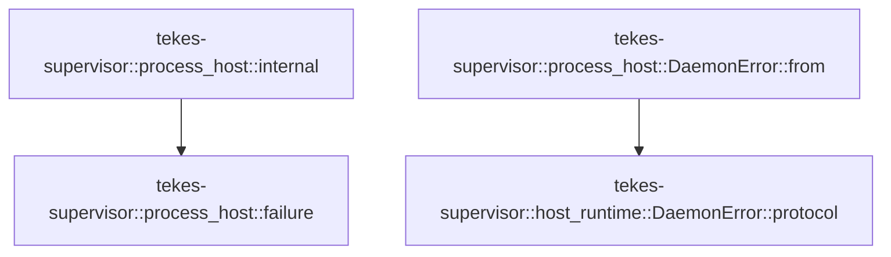

```mermaid
flowchart TD
  n0["endpoint::service::NativeEndpoint::open"]
  n1["endpoint::types::validate_session_id"]
  n2["engine::admission::AdmissionPool::new"]
  n3["profile::config::ConfigRepository::open"]
  n4["profile::instruction::InstructionResolver::new_scoped"]
  n5["provider::secret_store::MemorySecretStore::new"]
  n6["schedule::ScheduleAuthority::open"]
  n7["store::folder::ThreadStore::open"]
  n8["store::folder_events::subscribe"]
  n9["store::folder_events::canonical_root"]
  n10["tekes-supervisor::catalog::Catalog::new"]
  n11["tekes-supervisor::dynamic_bindings::resolve_worker_launch_bindings"]
  n12["tekes-supervisor::host_runtime::DaemonError::invalid_config"]
  n13["tekes-supervisor::host_runtime::DaemonError::corrupt"]
  n14["tekes-supervisor::host_runtime::DaemonError::required_broker"]
  n15["tekes-supervisor::mcp_runtime::McpRuntime::open_production_authorities_with_mutation"]
  n16["tekes-supervisor::process_host::ProductionProcessHost::workspace_policy_published"]
  n17["tekes-supervisor::process_host::ProductionProcessHost::workspace_policy_recovered"]
  n18["tekes-supervisor::process_host::ProductionProcessHost::plugin_store"]
  n19["tekes-supervisor::process_host::ProductionProcessHost::client_file_changes"]
  n20["tekes-supervisor::process_host::ProductionProcessHost::client_file_page"]
  n21["tekes-supervisor::process_host::ProductionProcessHost::user_agent_dir"]
  n22["tekes-supervisor::process_host::ProductionProcessHost::client_session_roots"]
  n23["tekes-supervisor::process_host::mcp_failure_is_required"]
  n24["tekes-supervisor::process_host::required_mcp_failure_reason"]
  n25["tekes-supervisor::process_host::PolicyCandidateError::new"]
  n26["tekes-supervisor::process_host::terminate_worker"]
  n27["tekes-supervisor::process_host::WorkerHandshakeGuard::child_mut"]
  n28["tekes-supervisor::process_host::WorkerHandshakeGuard::take_credential_broker"]
  n29["tekes-supervisor::process_host::WorkerHandshakeGuard::wait_for_exit"]
  n30["tekes-supervisor::process_host::WorkerHandshakeGuard::drop"]
  n31["tekes-supervisor::process_host::reconcile_credential_bindings"]
  n32["tekes-supervisor::process_host::scoped_client_file_path"]
  n33["tekes-supervisor::process_host::session_workspace_binding"]
  n34["tekes-supervisor::process_host::validate_worker_binary"]
  n35["tekes-supervisor::process_host::credential_control"]
  n36["tekes-supervisor::process_host::active_material"]
  n37["tekes-supervisor::process_host::retain_prior_for_unknown_credentials"]
  n38["tekes-supervisor::process_host::ProductionProcessHost::open"]
  n39["tekes-supervisor::process_host::ProductionProcessHost::open_with_secret_store"]
  n40["tekes-supervisor::process_host::ProductionProcessHost::open_with_secret_authorities"]
  n41["tekes-supervisor::process_host::ProductionProcessHost::mcp_runtime"]
  n42["tekes-supervisor::process_host::ProductionProcessHost::credential_is_ready"]
  n43["tekes-supervisor::process_host::ProductionProcessHost::validate_workspace_policy_candidate"]
  n44["tekes-supervisor::thread_card::CardWriter::spawn_from_env"]
  n45["tools::builtin::BuiltinManifest::compiled"]
  n46["workspace-service::file_text_page"]
  n47["workspace-service::file_byte_page"]
  n16 --> n12
  n16 --> n26
  n17 --> n26
  n19 --> n1
  n19 --> n12
  n19 --> n33
  n20 --> n1
  n20 --> n12
  n20 --> n32
  n20 --> n33
  n20 --> n46
  n20 --> n47
  n22 --> n1
  n22 --> n12
  n22 --> n33
  n29 --> n27
  n31 --> n14
  n31 --> n35
  n31 --> n36
  n35 --> n14
  n38 --> n5
  n38 --> n39
  n39 --> n40
  n40 --> n0
  n40 --> n2
  n40 --> n3
  n40 --> n6
  n40 --> n7
  n40 --> n8
  n40 --> n9
  n40 --> n10
  n40 --> n12
  n40 --> n13
  n40 --> n14
  n40 --> n15
  n40 --> n34
  n40 --> n44
  n43 --> n4
  n43 --> n11
  n43 --> n23
  n43 --> n24
  n43 --> n25
  n43 --> n45
```

```mermaid
flowchart TD
  n0["endpoint::management::ManagementStore::open_light_at"]
  n1["engine::lifecycle::classify"]
  n2["profile::instruction::InstructionResolver::new_scoped"]
  n3["profile::resources::ResourceCatalog::from_snapshot"]
  n4["store::folder::ThreadStore::open"]
  n5["store::folder_events::is_admitted"]
  n6["store::tail::scan_valid_prefix"]
  n7["tekes-supervisor::boot_trace::phase"]
  n8["tekes-supervisor::dynamic_bindings::resolve_worker_launch_bindings"]
  n9["tekes-supervisor::host_runtime::DaemonError::protocol"]
  n10["tekes-supervisor::host_runtime::DaemonError::invalid_config"]
  n11["tekes-supervisor::host_runtime::DaemonError::corrupt"]
  n12["tekes-supervisor::host_runtime::DaemonError::required_broker"]
  n13["tekes-supervisor::process_host::ProductionProcessHost::client_resource_catalog"]
  n14["tekes-supervisor::process_host::ProductionProcessHost::client_tool_catalog"]
  n15["tekes-supervisor::process_host::ProductionProcessHost::schedule_authority"]
  n16["tekes-supervisor::process_host::ProductionProcessHost::start_schedule_timer"]
  n17["tekes-supervisor::process_host::ProductionProcessHost::schedule_failure"]
  n18["tekes-supervisor::process_host::ProductionProcessHost::schedule_has_work"]
  n19["tekes-supervisor::process_host::ProductionProcessHost::drive_schedule"]
  n20["tekes-supervisor::process_host::ProductionProcessHost::execute_schedule_claim"]
  n21["tekes-supervisor::process_host::ProductionProcessHost::reconcile_schedule_statuses"]
  n22["tekes-supervisor::process_host::ProductionProcessHost::run_post_ready"]
  n23["tekes-supervisor::process_host::ProductionProcessHost::post_ready_tasks"]
  n24["tekes-supervisor::process_host::ProductionProcessHost::cleanup_stale_ephemeral"]
  n25["tekes-supervisor::process_host::ProductionProcessHost::live_sessions_for_cleanup"]
  n26["tekes-supervisor::process_host::ProductionProcessHost::run_upgrade_pass"]
  n27["tekes-supervisor::process_host::ProductionProcessHost::is_stale_ephemeral"]
  n28["tekes-supervisor::process_host::ProductionProcessHost::on_folder_event"]
  n29["tekes-supervisor::process_host::ProductionProcessHost::attach_streams"]
  n30["tekes-supervisor::process_host::ProductionProcessHost::reconcile_child_line"]
  n31["tekes-supervisor::process_host::ProductionProcessHost::publish_session_status"]
  n32["tekes-supervisor::process_host::ProductionProcessHost::start_periodic_sweep"]
  n33["tekes-supervisor::process_host::ProductionProcessHost::hydrate"]
  n34["tekes-supervisor::process_host::ProductionProcessHost::recently_failed"]
  n35["tekes-supervisor::process_host::ProductionProcessHost::live_worker"]
  n36["tekes-supervisor::process_host::mcp_failure_is_required"]
  n37["tekes-supervisor::process_host::session_workspace_binding"]
  n38["tekes-supervisor::process_host::probe_line_lock"]
  n13 --> n2
  n13 --> n3
  n13 --> n10
  n13 --> n37
  n14 --> n2
  n14 --> n8
  n14 --> n10
  n14 --> n12
  n14 --> n36
  n14 --> n37
  n16 --> n18
  n16 --> n19
  n18 --> n11
  n19 --> n11
  n19 --> n20
  n19 --> n21
  n20 --> n0
  n20 --> n9
  n20 --> n11
  n21 --> n1
  n21 --> n6
  n21 --> n11
  n21 --> n35
  n21 --> n38
  n23 --> n7
  n23 --> n16
  n23 --> n24
  n23 --> n26
  n24 --> n4
  n24 --> n5
  n24 --> n25
  n26 --> n33
  n26 --> n34
  n27 --> n5
```

```mermaid
flowchart TD
  n0["engine::lifecycle::ensure_action_at"]
  n1["engine::lifecycle::classify"]
  n2["provider::secret_store::resolve_config_credentials"]
  n3["store::card::remove_stale_card_temps"]
  n4["store::folder_events::arm_admission"]
  n5["store::folder_events::is_admitted"]
  n6["store::folder_events::admitted_ids"]
  n7["store::tail::scan_valid_prefix"]
  n8["store::tail::repair_thread_tails"]
  n9["tekes-supervisor::boot_trace::detail"]
  n10["tekes-supervisor::boot_trace::per_item_enabled"]
  n11["tekes-supervisor::endpoint_host::recover_pending_management"]
  n12["tekes-supervisor::host_runtime::DaemonError::protocol"]
  n13["tekes-supervisor::host_runtime::DaemonError::invalid_config"]
  n14["tekes-supervisor::host_runtime::DaemonError::corrupt"]
  n15["tekes-supervisor::host_runtime::DaemonError::required_broker"]
  n16["tekes-supervisor::process_host::now_rfc3339"]
  n17["tekes-supervisor::process_host::ProductionProcessHost::recover_pending_management"]
  n18["tekes-supervisor::process_host::ProductionProcessHost::refresh_live_credentials"]
  n19["tekes-supervisor::process_host::ProductionProcessHost::config_mutation_succeeded"]
  n20["tekes-supervisor::process_host::ProductionProcessHost::refresh_worker_credentials"]
  n21["tekes-supervisor::process_host::ProductionProcessHost::boot_sweep"]
  n22["tekes-supervisor::process_host::ProductionProcessHost::arm_admission"]
  n23["tekes-supervisor::process_host::ProductionProcessHost::recover_client_sessions"]
  n24["tekes-supervisor::process_host::ProductionProcessHost::ensure_verified"]
  n25["tekes-supervisor::process_host::ProductionProcessHost::hydrate"]
  n26["tekes-supervisor::process_host::ProductionProcessHost::hydrate_with"]
  n27["tekes-supervisor::process_host::ProductionProcessHost::recently_failed"]
  n28["tekes-supervisor::process_host::ProductionProcessHost::hydrate_unrecorded"]
  n29["tekes-supervisor::process_host::ProductionProcessHost::repair_main_projection"]
  n30["tekes-supervisor::process_host::ProductionProcessHost::periodic_sweep_once"]
  n31["tekes-supervisor::process_host::ProductionProcessHost::is_draining"]
  n32["tekes-supervisor::process_host::ProductionProcessHost::sweep_ledger_scan"]
  n33["tekes-supervisor::process_host::ProductionProcessHost::sweep_once"]
  n34["tekes-supervisor::process_host::ProductionProcessHost::sweep_ids"]
  n35["tekes-supervisor::process_host::ProductionProcessHost::is_deferred"]
  n36["tekes-supervisor::process_host::ProductionProcessHost::sweep_session"]
  n37["tekes-supervisor::process_host::ProductionProcessHost::propagate_durable_stops_before_sweep"]
  n38["tekes-supervisor::process_host::ProductionProcessHost::refresh_limits"]
  n39["tekes-supervisor::process_host::ProductionProcessHost::schedule_worker_at"]
  n40["tekes-supervisor::process_host::ProductionProcessHost::publish_appended"]
  n41["tekes-supervisor::process_host::ProductionProcessHost::publish_appended_with"]
  n42["tekes-supervisor::process_host::ProductionProcessHost::restart_is_due"]
  n43["tekes-supervisor::process_host::ProductionProcessHost::note_restart_failure"]
  n44["tekes-supervisor::process_host::web_search_scope_ready"]
  n45["tekes-supervisor::process_host::terminate_worker"]
  n46["tekes-supervisor::process_host::damage_under_lock"]
  n47["tekes-supervisor::process_host::child_ledger_damage"]
  n48["tekes-supervisor::process_host::reconcile_credential_bindings"]
  n49["tekes-supervisor::process_host::goal_continuation_due"]
  n50["tekes-supervisor::process_host::probe_line_lock"]
  n51["tekes-supervisor::process_host::retain_prior_for_unknown_credentials"]
  n52["tekes-supervisor::process_host::SweepLedgerIdentity::of"]
  n53["tekes-supervisor::thread_card::fold_child_views"]
  n17 --> n11
  n18 --> n20
  n19 --> n18
  n20 --> n2
  n20 --> n15
  n20 --> n44
  n20 --> n45
  n20 --> n48
  n20 --> n51
  n21 --> n33
  n22 --> n4
  n23 --> n13
  n23 --> n24
  n23 --> n36
  n24 --> n13
  n24 --> n14
  n24 --> n25
  n25 --> n26
  n26 --> n28
  n28 --> n3
  n28 --> n8
  n28 --> n14
  n28 --> n41
  n28 --> n46
  n28 --> n47
  n28 --> n53
  n29 --> n40
  n30 --> n33
  n32 --> n7
  n32 --> n12
  n32 --> n14
  n32 --> n52
  n33 --> n9
  n33 --> n10
  n33 --> n34
  n33 --> n36
  n34 --> n6
  n35 --> n5
  n36 --> n0
  n36 --> n1
  n36 --> n16
  n36 --> n29
  n36 --> n32
  n36 --> n35
  n36 --> n37
  n36 --> n38
  n36 --> n39
  n36 --> n42
  n36 --> n43
  n36 --> n49
  n36 --> n50
```

```mermaid
flowchart TD
  n0["session-controls::bound_goal_id"]
  n1["store::platform::NamedLock::shared"]
  n2["tekes-supervisor::dynamic_bindings::resolve_worker_launch_bindings"]
  n3["tekes-supervisor::host_runtime::system_timestamp"]
  n4["tekes-supervisor::host_runtime::DaemonError::protocol"]
  n5["tekes-supervisor::host_runtime::DaemonError::io"]
  n6["tekes-supervisor::host_runtime::DaemonError::invalid_config"]
  n7["tekes-supervisor::host_runtime::DaemonError::required_broker"]
  n8["tekes-supervisor::launch_profiled_worker_with_secret_store_and_binding_resolver"]
  n9["tekes-supervisor::process_host::production_sandbox_backend"]
  n10["tekes-supervisor::process_host::ProductionProcessHost::live_sessions_for_cleanup"]
  n11["tekes-supervisor::process_host::ProductionProcessHost::publish_session_status"]
  n12["tekes-supervisor::process_host::ProductionProcessHost::refresh_worker_credentials"]
  n13["tekes-supervisor::process_host::ProductionProcessHost::ensure_verified"]
  n14["tekes-supervisor::process_host::ProductionProcessHost::sweep_ledger_scan"]
  n15["tekes-supervisor::process_host::ProductionProcessHost::propagate_durable_stops_before_sweep"]
  n16["tekes-supervisor::process_host::ProductionProcessHost::shutdown"]
  n17["tekes-supervisor::process_host::ProductionProcessHost::shutdown_with"]
  n18["tekes-supervisor::process_host::ProductionProcessHost::ensure_running"]
  n19["tekes-supervisor::process_host::ProductionProcessHost::live_worker"]
  n20["tekes-supervisor::process_host::ProductionProcessHost::spawn_worker_at"]
  n21["tekes-supervisor::process_host::ProductionProcessHost::spawn_worker_at_with_handshake_timeout"]
  n22["tekes-supervisor::process_host::ProductionProcessHost::workspace_service_binary"]
  n23["tekes-supervisor::process_host::ProductionProcessHost::worker_binary_digest"]
  n24["tekes-supervisor::process_host::ProductionProcessHost::refresh_limits"]
  n25["tekes-supervisor::process_host::ProductionProcessHost::preflight_mandatory_authorities"]
  n26["tekes-supervisor::process_host::ProductionProcessHost::is_mcp_only_app_sandbox_host"]
  n27["tekes-supervisor::process_host::ProductionProcessHost::freeze_tool_authority"]
  n28["tekes-supervisor::process_host::ProductionProcessHost::schedule_main"]
  n29["tekes-supervisor::process_host::ProductionProcessHost::schedule_line"]
  n30["tekes-supervisor::process_host::ProductionProcessHost::schedule_worker_at"]
  n31["tekes-supervisor::process_host::ProductionProcessHost::schedule_worker_at_with_startup"]
  n32["tekes-supervisor::process_host::ProductionProcessHost::schedule_child_from_parent"]
  n33["tekes-supervisor::process_host::ProductionProcessHost::wait_for_worker"]
  n34["tekes-supervisor::process_host::ProductionProcessHost::start_pending_workers"]
  n35["tekes-supervisor::process_host::ProductionProcessHost::has_worker_capacity"]
  n36["tekes-supervisor::process_host::ProductionProcessHost::cascade_stop_from"]
  n37["tekes-supervisor::process_host::ProductionProcessHost::reset_restart_backoff"]
  n38["tekes-supervisor::process_host::ProductionProcessHost::record_session_notice"]
  n39["tekes-supervisor::process_host::mcp_launch_notices"]
  n40["tekes-supervisor::process_host::frozen_tool_launch_policy"]
  n41["tekes-supervisor::process_host::validator_tool_launch_policy"]
  n42["tekes-supervisor::process_host::mcp_failure_is_required"]
  n43["tekes-supervisor::process_host::child_dependency_admitted"]
  n44["tekes-supervisor::process_host::worker_reader"]
  n45["tekes-supervisor::process_host::worker_stderr_reader"]
  n46["tekes-supervisor::process_host::unresolved_parent_dependency"]
  n47["tekes-supervisor::process_host::line_schedule_target"]
  n48["tekes-supervisor::process_host::workspace_quiescence_lock_path"]
  n49["tekes-supervisor::process_host::workspace_id"]
  n50["tekes-supervisor::process_host::session_workspace_binding"]
  n51["tekes-supervisor::process_host::ledger_needs_worker"]
  n52["tekes-supervisor::process_host::read_worker_hello"]
  n53["tools::runtime_backends::HelperJobLauncher::new"]
  n54["tools::runtime_backends::HelperJobLauncher::disabled"]
  n55["tools::sandbox::probe_backend"]
  n56["worker-control::durable::encode_queue_transaction"]
  n57["worker-control::negotiate"]
  n58["worker-control::encode_line"]
  n15 --> n14
  n15 --> n36
  n16 --> n17
  n17 --> n10
  n18 --> n24
  n18 --> n30
  n18 --> n33
  n18 --> n37
  n20 --> n21
  n21 --> n0
  n21 --> n1
  n21 --> n2
  n21 --> n3
  n21 --> n4
  n21 --> n6
  n21 --> n7
  n21 --> n8
  n21 --> n23
  n21 --> n27
  n21 --> n38
  n21 --> n39
  n21 --> n41
  n21 --> n42
  n21 --> n44
  n21 --> n45
  n21 --> n48
  n21 --> n50
  n21 --> n52
  n21 --> n56
  n21 --> n57
  n21 --> n58
  n24 --> n6
  n24 --> n49
  n25 --> n7
  n25 --> n9
  n25 --> n26
  n25 --> n53
  n25 --> n54
  n25 --> n55
  n26 --> n5
  n26 --> n7
  n27 --> n7
  n27 --> n9
  n27 --> n26
  n27 --> n40
  n27 --> n53
  n27 --> n54
  n27 --> n55
  n28 --> n30
  n29 --> n30
  n29 --> n32
  n29 --> n46
  n29 --> n47
  n30 --> n31
  n31 --> n4
  n31 --> n11
  n31 --> n12
  n31 --> n13
  n31 --> n19
  n31 --> n20
  n31 --> n24
  n31 --> n35
  n32 --> n11
  n32 --> n12
  n32 --> n20
  n32 --> n24
  n32 --> n35
  n32 --> n43
  n33 --> n7
  n34 --> n11
  n34 --> n20
  n34 --> n35
  n34 --> n51
```

```mermaid
flowchart TD
  n0["endpoint::journal::EndpointJournal::open"]
  n1["engine::compaction_summary::admit_summary_artifact"]
  n2["engine::compaction_summary::summary_request_bytes"]
  n3["engine::compaction_summary::CompactionSummary::from_outcome"]
  n4["engine::compaction_summary::freeze_source_bundle"]
  n5["engine::context::plan_context_compaction"]
  n6["provider::compaction_summary::prepare_summary_request"]
  n7["provider::compaction_summary::summary_completion_artifact"]
  n8["provider::http::HttpRuntime::new"]
  n9["schema::event::Event::from_value"]
  n10["schema::ijson::IJsonValue::parse"]
  n11["store::tail::scan_valid_prefix"]
  n12["store::tail::read_genesis"]
  n13["tekes-supervisor::host_runtime::DaemonError::protocol"]
  n14["tekes-supervisor::host_runtime::DaemonError::corrupt"]
  n15["tekes-supervisor::host_runtime::DaemonError::required_broker"]
  n16["tekes-supervisor::process_host::spill_compaction_summary"]
  n17["tekes-supervisor::process_host::deterministic_automatic_thread_title"]
  n18["tekes-supervisor::process_host::normalized_automatic_thread_title"]
  n19["tekes-supervisor::process_host::prompt_text"]
  n20["tekes-supervisor::process_host::automatic_title_origin"]
  n21["tekes-supervisor::process_host::automatic_title_route"]
  n22["tekes-supervisor::process_host::ProductionProcessHost::schedule_main"]
  n23["tekes-supervisor::process_host::session_model_route"]
  n24["tekes-supervisor::process_host::ProductionProcessHost::has_worker_capacity"]
  n25["tekes-supervisor::process_host::ProductionProcessHost::request_provider_lease"]
  n26["tekes-supervisor::process_host::ProductionProcessHost::locked_prompt"]
  n27["tekes-supervisor::process_host::ProductionProcessHost::locked_compact"]
  n28["tekes-supervisor::process_host::ProductionProcessHost::first_root_input"]
  n29["tekes-supervisor::process_host::ProductionProcessHost::seed_automatic_title"]
  n30["tekes-supervisor::process_host::ProductionProcessHost::try_seed_automatic_title"]
  n31["tekes-supervisor::process_host::ProductionProcessHost::wait_and_seed_automatic_title"]
  n32["tekes-supervisor::process_host::ProductionProcessHost::spawn_automatic_title_refinement"]
  n33["tekes-supervisor::process_host::ProductionProcessHost::spawn_automatic_title_seed_and_refinement"]
  n34["tekes-supervisor::process_host::ProductionProcessHost::refine_automatic_title"]
  n35["tekes-supervisor::process_host::prepare_automatic_title_request"]
  n36["tekes-supervisor::process_host::ProductionProcessHost::complete_automatic_text"]
  n37["tekes-supervisor::process_host::ProductionProcessHost::complete_automatic_terminal"]
  n38["tekes-supervisor::process_host::ProductionProcessHost::summary_for_manual_compaction"]
  n39["tekes-supervisor::process_host::ProductionProcessHost::generate_automatic_title"]
  n40["tekes-supervisor::process_host::ProductionProcessHost::handle_tool_control"]
  n41["tekes-supervisor::process_host::ProductionProcessHost::handle_tool_continuation"]
  n42["tekes-supervisor::process_host::ProductionProcessHost::validate_child_proof"]
  n43["tekes-supervisor::process_host::ProductionProcessHost::publish_appended"]
  n44["tekes-supervisor::process_host::ProductionProcessHost::publish_appended_with"]
  n45["tekes-supervisor::process_host::ProductionProcessHost::reset_restart_backoff"]
  n46["tekes-supervisor::process_host::ProductionProcessHost::record_spawn_failure"]
  n47["tekes-supervisor::process_host::ledger_damage"]
  n48["tekes-supervisor::process_host::damage_under_lock"]
  n49["tekes-supervisor::process_host::internal"]
  n50["tekes-supervisor::production_tool_control::JobBrokerSupervisorAuthority::new"]
  n51["tekes-supervisor::production_tool_control::ProductionToolControlHandler::new"]
  n52["tekes-supervisor::production_tool_control::ProductionToolControlPolicy::new"]
  n53["tekes-supervisor::thread_card::journal_input"]
  n54["tekes-supervisor::thread_card::prepare"]
  n55["tekes-supervisor::tool_control::ToolControlSession::new"]
  n56["tools::schema_registry::fixed_schema"]
  n57["worker-control::continuation::decode_tool_continuation"]
  n58["worker-control::continuation::encode_tool_continuation_result"]
  n26 --> n10
  n26 --> n19
  n26 --> n22
  n26 --> n28
  n26 --> n29
  n26 --> n32
  n26 --> n45
  n26 --> n46
  n27 --> n5
  n27 --> n9
  n27 --> n10
  n27 --> n16
  n27 --> n38
  n27 --> n43
  n27 --> n49
  n28 --> n11
  n29 --> n30
  n30 --> n17
  n30 --> n20
  n30 --> n43
  n31 --> n30
  n34 --> n20
  n34 --> n39
  n34 --> n43
  n36 --> n37
  n37 --> n8
  n38 --> n1
  n38 --> n2
  n38 --> n3
  n38 --> n4
  n38 --> n5
  n38 --> n6
  n38 --> n7
  n38 --> n10
  n38 --> n11
  n38 --> n23
  n38 --> n37
  n38 --> n56
  n39 --> n18
  n39 --> n21
  n39 --> n35
  n39 --> n36
  n40 --> n13
  n40 --> n15
  n40 --> n50
  n40 --> n51
  n40 --> n52
  n40 --> n55
  n41 --> n13
  n41 --> n15
  n41 --> n50
  n41 --> n51
  n41 --> n52
  n41 --> n57
  n41 --> n58
  n42 --> n12
  n42 --> n14
  n43 --> n44
  n44 --> n0
  n44 --> n11
  n44 --> n14
  n44 --> n47
  n44 --> n48
  n44 --> n53
  n44 --> n54
```

```mermaid
flowchart TD
  n0["endpoint::journal::EndpointJournal::open"]
  n1["engine::lifecycle::ensure_action_at"]
  n2["engine::lifecycle::classify"]
  n3["mcp::projection::project_name"]
  n4["provider::request::endpoint_origin"]
  n5["schema::event::Event::from_value"]
  n6["schema::ijson::IJsonValue::parse"]
  n7["store::tail::LockedLedger::open"]
  n8["store::tail::scan_valid_prefix"]
  n9["tekes-supervisor::host_runtime::system_timestamp"]
  n10["tekes-supervisor::host_runtime::DaemonError::protocol"]
  n11["tekes-supervisor::host_runtime::DaemonError::invalid_config"]
  n12["tekes-supervisor::host_runtime::DaemonError::corrupt"]
  n13["tekes-supervisor::host_runtime::DaemonError::required_broker"]
  n14["tekes-supervisor::process_host::now_rfc3339"]
  n15["tekes-supervisor::process_host::session_event_time_now"]
  n16["tekes-supervisor::process_host::ProductionProcessHost::refresh_limits"]
  n17["tekes-supervisor::process_host::ProductionProcessHost::schedule_worker_at"]
  n18["tekes-supervisor::process_host::ProductionProcessHost::schedule_child_from_parent"]
  n19["tekes-supervisor::process_host::ProductionProcessHost::publish_appended"]
  n20["tekes-supervisor::process_host::ProductionProcessHost::publish_frame"]
  n21["tekes-supervisor::process_host::ProductionProcessHost::launch_child"]
  n22["tekes-supervisor::process_host::ProductionProcessHost::propagate_parent_stop"]
  n23["tekes-supervisor::process_host::ProductionProcessHost::cascade_stop_from"]
  n24["tekes-supervisor::process_host::ProductionProcessHost::reconcile_after_exit"]
  n25["tekes-supervisor::process_host::ProductionProcessHost::reset_restart_backoff"]
  n26["tekes-supervisor::process_host::ProductionProcessHost::restart_is_due"]
  n27["tekes-supervisor::process_host::ProductionProcessHost::note_restart_failure"]
  n28["tekes-supervisor::process_host::ProductionProcessHost::record_spawn_failure"]
  n29["tekes-supervisor::process_host::ProductionProcessHost::record_session_notice"]
  n30["tekes-supervisor::process_host::mcp_launch_notices"]
  n31["tekes-supervisor::process_host::frozen_tool_launch_policy"]
  n32["tekes-supervisor::process_host::validator_tool_launch_policy"]
  n33["tekes-supervisor::process_host::private_validator_launch_policy"]
  n34["tekes-supervisor::process_host::web_search_scope_ready"]
  n35["tekes-supervisor::process_host::mcp_failure_is_required"]
  n36["tekes-supervisor::process_host::required_mcp_failure_reason"]
  n37["tekes-supervisor::process_host::bounded_name_list"]
  n38["tekes-supervisor::process_host::PolicyCandidateError::new"]
  n39["tekes-supervisor::process_host::PolicyCandidateError::fmt"]
  n40["tekes-supervisor::process_host::terminate_worker"]
  n41["tekes-supervisor::process_host::line_schedule_target"]
  n42["tekes-supervisor::process_host::goal_continuation_due"]
  n43["tekes-supervisor::process_host::probe_line_lock"]
  n44["tools::runtime_backends::JobLaunchPolicy::new"]
  n45["worker-control::encode_line"]
  n20 --> n0
  n20 --> n8
  n20 --> n12
  n20 --> n15
  n21 --> n1
  n21 --> n2
  n21 --> n8
  n21 --> n10
  n21 --> n12
  n21 --> n14
  n21 --> n18
  n21 --> n22
  n21 --> n43
  n22 --> n5
  n22 --> n6
  n22 --> n7
  n22 --> n8
  n22 --> n10
  n22 --> n12
  n22 --> n45
  n23 --> n8
  n23 --> n12
  n23 --> n18
  n23 --> n22
  n23 --> n23
  n23 --> n40
  n23 --> n41
  n24 --> n1
  n24 --> n2
  n24 --> n8
  n24 --> n12
  n24 --> n14
  n24 --> n16
  n24 --> n17
  n24 --> n19
  n24 --> n25
  n24 --> n26
  n24 --> n27
  n24 --> n42
  n24 --> n43
  n28 --> n29
  n29 --> n9
  n29 --> n19
  n31 --> n11
  n31 --> n13
  n31 --> n44
  n32 --> n8
  n32 --> n10
  n32 --> n12
  n32 --> n13
  n32 --> n33
  n33 --> n13
  n33 --> n44
  n34 --> n4
  n35 --> n3
  n36 --> n35
```

```mermaid
flowchart TD
  n0["endpoint::service::genesis_preset_summary"]
  n1["endpoint::service::permission_mode_of"]
  n2["endpoint::service::last_record_updated_ms"]
  n3["endpoint::types::validate_session_id"]
  n4["provider::dialect::validate_provider"]
  n5["provider::dialect::resolve_profile"]
  n6["provider::request::endpoint_origin"]
  n7["provider::secret_store::resolve_config_credentials"]
  n8["store::card::valid_line_name"]
  n9["store::folder_events::admitted_ids"]
  n10["store::tail::scan_valid_prefix"]
  n11["store::tail::read_genesis"]
  n12["tekes-supervisor::process_host::ProductionProcessHost::is_stale_ephemeral"]
  n13["tekes-supervisor::process_host::ProductionProcessHost::ensure_verified"]
  n14["tekes-supervisor::process_host::ProductionProcessHost::recently_failed"]
  n15["tekes-supervisor::process_host::neutral_lifecycle"]
  n16["tekes-supervisor::process_host::ledger_damage"]
  n17["tekes-supervisor::process_host::damage_under_lock"]
  n18["tekes-supervisor::process_host::child_ledger_damage"]
  n19["tekes-supervisor::process_host::is_single_line_ledger"]
  n20["tekes-supervisor::process_host::ProductionProcessHost::list_wait"]
  n21["tekes-supervisor::process_host::ProductionProcessHost::is_running"]
  n22["tekes-supervisor::process_host::ProductionProcessHost::catalog_item"]
  n23["tekes-supervisor::process_host::ProductionProcessHost::verify_within"]
  n24["tekes-supervisor::process_host::ProductionProcessHost::build_inventory"]
  n25["tekes-supervisor::process_host::ProductionProcessHost::inventory_items"]
  n26["tekes-supervisor::process_host::ProductionProcessHost::ensure_verified"]
  n27["tekes-supervisor::process_host::ProductionProcessHost::has_catalog"]
  n28["tekes-supervisor::process_host::ProductionProcessHost::hold_catalog"]
  n29["tekes-supervisor::process_host::ProductionProcessHost::inventory_item"]
  n30["tekes-supervisor::process_host::ProductionProcessHost::live_sessions"]
  n31["tekes-supervisor::process_host::ProductionProcessHost::reconcile_projection"]
  n32["tekes-supervisor::process_host::ProductionProcessHost::execute"]
  n33["tekes-supervisor::process_host::ProductionProcessHost::readiness"]
  n34["tekes-supervisor::process_host::ProductionProcessHost::config_mutation_succeeded"]
  n35["tekes-supervisor::process_host::ProcessToolRuntime::host"]
  n36["worker-control::durable::encode_queue_transaction"]
  n16 --> n10
  n17 --> n16
  n18 --> n8
  n18 --> n16
  n18 --> n17
  n22 --> n0
  n22 --> n1
  n22 --> n2
  n22 --> n11
  n22 --> n12
  n22 --> n15
  n22 --> n19
  n22 --> n21
  n24 --> n3
  n24 --> n9
  n24 --> n14
  n24 --> n15
  n24 --> n22
  n24 --> n23
  n26 --> n13
  n32 --> n36
  n33 --> n4
  n33 --> n5
  n33 --> n6
  n33 --> n7
```

```mermaid
flowchart TD
  n0["engine::lifecycle::ensure_action_at"]
  n1["engine::lifecycle::classify"]
  n2["schema::ijson::IJsonValue::parse"]
  n3["schema::ijson::IJsonValue::parse_str"]
  n4["session-controls::read_goal"]
  n5["store::tail::scan_valid_prefix"]
  n6["store::tail::read_genesis"]
  n7["tekes-supervisor::endpoint_host::ProductionRouteFailure::new"]
  n8["tekes-supervisor::host_runtime::system_timestamp"]
  n9["tekes-supervisor::host_runtime::DaemonError::protocol"]
  n10["tekes-supervisor::host_runtime::DaemonError::io"]
  n11["tekes-supervisor::host_runtime::DaemonError::invalid_install"]
  n12["tekes-supervisor::host_runtime::DaemonError::invalid_install_reason"]
  n13["tekes-supervisor::host_runtime::DaemonError::invalid_config"]
  n14["tekes-supervisor::host_runtime::DaemonError::corrupt"]
  n15["tekes-supervisor::process_host::now_rfc3339"]
  n16["tekes-supervisor::process_host::ProcessToolRuntime::ensure_running"]
  n17["tekes-supervisor::process_host::ProcessToolRuntime::deliver_input"]
  n18["tekes-supervisor::process_host::ProcessToolRuntime::interrupt"]
  n19["tekes-supervisor::process_host::ProcessToolRuntime::ensure_child"]
  n20["tekes-supervisor::process_host::ProcessToolRuntime::deliver_report"]
  n21["tekes-supervisor::process_host::unresolved_parent_dependency"]
  n22["tekes-supervisor::process_host::line_schedule_target"]
  n23["tekes-supervisor::process_host::operation_unavailable"]
  n24["tekes-supervisor::process_host::operation_value"]
  n25["tekes-supervisor::process_host::workspace_quiescence_lock_path"]
  n26["tekes-supervisor::process_host::workspace_id"]
  n27["tekes-supervisor::process_host::scoped_client_file_path"]
  n28["tekes-supervisor::process_host::session_workspace_binding"]
  n29["tekes-supervisor::process_host::ledger_needs_worker"]
  n30["tekes-supervisor::process_host::goal_continuation_due"]
  n31["tekes-supervisor::process_host::probe_line_lock"]
  n32["tekes-supervisor::process_host::read_worker_hello"]
  n33["tekes-supervisor::process_host::next_stop_generation"]
  n34["tekes-supervisor::process_host::validate_worker_binary"]
  n35["tekes-supervisor::process_host::failure"]
  n36["tekes-supervisor::process_host::internal"]
  n37["worker-control::decode_hello"]
  n16 --> n24
  n17 --> n8
  n17 --> n24
  n18 --> n8
  n18 --> n24
  n19 --> n24
  n20 --> n24
  n21 --> n5
  n21 --> n14
  n21 --> n22
  n22 --> n14
  n24 --> n2
  n26 --> n28
  n27 --> n13
  n28 --> n6
  n28 --> n14
  n29 --> n0
  n29 --> n1
  n29 --> n5
  n29 --> n14
  n29 --> n15
  n29 --> n30
  n29 --> n31
  n30 --> n4
  n30 --> n5
  n30 --> n13
  n30 --> n14
  n31 --> n10
  n31 --> n14
  n32 --> n9
  n32 --> n10
  n32 --> n37
  n33 --> n5
  n33 --> n36
  n34 --> n11
  n34 --> n12
  n35 --> n3
  n35 --> n7
```

# tekes-supervisor::process_host

[Package atlas](index.md) · [Source](../../src/process_host.rs)

## Declarations

Visibility is the declaration spelling; trait members and reexports require their enclosing interface. `cfg` is not evaluated.

| Symbol | Kind | Visibility | Test / cfg |
|---|---|---|---|
| [tekes-supervisor::process_host::DELIVERY_TIMEOUT](../../src/process_host.rs#L62) | const_item | `private` |  |
| [tekes-supervisor::process_host::MCP_ONLY_APP_SANDBOX_MARKER](../../src/process_host.rs#L63) | const_item | `private` |  |
| [tekes-supervisor::process_host::WORKER_HANDSHAKE_TIMEOUT](../../src/process_host.rs#L64) | const_item | `private` |  |
| [tekes-supervisor::process_host::WORKER_HELLO_MAX_BYTES](../../src/process_host.rs#L65) | const_item | `private` |  |
| [tekes-supervisor::process_host::MANAGEMENT_RECOVERY_SECONDS](../../src/process_host.rs#L67) | const_item | `private` |  |
| [tekes-supervisor::process_host::PERIODIC_SWEEP_INTERVAL](../../src/process_host.rs#L68) | const_item | `private` |  |
| [tekes-supervisor::process_host::SweepLedgerIdentity](../../src/process_host.rs#L73) | struct_item | `private` |  |
| [tekes-supervisor::process_host::SweepLedgerIdentity::of](../../src/process_host.rs#L80) | function_item | `private` |  |
| [tekes-supervisor::process_host::SweepLedgerScan](../../src/process_host.rs#L93) | struct_item | `private` |  |
| [tekes-supervisor::process_host::AUTOMATIC_THREAD_TITLE_MODEL_HINT](../../src/process_host.rs#L107) | const_item | `private` |  |
| [tekes-supervisor::process_host::AUTOMATIC_THREAD_TITLE_MAX_CHARS](../../src/process_host.rs#L108) | const_item | `private` |  |
| [tekes-supervisor::process_host::AUTOMATIC_THREAD_TITLE_TIMEOUT](../../src/process_host.rs#L109) | const_item | `private` |  |
| [tekes-supervisor::process_host::AUTOMATIC_THREAD_TITLE_MAX_OUTPUT_TOKENS](../../src/process_host.rs#L113) | const_item | `private` |  |
| [tekes-supervisor::process_host::COMPACTION_SUMMARY_TIMEOUT](../../src/process_host.rs#L114) | const_item | `private` |  |
| [tekes-supervisor::process_host::AUTOMATIC_THREAD_TITLE_SYSTEM](../../src/process_host.rs#L115) | const_item | `private` |  |
| [tekes-supervisor::process_host::LineLockState](../../src/process_host.rs#L118) | enum_item | `private` |  |
| [tekes-supervisor::process_host::production_sandbox_backend](../../src/process_host.rs#L123) | function_item | `private` |  |
| [tekes-supervisor::process_host::seq_ranges](../../src/process_host.rs#L134) | function_item | `private` |  |
| [tekes-supervisor::process_host::spill_compaction_summary](../../src/process_host.rs#L153) | function_item | `private` |  |
| [tekes-supervisor::process_host::now_rfc3339](../../src/process_host.rs#L170) | function_item | `private` |  |
| [tekes-supervisor::process_host::session_event_time_now](../../src/process_host.rs#L174) | function_item | `private` |  |
| [tekes-supervisor::process_host::session_event_time](../../src/process_host.rs#L178) | function_item | `private` |  |
| [tekes-supervisor::process_host::compact_title_source](../../src/process_host.rs#L188) | function_item | `private` |  |
| [tekes-supervisor::process_host::bounded_title](../../src/process_host.rs#L192) | function_item | `private` |  |
| [tekes-supervisor::process_host::deterministic_automatic_thread_title](../../src/process_host.rs#L199) | function_item | `private` |  |
| [tekes-supervisor::process_host::normalized_automatic_thread_title](../../src/process_host.rs#L203) | function_item | `private` |  |
| [tekes-supervisor::process_host::prompt_text](../../src/process_host.rs#L228) | function_item | `private` |  |
| [tekes-supervisor::process_host::automatic_title_origin](../../src/process_host.rs#L239) | function_item | `private` |  |
| [tekes-supervisor::process_host::automatic_title_route](../../src/process_host.rs#L249) | function_item | `private` |  |
| [tekes-supervisor::process_host::session_model_route](../../src/process_host.rs#L288) | function_item | `private` |  |
| [tekes-supervisor::process_host::prepare_automatic_title_request](../../src/process_host.rs#L336) | function_item | `private` |  |
| [tekes-supervisor::process_host::prepare_automatic_text_request](../../src/process_host.rs#L353) | function_item | `private` |  |
| [tekes-supervisor::process_host::accepted_stream_event](../../src/process_host.rs#L404) | function_item | `private` | test; #[cfg(test)] |
| [tekes-supervisor::process_host::ProcessToolRuntime](../../src/process_host.rs#L419) | struct_item | `private` |  |
| [tekes-supervisor::process_host::ProductionProcessHost](../../src/process_host.rs#L423) | struct_item | `pub` |  |
| [tekes-supervisor::process_host::SessionProjectionCache](../../src/process_host.rs#L485) | struct_item | `private` |  |
| [tekes-supervisor::process_host::WorkerHandle](../../src/process_host.rs#L491) | struct_item | `private` |  |
| [tekes-supervisor::process_host::WorkerHandshakeGuard](../../src/process_host.rs#L512) | struct_item | `private` |  |
| [tekes-supervisor::process_host::WorkerHandshakeGuard::child_mut](../../src/process_host.rs#L519) | function_item | `private` |  |
| [tekes-supervisor::process_host::WorkerHandshakeGuard::take_child](../../src/process_host.rs#L523) | function_item | `private` |  |
| [tekes-supervisor::process_host::WorkerHandshakeGuard::take_credential_control](../../src/process_host.rs#L527) | function_item | `private` |  |
| [tekes-supervisor::process_host::WorkerHandshakeGuard::take_credential_broker](../../src/process_host.rs#L531) | function_item | `private` |  |
| [tekes-supervisor::process_host::WorkerHandshakeGuard::wait_for_exit](../../src/process_host.rs#L535) | function_item | `private` |  |
| [tekes-supervisor::process_host::WorkerHandshakeGuard::drop](../../src/process_host.rs#L548) | function_item | `private` |  |
| [tekes-supervisor::process_host::PendingWorker](../../src/process_host.rs#L561) | struct_item | `private` |  |
| [tekes-supervisor::process_host::WorkerProtocolQuarantine](../../src/process_host.rs#L568) | struct_item | `private` |  |
| [tekes-supervisor::process_host::RestartBackoff](../../src/process_host.rs#L575) | struct_item | `private` |  |
| [tekes-supervisor::process_host::ScheduledWorker](../../src/process_host.rs#L582) | struct_item | `private` |  |
| [tekes-supervisor::process_host::WorkerState](../../src/process_host.rs#L588) | struct_item | `private` |  |
| [tekes-supervisor::process_host::reconcile_credential_bindings](../../src/process_host.rs#L595) | function_item | `private` |  |
| [tekes-supervisor::process_host::credential_control](../../src/process_host.rs#L699) | function_item | `private` |  |
| [tekes-supervisor::process_host::active_material](../../src/process_host.rs#L710) | function_item | `private` |  |
| [tekes-supervisor::process_host::retain_prior_for_unknown_credentials](../../src/process_host.rs#L724) | function_item | `private` |  |
| [tekes-supervisor::process_host::ProductionProcessHost::open](../../src/process_host.rs#L767) | function_item | `pub` |  |
| [tekes-supervisor::process_host::ProductionProcessHost::open_with_secret_store](../../src/process_host.rs#L782) | function_item | `pub` |  |
| [tekes-supervisor::process_host::ProductionProcessHost::open_with_secret_authorities](../../src/process_host.rs#L802) | function_item | `pub` |  |
| [tekes-supervisor::process_host::ProductionProcessHost::mcp_runtime](../../src/process_host.rs#L914) | function_item | `pub` |  |
| [tekes-supervisor::process_host::ProductionProcessHost::credential_is_ready](../../src/process_host.rs#L921) | function_item | `pub` |  |
| [tekes-supervisor::process_host::ProductionProcessHost::validate_workspace_policy_candidate](../../src/process_host.rs#L942) | function_item | `pub` |  |
| [tekes-supervisor::process_host::ProductionProcessHost::workspace_policy_published](../../src/process_host.rs#L1040) | function_item | `pub` |  |
| [tekes-supervisor::process_host::ProductionProcessHost::workspace_policy_recovered](../../src/process_host.rs#L1069) | function_item | `pub` |  |
| [tekes-supervisor::process_host::ProductionProcessHost::plugin_store](../../src/process_host.rs#L1084) | function_item | `pub(crate)` |  |
| [tekes-supervisor::process_host::ProductionProcessHost::client_file_changes](../../src/process_host.rs#L1090) | function_item | `pub(crate)` |  |
| [tekes-supervisor::process_host::ProductionProcessHost::client_file_page](../../src/process_host.rs#L1128) | function_item | `pub(crate)` |  |
| [tekes-supervisor::process_host::ProductionProcessHost::user_agent_dir](../../src/process_host.rs#L1168) | function_item | `pub` |  |
| [tekes-supervisor::process_host::ProductionProcessHost::client_session_roots](../../src/process_host.rs#L1174) | function_item | `pub` |  |
| [tekes-supervisor::process_host::ProductionProcessHost::client_resource_catalog](../../src/process_host.rs#L1206) | function_item | `pub(crate)` |  |
| [tekes-supervisor::process_host::ProductionProcessHost::client_tool_catalog](../../src/process_host.rs#L1244) | function_item | `pub(crate)` |  |
| [tekes-supervisor::process_host::ProductionProcessHost::schedule_authority](../../src/process_host.rs#L1308) | function_item | `pub` |  |
| [tekes-supervisor::process_host::ProductionProcessHost::start_schedule_timer](../../src/process_host.rs#L1315) | function_item | `pub` |  |
| [tekes-supervisor::process_host::ProductionProcessHost::schedule_failure](../../src/process_host.rs#L1412) | function_item | `pub` |  |
| [tekes-supervisor::process_host::ProductionProcessHost::schedule_has_work](../../src/process_host.rs#L1419) | function_item | `private` |  |
| [tekes-supervisor::process_host::ProductionProcessHost::drive_schedule](../../src/process_host.rs#L1430) | function_item | `private` |  |
| [tekes-supervisor::process_host::ProductionProcessHost::execute_schedule_claim](../../src/process_host.rs#L1444) | function_item | `private` |  |
| [tekes-supervisor::process_host::ProductionProcessHost::reconcile_schedule_statuses](../../src/process_host.rs#L1516) | function_item | `private` |  |
| [tekes-supervisor::process_host::ProductionProcessHost::run_post_ready](../../src/process_host.rs#L1593) | function_item | `pub` |  |
| [tekes-supervisor::process_host::ProductionProcessHost::post_ready_tasks](../../src/process_host.rs#L1607) | function_item | `private` |  |
| [tekes-supervisor::process_host::ProductionProcessHost::cleanup_stale_ephemeral](../../src/process_host.rs#L1628) | function_item | `private` |  |
| [tekes-supervisor::process_host::ProductionProcessHost::live_sessions_for_cleanup](../../src/process_host.rs#L1653) | function_item | `private` |  |
| [tekes-supervisor::process_host::ProductionProcessHost::run_upgrade_pass](../../src/process_host.rs#L1666) | function_item | `private` |  |
| [tekes-supervisor::process_host::ProductionProcessHost::release_for_test](../../src/process_host.rs#L1709) | function_item | `pub(crate)` | test; #[cfg(test)] #[cfg_attr(not(target_os = "macos"), allow(dead_code))] |
| [tekes-supervisor::process_host::ProductionProcessHost::is_stale_ephemeral](../../src/process_host.rs#L1717) | function_item | `pub(crate)` |  |
| [tekes-supervisor::process_host::ProductionProcessHost::on_folder_event](../../src/process_host.rs#L1721) | function_item | `private` |  |
| [tekes-supervisor::process_host::ProductionProcessHost::attach_streams](../../src/process_host.rs#L1760) | function_item | `pub` |  |
| [tekes-supervisor::process_host::ProductionProcessHost::reconcile_child_line](../../src/process_host.rs#L1770) | function_item | `private` |  |
| [tekes-supervisor::process_host::ProductionProcessHost::publish_session_status](../../src/process_host.rs#L1789) | function_item | `private` |  |
| [tekes-supervisor::process_host::ProductionProcessHost::start_periodic_sweep](../../src/process_host.rs#L1806) | function_item | `pub` |  |
| [tekes-supervisor::process_host::ProductionProcessHost::recover_pending_management](../../src/process_host.rs#L1857) | function_item | `private` |  |
| [tekes-supervisor::process_host::ProductionProcessHost::refresh_live_credentials](../../src/process_host.rs#L1865) | function_item | `pub` |  |
| [tekes-supervisor::process_host::ProductionProcessHost::config_mutation_succeeded](../../src/process_host.rs#L1883) | function_item | `pub` |  |
| [tekes-supervisor::process_host::ProductionProcessHost::refresh_worker_credentials](../../src/process_host.rs#L1898) | function_item | `private` |  |
| [tekes-supervisor::process_host::ProductionProcessHost::boot_sweep](../../src/process_host.rs#L1937) | function_item | `pub` |  |
| [tekes-supervisor::process_host::ProductionProcessHost::arm_admission](../../src/process_host.rs#L1948) | function_item | `pub` |  |
| [tekes-supervisor::process_host::ProductionProcessHost::recover_client_sessions](../../src/process_host.rs#L1957) | function_item | `pub` |  |
| [tekes-supervisor::process_host::ProductionProcessHost::ensure_verified](../../src/process_host.rs#L1999) | function_item | `pub(crate)` |  |
| [tekes-supervisor::process_host::ProductionProcessHost::hydrate](../../src/process_host.rs#L2014) | function_item | `pub(crate)` |  |
| [tekes-supervisor::process_host::ProductionProcessHost::hydrate_with](../../src/process_host.rs#L2020) | function_item | `pub(crate)` |  |
| [tekes-supervisor::process_host::ProductionProcessHost::recently_failed](../../src/process_host.rs#L2040) | function_item | `private` |  |
| [tekes-supervisor::process_host::ProductionProcessHost::hydrate_unrecorded](../../src/process_host.rs#L2048) | function_item | `private` |  |
| [tekes-supervisor::process_host::ProductionProcessHost::repair_main_projection](../../src/process_host.rs#L2137) | function_item | `private` |  |
| [tekes-supervisor::process_host::ProductionProcessHost::periodic_sweep_once](../../src/process_host.rs#L2182) | function_item | `pub` |  |
| [tekes-supervisor::process_host::ProductionProcessHost::is_draining](../../src/process_host.rs#L2199) | function_item | `pub` |  |
| [tekes-supervisor::process_host::ProductionProcessHost::sweep_ledger_scan](../../src/process_host.rs#L2209) | function_item | `private` |  |
| [tekes-supervisor::process_host::ProductionProcessHost::sweep_once](../../src/process_host.rs#L2259) | function_item | `private` |  |
| [tekes-supervisor::process_host::ProductionProcessHost::sweep_ids](../../src/process_host.rs#L2279) | function_item | `private` |  |
| [tekes-supervisor::process_host::ProductionProcessHost::is_deferred](../../src/process_host.rs#L2308) | function_item | `private` |  |
| [tekes-supervisor::process_host::ProductionProcessHost::sweep_session](../../src/process_host.rs#L2320) | function_item | `private` |  |
| [tekes-supervisor::process_host::ProductionProcessHost::propagate_durable_stops_before_sweep](../../src/process_host.rs#L2403) | function_item | `private` |  |
| [tekes-supervisor::process_host::ProductionProcessHost::shutdown](../../src/process_host.rs#L2438) | function_item | `pub` |  |
| [tekes-supervisor::process_host::ProductionProcessHost::shutdown_with](../../src/process_host.rs#L2445) | function_item | `private` |  |
| [tekes-supervisor::process_host::ProductionProcessHost::ensure_running](../../src/process_host.rs#L2484) | function_item | `private` |  |
| [tekes-supervisor::process_host::ProductionProcessHost::live_worker](../../src/process_host.rs#L2498) | function_item | `private` |  |
| [tekes-supervisor::process_host::ProductionProcessHost::spawn_worker_at](../../src/process_host.rs#L2508) | function_item | `private` |  |
| [tekes-supervisor::process_host::ProductionProcessHost::spawn_worker_at_with_handshake_timeout](../../src/process_host.rs#L2524) | function_item | `private` |  |
| [tekes-supervisor::process_host::ProductionProcessHost::workspace_service_binary](../../src/process_host.rs#L2751) | function_item | `pub` |  |
| [tekes-supervisor::process_host::ProductionProcessHost::worker_binary_digest](../../src/process_host.rs#L2755) | function_item | `private` |  |
| [tekes-supervisor::process_host::ProductionProcessHost::refresh_limits](../../src/process_host.rs#L2760) | function_item | `private` |  |
| [tekes-supervisor::process_host::ProductionProcessHost::preflight_mandatory_authorities](../../src/process_host.rs#L2780) | function_item | `pub` |  |
| [tekes-supervisor::process_host::ProductionProcessHost::is_mcp_only_app_sandbox_host](../../src/process_host.rs#L2799) | function_item | `private` |  |
| [tekes-supervisor::process_host::ProductionProcessHost::freeze_tool_authority](../../src/process_host.rs#L2819) | function_item | `private` |  |
| [tekes-supervisor::process_host::ProductionProcessHost::schedule_main](../../src/process_host.rs#L2839) | function_item | `private` |  |
| [tekes-supervisor::process_host::ProductionProcessHost::schedule_line](../../src/process_host.rs#L2850) | function_item | `private` |  |
| [tekes-supervisor::process_host::ProductionProcessHost::schedule_worker_at](../../src/process_host.rs#L2866) | function_item | `private` |  |
| [tekes-supervisor::process_host::ProductionProcessHost::schedule_worker_at_with_startup](../../src/process_host.rs#L2877) | function_item | `private` |  |
| [tekes-supervisor::process_host::ProductionProcessHost::schedule_child_from_parent](../../src/process_host.rs#L2964) | function_item | `private` |  |
| [tekes-supervisor::process_host::ProductionProcessHost::wait_for_worker](../../src/process_host.rs#L3012) | function_item | `private` |  |
| [tekes-supervisor::process_host::ProductionProcessHost::start_pending_workers](../../src/process_host.rs#L3040) | function_item | `private` |  |
| [tekes-supervisor::process_host::ProductionProcessHost::has_worker_capacity](../../src/process_host.rs#L3107) | function_item | `private` |  |
| [tekes-supervisor::process_host::ProductionProcessHost::request_provider_lease](../../src/process_host.rs#L3115) | function_item | `private` |  |
| [tekes-supervisor::process_host::ProductionProcessHost::locked_prompt](../../src/process_host.rs#L3154) | function_item | `private` |  |
| [tekes-supervisor::process_host::ProductionProcessHost::locked_compact](../../src/process_host.rs#L3188) | function_item | `private` |  |
| [tekes-supervisor::process_host::ProductionProcessHost::first_root_input](../../src/process_host.rs#L3265) | function_item | `private` |  |
| [tekes-supervisor::process_host::ProductionProcessHost::seed_automatic_title](../../src/process_host.rs#L3297) | function_item | `private` |  |
| [tekes-supervisor::process_host::ProductionProcessHost::try_seed_automatic_title](../../src/process_host.rs#L3309) | function_item | `private` |  |
| [tekes-supervisor::process_host::ProductionProcessHost::wait_and_seed_automatic_title](../../src/process_host.rs#L3337) | function_item | `private` |  |
| [tekes-supervisor::process_host::ProductionProcessHost::spawn_automatic_title_refinement](../../src/process_host.rs#L3362) | function_item | `private` |  |
| [tekes-supervisor::process_host::ProductionProcessHost::spawn_automatic_title_seed_and_refinement](../../src/process_host.rs#L3376) | function_item | `private` |  |
| [tekes-supervisor::process_host::ProductionProcessHost::refine_automatic_title](../../src/process_host.rs#L3400) | function_item | `private` |  |
| [tekes-supervisor::process_host::ProductionProcessHost::complete_automatic_text](../../src/process_host.rs#L3437) | function_item | `private` |  |
| [tekes-supervisor::process_host::ProductionProcessHost::complete_automatic_terminal](../../src/process_host.rs#L3463) | function_item | `private` |  |
| [tekes-supervisor::process_host::ProductionProcessHost::summary_for_manual_compaction](../../src/process_host.rs#L3527) | function_item | `private` |  |
| [tekes-supervisor::process_host::ProductionProcessHost::generate_automatic_title](../../src/process_host.rs#L3598) | function_item | `private` |  |
| [tekes-supervisor::process_host::ProductionProcessHost::handle_tool_control](../../src/process_host.rs#L3623) | function_item | `private` |  |
| [tekes-supervisor::process_host::ProductionProcessHost::handle_tool_continuation](../../src/process_host.rs#L3658) | function_item | `private` |  |
| [tekes-supervisor::process_host::ProductionProcessHost::validate_child_proof](../../src/process_host.rs#L3696) | function_item | `private` |  |
| [tekes-supervisor::process_host::ProductionProcessHost::publish_appended](../../src/process_host.rs#L3713) | function_item | `private` |  |
| [tekes-supervisor::process_host::ProductionProcessHost::publish_appended_with](../../src/process_host.rs#L3719) | function_item | `private` |  |
| [tekes-supervisor::process_host::ProductionProcessHost::publish_frame](../../src/process_host.rs#L3918) | function_item | `private` |  |
| [tekes-supervisor::process_host::ProductionProcessHost::launch_child](../../src/process_host.rs#L4063) | function_item | `private` |  |
| [tekes-supervisor::process_host::ProductionProcessHost::propagate_parent_stop](../../src/process_host.rs#L4150) | function_item | `private` |  |
| [tekes-supervisor::process_host::ProductionProcessHost::cascade_stop_from](../../src/process_host.rs#L4243) | function_item | `private` |  |
| [tekes-supervisor::process_host::ProductionProcessHost::reconcile_after_exit](../../src/process_host.rs#L4329) | function_item | `private` |  |
| [tekes-supervisor::process_host::ProductionProcessHost::reset_restart_backoff](../../src/process_host.rs#L4392) | function_item | `private` |  |
| [tekes-supervisor::process_host::ProductionProcessHost::restart_is_due](../../src/process_host.rs#L4399) | function_item | `private` |  |
| [tekes-supervisor::process_host::ProductionProcessHost::note_restart_failure](../../src/process_host.rs#L4407) | function_item | `private` |  |
| [tekes-supervisor::process_host::ProductionProcessHost::record_spawn_failure](../../src/process_host.rs#L4448) | function_item | `private` |  |
| [tekes-supervisor::process_host::ProductionProcessHost::record_session_notice](../../src/process_host.rs#L4473) | function_item | `private` |  |
| [tekes-supervisor::process_host::MAX_NOTICE_TOOLS](../../src/process_host.rs#L4511) | const_item | `private` |  |
| [tekes-supervisor::process_host::mcp_launch_notices](../../src/process_host.rs#L4513) | function_item | `private` |  |
| [tekes-supervisor::process_host::frozen_tool_launch_policy](../../src/process_host.rs#L4591) | function_item | `private` |  |
| [tekes-supervisor::process_host::validator_tool_launch_policy](../../src/process_host.rs#L4616) | function_item | `private` |  |
| [tekes-supervisor::process_host::private_validator_launch_policy](../../src/process_host.rs#L4658) | function_item | `private` |  |
| [tekes-supervisor::process_host::web_search_scope_ready](../../src/process_host.rs#L4686) | function_item | `private` |  |
| [tekes-supervisor::process_host::mcp_failure_is_required](../../src/process_host.rs#L4704) | function_item | `private` |  |
| [tekes-supervisor::process_host::required_mcp_failure_reason](../../src/process_host.rs#L4720) | function_item | `private` |  |
| [tekes-supervisor::process_host::bounded_name_list](../../src/process_host.rs#L4736) | function_item | `private` |  |
| [tekes-supervisor::process_host::bounded_name_list::LISTED](../../src/process_host.rs#L4737) | const_item | `private` |  |
| [tekes-supervisor::process_host::PolicyCandidateError](../../src/process_host.rs#L4760) | struct_item | `pub` |  |
| [tekes-supervisor::process_host::PolicyCandidateError::new](../../src/process_host.rs#L4766) | function_item | `private` |  |
| [tekes-supervisor::process_host::PolicyCandidateError::fmt](../../src/process_host.rs#L4775) | function_item | `private` |  |
| [tekes-supervisor::process_host::PolicyCandidateCause](../../src/process_host.rs#L4783) | enum_item | `pub` |  |
| [tekes-supervisor::process_host::PolicyCandidateCause::code](../../src/process_host.rs#L4798) | function_item | `pub` |  |
| [tekes-supervisor::process_host::child_dependency_admitted](../../src/process_host.rs#L4808) | function_item | `private` |  |
| [tekes-supervisor::process_host::WorkerHandle::write](../../src/process_host.rs#L4813) | function_item | `private` |  |
| [tekes-supervisor::process_host::WorkerHandle::receipt](../../src/process_host.rs#L4822) | function_item | `private` |  |
| [tekes-supervisor::process_host::WorkerHandle::queue_result](../../src/process_host.rs#L4847) | function_item | `private` |  |
| [tekes-supervisor::process_host::worker_reader](../../src/process_host.rs#L4876) | function_item | `private` |  |
| [tekes-supervisor::process_host::terminate_worker](../../src/process_host.rs#L5131) | function_item | `private` |  |
| [tekes-supervisor::process_host::fail_worker](../../src/process_host.rs#L5158) | function_item | `private` |  |
| [tekes-supervisor::process_host::worker_stderr_reader](../../src/process_host.rs#L5182) | function_item | `private` |  |
| [tekes-supervisor::process_host::worker_stderr_reader::MAX_STDERR_TAIL](../../src/process_host.rs#L5183) | const_item | `private` |  |
| [tekes-supervisor::process_host::preserve_first_failure](../../src/process_host.rs#L5202) | function_item | `private` |  |
| [tekes-supervisor::process_host::ProductionProcessHost::session_metadata_changed](../../src/process_host.rs#L5209) | function_item | `private` |  |
| [tekes-supervisor::process_host::ProductionProcessHost::prompt](../../src/process_host.rs#L5213) | function_item | `private` |  |
| [tekes-supervisor::process_host::ProductionProcessHost::compact](../../src/process_host.rs#L5276) | function_item | `private` |  |
| [tekes-supervisor::process_host::ProductionProcessHost::cancel](../../src/process_host.rs#L5315) | function_item | `private` |  |
| [tekes-supervisor::process_host::ProductionProcessHost::rename](../../src/process_host.rs#L5399) | function_item | `private` |  |
| [tekes-supervisor::process_host::ProductionProcessHost::deliver_if_live](../../src/process_host.rs#L5436) | function_item | `private` |  |
| [tekes-supervisor::process_host::ProductionProcessHost::ensure_after_locked_append](../../src/process_host.rs#L5460) | function_item | `private` |  |
| [tekes-supervisor::process_host::cancel_stage_failure](../../src/process_host.rs#L5474) | function_item | `private` |  |
| [tekes-supervisor::process_host::child_exited_within](../../src/process_host.rs#L5493) | function_item | `private` |  |
| [tekes-supervisor::process_host::neutral_lifecycle](../../src/process_host.rs#L5515) | function_item | `private` |  |
| [tekes-supervisor::process_host::ledger_damage](../../src/process_host.rs#L5538) | function_item | `private` |  |
| [tekes-supervisor::process_host::DamageVerdict](../../src/process_host.rs#L5548) | enum_item | `private` |  |
| [tekes-supervisor::process_host::damage_under_lock](../../src/process_host.rs#L5564) | function_item | `private` |  |
| [tekes-supervisor::process_host::child_ledger_damage](../../src/process_host.rs#L5600) | function_item | `private` |  |
| [tekes-supervisor::process_host::is_single_line_ledger](../../src/process_host.rs#L5626) | function_item | `private` |  |
| [tekes-supervisor::process_host::HYDRATE_RETRY](../../src/process_host.rs#L5639) | const_item | `private` |  |
| [tekes-supervisor::process_host::DEFAULT_LIST_WAIT](../../src/process_host.rs#L5641) | const_item | `private` |  |
| [tekes-supervisor::process_host::ProductionProcessHost::list_wait](../../src/process_host.rs#L5644) | function_item | `private` |  |
| [tekes-supervisor::process_host::ProductionProcessHost::is_running](../../src/process_host.rs#L5659) | function_item | `private` |  |
| [tekes-supervisor::process_host::ProductionProcessHost::catalog_item](../../src/process_host.rs#L5669) | function_item | `private` |  |
| [tekes-supervisor::process_host::ProductionProcessHost::verify_within](../../src/process_host.rs#L5745) | function_item | `private` |  |
| [tekes-supervisor::process_host::ProductionProcessHost::build_inventory](../../src/process_host.rs#L5810) | function_item | `private` |  |
| [tekes-supervisor::process_host::ProductionProcessHost::inventory_items](../../src/process_host.rs#L5865) | function_item | `private` |  |
| [tekes-supervisor::process_host::ProductionProcessHost::ensure_verified](../../src/process_host.rs#L5875) | function_item | `private` |  |
| [tekes-supervisor::process_host::ProductionProcessHost::has_catalog](../../src/process_host.rs#L5890) | function_item | `private` |  |
| [tekes-supervisor::process_host::ProductionProcessHost::hold_catalog](../../src/process_host.rs#L5894) | function_item | `private` |  |
| [tekes-supervisor::process_host::ProductionProcessHost::inventory_item](../../src/process_host.rs#L5950) | function_item | `private` |  |
| [tekes-supervisor::process_host::ProductionProcessHost::live_sessions](../../src/process_host.rs#L5979) | function_item | `private` |  |
| [tekes-supervisor::process_host::ProductionProcessHost::reconcile_projection](../../src/process_host.rs#L5989) | function_item | `private` |  |
| [tekes-supervisor::process_host::ProductionProcessHost::execute](../../src/process_host.rs#L5999) | function_item | `private` |  |
| [tekes-supervisor::process_host::ProductionProcessHost::readiness](../../src/process_host.rs#L6027) | function_item | `private` |  |
| [tekes-supervisor::process_host::ProductionProcessHost::config_mutation_succeeded](../../src/process_host.rs#L6104) | function_item | `private` |  |
| [tekes-supervisor::process_host::ProcessToolRuntime::host](../../src/process_host.rs#L6128) | function_item | `private` |  |
| [tekes-supervisor::process_host::ProcessToolRuntime::ensure_running](../../src/process_host.rs#L6136) | function_item | `private` |  |
| [tekes-supervisor::process_host::ProcessToolRuntime::deliver_input](../../src/process_host.rs#L6147) | function_item | `private` |  |
| [tekes-supervisor::process_host::ProcessToolRuntime::interrupt](../../src/process_host.rs#L6183) | function_item | `private` |  |
| [tekes-supervisor::process_host::ProcessToolRuntime::ensure_child](../../src/process_host.rs#L6207) | function_item | `private` |  |
| [tekes-supervisor::process_host::ProcessToolRuntime::deliver_report](../../src/process_host.rs#L6221) | function_item | `private` |  |
| [tekes-supervisor::process_host::unresolved_parent_dependency](../../src/process_host.rs#L6243) | function_item | `private` |  |
| [tekes-supervisor::process_host::line_schedule_target](../../src/process_host.rs#L6321) | function_item | `private` |  |
| [tekes-supervisor::process_host::operation_unavailable](../../src/process_host.rs#L6357) | function_item | `private` |  |
| [tekes-supervisor::process_host::operation_value](../../src/process_host.rs#L6361) | function_item | `private` |  |
| [tekes-supervisor::process_host::workspace_quiescence_lock_path](../../src/process_host.rs#L6369) | function_item | `pub(crate)` |  |
| [tekes-supervisor::process_host::workspace_id](../../src/process_host.rs#L6374) | function_item | `private` |  |
| [tekes-supervisor::process_host::scoped_client_file_path](../../src/process_host.rs#L6378) | function_item | `private` |  |
| [tekes-supervisor::process_host::session_workspace_binding](../../src/process_host.rs#L6421) | function_item | `private` |  |
| [tekes-supervisor::process_host::ledger_needs_worker](../../src/process_host.rs#L6435) | function_item | `private` |  |
| [tekes-supervisor::process_host::goal_continuation_due](../../src/process_host.rs#L6453) | function_item | `private` |  |
| [tekes-supervisor::process_host::probe_line_lock](../../src/process_host.rs#L6497) | function_item | `private` |  |
| [tekes-supervisor::process_host::read_worker_hello](../../src/process_host.rs#L6531) | function_item | `private` |  |
| [tekes-supervisor::process_host::next_stop_generation](../../src/process_host.rs#L6603) | function_item | `private` |  |
| [tekes-supervisor::process_host::validate_worker_binary](../../src/process_host.rs#L6622) | function_item | `private` |  |
| [tekes-supervisor::process_host::failure](../../src/process_host.rs#L6634) | function_item | `private` |  |
| [tekes-supervisor::process_host::internal](../../src/process_host.rs#L6642) | function_item | `private` |  |
| [tekes-supervisor::process_host::DaemonError::from](../../src/process_host.rs#L6647) | function_item | `private` |  |
| [tekes-supervisor::process_host::tests::client_file_scope_uses_selected_directory_and_rejects_escape](../../src/process_host.rs#L6655) | function_item | `private` | test; #[cfg(test)] |
| [tekes-supervisor::process_host::tests::deepseek_title_provider](../../src/process_host.rs#L6698) | function_item | `private` | test; #[cfg(test)] |
| [tekes-supervisor::process_host::tests::serve_title_once](../../src/process_host.rs#L6721) | function_item | `private` | test; #[cfg(test)] |
| [tekes-supervisor::process_host::tests::serve_title_response](../../src/process_host.rs#L6736) | function_item | `private` | test; #[cfg(test)] |
| [tekes-supervisor::process_host::tests::automatic_title_text_normalization_matches_the_legacy_contract](../../src/process_host.rs#L6790) | function_item | `private` | test; #[cfg(test)] |
| [tekes-supervisor::process_host::tests::automatic_title_route_finds_flash_by_hint_and_falls_back_to_any_deepseek](../../src/process_host.rs#L6813) | function_item | `private` | test; #[cfg(test)] |
| [tekes-supervisor::process_host::tests::automatic_title_route_finds_flash_by_hint_and_falls_back_to_any_deepseek::providers_with](../../src/process_host.rs#L6814) | function_item | `private` | test; #[cfg(test)] |
| [tekes-supervisor::process_host::tests::automatic_title_request_uses_configured_deepseek_adapter_and_pins_flash](../../src/process_host.rs#L6857) | function_item | `private` | test; #[cfg(test)] |
| [tekes-supervisor::process_host::tests::automatic_title_uses_the_provider_runtime_and_normalizes_its_terminal](../../src/process_host.rs#L6893) | function_item | `private` | test; #[cfg(test)] |
| [tekes-supervisor::process_host::tests::automatic_title_rejects_cut_and_failed_responses](../../src/process_host.rs#L6938) | function_item | `private` | test; #[cfg(test)] |
| [tekes-supervisor::process_host::tests::automatic_title_request_fails_closed_without_a_reasoning_off_switch](../../src/process_host.rs#L6992) | function_item | `private` | test; #[cfg(test)] |
| [tekes-supervisor::process_host::tests::locked_manual_compact_covers_settled_history_and_is_keyed_by_origin](../../src/process_host.rs#L7025) | function_item | `private` | test; #[cfg(test)] |
| [tekes-supervisor::process_host::tests::worker_failure_preserves_first_root_cause](../../src/process_host.rs#L7124) | function_item | `private` | test; #[cfg(test)] |
| [tekes-supervisor::process_host::tests::restart_backoff_is_reason_scoped_bounded_and_user_resettable](../../src/process_host.rs#L7134) | function_item | `private` | test; #[cfg(test)] |
| [tekes-supervisor::process_host::tests::unavailable_credential_refresh_retains_last_authoritative_generation](../../src/process_host.rs#L7177) | function_item | `private` | test; #[cfg(test)] |
| [tekes-supervisor::process_host::tests::mcp_launch_notices_name_the_skipped_server_and_its_reason](../../src/process_host.rs#L7215) | function_item | `private` | test; #[cfg(test)] |
| [tekes-supervisor::process_host::tests::refused_tools_produce_one_bounded_notice_per_healthy_server](../../src/process_host.rs#L7257) | function_item | `private` | test; #[cfg(test)] |
| [tekes-supervisor::process_host::tests::write_catalog_server](../../src/process_host.rs#L7298) | function_item | `private` | test; #[cfg(test)] #[cfg(target_os = "macos")] |
| [tekes-supervisor::process_host::tests::launch_notice_for_policy](../../src/process_host.rs#L7314) | function_item | `private` | test; #[cfg(test)] #[cfg(target_os = "macos")] |
| [tekes-supervisor::process_host::tests::a_policy_set_accepts_never_breaks_the_launch_binding](../../src/process_host.rs#L7403) | function_item | `private` | test; #[cfg(test)] #[cfg(target_os = "macos")] |
| [tekes-supervisor::process_host::tests::unavailable_mcp_server_fails_launch_only_when_policy_names_its_tools](../../src/process_host.rs#L7449) | function_item | `private` | test; #[cfg(test)] |
| [tekes-supervisor::process_host::tests::durable_prompt_receipt_survives_spawn_failure_and_exact_retry_deduplicates](../../src/process_host.rs#L7472) | function_item | `private` | test; #[cfg(test)] #[cfg(target_os = "macos")] |
| [tekes-supervisor::process_host::tests::broken_mcp_registry_degrades_the_launch_and_warns_in_the_session](../../src/process_host.rs#L7557) | function_item | `private` | test; #[cfg(test)] #[cfg(target_os = "macos")] |
| [tekes-supervisor::process_host::tests::session_notices](../../src/process_host.rs#L7624) | function_item | `private` | test; #[cfg(test)] #[cfg(target_os = "macos")] |
| [tekes-supervisor::process_host::tests::late_provider_frame_does_not_reopen_sealed_output](../../src/process_host.rs#L7636) | function_item | `private` | test; #[cfg(test)] #[cfg(target_os = "macos")] |
| [tekes-supervisor::process_host::tests::late_provider_frame_does_not_reopen_sealed_output::SESSION](../../src/process_host.rs#L7637) | const_item | `private` | test; #[cfg(test)] #[cfg(target_os = "macos")] |
| [tekes-supervisor::process_host::tests::eager_tool_records_published_by_doorbell_do_not_drop_later_frames](../../src/process_host.rs#L7680) | function_item | `private` | test; #[cfg(test)] #[cfg(target_os = "macos")] |
| [tekes-supervisor::process_host::tests::eager_tool_records_published_by_doorbell_do_not_drop_later_frames::SESSION](../../src/process_host.rs#L7681) | const_item | `private` | test; #[cfg(test)] #[cfg(target_os = "macos")] |
| [tekes-supervisor::process_host::tests::late_stamped_frame_does_not_reopen_sealed_output](../../src/process_host.rs#L7765) | function_item | `private` | test; #[cfg(test)] #[cfg(target_os = "macos")] |
| [tekes-supervisor::process_host::tests::late_stamped_frame_does_not_reopen_sealed_output::SESSION](../../src/process_host.rs#L7766) | const_item | `private` | test; #[cfg(test)] #[cfg(target_os = "macos")] |
| [tekes-supervisor::process_host::tests::provider_frame_reaches_transient_sink_and_is_never_journaled](../../src/process_host.rs#L7803) | function_item | `private` | test; #[cfg(test)] |
| [tekes-supervisor::process_host::tests::provider_frame_reaches_transient_sink_and_is_never_journaled::SESSION](../../src/process_host.rs#L7804) | const_item | `private` | test; #[cfg(test)] |
| [tekes-supervisor::process_host::tests::block_on_ready](../../src/process_host.rs#L7890) | function_item | `private` | test; #[cfg(test)] |
| [tekes-supervisor::process_host::tests::appended_events_are_projected_before_any_endpoint_stream_is_attached](../../src/process_host.rs#L7902) | function_item | `private` | test; #[cfg(test)] #[cfg(target_os = "macos")] |
| [tekes-supervisor::process_host::tests::opening_a_thread_repairs_a_terminal_main_tail_missing_from_the_endpoint_journal](../../src/process_host.rs#L7951) | function_item | `private` | test; #[cfg(test)] #[cfg(target_os = "macos")] |
| [tekes-supervisor::process_host::tests::opening_a_thread_repairs_a_terminal_main_tail_missing_from_the_endpoint_journal::SESSION](../../src/process_host.rs#L7952) | const_item | `private` | test; #[cfg(test)] #[cfg(target_os = "macos")] |
| [tekes-supervisor::process_host::tests::attached_streams_report_inventory_running_from_the_line_lock_on_status_frames](../../src/process_host.rs#L8011) | function_item | `private` | test; #[cfg(test)] #[cfg(target_os = "macos")] |
| [tekes-supervisor::process_host::tests::periodic_sweep_repairs_a_stale_endpoint_journal_for_live_subscribers](../../src/process_host.rs#L8079) | function_item | `private` | test; #[cfg(test)] #[cfg(target_os = "macos")] |
| [tekes-supervisor::process_host::tests::periodic_sweep_repairs_a_stale_endpoint_journal_for_live_subscribers::SESSION](../../src/process_host.rs#L8080) | const_item | `private` | test; #[cfg(test)] #[cfg(target_os = "macos")] |
| [tekes-supervisor::process_host::tests::opening_a_mux_journal_reconciles_the_semantic_tail_first](../../src/process_host.rs#L8184) | function_item | `private` | test; #[cfg(test)] #[cfg(target_os = "macos")] |
| [tekes-supervisor::process_host::tests::opening_a_mux_journal_reconciles_the_semantic_tail_first::SESSION](../../src/process_host.rs#L8185) | const_item | `private` | test; #[cfg(test)] #[cfg(target_os = "macos")] |
| [tekes-supervisor::process_host::tests::wait_for_mux_frame](../../src/process_host.rs#L8237) | function_item | `private` | test; #[cfg(test)] #[cfg(target_os = "macos")] |
| [tekes-supervisor::process_host::tests::worker_exit_path_projects_the_settled_tail_and_refreshes_inventory](../../src/process_host.rs#L8269) | function_item | `private` | test; #[cfg(test)] #[cfg(target_os = "macos")] |
| [tekes-supervisor::process_host::tests::worker_exit_path_projects_the_settled_tail_and_refreshes_inventory::SESSION](../../src/process_host.rs#L8270) | const_item | `private` | test; #[cfg(test)] #[cfg(target_os = "macos")] |
| [tekes-supervisor::process_host::tests::sweep_retries_a_projection_that_failed_on_the_doorbell](../../src/process_host.rs#L8401) | function_item | `private` | test; #[cfg(test)] #[cfg(target_os = "macos")] |
| [tekes-supervisor::process_host::tests::sweep_retries_a_projection_that_failed_on_the_doorbell::SESSION](../../src/process_host.rs#L8402) | const_item | `private` | test; #[cfg(test)] #[cfg(target_os = "macos")] |
| [tekes-supervisor::process_host::tests::live_stream_time_is_integral_epoch_milliseconds](../../src/process_host.rs#L8466) | function_item | `private` | test; #[cfg(test)] |
| [tekes-supervisor::process_host::tests::terminal_attempt_pipe_tail_is_not_a_worker_failure](../../src/process_host.rs#L8473) | function_item | `private` | test; #[cfg(test)] |
| [tekes-supervisor::process_host::tests::tool_launch_policy_uses_selected_folder_without_dropping_other_roots](../../src/process_host.rs#L8489) | function_item | `private` | test; #[cfg(test)] |
| [tekes-supervisor::process_host::tests::report_wake_targets_the_exact_nested_parent_line](../../src/process_host.rs#L8580) | function_item | `private` | test; #[cfg(test)] |
| [tekes-supervisor::process_host::tests::report_wake_rejects_parent_line_aliases_and_path_escape](../../src/process_host.rs#L8590) | function_item | `private` | test; #[cfg(test)] |
| [tekes-supervisor::process_host::tests::child_dependency_overrides_only_its_live_parent_capacity_slot](../../src/process_host.rs#L8604) | function_item | `private` | test; #[cfg(test)] |
| [tekes-supervisor::process_host::tests::slice14c_gate_103_production_claim_uses_management_and_delivery_authorities](../../src/process_host.rs#L8619) | function_item | `private` | test; #[cfg(test)] #[cfg(target_os = "macos")] |
| [tekes-supervisor::process_host::tests::periodic_sweep_is_single_flight_and_stops_at_drain](../../src/process_host.rs#L8728) | function_item | `private` | test; #[cfg(test)] |
| [tekes-supervisor::process_host::tests::sweep_isolates_one_corrupt_session_and_still_recovers_the_next](../../src/process_host.rs#L8759) | function_item | `private` | test; #[cfg(test)] #[cfg(target_os = "macos")] |
| [tekes-supervisor::process_host::tests::builtin_recovery_waits_for_explicit_request_and_is_idempotent](../../src/process_host.rs#L8765) | function_item | `private` | test; #[cfg(test)] #[cfg(target_os = "macos")] |
| [tekes-supervisor::process_host::tests::check_sweep_recovery](../../src/process_host.rs#L8770) | function_item | `private` | test; #[cfg(test)] #[cfg(target_os = "macos")] |
| [tekes-supervisor::process_host::tests::sweep_scans_a_ledger_once_per_file_identity](../../src/process_host.rs#L8868) | function_item | `private` | test; #[cfg(test)] |
| [tekes-supervisor::process_host::tests::sweep_quarantines_busy_unknown_until_the_file_lock_is_free](../../src/process_host.rs#L8909) | function_item | `private` | test; #[cfg(test)] #[cfg(target_os = "macos")] |
| [tekes-supervisor::process_host::tests::ensure_existing_worker_refreshes_adjacent_secret_revocation](../../src/process_host.rs#L8975) | function_item | `private` | test; #[cfg(test)] #[cfg(target_os = "macos")] |
| [tekes-supervisor::process_host::tests::queue_recovery_is_preloaded_during_worker_negotiation](../../src/process_host.rs#L9062) | function_item | `private` | test; #[cfg(test)] #[cfg(target_os = "macos")] |
| [tekes-supervisor::process_host::tests::pending_queue_recovery_survives_an_ordinary_ensure_race](../../src/process_host.rs#L9147) | function_item | `private` | test; #[cfg(test)] #[cfg(target_os = "macos")] |
| [tekes-supervisor::process_host::tests::capacity_release_starts_a_pending_queue_transaction_on_a_settled_tail](../../src/process_host.rs#L9252) | function_item | `private` | test; #[cfg(test)] #[cfg(target_os = "macos")] |
| [tekes-supervisor::process_host::tests::no_mutual_worker_protocol_is_quarantined_until_binary_bytes_change](../../src/process_host.rs#L9367) | function_item | `private` | test; #[cfg(test)] #[cfg(target_os = "macos")] |
| [tekes-supervisor::process_host::tests::worker_hello_timeout_kills_waits_and_closes_the_broker](../../src/process_host.rs#L9439) | function_item | `private` | test; #[cfg(test)] #[cfg(target_os = "macos")] |
| [tekes-supervisor::process_host::tests::malformed_worker_hello_kills_waits_and_closes_the_broker](../../src/process_host.rs#L9449) | function_item | `private` | test; #[cfg(test)] #[cfg(target_os = "macos")] |
| [tekes-supervisor::process_host::tests::worker_early_eof_is_reaped_before_spawn_returns](../../src/process_host.rs#L9459) | function_item | `private` | test; #[cfg(test)] #[cfg(target_os = "macos")] |
| [tekes-supervisor::process_host::tests::assert_handshake_failure_reaps_worker](../../src/process_host.rs#L9468) | function_item | `private` | test; #[cfg(test)] #[cfg(target_os = "macos")] |
| [tekes-supervisor::process_host::tests::stop_cascade_durably_gates_the_entire_unpaired_spawn_graph](../../src/process_host.rs#L9569) | function_item | `private` | test; #[cfg(test)] #[cfg(target_os = "macos")] |
| [tekes-supervisor::process_host::tests::live_root_stop_receipt_precedes_the_same_durable_cascade](../../src/process_host.rs#L9575) | function_item | `private` | test; #[cfg(test)] #[cfg(target_os = "macos")] |
| [tekes-supervisor::process_host::tests::sweep_propagates_a_durable_root_stop_before_descendant_triage](../../src/process_host.rs#L9581) | function_item | `private` | test; #[cfg(test)] #[cfg(target_os = "macos")] |
| [tekes-supervisor::process_host::tests::exercise_stop_cascade](../../src/process_host.rs#L9665) | function_item | `private` | test; #[cfg(test)] #[cfg(target_os = "macos")] |
| [tekes-supervisor::process_host::tests::max_one_worker_dependency_chain_progresses_without_admitting_unrelated_work](../../src/process_host.rs#L9791) | function_item | `private` | test; #[cfg(test)] #[cfg(target_os = "macos")] |
| [tekes-supervisor::process_host::tests::prompt_after_confirmed_worker_exit_reuses_locked_origin](../../src/process_host.rs#L9955) | function_item | `private` | test; #[cfg(test)] #[cfg(target_os = "macos")] |
| [tekes-supervisor::process_host::tests::write_canonical_test_json](../../src/process_host.rs#L10026) | function_item | `private` | test; #[cfg(test)] #[cfg_attr(not(target_os = "macos"), allow(dead_code))] |
| [tekes-supervisor::process_host::tests::real_worker_recovers_final_before_settlement_with_resume_never](../../src/process_host.rs#L10035) | function_item | `private` | test; #[cfg(test)] #[cfg(target_os = "macos")] |
| [tekes-supervisor::process_host::tests::HELD_TS](../../src/process_host.rs#L10284) | const_item | `private` | test; #[cfg(test)] |
| [tekes-supervisor::process_host::tests::held_ledger_lines](../../src/process_host.rs#L10287) | function_item | `private` | test; #[cfg(test)] |
| [tekes-supervisor::process_host::tests::held_response_line](../../src/process_host.rs#L10320) | function_item | `private` | test; #[cfg(test)] #[cfg_attr(not(target_os = "macos"), allow(dead_code))] |
| [tekes-supervisor::process_host::tests::held_host](../../src/process_host.rs#L10327) | function_item | `private` | test; #[cfg(test)] #[cfg_attr(not(target_os = "macos"), allow(dead_code))] |
| [tekes-supervisor::process_host::tests::publish_appended_writes_a_fresh_card_that_matches_the_inventory_scan](../../src/process_host.rs#L10361) | function_item | `private` | test; #[cfg(test)] #[cfg(target_os = "macos")] |
| [tekes-supervisor::process_host::tests::card_writer_coalesces_and_flushes_at_shutdown](../../src/process_host.rs#L10409) | function_item | `private` | test; #[cfg(test)] #[cfg(target_os = "macos")] |
| [tekes-supervisor::process_host::tests::publish_appended_fast_path_publishes_the_pending_hold_from_one_decode](../../src/process_host.rs#L10442) | function_item | `private` | test; #[cfg(test)] #[cfg(target_os = "macos")] |
| [tekes-supervisor::process_host::tests::publish_appended_with_a_grown_ledger_does_not_resurrect_a_resolved_hold](../../src/process_host.rs#L10461) | function_item | `private` | test; #[cfg(test)] #[cfg(target_os = "macos")] |
| [tekes-supervisor::process_host::tests::a_reused_session_id_does_not_inherit_the_old_actionable_high_water_mark](../../src/process_host.rs#L10495) | function_item | `private` | test; #[cfg(test)] #[cfg(target_os = "macos")] |
| [tekes-supervisor::process_host::tests::held_thread_on_disk](../../src/process_host.rs#L10539) | function_item | `private` | test; #[cfg(test)] #[cfg_attr(not(target_os = "macos"), allow(dead_code))] |
| [tekes-supervisor::process_host::tests::the_catalog_list_equals_the_scan_list_and_a_late_thread_is_a_placeholder](../../src/process_host.rs#L10556) | function_item | `private` | test; #[cfg(test)] #[cfg(target_os = "macos")] |
| [tekes-supervisor::process_host::tests::only_threads_this_process_published_or_unarchived_are_admitted](../../src/process_host.rs#L10678) | function_item | `private` | test; #[cfg(test)] #[cfg(target_os = "macos")] |
| [tekes-supervisor::process_host::tests::open_host](../../src/process_host.rs#L10707) | function_item | `private` | test; #[cfg(test)] #[cfg_attr(not(target_os = "macos"), allow(dead_code))] |
| [tekes-supervisor::process_host::tests::poll_until_ready](../../src/process_host.rs#L10730) | function_item | `private` | test; #[cfg(test)] #[cfg_attr(not(target_os = "macos"), allow(dead_code))] |
| [tekes-supervisor::process_host::tests::a_thread_published_after_the_catalog_loaded_is_listed_swept_and_blank](../../src/process_host.rs#L10749) | function_item | `private` | test; #[cfg(test)] #[cfg(target_os = "macos")] |
| [tekes-supervisor::process_host::tests::hydrations_run_in_parallel_and_never_hold_up_a_doorbell](../../src/process_host.rs#L10804) | function_item | `private` | test; #[cfg(test)] #[cfg(target_os = "macos")] |
| [tekes-supervisor::process_host::tests::a_complete_invalid_line_quarantines_and_is_not_rehydrated](../../src/process_host.rs#L10879) | function_item | `private` | test; #[cfg(test)] #[cfg(target_os = "macos")] |
| [tekes-supervisor::process_host::tests::damage_in_a_held_ledger_is_deferred_until_the_lock_is_free](../../src/process_host.rs#L10922) | function_item | `private` | test; #[cfg(test)] #[cfg(target_os = "macos")] |
| [tekes-supervisor::process_host::tests::a_placeholder_row_is_followed_by_the_real_row_as_an_upsert](../../src/process_host.rs#L10969) | function_item | `private` | test; #[cfg(test)] #[cfg(target_os = "macos")] |
| [tekes-supervisor::process_host::tests::a_client_unarchive_admits_the_thread_and_lists_it_again](../../src/process_host.rs#L11016) | function_item | `private` | test; #[cfg(test)] #[cfg(target_os = "macos")] |
| [tekes-supervisor::process_host::tests::shutdown_stops_workers_before_it_flushes_the_cards_of_live_threads](../../src/process_host.rs#L11047) | function_item | `private` | test; #[cfg(test)] #[cfg(target_os = "macos")] |
| [tekes-supervisor::process_host::tests::a_fold_between_card_writes_does_not_rebuild_the_card_view](../../src/process_host.rs#L11082) | function_item | `private` | test; #[cfg(test)] #[cfg(target_os = "macos")] |
| [tekes-supervisor::process_host::tests::a_complete_invalid_line_in_a_child_ledger_quarantines_the_thread](../../src/process_host.rs#L11145) | function_item | `private` | test; #[cfg(test)] #[cfg(target_os = "macos")] |
| [tekes-supervisor::process_host::tests::a_published_folder_enters_the_catalog_unread](../../src/process_host.rs#L11168) | function_item | `private` | test; #[cfg(test)] #[cfg(target_os = "macos")] |
| [tekes-supervisor::process_host::tests::the_management_recovery_tick_runs_on_an_idle_root_and_reads_no_thread](../../src/process_host.rs#L11195) | function_item | `private` | test; #[cfg(test)] #[cfg(target_os = "macos")] |
| [tekes-supervisor::process_host::tests::a_thread_that_fails_verification_is_not_retried_by_every_list](../../src/process_host.rs#L11217) | function_item | `private` | test; #[cfg(test)] #[cfg(target_os = "macos")] |
| [tekes-supervisor::process_host::tests::opening_a_thread_bypasses_the_list_backoff](../../src/process_host.rs#L11250) | function_item | `private` | test; #[cfg(test)] #[cfg(target_os = "macos")] |
| [tekes-supervisor::process_host::tests::the_list_verifies_the_newest_ledgers_first](../../src/process_host.rs#L11276) | function_item | `private` | test; #[cfg(test)] #[cfg(target_os = "macos")] |
| [tekes-supervisor::process_host::tests::the_ready_path_does_not_read_any_thread_or_archive_folder](../../src/process_host.rs#L11323) | function_item | `private` | test; #[cfg(test)] #[cfg(target_os = "macos")] |
| [tekes-supervisor::process_host::tests::the_ready_path_does_not_read_any_thread_or_archive_folder::Restore](../../src/process_host.rs#L11341) | struct_item | `private` | test; #[cfg(test)] #[cfg(target_os = "macos")] |
| [tekes-supervisor::process_host::tests::the_ready_path_does_not_read_any_thread_or_archive_folder::Restore::drop](../../src/process_host.rs#L11343) | function_item | `private` | test; #[cfg(test)] #[cfg(target_os = "macos")] |
| [tekes-supervisor::process_host::tests::a_stale_projection_cannot_overwrite_a_newer_published_actionable_set](../../src/process_host.rs#L11378) | function_item | `private` | test; #[cfg(test)] #[cfg(target_os = "macos")] |
| [tekes-supervisor::process_host::tests::publish_appended_with_a_torn_tail_keeps_the_previous_error_path](../../src/process_host.rs#L11410) | function_item | `private` | test; #[cfg(test)] #[cfg(target_os = "macos")] |
| [tekes-supervisor::process_host::tests::write_test_genesis](../../src/process_host.rs#L11425) | function_item | `private` | test; #[cfg(test)] |
| [tekes-supervisor::process_host::tests::write_test_genesis_with_identity](../../src/process_host.rs#L11431) | function_item | `private` | test; #[cfg(test)] |
| [tekes-supervisor::process_host::tests::append_test_input](../../src/process_host.rs#L11449) | function_item | `private` | test; #[cfg(test)] |
| [tekes-supervisor::process_host::tests::append_test_stop](../../src/process_host.rs#L11472) | function_item | `private` | test; #[cfg(test)] #[cfg(target_os = "macos")] |
| [tekes-supervisor::process_host::tests::write_test_spawn_line](../../src/process_host.rs#L11495) | function_item | `private` | test; #[cfg(test)] #[cfg(target_os = "macos")] |
| [tekes-supervisor::process_host::tests::write_test_child_genesis](../../src/process_host.rs#L11554) | function_item | `private` | test; #[cfg(test)] #[cfg(target_os = "macos")] |
| [tekes-supervisor::process_host::tests::write_test_events](../../src/process_host.rs#L11577) | function_item | `private` | test; #[cfg(test)] #[cfg(target_os = "macos")] |
| [tekes-supervisor::process_host::tests::CHILD_TS](../../src/process_host.rs#L11590) | const_item | `private` | test; #[cfg(test)] #[cfg_attr(not(target_os = "macos"), allow(dead_code))] |
| [tekes-supervisor::process_host::tests::write_thread_with_child](../../src/process_host.rs#L11595) | function_item | `private` | test; #[cfg(test)] #[cfg(target_os = "macos")] |
| [tekes-supervisor::process_host::tests::child_request_event](../../src/process_host.rs#L11636) | function_item | `private` | test; #[cfg(test)] #[cfg(target_os = "macos")] |
| [tekes-supervisor::process_host::tests::child_response_event](../../src/process_host.rs#L11641) | function_item | `private` | test; #[cfg(test)] #[cfg(target_os = "macos")] |
| [tekes-supervisor::process_host::tests::append_test_events](../../src/process_host.rs#L11647) | function_item | `private` | test; #[cfg(test)] #[cfg(target_os = "macos")] |
| [tekes-supervisor::process_host::tests::child_rpc_id](../../src/process_host.rs#L11660) | function_item | `private` | test; #[cfg(test)] #[cfg(target_os = "macos")] |
| [tekes-supervisor::process_host::tests::a_live_child_hold_is_in_the_baseline_of_a_verified_thread_until_it_is_answered](../../src/process_host.rs#L11675) | function_item | `private` | test; #[cfg(test)] #[cfg(target_os = "macos")] |
| [tekes-supervisor::process_host::tests::a_child_exit_announces_a_hold_no_doorbell_announced](../../src/process_host.rs#L11716) | function_item | `private` | test; #[cfg(test)] #[cfg(target_os = "macos")] |
| [tekes-supervisor::process_host::tests::a_doorbell_fold_clears_child_exactness_and_the_prefilter_finds_the_new_hold](../../src/process_host.rs#L11741) | function_item | `private` | test; #[cfg(test)] #[cfg(target_os = "macos")] |
| [tekes-supervisor::process_host::tests::actionables_recomputes_do_not_reread_unchanged_child_files](../../src/process_host.rs#L11793) | function_item | `private` | test; #[cfg(test)] #[cfg(target_os = "macos")] |
| [tekes-supervisor::process_host::tests::a_busy_stale_scratch_thread_is_removed_by_the_retry](../../src/process_host.rs#L11831) | function_item | `private` | test; #[cfg(test)] #[cfg(target_os = "macos")] |
| [tekes-supervisor::process_host::tests::hydration_removes_a_dead_processs_card_temporary](../../src/process_host.rs#L11858) | function_item | `private` | test; #[cfg(test)] #[cfg(target_os = "macos")] |
| [tekes-supervisor::process_host::tests::hold_line_lock](../../src/process_host.rs#L11876) | function_item | `private` | test; #[cfg(test)] |
| [tekes-supervisor::process_host::tests::damage_is_decided_under_the_line_lock](../../src/process_host.rs#L11890) | function_item | `private` | test; #[cfg(test)] |
| [tekes-supervisor::process_host::tests::provider_admission_waits_fairly_and_drain_denies_waiter](../../src/process_host.rs#L11945) | function_item | `private` | test; #[cfg(test)] |

## Imports / reexports

| Local name | Source path | Visibility |
|---|---|---|
| `BTreeMap` | `std::collections::BTreeMap` | `private` |
| `BTreeSet` | `std::collections::BTreeSet` | `private` |
| `HashMap` | `std::collections::HashMap` | `private` |
| `HashSet` | `std::collections::HashSet` | `private` |
| `VecDeque` | `std::collections::VecDeque` | `private` |
| `_` | `std::fmt::Write` | `private` |
| `fs` | `std::fs` | `private` |
| `BufRead` | `std::io::BufRead` | `private` |
| `BufReader` | `std::io::BufReader` | `private` |
| `Read` | `std::io::Read` | `private` |
| `Write` | `std::io::Write` | `private` |
| `AsRawFd` | `std::os::fd::AsRawFd` | `private` |
| `MetadataExt` | `std::os::unix::fs::MetadataExt` | `private` |
| `OpenOptionsExt` | `std::os::unix::fs::OpenOptionsExt` | `private` |
| `Path` | `std::path::Path` | `private` |
| `PathBuf` | `std::path::PathBuf` | `private` |
| `Child` | `std::process::Child` | `private` |
| `ChildStdin` | `std::process::ChildStdin` | `private` |
| `AtomicBool` | `std::sync::atomic::AtomicBool` | `private` |
| `AtomicU64` | `std::sync::atomic::AtomicU64` | `private` |
| `Ordering` | `std::sync::atomic::Ordering` | `private` |
| `Arc` | `std::sync::Arc` | `private` |
| `Condvar` | `std::sync::Condvar` | `private` |
| `Mutex` | `std::sync::Mutex` | `private` |
| `TryLockError` | `std::sync::TryLockError` | `private` |
| `Weak` | `std::sync::Weak` | `private` |
| `Duration` | `std::time::Duration` | `private` |
| `Instant` | `std::time::Instant` | `private` |
| `UNIX_EPOCH` | `std::time::UNIX_EPOCH` | `private` |
| `DateTime` | `chrono::DateTime` | `private` |
| `Utc` | `chrono::Utc` | `private` |
| `AUTOMATIC_TITLE_REFINE_OPERATION` | `endpoint::AUTOMATIC_TITLE_REFINE_OPERATION` | `private` |
| `AUTOMATIC_TITLE_SEED_OPERATION` | `endpoint::AUTOMATIC_TITLE_SEED_OPERATION` | `private` |
| `AcceptedStreamFrame` | `endpoint::AcceptedStreamFrame` | `private` |
| `EndpointJournal` | `endpoint::EndpointJournal` | `private` |
| `ManagementStore` | `endpoint::ManagementStore` | `private` |
| `MaterializedPrompt` | `endpoint::MaterializedPrompt` | `private` |
| `MutationReceipt` | `endpoint::MutationReceipt` | `private` |
| `NativeEndpoint` | `endpoint::NativeEndpoint` | `private` |
| `Projector` | `endpoint::Projector` | `private` |
| `SESSION_NOTICE_OPERATION` | `endpoint::SESSION_NOTICE_OPERATION` | `private` |
| `SessionCreateOperation` | `endpoint::SessionCreateOperation` | `private` |
| `SessionInventoryItem` | `endpoint::SessionInventoryItem` | `private` |
| `SessionNotice` | `endpoint::SessionNotice` | `private` |
| `SessionNoticeSeverity` | `endpoint::SessionNoticeSeverity` | `private` |
| `AdmissionLease` | `engine::AdmissionLease` | `private` |
| `AdmissionPool` | `engine::AdmissionPool` | `private` |
| `EnsureAction` | `engine::EnsureAction` | `private` |
| `LockFacts` | `engine::LockFacts` | `private` |
| `TailState` | `engine::TailState` | `private` |
| `classify` | `engine::classify` | `private` |
| `ensure_action_at` | `engine::ensure_action_at` | `private` |
| `MacOsNativeHelperVerifier` | `plugins::MacOsNativeHelperVerifier` | `private` |
| `PluginStore` | `plugins::PluginStore` | `private` |
| `ConfigRepository` | `profile::ConfigRepository` | `private` |
| `ConfigSnapshot` | `profile::ConfigSnapshot` | `private` |
| `DynamicToolCatalog` | `profile::DynamicToolCatalog` | `private` |
| `Block` | `schema::Block` | `private` |
| `Event` | `schema::Event` | `private` |
| `EventKind` | `schema::EventKind` | `private` |
| `IJsonValue` | `schema::IJsonValue` | `private` |
| `OriginTuple` | `schema::OriginTuple` | `private` |
| `Digest` | `sha2::Digest` | `private` |
| `Sha256` | `sha2::Sha256` | `private` |
| `AssetStore` | `store::AssetStore` | `private` |
| `LockedLedger` | `store::LockedLedger` | `private` |
| `ThreadStore` | `store::ThreadStore` | `private` |
| `scan_valid_prefix` | `store::scan_valid_prefix` | `private` |
| `ApprovalResponse` | `worker_control::ApprovalResponse` | `private` |
| `Frame` | `worker_control::Frame` | `private` |
| `FrameChannel` | `worker_control::FrameChannel` | `private` |
| `Input` | `worker_control::Input` | `private` |
| `LaunchChild` | `worker_control::LaunchChild` | `private` |
| `LaunchResult` | `worker_control::LaunchResult` | `private` |
| `Lease` | `worker_control::Lease` | `private` |
| `Meta` | `worker_control::Meta` | `private` |
| `Receipt` | `worker_control::Receipt` | `private` |
| `Reject` | `worker_control::Reject` | `private` |
| `Stop` | `worker_control::Stop` | `private` |
| `WorkerMessage` | `worker_control::WorkerMessage` | `private` |
| `decode_hello` | `worker_control::decode_hello` | `private` |
| `decode_worker` | `worker_control::decode_worker` | `private` |
| `encode_line` | `worker_control::encode_line` | `private` |
| `QueueTransaction` | `worker_control::QueueTransaction` | `private` |
| `QueueTransactionResult` | `worker_control::QueueTransactionResult` | `private` |
| `Selection` | `worker_control::Selection` | `private` |
| `WorkerStartup` | `worker_control::WorkerStartup` | `private` |
| `decode_tool_control` | `worker_control::decode_tool_control` | `private` |
| `encode_queue_transaction` | `worker_control::encode_queue_transaction` | `private` |
| `resolve_worker_launch_bindings` | `crate::dynamic_bindings::resolve_worker_launch_bindings` | `private` |
| `HoldCatalog` | `crate::endpoint_carrier::HoldCatalog` | `private` |
| `HoldRef` | `crate::endpoint_carrier::HoldRef` | `private` |
| `LiveRespondAuthority` | `crate::endpoint_carrier::LiveRespondAuthority` | `private` |
| `ProductionCarrierError` | `crate::endpoint_carrier::ProductionCarrierError` | `private` |
| `ProductionCarrierStreams` | `crate::endpoint_carrier::ProductionCarrierStreams` | `private` |
| `SessionGateError` | `crate::endpoint_carrier::SessionGateError` | `private` |
| `SupervisorSessionAuthority` | `crate::endpoint_carrier::SupervisorSessionAuthority` | `private` |
| `VerifiedHolds` | `crate::endpoint_carrier::VerifiedHolds` | `private` |
| `ProductionRouteFailure` | `crate::endpoint_host::ProductionRouteFailure` | `private` |
| `ProviderReadinessAuthority` | `crate::endpoint_host::ProviderReadinessAuthority` | `private` |
| `QueueTransactionAuthority` | `crate::endpoint_host::QueueTransactionAuthority` | `private` |
| `RuntimeModelReadiness` | `crate::endpoint_host::RuntimeModelReadiness` | `private` |
| `RuntimeProviderFailure` | `crate::endpoint_host::RuntimeProviderFailure` | `private` |
| `RuntimeProviderReadiness` | `crate::endpoint_host::RuntimeProviderReadiness` | `private` |
| `RuntimeProviderStatus` | `crate::endpoint_host::RuntimeProviderStatus` | `private` |
| `SessionDeliveryAuthority` | `crate::endpoint_host::SessionDeliveryAuthority` | `private` |
| `DaemonError` | `crate::host_runtime::DaemonError` | `private` |
| `McpRuntime` | `crate::mcp_runtime::McpRuntime` | `private` |
| `ChildLaunchProof` | `crate::production_tool_control::ChildLaunchProof` | `private` |
| `DeliveryRequest` | `crate::production_tool_control::DeliveryRequest` | `private` |
| `DynamicSupervisorAuthority` | `crate::production_tool_control::DynamicSupervisorAuthority` | `private` |
| `InterruptRequest` | `crate::production_tool_control::InterruptRequest` | `private` |
| `JobBrokerSupervisorAuthority` | `crate::production_tool_control::JobBrokerSupervisorAuthority` | `private` |
| `ParentReportProof` | `crate::production_tool_control::ParentReportProof` | `private` |
| `ProductionToolControlHandler` | `crate::production_tool_control::ProductionToolControlHandler` | `private` |
| `ProductionToolControlPolicy` | `crate::production_tool_control::ProductionToolControlPolicy` | `private` |
| `SupervisorOperationError` | `crate::production_tool_control::SupervisorOperationError` | `private` |
| `SupervisorRuntimeAuthority` | `crate::production_tool_control::SupervisorRuntimeAuthority` | `private` |
| `ToolControlSession` | `crate::tool_control::ToolControlSession` | `private` |
| `ProfiledWorkerLaunchSpec` | `crate::ProfiledWorkerLaunchSpec` | `private` |
| `launch_profiled_worker_with_secret_store_and_binding_resolver` | `crate::launch_profiled_worker_with_secret_store_and_binding_resolver` | `private` |
| `Future` | `std::future::Future` | `private` |
| `_` | `std::io::Read` | `private` |
| `_` | `std::io::Write` | `private` |
| `TcpListener` | `std::net::TcpListener` | `private` |
| `PermissionsExt` | `std::os::unix::fs::PermissionsExt` | `private` |
| `mpsc` | `std::sync::mpsc` | `private` |
| `Context` | `std::task::Context` | `private` |
| `Poll` | `std::task::Poll` | `private` |
| `Waker` | `std::task::Waker` | `private` |
| `Value` | `serde_json::Value` | `private` |
| `json` | `serde_json::json` | `private` |
| `*` | `super::*` | `private` |

## Module declarations

| Module | Visibility | Attributes |
|---|---|---|
| `tekes-supervisor::process_host::tests` | `private` | #[cfg(test)] |

## Function call graphs

Edges below are syntactically resolved calls only, including private functions. Graphs partition callers into groups of 20; they are not execution order. All unresolved sites are listed below and in the JSON inventory.

Functions 1–20: 12 direct edges

Functions 21–40: 43 direct edges

Functions 41–60: 34 direct edges

Functions 61–80: 51 direct edges

Functions 81–100: 73 direct edges

Functions 101–120: 65 direct edges

Functions 121–140: 56 direct edges

Functions 141–160: 25 direct edges

Functions 161–180: 25 direct edges

Functions 181–200: 38 direct edges

Functions 201–202: 2 direct edges

## Call sites

Includes test functions (marked in declarations). Receiver-type-required sites need type analysis/manual tracing. Calls in closures are attributed to their enclosing function; their occurrence here does not mean the closure executes immediately.

| Caller | Callee expression | Source lines | Target / classification |
|---|---|---|---|
| `DELIVERY_TIMEOUT` | `Duration::from_secs` | [62](../../src/process_host.rs#L62) | external-constructor-callback-or-unresolved |
| `WORKER_HANDSHAKE_TIMEOUT` | `Duration::from_secs` | [64](../../src/process_host.rs#L64) | external-constructor-callback-or-unresolved |
| `PERIODIC_SWEEP_INTERVAL` | `Duration::from_secs` | [68](../../src/process_host.rs#L68) | external-constructor-callback-or-unresolved |
| `of` | `fs::metadata(path).map_err` | [81](../../src/process_host.rs#L81) | receiver-type-required |
| `of` | `fs::metadata` | [81](../../src/process_host.rs#L81) | external-constructor-callback-or-unresolved |
| `of` | `Ok` | [82](../../src/process_host.rs#L82) | external-constructor-callback-or-unresolved |
| `of` | `metadata.ino` | [83](../../src/process_host.rs#L83) | receiver-type-required |
| `of` | `metadata.len` | [84](../../src/process_host.rs#L84) | receiver-type-required |
| `of` | `i128::from` | [85](../../src/process_host.rs#L85), [86](../../src/process_host.rs#L86) | external-constructor-callback-or-unresolved |
| `of` | `metadata.mtime` | [85](../../src/process_host.rs#L85) | receiver-type-required |
| `of` | `metadata.mtime_nsec` | [86](../../src/process_host.rs#L86) | receiver-type-required |
| `AUTOMATIC_THREAD_TITLE_TIMEOUT` | `Duration::from_secs` | [109](../../src/process_host.rs#L109) | external-constructor-callback-or-unresolved |
| `COMPACTION_SUMMARY_TIMEOUT` | `Duration::from_secs` | [114](../../src/process_host.rs#L114) | external-constructor-callback-or-unresolved |
| `seq_ranges` | `Vec::new` | [135](../../src/process_host.rs#L135) | external-constructor-callback-or-unresolved |
| `seq_ranges` | `ranges.last_mut().and_then` | [137](../../src/process_host.rs#L137) | receiver-type-required |
| `seq_ranges` | `ranges.last_mut` | [137](../../src/process_host.rs#L137) | receiver-type-required |
| `seq_ranges` | `range.get("to").and_then` | [139](../../src/process_host.rs#L139) | receiver-type-required |
| `seq_ranges` | `range.get` | [139](../../src/process_host.rs#L139) | receiver-type-required |
| `seq_ranges` | `Some` | [140](../../src/process_host.rs#L140) | external-constructor-callback-or-unresolved |
| `seq_ranges` | `seq.saturating_sub` | [140](../../src/process_host.rs#L140) | receiver-type-required |
| `seq_ranges` | `range.insert` | [142](../../src/process_host.rs#L142) | receiver-type-required |
| `seq_ranges` | `"to".to_owned` | [142](../../src/process_host.rs#L142) | receiver-type-required |
| `seq_ranges` | `serde_json::Value::from` | [142](../../src/process_host.rs#L142) | external-constructor-callback-or-unresolved |
| `seq_ranges` | `ranges.push` | [144](../../src/process_host.rs#L144) | receiver-type-required |
| `spill_compaction_summary` | `serde_json_canonicalizer::to_vec(&serde_json::Value::String(summary.to_owned()))         .map_err` | [157](../../src/process_host.rs#L157) | receiver-type-required |
| `spill_compaction_summary` | `serde_json_canonicalizer::to_vec` | [157](../../src/process_host.rs#L157) | external-constructor-callback-or-unresolved |
| `spill_compaction_summary` | `serde_json::Value::String` | [157](../../src/process_host.rs#L157), [160](../../src/process_host.rs#L160) | external-constructor-callback-or-unresolved |
| `spill_compaction_summary` | `summary.to_owned` | [157](../../src/process_host.rs#L157), [160](../../src/process_host.rs#L160) | receiver-type-required |
| `spill_compaction_summary` | `store::StoreError::Corruption` | [158](../../src/process_host.rs#L158), [165](../../src/process_host.rs#L165) | external-constructor-callback-or-unresolved |
| `spill_compaction_summary` | `error.to_string` | [158](../../src/process_host.rs#L158) | receiver-type-required |
| `spill_compaction_summary` | `encoded.len` | [159](../../src/process_host.rs#L159) | receiver-type-required |
| `spill_compaction_summary` | `Ok` | [160](../../src/process_host.rs#L160), [167](../../src/process_host.rs#L167) | external-constructor-callback-or-unresolved |
| `spill_compaction_summary` | `ledger         .path()         .parent()         .ok_or_else` | [162](../../src/process_host.rs#L162) | receiver-type-required |
| `spill_compaction_summary` | `ledger         .path()         .parent` | [162](../../src/process_host.rs#L162) | receiver-type-required |
| `spill_compaction_summary` | `ledger         .path` | [162](../../src/process_host.rs#L162) | receiver-type-required |
| `spill_compaction_summary` | `"ledger has no folder".to_owned` | [165](../../src/process_host.rs#L165) | receiver-type-required |
| `spill_compaction_summary` | `AssetStore::new(folder.join("assets"))?.publish` | [166](../../src/process_host.rs#L166) | receiver-type-required |
| `spill_compaction_summary` | `AssetStore::new` | [166](../../src/process_host.rs#L166) | [store::asset::AssetStore::new](../../../store/src/asset.rs#L27) |
| `spill_compaction_summary` | `folder.join` | [166](../../src/process_host.rs#L166) | receiver-type-required |
| `now_rfc3339` | `Utc::now().to_rfc3339_opts` | [171](../../src/process_host.rs#L171) | receiver-type-required |
| `now_rfc3339` | `Utc::now` | [171](../../src/process_host.rs#L171) | external-constructor-callback-or-unresolved |
| `session_event_time_now` | `session_event_time` | [175](../../src/process_host.rs#L175) | [tekes-supervisor::process_host::session_event_time](../../src/process_host.rs#L178) |
| `session_event_time_now` | `std::time::SystemTime::now` | [175](../../src/process_host.rs#L175) | external-constructor-callback-or-unresolved |
| `session_event_time` | `time         .duration_since(std::time::UNIX_EPOCH)         .map_err(&#124;error&#124; DaemonError::protocol(error.to_string()))?         .as_millis` | [179](../../src/process_host.rs#L179) | receiver-type-required |
| `session_event_time` | `time         .duration_since(std::time::UNIX_EPOCH)         .map_err` | [179](../../src/process_host.rs#L179) | receiver-type-required |
| `session_event_time` | `time         .duration_since` | [179](../../src/process_host.rs#L179) | receiver-type-required |
| `session_event_time` | `DaemonError::protocol` | [181](../../src/process_host.rs#L181), [184](../../src/process_host.rs#L184) | [tekes-supervisor::host_runtime::DaemonError::protocol](../../src/host_runtime.rs#L538) |
| `session_event_time` | `error.to_string` | [181](../../src/process_host.rs#L181) | receiver-type-required |
| `session_event_time` | `u64::try_from(millis)         .map_err` | [183](../../src/process_host.rs#L183) | receiver-type-required |
| `session_event_time` | `u64::try_from` | [183](../../src/process_host.rs#L183) | external-constructor-callback-or-unresolved |
| `session_event_time` | `Ok` | [185](../../src/process_host.rs#L185) | external-constructor-callback-or-unresolved |
| `compact_title_source` | `value.split_whitespace().collect::<Vec<_>>().join` | [189](../../src/process_host.rs#L189) | receiver-type-required |
| `compact_title_source` | `value.split_whitespace().collect::<Vec<_>>` | [189](../../src/process_host.rs#L189) | receiver-type-required |
| `compact_title_source` | `value.split_whitespace` | [189](../../src/process_host.rs#L189) | receiver-type-required |
| `bounded_title` | `value         .chars()         .take(AUTOMATIC_THREAD_TITLE_MAX_CHARS)         .collect` | [193](../../src/process_host.rs#L193) | receiver-type-required |
| `bounded_title` | `value         .chars()         .take` | [193](../../src/process_host.rs#L193) | receiver-type-required |
| `bounded_title` | `value         .chars` | [193](../../src/process_host.rs#L193) | receiver-type-required |
| `deterministic_automatic_thread_title` | `bounded_title` | [200](../../src/process_host.rs#L200) | [tekes-supervisor::process_host::bounded_title](../../src/process_host.rs#L192) |
| `deterministic_automatic_thread_title` | `compact_title_source` | [200](../../src/process_host.rs#L200) | [tekes-supervisor::process_host::compact_title_source](../../src/process_host.rs#L188) |
| `normalized_automatic_thread_title` | `compact_title_source` | [204](../../src/process_host.rs#L204) | [tekes-supervisor::process_host::compact_title_source](../../src/process_host.rs#L188) |
| `normalized_automatic_thread_title` | `value.trim().to_owned` | [206](../../src/process_host.rs#L206), [216](../../src/process_host.rs#L216) | receiver-type-required |
| `normalized_automatic_thread_title` | `value.trim` | [206](../../src/process_host.rs#L206), [216](../../src/process_host.rs#L216) | receiver-type-required |
| `normalized_automatic_thread_title` | `value.chars().next` | [207](../../src/process_host.rs#L207) | receiver-type-required |
| `normalized_automatic_thread_title` | `value.chars` | [207](../../src/process_host.rs#L207), [217](../../src/process_host.rs#L217) | receiver-type-required |
| `normalized_automatic_thread_title` | `"#'\"'“‘".contains` | [210](../../src/process_host.rs#L210) | receiver-type-required |
| `normalized_automatic_thread_title` | `value.drain` | [213](../../src/process_host.rs#L213) | receiver-type-required |
| `normalized_automatic_thread_title` | `first.len_utf8` | [213](../../src/process_host.rs#L213) | receiver-type-required |
| `normalized_automatic_thread_title` | `value.chars().next_back` | [217](../../src/process_host.rs#L217) | receiver-type-required |
| `normalized_automatic_thread_title` | `"'\"'”’。.!！?？:：;；".contains` | [220](../../src/process_host.rs#L220) | receiver-type-required |
| `normalized_automatic_thread_title` | `value.truncate` | [223](../../src/process_host.rs#L223) | receiver-type-required |
| `normalized_automatic_thread_title` | `value.len` | [223](../../src/process_host.rs#L223) | receiver-type-required |
| `normalized_automatic_thread_title` | `last.len_utf8` | [223](../../src/process_host.rs#L223) | receiver-type-required |
| `normalized_automatic_thread_title` | `bounded_title` | [225](../../src/process_host.rs#L225) | [tekes-supervisor::process_host::bounded_title](../../src/process_host.rs#L192) |
| `prompt_text` | `blocks         .iter()         .filter_map(&#124;block&#124; match block {             Block::Text { text } => Some(text.as_str()),             _ => None,         })         .collect::<Vec<_>>()         .join` | [229](../../src/process_host.rs#L229) | receiver-type-required |
| `prompt_text` | `blocks         .iter()         .filter_map(&#124;block&#124; match block {             Block::Text { text } => Some(text.as_str()),             _ => None,         })         .collect::<Vec<_>>` | [229](../../src/process_host.rs#L229) | receiver-type-required |
| `prompt_text` | `blocks         .iter()         .filter_map` | [229](../../src/process_host.rs#L229) | receiver-type-required |
| `prompt_text` | `blocks         .iter` | [229](../../src/process_host.rs#L229) | receiver-type-required |
| `prompt_text` | `Some` | [232](../../src/process_host.rs#L232) | external-constructor-callback-or-unresolved |
| `prompt_text` | `text.as_str` | [232](../../src/process_host.rs#L232) | receiver-type-required |
| `automatic_title_origin` | `"host".to_owned` | [241](../../src/process_host.rs#L241) | receiver-type-required |
| `automatic_title_origin` | `"tekes-supervisor".to_owned` | [242](../../src/process_host.rs#L242) | receiver-type-required |
| `automatic_title_origin` | `session_id.to_owned` | [243](../../src/process_host.rs#L243) | receiver-type-required |
| `automatic_title_origin` | `operation.to_owned` | [244](../../src/process_host.rs#L244) | receiver-type-required |
| `automatic_title_route` | `configured.models.iter().filter` | [263](../../src/process_host.rs#L263) | receiver-type-required |
| `automatic_title_route` | `configured.models.iter` | [263](../../src/process_host.rs#L263) | receiver-type-required |
| `automatic_title_route` | `provider::resolve_profile` | [264](../../src/process_host.rs#L264) | [provider::dialect::resolve_profile](../../../provider/src/dialect.rs#L692) |
| `automatic_title_route` | `configured.clone` | [273](../../src/process_host.rs#L273) | receiver-type-required |
| `automatic_title_route` | `model.clone` | [273](../../src/process_host.rs#L273) | receiver-type-required |
| `automatic_title_route` | `model.id.contains` | [274](../../src/process_host.rs#L274) | receiver-type-required |
| `automatic_title_route` | `model.profile.contains` | [275](../../src/process_host.rs#L275) | receiver-type-required |
| `automatic_title_route` | `Ok` | [277](../../src/process_host.rs#L277) | external-constructor-callback-or-unresolved |
| `automatic_title_route` | `fallback.get_or_insert` | [279](../../src/process_host.rs#L279) | receiver-type-required |
| `automatic_title_route` | `fallback.ok_or_else` | [282](../../src/process_host.rs#L282) | receiver-type-required |
| `automatic_title_route` | `"no enabled DeepSeek model is configured".to_owned` | [282](../../src/process_host.rs#L282) | receiver-type-required |
| `session_model_route` | `session.provider.clone` | [303](../../src/process_host.rs#L303) | receiver-type-required |
| `session_model_route` | `session.model.clone` | [303](../../src/process_host.rs#L303) | receiver-type-required |
| `session_model_route` | `provider_id.clone` | [304](../../src/process_host.rs#L304) | receiver-type-required |
| `session_model_route` | `model_id.clone` | [304](../../src/process_host.rs#L304) | receiver-type-required |
| `session_model_route` | `config                 .providers                 .providers                 .iter()                 .find(&#124;configured&#124; configured.models.iter().any(&#124;model&#124; model.enabled))                 .ok_or` | [306](../../src/process_host.rs#L306) | receiver-type-required |
| `session_model_route` | `config                 .providers                 .providers                 .iter()                 .find` | [306](../../src/process_host.rs#L306) | receiver-type-required |
| `session_model_route` | `config                 .providers                 .providers                 .iter` | [306](../../src/process_host.rs#L306) | receiver-type-required |
| `session_model_route` | `configured.models.iter().any` | [310](../../src/process_host.rs#L310) | receiver-type-required |
| `session_model_route` | `configured.models.iter` | [310](../../src/process_host.rs#L310) | receiver-type-required |
| `session_model_route` | `configured                 .models                 .iter()                 .find(&#124;model&#124; model.enabled)                 .expect` | [312](../../src/process_host.rs#L312) | receiver-type-required |
| `session_model_route` | `configured                 .models                 .iter()                 .find` | [312](../../src/process_host.rs#L312) | receiver-type-required |
| `session_model_route` | `configured                 .models                 .iter` | [312](../../src/process_host.rs#L312) | receiver-type-required |
| `session_model_route` | `configured.id.clone` | [317](../../src/process_host.rs#L317) | receiver-type-required |
| `session_model_route` | `model.id.clone` | [317](../../src/process_host.rs#L317) | receiver-type-required |
| `session_model_route` | `config         .providers         .providers         .iter()         .find(&#124;configured&#124; configured.id == provider_id)         .ok_or_else` | [320](../../src/process_host.rs#L320) | receiver-type-required |
| `session_model_route` | `config         .providers         .providers         .iter()         .find` | [320](../../src/process_host.rs#L320) | receiver-type-required |
| `session_model_route` | `config         .providers         .providers         .iter` | [320](../../src/process_host.rs#L320) | receiver-type-required |
| `session_model_route` | `configured         .models         .iter()         .find(&#124;model&#124; model.enabled && model.id == model_id)         .ok_or_else` | [326](../../src/process_host.rs#L326) | receiver-type-required |
| `session_model_route` | `configured         .models         .iter()         .find` | [326](../../src/process_host.rs#L326) | receiver-type-required |
| `session_model_route` | `configured         .models         .iter` | [326](../../src/process_host.rs#L326) | receiver-type-required |
| `session_model_route` | `provider::resolve_profile(configured, model)         .map_err` | [331](../../src/process_host.rs#L331) | receiver-type-required |
| `session_model_route` | `provider::resolve_profile` | [331](../../src/process_host.rs#L331) | [provider::dialect::resolve_profile](../../../provider/src/dialect.rs#L692) |
| `session_model_route` | `Ok` | [333](../../src/process_host.rs#L333) | external-constructor-callback-or-unresolved |
| `session_model_route` | `configured.clone` | [333](../../src/process_host.rs#L333) | receiver-type-required |
| `session_model_route` | `model.clone` | [333](../../src/process_host.rs#L333) | receiver-type-required |
| `prepare_automatic_title_request` | `prepare_automatic_text_request` | [342](../../src/process_host.rs#L342) | [tekes-supervisor::process_host::prepare_automatic_text_request](../../src/process_host.rs#L353) |
| `prepare_automatic_text_request` | `IJsonValue::parse(         &serde_json_canonicalizer::to_vec(&serde_json::json!({             "controls": {                 "title_max_output_tokens": AUTOMATIC_THREAD_TITLE_MAX_OUTPUT_TOKENS,                 "reasoning_disabled": true,             },             "serializer_revision": resolved.serializer_revision,             "system": system,             "target": resolved.target,         }))         .map_err(&#124;error&#124; format!("request profile: {error}"))?,     )     .map_err` | [368](../../src/process_host.rs#L368) | receiver-type-required |
| `prepare_automatic_text_request` | `IJsonValue::parse` | [368](../../src/process_host.rs#L368), [381](../../src/process_host.rs#L381), [389](../../src/process_host.rs#L389) | [schema::ijson::IJsonValue::parse](../../../schema/src/ijson.rs#L16) |
| `prepare_automatic_text_request` | `serde_json_canonicalizer::to_vec(&serde_json::json!({             "controls": {                 "title_max_output_tokens": AUTOMATIC_THREAD_TITLE_MAX_OUTPUT_TOKENS,                 "reasoning_disabled": true,             },             "serializer_revision": resolved.serializer_revision,             "system": system,             "target": resolved.target,         }))         .map_err` | [369](../../src/process_host.rs#L369) | receiver-type-required |
| `prepare_automatic_text_request` | `serde_json_canonicalizer::to_vec` | [369](../../src/process_host.rs#L369), [382](../../src/process_host.rs#L382) | external-constructor-callback-or-unresolved |
| `prepare_automatic_text_request` | `IJsonValue::parse(         &serde_json_canonicalizer::to_vec(&serde_json::json!({             "content": [{"text": source, "type": "text"}],             "role": "user",         }))         .map_err(&#124;error&#124; format!("request input: {error}"))?,     )     .map_err` | [381](../../src/process_host.rs#L381) | receiver-type-required |
| `prepare_automatic_text_request` | `serde_json_canonicalizer::to_vec(&serde_json::json!({             "content": [{"text": source, "type": "text"}],             "role": "user",         }))         .map_err` | [382](../../src/process_host.rs#L382) | receiver-type-required |
| `prepare_automatic_text_request` | `IJsonValue::parse(b"[]").map_err` | [389](../../src/process_host.rs#L389) | receiver-type-required |
| `prepare_automatic_text_request` | `provider::prepare(&provider::PrepareInput {         attempt_id,         target: resolved.target.clone(),         endpoint: configured.endpoint.clone(),         epoch_profile,         continuation_id: None,         rendered_items: vec![rendered],         tool_catalog: tools,         stream: false,     })     .map_err` | [390](../../src/process_host.rs#L390) | receiver-type-required |
| `prepare_automatic_text_request` | `provider::prepare` | [390](../../src/process_host.rs#L390) | [provider::request::prepare](../../../provider/src/request.rs#L132) |
| `prepare_automatic_text_request` | `resolved.target.clone` | [392](../../src/process_host.rs#L392) | receiver-type-required |
| `prepare_automatic_text_request` | `configured.endpoint.clone` | [393](../../src/process_host.rs#L393) | receiver-type-required |
| `accepted_stream_event` | `Ok` | [408](../../src/process_host.rs#L408), [413](../../src/process_host.rs#L413) | external-constructor-callback-or-unresolved |
| `accepted_stream_event` | `Some` | [408](../../src/process_host.rs#L408) | external-constructor-callback-or-unresolved |
| `accepted_stream_event` | `Err` | [414](../../src/process_host.rs#L414) | external-constructor-callback-or-unresolved |
| `accepted_stream_event` | `DaemonError::protocol` | [414](../../src/process_host.rs#L414) | [tekes-supervisor::host_runtime::DaemonError::protocol](../../src/host_runtime.rs#L538) |
| `accepted_stream_event` | `error.to_string` | [414](../../src/process_host.rs#L414) | receiver-type-required |
| `child_mut` | `self.child.as_mut().expect` | [520](../../src/process_host.rs#L520) | receiver-type-required |
| `child_mut` | `self.child.as_mut` | [520](../../src/process_host.rs#L520) | receiver-type-required |
| `take_child` | `self.child.take().expect` | [524](../../src/process_host.rs#L524) | receiver-type-required |
| `take_child` | `self.child.take` | [524](../../src/process_host.rs#L524) | receiver-type-required |
| `take_credential_control` | `self.credential_control.take` | [528](../../src/process_host.rs#L528) | receiver-type-required |
| `take_credential_broker` | `self.credential_broker.take` | [532](../../src/process_host.rs#L532) | receiver-type-required |
| `wait_for_exit` | `Instant::now` | [536](../../src/process_host.rs#L536), [537](../../src/process_host.rs#L537) | external-constructor-callback-or-unresolved |
| `wait_for_exit` | `self.child_mut().try_wait` | [538](../../src/process_host.rs#L538) | receiver-type-required |
| `wait_for_exit` | `self.child_mut` | [538](../../src/process_host.rs#L538) | [tekes-supervisor::process_host::WorkerHandshakeGuard::child_mut](../../src/process_host.rs#L519) |
| `wait_for_exit` | `std::thread::sleep` | [540](../../src/process_host.rs#L540) | external-constructor-callback-or-unresolved |
| `wait_for_exit` | `Duration::from_millis` | [540](../../src/process_host.rs#L540) | external-constructor-callback-or-unresolved |
| `drop` | `self.child.take` | [549](../../src/process_host.rs#L549) | receiver-type-required |
| `drop` | `child.kill` | [550](../../src/process_host.rs#L550) | receiver-type-required |
| `drop` | `child.wait` | [551](../../src/process_host.rs#L551) | receiver-type-required |
| `drop` | `drop` | [553](../../src/process_host.rs#L553) | external-constructor-callback-or-unresolved |
| `drop` | `self.credential_control.take` | [553](../../src/process_host.rs#L553) | receiver-type-required |
| `drop` | `self.credential_broker.take` | [554](../../src/process_host.rs#L554) | receiver-type-required |
| `drop` | `join.join` | [555](../../src/process_host.rs#L555) | receiver-type-required |
| `reconcile_credential_bindings` | `previous         .availability         .keys()         .chain(current.availability.keys())         .cloned()         .collect::<BTreeSet<_>>` | [600](../../src/process_host.rs#L600) | receiver-type-required |
| `reconcile_credential_bindings` | `previous         .availability         .keys()         .chain(current.availability.keys())         .cloned` | [600](../../src/process_host.rs#L600) | receiver-type-required |
| `reconcile_credential_bindings` | `previous         .availability         .keys()         .chain` | [600](../../src/process_host.rs#L600) | receiver-type-required |
| `reconcile_credential_bindings` | `previous         .availability         .keys` | [600](../../src/process_host.rs#L600) | receiver-type-required |
| `reconcile_credential_bindings` | `current.availability.keys` | [603](../../src/process_host.rs#L603) | receiver-type-required |
| `reconcile_credential_bindings` | `previous.availability.get` | [607](../../src/process_host.rs#L607) | receiver-type-required |
| `reconcile_credential_bindings` | `current.availability.get` | [608](../../src/process_host.rs#L608) | receiver-type-required |
| `reconcile_credential_bindings` | `active_material` | [619](../../src/process_host.rs#L619), [620](../../src/process_host.rs#L620), [635](../../src/process_host.rs#L635), [677](../../src/process_host.rs#L677) | [tekes-supervisor::process_host::active_material](../../src/process_host.rs#L710) |
| `reconcile_credential_bindings` | `Err` | [622](../../src/process_host.rs#L622), [690](../../src/process_host.rs#L690) | external-constructor-callback-or-unresolved |
| `reconcile_credential_bindings` | `DaemonError::required_broker` | [622](../../src/process_host.rs#L622), [636](../../src/process_host.rs#L636), [644](../../src/process_host.rs#L644), [667](../../src/process_host.rs#L667), [678](../../src/process_host.rs#L678), [686](../../src/process_host.rs#L686), [690](../../src/process_host.rs#L690) | [tekes-supervisor::host_runtime::DaemonError::required_broker](../../src/host_runtime.rs#L588) |
| `reconcile_credential_bindings` | `active_material(current, &credential_id).ok_or_else` | [635](../../src/process_host.rs#L635), [677](../../src/process_host.rs#L677) | receiver-type-required |
| `reconcile_credential_bindings` | `credential_control(worker)?                     .rotate(                         credential_id.clone(),                         after_generation.to_string(),                         material.to_owned(),                     )                     .map_err` | [638](../../src/process_host.rs#L638), [680](../../src/process_host.rs#L680) | receiver-type-required |
| `reconcile_credential_bindings` | `credential_control(worker)?                     .rotate` | [638](../../src/process_host.rs#L638), [680](../../src/process_host.rs#L680) | receiver-type-required |
| `reconcile_credential_bindings` | `credential_control` | [638](../../src/process_host.rs#L638), [665](../../src/process_host.rs#L665), [680](../../src/process_host.rs#L680) | [tekes-supervisor::process_host::credential_control](../../src/process_host.rs#L699) |
| `reconcile_credential_bindings` | `credential_id.clone` | [640](../../src/process_host.rs#L640), [666](../../src/process_host.rs#L666), [682](../../src/process_host.rs#L682) | receiver-type-required |
| `reconcile_credential_bindings` | `after_generation.to_string` | [641](../../src/process_host.rs#L641), [666](../../src/process_host.rs#L666), [683](../../src/process_host.rs#L683) | receiver-type-required |
| `reconcile_credential_bindings` | `material.to_owned` | [642](../../src/process_host.rs#L642), [684](../../src/process_host.rs#L684) | receiver-type-required |
| `reconcile_credential_bindings` | `credential_control(worker)?                     .revoke(credential_id.clone(), after_generation.to_string())                     .map_err` | [665](../../src/process_host.rs#L665) | receiver-type-required |
| `reconcile_credential_bindings` | `credential_control(worker)?                     .revoke` | [665](../../src/process_host.rs#L665) | receiver-type-required |
| `reconcile_credential_bindings` | `Ok` | [696](../../src/process_host.rs#L696) | external-constructor-callback-or-unresolved |
| `credential_control` | `worker         .credential_control         .lock()         .unwrap_or_else(std::sync::PoisonError::into_inner)         .clone()         .ok_or_else` | [702](../../src/process_host.rs#L702) | receiver-type-required |
| `credential_control` | `worker         .credential_control         .lock()         .unwrap_or_else(std::sync::PoisonError::into_inner)         .clone` | [702](../../src/process_host.rs#L702) | receiver-type-required |
| `credential_control` | `worker         .credential_control         .lock()         .unwrap_or_else` | [702](../../src/process_host.rs#L702) | receiver-type-required |
| `credential_control` | `worker         .credential_control         .lock` | [702](../../src/process_host.rs#L702) | receiver-type-required |
| `credential_control` | `DaemonError::required_broker` | [707](../../src/process_host.rs#L707) | [tekes-supervisor::host_runtime::DaemonError::required_broker](../../src/host_runtime.rs#L588) |
| `active_material` | `bindings         .active         .iter()         .filter` | [714](../../src/process_host.rs#L714) | receiver-type-required |
| `active_material` | `bindings         .active         .iter` | [714](../../src/process_host.rs#L714) | receiver-type-required |
| `active_material` | `scopes.next()?.material.as_str` | [718](../../src/process_host.rs#L718) | receiver-type-required |
| `active_material` | `scopes.next` | [718](../../src/process_host.rs#L718) | receiver-type-required |
| `active_material` | `scopes         .all(&#124;scope&#124; scope.material == material)         .then_some` | [719](../../src/process_host.rs#L719) | receiver-type-required |
| `active_material` | `scopes         .all` | [719](../../src/process_host.rs#L719) | receiver-type-required |
| `retain_prior_for_unknown_credentials` | `current         .availability         .iter()         .filter_map(&#124;(credential_id, availability)&#124; {             matches!(availability, provider::CredentialAvailability::Unavailable)                 .then_some(credential_id.clone())         })         .collect::<BTreeSet<_>>` | [728](../../src/process_host.rs#L728) | receiver-type-required |
| `retain_prior_for_unknown_credentials` | `current         .availability         .iter()         .filter_map` | [728](../../src/process_host.rs#L728) | receiver-type-required |
| `retain_prior_for_unknown_credentials` | `current         .availability         .iter` | [728](../../src/process_host.rs#L728) | receiver-type-required |
| `retain_prior_for_unknown_credentials` | `matches!(availability, provider::CredentialAvailability::Unavailable)                 .then_some` | [732](../../src/process_host.rs#L732) | receiver-type-required |
| `retain_prior_for_unknown_credentials` | `credential_id.clone` | [733](../../src/process_host.rs#L733), [742](../../src/process_host.rs#L742) | receiver-type-required |
| `retain_prior_for_unknown_credentials` | `previous.availability.get` | [737](../../src/process_host.rs#L737) | receiver-type-required |
| `retain_prior_for_unknown_credentials` | `current             .availability             .insert` | [740](../../src/process_host.rs#L740) | receiver-type-required |
| `retain_prior_for_unknown_credentials` | `prior_availability.clone` | [742](../../src/process_host.rs#L742) | receiver-type-required |
| `retain_prior_for_unknown_credentials` | `current             .active             .retain` | [743](../../src/process_host.rs#L743) | receiver-type-required |
| `retain_prior_for_unknown_credentials` | `current             .revoked             .retain` | [746](../../src/process_host.rs#L746) | receiver-type-required |
| `retain_prior_for_unknown_credentials` | `current.active.extend` | [749](../../src/process_host.rs#L749) | receiver-type-required |
| `retain_prior_for_unknown_credentials` | `previous                 .active                 .iter()                 .filter(&#124;scope&#124; scope.credential_id == credential_id)                 .cloned` | [750](../../src/process_host.rs#L750) | receiver-type-required |
| `retain_prior_for_unknown_credentials` | `previous                 .active                 .iter()                 .filter` | [750](../../src/process_host.rs#L750) | receiver-type-required |
| `retain_prior_for_unknown_credentials` | `previous                 .active                 .iter` | [750](../../src/process_host.rs#L750) | receiver-type-required |
| `retain_prior_for_unknown_credentials` | `current.revoked.extend` | [756](../../src/process_host.rs#L756) | receiver-type-required |
| `retain_prior_for_unknown_credentials` | `previous                 .revoked                 .iter()                 .filter(&#124;scope&#124; scope.credential_id == credential_id)                 .cloned` | [757](../../src/process_host.rs#L757) | receiver-type-required |
| `retain_prior_for_unknown_credentials` | `previous                 .revoked                 .iter()                 .filter` | [757](../../src/process_host.rs#L757) | receiver-type-required |
| `retain_prior_for_unknown_credentials` | `previous                 .revoked                 .iter` | [757](../../src/process_host.rs#L757) | receiver-type-required |
| `open` | `Self::open_with_secret_store` | [773](../../src/process_host.rs#L773) | [tekes-supervisor::process_host::ProductionProcessHost::open_with_secret_store](../../src/process_host.rs#L782) |
| `open` | `Arc::new` | [778](../../src/process_host.rs#L778) | external-constructor-callback-or-unresolved |
| `open` | `provider::MemorySecretStore::new` | [778](../../src/process_host.rs#L778) | [provider::secret_store::MemorySecretStore::new](../../../provider/src/secret_store.rs#L179) |
| `open_with_secret_store` | `Self::open_with_secret_authorities` | [789](../../src/process_host.rs#L789) | [tekes-supervisor::process_host::ProductionProcessHost::open_with_secret_authorities](../../src/process_host.rs#L802) |
| `open_with_secret_authorities` | `root.as_ref().to_path_buf` | [810](../../src/process_host.rs#L810) | receiver-type-required |
| `open_with_secret_authorities` | `root.as_ref` | [810](../../src/process_host.rs#L810) | receiver-type-required |
| `open_with_secret_authorities` | `worker_binary.into` | [811](../../src/process_host.rs#L811) | receiver-type-required |
| `open_with_secret_authorities` | `validate_worker_binary` | [812](../../src/process_host.rs#L812) | [tekes-supervisor::process_host::validate_worker_binary](../../src/process_host.rs#L6622) |
| `open_with_secret_authorities` | `ConfigRepository::open(&root)             .map_err` | [813](../../src/process_host.rs#L813) | receiver-type-required |
| `open_with_secret_authorities` | `ConfigRepository::open` | [813](../../src/process_host.rs#L813) | [profile::config::ConfigRepository::open](../../../profile/src/config.rs#L688) |
| `open_with_secret_authorities` | `DaemonError::invalid_config` | [814](../../src/process_host.rs#L814) | [tekes-supervisor::host_runtime::DaemonError::invalid_config](../../src/host_runtime.rs#L580) |
| `open_with_secret_authorities` | `error.to_string` | [814](../../src/process_host.rs#L814), [816](../../src/process_host.rs#L816), [818](../../src/process_host.rs#L818), [827](../../src/process_host.rs#L827) | receiver-type-required |
| `open_with_secret_authorities` | `NativeEndpoint::open(&root).map_err` | [816](../../src/process_host.rs#L816) | receiver-type-required |
| `open_with_secret_authorities` | `NativeEndpoint::open` | [816](../../src/process_host.rs#L816) | [endpoint::service::NativeEndpoint::open](../../../endpoint/src/service.rs#L263) |
| `open_with_secret_authorities` | `DaemonError::corrupt` | [816](../../src/process_host.rs#L816), [818](../../src/process_host.rs#L818) | [tekes-supervisor::host_runtime::DaemonError::corrupt](../../src/host_runtime.rs#L584) |
| `open_with_secret_authorities` | `schedule::ScheduleAuthority::open(&root)             .map_err` | [817](../../src/process_host.rs#L817) | receiver-type-required |
| `open_with_secret_authorities` | `schedule::ScheduleAuthority::open` | [817](../../src/process_host.rs#L817) | [schedule::ScheduleAuthority::open](../../../schedule/src/lib.rs#L216) |
| `open_with_secret_authorities` | `build.into` | [819](../../src/process_host.rs#L819) | receiver-type-required |
| `open_with_secret_authorities` | `McpRuntime::open_production_authorities_with_mutation(             root.join("config"),             root.join("plugins"),             &build,             Arc::clone(&secret_store),             secret_mutation,         )         .map_err` | [820](../../src/process_host.rs#L820) | receiver-type-required |
| `open_with_secret_authorities` | `McpRuntime::open_production_authorities_with_mutation` | [820](../../src/process_host.rs#L820) | [tekes-supervisor::mcp_runtime::McpRuntime::open_production_authorities_with_mutation](../../src/mcp_runtime.rs#L293) |
| `open_with_secret_authorities` | `root.join` | [821](../../src/process_host.rs#L821), [822](../../src/process_host.rs#L822) | receiver-type-required |
| `open_with_secret_authorities` | `Arc::clone` | [824](../../src/process_host.rs#L824) | external-constructor-callback-or-unresolved |
| `open_with_secret_authorities` | `DaemonError::required_broker` | [827](../../src/process_host.rs#L827) | [tekes-supervisor::host_runtime::DaemonError::required_broker](../../src/host_runtime.rs#L588) |
| `open_with_secret_authorities` | `Arc::new` | [828](../../src/process_host.rs#L828), [845](../../src/process_host.rs#L845), [861](../../src/process_host.rs#L861), [888](../../src/process_host.rs#L888) | external-constructor-callback-or-unresolved |
| `open_with_secret_authorities` | `root.clone` | [829](../../src/process_host.rs#L829) | receiver-type-required |
| `open_with_secret_authorities` | `ThreadStore::open(&root_for_catalog).map_err` | [830](../../src/process_host.rs#L830) | receiver-type-required |
| `open_with_secret_authorities` | `ThreadStore::open` | [830](../../src/process_host.rs#L830) | [store::folder::ThreadStore::open](../../../store/src/folder.rs#L36) |
| `open_with_secret_authorities` | `Arc::new_cyclic` | [831](../../src/process_host.rs#L831) | external-constructor-callback-or-unresolved |
| `open_with_secret_authorities` | `crate::thread_card::CardWriter::spawn_from_env` | [832](../../src/process_host.rs#L832) | [tekes-supervisor::thread_card::CardWriter::spawn_from_env](../../src/thread_card.rs#L431) |
| `open_with_secret_authorities` | `user_agent_dir.into` | [838](../../src/process_host.rs#L838) | receiver-type-required |
| `open_with_secret_authorities` | `Mutex::new` | [843](../../src/process_host.rs#L843), [844](../../src/process_host.rs#L844), [847](../../src/process_host.rs#L847), [848](../../src/process_host.rs#L848), [855](../../src/process_host.rs#L855), [857](../../src/process_host.rs#L857), [859](../../src/process_host.rs#L859), [861](../../src/process_host.rs#L861), [862](../../src/process_host.rs#L862), [868](../../src/process_host.rs#L868), [869](../../src/process_host.rs#L869), [870](../../src/process_host.rs#L870), [871](../../src/process_host.rs#L871), [872](../../src/process_host.rs#L872), [873](../../src/process_host.rs#L873), [874](../../src/process_host.rs#L874), [875](../../src/process_host.rs#L875), [878](../../src/process_host.rs#L878), [879](../../src/process_host.rs#L879), [882](../../src/process_host.rs#L882) | external-constructor-callback-or-unresolved |
| `open_with_secret_authorities` | `HashMap::new` | [843](../../src/process_host.rs#L843), [847](../../src/process_host.rs#L847), [848](../../src/process_host.rs#L848), [869](../../src/process_host.rs#L869), [874](../../src/process_host.rs#L874), [879](../../src/process_host.rs#L879) | external-constructor-callback-or-unresolved |
| `open_with_secret_authorities` | `HashSet::new` | [844](../../src/process_host.rs#L844), [870](../../src/process_host.rs#L870), [871](../../src/process_host.rs#L871) | external-constructor-callback-or-unresolved |
| `open_with_secret_authorities` | `crate::catalog::Catalog::new` | [845](../../src/process_host.rs#L845) | [tekes-supervisor::catalog::Catalog::new](../../src/catalog.rs#L105) |
| `open_with_secret_authorities` | `std::sync::atomic::AtomicUsize::new` | [849](../../src/process_host.rs#L849) | external-constructor-callback-or-unresolved |
| `open_with_secret_authorities` | `AtomicU64::new` | [851](../../src/process_host.rs#L851), [853](../../src/process_host.rs#L853), [864](../../src/process_host.rs#L864), [865](../../src/process_host.rs#L865), [866](../../src/process_host.rs#L866) | external-constructor-callback-or-unresolved |
| `open_with_secret_authorities` | `Vec::new` | [855](../../src/process_host.rs#L855) | external-constructor-callback-or-unresolved |
| `open_with_secret_authorities` | `crate::file_observation::SessionFileObservations::default` | [858](../../src/process_host.rs#L858) | external-constructor-callback-or-unresolved |
| `open_with_secret_authorities` | `BTreeMap::new` | [859](../../src/process_host.rs#L859) | external-constructor-callback-or-unresolved |
| `open_with_secret_authorities` | `Condvar::new` | [860](../../src/process_host.rs#L860), [863](../../src/process_host.rs#L863) | external-constructor-callback-or-unresolved |
| `open_with_secret_authorities` | `AdmissionPool::new` | [861](../../src/process_host.rs#L861) | [engine::admission::AdmissionPool::new](../../../engine/src/admission.rs#L24) |
| `open_with_secret_authorities` | `VecDeque::new` | [862](../../src/process_host.rs#L862) | external-constructor-callback-or-unresolved |
| `open_with_secret_authorities` | `weak.clone` | [867](../../src/process_host.rs#L867) | receiver-type-required |
| `open_with_secret_authorities` | `BTreeSet::new` | [872](../../src/process_host.rs#L872) | external-constructor-callback-or-unresolved |
| `open_with_secret_authorities` | `AtomicBool::new` | [876](../../src/process_host.rs#L876), [877](../../src/process_host.rs#L877), [880](../../src/process_host.rs#L880) | external-constructor-callback-or-unresolved |
| `open_with_secret_authorities` | `Arc::downgrade` | [886](../../src/process_host.rs#L886), [897](../../src/process_host.rs#L897) | external-constructor-callback-or-unresolved |
| `open_with_secret_authorities` | `store::folder_events::canonical_root` | [887](../../src/process_host.rs#L887) | [store::folder_events::canonical_root](../../../store/src/folder_events.rs#L69) |
| `open_with_secret_authorities` | `store::folder_events::subscribe` | [888](../../src/process_host.rs#L888) | [store::folder_events::subscribe](../../../store/src/folder_events.rs#L135) |
| `open_with_secret_authorities` | `events_host.upgrade` | [889](../../src/process_host.rs#L889) | receiver-type-required |
| `open_with_secret_authorities` | `event.root` | [892](../../src/process_host.rs#L892) | receiver-type-required |
| `open_with_secret_authorities` | `host.on_folder_event` | [893](../../src/process_host.rs#L893) | receiver-type-required |
| `open_with_secret_authorities` | `std::thread::spawn` | [898](../../src/process_host.rs#L898) | external-constructor-callback-or-unresolved |
| `open_with_secret_authorities` | `refresh_host.upgrade` | [899](../../src/process_host.rs#L899) | receiver-type-required |
| `open_with_secret_authorities` | `host.draining.load` | [900](../../src/process_host.rs#L900), [904](../../src/process_host.rs#L904) | receiver-type-required |
| `open_with_secret_authorities` | `std::thread::sleep` | [903](../../src/process_host.rs#L903) | external-constructor-callback-or-unresolved |
| `open_with_secret_authorities` | `Duration::from_secs` | [903](../../src/process_host.rs#L903) | external-constructor-callback-or-unresolved |
| `open_with_secret_authorities` | `host.refresh_live_credentials` | [907](../../src/process_host.rs#L907) | receiver-type-required |
| `open_with_secret_authorities` | `Ok` | [910](../../src/process_host.rs#L910) | external-constructor-callback-or-unresolved |
| `mcp_runtime` | `Arc::clone` | [915](../../src/process_host.rs#L915) | external-constructor-callback-or-unresolved |
| `credential_is_ready` | `Ok` | [923](../../src/process_host.rs#L923), [925](../../src/process_host.rs#L925) | external-constructor-callback-or-unresolved |
| `validate_workspace_policy_candidate` | `self             .repository             .resolve(workspace_id)             .map_err` | [948](../../src/process_host.rs#L948) | receiver-type-required |
| `validate_workspace_policy_candidate` | `self             .repository             .resolve` | [948](../../src/process_host.rs#L948) | receiver-type-required |
| `validate_workspace_policy_candidate` | `PolicyCandidateError::new` | [951](../../src/process_host.rs#L951), [959](../../src/process_host.rs#L959), [968](../../src/process_host.rs#L968), [993](../../src/process_host.rs#L993), [1004](../../src/process_host.rs#L1004), [1006](../../src/process_host.rs#L1006), [1025](../../src/process_host.rs#L1025) | [tekes-supervisor::process_host::PolicyCandidateError::new](../../src/process_host.rs#L4766) |
| `validate_workspace_policy_candidate` | `policy.clone` | [952](../../src/process_host.rs#L952) | receiver-type-required |
| `validate_workspace_policy_candidate` | `profile::InstructionResolver::new_scoped(             &self.user_agent_dir,             self.root.join("workspaces").join(workspace_id),             config.workspace.cwd.iter().map(PathBuf::from),         )         .capture()         .map_err` | [953](../../src/process_host.rs#L953) | receiver-type-required |
| `validate_workspace_policy_candidate` | `profile::InstructionResolver::new_scoped(             &self.user_agent_dir,             self.root.join("workspaces").join(workspace_id),             config.workspace.cwd.iter().map(PathBuf::from),         )         .capture` | [953](../../src/process_host.rs#L953) | receiver-type-required |
| `validate_workspace_policy_candidate` | `profile::InstructionResolver::new_scoped` | [953](../../src/process_host.rs#L953) | [profile::instruction::InstructionResolver::new_scoped](../../../profile/src/instruction.rs#L300) |
| `validate_workspace_policy_candidate` | `self.root.join("workspaces").join` | [955](../../src/process_host.rs#L955) | receiver-type-required |
| `validate_workspace_policy_candidate` | `self.root.join` | [955](../../src/process_host.rs#L955) | receiver-type-required |
| `validate_workspace_policy_candidate` | `config.workspace.cwd.iter().map` | [956](../../src/process_host.rs#L956) | receiver-type-required |
| `validate_workspace_policy_candidate` | `config.workspace.cwd.iter` | [956](../../src/process_host.rs#L956) | receiver-type-required |
| `validate_workspace_policy_candidate` | `instruction.meet_workspace_policy` | [960](../../src/process_host.rs#L960) | receiver-type-required |
| `validate_workspace_policy_candidate` | `effective.allowed_tools.iter().collect::<BTreeSet<_>>` | [962](../../src/process_host.rs#L962) | receiver-type-required |
| `validate_workspace_policy_candidate` | `effective.allowed_tools.iter` | [962](../../src/process_host.rs#L962) | receiver-type-required |
| `validate_workspace_policy_candidate` | `policy.allowed_tools.iter().collect::<BTreeSet<_>>` | [963](../../src/process_host.rs#L963) | receiver-type-required |
| `validate_workspace_policy_candidate` | `policy.allowed_tools.iter` | [963](../../src/process_host.rs#L963) | receiver-type-required |
| `validate_workspace_policy_candidate` | `effective.writable_roots.iter().collect::<BTreeSet<_>>` | [964](../../src/process_host.rs#L964) | receiver-type-required |
| `validate_workspace_policy_candidate` | `effective.writable_roots.iter` | [964](../../src/process_host.rs#L964) | receiver-type-required |
| `validate_workspace_policy_candidate` | `policy.writable_roots.iter().collect::<BTreeSet<_>>` | [965](../../src/process_host.rs#L965) | receiver-type-required |
| `validate_workspace_policy_candidate` | `policy.writable_roots.iter` | [965](../../src/process_host.rs#L965) | receiver-type-required |
| `validate_workspace_policy_candidate` | `Err` | [968](../../src/process_host.rs#L968), [1006](../../src/process_host.rs#L1006), [1025](../../src/process_host.rs#L1025) | external-constructor-callback-or-unresolved |
| `validate_workspace_policy_candidate` | `policy             .allowed_tools             .iter()             .cloned()             .collect::<BTreeSet<_>>` | [974](../../src/process_host.rs#L974) | receiver-type-required |
| `validate_workspace_policy_candidate` | `policy             .allowed_tools             .iter()             .cloned` | [974](../../src/process_host.rs#L974) | receiver-type-required |
| `validate_workspace_policy_candidate` | `policy             .allowed_tools             .iter` | [974](../../src/process_host.rs#L974) | receiver-type-required |
| `validate_workspace_policy_candidate` | `tools::BuiltinManifest::compiled()             .tools             .into_iter()             .map(&#124;tool&#124; tool.name)             .collect::<BTreeSet<_>>` | [979](../../src/process_host.rs#L979) | receiver-type-required |
| `validate_workspace_policy_candidate` | `tools::BuiltinManifest::compiled()             .tools             .into_iter()             .map` | [979](../../src/process_host.rs#L979) | receiver-type-required |
| `validate_workspace_policy_candidate` | `tools::BuiltinManifest::compiled()             .tools             .into_iter` | [979](../../src/process_host.rs#L979) | receiver-type-required |
| `validate_workspace_policy_candidate` | `tools::BuiltinManifest::compiled` | [979](../../src/process_host.rs#L979) | [tools::builtin::BuiltinManifest::compiled](../../../tools/src/builtin.rs#L315) |
| `validate_workspace_policy_candidate` | `config.clone` | [984](../../src/process_host.rs#L984) | receiver-type-required |
| `validate_workspace_policy_candidate` | `discovery_config.workspace.policy.allowed_tools.clear` | [985](../../src/process_host.rs#L985) | receiver-type-required |
| `validate_workspace_policy_candidate` | `resolve_worker_launch_bindings(             &discovery_config,             &instruction,             None,             Vec::new(),             Vec::new(),         )         .map_err` | [986](../../src/process_host.rs#L986) | receiver-type-required |
| `validate_workspace_policy_candidate` | `resolve_worker_launch_bindings` | [986](../../src/process_host.rs#L986) | [tekes-supervisor::dynamic_bindings::resolve_worker_launch_bindings](../../src/dynamic_bindings.rs#L14) |
| `validate_workspace_policy_candidate` | `Vec::new` | [990](../../src/process_host.rs#L990), [991](../../src/process_host.rs#L991) | external-constructor-callback-or-unresolved |
| `validate_workspace_policy_candidate` | `available.extend` | [994](../../src/process_host.rs#L994), [1011](../../src/process_host.rs#L1011) | receiver-type-required |
| `validate_workspace_policy_candidate` | `bindings                 .dynamic_catalog                 .tools                 .into_iter()                 .map` | [995](../../src/process_host.rs#L995) | receiver-type-required |
| `validate_workspace_policy_candidate` | `bindings                 .dynamic_catalog                 .tools                 .into_iter` | [995](../../src/process_host.rs#L995) | receiver-type-required |
| `validate_workspace_policy_candidate` | `self             .mcp_runtime             .prepare_workspace(workspace_id)             .map_err` | [1001](../../src/process_host.rs#L1001) | receiver-type-required |
| `validate_workspace_policy_candidate` | `self             .mcp_runtime             .prepare_workspace` | [1001](../../src/process_host.rs#L1001) | receiver-type-required |
| `validate_workspace_policy_candidate` | `mcp_failure_is_required` | [1005](../../src/process_host.rs#L1005) | [tekes-supervisor::process_host::mcp_failure_is_required](../../src/process_host.rs#L4704) |
| `validate_workspace_policy_candidate` | `required_mcp_failure_reason` | [1008](../../src/process_host.rs#L1008) | [tekes-supervisor::process_host::required_mcp_failure_reason](../../src/process_host.rs#L4720) |
| `validate_workspace_policy_candidate` | `mcp.catalog.tools.iter().map` | [1011](../../src/process_host.rs#L1011) | receiver-type-required |
| `validate_workspace_policy_candidate` | `mcp.catalog.tools.iter` | [1011](../../src/process_host.rs#L1011) | receiver-type-required |
| `validate_workspace_policy_candidate` | `tool.name.clone` | [1011](../../src/process_host.rs#L1011) | receiver-type-required |
| `validate_workspace_policy_candidate` | `mcp.refused_allowed_tools` | [1015](../../src/process_host.rs#L1015) | receiver-type-required |
| `validate_workspace_policy_candidate` | `unavailable             .iter()             .filter_map(&#124;refused&#124; refused.refusal.name.clone())             .collect::<BTreeSet<_>>` | [1016](../../src/process_host.rs#L1016) | receiver-type-required |
| `validate_workspace_policy_candidate` | `unavailable             .iter()             .filter_map` | [1016](../../src/process_host.rs#L1016) | receiver-type-required |
| `validate_workspace_policy_candidate` | `unavailable             .iter` | [1016](../../src/process_host.rs#L1016) | receiver-type-required |
| `validate_workspace_policy_candidate` | `refused.refusal.name.clone` | [1018](../../src/process_host.rs#L1018) | receiver-type-required |
| `validate_workspace_policy_candidate` | `requested             .iter()             .filter(&#124;name&#124; !available.contains(*name) && !excused.contains(*name))             .collect::<Vec<_>>` | [1020](../../src/process_host.rs#L1020) | receiver-type-required |
| `validate_workspace_policy_candidate` | `requested             .iter()             .filter` | [1020](../../src/process_host.rs#L1020) | receiver-type-required |
| `validate_workspace_policy_candidate` | `requested             .iter` | [1020](../../src/process_host.rs#L1020) | receiver-type-required |
| `validate_workspace_policy_candidate` | `available.contains` | [1022](../../src/process_host.rs#L1022) | receiver-type-required |
| `validate_workspace_policy_candidate` | `excused.contains` | [1022](../../src/process_host.rs#L1022) | receiver-type-required |
| `validate_workspace_policy_candidate` | `unknown.is_empty` | [1024](../../src/process_host.rs#L1024) | receiver-type-required |
| `validate_workspace_policy_candidate` | `Ok` | [1033](../../src/process_host.rs#L1033) | external-constructor-callback-or-unresolved |
| `workspace_policy_published` | `self             .repository             .resolve(workspace_id)             .map_err` | [1045](../../src/process_host.rs#L1045) | receiver-type-required |
| `workspace_policy_published` | `self             .repository             .resolve` | [1045](../../src/process_host.rs#L1045) | receiver-type-required |
| `workspace_policy_published` | `DaemonError::invalid_config` | [1048](../../src/process_host.rs#L1048) | [tekes-supervisor::host_runtime::DaemonError::invalid_config](../../src/host_runtime.rs#L580) |
| `workspace_policy_published` | `error.to_string` | [1048](../../src/process_host.rs#L1048) | receiver-type-required |
| `workspace_policy_published` | `current.requires_respawn_from` | [1049](../../src/process_host.rs#L1049) | receiver-type-required |
| `workspace_policy_published` | `self                 .workers                 .lock()                 .unwrap_or_else(std::sync::PoisonError::into_inner)                 .values()                 .filter(&#124;worker&#124; worker.config_snapshot.workspace.id == workspace_id)                 .cloned()                 .collect::<Vec<_>>` | [1050](../../src/process_host.rs#L1050) | receiver-type-required |
| `workspace_policy_published` | `self                 .workers                 .lock()                 .unwrap_or_else(std::sync::PoisonError::into_inner)                 .values()                 .filter(&#124;worker&#124; worker.config_snapshot.workspace.id == workspace_id)                 .cloned` | [1050](../../src/process_host.rs#L1050) | receiver-type-required |
| `workspace_policy_published` | `self                 .workers                 .lock()                 .unwrap_or_else(std::sync::PoisonError::into_inner)                 .values()                 .filter` | [1050](../../src/process_host.rs#L1050) | receiver-type-required |
| `workspace_policy_published` | `self                 .workers                 .lock()                 .unwrap_or_else(std::sync::PoisonError::into_inner)                 .values` | [1050](../../src/process_host.rs#L1050) | receiver-type-required |
| `workspace_policy_published` | `self                 .workers                 .lock()                 .unwrap_or_else` | [1050](../../src/process_host.rs#L1050) | receiver-type-required |
| `workspace_policy_published` | `self                 .workers                 .lock` | [1050](../../src/process_host.rs#L1050) | receiver-type-required |
| `workspace_policy_published` | `terminate_worker` | [1059](../../src/process_host.rs#L1059) | [tekes-supervisor::process_host::terminate_worker](../../src/process_host.rs#L5131) |
| `workspace_policy_published` | `Ok` | [1062](../../src/process_host.rs#L1062) | external-constructor-callback-or-unresolved |
| `workspace_policy_recovered` | `self             .workers             .lock()             .unwrap_or_else(std::sync::PoisonError::into_inner)             .values()             .filter(&#124;worker&#124; worker.config_snapshot.workspace.id == workspace_id)             .cloned()             .collect::<Vec<_>>` | [1070](../../src/process_host.rs#L1070) | receiver-type-required |
| `workspace_policy_recovered` | `self             .workers             .lock()             .unwrap_or_else(std::sync::PoisonError::into_inner)             .values()             .filter(&#124;worker&#124; worker.config_snapshot.workspace.id == workspace_id)             .cloned` | [1070](../../src/process_host.rs#L1070) | receiver-type-required |
| `workspace_policy_recovered` | `self             .workers             .lock()             .unwrap_or_else(std::sync::PoisonError::into_inner)             .values()             .filter` | [1070](../../src/process_host.rs#L1070) | receiver-type-required |
| `workspace_policy_recovered` | `self             .workers             .lock()             .unwrap_or_else(std::sync::PoisonError::into_inner)             .values` | [1070](../../src/process_host.rs#L1070) | receiver-type-required |
| `workspace_policy_recovered` | `self             .workers             .lock()             .unwrap_or_else` | [1070](../../src/process_host.rs#L1070) | receiver-type-required |
| `workspace_policy_recovered` | `self             .workers             .lock` | [1070](../../src/process_host.rs#L1070) | receiver-type-required |
| `workspace_policy_recovered` | `terminate_worker` | [1079](../../src/process_host.rs#L1079) | [tekes-supervisor::process_host::terminate_worker](../../src/process_host.rs#L5131) |
| `plugin_store` | `self.plugin_store.clone` | [1087](../../src/process_host.rs#L1087) | receiver-type-required |
| `client_file_changes` | `endpoint::validate_session_id(session_id)             .map_err` | [1094](../../src/process_host.rs#L1094) | receiver-type-required |
| `client_file_changes` | `endpoint::validate_session_id` | [1094](../../src/process_host.rs#L1094) | [endpoint::types::validate_session_id](../../../endpoint/src/types.rs#L130) |
| `client_file_changes` | `DaemonError::invalid_config` | [1095](../../src/process_host.rs#L1095), [1100](../../src/process_host.rs#L1100) | [tekes-supervisor::host_runtime::DaemonError::invalid_config](../../src/host_runtime.rs#L580) |
| `client_file_changes` | `["threads", "archive"]             .into_iter()             .map(&#124;area&#124; self.root.join(area).join(session_id))             .find(&#124;path&#124; path.is_dir())             .ok_or_else` | [1096](../../src/process_host.rs#L1096) | receiver-type-required |
| `client_file_changes` | `["threads", "archive"]             .into_iter()             .map(&#124;area&#124; self.root.join(area).join(session_id))             .find` | [1096](../../src/process_host.rs#L1096) | receiver-type-required |
| `client_file_changes` | `["threads", "archive"]             .into_iter()             .map` | [1096](../../src/process_host.rs#L1096) | receiver-type-required |
| `client_file_changes` | `["threads", "archive"]             .into_iter` | [1096](../../src/process_host.rs#L1096) | receiver-type-required |
| `client_file_changes` | `self.root.join(area).join` | [1098](../../src/process_host.rs#L1098) | receiver-type-required |
| `client_file_changes` | `self.root.join` | [1098](../../src/process_host.rs#L1098) | receiver-type-required |
| `client_file_changes` | `path.is_dir` | [1099](../../src/process_host.rs#L1099) | receiver-type-required |
| `client_file_changes` | `session_workspace_binding` | [1101](../../src/process_host.rs#L1101) | [tekes-supervisor::process_host::session_workspace_binding](../../src/process_host.rs#L6421) |
| `client_file_changes` | `folder.join` | [1101](../../src/process_host.rs#L1101) | receiver-type-required |
| `client_file_changes` | `self.repository.clone` | [1102](../../src/process_host.rs#L1102) | receiver-type-required |
| `client_file_changes` | `match &binding {                 Some(binding) => {                     repository.resolve_for_session_binding(&workspace, &folder, binding)                 }                 None => repository.resolve_for_session(&workspace, &folder),             }             .map(&#124;config&#124; config.workspace)             .map_err` | [1104](../../src/process_host.rs#L1104) | receiver-type-required |
| `client_file_changes` | `match &binding {                 Some(binding) => {                     repository.resolve_for_session_binding(&workspace, &folder, binding)                 }                 None => repository.resolve_for_session(&workspace, &folder),             }             .map` | [1104](../../src/process_host.rs#L1104) | receiver-type-required |
| `client_file_changes` | `repository.resolve_for_session_binding` | [1106](../../src/process_host.rs#L1106) | receiver-type-required |
| `client_file_changes` | `repository.resolve_for_session` | [1108](../../src/process_host.rs#L1108) | receiver-type-required |
| `client_file_changes` | `error.to_string` | [1111](../../src/process_host.rs#L1111) | receiver-type-required |
| `client_file_changes` | `resolve().map_err` | [1113](../../src/process_host.rs#L1113) | receiver-type-required |
| `client_file_changes` | `resolve` | [1113](../../src/process_host.rs#L1113), [1119](../../src/process_host.rs#L1119) | external-constructor-callback-or-unresolved |
| `client_file_changes` | `self             .file_observations             .open(session_id)             .map_err` | [1114](../../src/process_host.rs#L1114) | receiver-type-required |
| `client_file_changes` | `self             .file_observations             .open` | [1114](../../src/process_host.rs#L1114) | receiver-type-required |
| `client_file_changes` | `Ok` | [1118](../../src/process_host.rs#L1118), [1122](../../src/process_host.rs#L1122) | external-constructor-callback-or-unresolved |
| `client_file_changes` | `subscription.with_authority_check` | [1118](../../src/process_host.rs#L1118) | receiver-type-required |
| `client_file_changes` | `Err` | [1120](../../src/process_host.rs#L1120) | external-constructor-callback-or-unresolved |
| `client_file_changes` | `"Session workspace authority changed".into` | [1120](../../src/process_host.rs#L1120) | receiver-type-required |
| `client_file_page` | `endpoint::validate_session_id(session_id)             .map_err` | [1136](../../src/process_host.rs#L1136) | receiver-type-required |
| `client_file_page` | `endpoint::validate_session_id` | [1136](../../src/process_host.rs#L1136) | [endpoint::types::validate_session_id](../../../endpoint/src/types.rs#L130) |
| `client_file_page` | `DaemonError::invalid_config` | [1137](../../src/process_host.rs#L1137), [1142](../../src/process_host.rs#L1142), [1150](../../src/process_host.rs#L1150), [1157](../../src/process_host.rs#L1157), [1163](../../src/process_host.rs#L1163) | [tekes-supervisor::host_runtime::DaemonError::invalid_config](../../src/host_runtime.rs#L580) |
| `client_file_page` | `["threads", "archive"]             .into_iter()             .map(&#124;area&#124; self.root.join(area).join(session_id))             .find(&#124;path&#124; path.is_dir())             .ok_or_else` | [1138](../../src/process_host.rs#L1138) | receiver-type-required |
| `client_file_page` | `["threads", "archive"]             .into_iter()             .map(&#124;area&#124; self.root.join(area).join(session_id))             .find` | [1138](../../src/process_host.rs#L1138) | receiver-type-required |
| `client_file_page` | `["threads", "archive"]             .into_iter()             .map` | [1138](../../src/process_host.rs#L1138) | receiver-type-required |
| `client_file_page` | `["threads", "archive"]             .into_iter` | [1138](../../src/process_host.rs#L1138) | receiver-type-required |
| `client_file_page` | `self.root.join(area).join` | [1140](../../src/process_host.rs#L1140) | receiver-type-required |
| `client_file_page` | `self.root.join` | [1140](../../src/process_host.rs#L1140) | receiver-type-required |
| `client_file_page` | `path.is_dir` | [1141](../../src/process_host.rs#L1141) | receiver-type-required |
| `client_file_page` | `session_workspace_binding` | [1143](../../src/process_host.rs#L1143) | [tekes-supervisor::process_host::session_workspace_binding](../../src/process_host.rs#L6421) |
| `client_file_page` | `folder.join` | [1143](../../src/process_host.rs#L1143) | receiver-type-required |
| `client_file_page` | `match binding {             Some(binding) => self                 .repository                 .resolve_for_session_binding(&workspace, &folder, &binding),             None => self.repository.resolve_for_session(&workspace, &folder),         }         .map_err` | [1144](../../src/process_host.rs#L1144) | receiver-type-required |
| `client_file_page` | `self                 .repository                 .resolve_for_session_binding` | [1145](../../src/process_host.rs#L1145) | receiver-type-required |
| `client_file_page` | `self.repository.resolve_for_session` | [1148](../../src/process_host.rs#L1148) | receiver-type-required |
| `client_file_page` | `error.to_string` | [1150](../../src/process_host.rs#L1150) | receiver-type-required |
| `client_file_page` | `scoped_client_file_path` | [1151](../../src/process_host.rs#L1151) | [tekes-supervisor::process_host::scoped_client_file_path](../../src/process_host.rs#L6378) |
| `client_file_page` | `self.file_observations             .register(session_id, &root, &relative)             .map_err` | [1152](../../src/process_host.rs#L1152) | receiver-type-required |
| `client_file_page` | `self.file_observations             .register` | [1152](../../src/process_host.rs#L1152) | receiver-type-required |
| `client_file_page` | `usize::try_from(offset)                 .map_err` | [1156](../../src/process_host.rs#L1156) | receiver-type-required |
| `client_file_page` | `usize::try_from` | [1156](../../src/process_host.rs#L1156) | external-constructor-callback-or-unresolved |
| `client_file_page` | `workspace_service::file_text_page` | [1158](../../src/process_host.rs#L1158) | [workspace-service::file_text_page](../../../workspace-service/src/lib.rs#L128) |
| `client_file_page` | `workspace_service::file_byte_page` | [1160](../../src/process_host.rs#L1160) | [workspace-service::file_byte_page](../../../workspace-service/src/lib.rs#L199) |
| `client_file_page` | `result.map_err` | [1162](../../src/process_host.rs#L1162) | receiver-type-required |
| `client_session_roots` | `endpoint::validate_session_id(session_id)             .map_err` | [1175](../../src/process_host.rs#L1175) | receiver-type-required |
| `client_session_roots` | `endpoint::validate_session_id` | [1175](../../src/process_host.rs#L1175) | [endpoint::types::validate_session_id](../../../endpoint/src/types.rs#L130) |
| `client_session_roots` | `DaemonError::invalid_config` | [1176](../../src/process_host.rs#L1176), [1181](../../src/process_host.rs#L1181), [1189](../../src/process_host.rs#L1189) | [tekes-supervisor::host_runtime::DaemonError::invalid_config](../../src/host_runtime.rs#L580) |
| `client_session_roots` | `["threads", "archive"]             .into_iter()             .map(&#124;area&#124; self.root.join(area).join(session_id))             .find(&#124;path&#124; path.is_dir())             .ok_or_else` | [1177](../../src/process_host.rs#L1177) | receiver-type-required |
| `client_session_roots` | `["threads", "archive"]             .into_iter()             .map(&#124;area&#124; self.root.join(area).join(session_id))             .find` | [1177](../../src/process_host.rs#L1177) | receiver-type-required |
| `client_session_roots` | `["threads", "archive"]             .into_iter()             .map` | [1177](../../src/process_host.rs#L1177) | receiver-type-required |
| `client_session_roots` | `["threads", "archive"]             .into_iter` | [1177](../../src/process_host.rs#L1177) | receiver-type-required |
| `client_session_roots` | `self.root.join(area).join` | [1179](../../src/process_host.rs#L1179) | receiver-type-required |
| `client_session_roots` | `self.root.join` | [1179](../../src/process_host.rs#L1179) | receiver-type-required |
| `client_session_roots` | `path.is_dir` | [1180](../../src/process_host.rs#L1180) | receiver-type-required |
| `client_session_roots` | `session_workspace_binding` | [1182](../../src/process_host.rs#L1182) | [tekes-supervisor::process_host::session_workspace_binding](../../src/process_host.rs#L6421) |
| `client_session_roots` | `folder.join` | [1182](../../src/process_host.rs#L1182) | receiver-type-required |
| `client_session_roots` | `match binding {             Some(binding) => self                 .repository                 .resolve_for_session_binding(&workspace, &folder, &binding),             None => self.repository.resolve_for_session(&workspace, &folder),         }         .map_err` | [1183](../../src/process_host.rs#L1183) | receiver-type-required |
| `client_session_roots` | `self                 .repository                 .resolve_for_session_binding` | [1184](../../src/process_host.rs#L1184) | receiver-type-required |
| `client_session_roots` | `self.repository.resolve_for_session` | [1187](../../src/process_host.rs#L1187) | receiver-type-required |
| `client_session_roots` | `error.to_string` | [1189](../../src/process_host.rs#L1189) | receiver-type-required |
| `client_session_roots` | `workspace.selected_cwd.as_deref` | [1191](../../src/process_host.rs#L1191) | receiver-type-required |
| `client_session_roots` | `selected             .into_iter()             .chain(                 workspace                     .cwd                     .iter()                     .map(String::as_str)                     .filter(&#124;root&#124; Some(*root) != selected),             )             .map(&#124;root&#124; Path::new(root).canonicalize().map_err(DaemonError::io))             .collect` | [1192](../../src/process_host.rs#L1192) | receiver-type-required |
| `client_session_roots` | `selected             .into_iter()             .chain(                 workspace                     .cwd                     .iter()                     .map(String::as_str)                     .filter(&#124;root&#124; Some(*root) != selected),             )             .map` | [1192](../../src/process_host.rs#L1192) | receiver-type-required |
| `client_session_roots` | `selected             .into_iter()             .chain` | [1192](../../src/process_host.rs#L1192) | receiver-type-required |
| `client_session_roots` | `selected             .into_iter` | [1192](../../src/process_host.rs#L1192) | receiver-type-required |
| `client_session_roots` | `workspace                     .cwd                     .iter()                     .map(String::as_str)                     .filter` | [1195](../../src/process_host.rs#L1195) | receiver-type-required |
| `client_session_roots` | `workspace                     .cwd                     .iter()                     .map` | [1195](../../src/process_host.rs#L1195) | receiver-type-required |
| `client_session_roots` | `workspace                     .cwd                     .iter` | [1195](../../src/process_host.rs#L1195) | receiver-type-required |
| `client_session_roots` | `Some` | [1199](../../src/process_host.rs#L1199) | external-constructor-callback-or-unresolved |
| `client_session_roots` | `Path::new(root).canonicalize().map_err` | [1201](../../src/process_host.rs#L1201) | receiver-type-required |
| `client_session_roots` | `Path::new(root).canonicalize` | [1201](../../src/process_host.rs#L1201) | receiver-type-required |
| `client_session_roots` | `Path::new` | [1201](../../src/process_host.rs#L1201) | external-constructor-callback-or-unresolved |
| `client_resource_catalog` | `session_id.is_empty` | [1210](../../src/process_host.rs#L1210) | receiver-type-required |
| `client_resource_catalog` | `session_id.contains` | [1211](../../src/process_host.rs#L1211) | receiver-type-required |
| `client_resource_catalog` | `Err` | [1215](../../src/process_host.rs#L1215) | external-constructor-callback-or-unresolved |
| `client_resource_catalog` | `DaemonError::invalid_config` | [1215](../../src/process_host.rs#L1215), [1221](../../src/process_host.rs#L1221), [1229](../../src/process_host.rs#L1229), [1236](../../src/process_host.rs#L1236), [1238](../../src/process_host.rs#L1238) | [tekes-supervisor::host_runtime::DaemonError::invalid_config](../../src/host_runtime.rs#L580) |
| `client_resource_catalog` | `["threads", "archive"]             .into_iter()             .map(&#124;area&#124; self.root.join(area).join(session_id))             .find(&#124;path&#124; path.is_dir())             .ok_or_else` | [1217](../../src/process_host.rs#L1217) | receiver-type-required |
| `client_resource_catalog` | `["threads", "archive"]             .into_iter()             .map(&#124;area&#124; self.root.join(area).join(session_id))             .find` | [1217](../../src/process_host.rs#L1217) | receiver-type-required |
| `client_resource_catalog` | `["threads", "archive"]             .into_iter()             .map` | [1217](../../src/process_host.rs#L1217) | receiver-type-required |
| `client_resource_catalog` | `["threads", "archive"]             .into_iter` | [1217](../../src/process_host.rs#L1217) | receiver-type-required |
| `client_resource_catalog` | `self.root.join(area).join` | [1219](../../src/process_host.rs#L1219) | receiver-type-required |
| `client_resource_catalog` | `self.root.join` | [1219](../../src/process_host.rs#L1219), [1232](../../src/process_host.rs#L1232) | receiver-type-required |
| `client_resource_catalog` | `path.is_dir` | [1220](../../src/process_host.rs#L1220) | receiver-type-required |
| `client_resource_catalog` | `session_workspace_binding` | [1222](../../src/process_host.rs#L1222) | [tekes-supervisor::process_host::session_workspace_binding](../../src/process_host.rs#L6421) |
| `client_resource_catalog` | `folder.join` | [1222](../../src/process_host.rs#L1222) | receiver-type-required |
| `client_resource_catalog` | `match binding {             Some(binding) => self                 .repository                 .resolve_for_session_binding(&workspace, &folder, &binding),             None => self.repository.resolve_for_session(&workspace, &folder),         }         .map_err` | [1223](../../src/process_host.rs#L1223) | receiver-type-required |
| `client_resource_catalog` | `self                 .repository                 .resolve_for_session_binding` | [1224](../../src/process_host.rs#L1224) | receiver-type-required |
| `client_resource_catalog` | `self.repository.resolve_for_session` | [1227](../../src/process_host.rs#L1227) | receiver-type-required |
| `client_resource_catalog` | `error.to_string` | [1229](../../src/process_host.rs#L1229), [1236](../../src/process_host.rs#L1236), [1238](../../src/process_host.rs#L1238) | receiver-type-required |
| `client_resource_catalog` | `profile::InstructionResolver::new_scoped(             &self.user_agent_dir,             self.root.join("workspaces").join(&workspace),             &config.workspace.cwd,         )         .capture()         .map_err` | [1230](../../src/process_host.rs#L1230) | receiver-type-required |
| `client_resource_catalog` | `profile::InstructionResolver::new_scoped(             &self.user_agent_dir,             self.root.join("workspaces").join(&workspace),             &config.workspace.cwd,         )         .capture` | [1230](../../src/process_host.rs#L1230) | receiver-type-required |
| `client_resource_catalog` | `profile::InstructionResolver::new_scoped` | [1230](../../src/process_host.rs#L1230) | [profile::instruction::InstructionResolver::new_scoped](../../../profile/src/instruction.rs#L300) |
| `client_resource_catalog` | `self.root.join("workspaces").join` | [1232](../../src/process_host.rs#L1232) | receiver-type-required |
| `client_resource_catalog` | `profile::ResourceCatalog::from_snapshot(&snapshot)             .map_err` | [1237](../../src/process_host.rs#L1237) | receiver-type-required |
| `client_resource_catalog` | `profile::ResourceCatalog::from_snapshot` | [1237](../../src/process_host.rs#L1237) | [profile::resources::ResourceCatalog::from_snapshot](../../../profile/src/resources.rs#L98) |
| `client_tool_catalog` | `session_id             .map_or_else(                 &#124;&#124; self.repository.resolve(workspace_id),                 &#124;session_id&#124; {                     let folder = ["threads", "archive"]                         .into_iter()                         .map(&#124;area&#124; self.root.join(area).join(session_id))                         .find(&#124;path&#124; path.is_dir())                         .ok_or_else(&#124;&#124; profile::ProfileError::InvalidPath {                             path: self.root.join("threads").join(session_id),                             reason: "session folder does not exist".to_owned(),                         })?;                     let (_, binding) = session_workspace_binding(&folder.join("main.jsonl"))                         .map_err(&#124;error&#124; profile::ProfileError::InvalidPath {                             path: folder.join("main.jsonl"),                             reason: error.to_string(),                         })?;                     match binding {                         Some(binding) => self.repository.resolve_for_session_binding(                             workspace_id,                             folder,                             &binding,                         ),                         None => self.repository.resolve_for_session(workspace_id, folder),                     }                 },             )             .map_err` | [1249](../../src/process_host.rs#L1249) | receiver-type-required |
| `client_tool_catalog` | `session_id             .map_or_else` | [1249](../../src/process_host.rs#L1249) | receiver-type-required |
| `client_tool_catalog` | `self.repository.resolve` | [1251](../../src/process_host.rs#L1251) | receiver-type-required |
| `client_tool_catalog` | `["threads", "archive"]                         .into_iter()                         .map(&#124;area&#124; self.root.join(area).join(session_id))                         .find(&#124;path&#124; path.is_dir())                         .ok_or_else` | [1253](../../src/process_host.rs#L1253) | receiver-type-required |
| `client_tool_catalog` | `["threads", "archive"]                         .into_iter()                         .map(&#124;area&#124; self.root.join(area).join(session_id))                         .find` | [1253](../../src/process_host.rs#L1253) | receiver-type-required |
| `client_tool_catalog` | `["threads", "archive"]                         .into_iter()                         .map` | [1253](../../src/process_host.rs#L1253) | receiver-type-required |
| `client_tool_catalog` | `["threads", "archive"]                         .into_iter` | [1253](../../src/process_host.rs#L1253) | receiver-type-required |
| `client_tool_catalog` | `self.root.join(area).join` | [1255](../../src/process_host.rs#L1255) | receiver-type-required |
| `client_tool_catalog` | `self.root.join` | [1255](../../src/process_host.rs#L1255), [1258](../../src/process_host.rs#L1258), [1279](../../src/process_host.rs#L1279) | receiver-type-required |
| `client_tool_catalog` | `path.is_dir` | [1256](../../src/process_host.rs#L1256) | receiver-type-required |
| `client_tool_catalog` | `self.root.join("threads").join` | [1258](../../src/process_host.rs#L1258) | receiver-type-required |
| `client_tool_catalog` | `"session folder does not exist".to_owned` | [1259](../../src/process_host.rs#L1259) | receiver-type-required |
| `client_tool_catalog` | `session_workspace_binding(&folder.join("main.jsonl"))                         .map_err` | [1261](../../src/process_host.rs#L1261) | receiver-type-required |
| `client_tool_catalog` | `session_workspace_binding` | [1261](../../src/process_host.rs#L1261) | [tekes-supervisor::process_host::session_workspace_binding](../../src/process_host.rs#L6421) |
| `client_tool_catalog` | `folder.join` | [1261](../../src/process_host.rs#L1261), [1263](../../src/process_host.rs#L1263) | receiver-type-required |
| `client_tool_catalog` | `error.to_string` | [1264](../../src/process_host.rs#L1264), [1276](../../src/process_host.rs#L1276), [1283](../../src/process_host.rs#L1283), [1287](../../src/process_host.rs#L1287), [1301](../../src/process_host.rs#L1301) | receiver-type-required |
| `client_tool_catalog` | `self.repository.resolve_for_session_binding` | [1267](../../src/process_host.rs#L1267) | receiver-type-required |
| `client_tool_catalog` | `self.repository.resolve_for_session` | [1272](../../src/process_host.rs#L1272) | receiver-type-required |
| `client_tool_catalog` | `DaemonError::invalid_config` | [1276](../../src/process_host.rs#L1276), [1283](../../src/process_host.rs#L1283) | [tekes-supervisor::host_runtime::DaemonError::invalid_config](../../src/host_runtime.rs#L580) |
| `client_tool_catalog` | `profile::InstructionResolver::new_scoped(             &self.user_agent_dir,             self.root.join("workspaces").join(workspace_id),             config.workspace.cwd.iter().map(PathBuf::from),         )         .capture()         .map_err` | [1277](../../src/process_host.rs#L1277) | receiver-type-required |
| `client_tool_catalog` | `profile::InstructionResolver::new_scoped(             &self.user_agent_dir,             self.root.join("workspaces").join(workspace_id),             config.workspace.cwd.iter().map(PathBuf::from),         )         .capture` | [1277](../../src/process_host.rs#L1277) | receiver-type-required |
| `client_tool_catalog` | `profile::InstructionResolver::new_scoped` | [1277](../../src/process_host.rs#L1277) | [profile::instruction::InstructionResolver::new_scoped](../../../profile/src/instruction.rs#L300) |
| `client_tool_catalog` | `self.root.join("workspaces").join` | [1279](../../src/process_host.rs#L1279) | receiver-type-required |
| `client_tool_catalog` | `config.workspace.cwd.iter().map` | [1280](../../src/process_host.rs#L1280) | receiver-type-required |
| `client_tool_catalog` | `config.workspace.cwd.iter` | [1280](../../src/process_host.rs#L1280) | receiver-type-required |
| `client_tool_catalog` | `self             .mcp_runtime             .prepare_workspace(workspace_id)             .map_err` | [1284](../../src/process_host.rs#L1284) | receiver-type-required |
| `client_tool_catalog` | `self             .mcp_runtime             .prepare_workspace` | [1284](../../src/process_host.rs#L1284) | receiver-type-required |
| `client_tool_catalog` | `DaemonError::required_broker` | [1287](../../src/process_host.rs#L1287), [1289](../../src/process_host.rs#L1289), [1301](../../src/process_host.rs#L1301) | [tekes-supervisor::host_runtime::DaemonError::required_broker](../../src/host_runtime.rs#L588) |
| `client_tool_catalog` | `mcp_failure_is_required` | [1288](../../src/process_host.rs#L1288) | [tekes-supervisor::process_host::mcp_failure_is_required](../../src/process_host.rs#L4704) |
| `client_tool_catalog` | `Err` | [1289](../../src/process_host.rs#L1289) | external-constructor-callback-or-unresolved |
| `client_tool_catalog` | `mcp.refused_allowed_tool_names` | [1293](../../src/process_host.rs#L1293) | receiver-type-required |
| `client_tool_catalog` | `resolve_worker_launch_bindings(             &config,             &instruction,             None,             mcp.catalog.tools,             unavailable,         )         .map_err` | [1294](../../src/process_host.rs#L1294) | receiver-type-required |
| `client_tool_catalog` | `resolve_worker_launch_bindings` | [1294](../../src/process_host.rs#L1294) | [tekes-supervisor::dynamic_bindings::resolve_worker_launch_bindings](../../src/dynamic_bindings.rs#L14) |
| `client_tool_catalog` | `Ok` | [1302](../../src/process_host.rs#L1302) | external-constructor-callback-or-unresolved |
| `start_schedule_timer` | `self.schedule_timer_started.swap` | [1316](../../src/process_host.rs#L1316) | receiver-type-required |
| `start_schedule_timer` | `Ok` | [1317](../../src/process_host.rs#L1317), [1329](../../src/process_host.rs#L1329), [1408](../../src/process_host.rs#L1408) | external-constructor-callback-or-unresolved |
| `start_schedule_timer` | `self             .schedule_failure             .lock()             .unwrap_or_else` | [1319](../../src/process_host.rs#L1319) | receiver-type-required |
| `start_schedule_timer` | `self             .schedule_failure             .lock` | [1319](../../src/process_host.rs#L1319) | receiver-type-required |
| `start_schedule_timer` | `self.drive_schedule` | [1323](../../src/process_host.rs#L1323) | [tekes-supervisor::process_host::ProductionProcessHost::drive_schedule](../../src/process_host.rs#L1430) |
| `start_schedule_timer` | `Utc::now` | [1323](../../src/process_host.rs#L1323), [1343](../../src/process_host.rs#L1343) | external-constructor-callback-or-unresolved |
| `start_schedule_timer` | `self.schedule_timer_started.store` | [1324](../../src/process_host.rs#L1324), [1328](../../src/process_host.rs#L1328) | receiver-type-required |
| `start_schedule_timer` | `Err` | [1325](../../src/process_host.rs#L1325) | external-constructor-callback-or-unresolved |
| `start_schedule_timer` | `self.schedule_has_work` | [1327](../../src/process_host.rs#L1327) | [tekes-supervisor::process_host::ProductionProcessHost::schedule_has_work](../../src/process_host.rs#L1419) |
| `start_schedule_timer` | `self.self_weak.clone` | [1331](../../src/process_host.rs#L1331) | receiver-type-required |
| `start_schedule_timer` | `std::thread::spawn` | [1332](../../src/process_host.rs#L1332) | external-constructor-callback-or-unresolved |
| `start_schedule_timer` | `host.upgrade` | [1333](../../src/process_host.rs#L1333) | receiver-type-required |
| `start_schedule_timer` | `host.draining.load` | [1334](../../src/process_host.rs#L1334), [1339](../../src/process_host.rs#L1339) | receiver-type-required |
| `start_schedule_timer` | `host.schedule_timer_started.store` | [1335](../../src/process_host.rs#L1335), [1340](../../src/process_host.rs#L1340), [1366](../../src/process_host.rs#L1366), [1402](../../src/process_host.rs#L1402) | receiver-type-required |
| `start_schedule_timer` | `std::thread::sleep` | [1338](../../src/process_host.rs#L1338) | external-constructor-callback-or-unresolved |
| `start_schedule_timer` | `Duration::from_secs` | [1338](../../src/process_host.rs#L1338) | external-constructor-callback-or-unresolved |
| `start_schedule_timer` | `host.drive_schedule` | [1343](../../src/process_host.rs#L1343) | receiver-type-required |
| `start_schedule_timer` | `host                             .schedule_failure                             .lock()                             .unwrap_or_else` | [1345](../../src/process_host.rs#L1345), [1355](../../src/process_host.rs#L1355), [1397](../../src/process_host.rs#L1397) | receiver-type-required |
| `start_schedule_timer` | `host                             .schedule_failure                             .lock` | [1345](../../src/process_host.rs#L1345), [1355](../../src/process_host.rs#L1355), [1397](../../src/process_host.rs#L1397) | receiver-type-required |
| `start_schedule_timer` | `Some` | [1359](../../src/process_host.rs#L1359), [1391](../../src/process_host.rs#L1391), [1401](../../src/process_host.rs#L1401) | external-constructor-callback-or-unresolved |
| `start_schedule_timer` | `error.to_string` | [1359](../../src/process_host.rs#L1359), [1391](../../src/process_host.rs#L1391), [1401](../../src/process_host.rs#L1401) | receiver-type-required |
| `start_schedule_timer` | `host.schedule_has_work` | [1363](../../src/process_host.rs#L1363), [1371](../../src/process_host.rs#L1371) | receiver-type-required |
| `start_schedule_timer` | `host                                     .schedule_timer_started                                     .compare_exchange(                                         false,                                         true,                                         Ordering::AcqRel,                                         Ordering::Acquire,                                     )                                     .is_ok` | [1373](../../src/process_host.rs#L1373) | receiver-type-required |
| `start_schedule_timer` | `host                                     .schedule_timer_started                                     .compare_exchange` | [1373](../../src/process_host.rs#L1373) | receiver-type-required |
| `start_schedule_timer` | `host                                     .schedule_failure                                     .lock()                                     .unwrap_or_else` | [1387](../../src/process_host.rs#L1387) | receiver-type-required |
| `start_schedule_timer` | `host                                     .schedule_failure                                     .lock` | [1387](../../src/process_host.rs#L1387) | receiver-type-required |
| `schedule_failure` | `self.schedule_failure             .lock()             .unwrap_or_else(std::sync::PoisonError::into_inner)             .clone` | [1413](../../src/process_host.rs#L1413) | receiver-type-required |
| `schedule_failure` | `self.schedule_failure             .lock()             .unwrap_or_else` | [1413](../../src/process_host.rs#L1413) | receiver-type-required |
| `schedule_failure` | `self.schedule_failure             .lock` | [1413](../../src/process_host.rs#L1413) | receiver-type-required |
| `schedule_has_work` | `self.schedule             .list(None)             .map(&#124;tasks&#124; {                 tasks                     .into_iter()                     .any(&#124;task&#124; task.definition.enabled &#124;&#124; task.last_status.is_active())             })             .map_err` | [1420](../../src/process_host.rs#L1420) | receiver-type-required |
| `schedule_has_work` | `self.schedule             .list(None)             .map` | [1420](../../src/process_host.rs#L1420) | receiver-type-required |
| `schedule_has_work` | `self.schedule             .list` | [1420](../../src/process_host.rs#L1420) | receiver-type-required |
| `schedule_has_work` | `tasks                     .into_iter()                     .any` | [1423](../../src/process_host.rs#L1423) | receiver-type-required |
| `schedule_has_work` | `tasks                     .into_iter` | [1423](../../src/process_host.rs#L1423) | receiver-type-required |
| `schedule_has_work` | `task.last_status.is_active` | [1425](../../src/process_host.rs#L1425) | receiver-type-required |
| `schedule_has_work` | `DaemonError::corrupt` | [1427](../../src/process_host.rs#L1427) | [tekes-supervisor::host_runtime::DaemonError::corrupt](../../src/host_runtime.rs#L584) |
| `schedule_has_work` | `error.to_string` | [1427](../../src/process_host.rs#L1427) | receiver-type-required |
| `drive_schedule` | `self.reconcile_schedule_statuses` | [1431](../../src/process_host.rs#L1431) | [tekes-supervisor::process_host::ProductionProcessHost::reconcile_schedule_statuses](../../src/process_host.rs#L1516) |
| `drive_schedule` | `if startup {             self.schedule.recover(now)         } else {             self.schedule.poll_due(now)         }         .map_err` | [1432](../../src/process_host.rs#L1432) | receiver-type-required |
| `drive_schedule` | `self.schedule.recover` | [1433](../../src/process_host.rs#L1433) | receiver-type-required |
| `drive_schedule` | `self.schedule.poll_due` | [1435](../../src/process_host.rs#L1435) | receiver-type-required |
| `drive_schedule` | `DaemonError::corrupt` | [1437](../../src/process_host.rs#L1437) | [tekes-supervisor::host_runtime::DaemonError::corrupt](../../src/host_runtime.rs#L584) |
| `drive_schedule` | `error.to_string` | [1437](../../src/process_host.rs#L1437) | receiver-type-required |
| `drive_schedule` | `self.execute_schedule_claim` | [1439](../../src/process_host.rs#L1439) | [tekes-supervisor::process_host::ProductionProcessHost::execute_schedule_claim](../../src/process_host.rs#L1444) |
| `drive_schedule` | `Ok` | [1441](../../src/process_host.rs#L1441) | external-constructor-callback-or-unresolved |
| `execute_schedule_claim` | `DateTime::parse_from_rfc3339(&claim.scheduled_for)             .map_err(&#124;error&#124; DaemonError::corrupt(error.to_string()))?             .with_timezone(&Utc)             .to_rfc3339_opts` | [1452](../../src/process_host.rs#L1452) | receiver-type-required |
| `execute_schedule_claim` | `DateTime::parse_from_rfc3339(&claim.scheduled_for)             .map_err(&#124;error&#124; DaemonError::corrupt(error.to_string()))?             .with_timezone` | [1452](../../src/process_host.rs#L1452) | receiver-type-required |
| `execute_schedule_claim` | `DateTime::parse_from_rfc3339(&claim.scheduled_for)             .map_err` | [1452](../../src/process_host.rs#L1452) | receiver-type-required |
| `execute_schedule_claim` | `DateTime::parse_from_rfc3339` | [1452](../../src/process_host.rs#L1452) | external-constructor-callback-or-unresolved |
| `execute_schedule_claim` | `DaemonError::corrupt` | [1453](../../src/process_host.rs#L1453), [1466](../../src/process_host.rs#L1466), [1481](../../src/process_host.rs#L1481), [1512](../../src/process_host.rs#L1512) | [tekes-supervisor::host_runtime::DaemonError::corrupt](../../src/host_runtime.rs#L584) |
| `execute_schedule_claim` | `error.to_string` | [1453](../../src/process_host.rs#L1453), [1457](../../src/process_host.rs#L1457), [1466](../../src/process_host.rs#L1466), [1481](../../src/process_host.rs#L1481), [1512](../../src/process_host.rs#L1512) | receiver-type-required |
| `execute_schedule_claim` | `serde_json_canonicalizer::to_vec(claim)             .map_err` | [1456](../../src/process_host.rs#L1456) | receiver-type-required |
| `execute_schedule_claim` | `serde_json_canonicalizer::to_vec` | [1456](../../src/process_host.rs#L1456) | external-constructor-callback-or-unresolved |
| `execute_schedule_claim` | `DaemonError::protocol` | [1457](../../src/process_host.rs#L1457), [1503](../../src/process_host.rs#L1503) | [tekes-supervisor::host_runtime::DaemonError::protocol](../../src/host_runtime.rs#L538) |
| `execute_schedule_claim` | `Sha256::digest(&request_bytes).iter().fold` | [1458](../../src/process_host.rs#L1458) | receiver-type-required |
| `execute_schedule_claim` | `Sha256::digest(&request_bytes).iter` | [1458](../../src/process_host.rs#L1458) | receiver-type-required |
| `execute_schedule_claim` | `Sha256::digest` | [1458](../../src/process_host.rs#L1458) | external-constructor-callback-or-unresolved |
| `execute_schedule_claim` | `String::with_capacity` | [1459](../../src/process_host.rs#L1459) | external-constructor-callback-or-unresolved |
| `execute_schedule_claim` | `write!(output, "{byte:02x}").expect` | [1461](../../src/process_host.rs#L1461) | receiver-type-required |
| `execute_schedule_claim` | `ManagementStore::open_light_at(&self.root, &timestamp)             .map_err` | [1465](../../src/process_host.rs#L1465) | receiver-type-required |
| `execute_schedule_claim` | `ManagementStore::open_light_at` | [1465](../../src/process_host.rs#L1465) | [endpoint::management::ManagementStore::open_light_at](../../../endpoint/src/management.rs#L493) |
| `execute_schedule_claim` | `management             .create_session(SessionCreateOperation {                 rpc_id: &claim.claim_id,                 request_sha256: &request_sha256,                 requested_session_id: None,                 workspace_id: Some(&claim.definition.workspace_id),                 cwd: None,                 identity_profile: None,                 preset: None,                 preset_mcp: None,                 user_agent_dir: &self.user_agent_dir,                 started_at: &timestamp,                 principal: "schedule",             })             .map_err` | [1467](../../src/process_host.rs#L1467) | receiver-type-required |
| `execute_schedule_claim` | `management             .create_session` | [1467](../../src/process_host.rs#L1467) | receiver-type-required |
| `execute_schedule_claim` | `Some` | [1472](../../src/process_host.rs#L1472) | external-constructor-callback-or-unresolved |
| `execute_schedule_claim` | `"schedule".to_owned` | [1483](../../src/process_host.rs#L1483), [1484](../../src/process_host.rs#L1484) | receiver-type-required |
| `execute_schedule_claim` | `session_id.clone` | [1485](../../src/process_host.rs#L1485) | receiver-type-required |
| `execute_schedule_claim` | `"session.prompt".to_owned` | [1486](../../src/process_host.rs#L1486) | receiver-type-required |
| `execute_schedule_claim` | `claim.claim_id.clone` | [1487](../../src/process_host.rs#L1487) | receiver-type-required |
| `execute_schedule_claim` | `SessionDeliveryAuthority::prompt(             self,             &session_id,             &timestamp,             &origin,             &MaterializedPrompt {                 blocks: vec![Block::Text {                     text: claim.definition.prompt.clone(),                 }],                 attachments: Vec::new(),                 files: Vec::new(),             },             false,         )         .map_err` | [1489](../../src/process_host.rs#L1489) | receiver-type-required |
| `execute_schedule_claim` | `SessionDeliveryAuthority::prompt` | [1489](../../src/process_host.rs#L1489) | external-constructor-callback-or-unresolved |
| `execute_schedule_claim` | `Vec::new` | [1498](../../src/process_host.rs#L1498), [1499](../../src/process_host.rs#L1499) | external-constructor-callback-or-unresolved |
| `execute_schedule_claim` | `self.schedule             .bind_launch(                 &claim.task_id,                 &claim.claim_id,                 &session_id,                 receipt.seq,                 now,             )             .map_err` | [1504](../../src/process_host.rs#L1504) | receiver-type-required |
| `execute_schedule_claim` | `self.schedule             .bind_launch` | [1504](../../src/process_host.rs#L1504) | receiver-type-required |
| `execute_schedule_claim` | `Ok` | [1513](../../src/process_host.rs#L1513) | external-constructor-callback-or-unresolved |
| `reconcile_schedule_statuses` | `self             .schedule             .list(None)             .map_err` | [1517](../../src/process_host.rs#L1517) | receiver-type-required |
| `reconcile_schedule_statuses` | `self             .schedule             .list` | [1517](../../src/process_host.rs#L1517) | receiver-type-required |
| `reconcile_schedule_statuses` | `DaemonError::corrupt` | [1520](../../src/process_host.rs#L1520), [1531](../../src/process_host.rs#L1531), [1543](../../src/process_host.rs#L1543), [1561](../../src/process_host.rs#L1561), [1571](../../src/process_host.rs#L1571), [1582](../../src/process_host.rs#L1582) | [tekes-supervisor::host_runtime::DaemonError::corrupt](../../src/host_runtime.rs#L584) |
| `reconcile_schedule_statuses` | `error.to_string` | [1520](../../src/process_host.rs#L1520), [1582](../../src/process_host.rs#L1582) | receiver-type-required |
| `reconcile_schedule_statuses` | `tasks.into_iter().filter` | [1521](../../src/process_host.rs#L1521) | receiver-type-required |
| `reconcile_schedule_statuses` | `tasks.into_iter` | [1521](../../src/process_host.rs#L1521) | receiver-type-required |
| `reconcile_schedule_statuses` | `task.active_claim_id.as_deref` | [1528](../../src/process_host.rs#L1528) | receiver-type-required |
| `reconcile_schedule_statuses` | `task.last_session_id.as_deref` | [1529](../../src/process_host.rs#L1529) | receiver-type-required |
| `reconcile_schedule_statuses` | `Err` | [1531](../../src/process_host.rs#L1531), [1571](../../src/process_host.rs#L1571) | external-constructor-callback-or-unresolved |
| `reconcile_schedule_statuses` | `self.root.join("threads").join` | [1535](../../src/process_host.rs#L1535) | receiver-type-required |
| `reconcile_schedule_statuses` | `self.root.join` | [1535](../../src/process_host.rs#L1535), [1536](../../src/process_host.rs#L1536) | receiver-type-required |
| `reconcile_schedule_statuses` | `self.root.join("archive").join` | [1536](../../src/process_host.rs#L1536) | receiver-type-required |
| `reconcile_schedule_statuses` | `active.is_dir` | [1537](../../src/process_host.rs#L1537) | receiver-type-required |
| `reconcile_schedule_statuses` | `folder.join` | [1538](../../src/process_host.rs#L1538) | receiver-type-required |
| `reconcile_schedule_statuses` | `fs::read(&ledger).map_err` | [1539](../../src/process_host.rs#L1539) | receiver-type-required |
| `reconcile_schedule_statuses` | `fs::read` | [1539](../../src/process_host.rs#L1539) | external-constructor-callback-or-unresolved |
| `reconcile_schedule_statuses` | `scan_valid_prefix` | [1540](../../src/process_host.rs#L1540) | [store::tail::scan_valid_prefix](../../../store/src/tail.rs#L37) |
| `reconcile_schedule_statuses` | `scan                 .projection                 .ok_or_else` | [1541](../../src/process_host.rs#L1541) | receiver-type-required |
| `reconcile_schedule_statuses` | `self.live_worker(session_id).is_some` | [1544](../../src/process_host.rs#L1544) | receiver-type-required |
| `reconcile_schedule_statuses` | `self.live_worker` | [1544](../../src/process_host.rs#L1544) | [tekes-supervisor::process_host::ProductionProcessHost::live_worker](../../src/process_host.rs#L2498) |
| `reconcile_schedule_statuses` | `probe_line_lock` | [1545](../../src/process_host.rs#L1545) | [tekes-supervisor::process_host::probe_line_lock](../../src/process_host.rs#L6497) |
| `reconcile_schedule_statuses` | `classify` | [1551](../../src/process_host.rs#L1551) | [engine::lifecycle::classify](../../../engine/src/lifecycle.rs#L84) |
| `reconcile_schedule_statuses` | `projection                         .events                         .iter()                         .rev()                         .find(&#124;event&#124; matches!(event.kind(), EventKind::Settle))                         .ok_or_else` | [1555](../../src/process_host.rs#L1555) | receiver-type-required |
| `reconcile_schedule_statuses` | `projection                         .events                         .iter()                         .rev()                         .find` | [1555](../../src/process_host.rs#L1555) | receiver-type-required |
| `reconcile_schedule_statuses` | `projection                         .events                         .iter()                         .rev` | [1555](../../src/process_host.rs#L1555) | receiver-type-required |
| `reconcile_schedule_statuses` | `projection                         .events                         .iter` | [1555](../../src/process_host.rs#L1555) | receiver-type-required |
| `reconcile_schedule_statuses` | `settle.string_field` | [1563](../../src/process_host.rs#L1563), [1568](../../src/process_host.rs#L1568) | receiver-type-required |
| `reconcile_schedule_statuses` | `settle.string_field("reason").map` | [1568](../../src/process_host.rs#L1568) | receiver-type-required |
| `reconcile_schedule_statuses` | `self.schedule                     .record_status(&task.definition.id, claim_id, status, error, now)                     .map_err` | [1580](../../src/process_host.rs#L1580) | receiver-type-required |
| `reconcile_schedule_statuses` | `self.schedule                     .record_status` | [1580](../../src/process_host.rs#L1580) | receiver-type-required |
| `reconcile_schedule_statuses` | `Ok` | [1585](../../src/process_host.rs#L1585) | external-constructor-callback-or-unresolved |
| `run_post_ready` | `Arc::downgrade` | [1594](../../src/process_host.rs#L1594) | external-constructor-callback-or-unresolved |
| `run_post_ready` | `std::thread::Builder::new()             .name("post-ready".to_owned())             .spawn` | [1595](../../src/process_host.rs#L1595) | receiver-type-required |
| `run_post_ready` | `std::thread::Builder::new()             .name` | [1595](../../src/process_host.rs#L1595) | receiver-type-required |
| `run_post_ready` | `std::thread::Builder::new` | [1595](../../src/process_host.rs#L1595) | external-constructor-callback-or-unresolved |
| `run_post_ready` | `"post-ready".to_owned` | [1596](../../src/process_host.rs#L1596) | receiver-type-required |
| `run_post_ready` | `host.upgrade` | [1598](../../src/process_host.rs#L1598) | receiver-type-required |
| `run_post_ready` | `host.post_ready_tasks` | [1599](../../src/process_host.rs#L1599) | receiver-type-required |
| `post_ready_tasks` | `self.catalog.ensure_loaded` | [1608](../../src/process_host.rs#L1608) | receiver-type-required |
| `post_ready_tasks` | `crate::boot_trace::phase` | [1609](../../src/process_host.rs#L1609), [1620](../../src/process_host.rs#L1620) | [tekes-supervisor::boot_trace::phase](../../src/boot_trace.rs#L60) |
| `post_ready_tasks` | `self.draining.load` | [1610](../../src/process_host.rs#L1610), [1614](../../src/process_host.rs#L1614) | receiver-type-required |
| `post_ready_tasks` | `self.cleanup_stale_ephemeral` | [1613](../../src/process_host.rs#L1613) | [tekes-supervisor::process_host::ProductionProcessHost::cleanup_stale_ephemeral](../../src/process_host.rs#L1628) |
| `post_ready_tasks` | `self.start_schedule_timer` | [1617](../../src/process_host.rs#L1617) | [tekes-supervisor::process_host::ProductionProcessHost::start_schedule_timer](../../src/process_host.rs#L1315) |
| `post_ready_tasks` | `self.run_upgrade_pass` | [1621](../../src/process_host.rs#L1621) | [tekes-supervisor::process_host::ProductionProcessHost::run_upgrade_pass](../../src/process_host.rs#L1666) |
| `cleanup_stale_ephemeral` | `store::ThreadStore::open` | [1629](../../src/process_host.rs#L1629) | [store::folder::ThreadStore::open](../../../store/src/folder.rs#L36) |
| `cleanup_stale_ephemeral` | `self.live_sessions_for_cleanup` | [1632](../../src/process_host.rs#L1632) | [tekes-supervisor::process_host::ProductionProcessHost::live_sessions_for_cleanup](../../src/process_host.rs#L1653) |
| `cleanup_stale_ephemeral` | `threads.cleanup_stale_ephemeral` | [1633](../../src/process_host.rs#L1633) | receiver-type-required |
| `cleanup_stale_ephemeral` | `store::folder_events::is_admitted` | [1634](../../src/process_host.rs#L1634) | [store::folder_events::is_admitted](../../../store/src/folder_events.rs#L148) |
| `cleanup_stale_ephemeral` | `live.contains` | [1634](../../src/process_host.rs#L1634) | receiver-type-required |
| `cleanup_stale_ephemeral` | `self.stale_ephemeral_busy                     .store` | [1638](../../src/process_host.rs#L1638) | receiver-type-required |
| `cleanup_stale_ephemeral` | `report.busy.len` | [1639](../../src/process_host.rs#L1639) | receiver-type-required |
| `cleanup_stale_ephemeral` | `report.removed.is_empty` | [1640](../../src/process_host.rs#L1640) | receiver-type-required |
| `cleanup_stale_ephemeral` | `report.busy.is_empty` | [1640](../../src/process_host.rs#L1640) | receiver-type-required |
| `live_sessions_for_cleanup` | `self.workers             .lock()             .unwrap_or_else(std::sync::PoisonError::into_inner)             .iter()             .filter(&#124;(_, worker)&#124; worker.alive.load(Ordering::Acquire))             .map(&#124;(key, _)&#124; key.split(':').next().unwrap_or(key).to_owned())             .collect` | [1654](../../src/process_host.rs#L1654) | receiver-type-required |
| `live_sessions_for_cleanup` | `self.workers             .lock()             .unwrap_or_else(std::sync::PoisonError::into_inner)             .iter()             .filter(&#124;(_, worker)&#124; worker.alive.load(Ordering::Acquire))             .map` | [1654](../../src/process_host.rs#L1654) | receiver-type-required |
| `live_sessions_for_cleanup` | `self.workers             .lock()             .unwrap_or_else(std::sync::PoisonError::into_inner)             .iter()             .filter` | [1654](../../src/process_host.rs#L1654) | receiver-type-required |
| `live_sessions_for_cleanup` | `self.workers             .lock()             .unwrap_or_else(std::sync::PoisonError::into_inner)             .iter` | [1654](../../src/process_host.rs#L1654) | receiver-type-required |
| `live_sessions_for_cleanup` | `self.workers             .lock()             .unwrap_or_else` | [1654](../../src/process_host.rs#L1654) | receiver-type-required |
| `live_sessions_for_cleanup` | `self.workers             .lock` | [1654](../../src/process_host.rs#L1654) | receiver-type-required |
| `live_sessions_for_cleanup` | `worker.alive.load` | [1658](../../src/process_host.rs#L1658) | receiver-type-required |
| `live_sessions_for_cleanup` | `key.split(':').next().unwrap_or(key).to_owned` | [1659](../../src/process_host.rs#L1659) | receiver-type-required |
| `live_sessions_for_cleanup` | `key.split(':').next().unwrap_or` | [1659](../../src/process_host.rs#L1659) | receiver-type-required |
| `live_sessions_for_cleanup` | `key.split(':').next` | [1659](../../src/process_host.rs#L1659) | receiver-type-required |
| `live_sessions_for_cleanup` | `key.split` | [1659](../../src/process_host.rs#L1659) | receiver-type-required |
| `run_upgrade_pass` | `self.catalog.unverified` | [1667](../../src/process_host.rs#L1667) | receiver-type-required |
| `run_upgrade_pass` | `work.is_empty` | [1668](../../src/process_host.rs#L1668) | receiver-type-required |
| `run_upgrade_pass` | `Instant::now` | [1671](../../src/process_host.rs#L1671), [1674](../../src/process_host.rs#L1674), [1682](../../src/process_host.rs#L1682), [1694](../../src/process_host.rs#L1694) | external-constructor-callback-or-unresolved |
| `run_upgrade_pass` | `work.len` | [1672](../../src/process_host.rs#L1672) | receiver-type-required |
| `run_upgrade_pass` | `self.draining.load` | [1676](../../src/process_host.rs#L1676) | receiver-type-required |
| `run_upgrade_pass` | `self.recently_failed` | [1679](../../src/process_host.rs#L1679) | [tekes-supervisor::process_host::ProductionProcessHost::recently_failed](../../src/process_host.rs#L2040) |
| `run_upgrade_pass` | `self.hydrate` | [1683](../../src/process_host.rs#L1683) | [tekes-supervisor::process_host::ProductionProcessHost::hydrate](../../src/process_host.rs#L2014) |
| `run_upgrade_pass` | `last_report.elapsed` | [1689](../../src/process_host.rs#L1689) | receiver-type-required |
| `run_upgrade_pass` | `Duration::from_millis` | [1689](../../src/process_host.rs#L1689), [1698](../../src/process_host.rs#L1698) | external-constructor-callback-or-unresolved |
| `run_upgrade_pass` | `std::thread::sleep` | [1698](../../src/process_host.rs#L1698) | external-constructor-callback-or-unresolved |
| `run_upgrade_pass` | `began.elapsed().min` | [1698](../../src/process_host.rs#L1698) | receiver-type-required |
| `run_upgrade_pass` | `began.elapsed` | [1698](../../src/process_host.rs#L1698) | receiver-type-required |
| `release_for_test` | `self.released             .lock()             .unwrap_or_else(std::sync::PoisonError::into_inner)             .insert` | [1710](../../src/process_host.rs#L1710) | receiver-type-required |
| `release_for_test` | `self.released             .lock()             .unwrap_or_else` | [1710](../../src/process_host.rs#L1710) | receiver-type-required |
| `release_for_test` | `self.released             .lock` | [1710](../../src/process_host.rs#L1710) | receiver-type-required |
| `release_for_test` | `session_id.to_owned` | [1713](../../src/process_host.rs#L1713) | receiver-type-required |
| `is_stale_ephemeral` | `store::folder_events::is_admitted` | [1718](../../src/process_host.rs#L1718) | [store::folder_events::is_admitted](../../../store/src/folder_events.rs#L148) |
| `on_folder_event` | `event.id` | [1723](../../src/process_host.rs#L1723) | receiver-type-required |
| `on_folder_event` | `self.catalog.forget` | [1724](../../src/process_host.rs#L1724) | receiver-type-required |
| `on_folder_event` | `self.catalog.note_present` | [1738](../../src/process_host.rs#L1738) | receiver-type-required |
| `on_folder_event` | `self.projection_cache             .lock()             .unwrap_or_else(std::sync::PoisonError::into_inner)             .remove` | [1740](../../src/process_host.rs#L1740) | receiver-type-required |
| `on_folder_event` | `self.projection_cache             .lock()             .unwrap_or_else` | [1740](../../src/process_host.rs#L1740) | receiver-type-required |
| `on_folder_event` | `self.projection_cache             .lock` | [1740](../../src/process_host.rs#L1740) | receiver-type-required |
| `on_folder_event` | `self             .streams             .lock()             .unwrap_or_else(std::sync::PoisonError::into_inner)             .clone` | [1744](../../src/process_host.rs#L1744) | receiver-type-required |
| `on_folder_event` | `self             .streams             .lock()             .unwrap_or_else` | [1744](../../src/process_host.rs#L1744) | receiver-type-required |
| `on_folder_event` | `self             .streams             .lock` | [1744](../../src/process_host.rs#L1744) | receiver-type-required |
| `on_folder_event` | `streams.forget_session` | [1750](../../src/process_host.rs#L1750) | receiver-type-required |
| `on_folder_event` | `self.released                 .lock()                 .unwrap_or_else(std::sync::PoisonError::into_inner)                 .remove` | [1753](../../src/process_host.rs#L1753) | receiver-type-required |
| `on_folder_event` | `self.released                 .lock()                 .unwrap_or_else` | [1753](../../src/process_host.rs#L1753) | receiver-type-required |
| `on_folder_event` | `self.released                 .lock` | [1753](../../src/process_host.rs#L1753) | receiver-type-required |
| `attach_streams` | `streams.attach_session_authority` | [1761](../../src/process_host.rs#L1761) | receiver-type-required |
| `attach_streams` | `self.self_weak.clone` | [1761](../../src/process_host.rs#L1761) | receiver-type-required |
| `attach_streams` | `self             .streams             .lock()             .unwrap_or_else` | [1762](../../src/process_host.rs#L1762) | receiver-type-required |
| `attach_streams` | `self             .streams             .lock` | [1762](../../src/process_host.rs#L1762) | receiver-type-required |
| `attach_streams` | `Some` | [1765](../../src/process_host.rs#L1765) | external-constructor-callback-or-unresolved |
| `reconcile_child_line` | `self             .streams             .lock()             .unwrap_or_else(std::sync::PoisonError::into_inner)             .clone` | [1771](../../src/process_host.rs#L1771) | receiver-type-required |
| `reconcile_child_line` | `self             .streams             .lock()             .unwrap_or_else` | [1771](../../src/process_host.rs#L1771) | receiver-type-required |
| `reconcile_child_line` | `self             .streams             .lock` | [1771](../../src/process_host.rs#L1771) | receiver-type-required |
| `reconcile_child_line` | `ledger.file_name().and_then` | [1777](../../src/process_host.rs#L1777) | receiver-type-required |
| `reconcile_child_line` | `ledger.file_name` | [1777](../../src/process_host.rs#L1777) | receiver-type-required |
| `reconcile_child_line` | `name.to_str` | [1777](../../src/process_host.rs#L1777) | receiver-type-required |
| `reconcile_child_line` | `streams.reconcile_actionables` | [1781](../../src/process_host.rs#L1781) | receiver-type-required |
| `reconcile_child_line` | `Some` | [1781](../../src/process_host.rs#L1781) | external-constructor-callback-or-unresolved |
| `publish_session_status` | `self             .streams             .lock()             .unwrap_or_else(std::sync::PoisonError::into_inner)             .clone` | [1790](../../src/process_host.rs#L1790) | receiver-type-required |
| `publish_session_status` | `self             .streams             .lock()             .unwrap_or_else` | [1790](../../src/process_host.rs#L1790) | receiver-type-required |
| `publish_session_status` | `self             .streams             .lock` | [1790](../../src/process_host.rs#L1790) | receiver-type-required |
| `publish_session_status` | `self.live_sessions().contains` | [1798](../../src/process_host.rs#L1798) | receiver-type-required |
| `publish_session_status` | `self.live_sessions` | [1798](../../src/process_host.rs#L1798) | receiver-type-required |
| `publish_session_status` | `streams.publish_session_status` | [1799](../../src/process_host.rs#L1799) | receiver-type-required |
| `start_periodic_sweep` | `self             .periodic_sweep_started             .compare_exchange(false, true, Ordering::AcqRel, Ordering::Acquire)             .is_err` | [1807](../../src/process_host.rs#L1807) | receiver-type-required |
| `start_periodic_sweep` | `self             .periodic_sweep_started             .compare_exchange` | [1807](../../src/process_host.rs#L1807) | receiver-type-required |
| `start_periodic_sweep` | `Arc::downgrade` | [1814](../../src/process_host.rs#L1814), [1831](../../src/process_host.rs#L1831) | external-constructor-callback-or-unresolved |
| `start_periodic_sweep` | `std::thread::spawn` | [1815](../../src/process_host.rs#L1815), [1832](../../src/process_host.rs#L1832) | external-constructor-callback-or-unresolved |
| `start_periodic_sweep` | `std::thread::sleep` | [1817](../../src/process_host.rs#L1817), [1836](../../src/process_host.rs#L1836) | external-constructor-callback-or-unresolved |
| `start_periodic_sweep` | `sweep_host.upgrade` | [1818](../../src/process_host.rs#L1818) | receiver-type-required |
| `start_periodic_sweep` | `host.draining.load` | [1821](../../src/process_host.rs#L1821), [1838](../../src/process_host.rs#L1838) | receiver-type-required |
| `start_periodic_sweep` | `host.periodic_sweep_once` | [1824](../../src/process_host.rs#L1824) | receiver-type-required |
| `start_periodic_sweep` | `endpoint::CompleteOperations::default` | [1833](../../src/process_host.rs#L1833) | external-constructor-callback-or-unresolved |
| `start_periodic_sweep` | `Duration::from_secs` | [1836](../../src/process_host.rs#L1836) | external-constructor-callback-or-unresolved |
| `start_periodic_sweep` | `recovery_host.upgrade` | [1837](../../src/process_host.rs#L1837), [1842](../../src/process_host.rs#L1842) | receiver-type-required |
| `start_periodic_sweep` | `host.recover_pending_management` | [1845](../../src/process_host.rs#L1845) | receiver-type-required |
| `start_periodic_sweep` | `host.stale_ephemeral_busy.load` | [1848](../../src/process_host.rs#L1848) | receiver-type-required |
| `start_periodic_sweep` | `host.cleanup_stale_ephemeral` | [1849](../../src/process_host.rs#L1849) | receiver-type-required |
| `recover_pending_management` | `crate::endpoint_host::recover_pending_management` | [1859](../../src/process_host.rs#L1859) | [tekes-supervisor::endpoint_host::recover_pending_management](../../src/endpoint_host.rs#L197) |
| `refresh_live_credentials` | `self             .workers             .lock()             .unwrap_or_else(std::sync::PoisonError::into_inner)             .values()             .filter(&#124;worker&#124; worker.alive.load(Ordering::Acquire))             .cloned()             .collect::<Vec<_>>` | [1866](../../src/process_host.rs#L1866) | receiver-type-required |
| `refresh_live_credentials` | `self             .workers             .lock()             .unwrap_or_else(std::sync::PoisonError::into_inner)             .values()             .filter(&#124;worker&#124; worker.alive.load(Ordering::Acquire))             .cloned` | [1866](../../src/process_host.rs#L1866) | receiver-type-required |
| `refresh_live_credentials` | `self             .workers             .lock()             .unwrap_or_else(std::sync::PoisonError::into_inner)             .values()             .filter` | [1866](../../src/process_host.rs#L1866) | receiver-type-required |
| `refresh_live_credentials` | `self             .workers             .lock()             .unwrap_or_else(std::sync::PoisonError::into_inner)             .values` | [1866](../../src/process_host.rs#L1866) | receiver-type-required |
| `refresh_live_credentials` | `self             .workers             .lock()             .unwrap_or_else` | [1866](../../src/process_host.rs#L1866) | receiver-type-required |
| `refresh_live_credentials` | `self             .workers             .lock` | [1866](../../src/process_host.rs#L1866) | receiver-type-required |
| `refresh_live_credentials` | `worker.alive.load` | [1871](../../src/process_host.rs#L1871) | receiver-type-required |
| `refresh_live_credentials` | `self.refresh_worker_credentials` | [1875](../../src/process_host.rs#L1875) | [tekes-supervisor::process_host::ProductionProcessHost::refresh_worker_credentials](../../src/process_host.rs#L1898) |
| `refresh_live_credentials` | `Ok` | [1877](../../src/process_host.rs#L1877) | external-constructor-callback-or-unresolved |
| `config_mutation_succeeded` | `self.refresh_live_credentials` | [1884](../../src/process_host.rs#L1884) | [tekes-supervisor::process_host::ProductionProcessHost::refresh_live_credentials](../../src/process_host.rs#L1865) |
| `config_mutation_succeeded` | `self             .streams             .lock()             .unwrap_or_else(std::sync::PoisonError::into_inner)             .clone` | [1885](../../src/process_host.rs#L1885) | receiver-type-required |
| `config_mutation_succeeded` | `self             .streams             .lock()             .unwrap_or_else` | [1885](../../src/process_host.rs#L1885) | receiver-type-required |
| `config_mutation_succeeded` | `self             .streams             .lock` | [1885](../../src/process_host.rs#L1885) | receiver-type-required |
| `config_mutation_succeeded` | `streams                 .refresh_all_context_projections()                 .map_err` | [1891](../../src/process_host.rs#L1891) | receiver-type-required |
| `config_mutation_succeeded` | `streams                 .refresh_all_context_projections` | [1891](../../src/process_host.rs#L1891) | receiver-type-required |
| `config_mutation_succeeded` | `Ok` | [1895](../../src/process_host.rs#L1895) | external-constructor-callback-or-unresolved |
| `refresh_worker_credentials` | `provider::resolve_config_credentials(             &worker.config_snapshot,             self.secret_store.as_ref(),         )         .map_err` | [1899](../../src/process_host.rs#L1899) | receiver-type-required |
| `refresh_worker_credentials` | `provider::resolve_config_credentials` | [1899](../../src/process_host.rs#L1899) | [provider::secret_store::resolve_config_credentials](../../../provider/src/secret_store.rs#L294) |
| `refresh_worker_credentials` | `self.secret_store.as_ref` | [1901](../../src/process_host.rs#L1901) | receiver-type-required |
| `refresh_worker_credentials` | `DaemonError::required_broker` | [1903](../../src/process_host.rs#L1903), [1911](../../src/process_host.rs#L1911) | [tekes-supervisor::host_runtime::DaemonError::required_broker](../../src/host_runtime.rs#L588) |
| `refresh_worker_credentials` | `worker             .credential_bindings             .lock()             .unwrap_or_else` | [1904](../../src/process_host.rs#L1904) | receiver-type-required |
| `refresh_worker_credentials` | `worker             .credential_bindings             .lock` | [1904](../../src/process_host.rs#L1904) | receiver-type-required |
| `refresh_worker_credentials` | `prior.as_ref` | [1908](../../src/process_host.rs#L1908) | receiver-type-required |
| `refresh_worker_credentials` | `current.availability.is_empty` | [1909](../../src/process_host.rs#L1909) | receiver-type-required |
| `refresh_worker_credentials` | `terminate_worker` | [1910](../../src/process_host.rs#L1910), [1920](../../src/process_host.rs#L1920), [1927](../../src/process_host.rs#L1927) | [tekes-supervisor::process_host::terminate_worker](../../src/process_host.rs#L5131) |
| `refresh_worker_credentials` | `Err` | [1911](../../src/process_host.rs#L1911), [1921](../../src/process_host.rs#L1921) | external-constructor-callback-or-unresolved |
| `refresh_worker_credentials` | `Some` | [1915](../../src/process_host.rs#L1915), [1926](../../src/process_host.rs#L1926), [1930](../../src/process_host.rs#L1930) | external-constructor-callback-or-unresolved |
| `refresh_worker_credentials` | `Ok` | [1916](../../src/process_host.rs#L1916), [1928](../../src/process_host.rs#L1928), [1931](../../src/process_host.rs#L1931) | external-constructor-callback-or-unresolved |
| `refresh_worker_credentials` | `retain_prior_for_unknown_credentials` | [1918](../../src/process_host.rs#L1918) | [tekes-supervisor::process_host::retain_prior_for_unknown_credentials](../../src/process_host.rs#L724) |
| `refresh_worker_credentials` | `reconcile_credential_bindings` | [1919](../../src/process_host.rs#L1919) | [tekes-supervisor::process_host::reconcile_credential_bindings](../../src/process_host.rs#L595) |
| `refresh_worker_credentials` | `web_search_scope_ready` | [1923](../../src/process_host.rs#L1923), [1924](../../src/process_host.rs#L1924) | [tekes-supervisor::process_host::web_search_scope_ready](../../src/process_host.rs#L4686) |
| `boot_sweep` | `self             .sweep_lock             .lock()             .unwrap_or_else` | [1938](../../src/process_host.rs#L1938) | receiver-type-required |
| `boot_sweep` | `self             .sweep_lock             .lock` | [1938](../../src/process_host.rs#L1938) | receiver-type-required |
| `boot_sweep` | `self.sweep_once` | [1942](../../src/process_host.rs#L1942) | [tekes-supervisor::process_host::ProductionProcessHost::sweep_once](../../src/process_host.rs#L2259) |
| `arm_admission` | `store::folder_events::arm_admission` | [1949](../../src/process_host.rs#L1949) | [store::folder_events::arm_admission](../../../store/src/folder_events.rs#L141) |
| `recover_client_sessions` | `session.is_empty` | [1959](../../src/process_host.rs#L1959) | receiver-type-required |
| `recover_client_sessions` | `session.contains` | [1960](../../src/process_host.rs#L1960) | receiver-type-required |
| `recover_client_sessions` | `self                     .root                     .join("threads")                     .join(session)                     .join("main.jsonl")                     .is_file` | [1963](../../src/process_host.rs#L1963) | receiver-type-required |
| `recover_client_sessions` | `self                     .root                     .join("threads")                     .join(session)                     .join` | [1963](../../src/process_host.rs#L1963) | receiver-type-required |
| `recover_client_sessions` | `self                     .root                     .join("threads")                     .join` | [1963](../../src/process_host.rs#L1963) | receiver-type-required |
| `recover_client_sessions` | `self                     .root                     .join` | [1963](../../src/process_host.rs#L1963) | receiver-type-required |
| `recover_client_sessions` | `Err` | [1970](../../src/process_host.rs#L1970) | external-constructor-callback-or-unresolved |
| `recover_client_sessions` | `DaemonError::invalid_config` | [1970](../../src/process_host.rs#L1970) | [tekes-supervisor::host_runtime::DaemonError::invalid_config](../../src/host_runtime.rs#L580) |
| `recover_client_sessions` | `self.ensure_verified` | [1974](../../src/process_host.rs#L1974) | [tekes-supervisor::process_host::ProductionProcessHost::ensure_verified](../../src/process_host.rs#L1999) |
| `recover_client_sessions` | `self.released                 .lock()                 .unwrap_or_else(std::sync::PoisonError::into_inner)                 .insert` | [1979](../../src/process_host.rs#L1979) | receiver-type-required |
| `recover_client_sessions` | `self.released                 .lock()                 .unwrap_or_else` | [1979](../../src/process_host.rs#L1979) | receiver-type-required |
| `recover_client_sessions` | `self.released                 .lock` | [1979](../../src/process_host.rs#L1979) | receiver-type-required |
| `recover_client_sessions` | `session.clone` | [1982](../../src/process_host.rs#L1982) | receiver-type-required |
| `recover_client_sessions` | `self                 .sweep_lock                 .lock()                 .unwrap_or_else` | [1983](../../src/process_host.rs#L1983) | receiver-type-required |
| `recover_client_sessions` | `self                 .sweep_lock                 .lock` | [1983](../../src/process_host.rs#L1983) | receiver-type-required |
| `recover_client_sessions` | `self.sweep_session` | [1987](../../src/process_host.rs#L1987) | [tekes-supervisor::process_host::ProductionProcessHost::sweep_session](../../src/process_host.rs#L2320) |
| `recover_client_sessions` | `Ok` | [1991](../../src/process_host.rs#L1991) | external-constructor-callback-or-unresolved |
| `ensure_verified` | `self.catalog.get` | [2000](../../src/process_host.rs#L2000) | receiver-type-required |
| `ensure_verified` | `Err` | [2001](../../src/process_host.rs#L2001), [2006](../../src/process_host.rs#L2006) | external-constructor-callback-or-unresolved |
| `ensure_verified` | `DaemonError::invalid_config` | [2001](../../src/process_host.rs#L2001) | [tekes-supervisor::host_runtime::DaemonError::invalid_config](../../src/host_runtime.rs#L580) |
| `ensure_verified` | `Ok` | [2004](../../src/process_host.rs#L2004) | external-constructor-callback-or-unresolved |
| `ensure_verified` | `DaemonError::corrupt` | [2006](../../src/process_host.rs#L2006) | [tekes-supervisor::host_runtime::DaemonError::corrupt](../../src/host_runtime.rs#L584) |
| `ensure_verified` | `self.hydrate` | [2010](../../src/process_host.rs#L2010) | [tekes-supervisor::process_host::ProductionProcessHost::hydrate](../../src/process_host.rs#L2014) |
| `hydrate` | `self.hydrate_with` | [2015](../../src/process_host.rs#L2015) | [tekes-supervisor::process_host::ProductionProcessHost::hydrate_with](../../src/process_host.rs#L2020) |
| `hydrate_with` | `self.hydrate_unrecorded` | [2025](../../src/process_host.rs#L2025) | [tekes-supervisor::process_host::ProductionProcessHost::hydrate_unrecorded](../../src/process_host.rs#L2048) |
| `hydrate_with` | `self             .hydrate_failures             .lock()             .unwrap_or_else` | [2026](../../src/process_host.rs#L2026) | receiver-type-required |
| `hydrate_with` | `self             .hydrate_failures             .lock` | [2026](../../src/process_host.rs#L2026) | receiver-type-required |
| `hydrate_with` | `outcome.is_ok` | [2030](../../src/process_host.rs#L2030) | receiver-type-required |
| `hydrate_with` | `failures.remove` | [2031](../../src/process_host.rs#L2031) | receiver-type-required |
| `hydrate_with` | `failures.insert` | [2033](../../src/process_host.rs#L2033) | receiver-type-required |
| `hydrate_with` | `session_id.to_owned` | [2033](../../src/process_host.rs#L2033) | receiver-type-required |
| `hydrate_with` | `Instant::now` | [2033](../../src/process_host.rs#L2033) | external-constructor-callback-or-unresolved |
| `recently_failed` | `self.hydrate_failures             .lock()             .unwrap_or_else(std::sync::PoisonError::into_inner)             .get(session_id)             .is_some_and` | [2041](../../src/process_host.rs#L2041) | receiver-type-required |
| `recently_failed` | `self.hydrate_failures             .lock()             .unwrap_or_else(std::sync::PoisonError::into_inner)             .get` | [2041](../../src/process_host.rs#L2041) | receiver-type-required |
| `recently_failed` | `self.hydrate_failures             .lock()             .unwrap_or_else` | [2041](../../src/process_host.rs#L2041) | receiver-type-required |
| `recently_failed` | `self.hydrate_failures             .lock` | [2041](../../src/process_host.rs#L2041) | receiver-type-required |
| `recently_failed` | `at.elapsed` | [2045](../../src/process_host.rs#L2045) | receiver-type-required |
| `hydrate_unrecorded` | `self                 .hydrating                 .lock()                 .unwrap_or_else` | [2054](../../src/process_host.rs#L2054) | receiver-type-required |
| `hydrate_unrecorded` | `self                 .hydrating                 .lock` | [2054](../../src/process_host.rs#L2054) | receiver-type-required |
| `hydrate_unrecorded` | `Arc::clone` | [2058](../../src/process_host.rs#L2058) | external-constructor-callback-or-unresolved |
| `hydrate_unrecorded` | `gates.entry(session_id.to_owned()).or_default` | [2058](../../src/process_host.rs#L2058) | receiver-type-required |
| `hydrate_unrecorded` | `gates.entry` | [2058](../../src/process_host.rs#L2058) | receiver-type-required |
| `hydrate_unrecorded` | `session_id.to_owned` | [2058](../../src/process_host.rs#L2058) | receiver-type-required |
| `hydrate_unrecorded` | `gate             .lock()             .unwrap_or_else` | [2060](../../src/process_host.rs#L2060) | receiver-type-required |
| `hydrate_unrecorded` | `gate             .lock` | [2060](../../src/process_host.rs#L2060) | receiver-type-required |
| `hydrate_unrecorded` | `self.catalog.get` | [2064](../../src/process_host.rs#L2064) | receiver-type-required |
| `hydrate_unrecorded` | `Ok` | [2066](../../src/process_host.rs#L2066), [2128](../../src/process_host.rs#L2128) | external-constructor-callback-or-unresolved |
| `hydrate_unrecorded` | `Err` | [2068](../../src/process_host.rs#L2068), [2095](../../src/process_host.rs#L2095), [2120](../../src/process_host.rs#L2120) | external-constructor-callback-or-unresolved |
| `hydrate_unrecorded` | `DaemonError::corrupt` | [2068](../../src/process_host.rs#L2068), [2095](../../src/process_host.rs#L2095), [2120](../../src/process_host.rs#L2120) | [tekes-supervisor::host_runtime::DaemonError::corrupt](../../src/host_runtime.rs#L584) |
| `hydrate_unrecorded` | `self.root.join("threads").join` | [2073](../../src/process_host.rs#L2073) | receiver-type-required |
| `hydrate_unrecorded` | `self.root.join` | [2073](../../src/process_host.rs#L2073) | receiver-type-required |
| `hydrate_unrecorded` | `store::repair_thread_tails(&folder).map_err` | [2074](../../src/process_host.rs#L2074) | receiver-type-required |
| `hydrate_unrecorded` | `store::repair_thread_tails` | [2074](../../src/process_host.rs#L2074) | [store::tail::repair_thread_tails](../../../store/src/tail.rs#L676) |
| `hydrate_unrecorded` | `report             .corrupt             .iter()             .find` | [2078](../../src/process_host.rs#L2078) | receiver-type-required |
| `hydrate_unrecorded` | `report             .corrupt             .iter` | [2078](../../src/process_host.rs#L2078) | receiver-type-required |
| `hydrate_unrecorded` | `damage_under_lock` | [2081](../../src/process_host.rs#L2081) | [tekes-supervisor::process_host::damage_under_lock](../../src/process_host.rs#L5564) |
| `hydrate_unrecorded` | `folder.join` | [2081](../../src/process_host.rs#L2081) | receiver-type-required |
| `hydrate_unrecorded` | `self.catalog.mark_corrupt` | [2094](../../src/process_host.rs#L2094), [2119](../../src/process_host.rs#L2119) | receiver-type-required |
| `hydrate_unrecorded` | `self.card_writer.governor().charge` | [2104](../../src/process_host.rs#L2104) | receiver-type-required |
| `hydrate_unrecorded` | `self.card_writer.governor` | [2104](../../src/process_host.rs#L2104) | receiver-type-required |
| `hydrate_unrecorded` | `store::card::remove_stale_card_temps` | [2108](../../src/process_host.rs#L2108) | [store::card::remove_stale_card_temps](../../../store/src/card.rs#L717) |
| `hydrate_unrecorded` | `self.card_writer.reset_window` | [2112](../../src/process_host.rs#L2112) | receiver-type-required |
| `hydrate_unrecorded` | `self.hydrate_runs.fetch_add` | [2114](../../src/process_host.rs#L2114) | receiver-type-required |
| `hydrate_unrecorded` | `self.publish_appended_with` | [2115](../../src/process_host.rs#L2115) | [tekes-supervisor::process_host::ProductionProcessHost::publish_appended_with](../../src/process_host.rs#L3719) |
| `hydrate_unrecorded` | `child_ledger_damage` | [2117](../../src/process_host.rs#L2117) | [tekes-supervisor::process_host::child_ledger_damage](../../src/process_host.rs#L5600) |
| `hydrate_unrecorded` | `self.catalog.set_children` | [2124](../../src/process_host.rs#L2124) | receiver-type-required |
| `hydrate_unrecorded` | `crate::thread_card::fold_child_views` | [2126](../../src/process_host.rs#L2126) | [tekes-supervisor::thread_card::fold_child_views](../../src/thread_card.rs#L184) |
| `repair_main_projection` | `self             .projection_cache             .lock()             .unwrap_or_else(std::sync::PoisonError::into_inner)             .get(session_id)             .map` | [2138](../../src/process_host.rs#L2138) | receiver-type-required |
| `repair_main_projection` | `self             .projection_cache             .lock()             .unwrap_or_else(std::sync::PoisonError::into_inner)             .get` | [2138](../../src/process_host.rs#L2138) | receiver-type-required |
| `repair_main_projection` | `self             .projection_cache             .lock()             .unwrap_or_else` | [2138](../../src/process_host.rs#L2138) | receiver-type-required |
| `repair_main_projection` | `self             .projection_cache             .lock` | [2138](../../src/process_host.rs#L2138) | receiver-type-required |
| `repair_main_projection` | `cache.projector.processed_through().unwrap_or` | [2143](../../src/process_host.rs#L2143) | receiver-type-required |
| `repair_main_projection` | `cache.projector.processed_through` | [2143](../../src/process_host.rs#L2143) | receiver-type-required |
| `repair_main_projection` | `cached_through.is_some_and` | [2144](../../src/process_host.rs#L2144) | receiver-type-required |
| `repair_main_projection` | `self                 .context_projection_retries                 .lock()                 .unwrap_or_else(std::sync::PoisonError::into_inner)                 .contains` | [2145](../../src/process_host.rs#L2145) | receiver-type-required |
| `repair_main_projection` | `self                 .context_projection_retries                 .lock()                 .unwrap_or_else` | [2145](../../src/process_host.rs#L2145) | receiver-type-required |
| `repair_main_projection` | `self                 .context_projection_retries                 .lock` | [2145](../../src/process_host.rs#L2145) | receiver-type-required |
| `repair_main_projection` | `self.publish_appended` | [2153](../../src/process_host.rs#L2153) | [tekes-supervisor::process_host::ProductionProcessHost::publish_appended](../../src/process_host.rs#L3713) |
| `repair_main_projection` | `self.projection_repair_failures                     .lock()                     .unwrap_or_else(std::sync::PoisonError::into_inner)                     .remove` | [2155](../../src/process_host.rs#L2155) | receiver-type-required |
| `repair_main_projection` | `self.projection_repair_failures                     .lock()                     .unwrap_or_else` | [2155](../../src/process_host.rs#L2155) | receiver-type-required |
| `repair_main_projection` | `self.projection_repair_failures                     .lock` | [2155](../../src/process_host.rs#L2155) | receiver-type-required |
| `repair_main_projection` | `self                     .projection_repair_failures                     .lock()                     .unwrap_or_else(std::sync::PoisonError::into_inner)                     .insert` | [2163](../../src/process_host.rs#L2163) | receiver-type-required |
| `repair_main_projection` | `self                     .projection_repair_failures                     .lock()                     .unwrap_or_else` | [2163](../../src/process_host.rs#L2163) | receiver-type-required |
| `repair_main_projection` | `self                     .projection_repair_failures                     .lock` | [2163](../../src/process_host.rs#L2163) | receiver-type-required |
| `repair_main_projection` | `session_id.to_owned` | [2167](../../src/process_host.rs#L2167) | receiver-type-required |
| `periodic_sweep_once` | `self.draining.load` | [2183](../../src/process_host.rs#L2183), [2191](../../src/process_host.rs#L2191) | receiver-type-required |
| `periodic_sweep_once` | `Ok` | [2184](../../src/process_host.rs#L2184), [2188](../../src/process_host.rs#L2188), [2192](../../src/process_host.rs#L2192), [2195](../../src/process_host.rs#L2195) | external-constructor-callback-or-unresolved |
| `periodic_sweep_once` | `self.sweep_lock.try_lock` | [2186](../../src/process_host.rs#L2186) | receiver-type-required |
| `periodic_sweep_once` | `poisoned.into_inner` | [2189](../../src/process_host.rs#L2189) | receiver-type-required |
| `periodic_sweep_once` | `self.sweep_once` | [2194](../../src/process_host.rs#L2194) | [tekes-supervisor::process_host::ProductionProcessHost::sweep_once](../../src/process_host.rs#L2259) |
| `is_draining` | `self.draining.load` | [2200](../../src/process_host.rs#L2200) | receiver-type-required |
| `sweep_ledger_scan` | `SweepLedgerIdentity::of` | [2210](../../src/process_host.rs#L2210) | [tekes-supervisor::process_host::SweepLedgerIdentity::of](../../src/process_host.rs#L80) |
| `sweep_ledger_scan` | `self             .sweep_scans             .lock()             .unwrap_or_else(std::sync::PoisonError::into_inner)             .get(path)             .filter` | [2211](../../src/process_host.rs#L2211) | receiver-type-required |
| `sweep_ledger_scan` | `self             .sweep_scans             .lock()             .unwrap_or_else(std::sync::PoisonError::into_inner)             .get` | [2211](../../src/process_host.rs#L2211) | receiver-type-required |
| `sweep_ledger_scan` | `self             .sweep_scans             .lock()             .unwrap_or_else` | [2211](../../src/process_host.rs#L2211) | receiver-type-required |
| `sweep_ledger_scan` | `self             .sweep_scans             .lock` | [2211](../../src/process_host.rs#L2211) | receiver-type-required |
| `sweep_ledger_scan` | `Ok` | [2218](../../src/process_host.rs#L2218), [2256](../../src/process_host.rs#L2256) | external-constructor-callback-or-unresolved |
| `sweep_ledger_scan` | `Arc::clone` | [2218](../../src/process_host.rs#L2218), [2255](../../src/process_host.rs#L2255) | external-constructor-callback-or-unresolved |
| `sweep_ledger_scan` | `fs::read(path).map_err` | [2220](../../src/process_host.rs#L2220) | receiver-type-required |
| `sweep_ledger_scan` | `fs::read` | [2220](../../src/process_host.rs#L2220) | external-constructor-callback-or-unresolved |
| `sweep_ledger_scan` | `scan_valid_prefix` | [2223](../../src/process_host.rs#L2223) | [store::tail::scan_valid_prefix](../../../store/src/tail.rs#L37) |
| `sweep_ledger_scan` | `self.sweep_scans                 .lock()                 .unwrap_or_else(std::sync::PoisonError::into_inner)                 .remove` | [2225](../../src/process_host.rs#L2225) | receiver-type-required |
| `sweep_ledger_scan` | `self.sweep_scans                 .lock()                 .unwrap_or_else` | [2225](../../src/process_host.rs#L2225) | receiver-type-required |
| `sweep_ledger_scan` | `self.sweep_scans                 .lock` | [2225](../../src/process_host.rs#L2225) | receiver-type-required |
| `sweep_ledger_scan` | `Err` | [2229](../../src/process_host.rs#L2229) | external-constructor-callback-or-unresolved |
| `sweep_ledger_scan` | `DaemonError::corrupt` | [2229](../../src/process_host.rs#L2229), [2234](../../src/process_host.rs#L2234), [2237](../../src/process_host.rs#L2237) | [tekes-supervisor::host_runtime::DaemonError::corrupt](../../src/host_runtime.rs#L584) |
| `sweep_ledger_scan` | `projection             .events             .first()             .ok_or_else` | [2231](../../src/process_host.rs#L2231) | receiver-type-required |
| `sweep_ledger_scan` | `projection             .events             .first` | [2231](../../src/process_host.rs#L2231) | receiver-type-required |
| `sweep_ledger_scan` | `genesis             .string_field("thread")             .ok_or_else(&#124;&#124; DaemonError::corrupt("line genesis has no thread"))?             .to_owned` | [2235](../../src/process_host.rs#L2235) | receiver-type-required |
| `sweep_ledger_scan` | `genesis             .string_field("thread")             .ok_or_else` | [2235](../../src/process_host.rs#L2235) | receiver-type-required |
| `sweep_ledger_scan` | `genesis             .string_field` | [2235](../../src/process_host.rs#L2235) | receiver-type-required |
| `sweep_ledger_scan` | `serde_json::to_value(genesis.raw())             .map_err(&#124;error&#124; DaemonError::protocol(error.to_string()))?             .get("parent")             .and_then(&#124;parent&#124; parent.get("file"))             .and_then(serde_json::Value::as_str)             .map` | [2239](../../src/process_host.rs#L2239) | receiver-type-required |
| `sweep_ledger_scan` | `serde_json::to_value(genesis.raw())             .map_err(&#124;error&#124; DaemonError::protocol(error.to_string()))?             .get("parent")             .and_then(&#124;parent&#124; parent.get("file"))             .and_then` | [2239](../../src/process_host.rs#L2239) | receiver-type-required |
| `sweep_ledger_scan` | `serde_json::to_value(genesis.raw())             .map_err(&#124;error&#124; DaemonError::protocol(error.to_string()))?             .get("parent")             .and_then` | [2239](../../src/process_host.rs#L2239) | receiver-type-required |
| `sweep_ledger_scan` | `serde_json::to_value(genesis.raw())             .map_err(&#124;error&#124; DaemonError::protocol(error.to_string()))?             .get` | [2239](../../src/process_host.rs#L2239) | receiver-type-required |
| `sweep_ledger_scan` | `serde_json::to_value(genesis.raw())             .map_err` | [2239](../../src/process_host.rs#L2239) | receiver-type-required |
| `sweep_ledger_scan` | `serde_json::to_value` | [2239](../../src/process_host.rs#L2239) | external-constructor-callback-or-unresolved |
| `sweep_ledger_scan` | `genesis.raw` | [2239](../../src/process_host.rs#L2239) | receiver-type-required |
| `sweep_ledger_scan` | `DaemonError::protocol` | [2240](../../src/process_host.rs#L2240) | [tekes-supervisor::host_runtime::DaemonError::protocol](../../src/host_runtime.rs#L538) |
| `sweep_ledger_scan` | `error.to_string` | [2240](../../src/process_host.rs#L2240) | receiver-type-required |
| `sweep_ledger_scan` | `parent.get` | [2242](../../src/process_host.rs#L2242) | receiver-type-required |
| `sweep_ledger_scan` | `Arc::new` | [2245](../../src/process_host.rs#L2245) | external-constructor-callback-or-unresolved |
| `sweep_ledger_scan` | `self.sweep_scans             .lock()             .unwrap_or_else(std::sync::PoisonError::into_inner)             .insert` | [2252](../../src/process_host.rs#L2252) | receiver-type-required |
| `sweep_ledger_scan` | `self.sweep_scans             .lock()             .unwrap_or_else` | [2252](../../src/process_host.rs#L2252) | receiver-type-required |
| `sweep_ledger_scan` | `self.sweep_scans             .lock` | [2252](../../src/process_host.rs#L2252) | receiver-type-required |
| `sweep_ledger_scan` | `path.to_path_buf` | [2255](../../src/process_host.rs#L2255) | receiver-type-required |
| `sweep_once` | `self.sweep_ids` | [2260](../../src/process_host.rs#L2260) | [tekes-supervisor::process_host::ProductionProcessHost::sweep_ids](../../src/process_host.rs#L2279) |
| `sweep_once` | `Instant::now` | [2261](../../src/process_host.rs#L2261) | external-constructor-callback-or-unresolved |
| `sweep_once` | `self.sweep_session` | [2262](../../src/process_host.rs#L2262) | [tekes-supervisor::process_host::ProductionProcessHost::sweep_session](../../src/process_host.rs#L2320) |
| `sweep_once` | `crate::boot_trace::per_item_enabled` | [2267](../../src/process_host.rs#L2267) | [tekes-supervisor::boot_trace::per_item_enabled](../../src/boot_trace.rs#L93) |
| `sweep_once` | `started.elapsed().as_millis` | [2267](../../src/process_host.rs#L2267) | receiver-type-required |
| `sweep_once` | `started.elapsed` | [2267](../../src/process_host.rs#L2267) | receiver-type-required |
| `sweep_once` | `crate::boot_trace::detail` | [2268](../../src/process_host.rs#L2268) | [tekes-supervisor::boot_trace::detail](../../src/boot_trace.rs#L65) |
| `sweep_once` | `Ok` | [2274](../../src/process_host.rs#L2274) | external-constructor-callback-or-unresolved |
| `sweep_ids` | `self.catalog.is_loaded` | [2280](../../src/process_host.rs#L2280) | receiver-type-required |
| `sweep_ids` | `self.catalog                 .entries_now()                 .into_iter()                 .map(&#124;(id, _)&#124; id)                 .collect::<Vec<_>>` | [2281](../../src/process_host.rs#L2281) | receiver-type-required |
| `sweep_ids` | `self.catalog                 .entries_now()                 .into_iter()                 .map` | [2281](../../src/process_host.rs#L2281) | receiver-type-required |
| `sweep_ids` | `self.catalog                 .entries_now()                 .into_iter` | [2281](../../src/process_host.rs#L2281) | receiver-type-required |
| `sweep_ids` | `self.catalog                 .entries_now` | [2281](../../src/process_host.rs#L2281) | receiver-type-required |
| `sweep_ids` | `Vec::new` | [2287](../../src/process_host.rs#L2287) | external-constructor-callback-or-unresolved |
| `sweep_ids` | `ids.extend` | [2291](../../src/process_host.rs#L2291), [2292](../../src/process_host.rs#L2292) | receiver-type-required |
| `sweep_ids` | `store::folder_events::admitted_ids` | [2291](../../src/process_host.rs#L2291) | [store::folder_events::admitted_ids](../../../store/src/folder_events.rs#L158) |
| `sweep_ids` | `self.released                 .lock()                 .unwrap_or_else(std::sync::PoisonError::into_inner)                 .iter()                 .cloned` | [2293](../../src/process_host.rs#L2293) | receiver-type-required |
| `sweep_ids` | `self.released                 .lock()                 .unwrap_or_else(std::sync::PoisonError::into_inner)                 .iter` | [2293](../../src/process_host.rs#L2293) | receiver-type-required |
| `sweep_ids` | `self.released                 .lock()                 .unwrap_or_else` | [2293](../../src/process_host.rs#L2293) | receiver-type-required |
| `sweep_ids` | `self.released                 .lock` | [2293](../../src/process_host.rs#L2293) | receiver-type-required |
| `sweep_ids` | `ids.sort` | [2299](../../src/process_host.rs#L2299) | receiver-type-required |
| `sweep_ids` | `ids.dedup` | [2300](../../src/process_host.rs#L2300) | receiver-type-required |
| `is_deferred` | `store::folder_events::is_admitted` | [2309](../../src/process_host.rs#L2309) | [store::folder_events::is_admitted](../../../store/src/folder_events.rs#L148) |
| `is_deferred` | `self                 .released                 .lock()                 .unwrap_or_else(std::sync::PoisonError::into_inner)                 .contains` | [2310](../../src/process_host.rs#L2310) | receiver-type-required |
| `is_deferred` | `self                 .released                 .lock()                 .unwrap_or_else` | [2310](../../src/process_host.rs#L2310) | receiver-type-required |
| `is_deferred` | `self                 .released                 .lock` | [2310](../../src/process_host.rs#L2310) | receiver-type-required |
| `sweep_session` | `self.catalog.get` | [2321](../../src/process_host.rs#L2321) | receiver-type-required |
| `sweep_session` | `Ok` | [2322](../../src/process_host.rs#L2322), [2325](../../src/process_host.rs#L2325), [2334](../../src/process_host.rs#L2334), [2357](../../src/process_host.rs#L2357), [2397](../../src/process_host.rs#L2397) | external-constructor-callback-or-unresolved |
| `sweep_session` | `self.is_deferred` | [2327](../../src/process_host.rs#L2327) | [tekes-supervisor::process_host::ProductionProcessHost::is_deferred](../../src/process_host.rs#L2308) |
| `sweep_session` | `entry                 .view                 .as_ref()                 .is_some_and` | [2329](../../src/process_host.rs#L2329) | receiver-type-required |
| `sweep_session` | `entry                 .view                 .as_ref` | [2329](../../src/process_host.rs#L2329) | receiver-type-required |
| `sweep_session` | `view.stop_active` | [2332](../../src/process_host.rs#L2332) | receiver-type-required |
| `sweep_session` | `self.root.join("threads").join` | [2336](../../src/process_host.rs#L2336) | receiver-type-required |
| `sweep_session` | `self.root.join` | [2336](../../src/process_host.rs#L2336) | receiver-type-required |
| `sweep_session` | `fs::read_dir(&session_dir)             .map_err(DaemonError::io)?             .collect::<Result<Vec<_>, _>>()             .map_err` | [2337](../../src/process_host.rs#L2337) | receiver-type-required |
| `sweep_session` | `fs::read_dir(&session_dir)             .map_err(DaemonError::io)?             .collect::<Result<Vec<_>, _>>` | [2337](../../src/process_host.rs#L2337) | receiver-type-required |
| `sweep_session` | `fs::read_dir(&session_dir)             .map_err` | [2337](../../src/process_host.rs#L2337) | receiver-type-required |
| `sweep_session` | `fs::read_dir` | [2337](../../src/process_host.rs#L2337) | external-constructor-callback-or-unresolved |
| `sweep_session` | `ledgers.retain` | [2341](../../src/process_host.rs#L2341) | receiver-type-required |
| `sweep_session` | `entry.file_type().is_ok_and` | [2342](../../src/process_host.rs#L2342) | receiver-type-required |
| `sweep_session` | `entry.file_type` | [2342](../../src/process_host.rs#L2342) | receiver-type-required |
| `sweep_session` | `kind.is_file` | [2342](../../src/process_host.rs#L2342) | receiver-type-required |
| `sweep_session` | `entry.path().extension().and_then` | [2343](../../src/process_host.rs#L2343) | receiver-type-required |
| `sweep_session` | `entry.path().extension` | [2343](../../src/process_host.rs#L2343) | receiver-type-required |
| `sweep_session` | `entry.path` | [2343](../../src/process_host.rs#L2343) | receiver-type-required |
| `sweep_session` | `value.to_str` | [2343](../../src/process_host.rs#L2343) | receiver-type-required |
| `sweep_session` | `Some` | [2343](../../src/process_host.rs#L2343), [2384](../../src/process_host.rs#L2384) | external-constructor-callback-or-unresolved |
| `sweep_session` | `entry                     .file_name()                     .to_str()                     .is_some_and` | [2344](../../src/process_host.rs#L2344) | receiver-type-required |
| `sweep_session` | `entry                     .file_name()                     .to_str` | [2344](../../src/process_host.rs#L2344) | receiver-type-required |
| `sweep_session` | `entry                     .file_name` | [2344](../../src/process_host.rs#L2344) | receiver-type-required |
| `sweep_session` | `ledgers.sort_by_key` | [2349](../../src/process_host.rs#L2349) | receiver-type-required |
| `sweep_session` | `entry.file_name` | [2351](../../src/process_host.rs#L2351), [2352](../../src/process_host.rs#L2352) | receiver-type-required |
| `sweep_session` | `std::ffi::OsStr::new` | [2351](../../src/process_host.rs#L2351), [2364](../../src/process_host.rs#L2364) | external-constructor-callback-or-unresolved |
| `sweep_session` | `self.propagate_durable_stops_before_sweep` | [2355](../../src/process_host.rs#L2355) | [tekes-supervisor::process_host::ProductionProcessHost::propagate_durable_stops_before_sweep](../../src/process_host.rs#L2403) |
| `sweep_session` | `ledger.path` | [2360](../../src/process_host.rs#L2360) | receiver-type-required |
| `sweep_session` | `self.sweep_ledger_scan` | [2361](../../src/process_host.rs#L2361) | [tekes-supervisor::process_host::ProductionProcessHost::sweep_ledger_scan](../../src/process_host.rs#L2209) |
| `sweep_session` | `ledger.file_name` | [2364](../../src/process_host.rs#L2364) | receiver-type-required |
| `sweep_session` | `session_id.to_owned` | [2365](../../src/process_host.rs#L2365) | receiver-type-required |
| `sweep_session` | `self                 .workers                 .lock()                 .unwrap_or_else(std::sync::PoisonError::into_inner)                 .get(&key)                 .is_some_and` | [2369](../../src/process_host.rs#L2369) | receiver-type-required |
| `sweep_session` | `self                 .workers                 .lock()                 .unwrap_or_else(std::sync::PoisonError::into_inner)                 .get` | [2369](../../src/process_host.rs#L2369) | receiver-type-required |
| `sweep_session` | `self                 .workers                 .lock()                 .unwrap_or_else` | [2369](../../src/process_host.rs#L2369) | receiver-type-required |
| `sweep_session` | `self                 .workers                 .lock` | [2369](../../src/process_host.rs#L2369) | receiver-type-required |
| `sweep_session` | `worker.alive.load` | [2374](../../src/process_host.rs#L2374) | receiver-type-required |
| `sweep_session` | `self.repair_main_projection` | [2376](../../src/process_host.rs#L2376) | [tekes-supervisor::process_host::ProductionProcessHost::repair_main_projection](../../src/process_host.rs#L2137) |
| `sweep_session` | `probe_line_lock` | [2378](../../src/process_host.rs#L2378) | [tekes-supervisor::process_host::probe_line_lock](../../src/process_host.rs#L6497) |
| `sweep_session` | `classify` | [2383](../../src/process_host.rs#L2383) | [engine::lifecycle::classify](../../../engine/src/lifecycle.rs#L84) |
| `sweep_session` | `ensure_action_at` | [2384](../../src/process_host.rs#L2384) | [engine::lifecycle::ensure_action_at](../../../engine/src/lifecycle.rs#L116) |
| `sweep_session` | `now_rfc3339` | [2384](../../src/process_host.rs#L2384) | [tekes-supervisor::process_host::now_rfc3339](../../src/process_host.rs#L170) |
| `sweep_session` | `goal_continuation_due` | [2385](../../src/process_host.rs#L2385) | [tekes-supervisor::process_host::goal_continuation_due](../../src/process_host.rs#L6453) |
| `sweep_session` | `self.restart_is_due` | [2389](../../src/process_host.rs#L2389) | [tekes-supervisor::process_host::ProductionProcessHost::restart_is_due](../../src/process_host.rs#L4399) |
| `sweep_session` | `self.refresh_limits` | [2392](../../src/process_host.rs#L2392) | [tekes-supervisor::process_host::ProductionProcessHost::refresh_limits](../../src/process_host.rs#L2760) |
| `sweep_session` | `self.schedule_worker_at` | [2393](../../src/process_host.rs#L2393) | [tekes-supervisor::process_host::ProductionProcessHost::schedule_worker_at](../../src/process_host.rs#L2866) |
| `sweep_session` | `self.note_restart_failure` | [2394](../../src/process_host.rs#L2394) | [tekes-supervisor::process_host::ProductionProcessHost::note_restart_failure](../../src/process_host.rs#L4407) |
| `sweep_session` | `error.bootstrap_code().as_bytes` | [2394](../../src/process_host.rs#L2394) | receiver-type-required |
| `sweep_session` | `error.bootstrap_code` | [2394](../../src/process_host.rs#L2394) | receiver-type-required |
| `propagate_durable_stops_before_sweep` | `self.root.join("threads").join` | [2408](../../src/process_host.rs#L2408) | receiver-type-required |
| `propagate_durable_stops_before_sweep` | `self.root.join` | [2408](../../src/process_host.rs#L2408) | receiver-type-required |
| `propagate_durable_stops_before_sweep` | `Vec::new` | [2409](../../src/process_host.rs#L2409) | external-constructor-callback-or-unresolved |
| `propagate_durable_stops_before_sweep` | `HashSet::new` | [2410](../../src/process_host.rs#L2410), [2433](../../src/process_host.rs#L2433) | external-constructor-callback-or-unresolved |
| `propagate_durable_stops_before_sweep` | `ledger.path` | [2412](../../src/process_host.rs#L2412) | receiver-type-required |
| `propagate_durable_stops_before_sweep` | `self.sweep_ledger_scan` | [2413](../../src/process_host.rs#L2413) | [tekes-supervisor::process_host::ProductionProcessHost::sweep_ledger_scan](../../src/process_host.rs#L2209) |
| `propagate_durable_stops_before_sweep` | `scan.parent_file.as_deref().map` | [2417](../../src/process_host.rs#L2417) | receiver-type-required |
| `propagate_durable_stops_before_sweep` | `scan.parent_file.as_deref` | [2417](../../src/process_host.rs#L2417) | receiver-type-required |
| `propagate_durable_stops_before_sweep` | `folder.join` | [2417](../../src/process_host.rs#L2417) | receiver-type-required |
| `propagate_durable_stops_before_sweep` | `active_paths.insert` | [2418](../../src/process_host.rs#L2418) | receiver-type-required |
| `propagate_durable_stops_before_sweep` | `path.clone` | [2418](../../src/process_host.rs#L2418) | receiver-type-required |
| `propagate_durable_stops_before_sweep` | `active.push` | [2419](../../src/process_host.rs#L2419) | receiver-type-required |
| `propagate_durable_stops_before_sweep` | `scan.line.clone` | [2419](../../src/process_host.rs#L2419) | receiver-type-required |
| `propagate_durable_stops_before_sweep` | `parent                 .as_ref()                 .is_some_and` | [2422](../../src/process_host.rs#L2422) | receiver-type-required |
| `propagate_durable_stops_before_sweep` | `parent                 .as_ref` | [2422](../../src/process_host.rs#L2422) | receiver-type-required |
| `propagate_durable_stops_before_sweep` | `active_paths.contains` | [2424](../../src/process_host.rs#L2424) | receiver-type-required |
| `propagate_durable_stops_before_sweep` | `path.file_name` | [2428](../../src/process_host.rs#L2428) | receiver-type-required |
| `propagate_durable_stops_before_sweep` | `Some` | [2428](../../src/process_host.rs#L2428) | external-constructor-callback-or-unresolved |
| `propagate_durable_stops_before_sweep` | `std::ffi::OsStr::new` | [2428](../../src/process_host.rs#L2428) | external-constructor-callback-or-unresolved |
| `propagate_durable_stops_before_sweep` | `session_id.to_owned` | [2429](../../src/process_host.rs#L2429) | receiver-type-required |
| `propagate_durable_stops_before_sweep` | `self.cascade_stop_from` | [2433](../../src/process_host.rs#L2433) | [tekes-supervisor::process_host::ProductionProcessHost::cascade_stop_from](../../src/process_host.rs#L4243) |
| `propagate_durable_stops_before_sweep` | `Ok` | [2435](../../src/process_host.rs#L2435) | external-constructor-callback-or-unresolved |
| `shutdown` | `self.shutdown_with` | [2439](../../src/process_host.rs#L2439) | [tekes-supervisor::process_host::ProductionProcessHost::shutdown_with](../../src/process_host.rs#L2445) |
| `shutdown` | `HashSet::new` | [2439](../../src/process_host.rs#L2439) | external-constructor-callback-or-unresolved |
| `shutdown_with` | `self.draining.store` | [2446](../../src/process_host.rs#L2446) | receiver-type-required |
| `shutdown_with` | `self.pending_workers             .lock()             .unwrap_or_else(std::sync::PoisonError::into_inner)             .clear` | [2447](../../src/process_host.rs#L2447) | receiver-type-required |
| `shutdown_with` | `self.pending_workers             .lock()             .unwrap_or_else` | [2447](../../src/process_host.rs#L2447) | receiver-type-required |
| `shutdown_with` | `self.pending_workers             .lock` | [2447](../../src/process_host.rs#L2447) | receiver-type-required |
| `shutdown_with` | `self.admission_changed.notify_all` | [2451](../../src/process_host.rs#L2451) | receiver-type-required |
| `shutdown_with` | `self.workers_changed.notify_all` | [2452](../../src/process_host.rs#L2452) | receiver-type-required |
| `shutdown_with` | `self.live_sessions_for_cleanup` | [2453](../../src/process_host.rs#L2453) | [tekes-supervisor::process_host::ProductionProcessHost::live_sessions_for_cleanup](../../src/process_host.rs#L1653) |
| `shutdown_with` | `live_before.extend` | [2454](../../src/process_host.rs#L2454) | receiver-type-required |
| `shutdown_with` | `also_live.iter().cloned` | [2454](../../src/process_host.rs#L2454) | receiver-type-required |
| `shutdown_with` | `also_live.iter` | [2454](../../src/process_host.rs#L2454) | receiver-type-required |
| `shutdown_with` | `self             .workers             .lock()             .unwrap_or_else(std::sync::PoisonError::into_inner)             .values()             .cloned()             .collect::<Vec<_>>` | [2455](../../src/process_host.rs#L2455) | receiver-type-required |
| `shutdown_with` | `self             .workers             .lock()             .unwrap_or_else(std::sync::PoisonError::into_inner)             .values()             .cloned` | [2455](../../src/process_host.rs#L2455) | receiver-type-required |
| `shutdown_with` | `self             .workers             .lock()             .unwrap_or_else(std::sync::PoisonError::into_inner)             .values` | [2455](../../src/process_host.rs#L2455) | receiver-type-required |
| `shutdown_with` | `self             .workers             .lock()             .unwrap_or_else` | [2455](../../src/process_host.rs#L2455) | receiver-type-required |
| `shutdown_with` | `self             .workers             .lock` | [2455](../../src/process_host.rs#L2455) | receiver-type-required |
| `shutdown_with` | `worker                 .child                 .lock()                 .unwrap_or_else` | [2463](../../src/process_host.rs#L2463) | receiver-type-required |
| `shutdown_with` | `worker                 .child                 .lock` | [2463](../../src/process_host.rs#L2463) | receiver-type-required |
| `shutdown_with` | `child.kill` | [2467](../../src/process_host.rs#L2467) | receiver-type-required |
| `shutdown_with` | `child.wait` | [2468](../../src/process_host.rs#L2468) | receiver-type-required |
| `shutdown_with` | `worker.alive.store` | [2469](../../src/process_host.rs#L2469) | receiver-type-required |
| `shutdown_with` | `after_workers_stopped` | [2475](../../src/process_host.rs#L2475) | external-constructor-callback-or-unresolved |
| `shutdown_with` | `self.root.join("threads").join` | [2478](../../src/process_host.rs#L2478) | receiver-type-required |
| `shutdown_with` | `self.root.join` | [2478](../../src/process_host.rs#L2478) | receiver-type-required |
| `shutdown_with` | `self.card_writer.mark_dirty` | [2479](../../src/process_host.rs#L2479) | receiver-type-required |
| `shutdown_with` | `self.card_writer.shutdown` | [2481](../../src/process_host.rs#L2481) | receiver-type-required |
| `ensure_running` | `self.reset_restart_backoff` | [2485](../../src/process_host.rs#L2485) | [tekes-supervisor::process_host::ProductionProcessHost::reset_restart_backoff](../../src/process_host.rs#L4392) |
| `ensure_running` | `self             .root             .join("threads")             .join(session_id)             .join` | [2486](../../src/process_host.rs#L2486) | receiver-type-required |
| `ensure_running` | `self             .root             .join("threads")             .join` | [2486](../../src/process_host.rs#L2486) | receiver-type-required |
| `ensure_running` | `self             .root             .join` | [2486](../../src/process_host.rs#L2486) | receiver-type-required |
| `ensure_running` | `self.refresh_limits` | [2491](../../src/process_host.rs#L2491) | [tekes-supervisor::process_host::ProductionProcessHost::refresh_limits](../../src/process_host.rs#L2760) |
| `ensure_running` | `self.schedule_worker_at` | [2492](../../src/process_host.rs#L2492) | [tekes-supervisor::process_host::ProductionProcessHost::schedule_worker_at](../../src/process_host.rs#L2866) |
| `ensure_running` | `Ok` | [2493](../../src/process_host.rs#L2493) | external-constructor-callback-or-unresolved |
| `ensure_running` | `self.wait_for_worker` | [2495](../../src/process_host.rs#L2495) | [tekes-supervisor::process_host::ProductionProcessHost::wait_for_worker](../../src/process_host.rs#L3012) |
| `live_worker` | `self             .workers             .lock()             .unwrap_or_else(std::sync::PoisonError::into_inner)             .get(session_id)             .cloned` | [2499](../../src/process_host.rs#L2499) | receiver-type-required |
| `live_worker` | `self             .workers             .lock()             .unwrap_or_else(std::sync::PoisonError::into_inner)             .get` | [2499](../../src/process_host.rs#L2499) | receiver-type-required |
| `live_worker` | `self             .workers             .lock()             .unwrap_or_else` | [2499](../../src/process_host.rs#L2499) | receiver-type-required |
| `live_worker` | `self             .workers             .lock` | [2499](../../src/process_host.rs#L2499) | receiver-type-required |
| `live_worker` | `worker.alive.load(Ordering::Acquire).then_some` | [2505](../../src/process_host.rs#L2505) | receiver-type-required |
| `live_worker` | `worker.alive.load` | [2505](../../src/process_host.rs#L2505) | receiver-type-required |
| `spawn_worker_at` | `self.spawn_worker_at_with_handshake_timeout` | [2515](../../src/process_host.rs#L2515) | [tekes-supervisor::process_host::ProductionProcessHost::spawn_worker_at_with_handshake_timeout](../../src/process_host.rs#L2524) |
| `spawn_worker_at_with_handshake_timeout` | `self.worker_binary_digest` | [2532](../../src/process_host.rs#L2532) | [tekes-supervisor::process_host::ProductionProcessHost::worker_binary_digest](../../src/process_host.rs#L2755) |
| `spawn_worker_at_with_handshake_timeout` | `self             .protocol_quarantine             .lock()             .unwrap_or_else(std::sync::PoisonError::into_inner)             .iter()             .any` | [2533](../../src/process_host.rs#L2533) | receiver-type-required |
| `spawn_worker_at_with_handshake_timeout` | `self             .protocol_quarantine             .lock()             .unwrap_or_else(std::sync::PoisonError::into_inner)             .iter` | [2533](../../src/process_host.rs#L2533) | receiver-type-required |
| `spawn_worker_at_with_handshake_timeout` | `self             .protocol_quarantine             .lock()             .unwrap_or_else` | [2533](../../src/process_host.rs#L2533) | receiver-type-required |
| `spawn_worker_at_with_handshake_timeout` | `self             .protocol_quarantine             .lock` | [2533](../../src/process_host.rs#L2533) | receiver-type-required |
| `spawn_worker_at_with_handshake_timeout` | `Err` | [2540](../../src/process_host.rs#L2540), [2582](../../src/process_host.rs#L2582), [2680](../../src/process_host.rs#L2680), [2682](../../src/process_host.rs#L2682) | external-constructor-callback-or-unresolved |
| `spawn_worker_at_with_handshake_timeout` | `DaemonError::protocol` | [2540](../../src/process_host.rs#L2540), [2643](../../src/process_host.rs#L2643), [2648](../../src/process_host.rs#L2648), [2653](../../src/process_host.rs#L2653), [2680](../../src/process_host.rs#L2680), [2682](../../src/process_host.rs#L2682), [2697](../../src/process_host.rs#L2697) | [tekes-supervisor::host_runtime::DaemonError::protocol](../../src/host_runtime.rs#L538) |
| `spawn_worker_at_with_handshake_timeout` | `session_workspace_binding` | [2544](../../src/process_host.rs#L2544) | [tekes-supervisor::process_host::session_workspace_binding](../../src/process_host.rs#L6421) |
| `spawn_worker_at_with_handshake_timeout` | `store::NamedLock::shared(workspace_quiescence_lock_path(&self.root, &workspace_id))                 .map_err` | [2546](../../src/process_host.rs#L2546) | receiver-type-required |
| `spawn_worker_at_with_handshake_timeout` | `store::NamedLock::shared` | [2546](../../src/process_host.rs#L2546) | [store::platform::NamedLock::shared](../../../store/src/platform.rs#L99) |
| `spawn_worker_at_with_handshake_timeout` | `workspace_quiescence_lock_path` | [2546](../../src/process_host.rs#L2546) | [tekes-supervisor::process_host::workspace_quiescence_lock_path](../../src/process_host.rs#L6369) |
| `spawn_worker_at_with_handshake_timeout` | `Arc::new` | [2548](../../src/process_host.rs#L2548), [2560](../../src/process_host.rs#L2560), [2713](../../src/process_host.rs#L2713) | external-constructor-callback-or-unresolved |
| `spawn_worker_at_with_handshake_timeout` | `Mutex::new` | [2548](../../src/process_host.rs#L2548), [2560](../../src/process_host.rs#L2560), [2715](../../src/process_host.rs#L2715), [2716](../../src/process_host.rs#L2716), [2717](../../src/process_host.rs#L2717), [2718](../../src/process_host.rs#L2718), [2723](../../src/process_host.rs#L2723), [2724](../../src/process_host.rs#L2724), [2725](../../src/process_host.rs#L2725) | external-constructor-callback-or-unresolved |
| `spawn_worker_at_with_handshake_timeout` | `Arc::clone` | [2551](../../src/process_host.rs#L2551), [2561](../../src/process_host.rs#L2561), [2731](../../src/process_host.rs#L2731), [2746](../../src/process_host.rs#L2746) | external-constructor-callback-or-unresolved |
| `spawn_worker_at_with_handshake_timeout` | `session_controls::bound_goal_id(&self.root, session_id)             .map_err` | [2555](../../src/process_host.rs#L2555) | receiver-type-required |
| `spawn_worker_at_with_handshake_timeout` | `session_controls::bound_goal_id` | [2555](../../src/process_host.rs#L2555) | [session-controls::bound_goal_id](../../../session-controls/src/lib.rs#L352) |
| `spawn_worker_at_with_handshake_timeout` | `DaemonError::invalid_config` | [2556](../../src/process_host.rs#L2556) | [tekes-supervisor::host_runtime::DaemonError::invalid_config](../../src/host_runtime.rs#L580) |
| `spawn_worker_at_with_handshake_timeout` | `error.to_string` | [2556](../../src/process_host.rs#L2556), [2580](../../src/process_host.rs#L2580), [2605](../../src/process_host.rs#L2605), [2615](../../src/process_host.rs#L2615), [2682](../../src/process_host.rs#L2682), [2697](../../src/process_host.rs#L2697) | receiver-type-required |
| `spawn_worker_at_with_handshake_timeout` | `self.next_run.fetch_add` | [2557](../../src/process_host.rs#L2557) | receiver-type-required |
| `spawn_worker_at_with_handshake_timeout` | `crate::host_runtime::system_timestamp().map_err` | [2558](../../src/process_host.rs#L2558) | receiver-type-required |
| `spawn_worker_at_with_handshake_timeout` | `crate::host_runtime::system_timestamp` | [2558](../../src/process_host.rs#L2558) | [tekes-supervisor::host_runtime::system_timestamp](../../src/host_runtime.rs#L497) |
| `spawn_worker_at_with_handshake_timeout` | `Vec::<SessionNotice>::new` | [2560](../../src/process_host.rs#L2560) | external-constructor-callback-or-unresolved |
| `spawn_worker_at_with_handshake_timeout` | `launch_profiled_worker_with_secret_store_and_binding_resolver(             &self.repository,             &ProfiledWorkerLaunchSpec {                 binary: self.worker_binary.clone(),                 ledger: ledger.clone(),                 timestamp,                 run_id: run_id.clone(),                 binary_attribution: self.build.clone(),                 workspace_id,                 folder_binding,                 user_agent_dir: self.user_agent_dir.clone(),             },             self.secret_store.as_ref(),             move &#124;config, instruction&#124; {                 // MCP tools join the effective catalog before the policy is                 // validated against it: a policy may allow-list an MCP tool.                 let mcp = mcp_runtime                     .prepare_workspace(&config.workspace.id)                     .map_err(&#124;error&#124; error.to_string())?;                 if mcp_failure_is_required(&mcp.failures, &config.workspace.policy.allowed_tools) {                     return Err("workspace policy requires an unavailable MCP server".to_owned());                 }                 // A degraded MCP catalog still launches; the session learns                 // what it is missing through a notice rather than a dead turn.                 *launch_notices_capture                     .lock()                     .unwrap_or_else(std::sync::PoisonError::into_inner) = mcp_launch_notices(                     mcp.registry_failure.as_deref(),                     &mcp.failures,                     &mcp.tool_refusals,                     &config.workspace.policy.allowed_tools,                 );                 let unavailable =                     mcp.refused_allowed_tool_names(&config.workspace.policy.allowed_tools);                 // The bound goal is the session's durable goals.v1 record id                 // (never a session, ledger, or process id).                 let bindings = resolve_worker_launch_bindings(                     config,                     instruction,                     goal_id.clone(),                     mcp.catalog.tools,                     unavailable,                 )                 .map_err(&#124;error&#124; error.to_string())?;                 *mcp_routes_capture                     .lock()                     .unwrap_or_else(std::sync::PoisonError::into_inner) = Some((                     bindings.dynamic_catalog.clone(),                     mcp.authority as Arc<dyn DynamicSupervisorAuthority>,                 ));                 Ok(bindings)             },         )         .map_err` | [2562](../../src/process_host.rs#L2562) | receiver-type-required |
| `spawn_worker_at_with_handshake_timeout` | `launch_profiled_worker_with_secret_store_and_binding_resolver` | [2562](../../src/process_host.rs#L2562) | [tekes-supervisor::launch_profiled_worker_with_secret_store_and_binding_resolver](../../src/lib.rs#L200) |
| `spawn_worker_at_with_handshake_timeout` | `self.worker_binary.clone` | [2565](../../src/process_host.rs#L2565) | receiver-type-required |
| `spawn_worker_at_with_handshake_timeout` | `ledger.clone` | [2566](../../src/process_host.rs#L2566), [2735](../../src/process_host.rs#L2735) | receiver-type-required |
| `spawn_worker_at_with_handshake_timeout` | `run_id.clone` | [2568](../../src/process_host.rs#L2568) | receiver-type-required |
| `spawn_worker_at_with_handshake_timeout` | `self.build.clone` | [2569](../../src/process_host.rs#L2569) | receiver-type-required |
| `spawn_worker_at_with_handshake_timeout` | `self.user_agent_dir.clone` | [2572](../../src/process_host.rs#L2572) | receiver-type-required |
| `spawn_worker_at_with_handshake_timeout` | `self.secret_store.as_ref` | [2574](../../src/process_host.rs#L2574) | receiver-type-required |
| `spawn_worker_at_with_handshake_timeout` | `mcp_runtime                     .prepare_workspace(&config.workspace.id)                     .map_err` | [2578](../../src/process_host.rs#L2578) | receiver-type-required |
| `spawn_worker_at_with_handshake_timeout` | `mcp_runtime                     .prepare_workspace` | [2578](../../src/process_host.rs#L2578) | receiver-type-required |
| `spawn_worker_at_with_handshake_timeout` | `mcp_failure_is_required` | [2581](../../src/process_host.rs#L2581) | [tekes-supervisor::process_host::mcp_failure_is_required](../../src/process_host.rs#L4704) |
| `spawn_worker_at_with_handshake_timeout` | `"workspace policy requires an unavailable MCP server".to_owned` | [2582](../../src/process_host.rs#L2582) | receiver-type-required |
| `spawn_worker_at_with_handshake_timeout` | `launch_notices_capture                     .lock()                     .unwrap_or_else` | [2586](../../src/process_host.rs#L2586) | receiver-type-required |
| `spawn_worker_at_with_handshake_timeout` | `launch_notices_capture                     .lock` | [2586](../../src/process_host.rs#L2586) | receiver-type-required |
| `spawn_worker_at_with_handshake_timeout` | `mcp_launch_notices` | [2588](../../src/process_host.rs#L2588) | [tekes-supervisor::process_host::mcp_launch_notices](../../src/process_host.rs#L4513) |
| `spawn_worker_at_with_handshake_timeout` | `mcp.registry_failure.as_deref` | [2589](../../src/process_host.rs#L2589) | receiver-type-required |
| `spawn_worker_at_with_handshake_timeout` | `mcp.refused_allowed_tool_names` | [2595](../../src/process_host.rs#L2595) | receiver-type-required |
| `spawn_worker_at_with_handshake_timeout` | `resolve_worker_launch_bindings(                     config,                     instruction,                     goal_id.clone(),                     mcp.catalog.tools,                     unavailable,                 )                 .map_err` | [2598](../../src/process_host.rs#L2598) | receiver-type-required |
| `spawn_worker_at_with_handshake_timeout` | `resolve_worker_launch_bindings` | [2598](../../src/process_host.rs#L2598) | [tekes-supervisor::dynamic_bindings::resolve_worker_launch_bindings](../../src/dynamic_bindings.rs#L14) |
| `spawn_worker_at_with_handshake_timeout` | `goal_id.clone` | [2601](../../src/process_host.rs#L2601) | receiver-type-required |
| `spawn_worker_at_with_handshake_timeout` | `mcp_routes_capture                     .lock()                     .unwrap_or_else` | [2606](../../src/process_host.rs#L2606) | receiver-type-required |
| `spawn_worker_at_with_handshake_timeout` | `mcp_routes_capture                     .lock` | [2606](../../src/process_host.rs#L2606) | receiver-type-required |
| `spawn_worker_at_with_handshake_timeout` | `Some` | [2608](../../src/process_host.rs#L2608), [2626](../../src/process_host.rs#L2626), [2711](../../src/process_host.rs#L2711) | external-constructor-callback-or-unresolved |
| `spawn_worker_at_with_handshake_timeout` | `bindings.dynamic_catalog.clone` | [2609](../../src/process_host.rs#L2609) | receiver-type-required |
| `spawn_worker_at_with_handshake_timeout` | `Ok` | [2612](../../src/process_host.rs#L2612), [2748](../../src/process_host.rs#L2748) | external-constructor-callback-or-unresolved |
| `spawn_worker_at_with_handshake_timeout` | `DaemonError::required_broker` | [2615](../../src/process_host.rs#L2615) | [tekes-supervisor::host_runtime::DaemonError::required_broker](../../src/host_runtime.rs#L588) |
| `spawn_worker_at_with_handshake_timeout` | `std::mem::take` | [2616](../../src/process_host.rs#L2616) | external-constructor-callback-or-unresolved |
| `spawn_worker_at_with_handshake_timeout` | `launch_notices                 .lock()                 .unwrap_or_else` | [2617](../../src/process_host.rs#L2617) | receiver-type-required |
| `spawn_worker_at_with_handshake_timeout` | `launch_notices                 .lock` | [2617](../../src/process_host.rs#L2617) | receiver-type-required |
| `spawn_worker_at_with_handshake_timeout` | `self.record_session_notice` | [2622](../../src/process_host.rs#L2622) | [tekes-supervisor::process_host::ProductionProcessHost::record_session_notice](../../src/process_host.rs#L4473) |
| `spawn_worker_at_with_handshake_timeout` | `Instant::now` | [2624](../../src/process_host.rs#L2624) | external-constructor-callback-or-unresolved |
| `spawn_worker_at_with_handshake_timeout` | `launch.credential_control.take` | [2627](../../src/process_host.rs#L2627) | receiver-type-required |
| `spawn_worker_at_with_handshake_timeout` | `launch.credential_broker.take` | [2628](../../src/process_host.rs#L2628) | receiver-type-required |
| `spawn_worker_at_with_handshake_timeout` | `self.freeze_tool_authority` | [2631](../../src/process_host.rs#L2631) | [tekes-supervisor::process_host::ProductionProcessHost::freeze_tool_authority](../../src/process_host.rs#L2819) |
| `spawn_worker_at_with_handshake_timeout` | `validator_tool_launch_policy` | [2632](../../src/process_host.rs#L2632) | [tekes-supervisor::process_host::validator_tool_launch_policy](../../src/process_host.rs#L4616) |
| `spawn_worker_at_with_handshake_timeout` | `guard             .child_mut()             .stdin             .take()             .ok_or_else` | [2639](../../src/process_host.rs#L2639) | receiver-type-required |
| `spawn_worker_at_with_handshake_timeout` | `guard             .child_mut()             .stdin             .take` | [2639](../../src/process_host.rs#L2639) | receiver-type-required |
| `spawn_worker_at_with_handshake_timeout` | `guard             .child_mut` | [2639](../../src/process_host.rs#L2639), [2644](../../src/process_host.rs#L2644), [2649](../../src/process_host.rs#L2649) | receiver-type-required |
| `spawn_worker_at_with_handshake_timeout` | `guard             .child_mut()             .stdout             .take()             .ok_or_else` | [2644](../../src/process_host.rs#L2644) | receiver-type-required |
| `spawn_worker_at_with_handshake_timeout` | `guard             .child_mut()             .stdout             .take` | [2644](../../src/process_host.rs#L2644) | receiver-type-required |
| `spawn_worker_at_with_handshake_timeout` | `guard             .child_mut()             .stderr             .take()             .ok_or_else` | [2649](../../src/process_host.rs#L2649) | receiver-type-required |
| `spawn_worker_at_with_handshake_timeout` | `guard             .child_mut()             .stderr             .take` | [2649](../../src/process_host.rs#L2649) | receiver-type-required |
| `spawn_worker_at_with_handshake_timeout` | `BufReader::new` | [2654](../../src/process_host.rs#L2654), [2747](../../src/process_host.rs#L2747) | external-constructor-callback-or-unresolved |
| `spawn_worker_at_with_handshake_timeout` | `read_worker_hello` | [2655](../../src/process_host.rs#L2655) | [tekes-supervisor::process_host::read_worker_hello](../../src/process_host.rs#L6531) |
| `spawn_worker_at_with_handshake_timeout` | `worker_control::negotiate` | [2656](../../src/process_host.rs#L2656) | [worker-control::negotiate](../../../worker-control/src/lib.rs#L276) |
| `spawn_worker_at_with_handshake_timeout` | `self.protocol_quarantine                     .lock()                     .unwrap_or_else(std::sync::PoisonError::into_inner)                     .insert` | [2663](../../src/process_host.rs#L2663) | receiver-type-required |
| `spawn_worker_at_with_handshake_timeout` | `self.protocol_quarantine                     .lock()                     .unwrap_or_else` | [2663](../../src/process_host.rs#L2663) | receiver-type-required |
| `spawn_worker_at_with_handshake_timeout` | `self.protocol_quarantine                     .lock` | [2663](../../src/process_host.rs#L2663) | receiver-type-required |
| `spawn_worker_at_with_handshake_timeout` | `encode_line` | [2671](../../src/process_host.rs#L2671), [2685](../../src/process_host.rs#L2685) | [worker-control::encode_line](../../../worker-control/src/lib.rs#L359) |
| `spawn_worker_at_with_handshake_timeout` | `"no_mutual_version".to_owned` | [2674](../../src/process_host.rs#L2674) | receiver-type-required |
| `spawn_worker_at_with_handshake_timeout` | `stdin.write_all(&reject).map_err` | [2677](../../src/process_host.rs#L2677) | receiver-type-required |
| `spawn_worker_at_with_handshake_timeout` | `stdin.write_all` | [2677](../../src/process_host.rs#L2677) | receiver-type-required |
| `spawn_worker_at_with_handshake_timeout` | `stdin.flush().map_err` | [2678](../../src/process_host.rs#L2678), [2701](../../src/process_host.rs#L2701) | receiver-type-required |
| `spawn_worker_at_with_handshake_timeout` | `stdin.flush` | [2678](../../src/process_host.rs#L2678), [2701](../../src/process_host.rs#L2701) | receiver-type-required |
| `spawn_worker_at_with_handshake_timeout` | `guard.wait_for_exit` | [2679](../../src/process_host.rs#L2679) | receiver-type-required |
| `spawn_worker_at_with_handshake_timeout` | `Duration::from_secs` | [2679](../../src/process_host.rs#L2679) | external-constructor-callback-or-unresolved |
| `spawn_worker_at_with_handshake_timeout` | `stdin             .write_all(&encode_line(                 "selected",                 &Selection {                     version: selected,                     startup: startup.map(&#124;_&#124; WorkerStartup::QueueTransaction),                 },             )?)             .map_err` | [2684](../../src/process_host.rs#L2684) | receiver-type-required |
| `spawn_worker_at_with_handshake_timeout` | `stdin             .write_all` | [2684](../../src/process_host.rs#L2684) | receiver-type-required |
| `spawn_worker_at_with_handshake_timeout` | `startup.map` | [2689](../../src/process_host.rs#L2689) | receiver-type-required |
| `spawn_worker_at_with_handshake_timeout` | `stdin                 .write_all(                     &encode_queue_transaction(transaction)                         .map_err(&#124;error&#124; DaemonError::protocol(error.to_string()))?,                 )                 .map_err` | [2694](../../src/process_host.rs#L2694) | receiver-type-required |
| `spawn_worker_at_with_handshake_timeout` | `stdin                 .write_all` | [2694](../../src/process_host.rs#L2694) | receiver-type-required |
| `spawn_worker_at_with_handshake_timeout` | `encode_queue_transaction(transaction)                         .map_err` | [2696](../../src/process_host.rs#L2696) | receiver-type-required |
| `spawn_worker_at_with_handshake_timeout` | `encode_queue_transaction` | [2696](../../src/process_host.rs#L2696) | [worker-control::durable::encode_queue_transaction](../../../worker-control/src/durable.rs#L499) |
| `spawn_worker_at_with_handshake_timeout` | `guard.take_child` | [2702](../../src/process_host.rs#L2702) | receiver-type-required |
| `spawn_worker_at_with_handshake_timeout` | `guard.take_credential_control` | [2703](../../src/process_host.rs#L2703) | receiver-type-required |
| `spawn_worker_at_with_handshake_timeout` | `guard.take_credential_broker` | [2704](../../src/process_host.rs#L2704) | receiver-type-required |
| `spawn_worker_at_with_handshake_timeout` | `mcp_routes             .lock()             .unwrap_or_else(std::sync::PoisonError::into_inner)             .take()             .map_or_else` | [2705](../../src/process_host.rs#L2705) | receiver-type-required |
| `spawn_worker_at_with_handshake_timeout` | `mcp_routes             .lock()             .unwrap_or_else(std::sync::PoisonError::into_inner)             .take` | [2705](../../src/process_host.rs#L2705) | receiver-type-required |
| `spawn_worker_at_with_handshake_timeout` | `mcp_routes             .lock()             .unwrap_or_else` | [2705](../../src/process_host.rs#L2705) | receiver-type-required |
| `spawn_worker_at_with_handshake_timeout` | `mcp_routes             .lock` | [2705](../../src/process_host.rs#L2705) | receiver-type-required |
| `spawn_worker_at_with_handshake_timeout` | `DynamicToolCatalog::default` | [2710](../../src/process_host.rs#L2710) | external-constructor-callback-or-unresolved |
| `spawn_worker_at_with_handshake_timeout` | `WorkerState::default` | [2717](../../src/process_host.rs#L2717) | external-constructor-callback-or-unresolved |
| `spawn_worker_at_with_handshake_timeout` | `Vec::new` | [2718](../../src/process_host.rs#L2718) | external-constructor-callback-or-unresolved |
| `spawn_worker_at_with_handshake_timeout` | `Condvar::new` | [2719](../../src/process_host.rs#L2719) | external-constructor-callback-or-unresolved |
| `spawn_worker_at_with_handshake_timeout` | `AtomicBool::new` | [2720](../../src/process_host.rs#L2720) | external-constructor-callback-or-unresolved |
| `spawn_worker_at_with_handshake_timeout` | `launch.credential_bindings.take` | [2725](../../src/process_host.rs#L2725) | receiver-type-required |
| `spawn_worker_at_with_handshake_timeout` | `tools::CancellationToken::default` | [2729](../../src/process_host.rs#L2729) | external-constructor-callback-or-unresolved |
| `spawn_worker_at_with_handshake_timeout` | `self.self_weak.clone` | [2732](../../src/process_host.rs#L2732) | receiver-type-required |
| `spawn_worker_at_with_handshake_timeout` | `session_id.to_owned` | [2733](../../src/process_host.rs#L2733) | receiver-type-required |
| `spawn_worker_at_with_handshake_timeout` | `process_key.to_owned` | [2734](../../src/process_host.rs#L2734) | receiver-type-required |
| `spawn_worker_at_with_handshake_timeout` | `std::thread::spawn` | [2736](../../src/process_host.rs#L2736), [2747](../../src/process_host.rs#L2747) | external-constructor-callback-or-unresolved |
| `spawn_worker_at_with_handshake_timeout` | `worker_reader` | [2737](../../src/process_host.rs#L2737) | [tekes-supervisor::process_host::worker_reader](../../src/process_host.rs#L4876) |
| `spawn_worker_at_with_handshake_timeout` | `worker_stderr_reader` | [2747](../../src/process_host.rs#L2747) | [tekes-supervisor::process_host::worker_stderr_reader](../../src/process_host.rs#L5182) |
| `workspace_service_binary` | `self.worker_binary.with_file_name` | [2752](../../src/process_host.rs#L2752) | receiver-type-required |
| `worker_binary_digest` | `fs::read(&self.worker_binary).map_err` | [2756](../../src/process_host.rs#L2756) | receiver-type-required |
| `worker_binary_digest` | `fs::read` | [2756](../../src/process_host.rs#L2756) | external-constructor-callback-or-unresolved |
| `worker_binary_digest` | `Ok` | [2757](../../src/process_host.rs#L2757) | external-constructor-callback-or-unresolved |
| `worker_binary_digest` | `Sha256::digest(bytes).into` | [2757](../../src/process_host.rs#L2757) | receiver-type-required |
| `worker_binary_digest` | `Sha256::digest` | [2757](../../src/process_host.rs#L2757) | external-constructor-callback-or-unresolved |
| `refresh_limits` | `workspace_id` | [2761](../../src/process_host.rs#L2761) | [tekes-supervisor::process_host::workspace_id](../../src/process_host.rs#L6374) |
| `refresh_limits` | `self             .repository             .resolve(&workspace)             .map_err` | [2762](../../src/process_host.rs#L2762) | receiver-type-required |
| `refresh_limits` | `self             .repository             .resolve` | [2762](../../src/process_host.rs#L2762) | receiver-type-required |
| `refresh_limits` | `DaemonError::invalid_config` | [2765](../../src/process_host.rs#L2765) | [tekes-supervisor::host_runtime::DaemonError::invalid_config](../../src/host_runtime.rs#L580) |
| `refresh_limits` | `error.to_string` | [2765](../../src/process_host.rs#L2765) | receiver-type-required |
| `refresh_limits` | `snapshot.settings.limits.as_ref` | [2766](../../src/process_host.rs#L2766) | receiver-type-required |
| `refresh_limits` | `self.max_workers.store` | [2767](../../src/process_host.rs#L2767) | receiver-type-required |
| `refresh_limits` | `limits.and_then(&#124;limits&#124; limits.max_workers).unwrap_or` | [2768](../../src/process_host.rs#L2768) | receiver-type-required |
| `refresh_limits` | `limits.and_then` | [2768](../../src/process_host.rs#L2768) | receiver-type-required |
| `refresh_limits` | `self.max_provider_leases.store` | [2771](../../src/process_host.rs#L2771) | receiver-type-required |
| `refresh_limits` | `limits                 .and_then(&#124;limits&#124; limits.max_provider_leases)                 .unwrap_or` | [2772](../../src/process_host.rs#L2772) | receiver-type-required |
| `refresh_limits` | `limits                 .and_then` | [2772](../../src/process_host.rs#L2772) | receiver-type-required |
| `refresh_limits` | `Ok` | [2777](../../src/process_host.rs#L2777) | external-constructor-callback-or-unresolved |
| `preflight_mandatory_authorities` | `self.root.join("jobs").is_dir` | [2781](../../src/process_host.rs#L2781) | receiver-type-required |
| `preflight_mandatory_authorities` | `self.root.join` | [2781](../../src/process_host.rs#L2781) | receiver-type-required |
| `preflight_mandatory_authorities` | `Err` | [2782](../../src/process_host.rs#L2782) | external-constructor-callback-or-unresolved |
| `preflight_mandatory_authorities` | `DaemonError::required_broker` | [2782](../../src/process_host.rs#L2782), [2788](../../src/process_host.rs#L2788), [2794](../../src/process_host.rs#L2794) | [tekes-supervisor::host_runtime::DaemonError::required_broker](../../src/host_runtime.rs#L588) |
| `preflight_mandatory_authorities` | `self.is_mcp_only_app_sandbox_host` | [2786](../../src/process_host.rs#L2786) | [tekes-supervisor::process_host::ProductionProcessHost::is_mcp_only_app_sandbox_host](../../src/process_host.rs#L2799) |
| `preflight_mandatory_authorities` | `tools::HelperJobLauncher::disabled(self.worker_binary.with_file_name("tekes-helper"))                 .map_err` | [2787](../../src/process_host.rs#L2787) | receiver-type-required |
| `preflight_mandatory_authorities` | `tools::HelperJobLauncher::disabled` | [2787](../../src/process_host.rs#L2787) | [tools::runtime_backends::HelperJobLauncher::disabled](../../../tools/src/runtime_backends.rs#L508) |
| `preflight_mandatory_authorities` | `self.worker_binary.with_file_name` | [2787](../../src/process_host.rs#L2787), [2791](../../src/process_host.rs#L2791) | receiver-type-required |
| `preflight_mandatory_authorities` | `error.to_string` | [2788](../../src/process_host.rs#L2788), [2794](../../src/process_host.rs#L2794) | receiver-type-required |
| `preflight_mandatory_authorities` | `tools::HelperJobLauncher::new(                 self.worker_binary.with_file_name("tekes-helper"),                 tools::probe_backend(production_sandbox_backend()),             )             .map_err` | [2790](../../src/process_host.rs#L2790) | receiver-type-required |
| `preflight_mandatory_authorities` | `tools::HelperJobLauncher::new` | [2790](../../src/process_host.rs#L2790) | [tools::runtime_backends::HelperJobLauncher::new](../../../tools/src/runtime_backends.rs#L490) |
| `preflight_mandatory_authorities` | `tools::probe_backend` | [2792](../../src/process_host.rs#L2792) | [tools::sandbox::probe_backend](../../../tools/src/sandbox.rs#L280) |
| `preflight_mandatory_authorities` | `production_sandbox_backend` | [2792](../../src/process_host.rs#L2792) | [tekes-supervisor::process_host::production_sandbox_backend](../../src/process_host.rs#L123) |
| `preflight_mandatory_authorities` | `Ok` | [2796](../../src/process_host.rs#L2796) | external-constructor-callback-or-unresolved |
| `is_mcp_only_app_sandbox_host` | `self.root.join` | [2800](../../src/process_host.rs#L2800) | receiver-type-required |
| `is_mcp_only_app_sandbox_host` | `libc::geteuid` | [2802](../../src/process_host.rs#L2802) | external-constructor-callback-or-unresolved |
| `is_mcp_only_app_sandbox_host` | `fs::symlink_metadata` | [2803](../../src/process_host.rs#L2803) | external-constructor-callback-or-unresolved |
| `is_mcp_only_app_sandbox_host` | `metadata.file_type().is_file` | [2805](../../src/process_host.rs#L2805) | receiver-type-required |
| `is_mcp_only_app_sandbox_host` | `metadata.file_type` | [2805](../../src/process_host.rs#L2805) | receiver-type-required |
| `is_mcp_only_app_sandbox_host` | `metadata.uid` | [2806](../../src/process_host.rs#L2806) | receiver-type-required |
| `is_mcp_only_app_sandbox_host` | `metadata.mode` | [2807](../../src/process_host.rs#L2807) | receiver-type-required |
| `is_mcp_only_app_sandbox_host` | `Ok` | [2809](../../src/process_host.rs#L2809), [2814](../../src/process_host.rs#L2814) | external-constructor-callback-or-unresolved |
| `is_mcp_only_app_sandbox_host` | `Err` | [2811](../../src/process_host.rs#L2811), [2815](../../src/process_host.rs#L2815) | external-constructor-callback-or-unresolved |
| `is_mcp_only_app_sandbox_host` | `DaemonError::required_broker` | [2811](../../src/process_host.rs#L2811) | [tekes-supervisor::host_runtime::DaemonError::required_broker](../../src/host_runtime.rs#L588) |
| `is_mcp_only_app_sandbox_host` | `error.kind` | [2814](../../src/process_host.rs#L2814) | receiver-type-required |
| `is_mcp_only_app_sandbox_host` | `DaemonError::io` | [2815](../../src/process_host.rs#L2815) | [tekes-supervisor::host_runtime::DaemonError::io](../../src/host_runtime.rs#L542) |
| `freeze_tool_authority` | `frozen_tool_launch_policy` | [2824](../../src/process_host.rs#L2824) | [tekes-supervisor::process_host::frozen_tool_launch_policy](../../src/process_host.rs#L4591) |
| `freeze_tool_authority` | `self.worker_binary.with_file_name` | [2825](../../src/process_host.rs#L2825) | receiver-type-required |
| `freeze_tool_authority` | `if self.is_mcp_only_app_sandbox_host()? {             tools::HelperJobLauncher::disabled(executable)         } else {             tools::HelperJobLauncher::new(                 executable,                 tools::probe_backend(production_sandbox_backend()),             )         }         .map_err` | [2826](../../src/process_host.rs#L2826) | receiver-type-required |
| `freeze_tool_authority` | `self.is_mcp_only_app_sandbox_host` | [2826](../../src/process_host.rs#L2826) | [tekes-supervisor::process_host::ProductionProcessHost::is_mcp_only_app_sandbox_host](../../src/process_host.rs#L2799) |
| `freeze_tool_authority` | `tools::HelperJobLauncher::disabled` | [2827](../../src/process_host.rs#L2827) | [tools::runtime_backends::HelperJobLauncher::disabled](../../../tools/src/runtime_backends.rs#L508) |
| `freeze_tool_authority` | `tools::HelperJobLauncher::new` | [2829](../../src/process_host.rs#L2829) | [tools::runtime_backends::HelperJobLauncher::new](../../../tools/src/runtime_backends.rs#L490) |
| `freeze_tool_authority` | `tools::probe_backend` | [2831](../../src/process_host.rs#L2831) | [tools::sandbox::probe_backend](../../../tools/src/sandbox.rs#L280) |
| `freeze_tool_authority` | `production_sandbox_backend` | [2831](../../src/process_host.rs#L2831) | [tekes-supervisor::process_host::production_sandbox_backend](../../src/process_host.rs#L123) |
| `freeze_tool_authority` | `DaemonError::required_broker` | [2834](../../src/process_host.rs#L2834) | [tekes-supervisor::host_runtime::DaemonError::required_broker](../../src/host_runtime.rs#L588) |
| `freeze_tool_authority` | `error.to_string` | [2834](../../src/process_host.rs#L2834) | receiver-type-required |
| `freeze_tool_authority` | `Arc::new` | [2835](../../src/process_host.rs#L2835) | external-constructor-callback-or-unresolved |
| `freeze_tool_authority` | `Ok` | [2836](../../src/process_host.rs#L2836) | external-constructor-callback-or-unresolved |
| `schedule_main` | `self.schedule_worker_at` | [2840](../../src/process_host.rs#L2840) | [tekes-supervisor::process_host::ProductionProcessHost::schedule_worker_at](../../src/process_host.rs#L2866) |
| `schedule_main` | `self.root                 .join("threads")                 .join(session_id)                 .join` | [2843](../../src/process_host.rs#L2843) | receiver-type-required |
| `schedule_main` | `self.root                 .join("threads")                 .join` | [2843](../../src/process_host.rs#L2843) | receiver-type-required |
| `schedule_main` | `self.root                 .join` | [2843](../../src/process_host.rs#L2843) | receiver-type-required |
| `schedule_line` | `line_schedule_target` | [2857](../../src/process_host.rs#L2857) | [tekes-supervisor::process_host::line_schedule_target](../../src/process_host.rs#L6321) |
| `schedule_line` | `unresolved_parent_dependency` | [2859](../../src/process_host.rs#L2859) | [tekes-supervisor::process_host::unresolved_parent_dependency](../../src/process_host.rs#L6243) |
| `schedule_line` | `self.schedule_child_from_parent` | [2861](../../src/process_host.rs#L2861) | [tekes-supervisor::process_host::ProductionProcessHost::schedule_child_from_parent](../../src/process_host.rs#L2964) |
| `schedule_line` | `self.schedule_worker_at` | [2863](../../src/process_host.rs#L2863) | [tekes-supervisor::process_host::ProductionProcessHost::schedule_worker_at](../../src/process_host.rs#L2866) |
| `schedule_worker_at` | `Ok` | [2872](../../src/process_host.rs#L2872) | external-constructor-callback-or-unresolved |
| `schedule_worker_at` | `self             .schedule_worker_at_with_startup` | [2872](../../src/process_host.rs#L2872) | [tekes-supervisor::process_host::ProductionProcessHost::schedule_worker_at_with_startup](../../src/process_host.rs#L2877) |
| `schedule_worker_at_with_startup` | `self.live_worker(process_key).is_none` | [2886](../../src/process_host.rs#L2886) | receiver-type-required |
| `schedule_worker_at_with_startup` | `self.live_worker` | [2886](../../src/process_host.rs#L2886) | [tekes-supervisor::process_host::ProductionProcessHost::live_worker](../../src/process_host.rs#L2498) |
| `schedule_worker_at_with_startup` | `ProductionProcessHost::ensure_verified` | [2887](../../src/process_host.rs#L2887) | [tekes-supervisor::process_host::ProductionProcessHost::ensure_verified](../../src/process_host.rs#L1999) |
| `schedule_worker_at_with_startup` | `self.refresh_limits` | [2889](../../src/process_host.rs#L2889) | [tekes-supervisor::process_host::ProductionProcessHost::refresh_limits](../../src/process_host.rs#L2760) |
| `schedule_worker_at_with_startup` | `self             .workers             .lock()             .unwrap_or_else` | [2890](../../src/process_host.rs#L2890) | receiver-type-required |
| `schedule_worker_at_with_startup` | `self             .workers             .lock` | [2890](../../src/process_host.rs#L2890) | receiver-type-required |
| `schedule_worker_at_with_startup` | `workers             .get(process_key)             .filter(&#124;worker&#124; worker.alive.load(Ordering::Acquire))             .cloned` | [2894](../../src/process_host.rs#L2894) | receiver-type-required |
| `schedule_worker_at_with_startup` | `workers             .get(process_key)             .filter` | [2894](../../src/process_host.rs#L2894) | receiver-type-required |
| `schedule_worker_at_with_startup` | `workers             .get` | [2894](../../src/process_host.rs#L2894) | receiver-type-required |
| `schedule_worker_at_with_startup` | `worker.alive.load` | [2896](../../src/process_host.rs#L2896) | receiver-type-required |
| `schedule_worker_at_with_startup` | `drop` | [2899](../../src/process_host.rs#L2899), [2955](../../src/process_host.rs#L2955) | external-constructor-callback-or-unresolved |
| `schedule_worker_at_with_startup` | `self.refresh_worker_credentials` | [2900](../../src/process_host.rs#L2900) | [tekes-supervisor::process_host::ProductionProcessHost::refresh_worker_credentials](../../src/process_host.rs#L1898) |
| `schedule_worker_at_with_startup` | `Ok` | [2901](../../src/process_host.rs#L2901), [2929](../../src/process_host.rs#L2929), [2958](../../src/process_host.rs#L2958) | external-constructor-callback-or-unresolved |
| `schedule_worker_at_with_startup` | `Some` | [2902](../../src/process_host.rs#L2902), [2926](../../src/process_host.rs#L2926), [2946](../../src/process_host.rs#L2946), [2959](../../src/process_host.rs#L2959) | external-constructor-callback-or-unresolved |
| `schedule_worker_at_with_startup` | `self.has_worker_capacity` | [2906](../../src/process_host.rs#L2906) | [tekes-supervisor::process_host::ProductionProcessHost::has_worker_capacity](../../src/process_host.rs#L3107) |
| `schedule_worker_at_with_startup` | `self                 .pending_workers                 .lock()                 .unwrap_or_else` | [2907](../../src/process_host.rs#L2907) | receiver-type-required |
| `schedule_worker_at_with_startup` | `self                 .pending_workers                 .lock` | [2907](../../src/process_host.rs#L2907) | receiver-type-required |
| `schedule_worker_at_with_startup` | `pending                 .entry(process_key.to_owned())                 .or_insert_with` | [2911](../../src/process_host.rs#L2911) | receiver-type-required |
| `schedule_worker_at_with_startup` | `pending                 .entry` | [2911](../../src/process_host.rs#L2911) | receiver-type-required |
| `schedule_worker_at_with_startup` | `process_key.to_owned` | [2912](../../src/process_host.rs#L2912), [2954](../../src/process_host.rs#L2954) | receiver-type-required |
| `schedule_worker_at_with_startup` | `session_id.to_owned` | [2914](../../src/process_host.rs#L2914) | receiver-type-required |
| `schedule_worker_at_with_startup` | `pending.startup.as_ref` | [2919](../../src/process_host.rs#L2919) | receiver-type-required |
| `schedule_worker_at_with_startup` | `Err` | [2921](../../src/process_host.rs#L2921), [2942](../../src/process_host.rs#L2942) | external-constructor-callback-or-unresolved |
| `schedule_worker_at_with_startup` | `DaemonError::protocol` | [2921](../../src/process_host.rs#L2921), [2942](../../src/process_host.rs#L2942) | [tekes-supervisor::host_runtime::DaemonError::protocol](../../src/host_runtime.rs#L538) |
| `schedule_worker_at_with_startup` | `startup.clone` | [2926](../../src/process_host.rs#L2926) | receiver-type-required |
| `schedule_worker_at_with_startup` | `startup.is_some` | [2931](../../src/process_host.rs#L2931) | receiver-type-required |
| `schedule_worker_at_with_startup` | `self             .pending_workers             .lock()             .unwrap_or_else(std::sync::PoisonError::into_inner)             .get(process_key)             .and_then` | [2934](../../src/process_host.rs#L2934) | receiver-type-required |
| `schedule_worker_at_with_startup` | `self             .pending_workers             .lock()             .unwrap_or_else(std::sync::PoisonError::into_inner)             .get` | [2934](../../src/process_host.rs#L2934) | receiver-type-required |
| `schedule_worker_at_with_startup` | `self             .pending_workers             .lock()             .unwrap_or_else` | [2934](../../src/process_host.rs#L2934) | receiver-type-required |
| `schedule_worker_at_with_startup` | `self             .pending_workers             .lock` | [2934](../../src/process_host.rs#L2934) | receiver-type-required |
| `schedule_worker_at_with_startup` | `pending.startup.clone` | [2939](../../src/process_host.rs#L2939) | receiver-type-required |
| `schedule_worker_at_with_startup` | `pending_startup.as_ref` | [2940](../../src/process_host.rs#L2940) | receiver-type-required |
| `schedule_worker_at_with_startup` | `self.spawn_worker_at` | [2949](../../src/process_host.rs#L2949) | [tekes-supervisor::process_host::ProductionProcessHost::spawn_worker_at](../../src/process_host.rs#L2508) |
| `schedule_worker_at_with_startup` | `self.pending_workers             .lock()             .unwrap_or_else(std::sync::PoisonError::into_inner)             .remove` | [2950](../../src/process_host.rs#L2950) | receiver-type-required |
| `schedule_worker_at_with_startup` | `self.pending_workers             .lock()             .unwrap_or_else` | [2950](../../src/process_host.rs#L2950) | receiver-type-required |
| `schedule_worker_at_with_startup` | `self.pending_workers             .lock` | [2950](../../src/process_host.rs#L2950) | receiver-type-required |
| `schedule_worker_at_with_startup` | `workers.insert` | [2954](../../src/process_host.rs#L2954) | receiver-type-required |
| `schedule_worker_at_with_startup` | `Arc::clone` | [2954](../../src/process_host.rs#L2954) | external-constructor-callback-or-unresolved |
| `schedule_worker_at_with_startup` | `self.workers_changed.notify_all` | [2956](../../src/process_host.rs#L2956) | receiver-type-required |
| `schedule_worker_at_with_startup` | `self.publish_session_status` | [2957](../../src/process_host.rs#L2957) | [tekes-supervisor::process_host::ProductionProcessHost::publish_session_status](../../src/process_host.rs#L1789) |
| `schedule_worker_at_with_startup` | `effective_startup.is_some` | [2960](../../src/process_host.rs#L2960) | receiver-type-required |
| `schedule_child_from_parent` | `self.refresh_limits` | [2971](../../src/process_host.rs#L2971) | [tekes-supervisor::process_host::ProductionProcessHost::refresh_limits](../../src/process_host.rs#L2760) |
| `schedule_child_from_parent` | `self             .workers             .lock()             .unwrap_or_else` | [2972](../../src/process_host.rs#L2972) | receiver-type-required |
| `schedule_child_from_parent` | `self             .workers             .lock` | [2972](../../src/process_host.rs#L2972) | receiver-type-required |
| `schedule_child_from_parent` | `workers             .get(child_process_key)             .filter(&#124;worker&#124; worker.alive.load(Ordering::Acquire))             .cloned` | [2976](../../src/process_host.rs#L2976) | receiver-type-required |
| `schedule_child_from_parent` | `workers             .get(child_process_key)             .filter` | [2976](../../src/process_host.rs#L2976) | receiver-type-required |
| `schedule_child_from_parent` | `workers             .get` | [2976](../../src/process_host.rs#L2976), [2985](../../src/process_host.rs#L2985) | receiver-type-required |
| `schedule_child_from_parent` | `worker.alive.load` | [2978](../../src/process_host.rs#L2978), [2987](../../src/process_host.rs#L2987) | receiver-type-required |
| `schedule_child_from_parent` | `drop` | [2981](../../src/process_host.rs#L2981), [3006](../../src/process_host.rs#L3006) | external-constructor-callback-or-unresolved |
| `schedule_child_from_parent` | `self.refresh_worker_credentials` | [2982](../../src/process_host.rs#L2982) | [tekes-supervisor::process_host::ProductionProcessHost::refresh_worker_credentials](../../src/process_host.rs#L1898) |
| `schedule_child_from_parent` | `Ok` | [2983](../../src/process_host.rs#L2983), [2998](../../src/process_host.rs#L2998), [3009](../../src/process_host.rs#L3009) | external-constructor-callback-or-unresolved |
| `schedule_child_from_parent` | `Some` | [2983](../../src/process_host.rs#L2983), [3009](../../src/process_host.rs#L3009) | external-constructor-callback-or-unresolved |
| `schedule_child_from_parent` | `workers             .get(parent_process_key)             .is_some_and` | [2985](../../src/process_host.rs#L2985) | receiver-type-required |
| `schedule_child_from_parent` | `child_dependency_admitted` | [2988](../../src/process_host.rs#L2988) | [tekes-supervisor::process_host::child_dependency_admitted](../../src/process_host.rs#L4808) |
| `schedule_child_from_parent` | `self.has_worker_capacity` | [2988](../../src/process_host.rs#L2988) | [tekes-supervisor::process_host::ProductionProcessHost::has_worker_capacity](../../src/process_host.rs#L3107) |
| `schedule_child_from_parent` | `self.pending_workers                 .lock()                 .unwrap_or_else(std::sync::PoisonError::into_inner)                 .entry(child_process_key.to_owned())                 .or_insert_with` | [2989](../../src/process_host.rs#L2989) | receiver-type-required |
| `schedule_child_from_parent` | `self.pending_workers                 .lock()                 .unwrap_or_else(std::sync::PoisonError::into_inner)                 .entry` | [2989](../../src/process_host.rs#L2989) | receiver-type-required |
| `schedule_child_from_parent` | `self.pending_workers                 .lock()                 .unwrap_or_else` | [2989](../../src/process_host.rs#L2989) | receiver-type-required |
| `schedule_child_from_parent` | `self.pending_workers                 .lock` | [2989](../../src/process_host.rs#L2989) | receiver-type-required |
| `schedule_child_from_parent` | `child_process_key.to_owned` | [2992](../../src/process_host.rs#L2992), [3005](../../src/process_host.rs#L3005) | receiver-type-required |
| `schedule_child_from_parent` | `session_id.to_owned` | [2994](../../src/process_host.rs#L2994) | receiver-type-required |
| `schedule_child_from_parent` | `self.spawn_worker_at` | [3000](../../src/process_host.rs#L3000) | [tekes-supervisor::process_host::ProductionProcessHost::spawn_worker_at](../../src/process_host.rs#L2508) |
| `schedule_child_from_parent` | `self.pending_workers             .lock()             .unwrap_or_else(std::sync::PoisonError::into_inner)             .remove` | [3001](../../src/process_host.rs#L3001) | receiver-type-required |
| `schedule_child_from_parent` | `self.pending_workers             .lock()             .unwrap_or_else` | [3001](../../src/process_host.rs#L3001) | receiver-type-required |
| `schedule_child_from_parent` | `self.pending_workers             .lock` | [3001](../../src/process_host.rs#L3001) | receiver-type-required |
| `schedule_child_from_parent` | `workers.insert` | [3005](../../src/process_host.rs#L3005) | receiver-type-required |
| `schedule_child_from_parent` | `Arc::clone` | [3005](../../src/process_host.rs#L3005) | external-constructor-callback-or-unresolved |
| `schedule_child_from_parent` | `self.workers_changed.notify_all` | [3007](../../src/process_host.rs#L3007) | receiver-type-required |
| `schedule_child_from_parent` | `self.publish_session_status` | [3008](../../src/process_host.rs#L3008) | [tekes-supervisor::process_host::ProductionProcessHost::publish_session_status](../../src/process_host.rs#L1789) |
| `wait_for_worker` | `Instant::now` | [3013](../../src/process_host.rs#L3013), [3028](../../src/process_host.rs#L3028) | external-constructor-callback-or-unresolved |
| `wait_for_worker` | `self             .workers             .lock()             .unwrap_or_else` | [3014](../../src/process_host.rs#L3014) | receiver-type-required |
| `wait_for_worker` | `self             .workers             .lock` | [3014](../../src/process_host.rs#L3014) | receiver-type-required |
| `wait_for_worker` | `workers                 .get(process_key)                 .filter` | [3019](../../src/process_host.rs#L3019) | receiver-type-required |
| `wait_for_worker` | `workers                 .get` | [3019](../../src/process_host.rs#L3019) | receiver-type-required |
| `wait_for_worker` | `worker.alive.load` | [3021](../../src/process_host.rs#L3021) | receiver-type-required |
| `wait_for_worker` | `Ok` | [3023](../../src/process_host.rs#L3023) | external-constructor-callback-or-unresolved |
| `wait_for_worker` | `Arc::clone` | [3023](../../src/process_host.rs#L3023) | external-constructor-callback-or-unresolved |
| `wait_for_worker` | `self.draining.load` | [3025](../../src/process_host.rs#L3025) | receiver-type-required |
| `wait_for_worker` | `Err` | [3026](../../src/process_host.rs#L3026), [3030](../../src/process_host.rs#L3030) | external-constructor-callback-or-unresolved |
| `wait_for_worker` | `DaemonError::required_broker` | [3026](../../src/process_host.rs#L3026), [3030](../../src/process_host.rs#L3030) | [tekes-supervisor::host_runtime::DaemonError::required_broker](../../src/host_runtime.rs#L588) |
| `wait_for_worker` | `self                 .workers_changed                 .wait_timeout(workers, deadline - now)                 .unwrap_or_else` | [3032](../../src/process_host.rs#L3032) | receiver-type-required |
| `wait_for_worker` | `self                 .workers_changed                 .wait_timeout` | [3032](../../src/process_host.rs#L3032) | receiver-type-required |
| `start_pending_workers` | `self.draining.load` | [3042](../../src/process_host.rs#L3042) | receiver-type-required |
| `start_pending_workers` | `self                 .workers                 .lock()                 .unwrap_or_else` | [3045](../../src/process_host.rs#L3045) | receiver-type-required |
| `start_pending_workers` | `self                 .workers                 .lock` | [3045](../../src/process_host.rs#L3045) | receiver-type-required |
| `start_pending_workers` | `self.has_worker_capacity` | [3049](../../src/process_host.rs#L3049) | [tekes-supervisor::process_host::ProductionProcessHost::has_worker_capacity](../../src/process_host.rs#L3107) |
| `start_pending_workers` | `self                     .pending_workers                     .lock()                     .unwrap_or_else` | [3053](../../src/process_host.rs#L3053) | receiver-type-required |
| `start_pending_workers` | `self                     .pending_workers                     .lock` | [3053](../../src/process_host.rs#L3053) | receiver-type-required |
| `start_pending_workers` | `pending.keys().next().cloned` | [3057](../../src/process_host.rs#L3057) | receiver-type-required |
| `start_pending_workers` | `pending.keys().next` | [3057](../../src/process_host.rs#L3057) | receiver-type-required |
| `start_pending_workers` | `pending.keys` | [3057](../../src/process_host.rs#L3057) | receiver-type-required |
| `start_pending_workers` | `pending.get(&key).cloned().map` | [3060](../../src/process_host.rs#L3060) | receiver-type-required |
| `start_pending_workers` | `pending.get(&key).cloned` | [3060](../../src/process_host.rs#L3060) | receiver-type-required |
| `start_pending_workers` | `pending.get` | [3060](../../src/process_host.rs#L3060) | receiver-type-required |
| `start_pending_workers` | `pending.startup.is_some` | [3065](../../src/process_host.rs#L3065) | receiver-type-required |
| `start_pending_workers` | `ledger_needs_worker` | [3068](../../src/process_host.rs#L3068) | [tekes-supervisor::process_host::ledger_needs_worker](../../src/process_host.rs#L6435) |
| `start_pending_workers` | `self.pending_workers                     .lock()                     .unwrap_or_else(std::sync::PoisonError::into_inner)                     .remove` | [3077](../../src/process_host.rs#L3077) | receiver-type-required |
| `start_pending_workers` | `self.pending_workers                     .lock()                     .unwrap_or_else` | [3077](../../src/process_host.rs#L3077) | receiver-type-required |
| `start_pending_workers` | `self.pending_workers                     .lock` | [3077](../../src/process_host.rs#L3077) | receiver-type-required |
| `start_pending_workers` | `self.spawn_worker_at` | [3083](../../src/process_host.rs#L3083) | [tekes-supervisor::process_host::ProductionProcessHost::spawn_worker_at](../../src/process_host.rs#L2508) |
| `start_pending_workers` | `pending.ledger.clone` | [3086](../../src/process_host.rs#L3086) | receiver-type-required |
| `start_pending_workers` | `pending.startup.as_ref` | [3087](../../src/process_host.rs#L3087) | receiver-type-required |
| `start_pending_workers` | `self.pending_workers                         .lock()                         .unwrap_or_else(std::sync::PoisonError::into_inner)                         .remove` | [3090](../../src/process_host.rs#L3090) | receiver-type-required |
| `start_pending_workers` | `self.pending_workers                         .lock()                         .unwrap_or_else` | [3090](../../src/process_host.rs#L3090) | receiver-type-required |
| `start_pending_workers` | `self.pending_workers                         .lock` | [3090](../../src/process_host.rs#L3090) | receiver-type-required |
| `start_pending_workers` | `workers.insert` | [3094](../../src/process_host.rs#L3094) | receiver-type-required |
| `start_pending_workers` | `drop` | [3095](../../src/process_host.rs#L3095) | external-constructor-callback-or-unresolved |
| `start_pending_workers` | `self.workers_changed.notify_all` | [3096](../../src/process_host.rs#L3096) | receiver-type-required |
| `start_pending_workers` | `self.publish_session_status` | [3097](../../src/process_host.rs#L3097) | [tekes-supervisor::process_host::ProductionProcessHost::publish_session_status](../../src/process_host.rs#L1789) |
| `has_worker_capacity` | `workers             .values()             .filter(&#124;worker&#124; worker.alive.load(Ordering::Acquire))             .count` | [3108](../../src/process_host.rs#L3108) | receiver-type-required |
| `has_worker_capacity` | `workers             .values()             .filter` | [3108](../../src/process_host.rs#L3108) | receiver-type-required |
| `has_worker_capacity` | `workers             .values` | [3108](../../src/process_host.rs#L3108) | receiver-type-required |
| `has_worker_capacity` | `worker.alive.load` | [3110](../../src/process_host.rs#L3110) | receiver-type-required |
| `has_worker_capacity` | `self.max_workers.load` | [3112](../../src/process_host.rs#L3112) | receiver-type-required |
| `request_provider_lease` | `lease.attempt.clone` | [3116](../../src/process_host.rs#L3116) | receiver-type-required |
| `request_provider_lease` | `self             .admission_waiters             .lock()             .unwrap_or_else` | [3117](../../src/process_host.rs#L3117) | receiver-type-required |
| `request_provider_lease` | `self             .admission_waiters             .lock` | [3117](../../src/process_host.rs#L3117) | receiver-type-required |
| `request_provider_lease` | `waiters.contains` | [3121](../../src/process_host.rs#L3121) | receiver-type-required |
| `request_provider_lease` | `waiters.push_back` | [3122](../../src/process_host.rs#L3122) | receiver-type-required |
| `request_provider_lease` | `attempt.clone` | [3122](../../src/process_host.rs#L3122) | receiver-type-required |
| `request_provider_lease` | `self.draining.load` | [3125](../../src/process_host.rs#L3125) | receiver-type-required |
| `request_provider_lease` | `waiters.retain` | [3126](../../src/process_host.rs#L3126) | receiver-type-required |
| `request_provider_lease` | `self.admission_changed.notify_all` | [3127](../../src/process_host.rs#L3127), [3143](../../src/process_host.rs#L3143) | receiver-type-required |
| `request_provider_lease` | `waiters.front` | [3130](../../src/process_host.rs#L3130) | receiver-type-required |
| `request_provider_lease` | `Some` | [3130](../../src/process_host.rs#L3130) | external-constructor-callback-or-unresolved |
| `request_provider_lease` | `self                     .admission                     .lock()                     .unwrap_or_else` | [3132](../../src/process_host.rs#L3132) | receiver-type-required |
| `request_provider_lease` | `self                     .admission                     .lock` | [3132](../../src/process_host.rs#L3132) | receiver-type-required |
| `request_provider_lease` | `admission.is_held` | [3136](../../src/process_host.rs#L3136) | receiver-type-required |
| `request_provider_lease` | `admission.held_count` | [3137](../../src/process_host.rs#L3137) | receiver-type-required |
| `request_provider_lease` | `self.max_provider_leases.load` | [3138](../../src/process_host.rs#L3138) | receiver-type-required |
| `request_provider_lease` | `admission.request` | [3139](../../src/process_host.rs#L3139) | receiver-type-required |
| `request_provider_lease` | `lease.clone` | [3139](../../src/process_host.rs#L3139) | receiver-type-required |
| `request_provider_lease` | `waiters.pop_front` | [3141](../../src/process_host.rs#L3141) | receiver-type-required |
| `request_provider_lease` | `drop` | [3142](../../src/process_host.rs#L3142) | external-constructor-callback-or-unresolved |
| `request_provider_lease` | `self                 .admission_changed                 .wait(waiters)                 .unwrap_or_else` | [3147](../../src/process_host.rs#L3147) | receiver-type-required |
| `request_provider_lease` | `self                 .admission_changed                 .wait` | [3147](../../src/process_host.rs#L3147) | receiver-type-required |
| `locked_prompt` | `IJsonValue::parse(&serde_json::to_vec(&prompt.blocks).map_err(internal)?)             .map_err` | [3162](../../src/process_host.rs#L3162) | receiver-type-required |
| `locked_prompt` | `IJsonValue::parse` | [3162](../../src/process_host.rs#L3162) | [schema::ijson::IJsonValue::parse](../../../schema/src/ijson.rs#L16) |
| `locked_prompt` | `serde_json::to_vec(&prompt.blocks).map_err` | [3162](../../src/process_host.rs#L3162) | receiver-type-required |
| `locked_prompt` | `serde_json::to_vec` | [3162](../../src/process_host.rs#L3162) | external-constructor-callback-or-unresolved |
| `locked_prompt` | `self             .endpoint             .prompt_for_endpoint(session_id, timestamp, origin, content, steer)             .map_err` | [3164](../../src/process_host.rs#L3164) | receiver-type-required |
| `locked_prompt` | `self             .endpoint             .prompt_for_endpoint` | [3164](../../src/process_host.rs#L3164) | receiver-type-required |
| `locked_prompt` | `self             .first_root_input(session_id)             .unwrap_or_else` | [3168](../../src/process_host.rs#L3168) | receiver-type-required |
| `locked_prompt` | `self             .first_root_input` | [3168](../../src/process_host.rs#L3168) | [tekes-supervisor::process_host::ProductionProcessHost::first_root_input](../../src/process_host.rs#L3265) |
| `locked_prompt` | `prompt_text` | [3170](../../src/process_host.rs#L3170) | [tekes-supervisor::process_host::prompt_text](../../src/process_host.rs#L228) |
| `locked_prompt` | `self.seed_automatic_title` | [3171](../../src/process_host.rs#L3171) | [tekes-supervisor::process_host::ProductionProcessHost::seed_automatic_title](../../src/process_host.rs#L3297) |
| `locked_prompt` | `self.reset_restart_backoff` | [3172](../../src/process_host.rs#L3172) | [tekes-supervisor::process_host::ProductionProcessHost::reset_restart_backoff](../../src/process_host.rs#L4392) |
| `locked_prompt` | `self.schedule_main` | [3173](../../src/process_host.rs#L3173) | [tekes-supervisor::process_host::ProductionProcessHost::schedule_main](../../src/process_host.rs#L2839) |
| `locked_prompt` | `self.record_spawn_failure` | [3174](../../src/process_host.rs#L3174) | [tekes-supervisor::process_host::ProductionProcessHost::record_spawn_failure](../../src/process_host.rs#L4448) |
| `locked_prompt` | `self.spawn_automatic_title_refinement` | [3177](../../src/process_host.rs#L3177) | [tekes-supervisor::process_host::ProductionProcessHost::spawn_automatic_title_refinement](../../src/process_host.rs#L3362) |
| `locked_prompt` | `session_id.to_owned` | [3177](../../src/process_host.rs#L3177) | receiver-type-required |
| `locked_prompt` | `Ok` | [3179](../../src/process_host.rs#L3179) | external-constructor-callback-or-unresolved |
| `locked_compact` | `std::thread::scope` | [3199](../../src/process_host.rs#L3199) | external-constructor-callback-or-unresolved |
| `locked_compact` | `scope                 .spawn(&#124;&#124; self.summary_for_manual_compaction(session_id))                 .join()                 .unwrap_or_else` | [3200](../../src/process_host.rs#L3200) | receiver-type-required |
| `locked_compact` | `scope                 .spawn(&#124;&#124; self.summary_for_manual_compaction(session_id))                 .join` | [3200](../../src/process_host.rs#L3200) | receiver-type-required |
| `locked_compact` | `scope                 .spawn` | [3200](../../src/process_host.rs#L3200) | receiver-type-required |
| `locked_compact` | `self.summary_for_manual_compaction` | [3201](../../src/process_host.rs#L3201) | [tekes-supervisor::process_host::ProductionProcessHost::summary_for_manual_compaction](../../src/process_host.rs#L3527) |
| `locked_compact` | `Err` | [3203](../../src/process_host.rs#L3203) | external-constructor-callback-or-unresolved |
| `locked_compact` | `"summary request thread panicked".to_owned` | [3203](../../src/process_host.rs#L3203) | receiver-type-required |
| `locked_compact` | `self             .endpoint             .author_keyed_with_ledger(session_id, origin, &#124;ledger&#124; {                 let (turn, plan) = {                     let projection = ledger.projection().ok_or_else(&#124;&#124; {                         store::StoreError::Corruption("empty thread ledger".to_owned())                     })?;                     let turn = projection                         .latest_turn                         .unwrap_or(0)                         .saturating_add(u64::from(                             projection.terminal_tail &#124;&#124; projection.latest_turn.is_none(),                         ));                     let plan = engine::plan_context_compaction(&projection.events, turn).map_err(                         &#124;error&#124; store::StoreError::Corruption(format!("compaction plan: {error}")),                     )?;                     (turn, plan)                 };                 let _ = turn;                 let (summary_record, summary_text) = match summary.as_ref() {                     Some(model_summary) => {                         let (record, text) =                             model_summary.apply(&plan.covers, plan.summary.clone());                         (Some(record), text)                     }                     None => (None, plan.summary.clone()),                 };                 ledger.create_checkpoint(timestamp, "manual compaction boundary")?;                 let summary = spill_compaction_summary(ledger, &summary_text)?;                 let mut value = serde_json::json!({                     "v": 1, "seq": ledger.next_seq(), "kind": "compact", "ts": timestamp,                     "covers": seq_ranges(&plan.covers), "summary": summary,                     "origin_key": origin.key, "origin_tuple": origin,                 });                 if let Some(record) = summary_record {                     value["summary_request"] = record;                 }                 let bytes = serde_json::to_vec(&value)                     .map_err(&#124;error&#124; store::StoreError::Corruption(error.to_string()))?;                 let parsed = IJsonValue::parse(&bytes)                     .map_err(&#124;error&#124; store::StoreError::Corruption(error.to_string()))?;                 Ok(Some(schema::Event::from_value(parsed)?))             })             .map_err` | [3214](../../src/process_host.rs#L3214) | receiver-type-required |
| `locked_compact` | `self             .endpoint             .author_keyed_with_ledger` | [3214](../../src/process_host.rs#L3214) | receiver-type-required |
| `locked_compact` | `ledger.projection().ok_or_else` | [3218](../../src/process_host.rs#L3218) | receiver-type-required |
| `locked_compact` | `ledger.projection` | [3218](../../src/process_host.rs#L3218) | receiver-type-required |
| `locked_compact` | `store::StoreError::Corruption` | [3219](../../src/process_host.rs#L3219), [3228](../../src/process_host.rs#L3228), [3252](../../src/process_host.rs#L3252), [3254](../../src/process_host.rs#L3254) | external-constructor-callback-or-unresolved |
| `locked_compact` | `"empty thread ledger".to_owned` | [3219](../../src/process_host.rs#L3219) | receiver-type-required |
| `locked_compact` | `projection                         .latest_turn                         .unwrap_or(0)                         .saturating_add` | [3221](../../src/process_host.rs#L3221) | receiver-type-required |
| `locked_compact` | `projection                         .latest_turn                         .unwrap_or` | [3221](../../src/process_host.rs#L3221) | receiver-type-required |
| `locked_compact` | `u64::from` | [3224](../../src/process_host.rs#L3224) | external-constructor-callback-or-unresolved |
| `locked_compact` | `projection.latest_turn.is_none` | [3225](../../src/process_host.rs#L3225) | receiver-type-required |
| `locked_compact` | `engine::plan_context_compaction(&projection.events, turn).map_err` | [3227](../../src/process_host.rs#L3227) | receiver-type-required |
| `locked_compact` | `engine::plan_context_compaction` | [3227](../../src/process_host.rs#L3227) | [engine::context::plan_context_compaction](../../../engine/src/context.rs#L106) |
| `locked_compact` | `summary.as_ref` | [3233](../../src/process_host.rs#L3233) | receiver-type-required |
| `locked_compact` | `model_summary.apply` | [3236](../../src/process_host.rs#L3236) | receiver-type-required |
| `locked_compact` | `plan.summary.clone` | [3236](../../src/process_host.rs#L3236), [3239](../../src/process_host.rs#L3239) | receiver-type-required |
| `locked_compact` | `Some` | [3237](../../src/process_host.rs#L3237), [3255](../../src/process_host.rs#L3255) | external-constructor-callback-or-unresolved |
| `locked_compact` | `ledger.create_checkpoint` | [3241](../../src/process_host.rs#L3241) | receiver-type-required |
| `locked_compact` | `spill_compaction_summary` | [3242](../../src/process_host.rs#L3242) | [tekes-supervisor::process_host::spill_compaction_summary](../../src/process_host.rs#L153) |
| `locked_compact` | `serde_json::to_vec(&value)                     .map_err` | [3251](../../src/process_host.rs#L3251) | receiver-type-required |
| `locked_compact` | `serde_json::to_vec` | [3251](../../src/process_host.rs#L3251) | external-constructor-callback-or-unresolved |
| `locked_compact` | `error.to_string` | [3252](../../src/process_host.rs#L3252), [3254](../../src/process_host.rs#L3254) | receiver-type-required |
| `locked_compact` | `IJsonValue::parse(&bytes)                     .map_err` | [3253](../../src/process_host.rs#L3253) | receiver-type-required |
| `locked_compact` | `IJsonValue::parse` | [3253](../../src/process_host.rs#L3253) | [schema::ijson::IJsonValue::parse](../../../schema/src/ijson.rs#L16) |
| `locked_compact` | `Ok` | [3255](../../src/process_host.rs#L3255), [3262](../../src/process_host.rs#L3262) | external-constructor-callback-or-unresolved |
| `locked_compact` | `schema::Event::from_value` | [3255](../../src/process_host.rs#L3255) | [schema::event::Event::from_value](../../../schema/src/event.rs#L179) |
| `locked_compact` | `appended.ok_or_else` | [3258](../../src/process_host.rs#L3258) | receiver-type-required |
| `locked_compact` | `internal` | [3258](../../src/process_host.rs#L3258) | [tekes-supervisor::process_host::internal](../../src/process_host.rs#L6642) |
| `locked_compact` | `self.publish_appended(session_id).map_err` | [3260](../../src/process_host.rs#L3260) | receiver-type-required |
| `locked_compact` | `self.publish_appended` | [3260](../../src/process_host.rs#L3260) | [tekes-supervisor::process_host::ProductionProcessHost::publish_appended](../../src/process_host.rs#L3713) |
| `first_root_input` | `self.root.join("threads").join` | [3266](../../src/process_host.rs#L3266) | receiver-type-required |
| `first_root_input` | `self.root.join` | [3266](../../src/process_host.rs#L3266) | receiver-type-required |
| `first_root_input` | `fs::read(folder.join("main.jsonl")).ok` | [3267](../../src/process_host.rs#L3267) | receiver-type-required |
| `first_root_input` | `fs::read` | [3267](../../src/process_host.rs#L3267) | external-constructor-callback-or-unresolved |
| `first_root_input` | `folder.join` | [3267](../../src/process_host.rs#L3267) | receiver-type-required |
| `first_root_input` | `scan_valid_prefix` | [3268](../../src/process_host.rs#L3268) | [store::tail::scan_valid_prefix](../../../store/src/tail.rs#L37) |
| `first_root_input` | `projection             .events             .iter()             .find(&#124;event&#124; *event.kind() == EventKind::Input)             .and_then(&#124;event&#124; serde_json::to_value(event.raw()).ok())             .and_then(&#124;event&#124; {                 event                     .get("content")                     .and_then(serde_json::Value::as_array)                     .cloned()             })             .map(&#124;blocks&#124; {                 blocks                     .iter()                     .filter_map(&#124;block&#124; {                         (block.get("type").and_then(serde_json::Value::as_str) == Some("text"))                             .then(&#124;&#124; block.get("text").and_then(serde_json::Value::as_str))                             .flatten()                     })                     .collect::<Vec<_>>()                     .join("\n")             })             .filter` | [3269](../../src/process_host.rs#L3269) | receiver-type-required |
| `first_root_input` | `projection             .events             .iter()             .find(&#124;event&#124; *event.kind() == EventKind::Input)             .and_then(&#124;event&#124; serde_json::to_value(event.raw()).ok())             .and_then(&#124;event&#124; {                 event                     .get("content")                     .and_then(serde_json::Value::as_array)                     .cloned()             })             .map` | [3269](../../src/process_host.rs#L3269) | receiver-type-required |
| `first_root_input` | `projection             .events             .iter()             .find(&#124;event&#124; *event.kind() == EventKind::Input)             .and_then(&#124;event&#124; serde_json::to_value(event.raw()).ok())             .and_then` | [3269](../../src/process_host.rs#L3269) | receiver-type-required |
| `first_root_input` | `projection             .events             .iter()             .find(&#124;event&#124; *event.kind() == EventKind::Input)             .and_then` | [3269](../../src/process_host.rs#L3269) | receiver-type-required |
| `first_root_input` | `projection             .events             .iter()             .find` | [3269](../../src/process_host.rs#L3269) | receiver-type-required |
| `first_root_input` | `projection             .events             .iter` | [3269](../../src/process_host.rs#L3269) | receiver-type-required |
| `first_root_input` | `event.kind` | [3272](../../src/process_host.rs#L3272) | receiver-type-required |
| `first_root_input` | `serde_json::to_value(event.raw()).ok` | [3273](../../src/process_host.rs#L3273) | receiver-type-required |
| `first_root_input` | `serde_json::to_value` | [3273](../../src/process_host.rs#L3273) | external-constructor-callback-or-unresolved |
| `first_root_input` | `event.raw` | [3273](../../src/process_host.rs#L3273) | receiver-type-required |
| `first_root_input` | `event                     .get("content")                     .and_then(serde_json::Value::as_array)                     .cloned` | [3275](../../src/process_host.rs#L3275) | receiver-type-required |
| `first_root_input` | `event                     .get("content")                     .and_then` | [3275](../../src/process_host.rs#L3275) | receiver-type-required |
| `first_root_input` | `event                     .get` | [3275](../../src/process_host.rs#L3275) | receiver-type-required |
| `first_root_input` | `blocks                     .iter()                     .filter_map(&#124;block&#124; {                         (block.get("type").and_then(serde_json::Value::as_str) == Some("text"))                             .then(&#124;&#124; block.get("text").and_then(serde_json::Value::as_str))                             .flatten()                     })                     .collect::<Vec<_>>()                     .join` | [3281](../../src/process_host.rs#L3281) | receiver-type-required |
| `first_root_input` | `blocks                     .iter()                     .filter_map(&#124;block&#124; {                         (block.get("type").and_then(serde_json::Value::as_str) == Some("text"))                             .then(&#124;&#124; block.get("text").and_then(serde_json::Value::as_str))                             .flatten()                     })                     .collect::<Vec<_>>` | [3281](../../src/process_host.rs#L3281) | receiver-type-required |
| `first_root_input` | `blocks                     .iter()                     .filter_map` | [3281](../../src/process_host.rs#L3281) | receiver-type-required |
| `first_root_input` | `blocks                     .iter` | [3281](../../src/process_host.rs#L3281) | receiver-type-required |
| `first_root_input` | `(block.get("type").and_then(serde_json::Value::as_str) == Some("text"))                             .then(&#124;&#124; block.get("text").and_then(serde_json::Value::as_str))                             .flatten` | [3284](../../src/process_host.rs#L3284) | receiver-type-required |
| `first_root_input` | `(block.get("type").and_then(serde_json::Value::as_str) == Some("text"))                             .then` | [3284](../../src/process_host.rs#L3284) | receiver-type-required |
| `first_root_input` | `block.get("type").and_then` | [3284](../../src/process_host.rs#L3284) | receiver-type-required |
| `first_root_input` | `block.get` | [3284](../../src/process_host.rs#L3284), [3285](../../src/process_host.rs#L3285) | receiver-type-required |
| `first_root_input` | `Some` | [3284](../../src/process_host.rs#L3284) | external-constructor-callback-or-unresolved |
| `first_root_input` | `block.get("text").and_then` | [3285](../../src/process_host.rs#L3285) | receiver-type-required |
| `first_root_input` | `value.trim().is_empty` | [3291](../../src/process_host.rs#L3291) | receiver-type-required |
| `first_root_input` | `value.trim` | [3291](../../src/process_host.rs#L3291) | receiver-type-required |
| `seed_automatic_title` | `self.try_seed_automatic_title` | [3298](../../src/process_host.rs#L3298) | [tekes-supervisor::process_host::ProductionProcessHost::try_seed_automatic_title](../../src/process_host.rs#L3309) |
| `try_seed_automatic_title` | `deterministic_automatic_thread_title` | [3315](../../src/process_host.rs#L3315) | [tekes-supervisor::process_host::deterministic_automatic_thread_title](../../src/process_host.rs#L199) |
| `try_seed_automatic_title` | `fallback.is_empty` | [3316](../../src/process_host.rs#L3316) | receiver-type-required |
| `try_seed_automatic_title` | `Ok` | [3317](../../src/process_host.rs#L3317), [3330](../../src/process_host.rs#L3330), [3332](../../src/process_host.rs#L3332) | external-constructor-callback-or-unresolved |
| `try_seed_automatic_title` | `automatic_title_origin` | [3319](../../src/process_host.rs#L3319) | [tekes-supervisor::process_host::automatic_title_origin](../../src/process_host.rs#L239) |
| `try_seed_automatic_title` | `self             .endpoint             .seed_automatic_title_if_missing` | [3320](../../src/process_host.rs#L3320) | receiver-type-required |
| `try_seed_automatic_title` | `self.publish_appended` | [3325](../../src/process_host.rs#L3325) | [tekes-supervisor::process_host::ProductionProcessHost::publish_appended](../../src/process_host.rs#L3713) |
| `try_seed_automatic_title` | `Err` | [3333](../../src/process_host.rs#L3333) | external-constructor-callback-or-unresolved |
| `wait_and_seed_automatic_title` | `self.draining.load` | [3344](../../src/process_host.rs#L3344) | receiver-type-required |
| `wait_and_seed_automatic_title` | `self.try_seed_automatic_title` | [3347](../../src/process_host.rs#L3347) | [tekes-supervisor::process_host::ProductionProcessHost::try_seed_automatic_title](../../src/process_host.rs#L3309) |
| `wait_and_seed_automatic_title` | `std::thread::sleep` | [3350](../../src/process_host.rs#L3350) | external-constructor-callback-or-unresolved |
| `wait_and_seed_automatic_title` | `Duration::from_millis` | [3350](../../src/process_host.rs#L3350) | external-constructor-callback-or-unresolved |
| `spawn_automatic_title_refinement` | `self.self_weak.clone` | [3363](../../src/process_host.rs#L3363) | receiver-type-required |
| `spawn_automatic_title_refinement` | `std::thread::spawn` | [3364](../../src/process_host.rs#L3364) | external-constructor-callback-or-unresolved |
| `spawn_automatic_title_refinement` | `owner.upgrade` | [3365](../../src/process_host.rs#L3365) | receiver-type-required |
| `spawn_automatic_title_refinement` | `owner.refine_automatic_title` | [3368](../../src/process_host.rs#L3368) | receiver-type-required |
| `spawn_automatic_title_seed_and_refinement` | `self.self_weak.clone` | [3382](../../src/process_host.rs#L3382) | receiver-type-required |
| `spawn_automatic_title_seed_and_refinement` | `std::thread::spawn` | [3383](../../src/process_host.rs#L3383) | external-constructor-callback-or-unresolved |
| `spawn_automatic_title_seed_and_refinement` | `owner.upgrade` | [3384](../../src/process_host.rs#L3384) | receiver-type-required |
| `spawn_automatic_title_seed_and_refinement` | `owner                 .first_root_input(&session_id)                 .unwrap_or` | [3387](../../src/process_host.rs#L3387) | receiver-type-required |
| `spawn_automatic_title_seed_and_refinement` | `owner                 .first_root_input` | [3387](../../src/process_host.rs#L3387) | receiver-type-required |
| `spawn_automatic_title_seed_and_refinement` | `owner.wait_and_seed_automatic_title` | [3390](../../src/process_host.rs#L3390) | receiver-type-required |
| `spawn_automatic_title_seed_and_refinement` | `owner.refine_automatic_title` | [3391](../../src/process_host.rs#L3391) | receiver-type-required |
| `refine_automatic_title` | `self.draining.load` | [3401](../../src/process_host.rs#L3401), [3412](../../src/process_host.rs#L3412) | receiver-type-required |
| `refine_automatic_title` | `Ok` | [3402](../../src/process_host.rs#L3402), [3413](../../src/process_host.rs#L3413), [3433](../../src/process_host.rs#L3433) | external-constructor-callback-or-unresolved |
| `refine_automatic_title` | `self             .endpoint             .session_config_snapshot(session_id)             .map_err` | [3404](../../src/process_host.rs#L3404) | receiver-type-required |
| `refine_automatic_title` | `self             .endpoint             .session_config_snapshot` | [3404](../../src/process_host.rs#L3404) | receiver-type-required |
| `refine_automatic_title` | `self.generate_automatic_title` | [3408](../../src/process_host.rs#L3408) | [tekes-supervisor::process_host::ProductionProcessHost::generate_automatic_title](../../src/process_host.rs#L3598) |
| `refine_automatic_title` | `automatic_title_origin` | [3409](../../src/process_host.rs#L3409) | [tekes-supervisor::process_host::automatic_title_origin](../../src/process_host.rs#L239) |
| `refine_automatic_title` | `Utc::now().to_rfc3339_opts` | [3410](../../src/process_host.rs#L3410) | receiver-type-required |
| `refine_automatic_title` | `Utc::now` | [3410](../../src/process_host.rs#L3410) | external-constructor-callback-or-unresolved |
| `refine_automatic_title` | `self                 .endpoint                 .refine_automatic_title` | [3415](../../src/process_host.rs#L3415) | receiver-type-required |
| `refine_automatic_title` | `std::thread::sleep` | [3424](../../src/process_host.rs#L3424) | external-constructor-callback-or-unresolved |
| `refine_automatic_title` | `Duration::from_millis` | [3424](../../src/process_host.rs#L3424) | external-constructor-callback-or-unresolved |
| `refine_automatic_title` | `Err` | [3426](../../src/process_host.rs#L3426) | external-constructor-callback-or-unresolved |
| `refine_automatic_title` | `receipt.is_some_and` | [3429](../../src/process_host.rs#L3429) | receiver-type-required |
| `refine_automatic_title` | `self.publish_appended(session_id)                 .map_err` | [3430](../../src/process_host.rs#L3430) | receiver-type-required |
| `refine_automatic_title` | `self.publish_appended` | [3430](../../src/process_host.rs#L3430) | [tekes-supervisor::process_host::ProductionProcessHost::publish_appended](../../src/process_host.rs#L3713) |
| `complete_automatic_text` | `self.complete_automatic_terminal` | [3444](../../src/process_host.rs#L3444) | [tekes-supervisor::process_host::ProductionProcessHost::complete_automatic_terminal](../../src/process_host.rs#L3463) |
| `complete_automatic_text` | `terminal.tool_calls.is_empty` | [3446](../../src/process_host.rs#L3446) | receiver-type-required |
| `complete_automatic_text` | `Err` | [3448](../../src/process_host.rs#L3448) | external-constructor-callback-or-unresolved |
| `complete_automatic_text` | `terminal             .content             .iter()             .filter_map(&#124;block&#124; match block {                 provider::ContentBlock::Text(text) => Some(text.as_str()),                 provider::ContentBlock::Reasoning(_) => None,             })             .collect::<Vec<_>>()             .join` | [3450](../../src/process_host.rs#L3450) | receiver-type-required |
| `complete_automatic_text` | `terminal             .content             .iter()             .filter_map(&#124;block&#124; match block {                 provider::ContentBlock::Text(text) => Some(text.as_str()),                 provider::ContentBlock::Reasoning(_) => None,             })             .collect::<Vec<_>>` | [3450](../../src/process_host.rs#L3450) | receiver-type-required |
| `complete_automatic_text` | `terminal             .content             .iter()             .filter_map` | [3450](../../src/process_host.rs#L3450) | receiver-type-required |
| `complete_automatic_text` | `terminal             .content             .iter` | [3450](../../src/process_host.rs#L3450) | receiver-type-required |
| `complete_automatic_text` | `Some` | [3454](../../src/process_host.rs#L3454) | external-constructor-callback-or-unresolved |
| `complete_automatic_text` | `text.as_str` | [3454](../../src/process_host.rs#L3454) | receiver-type-required |
| `complete_automatic_text` | `Ok` | [3459](../../src/process_host.rs#L3459) | external-constructor-callback-or-unresolved |
| `complete_automatic_terminal` | `configured             .credential_key             .as_deref()             .map(&#124;key&#124; self.secret_store.resolve(key))             .transpose()             .map_err` | [3470](../../src/process_host.rs#L3470) | receiver-type-required |
| `complete_automatic_terminal` | `configured             .credential_key             .as_deref()             .map(&#124;key&#124; self.secret_store.resolve(key))             .transpose` | [3470](../../src/process_host.rs#L3470) | receiver-type-required |
| `complete_automatic_terminal` | `configured             .credential_key             .as_deref()             .map` | [3470](../../src/process_host.rs#L3470) | receiver-type-required |
| `complete_automatic_terminal` | `configured             .credential_key             .as_deref` | [3470](../../src/process_host.rs#L3470) | receiver-type-required |
| `complete_automatic_terminal` | `self.secret_store.resolve` | [3473](../../src/process_host.rs#L3473) | receiver-type-required |
| `complete_automatic_terminal` | `credential.as_ref` | [3476](../../src/process_host.rs#L3476) | receiver-type-required |
| `complete_automatic_terminal` | `material.as_str` | [3480](../../src/process_host.rs#L3480) | receiver-type-required |
| `complete_automatic_terminal` | `Err` | [3485](../../src/process_host.rs#L3485), [3488](../../src/process_host.rs#L3488), [3516](../../src/process_host.rs#L3516) | external-constructor-callback-or-unresolved |
| `complete_automatic_terminal` | `"credential is revoked".to_owned` | [3485](../../src/process_host.rs#L3485) | receiver-type-required |
| `complete_automatic_terminal` | `"credential is missing".to_owned` | [3488](../../src/process_host.rs#L3488) | receiver-type-required |
| `complete_automatic_terminal` | `provider::HttpRuntime::new().map_err` | [3492](../../src/process_host.rs#L3492) | receiver-type-required |
| `complete_automatic_terminal` | `provider::HttpRuntime::new` | [3492](../../src/process_host.rs#L3492) | [provider::http::HttpRuntime::new](../../../provider/src/http.rs#L62) |
| `complete_automatic_terminal` | `error.to_string` | [3492](../../src/process_host.rs#L3492), [3512](../../src/process_host.rs#L3512) | receiver-type-required |
| `complete_automatic_terminal` | `Arc::new` | [3493](../../src/process_host.rs#L3493) | external-constructor-callback-or-unresolved |
| `complete_automatic_terminal` | `AtomicBool::new` | [3493](../../src/process_host.rs#L3493) | external-constructor-callback-or-unresolved |
| `complete_automatic_terminal` | `self             .automatic_title_test_redirect             .lock()             .unwrap_or_else(std::sync::PoisonError::into_inner)             .clone` | [3495](../../src/process_host.rs#L3495) | receiver-type-required |
| `complete_automatic_terminal` | `self             .automatic_title_test_redirect             .lock()             .unwrap_or_else` | [3495](../../src/process_host.rs#L3495) | receiver-type-required |
| `complete_automatic_terminal` | `self             .automatic_title_test_redirect             .lock` | [3495](../../src/process_host.rs#L3495) | receiver-type-required |
| `complete_automatic_terminal` | `runtime             .send_dialect_with_frames_and_wall_transport(                 resolved.dialect,                 prepared,                 transport_endpoint.as_deref(),                 material,                 &cancelled,                 Some(timeout),                 &#124;_&#124; Ok(()),             )             .map_err` | [3502](../../src/process_host.rs#L3502) | receiver-type-required |
| `complete_automatic_terminal` | `runtime             .send_dialect_with_frames_and_wall_transport` | [3502](../../src/process_host.rs#L3502) | receiver-type-required |
| `complete_automatic_terminal` | `transport_endpoint.as_deref` | [3506](../../src/process_host.rs#L3506) | receiver-type-required |
| `complete_automatic_terminal` | `Some` | [3509](../../src/process_host.rs#L3509) | external-constructor-callback-or-unresolved |
| `complete_automatic_terminal` | `Ok` | [3510](../../src/process_host.rs#L3510), [3514](../../src/process_host.rs#L3514) | external-constructor-callback-or-unresolved |
| `summary_for_manual_compaction` | `self             .endpoint             .session_config_snapshot(session_id)             .map_err` | [3531](../../src/process_host.rs#L3531) | receiver-type-required |
| `summary_for_manual_compaction` | `self             .endpoint             .session_config_snapshot` | [3531](../../src/process_host.rs#L3531) | receiver-type-required |
| `summary_for_manual_compaction` | `self.root.join("threads").join` | [3535](../../src/process_host.rs#L3535) | receiver-type-required |
| `summary_for_manual_compaction` | `self.root.join` | [3535](../../src/process_host.rs#L3535) | receiver-type-required |
| `summary_for_manual_compaction` | `fs::read(folder.join("main.jsonl")).map_err` | [3536](../../src/process_host.rs#L3536) | receiver-type-required |
| `summary_for_manual_compaction` | `fs::read` | [3536](../../src/process_host.rs#L3536) | external-constructor-callback-or-unresolved |
| `summary_for_manual_compaction` | `folder.join` | [3536](../../src/process_host.rs#L3536) | receiver-type-required |
| `summary_for_manual_compaction` | `error.to_string` | [3536](../../src/process_host.rs#L3536), [3547](../../src/process_host.rs#L3547), [3562](../../src/process_host.rs#L3562), [3564](../../src/process_host.rs#L3564) | receiver-type-required |
| `summary_for_manual_compaction` | `scan_valid_prefix(&bytes, schema::READER_VERSION)             .projection             .ok_or` | [3537](../../src/process_host.rs#L3537) | receiver-type-required |
| `summary_for_manual_compaction` | `scan_valid_prefix` | [3537](../../src/process_host.rs#L3537) | [store::tail::scan_valid_prefix](../../../store/src/tail.rs#L37) |
| `summary_for_manual_compaction` | `projection             .latest_turn             .unwrap_or(0)             .saturating_add` | [3540](../../src/process_host.rs#L3540) | receiver-type-required |
| `summary_for_manual_compaction` | `projection             .latest_turn             .unwrap_or` | [3540](../../src/process_host.rs#L3540) | receiver-type-required |
| `summary_for_manual_compaction` | `u64::from` | [3543](../../src/process_host.rs#L3543) | external-constructor-callback-or-unresolved |
| `summary_for_manual_compaction` | `projection.latest_turn.is_none` | [3544](../../src/process_host.rs#L3544) | receiver-type-required |
| `summary_for_manual_compaction` | `engine::plan_context_compaction(&projection.events, turn)             .map_err` | [3546](../../src/process_host.rs#L3546) | receiver-type-required |
| `summary_for_manual_compaction` | `engine::plan_context_compaction` | [3546](../../src/process_host.rs#L3546) | [engine::context::plan_context_compaction](../../../engine/src/context.rs#L106) |
| `summary_for_manual_compaction` | `plan.covers.is_empty` | [3548](../../src/process_host.rs#L3548) | receiver-type-required |
| `summary_for_manual_compaction` | `Ok` | [3549](../../src/process_host.rs#L3549), [3582](../../src/process_host.rs#L3582), [3593](../../src/process_host.rs#L3593) | external-constructor-callback-or-unresolved |
| `summary_for_manual_compaction` | `session_model_route` | [3551](../../src/process_host.rs#L3551) | [tekes-supervisor::process_host::session_model_route](../../src/process_host.rs#L288) |
| `summary_for_manual_compaction` | `engine::freeze_source_bundle` | [3552](../../src/process_host.rs#L3552) | [engine::compaction_summary::freeze_source_bundle](../../../engine/src/compaction_summary.rs#L39) |
| `summary_for_manual_compaction` | `engine::summary_request_bytes` | [3555](../../src/process_host.rs#L3555) | [engine::compaction_summary::summary_request_bytes](../../../engine/src/compaction_summary.rs#L18) |
| `summary_for_manual_compaction` | `(&#124;&#124; -> Result<_, String> {             let schema =                 tools::fixed_schema("summary_artifact").ok_or("summary_artifact schema missing")?;             let catalog = IJsonValue::parse(                 &serde_json::to_vec(&serde_json::json!([schema.model_schema()]))                     .map_err(&#124;error&#124; error.to_string())?,             )             .map_err(&#124;error&#124; error.to_string())?;             let prepared = provider::prepare_summary_request(                 &configured.endpoint,                 &resolved,                 engine::SUMMARY_SYSTEM,                 &bundle.rendered,                 catalog,                 format!("compaction-summary-{}", uuid::Uuid::new_v4()),             )?;             self.complete_automatic_terminal(                 &configured,                 &resolved,                 &prepared,                 COMPACTION_SUMMARY_TIMEOUT,             )         })` | [3557](../../src/process_host.rs#L3557) | external-constructor-callback-or-unresolved |
| `summary_for_manual_compaction` | `tools::fixed_schema("summary_artifact").ok_or` | [3559](../../src/process_host.rs#L3559) | receiver-type-required |
| `summary_for_manual_compaction` | `tools::fixed_schema` | [3559](../../src/process_host.rs#L3559) | [tools::schema_registry::fixed_schema](../../../tools/src/schema_registry.rs#L1225) |
| `summary_for_manual_compaction` | `IJsonValue::parse(                 &serde_json::to_vec(&serde_json::json!([schema.model_schema()]))                     .map_err(&#124;error&#124; error.to_string())?,             )             .map_err` | [3560](../../src/process_host.rs#L3560) | receiver-type-required |
| `summary_for_manual_compaction` | `IJsonValue::parse` | [3560](../../src/process_host.rs#L3560) | [schema::ijson::IJsonValue::parse](../../../schema/src/ijson.rs#L16) |
| `summary_for_manual_compaction` | `serde_json::to_vec(&serde_json::json!([schema.model_schema()]))                     .map_err` | [3561](../../src/process_host.rs#L3561) | receiver-type-required |
| `summary_for_manual_compaction` | `serde_json::to_vec` | [3561](../../src/process_host.rs#L3561) | external-constructor-callback-or-unresolved |
| `summary_for_manual_compaction` | `provider::prepare_summary_request` | [3565](../../src/process_host.rs#L3565) | [provider::compaction_summary::prepare_summary_request](../../../provider/src/compaction_summary.rs#L14) |
| `summary_for_manual_compaction` | `self.complete_automatic_terminal` | [3573](../../src/process_host.rs#L3573) | [tekes-supervisor::process_host::ProductionProcessHost::complete_automatic_terminal](../../src/process_host.rs#L3463) |
| `summary_for_manual_compaction` | `provider::summary_completion_artifact` | [3582](../../src/process_host.rs#L3582) | [provider::compaction_summary::summary_completion_artifact](../../../provider/src/compaction_summary.rs#L62) |
| `summary_for_manual_compaction` | `provider::ProviderCompletion::Terminal` | [3583](../../src/process_host.rs#L3583) | external-constructor-callback-or-unresolved |
| `summary_for_manual_compaction` | `artifact                         .and_then` | [3586](../../src/process_host.rs#L3586) | receiver-type-required |
| `summary_for_manual_compaction` | `engine::admit_summary_artifact` | [3587](../../src/process_host.rs#L3587) | [engine::compaction_summary::admit_summary_artifact](../../../engine/src/compaction_summary.rs#L103) |
| `summary_for_manual_compaction` | `Err` | [3591](../../src/process_host.rs#L3591) | external-constructor-callback-or-unresolved |
| `summary_for_manual_compaction` | `Some` | [3593](../../src/process_host.rs#L3593) | external-constructor-callback-or-unresolved |
| `summary_for_manual_compaction` | `engine::CompactionSummary::from_outcome` | [3593](../../src/process_host.rs#L3593) | [engine::compaction_summary::CompactionSummary::from_outcome](../../../engine/src/compaction_summary.rs#L192) |
| `generate_automatic_title` | `automatic_title_route` | [3603](../../src/process_host.rs#L3603) | [tekes-supervisor::process_host::automatic_title_route](../../src/process_host.rs#L249) |
| `generate_automatic_title` | `prepare_automatic_title_request` | [3604](../../src/process_host.rs#L3604) | [tekes-supervisor::process_host::prepare_automatic_title_request](../../src/process_host.rs#L336) |
| `generate_automatic_title` | `self.complete_automatic_text` | [3610](../../src/process_host.rs#L3610) | [tekes-supervisor::process_host::ProductionProcessHost::complete_automatic_text](../../src/process_host.rs#L3437) |
| `generate_automatic_title` | `normalized_automatic_thread_title` | [3616](../../src/process_host.rs#L3616) | [tekes-supervisor::process_host::normalized_automatic_thread_title](../../src/process_host.rs#L203) |
| `generate_automatic_title` | `title.is_empty` | [3617](../../src/process_host.rs#L3617) | receiver-type-required |
| `generate_automatic_title` | `Err` | [3618](../../src/process_host.rs#L3618) | external-constructor-callback-or-unresolved |
| `generate_automatic_title` | `"provider returned an empty title".to_owned` | [3618](../../src/process_host.rs#L3618) | receiver-type-required |
| `generate_automatic_title` | `Ok` | [3620](../../src/process_host.rs#L3620) | external-constructor-callback-or-unresolved |
| `handle_tool_control` | `JobBrokerSupervisorAuthority::new(             self.root.join("jobs"),             64 * 1024,             handle.tool_launch_policy.clone(),             Arc::clone(&handle.tool_launcher),             handle.tool_cancellation.clone(),         )         .map_err` | [3628](../../src/process_host.rs#L3628) | receiver-type-required |
| `handle_tool_control` | `JobBrokerSupervisorAuthority::new` | [3628](../../src/process_host.rs#L3628) | [tekes-supervisor::production_tool_control::JobBrokerSupervisorAuthority::new](../../src/production_tool_control.rs#L188) |
| `handle_tool_control` | `self.root.join` | [3629](../../src/process_host.rs#L3629) | receiver-type-required |
| `handle_tool_control` | `handle.tool_launch_policy.clone` | [3631](../../src/process_host.rs#L3631) | receiver-type-required |
| `handle_tool_control` | `Arc::clone` | [3632](../../src/process_host.rs#L3632), [3642](../../src/process_host.rs#L3642) | external-constructor-callback-or-unresolved |
| `handle_tool_control` | `handle.tool_cancellation.clone` | [3633](../../src/process_host.rs#L3633) | receiver-type-required |
| `handle_tool_control` | `DaemonError::required_broker` | [3635](../../src/process_host.rs#L3635) | [tekes-supervisor::host_runtime::DaemonError::required_broker](../../src/host_runtime.rs#L588) |
| `handle_tool_control` | `error.to_string` | [3635](../../src/process_host.rs#L3635), [3652](../../src/process_host.rs#L3652) | receiver-type-required |
| `handle_tool_control` | `self.self_weak.clone` | [3637](../../src/process_host.rs#L3637) | receiver-type-required |
| `handle_tool_control` | `ProductionToolControlHandler::new` | [3639](../../src/process_host.rs#L3639) | [tekes-supervisor::production_tool_control::ProductionToolControlHandler::new](../../src/production_tool_control.rs#L273) |
| `handle_tool_control` | `self.root.clone` | [3639](../../src/process_host.rs#L3639), [3645](../../src/process_host.rs#L3645) | receiver-type-required |
| `handle_tool_control` | `handle.dynamic_authority.as_ref` | [3640](../../src/process_host.rs#L3640) | receiver-type-required |
| `handle_tool_control` | `handler.with_dynamic_routes` | [3642](../../src/process_host.rs#L3642) | receiver-type-required |
| `handle_tool_control` | `handle.dynamic_catalog.clone` | [3642](../../src/process_host.rs#L3642) | receiver-type-required |
| `handle_tool_control` | `ToolControlSession::new` | [3644](../../src/process_host.rs#L3644) | [tekes-supervisor::tool_control::ToolControlSession::new](../../src/tool_control.rs#L125) |
| `handle_tool_control` | `ProductionToolControlPolicy::new` | [3648](../../src/process_host.rs#L3648) | [tekes-supervisor::production_tool_control::ProductionToolControlPolicy::new](../../src/production_tool_control.rs#L875) |
| `handle_tool_control` | `tools::SecretScanner::default` | [3648](../../src/process_host.rs#L3648) | external-constructor-callback-or-unresolved |
| `handle_tool_control` | `session             .handle_line(line)             .map_err` | [3650](../../src/process_host.rs#L3650) | receiver-type-required |
| `handle_tool_control` | `session             .handle_line` | [3650](../../src/process_host.rs#L3650) | receiver-type-required |
| `handle_tool_control` | `DaemonError::protocol` | [3652](../../src/process_host.rs#L3652) | [tekes-supervisor::host_runtime::DaemonError::protocol](../../src/host_runtime.rs#L538) |
| `handle_tool_continuation` | `worker_control::continuation::decode_tool_continuation(line)             .map_err` | [3663](../../src/process_host.rs#L3663) | receiver-type-required |
| `handle_tool_continuation` | `worker_control::continuation::decode_tool_continuation` | [3663](../../src/process_host.rs#L3663) | [worker-control::continuation::decode_tool_continuation](../../../worker-control/src/continuation.rs#L277) |
| `handle_tool_continuation` | `DaemonError::protocol` | [3664](../../src/process_host.rs#L3664), [3667](../../src/process_host.rs#L3667), [3669](../../src/process_host.rs#L3669), [3693](../../src/process_host.rs#L3693) | [tekes-supervisor::host_runtime::DaemonError::protocol](../../src/host_runtime.rs#L538) |
| `handle_tool_continuation` | `error.to_string` | [3664](../../src/process_host.rs#L3664), [3680](../../src/process_host.rs#L3680), [3693](../../src/process_host.rs#L3693) | receiver-type-required |
| `handle_tool_continuation` | `self.root.join("threads").join` | [3665](../../src/process_host.rs#L3665) | receiver-type-required |
| `handle_tool_continuation` | `self.root.join` | [3665](../../src/process_host.rs#L3665), [3674](../../src/process_host.rs#L3674) | receiver-type-required |
| `handle_tool_continuation` | `fs::symlink_metadata(&thread_folder)             .map_err` | [3666](../../src/process_host.rs#L3666) | receiver-type-required |
| `handle_tool_continuation` | `fs::symlink_metadata` | [3666](../../src/process_host.rs#L3666) | external-constructor-callback-or-unresolved |
| `handle_tool_continuation` | `metadata.is_dir` | [3668](../../src/process_host.rs#L3668) | receiver-type-required |
| `handle_tool_continuation` | `metadata.file_type().is_symlink` | [3668](../../src/process_host.rs#L3668) | receiver-type-required |
| `handle_tool_continuation` | `metadata.file_type` | [3668](../../src/process_host.rs#L3668) | receiver-type-required |
| `handle_tool_continuation` | `Err` | [3669](../../src/process_host.rs#L3669) | external-constructor-callback-or-unresolved |
| `handle_tool_continuation` | `JobBrokerSupervisorAuthority::new(             self.root.join("jobs"),             64 * 1024,             handle.tool_launch_policy.clone(),             Arc::clone(&handle.tool_launcher),             handle.tool_cancellation.clone(),         )         .map_err` | [3673](../../src/process_host.rs#L3673) | receiver-type-required |
| `handle_tool_continuation` | `JobBrokerSupervisorAuthority::new` | [3673](../../src/process_host.rs#L3673) | [tekes-supervisor::production_tool_control::JobBrokerSupervisorAuthority::new](../../src/production_tool_control.rs#L188) |
| `handle_tool_continuation` | `handle.tool_launch_policy.clone` | [3676](../../src/process_host.rs#L3676) | receiver-type-required |
| `handle_tool_continuation` | `Arc::clone` | [3677](../../src/process_host.rs#L3677), [3687](../../src/process_host.rs#L3687) | external-constructor-callback-or-unresolved |
| `handle_tool_continuation` | `handle.tool_cancellation.clone` | [3678](../../src/process_host.rs#L3678) | receiver-type-required |
| `handle_tool_continuation` | `DaemonError::required_broker` | [3680](../../src/process_host.rs#L3680) | [tekes-supervisor::host_runtime::DaemonError::required_broker](../../src/host_runtime.rs#L588) |
| `handle_tool_continuation` | `self.self_weak.clone` | [3682](../../src/process_host.rs#L3682) | receiver-type-required |
| `handle_tool_continuation` | `ProductionToolControlHandler::new` | [3684](../../src/process_host.rs#L3684) | [tekes-supervisor::production_tool_control::ProductionToolControlHandler::new](../../src/production_tool_control.rs#L273) |
| `handle_tool_continuation` | `self.root.clone` | [3684](../../src/process_host.rs#L3684) | receiver-type-required |
| `handle_tool_continuation` | `handle.dynamic_authority.as_ref` | [3685](../../src/process_host.rs#L3685) | receiver-type-required |
| `handle_tool_continuation` | `handler.with_dynamic_routes` | [3687](../../src/process_host.rs#L3687) | receiver-type-required |
| `handle_tool_continuation` | `handle.dynamic_catalog.clone` | [3687](../../src/process_host.rs#L3687) | receiver-type-required |
| `handle_tool_continuation` | `handler.continue_task` | [3689](../../src/process_host.rs#L3689) | receiver-type-required |
| `handle_tool_continuation` | `ProductionToolControlPolicy::new(tools::SecretScanner::default())             .apply_continuation` | [3690](../../src/process_host.rs#L3690) | receiver-type-required |
| `handle_tool_continuation` | `ProductionToolControlPolicy::new` | [3690](../../src/process_host.rs#L3690) | [tekes-supervisor::production_tool_control::ProductionToolControlPolicy::new](../../src/production_tool_control.rs#L875) |
| `handle_tool_continuation` | `tools::SecretScanner::default` | [3690](../../src/process_host.rs#L3690) | external-constructor-callback-or-unresolved |
| `handle_tool_continuation` | `worker_control::continuation::encode_tool_continuation_result(&response)             .map_err` | [3692](../../src/process_host.rs#L3692) | receiver-type-required |
| `handle_tool_continuation` | `worker_control::continuation::encode_tool_continuation_result` | [3692](../../src/process_host.rs#L3692) | [worker-control::continuation::encode_tool_continuation_result](../../../worker-control/src/continuation.rs#L287) |
| `validate_child_proof` | `self             .root             .join("threads")             .join(&proof.session)             .join` | [3697](../../src/process_host.rs#L3697) | receiver-type-required |
| `validate_child_proof` | `self             .root             .join("threads")             .join` | [3697](../../src/process_host.rs#L3697) | receiver-type-required |
| `validate_child_proof` | `self             .root             .join` | [3697](../../src/process_host.rs#L3697) | receiver-type-required |
| `validate_child_proof` | `store::read_genesis(&ledger)             .map_err(DaemonError::store)?             .ok_or_else` | [3702](../../src/process_host.rs#L3702) | receiver-type-required |
| `validate_child_proof` | `store::read_genesis(&ledger)             .map_err` | [3702](../../src/process_host.rs#L3702) | receiver-type-required |
| `validate_child_proof` | `store::read_genesis` | [3702](../../src/process_host.rs#L3702) | [store::tail::read_genesis](../../../store/src/tail.rs#L86) |
| `validate_child_proof` | `DaemonError::corrupt` | [3704](../../src/process_host.rs#L3704), [3706](../../src/process_host.rs#L3706) | [tekes-supervisor::host_runtime::DaemonError::corrupt](../../src/host_runtime.rs#L584) |
| `validate_child_proof` | `genesis.string_field` | [3705](../../src/process_host.rs#L3705) | receiver-type-required |
| `validate_child_proof` | `Some` | [3705](../../src/process_host.rs#L3705) | external-constructor-callback-or-unresolved |
| `validate_child_proof` | `proof.child_line.as_str` | [3705](../../src/process_host.rs#L3705) | receiver-type-required |
| `validate_child_proof` | `Err` | [3706](../../src/process_host.rs#L3706) | external-constructor-callback-or-unresolved |
| `validate_child_proof` | `Ok` | [3710](../../src/process_host.rs#L3710) | external-constructor-callback-or-unresolved |
| `publish_appended` | `self.publish_appended_with` | [3714](../../src/process_host.rs#L3714) | [tekes-supervisor::process_host::ProductionProcessHost::publish_appended_with](../../src/process_host.rs#L3719) |
| `publish_appended_with` | `self             .streams             .lock()             .unwrap_or_else(std::sync::PoisonError::into_inner)             .clone` | [3724](../../src/process_host.rs#L3724) | receiver-type-required |
| `publish_appended_with` | `self             .streams             .lock()             .unwrap_or_else` | [3724](../../src/process_host.rs#L3724) | receiver-type-required |
| `publish_appended_with` | `self             .streams             .lock` | [3724](../../src/process_host.rs#L3724) | receiver-type-required |
| `publish_appended_with` | `self.root.join("threads").join` | [3729](../../src/process_host.rs#L3729) | receiver-type-required |
| `publish_appended_with` | `self.root.join` | [3729](../../src/process_host.rs#L3729) | receiver-type-required |
| `publish_appended_with` | `folder.join` | [3730](../../src/process_host.rs#L3730) | receiver-type-required |
| `publish_appended_with` | `fs::read(&ledger_path).map_err` | [3734](../../src/process_host.rs#L3734), [3752](../../src/process_host.rs#L3752) | receiver-type-required |
| `publish_appended_with` | `fs::read` | [3734](../../src/process_host.rs#L3734), [3752](../../src/process_host.rs#L3752) | external-constructor-callback-or-unresolved |
| `publish_appended_with` | `scan_valid_prefix` | [3735](../../src/process_host.rs#L3735), [3753](../../src/process_host.rs#L3753) | [store::tail::scan_valid_prefix](../../../store/src/tail.rs#L37) |
| `publish_appended_with` | `ledger_damage(&bytes).is_some` | [3742](../../src/process_host.rs#L3742) | receiver-type-required |
| `publish_appended_with` | `ledger_damage` | [3742](../../src/process_host.rs#L3742) | [tekes-supervisor::process_host::ledger_damage](../../src/process_host.rs#L5538) |
| `publish_appended_with` | `damage_under_lock` | [3743](../../src/process_host.rs#L3743) | [tekes-supervisor::process_host::damage_under_lock](../../src/process_host.rs#L5564) |
| `publish_appended_with` | `self.catalog.mark_corrupt` | [3747](../../src/process_host.rs#L3747) | receiver-type-required |
| `publish_appended_with` | `Err` | [3748](../../src/process_host.rs#L3748), [3825](../../src/process_host.rs#L3825) | external-constructor-callback-or-unresolved |
| `publish_appended_with` | `DaemonError::corrupt` | [3748](../../src/process_host.rs#L3748), [3765](../../src/process_host.rs#L3765), [3799](../../src/process_host.rs#L3799), [3803](../../src/process_host.rs#L3803) | [tekes-supervisor::host_runtime::DaemonError::corrupt](../../src/host_runtime.rs#L584) |
| `publish_appended_with` | `bytes.len` | [3757](../../src/process_host.rs#L3757) | receiver-type-required |
| `publish_appended_with` | `usize::try_from(scan.valid_bytes).unwrap_or` | [3758](../../src/process_host.rs#L3758) | receiver-type-required |
| `publish_appended_with` | `usize::try_from` | [3758](../../src/process_host.rs#L3758) | external-constructor-callback-or-unresolved |
| `publish_appended_with` | `scan.needs_repair` | [3762](../../src/process_host.rs#L3762) | receiver-type-required |
| `publish_appended_with` | `scan             .projection             .ok_or_else` | [3763](../../src/process_host.rs#L3763) | receiver-type-required |
| `publish_appended_with` | `self.card_writer.is_due` | [3766](../../src/process_host.rs#L3766) | receiver-type-required |
| `publish_appended_with` | `self.catalog.refresh_light` | [3770](../../src/process_host.rs#L3770) | receiver-type-required |
| `publish_appended_with` | `self.card_builds.fetch_add` | [3773](../../src/process_host.rs#L3773) | receiver-type-required |
| `publish_appended_with` | `crate::thread_card::prepare` | [3776](../../src/process_host.rs#L3776) | [tekes-supervisor::thread_card::prepare](../../src/thread_card.rs#L155) |
| `publish_appended_with` | `folder.clone` | [3778](../../src/process_host.rs#L3778), [3867](../../src/process_host.rs#L3867), [3881](../../src/process_host.rs#L3881), [3889](../../src/process_host.rs#L3889) | receiver-type-required |
| `publish_appended_with` | `after_decode` | [3788](../../src/process_host.rs#L3788) | external-constructor-callback-or-unresolved |
| `publish_appended_with` | `self             .projection_lock             .lock()             .unwrap_or_else` | [3794](../../src/process_host.rs#L3794) | receiver-type-required |
| `publish_appended_with` | `self             .projection_lock             .lock` | [3794](../../src/process_host.rs#L3794) | receiver-type-required |
| `publish_appended_with` | `EndpointJournal::open(&folder)             .map_err` | [3798](../../src/process_host.rs#L3798) | receiver-type-required |
| `publish_appended_with` | `EndpointJournal::open` | [3798](../../src/process_host.rs#L3798) | [endpoint::journal::EndpointJournal::open](../../../endpoint/src/journal.rs#L165) |
| `publish_appended_with` | `error.to_string` | [3799](../../src/process_host.rs#L3799), [3803](../../src/process_host.rs#L3803) | receiver-type-required |
| `publish_appended_with` | `Projector::default` | [3800](../../src/process_host.rs#L3800) | external-constructor-callback-or-unresolved |
| `publish_appended_with` | `projector             .reconcile(&projection.events, &journal)             .map_err` | [3801](../../src/process_host.rs#L3801) | receiver-type-required |
| `publish_appended_with` | `projector             .reconcile` | [3801](../../src/process_host.rs#L3801) | receiver-type-required |
| `publish_appended_with` | `fs::metadata(&ledger_path).is_ok_and` | [3809](../../src/process_host.rs#L3809) | receiver-type-required |
| `publish_appended_with` | `fs::metadata` | [3809](../../src/process_host.rs#L3809) | external-constructor-callback-or-unresolved |
| `publish_appended_with` | `metadata.len` | [3809](../../src/process_host.rs#L3809) | receiver-type-required |
| `publish_appended_with` | `ledger_unchanged` | [3812](../../src/process_host.rs#L3812), [3836](../../src/process_host.rs#L3836) | external-constructor-callback-or-unresolved |
| `publish_appended_with` | `streams.reconcile_actionables_main` | [3813](../../src/process_host.rs#L3813) | receiver-type-required |
| `publish_appended_with` | `streams.reconcile_actionables` | [3815](../../src/process_host.rs#L3815) | receiver-type-required |
| `publish_appended_with` | `DaemonError::from` | [3825](../../src/process_host.rs#L3825) | external-constructor-callback-or-unresolved |
| `publish_appended_with` | `streams                     .publish_durable_session_event_from_journal(session_id, &journal, event, None)                     .map_err` | [3830](../../src/process_host.rs#L3830) | receiver-type-required |
| `publish_appended_with` | `streams                     .publish_durable_session_event_from_journal` | [3830](../../src/process_host.rs#L3830) | receiver-type-required |
| `publish_appended_with` | `streams.refresh_context_projection_shared` | [3837](../../src/process_host.rs#L3837) | receiver-type-required |
| `publish_appended_with` | `streams.refresh_context_projection` | [3839](../../src/process_host.rs#L3839) | receiver-type-required |
| `publish_appended_with` | `self.context_projection_retries                         .lock()                         .unwrap_or_else(std::sync::PoisonError::into_inner)                         .remove` | [3843](../../src/process_host.rs#L3843) | receiver-type-required |
| `publish_appended_with` | `self.context_projection_retries                         .lock()                         .unwrap_or_else` | [3843](../../src/process_host.rs#L3843), [3849](../../src/process_host.rs#L3849) | receiver-type-required |
| `publish_appended_with` | `self.context_projection_retries                         .lock` | [3843](../../src/process_host.rs#L3843), [3849](../../src/process_host.rs#L3849) | receiver-type-required |
| `publish_appended_with` | `self.context_projection_retries                         .lock()                         .unwrap_or_else(std::sync::PoisonError::into_inner)                         .insert` | [3849](../../src/process_host.rs#L3849) | receiver-type-required |
| `publish_appended_with` | `session_id.to_owned` | [3852](../../src/process_host.rs#L3852), [3901](../../src/process_host.rs#L3901), [3905](../../src/process_host.rs#L3905) | receiver-type-required |
| `publish_appended_with` | `self.card_writer.mark_dirty` | [3865](../../src/process_host.rs#L3865), [3879](../../src/process_host.rs#L3879) | receiver-type-required |
| `publish_appended_with` | `crate::thread_card::journal_input` | [3868](../../src/process_host.rs#L3868), [3871](../../src/process_host.rs#L3871) | [tekes-supervisor::thread_card::journal_input](../../src/thread_card.rs#L117) |
| `publish_appended_with` | `card.with_journal` | [3874](../../src/process_host.rs#L3874) | receiver-type-required |
| `publish_appended_with` | `self.catalog.set_fresh_main` | [3875](../../src/process_host.rs#L3875) | receiver-type-required |
| `publish_appended_with` | `card.view` | [3875](../../src/process_host.rs#L3875) | receiver-type-required |
| `publish_appended_with` | `self.card_writer.submit` | [3877](../../src/process_host.rs#L3877) | receiver-type-required |
| `publish_appended_with` | `self.card_writer                         .mark_dirty` | [3888](../../src/process_host.rs#L3888) | receiver-type-required |
| `publish_appended_with` | `self             .projection_cache             .lock()             .unwrap_or_else` | [3894](../../src/process_host.rs#L3894) | receiver-type-required |
| `publish_appended_with` | `self             .projection_cache             .lock` | [3894](../../src/process_host.rs#L3894) | receiver-type-required |
| `publish_appended_with` | `projection_cache.remove` | [3898](../../src/process_host.rs#L3898) | receiver-type-required |
| `publish_appended_with` | `projection_cache.insert` | [3901](../../src/process_host.rs#L3901), [3904](../../src/process_host.rs#L3904) | receiver-type-required |
| `publish_appended_with` | `previous.map(&#124;cache&#124; cache.next_frames).unwrap_or_default` | [3909](../../src/process_host.rs#L3909) | receiver-type-required |
| `publish_appended_with` | `previous.map` | [3909](../../src/process_host.rs#L3909) | receiver-type-required |
| `publish_appended_with` | `drop` | [3914](../../src/process_host.rs#L3914) | external-constructor-callback-or-unresolved |
| `publish_appended_with` | `Ok` | [3915](../../src/process_host.rs#L3915) | external-constructor-callback-or-unresolved |
| `publish_frame` | `self             .projection_lock             .lock()             .unwrap_or_else` | [3919](../../src/process_host.rs#L3919) | receiver-type-required |
| `publish_frame` | `self             .projection_lock             .lock` | [3919](../../src/process_host.rs#L3919) | receiver-type-required |
| `publish_frame` | `self             .streams             .lock()             .unwrap_or_else(std::sync::PoisonError::into_inner)             .clone` | [3923](../../src/process_host.rs#L3923) | receiver-type-required |
| `publish_frame` | `self             .streams             .lock()             .unwrap_or_else` | [3923](../../src/process_host.rs#L3923) | receiver-type-required |
| `publish_frame` | `self             .streams             .lock` | [3923](../../src/process_host.rs#L3923) | receiver-type-required |
| `publish_frame` | `self.root.join("threads").join` | [3928](../../src/process_host.rs#L3928) | receiver-type-required |
| `publish_frame` | `self.root.join` | [3928](../../src/process_host.rs#L3928) | receiver-type-required |
| `publish_frame` | `folder.join` | [3929](../../src/process_host.rs#L3929) | receiver-type-required |
| `publish_frame` | `fs::metadata(&ledger_path).map_err(DaemonError::io)?.len` | [3930](../../src/process_host.rs#L3930) | receiver-type-required |
| `publish_frame` | `fs::metadata(&ledger_path).map_err` | [3930](../../src/process_host.rs#L3930) | receiver-type-required |
| `publish_frame` | `fs::metadata` | [3930](../../src/process_host.rs#L3930) | external-constructor-callback-or-unresolved |
| `publish_frame` | `self             .projection_cache             .lock()             .unwrap_or_else` | [3931](../../src/process_host.rs#L3931) | receiver-type-required |
| `publish_frame` | `self             .projection_cache             .lock` | [3931](../../src/process_host.rs#L3931) | receiver-type-required |
| `publish_frame` | `projection_cache.get(session_id).is_some_and` | [3935](../../src/process_host.rs#L3935) | receiver-type-required |
| `publish_frame` | `projection_cache.get` | [3935](../../src/process_host.rs#L3935) | receiver-type-required |
| `publish_frame` | `cache.next_frames.contains_key` | [3937](../../src/process_host.rs#L3937) | receiver-type-required |
| `publish_frame` | `fs::read(&ledger_path).map_err` | [3940](../../src/process_host.rs#L3940) | receiver-type-required |
| `publish_frame` | `fs::read` | [3940](../../src/process_host.rs#L3940) | external-constructor-callback-or-unresolved |
| `publish_frame` | `scan_valid_prefix(&bytes, schema::READER_VERSION)                 .projection                 .ok_or_else` | [3941](../../src/process_host.rs#L3941) | receiver-type-required |
| `publish_frame` | `scan_valid_prefix` | [3941](../../src/process_host.rs#L3941) | [store::tail::scan_valid_prefix](../../../store/src/tail.rs#L37) |
| `publish_frame` | `DaemonError::corrupt` | [3943](../../src/process_host.rs#L3943), [3945](../../src/process_host.rs#L3945), [3951](../../src/process_host.rs#L3951), [3992](../../src/process_host.rs#L3992), [4047](../../src/process_host.rs#L4047) | [tekes-supervisor::host_runtime::DaemonError::corrupt](../../src/host_runtime.rs#L584) |
| `publish_frame` | `EndpointJournal::open(&folder)                 .map_err` | [3944](../../src/process_host.rs#L3944) | receiver-type-required |
| `publish_frame` | `EndpointJournal::open` | [3944](../../src/process_host.rs#L3944) | [endpoint::journal::EndpointJournal::open](../../../endpoint/src/journal.rs#L165) |
| `publish_frame` | `error.to_string` | [3945](../../src/process_host.rs#L3945), [3951](../../src/process_host.rs#L3951), [3992](../../src/process_host.rs#L3992), [4047](../../src/process_host.rs#L4047) | receiver-type-required |
| `publish_frame` | `journal                 .records()                 .map_err(&#124;error&#124; DaemonError::corrupt(error.to_string()))?                 .iter()                 .flat_map(&#124;record&#124; record.kernel_seqs.iter().copied())                 .max()                 .unwrap_or` | [3949](../../src/process_host.rs#L3949) | receiver-type-required |
| `publish_frame` | `journal                 .records()                 .map_err(&#124;error&#124; DaemonError::corrupt(error.to_string()))?                 .iter()                 .flat_map(&#124;record&#124; record.kernel_seqs.iter().copied())                 .max` | [3949](../../src/process_host.rs#L3949) | receiver-type-required |
| `publish_frame` | `journal                 .records()                 .map_err(&#124;error&#124; DaemonError::corrupt(error.to_string()))?                 .iter()                 .flat_map` | [3949](../../src/process_host.rs#L3949) | receiver-type-required |
| `publish_frame` | `journal                 .records()                 .map_err(&#124;error&#124; DaemonError::corrupt(error.to_string()))?                 .iter` | [3949](../../src/process_host.rs#L3949) | receiver-type-required |
| `publish_frame` | `journal                 .records()                 .map_err` | [3949](../../src/process_host.rs#L3949) | receiver-type-required |
| `publish_frame` | `journal                 .records` | [3949](../../src/process_host.rs#L3949) | receiver-type-required |
| `publish_frame` | `record.kernel_seqs.iter().copied` | [3953](../../src/process_host.rs#L3953) | receiver-type-required |
| `publish_frame` | `record.kernel_seqs.iter` | [3953](../../src/process_host.rs#L3953) | receiver-type-required |
| `publish_frame` | `ledger_seq.max` | [3964](../../src/process_host.rs#L3964) | receiver-type-required |
| `publish_frame` | `projection                     .events                     .partition_point` | [3965](../../src/process_host.rs#L3965) | receiver-type-required |
| `publish_frame` | `event.seq` | [3967](../../src/process_host.rs#L3967) | receiver-type-required |
| `publish_frame` | `projection                     .events                     .iter()                     .position(&#124;event&#124; {                         event.string_field("attempt") == Some(frame.attempt.as_str())                             && matches!(                                 event.kind(),                                 EventKind::ToolCall &#124; EventKind::Output &#124; EventKind::Error                             )                     })                     .unwrap_or` | [3969](../../src/process_host.rs#L3969) | receiver-type-required |
| `publish_frame` | `projection                     .events                     .iter()                     .position` | [3969](../../src/process_host.rs#L3969) | receiver-type-required |
| `publish_frame` | `projection                     .events                     .iter` | [3969](../../src/process_host.rs#L3969) | receiver-type-required |
| `publish_frame` | `event.string_field` | [3973](../../src/process_host.rs#L3973) | receiver-type-required |
| `publish_frame` | `Some` | [3973](../../src/process_host.rs#L3973) | external-constructor-callback-or-unresolved |
| `publish_frame` | `frame.attempt.as_str` | [3973](../../src/process_host.rs#L3973) | receiver-type-required |
| `publish_frame` | `projection.events.len` | [3979](../../src/process_host.rs#L3979) | receiver-type-required |
| `publish_frame` | `prefix.last().map_or` | [3981](../../src/process_host.rs#L3981) | receiver-type-required |
| `publish_frame` | `prefix.last` | [3981](../../src/process_host.rs#L3981) | receiver-type-required |
| `publish_frame` | `Ok` | [3985](../../src/process_host.rs#L3985), [4046](../../src/process_host.rs#L4046), [4060](../../src/process_host.rs#L4060) | external-constructor-callback-or-unresolved |
| `publish_frame` | `Projector::default` | [3989](../../src/process_host.rs#L3989) | external-constructor-callback-or-unresolved |
| `publish_frame` | `projector                 .reconcile(prefix, &journal)                 .map_err` | [3990](../../src/process_host.rs#L3990) | receiver-type-required |
| `publish_frame` | `projector                 .reconcile` | [3990](../../src/process_host.rs#L3990) | receiver-type-required |
| `publish_frame` | `streams                         .publish_durable_session_event_from_journal(                             session_id, &journal, event, None,                         )                         .map_err` | [3995](../../src/process_host.rs#L3995) | receiver-type-required |
| `publish_frame` | `streams                         .publish_durable_session_event_from_journal` | [3995](../../src/process_host.rs#L3995) | receiver-type-required |
| `publish_frame` | `projection_cache                 .remove(session_id)                 .map(&#124;previous&#124; previous.next_frames)                 .unwrap_or_default` | [4002](../../src/process_host.rs#L4002) | receiver-type-required |
| `publish_frame` | `projection_cache                 .remove(session_id)                 .map` | [4002](../../src/process_host.rs#L4002) | receiver-type-required |
| `publish_frame` | `projection_cache                 .remove` | [4002](../../src/process_host.rs#L4002) | receiver-type-required |
| `publish_frame` | `projection_cache.insert` | [4006](../../src/process_host.rs#L4006) | receiver-type-required |
| `publish_frame` | `session_id.to_owned` | [4007](../../src/process_host.rs#L4007), [4054](../../src/process_host.rs#L4054) | receiver-type-required |
| `publish_frame` | `projection_cache             .get_mut(session_id)             .expect` | [4015](../../src/process_host.rs#L4015) | receiver-type-required |
| `publish_frame` | `projection_cache             .get_mut` | [4015](../../src/process_host.rs#L4015) | receiver-type-required |
| `publish_frame` | `cache.next_frames.get(&frame.attempt).copied().unwrap_or` | [4020](../../src/process_host.rs#L4020) | receiver-type-required |
| `publish_frame` | `cache.next_frames.get(&frame.attempt).copied` | [4020](../../src/process_host.rs#L4020) | receiver-type-required |
| `publish_frame` | `cache.next_frames.get` | [4020](../../src/process_host.rs#L4020) | receiver-type-required |
| `publish_frame` | `cache             .next_frames             .insert` | [4021](../../src/process_host.rs#L4021) | receiver-type-required |
| `publish_frame` | `frame.attempt.clone` | [4023](../../src/process_host.rs#L4023) | receiver-type-required |
| `publish_frame` | `next_frame.saturating_add` | [4023](../../src/process_host.rs#L4023) | receiver-type-required |
| `publish_frame` | `session_event_time_now` | [4024](../../src/process_host.rs#L4024) | [tekes-supervisor::process_host::session_event_time_now](../../src/process_host.rs#L174) |
| `publish_frame` | `match frame.channel {                 FrameChannel::Text => "text",                 FrameChannel::Reasoning => "reasoning",                 FrameChannel::Tool => "tool",                 FrameChannel::Usage => "usage",             }             .to_owned` | [4029](../../src/process_host.rs#L4029) | receiver-type-required |
| `publish_frame` | `cache.projector.stream_event` | [4042](../../src/process_host.rs#L4042) | receiver-type-required |
| `publish_frame` | `Err` | [4047](../../src/process_host.rs#L4047) | external-constructor-callback-or-unresolved |
| `publish_frame` | `streams                 .publish_session_frame(                     session_id,                     endpoint::MuxFrame::Transient {                         session_id: session_id.to_owned(),                         event: transient.clone(),                     },                 )                 .map_err` | [4050](../../src/process_host.rs#L4050) | receiver-type-required |
| `publish_frame` | `streams                 .publish_session_frame` | [4050](../../src/process_host.rs#L4050) | receiver-type-required |
| `publish_frame` | `transient.clone` | [4055](../../src/process_host.rs#L4055) | receiver-type-required |
| `launch_child` | `self.root.join("threads").join` | [4070](../../src/process_host.rs#L4070) | receiver-type-required |
| `launch_child` | `self.root.join` | [4070](../../src/process_host.rs#L4070) | receiver-type-required |
| `launch_child` | `fs::read_dir(&folder)             .map_err(DaemonError::io)?             .collect::<Result<Vec<_>, _>>()             .map_err` | [4071](../../src/process_host.rs#L4071) | receiver-type-required |
| `launch_child` | `fs::read_dir(&folder)             .map_err(DaemonError::io)?             .collect::<Result<Vec<_>, _>>` | [4071](../../src/process_host.rs#L4071) | receiver-type-required |
| `launch_child` | `fs::read_dir(&folder)             .map_err` | [4071](../../src/process_host.rs#L4071) | receiver-type-required |
| `launch_child` | `fs::read_dir` | [4071](../../src/process_host.rs#L4071) | external-constructor-callback-or-unresolved |
| `launch_child` | `ledgers.sort_by_key` | [4075](../../src/process_host.rs#L4075) | receiver-type-required |
| `launch_child` | `ledger.path` | [4077](../../src/process_host.rs#L4077) | receiver-type-required |
| `launch_child` | `ledger.file_type().map_err(DaemonError::io)?.is_file` | [4078](../../src/process_host.rs#L4078) | receiver-type-required |
| `launch_child` | `ledger.file_type().map_err` | [4078](../../src/process_host.rs#L4078) | receiver-type-required |
| `launch_child` | `ledger.file_type` | [4078](../../src/process_host.rs#L4078) | receiver-type-required |
| `launch_child` | `path.extension().and_then` | [4079](../../src/process_host.rs#L4079) | receiver-type-required |
| `launch_child` | `path.extension` | [4079](../../src/process_host.rs#L4079) | receiver-type-required |
| `launch_child` | `value.to_str` | [4079](../../src/process_host.rs#L4079), [4082](../../src/process_host.rs#L4082) | receiver-type-required |
| `launch_child` | `Some` | [4079](../../src/process_host.rs#L4079), [4094](../../src/process_host.rs#L4094), [4103](../../src/process_host.rs#L4103), [4109](../../src/process_host.rs#L4109), [4130](../../src/process_host.rs#L4130), [4146](../../src/process_host.rs#L4146) | external-constructor-callback-or-unresolved |
| `launch_child` | `path                     .file_name()                     .and_then(&#124;value&#124; value.to_str())                     .is_some_and` | [4080](../../src/process_host.rs#L4080) | receiver-type-required |
| `launch_child` | `path                     .file_name()                     .and_then` | [4080](../../src/process_host.rs#L4080) | receiver-type-required |
| `launch_child` | `path                     .file_name` | [4080](../../src/process_host.rs#L4080) | receiver-type-required |
| `launch_child` | `fs::read(&path).map_err` | [4087](../../src/process_host.rs#L4087), [4114](../../src/process_host.rs#L4114) | receiver-type-required |
| `launch_child` | `fs::read` | [4087](../../src/process_host.rs#L4087), [4114](../../src/process_host.rs#L4114) | external-constructor-callback-or-unresolved |
| `launch_child` | `scan_valid_prefix(&bytes, schema::READER_VERSION)                 .projection                 .ok_or_else` | [4088](../../src/process_host.rs#L4088), [4115](../../src/process_host.rs#L4115) | receiver-type-required |
| `launch_child` | `scan_valid_prefix` | [4088](../../src/process_host.rs#L4088), [4115](../../src/process_host.rs#L4115) | [store::tail::scan_valid_prefix](../../../store/src/tail.rs#L37) |
| `launch_child` | `DaemonError::corrupt` | [4090](../../src/process_host.rs#L4090), [4117](../../src/process_host.rs#L4117) | [tekes-supervisor::host_runtime::DaemonError::corrupt](../../src/host_runtime.rs#L584) |
| `launch_child` | `projection.events.first` | [4091](../../src/process_host.rs#L4091) | receiver-type-required |
| `launch_child` | `genesis.string_field` | [4094](../../src/process_host.rs#L4094) | receiver-type-required |
| `launch_child` | `request.child.as_str` | [4094](../../src/process_host.rs#L4094) | receiver-type-required |
| `launch_child` | `serde_json::to_value(genesis.raw())                 .map_err` | [4097](../../src/process_host.rs#L4097) | receiver-type-required |
| `launch_child` | `serde_json::to_value` | [4097](../../src/process_host.rs#L4097) | external-constructor-callback-or-unresolved |
| `launch_child` | `genesis.raw` | [4097](../../src/process_host.rs#L4097) | receiver-type-required |
| `launch_child` | `DaemonError::protocol` | [4098](../../src/process_host.rs#L4098) | [tekes-supervisor::host_runtime::DaemonError::protocol](../../src/host_runtime.rs#L538) |
| `launch_child` | `error.to_string` | [4098](../../src/process_host.rs#L4098) | receiver-type-required |
| `launch_child` | `genesis_value                 .get("parent")                 .and_then(&#124;parent&#124; parent.get("spawn_id"))                 .and_then` | [4099](../../src/process_host.rs#L4099) | receiver-type-required |
| `launch_child` | `genesis_value                 .get("parent")                 .and_then` | [4099](../../src/process_host.rs#L4099) | receiver-type-required |
| `launch_child` | `genesis_value                 .get` | [4099](../../src/process_host.rs#L4099) | receiver-type-required |
| `launch_child` | `parent.get` | [4101](../../src/process_host.rs#L4101) | receiver-type-required |
| `launch_child` | `request.spawn_id.as_str` | [4103](../../src/process_host.rs#L4103) | receiver-type-required |
| `launch_child` | `Ok` | [4105](../../src/process_host.rs#L4105), [4135](../../src/process_host.rs#L4135), [4142](../../src/process_host.rs#L4142) | external-constructor-callback-or-unresolved |
| `launch_child` | `request.child.clone` | [4106](../../src/process_host.rs#L4106), [4136](../../src/process_host.rs#L4136), [4143](../../src/process_host.rs#L4143) | receiver-type-required |
| `launch_child` | `request.spawn_id.clone` | [4107](../../src/process_host.rs#L4107), [4137](../../src/process_host.rs#L4137), [4144](../../src/process_host.rs#L4144) | receiver-type-required |
| `launch_child` | `"spawn_mismatch".to_owned` | [4109](../../src/process_host.rs#L4109) | receiver-type-required |
| `launch_child` | `self.propagate_parent_stop` | [4113](../../src/process_host.rs#L4113) | [tekes-supervisor::process_host::ProductionProcessHost::propagate_parent_stop](../../src/process_host.rs#L4150) |
| `launch_child` | `self                 .workers                 .lock()                 .unwrap_or_else(std::sync::PoisonError::into_inner)                 .get(&key)                 .is_some_and` | [4119](../../src/process_host.rs#L4119) | receiver-type-required |
| `launch_child` | `self                 .workers                 .lock()                 .unwrap_or_else(std::sync::PoisonError::into_inner)                 .get` | [4119](../../src/process_host.rs#L4119) | receiver-type-required |
| `launch_child` | `self                 .workers                 .lock()                 .unwrap_or_else` | [4119](../../src/process_host.rs#L4119) | receiver-type-required |
| `launch_child` | `self                 .workers                 .lock` | [4119](../../src/process_host.rs#L4119) | receiver-type-required |
| `launch_child` | `worker.alive.load` | [4124](../../src/process_host.rs#L4124) | receiver-type-required |
| `launch_child` | `probe_line_lock` | [4125](../../src/process_host.rs#L4125) | [tekes-supervisor::process_host::probe_line_lock](../../src/process_host.rs#L6497) |
| `launch_child` | `ensure_action_at` | [4130](../../src/process_host.rs#L4130) | [engine::lifecycle::ensure_action_at](../../../engine/src/lifecycle.rs#L116) |
| `launch_child` | `classify` | [4130](../../src/process_host.rs#L4130) | [engine::lifecycle::classify](../../../engine/src/lifecycle.rs#L84) |
| `launch_child` | `now_rfc3339` | [4130](../../src/process_host.rs#L4130) | [tekes-supervisor::process_host::now_rfc3339](../../src/process_host.rs#L170) |
| `launch_child` | `self.schedule_child_from_parent` | [4133](../../src/process_host.rs#L4133) | [tekes-supervisor::process_host::ProductionProcessHost::schedule_child_from_parent](../../src/process_host.rs#L2964) |
| `launch_child` | `"missing".to_owned` | [4146](../../src/process_host.rs#L4146) | receiver-type-required |
| `propagate_parent_stop` | `fs::read(parent_ledger).map_err` | [4157](../../src/process_host.rs#L4157) | receiver-type-required |
| `propagate_parent_stop` | `fs::read` | [4157](../../src/process_host.rs#L4157), [4183](../../src/process_host.rs#L4183) | external-constructor-callback-or-unresolved |
| `propagate_parent_stop` | `scan_valid_prefix(&parent_bytes, schema::READER_VERSION)             .projection             .ok_or_else` | [4158](../../src/process_host.rs#L4158) | receiver-type-required |
| `propagate_parent_stop` | `scan_valid_prefix` | [4158](../../src/process_host.rs#L4158), [4184](../../src/process_host.rs#L4184) | [store::tail::scan_valid_prefix](../../../store/src/tail.rs#L37) |
| `propagate_parent_stop` | `DaemonError::corrupt` | [4160](../../src/process_host.rs#L4160), [4169](../../src/process_host.rs#L4169), [4172](../../src/process_host.rs#L4172), [4179](../../src/process_host.rs#L4179), [4186](../../src/process_host.rs#L4186) | [tekes-supervisor::host_runtime::DaemonError::corrupt](../../src/host_runtime.rs#L584) |
| `propagate_parent_stop` | `Ok` | [4162](../../src/process_host.rs#L4162), [4198](../../src/process_host.rs#L4198), [4220](../../src/process_host.rs#L4220) | external-constructor-callback-or-unresolved |
| `propagate_parent_stop` | `parent             .events             .iter()             .rev()             .find(&#124;event&#124; event.kind() == &schema::EventKind::StopRequested)             .ok_or_else` | [4164](../../src/process_host.rs#L4164) | receiver-type-required |
| `propagate_parent_stop` | `parent             .events             .iter()             .rev()             .find` | [4164](../../src/process_host.rs#L4164) | receiver-type-required |
| `propagate_parent_stop` | `parent             .events             .iter()             .rev` | [4164](../../src/process_host.rs#L4164) | receiver-type-required |
| `propagate_parent_stop` | `parent             .events             .iter` | [4164](../../src/process_host.rs#L4164) | receiver-type-required |
| `propagate_parent_stop` | `event.kind` | [4168](../../src/process_host.rs#L4168), [4191](../../src/process_host.rs#L4191) | receiver-type-required |
| `propagate_parent_stop` | `stop             .integer_field("generation")             .ok_or_else` | [4170](../../src/process_host.rs#L4170) | receiver-type-required |
| `propagate_parent_stop` | `stop             .integer_field` | [4170](../../src/process_host.rs#L4170) | receiver-type-required |
| `propagate_parent_stop` | `serde_json::to_value(stop.raw())             .map_err` | [4173](../../src/process_host.rs#L4173) | receiver-type-required |
| `propagate_parent_stop` | `serde_json::to_value` | [4173](../../src/process_host.rs#L4173) | external-constructor-callback-or-unresolved |
| `propagate_parent_stop` | `stop.raw` | [4173](../../src/process_host.rs#L4173) | receiver-type-required |
| `propagate_parent_stop` | `DaemonError::protocol` | [4174](../../src/process_host.rs#L4174), [4181](../../src/process_host.rs#L4181), [4219](../../src/process_host.rs#L4219), [4235](../../src/process_host.rs#L4235), [4237](../../src/process_host.rs#L4237), [4239](../../src/process_host.rs#L4239) | [tekes-supervisor::host_runtime::DaemonError::protocol](../../src/host_runtime.rs#L538) |
| `propagate_parent_stop` | `error.to_string` | [4174](../../src/process_host.rs#L4174), [4181](../../src/process_host.rs#L4181), [4235](../../src/process_host.rs#L4235), [4237](../../src/process_host.rs#L4237), [4239](../../src/process_host.rs#L4239) | receiver-type-required |
| `propagate_parent_stop` | `serde_json::from_value(             value                 .get("origin_tuple")                 .cloned()                 .ok_or_else(&#124;&#124; DaemonError::corrupt("parent stop has no origin tuple"))?,         )         .map_err` | [4175](../../src/process_host.rs#L4175) | receiver-type-required |
| `propagate_parent_stop` | `serde_json::from_value` | [4175](../../src/process_host.rs#L4175) | external-constructor-callback-or-unresolved |
| `propagate_parent_stop` | `value                 .get("origin_tuple")                 .cloned()                 .ok_or_else` | [4176](../../src/process_host.rs#L4176) | receiver-type-required |
| `propagate_parent_stop` | `value                 .get("origin_tuple")                 .cloned` | [4176](../../src/process_host.rs#L4176) | receiver-type-required |
| `propagate_parent_stop` | `value                 .get` | [4176](../../src/process_host.rs#L4176) | receiver-type-required |
| `propagate_parent_stop` | `fs::read(child_ledger).map_err` | [4183](../../src/process_host.rs#L4183) | receiver-type-required |
| `propagate_parent_stop` | `scan_valid_prefix(&child_bytes, schema::READER_VERSION)             .projection             .ok_or_else` | [4184](../../src/process_host.rs#L4184) | receiver-type-required |
| `propagate_parent_stop` | `child             .events             .iter()             .filter_map(&#124;event&#124; {                 (event.kind() == &schema::EventKind::StopRequested)                     .then(&#124;&#124; event.integer_field("generation"))                     .flatten()             })             .max()             .unwrap_or` | [4187](../../src/process_host.rs#L4187) | receiver-type-required |
| `propagate_parent_stop` | `child             .events             .iter()             .filter_map(&#124;event&#124; {                 (event.kind() == &schema::EventKind::StopRequested)                     .then(&#124;&#124; event.integer_field("generation"))                     .flatten()             })             .max` | [4187](../../src/process_host.rs#L4187) | receiver-type-required |
| `propagate_parent_stop` | `child             .events             .iter()             .filter_map` | [4187](../../src/process_host.rs#L4187) | receiver-type-required |
| `propagate_parent_stop` | `child             .events             .iter` | [4187](../../src/process_host.rs#L4187) | receiver-type-required |
| `propagate_parent_stop` | `(event.kind() == &schema::EventKind::StopRequested)                     .then(&#124;&#124; event.integer_field("generation"))                     .flatten` | [4191](../../src/process_host.rs#L4191) | receiver-type-required |
| `propagate_parent_stop` | `(event.kind() == &schema::EventKind::StopRequested)                     .then` | [4191](../../src/process_host.rs#L4191) | receiver-type-required |
| `propagate_parent_stop` | `event.integer_field` | [4192](../../src/process_host.rs#L4192) | receiver-type-required |
| `propagate_parent_stop` | `self             .workers             .lock()             .unwrap_or_else(std::sync::PoisonError::into_inner)             .get(child_key)             .filter(&#124;worker&#124; worker.alive.load(Ordering::Acquire))             .cloned` | [4200](../../src/process_host.rs#L4200) | receiver-type-required |
| `propagate_parent_stop` | `self             .workers             .lock()             .unwrap_or_else(std::sync::PoisonError::into_inner)             .get(child_key)             .filter` | [4200](../../src/process_host.rs#L4200) | receiver-type-required |
| `propagate_parent_stop` | `self             .workers             .lock()             .unwrap_or_else(std::sync::PoisonError::into_inner)             .get` | [4200](../../src/process_host.rs#L4200) | receiver-type-required |
| `propagate_parent_stop` | `self             .workers             .lock()             .unwrap_or_else` | [4200](../../src/process_host.rs#L4200) | receiver-type-required |
| `propagate_parent_stop` | `self             .workers             .lock` | [4200](../../src/process_host.rs#L4200) | receiver-type-required |
| `propagate_parent_stop` | `worker.alive.load` | [4205](../../src/process_host.rs#L4205) | receiver-type-required |
| `propagate_parent_stop` | `worker.write` | [4209](../../src/process_host.rs#L4209) | receiver-type-required |
| `propagate_parent_stop` | `encode_line` | [4209](../../src/process_host.rs#L4209) | [worker-control::encode_line](../../../worker-control/src/lib.rs#L359) |
| `propagate_parent_stop` | `delivery.clone` | [4212](../../src/process_host.rs#L4212) | receiver-type-required |
| `propagate_parent_stop` | `worker                 .receipt(&delivery)                 .map_err` | [4217](../../src/process_host.rs#L4217) | receiver-type-required |
| `propagate_parent_stop` | `worker                 .receipt` | [4217](../../src/process_host.rs#L4217) | receiver-type-required |
| `propagate_parent_stop` | `LockedLedger::open(child_ledger, schema::READER_VERSION).map_err` | [4223](../../src/process_host.rs#L4223) | receiver-type-required |
| `propagate_parent_stop` | `LockedLedger::open` | [4223](../../src/process_host.rs#L4223) | [store::tail::LockedLedger::open](../../../store/src/tail.rs#L186) |
| `propagate_parent_stop` | `schema::Event::from_value(             IJsonValue::parse(                 &serde_json::to_vec(&serde_json::json!({                     "v":1,                     "seq":ledger.next_seq(),                     "ts":crate::host_runtime::system_timestamp().map_err(DaemonError::protocol)?,                     "kind":"stop_requested",                     "generation":generation,                     "origin_key":origin.key,                     "origin_tuple":origin,                 }))                 .map_err(&#124;error&#124; DaemonError::protocol(error.to_string()))?,             )             .map_err(&#124;error&#124; DaemonError::protocol(error.to_string()))?,         )         .map_err` | [4224](../../src/process_host.rs#L4224) | receiver-type-required |
| `propagate_parent_stop` | `schema::Event::from_value` | [4224](../../src/process_host.rs#L4224) | [schema::event::Event::from_value](../../../schema/src/event.rs#L179) |
| `propagate_parent_stop` | `IJsonValue::parse(                 &serde_json::to_vec(&serde_json::json!({                     "v":1,                     "seq":ledger.next_seq(),                     "ts":crate::host_runtime::system_timestamp().map_err(DaemonError::protocol)?,                     "kind":"stop_requested",                     "generation":generation,                     "origin_key":origin.key,                     "origin_tuple":origin,                 }))                 .map_err(&#124;error&#124; DaemonError::protocol(error.to_string()))?,             )             .map_err` | [4225](../../src/process_host.rs#L4225) | receiver-type-required |
| `propagate_parent_stop` | `IJsonValue::parse` | [4225](../../src/process_host.rs#L4225) | [schema::ijson::IJsonValue::parse](../../../schema/src/ijson.rs#L16) |
| `propagate_parent_stop` | `serde_json::to_vec(&serde_json::json!({                     "v":1,                     "seq":ledger.next_seq(),                     "ts":crate::host_runtime::system_timestamp().map_err(DaemonError::protocol)?,                     "kind":"stop_requested",                     "generation":generation,                     "origin_key":origin.key,                     "origin_tuple":origin,                 }))                 .map_err` | [4226](../../src/process_host.rs#L4226) | receiver-type-required |
| `propagate_parent_stop` | `serde_json::to_vec` | [4226](../../src/process_host.rs#L4226) | external-constructor-callback-or-unresolved |
| `propagate_parent_stop` | `ledger.append(event, true).map_err` | [4240](../../src/process_host.rs#L4240) | receiver-type-required |
| `propagate_parent_stop` | `ledger.append` | [4240](../../src/process_host.rs#L4240) | receiver-type-required |
| `cascade_stop_from` | `parent_ledger.canonicalize().map_err` | [4250](../../src/process_host.rs#L4250) | receiver-type-required |
| `cascade_stop_from` | `parent_ledger.canonicalize` | [4250](../../src/process_host.rs#L4250) | receiver-type-required |
| `cascade_stop_from` | `visited.insert` | [4251](../../src/process_host.rs#L4251) | receiver-type-required |
| `cascade_stop_from` | `Err` | [4252](../../src/process_host.rs#L4252), [4285](../../src/process_host.rs#L4285), [4299](../../src/process_host.rs#L4299) | external-constructor-callback-or-unresolved |
| `cascade_stop_from` | `DaemonError::corrupt` | [4252](../../src/process_host.rs#L4252), [4256](../../src/process_host.rs#L4256), [4260](../../src/process_host.rs#L4260), [4285](../../src/process_host.rs#L4285), [4290](../../src/process_host.rs#L4290), [4295](../../src/process_host.rs#L4295), [4299](../../src/process_host.rs#L4299) | [tekes-supervisor::host_runtime::DaemonError::corrupt](../../src/host_runtime.rs#L584) |
| `cascade_stop_from` | `parent_ledger             .parent()             .ok_or_else` | [4254](../../src/process_host.rs#L4254) | receiver-type-required |
| `cascade_stop_from` | `parent_ledger             .parent` | [4254](../../src/process_host.rs#L4254) | receiver-type-required |
| `cascade_stop_from` | `fs::read(parent_ledger).map_err` | [4257](../../src/process_host.rs#L4257) | receiver-type-required |
| `cascade_stop_from` | `fs::read` | [4257](../../src/process_host.rs#L4257), [4287](../../src/process_host.rs#L4287) | external-constructor-callback-or-unresolved |
| `cascade_stop_from` | `scan_valid_prefix(&bytes, schema::READER_VERSION)             .projection             .ok_or_else` | [4258](../../src/process_host.rs#L4258) | receiver-type-required |
| `cascade_stop_from` | `scan_valid_prefix` | [4258](../../src/process_host.rs#L4258), [4288](../../src/process_host.rs#L4288) | [store::tail::scan_valid_prefix](../../../store/src/tail.rs#L37) |
| `cascade_stop_from` | `projection             .events             .iter()             .filter(&#124;event&#124; event.kind() == &EventKind::ChildResult)             .filter_map(&#124;event&#124; event.string_field("call"))             .collect::<HashSet<_>>` | [4261](../../src/process_host.rs#L4261) | receiver-type-required |
| `cascade_stop_from` | `projection             .events             .iter()             .filter(&#124;event&#124; event.kind() == &EventKind::ChildResult)             .filter_map` | [4261](../../src/process_host.rs#L4261) | receiver-type-required |
| `cascade_stop_from` | `projection             .events             .iter()             .filter` | [4261](../../src/process_host.rs#L4261), [4267](../../src/process_host.rs#L4267) | receiver-type-required |
| `cascade_stop_from` | `projection             .events             .iter` | [4261](../../src/process_host.rs#L4261), [4267](../../src/process_host.rs#L4267) | receiver-type-required |
| `cascade_stop_from` | `event.kind` | [4264](../../src/process_host.rs#L4264), [4270](../../src/process_host.rs#L4270) | receiver-type-required |
| `cascade_stop_from` | `event.string_field` | [4265](../../src/process_host.rs#L4265), [4272](../../src/process_host.rs#L4272), [4274](../../src/process_host.rs#L4274), [4294](../../src/process_host.rs#L4294) | receiver-type-required |
| `cascade_stop_from` | `projection             .events             .iter()             .filter(&#124;event&#124; event.kind() == &EventKind::Spawn)             .filter_map(&#124;event&#124; {                 let call = event.string_field("call")?;                 (!completed_calls.contains(call))                     .then(&#124;&#124; event.string_field("child").map(str::to_owned))                     .flatten()             })             .collect::<Vec<_>>` | [4267](../../src/process_host.rs#L4267) | receiver-type-required |
| `cascade_stop_from` | `projection             .events             .iter()             .filter(&#124;event&#124; event.kind() == &EventKind::Spawn)             .filter_map` | [4267](../../src/process_host.rs#L4267) | receiver-type-required |
| `cascade_stop_from` | `(!completed_calls.contains(call))                     .then(&#124;&#124; event.string_field("child").map(str::to_owned))                     .flatten` | [4273](../../src/process_host.rs#L4273) | receiver-type-required |
| `cascade_stop_from` | `(!completed_calls.contains(call))                     .then` | [4273](../../src/process_host.rs#L4273) | receiver-type-required |
| `cascade_stop_from` | `completed_calls.contains` | [4273](../../src/process_host.rs#L4273) | receiver-type-required |
| `cascade_stop_from` | `event.string_field("child").map` | [4274](../../src/process_host.rs#L4274) | receiver-type-required |
| `cascade_stop_from` | `children.sort_by` | [4278](../../src/process_host.rs#L4278) | receiver-type-required |
| `cascade_stop_from` | `left.as_bytes().cmp` | [4278](../../src/process_host.rs#L4278) | receiver-type-required |
| `cascade_stop_from` | `left.as_bytes` | [4278](../../src/process_host.rs#L4278) | receiver-type-required |
| `cascade_stop_from` | `right.as_bytes` | [4278](../../src/process_host.rs#L4278) | receiver-type-required |
| `cascade_stop_from` | `children.dedup` | [4279](../../src/process_host.rs#L4279) | receiver-type-required |
| `cascade_stop_from` | `folder.join` | [4281](../../src/process_host.rs#L4281) | receiver-type-required |
| `cascade_stop_from` | `child_ledger.parent` | [4282](../../src/process_host.rs#L4282) | receiver-type-required |
| `cascade_stop_from` | `Some` | [4282](../../src/process_host.rs#L4282), [4283](../../src/process_host.rs#L4283) | external-constructor-callback-or-unresolved |
| `cascade_stop_from` | `child_ledger.extension().and_then` | [4283](../../src/process_host.rs#L4283) | receiver-type-required |
| `cascade_stop_from` | `child_ledger.extension` | [4283](../../src/process_host.rs#L4283) | receiver-type-required |
| `cascade_stop_from` | `v.to_str` | [4283](../../src/process_host.rs#L4283) | receiver-type-required |
| `cascade_stop_from` | `fs::read(&child_ledger).map_err` | [4287](../../src/process_host.rs#L4287) | receiver-type-required |
| `cascade_stop_from` | `scan_valid_prefix(&child_bytes, schema::READER_VERSION)                 .projection                 .ok_or_else` | [4288](../../src/process_host.rs#L4288) | receiver-type-required |
| `cascade_stop_from` | `child_projection                 .events                 .first()                 .and_then(&#124;event&#124; event.string_field("thread"))                 .ok_or_else` | [4291](../../src/process_host.rs#L4291) | receiver-type-required |
| `cascade_stop_from` | `child_projection                 .events                 .first()                 .and_then` | [4291](../../src/process_host.rs#L4291) | receiver-type-required |
| `cascade_stop_from` | `child_projection                 .events                 .first` | [4291](../../src/process_host.rs#L4291) | receiver-type-required |
| `cascade_stop_from` | `line_schedule_target` | [4297](../../src/process_host.rs#L4297) | [tekes-supervisor::process_host::line_schedule_target](../../src/process_host.rs#L6321) |
| `cascade_stop_from` | `self.propagate_parent_stop` | [4303](../../src/process_host.rs#L4303) | [tekes-supervisor::process_host::ProductionProcessHost::propagate_parent_stop](../../src/process_host.rs#L4150) |
| `cascade_stop_from` | `self.cascade_stop_from` | [4304](../../src/process_host.rs#L4304) | [tekes-supervisor::process_host::ProductionProcessHost::cascade_stop_from](../../src/process_host.rs#L4243) |
| `cascade_stop_from` | `self                 .workers                 .lock()                 .unwrap_or_else(std::sync::PoisonError::into_inner)                 .get(&child_key)                 .cloned` | [4305](../../src/process_host.rs#L4305) | receiver-type-required |
| `cascade_stop_from` | `self                 .workers                 .lock()                 .unwrap_or_else(std::sync::PoisonError::into_inner)                 .get` | [4305](../../src/process_host.rs#L4305) | receiver-type-required |
| `cascade_stop_from` | `self                 .workers                 .lock()                 .unwrap_or_else` | [4305](../../src/process_host.rs#L4305) | receiver-type-required |
| `cascade_stop_from` | `self                 .workers                 .lock` | [4305](../../src/process_host.rs#L4305) | receiver-type-required |
| `cascade_stop_from` | `terminate_worker` | [4312](../../src/process_host.rs#L4312) | [tekes-supervisor::process_host::terminate_worker](../../src/process_host.rs#L5131) |
| `cascade_stop_from` | `self.schedule_child_from_parent` | [4314](../../src/process_host.rs#L4314) | [tekes-supervisor::process_host::ProductionProcessHost::schedule_child_from_parent](../../src/process_host.rs#L2964) |
| `cascade_stop_from` | `Ok` | [4322](../../src/process_host.rs#L4322) | external-constructor-callback-or-unresolved |
| `reconcile_after_exit` | `self.draining.load` | [4336](../../src/process_host.rs#L4336) | receiver-type-required |
| `reconcile_after_exit` | `(&#124;&#124; {             if process_key == session_id {                 self.publish_appended(session_id)?;             }             self.refresh_limits(ledger)?;             let bytes = fs::read(ledger).map_err(DaemonError::io)?;             let facts = scan_valid_prefix(&bytes, schema::READER_VERSION)                 .projection                 .ok_or_else(&#124;&#124; DaemonError::corrupt("worker ledger has no projection"))?                 .lifecycle;             let lock_facts = if probe_line_lock(ledger)? == LineLockState::Busy {                 LockFacts::OTHER             } else {                 LockFacts::FREE             };             let state = classify(&facts, lock_facts);             if ensure_action_at(state, &facts, Some(&now_rfc3339())) == EnsureAction::None                 && !(process_key == session_id && goal_continuation_due(ledger)?)             {                 self.reset_restart_backoff(process_key);                 return Ok(());             }             match failure {                 Some(failure) => {                     let Some(delay) = self.note_restart_failure(process_key, session_id, failure)                     else {                         return Ok(());                     };                     std::thread::sleep(delay);                     if !self.restart_is_due(process_key) {                         return Ok(());                     }                 }                 None => self.reset_restart_backoff(process_key),             }             match self.schedule_worker_at(process_key, session_id, ledger.to_owned()) {                 Ok(Some(_)) => {}                 Ok(None) => {}                 Err(error) => {                     self.note_restart_failure(                         process_key,                         session_id,                         error.bootstrap_code().as_bytes(),                     );                 }             }             Ok::<_, DaemonError>(())         })` | [4339](../../src/process_host.rs#L4339) | external-constructor-callback-or-unresolved |
| `reconcile_after_exit` | `self.publish_appended` | [4341](../../src/process_host.rs#L4341) | [tekes-supervisor::process_host::ProductionProcessHost::publish_appended](../../src/process_host.rs#L3713) |
| `reconcile_after_exit` | `self.refresh_limits` | [4343](../../src/process_host.rs#L4343) | [tekes-supervisor::process_host::ProductionProcessHost::refresh_limits](../../src/process_host.rs#L2760) |
| `reconcile_after_exit` | `fs::read(ledger).map_err` | [4344](../../src/process_host.rs#L4344) | receiver-type-required |
| `reconcile_after_exit` | `fs::read` | [4344](../../src/process_host.rs#L4344) | external-constructor-callback-or-unresolved |
| `reconcile_after_exit` | `scan_valid_prefix(&bytes, schema::READER_VERSION)                 .projection                 .ok_or_else` | [4345](../../src/process_host.rs#L4345) | receiver-type-required |
| `reconcile_after_exit` | `scan_valid_prefix` | [4345](../../src/process_host.rs#L4345) | [store::tail::scan_valid_prefix](../../../store/src/tail.rs#L37) |
| `reconcile_after_exit` | `DaemonError::corrupt` | [4347](../../src/process_host.rs#L4347) | [tekes-supervisor::host_runtime::DaemonError::corrupt](../../src/host_runtime.rs#L584) |
| `reconcile_after_exit` | `probe_line_lock` | [4349](../../src/process_host.rs#L4349) | [tekes-supervisor::process_host::probe_line_lock](../../src/process_host.rs#L6497) |
| `reconcile_after_exit` | `classify` | [4354](../../src/process_host.rs#L4354) | [engine::lifecycle::classify](../../../engine/src/lifecycle.rs#L84) |
| `reconcile_after_exit` | `ensure_action_at` | [4355](../../src/process_host.rs#L4355) | [engine::lifecycle::ensure_action_at](../../../engine/src/lifecycle.rs#L116) |
| `reconcile_after_exit` | `Some` | [4355](../../src/process_host.rs#L4355) | external-constructor-callback-or-unresolved |
| `reconcile_after_exit` | `now_rfc3339` | [4355](../../src/process_host.rs#L4355) | [tekes-supervisor::process_host::now_rfc3339](../../src/process_host.rs#L170) |
| `reconcile_after_exit` | `goal_continuation_due` | [4356](../../src/process_host.rs#L4356) | [tekes-supervisor::process_host::goal_continuation_due](../../src/process_host.rs#L6453) |
| `reconcile_after_exit` | `self.reset_restart_backoff` | [4358](../../src/process_host.rs#L4358), [4372](../../src/process_host.rs#L4372) | [tekes-supervisor::process_host::ProductionProcessHost::reset_restart_backoff](../../src/process_host.rs#L4392) |
| `reconcile_after_exit` | `Ok` | [4359](../../src/process_host.rs#L4359), [4365](../../src/process_host.rs#L4365), [4369](../../src/process_host.rs#L4369) | external-constructor-callback-or-unresolved |
| `reconcile_after_exit` | `self.note_restart_failure` | [4363](../../src/process_host.rs#L4363), [4378](../../src/process_host.rs#L4378) | [tekes-supervisor::process_host::ProductionProcessHost::note_restart_failure](../../src/process_host.rs#L4407) |
| `reconcile_after_exit` | `std::thread::sleep` | [4367](../../src/process_host.rs#L4367) | external-constructor-callback-or-unresolved |
| `reconcile_after_exit` | `self.restart_is_due` | [4368](../../src/process_host.rs#L4368) | [tekes-supervisor::process_host::ProductionProcessHost::restart_is_due](../../src/process_host.rs#L4399) |
| `reconcile_after_exit` | `self.schedule_worker_at` | [4374](../../src/process_host.rs#L4374) | [tekes-supervisor::process_host::ProductionProcessHost::schedule_worker_at](../../src/process_host.rs#L2866) |
| `reconcile_after_exit` | `ledger.to_owned` | [4374](../../src/process_host.rs#L4374) | receiver-type-required |
| `reconcile_after_exit` | `error.bootstrap_code().as_bytes` | [4381](../../src/process_host.rs#L4381) | receiver-type-required |
| `reconcile_after_exit` | `error.bootstrap_code` | [4381](../../src/process_host.rs#L4381) | receiver-type-required |
| `reconcile_after_exit` | `Ok::<_, DaemonError>` | [4385](../../src/process_host.rs#L4385) | external-constructor-callback-or-unresolved |
| `reset_restart_backoff` | `self.restart_failures             .lock()             .unwrap_or_else(std::sync::PoisonError::into_inner)             .remove` | [4393](../../src/process_host.rs#L4393) | receiver-type-required |
| `reset_restart_backoff` | `self.restart_failures             .lock()             .unwrap_or_else` | [4393](../../src/process_host.rs#L4393) | receiver-type-required |
| `reset_restart_backoff` | `self.restart_failures             .lock` | [4393](../../src/process_host.rs#L4393) | receiver-type-required |
| `restart_is_due` | `self.restart_failures             .lock()             .unwrap_or_else(std::sync::PoisonError::into_inner)             .get(process_key)             .is_none_or` | [4400](../../src/process_host.rs#L4400) | receiver-type-required |
| `restart_is_due` | `self.restart_failures             .lock()             .unwrap_or_else(std::sync::PoisonError::into_inner)             .get` | [4400](../../src/process_host.rs#L4400) | receiver-type-required |
| `restart_is_due` | `self.restart_failures             .lock()             .unwrap_or_else` | [4400](../../src/process_host.rs#L4400) | receiver-type-required |
| `restart_is_due` | `self.restart_failures             .lock` | [4400](../../src/process_host.rs#L4400) | receiver-type-required |
| `restart_is_due` | `Instant::now` | [4404](../../src/process_host.rs#L4404) | external-constructor-callback-or-unresolved |
| `note_restart_failure` | `Sha256::digest(reason).into` | [4413](../../src/process_host.rs#L4413) | receiver-type-required |
| `note_restart_failure` | `Sha256::digest` | [4413](../../src/process_host.rs#L4413) | external-constructor-callback-or-unresolved |
| `note_restart_failure` | `self             .restart_failures             .lock()             .unwrap_or_else` | [4414](../../src/process_host.rs#L4414) | receiver-type-required |
| `note_restart_failure` | `self             .restart_failures             .lock` | [4414](../../src/process_host.rs#L4414) | receiver-type-required |
| `note_restart_failure` | `Instant::now` | [4418](../../src/process_host.rs#L4418) | external-constructor-callback-or-unresolved |
| `note_restart_failure` | `failures             .entry(process_key.to_owned())             .or_insert` | [4419](../../src/process_host.rs#L4419) | receiver-type-required |
| `note_restart_failure` | `failures             .entry` | [4419](../../src/process_host.rs#L4419) | receiver-type-required |
| `note_restart_failure` | `process_key.to_owned` | [4420](../../src/process_host.rs#L4420) | receiver-type-required |
| `note_restart_failure` | `backoff.failures.saturating_add` | [4432](../../src/process_host.rs#L4432) | receiver-type-required |
| `note_restart_failure` | `(1_u64 << backoff.failures.saturating_sub(1).min(4)).min` | [4438](../../src/process_host.rs#L4438) | receiver-type-required |
| `note_restart_failure` | `backoff.failures.saturating_sub(1).min` | [4438](../../src/process_host.rs#L4438) | receiver-type-required |
| `note_restart_failure` | `backoff.failures.saturating_sub` | [4438](../../src/process_host.rs#L4438) | receiver-type-required |
| `note_restart_failure` | `Duration::from_secs` | [4439](../../src/process_host.rs#L4439) | external-constructor-callback-or-unresolved |
| `note_restart_failure` | `Some` | [4441](../../src/process_host.rs#L4441) | external-constructor-callback-or-unresolved |
| `record_spawn_failure` | `self.record_session_notice` | [4458](../../src/process_host.rs#L4458) | [tekes-supervisor::process_host::ProductionProcessHost::record_session_notice](../../src/process_host.rs#L4473) |
| `record_spawn_failure` | `"worker_launch".to_owned` | [4463](../../src/process_host.rs#L4463) | receiver-type-required |
| `record_spawn_failure` | `operation.to_owned` | [4464](../../src/process_host.rs#L4464) | receiver-type-required |
| `record_session_notice` | `crate::host_runtime::system_timestamp` | [4474](../../src/process_host.rs#L4474) | [tekes-supervisor::host_runtime::system_timestamp](../../src/host_runtime.rs#L497) |
| `record_session_notice` | `"host".to_owned` | [4482](../../src/process_host.rs#L4482) | receiver-type-required |
| `record_session_notice` | `"tekes-supervisor".to_owned` | [4483](../../src/process_host.rs#L4483) | receiver-type-required |
| `record_session_notice` | `session_id.to_owned` | [4484](../../src/process_host.rs#L4484) | receiver-type-required |
| `record_session_notice` | `SESSION_NOTICE_OPERATION.to_owned` | [4485](../../src/process_host.rs#L4485) | receiver-type-required |
| `record_session_notice` | `self             .endpoint             .record_session_notice` | [4488](../../src/process_host.rs#L4488) | receiver-type-required |
| `record_session_notice` | `self.publish_appended` | [4493](../../src/process_host.rs#L4493) | [tekes-supervisor::process_host::ProductionProcessHost::publish_appended](../../src/process_host.rs#L3713) |
| `mcp_launch_notices` | `Vec::new` | [4519](../../src/process_host.rs#L4519) | external-constructor-callback-or-unresolved |
| `mcp_launch_notices` | `notices.push` | [4521](../../src/process_host.rs#L4521), [4530](../../src/process_host.rs#L4530), [4577](../../src/process_host.rs#L4577) | receiver-type-required |
| `mcp_launch_notices` | `"mcp_registry".to_owned` | [4523](../../src/process_host.rs#L4523) | receiver-type-required |
| `mcp_launch_notices` | `"worker-launch".to_owned` | [4524](../../src/process_host.rs#L4524), [4533](../../src/process_host.rs#L4533), [4580](../../src/process_host.rs#L4580) | receiver-type-required |
| `mcp_launch_notices` | `failure.detail.as_deref().unwrap_or` | [4529](../../src/process_host.rs#L4529) | receiver-type-required |
| `mcp_launch_notices` | `failure.detail.as_deref` | [4529](../../src/process_host.rs#L4529) | receiver-type-required |
| `mcp_launch_notices` | `"mcp_server".to_owned` | [4532](../../src/process_host.rs#L4532) | receiver-type-required |
| `mcp_launch_notices` | `BTreeMap::<&mcp::McpServerReference, Vec<&mcp::McpToolRefusal>>::new` | [4544](../../src/process_host.rs#L4544) | external-constructor-callback-or-unresolved |
| `mcp_launch_notices` | `servers             .entry(&refused.server)             .or_default()             .push` | [4546](../../src/process_host.rs#L4546) | receiver-type-required |
| `mcp_launch_notices` | `servers             .entry(&refused.server)             .or_default` | [4546](../../src/process_host.rs#L4546) | receiver-type-required |
| `mcp_launch_notices` | `servers             .entry` | [4546](../../src/process_host.rs#L4546) | receiver-type-required |
| `mcp_launch_notices` | `refusals.sort_by_key` | [4552](../../src/process_host.rs#L4552) | receiver-type-required |
| `mcp_launch_notices` | `refusal                 .name                 .as_ref()                 .is_some_and` | [4553](../../src/process_host.rs#L4553) | receiver-type-required |
| `mcp_launch_notices` | `refusal                 .name                 .as_ref` | [4553](../../src/process_host.rs#L4553) | receiver-type-required |
| `mcp_launch_notices` | `allowed_tools.contains` | [4556](../../src/process_host.rs#L4556) | receiver-type-required |
| `mcp_launch_notices` | `refusals             .iter()             .take(MAX_NOTICE_TOOLS)             .map(&#124;refusal&#124; {                 let location = refusal                     .pointer                     .as_deref()                     .map(&#124;pointer&#124; format!(" at {pointer}"))                     .unwrap_or_default();                 format!("{}{location}: {}", refusal.tool, refusal.reason)             })             .collect::<Vec<_>>()             .join` | [4558](../../src/process_host.rs#L4558) | receiver-type-required |
| `mcp_launch_notices` | `refusals             .iter()             .take(MAX_NOTICE_TOOLS)             .map(&#124;refusal&#124; {                 let location = refusal                     .pointer                     .as_deref()                     .map(&#124;pointer&#124; format!(" at {pointer}"))                     .unwrap_or_default();                 format!("{}{location}: {}", refusal.tool, refusal.reason)             })             .collect::<Vec<_>>` | [4558](../../src/process_host.rs#L4558) | receiver-type-required |
| `mcp_launch_notices` | `refusals             .iter()             .take(MAX_NOTICE_TOOLS)             .map` | [4558](../../src/process_host.rs#L4558) | receiver-type-required |
| `mcp_launch_notices` | `refusals             .iter()             .take` | [4558](../../src/process_host.rs#L4558) | receiver-type-required |
| `mcp_launch_notices` | `refusals             .iter` | [4558](../../src/process_host.rs#L4558) | receiver-type-required |
| `mcp_launch_notices` | `refusal                     .pointer                     .as_deref()                     .map(&#124;pointer&#124; format!(" at {pointer}"))                     .unwrap_or_default` | [4562](../../src/process_host.rs#L4562) | receiver-type-required |
| `mcp_launch_notices` | `refusal                     .pointer                     .as_deref()                     .map` | [4562](../../src/process_host.rs#L4562) | receiver-type-required |
| `mcp_launch_notices` | `refusal                     .pointer                     .as_deref` | [4562](../../src/process_host.rs#L4562) | receiver-type-required |
| `mcp_launch_notices` | `refusals.len().saturating_sub` | [4571](../../src/process_host.rs#L4571) | receiver-type-required |
| `mcp_launch_notices` | `refusals.len` | [4571](../../src/process_host.rs#L4571) | receiver-type-required |
| `mcp_launch_notices` | `String::new` | [4573](../../src/process_host.rs#L4573) | external-constructor-callback-or-unresolved |
| `mcp_launch_notices` | `"mcp_tool".to_owned` | [4579](../../src/process_host.rs#L4579) | receiver-type-required |
| `frozen_tool_launch_policy` | `instruction.meet_workspace_policy` | [4595](../../src/process_host.rs#L4595) | receiver-type-required |
| `frozen_tool_launch_policy` | `config         .execution_cwd()         .map(str::to_owned)         .ok_or_else` | [4596](../../src/process_host.rs#L4596) | receiver-type-required |
| `frozen_tool_launch_policy` | `config         .execution_cwd()         .map` | [4596](../../src/process_host.rs#L4596) | receiver-type-required |
| `frozen_tool_launch_policy` | `config         .execution_cwd` | [4596](../../src/process_host.rs#L4596) | receiver-type-required |
| `frozen_tool_launch_policy` | `DaemonError::invalid_config` | [4599](../../src/process_host.rs#L4599) | [tekes-supervisor::host_runtime::DaemonError::invalid_config](../../src/host_runtime.rs#L580) |
| `frozen_tool_launch_policy` | `config.workspace.cwd.clone` | [4602](../../src/process_host.rs#L4602) | receiver-type-required |
| `frozen_tool_launch_policy` | `Vec::new` | [4603](../../src/process_host.rs#L4603) | external-constructor-callback-or-unresolved |
| `frozen_tool_launch_policy` | `tools::JobLaunchPolicy::new(execution_cwd, sandbox, effective.writable_roots)         .map_err` | [4612](../../src/process_host.rs#L4612) | receiver-type-required |
| `frozen_tool_launch_policy` | `tools::JobLaunchPolicy::new` | [4612](../../src/process_host.rs#L4612) | [tools::runtime_backends::JobLaunchPolicy::new](../../../tools/src/runtime_backends.rs#L319) |
| `frozen_tool_launch_policy` | `DaemonError::required_broker` | [4613](../../src/process_host.rs#L4613) | [tekes-supervisor::host_runtime::DaemonError::required_broker](../../src/host_runtime.rs#L588) |
| `frozen_tool_launch_policy` | `error.to_string` | [4613](../../src/process_host.rs#L4613) | receiver-type-required |
| `validator_tool_launch_policy` | `fs::read(ledger).map_err` | [4621](../../src/process_host.rs#L4621) | receiver-type-required |
| `validator_tool_launch_policy` | `fs::read` | [4621](../../src/process_host.rs#L4621) | external-constructor-callback-or-unresolved |
| `validator_tool_launch_policy` | `scan_valid_prefix(&bytes, schema::READER_VERSION)         .projection         .ok_or_else` | [4622](../../src/process_host.rs#L4622) | receiver-type-required |
| `validator_tool_launch_policy` | `scan_valid_prefix` | [4622](../../src/process_host.rs#L4622) | [store::tail::scan_valid_prefix](../../../store/src/tail.rs#L37) |
| `validator_tool_launch_policy` | `DaemonError::corrupt` | [4624](../../src/process_host.rs#L4624) | [tekes-supervisor::host_runtime::DaemonError::corrupt](../../src/host_runtime.rs#L584) |
| `validator_tool_launch_policy` | `projection         .events         .first()         .is_some_and` | [4625](../../src/process_host.rs#L4625) | receiver-type-required |
| `validator_tool_launch_policy` | `projection         .events         .first` | [4625](../../src/process_host.rs#L4625) | receiver-type-required |
| `validator_tool_launch_policy` | `genesis.has_field` | [4628](../../src/process_host.rs#L4628) | receiver-type-required |
| `validator_tool_launch_policy` | `Ok` | [4630](../../src/process_host.rs#L4630) | external-constructor-callback-or-unresolved |
| `validator_tool_launch_policy` | `ledger         .parent()         .ok_or_else(&#124;&#124; DaemonError::protocol("validator ledger has no folder"))?         .canonicalize()         .map_err` | [4632](../../src/process_host.rs#L4632) | receiver-type-required |
| `validator_tool_launch_policy` | `ledger         .parent()         .ok_or_else(&#124;&#124; DaemonError::protocol("validator ledger has no folder"))?         .canonicalize` | [4632](../../src/process_host.rs#L4632) | receiver-type-required |
| `validator_tool_launch_policy` | `ledger         .parent()         .ok_or_else` | [4632](../../src/process_host.rs#L4632) | receiver-type-required |
| `validator_tool_launch_policy` | `ledger         .parent` | [4632](../../src/process_host.rs#L4632) | receiver-type-required |
| `validator_tool_launch_policy` | `DaemonError::protocol` | [4634](../../src/process_host.rs#L4634), [4640](../../src/process_host.rs#L4640) | [tekes-supervisor::host_runtime::DaemonError::protocol](../../src/host_runtime.rs#L538) |
| `validator_tool_launch_policy` | `ledger         .file_stem()         .and_then(&#124;value&#124; value.to_str())         .ok_or_else` | [4637](../../src/process_host.rs#L4637) | receiver-type-required |
| `validator_tool_launch_policy` | `ledger         .file_stem()         .and_then` | [4637](../../src/process_host.rs#L4637) | receiver-type-required |
| `validator_tool_launch_policy` | `ledger         .file_stem` | [4637](../../src/process_host.rs#L4637) | receiver-type-required |
| `validator_tool_launch_policy` | `value.to_str` | [4639](../../src/process_host.rs#L4639) | receiver-type-required |
| `validator_tool_launch_policy` | `folder.join("validator-workspaces").join` | [4641](../../src/process_host.rs#L4641) | receiver-type-required |
| `validator_tool_launch_policy` | `folder.join` | [4641](../../src/process_host.rs#L4641) | receiver-type-required |
| `validator_tool_launch_policy` | `private         .join("scratch")         .canonicalize()         .map_err` | [4642](../../src/process_host.rs#L4642) | receiver-type-required |
| `validator_tool_launch_policy` | `private         .join("scratch")         .canonicalize` | [4642](../../src/process_host.rs#L4642) | receiver-type-required |
| `validator_tool_launch_policy` | `private         .join` | [4642](../../src/process_host.rs#L4642), [4646](../../src/process_host.rs#L4646) | receiver-type-required |
| `validator_tool_launch_policy` | `private         .join("snapshot")         .canonicalize()         .map_err` | [4646](../../src/process_host.rs#L4646) | receiver-type-required |
| `validator_tool_launch_policy` | `private         .join("snapshot")         .canonicalize` | [4646](../../src/process_host.rs#L4646) | receiver-type-required |
| `validator_tool_launch_policy` | `private.join` | [4650](../../src/process_host.rs#L4650) | receiver-type-required |
| `validator_tool_launch_policy` | `Err` | [4651](../../src/process_host.rs#L4651) | external-constructor-callback-or-unresolved |
| `validator_tool_launch_policy` | `DaemonError::required_broker` | [4651](../../src/process_host.rs#L4651) | [tekes-supervisor::host_runtime::DaemonError::required_broker](../../src/host_runtime.rs#L588) |
| `validator_tool_launch_policy` | `private_validator_launch_policy(&scratch, &snapshot, config, instruction).map` | [4655](../../src/process_host.rs#L4655) | receiver-type-required |
| `validator_tool_launch_policy` | `private_validator_launch_policy` | [4655](../../src/process_host.rs#L4655) | [tekes-supervisor::process_host::private_validator_launch_policy](../../src/process_host.rs#L4658) |
| `private_validator_launch_policy` | `scratch.to_string_lossy().into_owned` | [4664](../../src/process_host.rs#L4664) | receiver-type-required |
| `private_validator_launch_policy` | `scratch.to_string_lossy` | [4664](../../src/process_host.rs#L4664) | receiver-type-required |
| `private_validator_launch_policy` | `read_roots.extend` | [4666](../../src/process_host.rs#L4666) | receiver-type-required |
| `private_validator_launch_policy` | `config.workspace.cwd.iter().cloned` | [4666](../../src/process_host.rs#L4666) | receiver-type-required |
| `private_validator_launch_policy` | `config.workspace.cwd.iter` | [4666](../../src/process_host.rs#L4666) | receiver-type-required |
| `private_validator_launch_policy` | `read_roots.sort` | [4667](../../src/process_host.rs#L4667) | receiver-type-required |
| `private_validator_launch_policy` | `read_roots.dedup` | [4668](../../src/process_host.rs#L4668) | receiver-type-required |
| `private_validator_launch_policy` | `instruction.meet_workspace_policy` | [4669](../../src/process_host.rs#L4669) | receiver-type-required |
| `private_validator_launch_policy` | `Vec::new` | [4673](../../src/process_host.rs#L4673) | external-constructor-callback-or-unresolved |
| `private_validator_launch_policy` | `tools::JobLaunchPolicy::new(scratch.clone(), sandbox, vec![scratch])         .map_err` | [4682](../../src/process_host.rs#L4682) | receiver-type-required |
| `private_validator_launch_policy` | `tools::JobLaunchPolicy::new` | [4682](../../src/process_host.rs#L4682) | [tools::runtime_backends::JobLaunchPolicy::new](../../../tools/src/runtime_backends.rs#L319) |
| `private_validator_launch_policy` | `scratch.clone` | [4682](../../src/process_host.rs#L4682) | receiver-type-required |
| `private_validator_launch_policy` | `DaemonError::required_broker` | [4683](../../src/process_host.rs#L4683) | [tekes-supervisor::host_runtime::DaemonError::required_broker](../../src/host_runtime.rs#L588) |
| `private_validator_launch_policy` | `error.to_string` | [4683](../../src/process_host.rs#L4683) | receiver-type-required |
| `web_search_scope_ready` | `provider::endpoint_origin` | [4693](../../src/process_host.rs#L4693) | [provider::request::endpoint_origin](../../../provider/src/request.rs#L113) |
| `web_search_scope_ready` | `bindings.active.iter().any` | [4696](../../src/process_host.rs#L4696) | receiver-type-required |
| `web_search_scope_ready` | `bindings.active.iter` | [4696](../../src/process_host.rs#L4696) | receiver-type-required |
| `mcp_failure_is_required` | `failures.iter().any` | [4708](../../src/process_host.rs#L4708) | receiver-type-required |
| `mcp_failure_is_required` | `failures.iter` | [4708](../../src/process_host.rs#L4708) | receiver-type-required |
| `mcp_failure_is_required` | `mcp::project_name(&failure.server.name, "required_marker")             .expect` | [4709](../../src/process_host.rs#L4709) | receiver-type-required |
| `mcp_failure_is_required` | `mcp::project_name` | [4709](../../src/process_host.rs#L4709) | [mcp::projection::project_name](../../../mcp/src/projection.rs#L14) |
| `mcp_failure_is_required` | `marker             .strip_suffix("required_marker")             .expect` | [4711](../../src/process_host.rs#L4711) | receiver-type-required |
| `mcp_failure_is_required` | `marker             .strip_suffix` | [4711](../../src/process_host.rs#L4711) | receiver-type-required |
| `mcp_failure_is_required` | `allowed_tools.iter().any` | [4714](../../src/process_host.rs#L4714) | receiver-type-required |
| `mcp_failure_is_required` | `allowed_tools.iter` | [4714](../../src/process_host.rs#L4714) | receiver-type-required |
| `mcp_failure_is_required` | `tool.starts_with` | [4714](../../src/process_host.rs#L4714) | receiver-type-required |
| `required_mcp_failure_reason` | `failures         .iter()         .filter(&#124;failure&#124; mcp_failure_is_required(std::slice::from_ref(failure), allowed_tools))         .map(&#124;failure&#124; format!("{} ({})", failure.server.name, failure.code))         .collect::<Vec<_>>` | [4724](../../src/process_host.rs#L4724) | receiver-type-required |
| `required_mcp_failure_reason` | `failures         .iter()         .filter(&#124;failure&#124; mcp_failure_is_required(std::slice::from_ref(failure), allowed_tools))         .map` | [4724](../../src/process_host.rs#L4724) | receiver-type-required |
| `required_mcp_failure_reason` | `failures         .iter()         .filter` | [4724](../../src/process_host.rs#L4724) | receiver-type-required |
| `required_mcp_failure_reason` | `failures         .iter` | [4724](../../src/process_host.rs#L4724) | receiver-type-required |
| `required_mcp_failure_reason` | `mcp_failure_is_required` | [4726](../../src/process_host.rs#L4726) | [tekes-supervisor::process_host::mcp_failure_is_required](../../src/process_host.rs#L4704) |
| `required_mcp_failure_reason` | `std::slice::from_ref` | [4726](../../src/process_host.rs#L4726) | external-constructor-callback-or-unresolved |
| `bounded_name_list` | `names.collect::<Vec<_>>` | [4738](../../src/process_host.rs#L4738) | receiver-type-required |
| `bounded_name_list` | `names         .iter()         .take(LISTED)         .map(&#124;name&#124; {             let mut end = name.len().min(128);             while !name.is_char_boundary(end) {                 end -= 1;             }             name[..end].to_owned()         })         .collect::<Vec<_>>()         .join` | [4739](../../src/process_host.rs#L4739) | receiver-type-required |
| `bounded_name_list` | `names         .iter()         .take(LISTED)         .map(&#124;name&#124; {             let mut end = name.len().min(128);             while !name.is_char_boundary(end) {                 end -= 1;             }             name[..end].to_owned()         })         .collect::<Vec<_>>` | [4739](../../src/process_host.rs#L4739) | receiver-type-required |
| `bounded_name_list` | `names         .iter()         .take(LISTED)         .map` | [4739](../../src/process_host.rs#L4739) | receiver-type-required |
| `bounded_name_list` | `names         .iter()         .take` | [4739](../../src/process_host.rs#L4739) | receiver-type-required |
| `bounded_name_list` | `names         .iter` | [4739](../../src/process_host.rs#L4739) | receiver-type-required |
| `bounded_name_list` | `name.len().min` | [4743](../../src/process_host.rs#L4743) | receiver-type-required |
| `bounded_name_list` | `name.len` | [4743](../../src/process_host.rs#L4743) | receiver-type-required |
| `bounded_name_list` | `name.is_char_boundary` | [4744](../../src/process_host.rs#L4744) | receiver-type-required |
| `bounded_name_list` | `name[..end].to_owned` | [4747](../../src/process_host.rs#L4747) | receiver-type-required |
| `bounded_name_list` | `names.len` | [4751](../../src/process_host.rs#L4751) | receiver-type-required |
| `bounded_name_list` | `text.push_str` | [4752](../../src/process_host.rs#L4752) | receiver-type-required |
| `new` | `reason.to_string` | [4769](../../src/process_host.rs#L4769) | receiver-type-required |
| `fmt` | `formatter.write_str` | [4776](../../src/process_host.rs#L4776) | receiver-type-required |
| `write` | `self             .stdin             .lock()             .unwrap_or_else` | [4814](../../src/process_host.rs#L4814) | receiver-type-required |
| `write` | `self             .stdin             .lock` | [4814](../../src/process_host.rs#L4814) | receiver-type-required |
| `write` | `stdin.write_all(bytes).map_err` | [4818](../../src/process_host.rs#L4818) | receiver-type-required |
| `write` | `stdin.write_all` | [4818](../../src/process_host.rs#L4818) | receiver-type-required |
| `write` | `stdin.flush().map_err` | [4819](../../src/process_host.rs#L4819) | receiver-type-required |
| `write` | `stdin.flush` | [4819](../../src/process_host.rs#L4819) | receiver-type-required |
| `receipt` | `Instant::now` | [4823](../../src/process_host.rs#L4823), [4835](../../src/process_host.rs#L4835) | external-constructor-callback-or-unresolved |
| `receipt` | `self             .state             .lock()             .unwrap_or_else` | [4824](../../src/process_host.rs#L4824) | receiver-type-required |
| `receipt` | `self             .state             .lock` | [4824](../../src/process_host.rs#L4824) | receiver-type-required |
| `receipt` | `state.receipts.remove` | [4829](../../src/process_host.rs#L4829) | receiver-type-required |
| `receipt` | `Ok` | [4830](../../src/process_host.rs#L4830) | external-constructor-callback-or-unresolved |
| `receipt` | `state.failure.as_ref` | [4832](../../src/process_host.rs#L4832) | receiver-type-required |
| `receipt` | `Err` | [4833](../../src/process_host.rs#L4833), [4837](../../src/process_host.rs#L4837) | external-constructor-callback-or-unresolved |
| `receipt` | `internal` | [4833](../../src/process_host.rs#L4833), [4837](../../src/process_host.rs#L4837) | [tekes-supervisor::process_host::internal](../../src/process_host.rs#L6642) |
| `receipt` | `self                 .changed                 .wait_timeout(state, deadline - now)                 .unwrap_or_else` | [4839](../../src/process_host.rs#L4839) | receiver-type-required |
| `receipt` | `self                 .changed                 .wait_timeout` | [4839](../../src/process_host.rs#L4839) | receiver-type-required |
| `queue_result` | `Instant::now` | [4851](../../src/process_host.rs#L4851), [4863](../../src/process_host.rs#L4863) | external-constructor-callback-or-unresolved |
| `queue_result` | `self             .state             .lock()             .unwrap_or_else` | [4852](../../src/process_host.rs#L4852) | receiver-type-required |
| `queue_result` | `self             .state             .lock` | [4852](../../src/process_host.rs#L4852) | receiver-type-required |
| `queue_result` | `state.queue_results.remove` | [4857](../../src/process_host.rs#L4857) | receiver-type-required |
| `queue_result` | `Ok` | [4858](../../src/process_host.rs#L4858) | external-constructor-callback-or-unresolved |
| `queue_result` | `state.failure.as_ref` | [4860](../../src/process_host.rs#L4860) | receiver-type-required |
| `queue_result` | `Err` | [4861](../../src/process_host.rs#L4861), [4865](../../src/process_host.rs#L4865) | external-constructor-callback-or-unresolved |
| `queue_result` | `internal` | [4861](../../src/process_host.rs#L4861), [4865](../../src/process_host.rs#L4865) | [tekes-supervisor::process_host::internal](../../src/process_host.rs#L6642) |
| `queue_result` | `self                 .changed                 .wait_timeout(state, deadline - now)                 .unwrap_or_else` | [4867](../../src/process_host.rs#L4867) | receiver-type-required |
| `queue_result` | `self                 .changed                 .wait_timeout` | [4867](../../src/process_host.rs#L4867) | receiver-type-required |
| `worker_reader` | `String::new` | [4884](../../src/process_host.rs#L4884) | external-constructor-callback-or-unresolved |
| `worker_reader` | `line.clear` | [4887](../../src/process_host.rs#L4887) | receiver-type-required |
| `worker_reader` | `reader.read_line` | [4888](../../src/process_host.rs#L4888) | receiver-type-required |
| `worker_reader` | `fail_worker` | [4892](../../src/process_host.rs#L4892), [5002](../../src/process_host.rs#L5002), [5027](../../src/process_host.rs#L5027), [5036](../../src/process_host.rs#L5036), [5043](../../src/process_host.rs#L5043) | [tekes-supervisor::process_host::fail_worker](../../src/process_host.rs#L5158) |
| `worker_reader` | `error.to_string` | [4892](../../src/process_host.rs#L4892), [4997](../../src/process_host.rs#L4997), [5002](../../src/process_host.rs#L5002), [5027](../../src/process_host.rs#L5027), [5036](../../src/process_host.rs#L5036) | receiver-type-required |
| `worker_reader` | `decode_worker` | [4897](../../src/process_host.rs#L4897) | [worker-control::decode_worker](../../../worker-control/src/lib.rs#L330) |
| `worker_reader` | `line.as_bytes` | [4897](../../src/process_host.rs#L4897), [5009](../../src/process_host.rs#L5009), [5011](../../src/process_host.rs#L5011), [5019](../../src/process_host.rs#L5019), [5021](../../src/process_host.rs#L5021) | receiver-type-required |
| `worker_reader` | `handle                     .state                     .lock()                     .unwrap_or_else(std::sync::PoisonError::into_inner)                     .receipts                     .insert` | [4899](../../src/process_host.rs#L4899) | receiver-type-required |
| `worker_reader` | `handle                     .state                     .lock()                     .unwrap_or_else` | [4899](../../src/process_host.rs#L4899), [4908](../../src/process_host.rs#L4908) | receiver-type-required |
| `worker_reader` | `handle                     .state                     .lock` | [4899](../../src/process_host.rs#L4899), [4908](../../src/process_host.rs#L4908) | receiver-type-required |
| `worker_reader` | `receipt.delivery.clone` | [4904](../../src/process_host.rs#L4904) | receiver-type-required |
| `worker_reader` | `handle.changed.notify_all` | [4905](../../src/process_host.rs#L4905), [4914](../../src/process_host.rs#L4914) | receiver-type-required |
| `worker_reader` | `handle                     .state                     .lock()                     .unwrap_or_else(std::sync::PoisonError::into_inner)                     .queue_results                     .insert` | [4908](../../src/process_host.rs#L4908) | receiver-type-required |
| `worker_reader` | `result.delivery.clone` | [4913](../../src/process_host.rs#L4913) | receiver-type-required |
| `worker_reader` | `owner.upgrade().is_some_and` | [4917](../../src/process_host.rs#L4917) | receiver-type-required |
| `worker_reader` | `owner.upgrade` | [4917](../../src/process_host.rs#L4917), [4943](../../src/process_host.rs#L4943), [4960](../../src/process_host.rs#L4960), [4965](../../src/process_host.rs#L4965), [4973](../../src/process_host.rs#L4973), [5074](../../src/process_host.rs#L5074) | receiver-type-required |
| `worker_reader` | `owner.request_provider_lease` | [4918](../../src/process_host.rs#L4918) | receiver-type-required |
| `worker_reader` | `request.attempt.clone` | [4919](../../src/process_host.rs#L4919), [4929](../../src/process_host.rs#L4929) | receiver-type-required |
| `worker_reader` | `handle                         .state                         .lock()                         .unwrap_or_else(std::sync::PoisonError::into_inner)                         .held_attempts                         .insert` | [4924](../../src/process_host.rs#L4924) | receiver-type-required |
| `worker_reader` | `handle                         .state                         .lock()                         .unwrap_or_else` | [4924](../../src/process_host.rs#L4924), [4944](../../src/process_host.rs#L4944), [5112](../../src/process_host.rs#L5112) | receiver-type-required |
| `worker_reader` | `handle                         .state                         .lock` | [4924](../../src/process_host.rs#L4924), [4944](../../src/process_host.rs#L4944), [5112](../../src/process_host.rs#L5112) | receiver-type-required |
| `worker_reader` | `handle.write` | [4931](../../src/process_host.rs#L4931), [4996](../../src/process_host.rs#L4996), [5024](../../src/process_host.rs#L5024) | receiver-type-required |
| `worker_reader` | `encode_line(                         "lease",                         &Lease {                             attempt: request.attempt,                             granted,                         },                     )                     .unwrap_or_default` | [4932](../../src/process_host.rs#L4932) | receiver-type-required |
| `worker_reader` | `encode_line` | [4932](../../src/process_host.rs#L4932), [4995](../../src/process_host.rs#L4995) | [worker-control::encode_line](../../../worker-control/src/lib.rs#L359) |
| `worker_reader` | `handle                         .state                         .lock()                         .unwrap_or_else(std::sync::PoisonError::into_inner)                         .held_attempts                         .remove` | [4944](../../src/process_host.rs#L4944) | receiver-type-required |
| `worker_reader` | `owner                         .admission                         .lock()                         .unwrap_or_else(std::sync::PoisonError::into_inner)                         .settle` | [4950](../../src/process_host.rs#L4950) | receiver-type-required |
| `worker_reader` | `owner                         .admission                         .lock()                         .unwrap_or_else` | [4950](../../src/process_host.rs#L4950) | receiver-type-required |
| `worker_reader` | `owner                         .admission                         .lock` | [4950](../../src/process_host.rs#L4950) | receiver-type-required |
| `worker_reader` | `owner.admission_changed.notify_all` | [4955](../../src/process_host.rs#L4955), [5087](../../src/process_host.rs#L5087) | receiver-type-required |
| `worker_reader` | `owner.reconcile_child_line` | [4962](../../src/process_host.rs#L4962), [5104](../../src/process_host.rs#L5104) | receiver-type-required |
| `worker_reader` | `owner.publish_appended` | [4966](../../src/process_host.rs#L4966) | receiver-type-required |
| `worker_reader` | `owner.publish_frame` | [4974](../../src/process_host.rs#L4974) | receiver-type-required |
| `worker_reader` | `owner                     .upgrade()                     .ok_or_else(&#124;&#124; DaemonError::protocol("process host was dropped"))                     .and_then` | [4980](../../src/process_host.rs#L4980) | receiver-type-required |
| `worker_reader` | `owner                     .upgrade()                     .ok_or_else` | [4980](../../src/process_host.rs#L4980) | receiver-type-required |
| `worker_reader` | `owner                     .upgrade` | [4980](../../src/process_host.rs#L4980) | receiver-type-required |
| `worker_reader` | `DaemonError::protocol` | [4982](../../src/process_host.rs#L4982), [5016](../../src/process_host.rs#L5016) | [tekes-supervisor::host_runtime::DaemonError::protocol](../../src/host_runtime.rs#L538) |
| `worker_reader` | `owner.launch_child` | [4984](../../src/process_host.rs#L4984) | receiver-type-required |
| `worker_reader` | `Some` | [4992](../../src/process_host.rs#L4992), [5111](../../src/process_host.rs#L5111) | external-constructor-callback-or-unresolved |
| `worker_reader` | `error.bootstrap_code().to_owned` | [4992](../../src/process_host.rs#L4992) | receiver-type-required |
| `worker_reader` | `error.bootstrap_code` | [4992](../../src/process_host.rs#L4992) | receiver-type-required |
| `worker_reader` | `encode_line("launch_result", &result).and_then` | [4995](../../src/process_host.rs#L4995) | receiver-type-required |
| `worker_reader` | `handle.write(&bytes).map_err` | [4996](../../src/process_host.rs#L4996) | receiver-type-required |
| `worker_reader` | `worker_control::ProtocolError::InvalidDurableControl` | [4997](../../src/process_host.rs#L4997) | external-constructor-callback-or-unresolved |
| `worker_reader` | `decode_tool_control(line.as_bytes()).is_ok` | [5009](../../src/process_host.rs#L5009) | receiver-type-required |
| `worker_reader` | `decode_tool_control` | [5009](../../src/process_host.rs#L5009) | [worker-control::durable::decode_tool_control](../../../worker-control/src/durable.rs#L474) |
| `worker_reader` | `worker_control::continuation::decode_tool_continuation(line.as_bytes())                         .is_ok` | [5011](../../src/process_host.rs#L5011) | receiver-type-required |
| `worker_reader` | `worker_control::continuation::decode_tool_continuation` | [5011](../../src/process_host.rs#L5011) | [worker-control::continuation::decode_tool_continuation](../../../worker-control/src/continuation.rs#L277) |
| `worker_reader` | `owner                         .upgrade()                         .ok_or_else(&#124;&#124; DaemonError::protocol("process host was dropped"))                         .and_then` | [5014](../../src/process_host.rs#L5014) | receiver-type-required |
| `worker_reader` | `owner                         .upgrade()                         .ok_or_else` | [5014](../../src/process_host.rs#L5014) | receiver-type-required |
| `worker_reader` | `owner                         .upgrade` | [5014](../../src/process_host.rs#L5014) | receiver-type-required |
| `worker_reader` | `owner.handle_tool_control` | [5019](../../src/process_host.rs#L5019) | receiver-type-required |
| `worker_reader` | `owner.handle_tool_continuation` | [5021](../../src/process_host.rs#L5021) | receiver-type-required |
| `worker_reader` | `result.and_then` | [5024](../../src/process_host.rs#L5024) | receiver-type-required |
| `worker_reader` | `handle.alive.store` | [5042](../../src/process_host.rs#L5042) | receiver-type-required |
| `worker_reader` | `"worker exited".to_owned` | [5043](../../src/process_host.rs#L5043) | receiver-type-required |
| `worker_reader` | `terminate_worker` | [5045](../../src/process_host.rs#L5045) | [tekes-supervisor::process_host::terminate_worker](../../src/process_host.rs#L5131) |
| `worker_reader` | `handle         .child         .lock()         .unwrap_or_else(std::sync::PoisonError::into_inner)         .wait` | [5047](../../src/process_host.rs#L5047) | receiver-type-required |
| `worker_reader` | `handle         .child         .lock()         .unwrap_or_else` | [5047](../../src/process_host.rs#L5047) | receiver-type-required |
| `worker_reader` | `handle         .child         .lock` | [5047](../../src/process_host.rs#L5047) | receiver-type-required |
| `worker_reader` | `exit_status             .as_ref()             .is_ok_and` | [5056](../../src/process_host.rs#L5056) | receiver-type-required |
| `worker_reader` | `exit_status             .as_ref` | [5056](../../src/process_host.rs#L5056) | receiver-type-required |
| `worker_reader` | `drop` | [5059](../../src/process_host.rs#L5059), [5098](../../src/process_host.rs#L5098) | external-constructor-callback-or-unresolved |
| `worker_reader` | `handle             .credential_control             .lock()             .unwrap_or_else(std::sync::PoisonError::into_inner)             .take` | [5060](../../src/process_host.rs#L5060) | receiver-type-required |
| `worker_reader` | `handle             .credential_control             .lock()             .unwrap_or_else` | [5060](../../src/process_host.rs#L5060) | receiver-type-required |
| `worker_reader` | `handle             .credential_control             .lock` | [5060](../../src/process_host.rs#L5060) | receiver-type-required |
| `worker_reader` | `handle         .credential_broker         .lock()         .unwrap_or_else(std::sync::PoisonError::into_inner)         .take` | [5066](../../src/process_host.rs#L5066) | receiver-type-required |
| `worker_reader` | `handle         .credential_broker         .lock()         .unwrap_or_else` | [5066](../../src/process_host.rs#L5066) | receiver-type-required |
| `worker_reader` | `handle         .credential_broker         .lock` | [5066](../../src/process_host.rs#L5066) | receiver-type-required |
| `worker_reader` | `join.join` | [5072](../../src/process_host.rs#L5072) | receiver-type-required |
| `worker_reader` | `std::mem::take` | [5075](../../src/process_host.rs#L5075) | external-constructor-callback-or-unresolved |
| `worker_reader` | `handle                 .state                 .lock()                 .unwrap_or_else` | [5076](../../src/process_host.rs#L5076) | receiver-type-required |
| `worker_reader` | `handle                 .state                 .lock` | [5076](../../src/process_host.rs#L5076) | receiver-type-required |
| `worker_reader` | `owner             .admission             .lock()             .unwrap_or_else(std::sync::PoisonError::into_inner)             .reap` | [5082](../../src/process_host.rs#L5082) | receiver-type-required |
| `worker_reader` | `owner             .admission             .lock()             .unwrap_or_else` | [5082](../../src/process_host.rs#L5082) | receiver-type-required |
| `worker_reader` | `owner             .admission             .lock` | [5082](../../src/process_host.rs#L5082) | receiver-type-required |
| `worker_reader` | `owner             .workers             .lock()             .unwrap_or_else` | [5088](../../src/process_host.rs#L5088) | receiver-type-required |
| `worker_reader` | `owner             .workers             .lock` | [5088](../../src/process_host.rs#L5088) | receiver-type-required |
| `worker_reader` | `workers             .get(&process_key)             .is_some_and` | [5092](../../src/process_host.rs#L5092) | receiver-type-required |
| `worker_reader` | `workers             .get` | [5092](../../src/process_host.rs#L5092) | receiver-type-required |
| `worker_reader` | `Arc::ptr_eq` | [5094](../../src/process_host.rs#L5094) | external-constructor-callback-or-unresolved |
| `worker_reader` | `workers.remove` | [5096](../../src/process_host.rs#L5096) | receiver-type-required |
| `worker_reader` | `owner.workers_changed.notify_all` | [5099](../../src/process_host.rs#L5099) | receiver-type-required |
| `worker_reader` | `owner.publish_session_status` | [5100](../../src/process_host.rs#L5100) | receiver-type-required |
| `worker_reader` | `owner.start_pending_workers` | [5106](../../src/process_host.rs#L5106) | receiver-type-required |
| `worker_reader` | `owner.draining.load` | [5107](../../src/process_host.rs#L5107) | receiver-type-required |
| `worker_reader` | `handle                         .state                         .lock()                         .unwrap_or_else(std::sync::PoisonError::into_inner)                         .failure                         .clone()                         .unwrap_or_else` | [5112](../../src/process_host.rs#L5112) | receiver-type-required |
| `worker_reader` | `handle                         .state                         .lock()                         .unwrap_or_else(std::sync::PoisonError::into_inner)                         .failure                         .clone` | [5112](../../src/process_host.rs#L5112) | receiver-type-required |
| `worker_reader` | `"worker-exit".to_owned` | [5118](../../src/process_host.rs#L5118) | receiver-type-required |
| `worker_reader` | `owner.reconcile_after_exit` | [5121](../../src/process_host.rs#L5121) | receiver-type-required |
| `worker_reader` | `failure.as_deref().map` | [5125](../../src/process_host.rs#L5125) | receiver-type-required |
| `worker_reader` | `failure.as_deref` | [5125](../../src/process_host.rs#L5125) | receiver-type-required |
| `terminate_worker` | `handle.tool_cancellation.cancel` | [5132](../../src/process_host.rs#L5132) | receiver-type-required |
| `terminate_worker` | `handle.dynamic_authority.as_ref` | [5133](../../src/process_host.rs#L5133) | receiver-type-required |
| `terminate_worker` | `authority.cancel_inflight` | [5134](../../src/process_host.rs#L5134) | receiver-type-required |
| `terminate_worker` | `handle         .child         .lock()         .unwrap_or_else` | [5136](../../src/process_host.rs#L5136) | receiver-type-required |
| `terminate_worker` | `handle         .child         .lock` | [5136](../../src/process_host.rs#L5136) | receiver-type-required |
| `terminate_worker` | `child.id` | [5140](../../src/process_host.rs#L5140) | receiver-type-required |
| `terminate_worker` | `libc::kill` | [5142](../../src/process_host.rs#L5142) | external-constructor-callback-or-unresolved |
| `terminate_worker` | `Instant::now` | [5143](../../src/process_host.rs#L5143), [5147](../../src/process_host.rs#L5147) | external-constructor-callback-or-unresolved |
| `terminate_worker` | `Duration::from_secs` | [5143](../../src/process_host.rs#L5143) | external-constructor-callback-or-unresolved |
| `terminate_worker` | `child.try_wait` | [5145](../../src/process_host.rs#L5145) | receiver-type-required |
| `terminate_worker` | `std::thread::sleep` | [5148](../../src/process_host.rs#L5148) | external-constructor-callback-or-unresolved |
| `terminate_worker` | `Duration::from_millis` | [5148](../../src/process_host.rs#L5148) | external-constructor-callback-or-unresolved |
| `terminate_worker` | `child.kill` | [5151](../../src/process_host.rs#L5151) | receiver-type-required |
| `fail_worker` | `handle.tool_cancellation.cancel` | [5159](../../src/process_host.rs#L5159) | receiver-type-required |
| `fail_worker` | `handle.dynamic_authority.as_ref` | [5160](../../src/process_host.rs#L5160) | receiver-type-required |
| `fail_worker` | `authority.cancel_inflight` | [5161](../../src/process_host.rs#L5161) | receiver-type-required |
| `fail_worker` | `handle.alive.store` | [5163](../../src/process_host.rs#L5163) | receiver-type-required |
| `fail_worker` | `handle         .state         .lock()         .unwrap_or_else` | [5164](../../src/process_host.rs#L5164) | receiver-type-required |
| `fail_worker` | `handle         .state         .lock` | [5164](../../src/process_host.rs#L5164) | receiver-type-required |
| `fail_worker` | `handle         .stderr_tail         .lock()         .unwrap_or_else` | [5168](../../src/process_host.rs#L5168) | receiver-type-required |
| `fail_worker` | `handle         .stderr_tail         .lock` | [5168](../../src/process_host.rs#L5168) | receiver-type-required |
| `fail_worker` | `stderr.is_empty` | [5172](../../src/process_host.rs#L5172) | receiver-type-required |
| `fail_worker` | `preserve_first_failure` | [5177](../../src/process_host.rs#L5177) | [tekes-supervisor::process_host::preserve_first_failure](../../src/process_host.rs#L5202) |
| `fail_worker` | `drop` | [5178](../../src/process_host.rs#L5178) | external-constructor-callback-or-unresolved |
| `fail_worker` | `handle.changed.notify_all` | [5179](../../src/process_host.rs#L5179) | receiver-type-required |
| `worker_stderr_reader` | `reader.read` | [5186](../../src/process_host.rs#L5186) | receiver-type-required |
| `worker_stderr_reader` | `handle             .stderr_tail             .lock()             .unwrap_or_else` | [5190](../../src/process_host.rs#L5190) | receiver-type-required |
| `worker_stderr_reader` | `handle             .stderr_tail             .lock` | [5190](../../src/process_host.rs#L5190) | receiver-type-required |
| `worker_stderr_reader` | `tail.extend_from_slice` | [5194](../../src/process_host.rs#L5194) | receiver-type-required |
| `worker_stderr_reader` | `tail.len` | [5195](../../src/process_host.rs#L5195), [5196](../../src/process_host.rs#L5196) | receiver-type-required |
| `worker_stderr_reader` | `tail.drain` | [5197](../../src/process_host.rs#L5197) | receiver-type-required |
| `preserve_first_failure` | `failure.is_none` | [5203](../../src/process_host.rs#L5203) | receiver-type-required |
| `preserve_first_failure` | `Some` | [5204](../../src/process_host.rs#L5204) | external-constructor-callback-or-unresolved |
| `session_metadata_changed` | `self.publish_session_status` | [5210](../../src/process_host.rs#L5210) | receiver-type-required |
| `prompt` | `self.reset_restart_backoff` | [5221](../../src/process_host.rs#L5221) | receiver-type-required |
| `prompt` | `self.live_worker` | [5222](../../src/process_host.rs#L5222) | receiver-type-required |
| `prompt` | `origin.key.clone` | [5223](../../src/process_host.rs#L5223) | receiver-type-required |
| `prompt` | `worker                 .write(                     &encode_line(                         "input",                         &Input {                             delivery: delivery.clone(),                             origin: origin.clone(),                             content: prompt.blocks.clone(),                             submission: Some(                                 self.endpoint                                     .submission_snapshot(session_id)                                     .map_err(internal)?,                             ),                             steer: Some(steer),                             assets: (!prompt.attachments.is_empty()).then(&#124;&#124; {                                 prompt                                     .attachments                                     .iter()                                     .map(&#124;attachment&#124; worker_control::AssetRef {                                         asset: attachment.attachment_id.clone(),                                         mime: attachment.media_type.as_str().to_owned(),                                     })                                     .collect()                             }),                         },                     )                     .map_err(internal)?,                 )                 .map_err(internal)                 .and_then` | [5224](../../src/process_host.rs#L5224) | receiver-type-required |
| `prompt` | `worker                 .write(                     &encode_line(                         "input",                         &Input {                             delivery: delivery.clone(),                             origin: origin.clone(),                             content: prompt.blocks.clone(),                             submission: Some(                                 self.endpoint                                     .submission_snapshot(session_id)                                     .map_err(internal)?,                             ),                             steer: Some(steer),                             assets: (!prompt.attachments.is_empty()).then(&#124;&#124; {                                 prompt                                     .attachments                                     .iter()                                     .map(&#124;attachment&#124; worker_control::AssetRef {                                         asset: attachment.attachment_id.clone(),                                         mime: attachment.media_type.as_str().to_owned(),                                     })                                     .collect()                             }),                         },                     )                     .map_err(internal)?,                 )                 .map_err` | [5224](../../src/process_host.rs#L5224) | receiver-type-required |
| `prompt` | `worker                 .write` | [5224](../../src/process_host.rs#L5224) | receiver-type-required |
| `prompt` | `encode_line(                         "input",                         &Input {                             delivery: delivery.clone(),                             origin: origin.clone(),                             content: prompt.blocks.clone(),                             submission: Some(                                 self.endpoint                                     .submission_snapshot(session_id)                                     .map_err(internal)?,                             ),                             steer: Some(steer),                             assets: (!prompt.attachments.is_empty()).then(&#124;&#124; {                                 prompt                                     .attachments                                     .iter()                                     .map(&#124;attachment&#124; worker_control::AssetRef {                                         asset: attachment.attachment_id.clone(),                                         mime: attachment.media_type.as_str().to_owned(),                                     })                                     .collect()                             }),                         },                     )                     .map_err` | [5226](../../src/process_host.rs#L5226) | receiver-type-required |
| `prompt` | `encode_line` | [5226](../../src/process_host.rs#L5226) | [worker-control::encode_line](../../../worker-control/src/lib.rs#L359) |
| `prompt` | `delivery.clone` | [5229](../../src/process_host.rs#L5229) | receiver-type-required |
| `prompt` | `origin.clone` | [5230](../../src/process_host.rs#L5230) | receiver-type-required |
| `prompt` | `prompt.blocks.clone` | [5231](../../src/process_host.rs#L5231) | receiver-type-required |
| `prompt` | `Some` | [5232](../../src/process_host.rs#L5232), [5237](../../src/process_host.rs#L5237) | external-constructor-callback-or-unresolved |
| `prompt` | `self.endpoint                                     .submission_snapshot(session_id)                                     .map_err` | [5233](../../src/process_host.rs#L5233) | receiver-type-required |
| `prompt` | `self.endpoint                                     .submission_snapshot` | [5233](../../src/process_host.rs#L5233) | receiver-type-required |
| `prompt` | `(!prompt.attachments.is_empty()).then` | [5238](../../src/process_host.rs#L5238) | receiver-type-required |
| `prompt` | `prompt.attachments.is_empty` | [5238](../../src/process_host.rs#L5238) | receiver-type-required |
| `prompt` | `prompt                                     .attachments                                     .iter()                                     .map(&#124;attachment&#124; worker_control::AssetRef {                                         asset: attachment.attachment_id.clone(),                                         mime: attachment.media_type.as_str().to_owned(),                                     })                                     .collect` | [5239](../../src/process_host.rs#L5239) | receiver-type-required |
| `prompt` | `prompt                                     .attachments                                     .iter()                                     .map` | [5239](../../src/process_host.rs#L5239) | receiver-type-required |
| `prompt` | `prompt                                     .attachments                                     .iter` | [5239](../../src/process_host.rs#L5239) | receiver-type-required |
| `prompt` | `attachment.attachment_id.clone` | [5243](../../src/process_host.rs#L5243) | receiver-type-required |
| `prompt` | `attachment.media_type.as_str().to_owned` | [5244](../../src/process_host.rs#L5244) | receiver-type-required |
| `prompt` | `attachment.media_type.as_str` | [5244](../../src/process_host.rs#L5244) | receiver-type-required |
| `prompt` | `worker.receipt` | [5253](../../src/process_host.rs#L5253) | receiver-type-required |
| `prompt` | `self.spawn_automatic_title_seed_and_refinement` | [5255](../../src/process_host.rs#L5255) | receiver-type-required |
| `prompt` | `session_id.to_owned` | [5256](../../src/process_host.rs#L5256) | receiver-type-required |
| `prompt` | `timestamp.to_owned` | [5257](../../src/process_host.rs#L5257) | receiver-type-required |
| `prompt` | `prompt_text` | [5258](../../src/process_host.rs#L5258) | [tekes-supervisor::process_host::prompt_text](../../src/process_host.rs#L228) |
| `prompt` | `Ok` | [5260](../../src/process_host.rs#L5260) | external-constructor-callback-or-unresolved |
| `prompt` | `child_exited_within` | [5268](../../src/process_host.rs#L5268) | [tekes-supervisor::process_host::child_exited_within](../../src/process_host.rs#L5493) |
| `prompt` | `Duration::from_secs` | [5268](../../src/process_host.rs#L5268) | external-constructor-callback-or-unresolved |
| `prompt` | `Err` | [5269](../../src/process_host.rs#L5269) | external-constructor-callback-or-unresolved |
| `prompt` | `delivered.unwrap_err` | [5269](../../src/process_host.rs#L5269) | receiver-type-required |
| `prompt` | `worker.alive.store` | [5271](../../src/process_host.rs#L5271) | receiver-type-required |
| `prompt` | `self.locked_prompt` | [5273](../../src/process_host.rs#L5273) | receiver-type-required |
| `compact` | `self.reset_restart_backoff` | [5282](../../src/process_host.rs#L5282) | receiver-type-required |
| `compact` | `self.live_worker` | [5283](../../src/process_host.rs#L5283) | receiver-type-required |
| `compact` | `origin.key.clone` | [5284](../../src/process_host.rs#L5284) | receiver-type-required |
| `compact` | `worker                 .write(                     &encode_line(                         "compact",                         &worker_control::Compact {                             delivery: delivery.clone(),                             origin: origin.clone(),                         },                     )                     .map_err(internal)?,                 )                 .map_err(internal)                 .and_then` | [5285](../../src/process_host.rs#L5285) | receiver-type-required |
| `compact` | `worker                 .write(                     &encode_line(                         "compact",                         &worker_control::Compact {                             delivery: delivery.clone(),                             origin: origin.clone(),                         },                     )                     .map_err(internal)?,                 )                 .map_err` | [5285](../../src/process_host.rs#L5285) | receiver-type-required |
| `compact` | `worker                 .write` | [5285](../../src/process_host.rs#L5285) | receiver-type-required |
| `compact` | `encode_line(                         "compact",                         &worker_control::Compact {                             delivery: delivery.clone(),                             origin: origin.clone(),                         },                     )                     .map_err` | [5287](../../src/process_host.rs#L5287) | receiver-type-required |
| `compact` | `encode_line` | [5287](../../src/process_host.rs#L5287) | [worker-control::encode_line](../../../worker-control/src/lib.rs#L359) |
| `compact` | `delivery.clone` | [5290](../../src/process_host.rs#L5290) | receiver-type-required |
| `compact` | `origin.clone` | [5291](../../src/process_host.rs#L5291) | receiver-type-required |
| `compact` | `worker.receipt` | [5297](../../src/process_host.rs#L5297) | receiver-type-required |
| `compact` | `Ok` | [5299](../../src/process_host.rs#L5299) | external-constructor-callback-or-unresolved |
| `compact` | `child_exited_within` | [5307](../../src/process_host.rs#L5307) | [tekes-supervisor::process_host::child_exited_within](../../src/process_host.rs#L5493) |
| `compact` | `Duration::from_secs` | [5307](../../src/process_host.rs#L5307) | external-constructor-callback-or-unresolved |
| `compact` | `Err` | [5308](../../src/process_host.rs#L5308) | external-constructor-callback-or-unresolved |
| `compact` | `delivered.unwrap_err` | [5308](../../src/process_host.rs#L5308) | receiver-type-required |
| `compact` | `worker.alive.store` | [5310](../../src/process_host.rs#L5310) | receiver-type-required |
| `compact` | `self.locked_compact` | [5312](../../src/process_host.rs#L5312) | receiver-type-required |
| `cancel` | `self.reset_restart_backoff` | [5321](../../src/process_host.rs#L5321) | receiver-type-required |
| `cancel` | `Instant::now` | [5322](../../src/process_host.rs#L5322) | external-constructor-callback-or-unresolved |
| `cancel` | `self.live_worker` | [5323](../../src/process_host.rs#L5323) | receiver-type-required |
| `cancel` | `worker.tool_cancellation.cancel` | [5324](../../src/process_host.rs#L5324) | receiver-type-required |
| `cancel` | `worker.dynamic_authority.as_ref` | [5325](../../src/process_host.rs#L5325) | receiver-type-required |
| `cancel` | `authority.cancel_inflight` | [5326](../../src/process_host.rs#L5326) | receiver-type-required |
| `cancel` | `origin.key.clone` | [5328](../../src/process_host.rs#L5328) | receiver-type-required |
| `cancel` | `next_stop_generation` | [5329](../../src/process_host.rs#L5329) | [tekes-supervisor::process_host::next_stop_generation](../../src/process_host.rs#L6603) |
| `cancel` | `encode_line(                 "stop",                 &Stop {                     delivery: delivery.clone(),                     origin: origin.clone(),                     generation,                 },             )             .map_err` | [5330](../../src/process_host.rs#L5330) | receiver-type-required |
| `cancel` | `encode_line` | [5330](../../src/process_host.rs#L5330) | [worker-control::encode_line](../../../worker-control/src/lib.rs#L359) |
| `cancel` | `delivery.clone` | [5333](../../src/process_host.rs#L5333) | receiver-type-required |
| `cancel` | `origin.clone` | [5334](../../src/process_host.rs#L5334) | receiver-type-required |
| `cancel` | `worker                 .write(&stop)                 .map_err(&#124;error&#124; ("stop-write", internal(error)))                 .and_then` | [5339](../../src/process_host.rs#L5339) | receiver-type-required |
| `cancel` | `worker                 .write(&stop)                 .map_err` | [5339](../../src/process_host.rs#L5339) | receiver-type-required |
| `cancel` | `worker                 .write` | [5339](../../src/process_host.rs#L5339) | receiver-type-required |
| `cancel` | `internal` | [5341](../../src/process_host.rs#L5341), [5356](../../src/process_host.rs#L5356) | [tekes-supervisor::process_host::internal](../../src/process_host.rs#L6642) |
| `cancel` | `worker                         .receipt(&delivery)                         .map_err` | [5343](../../src/process_host.rs#L5343) | receiver-type-required |
| `cancel` | `worker                         .receipt` | [5343](../../src/process_host.rs#L5343) | receiver-type-required |
| `cancel` | `self                         .root                         .join("threads")                         .join(session_id)                         .join` | [5349](../../src/process_host.rs#L5349) | receiver-type-required |
| `cancel` | `self                         .root                         .join("threads")                         .join` | [5349](../../src/process_host.rs#L5349) | receiver-type-required |
| `cancel` | `self                         .root                         .join` | [5349](../../src/process_host.rs#L5349) | receiver-type-required |
| `cancel` | `self.cascade_stop_from(session_id, session_id, &ledger, &mut HashSet::new())                         .map_err` | [5354](../../src/process_host.rs#L5354) | receiver-type-required |
| `cancel` | `self.cascade_stop_from` | [5354](../../src/process_host.rs#L5354), [5391](../../src/process_host.rs#L5391) | receiver-type-required |
| `cancel` | `HashSet::new` | [5354](../../src/process_host.rs#L5354), [5391](../../src/process_host.rs#L5391) | external-constructor-callback-or-unresolved |
| `cancel` | `cancel_stage_failure` | [5356](../../src/process_host.rs#L5356), [5372](../../src/process_host.rs#L5372) | [tekes-supervisor::process_host::cancel_stage_failure](../../src/process_host.rs#L5474) |
| `cancel` | `terminate_worker` | [5358](../../src/process_host.rs#L5358) | [tekes-supervisor::process_host::terminate_worker](../../src/process_host.rs#L5131) |
| `cancel` | `Ok` | [5359](../../src/process_host.rs#L5359), [5396](../../src/process_host.rs#L5396) | external-constructor-callback-or-unresolved |
| `cancel` | `child_exited_within` | [5371](../../src/process_host.rs#L5371) | [tekes-supervisor::process_host::child_exited_within](../../src/process_host.rs#L5493) |
| `cancel` | `Duration::from_secs` | [5371](../../src/process_host.rs#L5371) | external-constructor-callback-or-unresolved |
| `cancel` | `Err` | [5372](../../src/process_host.rs#L5372) | external-constructor-callback-or-unresolved |
| `cancel` | `worker.alive.store` | [5374](../../src/process_host.rs#L5374) | receiver-type-required |
| `cancel` | `self             .endpoint             .cancel_for_endpoint(session_id, timestamp, origin)             .map_err` | [5382](../../src/process_host.rs#L5382) | receiver-type-required |
| `cancel` | `self             .endpoint             .cancel_for_endpoint` | [5382](../../src/process_host.rs#L5382) | receiver-type-required |
| `cancel` | `self             .root             .join("threads")             .join(session_id)             .join` | [5386](../../src/process_host.rs#L5386) | receiver-type-required |
| `cancel` | `self             .root             .join("threads")             .join` | [5386](../../src/process_host.rs#L5386) | receiver-type-required |
| `cancel` | `self             .root             .join` | [5386](../../src/process_host.rs#L5386) | receiver-type-required |
| `cancel` | `self.cascade_stop_from(session_id, session_id, &ledger, &mut HashSet::new())             .map_err` | [5391](../../src/process_host.rs#L5391) | receiver-type-required |
| `cancel` | `self.schedule_main` | [5393](../../src/process_host.rs#L5393) | receiver-type-required |
| `cancel` | `self.record_spawn_failure` | [5394](../../src/process_host.rs#L5394) | receiver-type-required |
| `rename` | `self.reset_restart_backoff` | [5406](../../src/process_host.rs#L5406) | receiver-type-required |
| `rename` | `self.live_worker` | [5407](../../src/process_host.rs#L5407) | receiver-type-required |
| `rename` | `origin.key.clone` | [5408](../../src/process_host.rs#L5408) | receiver-type-required |
| `rename` | `worker                 .write(                     &encode_line(                         "meta",                         &Meta {                             delivery: delivery.clone(),                             origin: origin.clone(),                             title: Some(title.to_owned()),                             labels: None,                         },                     )                     .map_err(internal)?,                 )                 .map_err` | [5409](../../src/process_host.rs#L5409) | receiver-type-required |
| `rename` | `worker                 .write` | [5409](../../src/process_host.rs#L5409) | receiver-type-required |
| `rename` | `encode_line(                         "meta",                         &Meta {                             delivery: delivery.clone(),                             origin: origin.clone(),                             title: Some(title.to_owned()),                             labels: None,                         },                     )                     .map_err` | [5411](../../src/process_host.rs#L5411) | receiver-type-required |
| `rename` | `encode_line` | [5411](../../src/process_host.rs#L5411) | [worker-control::encode_line](../../../worker-control/src/lib.rs#L359) |
| `rename` | `delivery.clone` | [5414](../../src/process_host.rs#L5414) | receiver-type-required |
| `rename` | `origin.clone` | [5415](../../src/process_host.rs#L5415) | receiver-type-required |
| `rename` | `Some` | [5416](../../src/process_host.rs#L5416) | external-constructor-callback-or-unresolved |
| `rename` | `title.to_owned` | [5416](../../src/process_host.rs#L5416) | receiver-type-required |
| `rename` | `worker.receipt` | [5423](../../src/process_host.rs#L5423) | receiver-type-required |
| `rename` | `Ok` | [5424](../../src/process_host.rs#L5424) | external-constructor-callback-or-unresolved |
| `rename` | `self.endpoint             .rename_session_for_endpoint(session_id, timestamp, origin, title)             .map_err` | [5429](../../src/process_host.rs#L5429) | receiver-type-required |
| `rename` | `self.endpoint             .rename_session_for_endpoint` | [5429](../../src/process_host.rs#L5429) | receiver-type-required |
| `deliver_if_live` | `self.live_worker` | [5441](../../src/process_host.rs#L5441) | receiver-type-required |
| `deliver_if_live` | `Ok` | [5442](../../src/process_host.rs#L5442), [5455](../../src/process_host.rs#L5455) | external-constructor-callback-or-unresolved |
| `deliver_if_live` | `encode_line("approval_response", response).map_err` | [5444](../../src/process_host.rs#L5444) | receiver-type-required |
| `deliver_if_live` | `encode_line` | [5444](../../src/process_host.rs#L5444) | [worker-control::encode_line](../../../worker-control/src/lib.rs#L359) |
| `deliver_if_live` | `worker             .write(&bytes)             .map_err(internal)             .and_then(&#124;()&#124; worker.receipt(&response.delivery))             .map` | [5445](../../src/process_host.rs#L5445) | receiver-type-required |
| `deliver_if_live` | `worker             .write(&bytes)             .map_err(internal)             .and_then` | [5445](../../src/process_host.rs#L5445) | receiver-type-required |
| `deliver_if_live` | `worker             .write(&bytes)             .map_err` | [5445](../../src/process_host.rs#L5445) | receiver-type-required |
| `deliver_if_live` | `worker             .write` | [5445](../../src/process_host.rs#L5445) | receiver-type-required |
| `deliver_if_live` | `worker.receipt` | [5448](../../src/process_host.rs#L5448) | receiver-type-required |
| `deliver_if_live` | `result.is_err` | [5450](../../src/process_host.rs#L5450) | receiver-type-required |
| `deliver_if_live` | `child_exited_within` | [5450](../../src/process_host.rs#L5450) | [tekes-supervisor::process_host::child_exited_within](../../src/process_host.rs#L5493) |
| `deliver_if_live` | `Duration::from_secs` | [5450](../../src/process_host.rs#L5450) | external-constructor-callback-or-unresolved |
| `ensure_after_locked_append` | `session_id.split_once` | [5461](../../src/process_host.rs#L5461) | receiver-type-required |
| `ensure_after_locked_append` | `self.schedule_line(session, child, &format!("{child}.jsonl"))                 .map(&#124;_&#124; ())                 .map_err` | [5462](../../src/process_host.rs#L5462) | receiver-type-required |
| `ensure_after_locked_append` | `self.schedule_line(session, child, &format!("{child}.jsonl"))                 .map` | [5462](../../src/process_host.rs#L5462) | receiver-type-required |
| `ensure_after_locked_append` | `self.schedule_line` | [5462](../../src/process_host.rs#L5462) | receiver-type-required |
| `ensure_after_locked_append` | `self.schedule_main(session_id).map(&#124;_&#124; ()).map_err` | [5466](../../src/process_host.rs#L5466) | receiver-type-required |
| `ensure_after_locked_append` | `self.schedule_main(session_id).map` | [5466](../../src/process_host.rs#L5466) | receiver-type-required |
| `ensure_after_locked_append` | `self.schedule_main` | [5466](../../src/process_host.rs#L5466) | receiver-type-required |
| `cancel_stage_failure` | `ProductionRouteFailure::new` | [5482](../../src/process_host.rs#L5482) | [tekes-supervisor::endpoint_host::ProductionRouteFailure::new](../../src/endpoint_host.rs#L513) |
| `child_exited_within` | `Instant::now` | [5494](../../src/process_host.rs#L5494), [5505](../../src/process_host.rs#L5505) | external-constructor-callback-or-unresolved |
| `child_exited_within` | `child.try_lock` | [5496](../../src/process_host.rs#L5496) | receiver-type-required |
| `child_exited_within` | `child.try_wait` | [5497](../../src/process_host.rs#L5497) | receiver-type-required |
| `child_exited_within` | `std::thread::sleep` | [5508](../../src/process_host.rs#L5508) | external-constructor-callback-or-unresolved |
| `child_exited_within` | `Duration::from_millis` | [5508](../../src/process_host.rs#L5508) | external-constructor-callback-or-unresolved |
| `neutral_lifecycle` | `Vec::new` | [5523](../../src/process_host.rs#L5523), [5524](../../src/process_host.rs#L5524), [5525](../../src/process_host.rs#L5525) | external-constructor-callback-or-unresolved |
| `ledger_damage` | `scan_valid_prefix` | [5539](../../src/process_host.rs#L5539) | [store::tail::scan_valid_prefix](../../../store/src/tail.rs#L37) |
| `ledger_damage` | `usize::try_from(scan.valid_bytes).unwrap_or` | [5540](../../src/process_host.rs#L5540) | receiver-type-required |
| `ledger_damage` | `usize::try_from` | [5540](../../src/process_host.rs#L5540) | external-constructor-callback-or-unresolved |
| `ledger_damage` | `(scan.projection.is_none()         &#124;&#124; (scan.needs_repair() && bytes.get(valid..).is_some_and(&#124;tail&#124; tail.contains(&b'\n'))))     .then` | [5541](../../src/process_host.rs#L5541) | receiver-type-required |
| `ledger_damage` | `scan.projection.is_none` | [5541](../../src/process_host.rs#L5541) | receiver-type-required |
| `ledger_damage` | `scan.needs_repair` | [5542](../../src/process_host.rs#L5542) | receiver-type-required |
| `ledger_damage` | `bytes.get(valid..).is_some_and` | [5542](../../src/process_host.rs#L5542) | receiver-type-required |
| `ledger_damage` | `bytes.get` | [5542](../../src/process_host.rs#L5542) | receiver-type-required |
| `ledger_damage` | `tail.contains` | [5542](../../src/process_host.rs#L5542) | receiver-type-required |
| `ledger_damage` | `scan.first_invalid_offset.unwrap_or` | [5543](../../src/process_host.rs#L5543) | receiver-type-required |
| `damage_under_lock` | `fs::OpenOptions::new()         .read(true)         .append(true)         .custom_flags(libc::O_CLOEXEC &#124; libc::O_NOFOLLOW)         .open` | [5565](../../src/process_host.rs#L5565) | receiver-type-required |
| `damage_under_lock` | `fs::OpenOptions::new()         .read(true)         .append(true)         .custom_flags` | [5565](../../src/process_host.rs#L5565) | receiver-type-required |
| `damage_under_lock` | `fs::OpenOptions::new()         .read(true)         .append` | [5565](../../src/process_host.rs#L5565) | receiver-type-required |
| `damage_under_lock` | `fs::OpenOptions::new()         .read` | [5565](../../src/process_host.rs#L5565) | receiver-type-required |
| `damage_under_lock` | `fs::OpenOptions::new` | [5565](../../src/process_host.rs#L5565) | external-constructor-callback-or-unresolved |
| `damage_under_lock` | `libc::flock` | [5575](../../src/process_host.rs#L5575) | external-constructor-callback-or-unresolved |
| `damage_under_lock` | `file.as_raw_fd` | [5575](../../src/process_host.rs#L5575) | receiver-type-required |
| `damage_under_lock` | `std::io::Error::last_os_error().kind` | [5578](../../src/process_host.rs#L5578) | receiver-type-required |
| `damage_under_lock` | `std::io::Error::last_os_error` | [5578](../../src/process_host.rs#L5578) | external-constructor-callback-or-unresolved |
| `damage_under_lock` | `file.metadata` | [5584](../../src/process_host.rs#L5584) | receiver-type-required |
| `damage_under_lock` | `fs::metadata` | [5584](../../src/process_host.rs#L5584) | external-constructor-callback-or-unresolved |
| `damage_under_lock` | `descriptor.dev` | [5587](../../src/process_host.rs#L5587) | receiver-type-required |
| `damage_under_lock` | `pathname.dev` | [5587](../../src/process_host.rs#L5587) | receiver-type-required |
| `damage_under_lock` | `descriptor.ino` | [5587](../../src/process_host.rs#L5587) | receiver-type-required |
| `damage_under_lock` | `pathname.ino` | [5587](../../src/process_host.rs#L5587) | receiver-type-required |
| `damage_under_lock` | `fs::read` | [5590](../../src/process_host.rs#L5590) | external-constructor-callback-or-unresolved |
| `damage_under_lock` | `ledger_damage(&bytes).map_or` | [5591](../../src/process_host.rs#L5591) | receiver-type-required |
| `damage_under_lock` | `ledger_damage` | [5591](../../src/process_host.rs#L5591) | [tekes-supervisor::process_host::ledger_damage](../../src/process_host.rs#L5538) |
| `child_ledger_damage` | `fs::read_dir(folder).ok` | [5601](../../src/process_host.rs#L5601) | receiver-type-required |
| `child_ledger_damage` | `fs::read_dir` | [5601](../../src/process_host.rs#L5601) | external-constructor-callback-or-unresolved |
| `child_ledger_damage` | `entries.flatten` | [5602](../../src/process_host.rs#L5602) | receiver-type-required |
| `child_ledger_damage` | `entry.file_name().to_string_lossy().into_owned` | [5603](../../src/process_host.rs#L5603) | receiver-type-required |
| `child_ledger_damage` | `entry.file_name().to_string_lossy` | [5603](../../src/process_host.rs#L5603) | receiver-type-required |
| `child_ledger_damage` | `entry.file_name` | [5603](../../src/process_host.rs#L5603) | receiver-type-required |
| `child_ledger_damage` | `store::card::valid_line_name` | [5605](../../src/process_host.rs#L5605) | [store::card::valid_line_name](../../../store/src/card.rs#L255) |
| `child_ledger_damage` | `entry.file_type().is_ok_and` | [5606](../../src/process_host.rs#L5606) | receiver-type-required |
| `child_ledger_damage` | `entry.file_type` | [5606](../../src/process_host.rs#L5606) | receiver-type-required |
| `child_ledger_damage` | `kind.is_file` | [5606](../../src/process_host.rs#L5606) | receiver-type-required |
| `child_ledger_damage` | `fs::read` | [5610](../../src/process_host.rs#L5610) | external-constructor-callback-or-unresolved |
| `child_ledger_damage` | `entry.path` | [5610](../../src/process_host.rs#L5610), [5617](../../src/process_host.rs#L5617) | receiver-type-required |
| `child_ledger_damage` | `bytes.is_empty` | [5613](../../src/process_host.rs#L5613) | receiver-type-required |
| `child_ledger_damage` | `ledger_damage(&bytes).is_some` | [5616](../../src/process_host.rs#L5616) | receiver-type-required |
| `child_ledger_damage` | `ledger_damage` | [5616](../../src/process_host.rs#L5616) | [tekes-supervisor::process_host::ledger_damage](../../src/process_host.rs#L5538) |
| `child_ledger_damage` | `damage_under_lock` | [5617](../../src/process_host.rs#L5617) | [tekes-supervisor::process_host::damage_under_lock](../../src/process_host.rs#L5564) |
| `child_ledger_damage` | `Some` | [5619](../../src/process_host.rs#L5619) | external-constructor-callback-or-unresolved |
| `is_single_line_ledger` | `fs::File::open` | [5627](../../src/process_host.rs#L5627) | external-constructor-callback-or-unresolved |
| `is_single_line_ledger` | `BufReader::new` | [5630](../../src/process_host.rs#L5630) | external-constructor-callback-or-unresolved |
| `is_single_line_ledger` | `Vec::new` | [5631](../../src/process_host.rs#L5631) | external-constructor-callback-or-unresolved |
| `is_single_line_ledger` | `reader.read_until(b'\n', &mut first).is_err` | [5632](../../src/process_host.rs#L5632) | receiver-type-required |
| `is_single_line_ledger` | `reader.read_until` | [5632](../../src/process_host.rs#L5632) | receiver-type-required |
| `is_single_line_ledger` | `first.last` | [5632](../../src/process_host.rs#L5632) | receiver-type-required |
| `is_single_line_ledger` | `Some` | [5632](../../src/process_host.rs#L5632) | external-constructor-callback-or-unresolved |
| `is_single_line_ledger` | `reader.fill_buf().is_ok_and` | [5635](../../src/process_host.rs#L5635) | receiver-type-required |
| `is_single_line_ledger` | `reader.fill_buf` | [5635](../../src/process_host.rs#L5635) | receiver-type-required |
| `HYDRATE_RETRY` | `Duration::from_secs` | [5639](../../src/process_host.rs#L5639) | external-constructor-callback-or-unresolved |
| `DEFAULT_LIST_WAIT` | `Duration::from_millis` | [5641](../../src/process_host.rs#L5641) | external-constructor-callback-or-unresolved |
| `list_wait` | `self             .list_wait_override             .lock()             .unwrap_or_else` | [5646](../../src/process_host.rs#L5646) | receiver-type-required |
| `list_wait` | `self             .list_wait_override             .lock` | [5646](../../src/process_host.rs#L5646) | receiver-type-required |
| `list_wait` | `std::env::var("TEKES_KERNEL_LIST_COLD_WAIT_MS")             .ok()             .and_then(&#124;value&#124; value.parse::<u64>().ok())             .map_or` | [5653](../../src/process_host.rs#L5653) | receiver-type-required |
| `list_wait` | `std::env::var("TEKES_KERNEL_LIST_COLD_WAIT_MS")             .ok()             .and_then` | [5653](../../src/process_host.rs#L5653) | receiver-type-required |
| `list_wait` | `std::env::var("TEKES_KERNEL_LIST_COLD_WAIT_MS")             .ok` | [5653](../../src/process_host.rs#L5653) | receiver-type-required |
| `list_wait` | `std::env::var` | [5653](../../src/process_host.rs#L5653) | external-constructor-callback-or-unresolved |
| `list_wait` | `value.parse::<u64>().ok` | [5655](../../src/process_host.rs#L5655) | receiver-type-required |
| `list_wait` | `value.parse::<u64>` | [5655](../../src/process_host.rs#L5655) | receiver-type-required |
| `is_running` | `live.contains` | [5660](../../src/process_host.rs#L5660) | receiver-type-required |
| `is_running` | `self                 .threads                 .session_has_live_line_holder(session_id)                 .unwrap_or` | [5661](../../src/process_host.rs#L5661) | receiver-type-required |
| `is_running` | `self                 .threads                 .session_has_live_line_holder` | [5661](../../src/process_host.rs#L5661) | receiver-type-required |
| `catalog_item` | `self.root.join("threads").join` | [5675](../../src/process_host.rs#L5675) | receiver-type-required |
| `catalog_item` | `self.root.join` | [5675](../../src/process_host.rs#L5675) | receiver-type-required |
| `catalog_item` | `self.is_running` | [5676](../../src/process_host.rs#L5676) | [tekes-supervisor::process_host::ProductionProcessHost::is_running](../../src/process_host.rs#L5659) |
| `catalog_item` | `entry             .view             .as_ref()             .filter` | [5677](../../src/process_host.rs#L5677) | receiver-type-required |
| `catalog_item` | `entry             .view             .as_ref` | [5677](../../src/process_host.rs#L5677) | receiver-type-required |
| `catalog_item` | `view.main` | [5682](../../src/process_host.rs#L5682) | receiver-type-required |
| `catalog_item` | `self.is_stale_ephemeral` | [5683](../../src/process_host.rs#L5683), [5706](../../src/process_host.rs#L5706) | [tekes-supervisor::process_host::ProductionProcessHost::is_stale_ephemeral](../../src/process_host.rs#L1717) |
| `catalog_item` | `Some` | [5686](../../src/process_host.rs#L5686), [5720](../../src/process_host.rs#L5720), [5734](../../src/process_host.rs#L5734), [5735](../../src/process_host.rs#L5735) | external-constructor-callback-or-unresolved |
| `catalog_item` | `session_id.to_owned` | [5687](../../src/process_host.rs#L5687), [5721](../../src/process_host.rs#L5721) | receiver-type-required |
| `catalog_item` | `view.summary.workspace.clone` | [5688](../../src/process_host.rs#L5688) | receiver-type-required |
| `catalog_item` | `view.summary.title.clone` | [5689](../../src/process_host.rs#L5689) | receiver-type-required |
| `catalog_item` | `main.facts.clone` | [5695](../../src/process_host.rs#L5695) | receiver-type-required |
| `catalog_item` | `endpoint::permission_mode_of` | [5696](../../src/process_host.rs#L5696), [5730](../../src/process_host.rs#L5730) | [endpoint::service::permission_mode_of](../../../endpoint/src/service.rs#L110) |
| `catalog_item` | `view.summary.identity_profile.clone` | [5697](../../src/process_host.rs#L5697) | receiver-type-required |
| `catalog_item` | `view.summary.preset.clone` | [5698](../../src/process_host.rs#L5698) | receiver-type-required |
| `catalog_item` | `store::read_genesis(folder.join("main.jsonl")).ok` | [5704](../../src/process_host.rs#L5704) | receiver-type-required |
| `catalog_item` | `store::read_genesis` | [5704](../../src/process_host.rs#L5704) | [store::tail::read_genesis](../../../store/src/tail.rs#L86) |
| `catalog_item` | `folder.join` | [5704](../../src/process_host.rs#L5704), [5710](../../src/process_host.rs#L5710), [5712](../../src/process_host.rs#L5712), [5727](../../src/process_host.rs#L5727) | receiver-type-required |
| `catalog_item` | `genesis.is_ephemeral_genesis` | [5705](../../src/process_host.rs#L5705) | receiver-type-required |
| `catalog_item` | `endpoint::last_record_updated_ms(&folder.join("main.jsonl"))             .unwrap_or_else` | [5710](../../src/process_host.rs#L5710) | receiver-type-required |
| `catalog_item` | `endpoint::last_record_updated_ms` | [5710](../../src/process_host.rs#L5710) | [endpoint::service::last_record_updated_ms](../../../endpoint/src/service.rs#L175) |
| `catalog_item` | `fs::metadata(folder.join("main.jsonl"))                     .and_then(&#124;metadata&#124; metadata.modified())                     .ok()                     .and_then(&#124;time&#124; time.duration_since(UNIX_EPOCH).ok())                     .map_or` | [5712](../../src/process_host.rs#L5712) | receiver-type-required |
| `catalog_item` | `fs::metadata(folder.join("main.jsonl"))                     .and_then(&#124;metadata&#124; metadata.modified())                     .ok()                     .and_then` | [5712](../../src/process_host.rs#L5712) | receiver-type-required |
| `catalog_item` | `fs::metadata(folder.join("main.jsonl"))                     .and_then(&#124;metadata&#124; metadata.modified())                     .ok` | [5712](../../src/process_host.rs#L5712) | receiver-type-required |
| `catalog_item` | `fs::metadata(folder.join("main.jsonl"))                     .and_then` | [5712](../../src/process_host.rs#L5712) | receiver-type-required |
| `catalog_item` | `fs::metadata` | [5712](../../src/process_host.rs#L5712) | external-constructor-callback-or-unresolved |
| `catalog_item` | `metadata.modified` | [5713](../../src/process_host.rs#L5713) | receiver-type-required |
| `catalog_item` | `time.duration_since(UNIX_EPOCH).ok` | [5715](../../src/process_host.rs#L5715) | receiver-type-required |
| `catalog_item` | `time.duration_since` | [5715](../../src/process_host.rs#L5715) | receiver-type-required |
| `catalog_item` | `u64::try_from(duration.as_millis()).unwrap_or` | [5717](../../src/process_host.rs#L5717) | receiver-type-required |
| `catalog_item` | `u64::try_from` | [5717](../../src/process_host.rs#L5717) | external-constructor-callback-or-unresolved |
| `catalog_item` | `duration.as_millis` | [5717](../../src/process_host.rs#L5717) | receiver-type-required |
| `catalog_item` | `genesis.string_field("workspace")?.to_owned` | [5722](../../src/process_host.rs#L5722) | receiver-type-required |
| `catalog_item` | `genesis.string_field` | [5722](../../src/process_host.rs#L5722), [5732](../../src/process_host.rs#L5732) | receiver-type-required |
| `catalog_item` | `is_single_line_ledger` | [5727](../../src/process_host.rs#L5727) | [tekes-supervisor::process_host::is_single_line_ledger](../../src/process_host.rs#L5626) |
| `catalog_item` | `neutral_lifecycle` | [5729](../../src/process_host.rs#L5729) | [tekes-supervisor::process_host::neutral_lifecycle](../../src/process_host.rs#L5515) |
| `catalog_item` | `endpoint::genesis_preset_summary` | [5731](../../src/process_host.rs#L5731), [5733](../../src/process_host.rs#L5733) | [endpoint::service::genesis_preset_summary](../../../endpoint/src/service.rs#L104) |
| `catalog_item` | `endpoint::genesis_preset_summary(&genesis).is_some` | [5733](../../src/process_host.rs#L5733) | receiver-type-required |
| `catalog_item` | `"coding".to_owned` | [5734](../../src/process_host.rs#L5734) | receiver-type-required |
| `catalog_item` | `profile.to_owned` | [5735](../../src/process_host.rs#L5735) | receiver-type-required |
| `verify_within` | `ids.is_empty` | [5746](../../src/process_host.rs#L5746) | receiver-type-required |
| `verify_within` | `self.self_weak.upgrade` | [5749](../../src/process_host.rs#L5749) | receiver-type-required |
| `verify_within` | `ids.len` | [5752](../../src/process_host.rs#L5752) | receiver-type-required |
| `verify_within` | `Arc::new` | [5753](../../src/process_host.rs#L5753), [5754](../../src/process_host.rs#L5754) | external-constructor-callback-or-unresolved |
| `verify_within` | `Mutex::new` | [5753](../../src/process_host.rs#L5753), [5754](../../src/process_host.rs#L5754) | external-constructor-callback-or-unresolved |
| `verify_within` | `ids.into_iter().collect::<VecDeque<_>>` | [5753](../../src/process_host.rs#L5753) | receiver-type-required |
| `verify_within` | `ids.into_iter` | [5753](../../src/process_host.rs#L5753) | receiver-type-required |
| `verify_within` | `Condvar::new` | [5754](../../src/process_host.rs#L5754) | external-constructor-callback-or-unresolved |
| `verify_within` | `std::thread::available_parallelism()             .map_or(2, std::num::NonZeroUsize::get)             .min(8)             .min` | [5755](../../src/process_host.rs#L5755) | receiver-type-required |
| `verify_within` | `std::thread::available_parallelism()             .map_or(2, std::num::NonZeroUsize::get)             .min` | [5755](../../src/process_host.rs#L5755) | receiver-type-required |
| `verify_within` | `std::thread::available_parallelism()             .map_or` | [5755](../../src/process_host.rs#L5755) | receiver-type-required |
| `verify_within` | `std::thread::available_parallelism` | [5755](../../src/process_host.rs#L5755) | external-constructor-callback-or-unresolved |
| `verify_within` | `Arc::clone` | [5761](../../src/process_host.rs#L5761) | external-constructor-callback-or-unresolved |
| `verify_within` | `std::thread::spawn` | [5762](../../src/process_host.rs#L5762) | external-constructor-callback-or-unresolved |
| `verify_within` | `queue                             .lock()                             .unwrap_or_else` | [5765](../../src/process_host.rs#L5765) | receiver-type-required |
| `verify_within` | `queue                             .lock` | [5765](../../src/process_host.rs#L5765) | receiver-type-required |
| `verify_within` | `queue.pop_front` | [5768](../../src/process_host.rs#L5768) | receiver-type-required |
| `verify_within` | `host.verify_order                                 .lock()                                 .unwrap_or_else(std::sync::PoisonError::into_inner)                                 .push` | [5772](../../src/process_host.rs#L5772) | receiver-type-required |
| `verify_within` | `host.verify_order                                 .lock()                                 .unwrap_or_else` | [5772](../../src/process_host.rs#L5772) | receiver-type-required |
| `verify_within` | `host.verify_order                                 .lock` | [5772](../../src/process_host.rs#L5772) | receiver-type-required |
| `verify_within` | `id.clone` | [5775](../../src/process_host.rs#L5775) | receiver-type-required |
| `verify_within` | `host.hydrate` | [5782](../../src/process_host.rs#L5782) | receiver-type-required |
| `verify_within` | `host.publish_session_status` | [5785](../../src/process_host.rs#L5785) | receiver-type-required |
| `verify_within` | `count                         .lock()                         .unwrap_or_else` | [5787](../../src/process_host.rs#L5787) | receiver-type-required |
| `verify_within` | `count                         .lock` | [5787](../../src/process_host.rs#L5787) | receiver-type-required |
| `verify_within` | `changed.notify_all` | [5790](../../src/process_host.rs#L5790) | receiver-type-required |
| `verify_within` | `Instant::now` | [5795](../../src/process_host.rs#L5795), [5800](../../src/process_host.rs#L5800) | external-constructor-callback-or-unresolved |
| `verify_within` | `count             .lock()             .unwrap_or_else` | [5796](../../src/process_host.rs#L5796) | receiver-type-required |
| `verify_within` | `count             .lock` | [5796](../../src/process_host.rs#L5796) | receiver-type-required |
| `verify_within` | `deadline.checked_duration_since` | [5800](../../src/process_host.rs#L5800) | receiver-type-required |
| `verify_within` | `changed                 .wait_timeout(done, remaining)                 .unwrap_or_else` | [5803](../../src/process_host.rs#L5803) | receiver-type-required |
| `verify_within` | `changed                 .wait_timeout` | [5803](../../src/process_host.rs#L5803) | receiver-type-required |
| `build_inventory` | `self.live_sessions` | [5815](../../src/process_host.rs#L5815) | receiver-type-required |
| `build_inventory` | `self.catalog.ensure_loaded` | [5816](../../src/process_host.rs#L5816) | receiver-type-required |
| `build_inventory` | `store::folder_events::admitted_ids` | [5817](../../src/process_host.rs#L5817) | [store::folder_events::admitted_ids](../../../store/src/folder_events.rs#L158) |
| `build_inventory` | `self.catalog.get` | [5818](../../src/process_host.rs#L5818) | receiver-type-required |
| `build_inventory` | `self             .catalog             .unverified()             .into_iter()             .filter(&#124;id&#124; !self.recently_failed(id))             .collect::<Vec<_>>` | [5821](../../src/process_host.rs#L5821) | receiver-type-required |
| `build_inventory` | `self             .catalog             .unverified()             .into_iter()             .filter` | [5821](../../src/process_host.rs#L5821) | receiver-type-required |
| `build_inventory` | `self             .catalog             .unverified()             .into_iter` | [5821](../../src/process_host.rs#L5821) | receiver-type-required |
| `build_inventory` | `self             .catalog             .unverified` | [5821](../../src/process_host.rs#L5821) | receiver-type-required |
| `build_inventory` | `self.recently_failed` | [5825](../../src/process_host.rs#L5825) | [tekes-supervisor::process_host::ProductionProcessHost::recently_failed](../../src/process_host.rs#L2040) |
| `build_inventory` | `self.verify_within` | [5827](../../src/process_host.rs#L5827) | [tekes-supervisor::process_host::ProductionProcessHost::verify_within](../../src/process_host.rs#L5745) |
| `build_inventory` | `self             .catalog             .entries_now()             .into_iter()             .filter_map(&#124;(id, entry)&#124; self.catalog_item(&id, &entry, &live))             .collect::<Vec<_>>` | [5828](../../src/process_host.rs#L5828) | receiver-type-required |
| `build_inventory` | `self             .catalog             .entries_now()             .into_iter()             .filter_map` | [5828](../../src/process_host.rs#L5828) | receiver-type-required |
| `build_inventory` | `self             .catalog             .entries_now()             .into_iter` | [5828](../../src/process_host.rs#L5828) | receiver-type-required |
| `build_inventory` | `self             .catalog             .entries_now` | [5828](../../src/process_host.rs#L5828) | receiver-type-required |
| `build_inventory` | `self.catalog_item` | [5832](../../src/process_host.rs#L5832) | [tekes-supervisor::process_host::ProductionProcessHost::catalog_item](../../src/process_host.rs#L5669) |
| `build_inventory` | `fs::read_dir(self.root.join("archive")).map_err` | [5835](../../src/process_host.rs#L5835) | receiver-type-required |
| `build_inventory` | `fs::read_dir` | [5835](../../src/process_host.rs#L5835) | external-constructor-callback-or-unresolved |
| `build_inventory` | `self.root.join` | [5835](../../src/process_host.rs#L5835) | receiver-type-required |
| `build_inventory` | `entry.map_err` | [5836](../../src/process_host.rs#L5836) | receiver-type-required |
| `build_inventory` | `entry.file_name().to_string_lossy().into_owned` | [5837](../../src/process_host.rs#L5837) | receiver-type-required |
| `build_inventory` | `entry.file_name().to_string_lossy` | [5837](../../src/process_host.rs#L5837) | receiver-type-required |
| `build_inventory` | `entry.file_name` | [5837](../../src/process_host.rs#L5837) | receiver-type-required |
| `build_inventory` | `entry.file_type().map_err(DaemonError::io)?.is_dir` | [5838](../../src/process_host.rs#L5838) | receiver-type-required |
| `build_inventory` | `entry.file_type().map_err` | [5838](../../src/process_host.rs#L5838) | receiver-type-required |
| `build_inventory` | `entry.file_type` | [5838](../../src/process_host.rs#L5838) | receiver-type-required |
| `build_inventory` | `endpoint::validate_session_id(&id).is_ok` | [5839](../../src/process_host.rs#L5839) | receiver-type-required |
| `build_inventory` | `endpoint::validate_session_id` | [5839](../../src/process_host.rs#L5839) | [endpoint::types::validate_session_id](../../../endpoint/src/types.rs#L130) |
| `build_inventory` | `items.push` | [5841](../../src/process_host.rs#L5841) | receiver-type-required |
| `build_inventory` | `String::new` | [5843](../../src/process_host.rs#L5843), [5851](../../src/process_host.rs#L5851) | external-constructor-callback-or-unresolved |
| `build_inventory` | `neutral_lifecycle` | [5850](../../src/process_host.rs#L5850) | [tekes-supervisor::process_host::neutral_lifecycle](../../src/process_host.rs#L5515) |
| `build_inventory` | `items.sort_by` | [5859](../../src/process_host.rs#L5859) | receiver-type-required |
| `build_inventory` | `left.session_id.as_bytes().cmp` | [5859](../../src/process_host.rs#L5859) | receiver-type-required |
| `build_inventory` | `left.session_id.as_bytes` | [5859](../../src/process_host.rs#L5859) | receiver-type-required |
| `build_inventory` | `right.session_id.as_bytes` | [5859](../../src/process_host.rs#L5859) | receiver-type-required |
| `build_inventory` | `Ok` | [5860](../../src/process_host.rs#L5860) | external-constructor-callback-or-unresolved |
| `inventory_items` | `Some` | [5869](../../src/process_host.rs#L5869) | external-constructor-callback-or-unresolved |
| `inventory_items` | `self.build_inventory(include_archived, self.list_wait())                 .map_err` | [5870](../../src/process_host.rs#L5870) | receiver-type-required |
| `inventory_items` | `self.build_inventory` | [5870](../../src/process_host.rs#L5870) | receiver-type-required |
| `inventory_items` | `self.list_wait` | [5870](../../src/process_host.rs#L5870) | receiver-type-required |
| `inventory_items` | `error.to_string` | [5871](../../src/process_host.rs#L5871) | receiver-type-required |
| `ensure_verified` | `self.live_worker(session_id).is_some` | [5877](../../src/process_host.rs#L5877) | receiver-type-required |
| `ensure_verified` | `self.live_worker` | [5877](../../src/process_host.rs#L5877) | receiver-type-required |
| `ensure_verified` | `Ok` | [5878](../../src/process_host.rs#L5878) | external-constructor-callback-or-unresolved |
| `ensure_verified` | `ProductionProcessHost::ensure_verified(self, session_id).map_err` | [5880](../../src/process_host.rs#L5880) | receiver-type-required |
| `ensure_verified` | `ProductionProcessHost::ensure_verified` | [5880](../../src/process_host.rs#L5880) | [tekes-supervisor::process_host::ProductionProcessHost::ensure_verified](../../src/process_host.rs#L1999) |
| `ensure_verified` | `error.to_string` | [5881](../../src/process_host.rs#L5881) | receiver-type-required |
| `ensure_verified` | `message.contains` | [5882](../../src/process_host.rs#L5882) | receiver-type-required |
| `ensure_verified` | `SessionGateError::Quarantined` | [5883](../../src/process_host.rs#L5883) | external-constructor-callback-or-unresolved |
| `ensure_verified` | `SessionGateError::Failed` | [5885](../../src/process_host.rs#L5885) | external-constructor-callback-or-unresolved |
| `hold_catalog` | `self.catalog.ensure_loaded` | [5896](../../src/process_host.rs#L5896) | receiver-type-required |
| `hold_catalog` | `HoldCatalog::default` | [5897](../../src/process_host.rs#L5897) | external-constructor-callback-or-unresolved |
| `hold_catalog` | `self.catalog.entries_now` | [5898](../../src/process_host.rs#L5898) | receiver-type-required |
| `hold_catalog` | `entry                 .view                 .as_ref()                 .map(&#124;view&#124; {                     view.lines                         .iter()                         .flat_map(&#124;line&#124; {                             line.holds.iter().map(&#124;hold&#124; HoldRef {                                 line: (line.file != "main.jsonl").then(&#124;&#124; line.file.clone()),                                 hold_seq: hold.hold_seq,                                 kind: if hold.kind == "question" {                                     endpoint::RequestFrameType::Question                                 } else {                                     endpoint::RequestFrameType::Approval                                 },                                 resolved: hold.resolved.is_some(),                             })                         })                         .collect::<Vec<_>>()                 })                 .unwrap_or_default` | [5899](../../src/process_host.rs#L5899) | receiver-type-required |
| `hold_catalog` | `entry                 .view                 .as_ref()                 .map` | [5899](../../src/process_host.rs#L5899) | receiver-type-required |
| `hold_catalog` | `entry                 .view                 .as_ref` | [5899](../../src/process_host.rs#L5899) | receiver-type-required |
| `hold_catalog` | `view.lines                         .iter()                         .flat_map(&#124;line&#124; {                             line.holds.iter().map(&#124;hold&#124; HoldRef {                                 line: (line.file != "main.jsonl").then(&#124;&#124; line.file.clone()),                                 hold_seq: hold.hold_seq,                                 kind: if hold.kind == "question" {                                     endpoint::RequestFrameType::Question                                 } else {                                     endpoint::RequestFrameType::Approval                                 },                                 resolved: hold.resolved.is_some(),                             })                         })                         .collect::<Vec<_>>` | [5903](../../src/process_host.rs#L5903) | receiver-type-required |
| `hold_catalog` | `view.lines                         .iter()                         .flat_map` | [5903](../../src/process_host.rs#L5903) | receiver-type-required |
| `hold_catalog` | `view.lines                         .iter` | [5903](../../src/process_host.rs#L5903) | receiver-type-required |
| `hold_catalog` | `line.holds.iter().map` | [5906](../../src/process_host.rs#L5906) | receiver-type-required |
| `hold_catalog` | `line.holds.iter` | [5906](../../src/process_host.rs#L5906) | receiver-type-required |
| `hold_catalog` | `(line.file != "main.jsonl").then` | [5907](../../src/process_host.rs#L5907) | receiver-type-required |
| `hold_catalog` | `line.file.clone` | [5907](../../src/process_host.rs#L5907) | receiver-type-required |
| `hold_catalog` | `hold.resolved.is_some` | [5914](../../src/process_host.rs#L5914) | receiver-type-required |
| `hold_catalog` | `entry.view.as_ref().is_some_and` | [5922](../../src/process_host.rs#L5922) | receiver-type-required |
| `hold_catalog` | `entry.view.as_ref` | [5922](../../src/process_host.rs#L5922) | receiver-type-required |
| `hold_catalog` | `result.children_unverified.push` | [5923](../../src/process_host.rs#L5923) | receiver-type-required |
| `hold_catalog` | `session.clone` | [5923](../../src/process_host.rs#L5923), [5938](../../src/process_host.rs#L5938) | receiver-type-required |
| `hold_catalog` | `result.verified.push` | [5925](../../src/process_host.rs#L5925), [5931](../../src/process_host.rs#L5931), [5937](../../src/process_host.rs#L5937) | receiver-type-required |
| `hold_catalog` | `result.unverified.push` | [5942](../../src/process_host.rs#L5942), [5944](../../src/process_host.rs#L5944) | receiver-type-required |
| `hold_catalog` | `Some` | [5947](../../src/process_host.rs#L5947) | external-constructor-callback-or-unresolved |
| `inventory_item` | `self.live_sessions` | [5954](../../src/process_host.rs#L5954) | receiver-type-required |
| `inventory_item` | `self.catalog.get` | [5955](../../src/process_host.rs#L5955), [5972](../../src/process_host.rs#L5972) | receiver-type-required |
| `inventory_item` | `entry.as_ref().is_some_and` | [5960](../../src/process_host.rs#L5960) | receiver-type-required |
| `inventory_item` | `entry.as_ref` | [5960](../../src/process_host.rs#L5960) | receiver-type-required |
| `inventory_item` | `self.live_worker(session_id).is_none` | [5965](../../src/process_host.rs#L5965) | receiver-type-required |
| `inventory_item` | `self.live_worker` | [5965](../../src/process_host.rs#L5965) | receiver-type-required |
| `inventory_item` | `self.hydrate` | [5967](../../src/process_host.rs#L5967) | receiver-type-required |
| `inventory_item` | `Some` | [5974](../../src/process_host.rs#L5974) | external-constructor-callback-or-unresolved |
| `inventory_item` | `Ok` | [5974](../../src/process_host.rs#L5974) | external-constructor-callback-or-unresolved |
| `inventory_item` | `entry.and_then` | [5974](../../src/process_host.rs#L5974) | receiver-type-required |
| `inventory_item` | `self.catalog_item` | [5975](../../src/process_host.rs#L5975) | receiver-type-required |
| `live_sessions` | `self.workers             .lock()             .unwrap_or_else(std::sync::PoisonError::into_inner)             .iter()             .filter(&#124;(_, worker)&#124; worker.alive.load(Ordering::Acquire))             .map(&#124;(key, _)&#124; key.split(':').next().unwrap_or(key).to_owned())             .collect` | [5980](../../src/process_host.rs#L5980) | receiver-type-required |
| `live_sessions` | `self.workers             .lock()             .unwrap_or_else(std::sync::PoisonError::into_inner)             .iter()             .filter(&#124;(_, worker)&#124; worker.alive.load(Ordering::Acquire))             .map` | [5980](../../src/process_host.rs#L5980) | receiver-type-required |
| `live_sessions` | `self.workers             .lock()             .unwrap_or_else(std::sync::PoisonError::into_inner)             .iter()             .filter` | [5980](../../src/process_host.rs#L5980) | receiver-type-required |
| `live_sessions` | `self.workers             .lock()             .unwrap_or_else(std::sync::PoisonError::into_inner)             .iter` | [5980](../../src/process_host.rs#L5980) | receiver-type-required |
| `live_sessions` | `self.workers             .lock()             .unwrap_or_else` | [5980](../../src/process_host.rs#L5980) | receiver-type-required |
| `live_sessions` | `self.workers             .lock` | [5980](../../src/process_host.rs#L5980) | receiver-type-required |
| `live_sessions` | `worker.alive.load` | [5984](../../src/process_host.rs#L5984) | receiver-type-required |
| `live_sessions` | `key.split(':').next().unwrap_or(key).to_owned` | [5985](../../src/process_host.rs#L5985) | receiver-type-required |
| `live_sessions` | `key.split(':').next().unwrap_or` | [5985](../../src/process_host.rs#L5985) | receiver-type-required |
| `live_sessions` | `key.split(':').next` | [5985](../../src/process_host.rs#L5985) | receiver-type-required |
| `live_sessions` | `key.split` | [5985](../../src/process_host.rs#L5985) | receiver-type-required |
| `reconcile_projection` | `self.live_worker(session_id).is_some` | [5990](../../src/process_host.rs#L5990) | receiver-type-required |
| `reconcile_projection` | `self.live_worker` | [5990](../../src/process_host.rs#L5990) | receiver-type-required |
| `reconcile_projection` | `Ok` | [5991](../../src/process_host.rs#L5991) | external-constructor-callback-or-unresolved |
| `reconcile_projection` | `self.publish_appended(session_id)             .map_err` | [5993](../../src/process_host.rs#L5993) | receiver-type-required |
| `reconcile_projection` | `self.publish_appended` | [5993](../../src/process_host.rs#L5993) | receiver-type-required |
| `reconcile_projection` | `error.to_string` | [5994](../../src/process_host.rs#L5994) | receiver-type-required |
| `execute` | `self.reset_restart_backoff` | [6004](../../src/process_host.rs#L6004) | receiver-type-required |
| `execute` | `self             .root             .join("threads")             .join(session_id)             .join` | [6005](../../src/process_host.rs#L6005) | receiver-type-required |
| `execute` | `self             .root             .join("threads")             .join` | [6005](../../src/process_host.rs#L6005) | receiver-type-required |
| `execute` | `self             .root             .join` | [6005](../../src/process_host.rs#L6005) | receiver-type-required |
| `execute` | `self             .schedule_worker_at_with_startup(session_id, session_id, ledger, Some(transaction))             .map_err` | [6010](../../src/process_host.rs#L6010) | receiver-type-required |
| `execute` | `self             .schedule_worker_at_with_startup` | [6010](../../src/process_host.rs#L6010) | receiver-type-required |
| `execute` | `Some` | [6011](../../src/process_host.rs#L6011) | external-constructor-callback-or-unresolved |
| `execute` | `self.wait_for_worker(session_id).map_err` | [6015](../../src/process_host.rs#L6015) | receiver-type-required |
| `execute` | `self.wait_for_worker` | [6015](../../src/process_host.rs#L6015) | receiver-type-required |
| `execute` | `worker                 .write(&encode_queue_transaction(transaction).map_err(internal)?)                 .map_err` | [6018](../../src/process_host.rs#L6018) | receiver-type-required |
| `execute` | `worker                 .write` | [6018](../../src/process_host.rs#L6018) | receiver-type-required |
| `execute` | `encode_queue_transaction(transaction).map_err` | [6019](../../src/process_host.rs#L6019) | receiver-type-required |
| `execute` | `encode_queue_transaction` | [6019](../../src/process_host.rs#L6019) | [worker-control::durable::encode_queue_transaction](../../../worker-control/src/durable.rs#L499) |
| `execute` | `worker.queue_result` | [6022](../../src/process_host.rs#L6022) | receiver-type-required |
| `readiness` | `provider::resolve_config_credentials(config, self.secret_store.as_ref())             .map_err` | [6032](../../src/process_host.rs#L6032) | receiver-type-required |
| `readiness` | `provider::resolve_config_credentials` | [6032](../../src/process_host.rs#L6032) | [provider::secret_store::resolve_config_credentials](../../../provider/src/secret_store.rs#L294) |
| `readiness` | `self.secret_store.as_ref` | [6032](../../src/process_host.rs#L6032) | receiver-type-required |
| `readiness` | `Ok` | [6034](../../src/process_host.rs#L6034) | external-constructor-callback-or-unresolved |
| `readiness` | `config             .providers             .providers             .iter()             .map(&#124;configured&#124; {                 let route_misconfigured = provider::validate_provider(configured).is_err();                 let resolved_models = configured                     .models                     .iter()                     .filter(&#124;model&#124; model.enabled)                     .filter_map(&#124;model&#124; {                         provider::resolve_profile(configured, model)                             .ok()                             .map(&#124;profile&#124; (model, profile))                     })                     .collect::<Vec<_>>();                 let status = if route_misconfigured                     &#124;&#124; provider::endpoint_origin(&configured.endpoint).is_err()                     &#124;&#124; resolved_models.is_empty()                 {                     RuntimeProviderStatus::Failed {                         failure: RuntimeProviderFailure::Misconfigured,                     }                 } else if let Some(credential_id) = &configured.credential_key {                     match credentials.availability.get(credential_id) {                         Some(provider::CredentialAvailability::Active { .. }) => {                             RuntimeProviderStatus::Ready                         }                         Some(provider::CredentialAvailability::Unavailable) => {                             RuntimeProviderStatus::Failed {                                 failure: RuntimeProviderFailure::Unavailable,                             }                         }                         Some(                             provider::CredentialAvailability::Revoked { .. }                             &#124; provider::CredentialAvailability::NotFound,                         )                         &#124; None => RuntimeProviderStatus::Failed {                             failure: RuntimeProviderFailure::InvalidCredential,                         },                     }                 } else {                     RuntimeProviderStatus::Ready                 };                 RuntimeProviderReadiness {                     provider: configured.id.clone(),                     models: if status == RuntimeProviderStatus::Ready {                         resolved_models                             .into_iter()                             .map(&#124;(model, profile)&#124; RuntimeModelReadiness {                                 id: model.id.clone(),                                 efforts: profile                                     .reasoning_efforts()                                     .iter()                                     .map(&#124;value&#124; (*value).to_owned())                                     .collect(),                                 default_effort: profile                                     .default_reasoning_effort()                                     .map(str::to_owned),                             })                             .collect()                     } else {                         Vec::new()                     },                     status,                 }             })             .collect` | [6034](../../src/process_host.rs#L6034) | receiver-type-required |
| `readiness` | `config             .providers             .providers             .iter()             .map` | [6034](../../src/process_host.rs#L6034) | receiver-type-required |
| `readiness` | `config             .providers             .providers             .iter` | [6034](../../src/process_host.rs#L6034) | receiver-type-required |
| `readiness` | `provider::validate_provider(configured).is_err` | [6039](../../src/process_host.rs#L6039) | receiver-type-required |
| `readiness` | `provider::validate_provider` | [6039](../../src/process_host.rs#L6039) | [provider::dialect::validate_provider](../../../provider/src/dialect.rs#L683) |
| `readiness` | `configured                     .models                     .iter()                     .filter(&#124;model&#124; model.enabled)                     .filter_map(&#124;model&#124; {                         provider::resolve_profile(configured, model)                             .ok()                             .map(&#124;profile&#124; (model, profile))                     })                     .collect::<Vec<_>>` | [6040](../../src/process_host.rs#L6040) | receiver-type-required |
| `readiness` | `configured                     .models                     .iter()                     .filter(&#124;model&#124; model.enabled)                     .filter_map` | [6040](../../src/process_host.rs#L6040) | receiver-type-required |
| `readiness` | `configured                     .models                     .iter()                     .filter` | [6040](../../src/process_host.rs#L6040) | receiver-type-required |
| `readiness` | `configured                     .models                     .iter` | [6040](../../src/process_host.rs#L6040) | receiver-type-required |
| `readiness` | `provider::resolve_profile(configured, model)                             .ok()                             .map` | [6045](../../src/process_host.rs#L6045) | receiver-type-required |
| `readiness` | `provider::resolve_profile(configured, model)                             .ok` | [6045](../../src/process_host.rs#L6045) | receiver-type-required |
| `readiness` | `provider::resolve_profile` | [6045](../../src/process_host.rs#L6045) | [provider::dialect::resolve_profile](../../../provider/src/dialect.rs#L692) |
| `readiness` | `provider::endpoint_origin(&configured.endpoint).is_err` | [6051](../../src/process_host.rs#L6051) | receiver-type-required |
| `readiness` | `provider::endpoint_origin` | [6051](../../src/process_host.rs#L6051) | [provider::request::endpoint_origin](../../../provider/src/request.rs#L113) |
| `readiness` | `resolved_models.is_empty` | [6052](../../src/process_host.rs#L6052) | receiver-type-required |
| `readiness` | `credentials.availability.get` | [6058](../../src/process_host.rs#L6058) | receiver-type-required |
| `readiness` | `configured.id.clone` | [6079](../../src/process_host.rs#L6079) | receiver-type-required |
| `readiness` | `resolved_models                             .into_iter()                             .map(&#124;(model, profile)&#124; RuntimeModelReadiness {                                 id: model.id.clone(),                                 efforts: profile                                     .reasoning_efforts()                                     .iter()                                     .map(&#124;value&#124; (*value).to_owned())                                     .collect(),                                 default_effort: profile                                     .default_reasoning_effort()                                     .map(str::to_owned),                             })                             .collect` | [6081](../../src/process_host.rs#L6081) | receiver-type-required |
| `readiness` | `resolved_models                             .into_iter()                             .map` | [6081](../../src/process_host.rs#L6081) | receiver-type-required |
| `readiness` | `resolved_models                             .into_iter` | [6081](../../src/process_host.rs#L6081) | receiver-type-required |
| `readiness` | `model.id.clone` | [6084](../../src/process_host.rs#L6084) | receiver-type-required |
| `readiness` | `profile                                     .reasoning_efforts()                                     .iter()                                     .map(&#124;value&#124; (*value).to_owned())                                     .collect` | [6085](../../src/process_host.rs#L6085) | receiver-type-required |
| `readiness` | `profile                                     .reasoning_efforts()                                     .iter()                                     .map` | [6085](../../src/process_host.rs#L6085) | receiver-type-required |
| `readiness` | `profile                                     .reasoning_efforts()                                     .iter` | [6085](../../src/process_host.rs#L6085) | receiver-type-required |
| `readiness` | `profile                                     .reasoning_efforts` | [6085](../../src/process_host.rs#L6085) | receiver-type-required |
| `readiness` | `(*value).to_owned` | [6088](../../src/process_host.rs#L6088) | receiver-type-required |
| `readiness` | `profile                                     .default_reasoning_effort()                                     .map` | [6090](../../src/process_host.rs#L6090) | receiver-type-required |
| `readiness` | `profile                                     .default_reasoning_effort` | [6090](../../src/process_host.rs#L6090) | receiver-type-required |
| `readiness` | `Vec::new` | [6096](../../src/process_host.rs#L6096) | external-constructor-callback-or-unresolved |
| `config_mutation_succeeded` | `self.refresh_live_credentials().map_err` | [6105](../../src/process_host.rs#L6105) | receiver-type-required |
| `config_mutation_succeeded` | `self.refresh_live_credentials` | [6105](../../src/process_host.rs#L6105) | receiver-type-required |
| `config_mutation_succeeded` | `self             .streams             .lock()             .unwrap_or_else(std::sync::PoisonError::into_inner)             .clone` | [6106](../../src/process_host.rs#L6106) | receiver-type-required |
| `config_mutation_succeeded` | `self             .streams             .lock()             .unwrap_or_else` | [6106](../../src/process_host.rs#L6106) | receiver-type-required |
| `config_mutation_succeeded` | `self             .streams             .lock` | [6106](../../src/process_host.rs#L6106) | receiver-type-required |
| `config_mutation_succeeded` | `session_id.is_empty` | [6112](../../src/process_host.rs#L6112) | receiver-type-required |
| `config_mutation_succeeded` | `streams.refresh_all_context_projections` | [6113](../../src/process_host.rs#L6113) | receiver-type-required |
| `config_mutation_succeeded` | `streams.refresh_context_projection` | [6115](../../src/process_host.rs#L6115) | receiver-type-required |
| `config_mutation_succeeded` | `Ok` | [6123](../../src/process_host.rs#L6123) | external-constructor-callback-or-unresolved |
| `host` | `self.host.upgrade().ok_or_else` | [6129](../../src/process_host.rs#L6129) | receiver-type-required |
| `host` | `self.host.upgrade` | [6129](../../src/process_host.rs#L6129) | receiver-type-required |
| `host` | `SupervisorOperationError::Unavailable` | [6130](../../src/process_host.rs#L6130) | external-constructor-callback-or-unresolved |
| `host` | `"production process host was dropped".into` | [6130](../../src/process_host.rs#L6130) | receiver-type-required |
| `ensure_running` | `self.host()?             .ensure_running(session)             .map_err` | [6141](../../src/process_host.rs#L6141) | receiver-type-required |
| `ensure_running` | `self.host()?             .ensure_running` | [6141](../../src/process_host.rs#L6141) | receiver-type-required |
| `ensure_running` | `self.host` | [6141](../../src/process_host.rs#L6141) | receiver-type-required |
| `ensure_running` | `operation_value` | [6144](../../src/process_host.rs#L6144) | [tekes-supervisor::process_host::operation_value](../../src/process_host.rs#L6361) |
| `deliver_input` | `self.host` | [6151](../../src/process_host.rs#L6151) | receiver-type-required |
| `deliver_input` | `crate::host_runtime::system_timestamp().map_err` | [6153](../../src/process_host.rs#L6153) | receiver-type-required |
| `deliver_input` | `crate::host_runtime::system_timestamp` | [6153](../../src/process_host.rs#L6153) | [tekes-supervisor::host_runtime::system_timestamp](../../src/host_runtime.rs#L497) |
| `deliver_input` | `"kernel-worker".into` | [6155](../../src/process_host.rs#L6155) | receiver-type-required |
| `deliver_input` | `"context".into` | [6156](../../src/process_host.rs#L6156) | receiver-type-required |
| `deliver_input` | `request.target_session.clone` | [6157](../../src/process_host.rs#L6157) | receiver-type-required |
| `deliver_input` | `"prompt".into` | [6158](../../src/process_host.rs#L6158) | receiver-type-required |
| `deliver_input` | `request.request_id.clone` | [6159](../../src/process_host.rs#L6159) | receiver-type-required |
| `deliver_input` | `host             .locked_prompt(                 &request.target_session,                 &timestamp,                 &origin,                 &MaterializedPrompt {                     blocks: vec![Block::Text {                         text: request.message.clone(),                     }],                     attachments: Vec::new(),                     files: Vec::new(),                 },                 false,             )             .map_err` | [6161](../../src/process_host.rs#L6161) | receiver-type-required |
| `deliver_input` | `host             .locked_prompt` | [6161](../../src/process_host.rs#L6161) | receiver-type-required |
| `deliver_input` | `Vec::new` | [6170](../../src/process_host.rs#L6170), [6171](../../src/process_host.rs#L6171) | external-constructor-callback-or-unresolved |
| `deliver_input` | `SupervisorOperationError::Unavailable` | [6175](../../src/process_host.rs#L6175) | external-constructor-callback-or-unresolved |
| `deliver_input` | `operation_value` | [6176](../../src/process_host.rs#L6176) | [tekes-supervisor::process_host::operation_value](../../src/process_host.rs#L6361) |
| `interrupt` | `self.host` | [6187](../../src/process_host.rs#L6187) | receiver-type-required |
| `interrupt` | `crate::host_runtime::system_timestamp().map_err` | [6189](../../src/process_host.rs#L6189) | receiver-type-required |
| `interrupt` | `crate::host_runtime::system_timestamp` | [6189](../../src/process_host.rs#L6189) | [tekes-supervisor::host_runtime::system_timestamp](../../src/host_runtime.rs#L497) |
| `interrupt` | `"kernel-worker".into` | [6191](../../src/process_host.rs#L6191) | receiver-type-required |
| `interrupt` | `"context".into` | [6192](../../src/process_host.rs#L6192) | receiver-type-required |
| `interrupt` | `request.target_session.clone` | [6193](../../src/process_host.rs#L6193) | receiver-type-required |
| `interrupt` | `"cancel".into` | [6194](../../src/process_host.rs#L6194) | receiver-type-required |
| `interrupt` | `request.request_id.clone` | [6195](../../src/process_host.rs#L6195) | receiver-type-required |
| `interrupt` | `host             .cancel(&request.target_session, &timestamp, &origin)             .map_err` | [6197](../../src/process_host.rs#L6197) | receiver-type-required |
| `interrupt` | `host             .cancel` | [6197](../../src/process_host.rs#L6197) | receiver-type-required |
| `interrupt` | `SupervisorOperationError::Unavailable` | [6199](../../src/process_host.rs#L6199) | external-constructor-callback-or-unresolved |
| `interrupt` | `operation_value` | [6200](../../src/process_host.rs#L6200) | [tekes-supervisor::process_host::operation_value](../../src/process_host.rs#L6361) |
| `ensure_child` | `self.host()?             .validate_child_proof(proof)             .map_err` | [6211](../../src/process_host.rs#L6211) | receiver-type-required |
| `ensure_child` | `self.host()?             .validate_child_proof` | [6211](../../src/process_host.rs#L6211) | receiver-type-required |
| `ensure_child` | `self.host` | [6211](../../src/process_host.rs#L6211) | receiver-type-required |
| `ensure_child` | `operation_value` | [6214](../../src/process_host.rs#L6214) | [tekes-supervisor::process_host::operation_value](../../src/process_host.rs#L6361) |
| `deliver_report` | `self.host()?             .schedule_line(&proof.session, &proof.parent_line, &proof.parent_file)             .map_err` | [6229](../../src/process_host.rs#L6229) | receiver-type-required |
| `deliver_report` | `self.host()?             .schedule_line` | [6229](../../src/process_host.rs#L6229) | receiver-type-required |
| `deliver_report` | `self.host` | [6229](../../src/process_host.rs#L6229) | receiver-type-required |
| `deliver_report` | `operation_value` | [6232](../../src/process_host.rs#L6232) | [tekes-supervisor::process_host::operation_value](../../src/process_host.rs#L6361) |
| `unresolved_parent_dependency` | `scan_valid_prefix(             &fs::read(path).map_err(DaemonError::io)?,             schema::READER_VERSION,         )         .projection         .ok_or_else` | [6250](../../src/process_host.rs#L6250) | receiver-type-required |
| `unresolved_parent_dependency` | `scan_valid_prefix` | [6250](../../src/process_host.rs#L6250) | [store::tail::scan_valid_prefix](../../../store/src/tail.rs#L37) |
| `unresolved_parent_dependency` | `fs::read(path).map_err` | [6251](../../src/process_host.rs#L6251) | receiver-type-required |
| `unresolved_parent_dependency` | `fs::read` | [6251](../../src/process_host.rs#L6251) | external-constructor-callback-or-unresolved |
| `unresolved_parent_dependency` | `DaemonError::corrupt` | [6255](../../src/process_host.rs#L6255), [6261](../../src/process_host.rs#L6261), [6263](../../src/process_host.rs#L6263), [6266](../../src/process_host.rs#L6266), [6272](../../src/process_host.rs#L6272), [6277](../../src/process_host.rs#L6277), [6281](../../src/process_host.rs#L6281), [6290](../../src/process_host.rs#L6290), [6294](../../src/process_host.rs#L6294), [6297](../../src/process_host.rs#L6297), [6302](../../src/process_host.rs#L6302), [6306](../../src/process_host.rs#L6306) | [tekes-supervisor::host_runtime::DaemonError::corrupt](../../src/host_runtime.rs#L584) |
| `unresolved_parent_dependency` | `read` | [6257](../../src/process_host.rs#L6257), [6283](../../src/process_host.rs#L6283) | external-constructor-callback-or-unresolved |
| `unresolved_parent_dependency` | `child         .events         .first()         .ok_or_else` | [6258](../../src/process_host.rs#L6258) | receiver-type-required |
| `unresolved_parent_dependency` | `child         .events         .first` | [6258](../../src/process_host.rs#L6258) | receiver-type-required |
| `unresolved_parent_dependency` | `genesis.string_field` | [6262](../../src/process_host.rs#L6262) | receiver-type-required |
| `unresolved_parent_dependency` | `Some` | [6262](../../src/process_host.rs#L6262), [6288](../../src/process_host.rs#L6288), [6304](../../src/process_host.rs#L6304), [6312](../../src/process_host.rs#L6312), [6318](../../src/process_host.rs#L6318) | external-constructor-callback-or-unresolved |
| `unresolved_parent_dependency` | `Err` | [6263](../../src/process_host.rs#L6263), [6281](../../src/process_host.rs#L6281), [6290](../../src/process_host.rs#L6290), [6306](../../src/process_host.rs#L6306) | external-constructor-callback-or-unresolved |
| `unresolved_parent_dependency` | `serde_json::to_value(genesis.raw()).map_err` | [6266](../../src/process_host.rs#L6266) | receiver-type-required |
| `unresolved_parent_dependency` | `serde_json::to_value` | [6266](../../src/process_host.rs#L6266) | external-constructor-callback-or-unresolved |
| `unresolved_parent_dependency` | `genesis.raw` | [6266](../../src/process_host.rs#L6266) | receiver-type-required |
| `unresolved_parent_dependency` | `e.to_string` | [6266](../../src/process_host.rs#L6266) | receiver-type-required |
| `unresolved_parent_dependency` | `raw.get` | [6267](../../src/process_host.rs#L6267) | receiver-type-required |
| `unresolved_parent_dependency` | `Ok` | [6268](../../src/process_host.rs#L6268), [6316](../../src/process_host.rs#L6316), [6318](../../src/process_host.rs#L6318) | external-constructor-callback-or-unresolved |
| `unresolved_parent_dependency` | `parent["file"]         .as_str()         .ok_or_else` | [6270](../../src/process_host.rs#L6270) | receiver-type-required |
| `unresolved_parent_dependency` | `parent["file"]         .as_str` | [6270](../../src/process_host.rs#L6270) | receiver-type-required |
| `unresolved_parent_dependency` | `file.strip_suffix(".jsonl")             .ok_or_else` | [6276](../../src/process_host.rs#L6276) | receiver-type-required |
| `unresolved_parent_dependency` | `file.strip_suffix` | [6276](../../src/process_host.rs#L6276) | receiver-type-required |
| `unresolved_parent_dependency` | `line_schedule_target` | [6279](../../src/process_host.rs#L6279) | [tekes-supervisor::process_host::line_schedule_target](../../src/process_host.rs#L6321) |
| `unresolved_parent_dependency` | `projection         .events         .first()         .and_then` | [6284](../../src/process_host.rs#L6284) | receiver-type-required |
| `unresolved_parent_dependency` | `projection         .events         .first` | [6284](../../src/process_host.rs#L6284) | receiver-type-required |
| `unresolved_parent_dependency` | `e.string_field` | [6287](../../src/process_host.rs#L6287), [6312](../../src/process_host.rs#L6312) | receiver-type-required |
| `unresolved_parent_dependency` | `parent["seq"]         .as_u64()         .ok_or_else` | [6292](../../src/process_host.rs#L6292) | receiver-type-required |
| `unresolved_parent_dependency` | `parent["seq"]         .as_u64` | [6292](../../src/process_host.rs#L6292) | receiver-type-required |
| `unresolved_parent_dependency` | `parent["spawn_id"]         .as_str()         .ok_or_else` | [6295](../../src/process_host.rs#L6295) | receiver-type-required |
| `unresolved_parent_dependency` | `parent["spawn_id"]         .as_str` | [6295](../../src/process_host.rs#L6295) | receiver-type-required |
| `unresolved_parent_dependency` | `projection         .events         .iter()         .find(&#124;e&#124; e.seq() == seq && e.kind() == &EventKind::Spawn)         .ok_or_else` | [6298](../../src/process_host.rs#L6298) | receiver-type-required |
| `unresolved_parent_dependency` | `projection         .events         .iter()         .find` | [6298](../../src/process_host.rs#L6298) | receiver-type-required |
| `unresolved_parent_dependency` | `projection         .events         .iter` | [6298](../../src/process_host.rs#L6298) | receiver-type-required |
| `unresolved_parent_dependency` | `e.seq` | [6301](../../src/process_host.rs#L6301), [6310](../../src/process_host.rs#L6310) | receiver-type-required |
| `unresolved_parent_dependency` | `e.kind` | [6301](../../src/process_host.rs#L6301), [6311](../../src/process_host.rs#L6311), [6313](../../src/process_host.rs#L6313) | receiver-type-required |
| `unresolved_parent_dependency` | `spawn.string_field` | [6303](../../src/process_host.rs#L6303), [6304](../../src/process_host.rs#L6304) | receiver-type-required |
| `unresolved_parent_dependency` | `child_path.file_name().and_then` | [6303](../../src/process_host.rs#L6303) | receiver-type-required |
| `unresolved_parent_dependency` | `child_path.file_name` | [6303](../../src/process_host.rs#L6303) | receiver-type-required |
| `unresolved_parent_dependency` | `n.to_str` | [6303](../../src/process_host.rs#L6303) | receiver-type-required |
| `unresolved_parent_dependency` | `spawn.turn` | [6308](../../src/process_host.rs#L6308), [6313](../../src/process_host.rs#L6313) | receiver-type-required |
| `unresolved_parent_dependency` | `projection.events.iter().any` | [6309](../../src/process_host.rs#L6309) | receiver-type-required |
| `unresolved_parent_dependency` | `projection.events.iter` | [6309](../../src/process_host.rs#L6309) | receiver-type-required |
| `unresolved_parent_dependency` | `e.turn` | [6313](../../src/process_host.rs#L6313) | receiver-type-required |
| `line_schedule_target` | `Path::new` | [6327](../../src/process_host.rs#L6327) | external-constructor-callback-or-unresolved |
| `line_schedule_target` | `file_path.file_name().and_then` | [6328](../../src/process_host.rs#L6328) | receiver-type-required |
| `line_schedule_target` | `file_path.file_name` | [6328](../../src/process_host.rs#L6328) | receiver-type-required |
| `line_schedule_target` | `name.to_str` | [6328](../../src/process_host.rs#L6328) | receiver-type-required |
| `line_schedule_target` | `Some` | [6328](../../src/process_host.rs#L6328), [6332](../../src/process_host.rs#L6332) | external-constructor-callback-or-unresolved |
| `line_schedule_target` | `file_path             .extension()             .and_then` | [6329](../../src/process_host.rs#L6329) | receiver-type-required |
| `line_schedule_target` | `file_path             .extension` | [6329](../../src/process_host.rs#L6329) | receiver-type-required |
| `line_schedule_target` | `extension.to_str` | [6331](../../src/process_host.rs#L6331) | receiver-type-required |
| `line_schedule_target` | `Err` | [6334](../../src/process_host.rs#L6334), [6338](../../src/process_host.rs#L6338), [6345](../../src/process_host.rs#L6345) | external-constructor-callback-or-unresolved |
| `line_schedule_target` | `DaemonError::corrupt` | [6334](../../src/process_host.rs#L6334), [6338](../../src/process_host.rs#L6338), [6345](../../src/process_host.rs#L6345) | [tekes-supervisor::host_runtime::DaemonError::corrupt](../../src/host_runtime.rs#L584) |
| `line_schedule_target` | `session_id.to_owned` | [6342](../../src/process_host.rs#L6342) | receiver-type-required |
| `line_schedule_target` | `Ok` | [6351](../../src/process_host.rs#L6351) | external-constructor-callback-or-unresolved |
| `line_schedule_target` | `root.join("threads").join(session_id).join` | [6353](../../src/process_host.rs#L6353) | receiver-type-required |
| `line_schedule_target` | `root.join("threads").join` | [6353](../../src/process_host.rs#L6353) | receiver-type-required |
| `line_schedule_target` | `root.join` | [6353](../../src/process_host.rs#L6353) | receiver-type-required |
| `operation_unavailable` | `SupervisorOperationError::Unavailable` | [6358](../../src/process_host.rs#L6358) | external-constructor-callback-or-unresolved |
| `operation_unavailable` | `error.to_string` | [6358](../../src/process_host.rs#L6358) | receiver-type-required |
| `operation_value` | `IJsonValue::parse(         &serde_json::to_vec(&value)             .map_err(&#124;error&#124; SupervisorOperationError::Protocol(error.to_string()))?,     )     .map_err` | [6362](../../src/process_host.rs#L6362) | receiver-type-required |
| `operation_value` | `IJsonValue::parse` | [6362](../../src/process_host.rs#L6362) | [schema::ijson::IJsonValue::parse](../../../schema/src/ijson.rs#L16) |
| `operation_value` | `serde_json::to_vec(&value)             .map_err` | [6363](../../src/process_host.rs#L6363) | receiver-type-required |
| `operation_value` | `serde_json::to_vec` | [6363](../../src/process_host.rs#L6363) | external-constructor-callback-or-unresolved |
| `operation_value` | `SupervisorOperationError::Protocol` | [6364](../../src/process_host.rs#L6364), [6366](../../src/process_host.rs#L6366) | external-constructor-callback-or-unresolved |
| `operation_value` | `error.to_string` | [6364](../../src/process_host.rs#L6364), [6366](../../src/process_host.rs#L6366) | receiver-type-required |
| `workspace_quiescence_lock_path` | `Sha256::digest` | [6370](../../src/process_host.rs#L6370) | external-constructor-callback-or-unresolved |
| `workspace_quiescence_lock_path` | `workspace_id.as_bytes` | [6370](../../src/process_host.rs#L6370) | receiver-type-required |
| `workspace_quiescence_lock_path` | `root.join` | [6371](../../src/process_host.rs#L6371) | receiver-type-required |
| `workspace_id` | `session_workspace_binding(ledger).map` | [6375](../../src/process_host.rs#L6375) | receiver-type-required |
| `workspace_id` | `session_workspace_binding` | [6375](../../src/process_host.rs#L6375) | [tekes-supervisor::process_host::session_workspace_binding](../../src/process_host.rs#L6421) |
| `scoped_client_file_path` | `Path::new` | [6382](../../src/process_host.rs#L6382), [6394](../../src/process_host.rs#L6394), [6404](../../src/process_host.rs#L6404) | external-constructor-callback-or-unresolved |
| `scoped_client_file_path` | `path.is_empty` | [6383](../../src/process_host.rs#L6383) | receiver-type-required |
| `scoped_client_file_path` | `path.contains` | [6384](../../src/process_host.rs#L6384) | receiver-type-required |
| `scoped_client_file_path` | `requested             .components()             .any` | [6385](../../src/process_host.rs#L6385) | receiver-type-required |
| `scoped_client_file_path` | `requested             .components` | [6385](../../src/process_host.rs#L6385) | receiver-type-required |
| `scoped_client_file_path` | `Err` | [6389](../../src/process_host.rs#L6389) | external-constructor-callback-or-unresolved |
| `scoped_client_file_path` | `DaemonError::invalid_config` | [6389](../../src/process_host.rs#L6389), [6403](../../src/process_host.rs#L6403), [6411](../../src/process_host.rs#L6411), [6416](../../src/process_host.rs#L6416) | [tekes-supervisor::host_runtime::DaemonError::invalid_config](../../src/host_runtime.rs#L580) |
| `scoped_client_file_path` | `workspace         .cwd         .iter()         .map(&#124;root&#124; Path::new(root).canonicalize().map_err(DaemonError::io))         .collect::<Result<Vec<_>, _>>` | [6391](../../src/process_host.rs#L6391) | receiver-type-required |
| `scoped_client_file_path` | `workspace         .cwd         .iter()         .map` | [6391](../../src/process_host.rs#L6391) | receiver-type-required |
| `scoped_client_file_path` | `workspace         .cwd         .iter` | [6391](../../src/process_host.rs#L6391) | receiver-type-required |
| `scoped_client_file_path` | `Path::new(root).canonicalize().map_err` | [6394](../../src/process_host.rs#L6394) | receiver-type-required |
| `scoped_client_file_path` | `Path::new(root).canonicalize` | [6394](../../src/process_host.rs#L6394) | receiver-type-required |
| `scoped_client_file_path` | `if requested.is_absolute() {         requested.to_owned()     } else {         let selected = workspace             .selected_cwd             .as_deref()             .or_else(&#124;&#124; workspace.cwd.first().map(String::as_str))             .ok_or_else(&#124;&#124; DaemonError::invalid_config("session has no directory"))?;         Path::new(selected).join(requested)     }     .canonicalize()     .map_err` | [6396](../../src/process_host.rs#L6396) | receiver-type-required |
| `scoped_client_file_path` | `if requested.is_absolute() {         requested.to_owned()     } else {         let selected = workspace             .selected_cwd             .as_deref()             .or_else(&#124;&#124; workspace.cwd.first().map(String::as_str))             .ok_or_else(&#124;&#124; DaemonError::invalid_config("session has no directory"))?;         Path::new(selected).join(requested)     }     .canonicalize` | [6396](../../src/process_host.rs#L6396) | receiver-type-required |
| `scoped_client_file_path` | `requested.is_absolute` | [6396](../../src/process_host.rs#L6396) | receiver-type-required |
| `scoped_client_file_path` | `requested.to_owned` | [6397](../../src/process_host.rs#L6397) | receiver-type-required |
| `scoped_client_file_path` | `workspace             .selected_cwd             .as_deref()             .or_else(&#124;&#124; workspace.cwd.first().map(String::as_str))             .ok_or_else` | [6399](../../src/process_host.rs#L6399) | receiver-type-required |
| `scoped_client_file_path` | `workspace             .selected_cwd             .as_deref()             .or_else` | [6399](../../src/process_host.rs#L6399) | receiver-type-required |
| `scoped_client_file_path` | `workspace             .selected_cwd             .as_deref` | [6399](../../src/process_host.rs#L6399) | receiver-type-required |
| `scoped_client_file_path` | `workspace.cwd.first().map` | [6402](../../src/process_host.rs#L6402) | receiver-type-required |
| `scoped_client_file_path` | `workspace.cwd.first` | [6402](../../src/process_host.rs#L6402) | receiver-type-required |
| `scoped_client_file_path` | `Path::new(selected).join` | [6404](../../src/process_host.rs#L6404) | receiver-type-required |
| `scoped_client_file_path` | `roots         .into_iter()         .find(&#124;root&#124; target.starts_with(root))         .ok_or_else` | [6408](../../src/process_host.rs#L6408) | receiver-type-required |
| `scoped_client_file_path` | `roots         .into_iter()         .find` | [6408](../../src/process_host.rs#L6408) | receiver-type-required |
| `scoped_client_file_path` | `roots         .into_iter` | [6408](../../src/process_host.rs#L6408) | receiver-type-required |
| `scoped_client_file_path` | `target.starts_with` | [6410](../../src/process_host.rs#L6410) | receiver-type-required |
| `scoped_client_file_path` | `target         .strip_prefix(&root)         .unwrap()         .to_str()         .ok_or_else(&#124;&#124; DaemonError::invalid_config("file path is not UTF-8"))?         .to_owned` | [6412](../../src/process_host.rs#L6412) | receiver-type-required |
| `scoped_client_file_path` | `target         .strip_prefix(&root)         .unwrap()         .to_str()         .ok_or_else` | [6412](../../src/process_host.rs#L6412) | receiver-type-required |
| `scoped_client_file_path` | `target         .strip_prefix(&root)         .unwrap()         .to_str` | [6412](../../src/process_host.rs#L6412) | receiver-type-required |
| `scoped_client_file_path` | `target         .strip_prefix(&root)         .unwrap` | [6412](../../src/process_host.rs#L6412) | receiver-type-required |
| `scoped_client_file_path` | `target         .strip_prefix` | [6412](../../src/process_host.rs#L6412) | receiver-type-required |
| `scoped_client_file_path` | `Ok` | [6418](../../src/process_host.rs#L6418) | external-constructor-callback-or-unresolved |
| `session_workspace_binding` | `store::read_genesis(ledger)         .map_err(DaemonError::store)?         .ok_or_else` | [6423](../../src/process_host.rs#L6423) | receiver-type-required |
| `session_workspace_binding` | `store::read_genesis(ledger)         .map_err` | [6423](../../src/process_host.rs#L6423) | receiver-type-required |
| `session_workspace_binding` | `store::read_genesis` | [6423](../../src/process_host.rs#L6423) | [store::tail::read_genesis](../../../store/src/tail.rs#L86) |
| `session_workspace_binding` | `DaemonError::corrupt` | [6425](../../src/process_host.rs#L6425), [6430](../../src/process_host.rs#L6430) | [tekes-supervisor::host_runtime::DaemonError::corrupt](../../src/host_runtime.rs#L584) |
| `session_workspace_binding` | `genesis         .string_field("workspace")         .map(str::to_owned)         .ok_or_else` | [6427](../../src/process_host.rs#L6427) | receiver-type-required |
| `session_workspace_binding` | `genesis         .string_field("workspace")         .map` | [6427](../../src/process_host.rs#L6427) | receiver-type-required |
| `session_workspace_binding` | `genesis         .string_field` | [6427](../../src/process_host.rs#L6427) | receiver-type-required |
| `session_workspace_binding` | `genesis.string_field("folder_binding").map` | [6431](../../src/process_host.rs#L6431) | receiver-type-required |
| `session_workspace_binding` | `genesis.string_field` | [6431](../../src/process_host.rs#L6431) | receiver-type-required |
| `session_workspace_binding` | `Ok` | [6432](../../src/process_host.rs#L6432) | external-constructor-callback-or-unresolved |
| `ledger_needs_worker` | `fs::read(ledger).map_err` | [6436](../../src/process_host.rs#L6436) | receiver-type-required |
| `ledger_needs_worker` | `fs::read` | [6436](../../src/process_host.rs#L6436) | external-constructor-callback-or-unresolved |
| `ledger_needs_worker` | `scan_valid_prefix(&bytes, schema::READER_VERSION)         .projection         .ok_or_else` | [6437](../../src/process_host.rs#L6437) | receiver-type-required |
| `ledger_needs_worker` | `scan_valid_prefix` | [6437](../../src/process_host.rs#L6437) | [store::tail::scan_valid_prefix](../../../store/src/tail.rs#L37) |
| `ledger_needs_worker` | `DaemonError::corrupt` | [6439](../../src/process_host.rs#L6439) | [tekes-supervisor::host_runtime::DaemonError::corrupt](../../src/host_runtime.rs#L584) |
| `ledger_needs_worker` | `probe_line_lock` | [6441](../../src/process_host.rs#L6441) | [tekes-supervisor::process_host::probe_line_lock](../../src/process_host.rs#L6497) |
| `ledger_needs_worker` | `Ok` | [6446](../../src/process_host.rs#L6446) | external-constructor-callback-or-unresolved |
| `ledger_needs_worker` | `ensure_action_at` | [6447](../../src/process_host.rs#L6447) | [engine::lifecycle::ensure_action_at](../../../engine/src/lifecycle.rs#L116) |
| `ledger_needs_worker` | `classify` | [6447](../../src/process_host.rs#L6447) | [engine::lifecycle::classify](../../../engine/src/lifecycle.rs#L84) |
| `ledger_needs_worker` | `Some` | [6447](../../src/process_host.rs#L6447) | external-constructor-callback-or-unresolved |
| `ledger_needs_worker` | `now_rfc3339` | [6447](../../src/process_host.rs#L6447) | [tekes-supervisor::process_host::now_rfc3339](../../src/process_host.rs#L170) |
| `ledger_needs_worker` | `goal_continuation_due` | [6449](../../src/process_host.rs#L6449) | [tekes-supervisor::process_host::goal_continuation_due](../../src/process_host.rs#L6453) |
| `goal_continuation_due` | `ledger.file_name` | [6454](../../src/process_host.rs#L6454) | receiver-type-required |
| `goal_continuation_due` | `Some` | [6454](../../src/process_host.rs#L6454), [6493](../../src/process_host.rs#L6493) | external-constructor-callback-or-unresolved |
| `goal_continuation_due` | `std::ffi::OsStr::new` | [6454](../../src/process_host.rs#L6454) | external-constructor-callback-or-unresolved |
| `goal_continuation_due` | `Ok` | [6455](../../src/process_host.rs#L6455), [6471](../../src/process_host.rs#L6471), [6474](../../src/process_host.rs#L6474), [6482](../../src/process_host.rs#L6482), [6485](../../src/process_host.rs#L6485), [6487](../../src/process_host.rs#L6487) | external-constructor-callback-or-unresolved |
| `goal_continuation_due` | `ledger         .parent()         .ok_or_else` | [6457](../../src/process_host.rs#L6457) | receiver-type-required |
| `goal_continuation_due` | `ledger         .parent` | [6457](../../src/process_host.rs#L6457) | receiver-type-required |
| `goal_continuation_due` | `DaemonError::corrupt` | [6459](../../src/process_host.rs#L6459), [6463](../../src/process_host.rs#L6463), [6467](../../src/process_host.rs#L6467), [6479](../../src/process_host.rs#L6479) | [tekes-supervisor::host_runtime::DaemonError::corrupt](../../src/host_runtime.rs#L584) |
| `goal_continuation_due` | `folder         .file_name()         .and_then(&#124;name&#124; name.to_str())         .ok_or_else` | [6460](../../src/process_host.rs#L6460) | receiver-type-required |
| `goal_continuation_due` | `folder         .file_name()         .and_then` | [6460](../../src/process_host.rs#L6460) | receiver-type-required |
| `goal_continuation_due` | `folder         .file_name` | [6460](../../src/process_host.rs#L6460) | receiver-type-required |
| `goal_continuation_due` | `name.to_str` | [6462](../../src/process_host.rs#L6462) | receiver-type-required |
| `goal_continuation_due` | `folder         .parent()         .and_then(Path::parent)         .ok_or_else` | [6464](../../src/process_host.rs#L6464) | receiver-type-required |
| `goal_continuation_due` | `folder         .parent()         .and_then` | [6464](../../src/process_host.rs#L6464) | receiver-type-required |
| `goal_continuation_due` | `folder         .parent` | [6464](../../src/process_host.rs#L6464) | receiver-type-required |
| `goal_continuation_due` | `session_controls::read_goal(root, session)         .map_err` | [6468](../../src/process_host.rs#L6468) | receiver-type-required |
| `goal_continuation_due` | `session_controls::read_goal` | [6468](../../src/process_host.rs#L6468) | [session-controls::read_goal](../../../session-controls/src/lib.rs#L366) |
| `goal_continuation_due` | `DaemonError::invalid_config` | [6469](../../src/process_host.rs#L6469) | [tekes-supervisor::host_runtime::DaemonError::invalid_config](../../src/host_runtime.rs#L580) |
| `goal_continuation_due` | `error.to_string` | [6469](../../src/process_host.rs#L6469) | receiver-type-required |
| `goal_continuation_due` | `fs::read(ledger).map_err` | [6476](../../src/process_host.rs#L6476) | receiver-type-required |
| `goal_continuation_due` | `fs::read` | [6476](../../src/process_host.rs#L6476) | external-constructor-callback-or-unresolved |
| `goal_continuation_due` | `scan_valid_prefix(&bytes, schema::READER_VERSION)         .projection         .ok_or_else` | [6477](../../src/process_host.rs#L6477) | receiver-type-required |
| `goal_continuation_due` | `scan_valid_prefix` | [6477](../../src/process_host.rs#L6477) | [store::tail::scan_valid_prefix](../../../store/src/tail.rs#L37) |
| `goal_continuation_due` | `facts.turn_open_inputs.is_empty` | [6481](../../src/process_host.rs#L6481) | receiver-type-required |
| `goal_continuation_due` | `projection         .events         .iter()         .rev()         .find(&#124;event&#124; event.kind() == &schema::EventKind::Settle)         .is_some_and` | [6487](../../src/process_host.rs#L6487) | receiver-type-required |
| `goal_continuation_due` | `projection         .events         .iter()         .rev()         .find` | [6487](../../src/process_host.rs#L6487) | receiver-type-required |
| `goal_continuation_due` | `projection         .events         .iter()         .rev` | [6487](../../src/process_host.rs#L6487) | receiver-type-required |
| `goal_continuation_due` | `projection         .events         .iter` | [6487](../../src/process_host.rs#L6487) | receiver-type-required |
| `goal_continuation_due` | `event.kind` | [6491](../../src/process_host.rs#L6491) | receiver-type-required |
| `goal_continuation_due` | `event.turn` | [6493](../../src/process_host.rs#L6493) | receiver-type-required |
| `goal_continuation_due` | `event.string_field` | [6493](../../src/process_host.rs#L6493) | receiver-type-required |
| `probe_line_lock` | `fs::OpenOptions::new()         .read(true)         .append(true)         .custom_flags(libc::O_CLOEXEC &#124; libc::O_NOFOLLOW)         .open(path)         .map_err` | [6498](../../src/process_host.rs#L6498) | receiver-type-required |
| `probe_line_lock` | `fs::OpenOptions::new()         .read(true)         .append(true)         .custom_flags(libc::O_CLOEXEC &#124; libc::O_NOFOLLOW)         .open` | [6498](../../src/process_host.rs#L6498) | receiver-type-required |
| `probe_line_lock` | `fs::OpenOptions::new()         .read(true)         .append(true)         .custom_flags` | [6498](../../src/process_host.rs#L6498) | receiver-type-required |
| `probe_line_lock` | `fs::OpenOptions::new()         .read(true)         .append` | [6498](../../src/process_host.rs#L6498) | receiver-type-required |
| `probe_line_lock` | `fs::OpenOptions::new()         .read` | [6498](../../src/process_host.rs#L6498) | receiver-type-required |
| `probe_line_lock` | `fs::OpenOptions::new` | [6498](../../src/process_host.rs#L6498) | external-constructor-callback-or-unresolved |
| `probe_line_lock` | `libc::flock` | [6506](../../src/process_host.rs#L6506), [6515](../../src/process_host.rs#L6515) | external-constructor-callback-or-unresolved |
| `probe_line_lock` | `file.as_raw_fd` | [6506](../../src/process_host.rs#L6506), [6515](../../src/process_host.rs#L6515) | receiver-type-required |
| `probe_line_lock` | `file.metadata().map_err` | [6507](../../src/process_host.rs#L6507) | receiver-type-required |
| `probe_line_lock` | `file.metadata` | [6507](../../src/process_host.rs#L6507) | receiver-type-required |
| `probe_line_lock` | `fs::metadata(path).map_err` | [6508](../../src/process_host.rs#L6508) | receiver-type-required |
| `probe_line_lock` | `fs::metadata` | [6508](../../src/process_host.rs#L6508) | external-constructor-callback-or-unresolved |
| `probe_line_lock` | `descriptor.dev` | [6509](../../src/process_host.rs#L6509) | receiver-type-required |
| `probe_line_lock` | `pathname.dev` | [6509](../../src/process_host.rs#L6509) | receiver-type-required |
| `probe_line_lock` | `descriptor.ino` | [6509](../../src/process_host.rs#L6509) | receiver-type-required |
| `probe_line_lock` | `pathname.ino` | [6509](../../src/process_host.rs#L6509) | receiver-type-required |
| `probe_line_lock` | `Err` | [6510](../../src/process_host.rs#L6510), [6516](../../src/process_host.rs#L6516), [6526](../../src/process_host.rs#L6526) | external-constructor-callback-or-unresolved |
| `probe_line_lock` | `DaemonError::corrupt` | [6510](../../src/process_host.rs#L6510) | [tekes-supervisor::host_runtime::DaemonError::corrupt](../../src/host_runtime.rs#L584) |
| `probe_line_lock` | `DaemonError::io` | [6516](../../src/process_host.rs#L6516), [6526](../../src/process_host.rs#L6526) | [tekes-supervisor::host_runtime::DaemonError::io](../../src/host_runtime.rs#L542) |
| `probe_line_lock` | `std::io::Error::last_os_error` | [6516](../../src/process_host.rs#L6516), [6520](../../src/process_host.rs#L6520) | external-constructor-callback-or-unresolved |
| `probe_line_lock` | `Ok` | [6518](../../src/process_host.rs#L6518), [6523](../../src/process_host.rs#L6523) | external-constructor-callback-or-unresolved |
| `probe_line_lock` | `error.raw_os_error` | [6521](../../src/process_host.rs#L6521) | receiver-type-required |
| `probe_line_lock` | `error.kind` | [6525](../../src/process_host.rs#L6525) | receiver-type-required |
| `read_worker_hello` | `Vec::new` | [6535](../../src/process_host.rs#L6535) | external-constructor-callback-or-unresolved |
| `read_worker_hello` | `Instant::now` | [6537](../../src/process_host.rs#L6537) | external-constructor-callback-or-unresolved |
| `read_worker_hello` | `remaining                 .as_millis()                 .saturating_add(u128::from(                     !remaining.subsec_nanos().is_multiple_of(1_000_000),                 ))                 .clamp` | [6547](../../src/process_host.rs#L6547) | receiver-type-required |
| `read_worker_hello` | `remaining                 .as_millis()                 .saturating_add` | [6547](../../src/process_host.rs#L6547) | receiver-type-required |
| `read_worker_hello` | `remaining                 .as_millis` | [6547](../../src/process_host.rs#L6547) | receiver-type-required |
| `read_worker_hello` | `u128::from` | [6549](../../src/process_host.rs#L6549) | external-constructor-callback-or-unresolved |
| `read_worker_hello` | `remaining.subsec_nanos().is_multiple_of` | [6550](../../src/process_host.rs#L6550) | receiver-type-required |
| `read_worker_hello` | `remaining.subsec_nanos` | [6550](../../src/process_host.rs#L6550) | receiver-type-required |
| `read_worker_hello` | `reader.get_ref().as_raw_fd` | [6555](../../src/process_host.rs#L6555) | receiver-type-required |
| `read_worker_hello` | `reader.get_ref` | [6555](../../src/process_host.rs#L6555) | receiver-type-required |
| `read_worker_hello` | `libc::poll` | [6560](../../src/process_host.rs#L6560) | external-constructor-callback-or-unresolved |
| `read_worker_hello` | `Err` | [6562](../../src/process_host.rs#L6562), [6569](../../src/process_host.rs#L6569), [6572](../../src/process_host.rs#L6572), [6579](../../src/process_host.rs#L6579), [6584](../../src/process_host.rs#L6584), [6590](../../src/process_host.rs#L6590) | external-constructor-callback-or-unresolved |
| `read_worker_hello` | `DaemonError::protocol` | [6562](../../src/process_host.rs#L6562), [6572](../../src/process_host.rs#L6572), [6579](../../src/process_host.rs#L6579), [6584](../../src/process_host.rs#L6584), [6590](../../src/process_host.rs#L6590), [6598](../../src/process_host.rs#L6598) | [tekes-supervisor::host_runtime::DaemonError::protocol](../../src/host_runtime.rs#L538) |
| `read_worker_hello` | `std::io::Error::last_os_error` | [6565](../../src/process_host.rs#L6565) | external-constructor-callback-or-unresolved |
| `read_worker_hello` | `error.kind` | [6566](../../src/process_host.rs#L6566) | receiver-type-required |
| `read_worker_hello` | `DaemonError::io` | [6569](../../src/process_host.rs#L6569) | [tekes-supervisor::host_runtime::DaemonError::io](../../src/host_runtime.rs#L542) |
| `read_worker_hello` | `reader.fill_buf().map_err` | [6577](../../src/process_host.rs#L6577) | receiver-type-required |
| `read_worker_hello` | `reader.fill_buf` | [6577](../../src/process_host.rs#L6577) | receiver-type-required |
| `read_worker_hello` | `available.is_empty` | [6578](../../src/process_host.rs#L6578) | receiver-type-required |
| `read_worker_hello` | `available.iter().position` | [6581](../../src/process_host.rs#L6581) | receiver-type-required |
| `read_worker_hello` | `available.iter` | [6581](../../src/process_host.rs#L6581) | receiver-type-required |
| `read_worker_hello` | `line.len().saturating_add` | [6583](../../src/process_host.rs#L6583), [6589](../../src/process_host.rs#L6589) | receiver-type-required |
| `read_worker_hello` | `line.len` | [6583](../../src/process_host.rs#L6583), [6589](../../src/process_host.rs#L6589) | receiver-type-required |
| `read_worker_hello` | `line.extend_from_slice` | [6586](../../src/process_host.rs#L6586), [6592](../../src/process_host.rs#L6592) | receiver-type-required |
| `read_worker_hello` | `available.len` | [6589](../../src/process_host.rs#L6589), [6593](../../src/process_host.rs#L6593) | receiver-type-required |
| `read_worker_hello` | `reader.consume` | [6596](../../src/process_host.rs#L6596) | receiver-type-required |
| `read_worker_hello` | `decode_hello(&line).map_err` | [6598](../../src/process_host.rs#L6598) | receiver-type-required |
| `read_worker_hello` | `decode_hello` | [6598](../../src/process_host.rs#L6598) | [worker-control::decode_hello](../../../worker-control/src/lib.rs#L292) |
| `read_worker_hello` | `error.to_string` | [6598](../../src/process_host.rs#L6598) | receiver-type-required |
| `next_stop_generation` | `root.join("threads").join(session_id).join` | [6604](../../src/process_host.rs#L6604) | receiver-type-required |
| `next_stop_generation` | `root.join("threads").join` | [6604](../../src/process_host.rs#L6604) | receiver-type-required |
| `next_stop_generation` | `root.join` | [6604](../../src/process_host.rs#L6604) | receiver-type-required |
| `next_stop_generation` | `fs::read(&ledger).map_err` | [6605](../../src/process_host.rs#L6605) | receiver-type-required |
| `next_stop_generation` | `fs::read` | [6605](../../src/process_host.rs#L6605) | external-constructor-callback-or-unresolved |
| `next_stop_generation` | `scan_valid_prefix(&bytes, schema::READER_VERSION)         .projection         .ok_or_else` | [6606](../../src/process_host.rs#L6606) | receiver-type-required |
| `next_stop_generation` | `scan_valid_prefix` | [6606](../../src/process_host.rs#L6606) | [store::tail::scan_valid_prefix](../../../store/src/tail.rs#L37) |
| `next_stop_generation` | `internal` | [6608](../../src/process_host.rs#L6608) | [tekes-supervisor::process_host::internal](../../src/process_host.rs#L6642) |
| `next_stop_generation` | `Ok` | [6609](../../src/process_host.rs#L6609) | external-constructor-callback-or-unresolved |
| `next_stop_generation` | `projection         .events         .iter()         .filter_map(&#124;event&#124; {             (event.kind() == &schema::EventKind::StopRequested)                 .then(&#124;&#124; event.integer_field("generation"))                 .flatten()         })         .max()         .unwrap_or(0)         .saturating_add` | [6609](../../src/process_host.rs#L6609) | receiver-type-required |
| `next_stop_generation` | `projection         .events         .iter()         .filter_map(&#124;event&#124; {             (event.kind() == &schema::EventKind::StopRequested)                 .then(&#124;&#124; event.integer_field("generation"))                 .flatten()         })         .max()         .unwrap_or` | [6609](../../src/process_host.rs#L6609) | receiver-type-required |
| `next_stop_generation` | `projection         .events         .iter()         .filter_map(&#124;event&#124; {             (event.kind() == &schema::EventKind::StopRequested)                 .then(&#124;&#124; event.integer_field("generation"))                 .flatten()         })         .max` | [6609](../../src/process_host.rs#L6609) | receiver-type-required |
| `next_stop_generation` | `projection         .events         .iter()         .filter_map` | [6609](../../src/process_host.rs#L6609) | receiver-type-required |
| `next_stop_generation` | `projection         .events         .iter` | [6609](../../src/process_host.rs#L6609) | receiver-type-required |
| `next_stop_generation` | `(event.kind() == &schema::EventKind::StopRequested)                 .then(&#124;&#124; event.integer_field("generation"))                 .flatten` | [6613](../../src/process_host.rs#L6613) | receiver-type-required |
| `next_stop_generation` | `(event.kind() == &schema::EventKind::StopRequested)                 .then` | [6613](../../src/process_host.rs#L6613) | receiver-type-required |
| `next_stop_generation` | `event.kind` | [6613](../../src/process_host.rs#L6613) | receiver-type-required |
| `next_stop_generation` | `event.integer_field` | [6614](../../src/process_host.rs#L6614) | receiver-type-required |
| `validate_worker_binary` | `fs::symlink_metadata(path)         .map_err` | [6623](../../src/process_host.rs#L6623) | receiver-type-required |
| `validate_worker_binary` | `fs::symlink_metadata` | [6623](../../src/process_host.rs#L6623) | external-constructor-callback-or-unresolved |
| `validate_worker_binary` | `DaemonError::invalid_install` | [6624](../../src/process_host.rs#L6624) | [tekes-supervisor::host_runtime::DaemonError::invalid_install](../../src/host_runtime.rs#L572) |
| `validate_worker_binary` | `path.to_path_buf` | [6624](../../src/process_host.rs#L6624) | receiver-type-required |
| `validate_worker_binary` | `metadata.file_type().is_symlink` | [6625](../../src/process_host.rs#L6625) | receiver-type-required |
| `validate_worker_binary` | `metadata.file_type` | [6625](../../src/process_host.rs#L6625) | receiver-type-required |
| `validate_worker_binary` | `metadata.file_type().is_file` | [6625](../../src/process_host.rs#L6625) | receiver-type-required |
| `validate_worker_binary` | `Err` | [6626](../../src/process_host.rs#L6626) | external-constructor-callback-or-unresolved |
| `validate_worker_binary` | `DaemonError::invalid_install_reason` | [6626](../../src/process_host.rs#L6626) | [tekes-supervisor::host_runtime::DaemonError::invalid_install_reason](../../src/host_runtime.rs#L576) |
| `validate_worker_binary` | `Ok` | [6631](../../src/process_host.rs#L6631) | external-constructor-callback-or-unresolved |
| `failure` | `ProductionRouteFailure::new` | [6635](../../src/process_host.rs#L6635) | [tekes-supervisor::endpoint_host::ProductionRouteFailure::new](../../src/endpoint_host.rs#L513) |
| `failure` | `IJsonValue::parse_str("{}").expect` | [6638](../../src/process_host.rs#L6638) | receiver-type-required |
| `failure` | `IJsonValue::parse_str` | [6638](../../src/process_host.rs#L6638) | [schema::ijson::IJsonValue::parse_str](../../../schema/src/ijson.rs#L23) |
| `internal` | `failure` | [6643](../../src/process_host.rs#L6643) | [tekes-supervisor::process_host::failure](../../src/process_host.rs#L6634) |
| `internal` | `error.to_string` | [6643](../../src/process_host.rs#L6643) | receiver-type-required |
| `from` | `DaemonError::protocol` | [6648](../../src/process_host.rs#L6648) | [tekes-supervisor::host_runtime::DaemonError::protocol](../../src/host_runtime.rs#L538) |
| `from` | `error.to_string` | [6648](../../src/process_host.rs#L6648) | receiver-type-required |
| `client_file_scope_uses_selected_directory_and_rejects_escape` | `tempfile::tempdir().unwrap` | [6656](../../src/process_host.rs#L6656), [6657](../../src/process_host.rs#L6657), [6658](../../src/process_host.rs#L6658) | receiver-type-required |
| `client_file_scope_uses_selected_directory_and_rejects_escape` | `tempfile::tempdir` | [6656](../../src/process_host.rs#L6656), [6657](../../src/process_host.rs#L6657), [6658](../../src/process_host.rs#L6658) | external-constructor-callback-or-unresolved |
| `client_file_scope_uses_selected_directory_and_rejects_escape` | `first.path` | [6659](../../src/process_host.rs#L6659) | receiver-type-required |
| `client_file_scope_uses_selected_directory_and_rejects_escape` | `selected.path` | [6659](../../src/process_host.rs#L6659), [6682](../../src/process_host.rs#L6682) | receiver-type-required |
| `client_file_scope_uses_selected_directory_and_rejects_escape` | `outside.path` | [6659](../../src/process_host.rs#L6659), [6682](../../src/process_host.rs#L6682) | receiver-type-required |
| `client_file_scope_uses_selected_directory_and_rejects_escape` | `std::fs::write(directory.join("file"), "fixture").unwrap` | [6660](../../src/process_host.rs#L6660) | receiver-type-required |
| `client_file_scope_uses_selected_directory_and_rejects_escape` | `std::fs::write` | [6660](../../src/process_host.rs#L6660) | external-constructor-callback-or-unresolved |
| `client_file_scope_uses_selected_directory_and_rejects_escape` | `directory.join` | [6660](../../src/process_host.rs#L6660) | receiver-type-required |
| `client_file_scope_uses_selected_directory_and_rejects_escape` | `serde_json::from_value(serde_json::json!({             "format":1,"revision":1,"id":"w","name":"w","selected_cwd":selected.path(),             "cwd":[first.path(),selected.path()],"policy":{}         }))         .unwrap` | [6662](../../src/process_host.rs#L6662) | receiver-type-required |
| `client_file_scope_uses_selected_directory_and_rejects_escape` | `serde_json::from_value` | [6662](../../src/process_host.rs#L6662) | external-constructor-callback-or-unresolved |
| `client_file_scope_uses_selected_directory_and_rejects_escape` | `super::scoped_client_file_path(&workspace, "file").unwrap` | [6667](../../src/process_host.rs#L6667) | receiver-type-required |
| `client_file_scope_uses_selected_directory_and_rejects_escape` | `super::scoped_client_file_path` | [6667](../../src/process_host.rs#L6667) | [tekes-supervisor::process_host::scoped_client_file_path](../../src/process_host.rs#L6378) |
| `client_file_scope_uses_selected_directory_and_rejects_escape` | `std::os::unix::fs::symlink(outside.path().join("file"), selected.path().join("escape"))             .unwrap` | [6682](../../src/process_host.rs#L6682) | receiver-type-required |
| `client_file_scope_uses_selected_directory_and_rejects_escape` | `std::os::unix::fs::symlink` | [6682](../../src/process_host.rs#L6682) | external-constructor-callback-or-unresolved |
| `client_file_scope_uses_selected_directory_and_rejects_escape` | `outside.path().join` | [6682](../../src/process_host.rs#L6682) | receiver-type-required |
| `client_file_scope_uses_selected_directory_and_rejects_escape` | `selected.path().join` | [6682](../../src/process_host.rs#L6682) | receiver-type-required |
| `deepseek_title_provider` | `"deepseek-responses".to_owned` | [6700](../../src/process_host.rs#L6700) | receiver-type-required |
| `deepseek_title_provider` | `Some` | [6701](../../src/process_host.rs#L6701), [6709](../../src/process_host.rs#L6709) | external-constructor-callback-or-unresolved |
| `deepseek_title_provider` | `"DeepSeek".to_owned` | [6701](../../src/process_host.rs#L6701) | receiver-type-required |
| `deepseek_title_provider` | `"responses".to_owned` | [6702](../../src/process_host.rs#L6702) | receiver-type-required |
| `deepseek_title_provider` | `"deepseek_responses_v1".to_owned` | [6703](../../src/process_host.rs#L6703) | receiver-type-required |
| `deepseek_title_provider` | `"deepseek".to_owned` | [6704](../../src/process_host.rs#L6704) | receiver-type-required |
| `deepseek_title_provider` | `"direct".to_owned` | [6705](../../src/process_host.rs#L6705) | receiver-type-required |
| `deepseek_title_provider` | `"deepseek-direct-responses-v4-2026-07-31+function-json-schema-strict-v1".to_owned` | [6707](../../src/process_host.rs#L6707) | receiver-type-required |
| `deepseek_title_provider` | `"https://api.deepseek.com".to_owned` | [6708](../../src/process_host.rs#L6708) | receiver-type-required |
| `deepseek_title_provider` | `"deepseek-key".to_owned` | [6709](../../src/process_host.rs#L6709) | receiver-type-required |
| `serve_title_once` | `serve_title_response` | [6722](../../src/process_host.rs#L6722) | [tekes-supervisor::process_host::tests::serve_title_response](../../src/process_host.rs#L6736) |
| `serve_title_response` | `TcpListener::bind("127.0.0.1:0").expect` | [6740](../../src/process_host.rs#L6740) | receiver-type-required |
| `serve_title_response` | `TcpListener::bind` | [6740](../../src/process_host.rs#L6740) | external-constructor-callback-or-unresolved |
| `serve_title_response` | `listener.local_addr().expect` | [6741](../../src/process_host.rs#L6741) | receiver-type-required |
| `serve_title_response` | `listener.local_addr` | [6741](../../src/process_host.rs#L6741) | receiver-type-required |
| `serve_title_response` | `serde_json::to_vec(response).expect` | [6742](../../src/process_host.rs#L6742) | receiver-type-required |
| `serve_title_response` | `serde_json::to_vec` | [6742](../../src/process_host.rs#L6742) | external-constructor-callback-or-unresolved |
| `serve_title_response` | `std::thread::spawn` | [6743](../../src/process_host.rs#L6743) | external-constructor-callback-or-unresolved |
| `serve_title_response` | `listener.accept().expect` | [6744](../../src/process_host.rs#L6744) | receiver-type-required |
| `serve_title_response` | `listener.accept` | [6744](../../src/process_host.rs#L6744) | receiver-type-required |
| `serve_title_response` | `stream                 .set_read_timeout(Some(Duration::from_secs(2)))                 .expect` | [6745](../../src/process_host.rs#L6745) | receiver-type-required |
| `serve_title_response` | `stream                 .set_read_timeout` | [6745](../../src/process_host.rs#L6745) | receiver-type-required |
| `serve_title_response` | `Some` | [6746](../../src/process_host.rs#L6746), [6769](../../src/process_host.rs#L6769) | external-constructor-callback-or-unresolved |
| `serve_title_response` | `Duration::from_secs` | [6746](../../src/process_host.rs#L6746) | external-constructor-callback-or-unresolved |
| `serve_title_response` | `Vec::new` | [6748](../../src/process_host.rs#L6748) | external-constructor-callback-or-unresolved |
| `serve_title_response` | `stream.read(&mut chunk).expect` | [6752](../../src/process_host.rs#L6752) | receiver-type-required |
| `serve_title_response` | `stream.read` | [6752](../../src/process_host.rs#L6752) | receiver-type-required |
| `serve_title_response` | `request.extend_from_slice` | [6756](../../src/process_host.rs#L6756) | receiver-type-required |
| `serve_title_response` | `expected.is_none` | [6757](../../src/process_host.rs#L6757) | receiver-type-required |
| `serve_title_response` | `request.windows(4).position` | [6758](../../src/process_host.rs#L6758) | receiver-type-required |
| `serve_title_response` | `request.windows` | [6758](../../src/process_host.rs#L6758) | receiver-type-required |
| `serve_title_response` | `String::from_utf8_lossy` | [6760](../../src/process_host.rs#L6760) | external-constructor-callback-or-unresolved |
| `serve_title_response` | `headers                         .lines()                         .find_map(&#124;line&#124; {                             line.strip_prefix("content-length: ")                                 .or_else(&#124;&#124; line.strip_prefix("Content-Length: "))                         })                         .and_then(&#124;value&#124; value.parse::<usize>().ok())                         .unwrap_or` | [6761](../../src/process_host.rs#L6761) | receiver-type-required |
| `serve_title_response` | `headers                         .lines()                         .find_map(&#124;line&#124; {                             line.strip_prefix("content-length: ")                                 .or_else(&#124;&#124; line.strip_prefix("Content-Length: "))                         })                         .and_then` | [6761](../../src/process_host.rs#L6761) | receiver-type-required |
| `serve_title_response` | `headers                         .lines()                         .find_map` | [6761](../../src/process_host.rs#L6761) | receiver-type-required |
| `serve_title_response` | `headers                         .lines` | [6761](../../src/process_host.rs#L6761) | receiver-type-required |
| `serve_title_response` | `line.strip_prefix("content-length: ")                                 .or_else` | [6764](../../src/process_host.rs#L6764) | receiver-type-required |
| `serve_title_response` | `line.strip_prefix` | [6764](../../src/process_host.rs#L6764), [6765](../../src/process_host.rs#L6765) | receiver-type-required |
| `serve_title_response` | `value.parse::<usize>().ok` | [6767](../../src/process_host.rs#L6767) | receiver-type-required |
| `serve_title_response` | `value.parse::<usize>` | [6767](../../src/process_host.rs#L6767) | receiver-type-required |
| `serve_title_response` | `expected.is_some_and` | [6771](../../src/process_host.rs#L6771) | receiver-type-required |
| `serve_title_response` | `request.len` | [6771](../../src/process_host.rs#L6771) | receiver-type-required |
| `serve_title_response` | `stream                 .write_all(header.as_bytes())                 .expect` | [6779](../../src/process_host.rs#L6779) | receiver-type-required |
| `serve_title_response` | `stream                 .write_all` | [6779](../../src/process_host.rs#L6779) | receiver-type-required |
| `serve_title_response` | `header.as_bytes` | [6780](../../src/process_host.rs#L6780) | receiver-type-required |
| `serve_title_response` | `stream.write_all(&body).expect` | [6782](../../src/process_host.rs#L6782) | receiver-type-required |
| `serve_title_response` | `stream.write_all` | [6782](../../src/process_host.rs#L6782) | receiver-type-required |
| `serve_title_response` | `stream.flush().expect` | [6783](../../src/process_host.rs#L6783) | receiver-type-required |
| `serve_title_response` | `stream.flush` | [6783](../../src/process_host.rs#L6783) | receiver-type-required |
| `automatic_title_route_finds_flash_by_hint_and_falls_back_to_any_deepseek` | `providers_with` | [6835](../../src/process_host.rs#L6835), [6843](../../src/process_host.rs#L6843), [6848](../../src/process_host.rs#L6848) | external-constructor-callback-or-unresolved |
| `automatic_title_route_finds_flash_by_hint_and_falls_back_to_any_deepseek` | `automatic_title_route(&production).expect` | [6839](../../src/process_host.rs#L6839) | receiver-type-required |
| `automatic_title_route_finds_flash_by_hint_and_falls_back_to_any_deepseek` | `automatic_title_route` | [6839](../../src/process_host.rs#L6839), [6844](../../src/process_host.rs#L6844), [6852](../../src/process_host.rs#L6852) | external-constructor-callback-or-unresolved |
| `automatic_title_route_finds_flash_by_hint_and_falls_back_to_any_deepseek` | `automatic_title_route(&renamed).expect` | [6844](../../src/process_host.rs#L6844) | receiver-type-required |
| `automatic_title_route_finds_flash_by_hint_and_falls_back_to_any_deepseek` | `automatic_title_route(&pro_only).expect` | [6852](../../src/process_host.rs#L6852) | receiver-type-required |
| `providers_with` | `deepseek_title_provider` | [6815](../../src/process_host.rs#L6815) | external-constructor-callback-or-unresolved |
| `providers_with` | `models                 .into_iter()                 .map(&#124;(id, profile_id)&#124; profile::Model {                     id: id.to_owned(),                     profile: profile_id.to_owned(),                     enabled: true,                     context_window_tokens: 200_000,                     compact_trigger_tokens: 180_000,                 })                 .collect` | [6816](../../src/process_host.rs#L6816) | receiver-type-required |
| `providers_with` | `models                 .into_iter()                 .map` | [6816](../../src/process_host.rs#L6816) | receiver-type-required |
| `providers_with` | `models                 .into_iter` | [6816](../../src/process_host.rs#L6816) | receiver-type-required |
| `providers_with` | `id.to_owned` | [6819](../../src/process_host.rs#L6819) | receiver-type-required |
| `providers_with` | `profile_id.to_owned` | [6820](../../src/process_host.rs#L6820) | receiver-type-required |
| `automatic_title_request_uses_configured_deepseek_adapter_and_pins_flash` | `automatic_title_route(&providers).expect` | [6865](../../src/process_host.rs#L6865) | receiver-type-required |
| `automatic_title_request_uses_configured_deepseek_adapter_and_pins_flash` | `automatic_title_route` | [6865](../../src/process_host.rs#L6865) | external-constructor-callback-or-unresolved |
| `automatic_title_request_uses_configured_deepseek_adapter_and_pins_flash` | `prepare_automatic_title_request(             &configured,             &resolved,             "请修复登录问题",             "automatic-title-test".to_owned(),         )         .expect` | [6868](../../src/process_host.rs#L6868) | receiver-type-required |
| `automatic_title_request_uses_configured_deepseek_adapter_and_pins_flash` | `prepare_automatic_title_request` | [6868](../../src/process_host.rs#L6868) | external-constructor-callback-or-unresolved |
| `automatic_title_request_uses_configured_deepseek_adapter_and_pins_flash` | `"automatic-title-test".to_owned` | [6872](../../src/process_host.rs#L6872) | receiver-type-required |
| `automatic_title_request_uses_configured_deepseek_adapter_and_pins_flash` | `serde_json::from_slice(&prepared.body).expect` | [6876](../../src/process_host.rs#L6876) | receiver-type-required |
| `automatic_title_request_uses_configured_deepseek_adapter_and_pins_flash` | `serde_json::from_slice` | [6876](../../src/process_host.rs#L6876) | external-constructor-callback-or-unresolved |
| `automatic_title_uses_the_provider_runtime_and_normalizes_its_terminal` | `tempfile::tempdir().expect` | [6894](../../src/process_host.rs#L6894) | receiver-type-required |
| `automatic_title_uses_the_provider_runtime_and_normalizes_its_terminal` | `tempfile::tempdir` | [6894](../../src/process_host.rs#L6894) | external-constructor-callback-or-unresolved |
| `automatic_title_uses_the_provider_runtime_and_normalizes_its_terminal` | `Arc::new` | [6895](../../src/process_host.rs#L6895) | external-constructor-callback-or-unresolved |
| `automatic_title_uses_the_provider_runtime_and_normalizes_its_terminal` | `provider::MemorySecretStore::new` | [6895](../../src/process_host.rs#L6895) | [provider::secret_store::MemorySecretStore::new](../../../provider/src/secret_store.rs#L179) |
| `automatic_title_uses_the_provider_runtime_and_normalizes_its_terminal` | `secrets             .publish(                 "deepseek-key",                 provider::SecretRecord::Active {                     generation: 1,                     material: "fixture-title-secret".to_owned(),                 },             )             .expect` | [6896](../../src/process_host.rs#L6896) | receiver-type-required |
| `automatic_title_uses_the_provider_runtime_and_normalizes_its_terminal` | `secrets             .publish` | [6896](../../src/process_host.rs#L6896) | receiver-type-required |
| `automatic_title_uses_the_provider_runtime_and_normalizes_its_terminal` | `"fixture-title-secret".to_owned` | [6901](../../src/process_host.rs#L6901) | receiver-type-required |
| `automatic_title_uses_the_provider_runtime_and_normalizes_its_terminal` | `ProductionProcessHost::open_with_secret_store(             root.path(),             std::env::current_exe().expect("test executable"),             "test-build",             root.path().join("missing-agent-home"),             secrets,         )         .expect` | [6905](../../src/process_host.rs#L6905) | receiver-type-required |
| `automatic_title_uses_the_provider_runtime_and_normalizes_its_terminal` | `ProductionProcessHost::open_with_secret_store` | [6905](../../src/process_host.rs#L6905) | external-constructor-callback-or-unresolved |
| `automatic_title_uses_the_provider_runtime_and_normalizes_its_terminal` | `root.path` | [6906](../../src/process_host.rs#L6906), [6909](../../src/process_host.rs#L6909) | receiver-type-required |
| `automatic_title_uses_the_provider_runtime_and_normalizes_its_terminal` | `std::env::current_exe().expect` | [6907](../../src/process_host.rs#L6907) | receiver-type-required |
| `automatic_title_uses_the_provider_runtime_and_normalizes_its_terminal` | `std::env::current_exe` | [6907](../../src/process_host.rs#L6907) | external-constructor-callback-or-unresolved |
| `automatic_title_uses_the_provider_runtime_and_normalizes_its_terminal` | `root.path().join` | [6909](../../src/process_host.rs#L6909) | receiver-type-required |
| `automatic_title_uses_the_provider_runtime_and_normalizes_its_terminal` | `serve_title_once` | [6913](../../src/process_host.rs#L6913) | [tekes-supervisor::process_host::tests::serve_title_once](../../src/process_host.rs#L6721) |
| `automatic_title_uses_the_provider_runtime_and_normalizes_its_terminal` | `host             .automatic_title_test_redirect             .lock()             .unwrap_or_else` | [6914](../../src/process_host.rs#L6914) | receiver-type-required |
| `automatic_title_uses_the_provider_runtime_and_normalizes_its_terminal` | `host             .automatic_title_test_redirect             .lock` | [6914](../../src/process_host.rs#L6914) | receiver-type-required |
| `automatic_title_uses_the_provider_runtime_and_normalizes_its_terminal` | `Some` | [6917](../../src/process_host.rs#L6917) | external-constructor-callback-or-unresolved |
| `automatic_title_uses_the_provider_runtime_and_normalizes_its_terminal` | `String::from_utf8(request.join().expect("title server")).expect` | [6929](../../src/process_host.rs#L6929) | receiver-type-required |
| `automatic_title_uses_the_provider_runtime_and_normalizes_its_terminal` | `String::from_utf8` | [6929](../../src/process_host.rs#L6929) | external-constructor-callback-or-unresolved |
| `automatic_title_uses_the_provider_runtime_and_normalizes_its_terminal` | `request.join().expect` | [6929](../../src/process_host.rs#L6929) | receiver-type-required |
| `automatic_title_uses_the_provider_runtime_and_normalizes_its_terminal` | `request.join` | [6929](../../src/process_host.rs#L6929) | receiver-type-required |
| `automatic_title_uses_the_provider_runtime_and_normalizes_its_terminal` | `host.shutdown` | [6932](../../src/process_host.rs#L6932) | receiver-type-required |
| `automatic_title_rejects_cut_and_failed_responses` | `tempfile::tempdir().expect` | [6939](../../src/process_host.rs#L6939) | receiver-type-required |
| `automatic_title_rejects_cut_and_failed_responses` | `tempfile::tempdir` | [6939](../../src/process_host.rs#L6939) | external-constructor-callback-or-unresolved |
| `automatic_title_rejects_cut_and_failed_responses` | `Arc::new` | [6940](../../src/process_host.rs#L6940) | external-constructor-callback-or-unresolved |
| `automatic_title_rejects_cut_and_failed_responses` | `provider::MemorySecretStore::new` | [6940](../../src/process_host.rs#L6940) | [provider::secret_store::MemorySecretStore::new](../../../provider/src/secret_store.rs#L179) |
| `automatic_title_rejects_cut_and_failed_responses` | `secrets             .publish(                 "deepseek-key",                 provider::SecretRecord::Active {                     generation: 1,                     material: "fixture-title-secret".to_owned(),                 },             )             .expect` | [6941](../../src/process_host.rs#L6941) | receiver-type-required |
| `automatic_title_rejects_cut_and_failed_responses` | `secrets             .publish` | [6941](../../src/process_host.rs#L6941) | receiver-type-required |
| `automatic_title_rejects_cut_and_failed_responses` | `"fixture-title-secret".to_owned` | [6946](../../src/process_host.rs#L6946) | receiver-type-required |
| `automatic_title_rejects_cut_and_failed_responses` | `ProductionProcessHost::open_with_secret_store(             root.path(),             std::env::current_exe().expect("test executable"),             "test-build",             root.path().join("missing-agent-home"),             secrets,         )         .expect` | [6950](../../src/process_host.rs#L6950) | receiver-type-required |
| `automatic_title_rejects_cut_and_failed_responses` | `ProductionProcessHost::open_with_secret_store` | [6950](../../src/process_host.rs#L6950) | external-constructor-callback-or-unresolved |
| `automatic_title_rejects_cut_and_failed_responses` | `root.path` | [6951](../../src/process_host.rs#L6951), [6954](../../src/process_host.rs#L6954) | receiver-type-required |
| `automatic_title_rejects_cut_and_failed_responses` | `std::env::current_exe().expect` | [6952](../../src/process_host.rs#L6952) | receiver-type-required |
| `automatic_title_rejects_cut_and_failed_responses` | `std::env::current_exe` | [6952](../../src/process_host.rs#L6952) | external-constructor-callback-or-unresolved |
| `automatic_title_rejects_cut_and_failed_responses` | `root.path().join` | [6954](../../src/process_host.rs#L6954) | receiver-type-required |
| `automatic_title_rejects_cut_and_failed_responses` | `serve_title_response` | [6976](../../src/process_host.rs#L6976) | [tekes-supervisor::process_host::tests::serve_title_response](../../src/process_host.rs#L6736) |
| `automatic_title_rejects_cut_and_failed_responses` | `host                 .automatic_title_test_redirect                 .lock()                 .unwrap_or_else` | [6977](../../src/process_host.rs#L6977) | receiver-type-required |
| `automatic_title_rejects_cut_and_failed_responses` | `host                 .automatic_title_test_redirect                 .lock` | [6977](../../src/process_host.rs#L6977) | receiver-type-required |
| `automatic_title_rejects_cut_and_failed_responses` | `Some` | [6980](../../src/process_host.rs#L6980) | external-constructor-callback-or-unresolved |
| `automatic_title_rejects_cut_and_failed_responses` | `request.join().expect` | [6986](../../src/process_host.rs#L6986) | receiver-type-required |
| `automatic_title_rejects_cut_and_failed_responses` | `request.join` | [6986](../../src/process_host.rs#L6986) | receiver-type-required |
| `automatic_title_rejects_cut_and_failed_responses` | `host.shutdown` | [6988](../../src/process_host.rs#L6988) | receiver-type-required |
| `automatic_title_request_fails_closed_without_a_reasoning_off_switch` | `"openai".to_owned` | [6994](../../src/process_host.rs#L6994), [6998](../../src/process_host.rs#L6998) | receiver-type-required |
| `automatic_title_request_fails_closed_without_a_reasoning_off_switch` | `"responses".to_owned` | [6996](../../src/process_host.rs#L6996) | receiver-type-required |
| `automatic_title_request_fails_closed_without_a_reasoning_off_switch` | `"openai_responses_v1".to_owned` | [6997](../../src/process_host.rs#L6997) | receiver-type-required |
| `automatic_title_request_fails_closed_without_a_reasoning_off_switch` | `"direct".to_owned` | [6999](../../src/process_host.rs#L6999) | receiver-type-required |
| `automatic_title_request_fails_closed_without_a_reasoning_off_switch` | `"openai-2026-08-01".to_owned` | [7000](../../src/process_host.rs#L7000) | receiver-type-required |
| `automatic_title_request_fails_closed_without_a_reasoning_off_switch` | `"https://api.openai.com/v1".to_owned` | [7001](../../src/process_host.rs#L7001) | receiver-type-required |
| `automatic_title_request_fails_closed_without_a_reasoning_off_switch` | `provider::resolve_profile(&configured, &configured.models[0]).expect` | [7012](../../src/process_host.rs#L7012) | receiver-type-required |
| `automatic_title_request_fails_closed_without_a_reasoning_off_switch` | `provider::resolve_profile` | [7012](../../src/process_host.rs#L7012) | [provider::dialect::resolve_profile](../../../provider/src/dialect.rs#L692) |
| `locked_manual_compact_covers_settled_history_and_is_keyed_by_origin` | `tempfile::tempdir().expect` | [7026](../../src/process_host.rs#L7026) | receiver-type-required |
| `locked_manual_compact_covers_settled_history_and_is_keyed_by_origin` | `tempfile::tempdir` | [7026](../../src/process_host.rs#L7026) | external-constructor-callback-or-unresolved |
| `locked_manual_compact_covers_settled_history_and_is_keyed_by_origin` | `ProductionProcessHost::open(             root.path(),             std::env::current_exe().expect("test executable"),             "test-build",             root.path().join("missing-agent-home"),         )         .expect` | [7027](../../src/process_host.rs#L7027) | receiver-type-required |
| `locked_manual_compact_covers_settled_history_and_is_keyed_by_origin` | `ProductionProcessHost::open` | [7027](../../src/process_host.rs#L7027) | external-constructor-callback-or-unresolved |
| `locked_manual_compact_covers_settled_history_and_is_keyed_by_origin` | `root.path` | [7028](../../src/process_host.rs#L7028), [7031](../../src/process_host.rs#L7031), [7035](../../src/process_host.rs#L7035) | receiver-type-required |
| `locked_manual_compact_covers_settled_history_and_is_keyed_by_origin` | `std::env::current_exe().expect` | [7029](../../src/process_host.rs#L7029) | receiver-type-required |
| `locked_manual_compact_covers_settled_history_and_is_keyed_by_origin` | `std::env::current_exe` | [7029](../../src/process_host.rs#L7029) | external-constructor-callback-or-unresolved |
| `locked_manual_compact_covers_settled_history_and_is_keyed_by_origin` | `root.path().join` | [7031](../../src/process_host.rs#L7031), [7035](../../src/process_host.rs#L7035) | receiver-type-required |
| `locked_manual_compact_covers_settled_history_and_is_keyed_by_origin` | `root.path().join("threads").join` | [7035](../../src/process_host.rs#L7035) | receiver-type-required |
| `locked_manual_compact_covers_settled_history_and_is_keyed_by_origin` | `fs::create_dir_all(folder.join("assets")).expect` | [7036](../../src/process_host.rs#L7036) | receiver-type-required |
| `locked_manual_compact_covers_settled_history_and_is_keyed_by_origin` | `fs::create_dir_all` | [7036](../../src/process_host.rs#L7036) | external-constructor-callback-or-unresolved |
| `locked_manual_compact_covers_settled_history_and_is_keyed_by_origin` | `folder.join` | [7036](../../src/process_host.rs#L7036), [7037](../../src/process_host.rs#L7037), [7038](../../src/process_host.rs#L7038), [7044](../../src/process_host.rs#L7044), [7076](../../src/process_host.rs#L7076) | receiver-type-required |
| `locked_manual_compact_covers_settled_history_and_is_keyed_by_origin` | `write_test_genesis` | [7037](../../src/process_host.rs#L7037) | [tekes-supervisor::process_host::tests::write_test_genesis](../../src/process_host.rs#L11425) |
| `locked_manual_compact_covers_settled_history_and_is_keyed_by_origin` | `AssetStore::new(folder.join("assets"))             .expect("assets")             .publish(b"system")             .expect` | [7038](../../src/process_host.rs#L7038) | receiver-type-required |
| `locked_manual_compact_covers_settled_history_and_is_keyed_by_origin` | `AssetStore::new(folder.join("assets"))             .expect("assets")             .publish` | [7038](../../src/process_host.rs#L7038) | receiver-type-required |
| `locked_manual_compact_covers_settled_history_and_is_keyed_by_origin` | `AssetStore::new(folder.join("assets"))             .expect` | [7038](../../src/process_host.rs#L7038) | receiver-type-required |
| `locked_manual_compact_covers_settled_history_and_is_keyed_by_origin` | `AssetStore::new` | [7038](../../src/process_host.rs#L7038) | external-constructor-callback-or-unresolved |
| `locked_manual_compact_covers_settled_history_and_is_keyed_by_origin` | `store::LockedLedger::open(folder.join("main.jsonl"), schema::READER_VERSION)                     .expect` | [7044](../../src/process_host.rs#L7044) | receiver-type-required |
| `locked_manual_compact_covers_settled_history_and_is_keyed_by_origin` | `store::LockedLedger::open` | [7044](../../src/process_host.rs#L7044) | [store::tail::LockedLedger::open](../../../store/src/tail.rs#L186) |
| `locked_manual_compact_covers_settled_history_and_is_keyed_by_origin` | `schema::Event::decode(&serde_json::to_vec(&value).expect("event JSON"))                     .expect` | [7058](../../src/process_host.rs#L7058) | receiver-type-required |
| `locked_manual_compact_covers_settled_history_and_is_keyed_by_origin` | `schema::Event::decode` | [7058](../../src/process_host.rs#L7058) | [schema::event::Event::decode](../../../schema/src/event.rs#L163) |
| `locked_manual_compact_covers_settled_history_and_is_keyed_by_origin` | `serde_json::to_vec(&value).expect` | [7058](../../src/process_host.rs#L7058) | receiver-type-required |
| `locked_manual_compact_covers_settled_history_and_is_keyed_by_origin` | `serde_json::to_vec` | [7058](../../src/process_host.rs#L7058) | external-constructor-callback-or-unresolved |
| `locked_manual_compact_covers_settled_history_and_is_keyed_by_origin` | `ledger                     .append_contract(event, store::BarrierContext::default())                     .expect` | [7060](../../src/process_host.rs#L7060) | receiver-type-required |
| `locked_manual_compact_covers_settled_history_and_is_keyed_by_origin` | `ledger                     .append_contract` | [7060](../../src/process_host.rs#L7060) | receiver-type-required |
| `locked_manual_compact_covers_settled_history_and_is_keyed_by_origin` | `store::BarrierContext::default` | [7061](../../src/process_host.rs#L7061) | external-constructor-callback-or-unresolved |
| `locked_manual_compact_covers_settled_history_and_is_keyed_by_origin` | `"uid:501".to_owned` | [7066](../../src/process_host.rs#L7066) | receiver-type-required |
| `locked_manual_compact_covers_settled_history_and_is_keyed_by_origin` | `"tekes-client-resource".to_owned` | [7067](../../src/process_host.rs#L7067) | receiver-type-required |
| `locked_manual_compact_covers_settled_history_and_is_keyed_by_origin` | `session.to_owned` | [7068](../../src/process_host.rs#L7068) | receiver-type-required |
| `locked_manual_compact_covers_settled_history_and_is_keyed_by_origin` | `"commands/run".to_owned` | [7069](../../src/process_host.rs#L7069) | receiver-type-required |
| `locked_manual_compact_covers_settled_history_and_is_keyed_by_origin` | `"compact-1".to_owned` | [7070](../../src/process_host.rs#L7070) | receiver-type-required |
| `locked_manual_compact_covers_settled_history_and_is_keyed_by_origin` | `host             .locked_compact(session, "2026-09-05T00:00:03.000Z", &origin)             .expect` | [7072](../../src/process_host.rs#L7072) | receiver-type-required |
| `locked_manual_compact_covers_settled_history_and_is_keyed_by_origin` | `host             .locked_compact` | [7072](../../src/process_host.rs#L7072), [7101](../../src/process_host.rs#L7101) | receiver-type-required |
| `locked_manual_compact_covers_settled_history_and_is_keyed_by_origin` | `fs::read_to_string(folder.join("main.jsonl")).expect` | [7076](../../src/process_host.rs#L7076) | receiver-type-required |
| `locked_manual_compact_covers_settled_history_and_is_keyed_by_origin` | `fs::read_to_string` | [7076](../../src/process_host.rs#L7076) | external-constructor-callback-or-unresolved |
| `locked_manual_compact_covers_settled_history_and_is_keyed_by_origin` | `ledger             .lines()             .map(&#124;line&#124; serde_json::from_str(line).expect("event"))             .collect` | [7077](../../src/process_host.rs#L7077) | receiver-type-required |
| `locked_manual_compact_covers_settled_history_and_is_keyed_by_origin` | `ledger             .lines()             .map` | [7077](../../src/process_host.rs#L7077) | receiver-type-required |
| `locked_manual_compact_covers_settled_history_and_is_keyed_by_origin` | `ledger             .lines` | [7077](../../src/process_host.rs#L7077) | receiver-type-required |
| `locked_manual_compact_covers_settled_history_and_is_keyed_by_origin` | `serde_json::from_str(line).expect` | [7079](../../src/process_host.rs#L7079) | receiver-type-required |
| `locked_manual_compact_covers_settled_history_and_is_keyed_by_origin` | `serde_json::from_str` | [7079](../../src/process_host.rs#L7079) | external-constructor-callback-or-unresolved |
| `locked_manual_compact_covers_settled_history_and_is_keyed_by_origin` | `events             .iter()             .find(&#124;event&#124; event["kind"] == "compact")             .expect` | [7081](../../src/process_host.rs#L7081) | receiver-type-required |
| `locked_manual_compact_covers_settled_history_and_is_keyed_by_origin` | `events             .iter()             .find` | [7081](../../src/process_host.rs#L7081) | receiver-type-required |
| `locked_manual_compact_covers_settled_history_and_is_keyed_by_origin` | `events             .iter` | [7081](../../src/process_host.rs#L7081) | receiver-type-required |
| `locked_manual_compact_covers_settled_history_and_is_keyed_by_origin` | `host             .locked_compact(session, "2026-09-05T00:00:04.000Z", &origin)             .expect` | [7101](../../src/process_host.rs#L7101) | receiver-type-required |
| `locked_manual_compact_covers_settled_history_and_is_keyed_by_origin` | `schema::validate_ledger(ledger.as_bytes(), schema::READER_VERSION)             .expect` | [7112](../../src/process_host.rs#L7112) | receiver-type-required |
| `locked_manual_compact_covers_settled_history_and_is_keyed_by_origin` | `schema::validate_ledger` | [7112](../../src/process_host.rs#L7112) | [schema::fold::validate_ledger](../../../schema/src/fold.rs#L1053) |
| `locked_manual_compact_covers_settled_history_and_is_keyed_by_origin` | `ledger.as_bytes` | [7112](../../src/process_host.rs#L7112) | receiver-type-required |
| `locked_manual_compact_covers_settled_history_and_is_keyed_by_origin` | `host.shutdown` | [7120](../../src/process_host.rs#L7120) | receiver-type-required |
| `worker_failure_preserves_first_root_cause` | `preserve_first_failure` | [7127](../../src/process_host.rs#L7127), [7128](../../src/process_host.rs#L7128) | external-constructor-callback-or-unresolved |
| `worker_failure_preserves_first_root_cause` | `"publish frame failed".to_owned` | [7127](../../src/process_host.rs#L7127) | receiver-type-required |
| `worker_failure_preserves_first_root_cause` | `"worker exited".to_owned` | [7128](../../src/process_host.rs#L7128) | receiver-type-required |
| `restart_backoff_is_reason_scoped_bounded_and_user_resettable` | `tempfile::tempdir().expect` | [7135](../../src/process_host.rs#L7135) | receiver-type-required |
| `restart_backoff_is_reason_scoped_bounded_and_user_resettable` | `tempfile::tempdir` | [7135](../../src/process_host.rs#L7135) | external-constructor-callback-or-unresolved |
| `restart_backoff_is_reason_scoped_bounded_and_user_resettable` | `ProductionProcessHost::open(             root.path(),             std::env::current_exe().expect("test executable"),             "test-build",             root.path().join("missing-agent-home"),         )         .expect` | [7136](../../src/process_host.rs#L7136) | receiver-type-required |
| `restart_backoff_is_reason_scoped_bounded_and_user_resettable` | `ProductionProcessHost::open` | [7136](../../src/process_host.rs#L7136) | external-constructor-callback-or-unresolved |
| `restart_backoff_is_reason_scoped_bounded_and_user_resettable` | `root.path` | [7137](../../src/process_host.rs#L7137), [7140](../../src/process_host.rs#L7140) | receiver-type-required |
| `restart_backoff_is_reason_scoped_bounded_and_user_resettable` | `std::env::current_exe().expect` | [7138](../../src/process_host.rs#L7138) | receiver-type-required |
| `restart_backoff_is_reason_scoped_bounded_and_user_resettable` | `std::env::current_exe` | [7138](../../src/process_host.rs#L7138) | external-constructor-callback-or-unresolved |
| `restart_backoff_is_reason_scoped_bounded_and_user_resettable` | `root.path().join` | [7140](../../src/process_host.rs#L7140) | receiver-type-required |
| `restart_backoff_is_reason_scoped_bounded_and_user_resettable` | `host.reset_restart_backoff` | [7171](../../src/process_host.rs#L7171) | receiver-type-required |
| `restart_backoff_is_reason_scoped_bounded_and_user_resettable` | `host.shutdown` | [7173](../../src/process_host.rs#L7173) | receiver-type-required |
| `unavailable_credential_refresh_retains_last_authoritative_generation` | `"provider-key".to_owned` | [7179](../../src/process_host.rs#L7179), [7190](../../src/process_host.rs#L7190), [7200](../../src/process_host.rs#L7200) | receiver-type-required |
| `unavailable_credential_refresh_retains_last_authoritative_generation` | `"responses".to_owned` | [7180](../../src/process_host.rs#L7180) | receiver-type-required |
| `unavailable_credential_refresh_retains_last_authoritative_generation` | `"https://api.example.test".to_owned` | [7181](../../src/process_host.rs#L7181) | receiver-type-required |
| `unavailable_credential_refresh_retains_last_authoritative_generation` | `"provider".to_owned` | [7182](../../src/process_host.rs#L7182) | receiver-type-required |
| `unavailable_credential_refresh_retains_last_authoritative_generation` | `"7".to_owned` | [7183](../../src/process_host.rs#L7183) | receiver-type-required |
| `unavailable_credential_refresh_retains_last_authoritative_generation` | `"fixture-secret-never-log".to_owned` | [7184](../../src/process_host.rs#L7184) | receiver-type-required |
| `unavailable_credential_refresh_retains_last_authoritative_generation` | `Vec::new` | [7188](../../src/process_host.rs#L7188), [7197](../../src/process_host.rs#L7197), [7198](../../src/process_host.rs#L7198) | external-constructor-callback-or-unresolved |
| `unavailable_credential_refresh_retains_last_authoritative_generation` | `[(                 "provider-key".to_owned(),                 provider::CredentialAvailability::Active { generation: 7 },             )]             .into_iter()             .collect` | [7189](../../src/process_host.rs#L7189) | receiver-type-required |
| `unavailable_credential_refresh_retains_last_authoritative_generation` | `[(                 "provider-key".to_owned(),                 provider::CredentialAvailability::Active { generation: 7 },             )]             .into_iter` | [7189](../../src/process_host.rs#L7189) | receiver-type-required |
| `unavailable_credential_refresh_retains_last_authoritative_generation` | `[(                 "provider-key".to_owned(),                 provider::CredentialAvailability::Unavailable,             )]             .into_iter()             .collect` | [7199](../../src/process_host.rs#L7199) | receiver-type-required |
| `unavailable_credential_refresh_retains_last_authoritative_generation` | `[(                 "provider-key".to_owned(),                 provider::CredentialAvailability::Unavailable,             )]             .into_iter` | [7199](../../src/process_host.rs#L7199) | receiver-type-required |
| `unavailable_credential_refresh_retains_last_authoritative_generation` | `retain_prior_for_unknown_credentials` | [7207](../../src/process_host.rs#L7207) | external-constructor-callback-or-unresolved |
| `mcp_launch_notices_name_the_skipped_server_and_its_reason` | `"ws".to_owned` | [7217](../../src/process_host.rs#L7217) | receiver-type-required |
| `mcp_launch_notices_name_the_skipped_server_and_its_reason` | `"dxf-editor".to_owned` | [7219](../../src/process_host.rs#L7219) | receiver-type-required |
| `mcp_launch_notices_name_the_skipped_server_and_its_reason` | `mcp_launch_notices` | [7221](../../src/process_host.rs#L7221) | external-constructor-callback-or-unresolved |
| `mcp_launch_notices_name_the_skipped_server_and_its_reason` | `reference.clone` | [7225](../../src/process_host.rs#L7225) | receiver-type-required |
| `mcp_launch_notices_name_the_skipped_server_and_its_reason` | `Some` | [7227](../../src/process_host.rs#L7227) | external-constructor-callback-or-unresolved |
| `mcp_launch_notices_name_the_skipped_server_and_its_reason` | `"MCP schema projection failed: tool get_entities: unsupported keyword"                             .to_owned` | [7228](../../src/process_host.rs#L7228) | receiver-type-required |
| `mcp_launch_notices_name_the_skipped_server_and_its_reason` | `"offline".to_owned` | [7234](../../src/process_host.rs#L7234) | receiver-type-required |
| `refused_tools_produce_one_bounded_notice_per_healthy_server` | `"ws".to_owned` | [7259](../../src/process_host.rs#L7259) | receiver-type-required |
| `refused_tools_produce_one_bounded_notice_per_healthy_server` | `"probe".to_owned` | [7261](../../src/process_host.rs#L7261) | receiver-type-required |
| `refused_tools_produce_one_bounded_notice_per_healthy_server` | `reference.clone` | [7264](../../src/process_host.rs#L7264) | receiver-type-required |
| `refused_tools_produce_one_bounded_notice_per_healthy_server` | `Some` | [7267](../../src/process_host.rs#L7267), [7269](../../src/process_host.rs#L7269), [7270](../../src/process_host.rs#L7270) | external-constructor-callback-or-unresolved |
| `refused_tools_produce_one_bounded_notice_per_healthy_server` | `"/parameters/properties/operand".to_owned` | [7269](../../src/process_host.rs#L7269) | receiver-type-required |
| `refused_tools_produce_one_bounded_notice_per_healthy_server` | `"maxProperties".to_owned` | [7270](../../src/process_host.rs#L7270) | receiver-type-required |
| `refused_tools_produce_one_bounded_notice_per_healthy_server` | `"uses unsupported keyword \"maxProperties\"".to_owned` | [7271](../../src/process_host.rs#L7271) | receiver-type-required |
| `refused_tools_produce_one_bounded_notice_per_healthy_server` | `mcp_launch_notices` | [7274](../../src/process_host.rs#L7274), [7284](../../src/process_host.rs#L7284) | external-constructor-callback-or-unresolved |
| `refused_tools_produce_one_bounded_notice_per_healthy_server` | `refusal` | [7274](../../src/process_host.rs#L7274) | external-constructor-callback-or-unresolved |
| `refused_tools_produce_one_bounded_notice_per_healthy_server` | `(0..MAX_NOTICE_TOOLS + 3).map(refusal).collect::<Vec<_>>` | [7281](../../src/process_host.rs#L7281) | receiver-type-required |
| `refused_tools_produce_one_bounded_notice_per_healthy_server` | `(0..MAX_NOTICE_TOOLS + 3).map` | [7281](../../src/process_host.rs#L7281) | receiver-type-required |
| `refused_tools_produce_one_bounded_notice_per_healthy_server` | `std::slice::from_ref` | [7284](../../src/process_host.rs#L7284) | external-constructor-callback-or-unresolved |
| `write_catalog_server` | `fs::write(             script,             format!(                 "#!/bin/sh\nwhile IFS= read -r line; do\ncase \"$line\" in\n*'\"method\":\"initialize\"'*) printf '%s\\n' '{{\"jsonrpc\":\"2.0\",\"id\":1,\"result\":{{\"protocolVersion\":\"{}\",\"capabilities\":{{\"tools\":{{}}}},\"serverInfo\":{{\"name\":\"catalog\",\"version\":\"1\"}}}}}}' ;;\n*'\"method\":\"tools/list\"'*) printf '%s\\n' '{{\"jsonrpc\":\"2.0\",\"id\":2,\"result\":{{\"tools\":{tools_json}}}}}' ;;\nesac\ndone\n",                 mcp::LEGACY_PROTOCOL_VERSION             ),         )         .expect` | [7299](../../src/process_host.rs#L7299) | receiver-type-required |
| `write_catalog_server` | `fs::write` | [7299](../../src/process_host.rs#L7299) | external-constructor-callback-or-unresolved |
| `write_catalog_server` | `fs::set_permissions(script, fs::Permissions::from_mode(0o755)).expect` | [7307](../../src/process_host.rs#L7307) | receiver-type-required |
| `write_catalog_server` | `fs::set_permissions` | [7307](../../src/process_host.rs#L7307) | external-constructor-callback-or-unresolved |
| `write_catalog_server` | `fs::Permissions::from_mode` | [7307](../../src/process_host.rs#L7307) | external-constructor-callback-or-unresolved |
| `launch_notice_for_policy` | `tempfile::tempdir().expect` | [7315](../../src/process_host.rs#L7315) | receiver-type-required |
| `launch_notice_for_policy` | `tempfile::tempdir` | [7315](../../src/process_host.rs#L7315) | external-constructor-callback-or-unresolved |
| `launch_notice_for_policy` | `root.path().join` | [7316](../../src/process_host.rs#L7316), [7318](../../src/process_host.rs#L7318), [7320](../../src/process_host.rs#L7320), [7326](../../src/process_host.rs#L7326), [7330](../../src/process_host.rs#L7330), [7333](../../src/process_host.rs#L7333), [7340](../../src/process_host.rs#L7340), [7344](../../src/process_host.rs#L7344) | receiver-type-required |
| `launch_notice_for_policy` | `root.path` | [7316](../../src/process_host.rs#L7316), [7318](../../src/process_host.rs#L7318), [7320](../../src/process_host.rs#L7320), [7326](../../src/process_host.rs#L7326), [7330](../../src/process_host.rs#L7330), [7333](../../src/process_host.rs#L7333), [7337](../../src/process_host.rs#L7337), [7340](../../src/process_host.rs#L7340), [7344](../../src/process_host.rs#L7344) | receiver-type-required |
| `launch_notice_for_policy` | `fs::create_dir_all(&workspace).expect` | [7317](../../src/process_host.rs#L7317) | receiver-type-required |
| `launch_notice_for_policy` | `fs::create_dir_all` | [7317](../../src/process_host.rs#L7317), [7318](../../src/process_host.rs#L7318), [7327](../../src/process_host.rs#L7327) | external-constructor-callback-or-unresolved |
| `launch_notice_for_policy` | `fs::create_dir_all(root.path().join("workspaces/ws")).expect` | [7318](../../src/process_host.rs#L7318) | receiver-type-required |
| `launch_notice_for_policy` | `write_canonical_test_json` | [7319](../../src/process_host.rs#L7319) | [tekes-supervisor::process_host::tests::write_canonical_test_json](../../src/process_host.rs#L10026) |
| `launch_notice_for_policy` | `root.path().join("threads").join` | [7326](../../src/process_host.rs#L7326) | receiver-type-required |
| `launch_notice_for_policy` | `fs::create_dir_all(folder.join("assets")).expect` | [7327](../../src/process_host.rs#L7327) | receiver-type-required |
| `launch_notice_for_policy` | `folder.join` | [7327](../../src/process_host.rs#L7327), [7328](../../src/process_host.rs#L7328) | receiver-type-required |
| `launch_notice_for_policy` | `write_test_genesis` | [7329](../../src/process_host.rs#L7329) | [tekes-supervisor::process_host::tests::write_test_genesis](../../src/process_host.rs#L11425) |
| `launch_notice_for_policy` | `fs::write(&worker, b"#!/bin/sh\nexit 1\n").expect` | [7331](../../src/process_host.rs#L7331) | receiver-type-required |
| `launch_notice_for_policy` | `fs::write` | [7331](../../src/process_host.rs#L7331), [7334](../../src/process_host.rs#L7334) | external-constructor-callback-or-unresolved |
| `launch_notice_for_policy` | `fs::set_permissions(&worker, fs::Permissions::from_mode(0o700)).expect` | [7332](../../src/process_host.rs#L7332) | receiver-type-required |
| `launch_notice_for_policy` | `fs::set_permissions` | [7332](../../src/process_host.rs#L7332), [7335](../../src/process_host.rs#L7335) | external-constructor-callback-or-unresolved |
| `launch_notice_for_policy` | `fs::Permissions::from_mode` | [7332](../../src/process_host.rs#L7332), [7335](../../src/process_host.rs#L7335) | external-constructor-callback-or-unresolved |
| `launch_notice_for_policy` | `fs::write(&helper, b"#!/bin/sh\nexit 0\n").expect` | [7334](../../src/process_host.rs#L7334) | receiver-type-required |
| `launch_notice_for_policy` | `fs::set_permissions(&helper, fs::Permissions::from_mode(0o700)).expect` | [7335](../../src/process_host.rs#L7335) | receiver-type-required |
| `launch_notice_for_policy` | `ProductionProcessHost::open(             root.path(),             worker,             "test-build",             root.path().join("missing-agent-home"),         )         .expect` | [7336](../../src/process_host.rs#L7336) | receiver-type-required |
| `launch_notice_for_policy` | `ProductionProcessHost::open` | [7336](../../src/process_host.rs#L7336) | external-constructor-callback-or-unresolved |
| `launch_notice_for_policy` | `write_catalog_server` | [7345](../../src/process_host.rs#L7345) | [tekes-supervisor::process_host::tests::write_catalog_server](../../src/process_host.rs#L7298) |
| `launch_notice_for_policy` | `host.mcp_runtime                 .mutate(                     &format!("save-{name}"),                     &mcp::McpManagementMutation::Save {                         server: mcp::McpServerConfig {                             reference: mcp::McpServerReference {                                 workspace_id: "ws".to_owned(),                                 scope: mcp::McpScope::User,                                 name: (*name).to_owned(),                             },                             transport: mcp::McpTransportConfig::Stdio {                                 command: vec![script.to_string_lossy().into_owned()],                                 cwd: None,                                 environment: BTreeMap::new(),                             },                             enabled: true,                             always_on: false,                             protocol_mode: mcp::ProtocolMode::Legacy,                             owner: None,                             plugin_component: None,                             project_trusted: true,                         },                         credential_fields: BTreeMap::new(),                     },                 )                 .expect` | [7346](../../src/process_host.rs#L7346) | receiver-type-required |
| `launch_notice_for_policy` | `host.mcp_runtime                 .mutate` | [7346](../../src/process_host.rs#L7346) | receiver-type-required |
| `launch_notice_for_policy` | `"ws".to_owned` | [7352](../../src/process_host.rs#L7352) | receiver-type-required |
| `launch_notice_for_policy` | `(*name).to_owned` | [7354](../../src/process_host.rs#L7354) | receiver-type-required |
| `launch_notice_for_policy` | `BTreeMap::new` | [7359](../../src/process_host.rs#L7359), [7368](../../src/process_host.rs#L7368) | external-constructor-callback-or-unresolved |
| `launch_notice_for_policy` | `"test".to_owned` | [7374](../../src/process_host.rs#L7374), [7375](../../src/process_host.rs#L7375) | receiver-type-required |
| `launch_notice_for_policy` | `session.to_owned` | [7376](../../src/process_host.rs#L7376) | receiver-type-required |
| `launch_notice_for_policy` | `"session.prompt".to_owned` | [7377](../../src/process_host.rs#L7377) | receiver-type-required |
| `launch_notice_for_policy` | `"rpc-launch-probe".to_owned` | [7378](../../src/process_host.rs#L7378) | receiver-type-required |
| `launch_notice_for_policy` | `Vec::new` | [7384](../../src/process_host.rs#L7384), [7385](../../src/process_host.rs#L7385) | external-constructor-callback-or-unresolved |
| `launch_notice_for_policy` | `host.locked_prompt(session, "2026-08-28T00:00:01.000Z", &origin, &prompt, false)             .expect` | [7387](../../src/process_host.rs#L7387) | receiver-type-required |
| `launch_notice_for_policy` | `host.locked_prompt` | [7387](../../src/process_host.rs#L7387) | receiver-type-required |
| `launch_notice_for_policy` | `session_notices` | [7389](../../src/process_host.rs#L7389) | [tekes-supervisor::process_host::tests::session_notices](../../src/process_host.rs#L7624) |
| `launch_notice_for_policy` | `fs::read(&ledger).expect` | [7389](../../src/process_host.rs#L7389) | receiver-type-required |
| `launch_notice_for_policy` | `fs::read` | [7389](../../src/process_host.rs#L7389) | external-constructor-callback-or-unresolved |
| `launch_notice_for_policy` | `notices             .iter()             .find(&#124;notice&#124; notice["classification"] == "worker_launch")             .unwrap_or_else` | [7390](../../src/process_host.rs#L7390) | receiver-type-required |
| `launch_notice_for_policy` | `notices             .iter()             .find` | [7390](../../src/process_host.rs#L7390) | receiver-type-required |
| `launch_notice_for_policy` | `notices             .iter` | [7390](../../src/process_host.rs#L7390) | receiver-type-required |
| `launch_notice_for_policy` | `launch["message"].as_str().unwrap_or_default().to_owned` | [7394](../../src/process_host.rs#L7394) | receiver-type-required |
| `launch_notice_for_policy` | `launch["message"].as_str().unwrap_or_default` | [7394](../../src/process_host.rs#L7394) | receiver-type-required |
| `launch_notice_for_policy` | `launch["message"].as_str` | [7394](../../src/process_host.rs#L7394) | receiver-type-required |
| `a_policy_set_accepts_never_breaks_the_launch_binding` | `message.contains` | [7415](../../src/process_host.rs#L7415) | receiver-type-required |
| `a_policy_set_accepts_never_breaks_the_launch_binding` | `launch_notice_for_policy` | [7417](../../src/process_host.rs#L7417), [7423](../../src/process_host.rs#L7423), [7429](../../src/process_host.rs#L7429), [7441](../../src/process_host.rs#L7441) | [tekes-supervisor::process_host::tests::launch_notice_for_policy](../../src/process_host.rs#L7314) |
| `a_policy_set_accepts_never_breaks_the_launch_binding` | `"x".repeat` | [7440](../../src/process_host.rs#L7440) | receiver-type-required |
| `durable_prompt_receipt_survives_spawn_failure_and_exact_retry_deduplicates` | `tempfile::tempdir().expect` | [7473](../../src/process_host.rs#L7473) | receiver-type-required |
| `durable_prompt_receipt_survives_spawn_failure_and_exact_retry_deduplicates` | `tempfile::tempdir` | [7473](../../src/process_host.rs#L7473) | external-constructor-callback-or-unresolved |
| `durable_prompt_receipt_survives_spawn_failure_and_exact_retry_deduplicates` | `root.path().join` | [7474](../../src/process_host.rs#L7474), [7476](../../src/process_host.rs#L7476), [7478](../../src/process_host.rs#L7478), [7484](../../src/process_host.rs#L7484), [7488](../../src/process_host.rs#L7488), [7491](../../src/process_host.rs#L7491), [7498](../../src/process_host.rs#L7498) | receiver-type-required |
| `durable_prompt_receipt_survives_spawn_failure_and_exact_retry_deduplicates` | `root.path` | [7474](../../src/process_host.rs#L7474), [7476](../../src/process_host.rs#L7476), [7478](../../src/process_host.rs#L7478), [7484](../../src/process_host.rs#L7484), [7488](../../src/process_host.rs#L7488), [7491](../../src/process_host.rs#L7491), [7495](../../src/process_host.rs#L7495), [7498](../../src/process_host.rs#L7498) | receiver-type-required |
| `durable_prompt_receipt_survives_spawn_failure_and_exact_retry_deduplicates` | `fs::create_dir_all(&workspace).expect` | [7475](../../src/process_host.rs#L7475) | receiver-type-required |
| `durable_prompt_receipt_survives_spawn_failure_and_exact_retry_deduplicates` | `fs::create_dir_all` | [7475](../../src/process_host.rs#L7475), [7476](../../src/process_host.rs#L7476), [7485](../../src/process_host.rs#L7485) | external-constructor-callback-or-unresolved |
| `durable_prompt_receipt_survives_spawn_failure_and_exact_retry_deduplicates` | `fs::create_dir_all(root.path().join("workspaces/ws")).expect` | [7476](../../src/process_host.rs#L7476) | receiver-type-required |
| `durable_prompt_receipt_survives_spawn_failure_and_exact_retry_deduplicates` | `write_canonical_test_json` | [7477](../../src/process_host.rs#L7477) | [tekes-supervisor::process_host::tests::write_canonical_test_json](../../src/process_host.rs#L10026) |
| `durable_prompt_receipt_survives_spawn_failure_and_exact_retry_deduplicates` | `root.path().join("threads").join` | [7484](../../src/process_host.rs#L7484) | receiver-type-required |
| `durable_prompt_receipt_survives_spawn_failure_and_exact_retry_deduplicates` | `fs::create_dir_all(folder.join("assets")).expect` | [7485](../../src/process_host.rs#L7485) | receiver-type-required |
| `durable_prompt_receipt_survives_spawn_failure_and_exact_retry_deduplicates` | `folder.join` | [7485](../../src/process_host.rs#L7485), [7486](../../src/process_host.rs#L7486) | receiver-type-required |
| `durable_prompt_receipt_survives_spawn_failure_and_exact_retry_deduplicates` | `write_test_genesis` | [7487](../../src/process_host.rs#L7487) | [tekes-supervisor::process_host::tests::write_test_genesis](../../src/process_host.rs#L11425) |
| `durable_prompt_receipt_survives_spawn_failure_and_exact_retry_deduplicates` | `fs::write(&worker, b"#!/bin/sh\nexit 1\n").expect` | [7489](../../src/process_host.rs#L7489) | receiver-type-required |
| `durable_prompt_receipt_survives_spawn_failure_and_exact_retry_deduplicates` | `fs::write` | [7489](../../src/process_host.rs#L7489), [7492](../../src/process_host.rs#L7492) | external-constructor-callback-or-unresolved |
| `durable_prompt_receipt_survives_spawn_failure_and_exact_retry_deduplicates` | `fs::set_permissions(&worker, fs::Permissions::from_mode(0o700)).expect` | [7490](../../src/process_host.rs#L7490) | receiver-type-required |
| `durable_prompt_receipt_survives_spawn_failure_and_exact_retry_deduplicates` | `fs::set_permissions` | [7490](../../src/process_host.rs#L7490), [7493](../../src/process_host.rs#L7493) | external-constructor-callback-or-unresolved |
| `durable_prompt_receipt_survives_spawn_failure_and_exact_retry_deduplicates` | `fs::Permissions::from_mode` | [7490](../../src/process_host.rs#L7490), [7493](../../src/process_host.rs#L7493) | external-constructor-callback-or-unresolved |
| `durable_prompt_receipt_survives_spawn_failure_and_exact_retry_deduplicates` | `fs::write(&helper, b"#!/bin/sh\nexit 0\n").expect` | [7492](../../src/process_host.rs#L7492) | receiver-type-required |
| `durable_prompt_receipt_survives_spawn_failure_and_exact_retry_deduplicates` | `fs::set_permissions(&helper, fs::Permissions::from_mode(0o700)).expect` | [7493](../../src/process_host.rs#L7493) | receiver-type-required |
| `durable_prompt_receipt_survives_spawn_failure_and_exact_retry_deduplicates` | `ProductionProcessHost::open(             root.path(),             worker,             "test-build",             root.path().join("missing-agent-home"),         )         .expect` | [7494](../../src/process_host.rs#L7494) | receiver-type-required |
| `durable_prompt_receipt_survives_spawn_failure_and_exact_retry_deduplicates` | `ProductionProcessHost::open` | [7494](../../src/process_host.rs#L7494) | external-constructor-callback-or-unresolved |
| `durable_prompt_receipt_survives_spawn_failure_and_exact_retry_deduplicates` | `"test".to_owned` | [7502](../../src/process_host.rs#L7502), [7503](../../src/process_host.rs#L7503) | receiver-type-required |
| `durable_prompt_receipt_survives_spawn_failure_and_exact_retry_deduplicates` | `session.to_owned` | [7504](../../src/process_host.rs#L7504) | receiver-type-required |
| `durable_prompt_receipt_survives_spawn_failure_and_exact_retry_deduplicates` | `"session.prompt".to_owned` | [7505](../../src/process_host.rs#L7505) | receiver-type-required |
| `durable_prompt_receipt_survives_spawn_failure_and_exact_retry_deduplicates` | `"rpc-durable-spawn-failure".to_owned` | [7506](../../src/process_host.rs#L7506) | receiver-type-required |
| `durable_prompt_receipt_survives_spawn_failure_and_exact_retry_deduplicates` | `Vec::new` | [7512](../../src/process_host.rs#L7512), [7513](../../src/process_host.rs#L7513) | external-constructor-callback-or-unresolved |
| `durable_prompt_receipt_survives_spawn_failure_and_exact_retry_deduplicates` | `host             .locked_prompt(session, "2026-08-28T00:00:01.000Z", &origin, &prompt, false)             .expect` | [7516](../../src/process_host.rs#L7516), [7519](../../src/process_host.rs#L7519) | receiver-type-required |
| `durable_prompt_receipt_survives_spawn_failure_and_exact_retry_deduplicates` | `host             .locked_prompt` | [7516](../../src/process_host.rs#L7516), [7519](../../src/process_host.rs#L7519) | receiver-type-required |
| `durable_prompt_receipt_survives_spawn_failure_and_exact_retry_deduplicates` | `fs::read(&ledger).expect` | [7526](../../src/process_host.rs#L7526) | receiver-type-required |
| `durable_prompt_receipt_survives_spawn_failure_and_exact_retry_deduplicates` | `fs::read` | [7526](../../src/process_host.rs#L7526) | external-constructor-callback-or-unresolved |
| `durable_prompt_receipt_survives_spawn_failure_and_exact_retry_deduplicates` | `session_notices` | [7536](../../src/process_host.rs#L7536) | [tekes-supervisor::process_host::tests::session_notices](../../src/process_host.rs#L7624) |
| `durable_prompt_receipt_survives_spawn_failure_and_exact_retry_deduplicates` | `host.shutdown` | [7548](../../src/process_host.rs#L7548) | receiver-type-required |
| `broken_mcp_registry_degrades_the_launch_and_warns_in_the_session` | `tempfile::tempdir().expect` | [7558](../../src/process_host.rs#L7558) | receiver-type-required |
| `broken_mcp_registry_degrades_the_launch_and_warns_in_the_session` | `tempfile::tempdir` | [7558](../../src/process_host.rs#L7558) | external-constructor-callback-or-unresolved |
| `broken_mcp_registry_degrades_the_launch_and_warns_in_the_session` | `root.path().join` | [7559](../../src/process_host.rs#L7559), [7561](../../src/process_host.rs#L7561), [7563](../../src/process_host.rs#L7563), [7568](../../src/process_host.rs#L7568), [7570](../../src/process_host.rs#L7570), [7575](../../src/process_host.rs#L7575), [7579](../../src/process_host.rs#L7579), [7586](../../src/process_host.rs#L7586) | receiver-type-required |
| `broken_mcp_registry_degrades_the_launch_and_warns_in_the_session` | `root.path` | [7559](../../src/process_host.rs#L7559), [7561](../../src/process_host.rs#L7561), [7563](../../src/process_host.rs#L7563), [7568](../../src/process_host.rs#L7568), [7570](../../src/process_host.rs#L7570), [7575](../../src/process_host.rs#L7575), [7579](../../src/process_host.rs#L7579), [7583](../../src/process_host.rs#L7583), [7586](../../src/process_host.rs#L7586) | receiver-type-required |
| `broken_mcp_registry_degrades_the_launch_and_warns_in_the_session` | `fs::create_dir_all(&workspace).expect` | [7560](../../src/process_host.rs#L7560) | receiver-type-required |
| `broken_mcp_registry_degrades_the_launch_and_warns_in_the_session` | `fs::create_dir_all` | [7560](../../src/process_host.rs#L7560), [7561](../../src/process_host.rs#L7561), [7568](../../src/process_host.rs#L7568), [7576](../../src/process_host.rs#L7576) | external-constructor-callback-or-unresolved |
| `broken_mcp_registry_degrades_the_launch_and_warns_in_the_session` | `fs::create_dir_all(root.path().join("workspaces/ws")).expect` | [7561](../../src/process_host.rs#L7561) | receiver-type-required |
| `broken_mcp_registry_degrades_the_launch_and_warns_in_the_session` | `write_canonical_test_json` | [7562](../../src/process_host.rs#L7562) | [tekes-supervisor::process_host::tests::write_canonical_test_json](../../src/process_host.rs#L10026) |
| `broken_mcp_registry_degrades_the_launch_and_warns_in_the_session` | `fs::create_dir_all(root.path().join("config")).expect` | [7568](../../src/process_host.rs#L7568) | receiver-type-required |
| `broken_mcp_registry_degrades_the_launch_and_warns_in_the_session` | `fs::write(             root.path().join("config/mcp-servers.json"),             b"{\"format\":1,\"servers\":[]} ",         )         .expect` | [7569](../../src/process_host.rs#L7569) | receiver-type-required |
| `broken_mcp_registry_degrades_the_launch_and_warns_in_the_session` | `fs::write` | [7569](../../src/process_host.rs#L7569), [7580](../../src/process_host.rs#L7580) | external-constructor-callback-or-unresolved |
| `broken_mcp_registry_degrades_the_launch_and_warns_in_the_session` | `root.path().join("threads").join` | [7575](../../src/process_host.rs#L7575) | receiver-type-required |
| `broken_mcp_registry_degrades_the_launch_and_warns_in_the_session` | `fs::create_dir_all(folder.join("assets")).expect` | [7576](../../src/process_host.rs#L7576) | receiver-type-required |
| `broken_mcp_registry_degrades_the_launch_and_warns_in_the_session` | `folder.join` | [7576](../../src/process_host.rs#L7576), [7577](../../src/process_host.rs#L7577) | receiver-type-required |
| `broken_mcp_registry_degrades_the_launch_and_warns_in_the_session` | `write_test_genesis` | [7578](../../src/process_host.rs#L7578) | [tekes-supervisor::process_host::tests::write_test_genesis](../../src/process_host.rs#L11425) |
| `broken_mcp_registry_degrades_the_launch_and_warns_in_the_session` | `fs::write(&worker, b"#!/bin/sh\nexit 1\n").expect` | [7580](../../src/process_host.rs#L7580) | receiver-type-required |
| `broken_mcp_registry_degrades_the_launch_and_warns_in_the_session` | `fs::set_permissions(&worker, fs::Permissions::from_mode(0o700)).expect` | [7581](../../src/process_host.rs#L7581) | receiver-type-required |
| `broken_mcp_registry_degrades_the_launch_and_warns_in_the_session` | `fs::set_permissions` | [7581](../../src/process_host.rs#L7581) | external-constructor-callback-or-unresolved |
| `broken_mcp_registry_degrades_the_launch_and_warns_in_the_session` | `fs::Permissions::from_mode` | [7581](../../src/process_host.rs#L7581) | external-constructor-callback-or-unresolved |
| `broken_mcp_registry_degrades_the_launch_and_warns_in_the_session` | `ProductionProcessHost::open(             root.path(),             worker,             "test-build",             root.path().join("missing-agent-home"),         )         .expect` | [7582](../../src/process_host.rs#L7582) | receiver-type-required |
| `broken_mcp_registry_degrades_the_launch_and_warns_in_the_session` | `ProductionProcessHost::open` | [7582](../../src/process_host.rs#L7582) | external-constructor-callback-or-unresolved |
| `broken_mcp_registry_degrades_the_launch_and_warns_in_the_session` | `"test".to_owned` | [7590](../../src/process_host.rs#L7590), [7591](../../src/process_host.rs#L7591) | receiver-type-required |
| `broken_mcp_registry_degrades_the_launch_and_warns_in_the_session` | `session.to_owned` | [7592](../../src/process_host.rs#L7592) | receiver-type-required |
| `broken_mcp_registry_degrades_the_launch_and_warns_in_the_session` | `"session.prompt".to_owned` | [7593](../../src/process_host.rs#L7593) | receiver-type-required |
| `broken_mcp_registry_degrades_the_launch_and_warns_in_the_session` | `"rpc-broken-registry".to_owned` | [7594](../../src/process_host.rs#L7594) | receiver-type-required |
| `broken_mcp_registry_degrades_the_launch_and_warns_in_the_session` | `Vec::new` | [7600](../../src/process_host.rs#L7600), [7601](../../src/process_host.rs#L7601) | external-constructor-callback-or-unresolved |
| `broken_mcp_registry_degrades_the_launch_and_warns_in_the_session` | `host.locked_prompt(session, "2026-09-20T00:00:01.000Z", &origin, &prompt, false)             .expect` | [7603](../../src/process_host.rs#L7603) | receiver-type-required |
| `broken_mcp_registry_degrades_the_launch_and_warns_in_the_session` | `host.locked_prompt` | [7603](../../src/process_host.rs#L7603) | receiver-type-required |
| `broken_mcp_registry_degrades_the_launch_and_warns_in_the_session` | `session_notices` | [7605](../../src/process_host.rs#L7605) | [tekes-supervisor::process_host::tests::session_notices](../../src/process_host.rs#L7624) |
| `broken_mcp_registry_degrades_the_launch_and_warns_in_the_session` | `fs::read(&ledger).expect` | [7605](../../src/process_host.rs#L7605) | receiver-type-required |
| `broken_mcp_registry_degrades_the_launch_and_warns_in_the_session` | `fs::read` | [7605](../../src/process_host.rs#L7605) | external-constructor-callback-or-unresolved |
| `broken_mcp_registry_degrades_the_launch_and_warns_in_the_session` | `notices             .iter()             .find(&#124;notice&#124; notice["severity"] == "warning")             .unwrap_or_else` | [7608](../../src/process_host.rs#L7608) | receiver-type-required |
| `broken_mcp_registry_degrades_the_launch_and_warns_in_the_session` | `notices             .iter()             .find` | [7608](../../src/process_host.rs#L7608) | receiver-type-required |
| `broken_mcp_registry_degrades_the_launch_and_warns_in_the_session` | `notices             .iter` | [7608](../../src/process_host.rs#L7608) | receiver-type-required |
| `broken_mcp_registry_degrades_the_launch_and_warns_in_the_session` | `warning["message"].as_str().expect` | [7613](../../src/process_host.rs#L7613) | receiver-type-required |
| `broken_mcp_registry_degrades_the_launch_and_warns_in_the_session` | `warning["message"].as_str` | [7613](../../src/process_host.rs#L7613) | receiver-type-required |
| `broken_mcp_registry_degrades_the_launch_and_warns_in_the_session` | `host.shutdown` | [7620](../../src/process_host.rs#L7620) | receiver-type-required |
| `session_notices` | `ledger             .split(&#124;byte&#124; *byte == b'\n')             .filter(&#124;line&#124; !line.is_empty())             .filter_map(&#124;line&#124; serde_json::from_slice::<serde_json::Value>(line).ok())             .filter(&#124;event&#124; event["kind"] == "meta")             .filter_map(&#124;event&#124; event.get("notice").cloned())             .collect` | [7625](../../src/process_host.rs#L7625) | receiver-type-required |
| `session_notices` | `ledger             .split(&#124;byte&#124; *byte == b'\n')             .filter(&#124;line&#124; !line.is_empty())             .filter_map(&#124;line&#124; serde_json::from_slice::<serde_json::Value>(line).ok())             .filter(&#124;event&#124; event["kind"] == "meta")             .filter_map` | [7625](../../src/process_host.rs#L7625) | receiver-type-required |
| `session_notices` | `ledger             .split(&#124;byte&#124; *byte == b'\n')             .filter(&#124;line&#124; !line.is_empty())             .filter_map(&#124;line&#124; serde_json::from_slice::<serde_json::Value>(line).ok())             .filter` | [7625](../../src/process_host.rs#L7625) | receiver-type-required |
| `session_notices` | `ledger             .split(&#124;byte&#124; *byte == b'\n')             .filter(&#124;line&#124; !line.is_empty())             .filter_map` | [7625](../../src/process_host.rs#L7625) | receiver-type-required |
| `session_notices` | `ledger             .split(&#124;byte&#124; *byte == b'\n')             .filter` | [7625](../../src/process_host.rs#L7625) | receiver-type-required |
| `session_notices` | `ledger             .split` | [7625](../../src/process_host.rs#L7625) | receiver-type-required |
| `session_notices` | `line.is_empty` | [7627](../../src/process_host.rs#L7627) | receiver-type-required |
| `session_notices` | `serde_json::from_slice::<serde_json::Value>(line).ok` | [7628](../../src/process_host.rs#L7628) | receiver-type-required |
| `session_notices` | `serde_json::from_slice::<serde_json::Value>` | [7628](../../src/process_host.rs#L7628) | external-constructor-callback-or-unresolved |
| `session_notices` | `event.get("notice").cloned` | [7630](../../src/process_host.rs#L7630) | receiver-type-required |
| `session_notices` | `event.get` | [7630](../../src/process_host.rs#L7630) | receiver-type-required |
| `late_provider_frame_does_not_reopen_sealed_output` | `tempfile::tempdir().unwrap` | [7638](../../src/process_host.rs#L7638) | receiver-type-required |
| `late_provider_frame_does_not_reopen_sealed_output` | `tempfile::tempdir` | [7638](../../src/process_host.rs#L7638) | external-constructor-callback-or-unresolved |
| `late_provider_frame_does_not_reopen_sealed_output` | `root.path().join("threads").join` | [7639](../../src/process_host.rs#L7639) | receiver-type-required |
| `late_provider_frame_does_not_reopen_sealed_output` | `root.path().join` | [7639](../../src/process_host.rs#L7639), [7650](../../src/process_host.rs#L7650) | receiver-type-required |
| `late_provider_frame_does_not_reopen_sealed_output` | `root.path` | [7639](../../src/process_host.rs#L7639), [7647](../../src/process_host.rs#L7647), [7650](../../src/process_host.rs#L7650) | receiver-type-required |
| `late_provider_frame_does_not_reopen_sealed_output` | `fs::create_dir_all(folder.join("assets")).unwrap` | [7640](../../src/process_host.rs#L7640) | receiver-type-required |
| `late_provider_frame_does_not_reopen_sealed_output` | `fs::create_dir_all` | [7640](../../src/process_host.rs#L7640) | external-constructor-callback-or-unresolved |
| `late_provider_frame_does_not_reopen_sealed_output` | `folder.join` | [7640](../../src/process_host.rs#L7640), [7642](../../src/process_host.rs#L7642), [7654](../../src/process_host.rs#L7654) | receiver-type-required |
| `late_provider_frame_does_not_reopen_sealed_output` | `fs::write(             folder.join("main.jsonl"),             include_str!("../../../fixtures/endpoint/projection-source.jsonl"),         )         .unwrap` | [7641](../../src/process_host.rs#L7641) | receiver-type-required |
| `late_provider_frame_does_not_reopen_sealed_output` | `fs::write` | [7641](../../src/process_host.rs#L7641) | external-constructor-callback-or-unresolved |
| `late_provider_frame_does_not_reopen_sealed_output` | `ProductionProcessHost::open(             root.path(),             std::env::current_exe().unwrap(),             "test-build",             root.path().join("missing-agent-home"),         )         .unwrap` | [7646](../../src/process_host.rs#L7646) | receiver-type-required |
| `late_provider_frame_does_not_reopen_sealed_output` | `ProductionProcessHost::open` | [7646](../../src/process_host.rs#L7646) | external-constructor-callback-or-unresolved |
| `late_provider_frame_does_not_reopen_sealed_output` | `std::env::current_exe().unwrap` | [7648](../../src/process_host.rs#L7648) | receiver-type-required |
| `late_provider_frame_does_not_reopen_sealed_output` | `std::env::current_exe` | [7648](../../src/process_host.rs#L7648) | external-constructor-callback-or-unresolved |
| `late_provider_frame_does_not_reopen_sealed_output` | `host.publish_appended(SESSION).unwrap` | [7653](../../src/process_host.rs#L7653), [7669](../../src/process_host.rs#L7669) | receiver-type-required |
| `late_provider_frame_does_not_reopen_sealed_output` | `host.publish_appended` | [7653](../../src/process_host.rs#L7653), [7669](../../src/process_host.rs#L7669) | receiver-type-required |
| `late_provider_frame_does_not_reopen_sealed_output` | `fs::read(folder.join("endpoint.jsonl")).unwrap` | [7654](../../src/process_host.rs#L7654) | receiver-type-required |
| `late_provider_frame_does_not_reopen_sealed_output` | `fs::read` | [7654](../../src/process_host.rs#L7654) | external-constructor-callback-or-unresolved |
| `late_provider_frame_does_not_reopen_sealed_output` | `host.publish_frame(             SESSION,             Frame {                 arguments_complete: None,                 ledger_seq: None,                 attempt: "a1".into(),                 channel: FrameChannel::Text,                 block: 0,                 delta: "late text".into(),                 call_id: None,                 name: None,             },         )         .unwrap` | [7655](../../src/process_host.rs#L7655) | receiver-type-required |
| `late_provider_frame_does_not_reopen_sealed_output` | `host.publish_frame` | [7655](../../src/process_host.rs#L7655) | receiver-type-required |
| `late_provider_frame_does_not_reopen_sealed_output` | `"a1".into` | [7660](../../src/process_host.rs#L7660) | receiver-type-required |
| `late_provider_frame_does_not_reopen_sealed_output` | `"late text".into` | [7663](../../src/process_host.rs#L7663) | receiver-type-required |
| `eager_tool_records_published_by_doorbell_do_not_drop_later_frames` | `tempfile::tempdir().unwrap` | [7682](../../src/process_host.rs#L7682) | receiver-type-required |
| `eager_tool_records_published_by_doorbell_do_not_drop_later_frames` | `tempfile::tempdir` | [7682](../../src/process_host.rs#L7682) | external-constructor-callback-or-unresolved |
| `eager_tool_records_published_by_doorbell_do_not_drop_later_frames` | `root.path().join("threads").join` | [7683](../../src/process_host.rs#L7683) | receiver-type-required |
| `eager_tool_records_published_by_doorbell_do_not_drop_later_frames` | `root.path().join` | [7683](../../src/process_host.rs#L7683), [7696](../../src/process_host.rs#L7696) | receiver-type-required |
| `eager_tool_records_published_by_doorbell_do_not_drop_later_frames` | `root.path` | [7683](../../src/process_host.rs#L7683), [7693](../../src/process_host.rs#L7693), [7696](../../src/process_host.rs#L7696) | receiver-type-required |
| `eager_tool_records_published_by_doorbell_do_not_drop_later_frames` | `fs::create_dir_all(folder.join("assets")).unwrap` | [7684](../../src/process_host.rs#L7684) | receiver-type-required |
| `eager_tool_records_published_by_doorbell_do_not_drop_later_frames` | `fs::create_dir_all` | [7684](../../src/process_host.rs#L7684) | external-constructor-callback-or-unresolved |
| `eager_tool_records_published_by_doorbell_do_not_drop_later_frames` | `folder.join` | [7684](../../src/process_host.rs#L7684), [7691](../../src/process_host.rs#L7691) | receiver-type-required |
| `eager_tool_records_published_by_doorbell_do_not_drop_later_frames` | `source.lines().take(6).collect::<Vec<_>>().join` | [7686](../../src/process_host.rs#L7686) | receiver-type-required |
| `eager_tool_records_published_by_doorbell_do_not_drop_later_frames` | `source.lines().take(6).collect::<Vec<_>>` | [7686](../../src/process_host.rs#L7686) | receiver-type-required |
| `eager_tool_records_published_by_doorbell_do_not_drop_later_frames` | `source.lines().take` | [7686](../../src/process_host.rs#L7686) | receiver-type-required |
| `eager_tool_records_published_by_doorbell_do_not_drop_later_frames` | `source.lines` | [7686](../../src/process_host.rs#L7686) | receiver-type-required |
| `eager_tool_records_published_by_doorbell_do_not_drop_later_frames` | `ledger.push_str` | [7687](../../src/process_host.rs#L7687), [7689](../../src/process_host.rs#L7689) | receiver-type-required |
| `eager_tool_records_published_by_doorbell_do_not_drop_later_frames` | `ledger.push` | [7688](../../src/process_host.rs#L7688), [7690](../../src/process_host.rs#L7690) | receiver-type-required |
| `eager_tool_records_published_by_doorbell_do_not_drop_later_frames` | `fs::write(folder.join("main.jsonl"), ledger).unwrap` | [7691](../../src/process_host.rs#L7691) | receiver-type-required |
| `eager_tool_records_published_by_doorbell_do_not_drop_later_frames` | `fs::write` | [7691](../../src/process_host.rs#L7691) | external-constructor-callback-or-unresolved |
| `eager_tool_records_published_by_doorbell_do_not_drop_later_frames` | `ProductionProcessHost::open(             root.path(),             std::env::current_exe().unwrap(),             "test-build",             root.path().join("missing-agent-home"),         )         .unwrap` | [7692](../../src/process_host.rs#L7692) | receiver-type-required |
| `eager_tool_records_published_by_doorbell_do_not_drop_later_frames` | `ProductionProcessHost::open` | [7692](../../src/process_host.rs#L7692) | external-constructor-callback-or-unresolved |
| `eager_tool_records_published_by_doorbell_do_not_drop_later_frames` | `std::env::current_exe().unwrap` | [7694](../../src/process_host.rs#L7694) | receiver-type-required |
| `eager_tool_records_published_by_doorbell_do_not_drop_later_frames` | `std::env::current_exe` | [7694](../../src/process_host.rs#L7694) | external-constructor-callback-or-unresolved |
| `eager_tool_records_published_by_doorbell_do_not_drop_later_frames` | `host.publish_appended(SESSION).unwrap` | [7699](../../src/process_host.rs#L7699) | receiver-type-required |
| `eager_tool_records_published_by_doorbell_do_not_drop_later_frames` | `host.publish_appended` | [7699](../../src/process_host.rs#L7699) | receiver-type-required |
| `eager_tool_records_published_by_doorbell_do_not_drop_later_frames` | `EndpointJournal::open(&folder).unwrap` | [7700](../../src/process_host.rs#L7700) | receiver-type-required |
| `eager_tool_records_published_by_doorbell_do_not_drop_later_frames` | `EndpointJournal::open` | [7700](../../src/process_host.rs#L7700) | external-constructor-callback-or-unresolved |
| `eager_tool_records_published_by_doorbell_do_not_drop_later_frames` | `host.publish_frame(             SESSION,             Frame {                 arguments_complete: None,                 ledger_seq: Some(8),                 attempt: "a1".into(),                 channel: FrameChannel::Text,                 block: 0,                 delta: "after the tool".into(),                 call_id: None,                 name: None,             },         )         .unwrap` | [7710](../../src/process_host.rs#L7710) | receiver-type-required |
| `eager_tool_records_published_by_doorbell_do_not_drop_later_frames` | `host.publish_frame` | [7710](../../src/process_host.rs#L7710), [7736](../../src/process_host.rs#L7736) | receiver-type-required |
| `eager_tool_records_published_by_doorbell_do_not_drop_later_frames` | `Some` | [7714](../../src/process_host.rs#L7714), [7740](../../src/process_host.rs#L7740) | external-constructor-callback-or-unresolved |
| `eager_tool_records_published_by_doorbell_do_not_drop_later_frames` | `"a1".into` | [7715](../../src/process_host.rs#L7715), [7741](../../src/process_host.rs#L7741) | receiver-type-required |
| `eager_tool_records_published_by_doorbell_do_not_drop_later_frames` | `"after the tool".into` | [7718](../../src/process_host.rs#L7718) | receiver-type-required |
| `eager_tool_records_published_by_doorbell_do_not_drop_later_frames` | `host.publish_frame(             SESSION,             Frame {                 arguments_complete: None,                 ledger_seq: Some(6),                 attempt: "a1".into(),                 channel: FrameChannel::Text,                 block: 1,                 delta: "stale stamp".into(),                 call_id: None,                 name: None,             },         )         .unwrap` | [7736](../../src/process_host.rs#L7736) | receiver-type-required |
| `eager_tool_records_published_by_doorbell_do_not_drop_later_frames` | `"stale stamp".into` | [7744](../../src/process_host.rs#L7744) | receiver-type-required |
| `late_stamped_frame_does_not_reopen_sealed_output` | `tempfile::tempdir().unwrap` | [7767](../../src/process_host.rs#L7767) | receiver-type-required |
| `late_stamped_frame_does_not_reopen_sealed_output` | `tempfile::tempdir` | [7767](../../src/process_host.rs#L7767) | external-constructor-callback-or-unresolved |
| `late_stamped_frame_does_not_reopen_sealed_output` | `root.path().join("threads").join` | [7768](../../src/process_host.rs#L7768) | receiver-type-required |
| `late_stamped_frame_does_not_reopen_sealed_output` | `root.path().join` | [7768](../../src/process_host.rs#L7768), [7779](../../src/process_host.rs#L7779) | receiver-type-required |
| `late_stamped_frame_does_not_reopen_sealed_output` | `root.path` | [7768](../../src/process_host.rs#L7768), [7776](../../src/process_host.rs#L7776), [7779](../../src/process_host.rs#L7779) | receiver-type-required |
| `late_stamped_frame_does_not_reopen_sealed_output` | `fs::create_dir_all(folder.join("assets")).unwrap` | [7769](../../src/process_host.rs#L7769) | receiver-type-required |
| `late_stamped_frame_does_not_reopen_sealed_output` | `fs::create_dir_all` | [7769](../../src/process_host.rs#L7769) | external-constructor-callback-or-unresolved |
| `late_stamped_frame_does_not_reopen_sealed_output` | `folder.join` | [7769](../../src/process_host.rs#L7769), [7771](../../src/process_host.rs#L7771), [7783](../../src/process_host.rs#L7783) | receiver-type-required |
| `late_stamped_frame_does_not_reopen_sealed_output` | `fs::write(             folder.join("main.jsonl"),             include_str!("../../../fixtures/endpoint/projection-source.jsonl"),         )         .unwrap` | [7770](../../src/process_host.rs#L7770) | receiver-type-required |
| `late_stamped_frame_does_not_reopen_sealed_output` | `fs::write` | [7770](../../src/process_host.rs#L7770) | external-constructor-callback-or-unresolved |
| `late_stamped_frame_does_not_reopen_sealed_output` | `ProductionProcessHost::open(             root.path(),             std::env::current_exe().unwrap(),             "test-build",             root.path().join("missing-agent-home"),         )         .unwrap` | [7775](../../src/process_host.rs#L7775) | receiver-type-required |
| `late_stamped_frame_does_not_reopen_sealed_output` | `ProductionProcessHost::open` | [7775](../../src/process_host.rs#L7775) | external-constructor-callback-or-unresolved |
| `late_stamped_frame_does_not_reopen_sealed_output` | `std::env::current_exe().unwrap` | [7777](../../src/process_host.rs#L7777) | receiver-type-required |
| `late_stamped_frame_does_not_reopen_sealed_output` | `std::env::current_exe` | [7777](../../src/process_host.rs#L7777) | external-constructor-callback-or-unresolved |
| `late_stamped_frame_does_not_reopen_sealed_output` | `host.publish_appended(SESSION).unwrap` | [7782](../../src/process_host.rs#L7782), [7798](../../src/process_host.rs#L7798) | receiver-type-required |
| `late_stamped_frame_does_not_reopen_sealed_output` | `host.publish_appended` | [7782](../../src/process_host.rs#L7782), [7798](../../src/process_host.rs#L7798) | receiver-type-required |
| `late_stamped_frame_does_not_reopen_sealed_output` | `fs::read(folder.join("endpoint.jsonl")).unwrap` | [7783](../../src/process_host.rs#L7783) | receiver-type-required |
| `late_stamped_frame_does_not_reopen_sealed_output` | `fs::read` | [7783](../../src/process_host.rs#L7783) | external-constructor-callback-or-unresolved |
| `late_stamped_frame_does_not_reopen_sealed_output` | `host.publish_frame(             SESSION,             Frame {                 arguments_complete: None,                 ledger_seq: Some(6),                 attempt: "a1".into(),                 channel: FrameChannel::Text,                 block: 0,                 delta: "late text".into(),                 call_id: None,                 name: None,             },         )         .unwrap` | [7784](../../src/process_host.rs#L7784) | receiver-type-required |
| `late_stamped_frame_does_not_reopen_sealed_output` | `host.publish_frame` | [7784](../../src/process_host.rs#L7784) | receiver-type-required |
| `late_stamped_frame_does_not_reopen_sealed_output` | `Some` | [7788](../../src/process_host.rs#L7788) | external-constructor-callback-or-unresolved |
| `late_stamped_frame_does_not_reopen_sealed_output` | `"a1".into` | [7789](../../src/process_host.rs#L7789) | receiver-type-required |
| `late_stamped_frame_does_not_reopen_sealed_output` | `"late text".into` | [7792](../../src/process_host.rs#L7792) | receiver-type-required |
| `provider_frame_reaches_transient_sink_and_is_never_journaled` | `tempfile::tempdir().expect` | [7805](../../src/process_host.rs#L7805) | receiver-type-required |
| `provider_frame_reaches_transient_sink_and_is_never_journaled` | `tempfile::tempdir` | [7805](../../src/process_host.rs#L7805) | external-constructor-callback-or-unresolved |
| `provider_frame_reaches_transient_sink_and_is_never_journaled` | `root.path().join("threads").join` | [7806](../../src/process_host.rs#L7806) | receiver-type-required |
| `provider_frame_reaches_transient_sink_and_is_never_journaled` | `root.path().join` | [7806](../../src/process_host.rs#L7806), [7816](../../src/process_host.rs#L7816) | receiver-type-required |
| `provider_frame_reaches_transient_sink_and_is_never_journaled` | `root.path` | [7806](../../src/process_host.rs#L7806), [7813](../../src/process_host.rs#L7813), [7816](../../src/process_host.rs#L7816), [7822](../../src/process_host.rs#L7822) | receiver-type-required |
| `provider_frame_reaches_transient_sink_and_is_never_journaled` | `fs::create_dir_all(folder.join("assets")).expect` | [7807](../../src/process_host.rs#L7807) | receiver-type-required |
| `provider_frame_reaches_transient_sink_and_is_never_journaled` | `fs::create_dir_all` | [7807](../../src/process_host.rs#L7807) | external-constructor-callback-or-unresolved |
| `provider_frame_reaches_transient_sink_and_is_never_journaled` | `folder.join` | [7807](../../src/process_host.rs#L7807), [7810](../../src/process_host.rs#L7810), [7839](../../src/process_host.rs#L7839) | receiver-type-required |
| `provider_frame_reaches_transient_sink_and_is_never_journaled` | `source.lines().take(6).collect::<Vec<_>>().join` | [7809](../../src/process_host.rs#L7809) | receiver-type-required |
| `provider_frame_reaches_transient_sink_and_is_never_journaled` | `source.lines().take(6).collect::<Vec<_>>` | [7809](../../src/process_host.rs#L7809) | receiver-type-required |
| `provider_frame_reaches_transient_sink_and_is_never_journaled` | `source.lines().take` | [7809](../../src/process_host.rs#L7809) | receiver-type-required |
| `provider_frame_reaches_transient_sink_and_is_never_journaled` | `source.lines` | [7809](../../src/process_host.rs#L7809) | receiver-type-required |
| `provider_frame_reaches_transient_sink_and_is_never_journaled` | `fs::write(folder.join("main.jsonl"), active_attempt).expect` | [7810](../../src/process_host.rs#L7810) | receiver-type-required |
| `provider_frame_reaches_transient_sink_and_is_never_journaled` | `fs::write` | [7810](../../src/process_host.rs#L7810), [7839](../../src/process_host.rs#L7839) | external-constructor-callback-or-unresolved |
| `provider_frame_reaches_transient_sink_and_is_never_journaled` | `ProductionProcessHost::open(             root.path(),             std::env::current_exe().expect("test executable"),             "test-build",             root.path().join("missing-agent-home"),         )         .expect` | [7812](../../src/process_host.rs#L7812) | receiver-type-required |
| `provider_frame_reaches_transient_sink_and_is_never_journaled` | `ProductionProcessHost::open` | [7812](../../src/process_host.rs#L7812) | external-constructor-callback-or-unresolved |
| `provider_frame_reaches_transient_sink_and_is_never_journaled` | `std::env::current_exe().expect` | [7814](../../src/process_host.rs#L7814) | receiver-type-required |
| `provider_frame_reaches_transient_sink_and_is_never_journaled` | `std::env::current_exe` | [7814](../../src/process_host.rs#L7814) | external-constructor-callback-or-unresolved |
| `provider_frame_reaches_transient_sink_and_is_never_journaled` | `host.publish_appended(SESSION)             .expect` | [7819](../../src/process_host.rs#L7819) | receiver-type-required |
| `provider_frame_reaches_transient_sink_and_is_never_journaled` | `host.publish_appended` | [7819](../../src/process_host.rs#L7819), [7875](../../src/process_host.rs#L7875) | receiver-type-required |
| `provider_frame_reaches_transient_sink_and_is_never_journaled` | `ProductionCarrierStreams::new` | [7822](../../src/process_host.rs#L7822) | external-constructor-callback-or-unresolved |
| `provider_frame_reaches_transient_sink_and_is_never_journaled` | `block_on_ready(endpoint::CarrierStreamHandler::open_stream(             &streams,             endpoint::StreamChannel::Mux,         ))         .expect` | [7823](../../src/process_host.rs#L7823) | receiver-type-required |
| `provider_frame_reaches_transient_sink_and_is_never_journaled` | `block_on_ready` | [7823](../../src/process_host.rs#L7823), [7832](../../src/process_host.rs#L7832), [7856](../../src/process_host.rs#L7856) | [tekes-supervisor::process_host::tests::block_on_ready](../../src/process_host.rs#L7890) |
| `provider_frame_reaches_transient_sink_and_is_never_journaled` | `endpoint::CarrierStreamHandler::open_stream` | [7823](../../src/process_host.rs#L7823) | external-constructor-callback-or-unresolved |
| `provider_frame_reaches_transient_sink_and_is_never_journaled` | `host.attach_streams` | [7828](../../src/process_host.rs#L7828) | receiver-type-required |
| `provider_frame_reaches_transient_sink_and_is_never_journaled` | `streams.clone` | [7828](../../src/process_host.rs#L7828) | receiver-type-required |
| `provider_frame_reaches_transient_sink_and_is_never_journaled` | `streams.attach_session(SESSION).expect` | [7831](../../src/process_host.rs#L7831) | receiver-type-required |
| `provider_frame_reaches_transient_sink_and_is_never_journaled` | `streams.attach_session` | [7831](../../src/process_host.rs#L7831) | receiver-type-required |
| `provider_frame_reaches_transient_sink_and_is_never_journaled` | `block_on_ready(mux.recv())             .expect("baseline item")             .expect` | [7832](../../src/process_host.rs#L7832) | receiver-type-required |
| `provider_frame_reaches_transient_sink_and_is_never_journaled` | `block_on_ready(mux.recv())             .expect` | [7832](../../src/process_host.rs#L7832), [7856](../../src/process_host.rs#L7856) | receiver-type-required |
| `provider_frame_reaches_transient_sink_and_is_never_journaled` | `mux.recv` | [7832](../../src/process_host.rs#L7832), [7856](../../src/process_host.rs#L7856) | receiver-type-required |
| `provider_frame_reaches_transient_sink_and_is_never_journaled` | `fs::write(folder.join("main.jsonl"), source).unwrap` | [7839](../../src/process_host.rs#L7839) | receiver-type-required |
| `provider_frame_reaches_transient_sink_and_is_never_journaled` | `host.publish_frame(             SESSION,             Frame {                 arguments_complete: None,                 ledger_seq: None,                 attempt: "a1".to_owned(),                 channel: FrameChannel::Reasoning,                 block: 0,                 delta: "live reasoning".to_owned(),                 call_id: None,                 name: None,             },         )         .expect` | [7841](../../src/process_host.rs#L7841) | receiver-type-required |
| `provider_frame_reaches_transient_sink_and_is_never_journaled` | `host.publish_frame` | [7841](../../src/process_host.rs#L7841) | receiver-type-required |
| `provider_frame_reaches_transient_sink_and_is_never_journaled` | `"a1".to_owned` | [7846](../../src/process_host.rs#L7846) | receiver-type-required |
| `provider_frame_reaches_transient_sink_and_is_never_journaled` | `"live reasoning".to_owned` | [7849](../../src/process_host.rs#L7849) | receiver-type-required |
| `provider_frame_reaches_transient_sink_and_is_never_journaled` | `block_on_ready(mux.recv())             .expect("transient item")             .expect` | [7856](../../src/process_host.rs#L7856) | receiver-type-required |
| `provider_frame_reaches_transient_sink_and_is_never_journaled` | `serde_json::from_slice(             &transient                 .payload                 .canonical_bytes()                 .expect("transient payload"),         )         .expect` | [7860](../../src/process_host.rs#L7860) | receiver-type-required |
| `provider_frame_reaches_transient_sink_and_is_never_journaled` | `serde_json::from_slice` | [7860](../../src/process_host.rs#L7860) | external-constructor-callback-or-unresolved |
| `provider_frame_reaches_transient_sink_and_is_never_journaled` | `transient                 .payload                 .canonical_bytes()                 .expect` | [7861](../../src/process_host.rs#L7861) | receiver-type-required |
| `provider_frame_reaches_transient_sink_and_is_never_journaled` | `transient                 .payload                 .canonical_bytes` | [7861](../../src/process_host.rs#L7861) | receiver-type-required |
| `provider_frame_reaches_transient_sink_and_is_never_journaled` | `host.publish_appended(SESSION).unwrap` | [7875](../../src/process_host.rs#L7875) | receiver-type-required |
| `provider_frame_reaches_transient_sink_and_is_never_journaled` | `EndpointJournal::open(&folder).expect` | [7876](../../src/process_host.rs#L7876) | receiver-type-required |
| `provider_frame_reaches_transient_sink_and_is_never_journaled` | `EndpointJournal::open` | [7876](../../src/process_host.rs#L7876) | external-constructor-callback-or-unresolved |
| `provider_frame_reaches_transient_sink_and_is_never_journaled` | `journal.records().unwrap` | [7877](../../src/process_host.rs#L7877) | receiver-type-required |
| `provider_frame_reaches_transient_sink_and_is_never_journaled` | `journal.records` | [7877](../../src/process_host.rs#L7877) | receiver-type-required |
| `provider_frame_reaches_transient_sink_and_is_never_journaled` | `host.shutdown` | [7887](../../src/process_host.rs#L7887) | receiver-type-required |
| `block_on_ready` | `Waker::noop` | [7891](../../src/process_host.rs#L7891) | external-constructor-callback-or-unresolved |
| `block_on_ready` | `Context::from_waker` | [7892](../../src/process_host.rs#L7892) | external-constructor-callback-or-unresolved |
| `block_on_ready` | `future.as_mut().poll` | [7894](../../src/process_host.rs#L7894) | receiver-type-required |
| `block_on_ready` | `future.as_mut` | [7894](../../src/process_host.rs#L7894) | receiver-type-required |
| `appended_events_are_projected_before_any_endpoint_stream_is_attached` | `tempfile::tempdir().expect` | [7903](../../src/process_host.rs#L7903) | receiver-type-required |
| `appended_events_are_projected_before_any_endpoint_stream_is_attached` | `tempfile::tempdir` | [7903](../../src/process_host.rs#L7903) | external-constructor-callback-or-unresolved |
| `appended_events_are_projected_before_any_endpoint_stream_is_attached` | `root.path().join("threads").join` | [7905](../../src/process_host.rs#L7905) | receiver-type-required |
| `appended_events_are_projected_before_any_endpoint_stream_is_attached` | `root.path().join` | [7905](../../src/process_host.rs#L7905), [7935](../../src/process_host.rs#L7935) | receiver-type-required |
| `appended_events_are_projected_before_any_endpoint_stream_is_attached` | `root.path` | [7905](../../src/process_host.rs#L7905), [7932](../../src/process_host.rs#L7932), [7935](../../src/process_host.rs#L7935) | receiver-type-required |
| `appended_events_are_projected_before_any_endpoint_stream_is_attached` | `fs::create_dir_all(folder.join("assets")).expect` | [7906](../../src/process_host.rs#L7906) | receiver-type-required |
| `appended_events_are_projected_before_any_endpoint_stream_is_attached` | `fs::create_dir_all` | [7906](../../src/process_host.rs#L7906) | external-constructor-callback-or-unresolved |
| `appended_events_are_projected_before_any_endpoint_stream_is_attached` | `folder.join` | [7906](../../src/process_host.rs#L7906), [7907](../../src/process_host.rs#L7907), [7908](../../src/process_host.rs#L7908), [7926](../../src/process_host.rs#L7926) | receiver-type-required |
| `appended_events_are_projected_before_any_endpoint_stream_is_attached` | `write_test_genesis` | [7907](../../src/process_host.rs#L7907) | [tekes-supervisor::process_host::tests::write_test_genesis](../../src/process_host.rs#L11425) |
| `appended_events_are_projected_before_any_endpoint_stream_is_attached` | `append_test_input` | [7908](../../src/process_host.rs#L7908) | [tekes-supervisor::process_host::tests::append_test_input](../../src/process_host.rs#L11449) |
| `appended_events_are_projected_before_any_endpoint_stream_is_attached` | `schema::Event::decode(&serde_json::to_vec(&value).expect("event JSON"))                 .expect` | [7920](../../src/process_host.rs#L7920) | receiver-type-required |
| `appended_events_are_projected_before_any_endpoint_stream_is_attached` | `schema::Event::decode` | [7920](../../src/process_host.rs#L7920) | [schema::event::Event::decode](../../../schema/src/event.rs#L163) |
| `appended_events_are_projected_before_any_endpoint_stream_is_attached` | `serde_json::to_vec(&value).expect` | [7920](../../src/process_host.rs#L7920) | receiver-type-required |
| `appended_events_are_projected_before_any_endpoint_stream_is_attached` | `serde_json::to_vec` | [7920](../../src/process_host.rs#L7920) | external-constructor-callback-or-unresolved |
| `appended_events_are_projected_before_any_endpoint_stream_is_attached` | `event.canonical_bytes().expect` | [7922](../../src/process_host.rs#L7922) | receiver-type-required |
| `appended_events_are_projected_before_any_endpoint_stream_is_attached` | `event.canonical_bytes` | [7922](../../src/process_host.rs#L7922) | receiver-type-required |
| `appended_events_are_projected_before_any_endpoint_stream_is_attached` | `bytes.push` | [7923](../../src/process_host.rs#L7923) | receiver-type-required |
| `appended_events_are_projected_before_any_endpoint_stream_is_attached` | `fs::OpenOptions::new()                 .append(true)                 .open(folder.join("main.jsonl"))                 .expect("open ledger")                 .write_all(&bytes)                 .expect` | [7924](../../src/process_host.rs#L7924) | receiver-type-required |
| `appended_events_are_projected_before_any_endpoint_stream_is_attached` | `fs::OpenOptions::new()                 .append(true)                 .open(folder.join("main.jsonl"))                 .expect("open ledger")                 .write_all` | [7924](../../src/process_host.rs#L7924) | receiver-type-required |
| `appended_events_are_projected_before_any_endpoint_stream_is_attached` | `fs::OpenOptions::new()                 .append(true)                 .open(folder.join("main.jsonl"))                 .expect` | [7924](../../src/process_host.rs#L7924) | receiver-type-required |
| `appended_events_are_projected_before_any_endpoint_stream_is_attached` | `fs::OpenOptions::new()                 .append(true)                 .open` | [7924](../../src/process_host.rs#L7924) | receiver-type-required |
| `appended_events_are_projected_before_any_endpoint_stream_is_attached` | `fs::OpenOptions::new()                 .append` | [7924](../../src/process_host.rs#L7924) | receiver-type-required |
| `appended_events_are_projected_before_any_endpoint_stream_is_attached` | `fs::OpenOptions::new` | [7924](../../src/process_host.rs#L7924) | external-constructor-callback-or-unresolved |
| `appended_events_are_projected_before_any_endpoint_stream_is_attached` | `ProductionProcessHost::open(             root.path(),             std::env::current_exe().expect("test executable"),             "test-build",             root.path().join("missing-agent-home"),         )         .expect` | [7931](../../src/process_host.rs#L7931) | receiver-type-required |
| `appended_events_are_projected_before_any_endpoint_stream_is_attached` | `ProductionProcessHost::open` | [7931](../../src/process_host.rs#L7931) | external-constructor-callback-or-unresolved |
| `appended_events_are_projected_before_any_endpoint_stream_is_attached` | `std::env::current_exe().expect` | [7933](../../src/process_host.rs#L7933) | receiver-type-required |
| `appended_events_are_projected_before_any_endpoint_stream_is_attached` | `std::env::current_exe` | [7933](../../src/process_host.rs#L7933) | external-constructor-callback-or-unresolved |
| `appended_events_are_projected_before_any_endpoint_stream_is_attached` | `host.publish_appended(session)             .expect` | [7939](../../src/process_host.rs#L7939) | receiver-type-required |
| `appended_events_are_projected_before_any_endpoint_stream_is_attached` | `host.publish_appended` | [7939](../../src/process_host.rs#L7939) | receiver-type-required |
| `appended_events_are_projected_before_any_endpoint_stream_is_attached` | `EndpointJournal::open(&folder).expect` | [7942](../../src/process_host.rs#L7942) | receiver-type-required |
| `appended_events_are_projected_before_any_endpoint_stream_is_attached` | `EndpointJournal::open` | [7942](../../src/process_host.rs#L7942) | external-constructor-callback-or-unresolved |
| `opening_a_thread_repairs_a_terminal_main_tail_missing_from_the_endpoint_journal` | `tempfile::tempdir().expect` | [7953](../../src/process_host.rs#L7953) | receiver-type-required |
| `opening_a_thread_repairs_a_terminal_main_tail_missing_from_the_endpoint_journal` | `tempfile::tempdir` | [7953](../../src/process_host.rs#L7953) | external-constructor-callback-or-unresolved |
| `opening_a_thread_repairs_a_terminal_main_tail_missing_from_the_endpoint_journal` | `root.path().join("threads").join` | [7954](../../src/process_host.rs#L7954) | receiver-type-required |
| `opening_a_thread_repairs_a_terminal_main_tail_missing_from_the_endpoint_journal` | `root.path().join` | [7954](../../src/process_host.rs#L7954), [7964](../../src/process_host.rs#L7964) | receiver-type-required |
| `opening_a_thread_repairs_a_terminal_main_tail_missing_from_the_endpoint_journal` | `root.path` | [7954](../../src/process_host.rs#L7954), [7961](../../src/process_host.rs#L7961), [7964](../../src/process_host.rs#L7964) | receiver-type-required |
| `opening_a_thread_repairs_a_terminal_main_tail_missing_from_the_endpoint_journal` | `fs::create_dir_all(folder.join("assets")).expect` | [7955](../../src/process_host.rs#L7955) | receiver-type-required |
| `opening_a_thread_repairs_a_terminal_main_tail_missing_from_the_endpoint_journal` | `fs::create_dir_all` | [7955](../../src/process_host.rs#L7955) | external-constructor-callback-or-unresolved |
| `opening_a_thread_repairs_a_terminal_main_tail_missing_from_the_endpoint_journal` | `folder.join` | [7955](../../src/process_host.rs#L7955), [7958](../../src/process_host.rs#L7958), [7983](../../src/process_host.rs#L7983) | receiver-type-required |
| `opening_a_thread_repairs_a_terminal_main_tail_missing_from_the_endpoint_journal` | `source.lines().collect::<Vec<_>>` | [7957](../../src/process_host.rs#L7957) | receiver-type-required |
| `opening_a_thread_repairs_a_terminal_main_tail_missing_from_the_endpoint_journal` | `source.lines` | [7957](../../src/process_host.rs#L7957) | receiver-type-required |
| `opening_a_thread_repairs_a_terminal_main_tail_missing_from_the_endpoint_journal` | `fs::write(folder.join("main.jsonl"), lines[..6].join("\n") + "\n")             .expect` | [7958](../../src/process_host.rs#L7958) | receiver-type-required |
| `opening_a_thread_repairs_a_terminal_main_tail_missing_from_the_endpoint_journal` | `fs::write` | [7958](../../src/process_host.rs#L7958), [7983](../../src/process_host.rs#L7983) | external-constructor-callback-or-unresolved |
| `opening_a_thread_repairs_a_terminal_main_tail_missing_from_the_endpoint_journal` | `lines[..6].join` | [7958](../../src/process_host.rs#L7958) | receiver-type-required |
| `opening_a_thread_repairs_a_terminal_main_tail_missing_from_the_endpoint_journal` | `ProductionProcessHost::open(             root.path(),             std::env::current_exe().expect("test executable"),             "test-build",             root.path().join("missing-agent-home"),         )         .expect` | [7960](../../src/process_host.rs#L7960) | receiver-type-required |
| `opening_a_thread_repairs_a_terminal_main_tail_missing_from_the_endpoint_journal` | `ProductionProcessHost::open` | [7960](../../src/process_host.rs#L7960) | external-constructor-callback-or-unresolved |
| `opening_a_thread_repairs_a_terminal_main_tail_missing_from_the_endpoint_journal` | `std::env::current_exe().expect` | [7962](../../src/process_host.rs#L7962) | receiver-type-required |
| `opening_a_thread_repairs_a_terminal_main_tail_missing_from_the_endpoint_journal` | `std::env::current_exe` | [7962](../../src/process_host.rs#L7962) | external-constructor-callback-or-unresolved |
| `opening_a_thread_repairs_a_terminal_main_tail_missing_from_the_endpoint_journal` | `host.publish_appended(SESSION)             .expect` | [7967](../../src/process_host.rs#L7967) | receiver-type-required |
| `opening_a_thread_repairs_a_terminal_main_tail_missing_from_the_endpoint_journal` | `host.publish_appended` | [7967](../../src/process_host.rs#L7967) | receiver-type-required |
| `opening_a_thread_repairs_a_terminal_main_tail_missing_from_the_endpoint_journal` | `host.publish_frame(             SESSION,             Frame {                 arguments_complete: None,                 ledger_seq: None,                 attempt: "a1".to_owned(),                 channel: FrameChannel::Text,                 block: 0,                 delta: "done".to_owned(),                 call_id: None,                 name: None,             },         )         .expect` | [7969](../../src/process_host.rs#L7969) | receiver-type-required |
| `opening_a_thread_repairs_a_terminal_main_tail_missing_from_the_endpoint_journal` | `host.publish_frame` | [7969](../../src/process_host.rs#L7969) | receiver-type-required |
| `opening_a_thread_repairs_a_terminal_main_tail_missing_from_the_endpoint_journal` | `"a1".to_owned` | [7974](../../src/process_host.rs#L7974) | receiver-type-required |
| `opening_a_thread_repairs_a_terminal_main_tail_missing_from_the_endpoint_journal` | `"done".to_owned` | [7977](../../src/process_host.rs#L7977) | receiver-type-required |
| `opening_a_thread_repairs_a_terminal_main_tail_missing_from_the_endpoint_journal` | `fs::write(folder.join("main.jsonl"), source).expect` | [7983](../../src/process_host.rs#L7983) | receiver-type-required |
| `opening_a_thread_repairs_a_terminal_main_tail_missing_from_the_endpoint_journal` | `SupervisorSessionAuthority::reconcile_projection(&*host, SESSION)             .expect` | [7987](../../src/process_host.rs#L7987) | receiver-type-required |
| `opening_a_thread_repairs_a_terminal_main_tail_missing_from_the_endpoint_journal` | `SupervisorSessionAuthority::reconcile_projection` | [7987](../../src/process_host.rs#L7987) | external-constructor-callback-or-unresolved |
| `opening_a_thread_repairs_a_terminal_main_tail_missing_from_the_endpoint_journal` | `EndpointJournal::open(&folder).expect` | [7990](../../src/process_host.rs#L7990) | receiver-type-required |
| `opening_a_thread_repairs_a_terminal_main_tail_missing_from_the_endpoint_journal` | `EndpointJournal::open` | [7990](../../src/process_host.rs#L7990) | external-constructor-callback-or-unresolved |
| `opening_a_thread_repairs_a_terminal_main_tail_missing_from_the_endpoint_journal` | `endpoint             .records()             .expect("endpoint records")             .into_iter()             .map(&#124;record&#124; record.event.event_type)             .collect::<Vec<_>>` | [7991](../../src/process_host.rs#L7991) | receiver-type-required |
| `opening_a_thread_repairs_a_terminal_main_tail_missing_from_the_endpoint_journal` | `endpoint             .records()             .expect("endpoint records")             .into_iter()             .map` | [7991](../../src/process_host.rs#L7991) | receiver-type-required |
| `opening_a_thread_repairs_a_terminal_main_tail_missing_from_the_endpoint_journal` | `endpoint             .records()             .expect("endpoint records")             .into_iter` | [7991](../../src/process_host.rs#L7991) | receiver-type-required |
| `opening_a_thread_repairs_a_terminal_main_tail_missing_from_the_endpoint_journal` | `endpoint             .records()             .expect` | [7991](../../src/process_host.rs#L7991) | receiver-type-required |
| `opening_a_thread_repairs_a_terminal_main_tail_missing_from_the_endpoint_journal` | `endpoint             .records` | [7991](../../src/process_host.rs#L7991) | receiver-type-required |
| `opening_a_thread_repairs_a_terminal_main_tail_missing_from_the_endpoint_journal` | `host.shutdown` | [8006](../../src/process_host.rs#L8006) | receiver-type-required |
| `attached_streams_report_inventory_running_from_the_line_lock_on_status_frames` | `tempfile::tempdir().expect` | [8012](../../src/process_host.rs#L8012) | receiver-type-required |
| `attached_streams_report_inventory_running_from_the_line_lock_on_status_frames` | `tempfile::tempdir` | [8012](../../src/process_host.rs#L8012) | external-constructor-callback-or-unresolved |
| `attached_streams_report_inventory_running_from_the_line_lock_on_status_frames` | `root.path().join("threads").join` | [8014](../../src/process_host.rs#L8014) | receiver-type-required |
| `attached_streams_report_inventory_running_from_the_line_lock_on_status_frames` | `root.path().join` | [8014](../../src/process_host.rs#L8014), [8016](../../src/process_host.rs#L8016), [8018](../../src/process_host.rs#L8018), [8030](../../src/process_host.rs#L8030) | receiver-type-required |
| `attached_streams_report_inventory_running_from_the_line_lock_on_status_frames` | `root.path` | [8014](../../src/process_host.rs#L8014), [8016](../../src/process_host.rs#L8016), [8018](../../src/process_host.rs#L8018), [8027](../../src/process_host.rs#L8027), [8030](../../src/process_host.rs#L8030), [8033](../../src/process_host.rs#L8033) | receiver-type-required |
| `attached_streams_report_inventory_running_from_the_line_lock_on_status_frames` | `fs::create_dir_all(folder.join("assets")).expect` | [8015](../../src/process_host.rs#L8015) | receiver-type-required |
| `attached_streams_report_inventory_running_from_the_line_lock_on_status_frames` | `fs::create_dir_all` | [8015](../../src/process_host.rs#L8015), [8016](../../src/process_host.rs#L8016) | external-constructor-callback-or-unresolved |
| `attached_streams_report_inventory_running_from_the_line_lock_on_status_frames` | `folder.join` | [8015](../../src/process_host.rs#L8015), [8025](../../src/process_host.rs#L8025), [8049](../../src/process_host.rs#L8049) | receiver-type-required |
| `attached_streams_report_inventory_running_from_the_line_lock_on_status_frames` | `fs::create_dir_all(root.path().join("workspaces/ws")).expect` | [8016](../../src/process_host.rs#L8016) | receiver-type-required |
| `attached_streams_report_inventory_running_from_the_line_lock_on_status_frames` | `write_canonical_test_json` | [8017](../../src/process_host.rs#L8017) | [tekes-supervisor::process_host::tests::write_canonical_test_json](../../src/process_host.rs#L10026) |
| `attached_streams_report_inventory_running_from_the_line_lock_on_status_frames` | `write_test_genesis` | [8025](../../src/process_host.rs#L8025) | [tekes-supervisor::process_host::tests::write_test_genesis](../../src/process_host.rs#L11425) |
| `attached_streams_report_inventory_running_from_the_line_lock_on_status_frames` | `ProductionProcessHost::open(             root.path(),             std::env::current_exe().expect("test executable"),             "test-build",             root.path().join("missing-agent-home"),         )         .expect` | [8026](../../src/process_host.rs#L8026) | receiver-type-required |
| `attached_streams_report_inventory_running_from_the_line_lock_on_status_frames` | `ProductionProcessHost::open` | [8026](../../src/process_host.rs#L8026) | external-constructor-callback-or-unresolved |
| `attached_streams_report_inventory_running_from_the_line_lock_on_status_frames` | `std::env::current_exe().expect` | [8028](../../src/process_host.rs#L8028) | receiver-type-required |
| `attached_streams_report_inventory_running_from_the_line_lock_on_status_frames` | `std::env::current_exe` | [8028](../../src/process_host.rs#L8028) | external-constructor-callback-or-unresolved |
| `attached_streams_report_inventory_running_from_the_line_lock_on_status_frames` | `ProductionCarrierStreams::new` | [8033](../../src/process_host.rs#L8033) | external-constructor-callback-or-unresolved |
| `attached_streams_report_inventory_running_from_the_line_lock_on_status_frames` | `host.attach_streams` | [8034](../../src/process_host.rs#L8034) | receiver-type-required |
| `attached_streams_report_inventory_running_from_the_line_lock_on_status_frames` | `streams.clone` | [8034](../../src/process_host.rs#L8034) | receiver-type-required |
| `attached_streams_report_inventory_running_from_the_line_lock_on_status_frames` | `streams             .open_mux(1, endpoint::SessionStreamTarget::SessionInventory)             .expect` | [8035](../../src/process_host.rs#L8035) | receiver-type-required |
| `attached_streams_report_inventory_running_from_the_line_lock_on_status_frames` | `streams             .open_mux` | [8035](../../src/process_host.rs#L8035) | receiver-type-required |
| `attached_streams_report_inventory_running_from_the_line_lock_on_status_frames` | `block_on_ready(inventory.recv())                 .expect("baseline item")                 .expect` | [8039](../../src/process_host.rs#L8039) | receiver-type-required |
| `attached_streams_report_inventory_running_from_the_line_lock_on_status_frames` | `block_on_ready(inventory.recv())                 .expect` | [8039](../../src/process_host.rs#L8039) | receiver-type-required |
| `attached_streams_report_inventory_running_from_the_line_lock_on_status_frames` | `block_on_ready` | [8039](../../src/process_host.rs#L8039), [8054](../../src/process_host.rs#L8054), [8067](../../src/process_host.rs#L8067) | [tekes-supervisor::process_host::tests::block_on_ready](../../src/process_host.rs#L7890) |
| `attached_streams_report_inventory_running_from_the_line_lock_on_status_frames` | `inventory.recv` | [8039](../../src/process_host.rs#L8039), [8054](../../src/process_host.rs#L8054), [8067](../../src/process_host.rs#L8067) | receiver-type-required |
| `attached_streams_report_inventory_running_from_the_line_lock_on_status_frames` | `LockedLedger::open(folder.join("main.jsonl"), schema::READER_VERSION)             .expect` | [8049](../../src/process_host.rs#L8049) | receiver-type-required |
| `attached_streams_report_inventory_running_from_the_line_lock_on_status_frames` | `LockedLedger::open` | [8049](../../src/process_host.rs#L8049) | external-constructor-callback-or-unresolved |
| `attached_streams_report_inventory_running_from_the_line_lock_on_status_frames` | `host.publish_session_status` | [8051](../../src/process_host.rs#L8051), [8064](../../src/process_host.rs#L8064) | receiver-type-required |
| `attached_streams_report_inventory_running_from_the_line_lock_on_status_frames` | `block_on_ready(inventory.recv())             .expect("running upsert item")             .expect` | [8054](../../src/process_host.rs#L8054) | receiver-type-required |
| `attached_streams_report_inventory_running_from_the_line_lock_on_status_frames` | `block_on_ready(inventory.recv())             .expect` | [8054](../../src/process_host.rs#L8054), [8067](../../src/process_host.rs#L8067) | receiver-type-required |
| `attached_streams_report_inventory_running_from_the_line_lock_on_status_frames` | `drop` | [8063](../../src/process_host.rs#L8063) | external-constructor-callback-or-unresolved |
| `attached_streams_report_inventory_running_from_the_line_lock_on_status_frames` | `block_on_ready(inventory.recv())             .expect("idle upsert item")             .expect` | [8067](../../src/process_host.rs#L8067) | receiver-type-required |
| `attached_streams_report_inventory_running_from_the_line_lock_on_status_frames` | `host.shutdown` | [8074](../../src/process_host.rs#L8074) | receiver-type-required |
| `periodic_sweep_repairs_a_stale_endpoint_journal_for_live_subscribers` | `tempfile::tempdir().expect` | [8081](../../src/process_host.rs#L8081) | receiver-type-required |
| `periodic_sweep_repairs_a_stale_endpoint_journal_for_live_subscribers` | `tempfile::tempdir` | [8081](../../src/process_host.rs#L8081) | external-constructor-callback-or-unresolved |
| `periodic_sweep_repairs_a_stale_endpoint_journal_for_live_subscribers` | `root.path().join("threads").join` | [8082](../../src/process_host.rs#L8082) | receiver-type-required |
| `periodic_sweep_repairs_a_stale_endpoint_journal_for_live_subscribers` | `root.path().join` | [8082](../../src/process_host.rs#L8082), [8093](../../src/process_host.rs#L8093) | receiver-type-required |
| `periodic_sweep_repairs_a_stale_endpoint_journal_for_live_subscribers` | `root.path` | [8082](../../src/process_host.rs#L8082), [8090](../../src/process_host.rs#L8090), [8093](../../src/process_host.rs#L8093), [8097](../../src/process_host.rs#L8097) | receiver-type-required |
| `periodic_sweep_repairs_a_stale_endpoint_journal_for_live_subscribers` | `fs::create_dir_all(folder.join("assets")).expect` | [8083](../../src/process_host.rs#L8083) | receiver-type-required |
| `periodic_sweep_repairs_a_stale_endpoint_journal_for_live_subscribers` | `fs::create_dir_all` | [8083](../../src/process_host.rs#L8083) | external-constructor-callback-or-unresolved |
| `periodic_sweep_repairs_a_stale_endpoint_journal_for_live_subscribers` | `folder.join` | [8083](../../src/process_host.rs#L8083), [8087](../../src/process_host.rs#L8087), [8142](../../src/process_host.rs#L8142) | receiver-type-required |
| `periodic_sweep_repairs_a_stale_endpoint_journal_for_live_subscribers` | `include_str!("../../../fixtures/endpoint/projection-source.jsonl")             .replace` | [8084](../../src/process_host.rs#L8084) | receiver-type-required |
| `periodic_sweep_repairs_a_stale_endpoint_journal_for_live_subscribers` | `source.lines().collect::<Vec<_>>` | [8086](../../src/process_host.rs#L8086) | receiver-type-required |
| `periodic_sweep_repairs_a_stale_endpoint_journal_for_live_subscribers` | `source.lines` | [8086](../../src/process_host.rs#L8086) | receiver-type-required |
| `periodic_sweep_repairs_a_stale_endpoint_journal_for_live_subscribers` | `fs::write(folder.join("main.jsonl"), lines[..6].join("\n") + "\n")             .expect` | [8087](../../src/process_host.rs#L8087) | receiver-type-required |
| `periodic_sweep_repairs_a_stale_endpoint_journal_for_live_subscribers` | `fs::write` | [8087](../../src/process_host.rs#L8087), [8142](../../src/process_host.rs#L8142) | external-constructor-callback-or-unresolved |
| `periodic_sweep_repairs_a_stale_endpoint_journal_for_live_subscribers` | `lines[..6].join` | [8087](../../src/process_host.rs#L8087) | receiver-type-required |
| `periodic_sweep_repairs_a_stale_endpoint_journal_for_live_subscribers` | `ProductionProcessHost::open(             root.path(),             std::env::current_exe().expect("test executable"),             "test-build",             root.path().join("missing-agent-home"),         )         .expect` | [8089](../../src/process_host.rs#L8089) | receiver-type-required |
| `periodic_sweep_repairs_a_stale_endpoint_journal_for_live_subscribers` | `ProductionProcessHost::open` | [8089](../../src/process_host.rs#L8089) | external-constructor-callback-or-unresolved |
| `periodic_sweep_repairs_a_stale_endpoint_journal_for_live_subscribers` | `std::env::current_exe().expect` | [8091](../../src/process_host.rs#L8091) | receiver-type-required |
| `periodic_sweep_repairs_a_stale_endpoint_journal_for_live_subscribers` | `std::env::current_exe` | [8091](../../src/process_host.rs#L8091) | external-constructor-callback-or-unresolved |
| `periodic_sweep_repairs_a_stale_endpoint_journal_for_live_subscribers` | `host.release_for_test` | [8096](../../src/process_host.rs#L8096) | receiver-type-required |
| `periodic_sweep_repairs_a_stale_endpoint_journal_for_live_subscribers` | `ProductionCarrierStreams::new` | [8097](../../src/process_host.rs#L8097) | external-constructor-callback-or-unresolved |
| `periodic_sweep_repairs_a_stale_endpoint_journal_for_live_subscribers` | `host.attach_streams` | [8098](../../src/process_host.rs#L8098) | receiver-type-required |
| `periodic_sweep_repairs_a_stale_endpoint_journal_for_live_subscribers` | `streams.clone` | [8098](../../src/process_host.rs#L8098) | receiver-type-required |
| `periodic_sweep_repairs_a_stale_endpoint_journal_for_live_subscribers` | `host.publish_appended(SESSION)             .expect` | [8099](../../src/process_host.rs#L8099) | receiver-type-required |
| `periodic_sweep_repairs_a_stale_endpoint_journal_for_live_subscribers` | `host.publish_appended` | [8099](../../src/process_host.rs#L8099) | receiver-type-required |
| `periodic_sweep_repairs_a_stale_endpoint_journal_for_live_subscribers` | `host.publish_frame(             SESSION,             Frame {                 arguments_complete: None,                 ledger_seq: None,                 attempt: "a1".to_owned(),                 channel: FrameChannel::Text,                 block: 0,                 delta: "done".to_owned(),                 call_id: None,                 name: None,             },         )         .expect` | [8101](../../src/process_host.rs#L8101) | receiver-type-required |
| `periodic_sweep_repairs_a_stale_endpoint_journal_for_live_subscribers` | `host.publish_frame` | [8101](../../src/process_host.rs#L8101) | receiver-type-required |
| `periodic_sweep_repairs_a_stale_endpoint_journal_for_live_subscribers` | `"a1".to_owned` | [8106](../../src/process_host.rs#L8106) | receiver-type-required |
| `periodic_sweep_repairs_a_stale_endpoint_journal_for_live_subscribers` | `"done".to_owned` | [8109](../../src/process_host.rs#L8109) | receiver-type-required |
| `periodic_sweep_repairs_a_stale_endpoint_journal_for_live_subscribers` | `streams             .open_mux(                 1,                 endpoint::SessionStreamTarget::SessionJournal {                     address: endpoint::SessionAddress {                         session_id: SESSION.to_owned(),                     },                     max_messages: 50,                 },             )             .expect` | [8115](../../src/process_host.rs#L8115) | receiver-type-required |
| `periodic_sweep_repairs_a_stale_endpoint_journal_for_live_subscribers` | `streams             .open_mux` | [8115](../../src/process_host.rs#L8115) | receiver-type-required |
| `periodic_sweep_repairs_a_stale_endpoint_journal_for_live_subscribers` | `SESSION.to_owned` | [8120](../../src/process_host.rs#L8120) | receiver-type-required |
| `periodic_sweep_repairs_a_stale_endpoint_journal_for_live_subscribers` | `block_on_ready(journal.recv())                 .expect("snapshot item")                 .expect` | [8127](../../src/process_host.rs#L8127) | receiver-type-required |
| `periodic_sweep_repairs_a_stale_endpoint_journal_for_live_subscribers` | `block_on_ready(journal.recv())                 .expect` | [8127](../../src/process_host.rs#L8127), [8149](../../src/process_host.rs#L8149) | receiver-type-required |
| `periodic_sweep_repairs_a_stale_endpoint_journal_for_live_subscribers` | `block_on_ready` | [8127](../../src/process_host.rs#L8127), [8149](../../src/process_host.rs#L8149) | [tekes-supervisor::process_host::tests::block_on_ready](../../src/process_host.rs#L7890) |
| `periodic_sweep_repairs_a_stale_endpoint_journal_for_live_subscribers` | `journal.recv` | [8127](../../src/process_host.rs#L8127), [8149](../../src/process_host.rs#L8149) | receiver-type-required |
| `periodic_sweep_repairs_a_stale_endpoint_journal_for_live_subscribers` | `fs::write(folder.join("main.jsonl"), source).expect` | [8142](../../src/process_host.rs#L8142) | receiver-type-required |
| `periodic_sweep_repairs_a_stale_endpoint_journal_for_live_subscribers` | `Vec::new` | [8146](../../src/process_host.rs#L8146), [8147](../../src/process_host.rs#L8147) | external-constructor-callback-or-unresolved |
| `periodic_sweep_repairs_a_stale_endpoint_journal_for_live_subscribers` | `delivered.len` | [8148](../../src/process_host.rs#L8148) | receiver-type-required |
| `periodic_sweep_repairs_a_stale_endpoint_journal_for_live_subscribers` | `block_on_ready(journal.recv())                 .expect("live repair item")                 .expect` | [8149](../../src/process_host.rs#L8149) | receiver-type-required |
| `periodic_sweep_repairs_a_stale_endpoint_journal_for_live_subscribers` | `replayed.push` | [8155](../../src/process_host.rs#L8155) | receiver-type-required |
| `periodic_sweep_repairs_a_stale_endpoint_journal_for_live_subscribers` | `delivered.push` | [8157](../../src/process_host.rs#L8157) | receiver-type-required |
| `periodic_sweep_repairs_a_stale_endpoint_journal_for_live_subscribers` | `EndpointJournal::open(&folder)             .expect("endpoint journal")             .records()             .expect` | [8169](../../src/process_host.rs#L8169) | receiver-type-required |
| `periodic_sweep_repairs_a_stale_endpoint_journal_for_live_subscribers` | `EndpointJournal::open(&folder)             .expect("endpoint journal")             .records` | [8169](../../src/process_host.rs#L8169) | receiver-type-required |
| `periodic_sweep_repairs_a_stale_endpoint_journal_for_live_subscribers` | `EndpointJournal::open(&folder)             .expect` | [8169](../../src/process_host.rs#L8169) | receiver-type-required |
| `periodic_sweep_repairs_a_stale_endpoint_journal_for_live_subscribers` | `EndpointJournal::open` | [8169](../../src/process_host.rs#L8169) | external-constructor-callback-or-unresolved |
| `periodic_sweep_repairs_a_stale_endpoint_journal_for_live_subscribers` | `host.shutdown` | [8179](../../src/process_host.rs#L8179) | receiver-type-required |
| `opening_a_mux_journal_reconciles_the_semantic_tail_first` | `tempfile::tempdir().expect` | [8186](../../src/process_host.rs#L8186) | receiver-type-required |
| `opening_a_mux_journal_reconciles_the_semantic_tail_first` | `tempfile::tempdir` | [8186](../../src/process_host.rs#L8186) | external-constructor-callback-or-unresolved |
| `opening_a_mux_journal_reconciles_the_semantic_tail_first` | `root.path().join("threads").join` | [8187](../../src/process_host.rs#L8187) | receiver-type-required |
| `opening_a_mux_journal_reconciles_the_semantic_tail_first` | `root.path().join` | [8187](../../src/process_host.rs#L8187), [8196](../../src/process_host.rs#L8196) | receiver-type-required |
| `opening_a_mux_journal_reconciles_the_semantic_tail_first` | `root.path` | [8187](../../src/process_host.rs#L8187), [8193](../../src/process_host.rs#L8193), [8196](../../src/process_host.rs#L8196), [8199](../../src/process_host.rs#L8199) | receiver-type-required |
| `opening_a_mux_journal_reconciles_the_semantic_tail_first` | `fs::create_dir_all(folder.join("assets")).expect` | [8188](../../src/process_host.rs#L8188) | receiver-type-required |
| `opening_a_mux_journal_reconciles_the_semantic_tail_first` | `fs::create_dir_all` | [8188](../../src/process_host.rs#L8188) | external-constructor-callback-or-unresolved |
| `opening_a_mux_journal_reconciles_the_semantic_tail_first` | `folder.join` | [8188](../../src/process_host.rs#L8188), [8191](../../src/process_host.rs#L8191) | receiver-type-required |
| `opening_a_mux_journal_reconciles_the_semantic_tail_first` | `include_str!("../../../fixtures/endpoint/projection-source.jsonl")             .replace` | [8189](../../src/process_host.rs#L8189) | receiver-type-required |
| `opening_a_mux_journal_reconciles_the_semantic_tail_first` | `fs::write(folder.join("main.jsonl"), source).expect` | [8191](../../src/process_host.rs#L8191) | receiver-type-required |
| `opening_a_mux_journal_reconciles_the_semantic_tail_first` | `fs::write` | [8191](../../src/process_host.rs#L8191) | external-constructor-callback-or-unresolved |
| `opening_a_mux_journal_reconciles_the_semantic_tail_first` | `ProductionProcessHost::open(             root.path(),             std::env::current_exe().expect("test executable"),             "test-build",             root.path().join("missing-agent-home"),         )         .expect` | [8192](../../src/process_host.rs#L8192) | receiver-type-required |
| `opening_a_mux_journal_reconciles_the_semantic_tail_first` | `ProductionProcessHost::open` | [8192](../../src/process_host.rs#L8192) | external-constructor-callback-or-unresolved |
| `opening_a_mux_journal_reconciles_the_semantic_tail_first` | `std::env::current_exe().expect` | [8194](../../src/process_host.rs#L8194) | receiver-type-required |
| `opening_a_mux_journal_reconciles_the_semantic_tail_first` | `std::env::current_exe` | [8194](../../src/process_host.rs#L8194) | external-constructor-callback-or-unresolved |
| `opening_a_mux_journal_reconciles_the_semantic_tail_first` | `ProductionCarrierStreams::new` | [8199](../../src/process_host.rs#L8199) | external-constructor-callback-or-unresolved |
| `opening_a_mux_journal_reconciles_the_semantic_tail_first` | `host.attach_streams` | [8200](../../src/process_host.rs#L8200) | receiver-type-required |
| `opening_a_mux_journal_reconciles_the_semantic_tail_first` | `streams.clone` | [8200](../../src/process_host.rs#L8200) | receiver-type-required |
| `opening_a_mux_journal_reconciles_the_semantic_tail_first` | `streams             .open_mux(                 1,                 endpoint::SessionStreamTarget::SessionJournal {                     address: endpoint::SessionAddress {                         session_id: SESSION.to_owned(),                     },                     max_messages: 50,                 },             )             .expect` | [8201](../../src/process_host.rs#L8201) | receiver-type-required |
| `opening_a_mux_journal_reconciles_the_semantic_tail_first` | `streams             .open_mux` | [8201](../../src/process_host.rs#L8201) | receiver-type-required |
| `opening_a_mux_journal_reconciles_the_semantic_tail_first` | `SESSION.to_owned` | [8206](../../src/process_host.rs#L8206) | receiver-type-required |
| `opening_a_mux_journal_reconciles_the_semantic_tail_first` | `block_on_ready(journal.recv())                 .expect("snapshot item")                 .expect` | [8213](../../src/process_host.rs#L8213) | receiver-type-required |
| `opening_a_mux_journal_reconciles_the_semantic_tail_first` | `block_on_ready(journal.recv())                 .expect` | [8213](../../src/process_host.rs#L8213) | receiver-type-required |
| `opening_a_mux_journal_reconciles_the_semantic_tail_first` | `block_on_ready` | [8213](../../src/process_host.rs#L8213) | [tekes-supervisor::process_host::tests::block_on_ready](../../src/process_host.rs#L7890) |
| `opening_a_mux_journal_reconciles_the_semantic_tail_first` | `journal.recv` | [8213](../../src/process_host.rs#L8213) | receiver-type-required |
| `opening_a_mux_journal_reconciles_the_semantic_tail_first` | `host.shutdown` | [8231](../../src/process_host.rs#L8231) | receiver-type-required |
| `wait_for_mux_frame` | `Instant::now` | [8241](../../src/process_host.rs#L8241), [8257](../../src/process_host.rs#L8257) | external-constructor-callback-or-unresolved |
| `wait_for_mux_frame` | `Waker::noop` | [8243](../../src/process_host.rs#L8243) | external-constructor-callback-or-unresolved |
| `wait_for_mux_frame` | `Context::from_waker` | [8244](../../src/process_host.rs#L8244) | external-constructor-callback-or-unresolved |
| `wait_for_mux_frame` | `future.as_mut().poll` | [8247](../../src/process_host.rs#L8247) | receiver-type-required |
| `wait_for_mux_frame` | `future.as_mut` | [8247](../../src/process_host.rs#L8247) | receiver-type-required |
| `wait_for_mux_frame` | `Some` | [8248](../../src/process_host.rs#L8248), [8250](../../src/process_host.rs#L8250) | external-constructor-callback-or-unresolved |
| `wait_for_mux_frame` | `std::thread::sleep` | [8260](../../src/process_host.rs#L8260) | external-constructor-callback-or-unresolved |
| `wait_for_mux_frame` | `Duration::from_millis` | [8260](../../src/process_host.rs#L8260) | external-constructor-callback-or-unresolved |
| `worker_exit_path_projects_the_settled_tail_and_refreshes_inventory` | `tempfile::tempdir().expect` | [8271](../../src/process_host.rs#L8271) | receiver-type-required |
| `worker_exit_path_projects_the_settled_tail_and_refreshes_inventory` | `tempfile::tempdir` | [8271](../../src/process_host.rs#L8271) | external-constructor-callback-or-unresolved |
| `worker_exit_path_projects_the_settled_tail_and_refreshes_inventory` | `root.path().join` | [8272](../../src/process_host.rs#L8272), [8274](../../src/process_host.rs#L8274), [8275](../../src/process_host.rs#L8275), [8276](../../src/process_host.rs#L8276), [8278](../../src/process_host.rs#L8278), [8290](../../src/process_host.rs#L8290), [8299](../../src/process_host.rs#L8299), [8303](../../src/process_host.rs#L8303), [8311](../../src/process_host.rs#L8311) | receiver-type-required |
| `worker_exit_path_projects_the_settled_tail_and_refreshes_inventory` | `root.path` | [8272](../../src/process_host.rs#L8272), [8274](../../src/process_host.rs#L8274), [8275](../../src/process_host.rs#L8275), [8276](../../src/process_host.rs#L8276), [8278](../../src/process_host.rs#L8278), [8290](../../src/process_host.rs#L8290), [8299](../../src/process_host.rs#L8299), [8303](../../src/process_host.rs#L8303), [8311](../../src/process_host.rs#L8311), [8314](../../src/process_host.rs#L8314) | receiver-type-required |
| `worker_exit_path_projects_the_settled_tail_and_refreshes_inventory` | `fs::create_dir_all(&workspace).expect` | [8273](../../src/process_host.rs#L8273) | receiver-type-required |
| `worker_exit_path_projects_the_settled_tail_and_refreshes_inventory` | `fs::create_dir_all` | [8273](../../src/process_host.rs#L8273), [8274](../../src/process_host.rs#L8274), [8275](../../src/process_host.rs#L8275), [8276](../../src/process_host.rs#L8276), [8304](../../src/process_host.rs#L8304) | external-constructor-callback-or-unresolved |
| `worker_exit_path_projects_the_settled_tail_and_refreshes_inventory` | `fs::create_dir_all(root.path().join("config")).expect` | [8274](../../src/process_host.rs#L8274) | receiver-type-required |
| `worker_exit_path_projects_the_settled_tail_and_refreshes_inventory` | `fs::create_dir_all(root.path().join("workspaces/ws")).expect` | [8275](../../src/process_host.rs#L8275) | receiver-type-required |
| `worker_exit_path_projects_the_settled_tail_and_refreshes_inventory` | `fs::create_dir_all(root.path().join("threads")).expect` | [8276](../../src/process_host.rs#L8276) | receiver-type-required |
| `worker_exit_path_projects_the_settled_tail_and_refreshes_inventory` | `write_canonical_test_json` | [8277](../../src/process_host.rs#L8277) | [tekes-supervisor::process_host::tests::write_canonical_test_json](../../src/process_host.rs#L10026) |
| `worker_exit_path_projects_the_settled_tail_and_refreshes_inventory` | `fs::write(             &bin,             format!(                 "#!/bin/sh\nLEDGER=\"$1\"\nprintf '%s\\n' '{{\"hello\":{{\"max\":2,\"min\":2,\"proto\":\"tekes-worker\"}}}}'\nIFS= read -r selected\nsleep 0.5\ncp '{fixture}' \"$LEDGER\"\nexit 0\n"             ),         )         .expect` | [8291](../../src/process_host.rs#L8291) | receiver-type-required |
| `worker_exit_path_projects_the_settled_tail_and_refreshes_inventory` | `fs::write` | [8291](../../src/process_host.rs#L8291), [8300](../../src/process_host.rs#L8300), [8307](../../src/process_host.rs#L8307) | external-constructor-callback-or-unresolved |
| `worker_exit_path_projects_the_settled_tail_and_refreshes_inventory` | `fs::set_permissions(&bin, fs::Permissions::from_mode(0o700)).expect` | [8298](../../src/process_host.rs#L8298) | receiver-type-required |
| `worker_exit_path_projects_the_settled_tail_and_refreshes_inventory` | `fs::set_permissions` | [8298](../../src/process_host.rs#L8298), [8301](../../src/process_host.rs#L8301) | external-constructor-callback-or-unresolved |
| `worker_exit_path_projects_the_settled_tail_and_refreshes_inventory` | `fs::Permissions::from_mode` | [8298](../../src/process_host.rs#L8298), [8301](../../src/process_host.rs#L8301) | external-constructor-callback-or-unresolved |
| `worker_exit_path_projects_the_settled_tail_and_refreshes_inventory` | `fs::write(&helper, b"#!/bin/sh\nexit 0\n").expect` | [8300](../../src/process_host.rs#L8300) | receiver-type-required |
| `worker_exit_path_projects_the_settled_tail_and_refreshes_inventory` | `fs::set_permissions(&helper, fs::Permissions::from_mode(0o700)).expect` | [8301](../../src/process_host.rs#L8301) | receiver-type-required |
| `worker_exit_path_projects_the_settled_tail_and_refreshes_inventory` | `root.path().join("threads").join` | [8303](../../src/process_host.rs#L8303) | receiver-type-required |
| `worker_exit_path_projects_the_settled_tail_and_refreshes_inventory` | `fs::create_dir_all(folder.join("assets")).expect` | [8304](../../src/process_host.rs#L8304) | receiver-type-required |
| `worker_exit_path_projects_the_settled_tail_and_refreshes_inventory` | `folder.join` | [8304](../../src/process_host.rs#L8304), [8307](../../src/process_host.rs#L8307) | receiver-type-required |
| `worker_exit_path_projects_the_settled_tail_and_refreshes_inventory` | `fs::read_to_string(fixture).expect` | [8305](../../src/process_host.rs#L8305) | receiver-type-required |
| `worker_exit_path_projects_the_settled_tail_and_refreshes_inventory` | `fs::read_to_string` | [8305](../../src/process_host.rs#L8305) | external-constructor-callback-or-unresolved |
| `worker_exit_path_projects_the_settled_tail_and_refreshes_inventory` | `source.lines().collect::<Vec<_>>` | [8306](../../src/process_host.rs#L8306) | receiver-type-required |
| `worker_exit_path_projects_the_settled_tail_and_refreshes_inventory` | `source.lines` | [8306](../../src/process_host.rs#L8306) | receiver-type-required |
| `worker_exit_path_projects_the_settled_tail_and_refreshes_inventory` | `fs::write(folder.join("main.jsonl"), lines[..2].join("\n") + "\n")             .expect` | [8307](../../src/process_host.rs#L8307) | receiver-type-required |
| `worker_exit_path_projects_the_settled_tail_and_refreshes_inventory` | `lines[..2].join` | [8307](../../src/process_host.rs#L8307) | receiver-type-required |
| `worker_exit_path_projects_the_settled_tail_and_refreshes_inventory` | `ProductionProcessHost::open(root.path(), &bin, "test", root.path().join(".agent"))                 .expect` | [8311](../../src/process_host.rs#L8311) | receiver-type-required |
| `worker_exit_path_projects_the_settled_tail_and_refreshes_inventory` | `ProductionProcessHost::open` | [8311](../../src/process_host.rs#L8311) | external-constructor-callback-or-unresolved |
| `worker_exit_path_projects_the_settled_tail_and_refreshes_inventory` | `host.release_for_test` | [8313](../../src/process_host.rs#L8313) | receiver-type-required |
| `worker_exit_path_projects_the_settled_tail_and_refreshes_inventory` | `ProductionCarrierStreams::new` | [8314](../../src/process_host.rs#L8314) | external-constructor-callback-or-unresolved |
| `worker_exit_path_projects_the_settled_tail_and_refreshes_inventory` | `host.attach_streams` | [8315](../../src/process_host.rs#L8315) | receiver-type-required |
| `worker_exit_path_projects_the_settled_tail_and_refreshes_inventory` | `streams.clone` | [8315](../../src/process_host.rs#L8315) | receiver-type-required |
| `worker_exit_path_projects_the_settled_tail_and_refreshes_inventory` | `streams             .open_mux(1, endpoint::SessionStreamTarget::SessionInventory)             .expect` | [8316](../../src/process_host.rs#L8316) | receiver-type-required |
| `worker_exit_path_projects_the_settled_tail_and_refreshes_inventory` | `streams             .open_mux` | [8316](../../src/process_host.rs#L8316), [8327](../../src/process_host.rs#L8327) | receiver-type-required |
| `worker_exit_path_projects_the_settled_tail_and_refreshes_inventory` | `block_on_ready(inventory.recv())                 .expect("baseline item")                 .expect` | [8320](../../src/process_host.rs#L8320) | receiver-type-required |
| `worker_exit_path_projects_the_settled_tail_and_refreshes_inventory` | `block_on_ready(inventory.recv())                 .expect` | [8320](../../src/process_host.rs#L8320) | receiver-type-required |
| `worker_exit_path_projects_the_settled_tail_and_refreshes_inventory` | `block_on_ready` | [8320](../../src/process_host.rs#L8320) | [tekes-supervisor::process_host::tests::block_on_ready](../../src/process_host.rs#L7890) |
| `worker_exit_path_projects_the_settled_tail_and_refreshes_inventory` | `inventory.recv` | [8320](../../src/process_host.rs#L8320) | receiver-type-required |
| `worker_exit_path_projects_the_settled_tail_and_refreshes_inventory` | `streams             .open_mux(                 1,                 endpoint::SessionStreamTarget::SessionJournal {                     address: endpoint::SessionAddress {                         session_id: SESSION.to_owned(),                     },                     max_messages: 50,                 },             )             .expect` | [8327](../../src/process_host.rs#L8327) | receiver-type-required |
| `worker_exit_path_projects_the_settled_tail_and_refreshes_inventory` | `SESSION.to_owned` | [8332](../../src/process_host.rs#L8332) | receiver-type-required |
| `worker_exit_path_projects_the_settled_tail_and_refreshes_inventory` | `wait_for_mux_frame` | [8349](../../src/process_host.rs#L8349), [8362](../../src/process_host.rs#L8362), [8379](../../src/process_host.rs#L8379) | [tekes-supervisor::process_host::tests::wait_for_mux_frame](../../src/process_host.rs#L8237) |
| `worker_exit_path_projects_the_settled_tail_and_refreshes_inventory` | `Duration::from_secs` | [8349](../../src/process_host.rs#L8349), [8356](../../src/process_host.rs#L8356), [8362](../../src/process_host.rs#L8362), [8373](../../src/process_host.rs#L8373) | external-constructor-callback-or-unresolved |
| `worker_exit_path_projects_the_settled_tail_and_refreshes_inventory` | `Vec::new` | [8355](../../src/process_host.rs#L8355) | external-constructor-callback-or-unresolved |
| `worker_exit_path_projects_the_settled_tail_and_refreshes_inventory` | `Instant::now` | [8356](../../src/process_host.rs#L8356), [8373](../../src/process_host.rs#L8373), [8381](../../src/process_host.rs#L8381) | external-constructor-callback-or-unresolved |
| `worker_exit_path_projects_the_settled_tail_and_refreshes_inventory` | `delivered.contains` | [8357](../../src/process_host.rs#L8357) | receiver-type-required |
| `worker_exit_path_projects_the_settled_tail_and_refreshes_inventory` | `"turn/end".to_owned` | [8357](../../src/process_host.rs#L8357) | receiver-type-required |
| `worker_exit_path_projects_the_settled_tail_and_refreshes_inventory` | `delivered.push` | [8364](../../src/process_host.rs#L8364) | receiver-type-required |
| `worker_exit_path_projects_the_settled_tail_and_refreshes_inventory` | `deadline.saturating_duration_since` | [8381](../../src/process_host.rs#L8381) | receiver-type-required |
| `worker_exit_path_projects_the_settled_tail_and_refreshes_inventory` | `host.shutdown` | [8394](../../src/process_host.rs#L8394) | receiver-type-required |
| `sweep_retries_a_projection_that_failed_on_the_doorbell` | `tempfile::tempdir().expect` | [8403](../../src/process_host.rs#L8403) | receiver-type-required |
| `sweep_retries_a_projection_that_failed_on_the_doorbell` | `tempfile::tempdir` | [8403](../../src/process_host.rs#L8403) | external-constructor-callback-or-unresolved |
| `sweep_retries_a_projection_that_failed_on_the_doorbell` | `root.path().join("threads").join` | [8404](../../src/process_host.rs#L8404) | receiver-type-required |
| `sweep_retries_a_projection_that_failed_on_the_doorbell` | `root.path().join` | [8404](../../src/process_host.rs#L8404), [8414](../../src/process_host.rs#L8414) | receiver-type-required |
| `sweep_retries_a_projection_that_failed_on_the_doorbell` | `root.path` | [8404](../../src/process_host.rs#L8404), [8411](../../src/process_host.rs#L8411), [8414](../../src/process_host.rs#L8414) | receiver-type-required |
| `sweep_retries_a_projection_that_failed_on_the_doorbell` | `fs::create_dir_all(folder.join("assets")).expect` | [8405](../../src/process_host.rs#L8405) | receiver-type-required |
| `sweep_retries_a_projection_that_failed_on_the_doorbell` | `fs::create_dir_all` | [8405](../../src/process_host.rs#L8405) | external-constructor-callback-or-unresolved |
| `sweep_retries_a_projection_that_failed_on_the_doorbell` | `folder.join` | [8405](../../src/process_host.rs#L8405), [8408](../../src/process_host.rs#L8408), [8420](../../src/process_host.rs#L8420), [8422](../../src/process_host.rs#L8422) | receiver-type-required |
| `sweep_retries_a_projection_that_failed_on_the_doorbell` | `source.lines().collect::<Vec<_>>` | [8407](../../src/process_host.rs#L8407) | receiver-type-required |
| `sweep_retries_a_projection_that_failed_on_the_doorbell` | `source.lines` | [8407](../../src/process_host.rs#L8407) | receiver-type-required |
| `sweep_retries_a_projection_that_failed_on_the_doorbell` | `fs::write(folder.join("main.jsonl"), lines[..6].join("\n") + "\n")             .expect` | [8408](../../src/process_host.rs#L8408) | receiver-type-required |
| `sweep_retries_a_projection_that_failed_on_the_doorbell` | `fs::write` | [8408](../../src/process_host.rs#L8408), [8420](../../src/process_host.rs#L8420) | external-constructor-callback-or-unresolved |
| `sweep_retries_a_projection_that_failed_on_the_doorbell` | `lines[..6].join` | [8408](../../src/process_host.rs#L8408) | receiver-type-required |
| `sweep_retries_a_projection_that_failed_on_the_doorbell` | `ProductionProcessHost::open(             root.path(),             std::env::current_exe().expect("test executable"),             "test-build",             root.path().join("missing-agent-home"),         )         .expect` | [8410](../../src/process_host.rs#L8410) | receiver-type-required |
| `sweep_retries_a_projection_that_failed_on_the_doorbell` | `ProductionProcessHost::open` | [8410](../../src/process_host.rs#L8410) | external-constructor-callback-or-unresolved |
| `sweep_retries_a_projection_that_failed_on_the_doorbell` | `std::env::current_exe().expect` | [8412](../../src/process_host.rs#L8412) | receiver-type-required |
| `sweep_retries_a_projection_that_failed_on_the_doorbell` | `std::env::current_exe` | [8412](../../src/process_host.rs#L8412) | external-constructor-callback-or-unresolved |
| `sweep_retries_a_projection_that_failed_on_the_doorbell` | `host.release_for_test` | [8417](../../src/process_host.rs#L8417) | receiver-type-required |
| `sweep_retries_a_projection_that_failed_on_the_doorbell` | `host.publish_appended(SESSION)             .expect` | [8418](../../src/process_host.rs#L8418) | receiver-type-required |
| `sweep_retries_a_projection_that_failed_on_the_doorbell` | `host.publish_appended` | [8418](../../src/process_host.rs#L8418) | receiver-type-required |
| `sweep_retries_a_projection_that_failed_on_the_doorbell` | `fs::write(folder.join("main.jsonl"), source).expect` | [8420](../../src/process_host.rs#L8420) | receiver-type-required |
| `sweep_retries_a_projection_that_failed_on_the_doorbell` | `fs::set_permissions(&journal_path, fs::Permissions::from_mode(0o400))             .expect` | [8423](../../src/process_host.rs#L8423) | receiver-type-required |
| `sweep_retries_a_projection_that_failed_on_the_doorbell` | `fs::set_permissions` | [8423](../../src/process_host.rs#L8423), [8443](../../src/process_host.rs#L8443) | external-constructor-callback-or-unresolved |
| `sweep_retries_a_projection_that_failed_on_the_doorbell` | `fs::Permissions::from_mode` | [8423](../../src/process_host.rs#L8423), [8443](../../src/process_host.rs#L8443) | external-constructor-callback-or-unresolved |
| `sweep_retries_a_projection_that_failed_on_the_doorbell` | `fs::read_to_string(&journal_path).expect` | [8437](../../src/process_host.rs#L8437) | receiver-type-required |
| `sweep_retries_a_projection_that_failed_on_the_doorbell` | `fs::read_to_string` | [8437](../../src/process_host.rs#L8437) | external-constructor-callback-or-unresolved |
| `sweep_retries_a_projection_that_failed_on_the_doorbell` | `fs::set_permissions(&journal_path, fs::Permissions::from_mode(0o644))             .expect` | [8443](../../src/process_host.rs#L8443) | receiver-type-required |
| `sweep_retries_a_projection_that_failed_on_the_doorbell` | `EndpointJournal::open(&folder)             .expect("endpoint journal")             .records()             .expect` | [8446](../../src/process_host.rs#L8446) | receiver-type-required |
| `sweep_retries_a_projection_that_failed_on_the_doorbell` | `EndpointJournal::open(&folder)             .expect("endpoint journal")             .records` | [8446](../../src/process_host.rs#L8446) | receiver-type-required |
| `sweep_retries_a_projection_that_failed_on_the_doorbell` | `EndpointJournal::open(&folder)             .expect` | [8446](../../src/process_host.rs#L8446) | receiver-type-required |
| `sweep_retries_a_projection_that_failed_on_the_doorbell` | `EndpointJournal::open` | [8446](../../src/process_host.rs#L8446) | external-constructor-callback-or-unresolved |
| `sweep_retries_a_projection_that_failed_on_the_doorbell` | `host.shutdown` | [8462](../../src/process_host.rs#L8462) | receiver-type-required |
| `live_stream_time_is_integral_epoch_milliseconds` | `Duration::from_micros` | [8467](../../src/process_host.rs#L8467) | external-constructor-callback-or-unresolved |
| `terminal_attempt_pipe_tail_is_not_a_worker_failure` | `accepted_stream_event(Err(endpoint::ProjectionError::TerminalAttempt(             "attempt-1".to_owned(),         )))         .expect` | [8474](../../src/process_host.rs#L8474) | receiver-type-required |
| `terminal_attempt_pipe_tail_is_not_a_worker_failure` | `accepted_stream_event` | [8474](../../src/process_host.rs#L8474) | external-constructor-callback-or-unresolved |
| `terminal_attempt_pipe_tail_is_not_a_worker_failure` | `Err` | [8474](../../src/process_host.rs#L8474) | external-constructor-callback-or-unresolved |
| `terminal_attempt_pipe_tail_is_not_a_worker_failure` | `endpoint::ProjectionError::TerminalAttempt` | [8474](../../src/process_host.rs#L8474) | external-constructor-callback-or-unresolved |
| `terminal_attempt_pipe_tail_is_not_a_worker_failure` | `"attempt-1".to_owned` | [8475](../../src/process_host.rs#L8475) | receiver-type-required |
| `tool_launch_policy_uses_selected_folder_without_dropping_other_roots` | `tempfile::tempdir().expect` | [8490](../../src/process_host.rs#L8490) | receiver-type-required |
| `tool_launch_policy_uses_selected_folder_without_dropping_other_roots` | `tempfile::tempdir` | [8490](../../src/process_host.rs#L8490) | external-constructor-callback-or-unresolved |
| `tool_launch_policy_uses_selected_folder_without_dropping_other_roots` | `root.path().join` | [8491](../../src/process_host.rs#L8491), [8492](../../src/process_host.rs#L8492), [8523](../../src/process_host.rs#L8523), [8552](../../src/process_host.rs#L8552), [8553](../../src/process_host.rs#L8553) | receiver-type-required |
| `tool_launch_policy_uses_selected_folder_without_dropping_other_roots` | `root.path` | [8491](../../src/process_host.rs#L8491), [8492](../../src/process_host.rs#L8492), [8495](../../src/process_host.rs#L8495), [8523](../../src/process_host.rs#L8523), [8552](../../src/process_host.rs#L8552), [8553](../../src/process_host.rs#L8553) | receiver-type-required |
| `tool_launch_policy_uses_selected_folder_without_dropping_other_roots` | `fs::create_dir(&first).expect` | [8493](../../src/process_host.rs#L8493) | receiver-type-required |
| `tool_launch_policy_uses_selected_folder_without_dropping_other_roots` | `fs::create_dir` | [8493](../../src/process_host.rs#L8493), [8494](../../src/process_host.rs#L8494) | external-constructor-callback-or-unresolved |
| `tool_launch_policy_uses_selected_folder_without_dropping_other_roots` | `fs::create_dir(&second).expect` | [8494](../../src/process_host.rs#L8494) | receiver-type-required |
| `tool_launch_policy_uses_selected_folder_without_dropping_other_roots` | `profile::ConfigRepository::open(root.path()).expect` | [8495](../../src/process_host.rs#L8495) | receiver-type-required |
| `tool_launch_policy_uses_selected_folder_without_dropping_other_roots` | `profile::ConfigRepository::open` | [8495](../../src/process_host.rs#L8495) | [profile::config::ConfigRepository::open](../../../profile/src/config.rs#L688) |
| `tool_launch_policy_uses_selected_folder_without_dropping_other_roots` | `repository             .publish_workspace(                 0,                 &profile::WorkspaceConfig {                     format: 1,                     revision: 1,                     id: "workspace-tools".to_owned(),                     name: "Workspace".to_owned(),                     cwd: Vec::new(),                     folders: vec![                         profile::WorkspaceFolder {                             id: "primary".to_owned(),                             path: first.display().to_string(),                         },                         profile::WorkspaceFolder {                             id: "secondary".to_owned(),                             path: second.display().to_string(),                         },                     ],                     policy: None,                 },             )             .expect` | [8496](../../src/process_host.rs#L8496) | receiver-type-required |
| `tool_launch_policy_uses_selected_folder_without_dropping_other_roots` | `repository             .publish_workspace` | [8496](../../src/process_host.rs#L8496) | receiver-type-required |
| `tool_launch_policy_uses_selected_folder_without_dropping_other_roots` | `"workspace-tools".to_owned` | [8502](../../src/process_host.rs#L8502) | receiver-type-required |
| `tool_launch_policy_uses_selected_folder_without_dropping_other_roots` | `"Workspace".to_owned` | [8503](../../src/process_host.rs#L8503) | receiver-type-required |
| `tool_launch_policy_uses_selected_folder_without_dropping_other_roots` | `Vec::new` | [8504](../../src/process_host.rs#L8504) | external-constructor-callback-or-unresolved |
| `tool_launch_policy_uses_selected_folder_without_dropping_other_roots` | `repository             .resolve_for_binding("workspace-tools", "secondary")             .expect` | [8519](../../src/process_host.rs#L8519) | receiver-type-required |
| `tool_launch_policy_uses_selected_folder_without_dropping_other_roots` | `repository             .resolve_for_binding` | [8519](../../src/process_host.rs#L8519) | receiver-type-required |
| `tool_launch_policy_uses_selected_folder_without_dropping_other_roots` | `profile::InstructionResolver::new(             root.path().join("missing-agent"),             config.workspace.cwd.iter().map(Path::new),         )         .capture()         .expect` | [8522](../../src/process_host.rs#L8522) | receiver-type-required |
| `tool_launch_policy_uses_selected_folder_without_dropping_other_roots` | `profile::InstructionResolver::new(             root.path().join("missing-agent"),             config.workspace.cwd.iter().map(Path::new),         )         .capture` | [8522](../../src/process_host.rs#L8522) | receiver-type-required |
| `tool_launch_policy_uses_selected_folder_without_dropping_other_roots` | `profile::InstructionResolver::new` | [8522](../../src/process_host.rs#L8522) | [profile::instruction::InstructionResolver::new](../../../profile/src/instruction.rs#L285) |
| `tool_launch_policy_uses_selected_folder_without_dropping_other_roots` | `config.workspace.cwd.iter().map` | [8524](../../src/process_host.rs#L8524) | receiver-type-required |
| `tool_launch_policy_uses_selected_folder_without_dropping_other_roots` | `config.workspace.cwd.iter` | [8524](../../src/process_host.rs#L8524) | receiver-type-required |
| `tool_launch_policy_uses_selected_folder_without_dropping_other_roots` | `frozen_tool_launch_policy(&config, &instruction).expect` | [8528](../../src/process_host.rs#L8528) | receiver-type-required |
| `tool_launch_policy_uses_selected_folder_without_dropping_other_roots` | `frozen_tool_launch_policy` | [8528](../../src/process_host.rs#L8528) | external-constructor-callback-or-unresolved |
| `tool_launch_policy_uses_selected_folder_without_dropping_other_roots` | `fs::create_dir_all(&scratch).expect` | [8554](../../src/process_host.rs#L8554) | receiver-type-required |
| `tool_launch_policy_uses_selected_folder_without_dropping_other_roots` | `fs::create_dir_all` | [8554](../../src/process_host.rs#L8554), [8555](../../src/process_host.rs#L8555) | external-constructor-callback-or-unresolved |
| `tool_launch_policy_uses_selected_folder_without_dropping_other_roots` | `fs::create_dir_all(&snapshot).expect` | [8555](../../src/process_host.rs#L8555) | receiver-type-required |
| `tool_launch_policy_uses_selected_folder_without_dropping_other_roots` | `scratch.canonicalize().expect` | [8556](../../src/process_host.rs#L8556) | receiver-type-required |
| `tool_launch_policy_uses_selected_folder_without_dropping_other_roots` | `scratch.canonicalize` | [8556](../../src/process_host.rs#L8556) | receiver-type-required |
| `tool_launch_policy_uses_selected_folder_without_dropping_other_roots` | `snapshot.canonicalize().expect` | [8557](../../src/process_host.rs#L8557) | receiver-type-required |
| `tool_launch_policy_uses_selected_folder_without_dropping_other_roots` | `snapshot.canonicalize` | [8557](../../src/process_host.rs#L8557) | receiver-type-required |
| `tool_launch_policy_uses_selected_folder_without_dropping_other_roots` | `private_validator_launch_policy(&scratch, &snapshot, &config, &instruction)             .expect` | [8558](../../src/process_host.rs#L8558) | receiver-type-required |
| `tool_launch_policy_uses_selected_folder_without_dropping_other_roots` | `private_validator_launch_policy` | [8558](../../src/process_host.rs#L8558) | external-constructor-callback-or-unresolved |
| `report_wake_targets_the_exact_nested_parent_line` | `Path::new` | [8581](../../src/process_host.rs#L8581) | external-constructor-callback-or-unresolved |
| `report_wake_targets_the_exact_nested_parent_line` | `line_schedule_target(root, "session-1", "parent-child", "parent-child.jsonl")                 .expect` | [8583](../../src/process_host.rs#L8583) | receiver-type-required |
| `report_wake_targets_the_exact_nested_parent_line` | `line_schedule_target` | [8583](../../src/process_host.rs#L8583) | external-constructor-callback-or-unresolved |
| `report_wake_rejects_parent_line_aliases_and_path_escape` | `Path::new` | [8591](../../src/process_host.rs#L8591) | external-constructor-callback-or-unresolved |
| `slice14c_gate_103_production_claim_uses_management_and_delivery_authorities` | `tempfile::tempdir().expect` | [8620](../../src/process_host.rs#L8620) | receiver-type-required |
| `slice14c_gate_103_production_claim_uses_management_and_delivery_authorities` | `tempfile::tempdir` | [8620](../../src/process_host.rs#L8620) | external-constructor-callback-or-unresolved |
| `slice14c_gate_103_production_claim_uses_management_and_delivery_authorities` | `root.path().join` | [8621](../../src/process_host.rs#L8621), [8639](../../src/process_host.rs#L8639), [8646](../../src/process_host.rs#L8646), [8651](../../src/process_host.rs#L8651) | receiver-type-required |
| `slice14c_gate_103_production_claim_uses_management_and_delivery_authorities` | `root.path` | [8621](../../src/process_host.rs#L8621), [8624](../../src/process_host.rs#L8624), [8639](../../src/process_host.rs#L8639), [8646](../../src/process_host.rs#L8646), [8651](../../src/process_host.rs#L8651) | receiver-type-required |
| `slice14c_gate_103_production_claim_uses_management_and_delivery_authorities` | `fs::create_dir_all(&workspace).expect` | [8622](../../src/process_host.rs#L8622) | receiver-type-required |
| `slice14c_gate_103_production_claim_uses_management_and_delivery_authorities` | `fs::create_dir_all` | [8622](../../src/process_host.rs#L8622) | external-constructor-callback-or-unresolved |
| `slice14c_gate_103_production_claim_uses_management_and_delivery_authorities` | `fs::canonicalize(&workspace).expect` | [8623](../../src/process_host.rs#L8623) | receiver-type-required |
| `slice14c_gate_103_production_claim_uses_management_and_delivery_authorities` | `fs::canonicalize` | [8623](../../src/process_host.rs#L8623) | external-constructor-callback-or-unresolved |
| `slice14c_gate_103_production_claim_uses_management_and_delivery_authorities` | `profile::ConfigRepository::open(root.path()).expect` | [8624](../../src/process_host.rs#L8624) | receiver-type-required |
| `slice14c_gate_103_production_claim_uses_management_and_delivery_authorities` | `profile::ConfigRepository::open` | [8624](../../src/process_host.rs#L8624) | [profile::config::ConfigRepository::open](../../../profile/src/config.rs#L688) |
| `slice14c_gate_103_production_claim_uses_management_and_delivery_authorities` | `repository             .publish_workspace(                 0,                 &profile::WorkspaceConfig {                     format: 1,                     revision: 1,                     id: "ws".to_owned(),                     name: "ws".to_owned(),                     cwd: vec![workspace.to_string_lossy().into_owned()],                     folders: Vec::new(),                     policy: Some(profile::WorkspacePolicy::default()),                 },             )             .expect` | [8625](../../src/process_host.rs#L8625) | receiver-type-required |
| `slice14c_gate_103_production_claim_uses_management_and_delivery_authorities` | `repository             .publish_workspace` | [8625](../../src/process_host.rs#L8625) | receiver-type-required |
| `slice14c_gate_103_production_claim_uses_management_and_delivery_authorities` | `"ws".to_owned` | [8631](../../src/process_host.rs#L8631), [8632](../../src/process_host.rs#L8632), [8666](../../src/process_host.rs#L8666) | receiver-type-required |
| `slice14c_gate_103_production_claim_uses_management_and_delivery_authorities` | `Vec::new` | [8634](../../src/process_host.rs#L8634) | external-constructor-callback-or-unresolved |
| `slice14c_gate_103_production_claim_uses_management_and_delivery_authorities` | `Some` | [8635](../../src/process_host.rs#L8635) | external-constructor-callback-or-unresolved |
| `slice14c_gate_103_production_claim_uses_management_and_delivery_authorities` | `profile::WorkspacePolicy::default` | [8635](../../src/process_host.rs#L8635) | external-constructor-callback-or-unresolved |
| `slice14c_gate_103_production_claim_uses_management_and_delivery_authorities` | `fs::write(             &bin,             b"#!/bin/sh\nprintf '%s\\n' '{\"hello\":{\"max\":2,\"min\":2,\"proto\":\"tekes-worker\"}}'\nIFS= read -r selected\nwhile IFS= read -r line; do :; done\n",         )         .expect` | [8640](../../src/process_host.rs#L8640) | receiver-type-required |
| `slice14c_gate_103_production_claim_uses_management_and_delivery_authorities` | `fs::write` | [8640](../../src/process_host.rs#L8640), [8647](../../src/process_host.rs#L8647) | external-constructor-callback-or-unresolved |
| `slice14c_gate_103_production_claim_uses_management_and_delivery_authorities` | `fs::set_permissions(&bin, fs::Permissions::from_mode(0o700)).expect` | [8645](../../src/process_host.rs#L8645) | receiver-type-required |
| `slice14c_gate_103_production_claim_uses_management_and_delivery_authorities` | `fs::set_permissions` | [8645](../../src/process_host.rs#L8645), [8648](../../src/process_host.rs#L8648) | external-constructor-callback-or-unresolved |
| `slice14c_gate_103_production_claim_uses_management_and_delivery_authorities` | `fs::Permissions::from_mode` | [8645](../../src/process_host.rs#L8645), [8648](../../src/process_host.rs#L8648) | external-constructor-callback-or-unresolved |
| `slice14c_gate_103_production_claim_uses_management_and_delivery_authorities` | `fs::write(&helper, b"#!/bin/sh\nexit 0\n").expect` | [8647](../../src/process_host.rs#L8647) | receiver-type-required |
| `slice14c_gate_103_production_claim_uses_management_and_delivery_authorities` | `fs::set_permissions(&helper, fs::Permissions::from_mode(0o700)).expect` | [8648](../../src/process_host.rs#L8648) | receiver-type-required |
| `slice14c_gate_103_production_claim_uses_management_and_delivery_authorities` | `ProductionProcessHost::open(root.path(), &bin, "test", root.path().join(".agent"))                 .expect` | [8651](../../src/process_host.rs#L8651) | receiver-type-required |
| `slice14c_gate_103_production_claim_uses_management_and_delivery_authorities` | `ProductionProcessHost::open` | [8651](../../src/process_host.rs#L8651) | external-constructor-callback-or-unresolved |
| `slice14c_gate_103_production_claim_uses_management_and_delivery_authorities` | `DateTime::parse_from_rfc3339("2026-08-29T04:00:00Z")             .expect("time")             .with_timezone` | [8653](../../src/process_host.rs#L8653) | receiver-type-required |
| `slice14c_gate_103_production_claim_uses_management_and_delivery_authorities` | `DateTime::parse_from_rfc3339("2026-08-29T04:00:00Z")             .expect` | [8653](../../src/process_host.rs#L8653) | receiver-type-required |
| `slice14c_gate_103_production_claim_uses_management_and_delivery_authorities` | `DateTime::parse_from_rfc3339` | [8653](../../src/process_host.rs#L8653) | external-constructor-callback-or-unresolved |
| `slice14c_gate_103_production_claim_uses_management_and_delivery_authorities` | `host.schedule             .save(                 schedule::OriginTuple {                     client_id: "test-client".to_owned(),                     key: "save".to_owned(),                 },                 schedule::ScheduleDefinition {                     id: task_id.to_owned(),                     name: "Scheduled review".to_owned(),                     workspace_id: "ws".to_owned(),                     cron: "0 * * * *".to_owned(),                     time_zone: "UTC".to_owned(),                     prompt: "Review now".to_owned(),                     permission_mode: "workspace-write".to_owned(),                     model_id: None,                     enabled: true,                     missed_policy: schedule::MissedPolicy::SkipAndRecord,                 },                 now,             )             .expect` | [8657](../../src/process_host.rs#L8657) | receiver-type-required |
| `slice14c_gate_103_production_claim_uses_management_and_delivery_authorities` | `host.schedule             .save` | [8657](../../src/process_host.rs#L8657) | receiver-type-required |
| `slice14c_gate_103_production_claim_uses_management_and_delivery_authorities` | `"test-client".to_owned` | [8660](../../src/process_host.rs#L8660), [8682](../../src/process_host.rs#L8682) | receiver-type-required |
| `slice14c_gate_103_production_claim_uses_management_and_delivery_authorities` | `"save".to_owned` | [8661](../../src/process_host.rs#L8661) | receiver-type-required |
| `slice14c_gate_103_production_claim_uses_management_and_delivery_authorities` | `task_id.to_owned` | [8664](../../src/process_host.rs#L8664) | receiver-type-required |
| `slice14c_gate_103_production_claim_uses_management_and_delivery_authorities` | `"Scheduled review".to_owned` | [8665](../../src/process_host.rs#L8665) | receiver-type-required |
| `slice14c_gate_103_production_claim_uses_management_and_delivery_authorities` | `"0 * * * *".to_owned` | [8667](../../src/process_host.rs#L8667) | receiver-type-required |
| `slice14c_gate_103_production_claim_uses_management_and_delivery_authorities` | `"UTC".to_owned` | [8668](../../src/process_host.rs#L8668) | receiver-type-required |
| `slice14c_gate_103_production_claim_uses_management_and_delivery_authorities` | `"Review now".to_owned` | [8669](../../src/process_host.rs#L8669) | receiver-type-required |
| `slice14c_gate_103_production_claim_uses_management_and_delivery_authorities` | `"workspace-write".to_owned` | [8670](../../src/process_host.rs#L8670) | receiver-type-required |
| `slice14c_gate_103_production_claim_uses_management_and_delivery_authorities` | `host             .schedule             .run_now(                 schedule::OriginTuple {                     client_id: "test-client".to_owned(),                     key: "run".to_owned(),                 },                 task_id,                 now,             )             .expect` | [8678](../../src/process_host.rs#L8678) | receiver-type-required |
| `slice14c_gate_103_production_claim_uses_management_and_delivery_authorities` | `host             .schedule             .run_now` | [8678](../../src/process_host.rs#L8678) | receiver-type-required |
| `slice14c_gate_103_production_claim_uses_management_and_delivery_authorities` | `"run".to_owned` | [8683](../../src/process_host.rs#L8683) | receiver-type-required |
| `slice14c_gate_103_production_claim_uses_management_and_delivery_authorities` | `host.execute_schedule_claim(&claim, now)             .expect` | [8689](../../src/process_host.rs#L8689) | receiver-type-required |
| `slice14c_gate_103_production_claim_uses_management_and_delivery_authorities` | `host.execute_schedule_claim` | [8689](../../src/process_host.rs#L8689) | receiver-type-required |
| `slice14c_gate_103_production_claim_uses_management_and_delivery_authorities` | `host.schedule.list(None).expect("schedule view").remove` | [8691](../../src/process_host.rs#L8691) | receiver-type-required |
| `slice14c_gate_103_production_claim_uses_management_and_delivery_authorities` | `host.schedule.list(None).expect` | [8691](../../src/process_host.rs#L8691) | receiver-type-required |
| `slice14c_gate_103_production_claim_uses_management_and_delivery_authorities` | `host.schedule.list` | [8691](../../src/process_host.rs#L8691) | receiver-type-required |
| `slice14c_gate_103_production_claim_uses_management_and_delivery_authorities` | `view.last_session_id.expect` | [8694](../../src/process_host.rs#L8694) | receiver-type-required |
| `slice14c_gate_103_production_claim_uses_management_and_delivery_authorities` | `root             .path()             .join("threads")             .join(&session)             .join` | [8695](../../src/process_host.rs#L8695) | receiver-type-required |
| `slice14c_gate_103_production_claim_uses_management_and_delivery_authorities` | `root             .path()             .join("threads")             .join` | [8695](../../src/process_host.rs#L8695) | receiver-type-required |
| `slice14c_gate_103_production_claim_uses_management_and_delivery_authorities` | `root             .path()             .join` | [8695](../../src/process_host.rs#L8695) | receiver-type-required |
| `slice14c_gate_103_production_claim_uses_management_and_delivery_authorities` | `root             .path` | [8695](../../src/process_host.rs#L8695) | receiver-type-required |
| `slice14c_gate_103_production_claim_uses_management_and_delivery_authorities` | `store::scan_valid_prefix(&fs::read(ledger).expect("ledger"), schema::READER_VERSION)                 .projection                 .expect` | [8701](../../src/process_host.rs#L8701) | receiver-type-required |
| `slice14c_gate_103_production_claim_uses_management_and_delivery_authorities` | `store::scan_valid_prefix` | [8701](../../src/process_host.rs#L8701) | [store::tail::scan_valid_prefix](../../../store/src/tail.rs#L37) |
| `slice14c_gate_103_production_claim_uses_management_and_delivery_authorities` | `fs::read(ledger).expect` | [8701](../../src/process_host.rs#L8701) | receiver-type-required |
| `slice14c_gate_103_production_claim_uses_management_and_delivery_authorities` | `fs::read` | [8701](../../src/process_host.rs#L8701) | external-constructor-callback-or-unresolved |
| `slice14c_gate_103_production_claim_uses_management_and_delivery_authorities` | `host.shutdown` | [8724](../../src/process_host.rs#L8724) | receiver-type-required |
| `periodic_sweep_is_single_flight_and_stops_at_drain` | `tempfile::tempdir().expect` | [8729](../../src/process_host.rs#L8729) | receiver-type-required |
| `periodic_sweep_is_single_flight_and_stops_at_drain` | `tempfile::tempdir` | [8729](../../src/process_host.rs#L8729) | external-constructor-callback-or-unresolved |
| `periodic_sweep_is_single_flight_and_stops_at_drain` | `fs::create_dir_all(root.path().join("threads")).expect` | [8730](../../src/process_host.rs#L8730) | receiver-type-required |
| `periodic_sweep_is_single_flight_and_stops_at_drain` | `fs::create_dir_all` | [8730](../../src/process_host.rs#L8730) | external-constructor-callback-or-unresolved |
| `periodic_sweep_is_single_flight_and_stops_at_drain` | `root.path().join` | [8730](../../src/process_host.rs#L8730), [8735](../../src/process_host.rs#L8735) | receiver-type-required |
| `periodic_sweep_is_single_flight_and_stops_at_drain` | `root.path` | [8730](../../src/process_host.rs#L8730), [8732](../../src/process_host.rs#L8732), [8735](../../src/process_host.rs#L8735) | receiver-type-required |
| `periodic_sweep_is_single_flight_and_stops_at_drain` | `ProductionProcessHost::open(             root.path(),             std::env::current_exe().expect("test executable"),             "test-build",             root.path().join("missing-agent-home"),         )         .expect` | [8731](../../src/process_host.rs#L8731) | receiver-type-required |
| `periodic_sweep_is_single_flight_and_stops_at_drain` | `ProductionProcessHost::open` | [8731](../../src/process_host.rs#L8731) | external-constructor-callback-or-unresolved |
| `periodic_sweep_is_single_flight_and_stops_at_drain` | `std::env::current_exe().expect` | [8733](../../src/process_host.rs#L8733) | receiver-type-required |
| `periodic_sweep_is_single_flight_and_stops_at_drain` | `std::env::current_exe` | [8733](../../src/process_host.rs#L8733) | external-constructor-callback-or-unresolved |
| `periodic_sweep_is_single_flight_and_stops_at_drain` | `host             .sweep_lock             .lock()             .unwrap_or_else` | [8739](../../src/process_host.rs#L8739) | receiver-type-required |
| `periodic_sweep_is_single_flight_and_stops_at_drain` | `host             .sweep_lock             .lock` | [8739](../../src/process_host.rs#L8739) | receiver-type-required |
| `periodic_sweep_is_single_flight_and_stops_at_drain` | `drop` | [8747](../../src/process_host.rs#L8747) | external-constructor-callback-or-unresolved |
| `periodic_sweep_is_single_flight_and_stops_at_drain` | `host.shutdown` | [8750](../../src/process_host.rs#L8750) | receiver-type-required |
| `sweep_isolates_one_corrupt_session_and_still_recovers_the_next` | `check_sweep_recovery` | [8760](../../src/process_host.rs#L8760) | [tekes-supervisor::process_host::tests::check_sweep_recovery](../../src/process_host.rs#L8770) |
| `builtin_recovery_waits_for_explicit_request_and_is_idempotent` | `check_sweep_recovery` | [8766](../../src/process_host.rs#L8766) | [tekes-supervisor::process_host::tests::check_sweep_recovery](../../src/process_host.rs#L8770) |
| `check_sweep_recovery` | `tempfile::tempdir().expect` | [8771](../../src/process_host.rs#L8771) | receiver-type-required |
| `check_sweep_recovery` | `tempfile::tempdir` | [8771](../../src/process_host.rs#L8771) | external-constructor-callback-or-unresolved |
| `check_sweep_recovery` | `root.path().join` | [8772](../../src/process_host.rs#L8772), [8774](../../src/process_host.rs#L8774), [8775](../../src/process_host.rs#L8775), [8776](../../src/process_host.rs#L8776), [8778](../../src/process_host.rs#L8778), [8785](../../src/process_host.rs#L8785), [8792](../../src/process_host.rs#L8792), [8797](../../src/process_host.rs#L8797), [8800](../../src/process_host.rs#L8800), [8804](../../src/process_host.rs#L8804) | receiver-type-required |
| `check_sweep_recovery` | `root.path` | [8772](../../src/process_host.rs#L8772), [8774](../../src/process_host.rs#L8774), [8775](../../src/process_host.rs#L8775), [8776](../../src/process_host.rs#L8776), [8778](../../src/process_host.rs#L8778), [8785](../../src/process_host.rs#L8785), [8792](../../src/process_host.rs#L8792), [8797](../../src/process_host.rs#L8797), [8800](../../src/process_host.rs#L8800), [8804](../../src/process_host.rs#L8804) | receiver-type-required |
| `check_sweep_recovery` | `fs::create_dir_all(&workspace).expect` | [8773](../../src/process_host.rs#L8773) | receiver-type-required |
| `check_sweep_recovery` | `fs::create_dir_all` | [8773](../../src/process_host.rs#L8773), [8774](../../src/process_host.rs#L8774), [8775](../../src/process_host.rs#L8775), [8776](../../src/process_host.rs#L8776), [8801](../../src/process_host.rs#L8801), [8805](../../src/process_host.rs#L8805) | external-constructor-callback-or-unresolved |
| `check_sweep_recovery` | `fs::create_dir_all(root.path().join("config")).expect` | [8774](../../src/process_host.rs#L8774) | receiver-type-required |
| `check_sweep_recovery` | `fs::create_dir_all(root.path().join("workspaces/ws")).expect` | [8775](../../src/process_host.rs#L8775) | receiver-type-required |
| `check_sweep_recovery` | `fs::create_dir_all(root.path().join("threads")).expect` | [8776](../../src/process_host.rs#L8776) | receiver-type-required |
| `check_sweep_recovery` | `write_canonical_test_json` | [8777](../../src/process_host.rs#L8777) | [tekes-supervisor::process_host::tests::write_canonical_test_json](../../src/process_host.rs#L10026) |
| `check_sweep_recovery` | `fs::write(             &bin,             b"#!/bin/sh\nprintf '%s\\n' '{\"hello\":{\"max\":2,\"min\":2,\"proto\":\"tekes-worker\"}}'\nIFS= read -r selected\nwhile IFS= read -r line; do :; done\n",         )         .expect` | [8786](../../src/process_host.rs#L8786) | receiver-type-required |
| `check_sweep_recovery` | `fs::write` | [8786](../../src/process_host.rs#L8786), [8793](../../src/process_host.rs#L8793), [8802](../../src/process_host.rs#L8802) | external-constructor-callback-or-unresolved |
| `check_sweep_recovery` | `fs::set_permissions(&bin, fs::Permissions::from_mode(0o700)).expect` | [8791](../../src/process_host.rs#L8791) | receiver-type-required |
| `check_sweep_recovery` | `fs::set_permissions` | [8791](../../src/process_host.rs#L8791), [8794](../../src/process_host.rs#L8794) | external-constructor-callback-or-unresolved |
| `check_sweep_recovery` | `fs::Permissions::from_mode` | [8791](../../src/process_host.rs#L8791), [8794](../../src/process_host.rs#L8794) | external-constructor-callback-or-unresolved |
| `check_sweep_recovery` | `fs::write(&helper, b"#!/bin/sh\nexit 0\n").expect` | [8793](../../src/process_host.rs#L8793) | receiver-type-required |
| `check_sweep_recovery` | `fs::set_permissions(&helper, fs::Permissions::from_mode(0o700)).expect` | [8794](../../src/process_host.rs#L8794) | receiver-type-required |
| `check_sweep_recovery` | `ProductionProcessHost::open(root.path(), &bin, "test", root.path().join(".agent"))                 .expect` | [8797](../../src/process_host.rs#L8797) | receiver-type-required |
| `check_sweep_recovery` | `ProductionProcessHost::open` | [8797](../../src/process_host.rs#L8797) | external-constructor-callback-or-unresolved |
| `check_sweep_recovery` | `root.path().join("threads").join` | [8800](../../src/process_host.rs#L8800), [8804](../../src/process_host.rs#L8804) | receiver-type-required |
| `check_sweep_recovery` | `fs::create_dir_all(corrupt_folder.join("assets")).expect` | [8801](../../src/process_host.rs#L8801) | receiver-type-required |
| `check_sweep_recovery` | `corrupt_folder.join` | [8801](../../src/process_host.rs#L8801), [8802](../../src/process_host.rs#L8802) | receiver-type-required |
| `check_sweep_recovery` | `fs::write(corrupt_folder.join("main.jsonl"), b"corrupt\n").expect` | [8802](../../src/process_host.rs#L8802) | receiver-type-required |
| `check_sweep_recovery` | `fs::create_dir_all(folder.join("assets")).expect` | [8805](../../src/process_host.rs#L8805) | receiver-type-required |
| `check_sweep_recovery` | `folder.join` | [8805](../../src/process_host.rs#L8805), [8806](../../src/process_host.rs#L8806), [8807](../../src/process_host.rs#L8807) | receiver-type-required |
| `check_sweep_recovery` | `write_test_genesis` | [8806](../../src/process_host.rs#L8806) | [tekes-supervisor::process_host::tests::write_test_genesis](../../src/process_host.rs#L11425) |
| `check_sweep_recovery` | `append_test_input` | [8807](../../src/process_host.rs#L8807) | [tekes-supervisor::process_host::tests::append_test_input](../../src/process_host.rs#L11449) |
| `check_sweep_recovery` | `host.boot_sweep().expect` | [8811](../../src/process_host.rs#L8811) | receiver-type-required |
| `check_sweep_recovery` | `host.boot_sweep` | [8811](../../src/process_host.rs#L8811) | receiver-type-required |
| `check_sweep_recovery` | `host.recover_client_sessions(&[session.to_owned()])                 .expect` | [8817](../../src/process_host.rs#L8817), [8826](../../src/process_host.rs#L8826) | receiver-type-required |
| `check_sweep_recovery` | `host.recover_client_sessions` | [8817](../../src/process_host.rs#L8817), [8826](../../src/process_host.rs#L8826) | receiver-type-required |
| `check_sweep_recovery` | `session.to_owned` | [8817](../../src/process_host.rs#L8817), [8826](../../src/process_host.rs#L8826), [8845](../../src/process_host.rs#L8845) | receiver-type-required |
| `check_sweep_recovery` | `host                 .workers                 .lock()                 .unwrap()                 .get(session)                 .cloned()                 .expect` | [8819](../../src/process_host.rs#L8819), [8828](../../src/process_host.rs#L8828) | receiver-type-required |
| `check_sweep_recovery` | `host                 .workers                 .lock()                 .unwrap()                 .get(session)                 .cloned` | [8819](../../src/process_host.rs#L8819), [8828](../../src/process_host.rs#L8828) | receiver-type-required |
| `check_sweep_recovery` | `host                 .workers                 .lock()                 .unwrap()                 .get` | [8819](../../src/process_host.rs#L8819), [8828](../../src/process_host.rs#L8828) | receiver-type-required |
| `check_sweep_recovery` | `host                 .workers                 .lock()                 .unwrap` | [8819](../../src/process_host.rs#L8819), [8828](../../src/process_host.rs#L8828) | receiver-type-required |
| `check_sweep_recovery` | `host                 .workers                 .lock` | [8819](../../src/process_host.rs#L8819), [8828](../../src/process_host.rs#L8828), [8850](../../src/process_host.rs#L8850) | receiver-type-required |
| `check_sweep_recovery` | `host.released                 .lock()                 .unwrap()                 .extend` | [8842](../../src/process_host.rs#L8842) | receiver-type-required |
| `check_sweep_recovery` | `host.released                 .lock()                 .unwrap` | [8842](../../src/process_host.rs#L8842) | receiver-type-required |
| `check_sweep_recovery` | `host.released                 .lock` | [8842](../../src/process_host.rs#L8842) | receiver-type-required |
| `check_sweep_recovery` | `corrupt.to_owned` | [8845](../../src/process_host.rs#L8845) | receiver-type-required |
| `check_sweep_recovery` | `host                 .workers                 .lock()                 .unwrap_or_else(std::sync::PoisonError::into_inner)                 .get(session)                 .is_some_and` | [8850](../../src/process_host.rs#L8850) | receiver-type-required |
| `check_sweep_recovery` | `host                 .workers                 .lock()                 .unwrap_or_else(std::sync::PoisonError::into_inner)                 .get` | [8850](../../src/process_host.rs#L8850) | receiver-type-required |
| `check_sweep_recovery` | `host                 .workers                 .lock()                 .unwrap_or_else` | [8850](../../src/process_host.rs#L8850) | receiver-type-required |
| `check_sweep_recovery` | `worker.alive.load` | [8855](../../src/process_host.rs#L8855) | receiver-type-required |
| `check_sweep_recovery` | `host.shutdown` | [8857](../../src/process_host.rs#L8857), [8862](../../src/process_host.rs#L8862) | receiver-type-required |
| `check_sweep_recovery` | `std::thread::sleep` | [8860](../../src/process_host.rs#L8860) | external-constructor-callback-or-unresolved |
| `check_sweep_recovery` | `Duration::from_millis` | [8860](../../src/process_host.rs#L8860) | external-constructor-callback-or-unresolved |
| `sweep_scans_a_ledger_once_per_file_identity` | `tempfile::tempdir().expect` | [8869](../../src/process_host.rs#L8869) | receiver-type-required |
| `sweep_scans_a_ledger_once_per_file_identity` | `tempfile::tempdir` | [8869](../../src/process_host.rs#L8869) | external-constructor-callback-or-unresolved |
| `sweep_scans_a_ledger_once_per_file_identity` | `fs::create_dir_all(root.path().join("config")).expect` | [8870](../../src/process_host.rs#L8870) | receiver-type-required |
| `sweep_scans_a_ledger_once_per_file_identity` | `fs::create_dir_all` | [8870](../../src/process_host.rs#L8870), [8871](../../src/process_host.rs#L8871), [8880](../../src/process_host.rs#L8880) | external-constructor-callback-or-unresolved |
| `sweep_scans_a_ledger_once_per_file_identity` | `root.path().join` | [8870](../../src/process_host.rs#L8870), [8871](../../src/process_host.rs#L8871), [8872](../../src/process_host.rs#L8872), [8876](../../src/process_host.rs#L8876), [8879](../../src/process_host.rs#L8879) | receiver-type-required |
| `sweep_scans_a_ledger_once_per_file_identity` | `root.path` | [8870](../../src/process_host.rs#L8870), [8871](../../src/process_host.rs#L8871), [8872](../../src/process_host.rs#L8872), [8876](../../src/process_host.rs#L8876), [8879](../../src/process_host.rs#L8879) | receiver-type-required |
| `sweep_scans_a_ledger_once_per_file_identity` | `fs::create_dir_all(root.path().join("threads")).expect` | [8871](../../src/process_host.rs#L8871) | receiver-type-required |
| `sweep_scans_a_ledger_once_per_file_identity` | `fs::write(&bin, b"#!/bin/sh\nexit 0\n").expect` | [8873](../../src/process_host.rs#L8873) | receiver-type-required |
| `sweep_scans_a_ledger_once_per_file_identity` | `fs::write` | [8873](../../src/process_host.rs#L8873), [8898](../../src/process_host.rs#L8898) | external-constructor-callback-or-unresolved |
| `sweep_scans_a_ledger_once_per_file_identity` | `fs::set_permissions(&bin, fs::Permissions::from_mode(0o700)).expect` | [8874](../../src/process_host.rs#L8874) | receiver-type-required |
| `sweep_scans_a_ledger_once_per_file_identity` | `fs::set_permissions` | [8874](../../src/process_host.rs#L8874) | external-constructor-callback-or-unresolved |
| `sweep_scans_a_ledger_once_per_file_identity` | `fs::Permissions::from_mode` | [8874](../../src/process_host.rs#L8874) | external-constructor-callback-or-unresolved |
| `sweep_scans_a_ledger_once_per_file_identity` | `ProductionProcessHost::open(root.path(), &bin, "test", root.path().join(".agent"))                 .expect` | [8876](../../src/process_host.rs#L8876) | receiver-type-required |
| `sweep_scans_a_ledger_once_per_file_identity` | `ProductionProcessHost::open` | [8876](../../src/process_host.rs#L8876) | external-constructor-callback-or-unresolved |
| `sweep_scans_a_ledger_once_per_file_identity` | `root.path().join("threads").join` | [8879](../../src/process_host.rs#L8879) | receiver-type-required |
| `sweep_scans_a_ledger_once_per_file_identity` | `fs::create_dir_all(&folder).expect` | [8880](../../src/process_host.rs#L8880) | receiver-type-required |
| `sweep_scans_a_ledger_once_per_file_identity` | `folder.join` | [8881](../../src/process_host.rs#L8881) | receiver-type-required |
| `sweep_scans_a_ledger_once_per_file_identity` | `write_test_genesis` | [8882](../../src/process_host.rs#L8882) | [tekes-supervisor::process_host::tests::write_test_genesis](../../src/process_host.rs#L11425) |
| `sweep_scans_a_ledger_once_per_file_identity` | `host.sweep_ledger_scan(&ledger).expect` | [8884](../../src/process_host.rs#L8884), [8885](../../src/process_host.rs#L8885), [8891](../../src/process_host.rs#L8891) | receiver-type-required |
| `sweep_scans_a_ledger_once_per_file_identity` | `host.sweep_ledger_scan` | [8884](../../src/process_host.rs#L8884), [8885](../../src/process_host.rs#L8885), [8891](../../src/process_host.rs#L8891) | receiver-type-required |
| `sweep_scans_a_ledger_once_per_file_identity` | `append_test_input` | [8890](../../src/process_host.rs#L8890) | [tekes-supervisor::process_host::tests::append_test_input](../../src/process_host.rs#L11449) |
| `sweep_scans_a_ledger_once_per_file_identity` | `fs::write(&ledger, b"corrupt\n").expect` | [8898](../../src/process_host.rs#L8898) | receiver-type-required |
| `sweep_scans_a_ledger_once_per_file_identity` | `host.shutdown` | [8904](../../src/process_host.rs#L8904) | receiver-type-required |
| `sweep_quarantines_busy_unknown_until_the_file_lock_is_free` | `tempfile::tempdir().expect` | [8910](../../src/process_host.rs#L8910) | receiver-type-required |
| `sweep_quarantines_busy_unknown_until_the_file_lock_is_free` | `tempfile::tempdir` | [8910](../../src/process_host.rs#L8910) | external-constructor-callback-or-unresolved |
| `sweep_quarantines_busy_unknown_until_the_file_lock_is_free` | `root.path().join` | [8911](../../src/process_host.rs#L8911), [8913](../../src/process_host.rs#L8913), [8914](../../src/process_host.rs#L8914), [8915](../../src/process_host.rs#L8915), [8917](../../src/process_host.rs#L8917), [8924](../../src/process_host.rs#L8924), [8931](../../src/process_host.rs#L8931), [8936](../../src/process_host.rs#L8936), [8947](../../src/process_host.rs#L8947) | receiver-type-required |
| `sweep_quarantines_busy_unknown_until_the_file_lock_is_free` | `root.path` | [8911](../../src/process_host.rs#L8911), [8913](../../src/process_host.rs#L8913), [8914](../../src/process_host.rs#L8914), [8915](../../src/process_host.rs#L8915), [8917](../../src/process_host.rs#L8917), [8924](../../src/process_host.rs#L8924), [8931](../../src/process_host.rs#L8931), [8936](../../src/process_host.rs#L8936), [8944](../../src/process_host.rs#L8944), [8947](../../src/process_host.rs#L8947) | receiver-type-required |
| `sweep_quarantines_busy_unknown_until_the_file_lock_is_free` | `fs::create_dir_all(&workspace).expect` | [8912](../../src/process_host.rs#L8912) | receiver-type-required |
| `sweep_quarantines_busy_unknown_until_the_file_lock_is_free` | `fs::create_dir_all` | [8912](../../src/process_host.rs#L8912), [8913](../../src/process_host.rs#L8913), [8914](../../src/process_host.rs#L8914), [8915](../../src/process_host.rs#L8915), [8937](../../src/process_host.rs#L8937) | external-constructor-callback-or-unresolved |
| `sweep_quarantines_busy_unknown_until_the_file_lock_is_free` | `fs::create_dir_all(root.path().join("config")).expect` | [8913](../../src/process_host.rs#L8913) | receiver-type-required |
| `sweep_quarantines_busy_unknown_until_the_file_lock_is_free` | `fs::create_dir_all(root.path().join("workspaces/ws")).expect` | [8914](../../src/process_host.rs#L8914) | receiver-type-required |
| `sweep_quarantines_busy_unknown_until_the_file_lock_is_free` | `fs::create_dir_all(root.path().join("threads")).expect` | [8915](../../src/process_host.rs#L8915) | receiver-type-required |
| `sweep_quarantines_busy_unknown_until_the_file_lock_is_free` | `write_canonical_test_json` | [8916](../../src/process_host.rs#L8916) | [tekes-supervisor::process_host::tests::write_canonical_test_json](../../src/process_host.rs#L10026) |
| `sweep_quarantines_busy_unknown_until_the_file_lock_is_free` | `fs::write(             &bin,             b"#!/bin/sh\nprintf '%s\n' '{\"hello\":{\"max\":2,\"min\":2,\"proto\":\"tekes-worker\"}}'\nIFS= read -r selected\nwhile IFS= read -r line; do :; done\n",         )         .expect` | [8925](../../src/process_host.rs#L8925) | receiver-type-required |
| `sweep_quarantines_busy_unknown_until_the_file_lock_is_free` | `fs::write` | [8925](../../src/process_host.rs#L8925), [8932](../../src/process_host.rs#L8932) | external-constructor-callback-or-unresolved |
| `sweep_quarantines_busy_unknown_until_the_file_lock_is_free` | `fs::set_permissions(&bin, fs::Permissions::from_mode(0o700)).expect` | [8930](../../src/process_host.rs#L8930) | receiver-type-required |
| `sweep_quarantines_busy_unknown_until_the_file_lock_is_free` | `fs::set_permissions` | [8930](../../src/process_host.rs#L8930), [8933](../../src/process_host.rs#L8933) | external-constructor-callback-or-unresolved |
| `sweep_quarantines_busy_unknown_until_the_file_lock_is_free` | `fs::Permissions::from_mode` | [8930](../../src/process_host.rs#L8930), [8933](../../src/process_host.rs#L8933) | external-constructor-callback-or-unresolved |
| `sweep_quarantines_busy_unknown_until_the_file_lock_is_free` | `fs::write(&helper, b"#!/bin/sh\nexit 0\n").expect` | [8932](../../src/process_host.rs#L8932) | receiver-type-required |
| `sweep_quarantines_busy_unknown_until_the_file_lock_is_free` | `fs::set_permissions(&helper, fs::Permissions::from_mode(0o700)).expect` | [8933](../../src/process_host.rs#L8933) | receiver-type-required |
| `sweep_quarantines_busy_unknown_until_the_file_lock_is_free` | `root.path().join("threads").join` | [8936](../../src/process_host.rs#L8936) | receiver-type-required |
| `sweep_quarantines_busy_unknown_until_the_file_lock_is_free` | `fs::create_dir_all(folder.join("assets")).expect` | [8937](../../src/process_host.rs#L8937) | receiver-type-required |
| `sweep_quarantines_busy_unknown_until_the_file_lock_is_free` | `folder.join` | [8937](../../src/process_host.rs#L8937), [8938](../../src/process_host.rs#L8938) | receiver-type-required |
| `sweep_quarantines_busy_unknown_until_the_file_lock_is_free` | `write_test_genesis` | [8939](../../src/process_host.rs#L8939) | [tekes-supervisor::process_host::tests::write_test_genesis](../../src/process_host.rs#L11425) |
| `sweep_quarantines_busy_unknown_until_the_file_lock_is_free` | `append_test_input` | [8940](../../src/process_host.rs#L8940) | [tekes-supervisor::process_host::tests::append_test_input](../../src/process_host.rs#L11449) |
| `sweep_quarantines_busy_unknown_until_the_file_lock_is_free` | `LockedLedger::open(&ledger, schema::READER_VERSION).expect` | [8942](../../src/process_host.rs#L8942) | receiver-type-required |
| `sweep_quarantines_busy_unknown_until_the_file_lock_is_free` | `LockedLedger::open` | [8942](../../src/process_host.rs#L8942) | external-constructor-callback-or-unresolved |
| `sweep_quarantines_busy_unknown_until_the_file_lock_is_free` | `ProductionProcessHost::open(             root.path(),             &bin,             "test",             root.path().join("missing-agent-home"),         )         .expect` | [8943](../../src/process_host.rs#L8943) | receiver-type-required |
| `sweep_quarantines_busy_unknown_until_the_file_lock_is_free` | `ProductionProcessHost::open` | [8943](../../src/process_host.rs#L8943) | external-constructor-callback-or-unresolved |
| `sweep_quarantines_busy_unknown_until_the_file_lock_is_free` | `host.release_for_test` | [8950](../../src/process_host.rs#L8950) | receiver-type-required |
| `sweep_quarantines_busy_unknown_until_the_file_lock_is_free` | `drop` | [8960](../../src/process_host.rs#L8960) | external-constructor-callback-or-unresolved |
| `sweep_quarantines_busy_unknown_until_the_file_lock_is_free` | `host.shutdown` | [8970](../../src/process_host.rs#L8970) | receiver-type-required |
| `ensure_existing_worker_refreshes_adjacent_secret_revocation` | `tempfile::tempdir().expect` | [8976](../../src/process_host.rs#L8976) | receiver-type-required |
| `ensure_existing_worker_refreshes_adjacent_secret_revocation` | `tempfile::tempdir` | [8976](../../src/process_host.rs#L8976) | external-constructor-callback-or-unresolved |
| `ensure_existing_worker_refreshes_adjacent_secret_revocation` | `root.path().join` | [8977](../../src/process_host.rs#L8977), [8979](../../src/process_host.rs#L8979), [8980](../../src/process_host.rs#L8980), [8982](../../src/process_host.rs#L8982), [8990](../../src/process_host.rs#L8990), [9002](../../src/process_host.rs#L9002), [9009](../../src/process_host.rs#L9009), [9014](../../src/process_host.rs#L9014), [9031](../../src/process_host.rs#L9031) | receiver-type-required |
| `ensure_existing_worker_refreshes_adjacent_secret_revocation` | `root.path` | [8977](../../src/process_host.rs#L8977), [8979](../../src/process_host.rs#L8979), [8980](../../src/process_host.rs#L8980), [8982](../../src/process_host.rs#L8982), [8990](../../src/process_host.rs#L8990), [9002](../../src/process_host.rs#L9002), [9009](../../src/process_host.rs#L9009), [9014](../../src/process_host.rs#L9014), [9028](../../src/process_host.rs#L9028), [9031](../../src/process_host.rs#L9031) | receiver-type-required |
| `ensure_existing_worker_refreshes_adjacent_secret_revocation` | `fs::create_dir_all(&workspace).expect` | [8978](../../src/process_host.rs#L8978) | receiver-type-required |
| `ensure_existing_worker_refreshes_adjacent_secret_revocation` | `fs::create_dir_all` | [8978](../../src/process_host.rs#L8978), [8979](../../src/process_host.rs#L8979), [8980](../../src/process_host.rs#L8980), [9015](../../src/process_host.rs#L9015) | external-constructor-callback-or-unresolved |
| `ensure_existing_worker_refreshes_adjacent_secret_revocation` | `fs::create_dir_all(root.path().join("config")).expect` | [8979](../../src/process_host.rs#L8979) | receiver-type-required |
| `ensure_existing_worker_refreshes_adjacent_secret_revocation` | `fs::create_dir_all(root.path().join("workspaces/ws")).expect` | [8980](../../src/process_host.rs#L8980) | receiver-type-required |
| `ensure_existing_worker_refreshes_adjacent_secret_revocation` | `write_canonical_test_json` | [8981](../../src/process_host.rs#L8981), [8989](../../src/process_host.rs#L8989) | [tekes-supervisor::process_host::tests::write_canonical_test_json](../../src/process_host.rs#L10026) |
| `ensure_existing_worker_refreshes_adjacent_secret_revocation` | `fs::write(             &bin,             b"#!/bin/sh\nprintf '%s\\n' '{\"hello\":{\"max\":2,\"min\":2,\"proto\":\"tekes-worker\"}}'\nIFS= read -r selected\nwhile IFS= read -r line; do :; done\n",         )         .expect` | [9003](../../src/process_host.rs#L9003) | receiver-type-required |
| `ensure_existing_worker_refreshes_adjacent_secret_revocation` | `fs::write` | [9003](../../src/process_host.rs#L9003), [9010](../../src/process_host.rs#L9010) | external-constructor-callback-or-unresolved |
| `ensure_existing_worker_refreshes_adjacent_secret_revocation` | `fs::set_permissions(&bin, fs::Permissions::from_mode(0o700)).expect` | [9008](../../src/process_host.rs#L9008) | receiver-type-required |
| `ensure_existing_worker_refreshes_adjacent_secret_revocation` | `fs::set_permissions` | [9008](../../src/process_host.rs#L9008), [9011](../../src/process_host.rs#L9011) | external-constructor-callback-or-unresolved |
| `ensure_existing_worker_refreshes_adjacent_secret_revocation` | `fs::Permissions::from_mode` | [9008](../../src/process_host.rs#L9008), [9011](../../src/process_host.rs#L9011) | external-constructor-callback-or-unresolved |
| `ensure_existing_worker_refreshes_adjacent_secret_revocation` | `fs::write(&helper, b"#!/bin/sh\nexit 0\n").expect` | [9010](../../src/process_host.rs#L9010) | receiver-type-required |
| `ensure_existing_worker_refreshes_adjacent_secret_revocation` | `fs::set_permissions(&helper, fs::Permissions::from_mode(0o700)).expect` | [9011](../../src/process_host.rs#L9011) | receiver-type-required |
| `ensure_existing_worker_refreshes_adjacent_secret_revocation` | `root.path().join("threads").join` | [9014](../../src/process_host.rs#L9014) | receiver-type-required |
| `ensure_existing_worker_refreshes_adjacent_secret_revocation` | `fs::create_dir_all(folder.join("assets")).expect` | [9015](../../src/process_host.rs#L9015) | receiver-type-required |
| `ensure_existing_worker_refreshes_adjacent_secret_revocation` | `folder.join` | [9015](../../src/process_host.rs#L9015), [9016](../../src/process_host.rs#L9016), [9036](../../src/process_host.rs#L9036), [9044](../../src/process_host.rs#L9044) | receiver-type-required |
| `ensure_existing_worker_refreshes_adjacent_secret_revocation` | `write_test_genesis` | [9016](../../src/process_host.rs#L9016) | [tekes-supervisor::process_host::tests::write_test_genesis](../../src/process_host.rs#L11425) |
| `ensure_existing_worker_refreshes_adjacent_secret_revocation` | `Arc::new` | [9017](../../src/process_host.rs#L9017) | external-constructor-callback-or-unresolved |
| `ensure_existing_worker_refreshes_adjacent_secret_revocation` | `provider::MemorySecretStore::new` | [9017](../../src/process_host.rs#L9017) | [provider::secret_store::MemorySecretStore::new](../../../provider/src/secret_store.rs#L179) |
| `ensure_existing_worker_refreshes_adjacent_secret_revocation` | `store             .publish(                 "shared",                 provider::SecretRecord::Active {                     generation: 1,                     material: "fixture-secret-never-log".to_owned(),                 },             )             .expect` | [9018](../../src/process_host.rs#L9018) | receiver-type-required |
| `ensure_existing_worker_refreshes_adjacent_secret_revocation` | `store             .publish` | [9018](../../src/process_host.rs#L9018), [9040](../../src/process_host.rs#L9040) | receiver-type-required |
| `ensure_existing_worker_refreshes_adjacent_secret_revocation` | `"fixture-secret-never-log".to_owned` | [9023](../../src/process_host.rs#L9023) | receiver-type-required |
| `ensure_existing_worker_refreshes_adjacent_secret_revocation` | `ProductionProcessHost::open_with_secret_store(             root.path(),             &bin,             "test",             root.path().join(".agent"),             Arc::clone(&store) as Arc<dyn provider::SecretStore>,         )         .expect` | [9027](../../src/process_host.rs#L9027) | receiver-type-required |
| `ensure_existing_worker_refreshes_adjacent_secret_revocation` | `ProductionProcessHost::open_with_secret_store` | [9027](../../src/process_host.rs#L9027) | external-constructor-callback-or-unresolved |
| `ensure_existing_worker_refreshes_adjacent_secret_revocation` | `Arc::clone` | [9032](../../src/process_host.rs#L9032) | external-constructor-callback-or-unresolved |
| `ensure_existing_worker_refreshes_adjacent_secret_revocation` | `host             .schedule_worker_at(session, session, folder.join("main.jsonl"))             .expect("first ensure")             .expect` | [9035](../../src/process_host.rs#L9035) | receiver-type-required |
| `ensure_existing_worker_refreshes_adjacent_secret_revocation` | `host             .schedule_worker_at(session, session, folder.join("main.jsonl"))             .expect` | [9035](../../src/process_host.rs#L9035), [9043](../../src/process_host.rs#L9043) | receiver-type-required |
| `ensure_existing_worker_refreshes_adjacent_secret_revocation` | `host             .schedule_worker_at` | [9035](../../src/process_host.rs#L9035), [9043](../../src/process_host.rs#L9043) | receiver-type-required |
| `ensure_existing_worker_refreshes_adjacent_secret_revocation` | `store             .publish("shared", provider::SecretRecord::Revoked { generation: 2 })             .expect` | [9040](../../src/process_host.rs#L9040) | receiver-type-required |
| `ensure_existing_worker_refreshes_adjacent_secret_revocation` | `host             .schedule_worker_at(session, session, folder.join("main.jsonl"))             .expect("second ensure")             .expect` | [9043](../../src/process_host.rs#L9043) | receiver-type-required |
| `ensure_existing_worker_refreshes_adjacent_secret_revocation` | `host.shutdown` | [9057](../../src/process_host.rs#L9057) | receiver-type-required |
| `queue_recovery_is_preloaded_during_worker_negotiation` | `tempfile::tempdir().expect` | [9063](../../src/process_host.rs#L9063) | receiver-type-required |
| `queue_recovery_is_preloaded_during_worker_negotiation` | `tempfile::tempdir` | [9063](../../src/process_host.rs#L9063) | external-constructor-callback-or-unresolved |
| `queue_recovery_is_preloaded_during_worker_negotiation` | `root.path().join` | [9064](../../src/process_host.rs#L9064), [9066](../../src/process_host.rs#L9066), [9067](../../src/process_host.rs#L9067), [9069](../../src/process_host.rs#L9069), [9076](../../src/process_host.rs#L9076), [9089](../../src/process_host.rs#L9089), [9100](../../src/process_host.rs#L9100), [9105](../../src/process_host.rs#L9105), [9125](../../src/process_host.rs#L9125) | receiver-type-required |
| `queue_recovery_is_preloaded_during_worker_negotiation` | `root.path` | [9064](../../src/process_host.rs#L9064), [9066](../../src/process_host.rs#L9066), [9067](../../src/process_host.rs#L9067), [9069](../../src/process_host.rs#L9069), [9076](../../src/process_host.rs#L9076), [9089](../../src/process_host.rs#L9089), [9100](../../src/process_host.rs#L9100), [9105](../../src/process_host.rs#L9105), [9122](../../src/process_host.rs#L9122), [9125](../../src/process_host.rs#L9125) | receiver-type-required |
| `queue_recovery_is_preloaded_during_worker_negotiation` | `fs::create_dir_all(&workspace).expect` | [9065](../../src/process_host.rs#L9065) | receiver-type-required |
| `queue_recovery_is_preloaded_during_worker_negotiation` | `fs::create_dir_all` | [9065](../../src/process_host.rs#L9065), [9066](../../src/process_host.rs#L9066), [9067](../../src/process_host.rs#L9067), [9106](../../src/process_host.rs#L9106) | external-constructor-callback-or-unresolved |
| `queue_recovery_is_preloaded_during_worker_negotiation` | `fs::create_dir_all(root.path().join("config")).expect` | [9066](../../src/process_host.rs#L9066) | receiver-type-required |
| `queue_recovery_is_preloaded_during_worker_negotiation` | `fs::create_dir_all(root.path().join("workspaces/ws")).expect` | [9067](../../src/process_host.rs#L9067) | receiver-type-required |
| `queue_recovery_is_preloaded_during_worker_negotiation` | `write_canonical_test_json` | [9068](../../src/process_host.rs#L9068) | [tekes-supervisor::process_host::tests::write_canonical_test_json](../../src/process_host.rs#L10026) |
| `queue_recovery_is_preloaded_during_worker_negotiation` | `"rpc-queue".to_owned` | [9078](../../src/process_host.rs#L9078), [9109](../../src/process_host.rs#L9109), [9110](../../src/process_host.rs#L9110) | receiver-type-required |
| `queue_recovery_is_preloaded_during_worker_negotiation` | `String::from_utf8(             worker_control::encode_queue_transaction_result(&result).expect("queue result line"),         )         .expect` | [9085](../../src/process_host.rs#L9085) | receiver-type-required |
| `queue_recovery_is_preloaded_during_worker_negotiation` | `String::from_utf8` | [9085](../../src/process_host.rs#L9085) | external-constructor-callback-or-unresolved |
| `queue_recovery_is_preloaded_during_worker_negotiation` | `worker_control::encode_queue_transaction_result(&result).expect` | [9086](../../src/process_host.rs#L9086) | receiver-type-required |
| `queue_recovery_is_preloaded_during_worker_negotiation` | `worker_control::encode_queue_transaction_result` | [9086](../../src/process_host.rs#L9086) | [worker-control::durable::encode_queue_transaction_result](../../../worker-control/src/durable.rs#L512) |
| `queue_recovery_is_preloaded_during_worker_negotiation` | `fs::write(             &bin,             format!(                 "#!/bin/sh\nprintf '%s\\n' '{{\"hello\":{{\"max\":2,\"min\":2,\"proto\":\"tekes-worker\"}}}}'\nIFS= read -r selected\nIFS= read -r startup\nprintf '%s\\n%s\\n' \"$selected\" \"$startup\" > '{}'\nprintf '%s\\n' '{}'\nwhile IFS= read -r line; do :; done\n",                 capture.display(),                 result_line.trim_end()             ),         )         .expect` | [9090](../../src/process_host.rs#L9090) | receiver-type-required |
| `queue_recovery_is_preloaded_during_worker_negotiation` | `fs::write` | [9090](../../src/process_host.rs#L9090), [9101](../../src/process_host.rs#L9101) | external-constructor-callback-or-unresolved |
| `queue_recovery_is_preloaded_during_worker_negotiation` | `fs::set_permissions(&bin, fs::Permissions::from_mode(0o700)).expect` | [9099](../../src/process_host.rs#L9099) | receiver-type-required |
| `queue_recovery_is_preloaded_during_worker_negotiation` | `fs::set_permissions` | [9099](../../src/process_host.rs#L9099), [9102](../../src/process_host.rs#L9102) | external-constructor-callback-or-unresolved |
| `queue_recovery_is_preloaded_during_worker_negotiation` | `fs::Permissions::from_mode` | [9099](../../src/process_host.rs#L9099), [9102](../../src/process_host.rs#L9102) | external-constructor-callback-or-unresolved |
| `queue_recovery_is_preloaded_during_worker_negotiation` | `fs::write(&helper, b"#!/bin/sh\nexit 0\n").expect` | [9101](../../src/process_host.rs#L9101) | receiver-type-required |
| `queue_recovery_is_preloaded_during_worker_negotiation` | `fs::set_permissions(&helper, fs::Permissions::from_mode(0o700)).expect` | [9102](../../src/process_host.rs#L9102) | receiver-type-required |
| `queue_recovery_is_preloaded_during_worker_negotiation` | `root.path().join("threads").join` | [9105](../../src/process_host.rs#L9105) | receiver-type-required |
| `queue_recovery_is_preloaded_during_worker_negotiation` | `fs::create_dir_all(folder.join("assets")).expect` | [9106](../../src/process_host.rs#L9106) | receiver-type-required |
| `queue_recovery_is_preloaded_during_worker_negotiation` | `folder.join` | [9106](../../src/process_host.rs#L9106), [9107](../../src/process_host.rs#L9107) | receiver-type-required |
| `queue_recovery_is_preloaded_during_worker_negotiation` | `write_test_genesis` | [9107](../../src/process_host.rs#L9107) | [tekes-supervisor::process_host::tests::write_test_genesis](../../src/process_host.rs#L11425) |
| `queue_recovery_is_preloaded_during_worker_negotiation` | `"client".to_owned` | [9113](../../src/process_host.rs#L9113) | receiver-type-required |
| `queue_recovery_is_preloaded_during_worker_negotiation` | `"principal".to_owned` | [9114](../../src/process_host.rs#L9114) | receiver-type-required |
| `queue_recovery_is_preloaded_during_worker_negotiation` | `"session.updateQueue".to_owned` | [9115](../../src/process_host.rs#L9115) | receiver-type-required |
| `queue_recovery_is_preloaded_during_worker_negotiation` | `session.to_owned` | [9116](../../src/process_host.rs#L9116) | receiver-type-required |
| `queue_recovery_is_preloaded_during_worker_negotiation` | `"rpc-queue/retract".to_owned` | [9117](../../src/process_host.rs#L9117) | receiver-type-required |
| `queue_recovery_is_preloaded_during_worker_negotiation` | `ProductionProcessHost::open(             root.path(),             &bin,             "test",             root.path().join("missing-agent-home"),         )         .expect` | [9121](../../src/process_host.rs#L9121) | receiver-type-required |
| `queue_recovery_is_preloaded_during_worker_negotiation` | `ProductionProcessHost::open` | [9121](../../src/process_host.rs#L9121) | external-constructor-callback-or-unresolved |
| `queue_recovery_is_preloaded_during_worker_negotiation` | `QueueTransactionAuthority::execute(&*host, session, &transaction)             .expect` | [9128](../../src/process_host.rs#L9128) | receiver-type-required |
| `queue_recovery_is_preloaded_during_worker_negotiation` | `QueueTransactionAuthority::execute` | [9128](../../src/process_host.rs#L9128) | external-constructor-callback-or-unresolved |
| `queue_recovery_is_preloaded_during_worker_negotiation` | `fs::read(&capture).expect` | [9131](../../src/process_host.rs#L9131) | receiver-type-required |
| `queue_recovery_is_preloaded_during_worker_negotiation` | `fs::read` | [9131](../../src/process_host.rs#L9131) | external-constructor-callback-or-unresolved |
| `queue_recovery_is_preloaded_during_worker_negotiation` | `lines.split_inclusive` | [9132](../../src/process_host.rs#L9132) | receiver-type-required |
| `queue_recovery_is_preloaded_during_worker_negotiation` | `worker_control::decode_selection(lines.next().expect("selection line"))             .expect` | [9133](../../src/process_host.rs#L9133) | receiver-type-required |
| `queue_recovery_is_preloaded_during_worker_negotiation` | `worker_control::decode_selection` | [9133](../../src/process_host.rs#L9133) | [worker-control::durable::decode_selection](../../../worker-control/src/durable.rs#L493) |
| `queue_recovery_is_preloaded_during_worker_negotiation` | `lines.next().expect` | [9133](../../src/process_host.rs#L9133) | receiver-type-required |
| `queue_recovery_is_preloaded_during_worker_negotiation` | `lines.next` | [9133](../../src/process_host.rs#L9133) | receiver-type-required |
| `queue_recovery_is_preloaded_during_worker_negotiation` | `host.shutdown` | [9142](../../src/process_host.rs#L9142) | receiver-type-required |
| `pending_queue_recovery_survives_an_ordinary_ensure_race` | `tempfile::tempdir().expect` | [9148](../../src/process_host.rs#L9148) | receiver-type-required |
| `pending_queue_recovery_survives_an_ordinary_ensure_race` | `tempfile::tempdir` | [9148](../../src/process_host.rs#L9148) | external-constructor-callback-or-unresolved |
| `pending_queue_recovery_survives_an_ordinary_ensure_race` | `root.path().join` | [9149](../../src/process_host.rs#L9149), [9151](../../src/process_host.rs#L9151), [9152](../../src/process_host.rs#L9152), [9153](../../src/process_host.rs#L9153), [9155](../../src/process_host.rs#L9155), [9162](../../src/process_host.rs#L9162), [9175](../../src/process_host.rs#L9175), [9186](../../src/process_host.rs#L9186), [9191](../../src/process_host.rs#L9191), [9212](../../src/process_host.rs#L9212) | receiver-type-required |
| `pending_queue_recovery_survives_an_ordinary_ensure_race` | `root.path` | [9149](../../src/process_host.rs#L9149), [9151](../../src/process_host.rs#L9151), [9152](../../src/process_host.rs#L9152), [9153](../../src/process_host.rs#L9153), [9155](../../src/process_host.rs#L9155), [9162](../../src/process_host.rs#L9162), [9175](../../src/process_host.rs#L9175), [9186](../../src/process_host.rs#L9186), [9191](../../src/process_host.rs#L9191), [9209](../../src/process_host.rs#L9209), [9212](../../src/process_host.rs#L9212) | receiver-type-required |
| `pending_queue_recovery_survives_an_ordinary_ensure_race` | `fs::create_dir_all(&workspace).expect` | [9150](../../src/process_host.rs#L9150) | receiver-type-required |
| `pending_queue_recovery_survives_an_ordinary_ensure_race` | `fs::create_dir_all` | [9150](../../src/process_host.rs#L9150), [9151](../../src/process_host.rs#L9151), [9152](../../src/process_host.rs#L9152), [9153](../../src/process_host.rs#L9153), [9192](../../src/process_host.rs#L9192) | external-constructor-callback-or-unresolved |
| `pending_queue_recovery_survives_an_ordinary_ensure_race` | `fs::create_dir_all(root.path().join("config")).expect` | [9151](../../src/process_host.rs#L9151) | receiver-type-required |
| `pending_queue_recovery_survives_an_ordinary_ensure_race` | `fs::create_dir_all(root.path().join("workspaces/ws")).expect` | [9152](../../src/process_host.rs#L9152) | receiver-type-required |
| `pending_queue_recovery_survives_an_ordinary_ensure_race` | `fs::create_dir_all(root.path().join("threads")).expect` | [9153](../../src/process_host.rs#L9153) | receiver-type-required |
| `pending_queue_recovery_survives_an_ordinary_ensure_race` | `write_canonical_test_json` | [9154](../../src/process_host.rs#L9154) | [tekes-supervisor::process_host::tests::write_canonical_test_json](../../src/process_host.rs#L10026) |
| `pending_queue_recovery_survives_an_ordinary_ensure_race` | `"rpc-pending".to_owned` | [9164](../../src/process_host.rs#L9164), [9196](../../src/process_host.rs#L9196), [9197](../../src/process_host.rs#L9197) | receiver-type-required |
| `pending_queue_recovery_survives_an_ordinary_ensure_race` | `String::from_utf8(             worker_control::encode_queue_transaction_result(&result).expect("queue result line"),         )         .expect` | [9171](../../src/process_host.rs#L9171) | receiver-type-required |
| `pending_queue_recovery_survives_an_ordinary_ensure_race` | `String::from_utf8` | [9171](../../src/process_host.rs#L9171) | external-constructor-callback-or-unresolved |
| `pending_queue_recovery_survives_an_ordinary_ensure_race` | `worker_control::encode_queue_transaction_result(&result).expect` | [9172](../../src/process_host.rs#L9172) | receiver-type-required |
| `pending_queue_recovery_survives_an_ordinary_ensure_race` | `worker_control::encode_queue_transaction_result` | [9172](../../src/process_host.rs#L9172) | [worker-control::durable::encode_queue_transaction_result](../../../worker-control/src/durable.rs#L512) |
| `pending_queue_recovery_survives_an_ordinary_ensure_race` | `fs::write(             &bin,             format!(                 "#!/bin/sh\nprintf '%s\\n' '{{\"hello\":{{\"max\":2,\"min\":2,\"proto\":\"tekes-worker\"}}}}'\nIFS= read -r selected\nIFS= read -r startup\nprintf '%s\\n%s\\n' \"$selected\" \"$startup\" > '{}'\nprintf '%s\\n' '{}'\nwhile IFS= read -r line; do :; done\n",                 capture.display(),                 result_line.trim_end()             ),         )         .expect` | [9176](../../src/process_host.rs#L9176) | receiver-type-required |
| `pending_queue_recovery_survives_an_ordinary_ensure_race` | `fs::write` | [9176](../../src/process_host.rs#L9176), [9187](../../src/process_host.rs#L9187) | external-constructor-callback-or-unresolved |
| `pending_queue_recovery_survives_an_ordinary_ensure_race` | `fs::set_permissions(&bin, fs::Permissions::from_mode(0o700)).expect` | [9185](../../src/process_host.rs#L9185) | receiver-type-required |
| `pending_queue_recovery_survives_an_ordinary_ensure_race` | `fs::set_permissions` | [9185](../../src/process_host.rs#L9185), [9188](../../src/process_host.rs#L9188) | external-constructor-callback-or-unresolved |
| `pending_queue_recovery_survives_an_ordinary_ensure_race` | `fs::Permissions::from_mode` | [9185](../../src/process_host.rs#L9185), [9188](../../src/process_host.rs#L9188) | external-constructor-callback-or-unresolved |
| `pending_queue_recovery_survives_an_ordinary_ensure_race` | `fs::write(&helper, b"#!/bin/sh\nexit 0\n").expect` | [9187](../../src/process_host.rs#L9187) | receiver-type-required |
| `pending_queue_recovery_survives_an_ordinary_ensure_race` | `fs::set_permissions(&helper, fs::Permissions::from_mode(0o700)).expect` | [9188](../../src/process_host.rs#L9188) | receiver-type-required |
| `pending_queue_recovery_survives_an_ordinary_ensure_race` | `root.path().join("threads").join` | [9191](../../src/process_host.rs#L9191) | receiver-type-required |
| `pending_queue_recovery_survives_an_ordinary_ensure_race` | `fs::create_dir_all(folder.join("assets")).expect` | [9192](../../src/process_host.rs#L9192) | receiver-type-required |
| `pending_queue_recovery_survives_an_ordinary_ensure_race` | `folder.join` | [9192](../../src/process_host.rs#L9192), [9193](../../src/process_host.rs#L9193) | receiver-type-required |
| `pending_queue_recovery_survives_an_ordinary_ensure_race` | `write_test_genesis` | [9194](../../src/process_host.rs#L9194) | [tekes-supervisor::process_host::tests::write_test_genesis](../../src/process_host.rs#L11425) |
| `pending_queue_recovery_survives_an_ordinary_ensure_race` | `"client".to_owned` | [9200](../../src/process_host.rs#L9200) | receiver-type-required |
| `pending_queue_recovery_survives_an_ordinary_ensure_race` | `"principal".to_owned` | [9201](../../src/process_host.rs#L9201) | receiver-type-required |
| `pending_queue_recovery_survives_an_ordinary_ensure_race` | `"session.updateQueue".to_owned` | [9202](../../src/process_host.rs#L9202) | receiver-type-required |
| `pending_queue_recovery_survives_an_ordinary_ensure_race` | `session.to_owned` | [9203](../../src/process_host.rs#L9203), [9219](../../src/process_host.rs#L9219), [9221](../../src/process_host.rs#L9221) | receiver-type-required |
| `pending_queue_recovery_survives_an_ordinary_ensure_race` | `"rpc-pending/retract".to_owned` | [9204](../../src/process_host.rs#L9204) | receiver-type-required |
| `pending_queue_recovery_survives_an_ordinary_ensure_race` | `ProductionProcessHost::open(             root.path(),             &bin,             "test",             root.path().join("missing-agent-home"),         )         .expect` | [9208](../../src/process_host.rs#L9208) | receiver-type-required |
| `pending_queue_recovery_survives_an_ordinary_ensure_race` | `ProductionProcessHost::open` | [9208](../../src/process_host.rs#L9208) | external-constructor-callback-or-unresolved |
| `pending_queue_recovery_survives_an_ordinary_ensure_race` | `host.pending_workers             .lock()             .unwrap_or_else(std::sync::PoisonError::into_inner)             .insert` | [9215](../../src/process_host.rs#L9215) | receiver-type-required |
| `pending_queue_recovery_survives_an_ordinary_ensure_race` | `host.pending_workers             .lock()             .unwrap_or_else` | [9215](../../src/process_host.rs#L9215) | receiver-type-required |
| `pending_queue_recovery_survives_an_ordinary_ensure_race` | `host.pending_workers             .lock` | [9215](../../src/process_host.rs#L9215) | receiver-type-required |
| `pending_queue_recovery_survives_an_ordinary_ensure_race` | `ledger.clone` | [9222](../../src/process_host.rs#L9222) | receiver-type-required |
| `pending_queue_recovery_survives_an_ordinary_ensure_race` | `Some` | [9223](../../src/process_host.rs#L9223) | external-constructor-callback-or-unresolved |
| `pending_queue_recovery_survives_an_ordinary_ensure_race` | `transaction.clone` | [9223](../../src/process_host.rs#L9223) | receiver-type-required |
| `pending_queue_recovery_survives_an_ordinary_ensure_race` | `host             .schedule_worker_at(session, session, ledger)             .expect("ordinary ensure")             .expect` | [9226](../../src/process_host.rs#L9226) | receiver-type-required |
| `pending_queue_recovery_survives_an_ordinary_ensure_race` | `host             .schedule_worker_at(session, session, ledger)             .expect` | [9226](../../src/process_host.rs#L9226) | receiver-type-required |
| `pending_queue_recovery_survives_an_ordinary_ensure_race` | `host             .schedule_worker_at` | [9226](../../src/process_host.rs#L9226) | receiver-type-required |
| `pending_queue_recovery_survives_an_ordinary_ensure_race` | `fs::read(&capture).expect` | [9236](../../src/process_host.rs#L9236) | receiver-type-required |
| `pending_queue_recovery_survives_an_ordinary_ensure_race` | `fs::read` | [9236](../../src/process_host.rs#L9236) | external-constructor-callback-or-unresolved |
| `pending_queue_recovery_survives_an_ordinary_ensure_race` | `lines.split_inclusive` | [9237](../../src/process_host.rs#L9237) | receiver-type-required |
| `pending_queue_recovery_survives_an_ordinary_ensure_race` | `worker_control::decode_selection(lines.next().expect("selection line"))             .expect` | [9238](../../src/process_host.rs#L9238) | receiver-type-required |
| `pending_queue_recovery_survives_an_ordinary_ensure_race` | `worker_control::decode_selection` | [9238](../../src/process_host.rs#L9238) | [worker-control::durable::decode_selection](../../../worker-control/src/durable.rs#L493) |
| `pending_queue_recovery_survives_an_ordinary_ensure_race` | `lines.next().expect` | [9238](../../src/process_host.rs#L9238) | receiver-type-required |
| `pending_queue_recovery_survives_an_ordinary_ensure_race` | `lines.next` | [9238](../../src/process_host.rs#L9238) | receiver-type-required |
| `pending_queue_recovery_survives_an_ordinary_ensure_race` | `host.shutdown` | [9247](../../src/process_host.rs#L9247) | receiver-type-required |
| `capacity_release_starts_a_pending_queue_transaction_on_a_settled_tail` | `tempfile::tempdir().expect` | [9253](../../src/process_host.rs#L9253) | receiver-type-required |
| `capacity_release_starts_a_pending_queue_transaction_on_a_settled_tail` | `tempfile::tempdir` | [9253](../../src/process_host.rs#L9253) | external-constructor-callback-or-unresolved |
| `capacity_release_starts_a_pending_queue_transaction_on_a_settled_tail` | `root.path().join` | [9254](../../src/process_host.rs#L9254), [9256](../../src/process_host.rs#L9256), [9257](../../src/process_host.rs#L9257), [9258](../../src/process_host.rs#L9258), [9260](../../src/process_host.rs#L9260), [9268](../../src/process_host.rs#L9268), [9283](../../src/process_host.rs#L9283), [9295](../../src/process_host.rs#L9295), [9302](../../src/process_host.rs#L9302), [9323](../../src/process_host.rs#L9323), [9334](../../src/process_host.rs#L9334) | receiver-type-required |
| `capacity_release_starts_a_pending_queue_transaction_on_a_settled_tail` | `root.path` | [9254](../../src/process_host.rs#L9254), [9256](../../src/process_host.rs#L9256), [9257](../../src/process_host.rs#L9257), [9258](../../src/process_host.rs#L9258), [9260](../../src/process_host.rs#L9260), [9268](../../src/process_host.rs#L9268), [9283](../../src/process_host.rs#L9283), [9295](../../src/process_host.rs#L9295), [9302](../../src/process_host.rs#L9302), [9320](../../src/process_host.rs#L9320), [9323](../../src/process_host.rs#L9323), [9334](../../src/process_host.rs#L9334) | receiver-type-required |
| `capacity_release_starts_a_pending_queue_transaction_on_a_settled_tail` | `fs::create_dir_all(&workspace).expect` | [9255](../../src/process_host.rs#L9255) | receiver-type-required |
| `capacity_release_starts_a_pending_queue_transaction_on_a_settled_tail` | `fs::create_dir_all` | [9255](../../src/process_host.rs#L9255), [9256](../../src/process_host.rs#L9256), [9257](../../src/process_host.rs#L9257), [9258](../../src/process_host.rs#L9258), [9303](../../src/process_host.rs#L9303) | external-constructor-callback-or-unresolved |
| `capacity_release_starts_a_pending_queue_transaction_on_a_settled_tail` | `fs::create_dir_all(root.path().join("config")).expect` | [9256](../../src/process_host.rs#L9256) | receiver-type-required |
| `capacity_release_starts_a_pending_queue_transaction_on_a_settled_tail` | `fs::create_dir_all(root.path().join("workspaces/ws")).expect` | [9257](../../src/process_host.rs#L9257) | receiver-type-required |
| `capacity_release_starts_a_pending_queue_transaction_on_a_settled_tail` | `fs::create_dir_all(root.path().join("threads")).expect` | [9258](../../src/process_host.rs#L9258) | receiver-type-required |
| `capacity_release_starts_a_pending_queue_transaction_on_a_settled_tail` | `write_canonical_test_json` | [9259](../../src/process_host.rs#L9259), [9267](../../src/process_host.rs#L9267) | [tekes-supervisor::process_host::tests::write_canonical_test_json](../../src/process_host.rs#L10026) |
| `capacity_release_starts_a_pending_queue_transaction_on_a_settled_tail` | `"rpc-capacity".to_owned` | [9272](../../src/process_host.rs#L9272), [9307](../../src/process_host.rs#L9307), [9308](../../src/process_host.rs#L9308) | receiver-type-required |
| `capacity_release_starts_a_pending_queue_transaction_on_a_settled_tail` | `String::from_utf8(             worker_control::encode_queue_transaction_result(&result).expect("queue result line"),         )         .expect` | [9279](../../src/process_host.rs#L9279) | receiver-type-required |
| `capacity_release_starts_a_pending_queue_transaction_on_a_settled_tail` | `String::from_utf8` | [9279](../../src/process_host.rs#L9279) | external-constructor-callback-or-unresolved |
| `capacity_release_starts_a_pending_queue_transaction_on_a_settled_tail` | `worker_control::encode_queue_transaction_result(&result).expect` | [9280](../../src/process_host.rs#L9280) | receiver-type-required |
| `capacity_release_starts_a_pending_queue_transaction_on_a_settled_tail` | `worker_control::encode_queue_transaction_result` | [9280](../../src/process_host.rs#L9280) | [worker-control::durable::encode_queue_transaction_result](../../../worker-control/src/durable.rs#L512) |
| `capacity_release_starts_a_pending_queue_transaction_on_a_settled_tail` | `fs::write(             &bin,             format!(                 "#!/bin/sh\nprintf '%s\\n' '{{\"hello\":{{\"max\":2,\"min\":2,\"proto\":\"tekes-worker\"}}}}'\nIFS= read -r selected\ncase \"$selected\" in\n  *queue-transaction*) IFS= read -r startup; printf '%s\\n' '{}'; while IFS= read -r line; do :; done ;;\n  *) while IFS= read -r line; do :; done ;;\nesac\n",                 result_line.trim_end()             ),         )         .expect` | [9286](../../src/process_host.rs#L9286) | receiver-type-required |
| `capacity_release_starts_a_pending_queue_transaction_on_a_settled_tail` | `fs::write` | [9286](../../src/process_host.rs#L9286), [9296](../../src/process_host.rs#L9296) | external-constructor-callback-or-unresolved |
| `capacity_release_starts_a_pending_queue_transaction_on_a_settled_tail` | `fs::set_permissions(&bin, fs::Permissions::from_mode(0o700)).expect` | [9294](../../src/process_host.rs#L9294) | receiver-type-required |
| `capacity_release_starts_a_pending_queue_transaction_on_a_settled_tail` | `fs::set_permissions` | [9294](../../src/process_host.rs#L9294), [9297](../../src/process_host.rs#L9297) | external-constructor-callback-or-unresolved |
| `capacity_release_starts_a_pending_queue_transaction_on_a_settled_tail` | `fs::Permissions::from_mode` | [9294](../../src/process_host.rs#L9294), [9297](../../src/process_host.rs#L9297) | external-constructor-callback-or-unresolved |
| `capacity_release_starts_a_pending_queue_transaction_on_a_settled_tail` | `fs::write(&helper, b"#!/bin/sh\nexit 0\n").expect` | [9296](../../src/process_host.rs#L9296) | receiver-type-required |
| `capacity_release_starts_a_pending_queue_transaction_on_a_settled_tail` | `fs::set_permissions(&helper, fs::Permissions::from_mode(0o700)).expect` | [9297](../../src/process_host.rs#L9297) | receiver-type-required |
| `capacity_release_starts_a_pending_queue_transaction_on_a_settled_tail` | `root.path().join("threads").join` | [9302](../../src/process_host.rs#L9302), [9334](../../src/process_host.rs#L9334) | receiver-type-required |
| `capacity_release_starts_a_pending_queue_transaction_on_a_settled_tail` | `fs::create_dir_all(folder.join("assets")).expect` | [9303](../../src/process_host.rs#L9303) | receiver-type-required |
| `capacity_release_starts_a_pending_queue_transaction_on_a_settled_tail` | `folder.join` | [9303](../../src/process_host.rs#L9303), [9304](../../src/process_host.rs#L9304) | receiver-type-required |
| `capacity_release_starts_a_pending_queue_transaction_on_a_settled_tail` | `write_test_genesis` | [9304](../../src/process_host.rs#L9304) | [tekes-supervisor::process_host::tests::write_test_genesis](../../src/process_host.rs#L11425) |
| `capacity_release_starts_a_pending_queue_transaction_on_a_settled_tail` | `"client".to_owned` | [9311](../../src/process_host.rs#L9311) | receiver-type-required |
| `capacity_release_starts_a_pending_queue_transaction_on_a_settled_tail` | `"principal".to_owned` | [9312](../../src/process_host.rs#L9312) | receiver-type-required |
| `capacity_release_starts_a_pending_queue_transaction_on_a_settled_tail` | `"session.updateQueue".to_owned` | [9313](../../src/process_host.rs#L9313) | receiver-type-required |
| `capacity_release_starts_a_pending_queue_transaction_on_a_settled_tail` | `target.to_owned` | [9314](../../src/process_host.rs#L9314) | receiver-type-required |
| `capacity_release_starts_a_pending_queue_transaction_on_a_settled_tail` | `"rpc-capacity/retract".to_owned` | [9315](../../src/process_host.rs#L9315) | receiver-type-required |
| `capacity_release_starts_a_pending_queue_transaction_on_a_settled_tail` | `ProductionProcessHost::open(             root.path(),             &bin,             "test",             root.path().join("missing-agent-home"),         )         .expect` | [9319](../../src/process_host.rs#L9319) | receiver-type-required |
| `capacity_release_starts_a_pending_queue_transaction_on_a_settled_tail` | `ProductionProcessHost::open` | [9319](../../src/process_host.rs#L9319) | external-constructor-callback-or-unresolved |
| `capacity_release_starts_a_pending_queue_transaction_on_a_settled_tail` | `host             .schedule_main(blocker)             .expect("blocker schedule")             .expect` | [9326](../../src/process_host.rs#L9326) | receiver-type-required |
| `capacity_release_starts_a_pending_queue_transaction_on_a_settled_tail` | `host             .schedule_main(blocker)             .expect` | [9326](../../src/process_host.rs#L9326) | receiver-type-required |
| `capacity_release_starts_a_pending_queue_transaction_on_a_settled_tail` | `host             .schedule_main` | [9326](../../src/process_host.rs#L9326) | receiver-type-required |
| `capacity_release_starts_a_pending_queue_transaction_on_a_settled_tail` | `host             .schedule_worker_at_with_startup(                 target,                 target,                 root.path().join("threads").join(target).join("main.jsonl"),                 Some(&transaction),             )             .expect` | [9330](../../src/process_host.rs#L9330) | receiver-type-required |
| `capacity_release_starts_a_pending_queue_transaction_on_a_settled_tail` | `host             .schedule_worker_at_with_startup` | [9330](../../src/process_host.rs#L9330) | receiver-type-required |
| `capacity_release_starts_a_pending_queue_transaction_on_a_settled_tail` | `root.path().join("threads").join(target).join` | [9334](../../src/process_host.rs#L9334) | receiver-type-required |
| `capacity_release_starts_a_pending_queue_transaction_on_a_settled_tail` | `Some` | [9335](../../src/process_host.rs#L9335) | external-constructor-callback-or-unresolved |
| `capacity_release_starts_a_pending_queue_transaction_on_a_settled_tail` | `blocker_worker             .child             .lock()             .unwrap_or_else(std::sync::PoisonError::into_inner)             .kill()             .expect` | [9341](../../src/process_host.rs#L9341) | receiver-type-required |
| `capacity_release_starts_a_pending_queue_transaction_on_a_settled_tail` | `blocker_worker             .child             .lock()             .unwrap_or_else(std::sync::PoisonError::into_inner)             .kill` | [9341](../../src/process_host.rs#L9341) | receiver-type-required |
| `capacity_release_starts_a_pending_queue_transaction_on_a_settled_tail` | `blocker_worker             .child             .lock()             .unwrap_or_else` | [9341](../../src/process_host.rs#L9341) | receiver-type-required |
| `capacity_release_starts_a_pending_queue_transaction_on_a_settled_tail` | `blocker_worker             .child             .lock` | [9341](../../src/process_host.rs#L9341) | receiver-type-required |
| `capacity_release_starts_a_pending_queue_transaction_on_a_settled_tail` | `host.wait_for_worker(target).expect` | [9347](../../src/process_host.rs#L9347) | receiver-type-required |
| `capacity_release_starts_a_pending_queue_transaction_on_a_settled_tail` | `host.wait_for_worker` | [9347](../../src/process_host.rs#L9347) | receiver-type-required |
| `capacity_release_starts_a_pending_queue_transaction_on_a_settled_tail` | `host.shutdown` | [9362](../../src/process_host.rs#L9362) | receiver-type-required |
| `no_mutual_worker_protocol_is_quarantined_until_binary_bytes_change` | `tempfile::tempdir().expect` | [9368](../../src/process_host.rs#L9368) | receiver-type-required |
| `no_mutual_worker_protocol_is_quarantined_until_binary_bytes_change` | `tempfile::tempdir` | [9368](../../src/process_host.rs#L9368) | external-constructor-callback-or-unresolved |
| `no_mutual_worker_protocol_is_quarantined_until_binary_bytes_change` | `root.path().join` | [9369](../../src/process_host.rs#L9369), [9371](../../src/process_host.rs#L9371), [9372](../../src/process_host.rs#L9372), [9373](../../src/process_host.rs#L9373), [9375](../../src/process_host.rs#L9375), [9384](../../src/process_host.rs#L9384), [9395](../../src/process_host.rs#L9395), [9399](../../src/process_host.rs#L9399), [9407](../../src/process_host.rs#L9407) | receiver-type-required |
| `no_mutual_worker_protocol_is_quarantined_until_binary_bytes_change` | `root.path` | [9369](../../src/process_host.rs#L9369), [9371](../../src/process_host.rs#L9371), [9372](../../src/process_host.rs#L9372), [9373](../../src/process_host.rs#L9373), [9375](../../src/process_host.rs#L9375), [9384](../../src/process_host.rs#L9384), [9395](../../src/process_host.rs#L9395), [9399](../../src/process_host.rs#L9399), [9404](../../src/process_host.rs#L9404), [9407](../../src/process_host.rs#L9407) | receiver-type-required |
| `no_mutual_worker_protocol_is_quarantined_until_binary_bytes_change` | `fs::create_dir_all(&workspace).expect` | [9370](../../src/process_host.rs#L9370) | receiver-type-required |
| `no_mutual_worker_protocol_is_quarantined_until_binary_bytes_change` | `fs::create_dir_all` | [9370](../../src/process_host.rs#L9370), [9371](../../src/process_host.rs#L9371), [9372](../../src/process_host.rs#L9372), [9373](../../src/process_host.rs#L9373), [9400](../../src/process_host.rs#L9400) | external-constructor-callback-or-unresolved |
| `no_mutual_worker_protocol_is_quarantined_until_binary_bytes_change` | `fs::create_dir_all(root.path().join("config")).expect` | [9371](../../src/process_host.rs#L9371) | receiver-type-required |
| `no_mutual_worker_protocol_is_quarantined_until_binary_bytes_change` | `fs::create_dir_all(root.path().join("workspaces/ws")).expect` | [9372](../../src/process_host.rs#L9372) | receiver-type-required |
| `no_mutual_worker_protocol_is_quarantined_until_binary_bytes_change` | `fs::create_dir_all(root.path().join("threads")).expect` | [9373](../../src/process_host.rs#L9373) | receiver-type-required |
| `no_mutual_worker_protocol_is_quarantined_until_binary_bytes_change` | `write_canonical_test_json` | [9374](../../src/process_host.rs#L9374) | [tekes-supervisor::process_host::tests::write_canonical_test_json](../../src/process_host.rs#L10026) |
| `no_mutual_worker_protocol_is_quarantined_until_binary_bytes_change` | `workspace.join` | [9382](../../src/process_host.rs#L9382), [9383](../../src/process_host.rs#L9383) | receiver-type-required |
| `no_mutual_worker_protocol_is_quarantined_until_binary_bytes_change` | `fs::write(             &bin,             format!(                 "#!/bin/sh\nprintf x >> '{}'\nprintf '%s\\n' '{{\"hello\":{{\"max\":4,\"min\":3,\"proto\":\"tekes-worker\"}}}}'\nIFS= read -r line\nprintf '%s\\n' \"$line\" > '{}'\nexit 76\n",                 launches.display(),                 reject.display(),             ),         )         .expect` | [9385](../../src/process_host.rs#L9385) | receiver-type-required |
| `no_mutual_worker_protocol_is_quarantined_until_binary_bytes_change` | `fs::write` | [9385](../../src/process_host.rs#L9385), [9396](../../src/process_host.rs#L9396) | external-constructor-callback-or-unresolved |
| `no_mutual_worker_protocol_is_quarantined_until_binary_bytes_change` | `fs::set_permissions(&bin, fs::Permissions::from_mode(0o700)).expect` | [9394](../../src/process_host.rs#L9394) | receiver-type-required |
| `no_mutual_worker_protocol_is_quarantined_until_binary_bytes_change` | `fs::set_permissions` | [9394](../../src/process_host.rs#L9394), [9397](../../src/process_host.rs#L9397) | external-constructor-callback-or-unresolved |
| `no_mutual_worker_protocol_is_quarantined_until_binary_bytes_change` | `fs::Permissions::from_mode` | [9394](../../src/process_host.rs#L9394), [9397](../../src/process_host.rs#L9397) | external-constructor-callback-or-unresolved |
| `no_mutual_worker_protocol_is_quarantined_until_binary_bytes_change` | `fs::write(&helper, b"#!/bin/sh\nexit 0\n").expect` | [9396](../../src/process_host.rs#L9396) | receiver-type-required |
| `no_mutual_worker_protocol_is_quarantined_until_binary_bytes_change` | `fs::set_permissions(&helper, fs::Permissions::from_mode(0o700)).expect` | [9397](../../src/process_host.rs#L9397) | receiver-type-required |
| `no_mutual_worker_protocol_is_quarantined_until_binary_bytes_change` | `root.path().join("threads").join` | [9399](../../src/process_host.rs#L9399) | receiver-type-required |
| `no_mutual_worker_protocol_is_quarantined_until_binary_bytes_change` | `fs::create_dir_all(folder.join("assets")).expect` | [9400](../../src/process_host.rs#L9400) | receiver-type-required |
| `no_mutual_worker_protocol_is_quarantined_until_binary_bytes_change` | `folder.join` | [9400](../../src/process_host.rs#L9400), [9401](../../src/process_host.rs#L9401) | receiver-type-required |
| `no_mutual_worker_protocol_is_quarantined_until_binary_bytes_change` | `write_test_genesis` | [9402](../../src/process_host.rs#L9402) | [tekes-supervisor::process_host::tests::write_test_genesis](../../src/process_host.rs#L11425) |
| `no_mutual_worker_protocol_is_quarantined_until_binary_bytes_change` | `ProductionProcessHost::open(             root.path(),             &bin,             "test",             root.path().join("missing-agent-home"),         )         .expect` | [9403](../../src/process_host.rs#L9403) | receiver-type-required |
| `no_mutual_worker_protocol_is_quarantined_until_binary_bytes_change` | `ProductionProcessHost::open` | [9403](../../src/process_host.rs#L9403) | external-constructor-callback-or-unresolved |
| `no_mutual_worker_protocol_is_quarantined_until_binary_bytes_change` | `host.schedule_worker_at` | [9411](../../src/process_host.rs#L9411), [9416](../../src/process_host.rs#L9416) | receiver-type-required |
| `no_mutual_worker_protocol_is_quarantined_until_binary_bytes_change` | `ledger.clone` | [9411](../../src/process_host.rs#L9411) | receiver-type-required |
| `no_mutual_worker_protocol_is_quarantined_until_binary_bytes_change` | `host.shutdown` | [9434](../../src/process_host.rs#L9434) | receiver-type-required |
| `worker_hello_timeout_kills_waits_and_closes_the_broker` | `assert_handshake_failure_reaps_worker` | [9440](../../src/process_host.rs#L9440) | [tekes-supervisor::process_host::tests::assert_handshake_failure_reaps_worker](../../src/process_host.rs#L9468) |
| `worker_hello_timeout_kills_waits_and_closes_the_broker` | `Duration::from_secs` | [9442](../../src/process_host.rs#L9442) | external-constructor-callback-or-unresolved |
| `worker_hello_timeout_kills_waits_and_closes_the_broker` | `Some` | [9443](../../src/process_host.rs#L9443) | external-constructor-callback-or-unresolved |
| `malformed_worker_hello_kills_waits_and_closes_the_broker` | `assert_handshake_failure_reaps_worker` | [9450](../../src/process_host.rs#L9450) | [tekes-supervisor::process_host::tests::assert_handshake_failure_reaps_worker](../../src/process_host.rs#L9468) |
| `malformed_worker_hello_kills_waits_and_closes_the_broker` | `Duration::from_secs` | [9452](../../src/process_host.rs#L9452) | external-constructor-callback-or-unresolved |
| `worker_early_eof_is_reaped_before_spawn_returns` | `assert_handshake_failure_reaps_worker` | [9460](../../src/process_host.rs#L9460) | [tekes-supervisor::process_host::tests::assert_handshake_failure_reaps_worker](../../src/process_host.rs#L9468) |
| `worker_early_eof_is_reaped_before_spawn_returns` | `Duration::from_secs` | [9462](../../src/process_host.rs#L9462) | external-constructor-callback-or-unresolved |
| `worker_early_eof_is_reaped_before_spawn_returns` | `Some` | [9463](../../src/process_host.rs#L9463) | external-constructor-callback-or-unresolved |
| `assert_handshake_failure_reaps_worker` | `tempfile::tempdir().expect` | [9473](../../src/process_host.rs#L9473) | receiver-type-required |
| `assert_handshake_failure_reaps_worker` | `tempfile::tempdir` | [9473](../../src/process_host.rs#L9473) | external-constructor-callback-or-unresolved |
| `assert_handshake_failure_reaps_worker` | `root.path().join` | [9474](../../src/process_host.rs#L9474), [9476](../../src/process_host.rs#L9476), [9477](../../src/process_host.rs#L9477), [9478](../../src/process_host.rs#L9478), [9480](../../src/process_host.rs#L9480), [9489](../../src/process_host.rs#L9489), [9502](../../src/process_host.rs#L9502), [9512](../../src/process_host.rs#L9512), [9517](../../src/process_host.rs#L9517), [9535](../../src/process_host.rs#L9535) | receiver-type-required |
| `assert_handshake_failure_reaps_worker` | `root.path` | [9474](../../src/process_host.rs#L9474), [9476](../../src/process_host.rs#L9476), [9477](../../src/process_host.rs#L9477), [9478](../../src/process_host.rs#L9478), [9480](../../src/process_host.rs#L9480), [9489](../../src/process_host.rs#L9489), [9502](../../src/process_host.rs#L9502), [9512](../../src/process_host.rs#L9512), [9517](../../src/process_host.rs#L9517), [9532](../../src/process_host.rs#L9532), [9535](../../src/process_host.rs#L9535) | receiver-type-required |
| `assert_handshake_failure_reaps_worker` | `fs::create_dir_all(&workspace).expect` | [9475](../../src/process_host.rs#L9475) | receiver-type-required |
| `assert_handshake_failure_reaps_worker` | `fs::create_dir_all` | [9475](../../src/process_host.rs#L9475), [9476](../../src/process_host.rs#L9476), [9477](../../src/process_host.rs#L9477), [9478](../../src/process_host.rs#L9478), [9518](../../src/process_host.rs#L9518) | external-constructor-callback-or-unresolved |
| `assert_handshake_failure_reaps_worker` | `fs::create_dir_all(root.path().join("config")).expect` | [9476](../../src/process_host.rs#L9476) | receiver-type-required |
| `assert_handshake_failure_reaps_worker` | `fs::create_dir_all(root.path().join("workspaces/ws")).expect` | [9477](../../src/process_host.rs#L9477) | receiver-type-required |
| `assert_handshake_failure_reaps_worker` | `fs::create_dir_all(root.path().join("threads")).expect` | [9478](../../src/process_host.rs#L9478) | receiver-type-required |
| `assert_handshake_failure_reaps_worker` | `write_canonical_test_json` | [9479](../../src/process_host.rs#L9479), [9488](../../src/process_host.rs#L9488) | [tekes-supervisor::process_host::tests::write_canonical_test_json](../../src/process_host.rs#L10026) |
| `assert_handshake_failure_reaps_worker` | `workspace.join` | [9501](../../src/process_host.rs#L9501) | receiver-type-required |
| `assert_handshake_failure_reaps_worker` | `fs::write(             &bin,             format!(                 "#!/bin/sh\nprintf '%s\\n' \"$$\" > '{}'\n{behavior}\n",                 pid_file.display()             ),         )         .expect` | [9503](../../src/process_host.rs#L9503) | receiver-type-required |
| `assert_handshake_failure_reaps_worker` | `fs::write` | [9503](../../src/process_host.rs#L9503), [9513](../../src/process_host.rs#L9513) | external-constructor-callback-or-unresolved |
| `assert_handshake_failure_reaps_worker` | `fs::set_permissions(&bin, fs::Permissions::from_mode(0o700)).expect` | [9511](../../src/process_host.rs#L9511) | receiver-type-required |
| `assert_handshake_failure_reaps_worker` | `fs::set_permissions` | [9511](../../src/process_host.rs#L9511), [9514](../../src/process_host.rs#L9514) | external-constructor-callback-or-unresolved |
| `assert_handshake_failure_reaps_worker` | `fs::Permissions::from_mode` | [9511](../../src/process_host.rs#L9511), [9514](../../src/process_host.rs#L9514) | external-constructor-callback-or-unresolved |
| `assert_handshake_failure_reaps_worker` | `fs::write(&helper, b"#!/bin/sh\nexit 0\n").expect` | [9513](../../src/process_host.rs#L9513) | receiver-type-required |
| `assert_handshake_failure_reaps_worker` | `fs::set_permissions(&helper, fs::Permissions::from_mode(0o700)).expect` | [9514](../../src/process_host.rs#L9514) | receiver-type-required |
| `assert_handshake_failure_reaps_worker` | `root.path().join("threads").join` | [9517](../../src/process_host.rs#L9517) | receiver-type-required |
| `assert_handshake_failure_reaps_worker` | `fs::create_dir_all(folder.join("assets")).expect` | [9518](../../src/process_host.rs#L9518) | receiver-type-required |
| `assert_handshake_failure_reaps_worker` | `folder.join` | [9518](../../src/process_host.rs#L9518), [9519](../../src/process_host.rs#L9519) | receiver-type-required |
| `assert_handshake_failure_reaps_worker` | `write_test_genesis` | [9520](../../src/process_host.rs#L9520) | [tekes-supervisor::process_host::tests::write_test_genesis](../../src/process_host.rs#L11425) |
| `assert_handshake_failure_reaps_worker` | `Arc::new` | [9521](../../src/process_host.rs#L9521) | external-constructor-callback-or-unresolved |
| `assert_handshake_failure_reaps_worker` | `provider::MemorySecretStore::new` | [9521](../../src/process_host.rs#L9521) | [provider::secret_store::MemorySecretStore::new](../../../provider/src/secret_store.rs#L179) |
| `assert_handshake_failure_reaps_worker` | `store             .publish(                 "shared",                 provider::SecretRecord::Active {                     generation: 1,                     material: "fixture-secret-never-log".to_owned(),                 },             )             .expect` | [9522](../../src/process_host.rs#L9522) | receiver-type-required |
| `assert_handshake_failure_reaps_worker` | `store             .publish` | [9522](../../src/process_host.rs#L9522) | receiver-type-required |
| `assert_handshake_failure_reaps_worker` | `"fixture-secret-never-log".to_owned` | [9527](../../src/process_host.rs#L9527) | receiver-type-required |
| `assert_handshake_failure_reaps_worker` | `ProductionProcessHost::open_with_secret_store(             root.path(),             &bin,             "test",             root.path().join("missing-agent-home"),             store as Arc<dyn provider::SecretStore>,         )         .expect` | [9531](../../src/process_host.rs#L9531) | receiver-type-required |
| `assert_handshake_failure_reaps_worker` | `ProductionProcessHost::open_with_secret_store` | [9531](../../src/process_host.rs#L9531) | external-constructor-callback-or-unresolved |
| `assert_handshake_failure_reaps_worker` | `host             .spawn_worker_at_with_handshake_timeout` | [9539](../../src/process_host.rs#L9539) | receiver-type-required |
| `assert_handshake_failure_reaps_worker` | `fs::read_to_string(&pid_file)             .expect("worker pid witness")             .trim()             .parse::<libc::pid_t>()             .expect` | [9552](../../src/process_host.rs#L9552) | receiver-type-required |
| `assert_handshake_failure_reaps_worker` | `fs::read_to_string(&pid_file)             .expect("worker pid witness")             .trim()             .parse::<libc::pid_t>` | [9552](../../src/process_host.rs#L9552) | receiver-type-required |
| `assert_handshake_failure_reaps_worker` | `fs::read_to_string(&pid_file)             .expect("worker pid witness")             .trim` | [9552](../../src/process_host.rs#L9552) | receiver-type-required |
| `assert_handshake_failure_reaps_worker` | `fs::read_to_string(&pid_file)             .expect` | [9552](../../src/process_host.rs#L9552) | receiver-type-required |
| `assert_handshake_failure_reaps_worker` | `fs::read_to_string` | [9552](../../src/process_host.rs#L9552) | external-constructor-callback-or-unresolved |
| `assert_handshake_failure_reaps_worker` | `host.shutdown` | [9564](../../src/process_host.rs#L9564) | receiver-type-required |
| `stop_cascade_durably_gates_the_entire_unpaired_spawn_graph` | `exercise_stop_cascade` | [9570](../../src/process_host.rs#L9570) | [tekes-supervisor::process_host::tests::exercise_stop_cascade](../../src/process_host.rs#L9665) |
| `live_root_stop_receipt_precedes_the_same_durable_cascade` | `exercise_stop_cascade` | [9576](../../src/process_host.rs#L9576) | [tekes-supervisor::process_host::tests::exercise_stop_cascade](../../src/process_host.rs#L9665) |
| `sweep_propagates_a_durable_root_stop_before_descendant_triage` | `tempfile::tempdir().expect` | [9582](../../src/process_host.rs#L9582) | receiver-type-required |
| `sweep_propagates_a_durable_root_stop_before_descendant_triage` | `tempfile::tempdir` | [9582](../../src/process_host.rs#L9582) | external-constructor-callback-or-unresolved |
| `sweep_propagates_a_durable_root_stop_before_descendant_triage` | `root.path().join` | [9583](../../src/process_host.rs#L9583), [9585](../../src/process_host.rs#L9585), [9586](../../src/process_host.rs#L9586), [9587](../../src/process_host.rs#L9587), [9589](../../src/process_host.rs#L9589), [9597](../../src/process_host.rs#L9597), [9600](../../src/process_host.rs#L9600), [9607](../../src/process_host.rs#L9607), [9614](../../src/process_host.rs#L9614), [9642](../../src/process_host.rs#L9642) | receiver-type-required |
| `sweep_propagates_a_durable_root_stop_before_descendant_triage` | `root.path` | [9583](../../src/process_host.rs#L9583), [9585](../../src/process_host.rs#L9585), [9586](../../src/process_host.rs#L9586), [9587](../../src/process_host.rs#L9587), [9589](../../src/process_host.rs#L9589), [9597](../../src/process_host.rs#L9597), [9600](../../src/process_host.rs#L9600), [9607](../../src/process_host.rs#L9607), [9614](../../src/process_host.rs#L9614), [9639](../../src/process_host.rs#L9639), [9642](../../src/process_host.rs#L9642) | receiver-type-required |
| `sweep_propagates_a_durable_root_stop_before_descendant_triage` | `fs::create_dir_all(&workspace).expect` | [9584](../../src/process_host.rs#L9584) | receiver-type-required |
| `sweep_propagates_a_durable_root_stop_before_descendant_triage` | `fs::create_dir_all` | [9584](../../src/process_host.rs#L9584), [9585](../../src/process_host.rs#L9585), [9586](../../src/process_host.rs#L9586), [9587](../../src/process_host.rs#L9587), [9615](../../src/process_host.rs#L9615) | external-constructor-callback-or-unresolved |
| `sweep_propagates_a_durable_root_stop_before_descendant_triage` | `fs::create_dir_all(root.path().join("config")).expect` | [9585](../../src/process_host.rs#L9585) | receiver-type-required |
| `sweep_propagates_a_durable_root_stop_before_descendant_triage` | `fs::create_dir_all(root.path().join("workspaces/ws")).expect` | [9586](../../src/process_host.rs#L9586) | receiver-type-required |
| `sweep_propagates_a_durable_root_stop_before_descendant_triage` | `fs::create_dir_all(root.path().join("threads")).expect` | [9587](../../src/process_host.rs#L9587) | receiver-type-required |
| `sweep_propagates_a_durable_root_stop_before_descendant_triage` | `write_canonical_test_json` | [9588](../../src/process_host.rs#L9588), [9596](../../src/process_host.rs#L9596) | [tekes-supervisor::process_host::tests::write_canonical_test_json](../../src/process_host.rs#L10026) |
| `sweep_propagates_a_durable_root_stop_before_descendant_triage` | `fs::write(             &bin,             b"#!/bin/sh\nprintf '%s\n' '{\"hello\":{\"max\":2,\"min\":2,\"proto\":\"tekes-worker\"}}'\nIFS= read -r selected\nwhile IFS= read -r line; do :; done\n",         )         .expect` | [9601](../../src/process_host.rs#L9601) | receiver-type-required |
| `sweep_propagates_a_durable_root_stop_before_descendant_triage` | `fs::write` | [9601](../../src/process_host.rs#L9601), [9608](../../src/process_host.rs#L9608) | external-constructor-callback-or-unresolved |
| `sweep_propagates_a_durable_root_stop_before_descendant_triage` | `fs::set_permissions(&bin, fs::Permissions::from_mode(0o700)).expect` | [9606](../../src/process_host.rs#L9606) | receiver-type-required |
| `sweep_propagates_a_durable_root_stop_before_descendant_triage` | `fs::set_permissions` | [9606](../../src/process_host.rs#L9606), [9609](../../src/process_host.rs#L9609) | external-constructor-callback-or-unresolved |
| `sweep_propagates_a_durable_root_stop_before_descendant_triage` | `fs::Permissions::from_mode` | [9606](../../src/process_host.rs#L9606), [9609](../../src/process_host.rs#L9609) | external-constructor-callback-or-unresolved |
| `sweep_propagates_a_durable_root_stop_before_descendant_triage` | `fs::write(&helper, b"#!/bin/sh\nexit 0\n").expect` | [9608](../../src/process_host.rs#L9608) | receiver-type-required |
| `sweep_propagates_a_durable_root_stop_before_descendant_triage` | `fs::set_permissions(&helper, fs::Permissions::from_mode(0o700)).expect` | [9609](../../src/process_host.rs#L9609) | receiver-type-required |
| `sweep_propagates_a_durable_root_stop_before_descendant_triage` | `root.path().join("threads").join` | [9614](../../src/process_host.rs#L9614) | receiver-type-required |
| `sweep_propagates_a_durable_root_stop_before_descendant_triage` | `fs::create_dir_all(folder.join("assets")).expect` | [9615](../../src/process_host.rs#L9615) | receiver-type-required |
| `sweep_propagates_a_durable_root_stop_before_descendant_triage` | `folder.join` | [9615](../../src/process_host.rs#L9615), [9616](../../src/process_host.rs#L9616), [9617](../../src/process_host.rs#L9617), [9618](../../src/process_host.rs#L9618) | receiver-type-required |
| `sweep_propagates_a_durable_root_stop_before_descendant_triage` | `write_test_spawn_line` | [9619](../../src/process_host.rs#L9619), [9620](../../src/process_host.rs#L9620) | [tekes-supervisor::process_host::tests::write_test_spawn_line](../../src/process_host.rs#L11495) |
| `sweep_propagates_a_durable_root_stop_before_descendant_triage` | `Some` | [9625](../../src/process_host.rs#L9625) | external-constructor-callback-or-unresolved |
| `sweep_propagates_a_durable_root_stop_before_descendant_triage` | `write_test_child_genesis` | [9629](../../src/process_host.rs#L9629) | [tekes-supervisor::process_host::tests::write_test_child_genesis](../../src/process_host.rs#L11554) |
| `sweep_propagates_a_durable_root_stop_before_descendant_triage` | `append_test_stop` | [9636](../../src/process_host.rs#L9636) | [tekes-supervisor::process_host::tests::append_test_stop](../../src/process_host.rs#L11472) |
| `sweep_propagates_a_durable_root_stop_before_descendant_triage` | `ProductionProcessHost::open(             root.path(),             &bin,             "test",             root.path().join("missing-agent-home"),         )         .expect` | [9638](../../src/process_host.rs#L9638) | receiver-type-required |
| `sweep_propagates_a_durable_root_stop_before_descendant_triage` | `ProductionProcessHost::open` | [9638](../../src/process_host.rs#L9638) | external-constructor-callback-or-unresolved |
| `sweep_propagates_a_durable_root_stop_before_descendant_triage` | `host.release_for_test` | [9645](../../src/process_host.rs#L9645) | receiver-type-required |
| `sweep_propagates_a_durable_root_stop_before_descendant_triage` | `host.boot_sweep().expect` | [9646](../../src/process_host.rs#L9646) | receiver-type-required |
| `sweep_propagates_a_durable_root_stop_before_descendant_triage` | `host.boot_sweep` | [9646](../../src/process_host.rs#L9646) | receiver-type-required |
| `sweep_propagates_a_durable_root_stop_before_descendant_triage` | `fs::read(ledger).expect` | [9649](../../src/process_host.rs#L9649) | receiver-type-required |
| `sweep_propagates_a_durable_root_stop_before_descendant_triage` | `fs::read` | [9649](../../src/process_host.rs#L9649) | external-constructor-callback-or-unresolved |
| `sweep_propagates_a_durable_root_stop_before_descendant_triage` | `scan_valid_prefix(&bytes, schema::READER_VERSION)                 .projection                 .expect` | [9650](../../src/process_host.rs#L9650) | receiver-type-required |
| `sweep_propagates_a_durable_root_stop_before_descendant_triage` | `scan_valid_prefix` | [9650](../../src/process_host.rs#L9650) | external-constructor-callback-or-unresolved |
| `sweep_propagates_a_durable_root_stop_before_descendant_triage` | `host.shutdown` | [9661](../../src/process_host.rs#L9661) | receiver-type-required |
| `exercise_stop_cascade` | `tempfile::tempdir().expect` | [9666](../../src/process_host.rs#L9666) | receiver-type-required |
| `exercise_stop_cascade` | `tempfile::tempdir` | [9666](../../src/process_host.rs#L9666) | external-constructor-callback-or-unresolved |
| `exercise_stop_cascade` | `root.path().join` | [9667](../../src/process_host.rs#L9667), [9669](../../src/process_host.rs#L9669), [9670](../../src/process_host.rs#L9670), [9671](../../src/process_host.rs#L9671), [9673](../../src/process_host.rs#L9673), [9681](../../src/process_host.rs#L9681), [9684](../../src/process_host.rs#L9684), [9691](../../src/process_host.rs#L9691), [9698](../../src/process_host.rs#L9698), [9725](../../src/process_host.rs#L9725) | receiver-type-required |
| `exercise_stop_cascade` | `root.path` | [9667](../../src/process_host.rs#L9667), [9669](../../src/process_host.rs#L9669), [9670](../../src/process_host.rs#L9670), [9671](../../src/process_host.rs#L9671), [9673](../../src/process_host.rs#L9673), [9681](../../src/process_host.rs#L9681), [9684](../../src/process_host.rs#L9684), [9691](../../src/process_host.rs#L9691), [9698](../../src/process_host.rs#L9698), [9722](../../src/process_host.rs#L9722), [9725](../../src/process_host.rs#L9725) | receiver-type-required |
| `exercise_stop_cascade` | `fs::create_dir_all(&workspace).expect` | [9668](../../src/process_host.rs#L9668) | receiver-type-required |
| `exercise_stop_cascade` | `fs::create_dir_all` | [9668](../../src/process_host.rs#L9668), [9669](../../src/process_host.rs#L9669), [9670](../../src/process_host.rs#L9670), [9671](../../src/process_host.rs#L9671), [9699](../../src/process_host.rs#L9699) | external-constructor-callback-or-unresolved |
| `exercise_stop_cascade` | `fs::create_dir_all(root.path().join("config")).expect` | [9669](../../src/process_host.rs#L9669) | receiver-type-required |
| `exercise_stop_cascade` | `fs::create_dir_all(root.path().join("workspaces/ws")).expect` | [9670](../../src/process_host.rs#L9670) | receiver-type-required |
| `exercise_stop_cascade` | `fs::create_dir_all(root.path().join("threads")).expect` | [9671](../../src/process_host.rs#L9671) | receiver-type-required |
| `exercise_stop_cascade` | `write_canonical_test_json` | [9672](../../src/process_host.rs#L9672), [9680](../../src/process_host.rs#L9680) | [tekes-supervisor::process_host::tests::write_canonical_test_json](../../src/process_host.rs#L10026) |
| `exercise_stop_cascade` | `fs::write(             &bin,             b"#!/bin/sh\nprintf '%s\\n' '{\"hello\":{\"max\":2,\"min\":2,\"proto\":\"tekes-worker\"}}'\nIFS= read -r selected\nwhile IFS= read -r line; do\n  case \"$line\" in\n    *'\"stop\"'*)\n      printf '%s\\n' '{\"generation\":1,\"kind\":\"stop_requested\",\"origin_key\":\"root-stop\",\"origin_tuple\":{\"client\":\"test\",\"key\":\"root-stop\",\"op\":\"session.cancel\",\"principal\":\"test\",\"target\":\"018f0000-0000-7000-8000-000000000109\"},\"seq\":6,\"ts\":\"2026-08-28T00:00:05.000Z\",\"v\":1}' >> \"$1\"\n      sync\n      printf '%s\\n' '{\"receipt\":{\"deduplicated\":false,\"delivery\":\"root-stop\",\"seq\":6}}'\n      ;;\n  esac\ndone\n",         )         .expect` | [9685](../../src/process_host.rs#L9685) | receiver-type-required |
| `exercise_stop_cascade` | `fs::write` | [9685](../../src/process_host.rs#L9685), [9692](../../src/process_host.rs#L9692) | external-constructor-callback-or-unresolved |
| `exercise_stop_cascade` | `fs::set_permissions(&bin, fs::Permissions::from_mode(0o700)).expect` | [9690](../../src/process_host.rs#L9690) | receiver-type-required |
| `exercise_stop_cascade` | `fs::set_permissions` | [9690](../../src/process_host.rs#L9690), [9693](../../src/process_host.rs#L9693) | external-constructor-callback-or-unresolved |
| `exercise_stop_cascade` | `fs::Permissions::from_mode` | [9690](../../src/process_host.rs#L9690), [9693](../../src/process_host.rs#L9693) | external-constructor-callback-or-unresolved |
| `exercise_stop_cascade` | `fs::write(&helper, b"#!/bin/sh\nexit 0\n").expect` | [9692](../../src/process_host.rs#L9692) | receiver-type-required |
| `exercise_stop_cascade` | `fs::set_permissions(&helper, fs::Permissions::from_mode(0o700)).expect` | [9693](../../src/process_host.rs#L9693) | receiver-type-required |
| `exercise_stop_cascade` | `root.path().join("threads").join` | [9698](../../src/process_host.rs#L9698) | receiver-type-required |
| `exercise_stop_cascade` | `fs::create_dir_all(folder.join("assets")).expect` | [9699](../../src/process_host.rs#L9699) | receiver-type-required |
| `exercise_stop_cascade` | `folder.join` | [9699](../../src/process_host.rs#L9699), [9700](../../src/process_host.rs#L9700), [9701](../../src/process_host.rs#L9701), [9702](../../src/process_host.rs#L9702) | receiver-type-required |
| `exercise_stop_cascade` | `write_test_spawn_line` | [9703](../../src/process_host.rs#L9703), [9704](../../src/process_host.rs#L9704) | [tekes-supervisor::process_host::tests::write_test_spawn_line](../../src/process_host.rs#L11495) |
| `exercise_stop_cascade` | `Some` | [9709](../../src/process_host.rs#L9709), [9729](../../src/process_host.rs#L9729) | external-constructor-callback-or-unresolved |
| `exercise_stop_cascade` | `write_test_child_genesis` | [9713](../../src/process_host.rs#L9713) | [tekes-supervisor::process_host::tests::write_test_child_genesis](../../src/process_host.rs#L11554) |
| `exercise_stop_cascade` | `ProductionProcessHost::open(             root.path(),             &bin,             "test",             root.path().join("missing-agent-home"),         )         .expect` | [9721](../../src/process_host.rs#L9721) | receiver-type-required |
| `exercise_stop_cascade` | `ProductionProcessHost::open` | [9721](../../src/process_host.rs#L9721) | external-constructor-callback-or-unresolved |
| `exercise_stop_cascade` | `host.schedule_worker_at(session, session, main.clone())                     .expect("schedule root")                     .expect` | [9730](../../src/process_host.rs#L9730) | receiver-type-required |
| `exercise_stop_cascade` | `host.schedule_worker_at(session, session, main.clone())                     .expect` | [9730](../../src/process_host.rs#L9730) | receiver-type-required |
| `exercise_stop_cascade` | `host.schedule_worker_at` | [9730](../../src/process_host.rs#L9730) | receiver-type-required |
| `exercise_stop_cascade` | `main.clone` | [9730](../../src/process_host.rs#L9730) | receiver-type-required |
| `exercise_stop_cascade` | `host             .cancel(                 session,                 "2026-08-28T00:00:05.000Z",                 &OriginTuple {                     principal: "test".to_owned(),                     client: "test".to_owned(),                     target: session.to_owned(),                     op: "session.cancel".to_owned(),                     key: "root-stop".to_owned(),                 },             )             .expect` | [9737](../../src/process_host.rs#L9737) | receiver-type-required |
| `exercise_stop_cascade` | `host             .cancel` | [9737](../../src/process_host.rs#L9737) | receiver-type-required |
| `exercise_stop_cascade` | `"test".to_owned` | [9742](../../src/process_host.rs#L9742), [9743](../../src/process_host.rs#L9743) | receiver-type-required |
| `exercise_stop_cascade` | `session.to_owned` | [9744](../../src/process_host.rs#L9744) | receiver-type-required |
| `exercise_stop_cascade` | `"session.cancel".to_owned` | [9745](../../src/process_host.rs#L9745) | receiver-type-required |
| `exercise_stop_cascade` | `"root-stop".to_owned` | [9746](../../src/process_host.rs#L9746) | receiver-type-required |
| `exercise_stop_cascade` | `fs::read(ledger).expect` | [9753](../../src/process_host.rs#L9753) | receiver-type-required |
| `exercise_stop_cascade` | `fs::read` | [9753](../../src/process_host.rs#L9753) | external-constructor-callback-or-unresolved |
| `exercise_stop_cascade` | `scan_valid_prefix(&bytes, schema::READER_VERSION)                 .projection                 .expect` | [9754](../../src/process_host.rs#L9754) | receiver-type-required |
| `exercise_stop_cascade` | `scan_valid_prefix` | [9754](../../src/process_host.rs#L9754) | external-constructor-callback-or-unresolved |
| `exercise_stop_cascade` | `host                     .workers                     .lock()                     .unwrap_or_else(std::sync::PoisonError::into_inner)                     .get(session)                     .filter(&#124;worker&#124; worker.alive.load(Ordering::Acquire))                     .is_some_and` | [9770](../../src/process_host.rs#L9770) | receiver-type-required |
| `exercise_stop_cascade` | `host                     .workers                     .lock()                     .unwrap_or_else(std::sync::PoisonError::into_inner)                     .get(session)                     .filter` | [9770](../../src/process_host.rs#L9770) | receiver-type-required |
| `exercise_stop_cascade` | `host                     .workers                     .lock()                     .unwrap_or_else(std::sync::PoisonError::into_inner)                     .get` | [9770](../../src/process_host.rs#L9770) | receiver-type-required |
| `exercise_stop_cascade` | `host                     .workers                     .lock()                     .unwrap_or_else` | [9770](../../src/process_host.rs#L9770) | receiver-type-required |
| `exercise_stop_cascade` | `host                     .workers                     .lock` | [9770](../../src/process_host.rs#L9770) | receiver-type-required |
| `exercise_stop_cascade` | `worker.alive.load` | [9775](../../src/process_host.rs#L9775) | receiver-type-required |
| `exercise_stop_cascade` | `Arc::ptr_eq` | [9776](../../src/process_host.rs#L9776) | external-constructor-callback-or-unresolved |
| `exercise_stop_cascade` | `host.shutdown` | [9778](../../src/process_host.rs#L9778), [9783](../../src/process_host.rs#L9783), [9786](../../src/process_host.rs#L9786) | receiver-type-required |
| `exercise_stop_cascade` | `std::thread::sleep` | [9781](../../src/process_host.rs#L9781) | external-constructor-callback-or-unresolved |
| `exercise_stop_cascade` | `Duration::from_millis` | [9781](../../src/process_host.rs#L9781) | external-constructor-callback-or-unresolved |
| `max_one_worker_dependency_chain_progresses_without_admitting_unrelated_work` | `tempfile::tempdir().expect` | [9792](../../src/process_host.rs#L9792) | receiver-type-required |
| `max_one_worker_dependency_chain_progresses_without_admitting_unrelated_work` | `tempfile::tempdir` | [9792](../../src/process_host.rs#L9792) | external-constructor-callback-or-unresolved |
| `max_one_worker_dependency_chain_progresses_without_admitting_unrelated_work` | `root.path().join` | [9793](../../src/process_host.rs#L9793), [9795](../../src/process_host.rs#L9795), [9796](../../src/process_host.rs#L9796), [9798](../../src/process_host.rs#L9798), [9806](../../src/process_host.rs#L9806), [9809](../../src/process_host.rs#L9809), [9816](../../src/process_host.rs#L9816), [9824](../../src/process_host.rs#L9824), [9832](../../src/process_host.rs#L9832) | receiver-type-required |
| `max_one_worker_dependency_chain_progresses_without_admitting_unrelated_work` | `root.path` | [9793](../../src/process_host.rs#L9793), [9795](../../src/process_host.rs#L9795), [9796](../../src/process_host.rs#L9796), [9798](../../src/process_host.rs#L9798), [9806](../../src/process_host.rs#L9806), [9809](../../src/process_host.rs#L9809), [9816](../../src/process_host.rs#L9816), [9824](../../src/process_host.rs#L9824), [9832](../../src/process_host.rs#L9832) | receiver-type-required |
| `max_one_worker_dependency_chain_progresses_without_admitting_unrelated_work` | `fs::create_dir_all(&workspace).expect` | [9794](../../src/process_host.rs#L9794) | receiver-type-required |
| `max_one_worker_dependency_chain_progresses_without_admitting_unrelated_work` | `fs::create_dir_all` | [9794](../../src/process_host.rs#L9794), [9795](../../src/process_host.rs#L9795), [9796](../../src/process_host.rs#L9796), [9825](../../src/process_host.rs#L9825) | external-constructor-callback-or-unresolved |
| `max_one_worker_dependency_chain_progresses_without_admitting_unrelated_work` | `fs::create_dir_all(root.path().join("config")).expect` | [9795](../../src/process_host.rs#L9795) | receiver-type-required |
| `max_one_worker_dependency_chain_progresses_without_admitting_unrelated_work` | `fs::create_dir_all(root.path().join("workspaces/ws")).expect` | [9796](../../src/process_host.rs#L9796) | receiver-type-required |
| `max_one_worker_dependency_chain_progresses_without_admitting_unrelated_work` | `write_canonical_test_json` | [9797](../../src/process_host.rs#L9797), [9805](../../src/process_host.rs#L9805) | [tekes-supervisor::process_host::tests::write_canonical_test_json](../../src/process_host.rs#L10026) |
| `max_one_worker_dependency_chain_progresses_without_admitting_unrelated_work` | `fs::write(             &bin,             b"#!/bin/sh\nprintf '%s\\n' '{\"hello\":{\"max\":2,\"min\":2,\"proto\":\"tekes-worker\"}}'\nIFS= read -r selected\nwhile IFS= read -r line; do :; done\n",         )         .expect` | [9810](../../src/process_host.rs#L9810) | receiver-type-required |
| `max_one_worker_dependency_chain_progresses_without_admitting_unrelated_work` | `fs::write` | [9810](../../src/process_host.rs#L9810), [9817](../../src/process_host.rs#L9817), [9864](../../src/process_host.rs#L9864), [9872](../../src/process_host.rs#L9872), [9885](../../src/process_host.rs#L9885) | external-constructor-callback-or-unresolved |
| `max_one_worker_dependency_chain_progresses_without_admitting_unrelated_work` | `fs::set_permissions(&bin, fs::Permissions::from_mode(0o700)).expect` | [9815](../../src/process_host.rs#L9815) | receiver-type-required |
| `max_one_worker_dependency_chain_progresses_without_admitting_unrelated_work` | `fs::set_permissions` | [9815](../../src/process_host.rs#L9815), [9818](../../src/process_host.rs#L9818) | external-constructor-callback-or-unresolved |
| `max_one_worker_dependency_chain_progresses_without_admitting_unrelated_work` | `fs::Permissions::from_mode` | [9815](../../src/process_host.rs#L9815), [9818](../../src/process_host.rs#L9818) | external-constructor-callback-or-unresolved |
| `max_one_worker_dependency_chain_progresses_without_admitting_unrelated_work` | `fs::write(&helper, b"#!/bin/sh\nexit 0\n").expect` | [9817](../../src/process_host.rs#L9817) | receiver-type-required |
| `max_one_worker_dependency_chain_progresses_without_admitting_unrelated_work` | `fs::set_permissions(&helper, fs::Permissions::from_mode(0o700)).expect` | [9818](../../src/process_host.rs#L9818) | receiver-type-required |
| `max_one_worker_dependency_chain_progresses_without_admitting_unrelated_work` | `root.path().join("threads").join` | [9824](../../src/process_host.rs#L9824) | receiver-type-required |
| `max_one_worker_dependency_chain_progresses_without_admitting_unrelated_work` | `fs::create_dir_all(folder.join("assets")).expect` | [9825](../../src/process_host.rs#L9825) | receiver-type-required |
| `max_one_worker_dependency_chain_progresses_without_admitting_unrelated_work` | `folder.join` | [9825](../../src/process_host.rs#L9825), [9826](../../src/process_host.rs#L9826), [9827](../../src/process_host.rs#L9827), [9828](../../src/process_host.rs#L9828), [9829](../../src/process_host.rs#L9829), [9834](../../src/process_host.rs#L9834), [9852](../../src/process_host.rs#L9852), [9853](../../src/process_host.rs#L9853), [9892](../../src/process_host.rs#L9892) | receiver-type-required |
| `max_one_worker_dependency_chain_progresses_without_admitting_unrelated_work` | `write_test_genesis` | [9826](../../src/process_host.rs#L9826), [9827](../../src/process_host.rs#L9827), [9828](../../src/process_host.rs#L9828), [9829](../../src/process_host.rs#L9829) | [tekes-supervisor::process_host::tests::write_test_genesis](../../src/process_host.rs#L11425) |
| `max_one_worker_dependency_chain_progresses_without_admitting_unrelated_work` | `ProductionProcessHost::open(root.path(), &bin, "test", root.path().join(".agent"))                 .expect` | [9832](../../src/process_host.rs#L9832) | receiver-type-required |
| `max_one_worker_dependency_chain_progresses_without_admitting_unrelated_work` | `ProductionProcessHost::open` | [9832](../../src/process_host.rs#L9832) | external-constructor-callback-or-unresolved |
| `max_one_worker_dependency_chain_progresses_without_admitting_unrelated_work` | `host.schedule_worker_at(session, session, folder.join("main.jsonl"))             .expect("parent schedule")             .expect` | [9834](../../src/process_host.rs#L9834) | receiver-type-required |
| `max_one_worker_dependency_chain_progresses_without_admitting_unrelated_work` | `host.schedule_worker_at(session, session, folder.join("main.jsonl"))             .expect` | [9834](../../src/process_host.rs#L9834) | receiver-type-required |
| `max_one_worker_dependency_chain_progresses_without_admitting_unrelated_work` | `host.schedule_worker_at` | [9834](../../src/process_host.rs#L9834) | receiver-type-required |
| `max_one_worker_dependency_chain_progresses_without_admitting_unrelated_work` | `append_test_input` | [9854](../../src/process_host.rs#L9854) | [tekes-supervisor::process_host::tests::append_test_input](../../src/process_host.rs#L11449) |
| `max_one_worker_dependency_chain_progresses_without_admitting_unrelated_work` | `fs::read(&parent_path).unwrap` | [9855](../../src/process_host.rs#L9855) | receiver-type-required |
| `max_one_worker_dependency_chain_progresses_without_admitting_unrelated_work` | `fs::read` | [9855](../../src/process_host.rs#L9855), [9866](../../src/process_host.rs#L9866) | external-constructor-callback-or-unresolved |
| `max_one_worker_dependency_chain_progresses_without_admitting_unrelated_work` | `Event::decode(&serde_json::to_vec(&value).unwrap()).unwrap` | [9860](../../src/process_host.rs#L9860) | receiver-type-required |
| `max_one_worker_dependency_chain_progresses_without_admitting_unrelated_work` | `Event::decode` | [9860](../../src/process_host.rs#L9860), [9869](../../src/process_host.rs#L9869), [9882](../../src/process_host.rs#L9882) | external-constructor-callback-or-unresolved |
| `max_one_worker_dependency_chain_progresses_without_admitting_unrelated_work` | `serde_json::to_vec(&value).unwrap` | [9860](../../src/process_host.rs#L9860) | receiver-type-required |
| `max_one_worker_dependency_chain_progresses_without_admitting_unrelated_work` | `serde_json::to_vec` | [9860](../../src/process_host.rs#L9860), [9869](../../src/process_host.rs#L9869), [9882](../../src/process_host.rs#L9882) | external-constructor-callback-or-unresolved |
| `max_one_worker_dependency_chain_progresses_without_admitting_unrelated_work` | `parent_bytes.extend` | [9861](../../src/process_host.rs#L9861) | receiver-type-required |
| `max_one_worker_dependency_chain_progresses_without_admitting_unrelated_work` | `event.canonical_bytes().unwrap` | [9861](../../src/process_host.rs#L9861), [9870](../../src/process_host.rs#L9870), [9883](../../src/process_host.rs#L9883) | receiver-type-required |
| `max_one_worker_dependency_chain_progresses_without_admitting_unrelated_work` | `event.canonical_bytes` | [9861](../../src/process_host.rs#L9861), [9870](../../src/process_host.rs#L9870), [9883](../../src/process_host.rs#L9883) | receiver-type-required |
| `max_one_worker_dependency_chain_progresses_without_admitting_unrelated_work` | `parent_bytes.push` | [9862](../../src/process_host.rs#L9862) | receiver-type-required |
| `max_one_worker_dependency_chain_progresses_without_admitting_unrelated_work` | `fs::write(&parent_path, &parent_bytes).unwrap` | [9864](../../src/process_host.rs#L9864) | receiver-type-required |
| `max_one_worker_dependency_chain_progresses_without_admitting_unrelated_work` | `serde_json::from_slice(&fs::read(&child_path).unwrap()).unwrap` | [9866](../../src/process_host.rs#L9866) | receiver-type-required |
| `max_one_worker_dependency_chain_progresses_without_admitting_unrelated_work` | `serde_json::from_slice` | [9866](../../src/process_host.rs#L9866) | external-constructor-callback-or-unresolved |
| `max_one_worker_dependency_chain_progresses_without_admitting_unrelated_work` | `fs::read(&child_path).unwrap` | [9866](../../src/process_host.rs#L9866) | receiver-type-required |
| `max_one_worker_dependency_chain_progresses_without_admitting_unrelated_work` | `Event::decode(&serde_json::to_vec(&child_genesis).unwrap()).unwrap` | [9869](../../src/process_host.rs#L9869), [9882](../../src/process_host.rs#L9882) | receiver-type-required |
| `max_one_worker_dependency_chain_progresses_without_admitting_unrelated_work` | `serde_json::to_vec(&child_genesis).unwrap` | [9869](../../src/process_host.rs#L9869), [9882](../../src/process_host.rs#L9882) | receiver-type-required |
| `max_one_worker_dependency_chain_progresses_without_admitting_unrelated_work` | `bytes.push` | [9871](../../src/process_host.rs#L9871), [9884](../../src/process_host.rs#L9884) | receiver-type-required |
| `max_one_worker_dependency_chain_progresses_without_admitting_unrelated_work` | `fs::write(&child_path, bytes).unwrap` | [9872](../../src/process_host.rs#L9872), [9885](../../src/process_host.rs#L9885) | receiver-type-required |
| `max_one_worker_dependency_chain_progresses_without_admitting_unrelated_work` | `host.ensure_after_locked_append(&child_key)             .expect` | [9877](../../src/process_host.rs#L9877) | receiver-type-required |
| `max_one_worker_dependency_chain_progresses_without_admitting_unrelated_work` | `host.ensure_after_locked_append` | [9877](../../src/process_host.rs#L9877) | receiver-type-required |
| `max_one_worker_dependency_chain_progresses_without_admitting_unrelated_work` | `host.schedule_child_from_parent(             &child_key,             &grandchild_key,             session,             folder.join(format!("{grandchild}.jsonl")),         )         .expect("grandchild dependency schedule")         .expect` | [9888](../../src/process_host.rs#L9888) | receiver-type-required |
| `max_one_worker_dependency_chain_progresses_without_admitting_unrelated_work` | `host.schedule_child_from_parent(             &child_key,             &grandchild_key,             session,             folder.join(format!("{grandchild}.jsonl")),         )         .expect` | [9888](../../src/process_host.rs#L9888) | receiver-type-required |
| `max_one_worker_dependency_chain_progresses_without_admitting_unrelated_work` | `host.schedule_child_from_parent` | [9888](../../src/process_host.rs#L9888) | receiver-type-required |
| `max_one_worker_dependency_chain_progresses_without_admitting_unrelated_work` | `host             .workers             .lock()             .unwrap_or_else(std::sync::PoisonError::into_inner)             .get(&grandchild_key)             .cloned()             .expect` | [9923](../../src/process_host.rs#L9923) | receiver-type-required |
| `max_one_worker_dependency_chain_progresses_without_admitting_unrelated_work` | `host             .workers             .lock()             .unwrap_or_else(std::sync::PoisonError::into_inner)             .get(&grandchild_key)             .cloned` | [9923](../../src/process_host.rs#L9923) | receiver-type-required |
| `max_one_worker_dependency_chain_progresses_without_admitting_unrelated_work` | `host             .workers             .lock()             .unwrap_or_else(std::sync::PoisonError::into_inner)             .get` | [9923](../../src/process_host.rs#L9923) | receiver-type-required |
| `max_one_worker_dependency_chain_progresses_without_admitting_unrelated_work` | `host             .workers             .lock()             .unwrap_or_else` | [9923](../../src/process_host.rs#L9923) | receiver-type-required |
| `max_one_worker_dependency_chain_progresses_without_admitting_unrelated_work` | `host             .workers             .lock` | [9923](../../src/process_host.rs#L9923) | receiver-type-required |
| `max_one_worker_dependency_chain_progresses_without_admitting_unrelated_work` | `grandchild_worker             .child             .lock()             .unwrap_or_else(std::sync::PoisonError::into_inner)             .kill()             .expect` | [9930](../../src/process_host.rs#L9930) | receiver-type-required |
| `max_one_worker_dependency_chain_progresses_without_admitting_unrelated_work` | `grandchild_worker             .child             .lock()             .unwrap_or_else(std::sync::PoisonError::into_inner)             .kill` | [9930](../../src/process_host.rs#L9930) | receiver-type-required |
| `max_one_worker_dependency_chain_progresses_without_admitting_unrelated_work` | `grandchild_worker             .child             .lock()             .unwrap_or_else` | [9930](../../src/process_host.rs#L9930) | receiver-type-required |
| `max_one_worker_dependency_chain_progresses_without_admitting_unrelated_work` | `grandchild_worker             .child             .lock` | [9930](../../src/process_host.rs#L9930) | receiver-type-required |
| `max_one_worker_dependency_chain_progresses_without_admitting_unrelated_work` | `grandchild_worker.alive.load` | [9937](../../src/process_host.rs#L9937) | receiver-type-required |
| `max_one_worker_dependency_chain_progresses_without_admitting_unrelated_work` | `std::thread::sleep` | [9940](../../src/process_host.rs#L9940) | external-constructor-callback-or-unresolved |
| `max_one_worker_dependency_chain_progresses_without_admitting_unrelated_work` | `Duration::from_millis` | [9940](../../src/process_host.rs#L9940) | external-constructor-callback-or-unresolved |
| `max_one_worker_dependency_chain_progresses_without_admitting_unrelated_work` | `host.shutdown` | [9950](../../src/process_host.rs#L9950) | receiver-type-required |
| `prompt_after_confirmed_worker_exit_reuses_locked_origin` | `tempfile::tempdir().unwrap` | [9956](../../src/process_host.rs#L9956) | receiver-type-required |
| `prompt_after_confirmed_worker_exit_reuses_locked_origin` | `tempfile::tempdir` | [9956](../../src/process_host.rs#L9956) | external-constructor-callback-or-unresolved |
| `prompt_after_confirmed_worker_exit_reuses_locked_origin` | `root.path().join` | [9957](../../src/process_host.rs#L9957), [9959](../../src/process_host.rs#L9959), [9961](../../src/process_host.rs#L9961), [9965](../../src/process_host.rs#L9965), [9968](../../src/process_host.rs#L9968), [9972](../../src/process_host.rs#L9972), [9977](../../src/process_host.rs#L9977) | receiver-type-required |
| `prompt_after_confirmed_worker_exit_reuses_locked_origin` | `root.path` | [9957](../../src/process_host.rs#L9957), [9959](../../src/process_host.rs#L9959), [9961](../../src/process_host.rs#L9961), [9965](../../src/process_host.rs#L9965), [9968](../../src/process_host.rs#L9968), [9972](../../src/process_host.rs#L9972), [9977](../../src/process_host.rs#L9977) | receiver-type-required |
| `prompt_after_confirmed_worker_exit_reuses_locked_origin` | `fs::create_dir_all(&workspace).unwrap` | [9958](../../src/process_host.rs#L9958) | receiver-type-required |
| `prompt_after_confirmed_worker_exit_reuses_locked_origin` | `fs::create_dir_all` | [9958](../../src/process_host.rs#L9958), [9959](../../src/process_host.rs#L9959), [9973](../../src/process_host.rs#L9973) | external-constructor-callback-or-unresolved |
| `prompt_after_confirmed_worker_exit_reuses_locked_origin` | `fs::create_dir_all(root.path().join("workspaces/ws")).unwrap` | [9959](../../src/process_host.rs#L9959) | receiver-type-required |
| `prompt_after_confirmed_worker_exit_reuses_locked_origin` | `write_canonical_test_json` | [9960](../../src/process_host.rs#L9960) | [tekes-supervisor::process_host::tests::write_canonical_test_json](../../src/process_host.rs#L10026) |
| `prompt_after_confirmed_worker_exit_reuses_locked_origin` | `fs::write(&bin,b"#!/bin/sh\nprintf '%s\\n' '{\"hello\":{\"max\":2,\"min\":2,\"proto\":\"tekes-worker\"}}'\nIFS= read -r selected\nexit 0\n").unwrap` | [9966](../../src/process_host.rs#L9966) | receiver-type-required |
| `prompt_after_confirmed_worker_exit_reuses_locked_origin` | `fs::write` | [9966](../../src/process_host.rs#L9966), [9969](../../src/process_host.rs#L9969) | external-constructor-callback-or-unresolved |
| `prompt_after_confirmed_worker_exit_reuses_locked_origin` | `fs::set_permissions(&bin, fs::Permissions::from_mode(0o700)).unwrap` | [9967](../../src/process_host.rs#L9967) | receiver-type-required |
| `prompt_after_confirmed_worker_exit_reuses_locked_origin` | `fs::set_permissions` | [9967](../../src/process_host.rs#L9967), [9970](../../src/process_host.rs#L9970) | external-constructor-callback-or-unresolved |
| `prompt_after_confirmed_worker_exit_reuses_locked_origin` | `fs::Permissions::from_mode` | [9967](../../src/process_host.rs#L9967), [9970](../../src/process_host.rs#L9970) | external-constructor-callback-or-unresolved |
| `prompt_after_confirmed_worker_exit_reuses_locked_origin` | `fs::write(&helper, b"#!/bin/sh\nexit 0\n").unwrap` | [9969](../../src/process_host.rs#L9969) | receiver-type-required |
| `prompt_after_confirmed_worker_exit_reuses_locked_origin` | `fs::set_permissions(&helper, fs::Permissions::from_mode(0o700)).unwrap` | [9970](../../src/process_host.rs#L9970) | receiver-type-required |
| `prompt_after_confirmed_worker_exit_reuses_locked_origin` | `root.path().join("threads").join` | [9972](../../src/process_host.rs#L9972) | receiver-type-required |
| `prompt_after_confirmed_worker_exit_reuses_locked_origin` | `fs::create_dir_all(folder.join("assets")).unwrap` | [9973](../../src/process_host.rs#L9973) | receiver-type-required |
| `prompt_after_confirmed_worker_exit_reuses_locked_origin` | `folder.join` | [9973](../../src/process_host.rs#L9973), [9974](../../src/process_host.rs#L9974) | receiver-type-required |
| `prompt_after_confirmed_worker_exit_reuses_locked_origin` | `write_test_genesis` | [9975](../../src/process_host.rs#L9975) | [tekes-supervisor::process_host::tests::write_test_genesis](../../src/process_host.rs#L11425) |
| `prompt_after_confirmed_worker_exit_reuses_locked_origin` | `ProductionProcessHost::open(root.path(), &bin, "test", root.path().join(".agent"))                 .unwrap` | [9977](../../src/process_host.rs#L9977) | receiver-type-required |
| `prompt_after_confirmed_worker_exit_reuses_locked_origin` | `ProductionProcessHost::open` | [9977](../../src/process_host.rs#L9977) | external-constructor-callback-or-unresolved |
| `prompt_after_confirmed_worker_exit_reuses_locked_origin` | `host             .spawn_worker_at(session, session, path.clone(), None)             .unwrap` | [9979](../../src/process_host.rs#L9979) | receiver-type-required |
| `prompt_after_confirmed_worker_exit_reuses_locked_origin` | `host             .spawn_worker_at` | [9979](../../src/process_host.rs#L9979) | receiver-type-required |
| `prompt_after_confirmed_worker_exit_reuses_locked_origin` | `path.clone` | [9980](../../src/process_host.rs#L9980) | receiver-type-required |
| `prompt_after_confirmed_worker_exit_reuses_locked_origin` | `worker.alive.store` | [9985](../../src/process_host.rs#L9985) | receiver-type-required |
| `prompt_after_confirmed_worker_exit_reuses_locked_origin` | `host.workers.lock().unwrap().insert` | [9986](../../src/process_host.rs#L9986) | receiver-type-required |
| `prompt_after_confirmed_worker_exit_reuses_locked_origin` | `host.workers.lock().unwrap` | [9986](../../src/process_host.rs#L9986) | receiver-type-required |
| `prompt_after_confirmed_worker_exit_reuses_locked_origin` | `host.workers.lock` | [9986](../../src/process_host.rs#L9986) | receiver-type-required |
| `prompt_after_confirmed_worker_exit_reuses_locked_origin` | `session.into` | [9986](../../src/process_host.rs#L9986), [9990](../../src/process_host.rs#L9990) | receiver-type-required |
| `prompt_after_confirmed_worker_exit_reuses_locked_origin` | `"test".into` | [9988](../../src/process_host.rs#L9988), [9989](../../src/process_host.rs#L9989) | receiver-type-required |
| `prompt_after_confirmed_worker_exit_reuses_locked_origin` | `"session.prompt".into` | [9991](../../src/process_host.rs#L9991) | receiver-type-required |
| `prompt_after_confirmed_worker_exit_reuses_locked_origin` | `"exit-input".into` | [9992](../../src/process_host.rs#L9992) | receiver-type-required |
| `prompt_after_confirmed_worker_exit_reuses_locked_origin` | `Vec::new` | [9999](../../src/process_host.rs#L9999) | external-constructor-callback-or-unresolved |
| `prompt_after_confirmed_worker_exit_reuses_locked_origin` | `SessionDeliveryAuthority::prompt(             &*host,             session,             "2026-09-04T00:00:00.000Z",             &origin,             &prompt,             false,         )         .unwrap` | [10001](../../src/process_host.rs#L10001) | receiver-type-required |
| `prompt_after_confirmed_worker_exit_reuses_locked_origin` | `SessionDeliveryAuthority::prompt` | [10001](../../src/process_host.rs#L10001) | external-constructor-callback-or-unresolved |
| `prompt_after_confirmed_worker_exit_reuses_locked_origin` | `host.shutdown` | [10010](../../src/process_host.rs#L10010) | receiver-type-required |
| `prompt_after_confirmed_worker_exit_reuses_locked_origin` | `LockedLedger::open(&path, schema::READER_VERSION).unwrap` | [10011](../../src/process_host.rs#L10011) | receiver-type-required |
| `prompt_after_confirmed_worker_exit_reuses_locked_origin` | `LockedLedger::open` | [10011](../../src/process_host.rs#L10011) | external-constructor-callback-or-unresolved |
| `prompt_after_confirmed_worker_exit_reuses_locked_origin` | `ledger.projection().unwrap` | [10012](../../src/process_host.rs#L10012) | receiver-type-required |
| `prompt_after_confirmed_worker_exit_reuses_locked_origin` | `ledger.projection` | [10012](../../src/process_host.rs#L10012) | receiver-type-required |
| `write_canonical_test_json` | `serde_json_canonicalizer::to_vec(&value).expect` | [10027](../../src/process_host.rs#L10027) | receiver-type-required |
| `write_canonical_test_json` | `serde_json_canonicalizer::to_vec` | [10027](../../src/process_host.rs#L10027) | external-constructor-callback-or-unresolved |
| `write_canonical_test_json` | `bytes.push` | [10028](../../src/process_host.rs#L10028) | receiver-type-required |
| `write_canonical_test_json` | `fs::write(path, bytes).expect` | [10029](../../src/process_host.rs#L10029) | receiver-type-required |
| `write_canonical_test_json` | `fs::write` | [10029](../../src/process_host.rs#L10029) | external-constructor-callback-or-unresolved |
| `real_worker_recovers_final_before_settlement_with_resume_never` | `boundary.contains` | [10043](../../src/process_host.rs#L10043) | receiver-type-required |
| `real_worker_recovers_final_before_settlement_with_resume_never` | `PathBuf::from` | [10046](../../src/process_host.rs#L10046) | external-constructor-callback-or-unresolved |
| `real_worker_recovers_final_before_settlement_with_resume_never` | `std::env::var("TEKES_TEST_REAL_WORKER").expect` | [10046](../../src/process_host.rs#L10046) | receiver-type-required |
| `real_worker_recovers_final_before_settlement_with_resume_never` | `std::env::var` | [10046](../../src/process_host.rs#L10046) | external-constructor-callback-or-unresolved |
| `real_worker_recovers_final_before_settlement_with_resume_never` | `tempfile::tempdir().unwrap` | [10047](../../src/process_host.rs#L10047) | receiver-type-required |
| `real_worker_recovers_final_before_settlement_with_resume_never` | `tempfile::tempdir` | [10047](../../src/process_host.rs#L10047) | external-constructor-callback-or-unresolved |
| `real_worker_recovers_final_before_settlement_with_resume_never` | `root.path().join` | [10048](../../src/process_host.rs#L10048), [10050](../../src/process_host.rs#L10050), [10052](../../src/process_host.rs#L10052), [10057](../../src/process_host.rs#L10057), [10137](../../src/process_host.rs#L10137) | receiver-type-required |
| `real_worker_recovers_final_before_settlement_with_resume_never` | `root.path` | [10048](../../src/process_host.rs#L10048), [10050](../../src/process_host.rs#L10050), [10052](../../src/process_host.rs#L10052), [10057](../../src/process_host.rs#L10057), [10134](../../src/process_host.rs#L10134), [10137](../../src/process_host.rs#L10137) | receiver-type-required |
| `real_worker_recovers_final_before_settlement_with_resume_never` | `fs::create_dir_all(&workspace).unwrap` | [10049](../../src/process_host.rs#L10049) | receiver-type-required |
| `real_worker_recovers_final_before_settlement_with_resume_never` | `fs::create_dir_all` | [10049](../../src/process_host.rs#L10049), [10050](../../src/process_host.rs#L10050), [10058](../../src/process_host.rs#L10058) | external-constructor-callback-or-unresolved |
| `real_worker_recovers_final_before_settlement_with_resume_never` | `fs::create_dir_all(root.path().join("workspaces/ws")).unwrap` | [10050](../../src/process_host.rs#L10050) | receiver-type-required |
| `real_worker_recovers_final_before_settlement_with_resume_never` | `write_canonical_test_json` | [10051](../../src/process_host.rs#L10051) | [tekes-supervisor::process_host::tests::write_canonical_test_json](../../src/process_host.rs#L10026) |
| `real_worker_recovers_final_before_settlement_with_resume_never` | `root.path().join("threads").join` | [10057](../../src/process_host.rs#L10057) | receiver-type-required |
| `real_worker_recovers_final_before_settlement_with_resume_never` | `fs::create_dir_all(folder.join("assets")).unwrap` | [10058](../../src/process_host.rs#L10058) | receiver-type-required |
| `real_worker_recovers_final_before_settlement_with_resume_never` | `folder.join` | [10058](../../src/process_host.rs#L10058), [10059](../../src/process_host.rs#L10059), [10062](../../src/process_host.rs#L10062), [10259](../../src/process_host.rs#L10259) | receiver-type-required |
| `real_worker_recovers_final_before_settlement_with_resume_never` | `write_test_genesis` | [10060](../../src/process_host.rs#L10060) | [tekes-supervisor::process_host::tests::write_test_genesis](../../src/process_host.rs#L11425) |
| `real_worker_recovers_final_before_settlement_with_resume_never` | `append_test_input` | [10061](../../src/process_host.rs#L10061) | [tekes-supervisor::process_host::tests::append_test_input](../../src/process_host.rs#L11449) |
| `real_worker_recovers_final_before_settlement_with_resume_never` | `AssetStore::new(folder.join("assets"))                 .unwrap()                 .publish(b"{}")                 .unwrap` | [10062](../../src/process_host.rs#L10062) | receiver-type-required |
| `real_worker_recovers_final_before_settlement_with_resume_never` | `AssetStore::new(folder.join("assets"))                 .unwrap()                 .publish` | [10062](../../src/process_host.rs#L10062) | receiver-type-required |
| `real_worker_recovers_final_before_settlement_with_resume_never` | `AssetStore::new(folder.join("assets"))                 .unwrap` | [10062](../../src/process_host.rs#L10062) | receiver-type-required |
| `real_worker_recovers_final_before_settlement_with_resume_never` | `AssetStore::new` | [10062](../../src/process_host.rs#L10062) | external-constructor-callback-or-unresolved |
| `real_worker_recovers_final_before_settlement_with_resume_never` | `fs::read(&path).unwrap` | [10066](../../src/process_host.rs#L10066), [10131](../../src/process_host.rs#L10131) | receiver-type-required |
| `real_worker_recovers_final_before_settlement_with_resume_never` | `fs::read` | [10066](../../src/process_host.rs#L10066), [10131](../../src/process_host.rs#L10131) | external-constructor-callback-or-unresolved |
| `real_worker_recovers_final_before_settlement_with_resume_never` | `records                 .iter()                 .position(&#124;record&#124; record["kind"] == "output")                 .unwrap` | [10074](../../src/process_host.rs#L10074) | receiver-type-required |
| `real_worker_recovers_final_before_settlement_with_resume_never` | `records                 .iter()                 .position` | [10074](../../src/process_host.rs#L10074) | receiver-type-required |
| `real_worker_recovers_final_before_settlement_with_resume_never` | `records                 .iter` | [10074](../../src/process_host.rs#L10074) | receiver-type-required |
| `real_worker_recovers_final_before_settlement_with_resume_never` | `records.into_iter().enumerate` | [10079](../../src/process_host.rs#L10079) | receiver-type-required |
| `real_worker_recovers_final_before_settlement_with_resume_never` | `records.into_iter` | [10079](../../src/process_host.rs#L10079) | receiver-type-required |
| `real_worker_recovers_final_before_settlement_with_resume_never` | `schema::Event::decode(&serde_json::to_vec(&raw).unwrap()).unwrap` | [10083](../../src/process_host.rs#L10083), [10126](../../src/process_host.rs#L10126) | receiver-type-required |
| `real_worker_recovers_final_before_settlement_with_resume_never` | `schema::Event::decode` | [10083](../../src/process_host.rs#L10083), [10126](../../src/process_host.rs#L10126) | [schema::event::Event::decode](../../../schema/src/event.rs#L163) |
| `real_worker_recovers_final_before_settlement_with_resume_never` | `serde_json::to_vec(&raw).unwrap` | [10083](../../src/process_host.rs#L10083), [10126](../../src/process_host.rs#L10126) | receiver-type-required |
| `real_worker_recovers_final_before_settlement_with_resume_never` | `serde_json::to_vec` | [10083](../../src/process_host.rs#L10083), [10126](../../src/process_host.rs#L10126) | external-constructor-callback-or-unresolved |
| `real_worker_recovers_final_before_settlement_with_resume_never` | `bytes.extend` | [10084](../../src/process_host.rs#L10084) | receiver-type-required |
| `real_worker_recovers_final_before_settlement_with_resume_never` | `event.canonical_bytes().unwrap` | [10084](../../src/process_host.rs#L10084) | receiver-type-required |
| `real_worker_recovers_final_before_settlement_with_resume_never` | `event.canonical_bytes` | [10084](../../src/process_host.rs#L10084) | receiver-type-required |
| `real_worker_recovers_final_before_settlement_with_resume_never` | `bytes.push` | [10085](../../src/process_host.rs#L10085) | receiver-type-required |
| `real_worker_recovers_final_before_settlement_with_resume_never` | `fs::write(&path, bytes).unwrap` | [10087](../../src/process_host.rs#L10087) | receiver-type-required |
| `real_worker_recovers_final_before_settlement_with_resume_never` | `fs::write` | [10087](../../src/process_host.rs#L10087), [10100](../../src/process_host.rs#L10100) | external-constructor-callback-or-unresolved |
| `real_worker_recovers_final_before_settlement_with_resume_never` | `store::LockedLedger::open(&path, schema::READER_VERSION).unwrap` | [10089](../../src/process_host.rs#L10089), [10120](../../src/process_host.rs#L10120) | receiver-type-required |
| `real_worker_recovers_final_before_settlement_with_resume_never` | `store::LockedLedger::open` | [10089](../../src/process_host.rs#L10089), [10120](../../src/process_host.rs#L10120) | [store::tail::LockedLedger::open](../../../store/src/tail.rs#L186) |
| `real_worker_recovers_final_before_settlement_with_resume_never` | `session.into` | [10091](../../src/process_host.rs#L10091), [10092](../../src/process_host.rs#L10092) | receiver-type-required |
| `real_worker_recovers_final_before_settlement_with_resume_never` | `Default::default` | [10095](../../src/process_host.rs#L10095) | external-constructor-callback-or-unresolved |
| `real_worker_recovers_final_before_settlement_with_resume_never` | `workspace.join` | [10099](../../src/process_host.rs#L10099) | receiver-type-required |
| `real_worker_recovers_final_before_settlement_with_resume_never` | `fs::write(&artifact, b"frozen draft").unwrap` | [10100](../../src/process_host.rs#L10100) | receiver-type-required |
| `real_worker_recovers_final_before_settlement_with_resume_never` | `binding.snapshot.insert` | [10101](../../src/process_host.rs#L10101) | receiver-type-required |
| `real_worker_recovers_final_before_settlement_with_resume_never` | `artifact.to_string_lossy().into_owned` | [10102](../../src/process_host.rs#L10102) | receiver-type-required |
| `real_worker_recovers_final_before_settlement_with_resume_never` | `artifact.to_string_lossy` | [10102](../../src/process_host.rs#L10102) | receiver-type-required |
| `real_worker_recovers_final_before_settlement_with_resume_never` | `engine::begin_validation(&mut ledger, "2026-08-28T00:00:03.000Z", &binding)                         .unwrap` | [10107](../../src/process_host.rs#L10107) | receiver-type-required |
| `real_worker_recovers_final_before_settlement_with_resume_never` | `engine::begin_validation` | [10107](../../src/process_host.rs#L10107) | [engine::validation_writer::begin_validation](../../../engine/src/validation_writer.rs#L25) |
| `real_worker_recovers_final_before_settlement_with_resume_never` | `engine::commit_validation_decision(                         &mut ledger,                         "2026-08-28T00:00:04.000Z",                         candidate,                         candidate,                     )                     .unwrap` | [10110](../../src/process_host.rs#L10110) | receiver-type-required |
| `real_worker_recovers_final_before_settlement_with_resume_never` | `engine::commit_validation_decision` | [10110](../../src/process_host.rs#L10110) | [engine::validation_writer::commit_validation_decision](../../../engine/src/validation_writer.rs#L92) |
| `real_worker_recovers_final_before_settlement_with_resume_never` | `ledger                     .append(                         schema::Event::decode(&serde_json::to_vec(&raw).unwrap()).unwrap(),                         true,                     )                     .unwrap` | [10124](../../src/process_host.rs#L10124) | receiver-type-required |
| `real_worker_recovers_final_before_settlement_with_resume_never` | `ledger                     .append` | [10124](../../src/process_host.rs#L10124) | receiver-type-required |
| `real_worker_recovers_final_before_settlement_with_resume_never` | `ProductionProcessHost::open(                 root.path(),                 worker,                 "test",                 root.path().join(".agent"),             )             .unwrap` | [10133](../../src/process_host.rs#L10133) | receiver-type-required |
| `real_worker_recovers_final_before_settlement_with_resume_never` | `ProductionProcessHost::open` | [10133](../../src/process_host.rs#L10133) | external-constructor-callback-or-unresolved |
| `real_worker_recovers_final_before_settlement_with_resume_never` | `std::panic::catch_unwind` | [10140](../../src/process_host.rs#L10140) | external-constructor-callback-or-unresolved |
| `real_worker_recovers_final_before_settlement_with_resume_never` | `std::panic::AssertUnwindSafe` | [10140](../../src/process_host.rs#L10140) | external-constructor-callback-or-unresolved |
| `real_worker_recovers_final_before_settlement_with_resume_never` | `host.schedule_main(session)                     .unwrap()                     .expect` | [10141](../../src/process_host.rs#L10141) | receiver-type-required |
| `real_worker_recovers_final_before_settlement_with_resume_never` | `host.schedule_main(session)                     .unwrap` | [10141](../../src/process_host.rs#L10141) | receiver-type-required |
| `real_worker_recovers_final_before_settlement_with_resume_never` | `host.schedule_main` | [10141](../../src/process_host.rs#L10141) | receiver-type-required |
| `real_worker_recovers_final_before_settlement_with_resume_never` | `Instant::now` | [10144](../../src/process_host.rs#L10144) | external-constructor-callback-or-unresolved |
| `real_worker_recovers_final_before_settlement_with_resume_never` | `Duration::from_secs` | [10144](../../src/process_host.rs#L10144) | external-constructor-callback-or-unresolved |
| `real_worker_recovers_final_before_settlement_with_resume_never` | `fs::read_to_string(&path).unwrap` | [10146](../../src/process_host.rs#L10146) | receiver-type-required |
| `real_worker_recovers_final_before_settlement_with_resume_never` | `fs::read_to_string` | [10146](../../src/process_host.rs#L10146), [10228](../../src/process_host.rs#L10228), [10259](../../src/process_host.rs#L10259) | external-constructor-callback-or-unresolved |
| `real_worker_recovers_final_before_settlement_with_resume_never` | `text                         .lines()                         .map(&#124;line&#124; serde_json::from_str::<Value>(line).unwrap())                         .collect::<Vec<_>>` | [10147](../../src/process_host.rs#L10147) | receiver-type-required |
| `real_worker_recovers_final_before_settlement_with_resume_never` | `text                         .lines()                         .map` | [10147](../../src/process_host.rs#L10147) | receiver-type-required |
| `real_worker_recovers_final_before_settlement_with_resume_never` | `text                         .lines` | [10147](../../src/process_host.rs#L10147) | receiver-type-required |
| `real_worker_recovers_final_before_settlement_with_resume_never` | `serde_json::from_str::<Value>(line).unwrap` | [10149](../../src/process_host.rs#L10149), [10231](../../src/process_host.rs#L10231), [10262](../../src/process_host.rs#L10262) | receiver-type-required |
| `real_worker_recovers_final_before_settlement_with_resume_never` | `serde_json::from_str::<Value>` | [10149](../../src/process_host.rs#L10149), [10231](../../src/process_host.rs#L10231), [10262](../../src/process_host.rs#L10262) | external-constructor-callback-or-unresolved |
| `real_worker_recovers_final_before_settlement_with_resume_never` | `events.iter().find` | [10151](../../src/process_host.rs#L10151) | receiver-type-required |
| `real_worker_recovers_final_before_settlement_with_resume_never` | `events.iter` | [10151](../../src/process_host.rs#L10151) | receiver-type-required |
| `real_worker_recovers_final_before_settlement_with_resume_never` | `events                                 .iter()                                 .find` | [10175](../../src/process_host.rs#L10175) | receiver-type-required |
| `real_worker_recovers_final_before_settlement_with_resume_never` | `events                                 .iter` | [10175](../../src/process_host.rs#L10175) | receiver-type-required |
| `real_worker_recovers_final_before_settlement_with_resume_never` | `events                                     .iter()                                     .find(&#124;e&#124; e["kind"] == "turn_open" && e["turn"] == 2)                                     .unwrap` | [10179](../../src/process_host.rs#L10179) | receiver-type-required |
| `real_worker_recovers_final_before_settlement_with_resume_never` | `events                                     .iter()                                     .find` | [10179](../../src/process_host.rs#L10179), [10188](../../src/process_host.rs#L10188) | receiver-type-required |
| `real_worker_recovers_final_before_settlement_with_resume_never` | `events                                     .iter` | [10179](../../src/process_host.rs#L10179), [10188](../../src/process_host.rs#L10188) | receiver-type-required |
| `real_worker_recovers_final_before_settlement_with_resume_never` | `events                                     .iter()                                     .find(&#124;event&#124; {                                         event["kind"] == "input"                                             && event["origin_key"] == "queued-second"                                     })                                     .unwrap` | [10188](../../src/process_host.rs#L10188) | receiver-type-required |
| `real_worker_recovers_final_before_settlement_with_resume_never` | `std::thread::sleep` | [10214](../../src/process_host.rs#L10214) | external-constructor-callback-or-unresolved |
| `real_worker_recovers_final_before_settlement_with_resume_never` | `Duration::from_millis` | [10214](../../src/process_host.rs#L10214) | external-constructor-callback-or-unresolved |
| `real_worker_recovers_final_before_settlement_with_resume_never` | `host.shutdown` | [10217](../../src/process_host.rs#L10217) | receiver-type-required |
| `real_worker_recovers_final_before_settlement_with_resume_never` | `std::panic::resume_unwind` | [10219](../../src/process_host.rs#L10219) | external-constructor-callback-or-unresolved |
| `real_worker_recovers_final_before_settlement_with_resume_never` | `fs::read_to_string(&path)                 .unwrap()                 .lines()                 .map(&#124;line&#124; serde_json::from_str::<Value>(line).unwrap())                 .collect::<Vec<_>>` | [10228](../../src/process_host.rs#L10228) | receiver-type-required |
| `real_worker_recovers_final_before_settlement_with_resume_never` | `fs::read_to_string(&path)                 .unwrap()                 .lines()                 .map` | [10228](../../src/process_host.rs#L10228) | receiver-type-required |
| `real_worker_recovers_final_before_settlement_with_resume_never` | `fs::read_to_string(&path)                 .unwrap()                 .lines` | [10228](../../src/process_host.rs#L10228) | receiver-type-required |
| `real_worker_recovers_final_before_settlement_with_resume_never` | `fs::read_to_string(&path)                 .unwrap` | [10228](../../src/process_host.rs#L10228) | receiver-type-required |
| `real_worker_recovers_final_before_settlement_with_resume_never` | `records                     .iter()                     .find(&#124;e&#124; e["kind"] == "spawn")                     .expect` | [10254](../../src/process_host.rs#L10254) | receiver-type-required |
| `real_worker_recovers_final_before_settlement_with_resume_never` | `records                     .iter()                     .find` | [10254](../../src/process_host.rs#L10254) | receiver-type-required |
| `real_worker_recovers_final_before_settlement_with_resume_never` | `records                     .iter` | [10254](../../src/process_host.rs#L10254) | receiver-type-required |
| `real_worker_recovers_final_before_settlement_with_resume_never` | `fs::read_to_string(folder.join(spawn["child"].as_str().unwrap())).unwrap` | [10259](../../src/process_host.rs#L10259) | receiver-type-required |
| `real_worker_recovers_final_before_settlement_with_resume_never` | `spawn["child"].as_str().unwrap` | [10259](../../src/process_host.rs#L10259) | receiver-type-required |
| `real_worker_recovers_final_before_settlement_with_resume_never` | `spawn["child"].as_str` | [10259](../../src/process_host.rs#L10259) | receiver-type-required |
| `real_worker_recovers_final_before_settlement_with_resume_never` | `child                     .lines()                     .map(&#124;line&#124; serde_json::from_str::<Value>(line).unwrap())                     .collect::<Vec<_>>` | [10260](../../src/process_host.rs#L10260) | receiver-type-required |
| `real_worker_recovers_final_before_settlement_with_resume_never` | `child                     .lines()                     .map` | [10260](../../src/process_host.rs#L10260) | receiver-type-required |
| `real_worker_recovers_final_before_settlement_with_resume_never` | `child                     .lines` | [10260](../../src/process_host.rs#L10260) | receiver-type-required |
| `held_host` | `root.join("threads").join` | [10336](../../src/process_host.rs#L10336) | receiver-type-required |
| `held_host` | `root.join` | [10336](../../src/process_host.rs#L10336), [10348](../../src/process_host.rs#L10348) | receiver-type-required |
| `held_host` | `fs::create_dir_all(folder.join("assets")).expect` | [10337](../../src/process_host.rs#L10337) | receiver-type-required |
| `held_host` | `fs::create_dir_all` | [10337](../../src/process_host.rs#L10337) | external-constructor-callback-or-unresolved |
| `held_host` | `folder.join` | [10337](../../src/process_host.rs#L10337), [10338](../../src/process_host.rs#L10338) | receiver-type-required |
| `held_host` | `fs::write(             &ledger,             held_ledger_lines(session).join("\n") + "\n" + extra,         )         .expect` | [10339](../../src/process_host.rs#L10339) | receiver-type-required |
| `held_host` | `fs::write` | [10339](../../src/process_host.rs#L10339) | external-constructor-callback-or-unresolved |
| `held_host` | `held_ledger_lines(session).join` | [10341](../../src/process_host.rs#L10341) | receiver-type-required |
| `held_host` | `held_ledger_lines` | [10341](../../src/process_host.rs#L10341) | [tekes-supervisor::process_host::tests::held_ledger_lines](../../src/process_host.rs#L10287) |
| `held_host` | `ProductionProcessHost::open(             root,             std::env::current_exe().expect("test executable"),             "test-build",             root.join("missing-agent-home"),         )         .expect` | [10344](../../src/process_host.rs#L10344) | receiver-type-required |
| `held_host` | `ProductionProcessHost::open` | [10344](../../src/process_host.rs#L10344) | external-constructor-callback-or-unresolved |
| `held_host` | `std::env::current_exe().expect` | [10346](../../src/process_host.rs#L10346) | receiver-type-required |
| `held_host` | `std::env::current_exe` | [10346](../../src/process_host.rs#L10346) | external-constructor-callback-or-unresolved |
| `held_host` | `ProductionCarrierStreams::new` | [10351](../../src/process_host.rs#L10351) | external-constructor-callback-or-unresolved |
| `held_host` | `host.attach_streams` | [10352](../../src/process_host.rs#L10352) | receiver-type-required |
| `held_host` | `streams.clone` | [10352](../../src/process_host.rs#L10352) | receiver-type-required |
| `publish_appended_writes_a_fresh_card_that_matches_the_inventory_scan` | `tempfile::tempdir().expect` | [10362](../../src/process_host.rs#L10362) | receiver-type-required |
| `publish_appended_writes_a_fresh_card_that_matches_the_inventory_scan` | `tempfile::tempdir` | [10362](../../src/process_host.rs#L10362) | external-constructor-callback-or-unresolved |
| `publish_appended_writes_a_fresh_card_that_matches_the_inventory_scan` | `held_host` | [10364](../../src/process_host.rs#L10364) | [tekes-supervisor::process_host::tests::held_host](../../src/process_host.rs#L10327) |
| `publish_appended_writes_a_fresh_card_that_matches_the_inventory_scan` | `root.path` | [10364](../../src/process_host.rs#L10364), [10367](../../src/process_host.rs#L10367), [10376](../../src/process_host.rs#L10376) | receiver-type-required |
| `publish_appended_writes_a_fresh_card_that_matches_the_inventory_scan` | `host.publish_appended(session).expect` | [10365](../../src/process_host.rs#L10365) | receiver-type-required |
| `publish_appended_writes_a_fresh_card_that_matches_the_inventory_scan` | `host.publish_appended` | [10365](../../src/process_host.rs#L10365) | receiver-type-required |
| `publish_appended_writes_a_fresh_card_that_matches_the_inventory_scan` | `host.card_writer.shutdown` | [10366](../../src/process_host.rs#L10366) | receiver-type-required |
| `publish_appended_writes_a_fresh_card_that_matches_the_inventory_scan` | `root.path().join("threads").join` | [10367](../../src/process_host.rs#L10367) | receiver-type-required |
| `publish_appended_writes_a_fresh_card_that_matches_the_inventory_scan` | `root.path().join` | [10367](../../src/process_host.rs#L10367) | receiver-type-required |
| `publish_appended_writes_a_fresh_card_that_matches_the_inventory_scan` | `store::card::read_card(&folder).expect` | [10368](../../src/process_host.rs#L10368) | receiver-type-required |
| `publish_appended_writes_a_fresh_card_that_matches_the_inventory_scan` | `store::card::read_card` | [10368](../../src/process_host.rs#L10368) | [store::card::read_card](../../../store/src/card.rs#L175) |
| `publish_appended_writes_a_fresh_card_that_matches_the_inventory_scan` | `store::card::classify(&folder, &card).expect` | [10369](../../src/process_host.rs#L10369), [10402](../../src/process_host.rs#L10402) | receiver-type-required |
| `publish_appended_writes_a_fresh_card_that_matches_the_inventory_scan` | `store::card::classify` | [10369](../../src/process_host.rs#L10369), [10402](../../src/process_host.rs#L10402) | [store::card::classify](../../../store/src/card.rs#L390) |
| `publish_appended_writes_a_fresh_card_that_matches_the_inventory_scan` | `NativeEndpoint::open(root.path())             .expect("endpoint")             .list_sessions(&HashSet::new())             .expect("scan")             .into_iter()             .find(&#124;item&#124; item.session_id == session)             .expect` | [10376](../../src/process_host.rs#L10376) | receiver-type-required |
| `publish_appended_writes_a_fresh_card_that_matches_the_inventory_scan` | `NativeEndpoint::open(root.path())             .expect("endpoint")             .list_sessions(&HashSet::new())             .expect("scan")             .into_iter()             .find` | [10376](../../src/process_host.rs#L10376) | receiver-type-required |
| `publish_appended_writes_a_fresh_card_that_matches_the_inventory_scan` | `NativeEndpoint::open(root.path())             .expect("endpoint")             .list_sessions(&HashSet::new())             .expect("scan")             .into_iter` | [10376](../../src/process_host.rs#L10376) | receiver-type-required |
| `publish_appended_writes_a_fresh_card_that_matches_the_inventory_scan` | `NativeEndpoint::open(root.path())             .expect("endpoint")             .list_sessions(&HashSet::new())             .expect` | [10376](../../src/process_host.rs#L10376) | receiver-type-required |
| `publish_appended_writes_a_fresh_card_that_matches_the_inventory_scan` | `NativeEndpoint::open(root.path())             .expect("endpoint")             .list_sessions` | [10376](../../src/process_host.rs#L10376) | receiver-type-required |
| `publish_appended_writes_a_fresh_card_that_matches_the_inventory_scan` | `NativeEndpoint::open(root.path())             .expect` | [10376](../../src/process_host.rs#L10376) | receiver-type-required |
| `publish_appended_writes_a_fresh_card_that_matches_the_inventory_scan` | `NativeEndpoint::open` | [10376](../../src/process_host.rs#L10376) | external-constructor-callback-or-unresolved |
| `publish_appended_writes_a_fresh_card_that_matches_the_inventory_scan` | `HashSet::new` | [10378](../../src/process_host.rs#L10378) | external-constructor-callback-or-unresolved |
| `publish_appended_writes_a_fresh_card_that_matches_the_inventory_scan` | `fs::OpenOptions::new()                 .append(true)                 .open(&ledger)                 .expect` | [10395](../../src/process_host.rs#L10395) | receiver-type-required |
| `publish_appended_writes_a_fresh_card_that_matches_the_inventory_scan` | `fs::OpenOptions::new()                 .append(true)                 .open` | [10395](../../src/process_host.rs#L10395) | receiver-type-required |
| `publish_appended_writes_a_fresh_card_that_matches_the_inventory_scan` | `fs::OpenOptions::new()                 .append` | [10395](../../src/process_host.rs#L10395) | receiver-type-required |
| `publish_appended_writes_a_fresh_card_that_matches_the_inventory_scan` | `fs::OpenOptions::new` | [10395](../../src/process_host.rs#L10395) | external-constructor-callback-or-unresolved |
| `publish_appended_writes_a_fresh_card_that_matches_the_inventory_scan` | `file.write_all((held_response_line(session) + "\n").as_bytes())                 .expect` | [10399](../../src/process_host.rs#L10399) | receiver-type-required |
| `publish_appended_writes_a_fresh_card_that_matches_the_inventory_scan` | `file.write_all` | [10399](../../src/process_host.rs#L10399) | receiver-type-required |
| `publish_appended_writes_a_fresh_card_that_matches_the_inventory_scan` | `(held_response_line(session) + "\n").as_bytes` | [10399](../../src/process_host.rs#L10399) | receiver-type-required |
| `publish_appended_writes_a_fresh_card_that_matches_the_inventory_scan` | `held_response_line` | [10399](../../src/process_host.rs#L10399) | [tekes-supervisor::process_host::tests::held_response_line](../../src/process_host.rs#L10320) |
| `publish_appended_writes_a_fresh_card_that_matches_the_inventory_scan` | `host.shutdown` | [10404](../../src/process_host.rs#L10404) | receiver-type-required |
| `card_writer_coalesces_and_flushes_at_shutdown` | `tempfile::tempdir().expect` | [10410](../../src/process_host.rs#L10410) | receiver-type-required |
| `card_writer_coalesces_and_flushes_at_shutdown` | `tempfile::tempdir` | [10410](../../src/process_host.rs#L10410) | external-constructor-callback-or-unresolved |
| `card_writer_coalesces_and_flushes_at_shutdown` | `held_host` | [10412](../../src/process_host.rs#L10412) | [tekes-supervisor::process_host::tests::held_host](../../src/process_host.rs#L10327) |
| `card_writer_coalesces_and_flushes_at_shutdown` | `root.path` | [10412](../../src/process_host.rs#L10412), [10425](../../src/process_host.rs#L10425) | receiver-type-required |
| `card_writer_coalesces_and_flushes_at_shutdown` | `host.publish_appended(session).expect` | [10413](../../src/process_host.rs#L10413), [10423](../../src/process_host.rs#L10423) | receiver-type-required |
| `card_writer_coalesces_and_flushes_at_shutdown` | `host.publish_appended` | [10413](../../src/process_host.rs#L10413), [10423](../../src/process_host.rs#L10423) | receiver-type-required |
| `card_writer_coalesces_and_flushes_at_shutdown` | `fs::OpenOptions::new()                 .append(true)                 .open(&ledger)                 .expect` | [10416](../../src/process_host.rs#L10416) | receiver-type-required |
| `card_writer_coalesces_and_flushes_at_shutdown` | `fs::OpenOptions::new()                 .append(true)                 .open` | [10416](../../src/process_host.rs#L10416) | receiver-type-required |
| `card_writer_coalesces_and_flushes_at_shutdown` | `fs::OpenOptions::new()                 .append` | [10416](../../src/process_host.rs#L10416) | receiver-type-required |
| `card_writer_coalesces_and_flushes_at_shutdown` | `fs::OpenOptions::new` | [10416](../../src/process_host.rs#L10416) | external-constructor-callback-or-unresolved |
| `card_writer_coalesces_and_flushes_at_shutdown` | `file.write_all((held_response_line(session) + "\n").as_bytes())                 .expect` | [10420](../../src/process_host.rs#L10420) | receiver-type-required |
| `card_writer_coalesces_and_flushes_at_shutdown` | `file.write_all` | [10420](../../src/process_host.rs#L10420) | receiver-type-required |
| `card_writer_coalesces_and_flushes_at_shutdown` | `(held_response_line(session) + "\n").as_bytes` | [10420](../../src/process_host.rs#L10420) | receiver-type-required |
| `card_writer_coalesces_and_flushes_at_shutdown` | `held_response_line` | [10420](../../src/process_host.rs#L10420) | [tekes-supervisor::process_host::tests::held_response_line](../../src/process_host.rs#L10320) |
| `card_writer_coalesces_and_flushes_at_shutdown` | `host.shutdown` | [10424](../../src/process_host.rs#L10424) | receiver-type-required |
| `card_writer_coalesces_and_flushes_at_shutdown` | `root.path().join("threads").join` | [10425](../../src/process_host.rs#L10425) | receiver-type-required |
| `card_writer_coalesces_and_flushes_at_shutdown` | `root.path().join` | [10425](../../src/process_host.rs#L10425) | receiver-type-required |
| `card_writer_coalesces_and_flushes_at_shutdown` | `store::card::read_card(&folder).expect` | [10426](../../src/process_host.rs#L10426) | receiver-type-required |
| `card_writer_coalesces_and_flushes_at_shutdown` | `store::card::read_card` | [10426](../../src/process_host.rs#L10426) | [store::card::read_card](../../../store/src/card.rs#L175) |
| `publish_appended_fast_path_publishes_the_pending_hold_from_one_decode` | `tempfile::tempdir().expect` | [10443](../../src/process_host.rs#L10443) | receiver-type-required |
| `publish_appended_fast_path_publishes_the_pending_hold_from_one_decode` | `tempfile::tempdir` | [10443](../../src/process_host.rs#L10443) | external-constructor-callback-or-unresolved |
| `publish_appended_fast_path_publishes_the_pending_hold_from_one_decode` | `held_host` | [10445](../../src/process_host.rs#L10445) | [tekes-supervisor::process_host::tests::held_host](../../src/process_host.rs#L10327) |
| `publish_appended_fast_path_publishes_the_pending_hold_from_one_decode` | `root.path` | [10445](../../src/process_host.rs#L10445) | receiver-type-required |
| `publish_appended_fast_path_publishes_the_pending_hold_from_one_decode` | `host.publish_appended(session).expect` | [10446](../../src/process_host.rs#L10446) | receiver-type-required |
| `publish_appended_fast_path_publishes_the_pending_hold_from_one_decode` | `host.publish_appended` | [10446](../../src/process_host.rs#L10446) | receiver-type-required |
| `publish_appended_fast_path_publishes_the_pending_hold_from_one_decode` | `host.shutdown` | [10452](../../src/process_host.rs#L10452) | receiver-type-required |
| `publish_appended_with_a_grown_ledger_does_not_resurrect_a_resolved_hold` | `tempfile::tempdir().expect` | [10462](../../src/process_host.rs#L10462) | receiver-type-required |
| `publish_appended_with_a_grown_ledger_does_not_resurrect_a_resolved_hold` | `tempfile::tempdir` | [10462](../../src/process_host.rs#L10462) | external-constructor-callback-or-unresolved |
| `publish_appended_with_a_grown_ledger_does_not_resurrect_a_resolved_hold` | `held_host` | [10464](../../src/process_host.rs#L10464) | [tekes-supervisor::process_host::tests::held_host](../../src/process_host.rs#L10327) |
| `publish_appended_with_a_grown_ledger_does_not_resurrect_a_resolved_hold` | `root.path` | [10464](../../src/process_host.rs#L10464) | receiver-type-required |
| `publish_appended_with_a_grown_ledger_does_not_resurrect_a_resolved_hold` | `host.publish_appended(session).expect` | [10466](../../src/process_host.rs#L10466) | receiver-type-required |
| `publish_appended_with_a_grown_ledger_does_not_resurrect_a_resolved_hold` | `host.publish_appended` | [10466](../../src/process_host.rs#L10466) | receiver-type-required |
| `publish_appended_with_a_grown_ledger_does_not_resurrect_a_resolved_hold` | `fs::OpenOptions::new()                 .append(true)                 .open(&ledger)                 .expect` | [10469](../../src/process_host.rs#L10469) | receiver-type-required |
| `publish_appended_with_a_grown_ledger_does_not_resurrect_a_resolved_hold` | `fs::OpenOptions::new()                 .append(true)                 .open` | [10469](../../src/process_host.rs#L10469) | receiver-type-required |
| `publish_appended_with_a_grown_ledger_does_not_resurrect_a_resolved_hold` | `fs::OpenOptions::new()                 .append` | [10469](../../src/process_host.rs#L10469) | receiver-type-required |
| `publish_appended_with_a_grown_ledger_does_not_resurrect_a_resolved_hold` | `fs::OpenOptions::new` | [10469](../../src/process_host.rs#L10469) | external-constructor-callback-or-unresolved |
| `publish_appended_with_a_grown_ledger_does_not_resurrect_a_resolved_hold` | `file.write_all((held_response_line(session) + "\n").as_bytes())                 .expect` | [10473](../../src/process_host.rs#L10473) | receiver-type-required |
| `publish_appended_with_a_grown_ledger_does_not_resurrect_a_resolved_hold` | `file.write_all` | [10473](../../src/process_host.rs#L10473) | receiver-type-required |
| `publish_appended_with_a_grown_ledger_does_not_resurrect_a_resolved_hold` | `(held_response_line(session) + "\n").as_bytes` | [10473](../../src/process_host.rs#L10473) | receiver-type-required |
| `publish_appended_with_a_grown_ledger_does_not_resurrect_a_resolved_hold` | `held_response_line` | [10473](../../src/process_host.rs#L10473) | [tekes-supervisor::process_host::tests::held_response_line](../../src/process_host.rs#L10320) |
| `publish_appended_with_a_grown_ledger_does_not_resurrect_a_resolved_hold` | `drop` | [10475](../../src/process_host.rs#L10475) | external-constructor-callback-or-unresolved |
| `publish_appended_with_a_grown_ledger_does_not_resurrect_a_resolved_hold` | `streams                 .reconcile_actionables(session, None)                 .expect` | [10476](../../src/process_host.rs#L10476) | receiver-type-required |
| `publish_appended_with_a_grown_ledger_does_not_resurrect_a_resolved_hold` | `streams                 .reconcile_actionables` | [10476](../../src/process_host.rs#L10476) | receiver-type-required |
| `publish_appended_with_a_grown_ledger_does_not_resurrect_a_resolved_hold` | `host.publish_appended_with(session, Some(&respond))             .expect` | [10480](../../src/process_host.rs#L10480) | receiver-type-required |
| `publish_appended_with_a_grown_ledger_does_not_resurrect_a_resolved_hold` | `host.publish_appended_with` | [10480](../../src/process_host.rs#L10480) | receiver-type-required |
| `publish_appended_with_a_grown_ledger_does_not_resurrect_a_resolved_hold` | `Some` | [10480](../../src/process_host.rs#L10480) | external-constructor-callback-or-unresolved |
| `publish_appended_with_a_grown_ledger_does_not_resurrect_a_resolved_hold` | `host.shutdown` | [10486](../../src/process_host.rs#L10486) | receiver-type-required |
| `a_reused_session_id_does_not_inherit_the_old_actionable_high_water_mark` | `tempfile::tempdir().expect` | [10496](../../src/process_host.rs#L10496) | receiver-type-required |
| `a_reused_session_id_does_not_inherit_the_old_actionable_high_water_mark` | `tempfile::tempdir` | [10496](../../src/process_host.rs#L10496) | external-constructor-callback-or-unresolved |
| `a_reused_session_id_does_not_inherit_the_old_actionable_high_water_mark` | `held_host` | [10498](../../src/process_host.rs#L10498) | [tekes-supervisor::process_host::tests::held_host](../../src/process_host.rs#L10327) |
| `a_reused_session_id_does_not_inherit_the_old_actionable_high_water_mark` | `root.path` | [10498](../../src/process_host.rs#L10498), [10518](../../src/process_host.rs#L10518), [10522](../../src/process_host.rs#L10522) | receiver-type-required |
| `a_reused_session_id_does_not_inherit_the_old_actionable_high_water_mark` | `fs::read_to_string(&ledger).expect` | [10500](../../src/process_host.rs#L10500) | receiver-type-required |
| `a_reused_session_id_does_not_inherit_the_old_actionable_high_water_mark` | `fs::read_to_string` | [10500](../../src/process_host.rs#L10500) | external-constructor-callback-or-unresolved |
| `a_reused_session_id_does_not_inherit_the_old_actionable_high_water_mark` | `text.replacen` | [10502](../../src/process_host.rs#L10502) | receiver-type-required |
| `a_reused_session_id_does_not_inherit_the_old_actionable_high_water_mark` | `fs::write(&ledger, &ephemeral).expect` | [10504](../../src/process_host.rs#L10504) | receiver-type-required |
| `a_reused_session_id_does_not_inherit_the_old_actionable_high_water_mark` | `fs::write` | [10504](../../src/process_host.rs#L10504), [10524](../../src/process_host.rs#L10524) | external-constructor-callback-or-unresolved |
| `a_reused_session_id_does_not_inherit_the_old_actionable_high_water_mark` | `fs::OpenOptions::new()                 .append(true)                 .open(&ledger)                 .expect` | [10507](../../src/process_host.rs#L10507) | receiver-type-required |
| `a_reused_session_id_does_not_inherit_the_old_actionable_high_water_mark` | `fs::OpenOptions::new()                 .append(true)                 .open` | [10507](../../src/process_host.rs#L10507) | receiver-type-required |
| `a_reused_session_id_does_not_inherit_the_old_actionable_high_water_mark` | `fs::OpenOptions::new()                 .append` | [10507](../../src/process_host.rs#L10507) | receiver-type-required |
| `a_reused_session_id_does_not_inherit_the_old_actionable_high_water_mark` | `fs::OpenOptions::new` | [10507](../../src/process_host.rs#L10507) | external-constructor-callback-or-unresolved |
| `a_reused_session_id_does_not_inherit_the_old_actionable_high_water_mark` | `file.write_all((held_response_line(session) + "\n").as_bytes())                 .expect` | [10511](../../src/process_host.rs#L10511) | receiver-type-required |
| `a_reused_session_id_does_not_inherit_the_old_actionable_high_water_mark` | `file.write_all` | [10511](../../src/process_host.rs#L10511) | receiver-type-required |
| `a_reused_session_id_does_not_inherit_the_old_actionable_high_water_mark` | `(held_response_line(session) + "\n").as_bytes` | [10511](../../src/process_host.rs#L10511) | receiver-type-required |
| `a_reused_session_id_does_not_inherit_the_old_actionable_high_water_mark` | `held_response_line` | [10511](../../src/process_host.rs#L10511) | [tekes-supervisor::process_host::tests::held_response_line](../../src/process_host.rs#L10320) |
| `a_reused_session_id_does_not_inherit_the_old_actionable_high_water_mark` | `host.publish_appended(session).expect` | [10514](../../src/process_host.rs#L10514), [10529](../../src/process_host.rs#L10529) | receiver-type-required |
| `a_reused_session_id_does_not_inherit_the_old_actionable_high_water_mark` | `host.publish_appended` | [10514](../../src/process_host.rs#L10514), [10529](../../src/process_host.rs#L10529) | receiver-type-required |
| `a_reused_session_id_does_not_inherit_the_old_actionable_high_water_mark` | `store::ThreadStore::open(root.path())             .expect("store")             .discard_ephemeral(session)             .expect` | [10518](../../src/process_host.rs#L10518) | receiver-type-required |
| `a_reused_session_id_does_not_inherit_the_old_actionable_high_water_mark` | `store::ThreadStore::open(root.path())             .expect("store")             .discard_ephemeral` | [10518](../../src/process_host.rs#L10518) | receiver-type-required |
| `a_reused_session_id_does_not_inherit_the_old_actionable_high_water_mark` | `store::ThreadStore::open(root.path())             .expect` | [10518](../../src/process_host.rs#L10518) | receiver-type-required |
| `a_reused_session_id_does_not_inherit_the_old_actionable_high_water_mark` | `store::ThreadStore::open` | [10518](../../src/process_host.rs#L10518) | [store::folder::ThreadStore::open](../../../store/src/folder.rs#L36) |
| `a_reused_session_id_does_not_inherit_the_old_actionable_high_water_mark` | `root.path().join("threads").join` | [10522](../../src/process_host.rs#L10522) | receiver-type-required |
| `a_reused_session_id_does_not_inherit_the_old_actionable_high_water_mark` | `root.path().join` | [10522](../../src/process_host.rs#L10522) | receiver-type-required |
| `a_reused_session_id_does_not_inherit_the_old_actionable_high_water_mark` | `fs::create_dir_all(folder.join("assets")).expect` | [10523](../../src/process_host.rs#L10523) | receiver-type-required |
| `a_reused_session_id_does_not_inherit_the_old_actionable_high_water_mark` | `fs::create_dir_all` | [10523](../../src/process_host.rs#L10523) | external-constructor-callback-or-unresolved |
| `a_reused_session_id_does_not_inherit_the_old_actionable_high_water_mark` | `folder.join` | [10523](../../src/process_host.rs#L10523), [10525](../../src/process_host.rs#L10525) | receiver-type-required |
| `a_reused_session_id_does_not_inherit_the_old_actionable_high_water_mark` | `fs::write(             folder.join("main.jsonl"),             held_ledger_lines(session).join("\n") + "\n",         )         .expect` | [10524](../../src/process_host.rs#L10524) | receiver-type-required |
| `a_reused_session_id_does_not_inherit_the_old_actionable_high_water_mark` | `held_ledger_lines(session).join` | [10526](../../src/process_host.rs#L10526) | receiver-type-required |
| `a_reused_session_id_does_not_inherit_the_old_actionable_high_water_mark` | `held_ledger_lines` | [10526](../../src/process_host.rs#L10526) | [tekes-supervisor::process_host::tests::held_ledger_lines](../../src/process_host.rs#L10287) |
| `a_reused_session_id_does_not_inherit_the_old_actionable_high_water_mark` | `host.shutdown` | [10535](../../src/process_host.rs#L10535) | receiver-type-required |
| `held_thread_on_disk` | `root.join("threads").join` | [10540](../../src/process_host.rs#L10540) | receiver-type-required |
| `held_thread_on_disk` | `root.join` | [10540](../../src/process_host.rs#L10540) | receiver-type-required |
| `held_thread_on_disk` | `fs::create_dir_all(folder.join("assets")).expect` | [10541](../../src/process_host.rs#L10541) | receiver-type-required |
| `held_thread_on_disk` | `fs::create_dir_all` | [10541](../../src/process_host.rs#L10541) | external-constructor-callback-or-unresolved |
| `held_thread_on_disk` | `folder.join` | [10541](../../src/process_host.rs#L10541), [10543](../../src/process_host.rs#L10543) | receiver-type-required |
| `held_thread_on_disk` | `fs::write(             folder.join("main.jsonl"),             held_ledger_lines(session).join("\n") + "\n",         )         .expect` | [10542](../../src/process_host.rs#L10542) | receiver-type-required |
| `held_thread_on_disk` | `fs::write` | [10542](../../src/process_host.rs#L10542) | external-constructor-callback-or-unresolved |
| `held_thread_on_disk` | `held_ledger_lines(session).join` | [10544](../../src/process_host.rs#L10544) | receiver-type-required |
| `held_thread_on_disk` | `held_ledger_lines` | [10544](../../src/process_host.rs#L10544) | [tekes-supervisor::process_host::tests::held_ledger_lines](../../src/process_host.rs#L10287) |
| `the_catalog_list_equals_the_scan_list_and_a_late_thread_is_a_placeholder` | `tempfile::tempdir().expect` | [10557](../../src/process_host.rs#L10557) | receiver-type-required |
| `the_catalog_list_equals_the_scan_list_and_a_late_thread_is_a_placeholder` | `tempfile::tempdir` | [10557](../../src/process_host.rs#L10557) | external-constructor-callback-or-unresolved |
| `the_catalog_list_equals_the_scan_list_and_a_late_thread_is_a_placeholder` | `(0..14)             .map(&#124;n&#124; format!("018f0000-0000-7000-8000-0000000000b{n:x}"))             .collect::<Vec<_>>` | [10558](../../src/process_host.rs#L10558) | receiver-type-required |
| `the_catalog_list_equals_the_scan_list_and_a_late_thread_is_a_placeholder` | `(0..14)             .map` | [10558](../../src/process_host.rs#L10558) | receiver-type-required |
| `the_catalog_list_equals_the_scan_list_and_a_late_thread_is_a_placeholder` | `ids.iter().enumerate` | [10561](../../src/process_host.rs#L10561) | receiver-type-required |
| `the_catalog_list_equals_the_scan_list_and_a_late_thread_is_a_placeholder` | `ids.iter` | [10561](../../src/process_host.rs#L10561) | receiver-type-required |
| `the_catalog_list_equals_the_scan_list_and_a_late_thread_is_a_placeholder` | `held_thread_on_disk` | [10565](../../src/process_host.rs#L10565), [10582](../../src/process_host.rs#L10582), [10602](../../src/process_host.rs#L10602) | [tekes-supervisor::process_host::tests::held_thread_on_disk](../../src/process_host.rs#L10539) |
| `the_catalog_list_equals_the_scan_list_and_a_late_thread_is_a_placeholder` | `root.path` | [10565](../../src/process_host.rs#L10565), [10569](../../src/process_host.rs#L10569), [10575](../../src/process_host.rs#L10575), [10582](../../src/process_host.rs#L10582), [10592](../../src/process_host.rs#L10592), [10602](../../src/process_host.rs#L10602), [10603](../../src/process_host.rs#L10603), [10606](../../src/process_host.rs#L10606), [10609](../../src/process_host.rs#L10609), [10612](../../src/process_host.rs#L10612), [10623](../../src/process_host.rs#L10623) | receiver-type-required |
| `the_catalog_list_equals_the_scan_list_and_a_late_thread_is_a_placeholder` | `root.path().join("threads").join` | [10569](../../src/process_host.rs#L10569), [10575](../../src/process_host.rs#L10575), [10592](../../src/process_host.rs#L10592) | receiver-type-required |
| `the_catalog_list_equals_the_scan_list_and_a_late_thread_is_a_placeholder` | `root.path().join` | [10569](../../src/process_host.rs#L10569), [10575](../../src/process_host.rs#L10575), [10592](../../src/process_host.rs#L10592), [10603](../../src/process_host.rs#L10603), [10606](../../src/process_host.rs#L10606) | receiver-type-required |
| `the_catalog_list_equals_the_scan_list_and_a_late_thread_is_a_placeholder` | `fs::create_dir_all(folder.join("assets")).expect` | [10570](../../src/process_host.rs#L10570), [10576](../../src/process_host.rs#L10576), [10593](../../src/process_host.rs#L10593) | receiver-type-required |
| `the_catalog_list_equals_the_scan_list_and_a_late_thread_is_a_placeholder` | `fs::create_dir_all` | [10570](../../src/process_host.rs#L10570), [10576](../../src/process_host.rs#L10576), [10593](../../src/process_host.rs#L10593), [10603](../../src/process_host.rs#L10603) | external-constructor-callback-or-unresolved |
| `the_catalog_list_equals_the_scan_list_and_a_late_thread_is_a_placeholder` | `folder.join` | [10570](../../src/process_host.rs#L10570), [10571](../../src/process_host.rs#L10571), [10576](../../src/process_host.rs#L10576), [10577](../../src/process_host.rs#L10577), [10578](../../src/process_host.rs#L10578), [10583](../../src/process_host.rs#L10583), [10585](../../src/process_host.rs#L10585), [10593](../../src/process_host.rs#L10593), [10594](../../src/process_host.rs#L10594), [10595](../../src/process_host.rs#L10595), [10596](../../src/process_host.rs#L10596) | receiver-type-required |
| `the_catalog_list_equals_the_scan_list_and_a_late_thread_is_a_placeholder` | `write_test_genesis` | [10571](../../src/process_host.rs#L10571), [10577](../../src/process_host.rs#L10577), [10594](../../src/process_host.rs#L10594) | [tekes-supervisor::process_host::tests::write_test_genesis](../../src/process_host.rs#L11425) |
| `the_catalog_list_equals_the_scan_list_and_a_late_thread_is_a_placeholder` | `append_test_input` | [10578](../../src/process_host.rs#L10578), [10595](../../src/process_host.rs#L10595) | [tekes-supervisor::process_host::tests::append_test_input](../../src/process_host.rs#L11449) |
| `the_catalog_list_equals_the_scan_list_and_a_late_thread_is_a_placeholder` | `fs::read_to_string(folder.join("main.jsonl")).expect` | [10583](../../src/process_host.rs#L10583) | receiver-type-required |
| `the_catalog_list_equals_the_scan_list_and_a_late_thread_is_a_placeholder` | `fs::read_to_string` | [10583](../../src/process_host.rs#L10583) | external-constructor-callback-or-unresolved |
| `the_catalog_list_equals_the_scan_list_and_a_late_thread_is_a_placeholder` | `fs::write(                         folder.join("main.jsonl"),                         text.replacen(r#""format":1,"#, r#""ephemeral":true,"format":1,"#, 1),                     )                     .expect` | [10584](../../src/process_host.rs#L10584) | receiver-type-required |
| `the_catalog_list_equals_the_scan_list_and_a_late_thread_is_a_placeholder` | `fs::write` | [10584](../../src/process_host.rs#L10584) | external-constructor-callback-or-unresolved |
| `the_catalog_list_equals_the_scan_list_and_a_late_thread_is_a_placeholder` | `text.replacen` | [10586](../../src/process_host.rs#L10586) | receiver-type-required |
| `the_catalog_list_equals_the_scan_list_and_a_late_thread_is_a_placeholder` | `append_test_stop` | [10596](../../src/process_host.rs#L10596) | [tekes-supervisor::process_host::tests::append_test_stop](../../src/process_host.rs#L11472) |
| `the_catalog_list_equals_the_scan_list_and_a_late_thread_is_a_placeholder` | `fs::create_dir_all(root.path().join("archive")).expect` | [10603](../../src/process_host.rs#L10603) | receiver-type-required |
| `the_catalog_list_equals_the_scan_list_and_a_late_thread_is_a_placeholder` | `store::move_thread_folder(             &archived_folder,             &root.path().join("archive").join(archived),         )         .expect` | [10604](../../src/process_host.rs#L10604) | receiver-type-required |
| `the_catalog_list_equals_the_scan_list_and_a_late_thread_is_a_placeholder` | `store::move_thread_folder` | [10604](../../src/process_host.rs#L10604) | [store::folder::move_thread_folder](../../../store/src/folder.rs#L986) |
| `the_catalog_list_equals_the_scan_list_and_a_late_thread_is_a_placeholder` | `root.path().join("archive").join` | [10606](../../src/process_host.rs#L10606) | receiver-type-required |
| `the_catalog_list_equals_the_scan_list_and_a_late_thread_is_a_placeholder` | `open_host` | [10609](../../src/process_host.rs#L10609) | [tekes-supervisor::process_host::tests::open_host](../../src/process_host.rs#L10707) |
| `the_catalog_list_equals_the_scan_list_and_a_late_thread_is_a_placeholder` | `host.arm_admission` | [10611](../../src/process_host.rs#L10611) | receiver-type-required |
| `the_catalog_list_equals_the_scan_list_and_a_late_thread_is_a_placeholder` | `store::folder_events::arm_admission` | [10612](../../src/process_host.rs#L10612) | [store::folder_events::arm_admission](../../../store/src/folder_events.rs#L141) |
| `the_catalog_list_equals_the_scan_list_and_a_late_thread_is_a_placeholder` | `host             .build_inventory(false, Duration::ZERO)             .expect` | [10615](../../src/process_host.rs#L10615) | receiver-type-required |
| `the_catalog_list_equals_the_scan_list_and_a_late_thread_is_a_placeholder` | `host             .build_inventory` | [10615](../../src/process_host.rs#L10615), [10620](../../src/process_host.rs#L10620) | receiver-type-required |
| `the_catalog_list_equals_the_scan_list_and_a_late_thread_is_a_placeholder` | `host             .build_inventory(true, Duration::from_secs(120))             .expect` | [10620](../../src/process_host.rs#L10620) | receiver-type-required |
| `the_catalog_list_equals_the_scan_list_and_a_late_thread_is_a_placeholder` | `Duration::from_secs` | [10621](../../src/process_host.rs#L10621) | external-constructor-callback-or-unresolved |
| `the_catalog_list_equals_the_scan_list_and_a_late_thread_is_a_placeholder` | `NativeEndpoint::open(root.path())             .expect("endpoint")             .list_sessions(&HashSet::new())             .expect` | [10623](../../src/process_host.rs#L10623) | receiver-type-required |
| `the_catalog_list_equals_the_scan_list_and_a_late_thread_is_a_placeholder` | `NativeEndpoint::open(root.path())             .expect("endpoint")             .list_sessions` | [10623](../../src/process_host.rs#L10623) | receiver-type-required |
| `the_catalog_list_equals_the_scan_list_and_a_late_thread_is_a_placeholder` | `NativeEndpoint::open(root.path())             .expect` | [10623](../../src/process_host.rs#L10623) | receiver-type-required |
| `the_catalog_list_equals_the_scan_list_and_a_late_thread_is_a_placeholder` | `NativeEndpoint::open` | [10623](../../src/process_host.rs#L10623) | external-constructor-callback-or-unresolved |
| `the_catalog_list_equals_the_scan_list_and_a_late_thread_is_a_placeholder` | `HashSet::new` | [10625](../../src/process_host.rs#L10625) | external-constructor-callback-or-unresolved |
| `the_catalog_list_equals_the_scan_list_and_a_late_thread_is_a_placeholder` | `items                 .iter()                 .filter(&#124;item&#124; !item.archived)                 .cloned()                 .collect::<Vec<_>>` | [10628](../../src/process_host.rs#L10628) | receiver-type-required |
| `the_catalog_list_equals_the_scan_list_and_a_late_thread_is_a_placeholder` | `items                 .iter()                 .filter(&#124;item&#124; !item.archived)                 .cloned` | [10628](../../src/process_host.rs#L10628) | receiver-type-required |
| `the_catalog_list_equals_the_scan_list_and_a_late_thread_is_a_placeholder` | `items                 .iter()                 .filter` | [10628](../../src/process_host.rs#L10628) | receiver-type-required |
| `the_catalog_list_equals_the_scan_list_and_a_late_thread_is_a_placeholder` | `items                 .iter` | [10628](../../src/process_host.rs#L10628) | receiver-type-required |
| `the_catalog_list_equals_the_scan_list_and_a_late_thread_is_a_placeholder` | `active` | [10634](../../src/process_host.rs#L10634) | external-constructor-callback-or-unresolved |
| `the_catalog_list_equals_the_scan_list_and_a_late_thread_is_a_placeholder` | `right             .into_iter()             .filter(&#124;item&#124; !item.ephemeral)             .collect::<Vec<_>>` | [10637](../../src/process_host.rs#L10637) | receiver-type-required |
| `the_catalog_list_equals_the_scan_list_and_a_late_thread_is_a_placeholder` | `right             .into_iter()             .filter` | [10637](../../src/process_host.rs#L10637) | receiver-type-required |
| `the_catalog_list_equals_the_scan_list_and_a_late_thread_is_a_placeholder` | `right             .into_iter` | [10637](../../src/process_host.rs#L10637) | receiver-type-required |
| `the_catalog_list_equals_the_scan_list_and_a_late_thread_is_a_placeholder` | `rows.iter()                 .map(&#124;row&#124; row.session_id.clone())                 .collect::<Vec<_>>` | [10642](../../src/process_host.rs#L10642) | receiver-type-required |
| `the_catalog_list_equals_the_scan_list_and_a_late_thread_is_a_placeholder` | `rows.iter()                 .map` | [10642](../../src/process_host.rs#L10642) | receiver-type-required |
| `the_catalog_list_equals_the_scan_list_and_a_late_thread_is_a_placeholder` | `rows.iter` | [10642](../../src/process_host.rs#L10642) | receiver-type-required |
| `the_catalog_list_equals_the_scan_list_and_a_late_thread_is_a_placeholder` | `row.session_id.clone` | [10643](../../src/process_host.rs#L10643) | receiver-type-required |
| `the_catalog_list_equals_the_scan_list_and_a_late_thread_is_a_placeholder` | `left.iter().zip` | [10647](../../src/process_host.rs#L10647) | receiver-type-required |
| `the_catalog_list_equals_the_scan_list_and_a_late_thread_is_a_placeholder` | `left.iter` | [10647](../../src/process_host.rs#L10647) | receiver-type-required |
| `the_catalog_list_equals_the_scan_list_and_a_late_thread_is_a_placeholder` | `patient             .iter()             .filter(&#124;item&#124; item.archived)             .map(&#124;item&#124; item.session_id.as_str())             .collect::<Vec<_>>` | [10650](../../src/process_host.rs#L10650) | receiver-type-required |
| `the_catalog_list_equals_the_scan_list_and_a_late_thread_is_a_placeholder` | `patient             .iter()             .filter(&#124;item&#124; item.archived)             .map` | [10650](../../src/process_host.rs#L10650) | receiver-type-required |
| `the_catalog_list_equals_the_scan_list_and_a_late_thread_is_a_placeholder` | `patient             .iter()             .filter` | [10650](../../src/process_host.rs#L10650) | receiver-type-required |
| `the_catalog_list_equals_the_scan_list_and_a_late_thread_is_a_placeholder` | `patient             .iter` | [10650](../../src/process_host.rs#L10650) | receiver-type-required |
| `the_catalog_list_equals_the_scan_list_and_a_late_thread_is_a_placeholder` | `item.session_id.as_str` | [10653](../../src/process_host.rs#L10653) | receiver-type-required |
| `the_catalog_list_equals_the_scan_list_and_a_late_thread_is_a_placeholder` | `host             .inventory_item(&ids[1])             .expect("catalog backed")             .expect("ok")             .expect` | [10657](../../src/process_host.rs#L10657) | receiver-type-required |
| `the_catalog_list_equals_the_scan_list_and_a_late_thread_is_a_placeholder` | `host             .inventory_item(&ids[1])             .expect("catalog backed")             .expect` | [10657](../../src/process_host.rs#L10657) | receiver-type-required |
| `the_catalog_list_equals_the_scan_list_and_a_late_thread_is_a_placeholder` | `host             .inventory_item(&ids[1])             .expect` | [10657](../../src/process_host.rs#L10657) | receiver-type-required |
| `the_catalog_list_equals_the_scan_list_and_a_late_thread_is_a_placeholder` | `host             .inventory_item` | [10657](../../src/process_host.rs#L10657) | receiver-type-required |
| `the_catalog_list_equals_the_scan_list_and_a_late_thread_is_a_placeholder` | `host.shutdown` | [10670](../../src/process_host.rs#L10670) | receiver-type-required |
| `only_threads_this_process_published_or_unarchived_are_admitted` | `tempfile::tempdir().expect` | [10679](../../src/process_host.rs#L10679) | receiver-type-required |
| `only_threads_this_process_published_or_unarchived_are_admitted` | `tempfile::tempdir` | [10679](../../src/process_host.rs#L10679) | external-constructor-callback-or-unresolved |
| `only_threads_this_process_published_or_unarchived_are_admitted` | `held_thread_on_disk` | [10682](../../src/process_host.rs#L10682), [10683](../../src/process_host.rs#L10683) | [tekes-supervisor::process_host::tests::held_thread_on_disk](../../src/process_host.rs#L10539) |
| `only_threads_this_process_published_or_unarchived_are_admitted` | `root.path` | [10682](../../src/process_host.rs#L10682), [10683](../../src/process_host.rs#L10683), [10684](../../src/process_host.rs#L10684), [10685](../../src/process_host.rs#L10685), [10688](../../src/process_host.rs#L10688), [10691](../../src/process_host.rs#L10691), [10697](../../src/process_host.rs#L10697) | receiver-type-required |
| `only_threads_this_process_published_or_unarchived_are_admitted` | `fs::create_dir_all(root.path().join("archive")).expect` | [10684](../../src/process_host.rs#L10684) | receiver-type-required |
| `only_threads_this_process_published_or_unarchived_are_admitted` | `fs::create_dir_all` | [10684](../../src/process_host.rs#L10684) | external-constructor-callback-or-unresolved |
| `only_threads_this_process_published_or_unarchived_are_admitted` | `root.path().join` | [10684](../../src/process_host.rs#L10684), [10685](../../src/process_host.rs#L10685), [10691](../../src/process_host.rs#L10691), [10697](../../src/process_host.rs#L10697) | receiver-type-required |
| `only_threads_this_process_published_or_unarchived_are_admitted` | `root.path().join("archive").join` | [10685](../../src/process_host.rs#L10685) | receiver-type-required |
| `only_threads_this_process_published_or_unarchived_are_admitted` | `store::move_thread_folder(&archived_folder, &in_archive).expect` | [10686](../../src/process_host.rs#L10686) | receiver-type-required |
| `only_threads_this_process_published_or_unarchived_are_admitted` | `store::move_thread_folder` | [10686](../../src/process_host.rs#L10686), [10697](../../src/process_host.rs#L10697) | [store::folder::move_thread_folder](../../../store/src/folder.rs#L986) |
| `only_threads_this_process_published_or_unarchived_are_admitted` | `ProductionProcessHost::open(             root.path(),             std::env::current_exe().expect("test executable"),             "test-build",             root.path().join("missing-agent-home"),         )         .expect` | [10687](../../src/process_host.rs#L10687) | receiver-type-required |
| `only_threads_this_process_published_or_unarchived_are_admitted` | `ProductionProcessHost::open` | [10687](../../src/process_host.rs#L10687) | external-constructor-callback-or-unresolved |
| `only_threads_this_process_published_or_unarchived_are_admitted` | `std::env::current_exe().expect` | [10689](../../src/process_host.rs#L10689) | receiver-type-required |
| `only_threads_this_process_published_or_unarchived_are_admitted` | `std::env::current_exe` | [10689](../../src/process_host.rs#L10689) | external-constructor-callback-or-unresolved |
| `only_threads_this_process_published_or_unarchived_are_admitted` | `host.arm_admission` | [10694](../../src/process_host.rs#L10694) | receiver-type-required |
| `only_threads_this_process_published_or_unarchived_are_admitted` | `store::move_thread_folder(&in_archive, &root.path().join("threads").join(archived))             .expect` | [10697](../../src/process_host.rs#L10697) | receiver-type-required |
| `only_threads_this_process_published_or_unarchived_are_admitted` | `root.path().join("threads").join` | [10697](../../src/process_host.rs#L10697) | receiver-type-required |
| `only_threads_this_process_published_or_unarchived_are_admitted` | `host.release_for_test` | [10701](../../src/process_host.rs#L10701) | receiver-type-required |
| `only_threads_this_process_published_or_unarchived_are_admitted` | `host.shutdown` | [10703](../../src/process_host.rs#L10703) | receiver-type-required |
| `open_host` | `fs::create_dir_all(root.join("workspaces/ws")).expect` | [10708](../../src/process_host.rs#L10708) | receiver-type-required |
| `open_host` | `fs::create_dir_all` | [10708](../../src/process_host.rs#L10708) | external-constructor-callback-or-unresolved |
| `open_host` | `root.join` | [10708](../../src/process_host.rs#L10708), [10710](../../src/process_host.rs#L10710), [10721](../../src/process_host.rs#L10721) | receiver-type-required |
| `open_host` | `write_canonical_test_json` | [10709](../../src/process_host.rs#L10709) | [tekes-supervisor::process_host::tests::write_canonical_test_json](../../src/process_host.rs#L10026) |
| `open_host` | `ProductionProcessHost::open(             root,             std::env::current_exe().expect("test executable"),             "test-build",             root.join("missing-agent-home"),         )         .expect` | [10717](../../src/process_host.rs#L10717) | receiver-type-required |
| `open_host` | `ProductionProcessHost::open` | [10717](../../src/process_host.rs#L10717) | external-constructor-callback-or-unresolved |
| `open_host` | `std::env::current_exe().expect` | [10719](../../src/process_host.rs#L10719) | receiver-type-required |
| `open_host` | `std::env::current_exe` | [10719](../../src/process_host.rs#L10719) | external-constructor-callback-or-unresolved |
| `open_host` | `ProductionCarrierStreams::new` | [10724](../../src/process_host.rs#L10724) | external-constructor-callback-or-unresolved |
| `open_host` | `host.attach_streams` | [10725](../../src/process_host.rs#L10725) | receiver-type-required |
| `open_host` | `streams.clone` | [10725](../../src/process_host.rs#L10725) | receiver-type-required |
| `poll_until_ready` | `Waker::noop` | [10731](../../src/process_host.rs#L10731) | external-constructor-callback-or-unresolved |
| `poll_until_ready` | `Context::from_waker` | [10732](../../src/process_host.rs#L10732) | external-constructor-callback-or-unresolved |
| `poll_until_ready` | `Instant::now` | [10734](../../src/process_host.rs#L10734) | external-constructor-callback-or-unresolved |
| `poll_until_ready` | `Duration::from_secs` | [10734](../../src/process_host.rs#L10734) | external-constructor-callback-or-unresolved |
| `poll_until_ready` | `future.as_mut().poll` | [10736](../../src/process_host.rs#L10736) | receiver-type-required |
| `poll_until_ready` | `future.as_mut` | [10736](../../src/process_host.rs#L10736) | receiver-type-required |
| `poll_until_ready` | `std::thread::sleep` | [10740](../../src/process_host.rs#L10740) | external-constructor-callback-or-unresolved |
| `poll_until_ready` | `Duration::from_millis` | [10740](../../src/process_host.rs#L10740) | external-constructor-callback-or-unresolved |
| `a_thread_published_after_the_catalog_loaded_is_listed_swept_and_blank` | `tempfile::tempdir().expect` | [10750](../../src/process_host.rs#L10750) | receiver-type-required |
| `a_thread_published_after_the_catalog_loaded_is_listed_swept_and_blank` | `tempfile::tempdir` | [10750](../../src/process_host.rs#L10750) | external-constructor-callback-or-unresolved |
| `a_thread_published_after_the_catalog_loaded_is_listed_swept_and_blank` | `held_thread_on_disk` | [10753](../../src/process_host.rs#L10753) | [tekes-supervisor::process_host::tests::held_thread_on_disk](../../src/process_host.rs#L10539) |
| `a_thread_published_after_the_catalog_loaded_is_listed_swept_and_blank` | `root.path` | [10753](../../src/process_host.rs#L10753), [10754](../../src/process_host.rs#L10754), [10760](../../src/process_host.rs#L10760) | receiver-type-required |
| `a_thread_published_after_the_catalog_loaded_is_listed_swept_and_blank` | `open_host` | [10754](../../src/process_host.rs#L10754) | [tekes-supervisor::process_host::tests::open_host](../../src/process_host.rs#L10707) |
| `a_thread_published_after_the_catalog_loaded_is_listed_swept_and_blank` | `host.arm_admission` | [10755](../../src/process_host.rs#L10755) | receiver-type-required |
| `a_thread_published_after_the_catalog_loaded_is_listed_swept_and_blank` | `host.catalog.ensure_loaded` | [10756](../../src/process_host.rs#L10756) | receiver-type-required |
| `a_thread_published_after_the_catalog_loaded_is_listed_swept_and_blank` | `schema::Event::decode_canonical(held_ledger_lines(fresh)[0].as_bytes())             .expect` | [10758](../../src/process_host.rs#L10758) | receiver-type-required |
| `a_thread_published_after_the_catalog_loaded_is_listed_swept_and_blank` | `schema::Event::decode_canonical` | [10758](../../src/process_host.rs#L10758) | [schema::event::Event::decode_canonical](../../../schema/src/event.rs#L168) |
| `a_thread_published_after_the_catalog_loaded_is_listed_swept_and_blank` | `held_ledger_lines(fresh)[0].as_bytes` | [10758](../../src/process_host.rs#L10758) | receiver-type-required |
| `a_thread_published_after_the_catalog_loaded_is_listed_swept_and_blank` | `held_ledger_lines` | [10758](../../src/process_host.rs#L10758) | [tekes-supervisor::process_host::tests::held_ledger_lines](../../src/process_host.rs#L10287) |
| `a_thread_published_after_the_catalog_loaded_is_listed_swept_and_blank` | `store::ThreadStore::open(root.path())             .expect("store")             .create_thread(fresh, genesis)             .expect` | [10760](../../src/process_host.rs#L10760) | receiver-type-required |
| `a_thread_published_after_the_catalog_loaded_is_listed_swept_and_blank` | `store::ThreadStore::open(root.path())             .expect("store")             .create_thread` | [10760](../../src/process_host.rs#L10760) | receiver-type-required |
| `a_thread_published_after_the_catalog_loaded_is_listed_swept_and_blank` | `store::ThreadStore::open(root.path())             .expect` | [10760](../../src/process_host.rs#L10760) | receiver-type-required |
| `a_thread_published_after_the_catalog_loaded_is_listed_swept_and_blank` | `store::ThreadStore::open` | [10760](../../src/process_host.rs#L10760) | [store::folder::ThreadStore::open](../../../store/src/folder.rs#L36) |
| `a_thread_published_after_the_catalog_loaded_is_listed_swept_and_blank` | `host             .build_inventory(false, Duration::from_secs(60))             .expect` | [10768](../../src/process_host.rs#L10768) | receiver-type-required |
| `a_thread_published_after_the_catalog_loaded_is_listed_swept_and_blank` | `host             .build_inventory` | [10768](../../src/process_host.rs#L10768) | receiver-type-required |
| `a_thread_published_after_the_catalog_loaded_is_listed_swept_and_blank` | `Duration::from_secs` | [10769](../../src/process_host.rs#L10769) | external-constructor-callback-or-unresolved |
| `a_thread_published_after_the_catalog_loaded_is_listed_swept_and_blank` | `list             .iter()             .find(&#124;item&#124; item.session_id == fresh)             .expect` | [10771](../../src/process_host.rs#L10771) | receiver-type-required |
| `a_thread_published_after_the_catalog_loaded_is_listed_swept_and_blank` | `list             .iter()             .find` | [10771](../../src/process_host.rs#L10771) | receiver-type-required |
| `a_thread_published_after_the_catalog_loaded_is_listed_swept_and_blank` | `list             .iter` | [10771](../../src/process_host.rs#L10771) | receiver-type-required |
| `a_thread_published_after_the_catalog_loaded_is_listed_swept_and_blank` | `host             .inventory_item(fresh)             .expect("catalog backed")             .expect("ok")             .expect` | [10777](../../src/process_host.rs#L10777) | receiver-type-required |
| `a_thread_published_after_the_catalog_loaded_is_listed_swept_and_blank` | `host             .inventory_item(fresh)             .expect("catalog backed")             .expect` | [10777](../../src/process_host.rs#L10777) | receiver-type-required |
| `a_thread_published_after_the_catalog_loaded_is_listed_swept_and_blank` | `host             .inventory_item(fresh)             .expect` | [10777](../../src/process_host.rs#L10777) | receiver-type-required |
| `a_thread_published_after_the_catalog_loaded_is_listed_swept_and_blank` | `host             .inventory_item` | [10777](../../src/process_host.rs#L10777) | receiver-type-required |
| `a_thread_published_after_the_catalog_loaded_is_listed_swept_and_blank` | `streams             .open_mux(7, endpoint::SessionStreamTarget::SessionInventory)             .expect` | [10785](../../src/process_host.rs#L10785) | receiver-type-required |
| `a_thread_published_after_the_catalog_loaded_is_listed_swept_and_blank` | `streams             .open_mux` | [10785](../../src/process_host.rs#L10785) | receiver-type-required |
| `a_thread_published_after_the_catalog_loaded_is_listed_swept_and_blank` | `poll_until_ready(inventory.recv())                 .expect("baseline item")                 .expect` | [10789](../../src/process_host.rs#L10789) | receiver-type-required |
| `a_thread_published_after_the_catalog_loaded_is_listed_swept_and_blank` | `poll_until_ready(inventory.recv())                 .expect` | [10789](../../src/process_host.rs#L10789) | receiver-type-required |
| `a_thread_published_after_the_catalog_loaded_is_listed_swept_and_blank` | `poll_until_ready` | [10789](../../src/process_host.rs#L10789) | [tekes-supervisor::process_host::tests::poll_until_ready](../../src/process_host.rs#L10730) |
| `a_thread_published_after_the_catalog_loaded_is_listed_swept_and_blank` | `inventory.recv` | [10789](../../src/process_host.rs#L10789) | receiver-type-required |
| `a_thread_published_after_the_catalog_loaded_is_listed_swept_and_blank` | `host.shutdown` | [10796](../../src/process_host.rs#L10796) | receiver-type-required |
| `hydrations_run_in_parallel_and_never_hold_up_a_doorbell` | `tempfile::tempdir().expect` | [10805](../../src/process_host.rs#L10805) | receiver-type-required |
| `hydrations_run_in_parallel_and_never_hold_up_a_doorbell` | `tempfile::tempdir` | [10805](../../src/process_host.rs#L10805) | external-constructor-callback-or-unresolved |
| `hydrations_run_in_parallel_and_never_hold_up_a_doorbell` | `(0..8)             .map(&#124;n&#124; format!("018f0000-0000-7000-8000-0000000000f{n}"))             .collect::<Vec<_>>` | [10806](../../src/process_host.rs#L10806) | receiver-type-required |
| `hydrations_run_in_parallel_and_never_hold_up_a_doorbell` | `(0..8)             .map` | [10806](../../src/process_host.rs#L10806) | receiver-type-required |
| `hydrations_run_in_parallel_and_never_hold_up_a_doorbell` | `held_thread_on_disk` | [10810](../../src/process_host.rs#L10810), [10843](../../src/process_host.rs#L10843), [10844](../../src/process_host.rs#L10844) | [tekes-supervisor::process_host::tests::held_thread_on_disk](../../src/process_host.rs#L10539) |
| `hydrations_run_in_parallel_and_never_hold_up_a_doorbell` | `root.path` | [10810](../../src/process_host.rs#L10810), [10812](../../src/process_host.rs#L10812), [10843](../../src/process_host.rs#L10843), [10844](../../src/process_host.rs#L10844) | receiver-type-required |
| `hydrations_run_in_parallel_and_never_hold_up_a_doorbell` | `open_host` | [10812](../../src/process_host.rs#L10812) | [tekes-supervisor::process_host::tests::open_host](../../src/process_host.rs#L10707) |
| `hydrations_run_in_parallel_and_never_hold_up_a_doorbell` | `std::sync::atomic::AtomicUsize::new` | [10813](../../src/process_host.rs#L10813) | external-constructor-callback-or-unresolved |
| `hydrations_run_in_parallel_and_never_hold_up_a_doorbell` | `std::thread::scope` | [10814](../../src/process_host.rs#L10814), [10847](../../src/process_host.rs#L10847) | external-constructor-callback-or-unresolved |
| `hydrations_run_in_parallel_and_never_hold_up_a_doorbell` | `scope.spawn` | [10817](../../src/process_host.rs#L10817), [10849](../../src/process_host.rs#L10849) | receiver-type-required |
| `hydrations_run_in_parallel_and_never_hold_up_a_doorbell` | `arrived.fetch_add` | [10819](../../src/process_host.rs#L10819) | receiver-type-required |
| `hydrations_run_in_parallel_and_never_hold_up_a_doorbell` | `Instant::now` | [10820](../../src/process_host.rs#L10820), [10852](../../src/process_host.rs#L10852), [10862](../../src/process_host.rs#L10862) | external-constructor-callback-or-unresolved |
| `hydrations_run_in_parallel_and_never_hold_up_a_doorbell` | `Duration::from_secs` | [10820](../../src/process_host.rs#L10820), [10852](../../src/process_host.rs#L10852), [10862](../../src/process_host.rs#L10862) | external-constructor-callback-or-unresolved |
| `hydrations_run_in_parallel_and_never_hold_up_a_doorbell` | `arrived.load` | [10821](../../src/process_host.rs#L10821) | receiver-type-required |
| `hydrations_run_in_parallel_and_never_hold_up_a_doorbell` | `std::thread::sleep` | [10827](../../src/process_host.rs#L10827), [10855](../../src/process_host.rs#L10855), [10865](../../src/process_host.rs#L10865) | external-constructor-callback-or-unresolved |
| `hydrations_run_in_parallel_and_never_hold_up_a_doorbell` | `Duration::from_millis` | [10827](../../src/process_host.rs#L10827), [10855](../../src/process_host.rs#L10855), [10865](../../src/process_host.rs#L10865) | external-constructor-callback-or-unresolved |
| `hydrations_run_in_parallel_and_never_hold_up_a_doorbell` | `host.hydrate_with(id, Some(&rendezvous)).expect` | [10830](../../src/process_host.rs#L10830) | receiver-type-required |
| `hydrations_run_in_parallel_and_never_hold_up_a_doorbell` | `host.hydrate_with` | [10830](../../src/process_host.rs#L10830) | receiver-type-required |
| `hydrations_run_in_parallel_and_never_hold_up_a_doorbell` | `Some` | [10830](../../src/process_host.rs#L10830), [10859](../../src/process_host.rs#L10859) | external-constructor-callback-or-unresolved |
| `hydrations_run_in_parallel_and_never_hold_up_a_doorbell` | `std::sync::atomic::AtomicBool::new` | [10845](../../src/process_host.rs#L10845), [10846](../../src/process_host.rs#L10846) | external-constructor-callback-or-unresolved |
| `hydrations_run_in_parallel_and_never_hold_up_a_doorbell` | `holding.store` | [10851](../../src/process_host.rs#L10851) | receiver-type-required |
| `hydrations_run_in_parallel_and_never_hold_up_a_doorbell` | `release.load` | [10853](../../src/process_host.rs#L10853) | receiver-type-required |
| `hydrations_run_in_parallel_and_never_hold_up_a_doorbell` | `host_ref                     .hydrate_with(cold, Some(&hold))                     .expect` | [10858](../../src/process_host.rs#L10858) | receiver-type-required |
| `hydrations_run_in_parallel_and_never_hold_up_a_doorbell` | `host_ref                     .hydrate_with` | [10858](../../src/process_host.rs#L10858) | receiver-type-required |
| `hydrations_run_in_parallel_and_never_hold_up_a_doorbell` | `holding.load` | [10863](../../src/process_host.rs#L10863) | receiver-type-required |
| `hydrations_run_in_parallel_and_never_hold_up_a_doorbell` | `host.publish_appended(live)                 .expect` | [10867](../../src/process_host.rs#L10867) | receiver-type-required |
| `hydrations_run_in_parallel_and_never_hold_up_a_doorbell` | `host.publish_appended` | [10867](../../src/process_host.rs#L10867) | receiver-type-required |
| `hydrations_run_in_parallel_and_never_hold_up_a_doorbell` | `release.store` | [10869](../../src/process_host.rs#L10869) | receiver-type-required |
| `hydrations_run_in_parallel_and_never_hold_up_a_doorbell` | `slow.join().expect` | [10870](../../src/process_host.rs#L10870) | receiver-type-required |
| `hydrations_run_in_parallel_and_never_hold_up_a_doorbell` | `slow.join` | [10870](../../src/process_host.rs#L10870) | receiver-type-required |
| `hydrations_run_in_parallel_and_never_hold_up_a_doorbell` | `host.shutdown` | [10872](../../src/process_host.rs#L10872) | receiver-type-required |
| `a_complete_invalid_line_quarantines_and_is_not_rehydrated` | `tempfile::tempdir().expect` | [10880](../../src/process_host.rs#L10880) | receiver-type-required |
| `a_complete_invalid_line_quarantines_and_is_not_rehydrated` | `tempfile::tempdir` | [10880](../../src/process_host.rs#L10880) | external-constructor-callback-or-unresolved |
| `a_complete_invalid_line_quarantines_and_is_not_rehydrated` | `held_thread_on_disk` | [10883](../../src/process_host.rs#L10883), [10884](../../src/process_host.rs#L10884) | [tekes-supervisor::process_host::tests::held_thread_on_disk](../../src/process_host.rs#L10539) |
| `a_complete_invalid_line_quarantines_and_is_not_rehydrated` | `root.path` | [10883](../../src/process_host.rs#L10883), [10884](../../src/process_host.rs#L10884), [10895](../../src/process_host.rs#L10895) | receiver-type-required |
| `a_complete_invalid_line_quarantines_and_is_not_rehydrated` | `fs::OpenOptions::new()                 .append(true)                 .open(folder.join("main.jsonl"))                 .expect` | [10886](../../src/process_host.rs#L10886) | receiver-type-required |
| `a_complete_invalid_line_quarantines_and_is_not_rehydrated` | `fs::OpenOptions::new()                 .append(true)                 .open` | [10886](../../src/process_host.rs#L10886) | receiver-type-required |
| `a_complete_invalid_line_quarantines_and_is_not_rehydrated` | `fs::OpenOptions::new()                 .append` | [10886](../../src/process_host.rs#L10886) | receiver-type-required |
| `a_complete_invalid_line_quarantines_and_is_not_rehydrated` | `fs::OpenOptions::new` | [10886](../../src/process_host.rs#L10886) | external-constructor-callback-or-unresolved |
| `a_complete_invalid_line_quarantines_and_is_not_rehydrated` | `folder.join` | [10888](../../src/process_host.rs#L10888) | receiver-type-required |
| `a_complete_invalid_line_quarantines_and_is_not_rehydrated` | `ledger                 .write_all(b"{\"not\":\"an event\"}\n")                 .expect` | [10891](../../src/process_host.rs#L10891) | receiver-type-required |
| `a_complete_invalid_line_quarantines_and_is_not_rehydrated` | `ledger                 .write_all` | [10891](../../src/process_host.rs#L10891) | receiver-type-required |
| `a_complete_invalid_line_quarantines_and_is_not_rehydrated` | `open_host` | [10895](../../src/process_host.rs#L10895) | [tekes-supervisor::process_host::tests::open_host](../../src/process_host.rs#L10707) |
| `a_complete_invalid_line_quarantines_and_is_not_rehydrated` | `host.hydrate(bad).expect_err` | [10896](../../src/process_host.rs#L10896) | receiver-type-required |
| `a_complete_invalid_line_quarantines_and_is_not_rehydrated` | `host.hydrate` | [10896](../../src/process_host.rs#L10896) | receiver-type-required |
| `a_complete_invalid_line_quarantines_and_is_not_rehydrated` | `host.hydrate_runs.load` | [10902](../../src/process_host.rs#L10902) | receiver-type-required |
| `a_complete_invalid_line_quarantines_and_is_not_rehydrated` | `host                 .build_inventory(false, Duration::from_secs(60))                 .expect` | [10904](../../src/process_host.rs#L10904) | receiver-type-required |
| `a_complete_invalid_line_quarantines_and_is_not_rehydrated` | `host                 .build_inventory` | [10904](../../src/process_host.rs#L10904) | receiver-type-required |
| `a_complete_invalid_line_quarantines_and_is_not_rehydrated` | `Duration::from_secs` | [10905](../../src/process_host.rs#L10905) | external-constructor-callback-or-unresolved |
| `a_complete_invalid_line_quarantines_and_is_not_rehydrated` | `host.ensure_verified(bad).expect_err` | [10912](../../src/process_host.rs#L10912) | receiver-type-required |
| `a_complete_invalid_line_quarantines_and_is_not_rehydrated` | `host.ensure_verified` | [10912](../../src/process_host.rs#L10912) | receiver-type-required |
| `a_complete_invalid_line_quarantines_and_is_not_rehydrated` | `host.shutdown` | [10914](../../src/process_host.rs#L10914) | receiver-type-required |
| `damage_in_a_held_ledger_is_deferred_until_the_lock_is_free` | `tempfile::tempdir().expect` | [10923](../../src/process_host.rs#L10923) | receiver-type-required |
| `damage_in_a_held_ledger_is_deferred_until_the_lock_is_free` | `tempfile::tempdir` | [10923](../../src/process_host.rs#L10923) | external-constructor-callback-or-unresolved |
| `damage_in_a_held_ledger_is_deferred_until_the_lock_is_free` | `held_thread_on_disk` | [10925](../../src/process_host.rs#L10925) | [tekes-supervisor::process_host::tests::held_thread_on_disk](../../src/process_host.rs#L10539) |
| `damage_in_a_held_ledger_is_deferred_until_the_lock_is_free` | `root.path` | [10925](../../src/process_host.rs#L10925), [10932](../../src/process_host.rs#L10932), [10953](../../src/process_host.rs#L10953) | receiver-type-required |
| `damage_in_a_held_ledger_is_deferred_until_the_lock_is_free` | `fs::OpenOptions::new()             .append(true)             .open(folder.join("main.jsonl"))             .expect("ledger")             .write_all(b"{\"not\":\"an event\"}\n")             .expect` | [10926](../../src/process_host.rs#L10926) | receiver-type-required |
| `damage_in_a_held_ledger_is_deferred_until_the_lock_is_free` | `fs::OpenOptions::new()             .append(true)             .open(folder.join("main.jsonl"))             .expect("ledger")             .write_all` | [10926](../../src/process_host.rs#L10926) | receiver-type-required |
| `damage_in_a_held_ledger_is_deferred_until_the_lock_is_free` | `fs::OpenOptions::new()             .append(true)             .open(folder.join("main.jsonl"))             .expect` | [10926](../../src/process_host.rs#L10926) | receiver-type-required |
| `damage_in_a_held_ledger_is_deferred_until_the_lock_is_free` | `fs::OpenOptions::new()             .append(true)             .open` | [10926](../../src/process_host.rs#L10926) | receiver-type-required |
| `damage_in_a_held_ledger_is_deferred_until_the_lock_is_free` | `fs::OpenOptions::new()             .append` | [10926](../../src/process_host.rs#L10926) | receiver-type-required |
| `damage_in_a_held_ledger_is_deferred_until_the_lock_is_free` | `fs::OpenOptions::new` | [10926](../../src/process_host.rs#L10926), [10933](../../src/process_host.rs#L10933) | external-constructor-callback-or-unresolved |
| `damage_in_a_held_ledger_is_deferred_until_the_lock_is_free` | `folder.join` | [10928](../../src/process_host.rs#L10928), [10936](../../src/process_host.rs#L10936) | receiver-type-required |
| `damage_in_a_held_ledger_is_deferred_until_the_lock_is_free` | `open_host` | [10932](../../src/process_host.rs#L10932), [10953](../../src/process_host.rs#L10953) | [tekes-supervisor::process_host::tests::open_host](../../src/process_host.rs#L10707) |
| `damage_in_a_held_ledger_is_deferred_until_the_lock_is_free` | `fs::OpenOptions::new()             .read(true)             .append(true)             .open(folder.join("main.jsonl"))             .expect` | [10933](../../src/process_host.rs#L10933) | receiver-type-required |
| `damage_in_a_held_ledger_is_deferred_until_the_lock_is_free` | `fs::OpenOptions::new()             .read(true)             .append(true)             .open` | [10933](../../src/process_host.rs#L10933) | receiver-type-required |
| `damage_in_a_held_ledger_is_deferred_until_the_lock_is_free` | `fs::OpenOptions::new()             .read(true)             .append` | [10933](../../src/process_host.rs#L10933) | receiver-type-required |
| `damage_in_a_held_ledger_is_deferred_until_the_lock_is_free` | `fs::OpenOptions::new()             .read` | [10933](../../src/process_host.rs#L10933) | receiver-type-required |
| `damage_in_a_held_ledger_is_deferred_until_the_lock_is_free` | `hold_line_lock` | [10938](../../src/process_host.rs#L10938) | [tekes-supervisor::process_host::tests::hold_line_lock](../../src/process_host.rs#L11876) |
| `damage_in_a_held_ledger_is_deferred_until_the_lock_is_free` | `host.hydrate` | [10939](../../src/process_host.rs#L10939), [10954](../../src/process_host.rs#L10954) | receiver-type-required |
| `damage_in_a_held_ledger_is_deferred_until_the_lock_is_free` | `drop` | [10947](../../src/process_host.rs#L10947) | external-constructor-callback-or-unresolved |
| `damage_in_a_held_ledger_is_deferred_until_the_lock_is_free` | `host.shutdown` | [10948](../../src/process_host.rs#L10948), [10955](../../src/process_host.rs#L10955) | receiver-type-required |
| `damage_in_a_held_ledger_is_deferred_until_the_lock_is_free` | `outcome.is_err_and` | [10956](../../src/process_host.rs#L10956) | receiver-type-required |
| `damage_in_a_held_ledger_is_deferred_until_the_lock_is_free` | `error.to_string().contains` | [10956](../../src/process_host.rs#L10956) | receiver-type-required |
| `damage_in_a_held_ledger_is_deferred_until_the_lock_is_free` | `error.to_string` | [10956](../../src/process_host.rs#L10956) | receiver-type-required |
| `damage_in_a_held_ledger_is_deferred_until_the_lock_is_free` | `std::thread::sleep` | [10960](../../src/process_host.rs#L10960) | external-constructor-callback-or-unresolved |
| `damage_in_a_held_ledger_is_deferred_until_the_lock_is_free` | `Duration::from_millis` | [10960](../../src/process_host.rs#L10960) | external-constructor-callback-or-unresolved |
| `a_placeholder_row_is_followed_by_the_real_row_as_an_upsert` | `tempfile::tempdir().expect` | [10970](../../src/process_host.rs#L10970) | receiver-type-required |
| `a_placeholder_row_is_followed_by_the_real_row_as_an_upsert` | `tempfile::tempdir` | [10970](../../src/process_host.rs#L10970) | external-constructor-callback-or-unresolved |
| `a_placeholder_row_is_followed_by_the_real_row_as_an_upsert` | `held_thread_on_disk` | [10972](../../src/process_host.rs#L10972) | [tekes-supervisor::process_host::tests::held_thread_on_disk](../../src/process_host.rs#L10539) |
| `a_placeholder_row_is_followed_by_the_real_row_as_an_upsert` | `root.path` | [10972](../../src/process_host.rs#L10972), [10973](../../src/process_host.rs#L10973) | receiver-type-required |
| `a_placeholder_row_is_followed_by_the_real_row_as_an_upsert` | `open_host` | [10973](../../src/process_host.rs#L10973) | [tekes-supervisor::process_host::tests::open_host](../../src/process_host.rs#L10707) |
| `a_placeholder_row_is_followed_by_the_real_row_as_an_upsert` | `host             .list_wait_override             .lock()             .unwrap_or_else` | [10974](../../src/process_host.rs#L10974) | receiver-type-required |
| `a_placeholder_row_is_followed_by_the_real_row_as_an_upsert` | `host             .list_wait_override             .lock` | [10974](../../src/process_host.rs#L10974) | receiver-type-required |
| `a_placeholder_row_is_followed_by_the_real_row_as_an_upsert` | `Some` | [10977](../../src/process_host.rs#L10977) | external-constructor-callback-or-unresolved |
| `a_placeholder_row_is_followed_by_the_real_row_as_an_upsert` | `streams             .open_mux(3, endpoint::SessionStreamTarget::SessionInventory)             .expect` | [10978](../../src/process_host.rs#L10978) | receiver-type-required |
| `a_placeholder_row_is_followed_by_the_real_row_as_an_upsert` | `streams             .open_mux` | [10978](../../src/process_host.rs#L10978) | receiver-type-required |
| `a_placeholder_row_is_followed_by_the_real_row_as_an_upsert` | `poll_until_ready(inventory.recv())                 .expect("baseline item")                 .expect` | [10982](../../src/process_host.rs#L10982) | receiver-type-required |
| `a_placeholder_row_is_followed_by_the_real_row_as_an_upsert` | `poll_until_ready(inventory.recv())                 .expect` | [10982](../../src/process_host.rs#L10982), [10997](../../src/process_host.rs#L10997) | receiver-type-required |
| `a_placeholder_row_is_followed_by_the_real_row_as_an_upsert` | `poll_until_ready` | [10982](../../src/process_host.rs#L10982), [10997](../../src/process_host.rs#L10997) | [tekes-supervisor::process_host::tests::poll_until_ready](../../src/process_host.rs#L10730) |
| `a_placeholder_row_is_followed_by_the_real_row_as_an_upsert` | `inventory.recv` | [10982](../../src/process_host.rs#L10982), [10997](../../src/process_host.rs#L10997) | receiver-type-required |
| `a_placeholder_row_is_followed_by_the_real_row_as_an_upsert` | `poll_until_ready(inventory.recv())                 .expect("upsert item")                 .expect` | [10997](../../src/process_host.rs#L10997) | receiver-type-required |
| `a_placeholder_row_is_followed_by_the_real_row_as_an_upsert` | `host.shutdown` | [11009](../../src/process_host.rs#L11009) | receiver-type-required |
| `a_client_unarchive_admits_the_thread_and_lists_it_again` | `tempfile::tempdir().expect` | [11017](../../src/process_host.rs#L11017) | receiver-type-required |
| `a_client_unarchive_admits_the_thread_and_lists_it_again` | `tempfile::tempdir` | [11017](../../src/process_host.rs#L11017) | external-constructor-callback-or-unresolved |
| `a_client_unarchive_admits_the_thread_and_lists_it_again` | `held_thread_on_disk` | [11019](../../src/process_host.rs#L11019) | [tekes-supervisor::process_host::tests::held_thread_on_disk](../../src/process_host.rs#L10539) |
| `a_client_unarchive_admits_the_thread_and_lists_it_again` | `root.path` | [11019](../../src/process_host.rs#L11019), [11020](../../src/process_host.rs#L11020), [11024](../../src/process_host.rs#L11024) | receiver-type-required |
| `a_client_unarchive_admits_the_thread_and_lists_it_again` | `open_host` | [11020](../../src/process_host.rs#L11020) | [tekes-supervisor::process_host::tests::open_host](../../src/process_host.rs#L10707) |
| `a_client_unarchive_admits_the_thread_and_lists_it_again` | `host.arm_admission` | [11021](../../src/process_host.rs#L11021) | receiver-type-required |
| `a_client_unarchive_admits_the_thread_and_lists_it_again` | `host.catalog.ensure_loaded` | [11022](../../src/process_host.rs#L11022) | receiver-type-required |
| `a_client_unarchive_admits_the_thread_and_lists_it_again` | `endpoint::ManagementStore::open_light(root.path()).expect` | [11024](../../src/process_host.rs#L11024) | receiver-type-required |
| `a_client_unarchive_admits_the_thread_and_lists_it_again` | `endpoint::ManagementStore::open_light` | [11024](../../src/process_host.rs#L11024) | [endpoint::management::ManagementStore::open_light](../../../endpoint/src/management.rs#L489) |
| `a_client_unarchive_admits_the_thread_and_lists_it_again` | `"a".repeat` | [11025](../../src/process_host.rs#L11025) | receiver-type-required |
| `a_client_unarchive_admits_the_thread_and_lists_it_again` | `management             .archive_session("rpc-archive-1", &sha, session, "2026-10-12T00:00:00.000Z")             .expect` | [11026](../../src/process_host.rs#L11026) | receiver-type-required |
| `a_client_unarchive_admits_the_thread_and_lists_it_again` | `management             .archive_session` | [11026](../../src/process_host.rs#L11026) | receiver-type-required |
| `a_client_unarchive_admits_the_thread_and_lists_it_again` | `management             .unarchive_session("rpc-unarchive-1", &sha, session, "2026-10-12T00:00:00.000Z")             .expect` | [11030](../../src/process_host.rs#L11030) | receiver-type-required |
| `a_client_unarchive_admits_the_thread_and_lists_it_again` | `management             .unarchive_session` | [11030](../../src/process_host.rs#L11030) | receiver-type-required |
| `a_client_unarchive_admits_the_thread_and_lists_it_again` | `host.shutdown` | [11040](../../src/process_host.rs#L11040) | receiver-type-required |
| `shutdown_stops_workers_before_it_flushes_the_cards_of_live_threads` | `tempfile::tempdir().expect` | [11048](../../src/process_host.rs#L11048) | receiver-type-required |
| `shutdown_stops_workers_before_it_flushes_the_cards_of_live_threads` | `tempfile::tempdir` | [11048](../../src/process_host.rs#L11048) | external-constructor-callback-or-unresolved |
| `shutdown_stops_workers_before_it_flushes_the_cards_of_live_threads` | `held_host` | [11050](../../src/process_host.rs#L11050) | [tekes-supervisor::process_host::tests::held_host](../../src/process_host.rs#L10327) |
| `shutdown_stops_workers_before_it_flushes_the_cards_of_live_threads` | `root.path` | [11050](../../src/process_host.rs#L11050), [11052](../../src/process_host.rs#L11052) | receiver-type-required |
| `shutdown_stops_workers_before_it_flushes_the_cards_of_live_threads` | `host.publish_appended(session).expect` | [11051](../../src/process_host.rs#L11051) | receiver-type-required |
| `shutdown_stops_workers_before_it_flushes_the_cards_of_live_threads` | `host.publish_appended` | [11051](../../src/process_host.rs#L11051) | receiver-type-required |
| `shutdown_stops_workers_before_it_flushes_the_cards_of_live_threads` | `root.path().join("threads").join` | [11052](../../src/process_host.rs#L11052) | receiver-type-required |
| `shutdown_stops_workers_before_it_flushes_the_cards_of_live_threads` | `root.path().join` | [11052](../../src/process_host.rs#L11052) | receiver-type-required |
| `shutdown_stops_workers_before_it_flushes_the_cards_of_live_threads` | `fs::OpenOptions::new()                 .append(true)                 .open(&ledger)                 .expect` | [11054](../../src/process_host.rs#L11054) | receiver-type-required |
| `shutdown_stops_workers_before_it_flushes_the_cards_of_live_threads` | `fs::OpenOptions::new()                 .append(true)                 .open` | [11054](../../src/process_host.rs#L11054) | receiver-type-required |
| `shutdown_stops_workers_before_it_flushes_the_cards_of_live_threads` | `fs::OpenOptions::new()                 .append` | [11054](../../src/process_host.rs#L11054) | receiver-type-required |
| `shutdown_stops_workers_before_it_flushes_the_cards_of_live_threads` | `fs::OpenOptions::new` | [11054](../../src/process_host.rs#L11054) | external-constructor-callback-or-unresolved |
| `shutdown_stops_workers_before_it_flushes_the_cards_of_live_threads` | `file.write_all((held_response_line(session) + "\n").as_bytes())                 .expect` | [11058](../../src/process_host.rs#L11058) | receiver-type-required |
| `shutdown_stops_workers_before_it_flushes_the_cards_of_live_threads` | `file.write_all` | [11058](../../src/process_host.rs#L11058) | receiver-type-required |
| `shutdown_stops_workers_before_it_flushes_the_cards_of_live_threads` | `(held_response_line(session) + "\n").as_bytes` | [11058](../../src/process_host.rs#L11058) | receiver-type-required |
| `shutdown_stops_workers_before_it_flushes_the_cards_of_live_threads` | `held_response_line` | [11058](../../src/process_host.rs#L11058) | [tekes-supervisor::process_host::tests::held_response_line](../../src/process_host.rs#L10320) |
| `shutdown_stops_workers_before_it_flushes_the_cards_of_live_threads` | `host.shutdown_with` | [11061](../../src/process_host.rs#L11061) | receiver-type-required |
| `shutdown_stops_workers_before_it_flushes_the_cards_of_live_threads` | `Some` | [11062](../../src/process_host.rs#L11062) | external-constructor-callback-or-unresolved |
| `shutdown_stops_workers_before_it_flushes_the_cards_of_live_threads` | `HashSet::from` | [11063](../../src/process_host.rs#L11063) | external-constructor-callback-or-unresolved |
| `shutdown_stops_workers_before_it_flushes_the_cards_of_live_threads` | `session.to_owned` | [11063](../../src/process_host.rs#L11063) | receiver-type-required |
| `shutdown_stops_workers_before_it_flushes_the_cards_of_live_threads` | `store::card::read_card(&folder).expect` | [11065](../../src/process_host.rs#L11065) | receiver-type-required |
| `shutdown_stops_workers_before_it_flushes_the_cards_of_live_threads` | `store::card::read_card` | [11065](../../src/process_host.rs#L11065) | [store::card::read_card](../../../store/src/card.rs#L175) |
| `a_fold_between_card_writes_does_not_rebuild_the_card_view` | `tempfile::tempdir().expect` | [11083](../../src/process_host.rs#L11083) | receiver-type-required |
| `a_fold_between_card_writes_does_not_rebuild_the_card_view` | `tempfile::tempdir` | [11083](../../src/process_host.rs#L11083) | external-constructor-callback-or-unresolved |
| `a_fold_between_card_writes_does_not_rebuild_the_card_view` | `root.path().join("threads").join` | [11085](../../src/process_host.rs#L11085) | receiver-type-required |
| `a_fold_between_card_writes_does_not_rebuild_the_card_view` | `root.path().join` | [11085](../../src/process_host.rs#L11085) | receiver-type-required |
| `a_fold_between_card_writes_does_not_rebuild_the_card_view` | `root.path` | [11085](../../src/process_host.rs#L11085), [11088](../../src/process_host.rs#L11088), [11108](../../src/process_host.rs#L11108) | receiver-type-required |
| `a_fold_between_card_writes_does_not_rebuild_the_card_view` | `fs::create_dir_all(folder.join("assets")).expect` | [11086](../../src/process_host.rs#L11086) | receiver-type-required |
| `a_fold_between_card_writes_does_not_rebuild_the_card_view` | `fs::create_dir_all` | [11086](../../src/process_host.rs#L11086) | external-constructor-callback-or-unresolved |
| `a_fold_between_card_writes_does_not_rebuild_the_card_view` | `folder.join` | [11086](../../src/process_host.rs#L11086), [11087](../../src/process_host.rs#L11087), [11093](../../src/process_host.rs#L11093), [11122](../../src/process_host.rs#L11122) | receiver-type-required |
| `a_fold_between_card_writes_does_not_rebuild_the_card_view` | `write_test_genesis` | [11087](../../src/process_host.rs#L11087) | [tekes-supervisor::process_host::tests::write_test_genesis](../../src/process_host.rs#L11425) |
| `a_fold_between_card_writes_does_not_rebuild_the_card_view` | `open_host` | [11088](../../src/process_host.rs#L11088) | [tekes-supervisor::process_host::tests::open_host](../../src/process_host.rs#L10707) |
| `a_fold_between_card_writes_does_not_rebuild_the_card_view` | `host.publish_appended(session).expect` | [11089](../../src/process_host.rs#L11089), [11094](../../src/process_host.rs#L11094), [11132](../../src/process_host.rs#L11132) | receiver-type-required |
| `a_fold_between_card_writes_does_not_rebuild_the_card_view` | `host.publish_appended` | [11089](../../src/process_host.rs#L11089), [11094](../../src/process_host.rs#L11094), [11132](../../src/process_host.rs#L11132) | receiver-type-required |
| `a_fold_between_card_writes_does_not_rebuild_the_card_view` | `append_test_input` | [11093](../../src/process_host.rs#L11093) | [tekes-supervisor::process_host::tests::append_test_input](../../src/process_host.rs#L11449) |
| `a_fold_between_card_writes_does_not_rebuild_the_card_view` | `host.catalog.get(session).expect` | [11100](../../src/process_host.rs#L11100), [11134](../../src/process_host.rs#L11134) | receiver-type-required |
| `a_fold_between_card_writes_does_not_rebuild_the_card_view` | `host.catalog.get` | [11100](../../src/process_host.rs#L11100), [11134](../../src/process_host.rs#L11134) | receiver-type-required |
| `a_fold_between_card_writes_does_not_rebuild_the_card_view` | `entry             .view             .as_ref()             .and_then(&#124;view&#124; view.main())             .expect` | [11101](../../src/process_host.rs#L11101) | receiver-type-required |
| `a_fold_between_card_writes_does_not_rebuild_the_card_view` | `entry             .view             .as_ref()             .and_then` | [11101](../../src/process_host.rs#L11101) | receiver-type-required |
| `a_fold_between_card_writes_does_not_rebuild_the_card_view` | `entry             .view             .as_ref` | [11101](../../src/process_host.rs#L11101) | receiver-type-required |
| `a_fold_between_card_writes_does_not_rebuild_the_card_view` | `view.main` | [11104](../../src/process_host.rs#L11104) | receiver-type-required |
| `a_fold_between_card_writes_does_not_rebuild_the_card_view` | `NativeEndpoint::open(root.path())             .expect("endpoint")             .list_sessions(&HashSet::new())             .expect("scan")             .into_iter()             .find(&#124;item&#124; item.session_id == session)             .expect` | [11108](../../src/process_host.rs#L11108) | receiver-type-required |
| `a_fold_between_card_writes_does_not_rebuild_the_card_view` | `NativeEndpoint::open(root.path())             .expect("endpoint")             .list_sessions(&HashSet::new())             .expect("scan")             .into_iter()             .find` | [11108](../../src/process_host.rs#L11108) | receiver-type-required |
| `a_fold_between_card_writes_does_not_rebuild_the_card_view` | `NativeEndpoint::open(root.path())             .expect("endpoint")             .list_sessions(&HashSet::new())             .expect("scan")             .into_iter` | [11108](../../src/process_host.rs#L11108) | receiver-type-required |
| `a_fold_between_card_writes_does_not_rebuild_the_card_view` | `NativeEndpoint::open(root.path())             .expect("endpoint")             .list_sessions(&HashSet::new())             .expect` | [11108](../../src/process_host.rs#L11108) | receiver-type-required |
| `a_fold_between_card_writes_does_not_rebuild_the_card_view` | `NativeEndpoint::open(root.path())             .expect("endpoint")             .list_sessions` | [11108](../../src/process_host.rs#L11108) | receiver-type-required |
| `a_fold_between_card_writes_does_not_rebuild_the_card_view` | `NativeEndpoint::open(root.path())             .expect` | [11108](../../src/process_host.rs#L11108) | receiver-type-required |
| `a_fold_between_card_writes_does_not_rebuild_the_card_view` | `NativeEndpoint::open` | [11108](../../src/process_host.rs#L11108) | external-constructor-callback-or-unresolved |
| `a_fold_between_card_writes_does_not_rebuild_the_card_view` | `HashSet::new` | [11110](../../src/process_host.rs#L11110), [11115](../../src/process_host.rs#L11115) | external-constructor-callback-or-unresolved |
| `a_fold_between_card_writes_does_not_rebuild_the_card_view` | `host.catalog_item(session, &entry, &live).expect` | [11116](../../src/process_host.rs#L11116) | receiver-type-required |
| `a_fold_between_card_writes_does_not_rebuild_the_card_view` | `host.catalog_item` | [11116](../../src/process_host.rs#L11116) | receiver-type-required |
| `a_fold_between_card_writes_does_not_rebuild_the_card_view` | `fs::OpenOptions::new()                 .append(true)                 .open(folder.join("main.jsonl"))                 .expect` | [11120](../../src/process_host.rs#L11120) | receiver-type-required |
| `a_fold_between_card_writes_does_not_rebuild_the_card_view` | `fs::OpenOptions::new()                 .append(true)                 .open` | [11120](../../src/process_host.rs#L11120) | receiver-type-required |
| `a_fold_between_card_writes_does_not_rebuild_the_card_view` | `fs::OpenOptions::new()                 .append` | [11120](../../src/process_host.rs#L11120) | receiver-type-required |
| `a_fold_between_card_writes_does_not_rebuild_the_card_view` | `fs::OpenOptions::new` | [11120](../../src/process_host.rs#L11120) | external-constructor-callback-or-unresolved |
| `a_fold_between_card_writes_does_not_rebuild_the_card_view` | `ledger                 .write_all(                     (r#"{"kind":"meta","seq":3,"title":"A title","ts":"2026-08-28T00:00:02.000Z","v":1}"#.to_owned()                         + "\n")                         .as_bytes(),                 )                 .expect` | [11124](../../src/process_host.rs#L11124) | receiver-type-required |
| `a_fold_between_card_writes_does_not_rebuild_the_card_view` | `ledger                 .write_all` | [11124](../../src/process_host.rs#L11124) | receiver-type-required |
| `a_fold_between_card_writes_does_not_rebuild_the_card_view` | `(r#"{"kind":"meta","seq":3,"title":"A title","ts":"2026-08-28T00:00:02.000Z","v":1}"#.to_owned()                         + "\n")                         .as_bytes` | [11126](../../src/process_host.rs#L11126) | receiver-type-required |
| `a_fold_between_card_writes_does_not_rebuild_the_card_view` | `r#"{"kind":"meta","seq":3,"title":"A title","ts":"2026-08-28T00:00:02.000Z","v":1}"#.to_owned` | [11126](../../src/process_host.rs#L11126) | receiver-type-required |
| `a_fold_between_card_writes_does_not_rebuild_the_card_view` | `host.shutdown` | [11139](../../src/process_host.rs#L11139) | receiver-type-required |
| `a_complete_invalid_line_in_a_child_ledger_quarantines_the_thread` | `tempfile::tempdir().expect` | [11146](../../src/process_host.rs#L11146) | receiver-type-required |
| `a_complete_invalid_line_in_a_child_ledger_quarantines_the_thread` | `tempfile::tempdir` | [11146](../../src/process_host.rs#L11146) | external-constructor-callback-or-unresolved |
| `a_complete_invalid_line_in_a_child_ledger_quarantines_the_thread` | `held_thread_on_disk` | [11148](../../src/process_host.rs#L11148) | [tekes-supervisor::process_host::tests::held_thread_on_disk](../../src/process_host.rs#L10539) |
| `a_complete_invalid_line_in_a_child_ledger_quarantines_the_thread` | `root.path` | [11148](../../src/process_host.rs#L11148), [11154](../../src/process_host.rs#L11154) | receiver-type-required |
| `a_complete_invalid_line_in_a_child_ledger_quarantines_the_thread` | `fs::write(             folder.join("018f0000-0000-7000-8000-0000000000c0.jsonl"),             b"{\"not\":\"a record\"}\n",         )         .expect` | [11149](../../src/process_host.rs#L11149) | receiver-type-required |
| `a_complete_invalid_line_in_a_child_ledger_quarantines_the_thread` | `fs::write` | [11149](../../src/process_host.rs#L11149) | external-constructor-callback-or-unresolved |
| `a_complete_invalid_line_in_a_child_ledger_quarantines_the_thread` | `folder.join` | [11150](../../src/process_host.rs#L11150) | receiver-type-required |
| `a_complete_invalid_line_in_a_child_ledger_quarantines_the_thread` | `open_host` | [11154](../../src/process_host.rs#L11154) | [tekes-supervisor::process_host::tests::open_host](../../src/process_host.rs#L10707) |
| `a_complete_invalid_line_in_a_child_ledger_quarantines_the_thread` | `host.hydrate(session).expect_err` | [11155](../../src/process_host.rs#L11155) | receiver-type-required |
| `a_complete_invalid_line_in_a_child_ledger_quarantines_the_thread` | `host.hydrate` | [11155](../../src/process_host.rs#L11155) | receiver-type-required |
| `a_complete_invalid_line_in_a_child_ledger_quarantines_the_thread` | `host.shutdown` | [11161](../../src/process_host.rs#L11161) | receiver-type-required |
| `a_published_folder_enters_the_catalog_unread` | `tempfile::tempdir().expect` | [11169](../../src/process_host.rs#L11169) | receiver-type-required |
| `a_published_folder_enters_the_catalog_unread` | `tempfile::tempdir` | [11169](../../src/process_host.rs#L11169) | external-constructor-callback-or-unresolved |
| `a_published_folder_enters_the_catalog_unread` | `open_host` | [11171](../../src/process_host.rs#L11171) | [tekes-supervisor::process_host::tests::open_host](../../src/process_host.rs#L10707) |
| `a_published_folder_enters_the_catalog_unread` | `root.path` | [11171](../../src/process_host.rs#L11171), [11175](../../src/process_host.rs#L11175) | receiver-type-required |
| `a_published_folder_enters_the_catalog_unread` | `host.arm_admission` | [11172](../../src/process_host.rs#L11172) | receiver-type-required |
| `a_published_folder_enters_the_catalog_unread` | `schema::Event::decode_canonical(held_ledger_lines(session)[0].as_bytes())             .expect` | [11173](../../src/process_host.rs#L11173) | receiver-type-required |
| `a_published_folder_enters_the_catalog_unread` | `schema::Event::decode_canonical` | [11173](../../src/process_host.rs#L11173) | [schema::event::Event::decode_canonical](../../../schema/src/event.rs#L168) |
| `a_published_folder_enters_the_catalog_unread` | `held_ledger_lines(session)[0].as_bytes` | [11173](../../src/process_host.rs#L11173) | receiver-type-required |
| `a_published_folder_enters_the_catalog_unread` | `held_ledger_lines` | [11173](../../src/process_host.rs#L11173) | [tekes-supervisor::process_host::tests::held_ledger_lines](../../src/process_host.rs#L10287) |
| `a_published_folder_enters_the_catalog_unread` | `store::ThreadStore::open(root.path())             .expect("store")             .create_thread(session, genesis)             .expect` | [11175](../../src/process_host.rs#L11175) | receiver-type-required |
| `a_published_folder_enters_the_catalog_unread` | `store::ThreadStore::open(root.path())             .expect("store")             .create_thread` | [11175](../../src/process_host.rs#L11175) | receiver-type-required |
| `a_published_folder_enters_the_catalog_unread` | `store::ThreadStore::open(root.path())             .expect` | [11175](../../src/process_host.rs#L11175) | receiver-type-required |
| `a_published_folder_enters_the_catalog_unread` | `store::ThreadStore::open` | [11175](../../src/process_host.rs#L11175) | [store::folder::ThreadStore::open](../../../store/src/folder.rs#L36) |
| `a_published_folder_enters_the_catalog_unread` | `host.catalog.entries_now` | [11179](../../src/process_host.rs#L11179) | receiver-type-required |
| `a_published_folder_enters_the_catalog_unread` | `listed             .iter()             .find(&#124;(id, _)&#124; id == session)             .expect` | [11180](../../src/process_host.rs#L11180) | receiver-type-required |
| `a_published_folder_enters_the_catalog_unread` | `listed             .iter()             .find` | [11180](../../src/process_host.rs#L11180) | receiver-type-required |
| `a_published_folder_enters_the_catalog_unread` | `listed             .iter` | [11180](../../src/process_host.rs#L11180) | receiver-type-required |
| `a_published_folder_enters_the_catalog_unread` | `host.catalog.get(session).expect` | [11186](../../src/process_host.rs#L11186) | receiver-type-required |
| `a_published_folder_enters_the_catalog_unread` | `host.catalog.get` | [11186](../../src/process_host.rs#L11186) | receiver-type-required |
| `a_published_folder_enters_the_catalog_unread` | `host.shutdown` | [11188](../../src/process_host.rs#L11188) | receiver-type-required |
| `the_management_recovery_tick_runs_on_an_idle_root_and_reads_no_thread` | `tempfile::tempdir().expect` | [11197](../../src/process_host.rs#L11197) | receiver-type-required |
| `the_management_recovery_tick_runs_on_an_idle_root_and_reads_no_thread` | `tempfile::tempdir` | [11197](../../src/process_host.rs#L11197) | external-constructor-callback-or-unresolved |
| `the_management_recovery_tick_runs_on_an_idle_root_and_reads_no_thread` | `held_thread_on_disk` | [11199](../../src/process_host.rs#L11199) | [tekes-supervisor::process_host::tests::held_thread_on_disk](../../src/process_host.rs#L10539) |
| `the_management_recovery_tick_runs_on_an_idle_root_and_reads_no_thread` | `root.path` | [11199](../../src/process_host.rs#L11199), [11200](../../src/process_host.rs#L11200), [11203](../../src/process_host.rs#L11203), [11207](../../src/process_host.rs#L11207) | receiver-type-required |
| `the_management_recovery_tick_runs_on_an_idle_root_and_reads_no_thread` | `open_host` | [11200](../../src/process_host.rs#L11200) | [tekes-supervisor::process_host::tests::open_host](../../src/process_host.rs#L10707) |
| `the_management_recovery_tick_runs_on_an_idle_root_and_reads_no_thread` | `endpoint::CompleteOperations::default` | [11202](../../src/process_host.rs#L11202) | external-constructor-callback-or-unresolved |
| `the_management_recovery_tick_runs_on_an_idle_root_and_reads_no_thread` | `crate::endpoint_host::recover_pending_management(root.path(), &*host, &mut validated)             .expect` | [11203](../../src/process_host.rs#L11203) | receiver-type-required |
| `the_management_recovery_tick_runs_on_an_idle_root_and_reads_no_thread` | `crate::endpoint_host::recover_pending_management` | [11203](../../src/process_host.rs#L11203), [11207](../../src/process_host.rs#L11207) | [tekes-supervisor::endpoint_host::recover_pending_management](../../src/endpoint_host.rs#L197) |
| `the_management_recovery_tick_runs_on_an_idle_root_and_reads_no_thread` | `fs::set_permissions(&folder, fs::Permissions::from_mode(0o000)).expect` | [11205](../../src/process_host.rs#L11205) | receiver-type-required |
| `the_management_recovery_tick_runs_on_an_idle_root_and_reads_no_thread` | `fs::set_permissions` | [11205](../../src/process_host.rs#L11205), [11208](../../src/process_host.rs#L11208) | external-constructor-callback-or-unresolved |
| `the_management_recovery_tick_runs_on_an_idle_root_and_reads_no_thread` | `fs::Permissions::from_mode` | [11205](../../src/process_host.rs#L11205), [11208](../../src/process_host.rs#L11208) | external-constructor-callback-or-unresolved |
| `the_management_recovery_tick_runs_on_an_idle_root_and_reads_no_thread` | `fs::set_permissions(&folder, fs::Permissions::from_mode(0o700)).expect` | [11208](../../src/process_host.rs#L11208) | receiver-type-required |
| `the_management_recovery_tick_runs_on_an_idle_root_and_reads_no_thread` | `outcome.expect` | [11209](../../src/process_host.rs#L11209) | receiver-type-required |
| `the_management_recovery_tick_runs_on_an_idle_root_and_reads_no_thread` | `host.shutdown` | [11210](../../src/process_host.rs#L11210) | receiver-type-required |
| `a_thread_that_fails_verification_is_not_retried_by_every_list` | `tempfile::tempdir().expect` | [11218](../../src/process_host.rs#L11218) | receiver-type-required |
| `a_thread_that_fails_verification_is_not_retried_by_every_list` | `tempfile::tempdir` | [11218](../../src/process_host.rs#L11218) | external-constructor-callback-or-unresolved |
| `a_thread_that_fails_verification_is_not_retried_by_every_list` | `held_thread_on_disk` | [11220](../../src/process_host.rs#L11220) | [tekes-supervisor::process_host::tests::held_thread_on_disk](../../src/process_host.rs#L10539) |
| `a_thread_that_fails_verification_is_not_retried_by_every_list` | `root.path` | [11220](../../src/process_host.rs#L11220), [11222](../../src/process_host.rs#L11222) | receiver-type-required |
| `a_thread_that_fails_verification_is_not_retried_by_every_list` | `fs::create_dir(folder.join("endpoint.jsonl")).expect` | [11221](../../src/process_host.rs#L11221) | receiver-type-required |
| `a_thread_that_fails_verification_is_not_retried_by_every_list` | `fs::create_dir` | [11221](../../src/process_host.rs#L11221) | external-constructor-callback-or-unresolved |
| `a_thread_that_fails_verification_is_not_retried_by_every_list` | `folder.join` | [11221](../../src/process_host.rs#L11221) | receiver-type-required |
| `a_thread_that_fails_verification_is_not_retried_by_every_list` | `open_host` | [11222](../../src/process_host.rs#L11222) | [tekes-supervisor::process_host::tests::open_host](../../src/process_host.rs#L10707) |
| `a_thread_that_fails_verification_is_not_retried_by_every_list` | `host             .build_inventory(false, Duration::from_secs(30))             .expect` | [11223](../../src/process_host.rs#L11223) | receiver-type-required |
| `a_thread_that_fails_verification_is_not_retried_by_every_list` | `host             .build_inventory` | [11223](../../src/process_host.rs#L11223) | receiver-type-required |
| `a_thread_that_fails_verification_is_not_retried_by_every_list` | `Duration::from_secs` | [11224](../../src/process_host.rs#L11224), [11235](../../src/process_host.rs#L11235) | external-constructor-callback-or-unresolved |
| `a_thread_that_fails_verification_is_not_retried_by_every_list` | `host.hydrate_runs.load` | [11227](../../src/process_host.rs#L11227) | receiver-type-required |
| `a_thread_that_fails_verification_is_not_retried_by_every_list` | `host.build_inventory(false, Duration::from_secs(30))                 .expect` | [11235](../../src/process_host.rs#L11235) | receiver-type-required |
| `a_thread_that_fails_verification_is_not_retried_by_every_list` | `host.build_inventory` | [11235](../../src/process_host.rs#L11235) | receiver-type-required |
| `a_thread_that_fails_verification_is_not_retried_by_every_list` | `host.shutdown` | [11243](../../src/process_host.rs#L11243) | receiver-type-required |
| `opening_a_thread_bypasses_the_list_backoff` | `tempfile::tempdir().expect` | [11251](../../src/process_host.rs#L11251) | receiver-type-required |
| `opening_a_thread_bypasses_the_list_backoff` | `tempfile::tempdir` | [11251](../../src/process_host.rs#L11251) | external-constructor-callback-or-unresolved |
| `opening_a_thread_bypasses_the_list_backoff` | `held_thread_on_disk` | [11253](../../src/process_host.rs#L11253) | [tekes-supervisor::process_host::tests::held_thread_on_disk](../../src/process_host.rs#L10539) |
| `opening_a_thread_bypasses_the_list_backoff` | `root.path` | [11253](../../src/process_host.rs#L11253), [11255](../../src/process_host.rs#L11255) | receiver-type-required |
| `opening_a_thread_bypasses_the_list_backoff` | `fs::create_dir(folder.join("endpoint.jsonl")).expect` | [11254](../../src/process_host.rs#L11254) | receiver-type-required |
| `opening_a_thread_bypasses_the_list_backoff` | `fs::create_dir` | [11254](../../src/process_host.rs#L11254) | external-constructor-callback-or-unresolved |
| `opening_a_thread_bypasses_the_list_backoff` | `folder.join` | [11254](../../src/process_host.rs#L11254), [11261](../../src/process_host.rs#L11261) | receiver-type-required |
| `opening_a_thread_bypasses_the_list_backoff` | `open_host` | [11255](../../src/process_host.rs#L11255) | [tekes-supervisor::process_host::tests::open_host](../../src/process_host.rs#L10707) |
| `opening_a_thread_bypasses_the_list_backoff` | `host.build_inventory(false, Duration::from_secs(30))             .expect` | [11256](../../src/process_host.rs#L11256), [11262](../../src/process_host.rs#L11262) | receiver-type-required |
| `opening_a_thread_bypasses_the_list_backoff` | `host.build_inventory` | [11256](../../src/process_host.rs#L11256), [11262](../../src/process_host.rs#L11262) | receiver-type-required |
| `opening_a_thread_bypasses_the_list_backoff` | `Duration::from_secs` | [11256](../../src/process_host.rs#L11256), [11262](../../src/process_host.rs#L11262) | external-constructor-callback-or-unresolved |
| `opening_a_thread_bypasses_the_list_backoff` | `host.hydrate_runs.load` | [11258](../../src/process_host.rs#L11258) | receiver-type-required |
| `opening_a_thread_bypasses_the_list_backoff` | `fs::remove_dir(folder.join("endpoint.jsonl")).expect` | [11261](../../src/process_host.rs#L11261) | receiver-type-required |
| `opening_a_thread_bypasses_the_list_backoff` | `fs::remove_dir` | [11261](../../src/process_host.rs#L11261) | external-constructor-callback-or-unresolved |
| `opening_a_thread_bypasses_the_list_backoff` | `host.ensure_verified(broken)             .expect` | [11265](../../src/process_host.rs#L11265) | receiver-type-required |
| `opening_a_thread_bypasses_the_list_backoff` | `host.ensure_verified` | [11265](../../src/process_host.rs#L11265) | receiver-type-required |
| `opening_a_thread_bypasses_the_list_backoff` | `host.shutdown` | [11269](../../src/process_host.rs#L11269) | receiver-type-required |
| `the_list_verifies_the_newest_ledgers_first` | `tempfile::tempdir().expect` | [11277](../../src/process_host.rs#L11277) | receiver-type-required |
| `the_list_verifies_the_newest_ledgers_first` | `tempfile::tempdir` | [11277](../../src/process_host.rs#L11277) | external-constructor-callback-or-unresolved |
| `the_list_verifies_the_newest_ledgers_first` | `std::time::SystemTime::now` | [11286](../../src/process_host.rs#L11286) | external-constructor-callback-or-unresolved |
| `the_list_verifies_the_newest_ledgers_first` | `Duration::from_secs` | [11286](../../src/process_host.rs#L11286), [11293](../../src/process_host.rs#L11293), [11304](../../src/process_host.rs#L11304) | external-constructor-callback-or-unresolved |
| `the_list_verifies_the_newest_ledgers_first` | `ids.iter().enumerate` | [11287](../../src/process_host.rs#L11287) | receiver-type-required |
| `the_list_verifies_the_newest_ledgers_first` | `ids.iter` | [11287](../../src/process_host.rs#L11287) | receiver-type-required |
| `the_list_verifies_the_newest_ledgers_first` | `held_thread_on_disk` | [11288](../../src/process_host.rs#L11288) | [tekes-supervisor::process_host::tests::held_thread_on_disk](../../src/process_host.rs#L10539) |
| `the_list_verifies_the_newest_ledgers_first` | `root.path` | [11288](../../src/process_host.rs#L11288), [11296](../../src/process_host.rs#L11296) | receiver-type-required |
| `the_list_verifies_the_newest_ledgers_first` | `fs::OpenOptions::new()                 .write(true)                 .open(folder.join("main.jsonl"))                 .expect` | [11289](../../src/process_host.rs#L11289) | receiver-type-required |
| `the_list_verifies_the_newest_ledgers_first` | `fs::OpenOptions::new()                 .write(true)                 .open` | [11289](../../src/process_host.rs#L11289) | receiver-type-required |
| `the_list_verifies_the_newest_ledgers_first` | `fs::OpenOptions::new()                 .write` | [11289](../../src/process_host.rs#L11289) | receiver-type-required |
| `the_list_verifies_the_newest_ledgers_first` | `fs::OpenOptions::new` | [11289](../../src/process_host.rs#L11289) | external-constructor-callback-or-unresolved |
| `the_list_verifies_the_newest_ledgers_first` | `folder.join` | [11291](../../src/process_host.rs#L11291) | receiver-type-required |
| `the_list_verifies_the_newest_ledgers_first` | `file.set_modified(base + Duration::from_secs(1_000 * (n as u64 + 1)))                 .expect` | [11293](../../src/process_host.rs#L11293) | receiver-type-required |
| `the_list_verifies_the_newest_ledgers_first` | `file.set_modified` | [11293](../../src/process_host.rs#L11293) | receiver-type-required |
| `the_list_verifies_the_newest_ledgers_first` | `open_host` | [11296](../../src/process_host.rs#L11296) | [tekes-supervisor::process_host::tests::open_host](../../src/process_host.rs#L10707) |
| `the_list_verifies_the_newest_ledgers_first` | `host.catalog.ensure_loaded` | [11297](../../src/process_host.rs#L11297) | receiver-type-required |
| `the_list_verifies_the_newest_ledgers_first` | `ids             .iter()             .rev()             .map(ToString::to_string)             .collect::<Vec<_>>` | [11298](../../src/process_host.rs#L11298) | receiver-type-required |
| `the_list_verifies_the_newest_ledgers_first` | `ids             .iter()             .rev()             .map` | [11298](../../src/process_host.rs#L11298) | receiver-type-required |
| `the_list_verifies_the_newest_ledgers_first` | `ids             .iter()             .rev` | [11298](../../src/process_host.rs#L11298) | receiver-type-required |
| `the_list_verifies_the_newest_ledgers_first` | `ids             .iter` | [11298](../../src/process_host.rs#L11298) | receiver-type-required |
| `the_list_verifies_the_newest_ledgers_first` | `host.build_inventory(false, Duration::from_secs(30))             .expect` | [11304](../../src/process_host.rs#L11304) | receiver-type-required |
| `the_list_verifies_the_newest_ledgers_first` | `host.build_inventory` | [11304](../../src/process_host.rs#L11304) | receiver-type-required |
| `the_list_verifies_the_newest_ledgers_first` | `host.shutdown` | [11314](../../src/process_host.rs#L11314) | receiver-type-required |
| `the_ready_path_does_not_read_any_thread_or_archive_folder` | `tempfile::tempdir().expect` | [11325](../../src/process_host.rs#L11325) | receiver-type-required |
| `the_ready_path_does_not_read_any_thread_or_archive_folder` | `tempfile::tempdir` | [11325](../../src/process_host.rs#L11325) | external-constructor-callback-or-unresolved |
| `the_ready_path_does_not_read_any_thread_or_archive_folder` | `fs::canonicalize(root_dir.path()).expect` | [11326](../../src/process_host.rs#L11326) | receiver-type-required |
| `the_ready_path_does_not_read_any_thread_or_archive_folder` | `fs::canonicalize` | [11326](../../src/process_host.rs#L11326) | external-constructor-callback-or-unresolved |
| `the_ready_path_does_not_read_any_thread_or_archive_folder` | `root_dir.path` | [11326](../../src/process_host.rs#L11326) | receiver-type-required |
| `the_ready_path_does_not_read_any_thread_or_archive_folder` | `Vec::new` | [11327](../../src/process_host.rs#L11327) | external-constructor-callback-or-unresolved |
| `the_ready_path_does_not_read_any_thread_or_archive_folder` | `["threads", "archive"].into_iter().enumerate` | [11328](../../src/process_host.rs#L11328) | receiver-type-required |
| `the_ready_path_does_not_read_any_thread_or_archive_folder` | `["threads", "archive"].into_iter` | [11328](../../src/process_host.rs#L11328) | receiver-type-required |
| `the_ready_path_does_not_read_any_thread_or_archive_folder` | `root_path.join(area).join` | [11331](../../src/process_host.rs#L11331) | receiver-type-required |
| `the_ready_path_does_not_read_any_thread_or_archive_folder` | `root_path.join` | [11331](../../src/process_host.rs#L11331), [11354](../../src/process_host.rs#L11354), [11357](../../src/process_host.rs#L11357), [11363](../../src/process_host.rs#L11363) | receiver-type-required |
| `the_ready_path_does_not_read_any_thread_or_archive_folder` | `fs::create_dir_all(folder.join("assets")).expect` | [11332](../../src/process_host.rs#L11332) | receiver-type-required |
| `the_ready_path_does_not_read_any_thread_or_archive_folder` | `fs::create_dir_all` | [11332](../../src/process_host.rs#L11332) | external-constructor-callback-or-unresolved |
| `the_ready_path_does_not_read_any_thread_or_archive_folder` | `folder.join` | [11332](../../src/process_host.rs#L11332), [11334](../../src/process_host.rs#L11334) | receiver-type-required |
| `the_ready_path_does_not_read_any_thread_or_archive_folder` | `fs::write(                     folder.join("main.jsonl"),                     held_ledger_lines(&id).join("\n") + "\n",                 )                 .expect` | [11333](../../src/process_host.rs#L11333) | receiver-type-required |
| `the_ready_path_does_not_read_any_thread_or_archive_folder` | `fs::write` | [11333](../../src/process_host.rs#L11333) | external-constructor-callback-or-unresolved |
| `the_ready_path_does_not_read_any_thread_or_archive_folder` | `held_ledger_lines(&id).join` | [11335](../../src/process_host.rs#L11335) | receiver-type-required |
| `the_ready_path_does_not_read_any_thread_or_archive_folder` | `held_ledger_lines` | [11335](../../src/process_host.rs#L11335) | [tekes-supervisor::process_host::tests::held_ledger_lines](../../src/process_host.rs#L10287) |
| `the_ready_path_does_not_read_any_thread_or_archive_folder` | `locked.push` | [11338](../../src/process_host.rs#L11338) | receiver-type-required |
| `the_ready_path_does_not_read_any_thread_or_archive_folder` | `Restore` | [11349](../../src/process_host.rs#L11349) | external-constructor-callback-or-unresolved |
| `the_ready_path_does_not_read_any_thread_or_archive_folder` | `locked.clone` | [11349](../../src/process_host.rs#L11349) | receiver-type-required |
| `the_ready_path_does_not_read_any_thread_or_archive_folder` | `fs::set_permissions(folder, fs::Permissions::from_mode(0o000)).expect` | [11351](../../src/process_host.rs#L11351) | receiver-type-required |
| `the_ready_path_does_not_read_any_thread_or_archive_folder` | `fs::set_permissions` | [11351](../../src/process_host.rs#L11351), [11354](../../src/process_host.rs#L11354) | external-constructor-callback-or-unresolved |
| `the_ready_path_does_not_read_any_thread_or_archive_folder` | `fs::Permissions::from_mode` | [11351](../../src/process_host.rs#L11351), [11354](../../src/process_host.rs#L11354) | external-constructor-callback-or-unresolved |
| `the_ready_path_does_not_read_any_thread_or_archive_folder` | `fs::set_permissions(root_path.join(area), fs::Permissions::from_mode(0o700))                 .expect` | [11354](../../src/process_host.rs#L11354) | receiver-type-required |
| `the_ready_path_does_not_read_any_thread_or_archive_folder` | `crate::host_runtime::prepare_storage(&root_path.join("threads"))             .expect` | [11357](../../src/process_host.rs#L11357) | receiver-type-required |
| `the_ready_path_does_not_read_any_thread_or_archive_folder` | `crate::host_runtime::prepare_storage` | [11357](../../src/process_host.rs#L11357) | [tekes-supervisor::host_runtime::prepare_storage](../../src/host_runtime.rs#L187) |
| `the_ready_path_does_not_read_any_thread_or_archive_folder` | `ProductionProcessHost::open(             &root_path,             std::env::current_exe().expect("test executable"),             "test-build",             root_path.join("missing-agent-home"),         )         .expect` | [11359](../../src/process_host.rs#L11359) | receiver-type-required |
| `the_ready_path_does_not_read_any_thread_or_archive_folder` | `ProductionProcessHost::open` | [11359](../../src/process_host.rs#L11359) | external-constructor-callback-or-unresolved |
| `the_ready_path_does_not_read_any_thread_or_archive_folder` | `std::env::current_exe().expect` | [11361](../../src/process_host.rs#L11361) | receiver-type-required |
| `the_ready_path_does_not_read_any_thread_or_archive_folder` | `std::env::current_exe` | [11361](../../src/process_host.rs#L11361) | external-constructor-callback-or-unresolved |
| `the_ready_path_does_not_read_any_thread_or_archive_folder` | `host.arm_admission` | [11366](../../src/process_host.rs#L11366) | receiver-type-required |
| `the_ready_path_does_not_read_any_thread_or_archive_folder` | `host.shutdown` | [11371](../../src/process_host.rs#L11371) | receiver-type-required |
| `drop` | `fs::set_permissions` | [11345](../../src/process_host.rs#L11345) | external-constructor-callback-or-unresolved |
| `drop` | `fs::Permissions::from_mode` | [11345](../../src/process_host.rs#L11345) | external-constructor-callback-or-unresolved |
| `a_stale_projection_cannot_overwrite_a_newer_published_actionable_set` | `tempfile::tempdir().expect` | [11379](../../src/process_host.rs#L11379) | receiver-type-required |
| `a_stale_projection_cannot_overwrite_a_newer_published_actionable_set` | `tempfile::tempdir` | [11379](../../src/process_host.rs#L11379) | external-constructor-callback-or-unresolved |
| `a_stale_projection_cannot_overwrite_a_newer_published_actionable_set` | `held_host` | [11381](../../src/process_host.rs#L11381) | [tekes-supervisor::process_host::tests::held_host](../../src/process_host.rs#L10327) |
| `a_stale_projection_cannot_overwrite_a_newer_published_actionable_set` | `root.path` | [11381](../../src/process_host.rs#L11381) | receiver-type-required |
| `a_stale_projection_cannot_overwrite_a_newer_published_actionable_set` | `scan_valid_prefix(&fs::read(&ledger).expect("ledger"), schema::READER_VERSION)             .projection             .expect` | [11382](../../src/process_host.rs#L11382) | receiver-type-required |
| `a_stale_projection_cannot_overwrite_a_newer_published_actionable_set` | `scan_valid_prefix` | [11382](../../src/process_host.rs#L11382) | external-constructor-callback-or-unresolved |
| `a_stale_projection_cannot_overwrite_a_newer_published_actionable_set` | `fs::read(&ledger).expect` | [11382](../../src/process_host.rs#L11382) | receiver-type-required |
| `a_stale_projection_cannot_overwrite_a_newer_published_actionable_set` | `fs::read` | [11382](../../src/process_host.rs#L11382) | external-constructor-callback-or-unresolved |
| `a_stale_projection_cannot_overwrite_a_newer_published_actionable_set` | `fs::OpenOptions::new()                 .append(true)                 .open(&ledger)                 .expect` | [11387](../../src/process_host.rs#L11387) | receiver-type-required |
| `a_stale_projection_cannot_overwrite_a_newer_published_actionable_set` | `fs::OpenOptions::new()                 .append(true)                 .open` | [11387](../../src/process_host.rs#L11387) | receiver-type-required |
| `a_stale_projection_cannot_overwrite_a_newer_published_actionable_set` | `fs::OpenOptions::new()                 .append` | [11387](../../src/process_host.rs#L11387) | receiver-type-required |
| `a_stale_projection_cannot_overwrite_a_newer_published_actionable_set` | `fs::OpenOptions::new` | [11387](../../src/process_host.rs#L11387) | external-constructor-callback-or-unresolved |
| `a_stale_projection_cannot_overwrite_a_newer_published_actionable_set` | `file.write_all((held_response_line(session) + "\n").as_bytes())                 .expect` | [11391](../../src/process_host.rs#L11391) | receiver-type-required |
| `a_stale_projection_cannot_overwrite_a_newer_published_actionable_set` | `file.write_all` | [11391](../../src/process_host.rs#L11391) | receiver-type-required |
| `a_stale_projection_cannot_overwrite_a_newer_published_actionable_set` | `(held_response_line(session) + "\n").as_bytes` | [11391](../../src/process_host.rs#L11391) | receiver-type-required |
| `a_stale_projection_cannot_overwrite_a_newer_published_actionable_set` | `held_response_line` | [11391](../../src/process_host.rs#L11391) | [tekes-supervisor::process_host::tests::held_response_line](../../src/process_host.rs#L10320) |
| `a_stale_projection_cannot_overwrite_a_newer_published_actionable_set` | `host.publish_appended(session)             .expect` | [11394](../../src/process_host.rs#L11394) | receiver-type-required |
| `a_stale_projection_cannot_overwrite_a_newer_published_actionable_set` | `host.publish_appended` | [11394](../../src/process_host.rs#L11394) | receiver-type-required |
| `a_stale_projection_cannot_overwrite_a_newer_published_actionable_set` | `streams             .reconcile_actionables_main(session, &stale)             .expect` | [11398](../../src/process_host.rs#L11398) | receiver-type-required |
| `a_stale_projection_cannot_overwrite_a_newer_published_actionable_set` | `streams             .reconcile_actionables_main` | [11398](../../src/process_host.rs#L11398) | receiver-type-required |
| `a_stale_projection_cannot_overwrite_a_newer_published_actionable_set` | `host.shutdown` | [11405](../../src/process_host.rs#L11405) | receiver-type-required |
| `publish_appended_with_a_torn_tail_keeps_the_previous_error_path` | `tempfile::tempdir().expect` | [11411](../../src/process_host.rs#L11411) | receiver-type-required |
| `publish_appended_with_a_torn_tail_keeps_the_previous_error_path` | `tempfile::tempdir` | [11411](../../src/process_host.rs#L11411) | external-constructor-callback-or-unresolved |
| `publish_appended_with_a_torn_tail_keeps_the_previous_error_path` | `held_host` | [11413](../../src/process_host.rs#L11413) | [tekes-supervisor::process_host::tests::held_host](../../src/process_host.rs#L10327) |
| `publish_appended_with_a_torn_tail_keeps_the_previous_error_path` | `root.path` | [11413](../../src/process_host.rs#L11413) | receiver-type-required |
| `publish_appended_with_a_torn_tail_keeps_the_previous_error_path` | `host             .publish_appended(session)             .expect_err` | [11414](../../src/process_host.rs#L11414) | receiver-type-required |
| `publish_appended_with_a_torn_tail_keeps_the_previous_error_path` | `host             .publish_appended` | [11414](../../src/process_host.rs#L11414) | receiver-type-required |
| `publish_appended_with_a_torn_tail_keeps_the_previous_error_path` | `host.shutdown` | [11422](../../src/process_host.rs#L11422) | receiver-type-required |
| `write_test_genesis` | `write_test_genesis_with_identity` | [11426](../../src/process_host.rs#L11426) | [tekes-supervisor::process_host::tests::write_test_genesis_with_identity](../../src/process_host.rs#L11431) |
| `write_test_genesis_with_identity` | `schema::Event::decode(&serde_json::to_vec(&genesis).expect("genesis JSON"))             .expect` | [11442](../../src/process_host.rs#L11442) | receiver-type-required |
| `write_test_genesis_with_identity` | `schema::Event::decode` | [11442](../../src/process_host.rs#L11442) | [schema::event::Event::decode](../../../schema/src/event.rs#L163) |
| `write_test_genesis_with_identity` | `serde_json::to_vec(&genesis).expect` | [11442](../../src/process_host.rs#L11442) | receiver-type-required |
| `write_test_genesis_with_identity` | `serde_json::to_vec` | [11442](../../src/process_host.rs#L11442) | external-constructor-callback-or-unresolved |
| `write_test_genesis_with_identity` | `event.canonical_bytes().expect` | [11444](../../src/process_host.rs#L11444) | receiver-type-required |
| `write_test_genesis_with_identity` | `event.canonical_bytes` | [11444](../../src/process_host.rs#L11444) | receiver-type-required |
| `write_test_genesis_with_identity` | `bytes.push` | [11445](../../src/process_host.rs#L11445) | receiver-type-required |
| `write_test_genesis_with_identity` | `fs::write(path, bytes).expect` | [11446](../../src/process_host.rs#L11446) | receiver-type-required |
| `write_test_genesis_with_identity` | `fs::write` | [11446](../../src/process_host.rs#L11446) | external-constructor-callback-or-unresolved |
| `append_test_input` | `schema::Event::decode(             &serde_json::to_vec(&json!({                 "v":1,"seq":2,"kind":"input","ts":"2026-08-28T00:00:01.000Z",                 "content":[{"type":"text","text":"recover"}],                 "origin_key":"periodic-input",                 "origin_tuple":{"principal":"test","client":"test","target":thread,                     "op":"submit","key":"periodic-input"}             }))             .expect("input JSON"),         )         .expect` | [11450](../../src/process_host.rs#L11450) | receiver-type-required |
| `append_test_input` | `schema::Event::decode` | [11450](../../src/process_host.rs#L11450) | [schema::event::Event::decode](../../../schema/src/event.rs#L163) |
| `append_test_input` | `serde_json::to_vec(&json!({                 "v":1,"seq":2,"kind":"input","ts":"2026-08-28T00:00:01.000Z",                 "content":[{"type":"text","text":"recover"}],                 "origin_key":"periodic-input",                 "origin_tuple":{"principal":"test","client":"test","target":thread,                     "op":"submit","key":"periodic-input"}             }))             .expect` | [11451](../../src/process_host.rs#L11451) | receiver-type-required |
| `append_test_input` | `serde_json::to_vec` | [11451](../../src/process_host.rs#L11451) | external-constructor-callback-or-unresolved |
| `append_test_input` | `event.canonical_bytes().expect` | [11461](../../src/process_host.rs#L11461) | receiver-type-required |
| `append_test_input` | `event.canonical_bytes` | [11461](../../src/process_host.rs#L11461) | receiver-type-required |
| `append_test_input` | `bytes.push` | [11462](../../src/process_host.rs#L11462) | receiver-type-required |
| `append_test_input` | `fs::OpenOptions::new()             .append(true)             .open(path)             .expect("open ledger")             .write_all(&bytes)             .expect` | [11463](../../src/process_host.rs#L11463) | receiver-type-required |
| `append_test_input` | `fs::OpenOptions::new()             .append(true)             .open(path)             .expect("open ledger")             .write_all` | [11463](../../src/process_host.rs#L11463) | receiver-type-required |
| `append_test_input` | `fs::OpenOptions::new()             .append(true)             .open(path)             .expect` | [11463](../../src/process_host.rs#L11463) | receiver-type-required |
| `append_test_input` | `fs::OpenOptions::new()             .append(true)             .open` | [11463](../../src/process_host.rs#L11463) | receiver-type-required |
| `append_test_input` | `fs::OpenOptions::new()             .append` | [11463](../../src/process_host.rs#L11463) | receiver-type-required |
| `append_test_input` | `fs::OpenOptions::new` | [11463](../../src/process_host.rs#L11463) | external-constructor-callback-or-unresolved |
| `append_test_stop` | `schema::Event::decode(             &serde_json::to_vec(&json!({                 "v":1,"seq":seq,"kind":"stop_requested",                 "ts":"2026-08-28T00:00:05.000Z","generation":generation,                 "origin_key":"root-stop",                 "origin_tuple":{"principal":"test","client":"test","target":thread,                     "op":"session.cancel","key":"root-stop"}             }))             .expect("stop JSON"),         )         .expect` | [11473](../../src/process_host.rs#L11473) | receiver-type-required |
| `append_test_stop` | `schema::Event::decode` | [11473](../../src/process_host.rs#L11473) | [schema::event::Event::decode](../../../schema/src/event.rs#L163) |
| `append_test_stop` | `serde_json::to_vec(&json!({                 "v":1,"seq":seq,"kind":"stop_requested",                 "ts":"2026-08-28T00:00:05.000Z","generation":generation,                 "origin_key":"root-stop",                 "origin_tuple":{"principal":"test","client":"test","target":thread,                     "op":"session.cancel","key":"root-stop"}             }))             .expect` | [11474](../../src/process_host.rs#L11474) | receiver-type-required |
| `append_test_stop` | `serde_json::to_vec` | [11474](../../src/process_host.rs#L11474) | external-constructor-callback-or-unresolved |
| `append_test_stop` | `event.canonical_bytes().expect` | [11484](../../src/process_host.rs#L11484) | receiver-type-required |
| `append_test_stop` | `event.canonical_bytes` | [11484](../../src/process_host.rs#L11484) | receiver-type-required |
| `append_test_stop` | `bytes.push` | [11485](../../src/process_host.rs#L11485) | receiver-type-required |
| `append_test_stop` | `fs::OpenOptions::new()             .append(true)             .open(path)             .expect("open ledger")             .write_all(&bytes)             .expect` | [11486](../../src/process_host.rs#L11486) | receiver-type-required |
| `append_test_stop` | `fs::OpenOptions::new()             .append(true)             .open(path)             .expect("open ledger")             .write_all` | [11486](../../src/process_host.rs#L11486) | receiver-type-required |
| `append_test_stop` | `fs::OpenOptions::new()             .append(true)             .open(path)             .expect` | [11486](../../src/process_host.rs#L11486) | receiver-type-required |
| `append_test_stop` | `fs::OpenOptions::new()             .append(true)             .open` | [11486](../../src/process_host.rs#L11486) | receiver-type-required |
| `append_test_stop` | `fs::OpenOptions::new()             .append` | [11486](../../src/process_host.rs#L11486) | receiver-type-required |
| `append_test_stop` | `fs::OpenOptions::new` | [11486](../../src/process_host.rs#L11486) | external-constructor-callback-or-unresolved |
| `write_test_spawn_line` | `parent.is_none` | [11521](../../src/process_host.rs#L11521) | receiver-type-required |
| `write_test_spawn_line` | `events.extend` | [11522](../../src/process_host.rs#L11522) | receiver-type-required |
| `write_test_spawn_line` | `events.push` | [11540](../../src/process_host.rs#L11540), [11545](../../src/process_host.rs#L11545) | receiver-type-required |
| `write_test_spawn_line` | `write_test_events` | [11550](../../src/process_host.rs#L11550) | [tekes-supervisor::process_host::tests::write_test_events](../../src/process_host.rs#L11577) |
| `write_test_child_genesis` | `write_test_events` | [11561](../../src/process_host.rs#L11561) | [tekes-supervisor::process_host::tests::write_test_events](../../src/process_host.rs#L11577) |
| `write_test_events` | `Vec::new` | [11578](../../src/process_host.rs#L11578) | external-constructor-callback-or-unresolved |
| `write_test_events` | `schema::Event::decode(&serde_json::to_vec(&value).expect("event JSON"))                 .expect` | [11580](../../src/process_host.rs#L11580) | receiver-type-required |
| `write_test_events` | `schema::Event::decode` | [11580](../../src/process_host.rs#L11580) | [schema::event::Event::decode](../../../schema/src/event.rs#L163) |
| `write_test_events` | `serde_json::to_vec(&value).expect` | [11580](../../src/process_host.rs#L11580) | receiver-type-required |
| `write_test_events` | `serde_json::to_vec` | [11580](../../src/process_host.rs#L11580) | external-constructor-callback-or-unresolved |
| `write_test_events` | `bytes.extend_from_slice` | [11582](../../src/process_host.rs#L11582) | receiver-type-required |
| `write_test_events` | `event.canonical_bytes().expect` | [11582](../../src/process_host.rs#L11582) | receiver-type-required |
| `write_test_events` | `event.canonical_bytes` | [11582](../../src/process_host.rs#L11582) | receiver-type-required |
| `write_test_events` | `bytes.push` | [11583](../../src/process_host.rs#L11583) | receiver-type-required |
| `write_test_events` | `schema::validate_ledger(&bytes, schema::READER_VERSION).expect` | [11585](../../src/process_host.rs#L11585) | receiver-type-required |
| `write_test_events` | `schema::validate_ledger` | [11585](../../src/process_host.rs#L11585) | [schema::fold::validate_ledger](../../../schema/src/fold.rs#L1053) |
| `write_test_events` | `fs::write(path, bytes).expect` | [11586](../../src/process_host.rs#L11586) | receiver-type-required |
| `write_test_events` | `fs::write` | [11586](../../src/process_host.rs#L11586) | external-constructor-callback-or-unresolved |
| `write_thread_with_child` | `root.join("threads").join` | [11596](../../src/process_host.rs#L11596) | receiver-type-required |
| `write_thread_with_child` | `root.join` | [11596](../../src/process_host.rs#L11596) | receiver-type-required |
| `write_thread_with_child` | `fs::create_dir_all(folder.join("assets")).expect` | [11597](../../src/process_host.rs#L11597) | receiver-type-required |
| `write_thread_with_child` | `fs::create_dir_all` | [11597](../../src/process_host.rs#L11597) | external-constructor-callback-or-unresolved |
| `write_thread_with_child` | `folder.join` | [11597](../../src/process_host.rs#L11597), [11599](../../src/process_host.rs#L11599), [11630](../../src/process_host.rs#L11630) | receiver-type-required |
| `write_thread_with_child` | `write_test_spawn_line` | [11598](../../src/process_host.rs#L11598) | [tekes-supervisor::process_host::tests::write_test_spawn_line](../../src/process_host.rs#L11495) |
| `write_thread_with_child` | `events.push` | [11628](../../src/process_host.rs#L11628) | receiver-type-required |
| `write_thread_with_child` | `child_request_event` | [11628](../../src/process_host.rs#L11628) | [tekes-supervisor::process_host::tests::child_request_event](../../src/process_host.rs#L11636) |
| `write_thread_with_child` | `write_test_events` | [11631](../../src/process_host.rs#L11631) | [tekes-supervisor::process_host::tests::write_test_events](../../src/process_host.rs#L11577) |
| `append_test_events` | `fs::read(path).expect` | [11648](../../src/process_host.rs#L11648) | receiver-type-required |
| `append_test_events` | `fs::read` | [11648](../../src/process_host.rs#L11648) | external-constructor-callback-or-unresolved |
| `append_test_events` | `schema::Event::decode(&serde_json::to_vec(&value).expect("event JSON"))                 .expect` | [11650](../../src/process_host.rs#L11650) | receiver-type-required |
| `append_test_events` | `schema::Event::decode` | [11650](../../src/process_host.rs#L11650) | [schema::event::Event::decode](../../../schema/src/event.rs#L163) |
| `append_test_events` | `serde_json::to_vec(&value).expect` | [11650](../../src/process_host.rs#L11650) | receiver-type-required |
| `append_test_events` | `serde_json::to_vec` | [11650](../../src/process_host.rs#L11650) | external-constructor-callback-or-unresolved |
| `append_test_events` | `bytes.extend_from_slice` | [11652](../../src/process_host.rs#L11652) | receiver-type-required |
| `append_test_events` | `event.canonical_bytes().expect` | [11652](../../src/process_host.rs#L11652) | receiver-type-required |
| `append_test_events` | `event.canonical_bytes` | [11652](../../src/process_host.rs#L11652) | receiver-type-required |
| `append_test_events` | `bytes.push` | [11653](../../src/process_host.rs#L11653) | receiver-type-required |
| `append_test_events` | `schema::validate_ledger(&bytes, schema::READER_VERSION).expect` | [11655](../../src/process_host.rs#L11655) | receiver-type-required |
| `append_test_events` | `schema::validate_ledger` | [11655](../../src/process_host.rs#L11655) | [schema::fold::validate_ledger](../../../schema/src/fold.rs#L1053) |
| `append_test_events` | `fs::write(path, bytes).expect` | [11656](../../src/process_host.rs#L11656) | receiver-type-required |
| `append_test_events` | `fs::write` | [11656](../../src/process_host.rs#L11656) | external-constructor-callback-or-unresolved |
| `child_rpc_id` | `endpoint::derive_line_request_rpc_id` | [11661](../../src/process_host.rs#L11661) | [endpoint::requests::derive_line_request_rpc_id](../../../endpoint/src/requests.rs#L128) |
| `child_rpc_id` | `Some` | [11663](../../src/process_host.rs#L11663) | external-constructor-callback-or-unresolved |
| `a_live_child_hold_is_in_the_baseline_of_a_verified_thread_until_it_is_answered` | `tempfile::tempdir().expect` | [11676](../../src/process_host.rs#L11676) | receiver-type-required |
| `a_live_child_hold_is_in_the_baseline_of_a_verified_thread_until_it_is_answered` | `tempfile::tempdir` | [11676](../../src/process_host.rs#L11676) | external-constructor-callback-or-unresolved |
| `a_live_child_hold_is_in_the_baseline_of_a_verified_thread_until_it_is_answered` | `write_thread_with_child` | [11679](../../src/process_host.rs#L11679) | [tekes-supervisor::process_host::tests::write_thread_with_child](../../src/process_host.rs#L11595) |
| `a_live_child_hold_is_in_the_baseline_of_a_verified_thread_until_it_is_answered` | `root.path` | [11679](../../src/process_host.rs#L11679), [11680](../../src/process_host.rs#L11680) | receiver-type-required |
| `a_live_child_hold_is_in_the_baseline_of_a_verified_thread_until_it_is_answered` | `open_host` | [11680](../../src/process_host.rs#L11680) | [tekes-supervisor::process_host::tests::open_host](../../src/process_host.rs#L10707) |
| `a_live_child_hold_is_in_the_baseline_of_a_verified_thread_until_it_is_answered` | `host.hydrate(session).expect` | [11681](../../src/process_host.rs#L11681) | receiver-type-required |
| `a_live_child_hold_is_in_the_baseline_of_a_verified_thread_until_it_is_answered` | `host.hydrate` | [11681](../../src/process_host.rs#L11681) | receiver-type-required |
| `a_live_child_hold_is_in_the_baseline_of_a_verified_thread_until_it_is_answered` | `host             .catalog             .get(session)             .and_then(&#124;entry&#124; entry.view)             .expect` | [11682](../../src/process_host.rs#L11682) | receiver-type-required |
| `a_live_child_hold_is_in_the_baseline_of_a_verified_thread_until_it_is_answered` | `host             .catalog             .get(session)             .and_then` | [11682](../../src/process_host.rs#L11682) | receiver-type-required |
| `a_live_child_hold_is_in_the_baseline_of_a_verified_thread_until_it_is_answered` | `host             .catalog             .get` | [11682](../../src/process_host.rs#L11682) | receiver-type-required |
| `a_live_child_hold_is_in_the_baseline_of_a_verified_thread_until_it_is_answered` | `append_test_events` | [11691](../../src/process_host.rs#L11691), [11701](../../src/process_host.rs#L11701) | [tekes-supervisor::process_host::tests::append_test_events](../../src/process_host.rs#L11647) |
| `a_live_child_hold_is_in_the_baseline_of_a_verified_thread_until_it_is_answered` | `streams             .reconcile_actionables(session, Some(&line))             .expect` | [11693](../../src/process_host.rs#L11693), [11702](../../src/process_host.rs#L11702) | receiver-type-required |
| `a_live_child_hold_is_in_the_baseline_of_a_verified_thread_until_it_is_answered` | `streams             .reconcile_actionables` | [11693](../../src/process_host.rs#L11693), [11702](../../src/process_host.rs#L11702) | receiver-type-required |
| `a_live_child_hold_is_in_the_baseline_of_a_verified_thread_until_it_is_answered` | `Some` | [11694](../../src/process_host.rs#L11694), [11703](../../src/process_host.rs#L11703) | external-constructor-callback-or-unresolved |
| `a_live_child_hold_is_in_the_baseline_of_a_verified_thread_until_it_is_answered` | `host.shutdown` | [11709](../../src/process_host.rs#L11709) | receiver-type-required |
| `a_child_exit_announces_a_hold_no_doorbell_announced` | `tempfile::tempdir().expect` | [11717](../../src/process_host.rs#L11717) | receiver-type-required |
| `a_child_exit_announces_a_hold_no_doorbell_announced` | `tempfile::tempdir` | [11717](../../src/process_host.rs#L11717) | external-constructor-callback-or-unresolved |
| `a_child_exit_announces_a_hold_no_doorbell_announced` | `write_thread_with_child` | [11720](../../src/process_host.rs#L11720) | [tekes-supervisor::process_host::tests::write_thread_with_child](../../src/process_host.rs#L11595) |
| `a_child_exit_announces_a_hold_no_doorbell_announced` | `root.path` | [11720](../../src/process_host.rs#L11720), [11721](../../src/process_host.rs#L11721) | receiver-type-required |
| `a_child_exit_announces_a_hold_no_doorbell_announced` | `open_host` | [11721](../../src/process_host.rs#L11721) | [tekes-supervisor::process_host::tests::open_host](../../src/process_host.rs#L10707) |
| `a_child_exit_announces_a_hold_no_doorbell_announced` | `host.hydrate(session).expect` | [11722](../../src/process_host.rs#L11722) | receiver-type-required |
| `a_child_exit_announces_a_hold_no_doorbell_announced` | `host.hydrate` | [11722](../../src/process_host.rs#L11722) | receiver-type-required |
| `a_child_exit_announces_a_hold_no_doorbell_announced` | `append_test_events` | [11723](../../src/process_host.rs#L11723) | [tekes-supervisor::process_host::tests::append_test_events](../../src/process_host.rs#L11647) |
| `a_child_exit_announces_a_hold_no_doorbell_announced` | `host.reconcile_child_line` | [11728](../../src/process_host.rs#L11728) | receiver-type-required |
| `a_child_exit_announces_a_hold_no_doorbell_announced` | `host.shutdown` | [11733](../../src/process_host.rs#L11733) | receiver-type-required |
| `a_doorbell_fold_clears_child_exactness_and_the_prefilter_finds_the_new_hold` | `tempfile::tempdir().expect` | [11742](../../src/process_host.rs#L11742) | receiver-type-required |
| `a_doorbell_fold_clears_child_exactness_and_the_prefilter_finds_the_new_hold` | `tempfile::tempdir` | [11742](../../src/process_host.rs#L11742) | external-constructor-callback-or-unresolved |
| `a_doorbell_fold_clears_child_exactness_and_the_prefilter_finds_the_new_hold` | `write_thread_with_child` | [11745](../../src/process_host.rs#L11745) | [tekes-supervisor::process_host::tests::write_thread_with_child](../../src/process_host.rs#L11595) |
| `a_doorbell_fold_clears_child_exactness_and_the_prefilter_finds_the_new_hold` | `root.path` | [11745](../../src/process_host.rs#L11745), [11746](../../src/process_host.rs#L11746) | receiver-type-required |
| `a_doorbell_fold_clears_child_exactness_and_the_prefilter_finds_the_new_hold` | `open_host` | [11746](../../src/process_host.rs#L11746) | [tekes-supervisor::process_host::tests::open_host](../../src/process_host.rs#L10707) |
| `a_doorbell_fold_clears_child_exactness_and_the_prefilter_finds_the_new_hold` | `host.hydrate(session).expect` | [11747](../../src/process_host.rs#L11747) | receiver-type-required |
| `a_doorbell_fold_clears_child_exactness_and_the_prefilter_finds_the_new_hold` | `host.hydrate` | [11747](../../src/process_host.rs#L11747) | receiver-type-required |
| `a_doorbell_fold_clears_child_exactness_and_the_prefilter_finds_the_new_hold` | `append_test_events` | [11763](../../src/process_host.rs#L11763) | [tekes-supervisor::process_host::tests::append_test_events](../../src/process_host.rs#L11647) |
| `a_doorbell_fold_clears_child_exactness_and_the_prefilter_finds_the_new_hold` | `host.publish_appended(session).expect` | [11764](../../src/process_host.rs#L11764) | receiver-type-required |
| `a_doorbell_fold_clears_child_exactness_and_the_prefilter_finds_the_new_hold` | `host.publish_appended` | [11764](../../src/process_host.rs#L11764) | receiver-type-required |
| `a_doorbell_fold_clears_child_exactness_and_the_prefilter_finds_the_new_hold` | `host.shutdown` | [11785](../../src/process_host.rs#L11785) | receiver-type-required |
| `actionables_recomputes_do_not_reread_unchanged_child_files` | `tempfile::tempdir().expect` | [11794](../../src/process_host.rs#L11794) | receiver-type-required |
| `actionables_recomputes_do_not_reread_unchanged_child_files` | `tempfile::tempdir` | [11794](../../src/process_host.rs#L11794) | external-constructor-callback-or-unresolved |
| `actionables_recomputes_do_not_reread_unchanged_child_files` | `write_thread_with_child` | [11797](../../src/process_host.rs#L11797) | [tekes-supervisor::process_host::tests::write_thread_with_child](../../src/process_host.rs#L11595) |
| `actionables_recomputes_do_not_reread_unchanged_child_files` | `root.path` | [11797](../../src/process_host.rs#L11797), [11798](../../src/process_host.rs#L11798) | receiver-type-required |
| `actionables_recomputes_do_not_reread_unchanged_child_files` | `open_host` | [11798](../../src/process_host.rs#L11798) | [tekes-supervisor::process_host::tests::open_host](../../src/process_host.rs#L10707) |
| `actionables_recomputes_do_not_reread_unchanged_child_files` | `host.hydrate(session).expect` | [11799](../../src/process_host.rs#L11799) | receiver-type-required |
| `actionables_recomputes_do_not_reread_unchanged_child_files` | `host.hydrate` | [11799](../../src/process_host.rs#L11799) | receiver-type-required |
| `actionables_recomputes_do_not_reread_unchanged_child_files` | `host.publish_appended(session).expect` | [11800](../../src/process_host.rs#L11800) | receiver-type-required |
| `actionables_recomputes_do_not_reread_unchanged_child_files` | `host.publish_appended` | [11800](../../src/process_host.rs#L11800) | receiver-type-required |
| `actionables_recomputes_do_not_reread_unchanged_child_files` | `append_test_events` | [11816](../../src/process_host.rs#L11816) | [tekes-supervisor::process_host::tests::append_test_events](../../src/process_host.rs#L11647) |
| `actionables_recomputes_do_not_reread_unchanged_child_files` | `host.shutdown` | [11823](../../src/process_host.rs#L11823) | receiver-type-required |
| `a_busy_stale_scratch_thread_is_removed_by_the_retry` | `tempfile::tempdir().expect` | [11832](../../src/process_host.rs#L11832) | receiver-type-required |
| `a_busy_stale_scratch_thread_is_removed_by_the_retry` | `tempfile::tempdir` | [11832](../../src/process_host.rs#L11832) | external-constructor-callback-or-unresolved |
| `a_busy_stale_scratch_thread_is_removed_by_the_retry` | `held_thread_on_disk` | [11834](../../src/process_host.rs#L11834) | [tekes-supervisor::process_host::tests::held_thread_on_disk](../../src/process_host.rs#L10539) |
| `a_busy_stale_scratch_thread_is_removed_by_the_retry` | `root.path` | [11834](../../src/process_host.rs#L11834), [11842](../../src/process_host.rs#L11842) | receiver-type-required |
| `a_busy_stale_scratch_thread_is_removed_by_the_retry` | `folder.join` | [11835](../../src/process_host.rs#L11835) | receiver-type-required |
| `a_busy_stale_scratch_thread_is_removed_by_the_retry` | `fs::read_to_string(&ledger).expect` | [11836](../../src/process_host.rs#L11836) | receiver-type-required |
| `a_busy_stale_scratch_thread_is_removed_by_the_retry` | `fs::read_to_string` | [11836](../../src/process_host.rs#L11836) | external-constructor-callback-or-unresolved |
| `a_busy_stale_scratch_thread_is_removed_by_the_retry` | `fs::write(             &ledger,             text.replacen(r#""format":1,"#, r#""ephemeral":true,"format":1,"#, 1),         )         .expect` | [11837](../../src/process_host.rs#L11837) | receiver-type-required |
| `a_busy_stale_scratch_thread_is_removed_by_the_retry` | `fs::write` | [11837](../../src/process_host.rs#L11837) | external-constructor-callback-or-unresolved |
| `a_busy_stale_scratch_thread_is_removed_by_the_retry` | `text.replacen` | [11839](../../src/process_host.rs#L11839) | receiver-type-required |
| `a_busy_stale_scratch_thread_is_removed_by_the_retry` | `open_host` | [11842](../../src/process_host.rs#L11842) | [tekes-supervisor::process_host::tests::open_host](../../src/process_host.rs#L10707) |
| `a_busy_stale_scratch_thread_is_removed_by_the_retry` | `store::LockedLedger::open(ledger.clone(), schema::READER_VERSION)             .expect` | [11843](../../src/process_host.rs#L11843) | receiver-type-required |
| `a_busy_stale_scratch_thread_is_removed_by_the_retry` | `store::LockedLedger::open` | [11843](../../src/process_host.rs#L11843) | [store::tail::LockedLedger::open](../../../store/src/tail.rs#L186) |
| `a_busy_stale_scratch_thread_is_removed_by_the_retry` | `ledger.clone` | [11843](../../src/process_host.rs#L11843) | receiver-type-required |
| `a_busy_stale_scratch_thread_is_removed_by_the_retry` | `host.cleanup_stale_ephemeral` | [11845](../../src/process_host.rs#L11845), [11849](../../src/process_host.rs#L11849) | receiver-type-required |
| `a_busy_stale_scratch_thread_is_removed_by_the_retry` | `drop` | [11848](../../src/process_host.rs#L11848) | external-constructor-callback-or-unresolved |
| `a_busy_stale_scratch_thread_is_removed_by_the_retry` | `host.shutdown` | [11852](../../src/process_host.rs#L11852) | receiver-type-required |
| `hydration_removes_a_dead_processs_card_temporary` | `tempfile::tempdir().expect` | [11859](../../src/process_host.rs#L11859) | receiver-type-required |
| `hydration_removes_a_dead_processs_card_temporary` | `tempfile::tempdir` | [11859](../../src/process_host.rs#L11859) | external-constructor-callback-or-unresolved |
| `hydration_removes_a_dead_processs_card_temporary` | `held_thread_on_disk` | [11861](../../src/process_host.rs#L11861) | [tekes-supervisor::process_host::tests::held_thread_on_disk](../../src/process_host.rs#L10539) |
| `hydration_removes_a_dead_processs_card_temporary` | `root.path` | [11861](../../src/process_host.rs#L11861), [11867](../../src/process_host.rs#L11867) | receiver-type-required |
| `hydration_removes_a_dead_processs_card_temporary` | `std::process::Command::new("true").spawn().expect` | [11862](../../src/process_host.rs#L11862) | receiver-type-required |
| `hydration_removes_a_dead_processs_card_temporary` | `std::process::Command::new("true").spawn` | [11862](../../src/process_host.rs#L11862) | receiver-type-required |
| `hydration_removes_a_dead_processs_card_temporary` | `std::process::Command::new` | [11862](../../src/process_host.rs#L11862) | external-constructor-callback-or-unresolved |
| `hydration_removes_a_dead_processs_card_temporary` | `gone.id` | [11863](../../src/process_host.rs#L11863) | receiver-type-required |
| `hydration_removes_a_dead_processs_card_temporary` | `gone.wait().expect` | [11864](../../src/process_host.rs#L11864) | receiver-type-required |
| `hydration_removes_a_dead_processs_card_temporary` | `gone.wait` | [11864](../../src/process_host.rs#L11864) | receiver-type-required |
| `hydration_removes_a_dead_processs_card_temporary` | `folder.join` | [11865](../../src/process_host.rs#L11865) | receiver-type-required |
| `hydration_removes_a_dead_processs_card_temporary` | `fs::write(&stale, b"half a card").expect` | [11866](../../src/process_host.rs#L11866) | receiver-type-required |
| `hydration_removes_a_dead_processs_card_temporary` | `fs::write` | [11866](../../src/process_host.rs#L11866) | external-constructor-callback-or-unresolved |
| `hydration_removes_a_dead_processs_card_temporary` | `open_host` | [11867](../../src/process_host.rs#L11867) | [tekes-supervisor::process_host::tests::open_host](../../src/process_host.rs#L10707) |
| `hydration_removes_a_dead_processs_card_temporary` | `host.hydrate(session).expect` | [11868](../../src/process_host.rs#L11868) | receiver-type-required |
| `hydration_removes_a_dead_processs_card_temporary` | `host.hydrate` | [11868](../../src/process_host.rs#L11868) | receiver-type-required |
| `hydration_removes_a_dead_processs_card_temporary` | `host.shutdown` | [11870](../../src/process_host.rs#L11870) | receiver-type-required |
| `hold_line_lock` | `libc::flock` | [11879](../../src/process_host.rs#L11879) | external-constructor-callback-or-unresolved |
| `hold_line_lock` | `holder.as_raw_fd` | [11879](../../src/process_host.rs#L11879) | receiver-type-required |
| `hold_line_lock` | `std::thread::sleep` | [11882](../../src/process_host.rs#L11882) | external-constructor-callback-or-unresolved |
| `hold_line_lock` | `Duration::from_millis` | [11882](../../src/process_host.rs#L11882) | external-constructor-callback-or-unresolved |
| `damage_is_decided_under_the_line_lock` | `damage_under_lock` | [11895](../../src/process_host.rs#L11895) | external-constructor-callback-or-unresolved |
| `damage_is_decided_under_the_line_lock` | `std::thread::sleep` | [11899](../../src/process_host.rs#L11899) | external-constructor-callback-or-unresolved |
| `damage_is_decided_under_the_line_lock` | `Duration::from_millis` | [11899](../../src/process_host.rs#L11899) | external-constructor-callback-or-unresolved |
| `damage_is_decided_under_the_line_lock` | `tempfile::tempdir().expect` | [11903](../../src/process_host.rs#L11903) | receiver-type-required |
| `damage_is_decided_under_the_line_lock` | `tempfile::tempdir` | [11903](../../src/process_host.rs#L11903) | external-constructor-callback-or-unresolved |
| `damage_is_decided_under_the_line_lock` | `dir.path().join` | [11904](../../src/process_host.rs#L11904) | receiver-type-required |
| `damage_is_decided_under_the_line_lock` | `dir.path` | [11904](../../src/process_host.rs#L11904) | receiver-type-required |
| `damage_is_decided_under_the_line_lock` | `fs::write(&path, &good).expect` | [11909](../../src/process_host.rs#L11909) | receiver-type-required |
| `damage_is_decided_under_the_line_lock` | `fs::write` | [11909](../../src/process_host.rs#L11909), [11917](../../src/process_host.rs#L11917) | external-constructor-callback-or-unresolved |
| `damage_is_decided_under_the_line_lock` | `fs::write(&path, &damaged).expect` | [11917](../../src/process_host.rs#L11917) | receiver-type-required |
| `damage_is_decided_under_the_line_lock` | `ledger_damage(damaged.as_bytes()).expect` | [11918](../../src/process_host.rs#L11918) | receiver-type-required |
| `damage_is_decided_under_the_line_lock` | `ledger_damage` | [11918](../../src/process_host.rs#L11918) | external-constructor-callback-or-unresolved |
| `damage_is_decided_under_the_line_lock` | `damaged.as_bytes` | [11918](../../src/process_host.rs#L11918) | receiver-type-required |
| `damage_is_decided_under_the_line_lock` | `fs::OpenOptions::new()             .read(true)             .append(true)             .open(&path)             .expect` | [11925](../../src/process_host.rs#L11925) | receiver-type-required |
| `damage_is_decided_under_the_line_lock` | `fs::OpenOptions::new()             .read(true)             .append(true)             .open` | [11925](../../src/process_host.rs#L11925) | receiver-type-required |
| `damage_is_decided_under_the_line_lock` | `fs::OpenOptions::new()             .read(true)             .append` | [11925](../../src/process_host.rs#L11925) | receiver-type-required |
| `damage_is_decided_under_the_line_lock` | `fs::OpenOptions::new()             .read` | [11925](../../src/process_host.rs#L11925) | receiver-type-required |
| `damage_is_decided_under_the_line_lock` | `fs::OpenOptions::new` | [11925](../../src/process_host.rs#L11925) | external-constructor-callback-or-unresolved |
| `damage_is_decided_under_the_line_lock` | `hold_line_lock` | [11930](../../src/process_host.rs#L11930) | [tekes-supervisor::process_host::tests::hold_line_lock](../../src/process_host.rs#L11876) |
| `damage_is_decided_under_the_line_lock` | `drop` | [11932](../../src/process_host.rs#L11932) | external-constructor-callback-or-unresolved |
| `provider_admission_waits_fairly_and_drain_denies_waiter` | `tempfile::tempdir().expect` | [11946](../../src/process_host.rs#L11946) | receiver-type-required |
| `provider_admission_waits_fairly_and_drain_denies_waiter` | `tempfile::tempdir` | [11946](../../src/process_host.rs#L11946) | external-constructor-callback-or-unresolved |
| `provider_admission_waits_fairly_and_drain_denies_waiter` | `ProductionProcessHost::open(             root.path(),             std::env::current_exe().expect("test executable"),             "test-build",             root.path().join("missing-agent-home"),         )         .expect` | [11947](../../src/process_host.rs#L11947) | receiver-type-required |
| `provider_admission_waits_fairly_and_drain_denies_waiter` | `ProductionProcessHost::open` | [11947](../../src/process_host.rs#L11947) | external-constructor-callback-or-unresolved |
| `provider_admission_waits_fairly_and_drain_denies_waiter` | `root.path` | [11948](../../src/process_host.rs#L11948), [11951](../../src/process_host.rs#L11951) | receiver-type-required |
| `provider_admission_waits_fairly_and_drain_denies_waiter` | `std::env::current_exe().expect` | [11949](../../src/process_host.rs#L11949) | receiver-type-required |
| `provider_admission_waits_fairly_and_drain_denies_waiter` | `std::env::current_exe` | [11949](../../src/process_host.rs#L11949) | external-constructor-callback-or-unresolved |
| `provider_admission_waits_fairly_and_drain_denies_waiter` | `root.path().join` | [11951](../../src/process_host.rs#L11951) | receiver-type-required |
| `provider_admission_waits_fairly_and_drain_denies_waiter` | `host.max_provider_leases.store` | [11954](../../src/process_host.rs#L11954) | receiver-type-required |
| `provider_admission_waits_fairly_and_drain_denies_waiter` | `mpsc::channel` | [11960](../../src/process_host.rs#L11960), [11985](../../src/process_host.rs#L11985) | external-constructor-callback-or-unresolved |
| `provider_admission_waits_fairly_and_drain_denies_waiter` | `Arc::clone` | [11961](../../src/process_host.rs#L11961), [11986](../../src/process_host.rs#L11986) | external-constructor-callback-or-unresolved |
| `provider_admission_waits_fairly_and_drain_denies_waiter` | `std::thread::spawn` | [11962](../../src/process_host.rs#L11962), [11987](../../src/process_host.rs#L11987) | external-constructor-callback-or-unresolved |
| `provider_admission_waits_fairly_and_drain_denies_waiter` | `sent.send(waiter.request_provider_lease(AdmissionLease {                 attempt: "attempt-b".to_owned(),                 class: "provider".to_owned(),             }))             .expect` | [11963](../../src/process_host.rs#L11963) | receiver-type-required |
| `provider_admission_waits_fairly_and_drain_denies_waiter` | `sent.send` | [11963](../../src/process_host.rs#L11963), [11988](../../src/process_host.rs#L11988) | receiver-type-required |
| `provider_admission_waits_fairly_and_drain_denies_waiter` | `waiter.request_provider_lease` | [11963](../../src/process_host.rs#L11963), [11988](../../src/process_host.rs#L11988) | receiver-type-required |
| `provider_admission_waits_fairly_and_drain_denies_waiter` | `"attempt-b".to_owned` | [11964](../../src/process_host.rs#L11964) | receiver-type-required |
| `provider_admission_waits_fairly_and_drain_denies_waiter` | `"provider".to_owned` | [11965](../../src/process_host.rs#L11965), [11990](../../src/process_host.rs#L11990) | receiver-type-required |
| `provider_admission_waits_fairly_and_drain_denies_waiter` | `host.admission             .lock()             .unwrap_or_else(std::sync::PoisonError::into_inner)             .settle` | [11973](../../src/process_host.rs#L11973) | receiver-type-required |
| `provider_admission_waits_fairly_and_drain_denies_waiter` | `host.admission             .lock()             .unwrap_or_else` | [11973](../../src/process_host.rs#L11973) | receiver-type-required |
| `provider_admission_waits_fairly_and_drain_denies_waiter` | `host.admission             .lock` | [11973](../../src/process_host.rs#L11973) | receiver-type-required |
| `provider_admission_waits_fairly_and_drain_denies_waiter` | `host.admission_changed.notify_all` | [11977](../../src/process_host.rs#L11977), [11996](../../src/process_host.rs#L11996) | receiver-type-required |
| `provider_admission_waits_fairly_and_drain_denies_waiter` | `join.join().expect` | [11983](../../src/process_host.rs#L11983), [12002](../../src/process_host.rs#L12002) | receiver-type-required |
| `provider_admission_waits_fairly_and_drain_denies_waiter` | `join.join` | [11983](../../src/process_host.rs#L11983), [12002](../../src/process_host.rs#L12002) | receiver-type-required |
| `provider_admission_waits_fairly_and_drain_denies_waiter` | `sent.send(waiter.request_provider_lease(AdmissionLease {                 attempt: "attempt-c".to_owned(),                 class: "provider".to_owned(),             }))             .expect` | [11988](../../src/process_host.rs#L11988) | receiver-type-required |
| `provider_admission_waits_fairly_and_drain_denies_waiter` | `"attempt-c".to_owned` | [11989](../../src/process_host.rs#L11989) | receiver-type-required |
| `provider_admission_waits_fairly_and_drain_denies_waiter` | `host.draining.store` | [11995](../../src/process_host.rs#L11995) | receiver-type-required |
