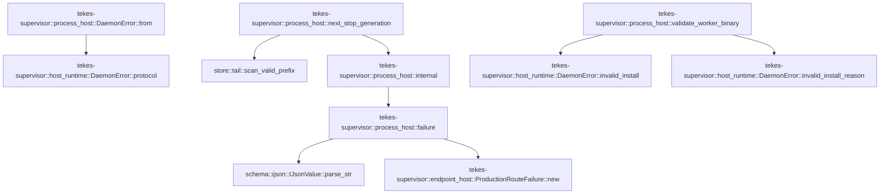

```mermaid
flowchart TD
  n0["endpoint::service::NativeEndpoint::open"]
  n1["endpoint::types::validate_session_id"]
  n2["engine::admission::AdmissionPool::new"]
  n3["profile::config::ConfigRepository::open"]
  n4["profile::resources::ResourceCatalog::from_snapshot"]
  n5["profile::scope::SessionScope::locate"]
  n6["provider::secret_store::MemorySecretStore::new"]
  n7["store::folder::ThreadStore::open"]
  n8["store::folder_events::subscribe"]
  n9["store::folder_events::canonical_root"]
  n10["tekes-supervisor::boot_trace::phase"]
  n11["tekes-supervisor::catalog::Catalog::new"]
  n12["tekes-supervisor::dynamic_bindings::resolve_worker_launch_bindings"]
  n13["tekes-supervisor::host_runtime::DaemonError::invalid_config"]
  n14["tekes-supervisor::host_runtime::DaemonError::corrupt"]
  n15["tekes-supervisor::host_runtime::DaemonError::required_broker"]
  n16["tekes-supervisor::mcp_runtime::McpRuntime::new"]
  n17["tekes-supervisor::process_host::ProductionProcessHost::client_tool_catalog"]
  n18["tekes-supervisor::process_host::ProductionProcessHost::run_post_ready"]
  n19["tekes-supervisor::process_host::ProductionProcessHost::post_ready_tasks"]
  n20["tekes-supervisor::process_host::ProductionProcessHost::cleanup_stale_ephemeral"]
  n21["tekes-supervisor::process_host::ProductionProcessHost::run_upgrade_pass"]
  n22["tekes-supervisor::process_host::WorkerHandshakeGuard::child_mut"]
  n23["tekes-supervisor::process_host::WorkerHandshakeGuard::take_credential_broker"]
  n24["tekes-supervisor::process_host::WorkerHandshakeGuard::wait_for_exit"]
  n25["tekes-supervisor::process_host::WorkerHandshakeGuard::drop"]
  n26["tekes-supervisor::process_host::scoped_client_file_path"]
  n27["tekes-supervisor::process_host::reconcile_credential_bindings"]
  n28["tekes-supervisor::process_host::validate_worker_binary"]
  n29["tekes-supervisor::process_host::credential_control"]
  n30["tekes-supervisor::process_host::active_material"]
  n31["tekes-supervisor::process_host::retain_prior_for_unknown_credentials"]
  n32["tekes-supervisor::process_host::ProductionProcessHost::open"]
  n33["tekes-supervisor::process_host::ProductionProcessHost::open_with_secret_store"]
  n34["tekes-supervisor::process_host::ProductionProcessHost::mcp_runtime"]
  n35["tekes-supervisor::process_host::ProductionProcessHost::credential_is_ready"]
  n36["tekes-supervisor::process_host::ProductionProcessHost::client_file_changes"]
  n37["tekes-supervisor::process_host::ProductionProcessHost::client_file_page"]
  n38["tekes-supervisor::process_host::ProductionProcessHost::session_scope"]
  n39["tekes-supervisor::process_host::ProductionProcessHost::user_agent_dir"]
  n40["tekes-supervisor::process_host::ProductionProcessHost::client_session_roots"]
  n41["tekes-supervisor::process_host::ProductionProcessHost::client_resource_catalog"]
  n42["tekes-supervisor::thread_card::CardWriter::spawn_from_env"]
  n43["workspace-service::file_text_page"]
  n44["workspace-service::file_byte_page"]
  n17 --> n12
  n17 --> n13
  n17 --> n15
  n17 --> n38
  n19 --> n10
  n19 --> n20
  n19 --> n21
  n24 --> n22
  n27 --> n15
  n27 --> n29
  n27 --> n30
  n29 --> n15
  n32 --> n6
  n32 --> n33
  n33 --> n0
  n33 --> n2
  n33 --> n3
  n33 --> n7
  n33 --> n8
  n33 --> n9
  n33 --> n11
  n33 --> n13
  n33 --> n14
  n33 --> n15
  n33 --> n16
  n33 --> n28
  n33 --> n42
  n36 --> n5
  n36 --> n38
  n37 --> n13
  n37 --> n26
  n37 --> n38
  n37 --> n43
  n37 --> n44
  n38 --> n1
  n38 --> n5
  n38 --> n13
  n40 --> n13
  n40 --> n38
  n41 --> n4
  n41 --> n13
  n41 --> n38
```

```mermaid
flowchart TD
  n0["provider::secret_store::resolve_config_credentials"]
  n1["store::folder::ThreadStore::open"]
  n2["store::folder_events::arm_admission"]
  n3["store::folder_events::is_admitted"]
  n4["tekes-supervisor::endpoint_host::recover_pending_management"]
  n5["tekes-supervisor::host_runtime::DaemonError::invalid_config"]
  n6["tekes-supervisor::host_runtime::DaemonError::corrupt"]
  n7["tekes-supervisor::host_runtime::DaemonError::required_broker"]
  n8["tekes-supervisor::process_host::ProductionProcessHost::cleanup_stale_ephemeral"]
  n9["tekes-supervisor::process_host::ProductionProcessHost::live_sessions_for_cleanup"]
  n10["tekes-supervisor::process_host::ProductionProcessHost::run_upgrade_pass"]
  n11["tekes-supervisor::process_host::ProductionProcessHost::is_stale_ephemeral"]
  n12["tekes-supervisor::process_host::ProductionProcessHost::on_folder_event"]
  n13["tekes-supervisor::process_host::ProductionProcessHost::attach_streams"]
  n14["tekes-supervisor::process_host::ProductionProcessHost::reconcile_child_line"]
  n15["tekes-supervisor::process_host::ProductionProcessHost::publish_session_status"]
  n16["tekes-supervisor::process_host::ProductionProcessHost::start_periodic_sweep"]
  n17["tekes-supervisor::process_host::ProductionProcessHost::recover_pending_management"]
  n18["tekes-supervisor::process_host::ProductionProcessHost::refresh_live_credentials"]
  n19["tekes-supervisor::process_host::ProductionProcessHost::config_mutation_succeeded"]
  n20["tekes-supervisor::process_host::ProductionProcessHost::refresh_worker_credentials"]
  n21["tekes-supervisor::process_host::ProductionProcessHost::boot_sweep"]
  n22["tekes-supervisor::process_host::ProductionProcessHost::arm_admission"]
  n23["tekes-supervisor::process_host::ProductionProcessHost::recover_client_sessions"]
  n24["tekes-supervisor::process_host::ProductionProcessHost::ensure_verified"]
  n25["tekes-supervisor::process_host::ProductionProcessHost::hydrate"]
  n26["tekes-supervisor::process_host::ProductionProcessHost::hydrate_with"]
  n27["tekes-supervisor::process_host::ProductionProcessHost::recently_failed"]
  n28["tekes-supervisor::process_host::ProductionProcessHost::hydrate_unrecorded"]
  n29["tekes-supervisor::process_host::ProductionProcessHost::sweep_once"]
  n30["tekes-supervisor::process_host::ProductionProcessHost::sweep_session"]
  n31["tekes-supervisor::process_host::web_search_scope_ready"]
  n32["tekes-supervisor::process_host::terminate_worker"]
  n33["tekes-supervisor::process_host::reconcile_credential_bindings"]
  n34["tekes-supervisor::process_host::retain_prior_for_unknown_credentials"]
  n8 --> n1
  n8 --> n3
  n8 --> n9
  n10 --> n25
  n10 --> n27
  n11 --> n3
  n17 --> n4
  n18 --> n20
  n19 --> n18
  n20 --> n0
  n20 --> n7
  n20 --> n31
  n20 --> n32
  n20 --> n33
  n20 --> n34
  n21 --> n29
  n22 --> n2
  n23 --> n5
  n23 --> n24
  n23 --> n30
  n24 --> n5
  n24 --> n6
  n24 --> n25
  n25 --> n26
  n26 --> n28
```

```mermaid
flowchart TD
  n0["engine::lifecycle::ensure_action_at"]
  n1["engine::lifecycle::classify"]
  n2["profile::scope::SessionScope::for_ledger"]
  n3["session-controls::bound_goal_id"]
  n4["store::card::remove_stale_card_temps"]
  n5["store::folder_events::is_admitted"]
  n6["store::folder_events::admitted_ids"]
  n7["store::platform::NamedLock::shared"]
  n8["store::tail::scan_valid_prefix"]
  n9["store::tail::repair_thread_tails"]
  n10["tekes-supervisor::boot_trace::detail"]
  n11["tekes-supervisor::boot_trace::per_item_enabled"]
  n12["tekes-supervisor::dynamic_bindings::resolve_worker_launch_bindings"]
  n13["tekes-supervisor::host_runtime::system_timestamp"]
  n14["tekes-supervisor::host_runtime::DaemonError::protocol"]
  n15["tekes-supervisor::host_runtime::DaemonError::invalid_config"]
  n16["tekes-supervisor::host_runtime::DaemonError::corrupt"]
  n17["tekes-supervisor::host_runtime::DaemonError::required_broker"]
  n18["tekes-supervisor::launch_profiled_worker_with_secret_store_and_binding_resolver"]
  n19["tekes-supervisor::process_host::ProductionProcessHost::live_sessions_for_cleanup"]
  n20["tekes-supervisor::process_host::production_sandbox_backend"]
  n21["tekes-supervisor::process_host::ProductionProcessHost::hydrate_unrecorded"]
  n22["tekes-supervisor::process_host::ProductionProcessHost::repair_main_projection"]
  n23["tekes-supervisor::process_host::ProductionProcessHost::periodic_sweep_once"]
  n24["tekes-supervisor::process_host::ProductionProcessHost::is_draining"]
  n25["tekes-supervisor::process_host::ProductionProcessHost::sweep_ledger_scan"]
  n26["tekes-supervisor::process_host::now_rfc3339"]
  n27["tekes-supervisor::process_host::ProductionProcessHost::sweep_once"]
  n28["tekes-supervisor::process_host::ProductionProcessHost::sweep_ids"]
  n29["tekes-supervisor::process_host::ProductionProcessHost::is_deferred"]
  n30["tekes-supervisor::process_host::ProductionProcessHost::sweep_session"]
  n31["tekes-supervisor::process_host::ProductionProcessHost::propagate_durable_stops_before_sweep"]
  n32["tekes-supervisor::process_host::ProductionProcessHost::shutdown"]
  n33["tekes-supervisor::process_host::ProductionProcessHost::shutdown_with"]
  n34["tekes-supervisor::process_host::ProductionProcessHost::ensure_running"]
  n35["tekes-supervisor::process_host::ProductionProcessHost::live_worker"]
  n36["tekes-supervisor::process_host::ProductionProcessHost::spawn_worker_at"]
  n37["tekes-supervisor::process_host::ProductionProcessHost::spawn_worker_at_with_handshake_timeout"]
  n38["tekes-supervisor::process_host::ProductionProcessHost::workspace_service_binary"]
  n39["tekes-supervisor::process_host::ProductionProcessHost::worker_binary_digest"]
  n40["tekes-supervisor::process_host::ProductionProcessHost::refresh_limits"]
  n41["tekes-supervisor::process_host::ProductionProcessHost::preflight_mandatory_authorities"]
  n42["tekes-supervisor::process_host::ProductionProcessHost::is_mcp_only_app_sandbox_host"]
  n43["tekes-supervisor::process_host::ProductionProcessHost::freeze_tool_authority"]
  n44["tekes-supervisor::process_host::ProductionProcessHost::schedule_worker_at"]
  n45["tekes-supervisor::process_host::ProductionProcessHost::wait_for_worker"]
  n46["tekes-supervisor::process_host::ProductionProcessHost::publish_appended"]
  n47["tekes-supervisor::process_host::ProductionProcessHost::publish_appended_with"]
  n48["tekes-supervisor::process_host::ProductionProcessHost::cascade_stop_from"]
  n49["tekes-supervisor::process_host::ProductionProcessHost::reset_restart_backoff"]
  n50["tekes-supervisor::process_host::ProductionProcessHost::restart_is_due"]
  n51["tekes-supervisor::process_host::ProductionProcessHost::note_restart_failure"]
  n52["tekes-supervisor::process_host::ProductionProcessHost::record_session_notice"]
  n53["tekes-supervisor::process_host::genesis_preset_skills"]
  n54["tekes-supervisor::process_host::missing_preset_skill_notice"]
  n55["tekes-supervisor::process_host::validator_tool_launch_policy"]
  n56["tekes-supervisor::process_host::worker_reader"]
  n57["tekes-supervisor::process_host::worker_stderr_reader"]
  n58["tekes-supervisor::process_host::damage_under_lock"]
  n59["tekes-supervisor::process_host::child_ledger_damage"]
  n60["tekes-supervisor::process_host::workspace_quiescence_lock_path"]
  n61["tekes-supervisor::process_host::goal_continuation_due"]
  n62["tekes-supervisor::process_host::probe_line_lock"]
  n63["tekes-supervisor::process_host::read_worker_hello"]
  n64["tekes-supervisor::process_host::SweepLedgerIdentity::of"]
  n65["tekes-supervisor::thread_card::fold_child_views"]
  n66["tools::runtime_backends::HelperJobLauncher::new"]
  n67["tools::runtime_backends::HelperJobLauncher::disabled"]
  n68["tools::sandbox::probe_backend"]
  n69["worker-control::durable::encode_queue_transaction"]
  n70["worker-control::negotiate"]
  n71["worker-control::encode_line"]
  n21 --> n4
  n21 --> n9
  n21 --> n16
  n21 --> n47
  n21 --> n58
  n21 --> n59
  n21 --> n65
  n22 --> n46
  n23 --> n27
  n25 --> n8
  n25 --> n14
  n25 --> n16
  n25 --> n64
  n27 --> n10
  n27 --> n11
  n27 --> n28
  n27 --> n30
  n28 --> n6
  n29 --> n5
  n30 --> n0
  n30 --> n1
  n30 --> n22
  n30 --> n25
  n30 --> n26
  n30 --> n29
  n30 --> n31
  n30 --> n40
  n30 --> n44
  n30 --> n50
  n30 --> n51
  n30 --> n61
  n30 --> n62
  n31 --> n25
  n31 --> n48
  n32 --> n33
  n33 --> n19
  n34 --> n40
  n34 --> n44
  n34 --> n45
  n34 --> n49
  n36 --> n37
  n37 --> n2
  n37 --> n3
  n37 --> n7
  n37 --> n12
  n37 --> n13
  n37 --> n14
  n37 --> n15
  n37 --> n17
  n37 --> n18
  n37 --> n39
  n37 --> n43
  n37 --> n52
  n37 --> n53
  n37 --> n54
  n37 --> n55
  n37 --> n56
  n37 --> n57
  n37 --> n60
  n37 --> n63
  n37 --> n69
  n37 --> n70
  n37 --> n71
  n40 --> n15
  n41 --> n17
  n41 --> n20
  n41 --> n42
  n41 --> n66
  n41 --> n67
  n41 --> n68
```

```mermaid
flowchart TD
  n0["engine::context::plan_context_compaction"]
  n1["schema::event::Event::from_value"]
  n2["schema::ijson::IJsonValue::parse"]
  n3["store::tail::scan_valid_prefix"]
  n4["tekes-supervisor::host_runtime::DaemonError::protocol"]
  n5["tekes-supervisor::host_runtime::DaemonError::io"]
  n6["tekes-supervisor::host_runtime::DaemonError::required_broker"]
  n7["tekes-supervisor::process_host::ProductionProcessHost::publish_session_status"]
  n8["tekes-supervisor::process_host::production_sandbox_backend"]
  n9["tekes-supervisor::process_host::ProductionProcessHost::refresh_worker_credentials"]
  n10["tekes-supervisor::process_host::ProductionProcessHost::ensure_verified"]
  n11["tekes-supervisor::process_host::spill_compaction_summary"]
  n12["tekes-supervisor::process_host::ProductionProcessHost::live_worker"]
  n13["tekes-supervisor::process_host::ProductionProcessHost::spawn_worker_at"]
  n14["tekes-supervisor::process_host::deterministic_automatic_thread_title"]
  n15["tekes-supervisor::process_host::ProductionProcessHost::refresh_limits"]
  n16["tekes-supervisor::process_host::ProductionProcessHost::is_mcp_only_app_sandbox_host"]
  n17["tekes-supervisor::process_host::ProductionProcessHost::freeze_tool_authority"]
  n18["tekes-supervisor::process_host::prompt_text"]
  n19["tekes-supervisor::process_host::ProductionProcessHost::schedule_main"]
  n20["tekes-supervisor::process_host::ProductionProcessHost::schedule_line"]
  n21["tekes-supervisor::process_host::ProductionProcessHost::schedule_worker_at"]
  n22["tekes-supervisor::process_host::ProductionProcessHost::schedule_worker_at_with_startup"]
  n23["tekes-supervisor::process_host::automatic_title_origin"]
  n24["tekes-supervisor::process_host::ProductionProcessHost::schedule_child_from_parent"]
  n25["tekes-supervisor::process_host::ProductionProcessHost::wait_for_worker"]
  n26["tekes-supervisor::process_host::ProductionProcessHost::start_pending_workers"]
  n27["tekes-supervisor::process_host::ProductionProcessHost::has_worker_capacity"]
  n28["tekes-supervisor::process_host::ProductionProcessHost::request_provider_lease"]
  n29["tekes-supervisor::process_host::ProductionProcessHost::locked_prompt"]
  n30["tekes-supervisor::process_host::ProductionProcessHost::locked_compact"]
  n31["tekes-supervisor::process_host::ProductionProcessHost::first_root_input"]
  n32["tekes-supervisor::process_host::ProductionProcessHost::seed_automatic_title"]
  n33["tekes-supervisor::process_host::ProductionProcessHost::try_seed_automatic_title"]
  n34["tekes-supervisor::process_host::ProductionProcessHost::wait_and_seed_automatic_title"]
  n35["tekes-supervisor::process_host::ProductionProcessHost::spawn_automatic_title_refinement"]
  n36["tekes-supervisor::process_host::ProductionProcessHost::spawn_automatic_title_seed_and_refinement"]
  n37["tekes-supervisor::process_host::ProductionProcessHost::refine_automatic_title"]
  n38["tekes-supervisor::process_host::ProductionProcessHost::summary_for_manual_compaction"]
  n39["tekes-supervisor::process_host::ProductionProcessHost::generate_automatic_title"]
  n40["tekes-supervisor::process_host::ProductionProcessHost::publish_appended"]
  n41["tekes-supervisor::process_host::ProductionProcessHost::reset_restart_backoff"]
  n42["tekes-supervisor::process_host::ProductionProcessHost::record_spawn_failure"]
  n43["tekes-supervisor::process_host::frozen_tool_launch_policy"]
  n44["tekes-supervisor::process_host::child_dependency_admitted"]
  n45["tekes-supervisor::process_host::unresolved_parent_dependency"]
  n46["tekes-supervisor::process_host::line_schedule_target"]
  n47["tekes-supervisor::process_host::ledger_needs_worker"]
  n48["tekes-supervisor::process_host::internal"]
  n49["tools::runtime_backends::HelperJobLauncher::new"]
  n50["tools::runtime_backends::HelperJobLauncher::disabled"]
  n51["tools::sandbox::probe_backend"]
  n16 --> n5
  n16 --> n6
  n17 --> n6
  n17 --> n8
  n17 --> n16
  n17 --> n43
  n17 --> n49
  n17 --> n50
  n17 --> n51
  n19 --> n21
  n20 --> n21
  n20 --> n24
  n20 --> n45
  n20 --> n46
  n21 --> n22
  n22 --> n4
  n22 --> n7
  n22 --> n9
  n22 --> n10
  n22 --> n12
  n22 --> n13
  n22 --> n15
  n22 --> n27
  n24 --> n7
  n24 --> n9
  n24 --> n13
  n24 --> n15
  n24 --> n27
  n24 --> n44
  n25 --> n6
  n26 --> n7
  n26 --> n13
  n26 --> n27
  n26 --> n47
  n29 --> n2
  n29 --> n18
  n29 --> n19
  n29 --> n31
  n29 --> n32
  n29 --> n35
  n29 --> n41
  n29 --> n42
  n30 --> n0
  n30 --> n1
  n30 --> n2
  n30 --> n11
  n30 --> n38
  n30 --> n40
  n30 --> n48
  n31 --> n3
  n32 --> n33
  n33 --> n14
  n33 --> n23
  n33 --> n40
  n34 --> n33
  n37 --> n23
  n37 --> n39
  n37 --> n40
```

```mermaid
flowchart TD
  n0["profile::resources::ResourceCatalog::skill_package_names"]
  n1["provider::request::endpoint_origin"]
  n2["store::tail::scan_valid_prefix"]
  n3["tekes-supervisor::host_runtime::DaemonError::protocol"]
  n4["tekes-supervisor::host_runtime::DaemonError::invalid_config"]
  n5["tekes-supervisor::host_runtime::DaemonError::corrupt"]
  n6["tekes-supervisor::host_runtime::DaemonError::required_broker"]
  n7["tekes-supervisor::process_host::prompt_text"]
  n8["tekes-supervisor::process_host::missing_preset_skill_notice"]
  n9["tekes-supervisor::process_host::frozen_tool_launch_policy"]
  n10["tekes-supervisor::process_host::validator_tool_launch_policy"]
  n11["tekes-supervisor::process_host::private_validator_launch_policy"]
  n12["tekes-supervisor::process_host::web_search_scope_ready"]
  n13["tekes-supervisor::process_host::child_dependency_admitted"]
  n14["tekes-supervisor::process_host::WorkerHandle::write"]
  n15["tekes-supervisor::process_host::WorkerHandle::receipt"]
  n16["tekes-supervisor::process_host::WorkerHandle::queue_result"]
  n17["tekes-supervisor::process_host::worker_reader"]
  n18["tekes-supervisor::process_host::terminate_worker"]
  n19["tekes-supervisor::process_host::fail_worker"]
  n20["tekes-supervisor::process_host::worker_stderr_reader"]
  n21["tekes-supervisor::process_host::preserve_first_failure"]
  n22["tekes-supervisor::process_host::ProductionProcessHost::workspace_metadata_changed"]
  n23["tekes-supervisor::process_host::ProductionProcessHost::session_metadata_changed"]
  n24["tekes-supervisor::process_host::ProductionProcessHost::prompt"]
  n25["tekes-supervisor::process_host::ProductionProcessHost::compact"]
  n26["tekes-supervisor::process_host::ProductionProcessHost::cancel"]
  n27["tekes-supervisor::process_host::ProductionProcessHost::rename"]
  n28["tekes-supervisor::process_host::cancel_stage_failure"]
  n29["tekes-supervisor::process_host::child_exited_within"]
  n30["tekes-supervisor::process_host::next_stop_generation"]
  n31["tekes-supervisor::process_host::internal"]
  n32["tools::runtime_backends::JobLaunchPolicy::new"]
  n33["tools::sandbox::exposed_protected_roots"]
  n34["worker-control::continuation::decode_tool_continuation"]
  n35["worker-control::durable::decode_tool_control"]
  n36["worker-control::decode_worker"]
  n37["worker-control::encode_line"]
  n8 --> n0
  n9 --> n4
  n9 --> n6
  n9 --> n32
  n9 --> n33
  n10 --> n2
  n10 --> n3
  n10 --> n5
  n10 --> n6
  n10 --> n11
  n11 --> n6
  n11 --> n32
  n12 --> n1
  n15 --> n31
  n16 --> n31
  n17 --> n3
  n17 --> n18
  n17 --> n19
  n17 --> n34
  n17 --> n35
  n17 --> n36
  n17 --> n37
  n19 --> n21
  n24 --> n7
  n24 --> n29
  n24 --> n37
  n25 --> n29
  n25 --> n37
  n26 --> n18
  n26 --> n28
  n26 --> n29
  n26 --> n30
  n26 --> n31
  n26 --> n37
  n27 --> n37
```

```mermaid
flowchart TD
  n0["endpoint::service::genesis_cwd"]
  n1["endpoint::service::genesis_preset_summary"]
  n2["endpoint::service::permission_mode_of"]
  n3["endpoint::service::last_record_updated_ms"]
  n4["endpoint::types::validate_session_id"]
  n5["store::card::valid_line_name"]
  n6["store::folder_events::admitted_ids"]
  n7["store::tail::scan_valid_prefix"]
  n8["store::tail::read_genesis"]
  n9["tekes-supervisor::endpoint_host::ProductionRouteFailure::new"]
  n10["tekes-supervisor::process_host::ProductionProcessHost::is_stale_ephemeral"]
  n11["tekes-supervisor::process_host::ProductionProcessHost::ensure_verified"]
  n12["tekes-supervisor::process_host::ProductionProcessHost::recently_failed"]
  n13["tekes-supervisor::process_host::ProductionProcessHost::deliver_if_live"]
  n14["tekes-supervisor::process_host::ProductionProcessHost::ensure_after_locked_append"]
  n15["tekes-supervisor::process_host::cancel_stage_failure"]
  n16["tekes-supervisor::process_host::child_exited_within"]
  n17["tekes-supervisor::process_host::neutral_lifecycle"]
  n18["tekes-supervisor::process_host::ledger_damage"]
  n19["tekes-supervisor::process_host::damage_under_lock"]
  n20["tekes-supervisor::process_host::child_ledger_damage"]
  n21["tekes-supervisor::process_host::is_single_line_ledger"]
  n22["tekes-supervisor::process_host::ProductionProcessHost::list_wait"]
  n23["tekes-supervisor::process_host::ProductionProcessHost::is_running"]
  n24["tekes-supervisor::process_host::ProductionProcessHost::catalog_item"]
  n25["tekes-supervisor::process_host::ProductionProcessHost::verify_within"]
  n26["tekes-supervisor::process_host::ProductionProcessHost::build_inventory"]
  n27["tekes-supervisor::process_host::ProductionProcessHost::inventory_items"]
  n28["tekes-supervisor::process_host::ProductionProcessHost::ensure_verified"]
  n29["tekes-supervisor::process_host::ProductionProcessHost::has_catalog"]
  n30["tekes-supervisor::process_host::ProductionProcessHost::hold_catalog"]
  n31["tekes-supervisor::process_host::ProductionProcessHost::inventory_item"]
  n32["tekes-supervisor::process_host::ProductionProcessHost::live_sessions"]
  n33["worker-control::encode_line"]
  n13 --> n16
  n13 --> n33
  n15 --> n9
  n18 --> n7
  n19 --> n18
  n20 --> n5
  n20 --> n18
  n20 --> n19
  n24 --> n0
  n24 --> n1
  n24 --> n2
  n24 --> n3
  n24 --> n8
  n24 --> n10
  n24 --> n17
  n24 --> n21
  n24 --> n23
  n26 --> n4
  n26 --> n6
  n26 --> n12
  n26 --> n17
  n26 --> n24
  n26 --> n25
  n28 --> n11
```

```mermaid
flowchart TD
  n0["engine::lifecycle::ensure_action_at"]
  n1["engine::lifecycle::classify"]
  n2["provider::dialect::validate_provider"]
  n3["provider::dialect::resolve_profile"]
  n4["provider::request::endpoint_origin"]
  n5["provider::secret_store::resolve_config_credentials"]
  n6["schema::ijson::IJsonValue::parse"]
  n7["session-controls::read_goal"]
  n8["store::tail::scan_valid_prefix"]
  n9["tekes-supervisor::host_runtime::system_timestamp"]
  n10["tekes-supervisor::host_runtime::DaemonError::protocol"]
  n11["tekes-supervisor::host_runtime::DaemonError::io"]
  n12["tekes-supervisor::host_runtime::DaemonError::invalid_config"]
  n13["tekes-supervisor::host_runtime::DaemonError::corrupt"]
  n14["tekes-supervisor::process_host::now_rfc3339"]
  n15["tekes-supervisor::process_host::ProductionProcessHost::reconcile_projection"]
  n16["tekes-supervisor::process_host::ProductionProcessHost::execute"]
  n17["tekes-supervisor::process_host::ProductionProcessHost::readiness"]
  n18["tekes-supervisor::process_host::ProductionProcessHost::config_mutation_succeeded"]
  n19["tekes-supervisor::process_host::ProcessToolRuntime::host"]
  n20["tekes-supervisor::process_host::ProcessToolRuntime::ensure_running"]
  n21["tekes-supervisor::process_host::ProcessToolRuntime::deliver_input"]
  n22["tekes-supervisor::process_host::ProcessToolRuntime::interrupt"]
  n23["tekes-supervisor::process_host::ProcessToolRuntime::ensure_child"]
  n24["tekes-supervisor::process_host::ProcessToolRuntime::deliver_report"]
  n25["tekes-supervisor::process_host::unresolved_parent_dependency"]
  n26["tekes-supervisor::process_host::line_schedule_target"]
  n27["tekes-supervisor::process_host::operation_unavailable"]
  n28["tekes-supervisor::process_host::operation_value"]
  n29["tekes-supervisor::process_host::workspace_quiescence_lock_path"]
  n30["tekes-supervisor::process_host::scoped_client_file_path"]
  n31["tekes-supervisor::process_host::ledger_needs_worker"]
  n32["tekes-supervisor::process_host::goal_continuation_due"]
  n33["tekes-supervisor::process_host::probe_line_lock"]
  n34["tekes-supervisor::process_host::read_worker_hello"]
  n35["worker-control::durable::encode_queue_transaction"]
  n36["worker-control::decode_hello"]
  n16 --> n35
  n17 --> n2
  n17 --> n3
  n17 --> n4
  n17 --> n5
  n20 --> n28
  n21 --> n9
  n21 --> n28
  n22 --> n8
  n22 --> n9
  n22 --> n11
  n22 --> n27
  n22 --> n28
  n23 --> n28
  n24 --> n28
  n25 --> n8
  n25 --> n13
  n25 --> n26
  n26 --> n13
  n28 --> n6
  n30 --> n12
  n31 --> n0
  n31 --> n1
  n31 --> n8
  n31 --> n13
  n31 --> n14
  n31 --> n32
  n31 --> n33
  n32 --> n7
  n32 --> n8
  n32 --> n12
  n32 --> n13
  n33 --> n11
  n33 --> n13
  n34 --> n10
  n34 --> n11
  n34 --> n36
```

# tekes-supervisor::process_host

[Package atlas](index.md) · [Source](../../src/process_host.rs)

## Declarations

Visibility is the declaration spelling; trait members and reexports require their enclosing interface. `cfg` is not evaluated.

| Symbol | Kind | Visibility | Test / cfg |
|---|---|---|---|
| [tekes-supervisor::process_host::DELIVERY_TIMEOUT](../../src/process_host.rs#L58) | const_item | `private` |  |
| [tekes-supervisor::process_host::MCP_ONLY_APP_SANDBOX_MARKER](../../src/process_host.rs#L59) | const_item | `private` |  |
| [tekes-supervisor::process_host::WORKER_HANDSHAKE_TIMEOUT](../../src/process_host.rs#L60) | const_item | `private` |  |
| [tekes-supervisor::process_host::WORKER_HELLO_MAX_BYTES](../../src/process_host.rs#L61) | const_item | `private` |  |
| [tekes-supervisor::process_host::MANAGEMENT_RECOVERY_SECONDS](../../src/process_host.rs#L63) | const_item | `private` |  |
| [tekes-supervisor::process_host::PERIODIC_SWEEP_INTERVAL](../../src/process_host.rs#L64) | const_item | `private` |  |
| [tekes-supervisor::process_host::SweepLedgerIdentity](../../src/process_host.rs#L69) | struct_item | `private` |  |
| [tekes-supervisor::process_host::SweepLedgerIdentity::of](../../src/process_host.rs#L76) | function_item | `private` |  |
| [tekes-supervisor::process_host::SweepLedgerScan](../../src/process_host.rs#L89) | struct_item | `private` |  |
| [tekes-supervisor::process_host::AUTOMATIC_THREAD_TITLE_MODEL_HINT](../../src/process_host.rs#L103) | const_item | `private` |  |
| [tekes-supervisor::process_host::AUTOMATIC_THREAD_TITLE_MAX_CHARS](../../src/process_host.rs#L104) | const_item | `private` |  |
| [tekes-supervisor::process_host::AUTOMATIC_THREAD_TITLE_TIMEOUT](../../src/process_host.rs#L105) | const_item | `private` |  |
| [tekes-supervisor::process_host::AUTOMATIC_THREAD_TITLE_MAX_OUTPUT_TOKENS](../../src/process_host.rs#L109) | const_item | `private` |  |
| [tekes-supervisor::process_host::COMPACTION_SUMMARY_TIMEOUT](../../src/process_host.rs#L110) | const_item | `private` |  |
| [tekes-supervisor::process_host::AUTOMATIC_THREAD_TITLE_SYSTEM](../../src/process_host.rs#L111) | const_item | `private` |  |
| [tekes-supervisor::process_host::LineLockState](../../src/process_host.rs#L114) | enum_item | `private` |  |
| [tekes-supervisor::process_host::production_sandbox_backend](../../src/process_host.rs#L119) | function_item | `private` |  |
| [tekes-supervisor::process_host::seq_ranges](../../src/process_host.rs#L130) | function_item | `private` |  |
| [tekes-supervisor::process_host::spill_compaction_summary](../../src/process_host.rs#L149) | function_item | `private` |  |
| [tekes-supervisor::process_host::now_rfc3339](../../src/process_host.rs#L166) | function_item | `private` |  |
| [tekes-supervisor::process_host::session_event_time_now](../../src/process_host.rs#L170) | function_item | `private` |  |
| [tekes-supervisor::process_host::session_event_time](../../src/process_host.rs#L174) | function_item | `private` |  |
| [tekes-supervisor::process_host::compact_title_source](../../src/process_host.rs#L184) | function_item | `private` |  |
| [tekes-supervisor::process_host::bounded_title](../../src/process_host.rs#L188) | function_item | `private` |  |
| [tekes-supervisor::process_host::deterministic_automatic_thread_title](../../src/process_host.rs#L195) | function_item | `private` |  |
| [tekes-supervisor::process_host::normalized_automatic_thread_title](../../src/process_host.rs#L199) | function_item | `private` |  |
| [tekes-supervisor::process_host::prompt_text](../../src/process_host.rs#L224) | function_item | `private` |  |
| [tekes-supervisor::process_host::automatic_title_origin](../../src/process_host.rs#L235) | function_item | `private` |  |
| [tekes-supervisor::process_host::automatic_title_route](../../src/process_host.rs#L245) | function_item | `private` |  |
| [tekes-supervisor::process_host::session_model_route](../../src/process_host.rs#L284) | function_item | `private` |  |
| [tekes-supervisor::process_host::prepare_automatic_title_request](../../src/process_host.rs#L332) | function_item | `private` |  |
| [tekes-supervisor::process_host::prepare_automatic_text_request](../../src/process_host.rs#L349) | function_item | `private` |  |
| [tekes-supervisor::process_host::accepted_stream_event](../../src/process_host.rs#L400) | function_item | `private` | test; #[cfg(test)] |
| [tekes-supervisor::process_host::ProcessToolRuntime](../../src/process_host.rs#L415) | struct_item | `private` |  |
| [tekes-supervisor::process_host::ProductionProcessHost](../../src/process_host.rs#L419) | struct_item | `pub` |  |
| [tekes-supervisor::process_host::SessionProjectionCache](../../src/process_host.rs#L477) | struct_item | `private` |  |
| [tekes-supervisor::process_host::WorkerHandle](../../src/process_host.rs#L483) | struct_item | `private` |  |
| [tekes-supervisor::process_host::WorkerHandshakeGuard](../../src/process_host.rs#L504) | struct_item | `private` |  |
| [tekes-supervisor::process_host::WorkerHandshakeGuard::child_mut](../../src/process_host.rs#L511) | function_item | `private` |  |
| [tekes-supervisor::process_host::WorkerHandshakeGuard::take_child](../../src/process_host.rs#L515) | function_item | `private` |  |
| [tekes-supervisor::process_host::WorkerHandshakeGuard::take_credential_control](../../src/process_host.rs#L519) | function_item | `private` |  |
| [tekes-supervisor::process_host::WorkerHandshakeGuard::take_credential_broker](../../src/process_host.rs#L523) | function_item | `private` |  |
| [tekes-supervisor::process_host::WorkerHandshakeGuard::wait_for_exit](../../src/process_host.rs#L527) | function_item | `private` |  |
| [tekes-supervisor::process_host::WorkerHandshakeGuard::drop](../../src/process_host.rs#L540) | function_item | `private` |  |
| [tekes-supervisor::process_host::PendingWorker](../../src/process_host.rs#L553) | struct_item | `private` |  |
| [tekes-supervisor::process_host::WorkerProtocolQuarantine](../../src/process_host.rs#L560) | struct_item | `private` |  |
| [tekes-supervisor::process_host::RestartBackoff](../../src/process_host.rs#L567) | struct_item | `private` |  |
| [tekes-supervisor::process_host::ScheduledWorker](../../src/process_host.rs#L574) | struct_item | `private` |  |
| [tekes-supervisor::process_host::WorkerState](../../src/process_host.rs#L580) | struct_item | `private` |  |
| [tekes-supervisor::process_host::reconcile_credential_bindings](../../src/process_host.rs#L587) | function_item | `private` |  |
| [tekes-supervisor::process_host::credential_control](../../src/process_host.rs#L691) | function_item | `private` |  |
| [tekes-supervisor::process_host::active_material](../../src/process_host.rs#L702) | function_item | `private` |  |
| [tekes-supervisor::process_host::retain_prior_for_unknown_credentials](../../src/process_host.rs#L716) | function_item | `private` |  |
| [tekes-supervisor::process_host::ProductionProcessHost::open](../../src/process_host.rs#L759) | function_item | `pub` |  |
| [tekes-supervisor::process_host::ProductionProcessHost::open_with_secret_store](../../src/process_host.rs#L774) | function_item | `pub` |  |
| [tekes-supervisor::process_host::ProductionProcessHost::mcp_runtime](../../src/process_host.rs#L874) | function_item | `pub` |  |
| [tekes-supervisor::process_host::ProductionProcessHost::credential_is_ready](../../src/process_host.rs#L881) | function_item | `pub` |  |
| [tekes-supervisor::process_host::ProductionProcessHost::client_file_changes](../../src/process_host.rs#L893) | function_item | `pub(crate)` |  |
| [tekes-supervisor::process_host::ProductionProcessHost::client_file_page](../../src/process_host.rs#L925) | function_item | `pub(crate)` |  |
| [tekes-supervisor::process_host::ProductionProcessHost::session_scope](../../src/process_host.rs#L955) | function_item | `private` |  |
| [tekes-supervisor::process_host::ProductionProcessHost::user_agent_dir](../../src/process_host.rs#L963) | function_item | `pub` |  |
| [tekes-supervisor::process_host::ProductionProcessHost::client_session_roots](../../src/process_host.rs#L969) | function_item | `pub` |  |
| [tekes-supervisor::process_host::ProductionProcessHost::client_resource_catalog](../../src/process_host.rs#L983) | function_item | `pub(crate)` |  |
| [tekes-supervisor::process_host::ProductionProcessHost::client_tool_catalog](../../src/process_host.rs#L1002) | function_item | `pub(crate)` |  |
| [tekes-supervisor::process_host::ProductionProcessHost::run_post_ready](../../src/process_host.rs#L1029) | function_item | `pub` |  |
| [tekes-supervisor::process_host::ProductionProcessHost::post_ready_tasks](../../src/process_host.rs#L1043) | function_item | `private` |  |
| [tekes-supervisor::process_host::ProductionProcessHost::cleanup_stale_ephemeral](../../src/process_host.rs#L1061) | function_item | `private` |  |
| [tekes-supervisor::process_host::ProductionProcessHost::live_sessions_for_cleanup](../../src/process_host.rs#L1086) | function_item | `private` |  |
| [tekes-supervisor::process_host::ProductionProcessHost::run_upgrade_pass](../../src/process_host.rs#L1099) | function_item | `private` |  |
| [tekes-supervisor::process_host::ProductionProcessHost::release_for_test](../../src/process_host.rs#L1142) | function_item | `pub(crate)` | test; #[cfg(test)] #[cfg_attr(not(target_os = "macos"), allow(dead_code))] |
| [tekes-supervisor::process_host::ProductionProcessHost::is_stale_ephemeral](../../src/process_host.rs#L1150) | function_item | `pub(crate)` |  |
| [tekes-supervisor::process_host::ProductionProcessHost::on_folder_event](../../src/process_host.rs#L1154) | function_item | `private` |  |
| [tekes-supervisor::process_host::ProductionProcessHost::attach_streams](../../src/process_host.rs#L1193) | function_item | `pub` |  |
| [tekes-supervisor::process_host::ProductionProcessHost::reconcile_child_line](../../src/process_host.rs#L1203) | function_item | `private` |  |
| [tekes-supervisor::process_host::ProductionProcessHost::publish_session_status](../../src/process_host.rs#L1222) | function_item | `private` |  |
| [tekes-supervisor::process_host::ProductionProcessHost::start_periodic_sweep](../../src/process_host.rs#L1239) | function_item | `pub` |  |
| [tekes-supervisor::process_host::ProductionProcessHost::recover_pending_management](../../src/process_host.rs#L1290) | function_item | `private` |  |
| [tekes-supervisor::process_host::ProductionProcessHost::refresh_live_credentials](../../src/process_host.rs#L1298) | function_item | `pub` |  |
| [tekes-supervisor::process_host::ProductionProcessHost::config_mutation_succeeded](../../src/process_host.rs#L1316) | function_item | `pub` |  |
| [tekes-supervisor::process_host::ProductionProcessHost::refresh_worker_credentials](../../src/process_host.rs#L1331) | function_item | `private` |  |
| [tekes-supervisor::process_host::ProductionProcessHost::boot_sweep](../../src/process_host.rs#L1370) | function_item | `pub` |  |
| [tekes-supervisor::process_host::ProductionProcessHost::arm_admission](../../src/process_host.rs#L1381) | function_item | `pub` |  |
| [tekes-supervisor::process_host::ProductionProcessHost::recover_client_sessions](../../src/process_host.rs#L1390) | function_item | `pub` |  |
| [tekes-supervisor::process_host::ProductionProcessHost::ensure_verified](../../src/process_host.rs#L1432) | function_item | `pub(crate)` |  |
| [tekes-supervisor::process_host::ProductionProcessHost::hydrate](../../src/process_host.rs#L1447) | function_item | `pub(crate)` |  |
| [tekes-supervisor::process_host::ProductionProcessHost::hydrate_with](../../src/process_host.rs#L1453) | function_item | `pub(crate)` |  |
| [tekes-supervisor::process_host::ProductionProcessHost::recently_failed](../../src/process_host.rs#L1473) | function_item | `private` |  |
| [tekes-supervisor::process_host::ProductionProcessHost::hydrate_unrecorded](../../src/process_host.rs#L1481) | function_item | `private` |  |
| [tekes-supervisor::process_host::ProductionProcessHost::repair_main_projection](../../src/process_host.rs#L1570) | function_item | `private` |  |
| [tekes-supervisor::process_host::ProductionProcessHost::periodic_sweep_once](../../src/process_host.rs#L1615) | function_item | `pub` |  |
| [tekes-supervisor::process_host::ProductionProcessHost::is_draining](../../src/process_host.rs#L1632) | function_item | `pub` |  |
| [tekes-supervisor::process_host::ProductionProcessHost::sweep_ledger_scan](../../src/process_host.rs#L1642) | function_item | `private` |  |
| [tekes-supervisor::process_host::ProductionProcessHost::sweep_once](../../src/process_host.rs#L1692) | function_item | `private` |  |
| [tekes-supervisor::process_host::ProductionProcessHost::sweep_ids](../../src/process_host.rs#L1712) | function_item | `private` |  |
| [tekes-supervisor::process_host::ProductionProcessHost::is_deferred](../../src/process_host.rs#L1741) | function_item | `private` |  |
| [tekes-supervisor::process_host::ProductionProcessHost::sweep_session](../../src/process_host.rs#L1753) | function_item | `private` |  |
| [tekes-supervisor::process_host::ProductionProcessHost::propagate_durable_stops_before_sweep](../../src/process_host.rs#L1836) | function_item | `private` |  |
| [tekes-supervisor::process_host::ProductionProcessHost::shutdown](../../src/process_host.rs#L1871) | function_item | `pub` |  |
| [tekes-supervisor::process_host::ProductionProcessHost::shutdown_with](../../src/process_host.rs#L1878) | function_item | `private` |  |
| [tekes-supervisor::process_host::ProductionProcessHost::ensure_running](../../src/process_host.rs#L1917) | function_item | `private` |  |
| [tekes-supervisor::process_host::ProductionProcessHost::live_worker](../../src/process_host.rs#L1931) | function_item | `private` |  |
| [tekes-supervisor::process_host::ProductionProcessHost::spawn_worker_at](../../src/process_host.rs#L1941) | function_item | `private` |  |
| [tekes-supervisor::process_host::ProductionProcessHost::spawn_worker_at_with_handshake_timeout](../../src/process_host.rs#L1957) | function_item | `private` |  |
| [tekes-supervisor::process_host::ProductionProcessHost::workspace_service_binary](../../src/process_host.rs#L2176) | function_item | `pub` |  |
| [tekes-supervisor::process_host::ProductionProcessHost::worker_binary_digest](../../src/process_host.rs#L2180) | function_item | `private` |  |
| [tekes-supervisor::process_host::ProductionProcessHost::refresh_limits](../../src/process_host.rs#L2185) | function_item | `private` |  |
| [tekes-supervisor::process_host::ProductionProcessHost::preflight_mandatory_authorities](../../src/process_host.rs#L2204) | function_item | `pub` |  |
| [tekes-supervisor::process_host::ProductionProcessHost::is_mcp_only_app_sandbox_host](../../src/process_host.rs#L2223) | function_item | `private` |  |
| [tekes-supervisor::process_host::ProductionProcessHost::freeze_tool_authority](../../src/process_host.rs#L2243) | function_item | `private` |  |
| [tekes-supervisor::process_host::ProductionProcessHost::schedule_main](../../src/process_host.rs#L2263) | function_item | `private` |  |
| [tekes-supervisor::process_host::ProductionProcessHost::schedule_line](../../src/process_host.rs#L2274) | function_item | `private` |  |
| [tekes-supervisor::process_host::ProductionProcessHost::schedule_worker_at](../../src/process_host.rs#L2290) | function_item | `private` |  |
| [tekes-supervisor::process_host::ProductionProcessHost::schedule_worker_at_with_startup](../../src/process_host.rs#L2301) | function_item | `private` |  |
| [tekes-supervisor::process_host::ProductionProcessHost::schedule_child_from_parent](../../src/process_host.rs#L2388) | function_item | `private` |  |
| [tekes-supervisor::process_host::ProductionProcessHost::wait_for_worker](../../src/process_host.rs#L2436) | function_item | `private` |  |
| [tekes-supervisor::process_host::ProductionProcessHost::start_pending_workers](../../src/process_host.rs#L2464) | function_item | `private` |  |
| [tekes-supervisor::process_host::ProductionProcessHost::has_worker_capacity](../../src/process_host.rs#L2531) | function_item | `private` |  |
| [tekes-supervisor::process_host::ProductionProcessHost::request_provider_lease](../../src/process_host.rs#L2539) | function_item | `private` |  |
| [tekes-supervisor::process_host::ProductionProcessHost::locked_prompt](../../src/process_host.rs#L2578) | function_item | `private` |  |
| [tekes-supervisor::process_host::ProductionProcessHost::locked_compact](../../src/process_host.rs#L2612) | function_item | `private` |  |
| [tekes-supervisor::process_host::ProductionProcessHost::first_root_input](../../src/process_host.rs#L2689) | function_item | `private` |  |
| [tekes-supervisor::process_host::ProductionProcessHost::seed_automatic_title](../../src/process_host.rs#L2721) | function_item | `private` |  |
| [tekes-supervisor::process_host::ProductionProcessHost::try_seed_automatic_title](../../src/process_host.rs#L2733) | function_item | `private` |  |
| [tekes-supervisor::process_host::ProductionProcessHost::wait_and_seed_automatic_title](../../src/process_host.rs#L2761) | function_item | `private` |  |
| [tekes-supervisor::process_host::ProductionProcessHost::spawn_automatic_title_refinement](../../src/process_host.rs#L2786) | function_item | `private` |  |
| [tekes-supervisor::process_host::ProductionProcessHost::spawn_automatic_title_seed_and_refinement](../../src/process_host.rs#L2800) | function_item | `private` |  |
| [tekes-supervisor::process_host::ProductionProcessHost::refine_automatic_title](../../src/process_host.rs#L2824) | function_item | `private` |  |
| [tekes-supervisor::process_host::ProductionProcessHost::complete_automatic_text](../../src/process_host.rs#L2861) | function_item | `private` |  |
| [tekes-supervisor::process_host::ProductionProcessHost::complete_automatic_terminal](../../src/process_host.rs#L2887) | function_item | `private` |  |
| [tekes-supervisor::process_host::ProductionProcessHost::summary_for_manual_compaction](../../src/process_host.rs#L2951) | function_item | `private` |  |
| [tekes-supervisor::process_host::ProductionProcessHost::generate_automatic_title](../../src/process_host.rs#L3022) | function_item | `private` |  |
| [tekes-supervisor::process_host::ProductionProcessHost::handle_tool_control](../../src/process_host.rs#L3047) | function_item | `private` |  |
| [tekes-supervisor::process_host::ProductionProcessHost::handle_tool_continuation](../../src/process_host.rs#L3082) | function_item | `private` |  |
| [tekes-supervisor::process_host::ProductionProcessHost::validate_child_proof](../../src/process_host.rs#L3120) | function_item | `private` |  |
| [tekes-supervisor::process_host::ProductionProcessHost::publish_appended](../../src/process_host.rs#L3137) | function_item | `private` |  |
| [tekes-supervisor::process_host::ProductionProcessHost::publish_appended_with](../../src/process_host.rs#L3143) | function_item | `private` |  |
| [tekes-supervisor::process_host::ProductionProcessHost::publish_frame](../../src/process_host.rs#L3342) | function_item | `private` |  |
| [tekes-supervisor::process_host::ProductionProcessHost::launch_child](../../src/process_host.rs#L3487) | function_item | `private` |  |
| [tekes-supervisor::process_host::ProductionProcessHost::propagate_parent_stop](../../src/process_host.rs#L3574) | function_item | `private` |  |
| [tekes-supervisor::process_host::ProductionProcessHost::cascade_stop_from](../../src/process_host.rs#L3667) | function_item | `private` |  |
| [tekes-supervisor::process_host::ProductionProcessHost::reconcile_after_exit](../../src/process_host.rs#L3753) | function_item | `private` |  |
| [tekes-supervisor::process_host::ProductionProcessHost::reset_restart_backoff](../../src/process_host.rs#L3816) | function_item | `private` |  |
| [tekes-supervisor::process_host::ProductionProcessHost::restart_is_due](../../src/process_host.rs#L3823) | function_item | `private` |  |
| [tekes-supervisor::process_host::ProductionProcessHost::note_restart_failure](../../src/process_host.rs#L3831) | function_item | `private` |  |
| [tekes-supervisor::process_host::ProductionProcessHost::record_spawn_failure](../../src/process_host.rs#L3872) | function_item | `private` |  |
| [tekes-supervisor::process_host::ProductionProcessHost::record_session_notice](../../src/process_host.rs#L3897) | function_item | `private` |  |
| [tekes-supervisor::process_host::genesis_preset_skills](../../src/process_host.rs#L3932) | function_item | `private` |  |
| [tekes-supervisor::process_host::missing_preset_skill_notice](../../src/process_host.rs#L3943) | function_item | `private` |  |
| [tekes-supervisor::process_host::frozen_tool_launch_policy](../../src/process_host.rs#L3964) | function_item | `private` |  |
| [tekes-supervisor::process_host::validator_tool_launch_policy](../../src/process_host.rs#L3994) | function_item | `private` |  |
| [tekes-supervisor::process_host::private_validator_launch_policy](../../src/process_host.rs#L4036) | function_item | `private` |  |
| [tekes-supervisor::process_host::web_search_scope_ready](../../src/process_host.rs#L4065) | function_item | `private` |  |
| [tekes-supervisor::process_host::child_dependency_admitted](../../src/process_host.rs#L4083) | function_item | `private` |  |
| [tekes-supervisor::process_host::WorkerHandle::write](../../src/process_host.rs#L4088) | function_item | `private` |  |
| [tekes-supervisor::process_host::WorkerHandle::receipt](../../src/process_host.rs#L4097) | function_item | `private` |  |
| [tekes-supervisor::process_host::WorkerHandle::queue_result](../../src/process_host.rs#L4122) | function_item | `private` |  |
| [tekes-supervisor::process_host::worker_reader](../../src/process_host.rs#L4151) | function_item | `private` |  |
| [tekes-supervisor::process_host::terminate_worker](../../src/process_host.rs#L4406) | function_item | `private` |  |
| [tekes-supervisor::process_host::fail_worker](../../src/process_host.rs#L4433) | function_item | `private` |  |
| [tekes-supervisor::process_host::worker_stderr_reader](../../src/process_host.rs#L4457) | function_item | `private` |  |
| [tekes-supervisor::process_host::worker_stderr_reader::MAX_STDERR_TAIL](../../src/process_host.rs#L4458) | const_item | `private` |  |
| [tekes-supervisor::process_host::preserve_first_failure](../../src/process_host.rs#L4477) | function_item | `private` |  |
| [tekes-supervisor::process_host::ProductionProcessHost::workspace_metadata_changed](../../src/process_host.rs#L4484) | function_item | `private` |  |
| [tekes-supervisor::process_host::ProductionProcessHost::session_metadata_changed](../../src/process_host.rs#L4499) | function_item | `private` |  |
| [tekes-supervisor::process_host::ProductionProcessHost::prompt](../../src/process_host.rs#L4503) | function_item | `private` |  |
| [tekes-supervisor::process_host::ProductionProcessHost::compact](../../src/process_host.rs#L4566) | function_item | `private` |  |
| [tekes-supervisor::process_host::ProductionProcessHost::cancel](../../src/process_host.rs#L4605) | function_item | `private` |  |
| [tekes-supervisor::process_host::ProductionProcessHost::rename](../../src/process_host.rs#L4689) | function_item | `private` |  |
| [tekes-supervisor::process_host::ProductionProcessHost::deliver_if_live](../../src/process_host.rs#L4726) | function_item | `private` |  |
| [tekes-supervisor::process_host::ProductionProcessHost::ensure_after_locked_append](../../src/process_host.rs#L4750) | function_item | `private` |  |
| [tekes-supervisor::process_host::cancel_stage_failure](../../src/process_host.rs#L4764) | function_item | `private` |  |
| [tekes-supervisor::process_host::child_exited_within](../../src/process_host.rs#L4783) | function_item | `private` |  |
| [tekes-supervisor::process_host::neutral_lifecycle](../../src/process_host.rs#L4805) | function_item | `private` |  |
| [tekes-supervisor::process_host::ledger_damage](../../src/process_host.rs#L4828) | function_item | `private` |  |
| [tekes-supervisor::process_host::DamageVerdict](../../src/process_host.rs#L4838) | enum_item | `private` |  |
| [tekes-supervisor::process_host::damage_under_lock](../../src/process_host.rs#L4854) | function_item | `private` |  |
| [tekes-supervisor::process_host::child_ledger_damage](../../src/process_host.rs#L4890) | function_item | `private` |  |
| [tekes-supervisor::process_host::is_single_line_ledger](../../src/process_host.rs#L4916) | function_item | `private` |  |
| [tekes-supervisor::process_host::HYDRATE_RETRY](../../src/process_host.rs#L4929) | const_item | `private` |  |
| [tekes-supervisor::process_host::DEFAULT_LIST_WAIT](../../src/process_host.rs#L4931) | const_item | `private` |  |
| [tekes-supervisor::process_host::ProductionProcessHost::list_wait](../../src/process_host.rs#L4934) | function_item | `private` |  |
| [tekes-supervisor::process_host::ProductionProcessHost::is_running](../../src/process_host.rs#L4949) | function_item | `private` |  |
| [tekes-supervisor::process_host::ProductionProcessHost::catalog_item](../../src/process_host.rs#L4959) | function_item | `private` |  |
| [tekes-supervisor::process_host::ProductionProcessHost::verify_within](../../src/process_host.rs#L5048) | function_item | `private` |  |
| [tekes-supervisor::process_host::ProductionProcessHost::build_inventory](../../src/process_host.rs#L5113) | function_item | `private` |  |
| [tekes-supervisor::process_host::ProductionProcessHost::inventory_items](../../src/process_host.rs#L5170) | function_item | `private` |  |
| [tekes-supervisor::process_host::ProductionProcessHost::ensure_verified](../../src/process_host.rs#L5180) | function_item | `private` |  |
| [tekes-supervisor::process_host::ProductionProcessHost::has_catalog](../../src/process_host.rs#L5195) | function_item | `private` |  |
| [tekes-supervisor::process_host::ProductionProcessHost::hold_catalog](../../src/process_host.rs#L5199) | function_item | `private` |  |
| [tekes-supervisor::process_host::ProductionProcessHost::inventory_item](../../src/process_host.rs#L5255) | function_item | `private` |  |
| [tekes-supervisor::process_host::ProductionProcessHost::live_sessions](../../src/process_host.rs#L5284) | function_item | `private` |  |
| [tekes-supervisor::process_host::ProductionProcessHost::reconcile_projection](../../src/process_host.rs#L5294) | function_item | `private` |  |
| [tekes-supervisor::process_host::ProductionProcessHost::execute](../../src/process_host.rs#L5304) | function_item | `private` |  |
| [tekes-supervisor::process_host::ProductionProcessHost::readiness](../../src/process_host.rs#L5332) | function_item | `private` |  |
| [tekes-supervisor::process_host::ProductionProcessHost::config_mutation_succeeded](../../src/process_host.rs#L5409) | function_item | `private` |  |
| [tekes-supervisor::process_host::ProcessToolRuntime::host](../../src/process_host.rs#L5433) | function_item | `private` |  |
| [tekes-supervisor::process_host::ProcessToolRuntime::ensure_running](../../src/process_host.rs#L5441) | function_item | `private` |  |
| [tekes-supervisor::process_host::ProcessToolRuntime::deliver_input](../../src/process_host.rs#L5452) | function_item | `private` |  |
| [tekes-supervisor::process_host::ProcessToolRuntime::interrupt](../../src/process_host.rs#L5488) | function_item | `private` |  |
| [tekes-supervisor::process_host::ProcessToolRuntime::ensure_child](../../src/process_host.rs#L5570) | function_item | `private` |  |
| [tekes-supervisor::process_host::ProcessToolRuntime::deliver_report](../../src/process_host.rs#L5584) | function_item | `private` |  |
| [tekes-supervisor::process_host::unresolved_parent_dependency](../../src/process_host.rs#L5606) | function_item | `private` |  |
| [tekes-supervisor::process_host::line_schedule_target](../../src/process_host.rs#L5684) | function_item | `private` |  |
| [tekes-supervisor::process_host::operation_unavailable](../../src/process_host.rs#L5720) | function_item | `private` |  |
| [tekes-supervisor::process_host::operation_value](../../src/process_host.rs#L5724) | function_item | `private` |  |
| [tekes-supervisor::process_host::workspace_quiescence_lock_path](../../src/process_host.rs#L5732) | function_item | `pub(crate)` |  |
| [tekes-supervisor::process_host::scoped_client_file_path](../../src/process_host.rs#L5737) | function_item | `private` |  |
| [tekes-supervisor::process_host::ledger_needs_worker](../../src/process_host.rs#L5780) | function_item | `private` |  |
| [tekes-supervisor::process_host::goal_continuation_due](../../src/process_host.rs#L5798) | function_item | `private` |  |
| [tekes-supervisor::process_host::probe_line_lock](../../src/process_host.rs#L5842) | function_item | `private` |  |
| [tekes-supervisor::process_host::read_worker_hello](../../src/process_host.rs#L5876) | function_item | `private` |  |
| [tekes-supervisor::process_host::next_stop_generation](../../src/process_host.rs#L5948) | function_item | `private` |  |
| [tekes-supervisor::process_host::validate_worker_binary](../../src/process_host.rs#L5967) | function_item | `private` |  |
| [tekes-supervisor::process_host::failure](../../src/process_host.rs#L5979) | function_item | `private` |  |
| [tekes-supervisor::process_host::internal](../../src/process_host.rs#L5987) | function_item | `private` |  |
| [tekes-supervisor::process_host::DaemonError::from](../../src/process_host.rs#L5992) | function_item | `private` |  |
| [tekes-supervisor::process_host::tests::client_file_scope_uses_selected_directory_and_rejects_escape](../../src/process_host.rs#L6000) | function_item | `private` | test; #[cfg(test)] |
| [tekes-supervisor::process_host::tests::deepseek_title_provider](../../src/process_host.rs#L6044) | function_item | `private` | test; #[cfg(test)] |
| [tekes-supervisor::process_host::tests::serve_title_once](../../src/process_host.rs#L6067) | function_item | `private` | test; #[cfg(test)] |
| [tekes-supervisor::process_host::tests::serve_title_response](../../src/process_host.rs#L6082) | function_item | `private` | test; #[cfg(test)] |
| [tekes-supervisor::process_host::tests::automatic_title_text_normalization_matches_the_legacy_contract](../../src/process_host.rs#L6136) | function_item | `private` | test; #[cfg(test)] |
| [tekes-supervisor::process_host::tests::automatic_title_route_finds_flash_by_hint_and_falls_back_to_any_deepseek](../../src/process_host.rs#L6159) | function_item | `private` | test; #[cfg(test)] |
| [tekes-supervisor::process_host::tests::automatic_title_route_finds_flash_by_hint_and_falls_back_to_any_deepseek::providers_with](../../src/process_host.rs#L6160) | function_item | `private` | test; #[cfg(test)] |
| [tekes-supervisor::process_host::tests::automatic_title_request_uses_configured_deepseek_adapter_and_pins_flash](../../src/process_host.rs#L6203) | function_item | `private` | test; #[cfg(test)] |
| [tekes-supervisor::process_host::tests::automatic_title_uses_the_provider_runtime_and_normalizes_its_terminal](../../src/process_host.rs#L6239) | function_item | `private` | test; #[cfg(test)] |
| [tekes-supervisor::process_host::tests::automatic_title_rejects_cut_and_failed_responses](../../src/process_host.rs#L6284) | function_item | `private` | test; #[cfg(test)] |
| [tekes-supervisor::process_host::tests::automatic_title_request_fails_closed_without_a_reasoning_off_switch](../../src/process_host.rs#L6338) | function_item | `private` | test; #[cfg(test)] |
| [tekes-supervisor::process_host::tests::locked_manual_compact_covers_settled_history_and_is_keyed_by_origin](../../src/process_host.rs#L6371) | function_item | `private` | test; #[cfg(test)] |
| [tekes-supervisor::process_host::tests::worker_failure_preserves_first_root_cause](../../src/process_host.rs#L6470) | function_item | `private` | test; #[cfg(test)] |
| [tekes-supervisor::process_host::tests::restart_backoff_is_reason_scoped_bounded_and_user_resettable](../../src/process_host.rs#L6480) | function_item | `private` | test; #[cfg(test)] |
| [tekes-supervisor::process_host::tests::unavailable_credential_refresh_retains_last_authoritative_generation](../../src/process_host.rs#L6523) | function_item | `private` | test; #[cfg(test)] |
| [tekes-supervisor::process_host::tests::a_missing_preset_skill_is_one_warning](../../src/process_host.rs#L6561) | function_item | `private` | test; #[cfg(test)] |
| [tekes-supervisor::process_host::tests::durable_prompt_receipt_survives_spawn_failure_and_exact_retry_deduplicates](../../src/process_host.rs#L6591) | function_item | `private` | test; #[cfg(test)] #[cfg(target_os = "macos")] |
| [tekes-supervisor::process_host::tests::session_notices](../../src/process_host.rs#L6671) | function_item | `private` | test; #[cfg(test)] #[cfg(target_os = "macos")] |
| [tekes-supervisor::process_host::tests::late_provider_frame_does_not_reopen_sealed_output](../../src/process_host.rs#L6683) | function_item | `private` | test; #[cfg(test)] #[cfg(target_os = "macos")] |
| [tekes-supervisor::process_host::tests::late_provider_frame_does_not_reopen_sealed_output::SESSION](../../src/process_host.rs#L6684) | const_item | `private` | test; #[cfg(test)] #[cfg(target_os = "macos")] |
| [tekes-supervisor::process_host::tests::eager_tool_records_published_by_doorbell_do_not_drop_later_frames](../../src/process_host.rs#L6727) | function_item | `private` | test; #[cfg(test)] #[cfg(target_os = "macos")] |
| [tekes-supervisor::process_host::tests::eager_tool_records_published_by_doorbell_do_not_drop_later_frames::SESSION](../../src/process_host.rs#L6728) | const_item | `private` | test; #[cfg(test)] #[cfg(target_os = "macos")] |
| [tekes-supervisor::process_host::tests::late_stamped_frame_does_not_reopen_sealed_output](../../src/process_host.rs#L6812) | function_item | `private` | test; #[cfg(test)] #[cfg(target_os = "macos")] |
| [tekes-supervisor::process_host::tests::late_stamped_frame_does_not_reopen_sealed_output::SESSION](../../src/process_host.rs#L6813) | const_item | `private` | test; #[cfg(test)] #[cfg(target_os = "macos")] |
| [tekes-supervisor::process_host::tests::provider_frame_reaches_transient_sink_and_is_never_journaled](../../src/process_host.rs#L6850) | function_item | `private` | test; #[cfg(test)] |
| [tekes-supervisor::process_host::tests::provider_frame_reaches_transient_sink_and_is_never_journaled::SESSION](../../src/process_host.rs#L6851) | const_item | `private` | test; #[cfg(test)] |
| [tekes-supervisor::process_host::tests::block_on_ready](../../src/process_host.rs#L6937) | function_item | `private` | test; #[cfg(test)] |
| [tekes-supervisor::process_host::tests::appended_events_are_projected_before_any_endpoint_stream_is_attached](../../src/process_host.rs#L6949) | function_item | `private` | test; #[cfg(test)] #[cfg(target_os = "macos")] |
| [tekes-supervisor::process_host::tests::opening_a_thread_repairs_a_terminal_main_tail_missing_from_the_endpoint_journal](../../src/process_host.rs#L6998) | function_item | `private` | test; #[cfg(test)] #[cfg(target_os = "macos")] |
| [tekes-supervisor::process_host::tests::opening_a_thread_repairs_a_terminal_main_tail_missing_from_the_endpoint_journal::SESSION](../../src/process_host.rs#L6999) | const_item | `private` | test; #[cfg(test)] #[cfg(target_os = "macos")] |
| [tekes-supervisor::process_host::tests::attached_streams_report_inventory_running_from_the_line_lock_on_status_frames](../../src/process_host.rs#L7058) | function_item | `private` | test; #[cfg(test)] #[cfg(target_os = "macos")] |
| [tekes-supervisor::process_host::tests::periodic_sweep_repairs_a_stale_endpoint_journal_for_live_subscribers](../../src/process_host.rs#L7126) | function_item | `private` | test; #[cfg(test)] #[cfg(target_os = "macos")] |
| [tekes-supervisor::process_host::tests::periodic_sweep_repairs_a_stale_endpoint_journal_for_live_subscribers::SESSION](../../src/process_host.rs#L7127) | const_item | `private` | test; #[cfg(test)] #[cfg(target_os = "macos")] |
| [tekes-supervisor::process_host::tests::opening_a_mux_journal_reconciles_the_semantic_tail_first](../../src/process_host.rs#L7231) | function_item | `private` | test; #[cfg(test)] #[cfg(target_os = "macos")] |
| [tekes-supervisor::process_host::tests::opening_a_mux_journal_reconciles_the_semantic_tail_first::SESSION](../../src/process_host.rs#L7232) | const_item | `private` | test; #[cfg(test)] #[cfg(target_os = "macos")] |
| [tekes-supervisor::process_host::tests::wait_for_mux_frame](../../src/process_host.rs#L7284) | function_item | `private` | test; #[cfg(test)] #[cfg(target_os = "macos")] |
| [tekes-supervisor::process_host::tests::worker_exit_path_projects_the_settled_tail_and_refreshes_inventory](../../src/process_host.rs#L7316) | function_item | `private` | test; #[cfg(test)] #[cfg(target_os = "macos")] |
| [tekes-supervisor::process_host::tests::worker_exit_path_projects_the_settled_tail_and_refreshes_inventory::SESSION](../../src/process_host.rs#L7317) | const_item | `private` | test; #[cfg(test)] #[cfg(target_os = "macos")] |
| [tekes-supervisor::process_host::tests::sweep_retries_a_projection_that_failed_on_the_doorbell](../../src/process_host.rs#L7456) | function_item | `private` | test; #[cfg(test)] #[cfg(target_os = "macos")] |
| [tekes-supervisor::process_host::tests::sweep_retries_a_projection_that_failed_on_the_doorbell::SESSION](../../src/process_host.rs#L7457) | const_item | `private` | test; #[cfg(test)] #[cfg(target_os = "macos")] |
| [tekes-supervisor::process_host::tests::live_stream_time_is_integral_epoch_milliseconds](../../src/process_host.rs#L7521) | function_item | `private` | test; #[cfg(test)] |
| [tekes-supervisor::process_host::tests::terminal_attempt_pipe_tail_is_not_a_worker_failure](../../src/process_host.rs#L7528) | function_item | `private` | test; #[cfg(test)] |
| [tekes-supervisor::process_host::tests::report_wake_targets_the_exact_nested_parent_line](../../src/process_host.rs#L7544) | function_item | `private` | test; #[cfg(test)] |
| [tekes-supervisor::process_host::tests::report_wake_rejects_parent_line_aliases_and_path_escape](../../src/process_host.rs#L7554) | function_item | `private` | test; #[cfg(test)] |
| [tekes-supervisor::process_host::tests::child_dependency_overrides_only_its_live_parent_capacity_slot](../../src/process_host.rs#L7568) | function_item | `private` | test; #[cfg(test)] |
| [tekes-supervisor::process_host::tests::periodic_sweep_is_single_flight_and_stops_at_drain](../../src/process_host.rs#L7582) | function_item | `private` | test; #[cfg(test)] |
| [tekes-supervisor::process_host::tests::sweep_isolates_one_corrupt_session_and_still_recovers_the_next](../../src/process_host.rs#L7613) | function_item | `private` | test; #[cfg(test)] #[cfg(target_os = "macos")] |
| [tekes-supervisor::process_host::tests::builtin_recovery_waits_for_explicit_request_and_is_idempotent](../../src/process_host.rs#L7619) | function_item | `private` | test; #[cfg(test)] #[cfg(target_os = "macos")] |
| [tekes-supervisor::process_host::tests::check_sweep_recovery](../../src/process_host.rs#L7624) | function_item | `private` | test; #[cfg(test)] #[cfg(target_os = "macos")] |
| [tekes-supervisor::process_host::tests::sweep_scans_a_ledger_once_per_file_identity](../../src/process_host.rs#L7723) | function_item | `private` | test; #[cfg(test)] |
| [tekes-supervisor::process_host::tests::sweep_quarantines_busy_unknown_until_the_file_lock_is_free](../../src/process_host.rs#L7764) | function_item | `private` | test; #[cfg(test)] #[cfg(target_os = "macos")] |
| [tekes-supervisor::process_host::tests::ensure_existing_worker_refreshes_adjacent_secret_revocation](../../src/process_host.rs#L7831) | function_item | `private` | test; #[cfg(test)] #[cfg(target_os = "macos")] |
| [tekes-supervisor::process_host::tests::queue_recovery_is_preloaded_during_worker_negotiation](../../src/process_host.rs#L7919) | function_item | `private` | test; #[cfg(test)] #[cfg(target_os = "macos")] |
| [tekes-supervisor::process_host::tests::pending_queue_recovery_survives_an_ordinary_ensure_race](../../src/process_host.rs#L8005) | function_item | `private` | test; #[cfg(test)] #[cfg(target_os = "macos")] |
| [tekes-supervisor::process_host::tests::capacity_release_starts_a_pending_queue_transaction_on_a_settled_tail](../../src/process_host.rs#L8111) | function_item | `private` | test; #[cfg(test)] #[cfg(target_os = "macos")] |
| [tekes-supervisor::process_host::tests::no_mutual_worker_protocol_is_quarantined_until_binary_bytes_change](../../src/process_host.rs#L8227) | function_item | `private` | test; #[cfg(test)] #[cfg(target_os = "macos")] |
| [tekes-supervisor::process_host::tests::worker_hello_timeout_kills_waits_and_closes_the_broker](../../src/process_host.rs#L8300) | function_item | `private` | test; #[cfg(test)] #[cfg(target_os = "macos")] |
| [tekes-supervisor::process_host::tests::malformed_worker_hello_kills_waits_and_closes_the_broker](../../src/process_host.rs#L8310) | function_item | `private` | test; #[cfg(test)] #[cfg(target_os = "macos")] |
| [tekes-supervisor::process_host::tests::worker_early_eof_is_reaped_before_spawn_returns](../../src/process_host.rs#L8320) | function_item | `private` | test; #[cfg(test)] #[cfg(target_os = "macos")] |
| [tekes-supervisor::process_host::tests::worker_without_a_startup_witness_times_out_and_is_reaped](../../src/process_host.rs#L8332) | function_item | `private` | test; #[cfg(test)] #[cfg(target_os = "macos")] |
| [tekes-supervisor::process_host::tests::assert_handshake_failure_reaps_worker](../../src/process_host.rs#L8360) | function_item | `private` | test; #[cfg(test)] #[cfg(target_os = "macos")] |
| [tekes-supervisor::process_host::tests::stop_cascade_durably_gates_the_entire_unpaired_spawn_graph](../../src/process_host.rs#L8495) | function_item | `private` | test; #[cfg(test)] #[cfg(target_os = "macos")] |
| [tekes-supervisor::process_host::tests::live_root_stop_receipt_precedes_the_same_durable_cascade](../../src/process_host.rs#L8501) | function_item | `private` | test; #[cfg(test)] #[cfg(target_os = "macos")] |
| [tekes-supervisor::process_host::tests::sweep_propagates_a_durable_root_stop_before_descendant_triage](../../src/process_host.rs#L8507) | function_item | `private` | test; #[cfg(test)] #[cfg(target_os = "macos")] |
| [tekes-supervisor::process_host::tests::exercise_stop_cascade](../../src/process_host.rs#L8592) | function_item | `private` | test; #[cfg(test)] #[cfg(target_os = "macos")] |
| [tekes-supervisor::process_host::tests::max_one_worker_dependency_chain_progresses_without_admitting_unrelated_work](../../src/process_host.rs#L8719) | function_item | `private` | test; #[cfg(test)] #[cfg(target_os = "macos")] |
| [tekes-supervisor::process_host::tests::prompt_after_confirmed_worker_exit_reuses_locked_origin](../../src/process_host.rs#L8884) | function_item | `private` | test; #[cfg(test)] #[cfg(target_os = "macos")] |
| [tekes-supervisor::process_host::tests::write_test_execution_config](../../src/process_host.rs#L8956) | function_item | `private` | test; #[cfg(test)] |
| [tekes-supervisor::process_host::tests::write_canonical_test_json](../../src/process_host.rs#L8978) | function_item | `private` | test; #[cfg(test)] #[cfg_attr(not(target_os = "macos"), allow(dead_code))] |
| [tekes-supervisor::process_host::tests::real_worker_recovers_final_before_settlement_with_resume_never](../../src/process_host.rs#L8987) | function_item | `private` | test; #[cfg(test)] #[cfg(target_os = "macos")] |
| [tekes-supervisor::process_host::tests::HELD_TS](../../src/process_host.rs#L9236) | const_item | `private` | test; #[cfg(test)] |
| [tekes-supervisor::process_host::tests::held_ledger_lines](../../src/process_host.rs#L9239) | function_item | `private` | test; #[cfg(test)] |
| [tekes-supervisor::process_host::tests::held_response_line](../../src/process_host.rs#L9284) | function_item | `private` | test; #[cfg(test)] |
| [tekes-supervisor::process_host::tests::held_host](../../src/process_host.rs#L9291) | function_item | `private` | test; #[cfg(test)] #[cfg_attr(not(target_os = "macos"), allow(dead_code))] |
| [tekes-supervisor::process_host::tests::publish_appended_writes_a_fresh_card_that_matches_the_inventory_scan](../../src/process_host.rs#L9325) | function_item | `private` | test; #[cfg(test)] #[cfg(target_os = "macos")] |
| [tekes-supervisor::process_host::tests::card_writer_coalesces_and_flushes_at_shutdown](../../src/process_host.rs#L9372) | function_item | `private` | test; #[cfg(test)] #[cfg(target_os = "macos")] |
| [tekes-supervisor::process_host::tests::publish_appended_fast_path_publishes_the_pending_hold_from_one_decode](../../src/process_host.rs#L9405) | function_item | `private` | test; #[cfg(test)] #[cfg(target_os = "macos")] |
| [tekes-supervisor::process_host::tests::publish_appended_with_a_grown_ledger_does_not_resurrect_a_resolved_hold](../../src/process_host.rs#L9424) | function_item | `private` | test; #[cfg(test)] #[cfg(target_os = "macos")] |
| [tekes-supervisor::process_host::tests::a_reused_session_id_does_not_inherit_the_old_actionable_high_water_mark](../../src/process_host.rs#L9458) | function_item | `private` | test; #[cfg(test)] #[cfg(target_os = "macos")] |
| [tekes-supervisor::process_host::tests::held_thread_on_disk](../../src/process_host.rs#L9502) | function_item | `private` | test; #[cfg(test)] #[cfg_attr(not(target_os = "macos"), allow(dead_code))] |
| [tekes-supervisor::process_host::tests::the_catalog_list_equals_the_scan_list_and_a_late_thread_is_a_placeholder](../../src/process_host.rs#L9519) | function_item | `private` | test; #[cfg(test)] #[cfg(target_os = "macos")] |
| [tekes-supervisor::process_host::tests::only_threads_this_process_published_or_unarchived_are_admitted](../../src/process_host.rs#L9641) | function_item | `private` | test; #[cfg(test)] #[cfg(target_os = "macos")] |
| [tekes-supervisor::process_host::tests::open_host](../../src/process_host.rs#L9670) | function_item | `private` | test; #[cfg(test)] #[cfg_attr(not(target_os = "macos"), allow(dead_code))] |
| [tekes-supervisor::process_host::tests::poll_until_ready](../../src/process_host.rs#L9693) | function_item | `private` | test; #[cfg(test)] #[cfg_attr(not(target_os = "macos"), allow(dead_code))] |
| [tekes-supervisor::process_host::tests::a_thread_published_after_the_catalog_loaded_is_listed_swept_and_blank](../../src/process_host.rs#L9712) | function_item | `private` | test; #[cfg(test)] #[cfg(target_os = "macos")] |
| [tekes-supervisor::process_host::tests::hydrations_run_in_parallel_and_never_hold_up_a_doorbell](../../src/process_host.rs#L9766) | function_item | `private` | test; #[cfg(test)] #[cfg(target_os = "macos")] |
| [tekes-supervisor::process_host::tests::a_complete_invalid_line_quarantines_and_is_not_rehydrated](../../src/process_host.rs#L9841) | function_item | `private` | test; #[cfg(test)] #[cfg(target_os = "macos")] |
| [tekes-supervisor::process_host::tests::damage_in_a_held_ledger_is_deferred_until_the_lock_is_free](../../src/process_host.rs#L9884) | function_item | `private` | test; #[cfg(test)] #[cfg(target_os = "macos")] |
| [tekes-supervisor::process_host::tests::a_placeholder_row_is_followed_by_the_real_row_as_an_upsert](../../src/process_host.rs#L9931) | function_item | `private` | test; #[cfg(test)] #[cfg(target_os = "macos")] |
| [tekes-supervisor::process_host::tests::a_client_unarchive_admits_the_thread_and_lists_it_again](../../src/process_host.rs#L9978) | function_item | `private` | test; #[cfg(test)] #[cfg(target_os = "macos")] |
| [tekes-supervisor::process_host::tests::shutdown_stops_workers_before_it_flushes_the_cards_of_live_threads](../../src/process_host.rs#L10010) | function_item | `private` | test; #[cfg(test)] #[cfg(target_os = "macos")] |
| [tekes-supervisor::process_host::tests::a_fold_between_card_writes_does_not_rebuild_the_card_view](../../src/process_host.rs#L10045) | function_item | `private` | test; #[cfg(test)] #[cfg(target_os = "macos")] |
| [tekes-supervisor::process_host::tests::a_complete_invalid_line_in_a_child_ledger_quarantines_the_thread](../../src/process_host.rs#L10108) | function_item | `private` | test; #[cfg(test)] #[cfg(target_os = "macos")] |
| [tekes-supervisor::process_host::tests::a_published_folder_enters_the_catalog_unread](../../src/process_host.rs#L10131) | function_item | `private` | test; #[cfg(test)] #[cfg(target_os = "macos")] |
| [tekes-supervisor::process_host::tests::the_management_recovery_tick_runs_on_an_idle_root_and_reads_no_thread](../../src/process_host.rs#L10158) | function_item | `private` | test; #[cfg(test)] #[cfg(target_os = "macos")] |
| [tekes-supervisor::process_host::tests::a_thread_that_fails_verification_is_not_retried_by_every_list](../../src/process_host.rs#L10180) | function_item | `private` | test; #[cfg(test)] #[cfg(target_os = "macos")] |
| [tekes-supervisor::process_host::tests::opening_a_thread_bypasses_the_list_backoff](../../src/process_host.rs#L10213) | function_item | `private` | test; #[cfg(test)] #[cfg(target_os = "macos")] |
| [tekes-supervisor::process_host::tests::the_list_verifies_the_newest_ledgers_first](../../src/process_host.rs#L10239) | function_item | `private` | test; #[cfg(test)] #[cfg(target_os = "macos")] |
| [tekes-supervisor::process_host::tests::the_ready_path_does_not_read_any_thread_or_archive_folder](../../src/process_host.rs#L10286) | function_item | `private` | test; #[cfg(test)] #[cfg(target_os = "macos")] |
| [tekes-supervisor::process_host::tests::the_ready_path_does_not_read_any_thread_or_archive_folder::Restore](../../src/process_host.rs#L10304) | struct_item | `private` | test; #[cfg(test)] #[cfg(target_os = "macos")] |
| [tekes-supervisor::process_host::tests::the_ready_path_does_not_read_any_thread_or_archive_folder::Restore::drop](../../src/process_host.rs#L10306) | function_item | `private` | test; #[cfg(test)] #[cfg(target_os = "macos")] |
| [tekes-supervisor::process_host::tests::a_stale_projection_cannot_overwrite_a_newer_published_actionable_set](../../src/process_host.rs#L10341) | function_item | `private` | test; #[cfg(test)] #[cfg(target_os = "macos")] |
| [tekes-supervisor::process_host::tests::publish_appended_with_a_torn_tail_keeps_the_previous_error_path](../../src/process_host.rs#L10373) | function_item | `private` | test; #[cfg(test)] #[cfg(target_os = "macos")] |
| [tekes-supervisor::process_host::tests::write_test_genesis](../../src/process_host.rs#L10388) | function_item | `private` | test; #[cfg(test)] |
| [tekes-supervisor::process_host::tests::write_test_genesis_with_identity](../../src/process_host.rs#L10393) | function_item | `private` | test; #[cfg(test)] |
| [tekes-supervisor::process_host::tests::append_test_input](../../src/process_host.rs#L10422) | function_item | `private` | test; #[cfg(test)] |
| [tekes-supervisor::process_host::tests::append_test_stop](../../src/process_host.rs#L10445) | function_item | `private` | test; #[cfg(test)] #[cfg(target_os = "macos")] |
| [tekes-supervisor::process_host::tests::write_test_spawn_line](../../src/process_host.rs#L10468) | function_item | `private` | test; #[cfg(test)] #[cfg(target_os = "macos")] |
| [tekes-supervisor::process_host::tests::write_test_child_genesis](../../src/process_host.rs#L10528) | function_item | `private` | test; #[cfg(test)] #[cfg(target_os = "macos")] |
| [tekes-supervisor::process_host::tests::write_test_events](../../src/process_host.rs#L10552) | function_item | `private` | test; #[cfg(test)] #[cfg(target_os = "macos")] |
| [tekes-supervisor::process_host::tests::CHILD_TS](../../src/process_host.rs#L10565) | const_item | `private` | test; #[cfg(test)] #[cfg_attr(not(target_os = "macos"), allow(dead_code))] |
| [tekes-supervisor::process_host::tests::write_thread_with_child](../../src/process_host.rs#L10570) | function_item | `private` | test; #[cfg(test)] #[cfg(target_os = "macos")] |
| [tekes-supervisor::process_host::tests::child_request_event](../../src/process_host.rs#L10611) | function_item | `private` | test; #[cfg(test)] #[cfg(target_os = "macos")] |
| [tekes-supervisor::process_host::tests::child_response_event](../../src/process_host.rs#L10616) | function_item | `private` | test; #[cfg(test)] #[cfg(target_os = "macos")] |
| [tekes-supervisor::process_host::tests::append_test_events](../../src/process_host.rs#L10622) | function_item | `private` | test; #[cfg(test)] #[cfg(target_os = "macos")] |
| [tekes-supervisor::process_host::tests::child_rpc_id](../../src/process_host.rs#L10635) | function_item | `private` | test; #[cfg(test)] #[cfg(target_os = "macos")] |
| [tekes-supervisor::process_host::tests::a_live_child_hold_is_in_the_baseline_of_a_verified_thread_until_it_is_answered](../../src/process_host.rs#L10650) | function_item | `private` | test; #[cfg(test)] #[cfg(target_os = "macos")] |
| [tekes-supervisor::process_host::tests::a_child_exit_announces_a_hold_no_doorbell_announced](../../src/process_host.rs#L10691) | function_item | `private` | test; #[cfg(test)] #[cfg(target_os = "macos")] |
| [tekes-supervisor::process_host::tests::a_doorbell_fold_clears_child_exactness_and_the_prefilter_finds_the_new_hold](../../src/process_host.rs#L10716) | function_item | `private` | test; #[cfg(test)] #[cfg(target_os = "macos")] |
| [tekes-supervisor::process_host::tests::actionables_recomputes_do_not_reread_unchanged_child_files](../../src/process_host.rs#L10768) | function_item | `private` | test; #[cfg(test)] #[cfg(target_os = "macos")] |
| [tekes-supervisor::process_host::tests::a_busy_stale_scratch_thread_is_removed_by_the_retry](../../src/process_host.rs#L10806) | function_item | `private` | test; #[cfg(test)] #[cfg(target_os = "macos")] |
| [tekes-supervisor::process_host::tests::hydration_removes_a_dead_processs_card_temporary](../../src/process_host.rs#L10833) | function_item | `private` | test; #[cfg(test)] #[cfg(target_os = "macos")] |
| [tekes-supervisor::process_host::tests::hold_line_lock](../../src/process_host.rs#L10851) | function_item | `private` | test; #[cfg(test)] |
| [tekes-supervisor::process_host::tests::damage_is_decided_under_the_line_lock](../../src/process_host.rs#L10865) | function_item | `private` | test; #[cfg(test)] |
| [tekes-supervisor::process_host::tests::provider_admission_waits_fairly_and_drain_denies_waiter](../../src/process_host.rs#L10920) | function_item | `private` | test; #[cfg(test)] |

## Imports / reexports

| Local name | Source path | Visibility |
|---|---|---|
| `BTreeMap` | `std::collections::BTreeMap` | `private` |
| `BTreeSet` | `std::collections::BTreeSet` | `private` |
| `HashMap` | `std::collections::HashMap` | `private` |
| `HashSet` | `std::collections::HashSet` | `private` |
| `VecDeque` | `std::collections::VecDeque` | `private` |
| `fs` | `std::fs` | `private` |
| `BufRead` | `std::io::BufRead` | `private` |
| `BufReader` | `std::io::BufReader` | `private` |
| `Read` | `std::io::Read` | `private` |
| `Write` | `std::io::Write` | `private` |
| `AsRawFd` | `std::os::fd::AsRawFd` | `private` |
| `MetadataExt` | `std::os::unix::fs::MetadataExt` | `private` |
| `OpenOptionsExt` | `std::os::unix::fs::OpenOptionsExt` | `private` |
| `Path` | `std::path::Path` | `private` |
| `PathBuf` | `std::path::PathBuf` | `private` |
| `Child` | `std::process::Child` | `private` |
| `ChildStdin` | `std::process::ChildStdin` | `private` |
| `AtomicBool` | `std::sync::atomic::AtomicBool` | `private` |
| `AtomicU64` | `std::sync::atomic::AtomicU64` | `private` |
| `Ordering` | `std::sync::atomic::Ordering` | `private` |
| `Arc` | `std::sync::Arc` | `private` |
| `Condvar` | `std::sync::Condvar` | `private` |
| `Mutex` | `std::sync::Mutex` | `private` |
| `TryLockError` | `std::sync::TryLockError` | `private` |
| `Weak` | `std::sync::Weak` | `private` |
| `Duration` | `std::time::Duration` | `private` |
| `Instant` | `std::time::Instant` | `private` |
| `UNIX_EPOCH` | `std::time::UNIX_EPOCH` | `private` |
| `Utc` | `chrono::Utc` | `private` |
| `AUTOMATIC_TITLE_REFINE_OPERATION` | `endpoint::AUTOMATIC_TITLE_REFINE_OPERATION` | `private` |
| `AUTOMATIC_TITLE_SEED_OPERATION` | `endpoint::AUTOMATIC_TITLE_SEED_OPERATION` | `private` |
| `AcceptedStreamFrame` | `endpoint::AcceptedStreamFrame` | `private` |
| `EndpointJournal` | `endpoint::EndpointJournal` | `private` |
| `MaterializedPrompt` | `endpoint::MaterializedPrompt` | `private` |
| `MutationReceipt` | `endpoint::MutationReceipt` | `private` |
| `NativeEndpoint` | `endpoint::NativeEndpoint` | `private` |
| `Projector` | `endpoint::Projector` | `private` |
| `SESSION_NOTICE_OPERATION` | `endpoint::SESSION_NOTICE_OPERATION` | `private` |
| `SessionInventoryItem` | `endpoint::SessionInventoryItem` | `private` |
| `SessionNotice` | `endpoint::SessionNotice` | `private` |
| `SessionNoticeSeverity` | `endpoint::SessionNoticeSeverity` | `private` |
| `AdmissionLease` | `engine::AdmissionLease` | `private` |
| `AdmissionPool` | `engine::AdmissionPool` | `private` |
| `EnsureAction` | `engine::EnsureAction` | `private` |
| `LockFacts` | `engine::LockFacts` | `private` |
| `classify` | `engine::classify` | `private` |
| `ensure_action_at` | `engine::ensure_action_at` | `private` |
| `ConfigRepository` | `profile::ConfigRepository` | `private` |
| `ConfigSnapshot` | `profile::ConfigSnapshot` | `private` |
| `DynamicToolCatalog` | `profile::DynamicToolCatalog` | `private` |
| `Block` | `schema::Block` | `private` |
| `Event` | `schema::Event` | `private` |
| `EventKind` | `schema::EventKind` | `private` |
| `IJsonValue` | `schema::IJsonValue` | `private` |
| `OriginTuple` | `schema::OriginTuple` | `private` |
| `Digest` | `sha2::Digest` | `private` |
| `Sha256` | `sha2::Sha256` | `private` |
| `AssetStore` | `store::AssetStore` | `private` |
| `LockedLedger` | `store::LockedLedger` | `private` |
| `ThreadStore` | `store::ThreadStore` | `private` |
| `scan_valid_prefix` | `store::scan_valid_prefix` | `private` |
| `ApprovalResponse` | `worker_control::ApprovalResponse` | `private` |
| `Frame` | `worker_control::Frame` | `private` |
| `FrameChannel` | `worker_control::FrameChannel` | `private` |
| `Input` | `worker_control::Input` | `private` |
| `LaunchChild` | `worker_control::LaunchChild` | `private` |
| `LaunchResult` | `worker_control::LaunchResult` | `private` |
| `Lease` | `worker_control::Lease` | `private` |
| `Meta` | `worker_control::Meta` | `private` |
| `Receipt` | `worker_control::Receipt` | `private` |
| `Reject` | `worker_control::Reject` | `private` |
| `Stop` | `worker_control::Stop` | `private` |
| `WorkerMessage` | `worker_control::WorkerMessage` | `private` |
| `decode_hello` | `worker_control::decode_hello` | `private` |
| `decode_worker` | `worker_control::decode_worker` | `private` |
| `encode_line` | `worker_control::encode_line` | `private` |
| `QueueTransaction` | `worker_control::QueueTransaction` | `private` |
| `QueueTransactionResult` | `worker_control::QueueTransactionResult` | `private` |
| `Selection` | `worker_control::Selection` | `private` |
| `WorkerStartup` | `worker_control::WorkerStartup` | `private` |
| `decode_tool_control` | `worker_control::decode_tool_control` | `private` |
| `encode_queue_transaction` | `worker_control::encode_queue_transaction` | `private` |
| `resolve_worker_launch_bindings` | `crate::dynamic_bindings::resolve_worker_launch_bindings` | `private` |
| `HoldCatalog` | `crate::endpoint_carrier::HoldCatalog` | `private` |
| `HoldRef` | `crate::endpoint_carrier::HoldRef` | `private` |
| `LiveRespondAuthority` | `crate::endpoint_carrier::LiveRespondAuthority` | `private` |
| `ProductionCarrierError` | `crate::endpoint_carrier::ProductionCarrierError` | `private` |
| `ProductionCarrierStreams` | `crate::endpoint_carrier::ProductionCarrierStreams` | `private` |
| `SessionGateError` | `crate::endpoint_carrier::SessionGateError` | `private` |
| `SupervisorSessionAuthority` | `crate::endpoint_carrier::SupervisorSessionAuthority` | `private` |
| `VerifiedHolds` | `crate::endpoint_carrier::VerifiedHolds` | `private` |
| `ProductionRouteFailure` | `crate::endpoint_host::ProductionRouteFailure` | `private` |
| `ProviderReadinessAuthority` | `crate::endpoint_host::ProviderReadinessAuthority` | `private` |
| `QueueTransactionAuthority` | `crate::endpoint_host::QueueTransactionAuthority` | `private` |
| `RuntimeModelReadiness` | `crate::endpoint_host::RuntimeModelReadiness` | `private` |
| `RuntimeProviderFailure` | `crate::endpoint_host::RuntimeProviderFailure` | `private` |
| `RuntimeProviderReadiness` | `crate::endpoint_host::RuntimeProviderReadiness` | `private` |
| `RuntimeProviderStatus` | `crate::endpoint_host::RuntimeProviderStatus` | `private` |
| `SessionDeliveryAuthority` | `crate::endpoint_host::SessionDeliveryAuthority` | `private` |
| `DaemonError` | `crate::host_runtime::DaemonError` | `private` |
| `McpRuntime` | `crate::mcp_runtime::McpRuntime` | `private` |
| `ChildLaunchProof` | `crate::production_tool_control::ChildLaunchProof` | `private` |
| `DeliveryRequest` | `crate::production_tool_control::DeliveryRequest` | `private` |
| `DynamicSupervisorAuthority` | `crate::production_tool_control::DynamicSupervisorAuthority` | `private` |
| `InterruptRequest` | `crate::production_tool_control::InterruptRequest` | `private` |
| `JobBrokerSupervisorAuthority` | `crate::production_tool_control::JobBrokerSupervisorAuthority` | `private` |
| `ParentReportProof` | `crate::production_tool_control::ParentReportProof` | `private` |
| `ProductionToolControlHandler` | `crate::production_tool_control::ProductionToolControlHandler` | `private` |
| `ProductionToolControlPolicy` | `crate::production_tool_control::ProductionToolControlPolicy` | `private` |
| `SupervisorOperationError` | `crate::production_tool_control::SupervisorOperationError` | `private` |
| `SupervisorRuntimeAuthority` | `crate::production_tool_control::SupervisorRuntimeAuthority` | `private` |
| `ToolControlSession` | `crate::tool_control::ToolControlSession` | `private` |
| `ProfiledWorkerLaunchSpec` | `crate::ProfiledWorkerLaunchSpec` | `private` |
| `launch_profiled_worker_with_secret_store_and_binding_resolver` | `crate::launch_profiled_worker_with_secret_store_and_binding_resolver` | `private` |
| `Future` | `std::future::Future` | `private` |
| `_` | `std::io::Read` | `private` |
| `_` | `std::io::Write` | `private` |
| `TcpListener` | `std::net::TcpListener` | `private` |
| `PermissionsExt` | `std::os::unix::fs::PermissionsExt` | `private` |
| `mpsc` | `std::sync::mpsc` | `private` |
| `Context` | `std::task::Context` | `private` |
| `Poll` | `std::task::Poll` | `private` |
| `Waker` | `std::task::Waker` | `private` |
| `Value` | `serde_json::Value` | `private` |
| `json` | `serde_json::json` | `private` |
| `*` | `super::*` | `private` |

## Module declarations

| Module | Visibility | Attributes |
|---|---|---|
| `tekes-supervisor::process_host::tests` | `private` | #[cfg(test)] |

## Function call graphs

Edges below are syntactically resolved calls only, including private functions. Graphs partition callers into groups of 20; they are not execution order. All unresolved sites are listed below and in the JSON inventory.

Functions 1–20: 12 direct edges

Functions 21–40: 42 direct edges

Functions 41–60: 25 direct edges

Functions 61–80: 70 direct edges

Functions 81–100: 58 direct edges

Functions 101–120: 86 direct edges

Functions 121–140: 35 direct edges

Functions 141–160: 24 direct edges

Functions 161–180: 37 direct edges

Functions 181–185: 8 direct edges

## Call sites

Includes test functions (marked in declarations). Receiver-type-required sites need type analysis/manual tracing. Calls in closures are attributed to their enclosing function; their occurrence here does not mean the closure executes immediately.

| Caller | Callee expression | Source lines | Target / classification |
|---|---|---|---|
| `DELIVERY_TIMEOUT` | `Duration::from_secs` | [58](../../src/process_host.rs#L58) | external-constructor-callback-or-unresolved |
| `WORKER_HANDSHAKE_TIMEOUT` | `Duration::from_secs` | [60](../../src/process_host.rs#L60) | external-constructor-callback-or-unresolved |
| `PERIODIC_SWEEP_INTERVAL` | `Duration::from_secs` | [64](../../src/process_host.rs#L64) | external-constructor-callback-or-unresolved |
| `of` | `fs::metadata(path).map_err` | [77](../../src/process_host.rs#L77) | receiver-type-required |
| `of` | `fs::metadata` | [77](../../src/process_host.rs#L77) | external-constructor-callback-or-unresolved |
| `of` | `Ok` | [78](../../src/process_host.rs#L78) | external-constructor-callback-or-unresolved |
| `of` | `metadata.ino` | [79](../../src/process_host.rs#L79) | receiver-type-required |
| `of` | `metadata.len` | [80](../../src/process_host.rs#L80) | receiver-type-required |
| `of` | `i128::from` | [81](../../src/process_host.rs#L81), [82](../../src/process_host.rs#L82) | external-constructor-callback-or-unresolved |
| `of` | `metadata.mtime` | [81](../../src/process_host.rs#L81) | receiver-type-required |
| `of` | `metadata.mtime_nsec` | [82](../../src/process_host.rs#L82) | receiver-type-required |
| `AUTOMATIC_THREAD_TITLE_TIMEOUT` | `Duration::from_secs` | [105](../../src/process_host.rs#L105) | external-constructor-callback-or-unresolved |
| `COMPACTION_SUMMARY_TIMEOUT` | `Duration::from_secs` | [110](../../src/process_host.rs#L110) | external-constructor-callback-or-unresolved |
| `seq_ranges` | `Vec::new` | [131](../../src/process_host.rs#L131) | external-constructor-callback-or-unresolved |
| `seq_ranges` | `ranges.last_mut().and_then` | [133](../../src/process_host.rs#L133) | receiver-type-required |
| `seq_ranges` | `ranges.last_mut` | [133](../../src/process_host.rs#L133) | receiver-type-required |
| `seq_ranges` | `range.get("to").and_then` | [135](../../src/process_host.rs#L135) | receiver-type-required |
| `seq_ranges` | `range.get` | [135](../../src/process_host.rs#L135) | receiver-type-required |
| `seq_ranges` | `Some` | [136](../../src/process_host.rs#L136) | external-constructor-callback-or-unresolved |
| `seq_ranges` | `seq.saturating_sub` | [136](../../src/process_host.rs#L136) | receiver-type-required |
| `seq_ranges` | `range.insert` | [138](../../src/process_host.rs#L138) | receiver-type-required |
| `seq_ranges` | `"to".to_owned` | [138](../../src/process_host.rs#L138) | receiver-type-required |
| `seq_ranges` | `serde_json::Value::from` | [138](../../src/process_host.rs#L138) | external-constructor-callback-or-unresolved |
| `seq_ranges` | `ranges.push` | [140](../../src/process_host.rs#L140) | receiver-type-required |
| `spill_compaction_summary` | `serde_json_canonicalizer::to_vec(&serde_json::Value::String(summary.to_owned()))         .map_err` | [153](../../src/process_host.rs#L153) | receiver-type-required |
| `spill_compaction_summary` | `serde_json_canonicalizer::to_vec` | [153](../../src/process_host.rs#L153) | external-constructor-callback-or-unresolved |
| `spill_compaction_summary` | `serde_json::Value::String` | [153](../../src/process_host.rs#L153), [156](../../src/process_host.rs#L156) | external-constructor-callback-or-unresolved |
| `spill_compaction_summary` | `summary.to_owned` | [153](../../src/process_host.rs#L153), [156](../../src/process_host.rs#L156) | receiver-type-required |
| `spill_compaction_summary` | `store::StoreError::Corruption` | [154](../../src/process_host.rs#L154), [161](../../src/process_host.rs#L161) | external-constructor-callback-or-unresolved |
| `spill_compaction_summary` | `error.to_string` | [154](../../src/process_host.rs#L154) | receiver-type-required |
| `spill_compaction_summary` | `encoded.len` | [155](../../src/process_host.rs#L155) | receiver-type-required |
| `spill_compaction_summary` | `Ok` | [156](../../src/process_host.rs#L156), [163](../../src/process_host.rs#L163) | external-constructor-callback-or-unresolved |
| `spill_compaction_summary` | `ledger         .path()         .parent()         .ok_or_else` | [158](../../src/process_host.rs#L158) | receiver-type-required |
| `spill_compaction_summary` | `ledger         .path()         .parent` | [158](../../src/process_host.rs#L158) | receiver-type-required |
| `spill_compaction_summary` | `ledger         .path` | [158](../../src/process_host.rs#L158) | receiver-type-required |
| `spill_compaction_summary` | `"ledger has no folder".to_owned` | [161](../../src/process_host.rs#L161) | receiver-type-required |
| `spill_compaction_summary` | `AssetStore::new(folder.join("assets"))?.publish` | [162](../../src/process_host.rs#L162) | receiver-type-required |
| `spill_compaction_summary` | `AssetStore::new` | [162](../../src/process_host.rs#L162) | [store::asset::AssetStore::new](../../../store/src/asset.rs#L27) |
| `spill_compaction_summary` | `folder.join` | [162](../../src/process_host.rs#L162) | receiver-type-required |
| `now_rfc3339` | `Utc::now().to_rfc3339_opts` | [167](../../src/process_host.rs#L167) | receiver-type-required |
| `now_rfc3339` | `Utc::now` | [167](../../src/process_host.rs#L167) | external-constructor-callback-or-unresolved |
| `session_event_time_now` | `session_event_time` | [171](../../src/process_host.rs#L171) | [tekes-supervisor::process_host::session_event_time](../../src/process_host.rs#L174) |
| `session_event_time_now` | `std::time::SystemTime::now` | [171](../../src/process_host.rs#L171) | external-constructor-callback-or-unresolved |
| `session_event_time` | `time         .duration_since(std::time::UNIX_EPOCH)         .map_err(&#124;error&#124; DaemonError::protocol(error.to_string()))?         .as_millis` | [175](../../src/process_host.rs#L175) | receiver-type-required |
| `session_event_time` | `time         .duration_since(std::time::UNIX_EPOCH)         .map_err` | [175](../../src/process_host.rs#L175) | receiver-type-required |
| `session_event_time` | `time         .duration_since` | [175](../../src/process_host.rs#L175) | receiver-type-required |
| `session_event_time` | `DaemonError::protocol` | [177](../../src/process_host.rs#L177), [180](../../src/process_host.rs#L180) | [tekes-supervisor::host_runtime::DaemonError::protocol](../../src/host_runtime.rs#L447) |
| `session_event_time` | `error.to_string` | [177](../../src/process_host.rs#L177) | receiver-type-required |
| `session_event_time` | `u64::try_from(millis)         .map_err` | [179](../../src/process_host.rs#L179) | receiver-type-required |
| `session_event_time` | `u64::try_from` | [179](../../src/process_host.rs#L179) | external-constructor-callback-or-unresolved |
| `session_event_time` | `Ok` | [181](../../src/process_host.rs#L181) | external-constructor-callback-or-unresolved |
| `compact_title_source` | `value.split_whitespace().collect::<Vec<_>>().join` | [185](../../src/process_host.rs#L185) | receiver-type-required |
| `compact_title_source` | `value.split_whitespace().collect::<Vec<_>>` | [185](../../src/process_host.rs#L185) | receiver-type-required |
| `compact_title_source` | `value.split_whitespace` | [185](../../src/process_host.rs#L185) | receiver-type-required |
| `bounded_title` | `value         .chars()         .take(AUTOMATIC_THREAD_TITLE_MAX_CHARS)         .collect` | [189](../../src/process_host.rs#L189) | receiver-type-required |
| `bounded_title` | `value         .chars()         .take` | [189](../../src/process_host.rs#L189) | receiver-type-required |
| `bounded_title` | `value         .chars` | [189](../../src/process_host.rs#L189) | receiver-type-required |
| `deterministic_automatic_thread_title` | `bounded_title` | [196](../../src/process_host.rs#L196) | [tekes-supervisor::process_host::bounded_title](../../src/process_host.rs#L188) |
| `deterministic_automatic_thread_title` | `compact_title_source` | [196](../../src/process_host.rs#L196) | [tekes-supervisor::process_host::compact_title_source](../../src/process_host.rs#L184) |
| `normalized_automatic_thread_title` | `compact_title_source` | [200](../../src/process_host.rs#L200) | [tekes-supervisor::process_host::compact_title_source](../../src/process_host.rs#L184) |
| `normalized_automatic_thread_title` | `value.trim().to_owned` | [202](../../src/process_host.rs#L202), [212](../../src/process_host.rs#L212) | receiver-type-required |
| `normalized_automatic_thread_title` | `value.trim` | [202](../../src/process_host.rs#L202), [212](../../src/process_host.rs#L212) | receiver-type-required |
| `normalized_automatic_thread_title` | `value.chars().next` | [203](../../src/process_host.rs#L203) | receiver-type-required |
| `normalized_automatic_thread_title` | `value.chars` | [203](../../src/process_host.rs#L203), [213](../../src/process_host.rs#L213) | receiver-type-required |
| `normalized_automatic_thread_title` | `"#'\"'“‘".contains` | [206](../../src/process_host.rs#L206) | receiver-type-required |
| `normalized_automatic_thread_title` | `value.drain` | [209](../../src/process_host.rs#L209) | receiver-type-required |
| `normalized_automatic_thread_title` | `first.len_utf8` | [209](../../src/process_host.rs#L209) | receiver-type-required |
| `normalized_automatic_thread_title` | `value.chars().next_back` | [213](../../src/process_host.rs#L213) | receiver-type-required |
| `normalized_automatic_thread_title` | `"'\"'”’。.!！?？:：;；".contains` | [216](../../src/process_host.rs#L216) | receiver-type-required |
| `normalized_automatic_thread_title` | `value.truncate` | [219](../../src/process_host.rs#L219) | receiver-type-required |
| `normalized_automatic_thread_title` | `value.len` | [219](../../src/process_host.rs#L219) | receiver-type-required |
| `normalized_automatic_thread_title` | `last.len_utf8` | [219](../../src/process_host.rs#L219) | receiver-type-required |
| `normalized_automatic_thread_title` | `bounded_title` | [221](../../src/process_host.rs#L221) | [tekes-supervisor::process_host::bounded_title](../../src/process_host.rs#L188) |
| `prompt_text` | `blocks         .iter()         .filter_map(&#124;block&#124; match block {             Block::Text { text } => Some(text.as_str()),             _ => None,         })         .collect::<Vec<_>>()         .join` | [225](../../src/process_host.rs#L225) | receiver-type-required |
| `prompt_text` | `blocks         .iter()         .filter_map(&#124;block&#124; match block {             Block::Text { text } => Some(text.as_str()),             _ => None,         })         .collect::<Vec<_>>` | [225](../../src/process_host.rs#L225) | receiver-type-required |
| `prompt_text` | `blocks         .iter()         .filter_map` | [225](../../src/process_host.rs#L225) | receiver-type-required |
| `prompt_text` | `blocks         .iter` | [225](../../src/process_host.rs#L225) | receiver-type-required |
| `prompt_text` | `Some` | [228](../../src/process_host.rs#L228) | external-constructor-callback-or-unresolved |
| `prompt_text` | `text.as_str` | [228](../../src/process_host.rs#L228) | receiver-type-required |
| `automatic_title_origin` | `"host".to_owned` | [237](../../src/process_host.rs#L237) | receiver-type-required |
| `automatic_title_origin` | `"tekes-supervisor".to_owned` | [238](../../src/process_host.rs#L238) | receiver-type-required |
| `automatic_title_origin` | `session_id.to_owned` | [239](../../src/process_host.rs#L239) | receiver-type-required |
| `automatic_title_origin` | `operation.to_owned` | [240](../../src/process_host.rs#L240) | receiver-type-required |
| `automatic_title_route` | `configured.models.iter().filter` | [259](../../src/process_host.rs#L259) | receiver-type-required |
| `automatic_title_route` | `configured.models.iter` | [259](../../src/process_host.rs#L259) | receiver-type-required |
| `automatic_title_route` | `provider::resolve_profile` | [260](../../src/process_host.rs#L260) | [provider::dialect::resolve_profile](../../../provider/src/dialect.rs#L692) |
| `automatic_title_route` | `configured.clone` | [269](../../src/process_host.rs#L269) | receiver-type-required |
| `automatic_title_route` | `model.clone` | [269](../../src/process_host.rs#L269) | receiver-type-required |
| `automatic_title_route` | `model.id.contains` | [270](../../src/process_host.rs#L270) | receiver-type-required |
| `automatic_title_route` | `model.profile.contains` | [271](../../src/process_host.rs#L271) | receiver-type-required |
| `automatic_title_route` | `Ok` | [273](../../src/process_host.rs#L273) | external-constructor-callback-or-unresolved |
| `automatic_title_route` | `fallback.get_or_insert` | [275](../../src/process_host.rs#L275) | receiver-type-required |
| `automatic_title_route` | `fallback.ok_or_else` | [278](../../src/process_host.rs#L278) | receiver-type-required |
| `automatic_title_route` | `"no enabled DeepSeek model is configured".to_owned` | [278](../../src/process_host.rs#L278) | receiver-type-required |
| `session_model_route` | `session.provider.clone` | [299](../../src/process_host.rs#L299) | receiver-type-required |
| `session_model_route` | `session.model.clone` | [299](../../src/process_host.rs#L299) | receiver-type-required |
| `session_model_route` | `provider_id.clone` | [300](../../src/process_host.rs#L300) | receiver-type-required |
| `session_model_route` | `model_id.clone` | [300](../../src/process_host.rs#L300) | receiver-type-required |
| `session_model_route` | `config                 .providers                 .providers                 .iter()                 .find(&#124;configured&#124; configured.models.iter().any(&#124;model&#124; model.enabled))                 .ok_or` | [302](../../src/process_host.rs#L302) | receiver-type-required |
| `session_model_route` | `config                 .providers                 .providers                 .iter()                 .find` | [302](../../src/process_host.rs#L302) | receiver-type-required |
| `session_model_route` | `config                 .providers                 .providers                 .iter` | [302](../../src/process_host.rs#L302) | receiver-type-required |
| `session_model_route` | `configured.models.iter().any` | [306](../../src/process_host.rs#L306) | receiver-type-required |
| `session_model_route` | `configured.models.iter` | [306](../../src/process_host.rs#L306) | receiver-type-required |
| `session_model_route` | `configured                 .models                 .iter()                 .find(&#124;model&#124; model.enabled)                 .expect` | [308](../../src/process_host.rs#L308) | receiver-type-required |
| `session_model_route` | `configured                 .models                 .iter()                 .find` | [308](../../src/process_host.rs#L308) | receiver-type-required |
| `session_model_route` | `configured                 .models                 .iter` | [308](../../src/process_host.rs#L308) | receiver-type-required |
| `session_model_route` | `configured.id.clone` | [313](../../src/process_host.rs#L313) | receiver-type-required |
| `session_model_route` | `model.id.clone` | [313](../../src/process_host.rs#L313) | receiver-type-required |
| `session_model_route` | `config         .providers         .providers         .iter()         .find(&#124;configured&#124; configured.id == provider_id)         .ok_or_else` | [316](../../src/process_host.rs#L316) | receiver-type-required |
| `session_model_route` | `config         .providers         .providers         .iter()         .find` | [316](../../src/process_host.rs#L316) | receiver-type-required |
| `session_model_route` | `config         .providers         .providers         .iter` | [316](../../src/process_host.rs#L316) | receiver-type-required |
| `session_model_route` | `configured         .models         .iter()         .find(&#124;model&#124; model.enabled && model.id == model_id)         .ok_or_else` | [322](../../src/process_host.rs#L322) | receiver-type-required |
| `session_model_route` | `configured         .models         .iter()         .find` | [322](../../src/process_host.rs#L322) | receiver-type-required |
| `session_model_route` | `configured         .models         .iter` | [322](../../src/process_host.rs#L322) | receiver-type-required |
| `session_model_route` | `provider::resolve_profile(configured, model)         .map_err` | [327](../../src/process_host.rs#L327) | receiver-type-required |
| `session_model_route` | `provider::resolve_profile` | [327](../../src/process_host.rs#L327) | [provider::dialect::resolve_profile](../../../provider/src/dialect.rs#L692) |
| `session_model_route` | `Ok` | [329](../../src/process_host.rs#L329) | external-constructor-callback-or-unresolved |
| `session_model_route` | `configured.clone` | [329](../../src/process_host.rs#L329) | receiver-type-required |
| `session_model_route` | `model.clone` | [329](../../src/process_host.rs#L329) | receiver-type-required |
| `prepare_automatic_title_request` | `prepare_automatic_text_request` | [338](../../src/process_host.rs#L338) | [tekes-supervisor::process_host::prepare_automatic_text_request](../../src/process_host.rs#L349) |
| `prepare_automatic_text_request` | `IJsonValue::parse(         &serde_json_canonicalizer::to_vec(&serde_json::json!({             "controls": {                 "title_max_output_tokens": AUTOMATIC_THREAD_TITLE_MAX_OUTPUT_TOKENS,                 "reasoning_disabled": true,             },             "serializer_revision": resolved.serializer_revision,             "system": system,             "target": resolved.target,         }))         .map_err(&#124;error&#124; format!("request profile: {error}"))?,     )     .map_err` | [364](../../src/process_host.rs#L364) | receiver-type-required |
| `prepare_automatic_text_request` | `IJsonValue::parse` | [364](../../src/process_host.rs#L364), [377](../../src/process_host.rs#L377), [385](../../src/process_host.rs#L385) | [schema::ijson::IJsonValue::parse](../../../schema/src/ijson.rs#L16) |
| `prepare_automatic_text_request` | `serde_json_canonicalizer::to_vec(&serde_json::json!({             "controls": {                 "title_max_output_tokens": AUTOMATIC_THREAD_TITLE_MAX_OUTPUT_TOKENS,                 "reasoning_disabled": true,             },             "serializer_revision": resolved.serializer_revision,             "system": system,             "target": resolved.target,         }))         .map_err` | [365](../../src/process_host.rs#L365) | receiver-type-required |
| `prepare_automatic_text_request` | `serde_json_canonicalizer::to_vec` | [365](../../src/process_host.rs#L365), [378](../../src/process_host.rs#L378) | external-constructor-callback-or-unresolved |
| `prepare_automatic_text_request` | `IJsonValue::parse(         &serde_json_canonicalizer::to_vec(&serde_json::json!({             "content": [{"text": source, "type": "text"}],             "role": "user",         }))         .map_err(&#124;error&#124; format!("request input: {error}"))?,     )     .map_err` | [377](../../src/process_host.rs#L377) | receiver-type-required |
| `prepare_automatic_text_request` | `serde_json_canonicalizer::to_vec(&serde_json::json!({             "content": [{"text": source, "type": "text"}],             "role": "user",         }))         .map_err` | [378](../../src/process_host.rs#L378) | receiver-type-required |
| `prepare_automatic_text_request` | `IJsonValue::parse(b"[]").map_err` | [385](../../src/process_host.rs#L385) | receiver-type-required |
| `prepare_automatic_text_request` | `provider::prepare(&provider::PrepareInput {         attempt_id,         target: resolved.target.clone(),         endpoint: configured.endpoint.clone(),         epoch_profile,         continuation_id: None,         rendered_items: vec![rendered],         tool_catalog: tools,         stream: false,     })     .map_err` | [386](../../src/process_host.rs#L386) | receiver-type-required |
| `prepare_automatic_text_request` | `provider::prepare` | [386](../../src/process_host.rs#L386) | [provider::request::prepare](../../../provider/src/request.rs#L132) |
| `prepare_automatic_text_request` | `resolved.target.clone` | [388](../../src/process_host.rs#L388) | receiver-type-required |
| `prepare_automatic_text_request` | `configured.endpoint.clone` | [389](../../src/process_host.rs#L389) | receiver-type-required |
| `accepted_stream_event` | `Ok` | [404](../../src/process_host.rs#L404), [409](../../src/process_host.rs#L409) | external-constructor-callback-or-unresolved |
| `accepted_stream_event` | `Some` | [404](../../src/process_host.rs#L404) | external-constructor-callback-or-unresolved |
| `accepted_stream_event` | `Err` | [410](../../src/process_host.rs#L410) | external-constructor-callback-or-unresolved |
| `accepted_stream_event` | `DaemonError::protocol` | [410](../../src/process_host.rs#L410) | [tekes-supervisor::host_runtime::DaemonError::protocol](../../src/host_runtime.rs#L447) |
| `accepted_stream_event` | `error.to_string` | [410](../../src/process_host.rs#L410) | receiver-type-required |
| `child_mut` | `self.child.as_mut().expect` | [512](../../src/process_host.rs#L512) | receiver-type-required |
| `child_mut` | `self.child.as_mut` | [512](../../src/process_host.rs#L512) | receiver-type-required |
| `take_child` | `self.child.take().expect` | [516](../../src/process_host.rs#L516) | receiver-type-required |
| `take_child` | `self.child.take` | [516](../../src/process_host.rs#L516) | receiver-type-required |
| `take_credential_control` | `self.credential_control.take` | [520](../../src/process_host.rs#L520) | receiver-type-required |
| `take_credential_broker` | `self.credential_broker.take` | [524](../../src/process_host.rs#L524) | receiver-type-required |
| `wait_for_exit` | `Instant::now` | [528](../../src/process_host.rs#L528), [529](../../src/process_host.rs#L529) | external-constructor-callback-or-unresolved |
| `wait_for_exit` | `self.child_mut().try_wait` | [530](../../src/process_host.rs#L530) | receiver-type-required |
| `wait_for_exit` | `self.child_mut` | [530](../../src/process_host.rs#L530) | [tekes-supervisor::process_host::WorkerHandshakeGuard::child_mut](../../src/process_host.rs#L511) |
| `wait_for_exit` | `std::thread::sleep` | [532](../../src/process_host.rs#L532) | external-constructor-callback-or-unresolved |
| `wait_for_exit` | `Duration::from_millis` | [532](../../src/process_host.rs#L532) | external-constructor-callback-or-unresolved |
| `drop` | `self.child.take` | [541](../../src/process_host.rs#L541) | receiver-type-required |
| `drop` | `child.kill` | [542](../../src/process_host.rs#L542) | receiver-type-required |
| `drop` | `child.wait` | [543](../../src/process_host.rs#L543) | receiver-type-required |
| `drop` | `drop` | [545](../../src/process_host.rs#L545) | external-constructor-callback-or-unresolved |
| `drop` | `self.credential_control.take` | [545](../../src/process_host.rs#L545) | receiver-type-required |
| `drop` | `self.credential_broker.take` | [546](../../src/process_host.rs#L546) | receiver-type-required |
| `drop` | `join.join` | [547](../../src/process_host.rs#L547) | receiver-type-required |
| `reconcile_credential_bindings` | `previous         .availability         .keys()         .chain(current.availability.keys())         .cloned()         .collect::<BTreeSet<_>>` | [592](../../src/process_host.rs#L592) | receiver-type-required |
| `reconcile_credential_bindings` | `previous         .availability         .keys()         .chain(current.availability.keys())         .cloned` | [592](../../src/process_host.rs#L592) | receiver-type-required |
| `reconcile_credential_bindings` | `previous         .availability         .keys()         .chain` | [592](../../src/process_host.rs#L592) | receiver-type-required |
| `reconcile_credential_bindings` | `previous         .availability         .keys` | [592](../../src/process_host.rs#L592) | receiver-type-required |
| `reconcile_credential_bindings` | `current.availability.keys` | [595](../../src/process_host.rs#L595) | receiver-type-required |
| `reconcile_credential_bindings` | `previous.availability.get` | [599](../../src/process_host.rs#L599) | receiver-type-required |
| `reconcile_credential_bindings` | `current.availability.get` | [600](../../src/process_host.rs#L600) | receiver-type-required |
| `reconcile_credential_bindings` | `active_material` | [611](../../src/process_host.rs#L611), [612](../../src/process_host.rs#L612), [627](../../src/process_host.rs#L627), [669](../../src/process_host.rs#L669) | [tekes-supervisor::process_host::active_material](../../src/process_host.rs#L702) |
| `reconcile_credential_bindings` | `Err` | [614](../../src/process_host.rs#L614), [682](../../src/process_host.rs#L682) | external-constructor-callback-or-unresolved |
| `reconcile_credential_bindings` | `DaemonError::required_broker` | [614](../../src/process_host.rs#L614), [628](../../src/process_host.rs#L628), [636](../../src/process_host.rs#L636), [659](../../src/process_host.rs#L659), [670](../../src/process_host.rs#L670), [678](../../src/process_host.rs#L678), [682](../../src/process_host.rs#L682) | [tekes-supervisor::host_runtime::DaemonError::required_broker](../../src/host_runtime.rs#L497) |
| `reconcile_credential_bindings` | `active_material(current, &credential_id).ok_or_else` | [627](../../src/process_host.rs#L627), [669](../../src/process_host.rs#L669) | receiver-type-required |
| `reconcile_credential_bindings` | `credential_control(worker)?                     .rotate(                         credential_id.clone(),                         after_generation.to_string(),                         material.to_owned(),                     )                     .map_err` | [630](../../src/process_host.rs#L630), [672](../../src/process_host.rs#L672) | receiver-type-required |
| `reconcile_credential_bindings` | `credential_control(worker)?                     .rotate` | [630](../../src/process_host.rs#L630), [672](../../src/process_host.rs#L672) | receiver-type-required |
| `reconcile_credential_bindings` | `credential_control` | [630](../../src/process_host.rs#L630), [657](../../src/process_host.rs#L657), [672](../../src/process_host.rs#L672) | [tekes-supervisor::process_host::credential_control](../../src/process_host.rs#L691) |
| `reconcile_credential_bindings` | `credential_id.clone` | [632](../../src/process_host.rs#L632), [658](../../src/process_host.rs#L658), [674](../../src/process_host.rs#L674) | receiver-type-required |
| `reconcile_credential_bindings` | `after_generation.to_string` | [633](../../src/process_host.rs#L633), [658](../../src/process_host.rs#L658), [675](../../src/process_host.rs#L675) | receiver-type-required |
| `reconcile_credential_bindings` | `material.to_owned` | [634](../../src/process_host.rs#L634), [676](../../src/process_host.rs#L676) | receiver-type-required |
| `reconcile_credential_bindings` | `credential_control(worker)?                     .revoke(credential_id.clone(), after_generation.to_string())                     .map_err` | [657](../../src/process_host.rs#L657) | receiver-type-required |
| `reconcile_credential_bindings` | `credential_control(worker)?                     .revoke` | [657](../../src/process_host.rs#L657) | receiver-type-required |
| `reconcile_credential_bindings` | `Ok` | [688](../../src/process_host.rs#L688) | external-constructor-callback-or-unresolved |
| `credential_control` | `worker         .credential_control         .lock()         .unwrap_or_else(std::sync::PoisonError::into_inner)         .clone()         .ok_or_else` | [694](../../src/process_host.rs#L694) | receiver-type-required |
| `credential_control` | `worker         .credential_control         .lock()         .unwrap_or_else(std::sync::PoisonError::into_inner)         .clone` | [694](../../src/process_host.rs#L694) | receiver-type-required |
| `credential_control` | `worker         .credential_control         .lock()         .unwrap_or_else` | [694](../../src/process_host.rs#L694) | receiver-type-required |
| `credential_control` | `worker         .credential_control         .lock` | [694](../../src/process_host.rs#L694) | receiver-type-required |
| `credential_control` | `DaemonError::required_broker` | [699](../../src/process_host.rs#L699) | [tekes-supervisor::host_runtime::DaemonError::required_broker](../../src/host_runtime.rs#L497) |
| `active_material` | `bindings         .active         .iter()         .filter` | [706](../../src/process_host.rs#L706) | receiver-type-required |
| `active_material` | `bindings         .active         .iter` | [706](../../src/process_host.rs#L706) | receiver-type-required |
| `active_material` | `scopes.next()?.material.as_str` | [710](../../src/process_host.rs#L710) | receiver-type-required |
| `active_material` | `scopes.next` | [710](../../src/process_host.rs#L710) | receiver-type-required |
| `active_material` | `scopes         .all(&#124;scope&#124; scope.material == material)         .then_some` | [711](../../src/process_host.rs#L711) | receiver-type-required |
| `active_material` | `scopes         .all` | [711](../../src/process_host.rs#L711) | receiver-type-required |
| `retain_prior_for_unknown_credentials` | `current         .availability         .iter()         .filter_map(&#124;(credential_id, availability)&#124; {             matches!(availability, provider::CredentialAvailability::Unavailable)                 .then_some(credential_id.clone())         })         .collect::<BTreeSet<_>>` | [720](../../src/process_host.rs#L720) | receiver-type-required |
| `retain_prior_for_unknown_credentials` | `current         .availability         .iter()         .filter_map` | [720](../../src/process_host.rs#L720) | receiver-type-required |
| `retain_prior_for_unknown_credentials` | `current         .availability         .iter` | [720](../../src/process_host.rs#L720) | receiver-type-required |
| `retain_prior_for_unknown_credentials` | `matches!(availability, provider::CredentialAvailability::Unavailable)                 .then_some` | [724](../../src/process_host.rs#L724) | receiver-type-required |
| `retain_prior_for_unknown_credentials` | `credential_id.clone` | [725](../../src/process_host.rs#L725), [734](../../src/process_host.rs#L734) | receiver-type-required |
| `retain_prior_for_unknown_credentials` | `previous.availability.get` | [729](../../src/process_host.rs#L729) | receiver-type-required |
| `retain_prior_for_unknown_credentials` | `current             .availability             .insert` | [732](../../src/process_host.rs#L732) | receiver-type-required |
| `retain_prior_for_unknown_credentials` | `prior_availability.clone` | [734](../../src/process_host.rs#L734) | receiver-type-required |
| `retain_prior_for_unknown_credentials` | `current             .active             .retain` | [735](../../src/process_host.rs#L735) | receiver-type-required |
| `retain_prior_for_unknown_credentials` | `current             .revoked             .retain` | [738](../../src/process_host.rs#L738) | receiver-type-required |
| `retain_prior_for_unknown_credentials` | `current.active.extend` | [741](../../src/process_host.rs#L741) | receiver-type-required |
| `retain_prior_for_unknown_credentials` | `previous                 .active                 .iter()                 .filter(&#124;scope&#124; scope.credential_id == credential_id)                 .cloned` | [742](../../src/process_host.rs#L742) | receiver-type-required |
| `retain_prior_for_unknown_credentials` | `previous                 .active                 .iter()                 .filter` | [742](../../src/process_host.rs#L742) | receiver-type-required |
| `retain_prior_for_unknown_credentials` | `previous                 .active                 .iter` | [742](../../src/process_host.rs#L742) | receiver-type-required |
| `retain_prior_for_unknown_credentials` | `current.revoked.extend` | [748](../../src/process_host.rs#L748) | receiver-type-required |
| `retain_prior_for_unknown_credentials` | `previous                 .revoked                 .iter()                 .filter(&#124;scope&#124; scope.credential_id == credential_id)                 .cloned` | [749](../../src/process_host.rs#L749) | receiver-type-required |
| `retain_prior_for_unknown_credentials` | `previous                 .revoked                 .iter()                 .filter` | [749](../../src/process_host.rs#L749) | receiver-type-required |
| `retain_prior_for_unknown_credentials` | `previous                 .revoked                 .iter` | [749](../../src/process_host.rs#L749) | receiver-type-required |
| `open` | `Self::open_with_secret_store` | [765](../../src/process_host.rs#L765) | [tekes-supervisor::process_host::ProductionProcessHost::open_with_secret_store](../../src/process_host.rs#L774) |
| `open` | `Arc::new` | [770](../../src/process_host.rs#L770) | external-constructor-callback-or-unresolved |
| `open` | `provider::MemorySecretStore::new` | [770](../../src/process_host.rs#L770) | [provider::secret_store::MemorySecretStore::new](../../../provider/src/secret_store.rs#L179) |
| `open_with_secret_store` | `root.as_ref().to_path_buf` | [781](../../src/process_host.rs#L781) | receiver-type-required |
| `open_with_secret_store` | `root.as_ref` | [781](../../src/process_host.rs#L781) | receiver-type-required |
| `open_with_secret_store` | `worker_binary.into` | [782](../../src/process_host.rs#L782) | receiver-type-required |
| `open_with_secret_store` | `validate_worker_binary` | [783](../../src/process_host.rs#L783) | [tekes-supervisor::process_host::validate_worker_binary](../../src/process_host.rs#L5967) |
| `open_with_secret_store` | `ConfigRepository::open(&root)             .map_err` | [784](../../src/process_host.rs#L784) | receiver-type-required |
| `open_with_secret_store` | `ConfigRepository::open` | [784](../../src/process_host.rs#L784) | [profile::config::ConfigRepository::open](../../../profile/src/config.rs#L543) |
| `open_with_secret_store` | `DaemonError::invalid_config` | [785](../../src/process_host.rs#L785) | [tekes-supervisor::host_runtime::DaemonError::invalid_config](../../src/host_runtime.rs#L489) |
| `open_with_secret_store` | `error.to_string` | [785](../../src/process_host.rs#L785), [787](../../src/process_host.rs#L787), [791](../../src/process_host.rs#L791) | receiver-type-required |
| `open_with_secret_store` | `NativeEndpoint::open(&root).map_err` | [787](../../src/process_host.rs#L787) | receiver-type-required |
| `open_with_secret_store` | `NativeEndpoint::open` | [787](../../src/process_host.rs#L787) | [endpoint::service::NativeEndpoint::open](../../../endpoint/src/service.rs#L263) |
| `open_with_secret_store` | `DaemonError::corrupt` | [787](../../src/process_host.rs#L787) | [tekes-supervisor::host_runtime::DaemonError::corrupt](../../src/host_runtime.rs#L493) |
| `open_with_secret_store` | `build.into` | [788](../../src/process_host.rs#L788) | receiver-type-required |
| `open_with_secret_store` | `Arc::new` | [789](../../src/process_host.rs#L789), [807](../../src/process_host.rs#L807), [823](../../src/process_host.rs#L823), [848](../../src/process_host.rs#L848) | external-constructor-callback-or-unresolved |
| `open_with_secret_store` | `McpRuntime::new(Arc::clone(&secret_store))                 .map_err` | [790](../../src/process_host.rs#L790) | receiver-type-required |
| `open_with_secret_store` | `McpRuntime::new` | [790](../../src/process_host.rs#L790) | [tekes-supervisor::mcp_runtime::McpRuntime::new](../../src/mcp_runtime.rs#L86) |
| `open_with_secret_store` | `Arc::clone` | [790](../../src/process_host.rs#L790) | external-constructor-callback-or-unresolved |
| `open_with_secret_store` | `DaemonError::required_broker` | [791](../../src/process_host.rs#L791) | [tekes-supervisor::host_runtime::DaemonError::required_broker](../../src/host_runtime.rs#L497) |
| `open_with_secret_store` | `root.clone` | [793](../../src/process_host.rs#L793) | receiver-type-required |
| `open_with_secret_store` | `ThreadStore::open(&root_for_catalog).map_err` | [794](../../src/process_host.rs#L794) | receiver-type-required |
| `open_with_secret_store` | `ThreadStore::open` | [794](../../src/process_host.rs#L794) | [store::folder::ThreadStore::open](../../../store/src/folder.rs#L36) |
| `open_with_secret_store` | `Arc::new_cyclic` | [795](../../src/process_host.rs#L795) | external-constructor-callback-or-unresolved |
| `open_with_secret_store` | `crate::thread_card::CardWriter::spawn_from_env` | [796](../../src/process_host.rs#L796) | [tekes-supervisor::thread_card::CardWriter::spawn_from_env](../../src/thread_card.rs#L437) |
| `open_with_secret_store` | `user_agent_dir.into` | [802](../../src/process_host.rs#L802) | receiver-type-required |
| `open_with_secret_store` | `Mutex::new` | [805](../../src/process_host.rs#L805), [806](../../src/process_host.rs#L806), [809](../../src/process_host.rs#L809), [810](../../src/process_host.rs#L810), [817](../../src/process_host.rs#L817), [819](../../src/process_host.rs#L819), [821](../../src/process_host.rs#L821), [823](../../src/process_host.rs#L823), [824](../../src/process_host.rs#L824), [830](../../src/process_host.rs#L830), [831](../../src/process_host.rs#L831), [832](../../src/process_host.rs#L832), [833](../../src/process_host.rs#L833), [834](../../src/process_host.rs#L834), [835](../../src/process_host.rs#L835), [836](../../src/process_host.rs#L836), [837](../../src/process_host.rs#L837), [839](../../src/process_host.rs#L839), [842](../../src/process_host.rs#L842) | external-constructor-callback-or-unresolved |
| `open_with_secret_store` | `HashMap::new` | [805](../../src/process_host.rs#L805), [809](../../src/process_host.rs#L809), [810](../../src/process_host.rs#L810), [831](../../src/process_host.rs#L831), [836](../../src/process_host.rs#L836), [839](../../src/process_host.rs#L839) | external-constructor-callback-or-unresolved |
| `open_with_secret_store` | `HashSet::new` | [806](../../src/process_host.rs#L806), [832](../../src/process_host.rs#L832), [833](../../src/process_host.rs#L833) | external-constructor-callback-or-unresolved |
| `open_with_secret_store` | `crate::catalog::Catalog::new` | [807](../../src/process_host.rs#L807) | [tekes-supervisor::catalog::Catalog::new](../../src/catalog.rs#L105) |
| `open_with_secret_store` | `std::sync::atomic::AtomicUsize::new` | [811](../../src/process_host.rs#L811) | external-constructor-callback-or-unresolved |
| `open_with_secret_store` | `AtomicU64::new` | [813](../../src/process_host.rs#L813), [815](../../src/process_host.rs#L815), [826](../../src/process_host.rs#L826), [827](../../src/process_host.rs#L827), [828](../../src/process_host.rs#L828) | external-constructor-callback-or-unresolved |
| `open_with_secret_store` | `Vec::new` | [817](../../src/process_host.rs#L817) | external-constructor-callback-or-unresolved |
| `open_with_secret_store` | `crate::file_observation::SessionFileObservations::default` | [820](../../src/process_host.rs#L820) | external-constructor-callback-or-unresolved |
| `open_with_secret_store` | `BTreeMap::new` | [821](../../src/process_host.rs#L821) | external-constructor-callback-or-unresolved |
| `open_with_secret_store` | `Condvar::new` | [822](../../src/process_host.rs#L822), [825](../../src/process_host.rs#L825) | external-constructor-callback-or-unresolved |
| `open_with_secret_store` | `AdmissionPool::new` | [823](../../src/process_host.rs#L823) | [engine::admission::AdmissionPool::new](../../../engine/src/admission.rs#L24) |
| `open_with_secret_store` | `VecDeque::new` | [824](../../src/process_host.rs#L824) | external-constructor-callback-or-unresolved |
| `open_with_secret_store` | `weak.clone` | [829](../../src/process_host.rs#L829) | receiver-type-required |
| `open_with_secret_store` | `BTreeSet::new` | [834](../../src/process_host.rs#L834) | external-constructor-callback-or-unresolved |
| `open_with_secret_store` | `AtomicBool::new` | [838](../../src/process_host.rs#L838), [840](../../src/process_host.rs#L840) | external-constructor-callback-or-unresolved |
| `open_with_secret_store` | `Arc::downgrade` | [846](../../src/process_host.rs#L846), [857](../../src/process_host.rs#L857) | external-constructor-callback-or-unresolved |
| `open_with_secret_store` | `store::folder_events::canonical_root` | [847](../../src/process_host.rs#L847) | [store::folder_events::canonical_root](../../../store/src/folder_events.rs#L69) |
| `open_with_secret_store` | `store::folder_events::subscribe` | [848](../../src/process_host.rs#L848) | [store::folder_events::subscribe](../../../store/src/folder_events.rs#L135) |
| `open_with_secret_store` | `events_host.upgrade` | [849](../../src/process_host.rs#L849) | receiver-type-required |
| `open_with_secret_store` | `event.root` | [852](../../src/process_host.rs#L852) | receiver-type-required |
| `open_with_secret_store` | `host.on_folder_event` | [853](../../src/process_host.rs#L853) | receiver-type-required |
| `open_with_secret_store` | `std::thread::spawn` | [858](../../src/process_host.rs#L858) | external-constructor-callback-or-unresolved |
| `open_with_secret_store` | `refresh_host.upgrade` | [859](../../src/process_host.rs#L859) | receiver-type-required |
| `open_with_secret_store` | `host.draining.load` | [860](../../src/process_host.rs#L860), [864](../../src/process_host.rs#L864) | receiver-type-required |
| `open_with_secret_store` | `std::thread::sleep` | [863](../../src/process_host.rs#L863) | external-constructor-callback-or-unresolved |
| `open_with_secret_store` | `Duration::from_secs` | [863](../../src/process_host.rs#L863) | external-constructor-callback-or-unresolved |
| `open_with_secret_store` | `host.refresh_live_credentials` | [867](../../src/process_host.rs#L867) | receiver-type-required |
| `open_with_secret_store` | `Ok` | [870](../../src/process_host.rs#L870) | external-constructor-callback-or-unresolved |
| `mcp_runtime` | `Arc::clone` | [875](../../src/process_host.rs#L875) | external-constructor-callback-or-unresolved |
| `credential_is_ready` | `Ok` | [883](../../src/process_host.rs#L883), [885](../../src/process_host.rs#L885) | external-constructor-callback-or-unresolved |
| `client_file_changes` | `self.session_scope` | [900](../../src/process_host.rs#L900) | [tekes-supervisor::process_host::ProductionProcessHost::session_scope](../../src/process_host.rs#L955) |
| `client_file_changes` | `self.root.clone` | [901](../../src/process_host.rs#L901) | receiver-type-required |
| `client_file_changes` | `session_id.to_owned` | [902](../../src/process_host.rs#L902) | receiver-type-required |
| `client_file_changes` | `self.repository.clone` | [903](../../src/process_host.rs#L903) | receiver-type-required |
| `client_file_changes` | `profile::SessionScope::locate(&root, &session)                 .and_then(&#124;scope&#124; scope.config(&repository))                 .map(&#124;config&#124; config.execution)                 .map_err` | [905](../../src/process_host.rs#L905) | receiver-type-required |
| `client_file_changes` | `profile::SessionScope::locate(&root, &session)                 .and_then(&#124;scope&#124; scope.config(&repository))                 .map` | [905](../../src/process_host.rs#L905) | receiver-type-required |
| `client_file_changes` | `profile::SessionScope::locate(&root, &session)                 .and_then` | [905](../../src/process_host.rs#L905) | receiver-type-required |
| `client_file_changes` | `profile::SessionScope::locate` | [905](../../src/process_host.rs#L905) | [profile::scope::SessionScope::locate](../../../profile/src/scope.rs#L11) |
| `client_file_changes` | `scope.config` | [906](../../src/process_host.rs#L906) | receiver-type-required |
| `client_file_changes` | `error.to_string` | [908](../../src/process_host.rs#L908) | receiver-type-required |
| `client_file_changes` | `resolve().map_err` | [910](../../src/process_host.rs#L910) | receiver-type-required |
| `client_file_changes` | `resolve` | [910](../../src/process_host.rs#L910), [916](../../src/process_host.rs#L916) | external-constructor-callback-or-unresolved |
| `client_file_changes` | `self             .file_observations             .open(session_id)             .map_err` | [911](../../src/process_host.rs#L911) | receiver-type-required |
| `client_file_changes` | `self             .file_observations             .open` | [911](../../src/process_host.rs#L911) | receiver-type-required |
| `client_file_changes` | `Ok` | [915](../../src/process_host.rs#L915), [919](../../src/process_host.rs#L919) | external-constructor-callback-or-unresolved |
| `client_file_changes` | `subscription.with_authority_check` | [915](../../src/process_host.rs#L915) | receiver-type-required |
| `client_file_changes` | `Err` | [917](../../src/process_host.rs#L917) | external-constructor-callback-or-unresolved |
| `client_file_changes` | `"Session workspace authority changed".into` | [917](../../src/process_host.rs#L917) | receiver-type-required |
| `client_file_page` | `self.session_scope` | [933](../../src/process_host.rs#L933) | [tekes-supervisor::process_host::ProductionProcessHost::session_scope](../../src/process_host.rs#L955) |
| `client_file_page` | `scope             .config(&self.repository)             .map_err` | [934](../../src/process_host.rs#L934) | receiver-type-required |
| `client_file_page` | `scope             .config` | [934](../../src/process_host.rs#L934) | receiver-type-required |
| `client_file_page` | `DaemonError::invalid_config` | [936](../../src/process_host.rs#L936), [943](../../src/process_host.rs#L943), [949](../../src/process_host.rs#L949) | [tekes-supervisor::host_runtime::DaemonError::invalid_config](../../src/host_runtime.rs#L489) |
| `client_file_page` | `error.to_string` | [936](../../src/process_host.rs#L936) | receiver-type-required |
| `client_file_page` | `scoped_client_file_path` | [937](../../src/process_host.rs#L937) | [tekes-supervisor::process_host::scoped_client_file_path](../../src/process_host.rs#L5737) |
| `client_file_page` | `self.file_observations             .register(session_id, &root, &relative)             .map_err` | [938](../../src/process_host.rs#L938) | receiver-type-required |
| `client_file_page` | `self.file_observations             .register` | [938](../../src/process_host.rs#L938) | receiver-type-required |
| `client_file_page` | `usize::try_from(offset)                 .map_err` | [942](../../src/process_host.rs#L942) | receiver-type-required |
| `client_file_page` | `usize::try_from` | [942](../../src/process_host.rs#L942) | external-constructor-callback-or-unresolved |
| `client_file_page` | `workspace_service::file_text_page` | [944](../../src/process_host.rs#L944) | [workspace-service::file_text_page](../../../workspace-service/src/lib.rs#L128) |
| `client_file_page` | `workspace_service::file_byte_page` | [946](../../src/process_host.rs#L946) | [workspace-service::file_byte_page](../../../workspace-service/src/lib.rs#L199) |
| `client_file_page` | `result.map_err` | [948](../../src/process_host.rs#L948) | receiver-type-required |
| `session_scope` | `endpoint::validate_session_id(session_id)             .map_err` | [956](../../src/process_host.rs#L956) | receiver-type-required |
| `session_scope` | `endpoint::validate_session_id` | [956](../../src/process_host.rs#L956) | [endpoint::types::validate_session_id](../../../endpoint/src/types.rs#L130) |
| `session_scope` | `DaemonError::invalid_config` | [957](../../src/process_host.rs#L957), [959](../../src/process_host.rs#L959) | [tekes-supervisor::host_runtime::DaemonError::invalid_config](../../src/host_runtime.rs#L489) |
| `session_scope` | `profile::SessionScope::locate(&self.root, session_id)             .map_err` | [958](../../src/process_host.rs#L958) | receiver-type-required |
| `session_scope` | `profile::SessionScope::locate` | [958](../../src/process_host.rs#L958) | [profile::scope::SessionScope::locate](../../../profile/src/scope.rs#L11) |
| `client_session_roots` | `self             .session_scope(session_id)?             .config(&self.repository)             .map_err` | [970](../../src/process_host.rs#L970) | receiver-type-required |
| `client_session_roots` | `self             .session_scope(session_id)?             .config` | [970](../../src/process_host.rs#L970) | receiver-type-required |
| `client_session_roots` | `self             .session_scope` | [970](../../src/process_host.rs#L970) | [tekes-supervisor::process_host::ProductionProcessHost::session_scope](../../src/process_host.rs#L955) |
| `client_session_roots` | `DaemonError::invalid_config` | [973](../../src/process_host.rs#L973) | [tekes-supervisor::host_runtime::DaemonError::invalid_config](../../src/host_runtime.rs#L489) |
| `client_session_roots` | `e.to_string` | [973](../../src/process_host.rs#L973) | receiver-type-required |
| `client_session_roots` | `config             .execution             .cwd             .iter()             .map(&#124;root&#124; Path::new(root).canonicalize().map_err(DaemonError::io))             .collect` | [974](../../src/process_host.rs#L974) | receiver-type-required |
| `client_session_roots` | `config             .execution             .cwd             .iter()             .map` | [974](../../src/process_host.rs#L974) | receiver-type-required |
| `client_session_roots` | `config             .execution             .cwd             .iter` | [974](../../src/process_host.rs#L974) | receiver-type-required |
| `client_session_roots` | `Path::new(root).canonicalize().map_err` | [978](../../src/process_host.rs#L978) | receiver-type-required |
| `client_session_roots` | `Path::new(root).canonicalize` | [978](../../src/process_host.rs#L978) | receiver-type-required |
| `client_session_roots` | `Path::new` | [978](../../src/process_host.rs#L978) | external-constructor-callback-or-unresolved |
| `client_resource_catalog` | `self.session_scope` | [987](../../src/process_host.rs#L987) | [tekes-supervisor::process_host::ProductionProcessHost::session_scope](../../src/process_host.rs#L955) |
| `client_resource_catalog` | `scope             .config(&self.repository)             .map_err` | [988](../../src/process_host.rs#L988) | receiver-type-required |
| `client_resource_catalog` | `scope             .config` | [988](../../src/process_host.rs#L988) | receiver-type-required |
| `client_resource_catalog` | `DaemonError::invalid_config` | [990](../../src/process_host.rs#L990), [994](../../src/process_host.rs#L994), [996](../../src/process_host.rs#L996) | [tekes-supervisor::host_runtime::DaemonError::invalid_config](../../src/host_runtime.rs#L489) |
| `client_resource_catalog` | `error.to_string` | [990](../../src/process_host.rs#L990), [994](../../src/process_host.rs#L994), [996](../../src/process_host.rs#L996) | receiver-type-required |
| `client_resource_catalog` | `scope             .instructions(&self.repository, &self.user_agent_dir, &config)             .and_then(&#124;resolver&#124; resolver.capture())             .map_err` | [991](../../src/process_host.rs#L991) | receiver-type-required |
| `client_resource_catalog` | `scope             .instructions(&self.repository, &self.user_agent_dir, &config)             .and_then` | [991](../../src/process_host.rs#L991) | receiver-type-required |
| `client_resource_catalog` | `scope             .instructions` | [991](../../src/process_host.rs#L991) | receiver-type-required |
| `client_resource_catalog` | `resolver.capture` | [993](../../src/process_host.rs#L993) | receiver-type-required |
| `client_resource_catalog` | `profile::ResourceCatalog::from_snapshot(&snapshot)             .map_err` | [995](../../src/process_host.rs#L995) | receiver-type-required |
| `client_resource_catalog` | `profile::ResourceCatalog::from_snapshot` | [995](../../src/process_host.rs#L995) | [profile::resources::ResourceCatalog::from_snapshot](../../../profile/src/resources.rs#L99) |
| `client_tool_catalog` | `self.session_scope` | [1006](../../src/process_host.rs#L1006) | [tekes-supervisor::process_host::ProductionProcessHost::session_scope](../../src/process_host.rs#L955) |
| `client_tool_catalog` | `scope             .config(&self.repository)             .map_err` | [1007](../../src/process_host.rs#L1007) | receiver-type-required |
| `client_tool_catalog` | `scope             .config` | [1007](../../src/process_host.rs#L1007) | receiver-type-required |
| `client_tool_catalog` | `DaemonError::invalid_config` | [1009](../../src/process_host.rs#L1009), [1013](../../src/process_host.rs#L1013) | [tekes-supervisor::host_runtime::DaemonError::invalid_config](../../src/host_runtime.rs#L489) |
| `client_tool_catalog` | `e.to_string` | [1009](../../src/process_host.rs#L1009), [1013](../../src/process_host.rs#L1013), [1017](../../src/process_host.rs#L1017), [1021](../../src/process_host.rs#L1021) | receiver-type-required |
| `client_tool_catalog` | `scope             .instructions(&self.repository, &self.user_agent_dir, &config)             .and_then(&#124;r&#124; r.capture())             .map_err` | [1010](../../src/process_host.rs#L1010) | receiver-type-required |
| `client_tool_catalog` | `scope             .instructions(&self.repository, &self.user_agent_dir, &config)             .and_then` | [1010](../../src/process_host.rs#L1010) | receiver-type-required |
| `client_tool_catalog` | `scope             .instructions` | [1010](../../src/process_host.rs#L1010) | receiver-type-required |
| `client_tool_catalog` | `r.capture` | [1012](../../src/process_host.rs#L1012) | receiver-type-required |
| `client_tool_catalog` | `self             .mcp_runtime             .prepare_session(scope.session_id(), &scope.execution().mcp)             .map_err` | [1014](../../src/process_host.rs#L1014) | receiver-type-required |
| `client_tool_catalog` | `self             .mcp_runtime             .prepare_session` | [1014](../../src/process_host.rs#L1014) | receiver-type-required |
| `client_tool_catalog` | `scope.session_id` | [1016](../../src/process_host.rs#L1016) | receiver-type-required |
| `client_tool_catalog` | `scope.execution` | [1016](../../src/process_host.rs#L1016) | receiver-type-required |
| `client_tool_catalog` | `DaemonError::required_broker` | [1017](../../src/process_host.rs#L1017), [1021](../../src/process_host.rs#L1021) | [tekes-supervisor::host_runtime::DaemonError::required_broker](../../src/host_runtime.rs#L497) |
| `client_tool_catalog` | `mcp.unavailable_tools` | [1018](../../src/process_host.rs#L1018) | receiver-type-required |
| `client_tool_catalog` | `resolve_worker_launch_bindings(&config, &instruction, None, mcp.catalog.tools, unavailable)             .map(&#124;b&#124; b.dynamic_catalog)             .map_err` | [1019](../../src/process_host.rs#L1019) | receiver-type-required |
| `client_tool_catalog` | `resolve_worker_launch_bindings(&config, &instruction, None, mcp.catalog.tools, unavailable)             .map` | [1019](../../src/process_host.rs#L1019) | receiver-type-required |
| `client_tool_catalog` | `resolve_worker_launch_bindings` | [1019](../../src/process_host.rs#L1019) | [tekes-supervisor::dynamic_bindings::resolve_worker_launch_bindings](../../src/dynamic_bindings.rs#L14) |
| `run_post_ready` | `Arc::downgrade` | [1030](../../src/process_host.rs#L1030) | external-constructor-callback-or-unresolved |
| `run_post_ready` | `std::thread::Builder::new()             .name("post-ready".to_owned())             .spawn` | [1031](../../src/process_host.rs#L1031) | receiver-type-required |
| `run_post_ready` | `std::thread::Builder::new()             .name` | [1031](../../src/process_host.rs#L1031) | receiver-type-required |
| `run_post_ready` | `std::thread::Builder::new` | [1031](../../src/process_host.rs#L1031) | external-constructor-callback-or-unresolved |
| `run_post_ready` | `"post-ready".to_owned` | [1032](../../src/process_host.rs#L1032) | receiver-type-required |
| `run_post_ready` | `host.upgrade` | [1034](../../src/process_host.rs#L1034) | receiver-type-required |
| `run_post_ready` | `host.post_ready_tasks` | [1035](../../src/process_host.rs#L1035) | receiver-type-required |
| `post_ready_tasks` | `self.catalog.ensure_loaded` | [1044](../../src/process_host.rs#L1044) | receiver-type-required |
| `post_ready_tasks` | `crate::boot_trace::phase` | [1045](../../src/process_host.rs#L1045), [1053](../../src/process_host.rs#L1053) | [tekes-supervisor::boot_trace::phase](../../src/boot_trace.rs#L60) |
| `post_ready_tasks` | `self.draining.load` | [1046](../../src/process_host.rs#L1046), [1050](../../src/process_host.rs#L1050) | receiver-type-required |
| `post_ready_tasks` | `self.cleanup_stale_ephemeral` | [1049](../../src/process_host.rs#L1049) | [tekes-supervisor::process_host::ProductionProcessHost::cleanup_stale_ephemeral](../../src/process_host.rs#L1061) |
| `post_ready_tasks` | `self.run_upgrade_pass` | [1054](../../src/process_host.rs#L1054) | [tekes-supervisor::process_host::ProductionProcessHost::run_upgrade_pass](../../src/process_host.rs#L1099) |
| `cleanup_stale_ephemeral` | `store::ThreadStore::open` | [1062](../../src/process_host.rs#L1062) | [store::folder::ThreadStore::open](../../../store/src/folder.rs#L36) |
| `cleanup_stale_ephemeral` | `self.live_sessions_for_cleanup` | [1065](../../src/process_host.rs#L1065) | [tekes-supervisor::process_host::ProductionProcessHost::live_sessions_for_cleanup](../../src/process_host.rs#L1086) |
| `cleanup_stale_ephemeral` | `threads.cleanup_stale_ephemeral` | [1066](../../src/process_host.rs#L1066) | receiver-type-required |
| `cleanup_stale_ephemeral` | `store::folder_events::is_admitted` | [1067](../../src/process_host.rs#L1067) | [store::folder_events::is_admitted](../../../store/src/folder_events.rs#L148) |
| `cleanup_stale_ephemeral` | `live.contains` | [1067](../../src/process_host.rs#L1067) | receiver-type-required |
| `cleanup_stale_ephemeral` | `self.stale_ephemeral_busy                     .store` | [1071](../../src/process_host.rs#L1071) | receiver-type-required |
| `cleanup_stale_ephemeral` | `report.busy.len` | [1072](../../src/process_host.rs#L1072) | receiver-type-required |
| `cleanup_stale_ephemeral` | `report.removed.is_empty` | [1073](../../src/process_host.rs#L1073) | receiver-type-required |
| `cleanup_stale_ephemeral` | `report.busy.is_empty` | [1073](../../src/process_host.rs#L1073) | receiver-type-required |
| `live_sessions_for_cleanup` | `self.workers             .lock()             .unwrap_or_else(std::sync::PoisonError::into_inner)             .iter()             .filter(&#124;(_, worker)&#124; worker.alive.load(Ordering::Acquire))             .map(&#124;(key, _)&#124; key.split(':').next().unwrap_or(key).to_owned())             .collect` | [1087](../../src/process_host.rs#L1087) | receiver-type-required |
| `live_sessions_for_cleanup` | `self.workers             .lock()             .unwrap_or_else(std::sync::PoisonError::into_inner)             .iter()             .filter(&#124;(_, worker)&#124; worker.alive.load(Ordering::Acquire))             .map` | [1087](../../src/process_host.rs#L1087) | receiver-type-required |
| `live_sessions_for_cleanup` | `self.workers             .lock()             .unwrap_or_else(std::sync::PoisonError::into_inner)             .iter()             .filter` | [1087](../../src/process_host.rs#L1087) | receiver-type-required |
| `live_sessions_for_cleanup` | `self.workers             .lock()             .unwrap_or_else(std::sync::PoisonError::into_inner)             .iter` | [1087](../../src/process_host.rs#L1087) | receiver-type-required |
| `live_sessions_for_cleanup` | `self.workers             .lock()             .unwrap_or_else` | [1087](../../src/process_host.rs#L1087) | receiver-type-required |
| `live_sessions_for_cleanup` | `self.workers             .lock` | [1087](../../src/process_host.rs#L1087) | receiver-type-required |
| `live_sessions_for_cleanup` | `worker.alive.load` | [1091](../../src/process_host.rs#L1091) | receiver-type-required |
| `live_sessions_for_cleanup` | `key.split(':').next().unwrap_or(key).to_owned` | [1092](../../src/process_host.rs#L1092) | receiver-type-required |
| `live_sessions_for_cleanup` | `key.split(':').next().unwrap_or` | [1092](../../src/process_host.rs#L1092) | receiver-type-required |
| `live_sessions_for_cleanup` | `key.split(':').next` | [1092](../../src/process_host.rs#L1092) | receiver-type-required |
| `live_sessions_for_cleanup` | `key.split` | [1092](../../src/process_host.rs#L1092) | receiver-type-required |
| `run_upgrade_pass` | `self.catalog.unverified` | [1100](../../src/process_host.rs#L1100) | receiver-type-required |
| `run_upgrade_pass` | `work.is_empty` | [1101](../../src/process_host.rs#L1101) | receiver-type-required |
| `run_upgrade_pass` | `Instant::now` | [1104](../../src/process_host.rs#L1104), [1107](../../src/process_host.rs#L1107), [1115](../../src/process_host.rs#L1115), [1127](../../src/process_host.rs#L1127) | external-constructor-callback-or-unresolved |
| `run_upgrade_pass` | `work.len` | [1105](../../src/process_host.rs#L1105) | receiver-type-required |
| `run_upgrade_pass` | `self.draining.load` | [1109](../../src/process_host.rs#L1109) | receiver-type-required |
| `run_upgrade_pass` | `self.recently_failed` | [1112](../../src/process_host.rs#L1112) | [tekes-supervisor::process_host::ProductionProcessHost::recently_failed](../../src/process_host.rs#L1473) |
| `run_upgrade_pass` | `self.hydrate` | [1116](../../src/process_host.rs#L1116) | [tekes-supervisor::process_host::ProductionProcessHost::hydrate](../../src/process_host.rs#L1447) |
| `run_upgrade_pass` | `last_report.elapsed` | [1122](../../src/process_host.rs#L1122) | receiver-type-required |
| `run_upgrade_pass` | `Duration::from_millis` | [1122](../../src/process_host.rs#L1122), [1131](../../src/process_host.rs#L1131) | external-constructor-callback-or-unresolved |
| `run_upgrade_pass` | `std::thread::sleep` | [1131](../../src/process_host.rs#L1131) | external-constructor-callback-or-unresolved |
| `run_upgrade_pass` | `began.elapsed().min` | [1131](../../src/process_host.rs#L1131) | receiver-type-required |
| `run_upgrade_pass` | `began.elapsed` | [1131](../../src/process_host.rs#L1131) | receiver-type-required |
| `release_for_test` | `self.released             .lock()             .unwrap_or_else(std::sync::PoisonError::into_inner)             .insert` | [1143](../../src/process_host.rs#L1143) | receiver-type-required |
| `release_for_test` | `self.released             .lock()             .unwrap_or_else` | [1143](../../src/process_host.rs#L1143) | receiver-type-required |
| `release_for_test` | `self.released             .lock` | [1143](../../src/process_host.rs#L1143) | receiver-type-required |
| `release_for_test` | `session_id.to_owned` | [1146](../../src/process_host.rs#L1146) | receiver-type-required |
| `is_stale_ephemeral` | `store::folder_events::is_admitted` | [1151](../../src/process_host.rs#L1151) | [store::folder_events::is_admitted](../../../store/src/folder_events.rs#L148) |
| `on_folder_event` | `event.id` | [1156](../../src/process_host.rs#L1156) | receiver-type-required |
| `on_folder_event` | `self.catalog.forget` | [1157](../../src/process_host.rs#L1157) | receiver-type-required |
| `on_folder_event` | `self.catalog.note_present` | [1171](../../src/process_host.rs#L1171) | receiver-type-required |
| `on_folder_event` | `self.projection_cache             .lock()             .unwrap_or_else(std::sync::PoisonError::into_inner)             .remove` | [1173](../../src/process_host.rs#L1173) | receiver-type-required |
| `on_folder_event` | `self.projection_cache             .lock()             .unwrap_or_else` | [1173](../../src/process_host.rs#L1173) | receiver-type-required |
| `on_folder_event` | `self.projection_cache             .lock` | [1173](../../src/process_host.rs#L1173) | receiver-type-required |
| `on_folder_event` | `self             .streams             .lock()             .unwrap_or_else(std::sync::PoisonError::into_inner)             .clone` | [1177](../../src/process_host.rs#L1177) | receiver-type-required |
| `on_folder_event` | `self             .streams             .lock()             .unwrap_or_else` | [1177](../../src/process_host.rs#L1177) | receiver-type-required |
| `on_folder_event` | `self             .streams             .lock` | [1177](../../src/process_host.rs#L1177) | receiver-type-required |
| `on_folder_event` | `streams.forget_session` | [1183](../../src/process_host.rs#L1183) | receiver-type-required |
| `on_folder_event` | `self.released                 .lock()                 .unwrap_or_else(std::sync::PoisonError::into_inner)                 .remove` | [1186](../../src/process_host.rs#L1186) | receiver-type-required |
| `on_folder_event` | `self.released                 .lock()                 .unwrap_or_else` | [1186](../../src/process_host.rs#L1186) | receiver-type-required |
| `on_folder_event` | `self.released                 .lock` | [1186](../../src/process_host.rs#L1186) | receiver-type-required |
| `attach_streams` | `streams.attach_session_authority` | [1194](../../src/process_host.rs#L1194) | receiver-type-required |
| `attach_streams` | `self.self_weak.clone` | [1194](../../src/process_host.rs#L1194) | receiver-type-required |
| `attach_streams` | `self             .streams             .lock()             .unwrap_or_else` | [1195](../../src/process_host.rs#L1195) | receiver-type-required |
| `attach_streams` | `self             .streams             .lock` | [1195](../../src/process_host.rs#L1195) | receiver-type-required |
| `attach_streams` | `Some` | [1198](../../src/process_host.rs#L1198) | external-constructor-callback-or-unresolved |
| `reconcile_child_line` | `self             .streams             .lock()             .unwrap_or_else(std::sync::PoisonError::into_inner)             .clone` | [1204](../../src/process_host.rs#L1204) | receiver-type-required |
| `reconcile_child_line` | `self             .streams             .lock()             .unwrap_or_else` | [1204](../../src/process_host.rs#L1204) | receiver-type-required |
| `reconcile_child_line` | `self             .streams             .lock` | [1204](../../src/process_host.rs#L1204) | receiver-type-required |
| `reconcile_child_line` | `ledger.file_name().and_then` | [1210](../../src/process_host.rs#L1210) | receiver-type-required |
| `reconcile_child_line` | `ledger.file_name` | [1210](../../src/process_host.rs#L1210) | receiver-type-required |
| `reconcile_child_line` | `name.to_str` | [1210](../../src/process_host.rs#L1210) | receiver-type-required |
| `reconcile_child_line` | `streams.reconcile_actionables` | [1214](../../src/process_host.rs#L1214) | receiver-type-required |
| `reconcile_child_line` | `Some` | [1214](../../src/process_host.rs#L1214) | external-constructor-callback-or-unresolved |
| `publish_session_status` | `self             .streams             .lock()             .unwrap_or_else(std::sync::PoisonError::into_inner)             .clone` | [1223](../../src/process_host.rs#L1223) | receiver-type-required |
| `publish_session_status` | `self             .streams             .lock()             .unwrap_or_else` | [1223](../../src/process_host.rs#L1223) | receiver-type-required |
| `publish_session_status` | `self             .streams             .lock` | [1223](../../src/process_host.rs#L1223) | receiver-type-required |
| `publish_session_status` | `self.live_sessions().contains` | [1231](../../src/process_host.rs#L1231) | receiver-type-required |
| `publish_session_status` | `self.live_sessions` | [1231](../../src/process_host.rs#L1231) | receiver-type-required |
| `publish_session_status` | `streams.publish_session_status` | [1232](../../src/process_host.rs#L1232) | receiver-type-required |
| `start_periodic_sweep` | `self             .periodic_sweep_started             .compare_exchange(false, true, Ordering::AcqRel, Ordering::Acquire)             .is_err` | [1240](../../src/process_host.rs#L1240) | receiver-type-required |
| `start_periodic_sweep` | `self             .periodic_sweep_started             .compare_exchange` | [1240](../../src/process_host.rs#L1240) | receiver-type-required |
| `start_periodic_sweep` | `Arc::downgrade` | [1247](../../src/process_host.rs#L1247), [1264](../../src/process_host.rs#L1264) | external-constructor-callback-or-unresolved |
| `start_periodic_sweep` | `std::thread::spawn` | [1248](../../src/process_host.rs#L1248), [1265](../../src/process_host.rs#L1265) | external-constructor-callback-or-unresolved |
| `start_periodic_sweep` | `std::thread::sleep` | [1250](../../src/process_host.rs#L1250), [1269](../../src/process_host.rs#L1269) | external-constructor-callback-or-unresolved |
| `start_periodic_sweep` | `sweep_host.upgrade` | [1251](../../src/process_host.rs#L1251) | receiver-type-required |
| `start_periodic_sweep` | `host.draining.load` | [1254](../../src/process_host.rs#L1254), [1271](../../src/process_host.rs#L1271) | receiver-type-required |
| `start_periodic_sweep` | `host.periodic_sweep_once` | [1257](../../src/process_host.rs#L1257) | receiver-type-required |
| `start_periodic_sweep` | `endpoint::CompleteOperations::default` | [1266](../../src/process_host.rs#L1266) | external-constructor-callback-or-unresolved |
| `start_periodic_sweep` | `Duration::from_secs` | [1269](../../src/process_host.rs#L1269) | external-constructor-callback-or-unresolved |
| `start_periodic_sweep` | `recovery_host.upgrade` | [1270](../../src/process_host.rs#L1270), [1275](../../src/process_host.rs#L1275) | receiver-type-required |
| `start_periodic_sweep` | `host.recover_pending_management` | [1278](../../src/process_host.rs#L1278) | receiver-type-required |
| `start_periodic_sweep` | `host.stale_ephemeral_busy.load` | [1281](../../src/process_host.rs#L1281) | receiver-type-required |
| `start_periodic_sweep` | `host.cleanup_stale_ephemeral` | [1282](../../src/process_host.rs#L1282) | receiver-type-required |
| `recover_pending_management` | `crate::endpoint_host::recover_pending_management` | [1292](../../src/process_host.rs#L1292) | [tekes-supervisor::endpoint_host::recover_pending_management](../../src/endpoint_host.rs#L190) |
| `refresh_live_credentials` | `self             .workers             .lock()             .unwrap_or_else(std::sync::PoisonError::into_inner)             .values()             .filter(&#124;worker&#124; worker.alive.load(Ordering::Acquire))             .cloned()             .collect::<Vec<_>>` | [1299](../../src/process_host.rs#L1299) | receiver-type-required |
| `refresh_live_credentials` | `self             .workers             .lock()             .unwrap_or_else(std::sync::PoisonError::into_inner)             .values()             .filter(&#124;worker&#124; worker.alive.load(Ordering::Acquire))             .cloned` | [1299](../../src/process_host.rs#L1299) | receiver-type-required |
| `refresh_live_credentials` | `self             .workers             .lock()             .unwrap_or_else(std::sync::PoisonError::into_inner)             .values()             .filter` | [1299](../../src/process_host.rs#L1299) | receiver-type-required |
| `refresh_live_credentials` | `self             .workers             .lock()             .unwrap_or_else(std::sync::PoisonError::into_inner)             .values` | [1299](../../src/process_host.rs#L1299) | receiver-type-required |
| `refresh_live_credentials` | `self             .workers             .lock()             .unwrap_or_else` | [1299](../../src/process_host.rs#L1299) | receiver-type-required |
| `refresh_live_credentials` | `self             .workers             .lock` | [1299](../../src/process_host.rs#L1299) | receiver-type-required |
| `refresh_live_credentials` | `worker.alive.load` | [1304](../../src/process_host.rs#L1304) | receiver-type-required |
| `refresh_live_credentials` | `self.refresh_worker_credentials` | [1308](../../src/process_host.rs#L1308) | [tekes-supervisor::process_host::ProductionProcessHost::refresh_worker_credentials](../../src/process_host.rs#L1331) |
| `refresh_live_credentials` | `Ok` | [1310](../../src/process_host.rs#L1310) | external-constructor-callback-or-unresolved |
| `config_mutation_succeeded` | `self.refresh_live_credentials` | [1317](../../src/process_host.rs#L1317) | [tekes-supervisor::process_host::ProductionProcessHost::refresh_live_credentials](../../src/process_host.rs#L1298) |
| `config_mutation_succeeded` | `self             .streams             .lock()             .unwrap_or_else(std::sync::PoisonError::into_inner)             .clone` | [1318](../../src/process_host.rs#L1318) | receiver-type-required |
| `config_mutation_succeeded` | `self             .streams             .lock()             .unwrap_or_else` | [1318](../../src/process_host.rs#L1318) | receiver-type-required |
| `config_mutation_succeeded` | `self             .streams             .lock` | [1318](../../src/process_host.rs#L1318) | receiver-type-required |
| `config_mutation_succeeded` | `streams                 .refresh_all_context_projections()                 .map_err` | [1324](../../src/process_host.rs#L1324) | receiver-type-required |
| `config_mutation_succeeded` | `streams                 .refresh_all_context_projections` | [1324](../../src/process_host.rs#L1324) | receiver-type-required |
| `config_mutation_succeeded` | `Ok` | [1328](../../src/process_host.rs#L1328) | external-constructor-callback-or-unresolved |
| `refresh_worker_credentials` | `provider::resolve_config_credentials(             &worker.config_snapshot,             self.secret_store.as_ref(),         )         .map_err` | [1332](../../src/process_host.rs#L1332) | receiver-type-required |
| `refresh_worker_credentials` | `provider::resolve_config_credentials` | [1332](../../src/process_host.rs#L1332) | [provider::secret_store::resolve_config_credentials](../../../provider/src/secret_store.rs#L294) |
| `refresh_worker_credentials` | `self.secret_store.as_ref` | [1334](../../src/process_host.rs#L1334) | receiver-type-required |
| `refresh_worker_credentials` | `DaemonError::required_broker` | [1336](../../src/process_host.rs#L1336), [1344](../../src/process_host.rs#L1344) | [tekes-supervisor::host_runtime::DaemonError::required_broker](../../src/host_runtime.rs#L497) |
| `refresh_worker_credentials` | `worker             .credential_bindings             .lock()             .unwrap_or_else` | [1337](../../src/process_host.rs#L1337) | receiver-type-required |
| `refresh_worker_credentials` | `worker             .credential_bindings             .lock` | [1337](../../src/process_host.rs#L1337) | receiver-type-required |
| `refresh_worker_credentials` | `prior.as_ref` | [1341](../../src/process_host.rs#L1341) | receiver-type-required |
| `refresh_worker_credentials` | `current.availability.is_empty` | [1342](../../src/process_host.rs#L1342) | receiver-type-required |
| `refresh_worker_credentials` | `terminate_worker` | [1343](../../src/process_host.rs#L1343), [1353](../../src/process_host.rs#L1353), [1360](../../src/process_host.rs#L1360) | [tekes-supervisor::process_host::terminate_worker](../../src/process_host.rs#L4406) |
| `refresh_worker_credentials` | `Err` | [1344](../../src/process_host.rs#L1344), [1354](../../src/process_host.rs#L1354) | external-constructor-callback-or-unresolved |
| `refresh_worker_credentials` | `Some` | [1348](../../src/process_host.rs#L1348), [1359](../../src/process_host.rs#L1359), [1363](../../src/process_host.rs#L1363) | external-constructor-callback-or-unresolved |
| `refresh_worker_credentials` | `Ok` | [1349](../../src/process_host.rs#L1349), [1361](../../src/process_host.rs#L1361), [1364](../../src/process_host.rs#L1364) | external-constructor-callback-or-unresolved |
| `refresh_worker_credentials` | `retain_prior_for_unknown_credentials` | [1351](../../src/process_host.rs#L1351) | [tekes-supervisor::process_host::retain_prior_for_unknown_credentials](../../src/process_host.rs#L716) |
| `refresh_worker_credentials` | `reconcile_credential_bindings` | [1352](../../src/process_host.rs#L1352) | [tekes-supervisor::process_host::reconcile_credential_bindings](../../src/process_host.rs#L587) |
| `refresh_worker_credentials` | `web_search_scope_ready` | [1356](../../src/process_host.rs#L1356), [1357](../../src/process_host.rs#L1357) | [tekes-supervisor::process_host::web_search_scope_ready](../../src/process_host.rs#L4065) |
| `boot_sweep` | `self             .sweep_lock             .lock()             .unwrap_or_else` | [1371](../../src/process_host.rs#L1371) | receiver-type-required |
| `boot_sweep` | `self             .sweep_lock             .lock` | [1371](../../src/process_host.rs#L1371) | receiver-type-required |
| `boot_sweep` | `self.sweep_once` | [1375](../../src/process_host.rs#L1375) | [tekes-supervisor::process_host::ProductionProcessHost::sweep_once](../../src/process_host.rs#L1692) |
| `arm_admission` | `store::folder_events::arm_admission` | [1382](../../src/process_host.rs#L1382) | [store::folder_events::arm_admission](../../../store/src/folder_events.rs#L141) |
| `recover_client_sessions` | `session.is_empty` | [1392](../../src/process_host.rs#L1392) | receiver-type-required |
| `recover_client_sessions` | `session.contains` | [1393](../../src/process_host.rs#L1393) | receiver-type-required |
| `recover_client_sessions` | `self                     .root                     .join("threads")                     .join(session)                     .join("main.jsonl")                     .is_file` | [1396](../../src/process_host.rs#L1396) | receiver-type-required |
| `recover_client_sessions` | `self                     .root                     .join("threads")                     .join(session)                     .join` | [1396](../../src/process_host.rs#L1396) | receiver-type-required |
| `recover_client_sessions` | `self                     .root                     .join("threads")                     .join` | [1396](../../src/process_host.rs#L1396) | receiver-type-required |
| `recover_client_sessions` | `self                     .root                     .join` | [1396](../../src/process_host.rs#L1396) | receiver-type-required |
| `recover_client_sessions` | `Err` | [1403](../../src/process_host.rs#L1403) | external-constructor-callback-or-unresolved |
| `recover_client_sessions` | `DaemonError::invalid_config` | [1403](../../src/process_host.rs#L1403) | [tekes-supervisor::host_runtime::DaemonError::invalid_config](../../src/host_runtime.rs#L489) |
| `recover_client_sessions` | `self.ensure_verified` | [1407](../../src/process_host.rs#L1407) | [tekes-supervisor::process_host::ProductionProcessHost::ensure_verified](../../src/process_host.rs#L1432) |
| `recover_client_sessions` | `self.released                 .lock()                 .unwrap_or_else(std::sync::PoisonError::into_inner)                 .insert` | [1412](../../src/process_host.rs#L1412) | receiver-type-required |
| `recover_client_sessions` | `self.released                 .lock()                 .unwrap_or_else` | [1412](../../src/process_host.rs#L1412) | receiver-type-required |
| `recover_client_sessions` | `self.released                 .lock` | [1412](../../src/process_host.rs#L1412) | receiver-type-required |
| `recover_client_sessions` | `session.clone` | [1415](../../src/process_host.rs#L1415) | receiver-type-required |
| `recover_client_sessions` | `self                 .sweep_lock                 .lock()                 .unwrap_or_else` | [1416](../../src/process_host.rs#L1416) | receiver-type-required |
| `recover_client_sessions` | `self                 .sweep_lock                 .lock` | [1416](../../src/process_host.rs#L1416) | receiver-type-required |
| `recover_client_sessions` | `self.sweep_session` | [1420](../../src/process_host.rs#L1420) | [tekes-supervisor::process_host::ProductionProcessHost::sweep_session](../../src/process_host.rs#L1753) |
| `recover_client_sessions` | `Ok` | [1424](../../src/process_host.rs#L1424) | external-constructor-callback-or-unresolved |
| `ensure_verified` | `self.catalog.get` | [1433](../../src/process_host.rs#L1433) | receiver-type-required |
| `ensure_verified` | `Err` | [1434](../../src/process_host.rs#L1434), [1439](../../src/process_host.rs#L1439) | external-constructor-callback-or-unresolved |
| `ensure_verified` | `DaemonError::invalid_config` | [1434](../../src/process_host.rs#L1434) | [tekes-supervisor::host_runtime::DaemonError::invalid_config](../../src/host_runtime.rs#L489) |
| `ensure_verified` | `Ok` | [1437](../../src/process_host.rs#L1437) | external-constructor-callback-or-unresolved |
| `ensure_verified` | `DaemonError::corrupt` | [1439](../../src/process_host.rs#L1439) | [tekes-supervisor::host_runtime::DaemonError::corrupt](../../src/host_runtime.rs#L493) |
| `ensure_verified` | `self.hydrate` | [1443](../../src/process_host.rs#L1443) | [tekes-supervisor::process_host::ProductionProcessHost::hydrate](../../src/process_host.rs#L1447) |
| `hydrate` | `self.hydrate_with` | [1448](../../src/process_host.rs#L1448) | [tekes-supervisor::process_host::ProductionProcessHost::hydrate_with](../../src/process_host.rs#L1453) |
| `hydrate_with` | `self.hydrate_unrecorded` | [1458](../../src/process_host.rs#L1458) | [tekes-supervisor::process_host::ProductionProcessHost::hydrate_unrecorded](../../src/process_host.rs#L1481) |
| `hydrate_with` | `self             .hydrate_failures             .lock()             .unwrap_or_else` | [1459](../../src/process_host.rs#L1459) | receiver-type-required |
| `hydrate_with` | `self             .hydrate_failures             .lock` | [1459](../../src/process_host.rs#L1459) | receiver-type-required |
| `hydrate_with` | `outcome.is_ok` | [1463](../../src/process_host.rs#L1463) | receiver-type-required |
| `hydrate_with` | `failures.remove` | [1464](../../src/process_host.rs#L1464) | receiver-type-required |
| `hydrate_with` | `failures.insert` | [1466](../../src/process_host.rs#L1466) | receiver-type-required |
| `hydrate_with` | `session_id.to_owned` | [1466](../../src/process_host.rs#L1466) | receiver-type-required |
| `hydrate_with` | `Instant::now` | [1466](../../src/process_host.rs#L1466) | external-constructor-callback-or-unresolved |
| `recently_failed` | `self.hydrate_failures             .lock()             .unwrap_or_else(std::sync::PoisonError::into_inner)             .get(session_id)             .is_some_and` | [1474](../../src/process_host.rs#L1474) | receiver-type-required |
| `recently_failed` | `self.hydrate_failures             .lock()             .unwrap_or_else(std::sync::PoisonError::into_inner)             .get` | [1474](../../src/process_host.rs#L1474) | receiver-type-required |
| `recently_failed` | `self.hydrate_failures             .lock()             .unwrap_or_else` | [1474](../../src/process_host.rs#L1474) | receiver-type-required |
| `recently_failed` | `self.hydrate_failures             .lock` | [1474](../../src/process_host.rs#L1474) | receiver-type-required |
| `recently_failed` | `at.elapsed` | [1478](../../src/process_host.rs#L1478) | receiver-type-required |
| `hydrate_unrecorded` | `self                 .hydrating                 .lock()                 .unwrap_or_else` | [1487](../../src/process_host.rs#L1487) | receiver-type-required |
| `hydrate_unrecorded` | `self                 .hydrating                 .lock` | [1487](../../src/process_host.rs#L1487) | receiver-type-required |
| `hydrate_unrecorded` | `Arc::clone` | [1491](../../src/process_host.rs#L1491) | external-constructor-callback-or-unresolved |
| `hydrate_unrecorded` | `gates.entry(session_id.to_owned()).or_default` | [1491](../../src/process_host.rs#L1491) | receiver-type-required |
| `hydrate_unrecorded` | `gates.entry` | [1491](../../src/process_host.rs#L1491) | receiver-type-required |
| `hydrate_unrecorded` | `session_id.to_owned` | [1491](../../src/process_host.rs#L1491) | receiver-type-required |
| `hydrate_unrecorded` | `gate             .lock()             .unwrap_or_else` | [1493](../../src/process_host.rs#L1493) | receiver-type-required |
| `hydrate_unrecorded` | `gate             .lock` | [1493](../../src/process_host.rs#L1493) | receiver-type-required |
| `hydrate_unrecorded` | `self.catalog.get` | [1497](../../src/process_host.rs#L1497) | receiver-type-required |
| `hydrate_unrecorded` | `Ok` | [1499](../../src/process_host.rs#L1499), [1561](../../src/process_host.rs#L1561) | external-constructor-callback-or-unresolved |
| `hydrate_unrecorded` | `Err` | [1501](../../src/process_host.rs#L1501), [1528](../../src/process_host.rs#L1528), [1553](../../src/process_host.rs#L1553) | external-constructor-callback-or-unresolved |
| `hydrate_unrecorded` | `DaemonError::corrupt` | [1501](../../src/process_host.rs#L1501), [1528](../../src/process_host.rs#L1528), [1553](../../src/process_host.rs#L1553) | [tekes-supervisor::host_runtime::DaemonError::corrupt](../../src/host_runtime.rs#L493) |
| `hydrate_unrecorded` | `self.root.join("threads").join` | [1506](../../src/process_host.rs#L1506) | receiver-type-required |
| `hydrate_unrecorded` | `self.root.join` | [1506](../../src/process_host.rs#L1506) | receiver-type-required |
| `hydrate_unrecorded` | `store::repair_thread_tails(&folder).map_err` | [1507](../../src/process_host.rs#L1507) | receiver-type-required |
| `hydrate_unrecorded` | `store::repair_thread_tails` | [1507](../../src/process_host.rs#L1507) | [store::tail::repair_thread_tails](../../../store/src/tail.rs#L676) |
| `hydrate_unrecorded` | `report             .corrupt             .iter()             .find` | [1511](../../src/process_host.rs#L1511) | receiver-type-required |
| `hydrate_unrecorded` | `report             .corrupt             .iter` | [1511](../../src/process_host.rs#L1511) | receiver-type-required |
| `hydrate_unrecorded` | `damage_under_lock` | [1514](../../src/process_host.rs#L1514) | [tekes-supervisor::process_host::damage_under_lock](../../src/process_host.rs#L4854) |
| `hydrate_unrecorded` | `folder.join` | [1514](../../src/process_host.rs#L1514) | receiver-type-required |
| `hydrate_unrecorded` | `self.catalog.mark_corrupt` | [1527](../../src/process_host.rs#L1527), [1552](../../src/process_host.rs#L1552) | receiver-type-required |
| `hydrate_unrecorded` | `self.card_writer.governor().charge` | [1537](../../src/process_host.rs#L1537) | receiver-type-required |
| `hydrate_unrecorded` | `self.card_writer.governor` | [1537](../../src/process_host.rs#L1537) | receiver-type-required |
| `hydrate_unrecorded` | `store::card::remove_stale_card_temps` | [1541](../../src/process_host.rs#L1541) | [store::card::remove_stale_card_temps](../../../store/src/card.rs#L718) |
| `hydrate_unrecorded` | `self.card_writer.reset_window` | [1545](../../src/process_host.rs#L1545) | receiver-type-required |
| `hydrate_unrecorded` | `self.hydrate_runs.fetch_add` | [1547](../../src/process_host.rs#L1547) | receiver-type-required |
| `hydrate_unrecorded` | `self.publish_appended_with` | [1548](../../src/process_host.rs#L1548) | [tekes-supervisor::process_host::ProductionProcessHost::publish_appended_with](../../src/process_host.rs#L3143) |
| `hydrate_unrecorded` | `child_ledger_damage` | [1550](../../src/process_host.rs#L1550) | [tekes-supervisor::process_host::child_ledger_damage](../../src/process_host.rs#L4890) |
| `hydrate_unrecorded` | `self.catalog.set_children` | [1557](../../src/process_host.rs#L1557) | receiver-type-required |
| `hydrate_unrecorded` | `crate::thread_card::fold_child_views` | [1559](../../src/process_host.rs#L1559) | [tekes-supervisor::thread_card::fold_child_views](../../src/thread_card.rs#L190) |
| `repair_main_projection` | `self             .projection_cache             .lock()             .unwrap_or_else(std::sync::PoisonError::into_inner)             .get(session_id)             .map` | [1571](../../src/process_host.rs#L1571) | receiver-type-required |
| `repair_main_projection` | `self             .projection_cache             .lock()             .unwrap_or_else(std::sync::PoisonError::into_inner)             .get` | [1571](../../src/process_host.rs#L1571) | receiver-type-required |
| `repair_main_projection` | `self             .projection_cache             .lock()             .unwrap_or_else` | [1571](../../src/process_host.rs#L1571) | receiver-type-required |
| `repair_main_projection` | `self             .projection_cache             .lock` | [1571](../../src/process_host.rs#L1571) | receiver-type-required |
| `repair_main_projection` | `cache.projector.processed_through().unwrap_or` | [1576](../../src/process_host.rs#L1576) | receiver-type-required |
| `repair_main_projection` | `cache.projector.processed_through` | [1576](../../src/process_host.rs#L1576) | receiver-type-required |
| `repair_main_projection` | `cached_through.is_some_and` | [1577](../../src/process_host.rs#L1577) | receiver-type-required |
| `repair_main_projection` | `self                 .context_projection_retries                 .lock()                 .unwrap_or_else(std::sync::PoisonError::into_inner)                 .contains` | [1578](../../src/process_host.rs#L1578) | receiver-type-required |
| `repair_main_projection` | `self                 .context_projection_retries                 .lock()                 .unwrap_or_else` | [1578](../../src/process_host.rs#L1578) | receiver-type-required |
| `repair_main_projection` | `self                 .context_projection_retries                 .lock` | [1578](../../src/process_host.rs#L1578) | receiver-type-required |
| `repair_main_projection` | `self.publish_appended` | [1586](../../src/process_host.rs#L1586) | [tekes-supervisor::process_host::ProductionProcessHost::publish_appended](../../src/process_host.rs#L3137) |
| `repair_main_projection` | `self.projection_repair_failures                     .lock()                     .unwrap_or_else(std::sync::PoisonError::into_inner)                     .remove` | [1588](../../src/process_host.rs#L1588) | receiver-type-required |
| `repair_main_projection` | `self.projection_repair_failures                     .lock()                     .unwrap_or_else` | [1588](../../src/process_host.rs#L1588) | receiver-type-required |
| `repair_main_projection` | `self.projection_repair_failures                     .lock` | [1588](../../src/process_host.rs#L1588) | receiver-type-required |
| `repair_main_projection` | `self                     .projection_repair_failures                     .lock()                     .unwrap_or_else(std::sync::PoisonError::into_inner)                     .insert` | [1596](../../src/process_host.rs#L1596) | receiver-type-required |
| `repair_main_projection` | `self                     .projection_repair_failures                     .lock()                     .unwrap_or_else` | [1596](../../src/process_host.rs#L1596) | receiver-type-required |
| `repair_main_projection` | `self                     .projection_repair_failures                     .lock` | [1596](../../src/process_host.rs#L1596) | receiver-type-required |
| `repair_main_projection` | `session_id.to_owned` | [1600](../../src/process_host.rs#L1600) | receiver-type-required |
| `periodic_sweep_once` | `self.draining.load` | [1616](../../src/process_host.rs#L1616), [1624](../../src/process_host.rs#L1624) | receiver-type-required |
| `periodic_sweep_once` | `Ok` | [1617](../../src/process_host.rs#L1617), [1621](../../src/process_host.rs#L1621), [1625](../../src/process_host.rs#L1625), [1628](../../src/process_host.rs#L1628) | external-constructor-callback-or-unresolved |
| `periodic_sweep_once` | `self.sweep_lock.try_lock` | [1619](../../src/process_host.rs#L1619) | receiver-type-required |
| `periodic_sweep_once` | `poisoned.into_inner` | [1622](../../src/process_host.rs#L1622) | receiver-type-required |
| `periodic_sweep_once` | `self.sweep_once` | [1627](../../src/process_host.rs#L1627) | [tekes-supervisor::process_host::ProductionProcessHost::sweep_once](../../src/process_host.rs#L1692) |
| `is_draining` | `self.draining.load` | [1633](../../src/process_host.rs#L1633) | receiver-type-required |
| `sweep_ledger_scan` | `SweepLedgerIdentity::of` | [1643](../../src/process_host.rs#L1643) | [tekes-supervisor::process_host::SweepLedgerIdentity::of](../../src/process_host.rs#L76) |
| `sweep_ledger_scan` | `self             .sweep_scans             .lock()             .unwrap_or_else(std::sync::PoisonError::into_inner)             .get(path)             .filter` | [1644](../../src/process_host.rs#L1644) | receiver-type-required |
| `sweep_ledger_scan` | `self             .sweep_scans             .lock()             .unwrap_or_else(std::sync::PoisonError::into_inner)             .get` | [1644](../../src/process_host.rs#L1644) | receiver-type-required |
| `sweep_ledger_scan` | `self             .sweep_scans             .lock()             .unwrap_or_else` | [1644](../../src/process_host.rs#L1644) | receiver-type-required |
| `sweep_ledger_scan` | `self             .sweep_scans             .lock` | [1644](../../src/process_host.rs#L1644) | receiver-type-required |
| `sweep_ledger_scan` | `Ok` | [1651](../../src/process_host.rs#L1651), [1689](../../src/process_host.rs#L1689) | external-constructor-callback-or-unresolved |
| `sweep_ledger_scan` | `Arc::clone` | [1651](../../src/process_host.rs#L1651), [1688](../../src/process_host.rs#L1688) | external-constructor-callback-or-unresolved |
| `sweep_ledger_scan` | `fs::read(path).map_err` | [1653](../../src/process_host.rs#L1653) | receiver-type-required |
| `sweep_ledger_scan` | `fs::read` | [1653](../../src/process_host.rs#L1653) | external-constructor-callback-or-unresolved |
| `sweep_ledger_scan` | `scan_valid_prefix` | [1656](../../src/process_host.rs#L1656) | [store::tail::scan_valid_prefix](../../../store/src/tail.rs#L37) |
| `sweep_ledger_scan` | `self.sweep_scans                 .lock()                 .unwrap_or_else(std::sync::PoisonError::into_inner)                 .remove` | [1658](../../src/process_host.rs#L1658) | receiver-type-required |
| `sweep_ledger_scan` | `self.sweep_scans                 .lock()                 .unwrap_or_else` | [1658](../../src/process_host.rs#L1658) | receiver-type-required |
| `sweep_ledger_scan` | `self.sweep_scans                 .lock` | [1658](../../src/process_host.rs#L1658) | receiver-type-required |
| `sweep_ledger_scan` | `Err` | [1662](../../src/process_host.rs#L1662) | external-constructor-callback-or-unresolved |
| `sweep_ledger_scan` | `DaemonError::corrupt` | [1662](../../src/process_host.rs#L1662), [1667](../../src/process_host.rs#L1667), [1670](../../src/process_host.rs#L1670) | [tekes-supervisor::host_runtime::DaemonError::corrupt](../../src/host_runtime.rs#L493) |
| `sweep_ledger_scan` | `projection             .events             .first()             .ok_or_else` | [1664](../../src/process_host.rs#L1664) | receiver-type-required |
| `sweep_ledger_scan` | `projection             .events             .first` | [1664](../../src/process_host.rs#L1664) | receiver-type-required |
| `sweep_ledger_scan` | `genesis             .string_field("thread")             .ok_or_else(&#124;&#124; DaemonError::corrupt("line genesis has no thread"))?             .to_owned` | [1668](../../src/process_host.rs#L1668) | receiver-type-required |
| `sweep_ledger_scan` | `genesis             .string_field("thread")             .ok_or_else` | [1668](../../src/process_host.rs#L1668) | receiver-type-required |
| `sweep_ledger_scan` | `genesis             .string_field` | [1668](../../src/process_host.rs#L1668) | receiver-type-required |
| `sweep_ledger_scan` | `serde_json::to_value(genesis.raw())             .map_err(&#124;error&#124; DaemonError::protocol(error.to_string()))?             .get("parent")             .and_then(&#124;parent&#124; parent.get("file"))             .and_then(serde_json::Value::as_str)             .map` | [1672](../../src/process_host.rs#L1672) | receiver-type-required |
| `sweep_ledger_scan` | `serde_json::to_value(genesis.raw())             .map_err(&#124;error&#124; DaemonError::protocol(error.to_string()))?             .get("parent")             .and_then(&#124;parent&#124; parent.get("file"))             .and_then` | [1672](../../src/process_host.rs#L1672) | receiver-type-required |
| `sweep_ledger_scan` | `serde_json::to_value(genesis.raw())             .map_err(&#124;error&#124; DaemonError::protocol(error.to_string()))?             .get("parent")             .and_then` | [1672](../../src/process_host.rs#L1672) | receiver-type-required |
| `sweep_ledger_scan` | `serde_json::to_value(genesis.raw())             .map_err(&#124;error&#124; DaemonError::protocol(error.to_string()))?             .get` | [1672](../../src/process_host.rs#L1672) | receiver-type-required |
| `sweep_ledger_scan` | `serde_json::to_value(genesis.raw())             .map_err` | [1672](../../src/process_host.rs#L1672) | receiver-type-required |
| `sweep_ledger_scan` | `serde_json::to_value` | [1672](../../src/process_host.rs#L1672) | external-constructor-callback-or-unresolved |
| `sweep_ledger_scan` | `genesis.raw` | [1672](../../src/process_host.rs#L1672) | receiver-type-required |
| `sweep_ledger_scan` | `DaemonError::protocol` | [1673](../../src/process_host.rs#L1673) | [tekes-supervisor::host_runtime::DaemonError::protocol](../../src/host_runtime.rs#L447) |
| `sweep_ledger_scan` | `error.to_string` | [1673](../../src/process_host.rs#L1673) | receiver-type-required |
| `sweep_ledger_scan` | `parent.get` | [1675](../../src/process_host.rs#L1675) | receiver-type-required |
| `sweep_ledger_scan` | `Arc::new` | [1678](../../src/process_host.rs#L1678) | external-constructor-callback-or-unresolved |
| `sweep_ledger_scan` | `self.sweep_scans             .lock()             .unwrap_or_else(std::sync::PoisonError::into_inner)             .insert` | [1685](../../src/process_host.rs#L1685) | receiver-type-required |
| `sweep_ledger_scan` | `self.sweep_scans             .lock()             .unwrap_or_else` | [1685](../../src/process_host.rs#L1685) | receiver-type-required |
| `sweep_ledger_scan` | `self.sweep_scans             .lock` | [1685](../../src/process_host.rs#L1685) | receiver-type-required |
| `sweep_ledger_scan` | `path.to_path_buf` | [1688](../../src/process_host.rs#L1688) | receiver-type-required |
| `sweep_once` | `self.sweep_ids` | [1693](../../src/process_host.rs#L1693) | [tekes-supervisor::process_host::ProductionProcessHost::sweep_ids](../../src/process_host.rs#L1712) |
| `sweep_once` | `Instant::now` | [1694](../../src/process_host.rs#L1694) | external-constructor-callback-or-unresolved |
| `sweep_once` | `self.sweep_session` | [1695](../../src/process_host.rs#L1695) | [tekes-supervisor::process_host::ProductionProcessHost::sweep_session](../../src/process_host.rs#L1753) |
| `sweep_once` | `crate::boot_trace::per_item_enabled` | [1700](../../src/process_host.rs#L1700) | [tekes-supervisor::boot_trace::per_item_enabled](../../src/boot_trace.rs#L93) |
| `sweep_once` | `started.elapsed().as_millis` | [1700](../../src/process_host.rs#L1700) | receiver-type-required |
| `sweep_once` | `started.elapsed` | [1700](../../src/process_host.rs#L1700) | receiver-type-required |
| `sweep_once` | `crate::boot_trace::detail` | [1701](../../src/process_host.rs#L1701) | [tekes-supervisor::boot_trace::detail](../../src/boot_trace.rs#L65) |
| `sweep_once` | `Ok` | [1707](../../src/process_host.rs#L1707) | external-constructor-callback-or-unresolved |
| `sweep_ids` | `self.catalog.is_loaded` | [1713](../../src/process_host.rs#L1713) | receiver-type-required |
| `sweep_ids` | `self.catalog                 .entries_now()                 .into_iter()                 .map(&#124;(id, _)&#124; id)                 .collect::<Vec<_>>` | [1714](../../src/process_host.rs#L1714) | receiver-type-required |
| `sweep_ids` | `self.catalog                 .entries_now()                 .into_iter()                 .map` | [1714](../../src/process_host.rs#L1714) | receiver-type-required |
| `sweep_ids` | `self.catalog                 .entries_now()                 .into_iter` | [1714](../../src/process_host.rs#L1714) | receiver-type-required |
| `sweep_ids` | `self.catalog                 .entries_now` | [1714](../../src/process_host.rs#L1714) | receiver-type-required |
| `sweep_ids` | `Vec::new` | [1720](../../src/process_host.rs#L1720) | external-constructor-callback-or-unresolved |
| `sweep_ids` | `ids.extend` | [1724](../../src/process_host.rs#L1724), [1725](../../src/process_host.rs#L1725) | receiver-type-required |
| `sweep_ids` | `store::folder_events::admitted_ids` | [1724](../../src/process_host.rs#L1724) | [store::folder_events::admitted_ids](../../../store/src/folder_events.rs#L158) |
| `sweep_ids` | `self.released                 .lock()                 .unwrap_or_else(std::sync::PoisonError::into_inner)                 .iter()                 .cloned` | [1726](../../src/process_host.rs#L1726) | receiver-type-required |
| `sweep_ids` | `self.released                 .lock()                 .unwrap_or_else(std::sync::PoisonError::into_inner)                 .iter` | [1726](../../src/process_host.rs#L1726) | receiver-type-required |
| `sweep_ids` | `self.released                 .lock()                 .unwrap_or_else` | [1726](../../src/process_host.rs#L1726) | receiver-type-required |
| `sweep_ids` | `self.released                 .lock` | [1726](../../src/process_host.rs#L1726) | receiver-type-required |
| `sweep_ids` | `ids.sort` | [1732](../../src/process_host.rs#L1732) | receiver-type-required |
| `sweep_ids` | `ids.dedup` | [1733](../../src/process_host.rs#L1733) | receiver-type-required |
| `is_deferred` | `store::folder_events::is_admitted` | [1742](../../src/process_host.rs#L1742) | [store::folder_events::is_admitted](../../../store/src/folder_events.rs#L148) |
| `is_deferred` | `self                 .released                 .lock()                 .unwrap_or_else(std::sync::PoisonError::into_inner)                 .contains` | [1743](../../src/process_host.rs#L1743) | receiver-type-required |
| `is_deferred` | `self                 .released                 .lock()                 .unwrap_or_else` | [1743](../../src/process_host.rs#L1743) | receiver-type-required |
| `is_deferred` | `self                 .released                 .lock` | [1743](../../src/process_host.rs#L1743) | receiver-type-required |
| `sweep_session` | `self.catalog.get` | [1754](../../src/process_host.rs#L1754) | receiver-type-required |
| `sweep_session` | `Ok` | [1755](../../src/process_host.rs#L1755), [1758](../../src/process_host.rs#L1758), [1767](../../src/process_host.rs#L1767), [1790](../../src/process_host.rs#L1790), [1830](../../src/process_host.rs#L1830) | external-constructor-callback-or-unresolved |
| `sweep_session` | `self.is_deferred` | [1760](../../src/process_host.rs#L1760) | [tekes-supervisor::process_host::ProductionProcessHost::is_deferred](../../src/process_host.rs#L1741) |
| `sweep_session` | `entry                 .view                 .as_ref()                 .is_some_and` | [1762](../../src/process_host.rs#L1762) | receiver-type-required |
| `sweep_session` | `entry                 .view                 .as_ref` | [1762](../../src/process_host.rs#L1762) | receiver-type-required |
| `sweep_session` | `view.stop_active` | [1765](../../src/process_host.rs#L1765) | receiver-type-required |
| `sweep_session` | `self.root.join("threads").join` | [1769](../../src/process_host.rs#L1769) | receiver-type-required |
| `sweep_session` | `self.root.join` | [1769](../../src/process_host.rs#L1769) | receiver-type-required |
| `sweep_session` | `fs::read_dir(&session_dir)             .map_err(DaemonError::io)?             .collect::<Result<Vec<_>, _>>()             .map_err` | [1770](../../src/process_host.rs#L1770) | receiver-type-required |
| `sweep_session` | `fs::read_dir(&session_dir)             .map_err(DaemonError::io)?             .collect::<Result<Vec<_>, _>>` | [1770](../../src/process_host.rs#L1770) | receiver-type-required |
| `sweep_session` | `fs::read_dir(&session_dir)             .map_err` | [1770](../../src/process_host.rs#L1770) | receiver-type-required |
| `sweep_session` | `fs::read_dir` | [1770](../../src/process_host.rs#L1770) | external-constructor-callback-or-unresolved |
| `sweep_session` | `ledgers.retain` | [1774](../../src/process_host.rs#L1774) | receiver-type-required |
| `sweep_session` | `entry.file_type().is_ok_and` | [1775](../../src/process_host.rs#L1775) | receiver-type-required |
| `sweep_session` | `entry.file_type` | [1775](../../src/process_host.rs#L1775) | receiver-type-required |
| `sweep_session` | `kind.is_file` | [1775](../../src/process_host.rs#L1775) | receiver-type-required |
| `sweep_session` | `entry.path().extension().and_then` | [1776](../../src/process_host.rs#L1776) | receiver-type-required |
| `sweep_session` | `entry.path().extension` | [1776](../../src/process_host.rs#L1776) | receiver-type-required |
| `sweep_session` | `entry.path` | [1776](../../src/process_host.rs#L1776) | receiver-type-required |
| `sweep_session` | `value.to_str` | [1776](../../src/process_host.rs#L1776) | receiver-type-required |
| `sweep_session` | `Some` | [1776](../../src/process_host.rs#L1776), [1817](../../src/process_host.rs#L1817) | external-constructor-callback-or-unresolved |
| `sweep_session` | `entry                     .file_name()                     .to_str()                     .is_some_and` | [1777](../../src/process_host.rs#L1777) | receiver-type-required |
| `sweep_session` | `entry                     .file_name()                     .to_str` | [1777](../../src/process_host.rs#L1777) | receiver-type-required |
| `sweep_session` | `entry                     .file_name` | [1777](../../src/process_host.rs#L1777) | receiver-type-required |
| `sweep_session` | `ledgers.sort_by_key` | [1782](../../src/process_host.rs#L1782) | receiver-type-required |
| `sweep_session` | `entry.file_name` | [1784](../../src/process_host.rs#L1784), [1785](../../src/process_host.rs#L1785) | receiver-type-required |
| `sweep_session` | `std::ffi::OsStr::new` | [1784](../../src/process_host.rs#L1784), [1797](../../src/process_host.rs#L1797) | external-constructor-callback-or-unresolved |
| `sweep_session` | `self.propagate_durable_stops_before_sweep` | [1788](../../src/process_host.rs#L1788) | [tekes-supervisor::process_host::ProductionProcessHost::propagate_durable_stops_before_sweep](../../src/process_host.rs#L1836) |
| `sweep_session` | `ledger.path` | [1793](../../src/process_host.rs#L1793) | receiver-type-required |
| `sweep_session` | `self.sweep_ledger_scan` | [1794](../../src/process_host.rs#L1794) | [tekes-supervisor::process_host::ProductionProcessHost::sweep_ledger_scan](../../src/process_host.rs#L1642) |
| `sweep_session` | `ledger.file_name` | [1797](../../src/process_host.rs#L1797) | receiver-type-required |
| `sweep_session` | `session_id.to_owned` | [1798](../../src/process_host.rs#L1798) | receiver-type-required |
| `sweep_session` | `self                 .workers                 .lock()                 .unwrap_or_else(std::sync::PoisonError::into_inner)                 .get(&key)                 .is_some_and` | [1802](../../src/process_host.rs#L1802) | receiver-type-required |
| `sweep_session` | `self                 .workers                 .lock()                 .unwrap_or_else(std::sync::PoisonError::into_inner)                 .get` | [1802](../../src/process_host.rs#L1802) | receiver-type-required |
| `sweep_session` | `self                 .workers                 .lock()                 .unwrap_or_else` | [1802](../../src/process_host.rs#L1802) | receiver-type-required |
| `sweep_session` | `self                 .workers                 .lock` | [1802](../../src/process_host.rs#L1802) | receiver-type-required |
| `sweep_session` | `worker.alive.load` | [1807](../../src/process_host.rs#L1807) | receiver-type-required |
| `sweep_session` | `self.repair_main_projection` | [1809](../../src/process_host.rs#L1809) | [tekes-supervisor::process_host::ProductionProcessHost::repair_main_projection](../../src/process_host.rs#L1570) |
| `sweep_session` | `probe_line_lock` | [1811](../../src/process_host.rs#L1811) | [tekes-supervisor::process_host::probe_line_lock](../../src/process_host.rs#L5842) |
| `sweep_session` | `classify` | [1816](../../src/process_host.rs#L1816) | [engine::lifecycle::classify](../../../engine/src/lifecycle.rs#L84) |
| `sweep_session` | `ensure_action_at` | [1817](../../src/process_host.rs#L1817) | [engine::lifecycle::ensure_action_at](../../../engine/src/lifecycle.rs#L116) |
| `sweep_session` | `now_rfc3339` | [1817](../../src/process_host.rs#L1817) | [tekes-supervisor::process_host::now_rfc3339](../../src/process_host.rs#L166) |
| `sweep_session` | `goal_continuation_due` | [1818](../../src/process_host.rs#L1818) | [tekes-supervisor::process_host::goal_continuation_due](../../src/process_host.rs#L5798) |
| `sweep_session` | `self.restart_is_due` | [1822](../../src/process_host.rs#L1822) | [tekes-supervisor::process_host::ProductionProcessHost::restart_is_due](../../src/process_host.rs#L3823) |
| `sweep_session` | `self.refresh_limits` | [1825](../../src/process_host.rs#L1825) | [tekes-supervisor::process_host::ProductionProcessHost::refresh_limits](../../src/process_host.rs#L2185) |
| `sweep_session` | `self.schedule_worker_at` | [1826](../../src/process_host.rs#L1826) | [tekes-supervisor::process_host::ProductionProcessHost::schedule_worker_at](../../src/process_host.rs#L2290) |
| `sweep_session` | `self.note_restart_failure` | [1827](../../src/process_host.rs#L1827) | [tekes-supervisor::process_host::ProductionProcessHost::note_restart_failure](../../src/process_host.rs#L3831) |
| `sweep_session` | `error.bootstrap_code().as_bytes` | [1827](../../src/process_host.rs#L1827) | receiver-type-required |
| `sweep_session` | `error.bootstrap_code` | [1827](../../src/process_host.rs#L1827) | receiver-type-required |
| `propagate_durable_stops_before_sweep` | `self.root.join("threads").join` | [1841](../../src/process_host.rs#L1841) | receiver-type-required |
| `propagate_durable_stops_before_sweep` | `self.root.join` | [1841](../../src/process_host.rs#L1841) | receiver-type-required |
| `propagate_durable_stops_before_sweep` | `Vec::new` | [1842](../../src/process_host.rs#L1842) | external-constructor-callback-or-unresolved |
| `propagate_durable_stops_before_sweep` | `HashSet::new` | [1843](../../src/process_host.rs#L1843), [1866](../../src/process_host.rs#L1866) | external-constructor-callback-or-unresolved |
| `propagate_durable_stops_before_sweep` | `ledger.path` | [1845](../../src/process_host.rs#L1845) | receiver-type-required |
| `propagate_durable_stops_before_sweep` | `self.sweep_ledger_scan` | [1846](../../src/process_host.rs#L1846) | [tekes-supervisor::process_host::ProductionProcessHost::sweep_ledger_scan](../../src/process_host.rs#L1642) |
| `propagate_durable_stops_before_sweep` | `scan.parent_file.as_deref().map` | [1850](../../src/process_host.rs#L1850) | receiver-type-required |
| `propagate_durable_stops_before_sweep` | `scan.parent_file.as_deref` | [1850](../../src/process_host.rs#L1850) | receiver-type-required |
| `propagate_durable_stops_before_sweep` | `folder.join` | [1850](../../src/process_host.rs#L1850) | receiver-type-required |
| `propagate_durable_stops_before_sweep` | `active_paths.insert` | [1851](../../src/process_host.rs#L1851) | receiver-type-required |
| `propagate_durable_stops_before_sweep` | `path.clone` | [1851](../../src/process_host.rs#L1851) | receiver-type-required |
| `propagate_durable_stops_before_sweep` | `active.push` | [1852](../../src/process_host.rs#L1852) | receiver-type-required |
| `propagate_durable_stops_before_sweep` | `scan.line.clone` | [1852](../../src/process_host.rs#L1852) | receiver-type-required |
| `propagate_durable_stops_before_sweep` | `parent                 .as_ref()                 .is_some_and` | [1855](../../src/process_host.rs#L1855) | receiver-type-required |
| `propagate_durable_stops_before_sweep` | `parent                 .as_ref` | [1855](../../src/process_host.rs#L1855) | receiver-type-required |
| `propagate_durable_stops_before_sweep` | `active_paths.contains` | [1857](../../src/process_host.rs#L1857) | receiver-type-required |
| `propagate_durable_stops_before_sweep` | `path.file_name` | [1861](../../src/process_host.rs#L1861) | receiver-type-required |
| `propagate_durable_stops_before_sweep` | `Some` | [1861](../../src/process_host.rs#L1861) | external-constructor-callback-or-unresolved |
| `propagate_durable_stops_before_sweep` | `std::ffi::OsStr::new` | [1861](../../src/process_host.rs#L1861) | external-constructor-callback-or-unresolved |
| `propagate_durable_stops_before_sweep` | `session_id.to_owned` | [1862](../../src/process_host.rs#L1862) | receiver-type-required |
| `propagate_durable_stops_before_sweep` | `self.cascade_stop_from` | [1866](../../src/process_host.rs#L1866) | [tekes-supervisor::process_host::ProductionProcessHost::cascade_stop_from](../../src/process_host.rs#L3667) |
| `propagate_durable_stops_before_sweep` | `Ok` | [1868](../../src/process_host.rs#L1868) | external-constructor-callback-or-unresolved |
| `shutdown` | `self.shutdown_with` | [1872](../../src/process_host.rs#L1872) | [tekes-supervisor::process_host::ProductionProcessHost::shutdown_with](../../src/process_host.rs#L1878) |
| `shutdown` | `HashSet::new` | [1872](../../src/process_host.rs#L1872) | external-constructor-callback-or-unresolved |
| `shutdown_with` | `self.draining.store` | [1879](../../src/process_host.rs#L1879) | receiver-type-required |
| `shutdown_with` | `self.pending_workers             .lock()             .unwrap_or_else(std::sync::PoisonError::into_inner)             .clear` | [1880](../../src/process_host.rs#L1880) | receiver-type-required |
| `shutdown_with` | `self.pending_workers             .lock()             .unwrap_or_else` | [1880](../../src/process_host.rs#L1880) | receiver-type-required |
| `shutdown_with` | `self.pending_workers             .lock` | [1880](../../src/process_host.rs#L1880) | receiver-type-required |
| `shutdown_with` | `self.admission_changed.notify_all` | [1884](../../src/process_host.rs#L1884) | receiver-type-required |
| `shutdown_with` | `self.workers_changed.notify_all` | [1885](../../src/process_host.rs#L1885) | receiver-type-required |
| `shutdown_with` | `self.live_sessions_for_cleanup` | [1886](../../src/process_host.rs#L1886) | [tekes-supervisor::process_host::ProductionProcessHost::live_sessions_for_cleanup](../../src/process_host.rs#L1086) |
| `shutdown_with` | `live_before.extend` | [1887](../../src/process_host.rs#L1887) | receiver-type-required |
| `shutdown_with` | `also_live.iter().cloned` | [1887](../../src/process_host.rs#L1887) | receiver-type-required |
| `shutdown_with` | `also_live.iter` | [1887](../../src/process_host.rs#L1887) | receiver-type-required |
| `shutdown_with` | `self             .workers             .lock()             .unwrap_or_else(std::sync::PoisonError::into_inner)             .values()             .cloned()             .collect::<Vec<_>>` | [1888](../../src/process_host.rs#L1888) | receiver-type-required |
| `shutdown_with` | `self             .workers             .lock()             .unwrap_or_else(std::sync::PoisonError::into_inner)             .values()             .cloned` | [1888](../../src/process_host.rs#L1888) | receiver-type-required |
| `shutdown_with` | `self             .workers             .lock()             .unwrap_or_else(std::sync::PoisonError::into_inner)             .values` | [1888](../../src/process_host.rs#L1888) | receiver-type-required |
| `shutdown_with` | `self             .workers             .lock()             .unwrap_or_else` | [1888](../../src/process_host.rs#L1888) | receiver-type-required |
| `shutdown_with` | `self             .workers             .lock` | [1888](../../src/process_host.rs#L1888) | receiver-type-required |
| `shutdown_with` | `worker                 .child                 .lock()                 .unwrap_or_else` | [1896](../../src/process_host.rs#L1896) | receiver-type-required |
| `shutdown_with` | `worker                 .child                 .lock` | [1896](../../src/process_host.rs#L1896) | receiver-type-required |
| `shutdown_with` | `child.kill` | [1900](../../src/process_host.rs#L1900) | receiver-type-required |
| `shutdown_with` | `child.wait` | [1901](../../src/process_host.rs#L1901) | receiver-type-required |
| `shutdown_with` | `worker.alive.store` | [1902](../../src/process_host.rs#L1902) | receiver-type-required |
| `shutdown_with` | `after_workers_stopped` | [1908](../../src/process_host.rs#L1908) | external-constructor-callback-or-unresolved |
| `shutdown_with` | `self.root.join("threads").join` | [1911](../../src/process_host.rs#L1911) | receiver-type-required |
| `shutdown_with` | `self.root.join` | [1911](../../src/process_host.rs#L1911) | receiver-type-required |
| `shutdown_with` | `self.card_writer.mark_dirty` | [1912](../../src/process_host.rs#L1912) | receiver-type-required |
| `shutdown_with` | `self.card_writer.shutdown` | [1914](../../src/process_host.rs#L1914) | receiver-type-required |
| `ensure_running` | `self.reset_restart_backoff` | [1918](../../src/process_host.rs#L1918) | [tekes-supervisor::process_host::ProductionProcessHost::reset_restart_backoff](../../src/process_host.rs#L3816) |
| `ensure_running` | `self             .root             .join("threads")             .join(session_id)             .join` | [1919](../../src/process_host.rs#L1919) | receiver-type-required |
| `ensure_running` | `self             .root             .join("threads")             .join` | [1919](../../src/process_host.rs#L1919) | receiver-type-required |
| `ensure_running` | `self             .root             .join` | [1919](../../src/process_host.rs#L1919) | receiver-type-required |
| `ensure_running` | `self.refresh_limits` | [1924](../../src/process_host.rs#L1924) | [tekes-supervisor::process_host::ProductionProcessHost::refresh_limits](../../src/process_host.rs#L2185) |
| `ensure_running` | `self.schedule_worker_at` | [1925](../../src/process_host.rs#L1925) | [tekes-supervisor::process_host::ProductionProcessHost::schedule_worker_at](../../src/process_host.rs#L2290) |
| `ensure_running` | `Ok` | [1926](../../src/process_host.rs#L1926) | external-constructor-callback-or-unresolved |
| `ensure_running` | `self.wait_for_worker` | [1928](../../src/process_host.rs#L1928) | [tekes-supervisor::process_host::ProductionProcessHost::wait_for_worker](../../src/process_host.rs#L2436) |
| `live_worker` | `self             .workers             .lock()             .unwrap_or_else(std::sync::PoisonError::into_inner)             .get(session_id)             .cloned` | [1932](../../src/process_host.rs#L1932) | receiver-type-required |
| `live_worker` | `self             .workers             .lock()             .unwrap_or_else(std::sync::PoisonError::into_inner)             .get` | [1932](../../src/process_host.rs#L1932) | receiver-type-required |
| `live_worker` | `self             .workers             .lock()             .unwrap_or_else` | [1932](../../src/process_host.rs#L1932) | receiver-type-required |
| `live_worker` | `self             .workers             .lock` | [1932](../../src/process_host.rs#L1932) | receiver-type-required |
| `live_worker` | `worker.alive.load(Ordering::Acquire).then_some` | [1938](../../src/process_host.rs#L1938) | receiver-type-required |
| `live_worker` | `worker.alive.load` | [1938](../../src/process_host.rs#L1938) | receiver-type-required |
| `spawn_worker_at` | `self.spawn_worker_at_with_handshake_timeout` | [1948](../../src/process_host.rs#L1948) | [tekes-supervisor::process_host::ProductionProcessHost::spawn_worker_at_with_handshake_timeout](../../src/process_host.rs#L1957) |
| `spawn_worker_at_with_handshake_timeout` | `self.worker_binary_digest` | [1965](../../src/process_host.rs#L1965) | [tekes-supervisor::process_host::ProductionProcessHost::worker_binary_digest](../../src/process_host.rs#L2180) |
| `spawn_worker_at_with_handshake_timeout` | `self             .protocol_quarantine             .lock()             .unwrap_or_else(std::sync::PoisonError::into_inner)             .iter()             .any` | [1966](../../src/process_host.rs#L1966) | receiver-type-required |
| `spawn_worker_at_with_handshake_timeout` | `self             .protocol_quarantine             .lock()             .unwrap_or_else(std::sync::PoisonError::into_inner)             .iter` | [1966](../../src/process_host.rs#L1966) | receiver-type-required |
| `spawn_worker_at_with_handshake_timeout` | `self             .protocol_quarantine             .lock()             .unwrap_or_else` | [1966](../../src/process_host.rs#L1966) | receiver-type-required |
| `spawn_worker_at_with_handshake_timeout` | `self             .protocol_quarantine             .lock` | [1966](../../src/process_host.rs#L1966) | receiver-type-required |
| `spawn_worker_at_with_handshake_timeout` | `Err` | [1973](../../src/process_host.rs#L1973), [2105](../../src/process_host.rs#L2105), [2107](../../src/process_host.rs#L2107) | external-constructor-callback-or-unresolved |
| `spawn_worker_at_with_handshake_timeout` | `DaemonError::protocol` | [1973](../../src/process_host.rs#L1973), [2068](../../src/process_host.rs#L2068), [2073](../../src/process_host.rs#L2073), [2078](../../src/process_host.rs#L2078), [2105](../../src/process_host.rs#L2105), [2107](../../src/process_host.rs#L2107), [2122](../../src/process_host.rs#L2122) | [tekes-supervisor::host_runtime::DaemonError::protocol](../../src/host_runtime.rs#L447) |
| `spawn_worker_at_with_handshake_timeout` | `store::NamedLock::shared(workspace_quiescence_lock_path(             &self.root,             &format!("session:{session_id}"),         ))         .map_err` | [1977](../../src/process_host.rs#L1977) | receiver-type-required |
| `spawn_worker_at_with_handshake_timeout` | `store::NamedLock::shared` | [1977](../../src/process_host.rs#L1977) | [store::platform::NamedLock::shared](../../../store/src/platform.rs#L99) |
| `spawn_worker_at_with_handshake_timeout` | `workspace_quiescence_lock_path` | [1977](../../src/process_host.rs#L1977) | [tekes-supervisor::process_host::workspace_quiescence_lock_path](../../src/process_host.rs#L5732) |
| `spawn_worker_at_with_handshake_timeout` | `profile::SessionScope::for_ledger(&ledger)             .map_err` | [1982](../../src/process_host.rs#L1982) | receiver-type-required |
| `spawn_worker_at_with_handshake_timeout` | `profile::SessionScope::for_ledger` | [1982](../../src/process_host.rs#L1982) | [profile::scope::SessionScope::for_ledger](../../../profile/src/scope.rs#L25) |
| `spawn_worker_at_with_handshake_timeout` | `DaemonError::invalid_config` | [1983](../../src/process_host.rs#L1983), [1992](../../src/process_host.rs#L1992) | [tekes-supervisor::host_runtime::DaemonError::invalid_config](../../src/host_runtime.rs#L489) |
| `spawn_worker_at_with_handshake_timeout` | `error.to_string` | [1983](../../src/process_host.rs#L1983), [1992](../../src/process_host.rs#L1992), [2015](../../src/process_host.rs#L2015), [2030](../../src/process_host.rs#L2030), [2040](../../src/process_host.rs#L2040), [2107](../../src/process_host.rs#L2107), [2122](../../src/process_host.rs#L2122) | receiver-type-required |
| `spawn_worker_at_with_handshake_timeout` | `Arc::new` | [1984](../../src/process_host.rs#L1984), [1996](../../src/process_host.rs#L1996), [2138](../../src/process_host.rs#L2138) | external-constructor-callback-or-unresolved |
| `spawn_worker_at_with_handshake_timeout` | `Mutex::new` | [1984](../../src/process_host.rs#L1984), [1996](../../src/process_host.rs#L1996), [2140](../../src/process_host.rs#L2140), [2141](../../src/process_host.rs#L2141), [2142](../../src/process_host.rs#L2142), [2143](../../src/process_host.rs#L2143), [2148](../../src/process_host.rs#L2148), [2149](../../src/process_host.rs#L2149), [2150](../../src/process_host.rs#L2150) | external-constructor-callback-or-unresolved |
| `spawn_worker_at_with_handshake_timeout` | `Arc::clone` | [1987](../../src/process_host.rs#L1987), [1997](../../src/process_host.rs#L1997), [2156](../../src/process_host.rs#L2156), [2171](../../src/process_host.rs#L2171) | external-constructor-callback-or-unresolved |
| `spawn_worker_at_with_handshake_timeout` | `session_controls::bound_goal_id(&self.root, session_id)             .map_err` | [1991](../../src/process_host.rs#L1991) | receiver-type-required |
| `spawn_worker_at_with_handshake_timeout` | `session_controls::bound_goal_id` | [1991](../../src/process_host.rs#L1991) | [session-controls::bound_goal_id](../../../session-controls/src/lib.rs#L352) |
| `spawn_worker_at_with_handshake_timeout` | `self.next_run.fetch_add` | [1993](../../src/process_host.rs#L1993) | receiver-type-required |
| `spawn_worker_at_with_handshake_timeout` | `crate::host_runtime::system_timestamp().map_err` | [1994](../../src/process_host.rs#L1994) | receiver-type-required |
| `spawn_worker_at_with_handshake_timeout` | `crate::host_runtime::system_timestamp` | [1994](../../src/process_host.rs#L1994) | [tekes-supervisor::host_runtime::system_timestamp](../../src/host_runtime.rs#L406) |
| `spawn_worker_at_with_handshake_timeout` | `Vec::<SessionNotice>::new` | [1996](../../src/process_host.rs#L1996) | external-constructor-callback-or-unresolved |
| `spawn_worker_at_with_handshake_timeout` | `genesis_preset_skills` | [1998](../../src/process_host.rs#L1998) | [tekes-supervisor::process_host::genesis_preset_skills](../../src/process_host.rs#L3932) |
| `spawn_worker_at_with_handshake_timeout` | `detached_scope.execution().clone` | [1999](../../src/process_host.rs#L1999) | receiver-type-required |
| `spawn_worker_at_with_handshake_timeout` | `detached_scope.execution` | [1999](../../src/process_host.rs#L1999) | receiver-type-required |
| `spawn_worker_at_with_handshake_timeout` | `launch_profiled_worker_with_secret_store_and_binding_resolver(             &self.repository,             &ProfiledWorkerLaunchSpec {                 binary: self.worker_binary.clone(),                 ledger: ledger.clone(),                 timestamp,                 run_id: run_id.clone(),                 binary_attribution: self.build.clone(),                  user_agent_dir: self.user_agent_dir.clone(),             },             self.secret_store.as_ref(),             move &#124;config, instruction&#124; {                 let mcp = mcp_runtime                     .prepare_session(&config.execution.session_id, &execution.mcp)                     .map_err(&#124;error&#124; error.to_string())?;                 *launch_notices_capture                     .lock()                     .unwrap_or_else(std::sync::PoisonError::into_inner) =                     missing_preset_skill_notice(preset_skills.as_deref(), instruction)                         .into_iter()                         .collect();                 let unavailable = mcp.unavailable_tools(&config.execution.policy.allowed_tools);                 let bindings = resolve_worker_launch_bindings(                     config,                     instruction,                     goal_id.clone(),                     mcp.catalog.tools,                     unavailable,                 )                 .map_err(&#124;error&#124; error.to_string())?;                 *mcp_routes_capture                     .lock()                     .unwrap_or_else(std::sync::PoisonError::into_inner) = Some((                     bindings.dynamic_catalog.clone(),                     mcp.authority as Arc<dyn DynamicSupervisorAuthority>,                 ));                 Ok(bindings)             },         )         .map_err` | [2000](../../src/process_host.rs#L2000) | receiver-type-required |
| `spawn_worker_at_with_handshake_timeout` | `launch_profiled_worker_with_secret_store_and_binding_resolver` | [2000](../../src/process_host.rs#L2000) | [tekes-supervisor::launch_profiled_worker_with_secret_store_and_binding_resolver](../../src/lib.rs#L197) |
| `spawn_worker_at_with_handshake_timeout` | `self.worker_binary.clone` | [2003](../../src/process_host.rs#L2003) | receiver-type-required |
| `spawn_worker_at_with_handshake_timeout` | `ledger.clone` | [2004](../../src/process_host.rs#L2004), [2160](../../src/process_host.rs#L2160) | receiver-type-required |
| `spawn_worker_at_with_handshake_timeout` | `run_id.clone` | [2006](../../src/process_host.rs#L2006) | receiver-type-required |
| `spawn_worker_at_with_handshake_timeout` | `self.build.clone` | [2007](../../src/process_host.rs#L2007) | receiver-type-required |
| `spawn_worker_at_with_handshake_timeout` | `self.user_agent_dir.clone` | [2009](../../src/process_host.rs#L2009) | receiver-type-required |
| `spawn_worker_at_with_handshake_timeout` | `self.secret_store.as_ref` | [2011](../../src/process_host.rs#L2011) | receiver-type-required |
| `spawn_worker_at_with_handshake_timeout` | `mcp_runtime                     .prepare_session(&config.execution.session_id, &execution.mcp)                     .map_err` | [2013](../../src/process_host.rs#L2013) | receiver-type-required |
| `spawn_worker_at_with_handshake_timeout` | `mcp_runtime                     .prepare_session` | [2013](../../src/process_host.rs#L2013) | receiver-type-required |
| `spawn_worker_at_with_handshake_timeout` | `launch_notices_capture                     .lock()                     .unwrap_or_else` | [2016](../../src/process_host.rs#L2016) | receiver-type-required |
| `spawn_worker_at_with_handshake_timeout` | `launch_notices_capture                     .lock` | [2016](../../src/process_host.rs#L2016) | receiver-type-required |
| `spawn_worker_at_with_handshake_timeout` | `missing_preset_skill_notice(preset_skills.as_deref(), instruction)                         .into_iter()                         .collect` | [2019](../../src/process_host.rs#L2019) | receiver-type-required |
| `spawn_worker_at_with_handshake_timeout` | `missing_preset_skill_notice(preset_skills.as_deref(), instruction)                         .into_iter` | [2019](../../src/process_host.rs#L2019) | receiver-type-required |
| `spawn_worker_at_with_handshake_timeout` | `missing_preset_skill_notice` | [2019](../../src/process_host.rs#L2019) | [tekes-supervisor::process_host::missing_preset_skill_notice](../../src/process_host.rs#L3943) |
| `spawn_worker_at_with_handshake_timeout` | `preset_skills.as_deref` | [2019](../../src/process_host.rs#L2019) | receiver-type-required |
| `spawn_worker_at_with_handshake_timeout` | `mcp.unavailable_tools` | [2022](../../src/process_host.rs#L2022) | receiver-type-required |
| `spawn_worker_at_with_handshake_timeout` | `resolve_worker_launch_bindings(                     config,                     instruction,                     goal_id.clone(),                     mcp.catalog.tools,                     unavailable,                 )                 .map_err` | [2023](../../src/process_host.rs#L2023) | receiver-type-required |
| `spawn_worker_at_with_handshake_timeout` | `resolve_worker_launch_bindings` | [2023](../../src/process_host.rs#L2023) | [tekes-supervisor::dynamic_bindings::resolve_worker_launch_bindings](../../src/dynamic_bindings.rs#L14) |
| `spawn_worker_at_with_handshake_timeout` | `goal_id.clone` | [2026](../../src/process_host.rs#L2026) | receiver-type-required |
| `spawn_worker_at_with_handshake_timeout` | `mcp_routes_capture                     .lock()                     .unwrap_or_else` | [2031](../../src/process_host.rs#L2031) | receiver-type-required |
| `spawn_worker_at_with_handshake_timeout` | `mcp_routes_capture                     .lock` | [2031](../../src/process_host.rs#L2031) | receiver-type-required |
| `spawn_worker_at_with_handshake_timeout` | `Some` | [2033](../../src/process_host.rs#L2033), [2051](../../src/process_host.rs#L2051), [2136](../../src/process_host.rs#L2136) | external-constructor-callback-or-unresolved |
| `spawn_worker_at_with_handshake_timeout` | `bindings.dynamic_catalog.clone` | [2034](../../src/process_host.rs#L2034) | receiver-type-required |
| `spawn_worker_at_with_handshake_timeout` | `Ok` | [2037](../../src/process_host.rs#L2037), [2173](../../src/process_host.rs#L2173) | external-constructor-callback-or-unresolved |
| `spawn_worker_at_with_handshake_timeout` | `DaemonError::required_broker` | [2040](../../src/process_host.rs#L2040) | [tekes-supervisor::host_runtime::DaemonError::required_broker](../../src/host_runtime.rs#L497) |
| `spawn_worker_at_with_handshake_timeout` | `std::mem::take` | [2041](../../src/process_host.rs#L2041) | external-constructor-callback-or-unresolved |
| `spawn_worker_at_with_handshake_timeout` | `launch_notices                 .lock()                 .unwrap_or_else` | [2042](../../src/process_host.rs#L2042) | receiver-type-required |
| `spawn_worker_at_with_handshake_timeout` | `launch_notices                 .lock` | [2042](../../src/process_host.rs#L2042) | receiver-type-required |
| `spawn_worker_at_with_handshake_timeout` | `self.record_session_notice` | [2047](../../src/process_host.rs#L2047) | [tekes-supervisor::process_host::ProductionProcessHost::record_session_notice](../../src/process_host.rs#L3897) |
| `spawn_worker_at_with_handshake_timeout` | `Instant::now` | [2049](../../src/process_host.rs#L2049) | external-constructor-callback-or-unresolved |
| `spawn_worker_at_with_handshake_timeout` | `launch.credential_control.take` | [2052](../../src/process_host.rs#L2052) | receiver-type-required |
| `spawn_worker_at_with_handshake_timeout` | `launch.credential_broker.take` | [2053](../../src/process_host.rs#L2053) | receiver-type-required |
| `spawn_worker_at_with_handshake_timeout` | `self.freeze_tool_authority` | [2056](../../src/process_host.rs#L2056) | [tekes-supervisor::process_host::ProductionProcessHost::freeze_tool_authority](../../src/process_host.rs#L2243) |
| `spawn_worker_at_with_handshake_timeout` | `validator_tool_launch_policy` | [2057](../../src/process_host.rs#L2057) | [tekes-supervisor::process_host::validator_tool_launch_policy](../../src/process_host.rs#L3994) |
| `spawn_worker_at_with_handshake_timeout` | `guard             .child_mut()             .stdin             .take()             .ok_or_else` | [2064](../../src/process_host.rs#L2064) | receiver-type-required |
| `spawn_worker_at_with_handshake_timeout` | `guard             .child_mut()             .stdin             .take` | [2064](../../src/process_host.rs#L2064) | receiver-type-required |
| `spawn_worker_at_with_handshake_timeout` | `guard             .child_mut` | [2064](../../src/process_host.rs#L2064), [2069](../../src/process_host.rs#L2069), [2074](../../src/process_host.rs#L2074) | receiver-type-required |
| `spawn_worker_at_with_handshake_timeout` | `guard             .child_mut()             .stdout             .take()             .ok_or_else` | [2069](../../src/process_host.rs#L2069) | receiver-type-required |
| `spawn_worker_at_with_handshake_timeout` | `guard             .child_mut()             .stdout             .take` | [2069](../../src/process_host.rs#L2069) | receiver-type-required |
| `spawn_worker_at_with_handshake_timeout` | `guard             .child_mut()             .stderr             .take()             .ok_or_else` | [2074](../../src/process_host.rs#L2074) | receiver-type-required |
| `spawn_worker_at_with_handshake_timeout` | `guard             .child_mut()             .stderr             .take` | [2074](../../src/process_host.rs#L2074) | receiver-type-required |
| `spawn_worker_at_with_handshake_timeout` | `BufReader::new` | [2079](../../src/process_host.rs#L2079), [2172](../../src/process_host.rs#L2172) | external-constructor-callback-or-unresolved |
| `spawn_worker_at_with_handshake_timeout` | `read_worker_hello` | [2080](../../src/process_host.rs#L2080) | [tekes-supervisor::process_host::read_worker_hello](../../src/process_host.rs#L5876) |
| `spawn_worker_at_with_handshake_timeout` | `worker_control::negotiate` | [2081](../../src/process_host.rs#L2081) | [worker-control::negotiate](../../../worker-control/src/lib.rs#L276) |
| `spawn_worker_at_with_handshake_timeout` | `self.protocol_quarantine                     .lock()                     .unwrap_or_else(std::sync::PoisonError::into_inner)                     .insert` | [2088](../../src/process_host.rs#L2088) | receiver-type-required |
| `spawn_worker_at_with_handshake_timeout` | `self.protocol_quarantine                     .lock()                     .unwrap_or_else` | [2088](../../src/process_host.rs#L2088) | receiver-type-required |
| `spawn_worker_at_with_handshake_timeout` | `self.protocol_quarantine                     .lock` | [2088](../../src/process_host.rs#L2088) | receiver-type-required |
| `spawn_worker_at_with_handshake_timeout` | `encode_line` | [2096](../../src/process_host.rs#L2096), [2110](../../src/process_host.rs#L2110) | [worker-control::encode_line](../../../worker-control/src/lib.rs#L359) |
| `spawn_worker_at_with_handshake_timeout` | `"no_mutual_version".to_owned` | [2099](../../src/process_host.rs#L2099) | receiver-type-required |
| `spawn_worker_at_with_handshake_timeout` | `stdin.write_all(&reject).map_err` | [2102](../../src/process_host.rs#L2102) | receiver-type-required |
| `spawn_worker_at_with_handshake_timeout` | `stdin.write_all` | [2102](../../src/process_host.rs#L2102) | receiver-type-required |
| `spawn_worker_at_with_handshake_timeout` | `stdin.flush().map_err` | [2103](../../src/process_host.rs#L2103), [2126](../../src/process_host.rs#L2126) | receiver-type-required |
| `spawn_worker_at_with_handshake_timeout` | `stdin.flush` | [2103](../../src/process_host.rs#L2103), [2126](../../src/process_host.rs#L2126) | receiver-type-required |
| `spawn_worker_at_with_handshake_timeout` | `guard.wait_for_exit` | [2104](../../src/process_host.rs#L2104) | receiver-type-required |
| `spawn_worker_at_with_handshake_timeout` | `Duration::from_secs` | [2104](../../src/process_host.rs#L2104) | external-constructor-callback-or-unresolved |
| `spawn_worker_at_with_handshake_timeout` | `stdin             .write_all(&encode_line(                 "selected",                 &Selection {                     version: selected,                     startup: startup.map(&#124;_&#124; WorkerStartup::QueueTransaction),                 },             )?)             .map_err` | [2109](../../src/process_host.rs#L2109) | receiver-type-required |
| `spawn_worker_at_with_handshake_timeout` | `stdin             .write_all` | [2109](../../src/process_host.rs#L2109) | receiver-type-required |
| `spawn_worker_at_with_handshake_timeout` | `startup.map` | [2114](../../src/process_host.rs#L2114) | receiver-type-required |
| `spawn_worker_at_with_handshake_timeout` | `stdin                 .write_all(                     &encode_queue_transaction(transaction)                         .map_err(&#124;error&#124; DaemonError::protocol(error.to_string()))?,                 )                 .map_err` | [2119](../../src/process_host.rs#L2119) | receiver-type-required |
| `spawn_worker_at_with_handshake_timeout` | `stdin                 .write_all` | [2119](../../src/process_host.rs#L2119) | receiver-type-required |
| `spawn_worker_at_with_handshake_timeout` | `encode_queue_transaction(transaction)                         .map_err` | [2121](../../src/process_host.rs#L2121) | receiver-type-required |
| `spawn_worker_at_with_handshake_timeout` | `encode_queue_transaction` | [2121](../../src/process_host.rs#L2121) | [worker-control::durable::encode_queue_transaction](../../../worker-control/src/durable.rs#L499) |
| `spawn_worker_at_with_handshake_timeout` | `guard.take_child` | [2127](../../src/process_host.rs#L2127) | receiver-type-required |
| `spawn_worker_at_with_handshake_timeout` | `guard.take_credential_control` | [2128](../../src/process_host.rs#L2128) | receiver-type-required |
| `spawn_worker_at_with_handshake_timeout` | `guard.take_credential_broker` | [2129](../../src/process_host.rs#L2129) | receiver-type-required |
| `spawn_worker_at_with_handshake_timeout` | `mcp_routes             .lock()             .unwrap_or_else(std::sync::PoisonError::into_inner)             .take()             .map_or_else` | [2130](../../src/process_host.rs#L2130) | receiver-type-required |
| `spawn_worker_at_with_handshake_timeout` | `mcp_routes             .lock()             .unwrap_or_else(std::sync::PoisonError::into_inner)             .take` | [2130](../../src/process_host.rs#L2130) | receiver-type-required |
| `spawn_worker_at_with_handshake_timeout` | `mcp_routes             .lock()             .unwrap_or_else` | [2130](../../src/process_host.rs#L2130) | receiver-type-required |
| `spawn_worker_at_with_handshake_timeout` | `mcp_routes             .lock` | [2130](../../src/process_host.rs#L2130) | receiver-type-required |
| `spawn_worker_at_with_handshake_timeout` | `DynamicToolCatalog::default` | [2135](../../src/process_host.rs#L2135) | external-constructor-callback-or-unresolved |
| `spawn_worker_at_with_handshake_timeout` | `WorkerState::default` | [2142](../../src/process_host.rs#L2142) | external-constructor-callback-or-unresolved |
| `spawn_worker_at_with_handshake_timeout` | `Vec::new` | [2143](../../src/process_host.rs#L2143) | external-constructor-callback-or-unresolved |
| `spawn_worker_at_with_handshake_timeout` | `Condvar::new` | [2144](../../src/process_host.rs#L2144) | external-constructor-callback-or-unresolved |
| `spawn_worker_at_with_handshake_timeout` | `AtomicBool::new` | [2145](../../src/process_host.rs#L2145) | external-constructor-callback-or-unresolved |
| `spawn_worker_at_with_handshake_timeout` | `launch.credential_bindings.take` | [2150](../../src/process_host.rs#L2150) | receiver-type-required |
| `spawn_worker_at_with_handshake_timeout` | `tools::CancellationToken::default` | [2154](../../src/process_host.rs#L2154) | external-constructor-callback-or-unresolved |
| `spawn_worker_at_with_handshake_timeout` | `self.self_weak.clone` | [2157](../../src/process_host.rs#L2157) | receiver-type-required |
| `spawn_worker_at_with_handshake_timeout` | `session_id.to_owned` | [2158](../../src/process_host.rs#L2158) | receiver-type-required |
| `spawn_worker_at_with_handshake_timeout` | `process_key.to_owned` | [2159](../../src/process_host.rs#L2159) | receiver-type-required |
| `spawn_worker_at_with_handshake_timeout` | `std::thread::spawn` | [2161](../../src/process_host.rs#L2161), [2172](../../src/process_host.rs#L2172) | external-constructor-callback-or-unresolved |
| `spawn_worker_at_with_handshake_timeout` | `worker_reader` | [2162](../../src/process_host.rs#L2162) | [tekes-supervisor::process_host::worker_reader](../../src/process_host.rs#L4151) |
| `spawn_worker_at_with_handshake_timeout` | `worker_stderr_reader` | [2172](../../src/process_host.rs#L2172) | [tekes-supervisor::process_host::worker_stderr_reader](../../src/process_host.rs#L4457) |
| `workspace_service_binary` | `self.worker_binary.with_file_name` | [2177](../../src/process_host.rs#L2177) | receiver-type-required |
| `worker_binary_digest` | `fs::read(&self.worker_binary).map_err` | [2181](../../src/process_host.rs#L2181) | receiver-type-required |
| `worker_binary_digest` | `fs::read` | [2181](../../src/process_host.rs#L2181) | external-constructor-callback-or-unresolved |
| `worker_binary_digest` | `Ok` | [2182](../../src/process_host.rs#L2182) | external-constructor-callback-or-unresolved |
| `worker_binary_digest` | `Sha256::digest(bytes).into` | [2182](../../src/process_host.rs#L2182) | receiver-type-required |
| `worker_binary_digest` | `Sha256::digest` | [2182](../../src/process_host.rs#L2182) | external-constructor-callback-or-unresolved |
| `refresh_limits` | `self             .repository             .settings()             .map_err` | [2186](../../src/process_host.rs#L2186) | receiver-type-required |
| `refresh_limits` | `self             .repository             .settings` | [2186](../../src/process_host.rs#L2186) | receiver-type-required |
| `refresh_limits` | `DaemonError::invalid_config` | [2189](../../src/process_host.rs#L2189) | [tekes-supervisor::host_runtime::DaemonError::invalid_config](../../src/host_runtime.rs#L489) |
| `refresh_limits` | `error.to_string` | [2189](../../src/process_host.rs#L2189) | receiver-type-required |
| `refresh_limits` | `settings.limits.as_ref` | [2190](../../src/process_host.rs#L2190) | receiver-type-required |
| `refresh_limits` | `self.max_workers.store` | [2191](../../src/process_host.rs#L2191) | receiver-type-required |
| `refresh_limits` | `limits.and_then(&#124;limits&#124; limits.max_workers).unwrap_or` | [2192](../../src/process_host.rs#L2192) | receiver-type-required |
| `refresh_limits` | `limits.and_then` | [2192](../../src/process_host.rs#L2192) | receiver-type-required |
| `refresh_limits` | `self.max_provider_leases.store` | [2195](../../src/process_host.rs#L2195) | receiver-type-required |
| `refresh_limits` | `limits                 .and_then(&#124;limits&#124; limits.max_provider_leases)                 .unwrap_or` | [2196](../../src/process_host.rs#L2196) | receiver-type-required |
| `refresh_limits` | `limits                 .and_then` | [2196](../../src/process_host.rs#L2196) | receiver-type-required |
| `refresh_limits` | `Ok` | [2201](../../src/process_host.rs#L2201) | external-constructor-callback-or-unresolved |
| `preflight_mandatory_authorities` | `self.root.join("jobs").is_dir` | [2205](../../src/process_host.rs#L2205) | receiver-type-required |
| `preflight_mandatory_authorities` | `self.root.join` | [2205](../../src/process_host.rs#L2205) | receiver-type-required |
| `preflight_mandatory_authorities` | `Err` | [2206](../../src/process_host.rs#L2206) | external-constructor-callback-or-unresolved |
| `preflight_mandatory_authorities` | `DaemonError::required_broker` | [2206](../../src/process_host.rs#L2206), [2212](../../src/process_host.rs#L2212), [2218](../../src/process_host.rs#L2218) | [tekes-supervisor::host_runtime::DaemonError::required_broker](../../src/host_runtime.rs#L497) |
| `preflight_mandatory_authorities` | `self.is_mcp_only_app_sandbox_host` | [2210](../../src/process_host.rs#L2210) | [tekes-supervisor::process_host::ProductionProcessHost::is_mcp_only_app_sandbox_host](../../src/process_host.rs#L2223) |
| `preflight_mandatory_authorities` | `tools::HelperJobLauncher::disabled(self.worker_binary.with_file_name("tekes-helper"))                 .map_err` | [2211](../../src/process_host.rs#L2211) | receiver-type-required |
| `preflight_mandatory_authorities` | `tools::HelperJobLauncher::disabled` | [2211](../../src/process_host.rs#L2211) | [tools::runtime_backends::HelperJobLauncher::disabled](../../../tools/src/runtime_backends.rs#L516) |
| `preflight_mandatory_authorities` | `self.worker_binary.with_file_name` | [2211](../../src/process_host.rs#L2211), [2215](../../src/process_host.rs#L2215) | receiver-type-required |
| `preflight_mandatory_authorities` | `error.to_string` | [2212](../../src/process_host.rs#L2212), [2218](../../src/process_host.rs#L2218) | receiver-type-required |
| `preflight_mandatory_authorities` | `tools::HelperJobLauncher::new(                 self.worker_binary.with_file_name("tekes-helper"),                 tools::probe_backend(production_sandbox_backend()),             )             .map_err` | [2214](../../src/process_host.rs#L2214) | receiver-type-required |
| `preflight_mandatory_authorities` | `tools::HelperJobLauncher::new` | [2214](../../src/process_host.rs#L2214) | [tools::runtime_backends::HelperJobLauncher::new](../../../tools/src/runtime_backends.rs#L498) |
| `preflight_mandatory_authorities` | `tools::probe_backend` | [2216](../../src/process_host.rs#L2216) | [tools::sandbox::probe_backend](../../../tools/src/sandbox.rs#L506) |
| `preflight_mandatory_authorities` | `production_sandbox_backend` | [2216](../../src/process_host.rs#L2216) | [tekes-supervisor::process_host::production_sandbox_backend](../../src/process_host.rs#L119) |
| `preflight_mandatory_authorities` | `Ok` | [2220](../../src/process_host.rs#L2220) | external-constructor-callback-or-unresolved |
| `is_mcp_only_app_sandbox_host` | `self.root.join` | [2224](../../src/process_host.rs#L2224) | receiver-type-required |
| `is_mcp_only_app_sandbox_host` | `libc::geteuid` | [2226](../../src/process_host.rs#L2226) | external-constructor-callback-or-unresolved |
| `is_mcp_only_app_sandbox_host` | `fs::symlink_metadata` | [2227](../../src/process_host.rs#L2227) | external-constructor-callback-or-unresolved |
| `is_mcp_only_app_sandbox_host` | `metadata.file_type().is_file` | [2229](../../src/process_host.rs#L2229) | receiver-type-required |
| `is_mcp_only_app_sandbox_host` | `metadata.file_type` | [2229](../../src/process_host.rs#L2229) | receiver-type-required |
| `is_mcp_only_app_sandbox_host` | `metadata.uid` | [2230](../../src/process_host.rs#L2230) | receiver-type-required |
| `is_mcp_only_app_sandbox_host` | `metadata.mode` | [2231](../../src/process_host.rs#L2231) | receiver-type-required |
| `is_mcp_only_app_sandbox_host` | `Ok` | [2233](../../src/process_host.rs#L2233), [2238](../../src/process_host.rs#L2238) | external-constructor-callback-or-unresolved |
| `is_mcp_only_app_sandbox_host` | `Err` | [2235](../../src/process_host.rs#L2235), [2239](../../src/process_host.rs#L2239) | external-constructor-callback-or-unresolved |
| `is_mcp_only_app_sandbox_host` | `DaemonError::required_broker` | [2235](../../src/process_host.rs#L2235) | [tekes-supervisor::host_runtime::DaemonError::required_broker](../../src/host_runtime.rs#L497) |
| `is_mcp_only_app_sandbox_host` | `error.kind` | [2238](../../src/process_host.rs#L2238) | receiver-type-required |
| `is_mcp_only_app_sandbox_host` | `DaemonError::io` | [2239](../../src/process_host.rs#L2239) | [tekes-supervisor::host_runtime::DaemonError::io](../../src/host_runtime.rs#L451) |
| `freeze_tool_authority` | `frozen_tool_launch_policy` | [2248](../../src/process_host.rs#L2248) | [tekes-supervisor::process_host::frozen_tool_launch_policy](../../src/process_host.rs#L3964) |
| `freeze_tool_authority` | `self.worker_binary.with_file_name` | [2249](../../src/process_host.rs#L2249) | receiver-type-required |
| `freeze_tool_authority` | `if self.is_mcp_only_app_sandbox_host()? {             tools::HelperJobLauncher::disabled(executable)         } else {             tools::HelperJobLauncher::new(                 executable,                 tools::probe_backend(production_sandbox_backend()),             )         }         .map_err` | [2250](../../src/process_host.rs#L2250) | receiver-type-required |
| `freeze_tool_authority` | `self.is_mcp_only_app_sandbox_host` | [2250](../../src/process_host.rs#L2250) | [tekes-supervisor::process_host::ProductionProcessHost::is_mcp_only_app_sandbox_host](../../src/process_host.rs#L2223) |
| `freeze_tool_authority` | `tools::HelperJobLauncher::disabled` | [2251](../../src/process_host.rs#L2251) | [tools::runtime_backends::HelperJobLauncher::disabled](../../../tools/src/runtime_backends.rs#L516) |
| `freeze_tool_authority` | `tools::HelperJobLauncher::new` | [2253](../../src/process_host.rs#L2253) | [tools::runtime_backends::HelperJobLauncher::new](../../../tools/src/runtime_backends.rs#L498) |
| `freeze_tool_authority` | `tools::probe_backend` | [2255](../../src/process_host.rs#L2255) | [tools::sandbox::probe_backend](../../../tools/src/sandbox.rs#L506) |
| `freeze_tool_authority` | `production_sandbox_backend` | [2255](../../src/process_host.rs#L2255) | [tekes-supervisor::process_host::production_sandbox_backend](../../src/process_host.rs#L119) |
| `freeze_tool_authority` | `DaemonError::required_broker` | [2258](../../src/process_host.rs#L2258) | [tekes-supervisor::host_runtime::DaemonError::required_broker](../../src/host_runtime.rs#L497) |
| `freeze_tool_authority` | `error.to_string` | [2258](../../src/process_host.rs#L2258) | receiver-type-required |
| `freeze_tool_authority` | `Arc::new` | [2259](../../src/process_host.rs#L2259) | external-constructor-callback-or-unresolved |
| `freeze_tool_authority` | `Ok` | [2260](../../src/process_host.rs#L2260) | external-constructor-callback-or-unresolved |
| `schedule_main` | `self.schedule_worker_at` | [2264](../../src/process_host.rs#L2264) | [tekes-supervisor::process_host::ProductionProcessHost::schedule_worker_at](../../src/process_host.rs#L2290) |
| `schedule_main` | `self.root                 .join("threads")                 .join(session_id)                 .join` | [2267](../../src/process_host.rs#L2267) | receiver-type-required |
| `schedule_main` | `self.root                 .join("threads")                 .join` | [2267](../../src/process_host.rs#L2267) | receiver-type-required |
| `schedule_main` | `self.root                 .join` | [2267](../../src/process_host.rs#L2267) | receiver-type-required |
| `schedule_line` | `line_schedule_target` | [2281](../../src/process_host.rs#L2281) | [tekes-supervisor::process_host::line_schedule_target](../../src/process_host.rs#L5684) |
| `schedule_line` | `unresolved_parent_dependency` | [2283](../../src/process_host.rs#L2283) | [tekes-supervisor::process_host::unresolved_parent_dependency](../../src/process_host.rs#L5606) |
| `schedule_line` | `self.schedule_child_from_parent` | [2285](../../src/process_host.rs#L2285) | [tekes-supervisor::process_host::ProductionProcessHost::schedule_child_from_parent](../../src/process_host.rs#L2388) |
| `schedule_line` | `self.schedule_worker_at` | [2287](../../src/process_host.rs#L2287) | [tekes-supervisor::process_host::ProductionProcessHost::schedule_worker_at](../../src/process_host.rs#L2290) |
| `schedule_worker_at` | `Ok` | [2296](../../src/process_host.rs#L2296) | external-constructor-callback-or-unresolved |
| `schedule_worker_at` | `self             .schedule_worker_at_with_startup` | [2296](../../src/process_host.rs#L2296) | [tekes-supervisor::process_host::ProductionProcessHost::schedule_worker_at_with_startup](../../src/process_host.rs#L2301) |
| `schedule_worker_at_with_startup` | `self.live_worker(process_key).is_none` | [2310](../../src/process_host.rs#L2310) | receiver-type-required |
| `schedule_worker_at_with_startup` | `self.live_worker` | [2310](../../src/process_host.rs#L2310) | [tekes-supervisor::process_host::ProductionProcessHost::live_worker](../../src/process_host.rs#L1931) |
| `schedule_worker_at_with_startup` | `ProductionProcessHost::ensure_verified` | [2311](../../src/process_host.rs#L2311) | [tekes-supervisor::process_host::ProductionProcessHost::ensure_verified](../../src/process_host.rs#L1432) |
| `schedule_worker_at_with_startup` | `self.refresh_limits` | [2313](../../src/process_host.rs#L2313) | [tekes-supervisor::process_host::ProductionProcessHost::refresh_limits](../../src/process_host.rs#L2185) |
| `schedule_worker_at_with_startup` | `self             .workers             .lock()             .unwrap_or_else` | [2314](../../src/process_host.rs#L2314) | receiver-type-required |
| `schedule_worker_at_with_startup` | `self             .workers             .lock` | [2314](../../src/process_host.rs#L2314) | receiver-type-required |
| `schedule_worker_at_with_startup` | `workers             .get(process_key)             .filter(&#124;worker&#124; worker.alive.load(Ordering::Acquire))             .cloned` | [2318](../../src/process_host.rs#L2318) | receiver-type-required |
| `schedule_worker_at_with_startup` | `workers             .get(process_key)             .filter` | [2318](../../src/process_host.rs#L2318) | receiver-type-required |
| `schedule_worker_at_with_startup` | `workers             .get` | [2318](../../src/process_host.rs#L2318) | receiver-type-required |
| `schedule_worker_at_with_startup` | `worker.alive.load` | [2320](../../src/process_host.rs#L2320) | receiver-type-required |
| `schedule_worker_at_with_startup` | `drop` | [2323](../../src/process_host.rs#L2323), [2379](../../src/process_host.rs#L2379) | external-constructor-callback-or-unresolved |
| `schedule_worker_at_with_startup` | `self.refresh_worker_credentials` | [2324](../../src/process_host.rs#L2324) | [tekes-supervisor::process_host::ProductionProcessHost::refresh_worker_credentials](../../src/process_host.rs#L1331) |
| `schedule_worker_at_with_startup` | `Ok` | [2325](../../src/process_host.rs#L2325), [2353](../../src/process_host.rs#L2353), [2382](../../src/process_host.rs#L2382) | external-constructor-callback-or-unresolved |
| `schedule_worker_at_with_startup` | `Some` | [2326](../../src/process_host.rs#L2326), [2350](../../src/process_host.rs#L2350), [2370](../../src/process_host.rs#L2370), [2383](../../src/process_host.rs#L2383) | external-constructor-callback-or-unresolved |
| `schedule_worker_at_with_startup` | `self.has_worker_capacity` | [2330](../../src/process_host.rs#L2330) | [tekes-supervisor::process_host::ProductionProcessHost::has_worker_capacity](../../src/process_host.rs#L2531) |
| `schedule_worker_at_with_startup` | `self                 .pending_workers                 .lock()                 .unwrap_or_else` | [2331](../../src/process_host.rs#L2331) | receiver-type-required |
| `schedule_worker_at_with_startup` | `self                 .pending_workers                 .lock` | [2331](../../src/process_host.rs#L2331) | receiver-type-required |
| `schedule_worker_at_with_startup` | `pending                 .entry(process_key.to_owned())                 .or_insert_with` | [2335](../../src/process_host.rs#L2335) | receiver-type-required |
| `schedule_worker_at_with_startup` | `pending                 .entry` | [2335](../../src/process_host.rs#L2335) | receiver-type-required |
| `schedule_worker_at_with_startup` | `process_key.to_owned` | [2336](../../src/process_host.rs#L2336), [2378](../../src/process_host.rs#L2378) | receiver-type-required |
| `schedule_worker_at_with_startup` | `session_id.to_owned` | [2338](../../src/process_host.rs#L2338) | receiver-type-required |
| `schedule_worker_at_with_startup` | `pending.startup.as_ref` | [2343](../../src/process_host.rs#L2343) | receiver-type-required |
| `schedule_worker_at_with_startup` | `Err` | [2345](../../src/process_host.rs#L2345), [2366](../../src/process_host.rs#L2366) | external-constructor-callback-or-unresolved |
| `schedule_worker_at_with_startup` | `DaemonError::protocol` | [2345](../../src/process_host.rs#L2345), [2366](../../src/process_host.rs#L2366) | [tekes-supervisor::host_runtime::DaemonError::protocol](../../src/host_runtime.rs#L447) |
| `schedule_worker_at_with_startup` | `startup.clone` | [2350](../../src/process_host.rs#L2350) | receiver-type-required |
| `schedule_worker_at_with_startup` | `startup.is_some` | [2355](../../src/process_host.rs#L2355) | receiver-type-required |
| `schedule_worker_at_with_startup` | `self             .pending_workers             .lock()             .unwrap_or_else(std::sync::PoisonError::into_inner)             .get(process_key)             .and_then` | [2358](../../src/process_host.rs#L2358) | receiver-type-required |
| `schedule_worker_at_with_startup` | `self             .pending_workers             .lock()             .unwrap_or_else(std::sync::PoisonError::into_inner)             .get` | [2358](../../src/process_host.rs#L2358) | receiver-type-required |
| `schedule_worker_at_with_startup` | `self             .pending_workers             .lock()             .unwrap_or_else` | [2358](../../src/process_host.rs#L2358) | receiver-type-required |
| `schedule_worker_at_with_startup` | `self             .pending_workers             .lock` | [2358](../../src/process_host.rs#L2358) | receiver-type-required |
| `schedule_worker_at_with_startup` | `pending.startup.clone` | [2363](../../src/process_host.rs#L2363) | receiver-type-required |
| `schedule_worker_at_with_startup` | `pending_startup.as_ref` | [2364](../../src/process_host.rs#L2364) | receiver-type-required |
| `schedule_worker_at_with_startup` | `self.spawn_worker_at` | [2373](../../src/process_host.rs#L2373) | [tekes-supervisor::process_host::ProductionProcessHost::spawn_worker_at](../../src/process_host.rs#L1941) |
| `schedule_worker_at_with_startup` | `self.pending_workers             .lock()             .unwrap_or_else(std::sync::PoisonError::into_inner)             .remove` | [2374](../../src/process_host.rs#L2374) | receiver-type-required |
| `schedule_worker_at_with_startup` | `self.pending_workers             .lock()             .unwrap_or_else` | [2374](../../src/process_host.rs#L2374) | receiver-type-required |
| `schedule_worker_at_with_startup` | `self.pending_workers             .lock` | [2374](../../src/process_host.rs#L2374) | receiver-type-required |
| `schedule_worker_at_with_startup` | `workers.insert` | [2378](../../src/process_host.rs#L2378) | receiver-type-required |
| `schedule_worker_at_with_startup` | `Arc::clone` | [2378](../../src/process_host.rs#L2378) | external-constructor-callback-or-unresolved |
| `schedule_worker_at_with_startup` | `self.workers_changed.notify_all` | [2380](../../src/process_host.rs#L2380) | receiver-type-required |
| `schedule_worker_at_with_startup` | `self.publish_session_status` | [2381](../../src/process_host.rs#L2381) | [tekes-supervisor::process_host::ProductionProcessHost::publish_session_status](../../src/process_host.rs#L1222) |
| `schedule_worker_at_with_startup` | `effective_startup.is_some` | [2384](../../src/process_host.rs#L2384) | receiver-type-required |
| `schedule_child_from_parent` | `self.refresh_limits` | [2395](../../src/process_host.rs#L2395) | [tekes-supervisor::process_host::ProductionProcessHost::refresh_limits](../../src/process_host.rs#L2185) |
| `schedule_child_from_parent` | `self             .workers             .lock()             .unwrap_or_else` | [2396](../../src/process_host.rs#L2396) | receiver-type-required |
| `schedule_child_from_parent` | `self             .workers             .lock` | [2396](../../src/process_host.rs#L2396) | receiver-type-required |
| `schedule_child_from_parent` | `workers             .get(child_process_key)             .filter(&#124;worker&#124; worker.alive.load(Ordering::Acquire))             .cloned` | [2400](../../src/process_host.rs#L2400) | receiver-type-required |
| `schedule_child_from_parent` | `workers             .get(child_process_key)             .filter` | [2400](../../src/process_host.rs#L2400) | receiver-type-required |
| `schedule_child_from_parent` | `workers             .get` | [2400](../../src/process_host.rs#L2400), [2409](../../src/process_host.rs#L2409) | receiver-type-required |
| `schedule_child_from_parent` | `worker.alive.load` | [2402](../../src/process_host.rs#L2402), [2411](../../src/process_host.rs#L2411) | receiver-type-required |
| `schedule_child_from_parent` | `drop` | [2405](../../src/process_host.rs#L2405), [2430](../../src/process_host.rs#L2430) | external-constructor-callback-or-unresolved |
| `schedule_child_from_parent` | `self.refresh_worker_credentials` | [2406](../../src/process_host.rs#L2406) | [tekes-supervisor::process_host::ProductionProcessHost::refresh_worker_credentials](../../src/process_host.rs#L1331) |
| `schedule_child_from_parent` | `Ok` | [2407](../../src/process_host.rs#L2407), [2422](../../src/process_host.rs#L2422), [2433](../../src/process_host.rs#L2433) | external-constructor-callback-or-unresolved |
| `schedule_child_from_parent` | `Some` | [2407](../../src/process_host.rs#L2407), [2433](../../src/process_host.rs#L2433) | external-constructor-callback-or-unresolved |
| `schedule_child_from_parent` | `workers             .get(parent_process_key)             .is_some_and` | [2409](../../src/process_host.rs#L2409) | receiver-type-required |
| `schedule_child_from_parent` | `child_dependency_admitted` | [2412](../../src/process_host.rs#L2412) | [tekes-supervisor::process_host::child_dependency_admitted](../../src/process_host.rs#L4083) |
| `schedule_child_from_parent` | `self.has_worker_capacity` | [2412](../../src/process_host.rs#L2412) | [tekes-supervisor::process_host::ProductionProcessHost::has_worker_capacity](../../src/process_host.rs#L2531) |
| `schedule_child_from_parent` | `self.pending_workers                 .lock()                 .unwrap_or_else(std::sync::PoisonError::into_inner)                 .entry(child_process_key.to_owned())                 .or_insert_with` | [2413](../../src/process_host.rs#L2413) | receiver-type-required |
| `schedule_child_from_parent` | `self.pending_workers                 .lock()                 .unwrap_or_else(std::sync::PoisonError::into_inner)                 .entry` | [2413](../../src/process_host.rs#L2413) | receiver-type-required |
| `schedule_child_from_parent` | `self.pending_workers                 .lock()                 .unwrap_or_else` | [2413](../../src/process_host.rs#L2413) | receiver-type-required |
| `schedule_child_from_parent` | `self.pending_workers                 .lock` | [2413](../../src/process_host.rs#L2413) | receiver-type-required |
| `schedule_child_from_parent` | `child_process_key.to_owned` | [2416](../../src/process_host.rs#L2416), [2429](../../src/process_host.rs#L2429) | receiver-type-required |
| `schedule_child_from_parent` | `session_id.to_owned` | [2418](../../src/process_host.rs#L2418) | receiver-type-required |
| `schedule_child_from_parent` | `self.spawn_worker_at` | [2424](../../src/process_host.rs#L2424) | [tekes-supervisor::process_host::ProductionProcessHost::spawn_worker_at](../../src/process_host.rs#L1941) |
| `schedule_child_from_parent` | `self.pending_workers             .lock()             .unwrap_or_else(std::sync::PoisonError::into_inner)             .remove` | [2425](../../src/process_host.rs#L2425) | receiver-type-required |
| `schedule_child_from_parent` | `self.pending_workers             .lock()             .unwrap_or_else` | [2425](../../src/process_host.rs#L2425) | receiver-type-required |
| `schedule_child_from_parent` | `self.pending_workers             .lock` | [2425](../../src/process_host.rs#L2425) | receiver-type-required |
| `schedule_child_from_parent` | `workers.insert` | [2429](../../src/process_host.rs#L2429) | receiver-type-required |
| `schedule_child_from_parent` | `Arc::clone` | [2429](../../src/process_host.rs#L2429) | external-constructor-callback-or-unresolved |
| `schedule_child_from_parent` | `self.workers_changed.notify_all` | [2431](../../src/process_host.rs#L2431) | receiver-type-required |
| `schedule_child_from_parent` | `self.publish_session_status` | [2432](../../src/process_host.rs#L2432) | [tekes-supervisor::process_host::ProductionProcessHost::publish_session_status](../../src/process_host.rs#L1222) |
| `wait_for_worker` | `Instant::now` | [2437](../../src/process_host.rs#L2437), [2452](../../src/process_host.rs#L2452) | external-constructor-callback-or-unresolved |
| `wait_for_worker` | `self             .workers             .lock()             .unwrap_or_else` | [2438](../../src/process_host.rs#L2438) | receiver-type-required |
| `wait_for_worker` | `self             .workers             .lock` | [2438](../../src/process_host.rs#L2438) | receiver-type-required |
| `wait_for_worker` | `workers                 .get(process_key)                 .filter` | [2443](../../src/process_host.rs#L2443) | receiver-type-required |
| `wait_for_worker` | `workers                 .get` | [2443](../../src/process_host.rs#L2443) | receiver-type-required |
| `wait_for_worker` | `worker.alive.load` | [2445](../../src/process_host.rs#L2445) | receiver-type-required |
| `wait_for_worker` | `Ok` | [2447](../../src/process_host.rs#L2447) | external-constructor-callback-or-unresolved |
| `wait_for_worker` | `Arc::clone` | [2447](../../src/process_host.rs#L2447) | external-constructor-callback-or-unresolved |
| `wait_for_worker` | `self.draining.load` | [2449](../../src/process_host.rs#L2449) | receiver-type-required |
| `wait_for_worker` | `Err` | [2450](../../src/process_host.rs#L2450), [2454](../../src/process_host.rs#L2454) | external-constructor-callback-or-unresolved |
| `wait_for_worker` | `DaemonError::required_broker` | [2450](../../src/process_host.rs#L2450), [2454](../../src/process_host.rs#L2454) | [tekes-supervisor::host_runtime::DaemonError::required_broker](../../src/host_runtime.rs#L497) |
| `wait_for_worker` | `self                 .workers_changed                 .wait_timeout(workers, deadline - now)                 .unwrap_or_else` | [2456](../../src/process_host.rs#L2456) | receiver-type-required |
| `wait_for_worker` | `self                 .workers_changed                 .wait_timeout` | [2456](../../src/process_host.rs#L2456) | receiver-type-required |
| `start_pending_workers` | `self.draining.load` | [2466](../../src/process_host.rs#L2466) | receiver-type-required |
| `start_pending_workers` | `self                 .workers                 .lock()                 .unwrap_or_else` | [2469](../../src/process_host.rs#L2469) | receiver-type-required |
| `start_pending_workers` | `self                 .workers                 .lock` | [2469](../../src/process_host.rs#L2469) | receiver-type-required |
| `start_pending_workers` | `self.has_worker_capacity` | [2473](../../src/process_host.rs#L2473) | [tekes-supervisor::process_host::ProductionProcessHost::has_worker_capacity](../../src/process_host.rs#L2531) |
| `start_pending_workers` | `self                     .pending_workers                     .lock()                     .unwrap_or_else` | [2477](../../src/process_host.rs#L2477) | receiver-type-required |
| `start_pending_workers` | `self                     .pending_workers                     .lock` | [2477](../../src/process_host.rs#L2477) | receiver-type-required |
| `start_pending_workers` | `pending.keys().next().cloned` | [2481](../../src/process_host.rs#L2481) | receiver-type-required |
| `start_pending_workers` | `pending.keys().next` | [2481](../../src/process_host.rs#L2481) | receiver-type-required |
| `start_pending_workers` | `pending.keys` | [2481](../../src/process_host.rs#L2481) | receiver-type-required |
| `start_pending_workers` | `pending.get(&key).cloned().map` | [2484](../../src/process_host.rs#L2484) | receiver-type-required |
| `start_pending_workers` | `pending.get(&key).cloned` | [2484](../../src/process_host.rs#L2484) | receiver-type-required |
| `start_pending_workers` | `pending.get` | [2484](../../src/process_host.rs#L2484) | receiver-type-required |
| `start_pending_workers` | `pending.startup.is_some` | [2489](../../src/process_host.rs#L2489) | receiver-type-required |
| `start_pending_workers` | `ledger_needs_worker` | [2492](../../src/process_host.rs#L2492) | [tekes-supervisor::process_host::ledger_needs_worker](../../src/process_host.rs#L5780) |
| `start_pending_workers` | `self.pending_workers                     .lock()                     .unwrap_or_else(std::sync::PoisonError::into_inner)                     .remove` | [2501](../../src/process_host.rs#L2501) | receiver-type-required |
| `start_pending_workers` | `self.pending_workers                     .lock()                     .unwrap_or_else` | [2501](../../src/process_host.rs#L2501) | receiver-type-required |
| `start_pending_workers` | `self.pending_workers                     .lock` | [2501](../../src/process_host.rs#L2501) | receiver-type-required |
| `start_pending_workers` | `self.spawn_worker_at` | [2507](../../src/process_host.rs#L2507) | [tekes-supervisor::process_host::ProductionProcessHost::spawn_worker_at](../../src/process_host.rs#L1941) |
| `start_pending_workers` | `pending.ledger.clone` | [2510](../../src/process_host.rs#L2510) | receiver-type-required |
| `start_pending_workers` | `pending.startup.as_ref` | [2511](../../src/process_host.rs#L2511) | receiver-type-required |
| `start_pending_workers` | `self.pending_workers                         .lock()                         .unwrap_or_else(std::sync::PoisonError::into_inner)                         .remove` | [2514](../../src/process_host.rs#L2514) | receiver-type-required |
| `start_pending_workers` | `self.pending_workers                         .lock()                         .unwrap_or_else` | [2514](../../src/process_host.rs#L2514) | receiver-type-required |
| `start_pending_workers` | `self.pending_workers                         .lock` | [2514](../../src/process_host.rs#L2514) | receiver-type-required |
| `start_pending_workers` | `workers.insert` | [2518](../../src/process_host.rs#L2518) | receiver-type-required |
| `start_pending_workers` | `drop` | [2519](../../src/process_host.rs#L2519) | external-constructor-callback-or-unresolved |
| `start_pending_workers` | `self.workers_changed.notify_all` | [2520](../../src/process_host.rs#L2520) | receiver-type-required |
| `start_pending_workers` | `self.publish_session_status` | [2521](../../src/process_host.rs#L2521) | [tekes-supervisor::process_host::ProductionProcessHost::publish_session_status](../../src/process_host.rs#L1222) |
| `has_worker_capacity` | `workers             .values()             .filter(&#124;worker&#124; worker.alive.load(Ordering::Acquire))             .count` | [2532](../../src/process_host.rs#L2532) | receiver-type-required |
| `has_worker_capacity` | `workers             .values()             .filter` | [2532](../../src/process_host.rs#L2532) | receiver-type-required |
| `has_worker_capacity` | `workers             .values` | [2532](../../src/process_host.rs#L2532) | receiver-type-required |
| `has_worker_capacity` | `worker.alive.load` | [2534](../../src/process_host.rs#L2534) | receiver-type-required |
| `has_worker_capacity` | `self.max_workers.load` | [2536](../../src/process_host.rs#L2536) | receiver-type-required |
| `request_provider_lease` | `lease.attempt.clone` | [2540](../../src/process_host.rs#L2540) | receiver-type-required |
| `request_provider_lease` | `self             .admission_waiters             .lock()             .unwrap_or_else` | [2541](../../src/process_host.rs#L2541) | receiver-type-required |
| `request_provider_lease` | `self             .admission_waiters             .lock` | [2541](../../src/process_host.rs#L2541) | receiver-type-required |
| `request_provider_lease` | `waiters.contains` | [2545](../../src/process_host.rs#L2545) | receiver-type-required |
| `request_provider_lease` | `waiters.push_back` | [2546](../../src/process_host.rs#L2546) | receiver-type-required |
| `request_provider_lease` | `attempt.clone` | [2546](../../src/process_host.rs#L2546) | receiver-type-required |
| `request_provider_lease` | `self.draining.load` | [2549](../../src/process_host.rs#L2549) | receiver-type-required |
| `request_provider_lease` | `waiters.retain` | [2550](../../src/process_host.rs#L2550) | receiver-type-required |
| `request_provider_lease` | `self.admission_changed.notify_all` | [2551](../../src/process_host.rs#L2551), [2567](../../src/process_host.rs#L2567) | receiver-type-required |
| `request_provider_lease` | `waiters.front` | [2554](../../src/process_host.rs#L2554) | receiver-type-required |
| `request_provider_lease` | `Some` | [2554](../../src/process_host.rs#L2554) | external-constructor-callback-or-unresolved |
| `request_provider_lease` | `self                     .admission                     .lock()                     .unwrap_or_else` | [2556](../../src/process_host.rs#L2556) | receiver-type-required |
| `request_provider_lease` | `self                     .admission                     .lock` | [2556](../../src/process_host.rs#L2556) | receiver-type-required |
| `request_provider_lease` | `admission.is_held` | [2560](../../src/process_host.rs#L2560) | receiver-type-required |
| `request_provider_lease` | `admission.held_count` | [2561](../../src/process_host.rs#L2561) | receiver-type-required |
| `request_provider_lease` | `self.max_provider_leases.load` | [2562](../../src/process_host.rs#L2562) | receiver-type-required |
| `request_provider_lease` | `admission.request` | [2563](../../src/process_host.rs#L2563) | receiver-type-required |
| `request_provider_lease` | `lease.clone` | [2563](../../src/process_host.rs#L2563) | receiver-type-required |
| `request_provider_lease` | `waiters.pop_front` | [2565](../../src/process_host.rs#L2565) | receiver-type-required |
| `request_provider_lease` | `drop` | [2566](../../src/process_host.rs#L2566) | external-constructor-callback-or-unresolved |
| `request_provider_lease` | `self                 .admission_changed                 .wait(waiters)                 .unwrap_or_else` | [2571](../../src/process_host.rs#L2571) | receiver-type-required |
| `request_provider_lease` | `self                 .admission_changed                 .wait` | [2571](../../src/process_host.rs#L2571) | receiver-type-required |
| `locked_prompt` | `IJsonValue::parse(&serde_json::to_vec(&prompt.blocks).map_err(internal)?)             .map_err` | [2586](../../src/process_host.rs#L2586) | receiver-type-required |
| `locked_prompt` | `IJsonValue::parse` | [2586](../../src/process_host.rs#L2586) | [schema::ijson::IJsonValue::parse](../../../schema/src/ijson.rs#L16) |
| `locked_prompt` | `serde_json::to_vec(&prompt.blocks).map_err` | [2586](../../src/process_host.rs#L2586) | receiver-type-required |
| `locked_prompt` | `serde_json::to_vec` | [2586](../../src/process_host.rs#L2586) | external-constructor-callback-or-unresolved |
| `locked_prompt` | `self             .endpoint             .prompt_for_endpoint(session_id, timestamp, origin, content, steer)             .map_err` | [2588](../../src/process_host.rs#L2588) | receiver-type-required |
| `locked_prompt` | `self             .endpoint             .prompt_for_endpoint` | [2588](../../src/process_host.rs#L2588) | receiver-type-required |
| `locked_prompt` | `self             .first_root_input(session_id)             .unwrap_or_else` | [2592](../../src/process_host.rs#L2592) | receiver-type-required |
| `locked_prompt` | `self             .first_root_input` | [2592](../../src/process_host.rs#L2592) | [tekes-supervisor::process_host::ProductionProcessHost::first_root_input](../../src/process_host.rs#L2689) |
| `locked_prompt` | `prompt_text` | [2594](../../src/process_host.rs#L2594) | [tekes-supervisor::process_host::prompt_text](../../src/process_host.rs#L224) |
| `locked_prompt` | `self.seed_automatic_title` | [2595](../../src/process_host.rs#L2595) | [tekes-supervisor::process_host::ProductionProcessHost::seed_automatic_title](../../src/process_host.rs#L2721) |
| `locked_prompt` | `self.reset_restart_backoff` | [2596](../../src/process_host.rs#L2596) | [tekes-supervisor::process_host::ProductionProcessHost::reset_restart_backoff](../../src/process_host.rs#L3816) |
| `locked_prompt` | `self.schedule_main` | [2597](../../src/process_host.rs#L2597) | [tekes-supervisor::process_host::ProductionProcessHost::schedule_main](../../src/process_host.rs#L2263) |
| `locked_prompt` | `self.record_spawn_failure` | [2598](../../src/process_host.rs#L2598) | [tekes-supervisor::process_host::ProductionProcessHost::record_spawn_failure](../../src/process_host.rs#L3872) |
| `locked_prompt` | `self.spawn_automatic_title_refinement` | [2601](../../src/process_host.rs#L2601) | [tekes-supervisor::process_host::ProductionProcessHost::spawn_automatic_title_refinement](../../src/process_host.rs#L2786) |
| `locked_prompt` | `session_id.to_owned` | [2601](../../src/process_host.rs#L2601) | receiver-type-required |
| `locked_prompt` | `Ok` | [2603](../../src/process_host.rs#L2603) | external-constructor-callback-or-unresolved |
| `locked_compact` | `std::thread::scope` | [2623](../../src/process_host.rs#L2623) | external-constructor-callback-or-unresolved |
| `locked_compact` | `scope                 .spawn(&#124;&#124; self.summary_for_manual_compaction(session_id))                 .join()                 .unwrap_or_else` | [2624](../../src/process_host.rs#L2624) | receiver-type-required |
| `locked_compact` | `scope                 .spawn(&#124;&#124; self.summary_for_manual_compaction(session_id))                 .join` | [2624](../../src/process_host.rs#L2624) | receiver-type-required |
| `locked_compact` | `scope                 .spawn` | [2624](../../src/process_host.rs#L2624) | receiver-type-required |
| `locked_compact` | `self.summary_for_manual_compaction` | [2625](../../src/process_host.rs#L2625) | [tekes-supervisor::process_host::ProductionProcessHost::summary_for_manual_compaction](../../src/process_host.rs#L2951) |
| `locked_compact` | `Err` | [2627](../../src/process_host.rs#L2627) | external-constructor-callback-or-unresolved |
| `locked_compact` | `"summary request thread panicked".to_owned` | [2627](../../src/process_host.rs#L2627) | receiver-type-required |
| `locked_compact` | `self             .endpoint             .author_keyed_with_ledger(session_id, origin, &#124;ledger&#124; {                 let (turn, plan) = {                     let projection = ledger.projection().ok_or_else(&#124;&#124; {                         store::StoreError::Corruption("empty thread ledger".to_owned())                     })?;                     let turn = projection                         .latest_turn                         .unwrap_or(0)                         .saturating_add(u64::from(                             projection.terminal_tail &#124;&#124; projection.latest_turn.is_none(),                         ));                     let plan = engine::plan_context_compaction(&projection.events, turn).map_err(                         &#124;error&#124; store::StoreError::Corruption(format!("compaction plan: {error}")),                     )?;                     (turn, plan)                 };                 let _ = turn;                 let (summary_record, summary_text) = match summary.as_ref() {                     Some(model_summary) => {                         let (record, text) =                             model_summary.apply(&plan.covers, plan.summary.clone());                         (Some(record), text)                     }                     None => (None, plan.summary.clone()),                 };                 ledger.create_checkpoint(timestamp, "manual compaction boundary")?;                 let summary = spill_compaction_summary(ledger, &summary_text)?;                 let mut value = serde_json::json!({                     "v": 1, "seq": ledger.next_seq(), "kind": "compact", "ts": timestamp,                     "covers": seq_ranges(&plan.covers), "summary": summary,                     "origin_key": origin.key, "origin_tuple": origin,                 });                 if let Some(record) = summary_record {                     value["summary_request"] = record;                 }                 let bytes = serde_json::to_vec(&value)                     .map_err(&#124;error&#124; store::StoreError::Corruption(error.to_string()))?;                 let parsed = IJsonValue::parse(&bytes)                     .map_err(&#124;error&#124; store::StoreError::Corruption(error.to_string()))?;                 Ok(Some(schema::Event::from_value(parsed)?))             })             .map_err` | [2638](../../src/process_host.rs#L2638) | receiver-type-required |
| `locked_compact` | `self             .endpoint             .author_keyed_with_ledger` | [2638](../../src/process_host.rs#L2638) | receiver-type-required |
| `locked_compact` | `ledger.projection().ok_or_else` | [2642](../../src/process_host.rs#L2642) | receiver-type-required |
| `locked_compact` | `ledger.projection` | [2642](../../src/process_host.rs#L2642) | receiver-type-required |
| `locked_compact` | `store::StoreError::Corruption` | [2643](../../src/process_host.rs#L2643), [2652](../../src/process_host.rs#L2652), [2676](../../src/process_host.rs#L2676), [2678](../../src/process_host.rs#L2678) | external-constructor-callback-or-unresolved |
| `locked_compact` | `"empty thread ledger".to_owned` | [2643](../../src/process_host.rs#L2643) | receiver-type-required |
| `locked_compact` | `projection                         .latest_turn                         .unwrap_or(0)                         .saturating_add` | [2645](../../src/process_host.rs#L2645) | receiver-type-required |
| `locked_compact` | `projection                         .latest_turn                         .unwrap_or` | [2645](../../src/process_host.rs#L2645) | receiver-type-required |
| `locked_compact` | `u64::from` | [2648](../../src/process_host.rs#L2648) | external-constructor-callback-or-unresolved |
| `locked_compact` | `projection.latest_turn.is_none` | [2649](../../src/process_host.rs#L2649) | receiver-type-required |
| `locked_compact` | `engine::plan_context_compaction(&projection.events, turn).map_err` | [2651](../../src/process_host.rs#L2651) | receiver-type-required |
| `locked_compact` | `engine::plan_context_compaction` | [2651](../../src/process_host.rs#L2651) | [engine::context::plan_context_compaction](../../../engine/src/context.rs#L106) |
| `locked_compact` | `summary.as_ref` | [2657](../../src/process_host.rs#L2657) | receiver-type-required |
| `locked_compact` | `model_summary.apply` | [2660](../../src/process_host.rs#L2660) | receiver-type-required |
| `locked_compact` | `plan.summary.clone` | [2660](../../src/process_host.rs#L2660), [2663](../../src/process_host.rs#L2663) | receiver-type-required |
| `locked_compact` | `Some` | [2661](../../src/process_host.rs#L2661), [2679](../../src/process_host.rs#L2679) | external-constructor-callback-or-unresolved |
| `locked_compact` | `ledger.create_checkpoint` | [2665](../../src/process_host.rs#L2665) | receiver-type-required |
| `locked_compact` | `spill_compaction_summary` | [2666](../../src/process_host.rs#L2666) | [tekes-supervisor::process_host::spill_compaction_summary](../../src/process_host.rs#L149) |
| `locked_compact` | `serde_json::to_vec(&value)                     .map_err` | [2675](../../src/process_host.rs#L2675) | receiver-type-required |
| `locked_compact` | `serde_json::to_vec` | [2675](../../src/process_host.rs#L2675) | external-constructor-callback-or-unresolved |
| `locked_compact` | `error.to_string` | [2676](../../src/process_host.rs#L2676), [2678](../../src/process_host.rs#L2678) | receiver-type-required |
| `locked_compact` | `IJsonValue::parse(&bytes)                     .map_err` | [2677](../../src/process_host.rs#L2677) | receiver-type-required |
| `locked_compact` | `IJsonValue::parse` | [2677](../../src/process_host.rs#L2677) | [schema::ijson::IJsonValue::parse](../../../schema/src/ijson.rs#L16) |
| `locked_compact` | `Ok` | [2679](../../src/process_host.rs#L2679), [2686](../../src/process_host.rs#L2686) | external-constructor-callback-or-unresolved |
| `locked_compact` | `schema::Event::from_value` | [2679](../../src/process_host.rs#L2679) | [schema::event::Event::from_value](../../../schema/src/event.rs#L179) |
| `locked_compact` | `appended.ok_or_else` | [2682](../../src/process_host.rs#L2682) | receiver-type-required |
| `locked_compact` | `internal` | [2682](../../src/process_host.rs#L2682) | [tekes-supervisor::process_host::internal](../../src/process_host.rs#L5987) |
| `locked_compact` | `self.publish_appended(session_id).map_err` | [2684](../../src/process_host.rs#L2684) | receiver-type-required |
| `locked_compact` | `self.publish_appended` | [2684](../../src/process_host.rs#L2684) | [tekes-supervisor::process_host::ProductionProcessHost::publish_appended](../../src/process_host.rs#L3137) |
| `first_root_input` | `self.root.join("threads").join` | [2690](../../src/process_host.rs#L2690) | receiver-type-required |
| `first_root_input` | `self.root.join` | [2690](../../src/process_host.rs#L2690) | receiver-type-required |
| `first_root_input` | `fs::read(folder.join("main.jsonl")).ok` | [2691](../../src/process_host.rs#L2691) | receiver-type-required |
| `first_root_input` | `fs::read` | [2691](../../src/process_host.rs#L2691) | external-constructor-callback-or-unresolved |
| `first_root_input` | `folder.join` | [2691](../../src/process_host.rs#L2691) | receiver-type-required |
| `first_root_input` | `scan_valid_prefix` | [2692](../../src/process_host.rs#L2692) | [store::tail::scan_valid_prefix](../../../store/src/tail.rs#L37) |
| `first_root_input` | `projection             .events             .iter()             .find(&#124;event&#124; *event.kind() == EventKind::Input)             .and_then(&#124;event&#124; serde_json::to_value(event.raw()).ok())             .and_then(&#124;event&#124; {                 event                     .get("content")                     .and_then(serde_json::Value::as_array)                     .cloned()             })             .map(&#124;blocks&#124; {                 blocks                     .iter()                     .filter_map(&#124;block&#124; {                         (block.get("type").and_then(serde_json::Value::as_str) == Some("text"))                             .then(&#124;&#124; block.get("text").and_then(serde_json::Value::as_str))                             .flatten()                     })                     .collect::<Vec<_>>()                     .join("\n")             })             .filter` | [2693](../../src/process_host.rs#L2693) | receiver-type-required |
| `first_root_input` | `projection             .events             .iter()             .find(&#124;event&#124; *event.kind() == EventKind::Input)             .and_then(&#124;event&#124; serde_json::to_value(event.raw()).ok())             .and_then(&#124;event&#124; {                 event                     .get("content")                     .and_then(serde_json::Value::as_array)                     .cloned()             })             .map` | [2693](../../src/process_host.rs#L2693) | receiver-type-required |
| `first_root_input` | `projection             .events             .iter()             .find(&#124;event&#124; *event.kind() == EventKind::Input)             .and_then(&#124;event&#124; serde_json::to_value(event.raw()).ok())             .and_then` | [2693](../../src/process_host.rs#L2693) | receiver-type-required |
| `first_root_input` | `projection             .events             .iter()             .find(&#124;event&#124; *event.kind() == EventKind::Input)             .and_then` | [2693](../../src/process_host.rs#L2693) | receiver-type-required |
| `first_root_input` | `projection             .events             .iter()             .find` | [2693](../../src/process_host.rs#L2693) | receiver-type-required |
| `first_root_input` | `projection             .events             .iter` | [2693](../../src/process_host.rs#L2693) | receiver-type-required |
| `first_root_input` | `event.kind` | [2696](../../src/process_host.rs#L2696) | receiver-type-required |
| `first_root_input` | `serde_json::to_value(event.raw()).ok` | [2697](../../src/process_host.rs#L2697) | receiver-type-required |
| `first_root_input` | `serde_json::to_value` | [2697](../../src/process_host.rs#L2697) | external-constructor-callback-or-unresolved |
| `first_root_input` | `event.raw` | [2697](../../src/process_host.rs#L2697) | receiver-type-required |
| `first_root_input` | `event                     .get("content")                     .and_then(serde_json::Value::as_array)                     .cloned` | [2699](../../src/process_host.rs#L2699) | receiver-type-required |
| `first_root_input` | `event                     .get("content")                     .and_then` | [2699](../../src/process_host.rs#L2699) | receiver-type-required |
| `first_root_input` | `event                     .get` | [2699](../../src/process_host.rs#L2699) | receiver-type-required |
| `first_root_input` | `blocks                     .iter()                     .filter_map(&#124;block&#124; {                         (block.get("type").and_then(serde_json::Value::as_str) == Some("text"))                             .then(&#124;&#124; block.get("text").and_then(serde_json::Value::as_str))                             .flatten()                     })                     .collect::<Vec<_>>()                     .join` | [2705](../../src/process_host.rs#L2705) | receiver-type-required |
| `first_root_input` | `blocks                     .iter()                     .filter_map(&#124;block&#124; {                         (block.get("type").and_then(serde_json::Value::as_str) == Some("text"))                             .then(&#124;&#124; block.get("text").and_then(serde_json::Value::as_str))                             .flatten()                     })                     .collect::<Vec<_>>` | [2705](../../src/process_host.rs#L2705) | receiver-type-required |
| `first_root_input` | `blocks                     .iter()                     .filter_map` | [2705](../../src/process_host.rs#L2705) | receiver-type-required |
| `first_root_input` | `blocks                     .iter` | [2705](../../src/process_host.rs#L2705) | receiver-type-required |
| `first_root_input` | `(block.get("type").and_then(serde_json::Value::as_str) == Some("text"))                             .then(&#124;&#124; block.get("text").and_then(serde_json::Value::as_str))                             .flatten` | [2708](../../src/process_host.rs#L2708) | receiver-type-required |
| `first_root_input` | `(block.get("type").and_then(serde_json::Value::as_str) == Some("text"))                             .then` | [2708](../../src/process_host.rs#L2708) | receiver-type-required |
| `first_root_input` | `block.get("type").and_then` | [2708](../../src/process_host.rs#L2708) | receiver-type-required |
| `first_root_input` | `block.get` | [2708](../../src/process_host.rs#L2708), [2709](../../src/process_host.rs#L2709) | receiver-type-required |
| `first_root_input` | `Some` | [2708](../../src/process_host.rs#L2708) | external-constructor-callback-or-unresolved |
| `first_root_input` | `block.get("text").and_then` | [2709](../../src/process_host.rs#L2709) | receiver-type-required |
| `first_root_input` | `value.trim().is_empty` | [2715](../../src/process_host.rs#L2715) | receiver-type-required |
| `first_root_input` | `value.trim` | [2715](../../src/process_host.rs#L2715) | receiver-type-required |
| `seed_automatic_title` | `self.try_seed_automatic_title` | [2722](../../src/process_host.rs#L2722) | [tekes-supervisor::process_host::ProductionProcessHost::try_seed_automatic_title](../../src/process_host.rs#L2733) |
| `try_seed_automatic_title` | `deterministic_automatic_thread_title` | [2739](../../src/process_host.rs#L2739) | [tekes-supervisor::process_host::deterministic_automatic_thread_title](../../src/process_host.rs#L195) |
| `try_seed_automatic_title` | `fallback.is_empty` | [2740](../../src/process_host.rs#L2740) | receiver-type-required |
| `try_seed_automatic_title` | `Ok` | [2741](../../src/process_host.rs#L2741), [2754](../../src/process_host.rs#L2754), [2756](../../src/process_host.rs#L2756) | external-constructor-callback-or-unresolved |
| `try_seed_automatic_title` | `automatic_title_origin` | [2743](../../src/process_host.rs#L2743) | [tekes-supervisor::process_host::automatic_title_origin](../../src/process_host.rs#L235) |
| `try_seed_automatic_title` | `self             .endpoint             .seed_automatic_title_if_missing` | [2744](../../src/process_host.rs#L2744) | receiver-type-required |
| `try_seed_automatic_title` | `self.publish_appended` | [2749](../../src/process_host.rs#L2749) | [tekes-supervisor::process_host::ProductionProcessHost::publish_appended](../../src/process_host.rs#L3137) |
| `try_seed_automatic_title` | `Err` | [2757](../../src/process_host.rs#L2757) | external-constructor-callback-or-unresolved |
| `wait_and_seed_automatic_title` | `self.draining.load` | [2768](../../src/process_host.rs#L2768) | receiver-type-required |
| `wait_and_seed_automatic_title` | `self.try_seed_automatic_title` | [2771](../../src/process_host.rs#L2771) | [tekes-supervisor::process_host::ProductionProcessHost::try_seed_automatic_title](../../src/process_host.rs#L2733) |
| `wait_and_seed_automatic_title` | `std::thread::sleep` | [2774](../../src/process_host.rs#L2774) | external-constructor-callback-or-unresolved |
| `wait_and_seed_automatic_title` | `Duration::from_millis` | [2774](../../src/process_host.rs#L2774) | external-constructor-callback-or-unresolved |
| `spawn_automatic_title_refinement` | `self.self_weak.clone` | [2787](../../src/process_host.rs#L2787) | receiver-type-required |
| `spawn_automatic_title_refinement` | `std::thread::spawn` | [2788](../../src/process_host.rs#L2788) | external-constructor-callback-or-unresolved |
| `spawn_automatic_title_refinement` | `owner.upgrade` | [2789](../../src/process_host.rs#L2789) | receiver-type-required |
| `spawn_automatic_title_refinement` | `owner.refine_automatic_title` | [2792](../../src/process_host.rs#L2792) | receiver-type-required |
| `spawn_automatic_title_seed_and_refinement` | `self.self_weak.clone` | [2806](../../src/process_host.rs#L2806) | receiver-type-required |
| `spawn_automatic_title_seed_and_refinement` | `std::thread::spawn` | [2807](../../src/process_host.rs#L2807) | external-constructor-callback-or-unresolved |
| `spawn_automatic_title_seed_and_refinement` | `owner.upgrade` | [2808](../../src/process_host.rs#L2808) | receiver-type-required |
| `spawn_automatic_title_seed_and_refinement` | `owner                 .first_root_input(&session_id)                 .unwrap_or` | [2811](../../src/process_host.rs#L2811) | receiver-type-required |
| `spawn_automatic_title_seed_and_refinement` | `owner                 .first_root_input` | [2811](../../src/process_host.rs#L2811) | receiver-type-required |
| `spawn_automatic_title_seed_and_refinement` | `owner.wait_and_seed_automatic_title` | [2814](../../src/process_host.rs#L2814) | receiver-type-required |
| `spawn_automatic_title_seed_and_refinement` | `owner.refine_automatic_title` | [2815](../../src/process_host.rs#L2815) | receiver-type-required |
| `refine_automatic_title` | `self.draining.load` | [2825](../../src/process_host.rs#L2825), [2836](../../src/process_host.rs#L2836) | receiver-type-required |
| `refine_automatic_title` | `Ok` | [2826](../../src/process_host.rs#L2826), [2837](../../src/process_host.rs#L2837), [2857](../../src/process_host.rs#L2857) | external-constructor-callback-or-unresolved |
| `refine_automatic_title` | `self             .endpoint             .session_config_snapshot(session_id)             .map_err` | [2828](../../src/process_host.rs#L2828) | receiver-type-required |
| `refine_automatic_title` | `self             .endpoint             .session_config_snapshot` | [2828](../../src/process_host.rs#L2828) | receiver-type-required |
| `refine_automatic_title` | `self.generate_automatic_title` | [2832](../../src/process_host.rs#L2832) | [tekes-supervisor::process_host::ProductionProcessHost::generate_automatic_title](../../src/process_host.rs#L3022) |
| `refine_automatic_title` | `automatic_title_origin` | [2833](../../src/process_host.rs#L2833) | [tekes-supervisor::process_host::automatic_title_origin](../../src/process_host.rs#L235) |
| `refine_automatic_title` | `Utc::now().to_rfc3339_opts` | [2834](../../src/process_host.rs#L2834) | receiver-type-required |
| `refine_automatic_title` | `Utc::now` | [2834](../../src/process_host.rs#L2834) | external-constructor-callback-or-unresolved |
| `refine_automatic_title` | `self                 .endpoint                 .refine_automatic_title` | [2839](../../src/process_host.rs#L2839) | receiver-type-required |
| `refine_automatic_title` | `std::thread::sleep` | [2848](../../src/process_host.rs#L2848) | external-constructor-callback-or-unresolved |
| `refine_automatic_title` | `Duration::from_millis` | [2848](../../src/process_host.rs#L2848) | external-constructor-callback-or-unresolved |
| `refine_automatic_title` | `Err` | [2850](../../src/process_host.rs#L2850) | external-constructor-callback-or-unresolved |
| `refine_automatic_title` | `receipt.is_some_and` | [2853](../../src/process_host.rs#L2853) | receiver-type-required |
| `refine_automatic_title` | `self.publish_appended(session_id)                 .map_err` | [2854](../../src/process_host.rs#L2854) | receiver-type-required |
| `refine_automatic_title` | `self.publish_appended` | [2854](../../src/process_host.rs#L2854) | [tekes-supervisor::process_host::ProductionProcessHost::publish_appended](../../src/process_host.rs#L3137) |
| `complete_automatic_text` | `self.complete_automatic_terminal` | [2868](../../src/process_host.rs#L2868) | [tekes-supervisor::process_host::ProductionProcessHost::complete_automatic_terminal](../../src/process_host.rs#L2887) |
| `complete_automatic_text` | `terminal.tool_calls.is_empty` | [2870](../../src/process_host.rs#L2870) | receiver-type-required |
| `complete_automatic_text` | `Err` | [2872](../../src/process_host.rs#L2872) | external-constructor-callback-or-unresolved |
| `complete_automatic_text` | `terminal             .content             .iter()             .filter_map(&#124;block&#124; match block {                 provider::ContentBlock::Text(text) => Some(text.as_str()),                 provider::ContentBlock::Reasoning(_) => None,             })             .collect::<Vec<_>>()             .join` | [2874](../../src/process_host.rs#L2874) | receiver-type-required |
| `complete_automatic_text` | `terminal             .content             .iter()             .filter_map(&#124;block&#124; match block {                 provider::ContentBlock::Text(text) => Some(text.as_str()),                 provider::ContentBlock::Reasoning(_) => None,             })             .collect::<Vec<_>>` | [2874](../../src/process_host.rs#L2874) | receiver-type-required |
| `complete_automatic_text` | `terminal             .content             .iter()             .filter_map` | [2874](../../src/process_host.rs#L2874) | receiver-type-required |
| `complete_automatic_text` | `terminal             .content             .iter` | [2874](../../src/process_host.rs#L2874) | receiver-type-required |
| `complete_automatic_text` | `Some` | [2878](../../src/process_host.rs#L2878) | external-constructor-callback-or-unresolved |
| `complete_automatic_text` | `text.as_str` | [2878](../../src/process_host.rs#L2878) | receiver-type-required |
| `complete_automatic_text` | `Ok` | [2883](../../src/process_host.rs#L2883) | external-constructor-callback-or-unresolved |
| `complete_automatic_terminal` | `configured             .credential_key             .as_deref()             .map(&#124;key&#124; self.secret_store.resolve(key))             .transpose()             .map_err` | [2894](../../src/process_host.rs#L2894) | receiver-type-required |
| `complete_automatic_terminal` | `configured             .credential_key             .as_deref()             .map(&#124;key&#124; self.secret_store.resolve(key))             .transpose` | [2894](../../src/process_host.rs#L2894) | receiver-type-required |
| `complete_automatic_terminal` | `configured             .credential_key             .as_deref()             .map` | [2894](../../src/process_host.rs#L2894) | receiver-type-required |
| `complete_automatic_terminal` | `configured             .credential_key             .as_deref` | [2894](../../src/process_host.rs#L2894) | receiver-type-required |
| `complete_automatic_terminal` | `self.secret_store.resolve` | [2897](../../src/process_host.rs#L2897) | receiver-type-required |
| `complete_automatic_terminal` | `credential.as_ref` | [2900](../../src/process_host.rs#L2900) | receiver-type-required |
| `complete_automatic_terminal` | `material.as_str` | [2904](../../src/process_host.rs#L2904) | receiver-type-required |
| `complete_automatic_terminal` | `Err` | [2909](../../src/process_host.rs#L2909), [2912](../../src/process_host.rs#L2912), [2940](../../src/process_host.rs#L2940) | external-constructor-callback-or-unresolved |
| `complete_automatic_terminal` | `"credential is revoked".to_owned` | [2909](../../src/process_host.rs#L2909) | receiver-type-required |
| `complete_automatic_terminal` | `"credential is missing".to_owned` | [2912](../../src/process_host.rs#L2912) | receiver-type-required |
| `complete_automatic_terminal` | `provider::HttpRuntime::new().map_err` | [2916](../../src/process_host.rs#L2916) | receiver-type-required |
| `complete_automatic_terminal` | `provider::HttpRuntime::new` | [2916](../../src/process_host.rs#L2916) | [provider::http::HttpRuntime::new](../../../provider/src/http.rs#L62) |
| `complete_automatic_terminal` | `error.to_string` | [2916](../../src/process_host.rs#L2916), [2936](../../src/process_host.rs#L2936) | receiver-type-required |
| `complete_automatic_terminal` | `Arc::new` | [2917](../../src/process_host.rs#L2917) | external-constructor-callback-or-unresolved |
| `complete_automatic_terminal` | `AtomicBool::new` | [2917](../../src/process_host.rs#L2917) | external-constructor-callback-or-unresolved |
| `complete_automatic_terminal` | `self             .automatic_title_test_redirect             .lock()             .unwrap_or_else(std::sync::PoisonError::into_inner)             .clone` | [2919](../../src/process_host.rs#L2919) | receiver-type-required |
| `complete_automatic_terminal` | `self             .automatic_title_test_redirect             .lock()             .unwrap_or_else` | [2919](../../src/process_host.rs#L2919) | receiver-type-required |
| `complete_automatic_terminal` | `self             .automatic_title_test_redirect             .lock` | [2919](../../src/process_host.rs#L2919) | receiver-type-required |
| `complete_automatic_terminal` | `runtime             .send_dialect_with_frames_and_wall_transport(                 resolved.dialect,                 prepared,                 transport_endpoint.as_deref(),                 material,                 &cancelled,                 Some(timeout),                 &#124;_&#124; Ok(()),             )             .map_err` | [2926](../../src/process_host.rs#L2926) | receiver-type-required |
| `complete_automatic_terminal` | `runtime             .send_dialect_with_frames_and_wall_transport` | [2926](../../src/process_host.rs#L2926) | receiver-type-required |
| `complete_automatic_terminal` | `transport_endpoint.as_deref` | [2930](../../src/process_host.rs#L2930) | receiver-type-required |
| `complete_automatic_terminal` | `Some` | [2933](../../src/process_host.rs#L2933) | external-constructor-callback-or-unresolved |
| `complete_automatic_terminal` | `Ok` | [2934](../../src/process_host.rs#L2934), [2938](../../src/process_host.rs#L2938) | external-constructor-callback-or-unresolved |
| `summary_for_manual_compaction` | `self             .endpoint             .session_config_snapshot(session_id)             .map_err` | [2955](../../src/process_host.rs#L2955) | receiver-type-required |
| `summary_for_manual_compaction` | `self             .endpoint             .session_config_snapshot` | [2955](../../src/process_host.rs#L2955) | receiver-type-required |
| `summary_for_manual_compaction` | `self.root.join("threads").join` | [2959](../../src/process_host.rs#L2959) | receiver-type-required |
| `summary_for_manual_compaction` | `self.root.join` | [2959](../../src/process_host.rs#L2959) | receiver-type-required |
| `summary_for_manual_compaction` | `fs::read(folder.join("main.jsonl")).map_err` | [2960](../../src/process_host.rs#L2960) | receiver-type-required |
| `summary_for_manual_compaction` | `fs::read` | [2960](../../src/process_host.rs#L2960) | external-constructor-callback-or-unresolved |
| `summary_for_manual_compaction` | `folder.join` | [2960](../../src/process_host.rs#L2960) | receiver-type-required |
| `summary_for_manual_compaction` | `error.to_string` | [2960](../../src/process_host.rs#L2960), [2971](../../src/process_host.rs#L2971), [2986](../../src/process_host.rs#L2986), [2988](../../src/process_host.rs#L2988) | receiver-type-required |
| `summary_for_manual_compaction` | `scan_valid_prefix(&bytes, schema::READER_VERSION)             .projection             .ok_or` | [2961](../../src/process_host.rs#L2961) | receiver-type-required |
| `summary_for_manual_compaction` | `scan_valid_prefix` | [2961](../../src/process_host.rs#L2961) | [store::tail::scan_valid_prefix](../../../store/src/tail.rs#L37) |
| `summary_for_manual_compaction` | `projection             .latest_turn             .unwrap_or(0)             .saturating_add` | [2964](../../src/process_host.rs#L2964) | receiver-type-required |
| `summary_for_manual_compaction` | `projection             .latest_turn             .unwrap_or` | [2964](../../src/process_host.rs#L2964) | receiver-type-required |
| `summary_for_manual_compaction` | `u64::from` | [2967](../../src/process_host.rs#L2967) | external-constructor-callback-or-unresolved |
| `summary_for_manual_compaction` | `projection.latest_turn.is_none` | [2968](../../src/process_host.rs#L2968) | receiver-type-required |
| `summary_for_manual_compaction` | `engine::plan_context_compaction(&projection.events, turn)             .map_err` | [2970](../../src/process_host.rs#L2970) | receiver-type-required |
| `summary_for_manual_compaction` | `engine::plan_context_compaction` | [2970](../../src/process_host.rs#L2970) | [engine::context::plan_context_compaction](../../../engine/src/context.rs#L106) |
| `summary_for_manual_compaction` | `plan.covers.is_empty` | [2972](../../src/process_host.rs#L2972) | receiver-type-required |
| `summary_for_manual_compaction` | `Ok` | [2973](../../src/process_host.rs#L2973), [3006](../../src/process_host.rs#L3006), [3017](../../src/process_host.rs#L3017) | external-constructor-callback-or-unresolved |
| `summary_for_manual_compaction` | `session_model_route` | [2975](../../src/process_host.rs#L2975) | [tekes-supervisor::process_host::session_model_route](../../src/process_host.rs#L284) |
| `summary_for_manual_compaction` | `engine::freeze_source_bundle` | [2976](../../src/process_host.rs#L2976) | [engine::compaction_summary::freeze_source_bundle](../../../engine/src/compaction_summary.rs#L39) |
| `summary_for_manual_compaction` | `engine::summary_request_bytes` | [2979](../../src/process_host.rs#L2979) | [engine::compaction_summary::summary_request_bytes](../../../engine/src/compaction_summary.rs#L18) |
| `summary_for_manual_compaction` | `(&#124;&#124; -> Result<_, String> {             let schema =                 tools::fixed_schema("summary_artifact").ok_or("summary_artifact schema missing")?;             let catalog = IJsonValue::parse(                 &serde_json::to_vec(&serde_json::json!([schema.model_schema()]))                     .map_err(&#124;error&#124; error.to_string())?,             )             .map_err(&#124;error&#124; error.to_string())?;             let prepared = provider::prepare_summary_request(                 &configured.endpoint,                 &resolved,                 engine::SUMMARY_SYSTEM,                 &bundle.rendered,                 catalog,                 format!("compaction-summary-{}", uuid::Uuid::new_v4()),             )?;             self.complete_automatic_terminal(                 &configured,                 &resolved,                 &prepared,                 COMPACTION_SUMMARY_TIMEOUT,             )         })` | [2981](../../src/process_host.rs#L2981) | external-constructor-callback-or-unresolved |
| `summary_for_manual_compaction` | `tools::fixed_schema("summary_artifact").ok_or` | [2983](../../src/process_host.rs#L2983) | receiver-type-required |
| `summary_for_manual_compaction` | `tools::fixed_schema` | [2983](../../src/process_host.rs#L2983) | [tools::schema_registry::fixed_schema](../../../tools/src/schema_registry.rs#L1222) |
| `summary_for_manual_compaction` | `IJsonValue::parse(                 &serde_json::to_vec(&serde_json::json!([schema.model_schema()]))                     .map_err(&#124;error&#124; error.to_string())?,             )             .map_err` | [2984](../../src/process_host.rs#L2984) | receiver-type-required |
| `summary_for_manual_compaction` | `IJsonValue::parse` | [2984](../../src/process_host.rs#L2984) | [schema::ijson::IJsonValue::parse](../../../schema/src/ijson.rs#L16) |
| `summary_for_manual_compaction` | `serde_json::to_vec(&serde_json::json!([schema.model_schema()]))                     .map_err` | [2985](../../src/process_host.rs#L2985) | receiver-type-required |
| `summary_for_manual_compaction` | `serde_json::to_vec` | [2985](../../src/process_host.rs#L2985) | external-constructor-callback-or-unresolved |
| `summary_for_manual_compaction` | `provider::prepare_summary_request` | [2989](../../src/process_host.rs#L2989) | [provider::compaction_summary::prepare_summary_request](../../../provider/src/compaction_summary.rs#L14) |
| `summary_for_manual_compaction` | `self.complete_automatic_terminal` | [2997](../../src/process_host.rs#L2997) | [tekes-supervisor::process_host::ProductionProcessHost::complete_automatic_terminal](../../src/process_host.rs#L2887) |
| `summary_for_manual_compaction` | `provider::summary_completion_artifact` | [3006](../../src/process_host.rs#L3006) | [provider::compaction_summary::summary_completion_artifact](../../../provider/src/compaction_summary.rs#L62) |
| `summary_for_manual_compaction` | `provider::ProviderCompletion::Terminal` | [3007](../../src/process_host.rs#L3007) | external-constructor-callback-or-unresolved |
| `summary_for_manual_compaction` | `artifact                         .and_then` | [3010](../../src/process_host.rs#L3010) | receiver-type-required |
| `summary_for_manual_compaction` | `engine::admit_summary_artifact` | [3011](../../src/process_host.rs#L3011) | [engine::compaction_summary::admit_summary_artifact](../../../engine/src/compaction_summary.rs#L103) |
| `summary_for_manual_compaction` | `Err` | [3015](../../src/process_host.rs#L3015) | external-constructor-callback-or-unresolved |
| `summary_for_manual_compaction` | `Some` | [3017](../../src/process_host.rs#L3017) | external-constructor-callback-or-unresolved |
| `summary_for_manual_compaction` | `engine::CompactionSummary::from_outcome` | [3017](../../src/process_host.rs#L3017) | [engine::compaction_summary::CompactionSummary::from_outcome](../../../engine/src/compaction_summary.rs#L192) |
| `generate_automatic_title` | `automatic_title_route` | [3027](../../src/process_host.rs#L3027) | [tekes-supervisor::process_host::automatic_title_route](../../src/process_host.rs#L245) |
| `generate_automatic_title` | `prepare_automatic_title_request` | [3028](../../src/process_host.rs#L3028) | [tekes-supervisor::process_host::prepare_automatic_title_request](../../src/process_host.rs#L332) |
| `generate_automatic_title` | `self.complete_automatic_text` | [3034](../../src/process_host.rs#L3034) | [tekes-supervisor::process_host::ProductionProcessHost::complete_automatic_text](../../src/process_host.rs#L2861) |
| `generate_automatic_title` | `normalized_automatic_thread_title` | [3040](../../src/process_host.rs#L3040) | [tekes-supervisor::process_host::normalized_automatic_thread_title](../../src/process_host.rs#L199) |
| `generate_automatic_title` | `title.is_empty` | [3041](../../src/process_host.rs#L3041) | receiver-type-required |
| `generate_automatic_title` | `Err` | [3042](../../src/process_host.rs#L3042) | external-constructor-callback-or-unresolved |
| `generate_automatic_title` | `"provider returned an empty title".to_owned` | [3042](../../src/process_host.rs#L3042) | receiver-type-required |
| `generate_automatic_title` | `Ok` | [3044](../../src/process_host.rs#L3044) | external-constructor-callback-or-unresolved |
| `handle_tool_control` | `JobBrokerSupervisorAuthority::new(             self.root.join("jobs"),             64 * 1024,             handle.tool_launch_policy.clone(),             Arc::clone(&handle.tool_launcher),             handle.tool_cancellation.clone(),         )         .map_err` | [3052](../../src/process_host.rs#L3052) | receiver-type-required |
| `handle_tool_control` | `JobBrokerSupervisorAuthority::new` | [3052](../../src/process_host.rs#L3052) | [tekes-supervisor::production_tool_control::JobBrokerSupervisorAuthority::new](../../src/production_tool_control.rs#L188) |
| `handle_tool_control` | `self.root.join` | [3053](../../src/process_host.rs#L3053) | receiver-type-required |
| `handle_tool_control` | `handle.tool_launch_policy.clone` | [3055](../../src/process_host.rs#L3055) | receiver-type-required |
| `handle_tool_control` | `Arc::clone` | [3056](../../src/process_host.rs#L3056), [3066](../../src/process_host.rs#L3066) | external-constructor-callback-or-unresolved |
| `handle_tool_control` | `handle.tool_cancellation.clone` | [3057](../../src/process_host.rs#L3057) | receiver-type-required |
| `handle_tool_control` | `DaemonError::required_broker` | [3059](../../src/process_host.rs#L3059) | [tekes-supervisor::host_runtime::DaemonError::required_broker](../../src/host_runtime.rs#L497) |
| `handle_tool_control` | `error.to_string` | [3059](../../src/process_host.rs#L3059), [3076](../../src/process_host.rs#L3076) | receiver-type-required |
| `handle_tool_control` | `self.self_weak.clone` | [3061](../../src/process_host.rs#L3061) | receiver-type-required |
| `handle_tool_control` | `ProductionToolControlHandler::new` | [3063](../../src/process_host.rs#L3063) | [tekes-supervisor::production_tool_control::ProductionToolControlHandler::new](../../src/production_tool_control.rs#L273) |
| `handle_tool_control` | `self.root.clone` | [3063](../../src/process_host.rs#L3063), [3069](../../src/process_host.rs#L3069) | receiver-type-required |
| `handle_tool_control` | `handle.dynamic_authority.as_ref` | [3064](../../src/process_host.rs#L3064) | receiver-type-required |
| `handle_tool_control` | `handler.with_dynamic_routes` | [3066](../../src/process_host.rs#L3066) | receiver-type-required |
| `handle_tool_control` | `handle.dynamic_catalog.clone` | [3066](../../src/process_host.rs#L3066) | receiver-type-required |
| `handle_tool_control` | `ToolControlSession::new` | [3068](../../src/process_host.rs#L3068) | [tekes-supervisor::tool_control::ToolControlSession::new](../../src/tool_control.rs#L125) |
| `handle_tool_control` | `ProductionToolControlPolicy::new` | [3072](../../src/process_host.rs#L3072) | [tekes-supervisor::production_tool_control::ProductionToolControlPolicy::new](../../src/production_tool_control.rs#L853) |
| `handle_tool_control` | `tools::SecretScanner::default` | [3072](../../src/process_host.rs#L3072) | external-constructor-callback-or-unresolved |
| `handle_tool_control` | `session             .handle_line(line)             .map_err` | [3074](../../src/process_host.rs#L3074) | receiver-type-required |
| `handle_tool_control` | `session             .handle_line` | [3074](../../src/process_host.rs#L3074) | receiver-type-required |
| `handle_tool_control` | `DaemonError::protocol` | [3076](../../src/process_host.rs#L3076) | [tekes-supervisor::host_runtime::DaemonError::protocol](../../src/host_runtime.rs#L447) |
| `handle_tool_continuation` | `worker_control::continuation::decode_tool_continuation(line)             .map_err` | [3087](../../src/process_host.rs#L3087) | receiver-type-required |
| `handle_tool_continuation` | `worker_control::continuation::decode_tool_continuation` | [3087](../../src/process_host.rs#L3087) | [worker-control::continuation::decode_tool_continuation](../../../worker-control/src/continuation.rs#L277) |
| `handle_tool_continuation` | `DaemonError::protocol` | [3088](../../src/process_host.rs#L3088), [3091](../../src/process_host.rs#L3091), [3093](../../src/process_host.rs#L3093), [3117](../../src/process_host.rs#L3117) | [tekes-supervisor::host_runtime::DaemonError::protocol](../../src/host_runtime.rs#L447) |
| `handle_tool_continuation` | `error.to_string` | [3088](../../src/process_host.rs#L3088), [3104](../../src/process_host.rs#L3104), [3117](../../src/process_host.rs#L3117) | receiver-type-required |
| `handle_tool_continuation` | `self.root.join("threads").join` | [3089](../../src/process_host.rs#L3089) | receiver-type-required |
| `handle_tool_continuation` | `self.root.join` | [3089](../../src/process_host.rs#L3089), [3098](../../src/process_host.rs#L3098) | receiver-type-required |
| `handle_tool_continuation` | `fs::symlink_metadata(&thread_folder)             .map_err` | [3090](../../src/process_host.rs#L3090) | receiver-type-required |
| `handle_tool_continuation` | `fs::symlink_metadata` | [3090](../../src/process_host.rs#L3090) | external-constructor-callback-or-unresolved |
| `handle_tool_continuation` | `metadata.is_dir` | [3092](../../src/process_host.rs#L3092) | receiver-type-required |
| `handle_tool_continuation` | `metadata.file_type().is_symlink` | [3092](../../src/process_host.rs#L3092) | receiver-type-required |
| `handle_tool_continuation` | `metadata.file_type` | [3092](../../src/process_host.rs#L3092) | receiver-type-required |
| `handle_tool_continuation` | `Err` | [3093](../../src/process_host.rs#L3093) | external-constructor-callback-or-unresolved |
| `handle_tool_continuation` | `JobBrokerSupervisorAuthority::new(             self.root.join("jobs"),             64 * 1024,             handle.tool_launch_policy.clone(),             Arc::clone(&handle.tool_launcher),             handle.tool_cancellation.clone(),         )         .map_err` | [3097](../../src/process_host.rs#L3097) | receiver-type-required |
| `handle_tool_continuation` | `JobBrokerSupervisorAuthority::new` | [3097](../../src/process_host.rs#L3097) | [tekes-supervisor::production_tool_control::JobBrokerSupervisorAuthority::new](../../src/production_tool_control.rs#L188) |
| `handle_tool_continuation` | `handle.tool_launch_policy.clone` | [3100](../../src/process_host.rs#L3100) | receiver-type-required |
| `handle_tool_continuation` | `Arc::clone` | [3101](../../src/process_host.rs#L3101), [3111](../../src/process_host.rs#L3111) | external-constructor-callback-or-unresolved |
| `handle_tool_continuation` | `handle.tool_cancellation.clone` | [3102](../../src/process_host.rs#L3102) | receiver-type-required |
| `handle_tool_continuation` | `DaemonError::required_broker` | [3104](../../src/process_host.rs#L3104) | [tekes-supervisor::host_runtime::DaemonError::required_broker](../../src/host_runtime.rs#L497) |
| `handle_tool_continuation` | `self.self_weak.clone` | [3106](../../src/process_host.rs#L3106) | receiver-type-required |
| `handle_tool_continuation` | `ProductionToolControlHandler::new` | [3108](../../src/process_host.rs#L3108) | [tekes-supervisor::production_tool_control::ProductionToolControlHandler::new](../../src/production_tool_control.rs#L273) |
| `handle_tool_continuation` | `self.root.clone` | [3108](../../src/process_host.rs#L3108) | receiver-type-required |
| `handle_tool_continuation` | `handle.dynamic_authority.as_ref` | [3109](../../src/process_host.rs#L3109) | receiver-type-required |
| `handle_tool_continuation` | `handler.with_dynamic_routes` | [3111](../../src/process_host.rs#L3111) | receiver-type-required |
| `handle_tool_continuation` | `handle.dynamic_catalog.clone` | [3111](../../src/process_host.rs#L3111) | receiver-type-required |
| `handle_tool_continuation` | `handler.continue_task` | [3113](../../src/process_host.rs#L3113) | receiver-type-required |
| `handle_tool_continuation` | `ProductionToolControlPolicy::new(tools::SecretScanner::default())             .apply_continuation` | [3114](../../src/process_host.rs#L3114) | receiver-type-required |
| `handle_tool_continuation` | `ProductionToolControlPolicy::new` | [3114](../../src/process_host.rs#L3114) | [tekes-supervisor::production_tool_control::ProductionToolControlPolicy::new](../../src/production_tool_control.rs#L853) |
| `handle_tool_continuation` | `tools::SecretScanner::default` | [3114](../../src/process_host.rs#L3114) | external-constructor-callback-or-unresolved |
| `handle_tool_continuation` | `worker_control::continuation::encode_tool_continuation_result(&response)             .map_err` | [3116](../../src/process_host.rs#L3116) | receiver-type-required |
| `handle_tool_continuation` | `worker_control::continuation::encode_tool_continuation_result` | [3116](../../src/process_host.rs#L3116) | [worker-control::continuation::encode_tool_continuation_result](../../../worker-control/src/continuation.rs#L287) |
| `validate_child_proof` | `self             .root             .join("threads")             .join(&proof.session)             .join` | [3121](../../src/process_host.rs#L3121) | receiver-type-required |
| `validate_child_proof` | `self             .root             .join("threads")             .join` | [3121](../../src/process_host.rs#L3121) | receiver-type-required |
| `validate_child_proof` | `self             .root             .join` | [3121](../../src/process_host.rs#L3121) | receiver-type-required |
| `validate_child_proof` | `store::read_genesis(&ledger)             .map_err(DaemonError::store)?             .ok_or_else` | [3126](../../src/process_host.rs#L3126) | receiver-type-required |
| `validate_child_proof` | `store::read_genesis(&ledger)             .map_err` | [3126](../../src/process_host.rs#L3126) | receiver-type-required |
| `validate_child_proof` | `store::read_genesis` | [3126](../../src/process_host.rs#L3126) | [store::tail::read_genesis](../../../store/src/tail.rs#L86) |
| `validate_child_proof` | `DaemonError::corrupt` | [3128](../../src/process_host.rs#L3128), [3130](../../src/process_host.rs#L3130) | [tekes-supervisor::host_runtime::DaemonError::corrupt](../../src/host_runtime.rs#L493) |
| `validate_child_proof` | `genesis.string_field` | [3129](../../src/process_host.rs#L3129) | receiver-type-required |
| `validate_child_proof` | `Some` | [3129](../../src/process_host.rs#L3129) | external-constructor-callback-or-unresolved |
| `validate_child_proof` | `proof.child_line.as_str` | [3129](../../src/process_host.rs#L3129) | receiver-type-required |
| `validate_child_proof` | `Err` | [3130](../../src/process_host.rs#L3130) | external-constructor-callback-or-unresolved |
| `validate_child_proof` | `Ok` | [3134](../../src/process_host.rs#L3134) | external-constructor-callback-or-unresolved |
| `publish_appended` | `self.publish_appended_with` | [3138](../../src/process_host.rs#L3138) | [tekes-supervisor::process_host::ProductionProcessHost::publish_appended_with](../../src/process_host.rs#L3143) |
| `publish_appended_with` | `self             .streams             .lock()             .unwrap_or_else(std::sync::PoisonError::into_inner)             .clone` | [3148](../../src/process_host.rs#L3148) | receiver-type-required |
| `publish_appended_with` | `self             .streams             .lock()             .unwrap_or_else` | [3148](../../src/process_host.rs#L3148) | receiver-type-required |
| `publish_appended_with` | `self             .streams             .lock` | [3148](../../src/process_host.rs#L3148) | receiver-type-required |
| `publish_appended_with` | `self.root.join("threads").join` | [3153](../../src/process_host.rs#L3153) | receiver-type-required |
| `publish_appended_with` | `self.root.join` | [3153](../../src/process_host.rs#L3153) | receiver-type-required |
| `publish_appended_with` | `folder.join` | [3154](../../src/process_host.rs#L3154) | receiver-type-required |
| `publish_appended_with` | `fs::read(&ledger_path).map_err` | [3158](../../src/process_host.rs#L3158), [3176](../../src/process_host.rs#L3176) | receiver-type-required |
| `publish_appended_with` | `fs::read` | [3158](../../src/process_host.rs#L3158), [3176](../../src/process_host.rs#L3176) | external-constructor-callback-or-unresolved |
| `publish_appended_with` | `scan_valid_prefix` | [3159](../../src/process_host.rs#L3159), [3177](../../src/process_host.rs#L3177) | [store::tail::scan_valid_prefix](../../../store/src/tail.rs#L37) |
| `publish_appended_with` | `ledger_damage(&bytes).is_some` | [3166](../../src/process_host.rs#L3166) | receiver-type-required |
| `publish_appended_with` | `ledger_damage` | [3166](../../src/process_host.rs#L3166) | [tekes-supervisor::process_host::ledger_damage](../../src/process_host.rs#L4828) |
| `publish_appended_with` | `damage_under_lock` | [3167](../../src/process_host.rs#L3167) | [tekes-supervisor::process_host::damage_under_lock](../../src/process_host.rs#L4854) |
| `publish_appended_with` | `self.catalog.mark_corrupt` | [3171](../../src/process_host.rs#L3171) | receiver-type-required |
| `publish_appended_with` | `Err` | [3172](../../src/process_host.rs#L3172), [3249](../../src/process_host.rs#L3249) | external-constructor-callback-or-unresolved |
| `publish_appended_with` | `DaemonError::corrupt` | [3172](../../src/process_host.rs#L3172), [3189](../../src/process_host.rs#L3189), [3223](../../src/process_host.rs#L3223), [3227](../../src/process_host.rs#L3227) | [tekes-supervisor::host_runtime::DaemonError::corrupt](../../src/host_runtime.rs#L493) |
| `publish_appended_with` | `bytes.len` | [3181](../../src/process_host.rs#L3181) | receiver-type-required |
| `publish_appended_with` | `usize::try_from(scan.valid_bytes).unwrap_or` | [3182](../../src/process_host.rs#L3182) | receiver-type-required |
| `publish_appended_with` | `usize::try_from` | [3182](../../src/process_host.rs#L3182) | external-constructor-callback-or-unresolved |
| `publish_appended_with` | `scan.needs_repair` | [3186](../../src/process_host.rs#L3186) | receiver-type-required |
| `publish_appended_with` | `scan             .projection             .ok_or_else` | [3187](../../src/process_host.rs#L3187) | receiver-type-required |
| `publish_appended_with` | `self.card_writer.is_due` | [3190](../../src/process_host.rs#L3190) | receiver-type-required |
| `publish_appended_with` | `self.catalog.refresh_light` | [3194](../../src/process_host.rs#L3194) | receiver-type-required |
| `publish_appended_with` | `self.card_builds.fetch_add` | [3197](../../src/process_host.rs#L3197) | receiver-type-required |
| `publish_appended_with` | `crate::thread_card::prepare` | [3200](../../src/process_host.rs#L3200) | [tekes-supervisor::thread_card::prepare](../../src/thread_card.rs#L155) |
| `publish_appended_with` | `folder.clone` | [3202](../../src/process_host.rs#L3202), [3291](../../src/process_host.rs#L3291), [3305](../../src/process_host.rs#L3305), [3313](../../src/process_host.rs#L3313) | receiver-type-required |
| `publish_appended_with` | `after_decode` | [3212](../../src/process_host.rs#L3212) | external-constructor-callback-or-unresolved |
| `publish_appended_with` | `self             .projection_lock             .lock()             .unwrap_or_else` | [3218](../../src/process_host.rs#L3218) | receiver-type-required |
| `publish_appended_with` | `self             .projection_lock             .lock` | [3218](../../src/process_host.rs#L3218) | receiver-type-required |
| `publish_appended_with` | `EndpointJournal::open(&folder)             .map_err` | [3222](../../src/process_host.rs#L3222) | receiver-type-required |
| `publish_appended_with` | `EndpointJournal::open` | [3222](../../src/process_host.rs#L3222) | [endpoint::journal::EndpointJournal::open](../../../endpoint/src/journal.rs#L165) |
| `publish_appended_with` | `error.to_string` | [3223](../../src/process_host.rs#L3223), [3227](../../src/process_host.rs#L3227) | receiver-type-required |
| `publish_appended_with` | `Projector::default` | [3224](../../src/process_host.rs#L3224) | external-constructor-callback-or-unresolved |
| `publish_appended_with` | `projector             .reconcile(&projection.events, &journal)             .map_err` | [3225](../../src/process_host.rs#L3225) | receiver-type-required |
| `publish_appended_with` | `projector             .reconcile` | [3225](../../src/process_host.rs#L3225) | receiver-type-required |
| `publish_appended_with` | `fs::metadata(&ledger_path).is_ok_and` | [3233](../../src/process_host.rs#L3233) | receiver-type-required |
| `publish_appended_with` | `fs::metadata` | [3233](../../src/process_host.rs#L3233) | external-constructor-callback-or-unresolved |
| `publish_appended_with` | `metadata.len` | [3233](../../src/process_host.rs#L3233) | receiver-type-required |
| `publish_appended_with` | `ledger_unchanged` | [3236](../../src/process_host.rs#L3236), [3260](../../src/process_host.rs#L3260) | external-constructor-callback-or-unresolved |
| `publish_appended_with` | `streams.reconcile_actionables_main` | [3237](../../src/process_host.rs#L3237) | receiver-type-required |
| `publish_appended_with` | `streams.reconcile_actionables` | [3239](../../src/process_host.rs#L3239) | receiver-type-required |
| `publish_appended_with` | `DaemonError::from` | [3249](../../src/process_host.rs#L3249) | external-constructor-callback-or-unresolved |
| `publish_appended_with` | `streams                     .publish_durable_session_event_from_journal(session_id, &journal, event, None)                     .map_err` | [3254](../../src/process_host.rs#L3254) | receiver-type-required |
| `publish_appended_with` | `streams                     .publish_durable_session_event_from_journal` | [3254](../../src/process_host.rs#L3254) | receiver-type-required |
| `publish_appended_with` | `streams.refresh_context_projection_shared` | [3261](../../src/process_host.rs#L3261) | receiver-type-required |
| `publish_appended_with` | `streams.refresh_context_projection` | [3263](../../src/process_host.rs#L3263) | receiver-type-required |
| `publish_appended_with` | `self.context_projection_retries                         .lock()                         .unwrap_or_else(std::sync::PoisonError::into_inner)                         .remove` | [3267](../../src/process_host.rs#L3267) | receiver-type-required |
| `publish_appended_with` | `self.context_projection_retries                         .lock()                         .unwrap_or_else` | [3267](../../src/process_host.rs#L3267), [3273](../../src/process_host.rs#L3273) | receiver-type-required |
| `publish_appended_with` | `self.context_projection_retries                         .lock` | [3267](../../src/process_host.rs#L3267), [3273](../../src/process_host.rs#L3273) | receiver-type-required |
| `publish_appended_with` | `self.context_projection_retries                         .lock()                         .unwrap_or_else(std::sync::PoisonError::into_inner)                         .insert` | [3273](../../src/process_host.rs#L3273) | receiver-type-required |
| `publish_appended_with` | `session_id.to_owned` | [3276](../../src/process_host.rs#L3276), [3325](../../src/process_host.rs#L3325), [3329](../../src/process_host.rs#L3329) | receiver-type-required |
| `publish_appended_with` | `self.card_writer.mark_dirty` | [3289](../../src/process_host.rs#L3289), [3303](../../src/process_host.rs#L3303) | receiver-type-required |
| `publish_appended_with` | `crate::thread_card::journal_input` | [3292](../../src/process_host.rs#L3292), [3295](../../src/process_host.rs#L3295) | [tekes-supervisor::thread_card::journal_input](../../src/thread_card.rs#L117) |
| `publish_appended_with` | `card.with_journal` | [3298](../../src/process_host.rs#L3298) | receiver-type-required |
| `publish_appended_with` | `self.catalog.set_fresh_main` | [3299](../../src/process_host.rs#L3299) | receiver-type-required |
| `publish_appended_with` | `card.view` | [3299](../../src/process_host.rs#L3299) | receiver-type-required |
| `publish_appended_with` | `self.card_writer.submit` | [3301](../../src/process_host.rs#L3301) | receiver-type-required |
| `publish_appended_with` | `self.card_writer                         .mark_dirty` | [3312](../../src/process_host.rs#L3312) | receiver-type-required |
| `publish_appended_with` | `self             .projection_cache             .lock()             .unwrap_or_else` | [3318](../../src/process_host.rs#L3318) | receiver-type-required |
| `publish_appended_with` | `self             .projection_cache             .lock` | [3318](../../src/process_host.rs#L3318) | receiver-type-required |
| `publish_appended_with` | `projection_cache.remove` | [3322](../../src/process_host.rs#L3322) | receiver-type-required |
| `publish_appended_with` | `projection_cache.insert` | [3325](../../src/process_host.rs#L3325), [3328](../../src/process_host.rs#L3328) | receiver-type-required |
| `publish_appended_with` | `previous.map(&#124;cache&#124; cache.next_frames).unwrap_or_default` | [3333](../../src/process_host.rs#L3333) | receiver-type-required |
| `publish_appended_with` | `previous.map` | [3333](../../src/process_host.rs#L3333) | receiver-type-required |
| `publish_appended_with` | `drop` | [3338](../../src/process_host.rs#L3338) | external-constructor-callback-or-unresolved |
| `publish_appended_with` | `Ok` | [3339](../../src/process_host.rs#L3339) | external-constructor-callback-or-unresolved |
| `publish_frame` | `self             .projection_lock             .lock()             .unwrap_or_else` | [3343](../../src/process_host.rs#L3343) | receiver-type-required |
| `publish_frame` | `self             .projection_lock             .lock` | [3343](../../src/process_host.rs#L3343) | receiver-type-required |
| `publish_frame` | `self             .streams             .lock()             .unwrap_or_else(std::sync::PoisonError::into_inner)             .clone` | [3347](../../src/process_host.rs#L3347) | receiver-type-required |
| `publish_frame` | `self             .streams             .lock()             .unwrap_or_else` | [3347](../../src/process_host.rs#L3347) | receiver-type-required |
| `publish_frame` | `self             .streams             .lock` | [3347](../../src/process_host.rs#L3347) | receiver-type-required |
| `publish_frame` | `self.root.join("threads").join` | [3352](../../src/process_host.rs#L3352) | receiver-type-required |
| `publish_frame` | `self.root.join` | [3352](../../src/process_host.rs#L3352) | receiver-type-required |
| `publish_frame` | `folder.join` | [3353](../../src/process_host.rs#L3353) | receiver-type-required |
| `publish_frame` | `fs::metadata(&ledger_path).map_err(DaemonError::io)?.len` | [3354](../../src/process_host.rs#L3354) | receiver-type-required |
| `publish_frame` | `fs::metadata(&ledger_path).map_err` | [3354](../../src/process_host.rs#L3354) | receiver-type-required |
| `publish_frame` | `fs::metadata` | [3354](../../src/process_host.rs#L3354) | external-constructor-callback-or-unresolved |
| `publish_frame` | `self             .projection_cache             .lock()             .unwrap_or_else` | [3355](../../src/process_host.rs#L3355) | receiver-type-required |
| `publish_frame` | `self             .projection_cache             .lock` | [3355](../../src/process_host.rs#L3355) | receiver-type-required |
| `publish_frame` | `projection_cache.get(session_id).is_some_and` | [3359](../../src/process_host.rs#L3359) | receiver-type-required |
| `publish_frame` | `projection_cache.get` | [3359](../../src/process_host.rs#L3359) | receiver-type-required |
| `publish_frame` | `cache.next_frames.contains_key` | [3361](../../src/process_host.rs#L3361) | receiver-type-required |
| `publish_frame` | `fs::read(&ledger_path).map_err` | [3364](../../src/process_host.rs#L3364) | receiver-type-required |
| `publish_frame` | `fs::read` | [3364](../../src/process_host.rs#L3364) | external-constructor-callback-or-unresolved |
| `publish_frame` | `scan_valid_prefix(&bytes, schema::READER_VERSION)                 .projection                 .ok_or_else` | [3365](../../src/process_host.rs#L3365) | receiver-type-required |
| `publish_frame` | `scan_valid_prefix` | [3365](../../src/process_host.rs#L3365) | [store::tail::scan_valid_prefix](../../../store/src/tail.rs#L37) |
| `publish_frame` | `DaemonError::corrupt` | [3367](../../src/process_host.rs#L3367), [3369](../../src/process_host.rs#L3369), [3375](../../src/process_host.rs#L3375), [3416](../../src/process_host.rs#L3416), [3471](../../src/process_host.rs#L3471) | [tekes-supervisor::host_runtime::DaemonError::corrupt](../../src/host_runtime.rs#L493) |
| `publish_frame` | `EndpointJournal::open(&folder)                 .map_err` | [3368](../../src/process_host.rs#L3368) | receiver-type-required |
| `publish_frame` | `EndpointJournal::open` | [3368](../../src/process_host.rs#L3368) | [endpoint::journal::EndpointJournal::open](../../../endpoint/src/journal.rs#L165) |
| `publish_frame` | `error.to_string` | [3369](../../src/process_host.rs#L3369), [3375](../../src/process_host.rs#L3375), [3416](../../src/process_host.rs#L3416), [3471](../../src/process_host.rs#L3471) | receiver-type-required |
| `publish_frame` | `journal                 .records()                 .map_err(&#124;error&#124; DaemonError::corrupt(error.to_string()))?                 .iter()                 .flat_map(&#124;record&#124; record.kernel_seqs.iter().copied())                 .max()                 .unwrap_or` | [3373](../../src/process_host.rs#L3373) | receiver-type-required |
| `publish_frame` | `journal                 .records()                 .map_err(&#124;error&#124; DaemonError::corrupt(error.to_string()))?                 .iter()                 .flat_map(&#124;record&#124; record.kernel_seqs.iter().copied())                 .max` | [3373](../../src/process_host.rs#L3373) | receiver-type-required |
| `publish_frame` | `journal                 .records()                 .map_err(&#124;error&#124; DaemonError::corrupt(error.to_string()))?                 .iter()                 .flat_map` | [3373](../../src/process_host.rs#L3373) | receiver-type-required |
| `publish_frame` | `journal                 .records()                 .map_err(&#124;error&#124; DaemonError::corrupt(error.to_string()))?                 .iter` | [3373](../../src/process_host.rs#L3373) | receiver-type-required |
| `publish_frame` | `journal                 .records()                 .map_err` | [3373](../../src/process_host.rs#L3373) | receiver-type-required |
| `publish_frame` | `journal                 .records` | [3373](../../src/process_host.rs#L3373) | receiver-type-required |
| `publish_frame` | `record.kernel_seqs.iter().copied` | [3377](../../src/process_host.rs#L3377) | receiver-type-required |
| `publish_frame` | `record.kernel_seqs.iter` | [3377](../../src/process_host.rs#L3377) | receiver-type-required |
| `publish_frame` | `ledger_seq.max` | [3388](../../src/process_host.rs#L3388) | receiver-type-required |
| `publish_frame` | `projection                     .events                     .partition_point` | [3389](../../src/process_host.rs#L3389) | receiver-type-required |
| `publish_frame` | `event.seq` | [3391](../../src/process_host.rs#L3391) | receiver-type-required |
| `publish_frame` | `projection                     .events                     .iter()                     .position(&#124;event&#124; {                         event.string_field("attempt") == Some(frame.attempt.as_str())                             && matches!(                                 event.kind(),                                 EventKind::ToolCall &#124; EventKind::Output &#124; EventKind::Error                             )                     })                     .unwrap_or` | [3393](../../src/process_host.rs#L3393) | receiver-type-required |
| `publish_frame` | `projection                     .events                     .iter()                     .position` | [3393](../../src/process_host.rs#L3393) | receiver-type-required |
| `publish_frame` | `projection                     .events                     .iter` | [3393](../../src/process_host.rs#L3393) | receiver-type-required |
| `publish_frame` | `event.string_field` | [3397](../../src/process_host.rs#L3397) | receiver-type-required |
| `publish_frame` | `Some` | [3397](../../src/process_host.rs#L3397) | external-constructor-callback-or-unresolved |
| `publish_frame` | `frame.attempt.as_str` | [3397](../../src/process_host.rs#L3397) | receiver-type-required |
| `publish_frame` | `projection.events.len` | [3403](../../src/process_host.rs#L3403) | receiver-type-required |
| `publish_frame` | `prefix.last().map_or` | [3405](../../src/process_host.rs#L3405) | receiver-type-required |
| `publish_frame` | `prefix.last` | [3405](../../src/process_host.rs#L3405) | receiver-type-required |
| `publish_frame` | `Ok` | [3409](../../src/process_host.rs#L3409), [3470](../../src/process_host.rs#L3470), [3484](../../src/process_host.rs#L3484) | external-constructor-callback-or-unresolved |
| `publish_frame` | `Projector::default` | [3413](../../src/process_host.rs#L3413) | external-constructor-callback-or-unresolved |
| `publish_frame` | `projector                 .reconcile(prefix, &journal)                 .map_err` | [3414](../../src/process_host.rs#L3414) | receiver-type-required |
| `publish_frame` | `projector                 .reconcile` | [3414](../../src/process_host.rs#L3414) | receiver-type-required |
| `publish_frame` | `streams                         .publish_durable_session_event_from_journal(                             session_id, &journal, event, None,                         )                         .map_err` | [3419](../../src/process_host.rs#L3419) | receiver-type-required |
| `publish_frame` | `streams                         .publish_durable_session_event_from_journal` | [3419](../../src/process_host.rs#L3419) | receiver-type-required |
| `publish_frame` | `projection_cache                 .remove(session_id)                 .map(&#124;previous&#124; previous.next_frames)                 .unwrap_or_default` | [3426](../../src/process_host.rs#L3426) | receiver-type-required |
| `publish_frame` | `projection_cache                 .remove(session_id)                 .map` | [3426](../../src/process_host.rs#L3426) | receiver-type-required |
| `publish_frame` | `projection_cache                 .remove` | [3426](../../src/process_host.rs#L3426) | receiver-type-required |
| `publish_frame` | `projection_cache.insert` | [3430](../../src/process_host.rs#L3430) | receiver-type-required |
| `publish_frame` | `session_id.to_owned` | [3431](../../src/process_host.rs#L3431), [3478](../../src/process_host.rs#L3478) | receiver-type-required |
| `publish_frame` | `projection_cache             .get_mut(session_id)             .expect` | [3439](../../src/process_host.rs#L3439) | receiver-type-required |
| `publish_frame` | `projection_cache             .get_mut` | [3439](../../src/process_host.rs#L3439) | receiver-type-required |
| `publish_frame` | `cache.next_frames.get(&frame.attempt).copied().unwrap_or` | [3444](../../src/process_host.rs#L3444) | receiver-type-required |
| `publish_frame` | `cache.next_frames.get(&frame.attempt).copied` | [3444](../../src/process_host.rs#L3444) | receiver-type-required |
| `publish_frame` | `cache.next_frames.get` | [3444](../../src/process_host.rs#L3444) | receiver-type-required |
| `publish_frame` | `cache             .next_frames             .insert` | [3445](../../src/process_host.rs#L3445) | receiver-type-required |
| `publish_frame` | `frame.attempt.clone` | [3447](../../src/process_host.rs#L3447) | receiver-type-required |
| `publish_frame` | `next_frame.saturating_add` | [3447](../../src/process_host.rs#L3447) | receiver-type-required |
| `publish_frame` | `session_event_time_now` | [3448](../../src/process_host.rs#L3448) | [tekes-supervisor::process_host::session_event_time_now](../../src/process_host.rs#L170) |
| `publish_frame` | `match frame.channel {                 FrameChannel::Text => "text",                 FrameChannel::Reasoning => "reasoning",                 FrameChannel::Tool => "tool",                 FrameChannel::Usage => "usage",             }             .to_owned` | [3453](../../src/process_host.rs#L3453) | receiver-type-required |
| `publish_frame` | `cache.projector.stream_event` | [3466](../../src/process_host.rs#L3466) | receiver-type-required |
| `publish_frame` | `Err` | [3471](../../src/process_host.rs#L3471) | external-constructor-callback-or-unresolved |
| `publish_frame` | `streams                 .publish_session_frame(                     session_id,                     endpoint::MuxFrame::Transient {                         session_id: session_id.to_owned(),                         event: transient.clone(),                     },                 )                 .map_err` | [3474](../../src/process_host.rs#L3474) | receiver-type-required |
| `publish_frame` | `streams                 .publish_session_frame` | [3474](../../src/process_host.rs#L3474) | receiver-type-required |
| `publish_frame` | `transient.clone` | [3479](../../src/process_host.rs#L3479) | receiver-type-required |
| `launch_child` | `self.root.join("threads").join` | [3494](../../src/process_host.rs#L3494) | receiver-type-required |
| `launch_child` | `self.root.join` | [3494](../../src/process_host.rs#L3494) | receiver-type-required |
| `launch_child` | `fs::read_dir(&folder)             .map_err(DaemonError::io)?             .collect::<Result<Vec<_>, _>>()             .map_err` | [3495](../../src/process_host.rs#L3495) | receiver-type-required |
| `launch_child` | `fs::read_dir(&folder)             .map_err(DaemonError::io)?             .collect::<Result<Vec<_>, _>>` | [3495](../../src/process_host.rs#L3495) | receiver-type-required |
| `launch_child` | `fs::read_dir(&folder)             .map_err` | [3495](../../src/process_host.rs#L3495) | receiver-type-required |
| `launch_child` | `fs::read_dir` | [3495](../../src/process_host.rs#L3495) | external-constructor-callback-or-unresolved |
| `launch_child` | `ledgers.sort_by_key` | [3499](../../src/process_host.rs#L3499) | receiver-type-required |
| `launch_child` | `ledger.path` | [3501](../../src/process_host.rs#L3501) | receiver-type-required |
| `launch_child` | `ledger.file_type().map_err(DaemonError::io)?.is_file` | [3502](../../src/process_host.rs#L3502) | receiver-type-required |
| `launch_child` | `ledger.file_type().map_err` | [3502](../../src/process_host.rs#L3502) | receiver-type-required |
| `launch_child` | `ledger.file_type` | [3502](../../src/process_host.rs#L3502) | receiver-type-required |
| `launch_child` | `path.extension().and_then` | [3503](../../src/process_host.rs#L3503) | receiver-type-required |
| `launch_child` | `path.extension` | [3503](../../src/process_host.rs#L3503) | receiver-type-required |
| `launch_child` | `value.to_str` | [3503](../../src/process_host.rs#L3503), [3506](../../src/process_host.rs#L3506) | receiver-type-required |
| `launch_child` | `Some` | [3503](../../src/process_host.rs#L3503), [3518](../../src/process_host.rs#L3518), [3527](../../src/process_host.rs#L3527), [3533](../../src/process_host.rs#L3533), [3554](../../src/process_host.rs#L3554), [3570](../../src/process_host.rs#L3570) | external-constructor-callback-or-unresolved |
| `launch_child` | `path                     .file_name()                     .and_then(&#124;value&#124; value.to_str())                     .is_some_and` | [3504](../../src/process_host.rs#L3504) | receiver-type-required |
| `launch_child` | `path                     .file_name()                     .and_then` | [3504](../../src/process_host.rs#L3504) | receiver-type-required |
| `launch_child` | `path                     .file_name` | [3504](../../src/process_host.rs#L3504) | receiver-type-required |
| `launch_child` | `fs::read(&path).map_err` | [3511](../../src/process_host.rs#L3511), [3538](../../src/process_host.rs#L3538) | receiver-type-required |
| `launch_child` | `fs::read` | [3511](../../src/process_host.rs#L3511), [3538](../../src/process_host.rs#L3538) | external-constructor-callback-or-unresolved |
| `launch_child` | `scan_valid_prefix(&bytes, schema::READER_VERSION)                 .projection                 .ok_or_else` | [3512](../../src/process_host.rs#L3512), [3539](../../src/process_host.rs#L3539) | receiver-type-required |
| `launch_child` | `scan_valid_prefix` | [3512](../../src/process_host.rs#L3512), [3539](../../src/process_host.rs#L3539) | [store::tail::scan_valid_prefix](../../../store/src/tail.rs#L37) |
| `launch_child` | `DaemonError::corrupt` | [3514](../../src/process_host.rs#L3514), [3541](../../src/process_host.rs#L3541) | [tekes-supervisor::host_runtime::DaemonError::corrupt](../../src/host_runtime.rs#L493) |
| `launch_child` | `projection.events.first` | [3515](../../src/process_host.rs#L3515) | receiver-type-required |
| `launch_child` | `genesis.string_field` | [3518](../../src/process_host.rs#L3518) | receiver-type-required |
| `launch_child` | `request.child.as_str` | [3518](../../src/process_host.rs#L3518) | receiver-type-required |
| `launch_child` | `serde_json::to_value(genesis.raw())                 .map_err` | [3521](../../src/process_host.rs#L3521) | receiver-type-required |
| `launch_child` | `serde_json::to_value` | [3521](../../src/process_host.rs#L3521) | external-constructor-callback-or-unresolved |
| `launch_child` | `genesis.raw` | [3521](../../src/process_host.rs#L3521) | receiver-type-required |
| `launch_child` | `DaemonError::protocol` | [3522](../../src/process_host.rs#L3522) | [tekes-supervisor::host_runtime::DaemonError::protocol](../../src/host_runtime.rs#L447) |
| `launch_child` | `error.to_string` | [3522](../../src/process_host.rs#L3522) | receiver-type-required |
| `launch_child` | `genesis_value                 .get("parent")                 .and_then(&#124;parent&#124; parent.get("spawn_id"))                 .and_then` | [3523](../../src/process_host.rs#L3523) | receiver-type-required |
| `launch_child` | `genesis_value                 .get("parent")                 .and_then` | [3523](../../src/process_host.rs#L3523) | receiver-type-required |
| `launch_child` | `genesis_value                 .get` | [3523](../../src/process_host.rs#L3523) | receiver-type-required |
| `launch_child` | `parent.get` | [3525](../../src/process_host.rs#L3525) | receiver-type-required |
| `launch_child` | `request.spawn_id.as_str` | [3527](../../src/process_host.rs#L3527) | receiver-type-required |
| `launch_child` | `Ok` | [3529](../../src/process_host.rs#L3529), [3559](../../src/process_host.rs#L3559), [3566](../../src/process_host.rs#L3566) | external-constructor-callback-or-unresolved |
| `launch_child` | `request.child.clone` | [3530](../../src/process_host.rs#L3530), [3560](../../src/process_host.rs#L3560), [3567](../../src/process_host.rs#L3567) | receiver-type-required |
| `launch_child` | `request.spawn_id.clone` | [3531](../../src/process_host.rs#L3531), [3561](../../src/process_host.rs#L3561), [3568](../../src/process_host.rs#L3568) | receiver-type-required |
| `launch_child` | `"spawn_mismatch".to_owned` | [3533](../../src/process_host.rs#L3533) | receiver-type-required |
| `launch_child` | `self.propagate_parent_stop` | [3537](../../src/process_host.rs#L3537) | [tekes-supervisor::process_host::ProductionProcessHost::propagate_parent_stop](../../src/process_host.rs#L3574) |
| `launch_child` | `self                 .workers                 .lock()                 .unwrap_or_else(std::sync::PoisonError::into_inner)                 .get(&key)                 .is_some_and` | [3543](../../src/process_host.rs#L3543) | receiver-type-required |
| `launch_child` | `self                 .workers                 .lock()                 .unwrap_or_else(std::sync::PoisonError::into_inner)                 .get` | [3543](../../src/process_host.rs#L3543) | receiver-type-required |
| `launch_child` | `self                 .workers                 .lock()                 .unwrap_or_else` | [3543](../../src/process_host.rs#L3543) | receiver-type-required |
| `launch_child` | `self                 .workers                 .lock` | [3543](../../src/process_host.rs#L3543) | receiver-type-required |
| `launch_child` | `worker.alive.load` | [3548](../../src/process_host.rs#L3548) | receiver-type-required |
| `launch_child` | `probe_line_lock` | [3549](../../src/process_host.rs#L3549) | [tekes-supervisor::process_host::probe_line_lock](../../src/process_host.rs#L5842) |
| `launch_child` | `ensure_action_at` | [3554](../../src/process_host.rs#L3554) | [engine::lifecycle::ensure_action_at](../../../engine/src/lifecycle.rs#L116) |
| `launch_child` | `classify` | [3554](../../src/process_host.rs#L3554) | [engine::lifecycle::classify](../../../engine/src/lifecycle.rs#L84) |
| `launch_child` | `now_rfc3339` | [3554](../../src/process_host.rs#L3554) | [tekes-supervisor::process_host::now_rfc3339](../../src/process_host.rs#L166) |
| `launch_child` | `self.schedule_child_from_parent` | [3557](../../src/process_host.rs#L3557) | [tekes-supervisor::process_host::ProductionProcessHost::schedule_child_from_parent](../../src/process_host.rs#L2388) |
| `launch_child` | `"missing".to_owned` | [3570](../../src/process_host.rs#L3570) | receiver-type-required |
| `propagate_parent_stop` | `fs::read(parent_ledger).map_err` | [3581](../../src/process_host.rs#L3581) | receiver-type-required |
| `propagate_parent_stop` | `fs::read` | [3581](../../src/process_host.rs#L3581), [3607](../../src/process_host.rs#L3607) | external-constructor-callback-or-unresolved |
| `propagate_parent_stop` | `scan_valid_prefix(&parent_bytes, schema::READER_VERSION)             .projection             .ok_or_else` | [3582](../../src/process_host.rs#L3582) | receiver-type-required |
| `propagate_parent_stop` | `scan_valid_prefix` | [3582](../../src/process_host.rs#L3582), [3608](../../src/process_host.rs#L3608) | [store::tail::scan_valid_prefix](../../../store/src/tail.rs#L37) |
| `propagate_parent_stop` | `DaemonError::corrupt` | [3584](../../src/process_host.rs#L3584), [3593](../../src/process_host.rs#L3593), [3596](../../src/process_host.rs#L3596), [3603](../../src/process_host.rs#L3603), [3610](../../src/process_host.rs#L3610) | [tekes-supervisor::host_runtime::DaemonError::corrupt](../../src/host_runtime.rs#L493) |
| `propagate_parent_stop` | `Ok` | [3586](../../src/process_host.rs#L3586), [3622](../../src/process_host.rs#L3622), [3644](../../src/process_host.rs#L3644) | external-constructor-callback-or-unresolved |
| `propagate_parent_stop` | `parent             .events             .iter()             .rev()             .find(&#124;event&#124; event.kind() == &schema::EventKind::StopRequested)             .ok_or_else` | [3588](../../src/process_host.rs#L3588) | receiver-type-required |
| `propagate_parent_stop` | `parent             .events             .iter()             .rev()             .find` | [3588](../../src/process_host.rs#L3588) | receiver-type-required |
| `propagate_parent_stop` | `parent             .events             .iter()             .rev` | [3588](../../src/process_host.rs#L3588) | receiver-type-required |
| `propagate_parent_stop` | `parent             .events             .iter` | [3588](../../src/process_host.rs#L3588) | receiver-type-required |
| `propagate_parent_stop` | `event.kind` | [3592](../../src/process_host.rs#L3592), [3615](../../src/process_host.rs#L3615) | receiver-type-required |
| `propagate_parent_stop` | `stop             .integer_field("generation")             .ok_or_else` | [3594](../../src/process_host.rs#L3594) | receiver-type-required |
| `propagate_parent_stop` | `stop             .integer_field` | [3594](../../src/process_host.rs#L3594) | receiver-type-required |
| `propagate_parent_stop` | `serde_json::to_value(stop.raw())             .map_err` | [3597](../../src/process_host.rs#L3597) | receiver-type-required |
| `propagate_parent_stop` | `serde_json::to_value` | [3597](../../src/process_host.rs#L3597) | external-constructor-callback-or-unresolved |
| `propagate_parent_stop` | `stop.raw` | [3597](../../src/process_host.rs#L3597) | receiver-type-required |
| `propagate_parent_stop` | `DaemonError::protocol` | [3598](../../src/process_host.rs#L3598), [3605](../../src/process_host.rs#L3605), [3643](../../src/process_host.rs#L3643), [3659](../../src/process_host.rs#L3659), [3661](../../src/process_host.rs#L3661), [3663](../../src/process_host.rs#L3663) | [tekes-supervisor::host_runtime::DaemonError::protocol](../../src/host_runtime.rs#L447) |
| `propagate_parent_stop` | `error.to_string` | [3598](../../src/process_host.rs#L3598), [3605](../../src/process_host.rs#L3605), [3659](../../src/process_host.rs#L3659), [3661](../../src/process_host.rs#L3661), [3663](../../src/process_host.rs#L3663) | receiver-type-required |
| `propagate_parent_stop` | `serde_json::from_value(             value                 .get("origin_tuple")                 .cloned()                 .ok_or_else(&#124;&#124; DaemonError::corrupt("parent stop has no origin tuple"))?,         )         .map_err` | [3599](../../src/process_host.rs#L3599) | receiver-type-required |
| `propagate_parent_stop` | `serde_json::from_value` | [3599](../../src/process_host.rs#L3599) | external-constructor-callback-or-unresolved |
| `propagate_parent_stop` | `value                 .get("origin_tuple")                 .cloned()                 .ok_or_else` | [3600](../../src/process_host.rs#L3600) | receiver-type-required |
| `propagate_parent_stop` | `value                 .get("origin_tuple")                 .cloned` | [3600](../../src/process_host.rs#L3600) | receiver-type-required |
| `propagate_parent_stop` | `value                 .get` | [3600](../../src/process_host.rs#L3600) | receiver-type-required |
| `propagate_parent_stop` | `fs::read(child_ledger).map_err` | [3607](../../src/process_host.rs#L3607) | receiver-type-required |
| `propagate_parent_stop` | `scan_valid_prefix(&child_bytes, schema::READER_VERSION)             .projection             .ok_or_else` | [3608](../../src/process_host.rs#L3608) | receiver-type-required |
| `propagate_parent_stop` | `child             .events             .iter()             .filter_map(&#124;event&#124; {                 (event.kind() == &schema::EventKind::StopRequested)                     .then(&#124;&#124; event.integer_field("generation"))                     .flatten()             })             .max()             .unwrap_or` | [3611](../../src/process_host.rs#L3611) | receiver-type-required |
| `propagate_parent_stop` | `child             .events             .iter()             .filter_map(&#124;event&#124; {                 (event.kind() == &schema::EventKind::StopRequested)                     .then(&#124;&#124; event.integer_field("generation"))                     .flatten()             })             .max` | [3611](../../src/process_host.rs#L3611) | receiver-type-required |
| `propagate_parent_stop` | `child             .events             .iter()             .filter_map` | [3611](../../src/process_host.rs#L3611) | receiver-type-required |
| `propagate_parent_stop` | `child             .events             .iter` | [3611](../../src/process_host.rs#L3611) | receiver-type-required |
| `propagate_parent_stop` | `(event.kind() == &schema::EventKind::StopRequested)                     .then(&#124;&#124; event.integer_field("generation"))                     .flatten` | [3615](../../src/process_host.rs#L3615) | receiver-type-required |
| `propagate_parent_stop` | `(event.kind() == &schema::EventKind::StopRequested)                     .then` | [3615](../../src/process_host.rs#L3615) | receiver-type-required |
| `propagate_parent_stop` | `event.integer_field` | [3616](../../src/process_host.rs#L3616) | receiver-type-required |
| `propagate_parent_stop` | `self             .workers             .lock()             .unwrap_or_else(std::sync::PoisonError::into_inner)             .get(child_key)             .filter(&#124;worker&#124; worker.alive.load(Ordering::Acquire))             .cloned` | [3624](../../src/process_host.rs#L3624) | receiver-type-required |
| `propagate_parent_stop` | `self             .workers             .lock()             .unwrap_or_else(std::sync::PoisonError::into_inner)             .get(child_key)             .filter` | [3624](../../src/process_host.rs#L3624) | receiver-type-required |
| `propagate_parent_stop` | `self             .workers             .lock()             .unwrap_or_else(std::sync::PoisonError::into_inner)             .get` | [3624](../../src/process_host.rs#L3624) | receiver-type-required |
| `propagate_parent_stop` | `self             .workers             .lock()             .unwrap_or_else` | [3624](../../src/process_host.rs#L3624) | receiver-type-required |
| `propagate_parent_stop` | `self             .workers             .lock` | [3624](../../src/process_host.rs#L3624) | receiver-type-required |
| `propagate_parent_stop` | `worker.alive.load` | [3629](../../src/process_host.rs#L3629) | receiver-type-required |
| `propagate_parent_stop` | `worker.write` | [3633](../../src/process_host.rs#L3633) | receiver-type-required |
| `propagate_parent_stop` | `encode_line` | [3633](../../src/process_host.rs#L3633) | [worker-control::encode_line](../../../worker-control/src/lib.rs#L359) |
| `propagate_parent_stop` | `delivery.clone` | [3636](../../src/process_host.rs#L3636) | receiver-type-required |
| `propagate_parent_stop` | `worker                 .receipt(&delivery)                 .map_err` | [3641](../../src/process_host.rs#L3641) | receiver-type-required |
| `propagate_parent_stop` | `worker                 .receipt` | [3641](../../src/process_host.rs#L3641) | receiver-type-required |
| `propagate_parent_stop` | `LockedLedger::open(child_ledger, schema::READER_VERSION).map_err` | [3647](../../src/process_host.rs#L3647) | receiver-type-required |
| `propagate_parent_stop` | `LockedLedger::open` | [3647](../../src/process_host.rs#L3647) | [store::tail::LockedLedger::open](../../../store/src/tail.rs#L186) |
| `propagate_parent_stop` | `schema::Event::from_value(             IJsonValue::parse(                 &serde_json::to_vec(&serde_json::json!({                     "v":1,                     "seq":ledger.next_seq(),                     "ts":crate::host_runtime::system_timestamp().map_err(DaemonError::protocol)?,                     "kind":"stop_requested",                     "generation":generation,                     "origin_key":origin.key,                     "origin_tuple":origin,                 }))                 .map_err(&#124;error&#124; DaemonError::protocol(error.to_string()))?,             )             .map_err(&#124;error&#124; DaemonError::protocol(error.to_string()))?,         )         .map_err` | [3648](../../src/process_host.rs#L3648) | receiver-type-required |
| `propagate_parent_stop` | `schema::Event::from_value` | [3648](../../src/process_host.rs#L3648) | [schema::event::Event::from_value](../../../schema/src/event.rs#L179) |
| `propagate_parent_stop` | `IJsonValue::parse(                 &serde_json::to_vec(&serde_json::json!({                     "v":1,                     "seq":ledger.next_seq(),                     "ts":crate::host_runtime::system_timestamp().map_err(DaemonError::protocol)?,                     "kind":"stop_requested",                     "generation":generation,                     "origin_key":origin.key,                     "origin_tuple":origin,                 }))                 .map_err(&#124;error&#124; DaemonError::protocol(error.to_string()))?,             )             .map_err` | [3649](../../src/process_host.rs#L3649) | receiver-type-required |
| `propagate_parent_stop` | `IJsonValue::parse` | [3649](../../src/process_host.rs#L3649) | [schema::ijson::IJsonValue::parse](../../../schema/src/ijson.rs#L16) |
| `propagate_parent_stop` | `serde_json::to_vec(&serde_json::json!({                     "v":1,                     "seq":ledger.next_seq(),                     "ts":crate::host_runtime::system_timestamp().map_err(DaemonError::protocol)?,                     "kind":"stop_requested",                     "generation":generation,                     "origin_key":origin.key,                     "origin_tuple":origin,                 }))                 .map_err` | [3650](../../src/process_host.rs#L3650) | receiver-type-required |
| `propagate_parent_stop` | `serde_json::to_vec` | [3650](../../src/process_host.rs#L3650) | external-constructor-callback-or-unresolved |
| `propagate_parent_stop` | `ledger.append(event, true).map_err` | [3664](../../src/process_host.rs#L3664) | receiver-type-required |
| `propagate_parent_stop` | `ledger.append` | [3664](../../src/process_host.rs#L3664) | receiver-type-required |
| `cascade_stop_from` | `parent_ledger.canonicalize().map_err` | [3674](../../src/process_host.rs#L3674) | receiver-type-required |
| `cascade_stop_from` | `parent_ledger.canonicalize` | [3674](../../src/process_host.rs#L3674) | receiver-type-required |
| `cascade_stop_from` | `visited.insert` | [3675](../../src/process_host.rs#L3675) | receiver-type-required |
| `cascade_stop_from` | `Err` | [3676](../../src/process_host.rs#L3676), [3709](../../src/process_host.rs#L3709), [3723](../../src/process_host.rs#L3723) | external-constructor-callback-or-unresolved |
| `cascade_stop_from` | `DaemonError::corrupt` | [3676](../../src/process_host.rs#L3676), [3680](../../src/process_host.rs#L3680), [3684](../../src/process_host.rs#L3684), [3709](../../src/process_host.rs#L3709), [3714](../../src/process_host.rs#L3714), [3719](../../src/process_host.rs#L3719), [3723](../../src/process_host.rs#L3723) | [tekes-supervisor::host_runtime::DaemonError::corrupt](../../src/host_runtime.rs#L493) |
| `cascade_stop_from` | `parent_ledger             .parent()             .ok_or_else` | [3678](../../src/process_host.rs#L3678) | receiver-type-required |
| `cascade_stop_from` | `parent_ledger             .parent` | [3678](../../src/process_host.rs#L3678) | receiver-type-required |
| `cascade_stop_from` | `fs::read(parent_ledger).map_err` | [3681](../../src/process_host.rs#L3681) | receiver-type-required |
| `cascade_stop_from` | `fs::read` | [3681](../../src/process_host.rs#L3681), [3711](../../src/process_host.rs#L3711) | external-constructor-callback-or-unresolved |
| `cascade_stop_from` | `scan_valid_prefix(&bytes, schema::READER_VERSION)             .projection             .ok_or_else` | [3682](../../src/process_host.rs#L3682) | receiver-type-required |
| `cascade_stop_from` | `scan_valid_prefix` | [3682](../../src/process_host.rs#L3682), [3712](../../src/process_host.rs#L3712) | [store::tail::scan_valid_prefix](../../../store/src/tail.rs#L37) |
| `cascade_stop_from` | `projection             .events             .iter()             .filter(&#124;event&#124; event.kind() == &EventKind::ChildResult)             .filter_map(&#124;event&#124; event.string_field("call"))             .collect::<HashSet<_>>` | [3685](../../src/process_host.rs#L3685) | receiver-type-required |
| `cascade_stop_from` | `projection             .events             .iter()             .filter(&#124;event&#124; event.kind() == &EventKind::ChildResult)             .filter_map` | [3685](../../src/process_host.rs#L3685) | receiver-type-required |
| `cascade_stop_from` | `projection             .events             .iter()             .filter` | [3685](../../src/process_host.rs#L3685), [3691](../../src/process_host.rs#L3691) | receiver-type-required |
| `cascade_stop_from` | `projection             .events             .iter` | [3685](../../src/process_host.rs#L3685), [3691](../../src/process_host.rs#L3691) | receiver-type-required |
| `cascade_stop_from` | `event.kind` | [3688](../../src/process_host.rs#L3688), [3694](../../src/process_host.rs#L3694) | receiver-type-required |
| `cascade_stop_from` | `event.string_field` | [3689](../../src/process_host.rs#L3689), [3696](../../src/process_host.rs#L3696), [3698](../../src/process_host.rs#L3698), [3718](../../src/process_host.rs#L3718) | receiver-type-required |
| `cascade_stop_from` | `projection             .events             .iter()             .filter(&#124;event&#124; event.kind() == &EventKind::Spawn)             .filter_map(&#124;event&#124; {                 let call = event.string_field("call")?;                 (!completed_calls.contains(call))                     .then(&#124;&#124; event.string_field("child").map(str::to_owned))                     .flatten()             })             .collect::<Vec<_>>` | [3691](../../src/process_host.rs#L3691) | receiver-type-required |
| `cascade_stop_from` | `projection             .events             .iter()             .filter(&#124;event&#124; event.kind() == &EventKind::Spawn)             .filter_map` | [3691](../../src/process_host.rs#L3691) | receiver-type-required |
| `cascade_stop_from` | `(!completed_calls.contains(call))                     .then(&#124;&#124; event.string_field("child").map(str::to_owned))                     .flatten` | [3697](../../src/process_host.rs#L3697) | receiver-type-required |
| `cascade_stop_from` | `(!completed_calls.contains(call))                     .then` | [3697](../../src/process_host.rs#L3697) | receiver-type-required |
| `cascade_stop_from` | `completed_calls.contains` | [3697](../../src/process_host.rs#L3697) | receiver-type-required |
| `cascade_stop_from` | `event.string_field("child").map` | [3698](../../src/process_host.rs#L3698) | receiver-type-required |
| `cascade_stop_from` | `children.sort_by` | [3702](../../src/process_host.rs#L3702) | receiver-type-required |
| `cascade_stop_from` | `left.as_bytes().cmp` | [3702](../../src/process_host.rs#L3702) | receiver-type-required |
| `cascade_stop_from` | `left.as_bytes` | [3702](../../src/process_host.rs#L3702) | receiver-type-required |
| `cascade_stop_from` | `right.as_bytes` | [3702](../../src/process_host.rs#L3702) | receiver-type-required |
| `cascade_stop_from` | `children.dedup` | [3703](../../src/process_host.rs#L3703) | receiver-type-required |
| `cascade_stop_from` | `folder.join` | [3705](../../src/process_host.rs#L3705) | receiver-type-required |
| `cascade_stop_from` | `child_ledger.parent` | [3706](../../src/process_host.rs#L3706) | receiver-type-required |
| `cascade_stop_from` | `Some` | [3706](../../src/process_host.rs#L3706), [3707](../../src/process_host.rs#L3707) | external-constructor-callback-or-unresolved |
| `cascade_stop_from` | `child_ledger.extension().and_then` | [3707](../../src/process_host.rs#L3707) | receiver-type-required |
| `cascade_stop_from` | `child_ledger.extension` | [3707](../../src/process_host.rs#L3707) | receiver-type-required |
| `cascade_stop_from` | `v.to_str` | [3707](../../src/process_host.rs#L3707) | receiver-type-required |
| `cascade_stop_from` | `fs::read(&child_ledger).map_err` | [3711](../../src/process_host.rs#L3711) | receiver-type-required |
| `cascade_stop_from` | `scan_valid_prefix(&child_bytes, schema::READER_VERSION)                 .projection                 .ok_or_else` | [3712](../../src/process_host.rs#L3712) | receiver-type-required |
| `cascade_stop_from` | `child_projection                 .events                 .first()                 .and_then(&#124;event&#124; event.string_field("thread"))                 .ok_or_else` | [3715](../../src/process_host.rs#L3715) | receiver-type-required |
| `cascade_stop_from` | `child_projection                 .events                 .first()                 .and_then` | [3715](../../src/process_host.rs#L3715) | receiver-type-required |
| `cascade_stop_from` | `child_projection                 .events                 .first` | [3715](../../src/process_host.rs#L3715) | receiver-type-required |
| `cascade_stop_from` | `line_schedule_target` | [3721](../../src/process_host.rs#L3721) | [tekes-supervisor::process_host::line_schedule_target](../../src/process_host.rs#L5684) |
| `cascade_stop_from` | `self.propagate_parent_stop` | [3727](../../src/process_host.rs#L3727) | [tekes-supervisor::process_host::ProductionProcessHost::propagate_parent_stop](../../src/process_host.rs#L3574) |
| `cascade_stop_from` | `self.cascade_stop_from` | [3728](../../src/process_host.rs#L3728) | [tekes-supervisor::process_host::ProductionProcessHost::cascade_stop_from](../../src/process_host.rs#L3667) |
| `cascade_stop_from` | `self                 .workers                 .lock()                 .unwrap_or_else(std::sync::PoisonError::into_inner)                 .get(&child_key)                 .cloned` | [3729](../../src/process_host.rs#L3729) | receiver-type-required |
| `cascade_stop_from` | `self                 .workers                 .lock()                 .unwrap_or_else(std::sync::PoisonError::into_inner)                 .get` | [3729](../../src/process_host.rs#L3729) | receiver-type-required |
| `cascade_stop_from` | `self                 .workers                 .lock()                 .unwrap_or_else` | [3729](../../src/process_host.rs#L3729) | receiver-type-required |
| `cascade_stop_from` | `self                 .workers                 .lock` | [3729](../../src/process_host.rs#L3729) | receiver-type-required |
| `cascade_stop_from` | `terminate_worker` | [3736](../../src/process_host.rs#L3736) | [tekes-supervisor::process_host::terminate_worker](../../src/process_host.rs#L4406) |
| `cascade_stop_from` | `self.schedule_child_from_parent` | [3738](../../src/process_host.rs#L3738) | [tekes-supervisor::process_host::ProductionProcessHost::schedule_child_from_parent](../../src/process_host.rs#L2388) |
| `cascade_stop_from` | `Ok` | [3746](../../src/process_host.rs#L3746) | external-constructor-callback-or-unresolved |
| `reconcile_after_exit` | `self.draining.load` | [3760](../../src/process_host.rs#L3760) | receiver-type-required |
| `reconcile_after_exit` | `(&#124;&#124; {             if process_key == session_id {                 self.publish_appended(session_id)?;             }             self.refresh_limits(ledger)?;             let bytes = fs::read(ledger).map_err(DaemonError::io)?;             let facts = scan_valid_prefix(&bytes, schema::READER_VERSION)                 .projection                 .ok_or_else(&#124;&#124; DaemonError::corrupt("worker ledger has no projection"))?                 .lifecycle;             let lock_facts = if probe_line_lock(ledger)? == LineLockState::Busy {                 LockFacts::OTHER             } else {                 LockFacts::FREE             };             let state = classify(&facts, lock_facts);             if ensure_action_at(state, &facts, Some(&now_rfc3339())) == EnsureAction::None                 && !(process_key == session_id && goal_continuation_due(ledger)?)             {                 self.reset_restart_backoff(process_key);                 return Ok(());             }             match failure {                 Some(failure) => {                     let Some(delay) = self.note_restart_failure(process_key, session_id, failure)                     else {                         return Ok(());                     };                     std::thread::sleep(delay);                     if !self.restart_is_due(process_key) {                         return Ok(());                     }                 }                 None => self.reset_restart_backoff(process_key),             }             match self.schedule_worker_at(process_key, session_id, ledger.to_owned()) {                 Ok(Some(_)) => {}                 Ok(None) => {}                 Err(error) => {                     self.note_restart_failure(                         process_key,                         session_id,                         error.bootstrap_code().as_bytes(),                     );                 }             }             Ok::<_, DaemonError>(())         })` | [3763](../../src/process_host.rs#L3763) | external-constructor-callback-or-unresolved |
| `reconcile_after_exit` | `self.publish_appended` | [3765](../../src/process_host.rs#L3765) | [tekes-supervisor::process_host::ProductionProcessHost::publish_appended](../../src/process_host.rs#L3137) |
| `reconcile_after_exit` | `self.refresh_limits` | [3767](../../src/process_host.rs#L3767) | [tekes-supervisor::process_host::ProductionProcessHost::refresh_limits](../../src/process_host.rs#L2185) |
| `reconcile_after_exit` | `fs::read(ledger).map_err` | [3768](../../src/process_host.rs#L3768) | receiver-type-required |
| `reconcile_after_exit` | `fs::read` | [3768](../../src/process_host.rs#L3768) | external-constructor-callback-or-unresolved |
| `reconcile_after_exit` | `scan_valid_prefix(&bytes, schema::READER_VERSION)                 .projection                 .ok_or_else` | [3769](../../src/process_host.rs#L3769) | receiver-type-required |
| `reconcile_after_exit` | `scan_valid_prefix` | [3769](../../src/process_host.rs#L3769) | [store::tail::scan_valid_prefix](../../../store/src/tail.rs#L37) |
| `reconcile_after_exit` | `DaemonError::corrupt` | [3771](../../src/process_host.rs#L3771) | [tekes-supervisor::host_runtime::DaemonError::corrupt](../../src/host_runtime.rs#L493) |
| `reconcile_after_exit` | `probe_line_lock` | [3773](../../src/process_host.rs#L3773) | [tekes-supervisor::process_host::probe_line_lock](../../src/process_host.rs#L5842) |
| `reconcile_after_exit` | `classify` | [3778](../../src/process_host.rs#L3778) | [engine::lifecycle::classify](../../../engine/src/lifecycle.rs#L84) |
| `reconcile_after_exit` | `ensure_action_at` | [3779](../../src/process_host.rs#L3779) | [engine::lifecycle::ensure_action_at](../../../engine/src/lifecycle.rs#L116) |
| `reconcile_after_exit` | `Some` | [3779](../../src/process_host.rs#L3779) | external-constructor-callback-or-unresolved |
| `reconcile_after_exit` | `now_rfc3339` | [3779](../../src/process_host.rs#L3779) | [tekes-supervisor::process_host::now_rfc3339](../../src/process_host.rs#L166) |
| `reconcile_after_exit` | `goal_continuation_due` | [3780](../../src/process_host.rs#L3780) | [tekes-supervisor::process_host::goal_continuation_due](../../src/process_host.rs#L5798) |
| `reconcile_after_exit` | `self.reset_restart_backoff` | [3782](../../src/process_host.rs#L3782), [3796](../../src/process_host.rs#L3796) | [tekes-supervisor::process_host::ProductionProcessHost::reset_restart_backoff](../../src/process_host.rs#L3816) |
| `reconcile_after_exit` | `Ok` | [3783](../../src/process_host.rs#L3783), [3789](../../src/process_host.rs#L3789), [3793](../../src/process_host.rs#L3793) | external-constructor-callback-or-unresolved |
| `reconcile_after_exit` | `self.note_restart_failure` | [3787](../../src/process_host.rs#L3787), [3802](../../src/process_host.rs#L3802) | [tekes-supervisor::process_host::ProductionProcessHost::note_restart_failure](../../src/process_host.rs#L3831) |
| `reconcile_after_exit` | `std::thread::sleep` | [3791](../../src/process_host.rs#L3791) | external-constructor-callback-or-unresolved |
| `reconcile_after_exit` | `self.restart_is_due` | [3792](../../src/process_host.rs#L3792) | [tekes-supervisor::process_host::ProductionProcessHost::restart_is_due](../../src/process_host.rs#L3823) |
| `reconcile_after_exit` | `self.schedule_worker_at` | [3798](../../src/process_host.rs#L3798) | [tekes-supervisor::process_host::ProductionProcessHost::schedule_worker_at](../../src/process_host.rs#L2290) |
| `reconcile_after_exit` | `ledger.to_owned` | [3798](../../src/process_host.rs#L3798) | receiver-type-required |
| `reconcile_after_exit` | `error.bootstrap_code().as_bytes` | [3805](../../src/process_host.rs#L3805) | receiver-type-required |
| `reconcile_after_exit` | `error.bootstrap_code` | [3805](../../src/process_host.rs#L3805) | receiver-type-required |
| `reconcile_after_exit` | `Ok::<_, DaemonError>` | [3809](../../src/process_host.rs#L3809) | external-constructor-callback-or-unresolved |
| `reset_restart_backoff` | `self.restart_failures             .lock()             .unwrap_or_else(std::sync::PoisonError::into_inner)             .remove` | [3817](../../src/process_host.rs#L3817) | receiver-type-required |
| `reset_restart_backoff` | `self.restart_failures             .lock()             .unwrap_or_else` | [3817](../../src/process_host.rs#L3817) | receiver-type-required |
| `reset_restart_backoff` | `self.restart_failures             .lock` | [3817](../../src/process_host.rs#L3817) | receiver-type-required |
| `restart_is_due` | `self.restart_failures             .lock()             .unwrap_or_else(std::sync::PoisonError::into_inner)             .get(process_key)             .is_none_or` | [3824](../../src/process_host.rs#L3824) | receiver-type-required |
| `restart_is_due` | `self.restart_failures             .lock()             .unwrap_or_else(std::sync::PoisonError::into_inner)             .get` | [3824](../../src/process_host.rs#L3824) | receiver-type-required |
| `restart_is_due` | `self.restart_failures             .lock()             .unwrap_or_else` | [3824](../../src/process_host.rs#L3824) | receiver-type-required |
| `restart_is_due` | `self.restart_failures             .lock` | [3824](../../src/process_host.rs#L3824) | receiver-type-required |
| `restart_is_due` | `Instant::now` | [3828](../../src/process_host.rs#L3828) | external-constructor-callback-or-unresolved |
| `note_restart_failure` | `Sha256::digest(reason).into` | [3837](../../src/process_host.rs#L3837) | receiver-type-required |
| `note_restart_failure` | `Sha256::digest` | [3837](../../src/process_host.rs#L3837) | external-constructor-callback-or-unresolved |
| `note_restart_failure` | `self             .restart_failures             .lock()             .unwrap_or_else` | [3838](../../src/process_host.rs#L3838) | receiver-type-required |
| `note_restart_failure` | `self             .restart_failures             .lock` | [3838](../../src/process_host.rs#L3838) | receiver-type-required |
| `note_restart_failure` | `Instant::now` | [3842](../../src/process_host.rs#L3842) | external-constructor-callback-or-unresolved |
| `note_restart_failure` | `failures             .entry(process_key.to_owned())             .or_insert` | [3843](../../src/process_host.rs#L3843) | receiver-type-required |
| `note_restart_failure` | `failures             .entry` | [3843](../../src/process_host.rs#L3843) | receiver-type-required |
| `note_restart_failure` | `process_key.to_owned` | [3844](../../src/process_host.rs#L3844) | receiver-type-required |
| `note_restart_failure` | `backoff.failures.saturating_add` | [3856](../../src/process_host.rs#L3856) | receiver-type-required |
| `note_restart_failure` | `(1_u64 << backoff.failures.saturating_sub(1).min(4)).min` | [3862](../../src/process_host.rs#L3862) | receiver-type-required |
| `note_restart_failure` | `backoff.failures.saturating_sub(1).min` | [3862](../../src/process_host.rs#L3862) | receiver-type-required |
| `note_restart_failure` | `backoff.failures.saturating_sub` | [3862](../../src/process_host.rs#L3862) | receiver-type-required |
| `note_restart_failure` | `Duration::from_secs` | [3863](../../src/process_host.rs#L3863) | external-constructor-callback-or-unresolved |
| `note_restart_failure` | `Some` | [3865](../../src/process_host.rs#L3865) | external-constructor-callback-or-unresolved |
| `record_spawn_failure` | `self.record_session_notice` | [3882](../../src/process_host.rs#L3882) | [tekes-supervisor::process_host::ProductionProcessHost::record_session_notice](../../src/process_host.rs#L3897) |
| `record_spawn_failure` | `"worker_launch".to_owned` | [3887](../../src/process_host.rs#L3887) | receiver-type-required |
| `record_spawn_failure` | `operation.to_owned` | [3888](../../src/process_host.rs#L3888) | receiver-type-required |
| `record_session_notice` | `crate::host_runtime::system_timestamp` | [3898](../../src/process_host.rs#L3898) | [tekes-supervisor::host_runtime::system_timestamp](../../src/host_runtime.rs#L406) |
| `record_session_notice` | `"host".to_owned` | [3906](../../src/process_host.rs#L3906) | receiver-type-required |
| `record_session_notice` | `"tekes-supervisor".to_owned` | [3907](../../src/process_host.rs#L3907) | receiver-type-required |
| `record_session_notice` | `session_id.to_owned` | [3908](../../src/process_host.rs#L3908) | receiver-type-required |
| `record_session_notice` | `SESSION_NOTICE_OPERATION.to_owned` | [3909](../../src/process_host.rs#L3909) | receiver-type-required |
| `record_session_notice` | `self             .endpoint             .record_session_notice` | [3912](../../src/process_host.rs#L3912) | receiver-type-required |
| `record_session_notice` | `self.publish_appended` | [3917](../../src/process_host.rs#L3917) | [tekes-supervisor::process_host::ProductionProcessHost::publish_appended](../../src/process_host.rs#L3137) |
| `genesis_preset_skills` | `store::read_genesis(ledger).ok` | [3933](../../src/process_host.rs#L3933) | receiver-type-required |
| `genesis_preset_skills` | `store::read_genesis` | [3933](../../src/process_host.rs#L3933) | [store::tail::read_genesis](../../../store/src/tail.rs#L86) |
| `genesis_preset_skills` | `serde_json::to_value(genesis.raw()).ok` | [3934](../../src/process_host.rs#L3934) | receiver-type-required |
| `genesis_preset_skills` | `serde_json::to_value` | [3934](../../src/process_host.rs#L3934) | external-constructor-callback-or-unresolved |
| `genesis_preset_skills` | `genesis.raw` | [3934](../../src/process_host.rs#L3934) | receiver-type-required |
| `genesis_preset_skills` | `tools::ResolvedPreset::from_genesis(raw.get("preset")?)         .ok` | [3935](../../src/process_host.rs#L3935) | receiver-type-required |
| `genesis_preset_skills` | `tools::ResolvedPreset::from_genesis` | [3935](../../src/process_host.rs#L3935) | [tools::preset::ResolvedPreset::from_genesis](../../../tools/src/preset.rs#L855) |
| `genesis_preset_skills` | `raw.get` | [3935](../../src/process_host.rs#L3935) | receiver-type-required |
| `missing_preset_skill_notice` | `profile::ResourceCatalog::skill_package_names` | [3947](../../src/process_host.rs#L3947) | [profile::resources::ResourceCatalog::skill_package_names](../../../profile/src/resources.rs#L114) |
| `missing_preset_skill_notice` | `selected?         .iter()         .filter(&#124;name&#124; !packages.contains(name.as_str()))         .map(String::as_str)         .collect::<Vec<_>>` | [3948](../../src/process_host.rs#L3948) | receiver-type-required |
| `missing_preset_skill_notice` | `selected?         .iter()         .filter(&#124;name&#124; !packages.contains(name.as_str()))         .map` | [3948](../../src/process_host.rs#L3948) | receiver-type-required |
| `missing_preset_skill_notice` | `selected?         .iter()         .filter` | [3948](../../src/process_host.rs#L3948) | receiver-type-required |
| `missing_preset_skill_notice` | `selected?         .iter` | [3948](../../src/process_host.rs#L3948) | receiver-type-required |
| `missing_preset_skill_notice` | `packages.contains` | [3950](../../src/process_host.rs#L3950) | receiver-type-required |
| `missing_preset_skill_notice` | `name.as_str` | [3950](../../src/process_host.rs#L3950) | receiver-type-required |
| `missing_preset_skill_notice` | `(!missing.is_empty()).then` | [3953](../../src/process_host.rs#L3953) | receiver-type-required |
| `missing_preset_skill_notice` | `missing.is_empty` | [3953](../../src/process_host.rs#L3953) | receiver-type-required |
| `missing_preset_skill_notice` | `"preset_skill".to_owned` | [3955](../../src/process_host.rs#L3955) | receiver-type-required |
| `missing_preset_skill_notice` | `"worker-launch".to_owned` | [3956](../../src/process_host.rs#L3956) | receiver-type-required |
| `frozen_tool_launch_policy` | `instruction.meet_workspace_policy` | [3969](../../src/process_host.rs#L3969) | receiver-type-required |
| `frozen_tool_launch_policy` | `config         .execution_cwd()         .map(str::to_owned)         .ok_or_else` | [3970](../../src/process_host.rs#L3970) | receiver-type-required |
| `frozen_tool_launch_policy` | `config         .execution_cwd()         .map` | [3970](../../src/process_host.rs#L3970) | receiver-type-required |
| `frozen_tool_launch_policy` | `config         .execution_cwd` | [3970](../../src/process_host.rs#L3970) | receiver-type-required |
| `frozen_tool_launch_policy` | `DaemonError::invalid_config` | [3973](../../src/process_host.rs#L3973) | [tekes-supervisor::host_runtime::DaemonError::invalid_config](../../src/host_runtime.rs#L489) |
| `frozen_tool_launch_policy` | `config.execution.cwd.clone` | [3976](../../src/process_host.rs#L3976) | receiver-type-required |
| `frozen_tool_launch_policy` | `Vec::new` | [3977](../../src/process_host.rs#L3977) | external-constructor-callback-or-unresolved |
| `frozen_tool_launch_policy` | `tools::exposed_protected_roots` | [3985](../../src/process_host.rs#L3985) | [tools::sandbox::exposed_protected_roots](../../../tools/src/sandbox.rs#L187) |
| `frozen_tool_launch_policy` | `config.protected_roots` | [3986](../../src/process_host.rs#L3986) | receiver-type-required |
| `frozen_tool_launch_policy` | `tools::JobLaunchPolicy::new(execution_cwd, sandbox, effective.writable_roots)         .map_err` | [3990](../../src/process_host.rs#L3990) | receiver-type-required |
| `frozen_tool_launch_policy` | `tools::JobLaunchPolicy::new` | [3990](../../src/process_host.rs#L3990) | [tools::runtime_backends::JobLaunchPolicy::new](../../../tools/src/runtime_backends.rs#L319) |
| `frozen_tool_launch_policy` | `DaemonError::required_broker` | [3991](../../src/process_host.rs#L3991) | [tekes-supervisor::host_runtime::DaemonError::required_broker](../../src/host_runtime.rs#L497) |
| `frozen_tool_launch_policy` | `error.to_string` | [3991](../../src/process_host.rs#L3991) | receiver-type-required |
| `validator_tool_launch_policy` | `fs::read(ledger).map_err` | [3999](../../src/process_host.rs#L3999) | receiver-type-required |
| `validator_tool_launch_policy` | `fs::read` | [3999](../../src/process_host.rs#L3999) | external-constructor-callback-or-unresolved |
| `validator_tool_launch_policy` | `scan_valid_prefix(&bytes, schema::READER_VERSION)         .projection         .ok_or_else` | [4000](../../src/process_host.rs#L4000) | receiver-type-required |
| `validator_tool_launch_policy` | `scan_valid_prefix` | [4000](../../src/process_host.rs#L4000) | [store::tail::scan_valid_prefix](../../../store/src/tail.rs#L37) |
| `validator_tool_launch_policy` | `DaemonError::corrupt` | [4002](../../src/process_host.rs#L4002) | [tekes-supervisor::host_runtime::DaemonError::corrupt](../../src/host_runtime.rs#L493) |
| `validator_tool_launch_policy` | `projection         .events         .first()         .is_some_and` | [4003](../../src/process_host.rs#L4003) | receiver-type-required |
| `validator_tool_launch_policy` | `projection         .events         .first` | [4003](../../src/process_host.rs#L4003) | receiver-type-required |
| `validator_tool_launch_policy` | `genesis.has_field` | [4006](../../src/process_host.rs#L4006) | receiver-type-required |
| `validator_tool_launch_policy` | `Ok` | [4008](../../src/process_host.rs#L4008) | external-constructor-callback-or-unresolved |
| `validator_tool_launch_policy` | `ledger         .parent()         .ok_or_else(&#124;&#124; DaemonError::protocol("validator ledger has no folder"))?         .canonicalize()         .map_err` | [4010](../../src/process_host.rs#L4010) | receiver-type-required |
| `validator_tool_launch_policy` | `ledger         .parent()         .ok_or_else(&#124;&#124; DaemonError::protocol("validator ledger has no folder"))?         .canonicalize` | [4010](../../src/process_host.rs#L4010) | receiver-type-required |
| `validator_tool_launch_policy` | `ledger         .parent()         .ok_or_else` | [4010](../../src/process_host.rs#L4010) | receiver-type-required |
| `validator_tool_launch_policy` | `ledger         .parent` | [4010](../../src/process_host.rs#L4010) | receiver-type-required |
| `validator_tool_launch_policy` | `DaemonError::protocol` | [4012](../../src/process_host.rs#L4012), [4018](../../src/process_host.rs#L4018) | [tekes-supervisor::host_runtime::DaemonError::protocol](../../src/host_runtime.rs#L447) |
| `validator_tool_launch_policy` | `ledger         .file_stem()         .and_then(&#124;value&#124; value.to_str())         .ok_or_else` | [4015](../../src/process_host.rs#L4015) | receiver-type-required |
| `validator_tool_launch_policy` | `ledger         .file_stem()         .and_then` | [4015](../../src/process_host.rs#L4015) | receiver-type-required |
| `validator_tool_launch_policy` | `ledger         .file_stem` | [4015](../../src/process_host.rs#L4015) | receiver-type-required |
| `validator_tool_launch_policy` | `value.to_str` | [4017](../../src/process_host.rs#L4017) | receiver-type-required |
| `validator_tool_launch_policy` | `folder.join("validator-workspaces").join` | [4019](../../src/process_host.rs#L4019) | receiver-type-required |
| `validator_tool_launch_policy` | `folder.join` | [4019](../../src/process_host.rs#L4019) | receiver-type-required |
| `validator_tool_launch_policy` | `private         .join("scratch")         .canonicalize()         .map_err` | [4020](../../src/process_host.rs#L4020) | receiver-type-required |
| `validator_tool_launch_policy` | `private         .join("scratch")         .canonicalize` | [4020](../../src/process_host.rs#L4020) | receiver-type-required |
| `validator_tool_launch_policy` | `private         .join` | [4020](../../src/process_host.rs#L4020), [4024](../../src/process_host.rs#L4024) | receiver-type-required |
| `validator_tool_launch_policy` | `private         .join("snapshot")         .canonicalize()         .map_err` | [4024](../../src/process_host.rs#L4024) | receiver-type-required |
| `validator_tool_launch_policy` | `private         .join("snapshot")         .canonicalize` | [4024](../../src/process_host.rs#L4024) | receiver-type-required |
| `validator_tool_launch_policy` | `private.join` | [4028](../../src/process_host.rs#L4028) | receiver-type-required |
| `validator_tool_launch_policy` | `Err` | [4029](../../src/process_host.rs#L4029) | external-constructor-callback-or-unresolved |
| `validator_tool_launch_policy` | `DaemonError::required_broker` | [4029](../../src/process_host.rs#L4029) | [tekes-supervisor::host_runtime::DaemonError::required_broker](../../src/host_runtime.rs#L497) |
| `validator_tool_launch_policy` | `private_validator_launch_policy(&scratch, &snapshot, config, instruction).map` | [4033](../../src/process_host.rs#L4033) | receiver-type-required |
| `validator_tool_launch_policy` | `private_validator_launch_policy` | [4033](../../src/process_host.rs#L4033) | [tekes-supervisor::process_host::private_validator_launch_policy](../../src/process_host.rs#L4036) |
| `private_validator_launch_policy` | `scratch.to_string_lossy().into_owned` | [4042](../../src/process_host.rs#L4042) | receiver-type-required |
| `private_validator_launch_policy` | `scratch.to_string_lossy` | [4042](../../src/process_host.rs#L4042) | receiver-type-required |
| `private_validator_launch_policy` | `read_roots.extend` | [4044](../../src/process_host.rs#L4044) | receiver-type-required |
| `private_validator_launch_policy` | `config.execution.cwd.iter().cloned` | [4044](../../src/process_host.rs#L4044) | receiver-type-required |
| `private_validator_launch_policy` | `config.execution.cwd.iter` | [4044](../../src/process_host.rs#L4044) | receiver-type-required |
| `private_validator_launch_policy` | `read_roots.sort` | [4045](../../src/process_host.rs#L4045) | receiver-type-required |
| `private_validator_launch_policy` | `read_roots.dedup` | [4046](../../src/process_host.rs#L4046) | receiver-type-required |
| `private_validator_launch_policy` | `instruction.meet_workspace_policy` | [4047](../../src/process_host.rs#L4047) | receiver-type-required |
| `private_validator_launch_policy` | `Vec::new` | [4051](../../src/process_host.rs#L4051), [4059](../../src/process_host.rs#L4059) | external-constructor-callback-or-unresolved |
| `private_validator_launch_policy` | `tools::JobLaunchPolicy::new(scratch.clone(), sandbox, vec![scratch])         .map_err` | [4061](../../src/process_host.rs#L4061) | receiver-type-required |
| `private_validator_launch_policy` | `tools::JobLaunchPolicy::new` | [4061](../../src/process_host.rs#L4061) | [tools::runtime_backends::JobLaunchPolicy::new](../../../tools/src/runtime_backends.rs#L319) |
| `private_validator_launch_policy` | `scratch.clone` | [4061](../../src/process_host.rs#L4061) | receiver-type-required |
| `private_validator_launch_policy` | `DaemonError::required_broker` | [4062](../../src/process_host.rs#L4062) | [tekes-supervisor::host_runtime::DaemonError::required_broker](../../src/host_runtime.rs#L497) |
| `private_validator_launch_policy` | `error.to_string` | [4062](../../src/process_host.rs#L4062) | receiver-type-required |
| `web_search_scope_ready` | `provider::endpoint_origin` | [4072](../../src/process_host.rs#L4072) | [provider::request::endpoint_origin](../../../provider/src/request.rs#L113) |
| `web_search_scope_ready` | `bindings.active.iter().any` | [4075](../../src/process_host.rs#L4075) | receiver-type-required |
| `web_search_scope_ready` | `bindings.active.iter` | [4075](../../src/process_host.rs#L4075) | receiver-type-required |
| `write` | `self             .stdin             .lock()             .unwrap_or_else` | [4089](../../src/process_host.rs#L4089) | receiver-type-required |
| `write` | `self             .stdin             .lock` | [4089](../../src/process_host.rs#L4089) | receiver-type-required |
| `write` | `stdin.write_all(bytes).map_err` | [4093](../../src/process_host.rs#L4093) | receiver-type-required |
| `write` | `stdin.write_all` | [4093](../../src/process_host.rs#L4093) | receiver-type-required |
| `write` | `stdin.flush().map_err` | [4094](../../src/process_host.rs#L4094) | receiver-type-required |
| `write` | `stdin.flush` | [4094](../../src/process_host.rs#L4094) | receiver-type-required |
| `receipt` | `Instant::now` | [4098](../../src/process_host.rs#L4098), [4110](../../src/process_host.rs#L4110) | external-constructor-callback-or-unresolved |
| `receipt` | `self             .state             .lock()             .unwrap_or_else` | [4099](../../src/process_host.rs#L4099) | receiver-type-required |
| `receipt` | `self             .state             .lock` | [4099](../../src/process_host.rs#L4099) | receiver-type-required |
| `receipt` | `state.receipts.remove` | [4104](../../src/process_host.rs#L4104) | receiver-type-required |
| `receipt` | `Ok` | [4105](../../src/process_host.rs#L4105) | external-constructor-callback-or-unresolved |
| `receipt` | `state.failure.as_ref` | [4107](../../src/process_host.rs#L4107) | receiver-type-required |
| `receipt` | `Err` | [4108](../../src/process_host.rs#L4108), [4112](../../src/process_host.rs#L4112) | external-constructor-callback-or-unresolved |
| `receipt` | `internal` | [4108](../../src/process_host.rs#L4108), [4112](../../src/process_host.rs#L4112) | [tekes-supervisor::process_host::internal](../../src/process_host.rs#L5987) |
| `receipt` | `self                 .changed                 .wait_timeout(state, deadline - now)                 .unwrap_or_else` | [4114](../../src/process_host.rs#L4114) | receiver-type-required |
| `receipt` | `self                 .changed                 .wait_timeout` | [4114](../../src/process_host.rs#L4114) | receiver-type-required |
| `queue_result` | `Instant::now` | [4126](../../src/process_host.rs#L4126), [4138](../../src/process_host.rs#L4138) | external-constructor-callback-or-unresolved |
| `queue_result` | `self             .state             .lock()             .unwrap_or_else` | [4127](../../src/process_host.rs#L4127) | receiver-type-required |
| `queue_result` | `self             .state             .lock` | [4127](../../src/process_host.rs#L4127) | receiver-type-required |
| `queue_result` | `state.queue_results.remove` | [4132](../../src/process_host.rs#L4132) | receiver-type-required |
| `queue_result` | `Ok` | [4133](../../src/process_host.rs#L4133) | external-constructor-callback-or-unresolved |
| `queue_result` | `state.failure.as_ref` | [4135](../../src/process_host.rs#L4135) | receiver-type-required |
| `queue_result` | `Err` | [4136](../../src/process_host.rs#L4136), [4140](../../src/process_host.rs#L4140) | external-constructor-callback-or-unresolved |
| `queue_result` | `internal` | [4136](../../src/process_host.rs#L4136), [4140](../../src/process_host.rs#L4140) | [tekes-supervisor::process_host::internal](../../src/process_host.rs#L5987) |
| `queue_result` | `self                 .changed                 .wait_timeout(state, deadline - now)                 .unwrap_or_else` | [4142](../../src/process_host.rs#L4142) | receiver-type-required |
| `queue_result` | `self                 .changed                 .wait_timeout` | [4142](../../src/process_host.rs#L4142) | receiver-type-required |
| `worker_reader` | `String::new` | [4159](../../src/process_host.rs#L4159) | external-constructor-callback-or-unresolved |
| `worker_reader` | `line.clear` | [4162](../../src/process_host.rs#L4162) | receiver-type-required |
| `worker_reader` | `reader.read_line` | [4163](../../src/process_host.rs#L4163) | receiver-type-required |
| `worker_reader` | `fail_worker` | [4167](../../src/process_host.rs#L4167), [4277](../../src/process_host.rs#L4277), [4302](../../src/process_host.rs#L4302), [4311](../../src/process_host.rs#L4311), [4318](../../src/process_host.rs#L4318) | [tekes-supervisor::process_host::fail_worker](../../src/process_host.rs#L4433) |
| `worker_reader` | `error.to_string` | [4167](../../src/process_host.rs#L4167), [4272](../../src/process_host.rs#L4272), [4277](../../src/process_host.rs#L4277), [4302](../../src/process_host.rs#L4302), [4311](../../src/process_host.rs#L4311) | receiver-type-required |
| `worker_reader` | `decode_worker` | [4172](../../src/process_host.rs#L4172) | [worker-control::decode_worker](../../../worker-control/src/lib.rs#L330) |
| `worker_reader` | `line.as_bytes` | [4172](../../src/process_host.rs#L4172), [4284](../../src/process_host.rs#L4284), [4286](../../src/process_host.rs#L4286), [4294](../../src/process_host.rs#L4294), [4296](../../src/process_host.rs#L4296) | receiver-type-required |
| `worker_reader` | `handle                     .state                     .lock()                     .unwrap_or_else(std::sync::PoisonError::into_inner)                     .receipts                     .insert` | [4174](../../src/process_host.rs#L4174) | receiver-type-required |
| `worker_reader` | `handle                     .state                     .lock()                     .unwrap_or_else` | [4174](../../src/process_host.rs#L4174), [4183](../../src/process_host.rs#L4183) | receiver-type-required |
| `worker_reader` | `handle                     .state                     .lock` | [4174](../../src/process_host.rs#L4174), [4183](../../src/process_host.rs#L4183) | receiver-type-required |
| `worker_reader` | `receipt.delivery.clone` | [4179](../../src/process_host.rs#L4179) | receiver-type-required |
| `worker_reader` | `handle.changed.notify_all` | [4180](../../src/process_host.rs#L4180), [4189](../../src/process_host.rs#L4189) | receiver-type-required |
| `worker_reader` | `handle                     .state                     .lock()                     .unwrap_or_else(std::sync::PoisonError::into_inner)                     .queue_results                     .insert` | [4183](../../src/process_host.rs#L4183) | receiver-type-required |
| `worker_reader` | `result.delivery.clone` | [4188](../../src/process_host.rs#L4188) | receiver-type-required |
| `worker_reader` | `owner.upgrade().is_some_and` | [4192](../../src/process_host.rs#L4192) | receiver-type-required |
| `worker_reader` | `owner.upgrade` | [4192](../../src/process_host.rs#L4192), [4218](../../src/process_host.rs#L4218), [4235](../../src/process_host.rs#L4235), [4240](../../src/process_host.rs#L4240), [4248](../../src/process_host.rs#L4248), [4349](../../src/process_host.rs#L4349) | receiver-type-required |
| `worker_reader` | `owner.request_provider_lease` | [4193](../../src/process_host.rs#L4193) | receiver-type-required |
| `worker_reader` | `request.attempt.clone` | [4194](../../src/process_host.rs#L4194), [4204](../../src/process_host.rs#L4204) | receiver-type-required |
| `worker_reader` | `handle                         .state                         .lock()                         .unwrap_or_else(std::sync::PoisonError::into_inner)                         .held_attempts                         .insert` | [4199](../../src/process_host.rs#L4199) | receiver-type-required |
| `worker_reader` | `handle                         .state                         .lock()                         .unwrap_or_else` | [4199](../../src/process_host.rs#L4199), [4219](../../src/process_host.rs#L4219), [4387](../../src/process_host.rs#L4387) | receiver-type-required |
| `worker_reader` | `handle                         .state                         .lock` | [4199](../../src/process_host.rs#L4199), [4219](../../src/process_host.rs#L4219), [4387](../../src/process_host.rs#L4387) | receiver-type-required |
| `worker_reader` | `handle.write` | [4206](../../src/process_host.rs#L4206), [4271](../../src/process_host.rs#L4271), [4299](../../src/process_host.rs#L4299) | receiver-type-required |
| `worker_reader` | `encode_line(                         "lease",                         &Lease {                             attempt: request.attempt,                             granted,                         },                     )                     .unwrap_or_default` | [4207](../../src/process_host.rs#L4207) | receiver-type-required |
| `worker_reader` | `encode_line` | [4207](../../src/process_host.rs#L4207), [4270](../../src/process_host.rs#L4270) | [worker-control::encode_line](../../../worker-control/src/lib.rs#L359) |
| `worker_reader` | `handle                         .state                         .lock()                         .unwrap_or_else(std::sync::PoisonError::into_inner)                         .held_attempts                         .remove` | [4219](../../src/process_host.rs#L4219) | receiver-type-required |
| `worker_reader` | `owner                         .admission                         .lock()                         .unwrap_or_else(std::sync::PoisonError::into_inner)                         .settle` | [4225](../../src/process_host.rs#L4225) | receiver-type-required |
| `worker_reader` | `owner                         .admission                         .lock()                         .unwrap_or_else` | [4225](../../src/process_host.rs#L4225) | receiver-type-required |
| `worker_reader` | `owner                         .admission                         .lock` | [4225](../../src/process_host.rs#L4225) | receiver-type-required |
| `worker_reader` | `owner.admission_changed.notify_all` | [4230](../../src/process_host.rs#L4230), [4362](../../src/process_host.rs#L4362) | receiver-type-required |
| `worker_reader` | `owner.reconcile_child_line` | [4237](../../src/process_host.rs#L4237), [4379](../../src/process_host.rs#L4379) | receiver-type-required |
| `worker_reader` | `owner.publish_appended` | [4241](../../src/process_host.rs#L4241) | receiver-type-required |
| `worker_reader` | `owner.publish_frame` | [4249](../../src/process_host.rs#L4249) | receiver-type-required |
| `worker_reader` | `owner                     .upgrade()                     .ok_or_else(&#124;&#124; DaemonError::protocol("process host was dropped"))                     .and_then` | [4255](../../src/process_host.rs#L4255) | receiver-type-required |
| `worker_reader` | `owner                     .upgrade()                     .ok_or_else` | [4255](../../src/process_host.rs#L4255) | receiver-type-required |
| `worker_reader` | `owner                     .upgrade` | [4255](../../src/process_host.rs#L4255) | receiver-type-required |
| `worker_reader` | `DaemonError::protocol` | [4257](../../src/process_host.rs#L4257), [4291](../../src/process_host.rs#L4291) | [tekes-supervisor::host_runtime::DaemonError::protocol](../../src/host_runtime.rs#L447) |
| `worker_reader` | `owner.launch_child` | [4259](../../src/process_host.rs#L4259) | receiver-type-required |
| `worker_reader` | `Some` | [4267](../../src/process_host.rs#L4267), [4386](../../src/process_host.rs#L4386) | external-constructor-callback-or-unresolved |
| `worker_reader` | `error.bootstrap_code().to_owned` | [4267](../../src/process_host.rs#L4267) | receiver-type-required |
| `worker_reader` | `error.bootstrap_code` | [4267](../../src/process_host.rs#L4267) | receiver-type-required |
| `worker_reader` | `encode_line("launch_result", &result).and_then` | [4270](../../src/process_host.rs#L4270) | receiver-type-required |
| `worker_reader` | `handle.write(&bytes).map_err` | [4271](../../src/process_host.rs#L4271) | receiver-type-required |
| `worker_reader` | `worker_control::ProtocolError::InvalidDurableControl` | [4272](../../src/process_host.rs#L4272) | external-constructor-callback-or-unresolved |
| `worker_reader` | `decode_tool_control(line.as_bytes()).is_ok` | [4284](../../src/process_host.rs#L4284) | receiver-type-required |
| `worker_reader` | `decode_tool_control` | [4284](../../src/process_host.rs#L4284) | [worker-control::durable::decode_tool_control](../../../worker-control/src/durable.rs#L474) |
| `worker_reader` | `worker_control::continuation::decode_tool_continuation(line.as_bytes())                         .is_ok` | [4286](../../src/process_host.rs#L4286) | receiver-type-required |
| `worker_reader` | `worker_control::continuation::decode_tool_continuation` | [4286](../../src/process_host.rs#L4286) | [worker-control::continuation::decode_tool_continuation](../../../worker-control/src/continuation.rs#L277) |
| `worker_reader` | `owner                         .upgrade()                         .ok_or_else(&#124;&#124; DaemonError::protocol("process host was dropped"))                         .and_then` | [4289](../../src/process_host.rs#L4289) | receiver-type-required |
| `worker_reader` | `owner                         .upgrade()                         .ok_or_else` | [4289](../../src/process_host.rs#L4289) | receiver-type-required |
| `worker_reader` | `owner                         .upgrade` | [4289](../../src/process_host.rs#L4289) | receiver-type-required |
| `worker_reader` | `owner.handle_tool_control` | [4294](../../src/process_host.rs#L4294) | receiver-type-required |
| `worker_reader` | `owner.handle_tool_continuation` | [4296](../../src/process_host.rs#L4296) | receiver-type-required |
| `worker_reader` | `result.and_then` | [4299](../../src/process_host.rs#L4299) | receiver-type-required |
| `worker_reader` | `handle.alive.store` | [4317](../../src/process_host.rs#L4317) | receiver-type-required |
| `worker_reader` | `"worker exited".to_owned` | [4318](../../src/process_host.rs#L4318) | receiver-type-required |
| `worker_reader` | `terminate_worker` | [4320](../../src/process_host.rs#L4320) | [tekes-supervisor::process_host::terminate_worker](../../src/process_host.rs#L4406) |
| `worker_reader` | `handle         .child         .lock()         .unwrap_or_else(std::sync::PoisonError::into_inner)         .wait` | [4322](../../src/process_host.rs#L4322) | receiver-type-required |
| `worker_reader` | `handle         .child         .lock()         .unwrap_or_else` | [4322](../../src/process_host.rs#L4322) | receiver-type-required |
| `worker_reader` | `handle         .child         .lock` | [4322](../../src/process_host.rs#L4322) | receiver-type-required |
| `worker_reader` | `exit_status             .as_ref()             .is_ok_and` | [4331](../../src/process_host.rs#L4331) | receiver-type-required |
| `worker_reader` | `exit_status             .as_ref` | [4331](../../src/process_host.rs#L4331) | receiver-type-required |
| `worker_reader` | `drop` | [4334](../../src/process_host.rs#L4334), [4373](../../src/process_host.rs#L4373) | external-constructor-callback-or-unresolved |
| `worker_reader` | `handle             .credential_control             .lock()             .unwrap_or_else(std::sync::PoisonError::into_inner)             .take` | [4335](../../src/process_host.rs#L4335) | receiver-type-required |
| `worker_reader` | `handle             .credential_control             .lock()             .unwrap_or_else` | [4335](../../src/process_host.rs#L4335) | receiver-type-required |
| `worker_reader` | `handle             .credential_control             .lock` | [4335](../../src/process_host.rs#L4335) | receiver-type-required |
| `worker_reader` | `handle         .credential_broker         .lock()         .unwrap_or_else(std::sync::PoisonError::into_inner)         .take` | [4341](../../src/process_host.rs#L4341) | receiver-type-required |
| `worker_reader` | `handle         .credential_broker         .lock()         .unwrap_or_else` | [4341](../../src/process_host.rs#L4341) | receiver-type-required |
| `worker_reader` | `handle         .credential_broker         .lock` | [4341](../../src/process_host.rs#L4341) | receiver-type-required |
| `worker_reader` | `join.join` | [4347](../../src/process_host.rs#L4347) | receiver-type-required |
| `worker_reader` | `std::mem::take` | [4350](../../src/process_host.rs#L4350) | external-constructor-callback-or-unresolved |
| `worker_reader` | `handle                 .state                 .lock()                 .unwrap_or_else` | [4351](../../src/process_host.rs#L4351) | receiver-type-required |
| `worker_reader` | `handle                 .state                 .lock` | [4351](../../src/process_host.rs#L4351) | receiver-type-required |
| `worker_reader` | `owner             .admission             .lock()             .unwrap_or_else(std::sync::PoisonError::into_inner)             .reap` | [4357](../../src/process_host.rs#L4357) | receiver-type-required |
| `worker_reader` | `owner             .admission             .lock()             .unwrap_or_else` | [4357](../../src/process_host.rs#L4357) | receiver-type-required |
| `worker_reader` | `owner             .admission             .lock` | [4357](../../src/process_host.rs#L4357) | receiver-type-required |
| `worker_reader` | `owner             .workers             .lock()             .unwrap_or_else` | [4363](../../src/process_host.rs#L4363) | receiver-type-required |
| `worker_reader` | `owner             .workers             .lock` | [4363](../../src/process_host.rs#L4363) | receiver-type-required |
| `worker_reader` | `workers             .get(&process_key)             .is_some_and` | [4367](../../src/process_host.rs#L4367) | receiver-type-required |
| `worker_reader` | `workers             .get` | [4367](../../src/process_host.rs#L4367) | receiver-type-required |
| `worker_reader` | `Arc::ptr_eq` | [4369](../../src/process_host.rs#L4369) | external-constructor-callback-or-unresolved |
| `worker_reader` | `workers.remove` | [4371](../../src/process_host.rs#L4371) | receiver-type-required |
| `worker_reader` | `owner.workers_changed.notify_all` | [4374](../../src/process_host.rs#L4374) | receiver-type-required |
| `worker_reader` | `owner.publish_session_status` | [4375](../../src/process_host.rs#L4375) | receiver-type-required |
| `worker_reader` | `owner.start_pending_workers` | [4381](../../src/process_host.rs#L4381) | receiver-type-required |
| `worker_reader` | `owner.draining.load` | [4382](../../src/process_host.rs#L4382) | receiver-type-required |
| `worker_reader` | `handle                         .state                         .lock()                         .unwrap_or_else(std::sync::PoisonError::into_inner)                         .failure                         .clone()                         .unwrap_or_else` | [4387](../../src/process_host.rs#L4387) | receiver-type-required |
| `worker_reader` | `handle                         .state                         .lock()                         .unwrap_or_else(std::sync::PoisonError::into_inner)                         .failure                         .clone` | [4387](../../src/process_host.rs#L4387) | receiver-type-required |
| `worker_reader` | `"worker-exit".to_owned` | [4393](../../src/process_host.rs#L4393) | receiver-type-required |
| `worker_reader` | `owner.reconcile_after_exit` | [4396](../../src/process_host.rs#L4396) | receiver-type-required |
| `worker_reader` | `failure.as_deref().map` | [4400](../../src/process_host.rs#L4400) | receiver-type-required |
| `worker_reader` | `failure.as_deref` | [4400](../../src/process_host.rs#L4400) | receiver-type-required |
| `terminate_worker` | `handle.tool_cancellation.cancel` | [4407](../../src/process_host.rs#L4407) | receiver-type-required |
| `terminate_worker` | `handle.dynamic_authority.as_ref` | [4408](../../src/process_host.rs#L4408) | receiver-type-required |
| `terminate_worker` | `authority.cancel_inflight` | [4409](../../src/process_host.rs#L4409) | receiver-type-required |
| `terminate_worker` | `handle         .child         .lock()         .unwrap_or_else` | [4411](../../src/process_host.rs#L4411) | receiver-type-required |
| `terminate_worker` | `handle         .child         .lock` | [4411](../../src/process_host.rs#L4411) | receiver-type-required |
| `terminate_worker` | `child.id` | [4415](../../src/process_host.rs#L4415) | receiver-type-required |
| `terminate_worker` | `libc::kill` | [4417](../../src/process_host.rs#L4417) | external-constructor-callback-or-unresolved |
| `terminate_worker` | `Instant::now` | [4418](../../src/process_host.rs#L4418), [4422](../../src/process_host.rs#L4422) | external-constructor-callback-or-unresolved |
| `terminate_worker` | `Duration::from_secs` | [4418](../../src/process_host.rs#L4418) | external-constructor-callback-or-unresolved |
| `terminate_worker` | `child.try_wait` | [4420](../../src/process_host.rs#L4420) | receiver-type-required |
| `terminate_worker` | `std::thread::sleep` | [4423](../../src/process_host.rs#L4423) | external-constructor-callback-or-unresolved |
| `terminate_worker` | `Duration::from_millis` | [4423](../../src/process_host.rs#L4423) | external-constructor-callback-or-unresolved |
| `terminate_worker` | `child.kill` | [4426](../../src/process_host.rs#L4426) | receiver-type-required |
| `fail_worker` | `handle.tool_cancellation.cancel` | [4434](../../src/process_host.rs#L4434) | receiver-type-required |
| `fail_worker` | `handle.dynamic_authority.as_ref` | [4435](../../src/process_host.rs#L4435) | receiver-type-required |
| `fail_worker` | `authority.cancel_inflight` | [4436](../../src/process_host.rs#L4436) | receiver-type-required |
| `fail_worker` | `handle.alive.store` | [4438](../../src/process_host.rs#L4438) | receiver-type-required |
| `fail_worker` | `handle         .state         .lock()         .unwrap_or_else` | [4439](../../src/process_host.rs#L4439) | receiver-type-required |
| `fail_worker` | `handle         .state         .lock` | [4439](../../src/process_host.rs#L4439) | receiver-type-required |
| `fail_worker` | `handle         .stderr_tail         .lock()         .unwrap_or_else` | [4443](../../src/process_host.rs#L4443) | receiver-type-required |
| `fail_worker` | `handle         .stderr_tail         .lock` | [4443](../../src/process_host.rs#L4443) | receiver-type-required |
| `fail_worker` | `stderr.is_empty` | [4447](../../src/process_host.rs#L4447) | receiver-type-required |
| `fail_worker` | `preserve_first_failure` | [4452](../../src/process_host.rs#L4452) | [tekes-supervisor::process_host::preserve_first_failure](../../src/process_host.rs#L4477) |
| `fail_worker` | `drop` | [4453](../../src/process_host.rs#L4453) | external-constructor-callback-or-unresolved |
| `fail_worker` | `handle.changed.notify_all` | [4454](../../src/process_host.rs#L4454) | receiver-type-required |
| `worker_stderr_reader` | `reader.read` | [4461](../../src/process_host.rs#L4461) | receiver-type-required |
| `worker_stderr_reader` | `handle             .stderr_tail             .lock()             .unwrap_or_else` | [4465](../../src/process_host.rs#L4465) | receiver-type-required |
| `worker_stderr_reader` | `handle             .stderr_tail             .lock` | [4465](../../src/process_host.rs#L4465) | receiver-type-required |
| `worker_stderr_reader` | `tail.extend_from_slice` | [4469](../../src/process_host.rs#L4469) | receiver-type-required |
| `worker_stderr_reader` | `tail.len` | [4470](../../src/process_host.rs#L4470), [4471](../../src/process_host.rs#L4471) | receiver-type-required |
| `worker_stderr_reader` | `tail.drain` | [4472](../../src/process_host.rs#L4472) | receiver-type-required |
| `preserve_first_failure` | `failure.is_none` | [4478](../../src/process_host.rs#L4478) | receiver-type-required |
| `preserve_first_failure` | `Some` | [4479](../../src/process_host.rs#L4479) | external-constructor-callback-or-unresolved |
| `workspace_metadata_changed` | `self             .streams             .lock()             .unwrap_or_else(std::sync::PoisonError::into_inner)             .clone` | [4485](../../src/process_host.rs#L4485) | receiver-type-required |
| `workspace_metadata_changed` | `self             .streams             .lock()             .unwrap_or_else` | [4485](../../src/process_host.rs#L4485) | receiver-type-required |
| `workspace_metadata_changed` | `self             .streams             .lock` | [4485](../../src/process_host.rs#L4485) | receiver-type-required |
| `workspace_metadata_changed` | `streams.publish_workspace_changed` | [4491](../../src/process_host.rs#L4491) | receiver-type-required |
| `session_metadata_changed` | `self.publish_session_status` | [4500](../../src/process_host.rs#L4500) | receiver-type-required |
| `prompt` | `self.reset_restart_backoff` | [4511](../../src/process_host.rs#L4511) | receiver-type-required |
| `prompt` | `self.live_worker` | [4512](../../src/process_host.rs#L4512) | receiver-type-required |
| `prompt` | `origin.key.clone` | [4513](../../src/process_host.rs#L4513) | receiver-type-required |
| `prompt` | `worker                 .write(                     &encode_line(                         "input",                         &Input {                             delivery: delivery.clone(),                             origin: origin.clone(),                             content: prompt.blocks.clone(),                             submission: Some(                                 self.endpoint                                     .submission_snapshot(session_id)                                     .map_err(internal)?,                             ),                             steer: Some(steer),                             assets: (!prompt.attachments.is_empty()).then(&#124;&#124; {                                 prompt                                     .attachments                                     .iter()                                     .map(&#124;attachment&#124; worker_control::AssetRef {                                         asset: attachment.attachment_id.clone(),                                         mime: attachment.media_type.as_str().to_owned(),                                     })                                     .collect()                             }),                         },                     )                     .map_err(internal)?,                 )                 .map_err(internal)                 .and_then` | [4514](../../src/process_host.rs#L4514) | receiver-type-required |
| `prompt` | `worker                 .write(                     &encode_line(                         "input",                         &Input {                             delivery: delivery.clone(),                             origin: origin.clone(),                             content: prompt.blocks.clone(),                             submission: Some(                                 self.endpoint                                     .submission_snapshot(session_id)                                     .map_err(internal)?,                             ),                             steer: Some(steer),                             assets: (!prompt.attachments.is_empty()).then(&#124;&#124; {                                 prompt                                     .attachments                                     .iter()                                     .map(&#124;attachment&#124; worker_control::AssetRef {                                         asset: attachment.attachment_id.clone(),                                         mime: attachment.media_type.as_str().to_owned(),                                     })                                     .collect()                             }),                         },                     )                     .map_err(internal)?,                 )                 .map_err` | [4514](../../src/process_host.rs#L4514) | receiver-type-required |
| `prompt` | `worker                 .write` | [4514](../../src/process_host.rs#L4514) | receiver-type-required |
| `prompt` | `encode_line(                         "input",                         &Input {                             delivery: delivery.clone(),                             origin: origin.clone(),                             content: prompt.blocks.clone(),                             submission: Some(                                 self.endpoint                                     .submission_snapshot(session_id)                                     .map_err(internal)?,                             ),                             steer: Some(steer),                             assets: (!prompt.attachments.is_empty()).then(&#124;&#124; {                                 prompt                                     .attachments                                     .iter()                                     .map(&#124;attachment&#124; worker_control::AssetRef {                                         asset: attachment.attachment_id.clone(),                                         mime: attachment.media_type.as_str().to_owned(),                                     })                                     .collect()                             }),                         },                     )                     .map_err` | [4516](../../src/process_host.rs#L4516) | receiver-type-required |
| `prompt` | `encode_line` | [4516](../../src/process_host.rs#L4516) | [worker-control::encode_line](../../../worker-control/src/lib.rs#L359) |
| `prompt` | `delivery.clone` | [4519](../../src/process_host.rs#L4519) | receiver-type-required |
| `prompt` | `origin.clone` | [4520](../../src/process_host.rs#L4520) | receiver-type-required |
| `prompt` | `prompt.blocks.clone` | [4521](../../src/process_host.rs#L4521) | receiver-type-required |
| `prompt` | `Some` | [4522](../../src/process_host.rs#L4522), [4527](../../src/process_host.rs#L4527) | external-constructor-callback-or-unresolved |
| `prompt` | `self.endpoint                                     .submission_snapshot(session_id)                                     .map_err` | [4523](../../src/process_host.rs#L4523) | receiver-type-required |
| `prompt` | `self.endpoint                                     .submission_snapshot` | [4523](../../src/process_host.rs#L4523) | receiver-type-required |
| `prompt` | `(!prompt.attachments.is_empty()).then` | [4528](../../src/process_host.rs#L4528) | receiver-type-required |
| `prompt` | `prompt.attachments.is_empty` | [4528](../../src/process_host.rs#L4528) | receiver-type-required |
| `prompt` | `prompt                                     .attachments                                     .iter()                                     .map(&#124;attachment&#124; worker_control::AssetRef {                                         asset: attachment.attachment_id.clone(),                                         mime: attachment.media_type.as_str().to_owned(),                                     })                                     .collect` | [4529](../../src/process_host.rs#L4529) | receiver-type-required |
| `prompt` | `prompt                                     .attachments                                     .iter()                                     .map` | [4529](../../src/process_host.rs#L4529) | receiver-type-required |
| `prompt` | `prompt                                     .attachments                                     .iter` | [4529](../../src/process_host.rs#L4529) | receiver-type-required |
| `prompt` | `attachment.attachment_id.clone` | [4533](../../src/process_host.rs#L4533) | receiver-type-required |
| `prompt` | `attachment.media_type.as_str().to_owned` | [4534](../../src/process_host.rs#L4534) | receiver-type-required |
| `prompt` | `attachment.media_type.as_str` | [4534](../../src/process_host.rs#L4534) | receiver-type-required |
| `prompt` | `worker.receipt` | [4543](../../src/process_host.rs#L4543) | receiver-type-required |
| `prompt` | `self.spawn_automatic_title_seed_and_refinement` | [4545](../../src/process_host.rs#L4545) | receiver-type-required |
| `prompt` | `session_id.to_owned` | [4546](../../src/process_host.rs#L4546) | receiver-type-required |
| `prompt` | `timestamp.to_owned` | [4547](../../src/process_host.rs#L4547) | receiver-type-required |
| `prompt` | `prompt_text` | [4548](../../src/process_host.rs#L4548) | [tekes-supervisor::process_host::prompt_text](../../src/process_host.rs#L224) |
| `prompt` | `Ok` | [4550](../../src/process_host.rs#L4550) | external-constructor-callback-or-unresolved |
| `prompt` | `child_exited_within` | [4558](../../src/process_host.rs#L4558) | [tekes-supervisor::process_host::child_exited_within](../../src/process_host.rs#L4783) |
| `prompt` | `Duration::from_secs` | [4558](../../src/process_host.rs#L4558) | external-constructor-callback-or-unresolved |
| `prompt` | `Err` | [4559](../../src/process_host.rs#L4559) | external-constructor-callback-or-unresolved |
| `prompt` | `delivered.unwrap_err` | [4559](../../src/process_host.rs#L4559) | receiver-type-required |
| `prompt` | `worker.alive.store` | [4561](../../src/process_host.rs#L4561) | receiver-type-required |
| `prompt` | `self.locked_prompt` | [4563](../../src/process_host.rs#L4563) | receiver-type-required |
| `compact` | `self.reset_restart_backoff` | [4572](../../src/process_host.rs#L4572) | receiver-type-required |
| `compact` | `self.live_worker` | [4573](../../src/process_host.rs#L4573) | receiver-type-required |
| `compact` | `origin.key.clone` | [4574](../../src/process_host.rs#L4574) | receiver-type-required |
| `compact` | `worker                 .write(                     &encode_line(                         "compact",                         &worker_control::Compact {                             delivery: delivery.clone(),                             origin: origin.clone(),                         },                     )                     .map_err(internal)?,                 )                 .map_err(internal)                 .and_then` | [4575](../../src/process_host.rs#L4575) | receiver-type-required |
| `compact` | `worker                 .write(                     &encode_line(                         "compact",                         &worker_control::Compact {                             delivery: delivery.clone(),                             origin: origin.clone(),                         },                     )                     .map_err(internal)?,                 )                 .map_err` | [4575](../../src/process_host.rs#L4575) | receiver-type-required |
| `compact` | `worker                 .write` | [4575](../../src/process_host.rs#L4575) | receiver-type-required |
| `compact` | `encode_line(                         "compact",                         &worker_control::Compact {                             delivery: delivery.clone(),                             origin: origin.clone(),                         },                     )                     .map_err` | [4577](../../src/process_host.rs#L4577) | receiver-type-required |
| `compact` | `encode_line` | [4577](../../src/process_host.rs#L4577) | [worker-control::encode_line](../../../worker-control/src/lib.rs#L359) |
| `compact` | `delivery.clone` | [4580](../../src/process_host.rs#L4580) | receiver-type-required |
| `compact` | `origin.clone` | [4581](../../src/process_host.rs#L4581) | receiver-type-required |
| `compact` | `worker.receipt` | [4587](../../src/process_host.rs#L4587) | receiver-type-required |
| `compact` | `Ok` | [4589](../../src/process_host.rs#L4589) | external-constructor-callback-or-unresolved |
| `compact` | `child_exited_within` | [4597](../../src/process_host.rs#L4597) | [tekes-supervisor::process_host::child_exited_within](../../src/process_host.rs#L4783) |
| `compact` | `Duration::from_secs` | [4597](../../src/process_host.rs#L4597) | external-constructor-callback-or-unresolved |
| `compact` | `Err` | [4598](../../src/process_host.rs#L4598) | external-constructor-callback-or-unresolved |
| `compact` | `delivered.unwrap_err` | [4598](../../src/process_host.rs#L4598) | receiver-type-required |
| `compact` | `worker.alive.store` | [4600](../../src/process_host.rs#L4600) | receiver-type-required |
| `compact` | `self.locked_compact` | [4602](../../src/process_host.rs#L4602) | receiver-type-required |
| `cancel` | `self.reset_restart_backoff` | [4611](../../src/process_host.rs#L4611) | receiver-type-required |
| `cancel` | `Instant::now` | [4612](../../src/process_host.rs#L4612) | external-constructor-callback-or-unresolved |
| `cancel` | `self.live_worker` | [4613](../../src/process_host.rs#L4613) | receiver-type-required |
| `cancel` | `worker.tool_cancellation.cancel` | [4614](../../src/process_host.rs#L4614) | receiver-type-required |
| `cancel` | `worker.dynamic_authority.as_ref` | [4615](../../src/process_host.rs#L4615) | receiver-type-required |
| `cancel` | `authority.cancel_inflight` | [4616](../../src/process_host.rs#L4616) | receiver-type-required |
| `cancel` | `origin.key.clone` | [4618](../../src/process_host.rs#L4618) | receiver-type-required |
| `cancel` | `next_stop_generation` | [4619](../../src/process_host.rs#L4619) | [tekes-supervisor::process_host::next_stop_generation](../../src/process_host.rs#L5948) |
| `cancel` | `encode_line(                 "stop",                 &Stop {                     delivery: delivery.clone(),                     origin: origin.clone(),                     generation,                 },             )             .map_err` | [4620](../../src/process_host.rs#L4620) | receiver-type-required |
| `cancel` | `encode_line` | [4620](../../src/process_host.rs#L4620) | [worker-control::encode_line](../../../worker-control/src/lib.rs#L359) |
| `cancel` | `delivery.clone` | [4623](../../src/process_host.rs#L4623) | receiver-type-required |
| `cancel` | `origin.clone` | [4624](../../src/process_host.rs#L4624) | receiver-type-required |
| `cancel` | `worker                 .write(&stop)                 .map_err(&#124;error&#124; ("stop-write", internal(error)))                 .and_then` | [4629](../../src/process_host.rs#L4629) | receiver-type-required |
| `cancel` | `worker                 .write(&stop)                 .map_err` | [4629](../../src/process_host.rs#L4629) | receiver-type-required |
| `cancel` | `worker                 .write` | [4629](../../src/process_host.rs#L4629) | receiver-type-required |
| `cancel` | `internal` | [4631](../../src/process_host.rs#L4631), [4646](../../src/process_host.rs#L4646) | [tekes-supervisor::process_host::internal](../../src/process_host.rs#L5987) |
| `cancel` | `worker                         .receipt(&delivery)                         .map_err` | [4633](../../src/process_host.rs#L4633) | receiver-type-required |
| `cancel` | `worker                         .receipt` | [4633](../../src/process_host.rs#L4633) | receiver-type-required |
| `cancel` | `self                         .root                         .join("threads")                         .join(session_id)                         .join` | [4639](../../src/process_host.rs#L4639) | receiver-type-required |
| `cancel` | `self                         .root                         .join("threads")                         .join` | [4639](../../src/process_host.rs#L4639) | receiver-type-required |
| `cancel` | `self                         .root                         .join` | [4639](../../src/process_host.rs#L4639) | receiver-type-required |
| `cancel` | `self.cascade_stop_from(session_id, session_id, &ledger, &mut HashSet::new())                         .map_err` | [4644](../../src/process_host.rs#L4644) | receiver-type-required |
| `cancel` | `self.cascade_stop_from` | [4644](../../src/process_host.rs#L4644), [4681](../../src/process_host.rs#L4681) | receiver-type-required |
| `cancel` | `HashSet::new` | [4644](../../src/process_host.rs#L4644), [4681](../../src/process_host.rs#L4681) | external-constructor-callback-or-unresolved |
| `cancel` | `cancel_stage_failure` | [4646](../../src/process_host.rs#L4646), [4662](../../src/process_host.rs#L4662) | [tekes-supervisor::process_host::cancel_stage_failure](../../src/process_host.rs#L4764) |
| `cancel` | `terminate_worker` | [4648](../../src/process_host.rs#L4648) | [tekes-supervisor::process_host::terminate_worker](../../src/process_host.rs#L4406) |
| `cancel` | `Ok` | [4649](../../src/process_host.rs#L4649), [4686](../../src/process_host.rs#L4686) | external-constructor-callback-or-unresolved |
| `cancel` | `child_exited_within` | [4661](../../src/process_host.rs#L4661) | [tekes-supervisor::process_host::child_exited_within](../../src/process_host.rs#L4783) |
| `cancel` | `Duration::from_secs` | [4661](../../src/process_host.rs#L4661) | external-constructor-callback-or-unresolved |
| `cancel` | `Err` | [4662](../../src/process_host.rs#L4662) | external-constructor-callback-or-unresolved |
| `cancel` | `worker.alive.store` | [4664](../../src/process_host.rs#L4664) | receiver-type-required |
| `cancel` | `self             .endpoint             .cancel_for_endpoint(session_id, timestamp, origin)             .map_err` | [4672](../../src/process_host.rs#L4672) | receiver-type-required |
| `cancel` | `self             .endpoint             .cancel_for_endpoint` | [4672](../../src/process_host.rs#L4672) | receiver-type-required |
| `cancel` | `self             .root             .join("threads")             .join(session_id)             .join` | [4676](../../src/process_host.rs#L4676) | receiver-type-required |
| `cancel` | `self             .root             .join("threads")             .join` | [4676](../../src/process_host.rs#L4676) | receiver-type-required |
| `cancel` | `self             .root             .join` | [4676](../../src/process_host.rs#L4676) | receiver-type-required |
| `cancel` | `self.cascade_stop_from(session_id, session_id, &ledger, &mut HashSet::new())             .map_err` | [4681](../../src/process_host.rs#L4681) | receiver-type-required |
| `cancel` | `self.schedule_main` | [4683](../../src/process_host.rs#L4683) | receiver-type-required |
| `cancel` | `self.record_spawn_failure` | [4684](../../src/process_host.rs#L4684) | receiver-type-required |
| `rename` | `self.reset_restart_backoff` | [4696](../../src/process_host.rs#L4696) | receiver-type-required |
| `rename` | `self.live_worker` | [4697](../../src/process_host.rs#L4697) | receiver-type-required |
| `rename` | `origin.key.clone` | [4698](../../src/process_host.rs#L4698) | receiver-type-required |
| `rename` | `worker                 .write(                     &encode_line(                         "meta",                         &Meta {                             delivery: delivery.clone(),                             origin: origin.clone(),                             title: Some(title.to_owned()),                             labels: None,                         },                     )                     .map_err(internal)?,                 )                 .map_err` | [4699](../../src/process_host.rs#L4699) | receiver-type-required |
| `rename` | `worker                 .write` | [4699](../../src/process_host.rs#L4699) | receiver-type-required |
| `rename` | `encode_line(                         "meta",                         &Meta {                             delivery: delivery.clone(),                             origin: origin.clone(),                             title: Some(title.to_owned()),                             labels: None,                         },                     )                     .map_err` | [4701](../../src/process_host.rs#L4701) | receiver-type-required |
| `rename` | `encode_line` | [4701](../../src/process_host.rs#L4701) | [worker-control::encode_line](../../../worker-control/src/lib.rs#L359) |
| `rename` | `delivery.clone` | [4704](../../src/process_host.rs#L4704) | receiver-type-required |
| `rename` | `origin.clone` | [4705](../../src/process_host.rs#L4705) | receiver-type-required |
| `rename` | `Some` | [4706](../../src/process_host.rs#L4706) | external-constructor-callback-or-unresolved |
| `rename` | `title.to_owned` | [4706](../../src/process_host.rs#L4706) | receiver-type-required |
| `rename` | `worker.receipt` | [4713](../../src/process_host.rs#L4713) | receiver-type-required |
| `rename` | `Ok` | [4714](../../src/process_host.rs#L4714) | external-constructor-callback-or-unresolved |
| `rename` | `self.endpoint             .rename_session_for_endpoint(session_id, timestamp, origin, title)             .map_err` | [4719](../../src/process_host.rs#L4719) | receiver-type-required |
| `rename` | `self.endpoint             .rename_session_for_endpoint` | [4719](../../src/process_host.rs#L4719) | receiver-type-required |
| `deliver_if_live` | `self.live_worker` | [4731](../../src/process_host.rs#L4731) | receiver-type-required |
| `deliver_if_live` | `Ok` | [4732](../../src/process_host.rs#L4732), [4745](../../src/process_host.rs#L4745) | external-constructor-callback-or-unresolved |
| `deliver_if_live` | `encode_line("approval_response", response).map_err` | [4734](../../src/process_host.rs#L4734) | receiver-type-required |
| `deliver_if_live` | `encode_line` | [4734](../../src/process_host.rs#L4734) | [worker-control::encode_line](../../../worker-control/src/lib.rs#L359) |
| `deliver_if_live` | `worker             .write(&bytes)             .map_err(internal)             .and_then(&#124;()&#124; worker.receipt(&response.delivery))             .map` | [4735](../../src/process_host.rs#L4735) | receiver-type-required |
| `deliver_if_live` | `worker             .write(&bytes)             .map_err(internal)             .and_then` | [4735](../../src/process_host.rs#L4735) | receiver-type-required |
| `deliver_if_live` | `worker             .write(&bytes)             .map_err` | [4735](../../src/process_host.rs#L4735) | receiver-type-required |
| `deliver_if_live` | `worker             .write` | [4735](../../src/process_host.rs#L4735) | receiver-type-required |
| `deliver_if_live` | `worker.receipt` | [4738](../../src/process_host.rs#L4738) | receiver-type-required |
| `deliver_if_live` | `result.is_err` | [4740](../../src/process_host.rs#L4740) | receiver-type-required |
| `deliver_if_live` | `child_exited_within` | [4740](../../src/process_host.rs#L4740) | [tekes-supervisor::process_host::child_exited_within](../../src/process_host.rs#L4783) |
| `deliver_if_live` | `Duration::from_secs` | [4740](../../src/process_host.rs#L4740) | external-constructor-callback-or-unresolved |
| `ensure_after_locked_append` | `session_id.split_once` | [4751](../../src/process_host.rs#L4751) | receiver-type-required |
| `ensure_after_locked_append` | `self.schedule_line(session, child, &format!("{child}.jsonl"))                 .map(&#124;_&#124; ())                 .map_err` | [4752](../../src/process_host.rs#L4752) | receiver-type-required |
| `ensure_after_locked_append` | `self.schedule_line(session, child, &format!("{child}.jsonl"))                 .map` | [4752](../../src/process_host.rs#L4752) | receiver-type-required |
| `ensure_after_locked_append` | `self.schedule_line` | [4752](../../src/process_host.rs#L4752) | receiver-type-required |
| `ensure_after_locked_append` | `self.schedule_main(session_id).map(&#124;_&#124; ()).map_err` | [4756](../../src/process_host.rs#L4756) | receiver-type-required |
| `ensure_after_locked_append` | `self.schedule_main(session_id).map` | [4756](../../src/process_host.rs#L4756) | receiver-type-required |
| `ensure_after_locked_append` | `self.schedule_main` | [4756](../../src/process_host.rs#L4756) | receiver-type-required |
| `cancel_stage_failure` | `ProductionRouteFailure::new` | [4772](../../src/process_host.rs#L4772) | [tekes-supervisor::endpoint_host::ProductionRouteFailure::new](../../src/endpoint_host.rs#L499) |
| `child_exited_within` | `Instant::now` | [4784](../../src/process_host.rs#L4784), [4795](../../src/process_host.rs#L4795) | external-constructor-callback-or-unresolved |
| `child_exited_within` | `child.try_lock` | [4786](../../src/process_host.rs#L4786) | receiver-type-required |
| `child_exited_within` | `child.try_wait` | [4787](../../src/process_host.rs#L4787) | receiver-type-required |
| `child_exited_within` | `std::thread::sleep` | [4798](../../src/process_host.rs#L4798) | external-constructor-callback-or-unresolved |
| `child_exited_within` | `Duration::from_millis` | [4798](../../src/process_host.rs#L4798) | external-constructor-callback-or-unresolved |
| `neutral_lifecycle` | `Vec::new` | [4813](../../src/process_host.rs#L4813), [4814](../../src/process_host.rs#L4814), [4815](../../src/process_host.rs#L4815) | external-constructor-callback-or-unresolved |
| `ledger_damage` | `scan_valid_prefix` | [4829](../../src/process_host.rs#L4829) | [store::tail::scan_valid_prefix](../../../store/src/tail.rs#L37) |
| `ledger_damage` | `usize::try_from(scan.valid_bytes).unwrap_or` | [4830](../../src/process_host.rs#L4830) | receiver-type-required |
| `ledger_damage` | `usize::try_from` | [4830](../../src/process_host.rs#L4830) | external-constructor-callback-or-unresolved |
| `ledger_damage` | `(scan.projection.is_none()         &#124;&#124; (scan.needs_repair() && bytes.get(valid..).is_some_and(&#124;tail&#124; tail.contains(&b'\n'))))     .then` | [4831](../../src/process_host.rs#L4831) | receiver-type-required |
| `ledger_damage` | `scan.projection.is_none` | [4831](../../src/process_host.rs#L4831) | receiver-type-required |
| `ledger_damage` | `scan.needs_repair` | [4832](../../src/process_host.rs#L4832) | receiver-type-required |
| `ledger_damage` | `bytes.get(valid..).is_some_and` | [4832](../../src/process_host.rs#L4832) | receiver-type-required |
| `ledger_damage` | `bytes.get` | [4832](../../src/process_host.rs#L4832) | receiver-type-required |
| `ledger_damage` | `tail.contains` | [4832](../../src/process_host.rs#L4832) | receiver-type-required |
| `ledger_damage` | `scan.first_invalid_offset.unwrap_or` | [4833](../../src/process_host.rs#L4833) | receiver-type-required |
| `damage_under_lock` | `fs::OpenOptions::new()         .read(true)         .append(true)         .custom_flags(libc::O_CLOEXEC &#124; libc::O_NOFOLLOW)         .open` | [4855](../../src/process_host.rs#L4855) | receiver-type-required |
| `damage_under_lock` | `fs::OpenOptions::new()         .read(true)         .append(true)         .custom_flags` | [4855](../../src/process_host.rs#L4855) | receiver-type-required |
| `damage_under_lock` | `fs::OpenOptions::new()         .read(true)         .append` | [4855](../../src/process_host.rs#L4855) | receiver-type-required |
| `damage_under_lock` | `fs::OpenOptions::new()         .read` | [4855](../../src/process_host.rs#L4855) | receiver-type-required |
| `damage_under_lock` | `fs::OpenOptions::new` | [4855](../../src/process_host.rs#L4855) | external-constructor-callback-or-unresolved |
| `damage_under_lock` | `libc::flock` | [4865](../../src/process_host.rs#L4865) | external-constructor-callback-or-unresolved |
| `damage_under_lock` | `file.as_raw_fd` | [4865](../../src/process_host.rs#L4865) | receiver-type-required |
| `damage_under_lock` | `std::io::Error::last_os_error().kind` | [4868](../../src/process_host.rs#L4868) | receiver-type-required |
| `damage_under_lock` | `std::io::Error::last_os_error` | [4868](../../src/process_host.rs#L4868) | external-constructor-callback-or-unresolved |
| `damage_under_lock` | `file.metadata` | [4874](../../src/process_host.rs#L4874) | receiver-type-required |
| `damage_under_lock` | `fs::metadata` | [4874](../../src/process_host.rs#L4874) | external-constructor-callback-or-unresolved |
| `damage_under_lock` | `descriptor.dev` | [4877](../../src/process_host.rs#L4877) | receiver-type-required |
| `damage_under_lock` | `pathname.dev` | [4877](../../src/process_host.rs#L4877) | receiver-type-required |
| `damage_under_lock` | `descriptor.ino` | [4877](../../src/process_host.rs#L4877) | receiver-type-required |
| `damage_under_lock` | `pathname.ino` | [4877](../../src/process_host.rs#L4877) | receiver-type-required |
| `damage_under_lock` | `fs::read` | [4880](../../src/process_host.rs#L4880) | external-constructor-callback-or-unresolved |
| `damage_under_lock` | `ledger_damage(&bytes).map_or` | [4881](../../src/process_host.rs#L4881) | receiver-type-required |
| `damage_under_lock` | `ledger_damage` | [4881](../../src/process_host.rs#L4881) | [tekes-supervisor::process_host::ledger_damage](../../src/process_host.rs#L4828) |
| `child_ledger_damage` | `fs::read_dir(folder).ok` | [4891](../../src/process_host.rs#L4891) | receiver-type-required |
| `child_ledger_damage` | `fs::read_dir` | [4891](../../src/process_host.rs#L4891) | external-constructor-callback-or-unresolved |
| `child_ledger_damage` | `entries.flatten` | [4892](../../src/process_host.rs#L4892) | receiver-type-required |
| `child_ledger_damage` | `entry.file_name().to_string_lossy().into_owned` | [4893](../../src/process_host.rs#L4893) | receiver-type-required |
| `child_ledger_damage` | `entry.file_name().to_string_lossy` | [4893](../../src/process_host.rs#L4893) | receiver-type-required |
| `child_ledger_damage` | `entry.file_name` | [4893](../../src/process_host.rs#L4893) | receiver-type-required |
| `child_ledger_damage` | `store::card::valid_line_name` | [4895](../../src/process_host.rs#L4895) | [store::card::valid_line_name](../../../store/src/card.rs#L256) |
| `child_ledger_damage` | `entry.file_type().is_ok_and` | [4896](../../src/process_host.rs#L4896) | receiver-type-required |
| `child_ledger_damage` | `entry.file_type` | [4896](../../src/process_host.rs#L4896) | receiver-type-required |
| `child_ledger_damage` | `kind.is_file` | [4896](../../src/process_host.rs#L4896) | receiver-type-required |
| `child_ledger_damage` | `fs::read` | [4900](../../src/process_host.rs#L4900) | external-constructor-callback-or-unresolved |
| `child_ledger_damage` | `entry.path` | [4900](../../src/process_host.rs#L4900), [4907](../../src/process_host.rs#L4907) | receiver-type-required |
| `child_ledger_damage` | `bytes.is_empty` | [4903](../../src/process_host.rs#L4903) | receiver-type-required |
| `child_ledger_damage` | `ledger_damage(&bytes).is_some` | [4906](../../src/process_host.rs#L4906) | receiver-type-required |
| `child_ledger_damage` | `ledger_damage` | [4906](../../src/process_host.rs#L4906) | [tekes-supervisor::process_host::ledger_damage](../../src/process_host.rs#L4828) |
| `child_ledger_damage` | `damage_under_lock` | [4907](../../src/process_host.rs#L4907) | [tekes-supervisor::process_host::damage_under_lock](../../src/process_host.rs#L4854) |
| `child_ledger_damage` | `Some` | [4909](../../src/process_host.rs#L4909) | external-constructor-callback-or-unresolved |
| `is_single_line_ledger` | `fs::File::open` | [4917](../../src/process_host.rs#L4917) | external-constructor-callback-or-unresolved |
| `is_single_line_ledger` | `BufReader::new` | [4920](../../src/process_host.rs#L4920) | external-constructor-callback-or-unresolved |
| `is_single_line_ledger` | `Vec::new` | [4921](../../src/process_host.rs#L4921) | external-constructor-callback-or-unresolved |
| `is_single_line_ledger` | `reader.read_until(b'\n', &mut first).is_err` | [4922](../../src/process_host.rs#L4922) | receiver-type-required |
| `is_single_line_ledger` | `reader.read_until` | [4922](../../src/process_host.rs#L4922) | receiver-type-required |
| `is_single_line_ledger` | `first.last` | [4922](../../src/process_host.rs#L4922) | receiver-type-required |
| `is_single_line_ledger` | `Some` | [4922](../../src/process_host.rs#L4922) | external-constructor-callback-or-unresolved |
| `is_single_line_ledger` | `reader.fill_buf().is_ok_and` | [4925](../../src/process_host.rs#L4925) | receiver-type-required |
| `is_single_line_ledger` | `reader.fill_buf` | [4925](../../src/process_host.rs#L4925) | receiver-type-required |
| `HYDRATE_RETRY` | `Duration::from_secs` | [4929](../../src/process_host.rs#L4929) | external-constructor-callback-or-unresolved |
| `DEFAULT_LIST_WAIT` | `Duration::from_millis` | [4931](../../src/process_host.rs#L4931) | external-constructor-callback-or-unresolved |
| `list_wait` | `self             .list_wait_override             .lock()             .unwrap_or_else` | [4936](../../src/process_host.rs#L4936) | receiver-type-required |
| `list_wait` | `self             .list_wait_override             .lock` | [4936](../../src/process_host.rs#L4936) | receiver-type-required |
| `list_wait` | `std::env::var("TEKES_KERNEL_LIST_COLD_WAIT_MS")             .ok()             .and_then(&#124;value&#124; value.parse::<u64>().ok())             .map_or` | [4943](../../src/process_host.rs#L4943) | receiver-type-required |
| `list_wait` | `std::env::var("TEKES_KERNEL_LIST_COLD_WAIT_MS")             .ok()             .and_then` | [4943](../../src/process_host.rs#L4943) | receiver-type-required |
| `list_wait` | `std::env::var("TEKES_KERNEL_LIST_COLD_WAIT_MS")             .ok` | [4943](../../src/process_host.rs#L4943) | receiver-type-required |
| `list_wait` | `std::env::var` | [4943](../../src/process_host.rs#L4943) | external-constructor-callback-or-unresolved |
| `list_wait` | `value.parse::<u64>().ok` | [4945](../../src/process_host.rs#L4945) | receiver-type-required |
| `list_wait` | `value.parse::<u64>` | [4945](../../src/process_host.rs#L4945) | receiver-type-required |
| `is_running` | `live.contains` | [4950](../../src/process_host.rs#L4950) | receiver-type-required |
| `is_running` | `self                 .threads                 .session_has_live_line_holder(session_id)                 .unwrap_or` | [4951](../../src/process_host.rs#L4951) | receiver-type-required |
| `is_running` | `self                 .threads                 .session_has_live_line_holder` | [4951](../../src/process_host.rs#L4951) | receiver-type-required |
| `catalog_item` | `self.root.join("threads").join` | [4965](../../src/process_host.rs#L4965) | receiver-type-required |
| `catalog_item` | `self.root.join` | [4965](../../src/process_host.rs#L4965) | receiver-type-required |
| `catalog_item` | `self.is_running` | [4966](../../src/process_host.rs#L4966) | [tekes-supervisor::process_host::ProductionProcessHost::is_running](../../src/process_host.rs#L4949) |
| `catalog_item` | `entry             .view             .as_ref()             .filter` | [4967](../../src/process_host.rs#L4967) | receiver-type-required |
| `catalog_item` | `entry             .view             .as_ref` | [4967](../../src/process_host.rs#L4967) | receiver-type-required |
| `catalog_item` | `view.main` | [4972](../../src/process_host.rs#L4972) | receiver-type-required |
| `catalog_item` | `self.is_stale_ephemeral` | [4973](../../src/process_host.rs#L4973), [5008](../../src/process_host.rs#L5008) | [tekes-supervisor::process_host::ProductionProcessHost::is_stale_ephemeral](../../src/process_host.rs#L1150) |
| `catalog_item` | `Some` | [4976](../../src/process_host.rs#L4976), [5022](../../src/process_host.rs#L5022), [5037](../../src/process_host.rs#L5037), [5038](../../src/process_host.rs#L5038) | external-constructor-callback-or-unresolved |
| `catalog_item` | `session_id.to_owned` | [4977](../../src/process_host.rs#L4977), [5023](../../src/process_host.rs#L5023) | receiver-type-required |
| `catalog_item` | `view                     .summary                     .cwd                     .clone()                     .or_else(&#124;&#124; {                         store::read_genesis(folder.join("main.jsonl"))                             .ok()                             .flatten()                             .map(&#124;g&#124; endpoint::genesis_cwd(&folder, &g))                     })                     .unwrap_or_default` | [4979](../../src/process_host.rs#L4979) | receiver-type-required |
| `catalog_item` | `view                     .summary                     .cwd                     .clone()                     .or_else` | [4979](../../src/process_host.rs#L4979) | receiver-type-required |
| `catalog_item` | `view                     .summary                     .cwd                     .clone` | [4979](../../src/process_host.rs#L4979) | receiver-type-required |
| `catalog_item` | `store::read_genesis(folder.join("main.jsonl"))                             .ok()                             .flatten()                             .map` | [4984](../../src/process_host.rs#L4984) | receiver-type-required |
| `catalog_item` | `store::read_genesis(folder.join("main.jsonl"))                             .ok()                             .flatten` | [4984](../../src/process_host.rs#L4984) | receiver-type-required |
| `catalog_item` | `store::read_genesis(folder.join("main.jsonl"))                             .ok` | [4984](../../src/process_host.rs#L4984) | receiver-type-required |
| `catalog_item` | `store::read_genesis` | [4984](../../src/process_host.rs#L4984), [5006](../../src/process_host.rs#L5006) | [store::tail::read_genesis](../../../store/src/tail.rs#L86) |
| `catalog_item` | `folder.join` | [4984](../../src/process_host.rs#L4984), [5006](../../src/process_host.rs#L5006), [5012](../../src/process_host.rs#L5012), [5014](../../src/process_host.rs#L5014), [5030](../../src/process_host.rs#L5030) | receiver-type-required |
| `catalog_item` | `endpoint::genesis_cwd` | [4987](../../src/process_host.rs#L4987), [5025](../../src/process_host.rs#L5025) | [endpoint::service::genesis_cwd](../../../endpoint/src/service.rs#L101) |
| `catalog_item` | `view.summary.title.clone` | [4991](../../src/process_host.rs#L4991) | receiver-type-required |
| `catalog_item` | `main.facts.clone` | [4997](../../src/process_host.rs#L4997) | receiver-type-required |
| `catalog_item` | `endpoint::permission_mode_of` | [4998](../../src/process_host.rs#L4998), [5033](../../src/process_host.rs#L5033) | [endpoint::service::permission_mode_of](../../../endpoint/src/service.rs#L116) |
| `catalog_item` | `view.summary.identity_profile.clone` | [4999](../../src/process_host.rs#L4999) | receiver-type-required |
| `catalog_item` | `view.summary.preset.clone` | [5000](../../src/process_host.rs#L5000) | receiver-type-required |
| `catalog_item` | `store::read_genesis(folder.join("main.jsonl")).ok` | [5006](../../src/process_host.rs#L5006) | receiver-type-required |
| `catalog_item` | `genesis.is_ephemeral_genesis` | [5007](../../src/process_host.rs#L5007) | receiver-type-required |
| `catalog_item` | `endpoint::last_record_updated_ms(&folder.join("main.jsonl"))             .unwrap_or_else` | [5012](../../src/process_host.rs#L5012) | receiver-type-required |
| `catalog_item` | `endpoint::last_record_updated_ms` | [5012](../../src/process_host.rs#L5012) | [endpoint::service::last_record_updated_ms](../../../endpoint/src/service.rs#L187) |
| `catalog_item` | `fs::metadata(folder.join("main.jsonl"))                     .and_then(&#124;metadata&#124; metadata.modified())                     .ok()                     .and_then(&#124;time&#124; time.duration_since(UNIX_EPOCH).ok())                     .map_or` | [5014](../../src/process_host.rs#L5014) | receiver-type-required |
| `catalog_item` | `fs::metadata(folder.join("main.jsonl"))                     .and_then(&#124;metadata&#124; metadata.modified())                     .ok()                     .and_then` | [5014](../../src/process_host.rs#L5014) | receiver-type-required |
| `catalog_item` | `fs::metadata(folder.join("main.jsonl"))                     .and_then(&#124;metadata&#124; metadata.modified())                     .ok` | [5014](../../src/process_host.rs#L5014) | receiver-type-required |
| `catalog_item` | `fs::metadata(folder.join("main.jsonl"))                     .and_then` | [5014](../../src/process_host.rs#L5014) | receiver-type-required |
| `catalog_item` | `fs::metadata` | [5014](../../src/process_host.rs#L5014) | external-constructor-callback-or-unresolved |
| `catalog_item` | `metadata.modified` | [5015](../../src/process_host.rs#L5015) | receiver-type-required |
| `catalog_item` | `time.duration_since(UNIX_EPOCH).ok` | [5017](../../src/process_host.rs#L5017) | receiver-type-required |
| `catalog_item` | `time.duration_since` | [5017](../../src/process_host.rs#L5017) | receiver-type-required |
| `catalog_item` | `u64::try_from(duration.as_millis()).unwrap_or` | [5019](../../src/process_host.rs#L5019) | receiver-type-required |
| `catalog_item` | `u64::try_from` | [5019](../../src/process_host.rs#L5019) | external-constructor-callback-or-unresolved |
| `catalog_item` | `duration.as_millis` | [5019](../../src/process_host.rs#L5019) | receiver-type-required |
| `catalog_item` | `is_single_line_ledger` | [5030](../../src/process_host.rs#L5030) | [tekes-supervisor::process_host::is_single_line_ledger](../../src/process_host.rs#L4916) |
| `catalog_item` | `neutral_lifecycle` | [5032](../../src/process_host.rs#L5032) | [tekes-supervisor::process_host::neutral_lifecycle](../../src/process_host.rs#L4805) |
| `catalog_item` | `endpoint::genesis_preset_summary` | [5034](../../src/process_host.rs#L5034), [5036](../../src/process_host.rs#L5036) | [endpoint::service::genesis_preset_summary](../../../endpoint/src/service.rs#L110) |
| `catalog_item` | `genesis.string_field` | [5035](../../src/process_host.rs#L5035) | receiver-type-required |
| `catalog_item` | `endpoint::genesis_preset_summary(&genesis).is_some` | [5036](../../src/process_host.rs#L5036) | receiver-type-required |
| `catalog_item` | `"coding".to_owned` | [5037](../../src/process_host.rs#L5037) | receiver-type-required |
| `catalog_item` | `profile.to_owned` | [5038](../../src/process_host.rs#L5038) | receiver-type-required |
| `verify_within` | `ids.is_empty` | [5049](../../src/process_host.rs#L5049) | receiver-type-required |
| `verify_within` | `self.self_weak.upgrade` | [5052](../../src/process_host.rs#L5052) | receiver-type-required |
| `verify_within` | `ids.len` | [5055](../../src/process_host.rs#L5055) | receiver-type-required |
| `verify_within` | `Arc::new` | [5056](../../src/process_host.rs#L5056), [5057](../../src/process_host.rs#L5057) | external-constructor-callback-or-unresolved |
| `verify_within` | `Mutex::new` | [5056](../../src/process_host.rs#L5056), [5057](../../src/process_host.rs#L5057) | external-constructor-callback-or-unresolved |
| `verify_within` | `ids.into_iter().collect::<VecDeque<_>>` | [5056](../../src/process_host.rs#L5056) | receiver-type-required |
| `verify_within` | `ids.into_iter` | [5056](../../src/process_host.rs#L5056) | receiver-type-required |
| `verify_within` | `Condvar::new` | [5057](../../src/process_host.rs#L5057) | external-constructor-callback-or-unresolved |
| `verify_within` | `std::thread::available_parallelism()             .map_or(2, std::num::NonZeroUsize::get)             .min(8)             .min` | [5058](../../src/process_host.rs#L5058) | receiver-type-required |
| `verify_within` | `std::thread::available_parallelism()             .map_or(2, std::num::NonZeroUsize::get)             .min` | [5058](../../src/process_host.rs#L5058) | receiver-type-required |
| `verify_within` | `std::thread::available_parallelism()             .map_or` | [5058](../../src/process_host.rs#L5058) | receiver-type-required |
| `verify_within` | `std::thread::available_parallelism` | [5058](../../src/process_host.rs#L5058) | external-constructor-callback-or-unresolved |
| `verify_within` | `Arc::clone` | [5064](../../src/process_host.rs#L5064) | external-constructor-callback-or-unresolved |
| `verify_within` | `std::thread::spawn` | [5065](../../src/process_host.rs#L5065) | external-constructor-callback-or-unresolved |
| `verify_within` | `queue                             .lock()                             .unwrap_or_else` | [5068](../../src/process_host.rs#L5068) | receiver-type-required |
| `verify_within` | `queue                             .lock` | [5068](../../src/process_host.rs#L5068) | receiver-type-required |
| `verify_within` | `queue.pop_front` | [5071](../../src/process_host.rs#L5071) | receiver-type-required |
| `verify_within` | `host.verify_order                                 .lock()                                 .unwrap_or_else(std::sync::PoisonError::into_inner)                                 .push` | [5075](../../src/process_host.rs#L5075) | receiver-type-required |
| `verify_within` | `host.verify_order                                 .lock()                                 .unwrap_or_else` | [5075](../../src/process_host.rs#L5075) | receiver-type-required |
| `verify_within` | `host.verify_order                                 .lock` | [5075](../../src/process_host.rs#L5075) | receiver-type-required |
| `verify_within` | `id.clone` | [5078](../../src/process_host.rs#L5078) | receiver-type-required |
| `verify_within` | `host.hydrate` | [5085](../../src/process_host.rs#L5085) | receiver-type-required |
| `verify_within` | `host.publish_session_status` | [5088](../../src/process_host.rs#L5088) | receiver-type-required |
| `verify_within` | `count                         .lock()                         .unwrap_or_else` | [5090](../../src/process_host.rs#L5090) | receiver-type-required |
| `verify_within` | `count                         .lock` | [5090](../../src/process_host.rs#L5090) | receiver-type-required |
| `verify_within` | `changed.notify_all` | [5093](../../src/process_host.rs#L5093) | receiver-type-required |
| `verify_within` | `Instant::now` | [5098](../../src/process_host.rs#L5098), [5103](../../src/process_host.rs#L5103) | external-constructor-callback-or-unresolved |
| `verify_within` | `count             .lock()             .unwrap_or_else` | [5099](../../src/process_host.rs#L5099) | receiver-type-required |
| `verify_within` | `count             .lock` | [5099](../../src/process_host.rs#L5099) | receiver-type-required |
| `verify_within` | `deadline.checked_duration_since` | [5103](../../src/process_host.rs#L5103) | receiver-type-required |
| `verify_within` | `changed                 .wait_timeout(done, remaining)                 .unwrap_or_else` | [5106](../../src/process_host.rs#L5106) | receiver-type-required |
| `verify_within` | `changed                 .wait_timeout` | [5106](../../src/process_host.rs#L5106) | receiver-type-required |
| `build_inventory` | `self.live_sessions` | [5118](../../src/process_host.rs#L5118) | receiver-type-required |
| `build_inventory` | `self.catalog.ensure_loaded` | [5119](../../src/process_host.rs#L5119) | receiver-type-required |
| `build_inventory` | `store::folder_events::admitted_ids` | [5120](../../src/process_host.rs#L5120) | [store::folder_events::admitted_ids](../../../store/src/folder_events.rs#L158) |
| `build_inventory` | `self.catalog.get` | [5121](../../src/process_host.rs#L5121) | receiver-type-required |
| `build_inventory` | `self             .catalog             .unverified()             .into_iter()             .filter(&#124;id&#124; !self.recently_failed(id))             .collect::<Vec<_>>` | [5124](../../src/process_host.rs#L5124) | receiver-type-required |
| `build_inventory` | `self             .catalog             .unverified()             .into_iter()             .filter` | [5124](../../src/process_host.rs#L5124) | receiver-type-required |
| `build_inventory` | `self             .catalog             .unverified()             .into_iter` | [5124](../../src/process_host.rs#L5124) | receiver-type-required |
| `build_inventory` | `self             .catalog             .unverified` | [5124](../../src/process_host.rs#L5124) | receiver-type-required |
| `build_inventory` | `self.recently_failed` | [5128](../../src/process_host.rs#L5128) | [tekes-supervisor::process_host::ProductionProcessHost::recently_failed](../../src/process_host.rs#L1473) |
| `build_inventory` | `self.verify_within` | [5130](../../src/process_host.rs#L5130) | [tekes-supervisor::process_host::ProductionProcessHost::verify_within](../../src/process_host.rs#L5048) |
| `build_inventory` | `self             .catalog             .entries_now()             .into_iter()             .filter_map(&#124;(id, entry)&#124; self.catalog_item(&id, &entry, &live))             .collect::<Vec<_>>` | [5131](../../src/process_host.rs#L5131) | receiver-type-required |
| `build_inventory` | `self             .catalog             .entries_now()             .into_iter()             .filter_map` | [5131](../../src/process_host.rs#L5131) | receiver-type-required |
| `build_inventory` | `self             .catalog             .entries_now()             .into_iter` | [5131](../../src/process_host.rs#L5131) | receiver-type-required |
| `build_inventory` | `self             .catalog             .entries_now` | [5131](../../src/process_host.rs#L5131) | receiver-type-required |
| `build_inventory` | `self.catalog_item` | [5135](../../src/process_host.rs#L5135) | [tekes-supervisor::process_host::ProductionProcessHost::catalog_item](../../src/process_host.rs#L4959) |
| `build_inventory` | `fs::read_dir(self.root.join("archive")).map_err` | [5138](../../src/process_host.rs#L5138) | receiver-type-required |
| `build_inventory` | `fs::read_dir` | [5138](../../src/process_host.rs#L5138) | external-constructor-callback-or-unresolved |
| `build_inventory` | `self.root.join` | [5138](../../src/process_host.rs#L5138) | receiver-type-required |
| `build_inventory` | `entry.map_err` | [5139](../../src/process_host.rs#L5139) | receiver-type-required |
| `build_inventory` | `entry.file_name().to_string_lossy().into_owned` | [5140](../../src/process_host.rs#L5140) | receiver-type-required |
| `build_inventory` | `entry.file_name().to_string_lossy` | [5140](../../src/process_host.rs#L5140) | receiver-type-required |
| `build_inventory` | `entry.file_name` | [5140](../../src/process_host.rs#L5140) | receiver-type-required |
| `build_inventory` | `entry.file_type().map_err(DaemonError::io)?.is_dir` | [5141](../../src/process_host.rs#L5141) | receiver-type-required |
| `build_inventory` | `entry.file_type().map_err` | [5141](../../src/process_host.rs#L5141) | receiver-type-required |
| `build_inventory` | `entry.file_type` | [5141](../../src/process_host.rs#L5141) | receiver-type-required |
| `build_inventory` | `endpoint::validate_session_id(&id).is_ok` | [5142](../../src/process_host.rs#L5142) | receiver-type-required |
| `build_inventory` | `endpoint::validate_session_id` | [5142](../../src/process_host.rs#L5142) | [endpoint::types::validate_session_id](../../../endpoint/src/types.rs#L130) |
| `build_inventory` | `items.push` | [5144](../../src/process_host.rs#L5144) | receiver-type-required |
| `build_inventory` | `String::new` | [5147](../../src/process_host.rs#L5147), [5156](../../src/process_host.rs#L5156) | external-constructor-callback-or-unresolved |
| `build_inventory` | `neutral_lifecycle` | [5155](../../src/process_host.rs#L5155) | [tekes-supervisor::process_host::neutral_lifecycle](../../src/process_host.rs#L4805) |
| `build_inventory` | `items.sort_by` | [5164](../../src/process_host.rs#L5164) | receiver-type-required |
| `build_inventory` | `left.session_id.as_bytes().cmp` | [5164](../../src/process_host.rs#L5164) | receiver-type-required |
| `build_inventory` | `left.session_id.as_bytes` | [5164](../../src/process_host.rs#L5164) | receiver-type-required |
| `build_inventory` | `right.session_id.as_bytes` | [5164](../../src/process_host.rs#L5164) | receiver-type-required |
| `build_inventory` | `Ok` | [5165](../../src/process_host.rs#L5165) | external-constructor-callback-or-unresolved |
| `inventory_items` | `Some` | [5174](../../src/process_host.rs#L5174) | external-constructor-callback-or-unresolved |
| `inventory_items` | `self.build_inventory(include_archived, self.list_wait())                 .map_err` | [5175](../../src/process_host.rs#L5175) | receiver-type-required |
| `inventory_items` | `self.build_inventory` | [5175](../../src/process_host.rs#L5175) | receiver-type-required |
| `inventory_items` | `self.list_wait` | [5175](../../src/process_host.rs#L5175) | receiver-type-required |
| `inventory_items` | `error.to_string` | [5176](../../src/process_host.rs#L5176) | receiver-type-required |
| `ensure_verified` | `self.live_worker(session_id).is_some` | [5182](../../src/process_host.rs#L5182) | receiver-type-required |
| `ensure_verified` | `self.live_worker` | [5182](../../src/process_host.rs#L5182) | receiver-type-required |
| `ensure_verified` | `Ok` | [5183](../../src/process_host.rs#L5183) | external-constructor-callback-or-unresolved |
| `ensure_verified` | `ProductionProcessHost::ensure_verified(self, session_id).map_err` | [5185](../../src/process_host.rs#L5185) | receiver-type-required |
| `ensure_verified` | `ProductionProcessHost::ensure_verified` | [5185](../../src/process_host.rs#L5185) | [tekes-supervisor::process_host::ProductionProcessHost::ensure_verified](../../src/process_host.rs#L1432) |
| `ensure_verified` | `error.to_string` | [5186](../../src/process_host.rs#L5186) | receiver-type-required |
| `ensure_verified` | `message.contains` | [5187](../../src/process_host.rs#L5187) | receiver-type-required |
| `ensure_verified` | `SessionGateError::Quarantined` | [5188](../../src/process_host.rs#L5188) | external-constructor-callback-or-unresolved |
| `ensure_verified` | `SessionGateError::Failed` | [5190](../../src/process_host.rs#L5190) | external-constructor-callback-or-unresolved |
| `hold_catalog` | `self.catalog.ensure_loaded` | [5201](../../src/process_host.rs#L5201) | receiver-type-required |
| `hold_catalog` | `HoldCatalog::default` | [5202](../../src/process_host.rs#L5202) | external-constructor-callback-or-unresolved |
| `hold_catalog` | `self.catalog.entries_now` | [5203](../../src/process_host.rs#L5203) | receiver-type-required |
| `hold_catalog` | `entry                 .view                 .as_ref()                 .map(&#124;view&#124; {                     view.lines                         .iter()                         .flat_map(&#124;line&#124; {                             line.holds.iter().map(&#124;hold&#124; HoldRef {                                 line: (line.file != "main.jsonl").then(&#124;&#124; line.file.clone()),                                 hold_seq: hold.hold_seq,                                 kind: if hold.kind == "question" {                                     endpoint::RequestFrameType::Question                                 } else {                                     endpoint::RequestFrameType::Approval                                 },                                 resolved: hold.resolved.is_some(),                             })                         })                         .collect::<Vec<_>>()                 })                 .unwrap_or_default` | [5204](../../src/process_host.rs#L5204) | receiver-type-required |
| `hold_catalog` | `entry                 .view                 .as_ref()                 .map` | [5204](../../src/process_host.rs#L5204) | receiver-type-required |
| `hold_catalog` | `entry                 .view                 .as_ref` | [5204](../../src/process_host.rs#L5204) | receiver-type-required |
| `hold_catalog` | `view.lines                         .iter()                         .flat_map(&#124;line&#124; {                             line.holds.iter().map(&#124;hold&#124; HoldRef {                                 line: (line.file != "main.jsonl").then(&#124;&#124; line.file.clone()),                                 hold_seq: hold.hold_seq,                                 kind: if hold.kind == "question" {                                     endpoint::RequestFrameType::Question                                 } else {                                     endpoint::RequestFrameType::Approval                                 },                                 resolved: hold.resolved.is_some(),                             })                         })                         .collect::<Vec<_>>` | [5208](../../src/process_host.rs#L5208) | receiver-type-required |
| `hold_catalog` | `view.lines                         .iter()                         .flat_map` | [5208](../../src/process_host.rs#L5208) | receiver-type-required |
| `hold_catalog` | `view.lines                         .iter` | [5208](../../src/process_host.rs#L5208) | receiver-type-required |
| `hold_catalog` | `line.holds.iter().map` | [5211](../../src/process_host.rs#L5211) | receiver-type-required |
| `hold_catalog` | `line.holds.iter` | [5211](../../src/process_host.rs#L5211) | receiver-type-required |
| `hold_catalog` | `(line.file != "main.jsonl").then` | [5212](../../src/process_host.rs#L5212) | receiver-type-required |
| `hold_catalog` | `line.file.clone` | [5212](../../src/process_host.rs#L5212) | receiver-type-required |
| `hold_catalog` | `hold.resolved.is_some` | [5219](../../src/process_host.rs#L5219) | receiver-type-required |
| `hold_catalog` | `entry.view.as_ref().is_some_and` | [5227](../../src/process_host.rs#L5227) | receiver-type-required |
| `hold_catalog` | `entry.view.as_ref` | [5227](../../src/process_host.rs#L5227) | receiver-type-required |
| `hold_catalog` | `result.children_unverified.push` | [5228](../../src/process_host.rs#L5228) | receiver-type-required |
| `hold_catalog` | `session.clone` | [5228](../../src/process_host.rs#L5228), [5243](../../src/process_host.rs#L5243) | receiver-type-required |
| `hold_catalog` | `result.verified.push` | [5230](../../src/process_host.rs#L5230), [5236](../../src/process_host.rs#L5236), [5242](../../src/process_host.rs#L5242) | receiver-type-required |
| `hold_catalog` | `result.unverified.push` | [5247](../../src/process_host.rs#L5247), [5249](../../src/process_host.rs#L5249) | receiver-type-required |
| `hold_catalog` | `Some` | [5252](../../src/process_host.rs#L5252) | external-constructor-callback-or-unresolved |
| `inventory_item` | `self.live_sessions` | [5259](../../src/process_host.rs#L5259) | receiver-type-required |
| `inventory_item` | `self.catalog.get` | [5260](../../src/process_host.rs#L5260), [5277](../../src/process_host.rs#L5277) | receiver-type-required |
| `inventory_item` | `entry.as_ref().is_some_and` | [5265](../../src/process_host.rs#L5265) | receiver-type-required |
| `inventory_item` | `entry.as_ref` | [5265](../../src/process_host.rs#L5265) | receiver-type-required |
| `inventory_item` | `self.live_worker(session_id).is_none` | [5270](../../src/process_host.rs#L5270) | receiver-type-required |
| `inventory_item` | `self.live_worker` | [5270](../../src/process_host.rs#L5270) | receiver-type-required |
| `inventory_item` | `self.hydrate` | [5272](../../src/process_host.rs#L5272) | receiver-type-required |
| `inventory_item` | `Some` | [5279](../../src/process_host.rs#L5279) | external-constructor-callback-or-unresolved |
| `inventory_item` | `Ok` | [5279](../../src/process_host.rs#L5279) | external-constructor-callback-or-unresolved |
| `inventory_item` | `entry.and_then` | [5279](../../src/process_host.rs#L5279) | receiver-type-required |
| `inventory_item` | `self.catalog_item` | [5280](../../src/process_host.rs#L5280) | receiver-type-required |
| `live_sessions` | `self.workers             .lock()             .unwrap_or_else(std::sync::PoisonError::into_inner)             .iter()             .filter(&#124;(_, worker)&#124; worker.alive.load(Ordering::Acquire))             .map(&#124;(key, _)&#124; key.split(':').next().unwrap_or(key).to_owned())             .collect` | [5285](../../src/process_host.rs#L5285) | receiver-type-required |
| `live_sessions` | `self.workers             .lock()             .unwrap_or_else(std::sync::PoisonError::into_inner)             .iter()             .filter(&#124;(_, worker)&#124; worker.alive.load(Ordering::Acquire))             .map` | [5285](../../src/process_host.rs#L5285) | receiver-type-required |
| `live_sessions` | `self.workers             .lock()             .unwrap_or_else(std::sync::PoisonError::into_inner)             .iter()             .filter` | [5285](../../src/process_host.rs#L5285) | receiver-type-required |
| `live_sessions` | `self.workers             .lock()             .unwrap_or_else(std::sync::PoisonError::into_inner)             .iter` | [5285](../../src/process_host.rs#L5285) | receiver-type-required |
| `live_sessions` | `self.workers             .lock()             .unwrap_or_else` | [5285](../../src/process_host.rs#L5285) | receiver-type-required |
| `live_sessions` | `self.workers             .lock` | [5285](../../src/process_host.rs#L5285) | receiver-type-required |
| `live_sessions` | `worker.alive.load` | [5289](../../src/process_host.rs#L5289) | receiver-type-required |
| `live_sessions` | `key.split(':').next().unwrap_or(key).to_owned` | [5290](../../src/process_host.rs#L5290) | receiver-type-required |
| `live_sessions` | `key.split(':').next().unwrap_or` | [5290](../../src/process_host.rs#L5290) | receiver-type-required |
| `live_sessions` | `key.split(':').next` | [5290](../../src/process_host.rs#L5290) | receiver-type-required |
| `live_sessions` | `key.split` | [5290](../../src/process_host.rs#L5290) | receiver-type-required |
| `reconcile_projection` | `self.live_worker(session_id).is_some` | [5295](../../src/process_host.rs#L5295) | receiver-type-required |
| `reconcile_projection` | `self.live_worker` | [5295](../../src/process_host.rs#L5295) | receiver-type-required |
| `reconcile_projection` | `Ok` | [5296](../../src/process_host.rs#L5296) | external-constructor-callback-or-unresolved |
| `reconcile_projection` | `self.publish_appended(session_id)             .map_err` | [5298](../../src/process_host.rs#L5298) | receiver-type-required |
| `reconcile_projection` | `self.publish_appended` | [5298](../../src/process_host.rs#L5298) | receiver-type-required |
| `reconcile_projection` | `error.to_string` | [5299](../../src/process_host.rs#L5299) | receiver-type-required |
| `execute` | `self.reset_restart_backoff` | [5309](../../src/process_host.rs#L5309) | receiver-type-required |
| `execute` | `self             .root             .join("threads")             .join(session_id)             .join` | [5310](../../src/process_host.rs#L5310) | receiver-type-required |
| `execute` | `self             .root             .join("threads")             .join` | [5310](../../src/process_host.rs#L5310) | receiver-type-required |
| `execute` | `self             .root             .join` | [5310](../../src/process_host.rs#L5310) | receiver-type-required |
| `execute` | `self             .schedule_worker_at_with_startup(session_id, session_id, ledger, Some(transaction))             .map_err` | [5315](../../src/process_host.rs#L5315) | receiver-type-required |
| `execute` | `self             .schedule_worker_at_with_startup` | [5315](../../src/process_host.rs#L5315) | receiver-type-required |
| `execute` | `Some` | [5316](../../src/process_host.rs#L5316) | external-constructor-callback-or-unresolved |
| `execute` | `self.wait_for_worker(session_id).map_err` | [5320](../../src/process_host.rs#L5320) | receiver-type-required |
| `execute` | `self.wait_for_worker` | [5320](../../src/process_host.rs#L5320) | receiver-type-required |
| `execute` | `worker                 .write(&encode_queue_transaction(transaction).map_err(internal)?)                 .map_err` | [5323](../../src/process_host.rs#L5323) | receiver-type-required |
| `execute` | `worker                 .write` | [5323](../../src/process_host.rs#L5323) | receiver-type-required |
| `execute` | `encode_queue_transaction(transaction).map_err` | [5324](../../src/process_host.rs#L5324) | receiver-type-required |
| `execute` | `encode_queue_transaction` | [5324](../../src/process_host.rs#L5324) | [worker-control::durable::encode_queue_transaction](../../../worker-control/src/durable.rs#L499) |
| `execute` | `worker.queue_result` | [5327](../../src/process_host.rs#L5327) | receiver-type-required |
| `readiness` | `provider::resolve_config_credentials(config, self.secret_store.as_ref())             .map_err` | [5337](../../src/process_host.rs#L5337) | receiver-type-required |
| `readiness` | `provider::resolve_config_credentials` | [5337](../../src/process_host.rs#L5337) | [provider::secret_store::resolve_config_credentials](../../../provider/src/secret_store.rs#L294) |
| `readiness` | `self.secret_store.as_ref` | [5337](../../src/process_host.rs#L5337) | receiver-type-required |
| `readiness` | `Ok` | [5339](../../src/process_host.rs#L5339) | external-constructor-callback-or-unresolved |
| `readiness` | `config             .providers             .providers             .iter()             .map(&#124;configured&#124; {                 let route_misconfigured = provider::validate_provider(configured).is_err();                 let resolved_models = configured                     .models                     .iter()                     .filter(&#124;model&#124; model.enabled)                     .filter_map(&#124;model&#124; {                         provider::resolve_profile(configured, model)                             .ok()                             .map(&#124;profile&#124; (model, profile))                     })                     .collect::<Vec<_>>();                 let status = if route_misconfigured                     &#124;&#124; provider::endpoint_origin(&configured.endpoint).is_err()                     &#124;&#124; resolved_models.is_empty()                 {                     RuntimeProviderStatus::Failed {                         failure: RuntimeProviderFailure::Misconfigured,                     }                 } else if let Some(credential_id) = &configured.credential_key {                     match credentials.availability.get(credential_id) {                         Some(provider::CredentialAvailability::Active { .. }) => {                             RuntimeProviderStatus::Ready                         }                         Some(provider::CredentialAvailability::Unavailable) => {                             RuntimeProviderStatus::Failed {                                 failure: RuntimeProviderFailure::Unavailable,                             }                         }                         Some(                             provider::CredentialAvailability::Revoked { .. }                             &#124; provider::CredentialAvailability::NotFound,                         )                         &#124; None => RuntimeProviderStatus::Failed {                             failure: RuntimeProviderFailure::InvalidCredential,                         },                     }                 } else {                     RuntimeProviderStatus::Ready                 };                 RuntimeProviderReadiness {                     provider: configured.id.clone(),                     models: if status == RuntimeProviderStatus::Ready {                         resolved_models                             .into_iter()                             .map(&#124;(model, profile)&#124; RuntimeModelReadiness {                                 id: model.id.clone(),                                 efforts: profile                                     .reasoning_efforts()                                     .iter()                                     .map(&#124;value&#124; (*value).to_owned())                                     .collect(),                                 default_effort: profile                                     .default_reasoning_effort()                                     .map(str::to_owned),                             })                             .collect()                     } else {                         Vec::new()                     },                     status,                 }             })             .collect` | [5339](../../src/process_host.rs#L5339) | receiver-type-required |
| `readiness` | `config             .providers             .providers             .iter()             .map` | [5339](../../src/process_host.rs#L5339) | receiver-type-required |
| `readiness` | `config             .providers             .providers             .iter` | [5339](../../src/process_host.rs#L5339) | receiver-type-required |
| `readiness` | `provider::validate_provider(configured).is_err` | [5344](../../src/process_host.rs#L5344) | receiver-type-required |
| `readiness` | `provider::validate_provider` | [5344](../../src/process_host.rs#L5344) | [provider::dialect::validate_provider](../../../provider/src/dialect.rs#L683) |
| `readiness` | `configured                     .models                     .iter()                     .filter(&#124;model&#124; model.enabled)                     .filter_map(&#124;model&#124; {                         provider::resolve_profile(configured, model)                             .ok()                             .map(&#124;profile&#124; (model, profile))                     })                     .collect::<Vec<_>>` | [5345](../../src/process_host.rs#L5345) | receiver-type-required |
| `readiness` | `configured                     .models                     .iter()                     .filter(&#124;model&#124; model.enabled)                     .filter_map` | [5345](../../src/process_host.rs#L5345) | receiver-type-required |
| `readiness` | `configured                     .models                     .iter()                     .filter` | [5345](../../src/process_host.rs#L5345) | receiver-type-required |
| `readiness` | `configured                     .models                     .iter` | [5345](../../src/process_host.rs#L5345) | receiver-type-required |
| `readiness` | `provider::resolve_profile(configured, model)                             .ok()                             .map` | [5350](../../src/process_host.rs#L5350) | receiver-type-required |
| `readiness` | `provider::resolve_profile(configured, model)                             .ok` | [5350](../../src/process_host.rs#L5350) | receiver-type-required |
| `readiness` | `provider::resolve_profile` | [5350](../../src/process_host.rs#L5350) | [provider::dialect::resolve_profile](../../../provider/src/dialect.rs#L692) |
| `readiness` | `provider::endpoint_origin(&configured.endpoint).is_err` | [5356](../../src/process_host.rs#L5356) | receiver-type-required |
| `readiness` | `provider::endpoint_origin` | [5356](../../src/process_host.rs#L5356) | [provider::request::endpoint_origin](../../../provider/src/request.rs#L113) |
| `readiness` | `resolved_models.is_empty` | [5357](../../src/process_host.rs#L5357) | receiver-type-required |
| `readiness` | `credentials.availability.get` | [5363](../../src/process_host.rs#L5363) | receiver-type-required |
| `readiness` | `configured.id.clone` | [5384](../../src/process_host.rs#L5384) | receiver-type-required |
| `readiness` | `resolved_models                             .into_iter()                             .map(&#124;(model, profile)&#124; RuntimeModelReadiness {                                 id: model.id.clone(),                                 efforts: profile                                     .reasoning_efforts()                                     .iter()                                     .map(&#124;value&#124; (*value).to_owned())                                     .collect(),                                 default_effort: profile                                     .default_reasoning_effort()                                     .map(str::to_owned),                             })                             .collect` | [5386](../../src/process_host.rs#L5386) | receiver-type-required |
| `readiness` | `resolved_models                             .into_iter()                             .map` | [5386](../../src/process_host.rs#L5386) | receiver-type-required |
| `readiness` | `resolved_models                             .into_iter` | [5386](../../src/process_host.rs#L5386) | receiver-type-required |
| `readiness` | `model.id.clone` | [5389](../../src/process_host.rs#L5389) | receiver-type-required |
| `readiness` | `profile                                     .reasoning_efforts()                                     .iter()                                     .map(&#124;value&#124; (*value).to_owned())                                     .collect` | [5390](../../src/process_host.rs#L5390) | receiver-type-required |
| `readiness` | `profile                                     .reasoning_efforts()                                     .iter()                                     .map` | [5390](../../src/process_host.rs#L5390) | receiver-type-required |
| `readiness` | `profile                                     .reasoning_efforts()                                     .iter` | [5390](../../src/process_host.rs#L5390) | receiver-type-required |
| `readiness` | `profile                                     .reasoning_efforts` | [5390](../../src/process_host.rs#L5390) | receiver-type-required |
| `readiness` | `(*value).to_owned` | [5393](../../src/process_host.rs#L5393) | receiver-type-required |
| `readiness` | `profile                                     .default_reasoning_effort()                                     .map` | [5395](../../src/process_host.rs#L5395) | receiver-type-required |
| `readiness` | `profile                                     .default_reasoning_effort` | [5395](../../src/process_host.rs#L5395) | receiver-type-required |
| `readiness` | `Vec::new` | [5401](../../src/process_host.rs#L5401) | external-constructor-callback-or-unresolved |
| `config_mutation_succeeded` | `self.refresh_live_credentials().map_err` | [5410](../../src/process_host.rs#L5410) | receiver-type-required |
| `config_mutation_succeeded` | `self.refresh_live_credentials` | [5410](../../src/process_host.rs#L5410) | receiver-type-required |
| `config_mutation_succeeded` | `self             .streams             .lock()             .unwrap_or_else(std::sync::PoisonError::into_inner)             .clone` | [5411](../../src/process_host.rs#L5411) | receiver-type-required |
| `config_mutation_succeeded` | `self             .streams             .lock()             .unwrap_or_else` | [5411](../../src/process_host.rs#L5411) | receiver-type-required |
| `config_mutation_succeeded` | `self             .streams             .lock` | [5411](../../src/process_host.rs#L5411) | receiver-type-required |
| `config_mutation_succeeded` | `session_id.is_empty` | [5417](../../src/process_host.rs#L5417) | receiver-type-required |
| `config_mutation_succeeded` | `streams.refresh_all_context_projections` | [5418](../../src/process_host.rs#L5418) | receiver-type-required |
| `config_mutation_succeeded` | `streams.refresh_context_projection` | [5420](../../src/process_host.rs#L5420) | receiver-type-required |
| `config_mutation_succeeded` | `Ok` | [5428](../../src/process_host.rs#L5428) | external-constructor-callback-or-unresolved |
| `host` | `self.host.upgrade().ok_or_else` | [5434](../../src/process_host.rs#L5434) | receiver-type-required |
| `host` | `self.host.upgrade` | [5434](../../src/process_host.rs#L5434) | receiver-type-required |
| `host` | `SupervisorOperationError::Unavailable` | [5435](../../src/process_host.rs#L5435) | external-constructor-callback-or-unresolved |
| `host` | `"production process host was dropped".into` | [5435](../../src/process_host.rs#L5435) | receiver-type-required |
| `ensure_running` | `self.host()?             .ensure_running(session)             .map_err` | [5446](../../src/process_host.rs#L5446) | receiver-type-required |
| `ensure_running` | `self.host()?             .ensure_running` | [5446](../../src/process_host.rs#L5446) | receiver-type-required |
| `ensure_running` | `self.host` | [5446](../../src/process_host.rs#L5446) | receiver-type-required |
| `ensure_running` | `operation_value` | [5449](../../src/process_host.rs#L5449) | [tekes-supervisor::process_host::operation_value](../../src/process_host.rs#L5724) |
| `deliver_input` | `self.host` | [5456](../../src/process_host.rs#L5456) | receiver-type-required |
| `deliver_input` | `crate::host_runtime::system_timestamp().map_err` | [5458](../../src/process_host.rs#L5458) | receiver-type-required |
| `deliver_input` | `crate::host_runtime::system_timestamp` | [5458](../../src/process_host.rs#L5458) | [tekes-supervisor::host_runtime::system_timestamp](../../src/host_runtime.rs#L406) |
| `deliver_input` | `"kernel-worker".into` | [5460](../../src/process_host.rs#L5460) | receiver-type-required |
| `deliver_input` | `"context".into` | [5461](../../src/process_host.rs#L5461) | receiver-type-required |
| `deliver_input` | `request.target_session.clone` | [5462](../../src/process_host.rs#L5462) | receiver-type-required |
| `deliver_input` | `"session.prompt".into` | [5463](../../src/process_host.rs#L5463) | receiver-type-required |
| `deliver_input` | `request.request_id.clone` | [5464](../../src/process_host.rs#L5464) | receiver-type-required |
| `deliver_input` | `host             .prompt(                 &request.target_session,                 &timestamp,                 &origin,                 &MaterializedPrompt {                     blocks: vec![Block::Text {                         text: request.message.clone(),                     }],                     attachments: Vec::new(),                     files: Vec::new(),                 },                 false,             )             .map_err` | [5466](../../src/process_host.rs#L5466) | receiver-type-required |
| `deliver_input` | `host             .prompt` | [5466](../../src/process_host.rs#L5466) | receiver-type-required |
| `deliver_input` | `Vec::new` | [5475](../../src/process_host.rs#L5475), [5476](../../src/process_host.rs#L5476) | external-constructor-callback-or-unresolved |
| `deliver_input` | `SupervisorOperationError::Unavailable` | [5480](../../src/process_host.rs#L5480) | external-constructor-callback-or-unresolved |
| `deliver_input` | `operation_value` | [5481](../../src/process_host.rs#L5481) | [tekes-supervisor::process_host::operation_value](../../src/process_host.rs#L5724) |
| `interrupt` | `self.host` | [5492](../../src/process_host.rs#L5492) | receiver-type-required |
| `interrupt` | `host             .session_scope(&request.target_session)             .map_err` | [5497](../../src/process_host.rs#L5497) | receiver-type-required |
| `interrupt` | `host             .session_scope` | [5497](../../src/process_host.rs#L5497) | receiver-type-required |
| `interrupt` | `scope.session_folder` | [5500](../../src/process_host.rs#L5500) | receiver-type-required |
| `interrupt` | `fs::symlink_metadata(folder)             .map_err` | [5501](../../src/process_host.rs#L5501) | receiver-type-required |
| `interrupt` | `fs::symlink_metadata` | [5501](../../src/process_host.rs#L5501) | external-constructor-callback-or-unresolved |
| `interrupt` | `operation_unavailable` | [5502](../../src/process_host.rs#L5502), [5513](../../src/process_host.rs#L5513) | [tekes-supervisor::process_host::operation_unavailable](../../src/process_host.rs#L5720) |
| `interrupt` | `DaemonError::io` | [5502](../../src/process_host.rs#L5502), [5513](../../src/process_host.rs#L5513) | [tekes-supervisor::host_runtime::DaemonError::io](../../src/host_runtime.rs#L451) |
| `interrupt` | `metadata.is_dir` | [5503](../../src/process_host.rs#L5503) | receiver-type-required |
| `interrupt` | `metadata.file_type().is_symlink` | [5504](../../src/process_host.rs#L5504) | receiver-type-required |
| `interrupt` | `metadata.file_type` | [5504](../../src/process_host.rs#L5504) | receiver-type-required |
| `interrupt` | `folder.file_name().and_then` | [5505](../../src/process_host.rs#L5505) | receiver-type-required |
| `interrupt` | `folder.file_name` | [5505](../../src/process_host.rs#L5505) | receiver-type-required |
| `interrupt` | `name.to_str` | [5505](../../src/process_host.rs#L5505) | receiver-type-required |
| `interrupt` | `Some` | [5506](../../src/process_host.rs#L5506), [5523](../../src/process_host.rs#L5523), [5542](../../src/process_host.rs#L5542) | external-constructor-callback-or-unresolved |
| `interrupt` | `request.target_session.as_str` | [5506](../../src/process_host.rs#L5506), [5523](../../src/process_host.rs#L5523) | receiver-type-required |
| `interrupt` | `Err` | [5508](../../src/process_host.rs#L5508), [5525](../../src/process_host.rs#L5525) | external-constructor-callback-or-unresolved |
| `interrupt` | `SupervisorOperationError::Corruption` | [5508](../../src/process_host.rs#L5508), [5517](../../src/process_host.rs#L5517), [5525](../../src/process_host.rs#L5525), [5540](../../src/process_host.rs#L5540) | external-constructor-callback-or-unresolved |
| `interrupt` | `"interrupt target folder identity mismatch".into` | [5509](../../src/process_host.rs#L5509) | receiver-type-required |
| `interrupt` | `fs::read(folder.join("main.jsonl"))             .map_err` | [5512](../../src/process_host.rs#L5512) | receiver-type-required |
| `interrupt` | `fs::read` | [5512](../../src/process_host.rs#L5512) | external-constructor-callback-or-unresolved |
| `interrupt` | `folder.join` | [5512](../../src/process_host.rs#L5512) | receiver-type-required |
| `interrupt` | `scan_valid_prefix(&bytes, schema::READER_VERSION)             .projection             .ok_or_else` | [5514](../../src/process_host.rs#L5514) | receiver-type-required |
| `interrupt` | `scan_valid_prefix` | [5514](../../src/process_host.rs#L5514) | [store::tail::scan_valid_prefix](../../../store/src/tail.rs#L37) |
| `interrupt` | `"interrupt target has no valid prefix".into` | [5517](../../src/process_host.rs#L5517) | receiver-type-required |
| `interrupt` | `projection             .events             .first()             .and_then` | [5519](../../src/process_host.rs#L5519) | receiver-type-required |
| `interrupt` | `projection             .events             .first` | [5519](../../src/process_host.rs#L5519) | receiver-type-required |
| `interrupt` | `event.string_field` | [5522](../../src/process_host.rs#L5522) | receiver-type-required |
| `interrupt` | `"interrupt target genesis identity mismatch".into` | [5526](../../src/process_host.rs#L5526) | receiver-type-required |
| `interrupt` | `"kernel-worker".into` | [5530](../../src/process_host.rs#L5530), [5554](../../src/process_host.rs#L5554) | receiver-type-required |
| `interrupt` | `"context".into` | [5531](../../src/process_host.rs#L5531), [5555](../../src/process_host.rs#L5555) | receiver-type-required |
| `interrupt` | `request.target_session.clone` | [5532](../../src/process_host.rs#L5532), [5556](../../src/process_host.rs#L5556) | receiver-type-required |
| `interrupt` | `"cancel".into` | [5533](../../src/process_host.rs#L5533) | receiver-type-required |
| `interrupt` | `request.request_id.clone` | [5534](../../src/process_host.rs#L5534), [5558](../../src/process_host.rs#L5558) | receiver-type-required |
| `interrupt` | `event.kind` | [5537](../../src/process_host.rs#L5537) | receiver-type-required |
| `interrupt` | `event                     .origin_tuple()                     .map_err(&#124;error&#124; SupervisorOperationError::Corruption(error.to_string()))?                     .as_ref` | [5538](../../src/process_host.rs#L5538) | receiver-type-required |
| `interrupt` | `event                     .origin_tuple()                     .map_err` | [5538](../../src/process_host.rs#L5538) | receiver-type-required |
| `interrupt` | `event                     .origin_tuple` | [5538](../../src/process_host.rs#L5538) | receiver-type-required |
| `interrupt` | `error.to_string` | [5540](../../src/process_host.rs#L5540) | receiver-type-required |
| `interrupt` | `operation_value` | [5544](../../src/process_host.rs#L5544), [5563](../../src/process_host.rs#L5563) | [tekes-supervisor::process_host::operation_value](../../src/process_host.rs#L5724) |
| `interrupt` | `crate::host_runtime::system_timestamp().map_err` | [5552](../../src/process_host.rs#L5552) | receiver-type-required |
| `interrupt` | `crate::host_runtime::system_timestamp` | [5552](../../src/process_host.rs#L5552) | [tekes-supervisor::host_runtime::system_timestamp](../../src/host_runtime.rs#L406) |
| `interrupt` | `"session.cancel".into` | [5557](../../src/process_host.rs#L5557) | receiver-type-required |
| `interrupt` | `host             .cancel(&request.target_session, &timestamp, &origin)             .map_err` | [5560](../../src/process_host.rs#L5560) | receiver-type-required |
| `interrupt` | `host             .cancel` | [5560](../../src/process_host.rs#L5560) | receiver-type-required |
| `interrupt` | `SupervisorOperationError::Unavailable` | [5562](../../src/process_host.rs#L5562) | external-constructor-callback-or-unresolved |
| `ensure_child` | `self.host()?             .validate_child_proof(proof)             .map_err` | [5574](../../src/process_host.rs#L5574) | receiver-type-required |
| `ensure_child` | `self.host()?             .validate_child_proof` | [5574](../../src/process_host.rs#L5574) | receiver-type-required |
| `ensure_child` | `self.host` | [5574](../../src/process_host.rs#L5574) | receiver-type-required |
| `ensure_child` | `operation_value` | [5577](../../src/process_host.rs#L5577) | [tekes-supervisor::process_host::operation_value](../../src/process_host.rs#L5724) |
| `deliver_report` | `self.host()?             .schedule_line(&proof.session, &proof.parent_line, &proof.parent_file)             .map_err` | [5592](../../src/process_host.rs#L5592) | receiver-type-required |
| `deliver_report` | `self.host()?             .schedule_line` | [5592](../../src/process_host.rs#L5592) | receiver-type-required |
| `deliver_report` | `self.host` | [5592](../../src/process_host.rs#L5592) | receiver-type-required |
| `deliver_report` | `operation_value` | [5595](../../src/process_host.rs#L5595) | [tekes-supervisor::process_host::operation_value](../../src/process_host.rs#L5724) |
| `unresolved_parent_dependency` | `scan_valid_prefix(             &fs::read(path).map_err(DaemonError::io)?,             schema::READER_VERSION,         )         .projection         .ok_or_else` | [5613](../../src/process_host.rs#L5613) | receiver-type-required |
| `unresolved_parent_dependency` | `scan_valid_prefix` | [5613](../../src/process_host.rs#L5613) | [store::tail::scan_valid_prefix](../../../store/src/tail.rs#L37) |
| `unresolved_parent_dependency` | `fs::read(path).map_err` | [5614](../../src/process_host.rs#L5614) | receiver-type-required |
| `unresolved_parent_dependency` | `fs::read` | [5614](../../src/process_host.rs#L5614) | external-constructor-callback-or-unresolved |
| `unresolved_parent_dependency` | `DaemonError::corrupt` | [5618](../../src/process_host.rs#L5618), [5624](../../src/process_host.rs#L5624), [5626](../../src/process_host.rs#L5626), [5629](../../src/process_host.rs#L5629), [5635](../../src/process_host.rs#L5635), [5640](../../src/process_host.rs#L5640), [5644](../../src/process_host.rs#L5644), [5653](../../src/process_host.rs#L5653), [5657](../../src/process_host.rs#L5657), [5660](../../src/process_host.rs#L5660), [5665](../../src/process_host.rs#L5665), [5669](../../src/process_host.rs#L5669) | [tekes-supervisor::host_runtime::DaemonError::corrupt](../../src/host_runtime.rs#L493) |
| `unresolved_parent_dependency` | `read` | [5620](../../src/process_host.rs#L5620), [5646](../../src/process_host.rs#L5646) | external-constructor-callback-or-unresolved |
| `unresolved_parent_dependency` | `child         .events         .first()         .ok_or_else` | [5621](../../src/process_host.rs#L5621) | receiver-type-required |
| `unresolved_parent_dependency` | `child         .events         .first` | [5621](../../src/process_host.rs#L5621) | receiver-type-required |
| `unresolved_parent_dependency` | `genesis.string_field` | [5625](../../src/process_host.rs#L5625) | receiver-type-required |
| `unresolved_parent_dependency` | `Some` | [5625](../../src/process_host.rs#L5625), [5651](../../src/process_host.rs#L5651), [5667](../../src/process_host.rs#L5667), [5675](../../src/process_host.rs#L5675), [5681](../../src/process_host.rs#L5681) | external-constructor-callback-or-unresolved |
| `unresolved_parent_dependency` | `Err` | [5626](../../src/process_host.rs#L5626), [5644](../../src/process_host.rs#L5644), [5653](../../src/process_host.rs#L5653), [5669](../../src/process_host.rs#L5669) | external-constructor-callback-or-unresolved |
| `unresolved_parent_dependency` | `serde_json::to_value(genesis.raw()).map_err` | [5629](../../src/process_host.rs#L5629) | receiver-type-required |
| `unresolved_parent_dependency` | `serde_json::to_value` | [5629](../../src/process_host.rs#L5629) | external-constructor-callback-or-unresolved |
| `unresolved_parent_dependency` | `genesis.raw` | [5629](../../src/process_host.rs#L5629) | receiver-type-required |
| `unresolved_parent_dependency` | `e.to_string` | [5629](../../src/process_host.rs#L5629) | receiver-type-required |
| `unresolved_parent_dependency` | `raw.get` | [5630](../../src/process_host.rs#L5630) | receiver-type-required |
| `unresolved_parent_dependency` | `Ok` | [5631](../../src/process_host.rs#L5631), [5679](../../src/process_host.rs#L5679), [5681](../../src/process_host.rs#L5681) | external-constructor-callback-or-unresolved |
| `unresolved_parent_dependency` | `parent["file"]         .as_str()         .ok_or_else` | [5633](../../src/process_host.rs#L5633) | receiver-type-required |
| `unresolved_parent_dependency` | `parent["file"]         .as_str` | [5633](../../src/process_host.rs#L5633) | receiver-type-required |
| `unresolved_parent_dependency` | `file.strip_suffix(".jsonl")             .ok_or_else` | [5639](../../src/process_host.rs#L5639) | receiver-type-required |
| `unresolved_parent_dependency` | `file.strip_suffix` | [5639](../../src/process_host.rs#L5639) | receiver-type-required |
| `unresolved_parent_dependency` | `line_schedule_target` | [5642](../../src/process_host.rs#L5642) | [tekes-supervisor::process_host::line_schedule_target](../../src/process_host.rs#L5684) |
| `unresolved_parent_dependency` | `projection         .events         .first()         .and_then` | [5647](../../src/process_host.rs#L5647) | receiver-type-required |
| `unresolved_parent_dependency` | `projection         .events         .first` | [5647](../../src/process_host.rs#L5647) | receiver-type-required |
| `unresolved_parent_dependency` | `e.string_field` | [5650](../../src/process_host.rs#L5650), [5675](../../src/process_host.rs#L5675) | receiver-type-required |
| `unresolved_parent_dependency` | `parent["seq"]         .as_u64()         .ok_or_else` | [5655](../../src/process_host.rs#L5655) | receiver-type-required |
| `unresolved_parent_dependency` | `parent["seq"]         .as_u64` | [5655](../../src/process_host.rs#L5655) | receiver-type-required |
| `unresolved_parent_dependency` | `parent["spawn_id"]         .as_str()         .ok_or_else` | [5658](../../src/process_host.rs#L5658) | receiver-type-required |
| `unresolved_parent_dependency` | `parent["spawn_id"]         .as_str` | [5658](../../src/process_host.rs#L5658) | receiver-type-required |
| `unresolved_parent_dependency` | `projection         .events         .iter()         .find(&#124;e&#124; e.seq() == seq && e.kind() == &EventKind::Spawn)         .ok_or_else` | [5661](../../src/process_host.rs#L5661) | receiver-type-required |
| `unresolved_parent_dependency` | `projection         .events         .iter()         .find` | [5661](../../src/process_host.rs#L5661) | receiver-type-required |
| `unresolved_parent_dependency` | `projection         .events         .iter` | [5661](../../src/process_host.rs#L5661) | receiver-type-required |
| `unresolved_parent_dependency` | `e.seq` | [5664](../../src/process_host.rs#L5664), [5673](../../src/process_host.rs#L5673) | receiver-type-required |
| `unresolved_parent_dependency` | `e.kind` | [5664](../../src/process_host.rs#L5664), [5674](../../src/process_host.rs#L5674), [5676](../../src/process_host.rs#L5676) | receiver-type-required |
| `unresolved_parent_dependency` | `spawn.string_field` | [5666](../../src/process_host.rs#L5666), [5667](../../src/process_host.rs#L5667) | receiver-type-required |
| `unresolved_parent_dependency` | `child_path.file_name().and_then` | [5666](../../src/process_host.rs#L5666) | receiver-type-required |
| `unresolved_parent_dependency` | `child_path.file_name` | [5666](../../src/process_host.rs#L5666) | receiver-type-required |
| `unresolved_parent_dependency` | `n.to_str` | [5666](../../src/process_host.rs#L5666) | receiver-type-required |
| `unresolved_parent_dependency` | `spawn.turn` | [5671](../../src/process_host.rs#L5671), [5676](../../src/process_host.rs#L5676) | receiver-type-required |
| `unresolved_parent_dependency` | `projection.events.iter().any` | [5672](../../src/process_host.rs#L5672) | receiver-type-required |
| `unresolved_parent_dependency` | `projection.events.iter` | [5672](../../src/process_host.rs#L5672) | receiver-type-required |
| `unresolved_parent_dependency` | `e.turn` | [5676](../../src/process_host.rs#L5676) | receiver-type-required |
| `line_schedule_target` | `Path::new` | [5690](../../src/process_host.rs#L5690) | external-constructor-callback-or-unresolved |
| `line_schedule_target` | `file_path.file_name().and_then` | [5691](../../src/process_host.rs#L5691) | receiver-type-required |
| `line_schedule_target` | `file_path.file_name` | [5691](../../src/process_host.rs#L5691) | receiver-type-required |
| `line_schedule_target` | `name.to_str` | [5691](../../src/process_host.rs#L5691) | receiver-type-required |
| `line_schedule_target` | `Some` | [5691](../../src/process_host.rs#L5691), [5695](../../src/process_host.rs#L5695) | external-constructor-callback-or-unresolved |
| `line_schedule_target` | `file_path             .extension()             .and_then` | [5692](../../src/process_host.rs#L5692) | receiver-type-required |
| `line_schedule_target` | `file_path             .extension` | [5692](../../src/process_host.rs#L5692) | receiver-type-required |
| `line_schedule_target` | `extension.to_str` | [5694](../../src/process_host.rs#L5694) | receiver-type-required |
| `line_schedule_target` | `Err` | [5697](../../src/process_host.rs#L5697), [5701](../../src/process_host.rs#L5701), [5708](../../src/process_host.rs#L5708) | external-constructor-callback-or-unresolved |
| `line_schedule_target` | `DaemonError::corrupt` | [5697](../../src/process_host.rs#L5697), [5701](../../src/process_host.rs#L5701), [5708](../../src/process_host.rs#L5708) | [tekes-supervisor::host_runtime::DaemonError::corrupt](../../src/host_runtime.rs#L493) |
| `line_schedule_target` | `session_id.to_owned` | [5705](../../src/process_host.rs#L5705) | receiver-type-required |
| `line_schedule_target` | `Ok` | [5714](../../src/process_host.rs#L5714) | external-constructor-callback-or-unresolved |
| `line_schedule_target` | `root.join("threads").join(session_id).join` | [5716](../../src/process_host.rs#L5716) | receiver-type-required |
| `line_schedule_target` | `root.join("threads").join` | [5716](../../src/process_host.rs#L5716) | receiver-type-required |
| `line_schedule_target` | `root.join` | [5716](../../src/process_host.rs#L5716) | receiver-type-required |
| `operation_unavailable` | `SupervisorOperationError::Unavailable` | [5721](../../src/process_host.rs#L5721) | external-constructor-callback-or-unresolved |
| `operation_unavailable` | `error.to_string` | [5721](../../src/process_host.rs#L5721) | receiver-type-required |
| `operation_value` | `IJsonValue::parse(         &serde_json::to_vec(&value)             .map_err(&#124;error&#124; SupervisorOperationError::Protocol(error.to_string()))?,     )     .map_err` | [5725](../../src/process_host.rs#L5725) | receiver-type-required |
| `operation_value` | `IJsonValue::parse` | [5725](../../src/process_host.rs#L5725) | [schema::ijson::IJsonValue::parse](../../../schema/src/ijson.rs#L16) |
| `operation_value` | `serde_json::to_vec(&value)             .map_err` | [5726](../../src/process_host.rs#L5726) | receiver-type-required |
| `operation_value` | `serde_json::to_vec` | [5726](../../src/process_host.rs#L5726) | external-constructor-callback-or-unresolved |
| `operation_value` | `SupervisorOperationError::Protocol` | [5727](../../src/process_host.rs#L5727), [5729](../../src/process_host.rs#L5729) | external-constructor-callback-or-unresolved |
| `operation_value` | `error.to_string` | [5727](../../src/process_host.rs#L5727), [5729](../../src/process_host.rs#L5729) | receiver-type-required |
| `workspace_quiescence_lock_path` | `Sha256::digest` | [5733](../../src/process_host.rs#L5733) | external-constructor-callback-or-unresolved |
| `workspace_quiescence_lock_path` | `workspace_id.as_bytes` | [5733](../../src/process_host.rs#L5733) | receiver-type-required |
| `workspace_quiescence_lock_path` | `root.join` | [5734](../../src/process_host.rs#L5734) | receiver-type-required |
| `scoped_client_file_path` | `Path::new` | [5741](../../src/process_host.rs#L5741), [5753](../../src/process_host.rs#L5753), [5763](../../src/process_host.rs#L5763) | external-constructor-callback-or-unresolved |
| `scoped_client_file_path` | `path.is_empty` | [5742](../../src/process_host.rs#L5742) | receiver-type-required |
| `scoped_client_file_path` | `path.contains` | [5743](../../src/process_host.rs#L5743) | receiver-type-required |
| `scoped_client_file_path` | `requested             .components()             .any` | [5744](../../src/process_host.rs#L5744) | receiver-type-required |
| `scoped_client_file_path` | `requested             .components` | [5744](../../src/process_host.rs#L5744) | receiver-type-required |
| `scoped_client_file_path` | `Err` | [5748](../../src/process_host.rs#L5748) | external-constructor-callback-or-unresolved |
| `scoped_client_file_path` | `DaemonError::invalid_config` | [5748](../../src/process_host.rs#L5748), [5762](../../src/process_host.rs#L5762), [5770](../../src/process_host.rs#L5770), [5775](../../src/process_host.rs#L5775) | [tekes-supervisor::host_runtime::DaemonError::invalid_config](../../src/host_runtime.rs#L489) |
| `scoped_client_file_path` | `workspace         .cwd         .iter()         .map(&#124;root&#124; Path::new(root).canonicalize().map_err(DaemonError::io))         .collect::<Result<Vec<_>, _>>` | [5750](../../src/process_host.rs#L5750) | receiver-type-required |
| `scoped_client_file_path` | `workspace         .cwd         .iter()         .map` | [5750](../../src/process_host.rs#L5750) | receiver-type-required |
| `scoped_client_file_path` | `workspace         .cwd         .iter` | [5750](../../src/process_host.rs#L5750) | receiver-type-required |
| `scoped_client_file_path` | `Path::new(root).canonicalize().map_err` | [5753](../../src/process_host.rs#L5753) | receiver-type-required |
| `scoped_client_file_path` | `Path::new(root).canonicalize` | [5753](../../src/process_host.rs#L5753) | receiver-type-required |
| `scoped_client_file_path` | `if requested.is_absolute() {         requested.to_owned()     } else {         let selected = workspace             .cwd             .first()             .map(String::as_str)             .ok_or_else(&#124;&#124; DaemonError::invalid_config("session has no directory"))?;         Path::new(selected).join(requested)     }     .canonicalize()     .map_err` | [5755](../../src/process_host.rs#L5755) | receiver-type-required |
| `scoped_client_file_path` | `if requested.is_absolute() {         requested.to_owned()     } else {         let selected = workspace             .cwd             .first()             .map(String::as_str)             .ok_or_else(&#124;&#124; DaemonError::invalid_config("session has no directory"))?;         Path::new(selected).join(requested)     }     .canonicalize` | [5755](../../src/process_host.rs#L5755) | receiver-type-required |
| `scoped_client_file_path` | `requested.is_absolute` | [5755](../../src/process_host.rs#L5755) | receiver-type-required |
| `scoped_client_file_path` | `requested.to_owned` | [5756](../../src/process_host.rs#L5756) | receiver-type-required |
| `scoped_client_file_path` | `workspace             .cwd             .first()             .map(String::as_str)             .ok_or_else` | [5758](../../src/process_host.rs#L5758) | receiver-type-required |
| `scoped_client_file_path` | `workspace             .cwd             .first()             .map` | [5758](../../src/process_host.rs#L5758) | receiver-type-required |
| `scoped_client_file_path` | `workspace             .cwd             .first` | [5758](../../src/process_host.rs#L5758) | receiver-type-required |
| `scoped_client_file_path` | `Path::new(selected).join` | [5763](../../src/process_host.rs#L5763) | receiver-type-required |
| `scoped_client_file_path` | `roots         .into_iter()         .find(&#124;root&#124; target.starts_with(root))         .ok_or_else` | [5767](../../src/process_host.rs#L5767) | receiver-type-required |
| `scoped_client_file_path` | `roots         .into_iter()         .find` | [5767](../../src/process_host.rs#L5767) | receiver-type-required |
| `scoped_client_file_path` | `roots         .into_iter` | [5767](../../src/process_host.rs#L5767) | receiver-type-required |
| `scoped_client_file_path` | `target.starts_with` | [5769](../../src/process_host.rs#L5769) | receiver-type-required |
| `scoped_client_file_path` | `target         .strip_prefix(&root)         .unwrap()         .to_str()         .ok_or_else(&#124;&#124; DaemonError::invalid_config("file path is not UTF-8"))?         .to_owned` | [5771](../../src/process_host.rs#L5771) | receiver-type-required |
| `scoped_client_file_path` | `target         .strip_prefix(&root)         .unwrap()         .to_str()         .ok_or_else` | [5771](../../src/process_host.rs#L5771) | receiver-type-required |
| `scoped_client_file_path` | `target         .strip_prefix(&root)         .unwrap()         .to_str` | [5771](../../src/process_host.rs#L5771) | receiver-type-required |
| `scoped_client_file_path` | `target         .strip_prefix(&root)         .unwrap` | [5771](../../src/process_host.rs#L5771) | receiver-type-required |
| `scoped_client_file_path` | `target         .strip_prefix` | [5771](../../src/process_host.rs#L5771) | receiver-type-required |
| `scoped_client_file_path` | `Ok` | [5777](../../src/process_host.rs#L5777) | external-constructor-callback-or-unresolved |
| `ledger_needs_worker` | `fs::read(ledger).map_err` | [5781](../../src/process_host.rs#L5781) | receiver-type-required |
| `ledger_needs_worker` | `fs::read` | [5781](../../src/process_host.rs#L5781) | external-constructor-callback-or-unresolved |
| `ledger_needs_worker` | `scan_valid_prefix(&bytes, schema::READER_VERSION)         .projection         .ok_or_else` | [5782](../../src/process_host.rs#L5782) | receiver-type-required |
| `ledger_needs_worker` | `scan_valid_prefix` | [5782](../../src/process_host.rs#L5782) | [store::tail::scan_valid_prefix](../../../store/src/tail.rs#L37) |
| `ledger_needs_worker` | `DaemonError::corrupt` | [5784](../../src/process_host.rs#L5784) | [tekes-supervisor::host_runtime::DaemonError::corrupt](../../src/host_runtime.rs#L493) |
| `ledger_needs_worker` | `probe_line_lock` | [5786](../../src/process_host.rs#L5786) | [tekes-supervisor::process_host::probe_line_lock](../../src/process_host.rs#L5842) |
| `ledger_needs_worker` | `Ok` | [5791](../../src/process_host.rs#L5791) | external-constructor-callback-or-unresolved |
| `ledger_needs_worker` | `ensure_action_at` | [5792](../../src/process_host.rs#L5792) | [engine::lifecycle::ensure_action_at](../../../engine/src/lifecycle.rs#L116) |
| `ledger_needs_worker` | `classify` | [5792](../../src/process_host.rs#L5792) | [engine::lifecycle::classify](../../../engine/src/lifecycle.rs#L84) |
| `ledger_needs_worker` | `Some` | [5792](../../src/process_host.rs#L5792) | external-constructor-callback-or-unresolved |
| `ledger_needs_worker` | `now_rfc3339` | [5792](../../src/process_host.rs#L5792) | [tekes-supervisor::process_host::now_rfc3339](../../src/process_host.rs#L166) |
| `ledger_needs_worker` | `goal_continuation_due` | [5794](../../src/process_host.rs#L5794) | [tekes-supervisor::process_host::goal_continuation_due](../../src/process_host.rs#L5798) |
| `goal_continuation_due` | `ledger.file_name` | [5799](../../src/process_host.rs#L5799) | receiver-type-required |
| `goal_continuation_due` | `Some` | [5799](../../src/process_host.rs#L5799), [5838](../../src/process_host.rs#L5838) | external-constructor-callback-or-unresolved |
| `goal_continuation_due` | `std::ffi::OsStr::new` | [5799](../../src/process_host.rs#L5799) | external-constructor-callback-or-unresolved |
| `goal_continuation_due` | `Ok` | [5800](../../src/process_host.rs#L5800), [5816](../../src/process_host.rs#L5816), [5819](../../src/process_host.rs#L5819), [5827](../../src/process_host.rs#L5827), [5830](../../src/process_host.rs#L5830), [5832](../../src/process_host.rs#L5832) | external-constructor-callback-or-unresolved |
| `goal_continuation_due` | `ledger         .parent()         .ok_or_else` | [5802](../../src/process_host.rs#L5802) | receiver-type-required |
| `goal_continuation_due` | `ledger         .parent` | [5802](../../src/process_host.rs#L5802) | receiver-type-required |
| `goal_continuation_due` | `DaemonError::corrupt` | [5804](../../src/process_host.rs#L5804), [5808](../../src/process_host.rs#L5808), [5812](../../src/process_host.rs#L5812), [5824](../../src/process_host.rs#L5824) | [tekes-supervisor::host_runtime::DaemonError::corrupt](../../src/host_runtime.rs#L493) |
| `goal_continuation_due` | `folder         .file_name()         .and_then(&#124;name&#124; name.to_str())         .ok_or_else` | [5805](../../src/process_host.rs#L5805) | receiver-type-required |
| `goal_continuation_due` | `folder         .file_name()         .and_then` | [5805](../../src/process_host.rs#L5805) | receiver-type-required |
| `goal_continuation_due` | `folder         .file_name` | [5805](../../src/process_host.rs#L5805) | receiver-type-required |
| `goal_continuation_due` | `name.to_str` | [5807](../../src/process_host.rs#L5807) | receiver-type-required |
| `goal_continuation_due` | `folder         .parent()         .and_then(Path::parent)         .ok_or_else` | [5809](../../src/process_host.rs#L5809) | receiver-type-required |
| `goal_continuation_due` | `folder         .parent()         .and_then` | [5809](../../src/process_host.rs#L5809) | receiver-type-required |
| `goal_continuation_due` | `folder         .parent` | [5809](../../src/process_host.rs#L5809) | receiver-type-required |
| `goal_continuation_due` | `session_controls::read_goal(root, session)         .map_err` | [5813](../../src/process_host.rs#L5813) | receiver-type-required |
| `goal_continuation_due` | `session_controls::read_goal` | [5813](../../src/process_host.rs#L5813) | [session-controls::read_goal](../../../session-controls/src/lib.rs#L366) |
| `goal_continuation_due` | `DaemonError::invalid_config` | [5814](../../src/process_host.rs#L5814) | [tekes-supervisor::host_runtime::DaemonError::invalid_config](../../src/host_runtime.rs#L489) |
| `goal_continuation_due` | `error.to_string` | [5814](../../src/process_host.rs#L5814) | receiver-type-required |
| `goal_continuation_due` | `fs::read(ledger).map_err` | [5821](../../src/process_host.rs#L5821) | receiver-type-required |
| `goal_continuation_due` | `fs::read` | [5821](../../src/process_host.rs#L5821) | external-constructor-callback-or-unresolved |
| `goal_continuation_due` | `scan_valid_prefix(&bytes, schema::READER_VERSION)         .projection         .ok_or_else` | [5822](../../src/process_host.rs#L5822) | receiver-type-required |
| `goal_continuation_due` | `scan_valid_prefix` | [5822](../../src/process_host.rs#L5822) | [store::tail::scan_valid_prefix](../../../store/src/tail.rs#L37) |
| `goal_continuation_due` | `facts.turn_open_inputs.is_empty` | [5826](../../src/process_host.rs#L5826) | receiver-type-required |
| `goal_continuation_due` | `projection         .events         .iter()         .rev()         .find(&#124;event&#124; event.kind() == &schema::EventKind::Settle)         .is_some_and` | [5832](../../src/process_host.rs#L5832) | receiver-type-required |
| `goal_continuation_due` | `projection         .events         .iter()         .rev()         .find` | [5832](../../src/process_host.rs#L5832) | receiver-type-required |
| `goal_continuation_due` | `projection         .events         .iter()         .rev` | [5832](../../src/process_host.rs#L5832) | receiver-type-required |
| `goal_continuation_due` | `projection         .events         .iter` | [5832](../../src/process_host.rs#L5832) | receiver-type-required |
| `goal_continuation_due` | `event.kind` | [5836](../../src/process_host.rs#L5836) | receiver-type-required |
| `goal_continuation_due` | `event.turn` | [5838](../../src/process_host.rs#L5838) | receiver-type-required |
| `goal_continuation_due` | `event.string_field` | [5838](../../src/process_host.rs#L5838) | receiver-type-required |
| `probe_line_lock` | `fs::OpenOptions::new()         .read(true)         .append(true)         .custom_flags(libc::O_CLOEXEC &#124; libc::O_NOFOLLOW)         .open(path)         .map_err` | [5843](../../src/process_host.rs#L5843) | receiver-type-required |
| `probe_line_lock` | `fs::OpenOptions::new()         .read(true)         .append(true)         .custom_flags(libc::O_CLOEXEC &#124; libc::O_NOFOLLOW)         .open` | [5843](../../src/process_host.rs#L5843) | receiver-type-required |
| `probe_line_lock` | `fs::OpenOptions::new()         .read(true)         .append(true)         .custom_flags` | [5843](../../src/process_host.rs#L5843) | receiver-type-required |
| `probe_line_lock` | `fs::OpenOptions::new()         .read(true)         .append` | [5843](../../src/process_host.rs#L5843) | receiver-type-required |
| `probe_line_lock` | `fs::OpenOptions::new()         .read` | [5843](../../src/process_host.rs#L5843) | receiver-type-required |
| `probe_line_lock` | `fs::OpenOptions::new` | [5843](../../src/process_host.rs#L5843) | external-constructor-callback-or-unresolved |
| `probe_line_lock` | `libc::flock` | [5851](../../src/process_host.rs#L5851), [5860](../../src/process_host.rs#L5860) | external-constructor-callback-or-unresolved |
| `probe_line_lock` | `file.as_raw_fd` | [5851](../../src/process_host.rs#L5851), [5860](../../src/process_host.rs#L5860) | receiver-type-required |
| `probe_line_lock` | `file.metadata().map_err` | [5852](../../src/process_host.rs#L5852) | receiver-type-required |
| `probe_line_lock` | `file.metadata` | [5852](../../src/process_host.rs#L5852) | receiver-type-required |
| `probe_line_lock` | `fs::metadata(path).map_err` | [5853](../../src/process_host.rs#L5853) | receiver-type-required |
| `probe_line_lock` | `fs::metadata` | [5853](../../src/process_host.rs#L5853) | external-constructor-callback-or-unresolved |
| `probe_line_lock` | `descriptor.dev` | [5854](../../src/process_host.rs#L5854) | receiver-type-required |
| `probe_line_lock` | `pathname.dev` | [5854](../../src/process_host.rs#L5854) | receiver-type-required |
| `probe_line_lock` | `descriptor.ino` | [5854](../../src/process_host.rs#L5854) | receiver-type-required |
| `probe_line_lock` | `pathname.ino` | [5854](../../src/process_host.rs#L5854) | receiver-type-required |
| `probe_line_lock` | `Err` | [5855](../../src/process_host.rs#L5855), [5861](../../src/process_host.rs#L5861), [5871](../../src/process_host.rs#L5871) | external-constructor-callback-or-unresolved |
| `probe_line_lock` | `DaemonError::corrupt` | [5855](../../src/process_host.rs#L5855) | [tekes-supervisor::host_runtime::DaemonError::corrupt](../../src/host_runtime.rs#L493) |
| `probe_line_lock` | `DaemonError::io` | [5861](../../src/process_host.rs#L5861), [5871](../../src/process_host.rs#L5871) | [tekes-supervisor::host_runtime::DaemonError::io](../../src/host_runtime.rs#L451) |
| `probe_line_lock` | `std::io::Error::last_os_error` | [5861](../../src/process_host.rs#L5861), [5865](../../src/process_host.rs#L5865) | external-constructor-callback-or-unresolved |
| `probe_line_lock` | `Ok` | [5863](../../src/process_host.rs#L5863), [5868](../../src/process_host.rs#L5868) | external-constructor-callback-or-unresolved |
| `probe_line_lock` | `error.raw_os_error` | [5866](../../src/process_host.rs#L5866) | receiver-type-required |
| `probe_line_lock` | `error.kind` | [5870](../../src/process_host.rs#L5870) | receiver-type-required |
| `read_worker_hello` | `Vec::new` | [5880](../../src/process_host.rs#L5880) | external-constructor-callback-or-unresolved |
| `read_worker_hello` | `Instant::now` | [5882](../../src/process_host.rs#L5882) | external-constructor-callback-or-unresolved |
| `read_worker_hello` | `remaining                 .as_millis()                 .saturating_add(u128::from(                     !remaining.subsec_nanos().is_multiple_of(1_000_000),                 ))                 .clamp` | [5892](../../src/process_host.rs#L5892) | receiver-type-required |
| `read_worker_hello` | `remaining                 .as_millis()                 .saturating_add` | [5892](../../src/process_host.rs#L5892) | receiver-type-required |
| `read_worker_hello` | `remaining                 .as_millis` | [5892](../../src/process_host.rs#L5892) | receiver-type-required |
| `read_worker_hello` | `u128::from` | [5894](../../src/process_host.rs#L5894) | external-constructor-callback-or-unresolved |
| `read_worker_hello` | `remaining.subsec_nanos().is_multiple_of` | [5895](../../src/process_host.rs#L5895) | receiver-type-required |
| `read_worker_hello` | `remaining.subsec_nanos` | [5895](../../src/process_host.rs#L5895) | receiver-type-required |
| `read_worker_hello` | `reader.get_ref().as_raw_fd` | [5900](../../src/process_host.rs#L5900) | receiver-type-required |
| `read_worker_hello` | `reader.get_ref` | [5900](../../src/process_host.rs#L5900) | receiver-type-required |
| `read_worker_hello` | `libc::poll` | [5905](../../src/process_host.rs#L5905) | external-constructor-callback-or-unresolved |
| `read_worker_hello` | `Err` | [5907](../../src/process_host.rs#L5907), [5914](../../src/process_host.rs#L5914), [5917](../../src/process_host.rs#L5917), [5924](../../src/process_host.rs#L5924), [5929](../../src/process_host.rs#L5929), [5935](../../src/process_host.rs#L5935) | external-constructor-callback-or-unresolved |
| `read_worker_hello` | `DaemonError::protocol` | [5907](../../src/process_host.rs#L5907), [5917](../../src/process_host.rs#L5917), [5924](../../src/process_host.rs#L5924), [5929](../../src/process_host.rs#L5929), [5935](../../src/process_host.rs#L5935), [5943](../../src/process_host.rs#L5943) | [tekes-supervisor::host_runtime::DaemonError::protocol](../../src/host_runtime.rs#L447) |
| `read_worker_hello` | `std::io::Error::last_os_error` | [5910](../../src/process_host.rs#L5910) | external-constructor-callback-or-unresolved |
| `read_worker_hello` | `error.kind` | [5911](../../src/process_host.rs#L5911) | receiver-type-required |
| `read_worker_hello` | `DaemonError::io` | [5914](../../src/process_host.rs#L5914) | [tekes-supervisor::host_runtime::DaemonError::io](../../src/host_runtime.rs#L451) |
| `read_worker_hello` | `reader.fill_buf().map_err` | [5922](../../src/process_host.rs#L5922) | receiver-type-required |
| `read_worker_hello` | `reader.fill_buf` | [5922](../../src/process_host.rs#L5922) | receiver-type-required |
| `read_worker_hello` | `available.is_empty` | [5923](../../src/process_host.rs#L5923) | receiver-type-required |
| `read_worker_hello` | `available.iter().position` | [5926](../../src/process_host.rs#L5926) | receiver-type-required |
| `read_worker_hello` | `available.iter` | [5926](../../src/process_host.rs#L5926) | receiver-type-required |
| `read_worker_hello` | `line.len().saturating_add` | [5928](../../src/process_host.rs#L5928), [5934](../../src/process_host.rs#L5934) | receiver-type-required |
| `read_worker_hello` | `line.len` | [5928](../../src/process_host.rs#L5928), [5934](../../src/process_host.rs#L5934) | receiver-type-required |
| `read_worker_hello` | `line.extend_from_slice` | [5931](../../src/process_host.rs#L5931), [5937](../../src/process_host.rs#L5937) | receiver-type-required |
| `read_worker_hello` | `available.len` | [5934](../../src/process_host.rs#L5934), [5938](../../src/process_host.rs#L5938) | receiver-type-required |
| `read_worker_hello` | `reader.consume` | [5941](../../src/process_host.rs#L5941) | receiver-type-required |
| `read_worker_hello` | `decode_hello(&line).map_err` | [5943](../../src/process_host.rs#L5943) | receiver-type-required |
| `read_worker_hello` | `decode_hello` | [5943](../../src/process_host.rs#L5943) | [worker-control::decode_hello](../../../worker-control/src/lib.rs#L292) |
| `read_worker_hello` | `error.to_string` | [5943](../../src/process_host.rs#L5943) | receiver-type-required |
| `next_stop_generation` | `root.join("threads").join(session_id).join` | [5949](../../src/process_host.rs#L5949) | receiver-type-required |
| `next_stop_generation` | `root.join("threads").join` | [5949](../../src/process_host.rs#L5949) | receiver-type-required |
| `next_stop_generation` | `root.join` | [5949](../../src/process_host.rs#L5949) | receiver-type-required |
| `next_stop_generation` | `fs::read(&ledger).map_err` | [5950](../../src/process_host.rs#L5950) | receiver-type-required |
| `next_stop_generation` | `fs::read` | [5950](../../src/process_host.rs#L5950) | external-constructor-callback-or-unresolved |
| `next_stop_generation` | `scan_valid_prefix(&bytes, schema::READER_VERSION)         .projection         .ok_or_else` | [5951](../../src/process_host.rs#L5951) | receiver-type-required |
| `next_stop_generation` | `scan_valid_prefix` | [5951](../../src/process_host.rs#L5951) | [store::tail::scan_valid_prefix](../../../store/src/tail.rs#L37) |
| `next_stop_generation` | `internal` | [5953](../../src/process_host.rs#L5953) | [tekes-supervisor::process_host::internal](../../src/process_host.rs#L5987) |
| `next_stop_generation` | `Ok` | [5954](../../src/process_host.rs#L5954) | external-constructor-callback-or-unresolved |
| `next_stop_generation` | `projection         .events         .iter()         .filter_map(&#124;event&#124; {             (event.kind() == &schema::EventKind::StopRequested)                 .then(&#124;&#124; event.integer_field("generation"))                 .flatten()         })         .max()         .unwrap_or(0)         .saturating_add` | [5954](../../src/process_host.rs#L5954) | receiver-type-required |
| `next_stop_generation` | `projection         .events         .iter()         .filter_map(&#124;event&#124; {             (event.kind() == &schema::EventKind::StopRequested)                 .then(&#124;&#124; event.integer_field("generation"))                 .flatten()         })         .max()         .unwrap_or` | [5954](../../src/process_host.rs#L5954) | receiver-type-required |
| `next_stop_generation` | `projection         .events         .iter()         .filter_map(&#124;event&#124; {             (event.kind() == &schema::EventKind::StopRequested)                 .then(&#124;&#124; event.integer_field("generation"))                 .flatten()         })         .max` | [5954](../../src/process_host.rs#L5954) | receiver-type-required |
| `next_stop_generation` | `projection         .events         .iter()         .filter_map` | [5954](../../src/process_host.rs#L5954) | receiver-type-required |
| `next_stop_generation` | `projection         .events         .iter` | [5954](../../src/process_host.rs#L5954) | receiver-type-required |
| `next_stop_generation` | `(event.kind() == &schema::EventKind::StopRequested)                 .then(&#124;&#124; event.integer_field("generation"))                 .flatten` | [5958](../../src/process_host.rs#L5958) | receiver-type-required |
| `next_stop_generation` | `(event.kind() == &schema::EventKind::StopRequested)                 .then` | [5958](../../src/process_host.rs#L5958) | receiver-type-required |
| `next_stop_generation` | `event.kind` | [5958](../../src/process_host.rs#L5958) | receiver-type-required |
| `next_stop_generation` | `event.integer_field` | [5959](../../src/process_host.rs#L5959) | receiver-type-required |
| `validate_worker_binary` | `fs::symlink_metadata(path)         .map_err` | [5968](../../src/process_host.rs#L5968) | receiver-type-required |
| `validate_worker_binary` | `fs::symlink_metadata` | [5968](../../src/process_host.rs#L5968) | external-constructor-callback-or-unresolved |
| `validate_worker_binary` | `DaemonError::invalid_install` | [5969](../../src/process_host.rs#L5969) | [tekes-supervisor::host_runtime::DaemonError::invalid_install](../../src/host_runtime.rs#L481) |
| `validate_worker_binary` | `path.to_path_buf` | [5969](../../src/process_host.rs#L5969) | receiver-type-required |
| `validate_worker_binary` | `metadata.file_type().is_symlink` | [5970](../../src/process_host.rs#L5970) | receiver-type-required |
| `validate_worker_binary` | `metadata.file_type` | [5970](../../src/process_host.rs#L5970) | receiver-type-required |
| `validate_worker_binary` | `metadata.file_type().is_file` | [5970](../../src/process_host.rs#L5970) | receiver-type-required |
| `validate_worker_binary` | `Err` | [5971](../../src/process_host.rs#L5971) | external-constructor-callback-or-unresolved |
| `validate_worker_binary` | `DaemonError::invalid_install_reason` | [5971](../../src/process_host.rs#L5971) | [tekes-supervisor::host_runtime::DaemonError::invalid_install_reason](../../src/host_runtime.rs#L485) |
| `validate_worker_binary` | `Ok` | [5976](../../src/process_host.rs#L5976) | external-constructor-callback-or-unresolved |
| `failure` | `ProductionRouteFailure::new` | [5980](../../src/process_host.rs#L5980) | [tekes-supervisor::endpoint_host::ProductionRouteFailure::new](../../src/endpoint_host.rs#L499) |
| `failure` | `IJsonValue::parse_str("{}").expect` | [5983](../../src/process_host.rs#L5983) | receiver-type-required |
| `failure` | `IJsonValue::parse_str` | [5983](../../src/process_host.rs#L5983) | [schema::ijson::IJsonValue::parse_str](../../../schema/src/ijson.rs#L23) |
| `internal` | `failure` | [5988](../../src/process_host.rs#L5988) | [tekes-supervisor::process_host::failure](../../src/process_host.rs#L5979) |
| `internal` | `error.to_string` | [5988](../../src/process_host.rs#L5988) | receiver-type-required |
| `from` | `DaemonError::protocol` | [5993](../../src/process_host.rs#L5993) | [tekes-supervisor::host_runtime::DaemonError::protocol](../../src/host_runtime.rs#L447) |
| `from` | `error.to_string` | [5993](../../src/process_host.rs#L5993) | receiver-type-required |
| `client_file_scope_uses_selected_directory_and_rejects_escape` | `tempfile::tempdir().unwrap` | [6001](../../src/process_host.rs#L6001), [6002](../../src/process_host.rs#L6002), [6003](../../src/process_host.rs#L6003) | receiver-type-required |
| `client_file_scope_uses_selected_directory_and_rejects_escape` | `tempfile::tempdir` | [6001](../../src/process_host.rs#L6001), [6002](../../src/process_host.rs#L6002), [6003](../../src/process_host.rs#L6003) | external-constructor-callback-or-unresolved |
| `client_file_scope_uses_selected_directory_and_rejects_escape` | `first.path` | [6004](../../src/process_host.rs#L6004) | receiver-type-required |
| `client_file_scope_uses_selected_directory_and_rejects_escape` | `selected.path` | [6004](../../src/process_host.rs#L6004), [6027](../../src/process_host.rs#L6027) | receiver-type-required |
| `client_file_scope_uses_selected_directory_and_rejects_escape` | `outside.path` | [6004](../../src/process_host.rs#L6004), [6027](../../src/process_host.rs#L6027) | receiver-type-required |
| `client_file_scope_uses_selected_directory_and_rejects_escape` | `std::fs::write(directory.join("file"), "fixture").unwrap` | [6005](../../src/process_host.rs#L6005) | receiver-type-required |
| `client_file_scope_uses_selected_directory_and_rejects_escape` | `std::fs::write` | [6005](../../src/process_host.rs#L6005) | external-constructor-callback-or-unresolved |
| `client_file_scope_uses_selected_directory_and_rejects_escape` | `directory.join` | [6005](../../src/process_host.rs#L6005) | receiver-type-required |
| `client_file_scope_uses_selected_directory_and_rejects_escape` | `serde_json::from_value(serde_json::json!({             "session_id":"s",             "cwd":[selected.path(),first.path()],"policy":{}         }))         .unwrap` | [6007](../../src/process_host.rs#L6007) | receiver-type-required |
| `client_file_scope_uses_selected_directory_and_rejects_escape` | `serde_json::from_value` | [6007](../../src/process_host.rs#L6007) | external-constructor-callback-or-unresolved |
| `client_file_scope_uses_selected_directory_and_rejects_escape` | `super::scoped_client_file_path(&execution, "file").unwrap` | [6012](../../src/process_host.rs#L6012) | receiver-type-required |
| `client_file_scope_uses_selected_directory_and_rejects_escape` | `super::scoped_client_file_path` | [6012](../../src/process_host.rs#L6012) | [tekes-supervisor::process_host::scoped_client_file_path](../../src/process_host.rs#L5737) |
| `client_file_scope_uses_selected_directory_and_rejects_escape` | `std::os::unix::fs::symlink(outside.path().join("file"), selected.path().join("escape"))             .unwrap` | [6027](../../src/process_host.rs#L6027) | receiver-type-required |
| `client_file_scope_uses_selected_directory_and_rejects_escape` | `std::os::unix::fs::symlink` | [6027](../../src/process_host.rs#L6027) | external-constructor-callback-or-unresolved |
| `client_file_scope_uses_selected_directory_and_rejects_escape` | `outside.path().join` | [6027](../../src/process_host.rs#L6027) | receiver-type-required |
| `client_file_scope_uses_selected_directory_and_rejects_escape` | `selected.path().join` | [6027](../../src/process_host.rs#L6027) | receiver-type-required |
| `deepseek_title_provider` | `"deepseek-responses".to_owned` | [6046](../../src/process_host.rs#L6046) | receiver-type-required |
| `deepseek_title_provider` | `Some` | [6047](../../src/process_host.rs#L6047), [6055](../../src/process_host.rs#L6055) | external-constructor-callback-or-unresolved |
| `deepseek_title_provider` | `"DeepSeek".to_owned` | [6047](../../src/process_host.rs#L6047) | receiver-type-required |
| `deepseek_title_provider` | `"responses".to_owned` | [6048](../../src/process_host.rs#L6048) | receiver-type-required |
| `deepseek_title_provider` | `"deepseek_responses_v1".to_owned` | [6049](../../src/process_host.rs#L6049) | receiver-type-required |
| `deepseek_title_provider` | `"deepseek".to_owned` | [6050](../../src/process_host.rs#L6050) | receiver-type-required |
| `deepseek_title_provider` | `"direct".to_owned` | [6051](../../src/process_host.rs#L6051) | receiver-type-required |
| `deepseek_title_provider` | `"deepseek-direct-responses-v4-2026-07-31+function-json-schema-strict-v1".to_owned` | [6053](../../src/process_host.rs#L6053) | receiver-type-required |
| `deepseek_title_provider` | `"https://api.deepseek.com".to_owned` | [6054](../../src/process_host.rs#L6054) | receiver-type-required |
| `deepseek_title_provider` | `"deepseek-key".to_owned` | [6055](../../src/process_host.rs#L6055) | receiver-type-required |
| `serve_title_once` | `serve_title_response` | [6068](../../src/process_host.rs#L6068) | [tekes-supervisor::process_host::tests::serve_title_response](../../src/process_host.rs#L6082) |
| `serve_title_response` | `TcpListener::bind("127.0.0.1:0").expect` | [6086](../../src/process_host.rs#L6086) | receiver-type-required |
| `serve_title_response` | `TcpListener::bind` | [6086](../../src/process_host.rs#L6086) | external-constructor-callback-or-unresolved |
| `serve_title_response` | `listener.local_addr().expect` | [6087](../../src/process_host.rs#L6087) | receiver-type-required |
| `serve_title_response` | `listener.local_addr` | [6087](../../src/process_host.rs#L6087) | receiver-type-required |
| `serve_title_response` | `serde_json::to_vec(response).expect` | [6088](../../src/process_host.rs#L6088) | receiver-type-required |
| `serve_title_response` | `serde_json::to_vec` | [6088](../../src/process_host.rs#L6088) | external-constructor-callback-or-unresolved |
| `serve_title_response` | `std::thread::spawn` | [6089](../../src/process_host.rs#L6089) | external-constructor-callback-or-unresolved |
| `serve_title_response` | `listener.accept().expect` | [6090](../../src/process_host.rs#L6090) | receiver-type-required |
| `serve_title_response` | `listener.accept` | [6090](../../src/process_host.rs#L6090) | receiver-type-required |
| `serve_title_response` | `stream                 .set_read_timeout(Some(Duration::from_secs(2)))                 .expect` | [6091](../../src/process_host.rs#L6091) | receiver-type-required |
| `serve_title_response` | `stream                 .set_read_timeout` | [6091](../../src/process_host.rs#L6091) | receiver-type-required |
| `serve_title_response` | `Some` | [6092](../../src/process_host.rs#L6092), [6115](../../src/process_host.rs#L6115) | external-constructor-callback-or-unresolved |
| `serve_title_response` | `Duration::from_secs` | [6092](../../src/process_host.rs#L6092) | external-constructor-callback-or-unresolved |
| `serve_title_response` | `Vec::new` | [6094](../../src/process_host.rs#L6094) | external-constructor-callback-or-unresolved |
| `serve_title_response` | `stream.read(&mut chunk).expect` | [6098](../../src/process_host.rs#L6098) | receiver-type-required |
| `serve_title_response` | `stream.read` | [6098](../../src/process_host.rs#L6098) | receiver-type-required |
| `serve_title_response` | `request.extend_from_slice` | [6102](../../src/process_host.rs#L6102) | receiver-type-required |
| `serve_title_response` | `expected.is_none` | [6103](../../src/process_host.rs#L6103) | receiver-type-required |
| `serve_title_response` | `request.windows(4).position` | [6104](../../src/process_host.rs#L6104) | receiver-type-required |
| `serve_title_response` | `request.windows` | [6104](../../src/process_host.rs#L6104) | receiver-type-required |
| `serve_title_response` | `String::from_utf8_lossy` | [6106](../../src/process_host.rs#L6106) | external-constructor-callback-or-unresolved |
| `serve_title_response` | `headers                         .lines()                         .find_map(&#124;line&#124; {                             line.strip_prefix("content-length: ")                                 .or_else(&#124;&#124; line.strip_prefix("Content-Length: "))                         })                         .and_then(&#124;value&#124; value.parse::<usize>().ok())                         .unwrap_or` | [6107](../../src/process_host.rs#L6107) | receiver-type-required |
| `serve_title_response` | `headers                         .lines()                         .find_map(&#124;line&#124; {                             line.strip_prefix("content-length: ")                                 .or_else(&#124;&#124; line.strip_prefix("Content-Length: "))                         })                         .and_then` | [6107](../../src/process_host.rs#L6107) | receiver-type-required |
| `serve_title_response` | `headers                         .lines()                         .find_map` | [6107](../../src/process_host.rs#L6107) | receiver-type-required |
| `serve_title_response` | `headers                         .lines` | [6107](../../src/process_host.rs#L6107) | receiver-type-required |
| `serve_title_response` | `line.strip_prefix("content-length: ")                                 .or_else` | [6110](../../src/process_host.rs#L6110) | receiver-type-required |
| `serve_title_response` | `line.strip_prefix` | [6110](../../src/process_host.rs#L6110), [6111](../../src/process_host.rs#L6111) | receiver-type-required |
| `serve_title_response` | `value.parse::<usize>().ok` | [6113](../../src/process_host.rs#L6113) | receiver-type-required |
| `serve_title_response` | `value.parse::<usize>` | [6113](../../src/process_host.rs#L6113) | receiver-type-required |
| `serve_title_response` | `expected.is_some_and` | [6117](../../src/process_host.rs#L6117) | receiver-type-required |
| `serve_title_response` | `request.len` | [6117](../../src/process_host.rs#L6117) | receiver-type-required |
| `serve_title_response` | `stream                 .write_all(header.as_bytes())                 .expect` | [6125](../../src/process_host.rs#L6125) | receiver-type-required |
| `serve_title_response` | `stream                 .write_all` | [6125](../../src/process_host.rs#L6125) | receiver-type-required |
| `serve_title_response` | `header.as_bytes` | [6126](../../src/process_host.rs#L6126) | receiver-type-required |
| `serve_title_response` | `stream.write_all(&body).expect` | [6128](../../src/process_host.rs#L6128) | receiver-type-required |
| `serve_title_response` | `stream.write_all` | [6128](../../src/process_host.rs#L6128) | receiver-type-required |
| `serve_title_response` | `stream.flush().expect` | [6129](../../src/process_host.rs#L6129) | receiver-type-required |
| `serve_title_response` | `stream.flush` | [6129](../../src/process_host.rs#L6129) | receiver-type-required |
| `automatic_title_route_finds_flash_by_hint_and_falls_back_to_any_deepseek` | `providers_with` | [6181](../../src/process_host.rs#L6181), [6189](../../src/process_host.rs#L6189), [6194](../../src/process_host.rs#L6194) | external-constructor-callback-or-unresolved |
| `automatic_title_route_finds_flash_by_hint_and_falls_back_to_any_deepseek` | `automatic_title_route(&production).expect` | [6185](../../src/process_host.rs#L6185) | receiver-type-required |
| `automatic_title_route_finds_flash_by_hint_and_falls_back_to_any_deepseek` | `automatic_title_route` | [6185](../../src/process_host.rs#L6185), [6190](../../src/process_host.rs#L6190), [6198](../../src/process_host.rs#L6198) | external-constructor-callback-or-unresolved |
| `automatic_title_route_finds_flash_by_hint_and_falls_back_to_any_deepseek` | `automatic_title_route(&renamed).expect` | [6190](../../src/process_host.rs#L6190) | receiver-type-required |
| `automatic_title_route_finds_flash_by_hint_and_falls_back_to_any_deepseek` | `automatic_title_route(&pro_only).expect` | [6198](../../src/process_host.rs#L6198) | receiver-type-required |
| `providers_with` | `deepseek_title_provider` | [6161](../../src/process_host.rs#L6161) | external-constructor-callback-or-unresolved |
| `providers_with` | `models                 .into_iter()                 .map(&#124;(id, profile_id)&#124; profile::Model {                     id: id.to_owned(),                     profile: profile_id.to_owned(),                     enabled: true,                     context_window_tokens: 200_000,                     compact_trigger_tokens: 180_000,                 })                 .collect` | [6162](../../src/process_host.rs#L6162) | receiver-type-required |
| `providers_with` | `models                 .into_iter()                 .map` | [6162](../../src/process_host.rs#L6162) | receiver-type-required |
| `providers_with` | `models                 .into_iter` | [6162](../../src/process_host.rs#L6162) | receiver-type-required |
| `providers_with` | `id.to_owned` | [6165](../../src/process_host.rs#L6165) | receiver-type-required |
| `providers_with` | `profile_id.to_owned` | [6166](../../src/process_host.rs#L6166) | receiver-type-required |
| `automatic_title_request_uses_configured_deepseek_adapter_and_pins_flash` | `automatic_title_route(&providers).expect` | [6211](../../src/process_host.rs#L6211) | receiver-type-required |
| `automatic_title_request_uses_configured_deepseek_adapter_and_pins_flash` | `automatic_title_route` | [6211](../../src/process_host.rs#L6211) | external-constructor-callback-or-unresolved |
| `automatic_title_request_uses_configured_deepseek_adapter_and_pins_flash` | `prepare_automatic_title_request(             &configured,             &resolved,             "请修复登录问题",             "automatic-title-test".to_owned(),         )         .expect` | [6214](../../src/process_host.rs#L6214) | receiver-type-required |
| `automatic_title_request_uses_configured_deepseek_adapter_and_pins_flash` | `prepare_automatic_title_request` | [6214](../../src/process_host.rs#L6214) | external-constructor-callback-or-unresolved |
| `automatic_title_request_uses_configured_deepseek_adapter_and_pins_flash` | `"automatic-title-test".to_owned` | [6218](../../src/process_host.rs#L6218) | receiver-type-required |
| `automatic_title_request_uses_configured_deepseek_adapter_and_pins_flash` | `serde_json::from_slice(&prepared.body).expect` | [6222](../../src/process_host.rs#L6222) | receiver-type-required |
| `automatic_title_request_uses_configured_deepseek_adapter_and_pins_flash` | `serde_json::from_slice` | [6222](../../src/process_host.rs#L6222) | external-constructor-callback-or-unresolved |
| `automatic_title_uses_the_provider_runtime_and_normalizes_its_terminal` | `tempfile::tempdir().expect` | [6240](../../src/process_host.rs#L6240) | receiver-type-required |
| `automatic_title_uses_the_provider_runtime_and_normalizes_its_terminal` | `tempfile::tempdir` | [6240](../../src/process_host.rs#L6240) | external-constructor-callback-or-unresolved |
| `automatic_title_uses_the_provider_runtime_and_normalizes_its_terminal` | `Arc::new` | [6241](../../src/process_host.rs#L6241) | external-constructor-callback-or-unresolved |
| `automatic_title_uses_the_provider_runtime_and_normalizes_its_terminal` | `provider::MemorySecretStore::new` | [6241](../../src/process_host.rs#L6241) | [provider::secret_store::MemorySecretStore::new](../../../provider/src/secret_store.rs#L179) |
| `automatic_title_uses_the_provider_runtime_and_normalizes_its_terminal` | `secrets             .publish(                 "deepseek-key",                 provider::SecretRecord::Active {                     generation: 1,                     material: "fixture-title-secret".to_owned(),                 },             )             .expect` | [6242](../../src/process_host.rs#L6242) | receiver-type-required |
| `automatic_title_uses_the_provider_runtime_and_normalizes_its_terminal` | `secrets             .publish` | [6242](../../src/process_host.rs#L6242) | receiver-type-required |
| `automatic_title_uses_the_provider_runtime_and_normalizes_its_terminal` | `"fixture-title-secret".to_owned` | [6247](../../src/process_host.rs#L6247) | receiver-type-required |
| `automatic_title_uses_the_provider_runtime_and_normalizes_its_terminal` | `ProductionProcessHost::open_with_secret_store(             root.path(),             std::env::current_exe().expect("test executable"),             "test-build",             root.path().join("missing-agent-home"),             secrets,         )         .expect` | [6251](../../src/process_host.rs#L6251) | receiver-type-required |
| `automatic_title_uses_the_provider_runtime_and_normalizes_its_terminal` | `ProductionProcessHost::open_with_secret_store` | [6251](../../src/process_host.rs#L6251) | external-constructor-callback-or-unresolved |
| `automatic_title_uses_the_provider_runtime_and_normalizes_its_terminal` | `root.path` | [6252](../../src/process_host.rs#L6252), [6255](../../src/process_host.rs#L6255) | receiver-type-required |
| `automatic_title_uses_the_provider_runtime_and_normalizes_its_terminal` | `std::env::current_exe().expect` | [6253](../../src/process_host.rs#L6253) | receiver-type-required |
| `automatic_title_uses_the_provider_runtime_and_normalizes_its_terminal` | `std::env::current_exe` | [6253](../../src/process_host.rs#L6253) | external-constructor-callback-or-unresolved |
| `automatic_title_uses_the_provider_runtime_and_normalizes_its_terminal` | `root.path().join` | [6255](../../src/process_host.rs#L6255) | receiver-type-required |
| `automatic_title_uses_the_provider_runtime_and_normalizes_its_terminal` | `serve_title_once` | [6259](../../src/process_host.rs#L6259) | [tekes-supervisor::process_host::tests::serve_title_once](../../src/process_host.rs#L6067) |
| `automatic_title_uses_the_provider_runtime_and_normalizes_its_terminal` | `host             .automatic_title_test_redirect             .lock()             .unwrap_or_else` | [6260](../../src/process_host.rs#L6260) | receiver-type-required |
| `automatic_title_uses_the_provider_runtime_and_normalizes_its_terminal` | `host             .automatic_title_test_redirect             .lock` | [6260](../../src/process_host.rs#L6260) | receiver-type-required |
| `automatic_title_uses_the_provider_runtime_and_normalizes_its_terminal` | `Some` | [6263](../../src/process_host.rs#L6263) | external-constructor-callback-or-unresolved |
| `automatic_title_uses_the_provider_runtime_and_normalizes_its_terminal` | `String::from_utf8(request.join().expect("title server")).expect` | [6275](../../src/process_host.rs#L6275) | receiver-type-required |
| `automatic_title_uses_the_provider_runtime_and_normalizes_its_terminal` | `String::from_utf8` | [6275](../../src/process_host.rs#L6275) | external-constructor-callback-or-unresolved |
| `automatic_title_uses_the_provider_runtime_and_normalizes_its_terminal` | `request.join().expect` | [6275](../../src/process_host.rs#L6275) | receiver-type-required |
| `automatic_title_uses_the_provider_runtime_and_normalizes_its_terminal` | `request.join` | [6275](../../src/process_host.rs#L6275) | receiver-type-required |
| `automatic_title_uses_the_provider_runtime_and_normalizes_its_terminal` | `host.shutdown` | [6278](../../src/process_host.rs#L6278) | receiver-type-required |
| `automatic_title_rejects_cut_and_failed_responses` | `tempfile::tempdir().expect` | [6285](../../src/process_host.rs#L6285) | receiver-type-required |
| `automatic_title_rejects_cut_and_failed_responses` | `tempfile::tempdir` | [6285](../../src/process_host.rs#L6285) | external-constructor-callback-or-unresolved |
| `automatic_title_rejects_cut_and_failed_responses` | `Arc::new` | [6286](../../src/process_host.rs#L6286) | external-constructor-callback-or-unresolved |
| `automatic_title_rejects_cut_and_failed_responses` | `provider::MemorySecretStore::new` | [6286](../../src/process_host.rs#L6286) | [provider::secret_store::MemorySecretStore::new](../../../provider/src/secret_store.rs#L179) |
| `automatic_title_rejects_cut_and_failed_responses` | `secrets             .publish(                 "deepseek-key",                 provider::SecretRecord::Active {                     generation: 1,                     material: "fixture-title-secret".to_owned(),                 },             )             .expect` | [6287](../../src/process_host.rs#L6287) | receiver-type-required |
| `automatic_title_rejects_cut_and_failed_responses` | `secrets             .publish` | [6287](../../src/process_host.rs#L6287) | receiver-type-required |
| `automatic_title_rejects_cut_and_failed_responses` | `"fixture-title-secret".to_owned` | [6292](../../src/process_host.rs#L6292) | receiver-type-required |
| `automatic_title_rejects_cut_and_failed_responses` | `ProductionProcessHost::open_with_secret_store(             root.path(),             std::env::current_exe().expect("test executable"),             "test-build",             root.path().join("missing-agent-home"),             secrets,         )         .expect` | [6296](../../src/process_host.rs#L6296) | receiver-type-required |
| `automatic_title_rejects_cut_and_failed_responses` | `ProductionProcessHost::open_with_secret_store` | [6296](../../src/process_host.rs#L6296) | external-constructor-callback-or-unresolved |
| `automatic_title_rejects_cut_and_failed_responses` | `root.path` | [6297](../../src/process_host.rs#L6297), [6300](../../src/process_host.rs#L6300) | receiver-type-required |
| `automatic_title_rejects_cut_and_failed_responses` | `std::env::current_exe().expect` | [6298](../../src/process_host.rs#L6298) | receiver-type-required |
| `automatic_title_rejects_cut_and_failed_responses` | `std::env::current_exe` | [6298](../../src/process_host.rs#L6298) | external-constructor-callback-or-unresolved |
| `automatic_title_rejects_cut_and_failed_responses` | `root.path().join` | [6300](../../src/process_host.rs#L6300) | receiver-type-required |
| `automatic_title_rejects_cut_and_failed_responses` | `serve_title_response` | [6322](../../src/process_host.rs#L6322) | [tekes-supervisor::process_host::tests::serve_title_response](../../src/process_host.rs#L6082) |
| `automatic_title_rejects_cut_and_failed_responses` | `host                 .automatic_title_test_redirect                 .lock()                 .unwrap_or_else` | [6323](../../src/process_host.rs#L6323) | receiver-type-required |
| `automatic_title_rejects_cut_and_failed_responses` | `host                 .automatic_title_test_redirect                 .lock` | [6323](../../src/process_host.rs#L6323) | receiver-type-required |
| `automatic_title_rejects_cut_and_failed_responses` | `Some` | [6326](../../src/process_host.rs#L6326) | external-constructor-callback-or-unresolved |
| `automatic_title_rejects_cut_and_failed_responses` | `request.join().expect` | [6332](../../src/process_host.rs#L6332) | receiver-type-required |
| `automatic_title_rejects_cut_and_failed_responses` | `request.join` | [6332](../../src/process_host.rs#L6332) | receiver-type-required |
| `automatic_title_rejects_cut_and_failed_responses` | `host.shutdown` | [6334](../../src/process_host.rs#L6334) | receiver-type-required |
| `automatic_title_request_fails_closed_without_a_reasoning_off_switch` | `"openai".to_owned` | [6340](../../src/process_host.rs#L6340), [6344](../../src/process_host.rs#L6344) | receiver-type-required |
| `automatic_title_request_fails_closed_without_a_reasoning_off_switch` | `"responses".to_owned` | [6342](../../src/process_host.rs#L6342) | receiver-type-required |
| `automatic_title_request_fails_closed_without_a_reasoning_off_switch` | `"openai_responses_v1".to_owned` | [6343](../../src/process_host.rs#L6343) | receiver-type-required |
| `automatic_title_request_fails_closed_without_a_reasoning_off_switch` | `"direct".to_owned` | [6345](../../src/process_host.rs#L6345) | receiver-type-required |
| `automatic_title_request_fails_closed_without_a_reasoning_off_switch` | `"openai-2026-08-01".to_owned` | [6346](../../src/process_host.rs#L6346) | receiver-type-required |
| `automatic_title_request_fails_closed_without_a_reasoning_off_switch` | `"https://api.openai.com/v1".to_owned` | [6347](../../src/process_host.rs#L6347) | receiver-type-required |
| `automatic_title_request_fails_closed_without_a_reasoning_off_switch` | `provider::resolve_profile(&configured, &configured.models[0]).expect` | [6358](../../src/process_host.rs#L6358) | receiver-type-required |
| `automatic_title_request_fails_closed_without_a_reasoning_off_switch` | `provider::resolve_profile` | [6358](../../src/process_host.rs#L6358) | [provider::dialect::resolve_profile](../../../provider/src/dialect.rs#L692) |
| `locked_manual_compact_covers_settled_history_and_is_keyed_by_origin` | `tempfile::tempdir().expect` | [6372](../../src/process_host.rs#L6372) | receiver-type-required |
| `locked_manual_compact_covers_settled_history_and_is_keyed_by_origin` | `tempfile::tempdir` | [6372](../../src/process_host.rs#L6372) | external-constructor-callback-or-unresolved |
| `locked_manual_compact_covers_settled_history_and_is_keyed_by_origin` | `ProductionProcessHost::open(             root.path(),             std::env::current_exe().expect("test executable"),             "test-build",             root.path().join("missing-agent-home"),         )         .expect` | [6373](../../src/process_host.rs#L6373) | receiver-type-required |
| `locked_manual_compact_covers_settled_history_and_is_keyed_by_origin` | `ProductionProcessHost::open` | [6373](../../src/process_host.rs#L6373) | external-constructor-callback-or-unresolved |
| `locked_manual_compact_covers_settled_history_and_is_keyed_by_origin` | `root.path` | [6374](../../src/process_host.rs#L6374), [6377](../../src/process_host.rs#L6377), [6381](../../src/process_host.rs#L6381) | receiver-type-required |
| `locked_manual_compact_covers_settled_history_and_is_keyed_by_origin` | `std::env::current_exe().expect` | [6375](../../src/process_host.rs#L6375) | receiver-type-required |
| `locked_manual_compact_covers_settled_history_and_is_keyed_by_origin` | `std::env::current_exe` | [6375](../../src/process_host.rs#L6375) | external-constructor-callback-or-unresolved |
| `locked_manual_compact_covers_settled_history_and_is_keyed_by_origin` | `root.path().join` | [6377](../../src/process_host.rs#L6377), [6381](../../src/process_host.rs#L6381) | receiver-type-required |
| `locked_manual_compact_covers_settled_history_and_is_keyed_by_origin` | `root.path().join("threads").join` | [6381](../../src/process_host.rs#L6381) | receiver-type-required |
| `locked_manual_compact_covers_settled_history_and_is_keyed_by_origin` | `fs::create_dir_all(folder.join("assets")).expect` | [6382](../../src/process_host.rs#L6382) | receiver-type-required |
| `locked_manual_compact_covers_settled_history_and_is_keyed_by_origin` | `fs::create_dir_all` | [6382](../../src/process_host.rs#L6382) | external-constructor-callback-or-unresolved |
| `locked_manual_compact_covers_settled_history_and_is_keyed_by_origin` | `folder.join` | [6382](../../src/process_host.rs#L6382), [6383](../../src/process_host.rs#L6383), [6384](../../src/process_host.rs#L6384), [6390](../../src/process_host.rs#L6390), [6422](../../src/process_host.rs#L6422) | receiver-type-required |
| `locked_manual_compact_covers_settled_history_and_is_keyed_by_origin` | `write_test_genesis` | [6383](../../src/process_host.rs#L6383) | [tekes-supervisor::process_host::tests::write_test_genesis](../../src/process_host.rs#L10388) |
| `locked_manual_compact_covers_settled_history_and_is_keyed_by_origin` | `AssetStore::new(folder.join("assets"))             .expect("assets")             .publish(b"system")             .expect` | [6384](../../src/process_host.rs#L6384) | receiver-type-required |
| `locked_manual_compact_covers_settled_history_and_is_keyed_by_origin` | `AssetStore::new(folder.join("assets"))             .expect("assets")             .publish` | [6384](../../src/process_host.rs#L6384) | receiver-type-required |
| `locked_manual_compact_covers_settled_history_and_is_keyed_by_origin` | `AssetStore::new(folder.join("assets"))             .expect` | [6384](../../src/process_host.rs#L6384) | receiver-type-required |
| `locked_manual_compact_covers_settled_history_and_is_keyed_by_origin` | `AssetStore::new` | [6384](../../src/process_host.rs#L6384) | external-constructor-callback-or-unresolved |
| `locked_manual_compact_covers_settled_history_and_is_keyed_by_origin` | `store::LockedLedger::open(folder.join("main.jsonl"), schema::READER_VERSION)                     .expect` | [6390](../../src/process_host.rs#L6390) | receiver-type-required |
| `locked_manual_compact_covers_settled_history_and_is_keyed_by_origin` | `store::LockedLedger::open` | [6390](../../src/process_host.rs#L6390) | [store::tail::LockedLedger::open](../../../store/src/tail.rs#L186) |
| `locked_manual_compact_covers_settled_history_and_is_keyed_by_origin` | `schema::Event::decode(&serde_json::to_vec(&value).expect("event JSON"))                     .expect` | [6404](../../src/process_host.rs#L6404) | receiver-type-required |
| `locked_manual_compact_covers_settled_history_and_is_keyed_by_origin` | `schema::Event::decode` | [6404](../../src/process_host.rs#L6404) | [schema::event::Event::decode](../../../schema/src/event.rs#L163) |
| `locked_manual_compact_covers_settled_history_and_is_keyed_by_origin` | `serde_json::to_vec(&value).expect` | [6404](../../src/process_host.rs#L6404) | receiver-type-required |
| `locked_manual_compact_covers_settled_history_and_is_keyed_by_origin` | `serde_json::to_vec` | [6404](../../src/process_host.rs#L6404) | external-constructor-callback-or-unresolved |
| `locked_manual_compact_covers_settled_history_and_is_keyed_by_origin` | `ledger                     .append_contract(event, store::BarrierContext::default())                     .expect` | [6406](../../src/process_host.rs#L6406) | receiver-type-required |
| `locked_manual_compact_covers_settled_history_and_is_keyed_by_origin` | `ledger                     .append_contract` | [6406](../../src/process_host.rs#L6406) | receiver-type-required |
| `locked_manual_compact_covers_settled_history_and_is_keyed_by_origin` | `store::BarrierContext::default` | [6407](../../src/process_host.rs#L6407) | external-constructor-callback-or-unresolved |
| `locked_manual_compact_covers_settled_history_and_is_keyed_by_origin` | `"uid:501".to_owned` | [6412](../../src/process_host.rs#L6412) | receiver-type-required |
| `locked_manual_compact_covers_settled_history_and_is_keyed_by_origin` | `"tekes-client-resource".to_owned` | [6413](../../src/process_host.rs#L6413) | receiver-type-required |
| `locked_manual_compact_covers_settled_history_and_is_keyed_by_origin` | `session.to_owned` | [6414](../../src/process_host.rs#L6414) | receiver-type-required |
| `locked_manual_compact_covers_settled_history_and_is_keyed_by_origin` | `"commands/run".to_owned` | [6415](../../src/process_host.rs#L6415) | receiver-type-required |
| `locked_manual_compact_covers_settled_history_and_is_keyed_by_origin` | `"compact-1".to_owned` | [6416](../../src/process_host.rs#L6416) | receiver-type-required |
| `locked_manual_compact_covers_settled_history_and_is_keyed_by_origin` | `host             .locked_compact(session, "2026-09-05T00:00:03.000Z", &origin)             .expect` | [6418](../../src/process_host.rs#L6418) | receiver-type-required |
| `locked_manual_compact_covers_settled_history_and_is_keyed_by_origin` | `host             .locked_compact` | [6418](../../src/process_host.rs#L6418), [6447](../../src/process_host.rs#L6447) | receiver-type-required |
| `locked_manual_compact_covers_settled_history_and_is_keyed_by_origin` | `fs::read_to_string(folder.join("main.jsonl")).expect` | [6422](../../src/process_host.rs#L6422) | receiver-type-required |
| `locked_manual_compact_covers_settled_history_and_is_keyed_by_origin` | `fs::read_to_string` | [6422](../../src/process_host.rs#L6422) | external-constructor-callback-or-unresolved |
| `locked_manual_compact_covers_settled_history_and_is_keyed_by_origin` | `ledger             .lines()             .map(&#124;line&#124; serde_json::from_str(line).expect("event"))             .collect` | [6423](../../src/process_host.rs#L6423) | receiver-type-required |
| `locked_manual_compact_covers_settled_history_and_is_keyed_by_origin` | `ledger             .lines()             .map` | [6423](../../src/process_host.rs#L6423) | receiver-type-required |
| `locked_manual_compact_covers_settled_history_and_is_keyed_by_origin` | `ledger             .lines` | [6423](../../src/process_host.rs#L6423) | receiver-type-required |
| `locked_manual_compact_covers_settled_history_and_is_keyed_by_origin` | `serde_json::from_str(line).expect` | [6425](../../src/process_host.rs#L6425) | receiver-type-required |
| `locked_manual_compact_covers_settled_history_and_is_keyed_by_origin` | `serde_json::from_str` | [6425](../../src/process_host.rs#L6425) | external-constructor-callback-or-unresolved |
| `locked_manual_compact_covers_settled_history_and_is_keyed_by_origin` | `events             .iter()             .find(&#124;event&#124; event["kind"] == "compact")             .expect` | [6427](../../src/process_host.rs#L6427) | receiver-type-required |
| `locked_manual_compact_covers_settled_history_and_is_keyed_by_origin` | `events             .iter()             .find` | [6427](../../src/process_host.rs#L6427) | receiver-type-required |
| `locked_manual_compact_covers_settled_history_and_is_keyed_by_origin` | `events             .iter` | [6427](../../src/process_host.rs#L6427) | receiver-type-required |
| `locked_manual_compact_covers_settled_history_and_is_keyed_by_origin` | `host             .locked_compact(session, "2026-09-05T00:00:04.000Z", &origin)             .expect` | [6447](../../src/process_host.rs#L6447) | receiver-type-required |
| `locked_manual_compact_covers_settled_history_and_is_keyed_by_origin` | `schema::validate_ledger(ledger.as_bytes(), schema::READER_VERSION)             .expect` | [6458](../../src/process_host.rs#L6458) | receiver-type-required |
| `locked_manual_compact_covers_settled_history_and_is_keyed_by_origin` | `schema::validate_ledger` | [6458](../../src/process_host.rs#L6458) | [schema::fold::validate_ledger](../../../schema/src/fold.rs#L1053) |
| `locked_manual_compact_covers_settled_history_and_is_keyed_by_origin` | `ledger.as_bytes` | [6458](../../src/process_host.rs#L6458) | receiver-type-required |
| `locked_manual_compact_covers_settled_history_and_is_keyed_by_origin` | `host.shutdown` | [6466](../../src/process_host.rs#L6466) | receiver-type-required |
| `worker_failure_preserves_first_root_cause` | `preserve_first_failure` | [6473](../../src/process_host.rs#L6473), [6474](../../src/process_host.rs#L6474) | external-constructor-callback-or-unresolved |
| `worker_failure_preserves_first_root_cause` | `"publish frame failed".to_owned` | [6473](../../src/process_host.rs#L6473) | receiver-type-required |
| `worker_failure_preserves_first_root_cause` | `"worker exited".to_owned` | [6474](../../src/process_host.rs#L6474) | receiver-type-required |
| `restart_backoff_is_reason_scoped_bounded_and_user_resettable` | `tempfile::tempdir().expect` | [6481](../../src/process_host.rs#L6481) | receiver-type-required |
| `restart_backoff_is_reason_scoped_bounded_and_user_resettable` | `tempfile::tempdir` | [6481](../../src/process_host.rs#L6481) | external-constructor-callback-or-unresolved |
| `restart_backoff_is_reason_scoped_bounded_and_user_resettable` | `ProductionProcessHost::open(             root.path(),             std::env::current_exe().expect("test executable"),             "test-build",             root.path().join("missing-agent-home"),         )         .expect` | [6482](../../src/process_host.rs#L6482) | receiver-type-required |
| `restart_backoff_is_reason_scoped_bounded_and_user_resettable` | `ProductionProcessHost::open` | [6482](../../src/process_host.rs#L6482) | external-constructor-callback-or-unresolved |
| `restart_backoff_is_reason_scoped_bounded_and_user_resettable` | `root.path` | [6483](../../src/process_host.rs#L6483), [6486](../../src/process_host.rs#L6486) | receiver-type-required |
| `restart_backoff_is_reason_scoped_bounded_and_user_resettable` | `std::env::current_exe().expect` | [6484](../../src/process_host.rs#L6484) | receiver-type-required |
| `restart_backoff_is_reason_scoped_bounded_and_user_resettable` | `std::env::current_exe` | [6484](../../src/process_host.rs#L6484) | external-constructor-callback-or-unresolved |
| `restart_backoff_is_reason_scoped_bounded_and_user_resettable` | `root.path().join` | [6486](../../src/process_host.rs#L6486) | receiver-type-required |
| `restart_backoff_is_reason_scoped_bounded_and_user_resettable` | `host.reset_restart_backoff` | [6517](../../src/process_host.rs#L6517) | receiver-type-required |
| `restart_backoff_is_reason_scoped_bounded_and_user_resettable` | `host.shutdown` | [6519](../../src/process_host.rs#L6519) | receiver-type-required |
| `unavailable_credential_refresh_retains_last_authoritative_generation` | `"provider-key".to_owned` | [6525](../../src/process_host.rs#L6525), [6536](../../src/process_host.rs#L6536), [6546](../../src/process_host.rs#L6546) | receiver-type-required |
| `unavailable_credential_refresh_retains_last_authoritative_generation` | `"responses".to_owned` | [6526](../../src/process_host.rs#L6526) | receiver-type-required |
| `unavailable_credential_refresh_retains_last_authoritative_generation` | `"https://api.example.test".to_owned` | [6527](../../src/process_host.rs#L6527) | receiver-type-required |
| `unavailable_credential_refresh_retains_last_authoritative_generation` | `"provider".to_owned` | [6528](../../src/process_host.rs#L6528) | receiver-type-required |
| `unavailable_credential_refresh_retains_last_authoritative_generation` | `"7".to_owned` | [6529](../../src/process_host.rs#L6529) | receiver-type-required |
| `unavailable_credential_refresh_retains_last_authoritative_generation` | `"fixture-secret-never-log".to_owned` | [6530](../../src/process_host.rs#L6530) | receiver-type-required |
| `unavailable_credential_refresh_retains_last_authoritative_generation` | `Vec::new` | [6534](../../src/process_host.rs#L6534), [6543](../../src/process_host.rs#L6543), [6544](../../src/process_host.rs#L6544) | external-constructor-callback-or-unresolved |
| `unavailable_credential_refresh_retains_last_authoritative_generation` | `[(                 "provider-key".to_owned(),                 provider::CredentialAvailability::Active { generation: 7 },             )]             .into_iter()             .collect` | [6535](../../src/process_host.rs#L6535) | receiver-type-required |
| `unavailable_credential_refresh_retains_last_authoritative_generation` | `[(                 "provider-key".to_owned(),                 provider::CredentialAvailability::Active { generation: 7 },             )]             .into_iter` | [6535](../../src/process_host.rs#L6535) | receiver-type-required |
| `unavailable_credential_refresh_retains_last_authoritative_generation` | `[(                 "provider-key".to_owned(),                 provider::CredentialAvailability::Unavailable,             )]             .into_iter()             .collect` | [6545](../../src/process_host.rs#L6545) | receiver-type-required |
| `unavailable_credential_refresh_retains_last_authoritative_generation` | `[(                 "provider-key".to_owned(),                 provider::CredentialAvailability::Unavailable,             )]             .into_iter` | [6545](../../src/process_host.rs#L6545) | receiver-type-required |
| `unavailable_credential_refresh_retains_last_authoritative_generation` | `retain_prior_for_unknown_credentials` | [6553](../../src/process_host.rs#L6553) | external-constructor-callback-or-unresolved |
| `a_missing_preset_skill_is_one_warning` | `profile::EffectiveInstructions::default` | [6572](../../src/process_host.rs#L6572) | external-constructor-callback-or-unresolved |
| `a_missing_preset_skill_is_one_warning` | `missing_preset_skill_notice(Some(&selected), &instruction).expect` | [6575](../../src/process_host.rs#L6575) | receiver-type-required |
| `a_missing_preset_skill_is_one_warning` | `missing_preset_skill_notice` | [6575](../../src/process_host.rs#L6575) | external-constructor-callback-or-unresolved |
| `a_missing_preset_skill_is_one_warning` | `Some` | [6575](../../src/process_host.rs#L6575) | external-constructor-callback-or-unresolved |
| `durable_prompt_receipt_survives_spawn_failure_and_exact_retry_deduplicates` | `tempfile::tempdir().expect` | [6592](../../src/process_host.rs#L6592) | receiver-type-required |
| `durable_prompt_receipt_survives_spawn_failure_and_exact_retry_deduplicates` | `tempfile::tempdir` | [6592](../../src/process_host.rs#L6592), [6593](../../src/process_host.rs#L6593) | external-constructor-callback-or-unresolved |
| `durable_prompt_receipt_survives_spawn_failure_and_exact_retry_deduplicates` | `tempfile::tempdir().unwrap` | [6593](../../src/process_host.rs#L6593) | receiver-type-required |
| `durable_prompt_receipt_survives_spawn_failure_and_exact_retry_deduplicates` | `project_root.path().to_path_buf` | [6594](../../src/process_host.rs#L6594) | receiver-type-required |
| `durable_prompt_receipt_survives_spawn_failure_and_exact_retry_deduplicates` | `project_root.path` | [6594](../../src/process_host.rs#L6594) | receiver-type-required |
| `durable_prompt_receipt_survives_spawn_failure_and_exact_retry_deduplicates` | `fs::create_dir_all(&workspace).expect` | [6595](../../src/process_host.rs#L6595) | receiver-type-required |
| `durable_prompt_receipt_survives_spawn_failure_and_exact_retry_deduplicates` | `fs::create_dir_all` | [6595](../../src/process_host.rs#L6595), [6604](../../src/process_host.rs#L6604) | external-constructor-callback-or-unresolved |
| `durable_prompt_receipt_survives_spawn_failure_and_exact_retry_deduplicates` | `write_test_execution_config` | [6596](../../src/process_host.rs#L6596) | [tekes-supervisor::process_host::tests::write_test_execution_config](../../src/process_host.rs#L8956) |
| `durable_prompt_receipt_survives_spawn_failure_and_exact_retry_deduplicates` | `root.path` | [6597](../../src/process_host.rs#L6597), [6603](../../src/process_host.rs#L6603), [6607](../../src/process_host.rs#L6607), [6610](../../src/process_host.rs#L6610), [6614](../../src/process_host.rs#L6614), [6617](../../src/process_host.rs#L6617) | receiver-type-required |
| `durable_prompt_receipt_survives_spawn_failure_and_exact_retry_deduplicates` | `root.path().join("threads").join` | [6603](../../src/process_host.rs#L6603) | receiver-type-required |
| `durable_prompt_receipt_survives_spawn_failure_and_exact_retry_deduplicates` | `root.path().join` | [6603](../../src/process_host.rs#L6603), [6607](../../src/process_host.rs#L6607), [6610](../../src/process_host.rs#L6610), [6617](../../src/process_host.rs#L6617) | receiver-type-required |
| `durable_prompt_receipt_survives_spawn_failure_and_exact_retry_deduplicates` | `fs::create_dir_all(folder.join("assets")).expect` | [6604](../../src/process_host.rs#L6604) | receiver-type-required |
| `durable_prompt_receipt_survives_spawn_failure_and_exact_retry_deduplicates` | `folder.join` | [6604](../../src/process_host.rs#L6604), [6605](../../src/process_host.rs#L6605) | receiver-type-required |
| `durable_prompt_receipt_survives_spawn_failure_and_exact_retry_deduplicates` | `write_test_genesis` | [6606](../../src/process_host.rs#L6606) | [tekes-supervisor::process_host::tests::write_test_genesis](../../src/process_host.rs#L10388) |
| `durable_prompt_receipt_survives_spawn_failure_and_exact_retry_deduplicates` | `fs::write(&worker, b"#!/bin/sh\nexit 1\n").expect` | [6608](../../src/process_host.rs#L6608) | receiver-type-required |
| `durable_prompt_receipt_survives_spawn_failure_and_exact_retry_deduplicates` | `fs::write` | [6608](../../src/process_host.rs#L6608), [6611](../../src/process_host.rs#L6611) | external-constructor-callback-or-unresolved |
| `durable_prompt_receipt_survives_spawn_failure_and_exact_retry_deduplicates` | `fs::set_permissions(&worker, fs::Permissions::from_mode(0o700)).expect` | [6609](../../src/process_host.rs#L6609) | receiver-type-required |
| `durable_prompt_receipt_survives_spawn_failure_and_exact_retry_deduplicates` | `fs::set_permissions` | [6609](../../src/process_host.rs#L6609), [6612](../../src/process_host.rs#L6612) | external-constructor-callback-or-unresolved |
| `durable_prompt_receipt_survives_spawn_failure_and_exact_retry_deduplicates` | `fs::Permissions::from_mode` | [6609](../../src/process_host.rs#L6609), [6612](../../src/process_host.rs#L6612) | external-constructor-callback-or-unresolved |
| `durable_prompt_receipt_survives_spawn_failure_and_exact_retry_deduplicates` | `fs::write(&helper, b"#!/bin/sh\nexit 0\n").expect` | [6611](../../src/process_host.rs#L6611) | receiver-type-required |
| `durable_prompt_receipt_survives_spawn_failure_and_exact_retry_deduplicates` | `fs::set_permissions(&helper, fs::Permissions::from_mode(0o700)).expect` | [6612](../../src/process_host.rs#L6612) | receiver-type-required |
| `durable_prompt_receipt_survives_spawn_failure_and_exact_retry_deduplicates` | `ProductionProcessHost::open(             root.path(),             worker,             "test-build",             root.path().join("missing-agent-home"),         )         .expect` | [6613](../../src/process_host.rs#L6613) | receiver-type-required |
| `durable_prompt_receipt_survives_spawn_failure_and_exact_retry_deduplicates` | `ProductionProcessHost::open` | [6613](../../src/process_host.rs#L6613) | external-constructor-callback-or-unresolved |
| `durable_prompt_receipt_survives_spawn_failure_and_exact_retry_deduplicates` | `"test".to_owned` | [6621](../../src/process_host.rs#L6621), [6622](../../src/process_host.rs#L6622) | receiver-type-required |
| `durable_prompt_receipt_survives_spawn_failure_and_exact_retry_deduplicates` | `session.to_owned` | [6623](../../src/process_host.rs#L6623) | receiver-type-required |
| `durable_prompt_receipt_survives_spawn_failure_and_exact_retry_deduplicates` | `"session.prompt".to_owned` | [6624](../../src/process_host.rs#L6624) | receiver-type-required |
| `durable_prompt_receipt_survives_spawn_failure_and_exact_retry_deduplicates` | `"rpc-durable-spawn-failure".to_owned` | [6625](../../src/process_host.rs#L6625) | receiver-type-required |
| `durable_prompt_receipt_survives_spawn_failure_and_exact_retry_deduplicates` | `Vec::new` | [6631](../../src/process_host.rs#L6631), [6632](../../src/process_host.rs#L6632) | external-constructor-callback-or-unresolved |
| `durable_prompt_receipt_survives_spawn_failure_and_exact_retry_deduplicates` | `host             .locked_prompt(session, "2026-08-28T00:00:01.000Z", &origin, &prompt, false)             .expect` | [6635](../../src/process_host.rs#L6635), [6638](../../src/process_host.rs#L6638) | receiver-type-required |
| `durable_prompt_receipt_survives_spawn_failure_and_exact_retry_deduplicates` | `host             .locked_prompt` | [6635](../../src/process_host.rs#L6635), [6638](../../src/process_host.rs#L6638) | receiver-type-required |
| `durable_prompt_receipt_survives_spawn_failure_and_exact_retry_deduplicates` | `fs::read(&ledger).expect` | [6645](../../src/process_host.rs#L6645) | receiver-type-required |
| `durable_prompt_receipt_survives_spawn_failure_and_exact_retry_deduplicates` | `fs::read` | [6645](../../src/process_host.rs#L6645) | external-constructor-callback-or-unresolved |
| `durable_prompt_receipt_survives_spawn_failure_and_exact_retry_deduplicates` | `session_notices` | [6655](../../src/process_host.rs#L6655) | [tekes-supervisor::process_host::tests::session_notices](../../src/process_host.rs#L6671) |
| `durable_prompt_receipt_survives_spawn_failure_and_exact_retry_deduplicates` | `host.shutdown` | [6667](../../src/process_host.rs#L6667) | receiver-type-required |
| `session_notices` | `ledger             .split(&#124;byte&#124; *byte == b'\n')             .filter(&#124;line&#124; !line.is_empty())             .filter_map(&#124;line&#124; serde_json::from_slice::<serde_json::Value>(line).ok())             .filter(&#124;event&#124; event["kind"] == "meta")             .filter_map(&#124;event&#124; event.get("notice").cloned())             .collect` | [6672](../../src/process_host.rs#L6672) | receiver-type-required |
| `session_notices` | `ledger             .split(&#124;byte&#124; *byte == b'\n')             .filter(&#124;line&#124; !line.is_empty())             .filter_map(&#124;line&#124; serde_json::from_slice::<serde_json::Value>(line).ok())             .filter(&#124;event&#124; event["kind"] == "meta")             .filter_map` | [6672](../../src/process_host.rs#L6672) | receiver-type-required |
| `session_notices` | `ledger             .split(&#124;byte&#124; *byte == b'\n')             .filter(&#124;line&#124; !line.is_empty())             .filter_map(&#124;line&#124; serde_json::from_slice::<serde_json::Value>(line).ok())             .filter` | [6672](../../src/process_host.rs#L6672) | receiver-type-required |
| `session_notices` | `ledger             .split(&#124;byte&#124; *byte == b'\n')             .filter(&#124;line&#124; !line.is_empty())             .filter_map` | [6672](../../src/process_host.rs#L6672) | receiver-type-required |
| `session_notices` | `ledger             .split(&#124;byte&#124; *byte == b'\n')             .filter` | [6672](../../src/process_host.rs#L6672) | receiver-type-required |
| `session_notices` | `ledger             .split` | [6672](../../src/process_host.rs#L6672) | receiver-type-required |
| `session_notices` | `line.is_empty` | [6674](../../src/process_host.rs#L6674) | receiver-type-required |
| `session_notices` | `serde_json::from_slice::<serde_json::Value>(line).ok` | [6675](../../src/process_host.rs#L6675) | receiver-type-required |
| `session_notices` | `serde_json::from_slice::<serde_json::Value>` | [6675](../../src/process_host.rs#L6675) | external-constructor-callback-or-unresolved |
| `session_notices` | `event.get("notice").cloned` | [6677](../../src/process_host.rs#L6677) | receiver-type-required |
| `session_notices` | `event.get` | [6677](../../src/process_host.rs#L6677) | receiver-type-required |
| `late_provider_frame_does_not_reopen_sealed_output` | `tempfile::tempdir().unwrap` | [6685](../../src/process_host.rs#L6685) | receiver-type-required |
| `late_provider_frame_does_not_reopen_sealed_output` | `tempfile::tempdir` | [6685](../../src/process_host.rs#L6685) | external-constructor-callback-or-unresolved |
| `late_provider_frame_does_not_reopen_sealed_output` | `root.path().join("threads").join` | [6686](../../src/process_host.rs#L6686) | receiver-type-required |
| `late_provider_frame_does_not_reopen_sealed_output` | `root.path().join` | [6686](../../src/process_host.rs#L6686), [6697](../../src/process_host.rs#L6697) | receiver-type-required |
| `late_provider_frame_does_not_reopen_sealed_output` | `root.path` | [6686](../../src/process_host.rs#L6686), [6694](../../src/process_host.rs#L6694), [6697](../../src/process_host.rs#L6697) | receiver-type-required |
| `late_provider_frame_does_not_reopen_sealed_output` | `fs::create_dir_all(folder.join("assets")).unwrap` | [6687](../../src/process_host.rs#L6687) | receiver-type-required |
| `late_provider_frame_does_not_reopen_sealed_output` | `fs::create_dir_all` | [6687](../../src/process_host.rs#L6687) | external-constructor-callback-or-unresolved |
| `late_provider_frame_does_not_reopen_sealed_output` | `folder.join` | [6687](../../src/process_host.rs#L6687), [6689](../../src/process_host.rs#L6689), [6701](../../src/process_host.rs#L6701) | receiver-type-required |
| `late_provider_frame_does_not_reopen_sealed_output` | `fs::write(             folder.join("main.jsonl"),             include_str!("../../../fixtures/endpoint/projection-source.jsonl"),         )         .unwrap` | [6688](../../src/process_host.rs#L6688) | receiver-type-required |
| `late_provider_frame_does_not_reopen_sealed_output` | `fs::write` | [6688](../../src/process_host.rs#L6688) | external-constructor-callback-or-unresolved |
| `late_provider_frame_does_not_reopen_sealed_output` | `ProductionProcessHost::open(             root.path(),             std::env::current_exe().unwrap(),             "test-build",             root.path().join("missing-agent-home"),         )         .unwrap` | [6693](../../src/process_host.rs#L6693) | receiver-type-required |
| `late_provider_frame_does_not_reopen_sealed_output` | `ProductionProcessHost::open` | [6693](../../src/process_host.rs#L6693) | external-constructor-callback-or-unresolved |
| `late_provider_frame_does_not_reopen_sealed_output` | `std::env::current_exe().unwrap` | [6695](../../src/process_host.rs#L6695) | receiver-type-required |
| `late_provider_frame_does_not_reopen_sealed_output` | `std::env::current_exe` | [6695](../../src/process_host.rs#L6695) | external-constructor-callback-or-unresolved |
| `late_provider_frame_does_not_reopen_sealed_output` | `host.publish_appended(SESSION).unwrap` | [6700](../../src/process_host.rs#L6700), [6716](../../src/process_host.rs#L6716) | receiver-type-required |
| `late_provider_frame_does_not_reopen_sealed_output` | `host.publish_appended` | [6700](../../src/process_host.rs#L6700), [6716](../../src/process_host.rs#L6716) | receiver-type-required |
| `late_provider_frame_does_not_reopen_sealed_output` | `fs::read(folder.join("endpoint.jsonl")).unwrap` | [6701](../../src/process_host.rs#L6701) | receiver-type-required |
| `late_provider_frame_does_not_reopen_sealed_output` | `fs::read` | [6701](../../src/process_host.rs#L6701) | external-constructor-callback-or-unresolved |
| `late_provider_frame_does_not_reopen_sealed_output` | `host.publish_frame(             SESSION,             Frame {                 arguments_complete: None,                 ledger_seq: None,                 attempt: "a1".into(),                 channel: FrameChannel::Text,                 block: 0,                 delta: "late text".into(),                 call_id: None,                 name: None,             },         )         .unwrap` | [6702](../../src/process_host.rs#L6702) | receiver-type-required |
| `late_provider_frame_does_not_reopen_sealed_output` | `host.publish_frame` | [6702](../../src/process_host.rs#L6702) | receiver-type-required |
| `late_provider_frame_does_not_reopen_sealed_output` | `"a1".into` | [6707](../../src/process_host.rs#L6707) | receiver-type-required |
| `late_provider_frame_does_not_reopen_sealed_output` | `"late text".into` | [6710](../../src/process_host.rs#L6710) | receiver-type-required |
| `eager_tool_records_published_by_doorbell_do_not_drop_later_frames` | `tempfile::tempdir().unwrap` | [6729](../../src/process_host.rs#L6729) | receiver-type-required |
| `eager_tool_records_published_by_doorbell_do_not_drop_later_frames` | `tempfile::tempdir` | [6729](../../src/process_host.rs#L6729) | external-constructor-callback-or-unresolved |
| `eager_tool_records_published_by_doorbell_do_not_drop_later_frames` | `root.path().join("threads").join` | [6730](../../src/process_host.rs#L6730) | receiver-type-required |
| `eager_tool_records_published_by_doorbell_do_not_drop_later_frames` | `root.path().join` | [6730](../../src/process_host.rs#L6730), [6743](../../src/process_host.rs#L6743) | receiver-type-required |
| `eager_tool_records_published_by_doorbell_do_not_drop_later_frames` | `root.path` | [6730](../../src/process_host.rs#L6730), [6740](../../src/process_host.rs#L6740), [6743](../../src/process_host.rs#L6743) | receiver-type-required |
| `eager_tool_records_published_by_doorbell_do_not_drop_later_frames` | `fs::create_dir_all(folder.join("assets")).unwrap` | [6731](../../src/process_host.rs#L6731) | receiver-type-required |
| `eager_tool_records_published_by_doorbell_do_not_drop_later_frames` | `fs::create_dir_all` | [6731](../../src/process_host.rs#L6731) | external-constructor-callback-or-unresolved |
| `eager_tool_records_published_by_doorbell_do_not_drop_later_frames` | `folder.join` | [6731](../../src/process_host.rs#L6731), [6738](../../src/process_host.rs#L6738) | receiver-type-required |
| `eager_tool_records_published_by_doorbell_do_not_drop_later_frames` | `source.lines().take(6).collect::<Vec<_>>().join` | [6733](../../src/process_host.rs#L6733) | receiver-type-required |
| `eager_tool_records_published_by_doorbell_do_not_drop_later_frames` | `source.lines().take(6).collect::<Vec<_>>` | [6733](../../src/process_host.rs#L6733) | receiver-type-required |
| `eager_tool_records_published_by_doorbell_do_not_drop_later_frames` | `source.lines().take` | [6733](../../src/process_host.rs#L6733) | receiver-type-required |
| `eager_tool_records_published_by_doorbell_do_not_drop_later_frames` | `source.lines` | [6733](../../src/process_host.rs#L6733) | receiver-type-required |
| `eager_tool_records_published_by_doorbell_do_not_drop_later_frames` | `ledger.push_str` | [6734](../../src/process_host.rs#L6734), [6736](../../src/process_host.rs#L6736) | receiver-type-required |
| `eager_tool_records_published_by_doorbell_do_not_drop_later_frames` | `ledger.push` | [6735](../../src/process_host.rs#L6735), [6737](../../src/process_host.rs#L6737) | receiver-type-required |
| `eager_tool_records_published_by_doorbell_do_not_drop_later_frames` | `fs::write(folder.join("main.jsonl"), ledger).unwrap` | [6738](../../src/process_host.rs#L6738) | receiver-type-required |
| `eager_tool_records_published_by_doorbell_do_not_drop_later_frames` | `fs::write` | [6738](../../src/process_host.rs#L6738) | external-constructor-callback-or-unresolved |
| `eager_tool_records_published_by_doorbell_do_not_drop_later_frames` | `ProductionProcessHost::open(             root.path(),             std::env::current_exe().unwrap(),             "test-build",             root.path().join("missing-agent-home"),         )         .unwrap` | [6739](../../src/process_host.rs#L6739) | receiver-type-required |
| `eager_tool_records_published_by_doorbell_do_not_drop_later_frames` | `ProductionProcessHost::open` | [6739](../../src/process_host.rs#L6739) | external-constructor-callback-or-unresolved |
| `eager_tool_records_published_by_doorbell_do_not_drop_later_frames` | `std::env::current_exe().unwrap` | [6741](../../src/process_host.rs#L6741) | receiver-type-required |
| `eager_tool_records_published_by_doorbell_do_not_drop_later_frames` | `std::env::current_exe` | [6741](../../src/process_host.rs#L6741) | external-constructor-callback-or-unresolved |
| `eager_tool_records_published_by_doorbell_do_not_drop_later_frames` | `host.publish_appended(SESSION).unwrap` | [6746](../../src/process_host.rs#L6746) | receiver-type-required |
| `eager_tool_records_published_by_doorbell_do_not_drop_later_frames` | `host.publish_appended` | [6746](../../src/process_host.rs#L6746) | receiver-type-required |
| `eager_tool_records_published_by_doorbell_do_not_drop_later_frames` | `EndpointJournal::open(&folder).unwrap` | [6747](../../src/process_host.rs#L6747) | receiver-type-required |
| `eager_tool_records_published_by_doorbell_do_not_drop_later_frames` | `EndpointJournal::open` | [6747](../../src/process_host.rs#L6747) | external-constructor-callback-or-unresolved |
| `eager_tool_records_published_by_doorbell_do_not_drop_later_frames` | `host.publish_frame(             SESSION,             Frame {                 arguments_complete: None,                 ledger_seq: Some(8),                 attempt: "a1".into(),                 channel: FrameChannel::Text,                 block: 0,                 delta: "after the tool".into(),                 call_id: None,                 name: None,             },         )         .unwrap` | [6757](../../src/process_host.rs#L6757) | receiver-type-required |
| `eager_tool_records_published_by_doorbell_do_not_drop_later_frames` | `host.publish_frame` | [6757](../../src/process_host.rs#L6757), [6783](../../src/process_host.rs#L6783) | receiver-type-required |
| `eager_tool_records_published_by_doorbell_do_not_drop_later_frames` | `Some` | [6761](../../src/process_host.rs#L6761), [6787](../../src/process_host.rs#L6787) | external-constructor-callback-or-unresolved |
| `eager_tool_records_published_by_doorbell_do_not_drop_later_frames` | `"a1".into` | [6762](../../src/process_host.rs#L6762), [6788](../../src/process_host.rs#L6788) | receiver-type-required |
| `eager_tool_records_published_by_doorbell_do_not_drop_later_frames` | `"after the tool".into` | [6765](../../src/process_host.rs#L6765) | receiver-type-required |
| `eager_tool_records_published_by_doorbell_do_not_drop_later_frames` | `host.publish_frame(             SESSION,             Frame {                 arguments_complete: None,                 ledger_seq: Some(6),                 attempt: "a1".into(),                 channel: FrameChannel::Text,                 block: 1,                 delta: "stale stamp".into(),                 call_id: None,                 name: None,             },         )         .unwrap` | [6783](../../src/process_host.rs#L6783) | receiver-type-required |
| `eager_tool_records_published_by_doorbell_do_not_drop_later_frames` | `"stale stamp".into` | [6791](../../src/process_host.rs#L6791) | receiver-type-required |
| `late_stamped_frame_does_not_reopen_sealed_output` | `tempfile::tempdir().unwrap` | [6814](../../src/process_host.rs#L6814) | receiver-type-required |
| `late_stamped_frame_does_not_reopen_sealed_output` | `tempfile::tempdir` | [6814](../../src/process_host.rs#L6814) | external-constructor-callback-or-unresolved |
| `late_stamped_frame_does_not_reopen_sealed_output` | `root.path().join("threads").join` | [6815](../../src/process_host.rs#L6815) | receiver-type-required |
| `late_stamped_frame_does_not_reopen_sealed_output` | `root.path().join` | [6815](../../src/process_host.rs#L6815), [6826](../../src/process_host.rs#L6826) | receiver-type-required |
| `late_stamped_frame_does_not_reopen_sealed_output` | `root.path` | [6815](../../src/process_host.rs#L6815), [6823](../../src/process_host.rs#L6823), [6826](../../src/process_host.rs#L6826) | receiver-type-required |
| `late_stamped_frame_does_not_reopen_sealed_output` | `fs::create_dir_all(folder.join("assets")).unwrap` | [6816](../../src/process_host.rs#L6816) | receiver-type-required |
| `late_stamped_frame_does_not_reopen_sealed_output` | `fs::create_dir_all` | [6816](../../src/process_host.rs#L6816) | external-constructor-callback-or-unresolved |
| `late_stamped_frame_does_not_reopen_sealed_output` | `folder.join` | [6816](../../src/process_host.rs#L6816), [6818](../../src/process_host.rs#L6818), [6830](../../src/process_host.rs#L6830) | receiver-type-required |
| `late_stamped_frame_does_not_reopen_sealed_output` | `fs::write(             folder.join("main.jsonl"),             include_str!("../../../fixtures/endpoint/projection-source.jsonl"),         )         .unwrap` | [6817](../../src/process_host.rs#L6817) | receiver-type-required |
| `late_stamped_frame_does_not_reopen_sealed_output` | `fs::write` | [6817](../../src/process_host.rs#L6817) | external-constructor-callback-or-unresolved |
| `late_stamped_frame_does_not_reopen_sealed_output` | `ProductionProcessHost::open(             root.path(),             std::env::current_exe().unwrap(),             "test-build",             root.path().join("missing-agent-home"),         )         .unwrap` | [6822](../../src/process_host.rs#L6822) | receiver-type-required |
| `late_stamped_frame_does_not_reopen_sealed_output` | `ProductionProcessHost::open` | [6822](../../src/process_host.rs#L6822) | external-constructor-callback-or-unresolved |
| `late_stamped_frame_does_not_reopen_sealed_output` | `std::env::current_exe().unwrap` | [6824](../../src/process_host.rs#L6824) | receiver-type-required |
| `late_stamped_frame_does_not_reopen_sealed_output` | `std::env::current_exe` | [6824](../../src/process_host.rs#L6824) | external-constructor-callback-or-unresolved |
| `late_stamped_frame_does_not_reopen_sealed_output` | `host.publish_appended(SESSION).unwrap` | [6829](../../src/process_host.rs#L6829), [6845](../../src/process_host.rs#L6845) | receiver-type-required |
| `late_stamped_frame_does_not_reopen_sealed_output` | `host.publish_appended` | [6829](../../src/process_host.rs#L6829), [6845](../../src/process_host.rs#L6845) | receiver-type-required |
| `late_stamped_frame_does_not_reopen_sealed_output` | `fs::read(folder.join("endpoint.jsonl")).unwrap` | [6830](../../src/process_host.rs#L6830) | receiver-type-required |
| `late_stamped_frame_does_not_reopen_sealed_output` | `fs::read` | [6830](../../src/process_host.rs#L6830) | external-constructor-callback-or-unresolved |
| `late_stamped_frame_does_not_reopen_sealed_output` | `host.publish_frame(             SESSION,             Frame {                 arguments_complete: None,                 ledger_seq: Some(6),                 attempt: "a1".into(),                 channel: FrameChannel::Text,                 block: 0,                 delta: "late text".into(),                 call_id: None,                 name: None,             },         )         .unwrap` | [6831](../../src/process_host.rs#L6831) | receiver-type-required |
| `late_stamped_frame_does_not_reopen_sealed_output` | `host.publish_frame` | [6831](../../src/process_host.rs#L6831) | receiver-type-required |
| `late_stamped_frame_does_not_reopen_sealed_output` | `Some` | [6835](../../src/process_host.rs#L6835) | external-constructor-callback-or-unresolved |
| `late_stamped_frame_does_not_reopen_sealed_output` | `"a1".into` | [6836](../../src/process_host.rs#L6836) | receiver-type-required |
| `late_stamped_frame_does_not_reopen_sealed_output` | `"late text".into` | [6839](../../src/process_host.rs#L6839) | receiver-type-required |
| `provider_frame_reaches_transient_sink_and_is_never_journaled` | `tempfile::tempdir().expect` | [6852](../../src/process_host.rs#L6852) | receiver-type-required |
| `provider_frame_reaches_transient_sink_and_is_never_journaled` | `tempfile::tempdir` | [6852](../../src/process_host.rs#L6852) | external-constructor-callback-or-unresolved |
| `provider_frame_reaches_transient_sink_and_is_never_journaled` | `root.path().join("threads").join` | [6853](../../src/process_host.rs#L6853) | receiver-type-required |
| `provider_frame_reaches_transient_sink_and_is_never_journaled` | `root.path().join` | [6853](../../src/process_host.rs#L6853), [6863](../../src/process_host.rs#L6863) | receiver-type-required |
| `provider_frame_reaches_transient_sink_and_is_never_journaled` | `root.path` | [6853](../../src/process_host.rs#L6853), [6860](../../src/process_host.rs#L6860), [6863](../../src/process_host.rs#L6863), [6869](../../src/process_host.rs#L6869) | receiver-type-required |
| `provider_frame_reaches_transient_sink_and_is_never_journaled` | `fs::create_dir_all(folder.join("assets")).expect` | [6854](../../src/process_host.rs#L6854) | receiver-type-required |
| `provider_frame_reaches_transient_sink_and_is_never_journaled` | `fs::create_dir_all` | [6854](../../src/process_host.rs#L6854) | external-constructor-callback-or-unresolved |
| `provider_frame_reaches_transient_sink_and_is_never_journaled` | `folder.join` | [6854](../../src/process_host.rs#L6854), [6857](../../src/process_host.rs#L6857), [6886](../../src/process_host.rs#L6886) | receiver-type-required |
| `provider_frame_reaches_transient_sink_and_is_never_journaled` | `source.lines().take(6).collect::<Vec<_>>().join` | [6856](../../src/process_host.rs#L6856) | receiver-type-required |
| `provider_frame_reaches_transient_sink_and_is_never_journaled` | `source.lines().take(6).collect::<Vec<_>>` | [6856](../../src/process_host.rs#L6856) | receiver-type-required |
| `provider_frame_reaches_transient_sink_and_is_never_journaled` | `source.lines().take` | [6856](../../src/process_host.rs#L6856) | receiver-type-required |
| `provider_frame_reaches_transient_sink_and_is_never_journaled` | `source.lines` | [6856](../../src/process_host.rs#L6856) | receiver-type-required |
| `provider_frame_reaches_transient_sink_and_is_never_journaled` | `fs::write(folder.join("main.jsonl"), active_attempt).expect` | [6857](../../src/process_host.rs#L6857) | receiver-type-required |
| `provider_frame_reaches_transient_sink_and_is_never_journaled` | `fs::write` | [6857](../../src/process_host.rs#L6857), [6886](../../src/process_host.rs#L6886) | external-constructor-callback-or-unresolved |
| `provider_frame_reaches_transient_sink_and_is_never_journaled` | `ProductionProcessHost::open(             root.path(),             std::env::current_exe().expect("test executable"),             "test-build",             root.path().join("missing-agent-home"),         )         .expect` | [6859](../../src/process_host.rs#L6859) | receiver-type-required |
| `provider_frame_reaches_transient_sink_and_is_never_journaled` | `ProductionProcessHost::open` | [6859](../../src/process_host.rs#L6859) | external-constructor-callback-or-unresolved |
| `provider_frame_reaches_transient_sink_and_is_never_journaled` | `std::env::current_exe().expect` | [6861](../../src/process_host.rs#L6861) | receiver-type-required |
| `provider_frame_reaches_transient_sink_and_is_never_journaled` | `std::env::current_exe` | [6861](../../src/process_host.rs#L6861) | external-constructor-callback-or-unresolved |
| `provider_frame_reaches_transient_sink_and_is_never_journaled` | `host.publish_appended(SESSION)             .expect` | [6866](../../src/process_host.rs#L6866) | receiver-type-required |
| `provider_frame_reaches_transient_sink_and_is_never_journaled` | `host.publish_appended` | [6866](../../src/process_host.rs#L6866), [6922](../../src/process_host.rs#L6922) | receiver-type-required |
| `provider_frame_reaches_transient_sink_and_is_never_journaled` | `ProductionCarrierStreams::new` | [6869](../../src/process_host.rs#L6869) | external-constructor-callback-or-unresolved |
| `provider_frame_reaches_transient_sink_and_is_never_journaled` | `block_on_ready(endpoint::CarrierStreamHandler::open_stream(             &streams,             endpoint::StreamChannel::Mux,         ))         .expect` | [6870](../../src/process_host.rs#L6870) | receiver-type-required |
| `provider_frame_reaches_transient_sink_and_is_never_journaled` | `block_on_ready` | [6870](../../src/process_host.rs#L6870), [6879](../../src/process_host.rs#L6879), [6903](../../src/process_host.rs#L6903) | [tekes-supervisor::process_host::tests::block_on_ready](../../src/process_host.rs#L6937) |
| `provider_frame_reaches_transient_sink_and_is_never_journaled` | `endpoint::CarrierStreamHandler::open_stream` | [6870](../../src/process_host.rs#L6870) | external-constructor-callback-or-unresolved |
| `provider_frame_reaches_transient_sink_and_is_never_journaled` | `host.attach_streams` | [6875](../../src/process_host.rs#L6875) | receiver-type-required |
| `provider_frame_reaches_transient_sink_and_is_never_journaled` | `streams.clone` | [6875](../../src/process_host.rs#L6875) | receiver-type-required |
| `provider_frame_reaches_transient_sink_and_is_never_journaled` | `streams.attach_session(SESSION).expect` | [6878](../../src/process_host.rs#L6878) | receiver-type-required |
| `provider_frame_reaches_transient_sink_and_is_never_journaled` | `streams.attach_session` | [6878](../../src/process_host.rs#L6878) | receiver-type-required |
| `provider_frame_reaches_transient_sink_and_is_never_journaled` | `block_on_ready(mux.recv())             .expect("baseline item")             .expect` | [6879](../../src/process_host.rs#L6879) | receiver-type-required |
| `provider_frame_reaches_transient_sink_and_is_never_journaled` | `block_on_ready(mux.recv())             .expect` | [6879](../../src/process_host.rs#L6879), [6903](../../src/process_host.rs#L6903) | receiver-type-required |
| `provider_frame_reaches_transient_sink_and_is_never_journaled` | `mux.recv` | [6879](../../src/process_host.rs#L6879), [6903](../../src/process_host.rs#L6903) | receiver-type-required |
| `provider_frame_reaches_transient_sink_and_is_never_journaled` | `fs::write(folder.join("main.jsonl"), source).unwrap` | [6886](../../src/process_host.rs#L6886) | receiver-type-required |
| `provider_frame_reaches_transient_sink_and_is_never_journaled` | `host.publish_frame(             SESSION,             Frame {                 arguments_complete: None,                 ledger_seq: None,                 attempt: "a1".to_owned(),                 channel: FrameChannel::Reasoning,                 block: 0,                 delta: "live reasoning".to_owned(),                 call_id: None,                 name: None,             },         )         .expect` | [6888](../../src/process_host.rs#L6888) | receiver-type-required |
| `provider_frame_reaches_transient_sink_and_is_never_journaled` | `host.publish_frame` | [6888](../../src/process_host.rs#L6888) | receiver-type-required |
| `provider_frame_reaches_transient_sink_and_is_never_journaled` | `"a1".to_owned` | [6893](../../src/process_host.rs#L6893) | receiver-type-required |
| `provider_frame_reaches_transient_sink_and_is_never_journaled` | `"live reasoning".to_owned` | [6896](../../src/process_host.rs#L6896) | receiver-type-required |
| `provider_frame_reaches_transient_sink_and_is_never_journaled` | `block_on_ready(mux.recv())             .expect("transient item")             .expect` | [6903](../../src/process_host.rs#L6903) | receiver-type-required |
| `provider_frame_reaches_transient_sink_and_is_never_journaled` | `serde_json::from_slice(             &transient                 .payload                 .canonical_bytes()                 .expect("transient payload"),         )         .expect` | [6907](../../src/process_host.rs#L6907) | receiver-type-required |
| `provider_frame_reaches_transient_sink_and_is_never_journaled` | `serde_json::from_slice` | [6907](../../src/process_host.rs#L6907) | external-constructor-callback-or-unresolved |
| `provider_frame_reaches_transient_sink_and_is_never_journaled` | `transient                 .payload                 .canonical_bytes()                 .expect` | [6908](../../src/process_host.rs#L6908) | receiver-type-required |
| `provider_frame_reaches_transient_sink_and_is_never_journaled` | `transient                 .payload                 .canonical_bytes` | [6908](../../src/process_host.rs#L6908) | receiver-type-required |
| `provider_frame_reaches_transient_sink_and_is_never_journaled` | `host.publish_appended(SESSION).unwrap` | [6922](../../src/process_host.rs#L6922) | receiver-type-required |
| `provider_frame_reaches_transient_sink_and_is_never_journaled` | `EndpointJournal::open(&folder).expect` | [6923](../../src/process_host.rs#L6923) | receiver-type-required |
| `provider_frame_reaches_transient_sink_and_is_never_journaled` | `EndpointJournal::open` | [6923](../../src/process_host.rs#L6923) | external-constructor-callback-or-unresolved |
| `provider_frame_reaches_transient_sink_and_is_never_journaled` | `journal.records().unwrap` | [6924](../../src/process_host.rs#L6924) | receiver-type-required |
| `provider_frame_reaches_transient_sink_and_is_never_journaled` | `journal.records` | [6924](../../src/process_host.rs#L6924) | receiver-type-required |
| `provider_frame_reaches_transient_sink_and_is_never_journaled` | `host.shutdown` | [6934](../../src/process_host.rs#L6934) | receiver-type-required |
| `block_on_ready` | `Waker::noop` | [6938](../../src/process_host.rs#L6938) | external-constructor-callback-or-unresolved |
| `block_on_ready` | `Context::from_waker` | [6939](../../src/process_host.rs#L6939) | external-constructor-callback-or-unresolved |
| `block_on_ready` | `future.as_mut().poll` | [6941](../../src/process_host.rs#L6941) | receiver-type-required |
| `block_on_ready` | `future.as_mut` | [6941](../../src/process_host.rs#L6941) | receiver-type-required |
| `appended_events_are_projected_before_any_endpoint_stream_is_attached` | `tempfile::tempdir().expect` | [6950](../../src/process_host.rs#L6950) | receiver-type-required |
| `appended_events_are_projected_before_any_endpoint_stream_is_attached` | `tempfile::tempdir` | [6950](../../src/process_host.rs#L6950) | external-constructor-callback-or-unresolved |
| `appended_events_are_projected_before_any_endpoint_stream_is_attached` | `root.path().join("threads").join` | [6952](../../src/process_host.rs#L6952) | receiver-type-required |
| `appended_events_are_projected_before_any_endpoint_stream_is_attached` | `root.path().join` | [6952](../../src/process_host.rs#L6952), [6982](../../src/process_host.rs#L6982) | receiver-type-required |
| `appended_events_are_projected_before_any_endpoint_stream_is_attached` | `root.path` | [6952](../../src/process_host.rs#L6952), [6979](../../src/process_host.rs#L6979), [6982](../../src/process_host.rs#L6982) | receiver-type-required |
| `appended_events_are_projected_before_any_endpoint_stream_is_attached` | `fs::create_dir_all(folder.join("assets")).expect` | [6953](../../src/process_host.rs#L6953) | receiver-type-required |
| `appended_events_are_projected_before_any_endpoint_stream_is_attached` | `fs::create_dir_all` | [6953](../../src/process_host.rs#L6953) | external-constructor-callback-or-unresolved |
| `appended_events_are_projected_before_any_endpoint_stream_is_attached` | `folder.join` | [6953](../../src/process_host.rs#L6953), [6954](../../src/process_host.rs#L6954), [6955](../../src/process_host.rs#L6955), [6973](../../src/process_host.rs#L6973) | receiver-type-required |
| `appended_events_are_projected_before_any_endpoint_stream_is_attached` | `write_test_genesis` | [6954](../../src/process_host.rs#L6954) | [tekes-supervisor::process_host::tests::write_test_genesis](../../src/process_host.rs#L10388) |
| `appended_events_are_projected_before_any_endpoint_stream_is_attached` | `append_test_input` | [6955](../../src/process_host.rs#L6955) | [tekes-supervisor::process_host::tests::append_test_input](../../src/process_host.rs#L10422) |
| `appended_events_are_projected_before_any_endpoint_stream_is_attached` | `schema::Event::decode(&serde_json::to_vec(&value).expect("event JSON"))                 .expect` | [6967](../../src/process_host.rs#L6967) | receiver-type-required |
| `appended_events_are_projected_before_any_endpoint_stream_is_attached` | `schema::Event::decode` | [6967](../../src/process_host.rs#L6967) | [schema::event::Event::decode](../../../schema/src/event.rs#L163) |
| `appended_events_are_projected_before_any_endpoint_stream_is_attached` | `serde_json::to_vec(&value).expect` | [6967](../../src/process_host.rs#L6967) | receiver-type-required |
| `appended_events_are_projected_before_any_endpoint_stream_is_attached` | `serde_json::to_vec` | [6967](../../src/process_host.rs#L6967) | external-constructor-callback-or-unresolved |
| `appended_events_are_projected_before_any_endpoint_stream_is_attached` | `event.canonical_bytes().expect` | [6969](../../src/process_host.rs#L6969) | receiver-type-required |
| `appended_events_are_projected_before_any_endpoint_stream_is_attached` | `event.canonical_bytes` | [6969](../../src/process_host.rs#L6969) | receiver-type-required |
| `appended_events_are_projected_before_any_endpoint_stream_is_attached` | `bytes.push` | [6970](../../src/process_host.rs#L6970) | receiver-type-required |
| `appended_events_are_projected_before_any_endpoint_stream_is_attached` | `fs::OpenOptions::new()                 .append(true)                 .open(folder.join("main.jsonl"))                 .expect("open ledger")                 .write_all(&bytes)                 .expect` | [6971](../../src/process_host.rs#L6971) | receiver-type-required |
| `appended_events_are_projected_before_any_endpoint_stream_is_attached` | `fs::OpenOptions::new()                 .append(true)                 .open(folder.join("main.jsonl"))                 .expect("open ledger")                 .write_all` | [6971](../../src/process_host.rs#L6971) | receiver-type-required |
| `appended_events_are_projected_before_any_endpoint_stream_is_attached` | `fs::OpenOptions::new()                 .append(true)                 .open(folder.join("main.jsonl"))                 .expect` | [6971](../../src/process_host.rs#L6971) | receiver-type-required |
| `appended_events_are_projected_before_any_endpoint_stream_is_attached` | `fs::OpenOptions::new()                 .append(true)                 .open` | [6971](../../src/process_host.rs#L6971) | receiver-type-required |
| `appended_events_are_projected_before_any_endpoint_stream_is_attached` | `fs::OpenOptions::new()                 .append` | [6971](../../src/process_host.rs#L6971) | receiver-type-required |
| `appended_events_are_projected_before_any_endpoint_stream_is_attached` | `fs::OpenOptions::new` | [6971](../../src/process_host.rs#L6971) | external-constructor-callback-or-unresolved |
| `appended_events_are_projected_before_any_endpoint_stream_is_attached` | `ProductionProcessHost::open(             root.path(),             std::env::current_exe().expect("test executable"),             "test-build",             root.path().join("missing-agent-home"),         )         .expect` | [6978](../../src/process_host.rs#L6978) | receiver-type-required |
| `appended_events_are_projected_before_any_endpoint_stream_is_attached` | `ProductionProcessHost::open` | [6978](../../src/process_host.rs#L6978) | external-constructor-callback-or-unresolved |
| `appended_events_are_projected_before_any_endpoint_stream_is_attached` | `std::env::current_exe().expect` | [6980](../../src/process_host.rs#L6980) | receiver-type-required |
| `appended_events_are_projected_before_any_endpoint_stream_is_attached` | `std::env::current_exe` | [6980](../../src/process_host.rs#L6980) | external-constructor-callback-or-unresolved |
| `appended_events_are_projected_before_any_endpoint_stream_is_attached` | `host.publish_appended(session)             .expect` | [6986](../../src/process_host.rs#L6986) | receiver-type-required |
| `appended_events_are_projected_before_any_endpoint_stream_is_attached` | `host.publish_appended` | [6986](../../src/process_host.rs#L6986) | receiver-type-required |
| `appended_events_are_projected_before_any_endpoint_stream_is_attached` | `EndpointJournal::open(&folder).expect` | [6989](../../src/process_host.rs#L6989) | receiver-type-required |
| `appended_events_are_projected_before_any_endpoint_stream_is_attached` | `EndpointJournal::open` | [6989](../../src/process_host.rs#L6989) | external-constructor-callback-or-unresolved |
| `opening_a_thread_repairs_a_terminal_main_tail_missing_from_the_endpoint_journal` | `tempfile::tempdir().expect` | [7000](../../src/process_host.rs#L7000) | receiver-type-required |
| `opening_a_thread_repairs_a_terminal_main_tail_missing_from_the_endpoint_journal` | `tempfile::tempdir` | [7000](../../src/process_host.rs#L7000) | external-constructor-callback-or-unresolved |
| `opening_a_thread_repairs_a_terminal_main_tail_missing_from_the_endpoint_journal` | `root.path().join("threads").join` | [7001](../../src/process_host.rs#L7001) | receiver-type-required |
| `opening_a_thread_repairs_a_terminal_main_tail_missing_from_the_endpoint_journal` | `root.path().join` | [7001](../../src/process_host.rs#L7001), [7011](../../src/process_host.rs#L7011) | receiver-type-required |
| `opening_a_thread_repairs_a_terminal_main_tail_missing_from_the_endpoint_journal` | `root.path` | [7001](../../src/process_host.rs#L7001), [7008](../../src/process_host.rs#L7008), [7011](../../src/process_host.rs#L7011) | receiver-type-required |
| `opening_a_thread_repairs_a_terminal_main_tail_missing_from_the_endpoint_journal` | `fs::create_dir_all(folder.join("assets")).expect` | [7002](../../src/process_host.rs#L7002) | receiver-type-required |
| `opening_a_thread_repairs_a_terminal_main_tail_missing_from_the_endpoint_journal` | `fs::create_dir_all` | [7002](../../src/process_host.rs#L7002) | external-constructor-callback-or-unresolved |
| `opening_a_thread_repairs_a_terminal_main_tail_missing_from_the_endpoint_journal` | `folder.join` | [7002](../../src/process_host.rs#L7002), [7005](../../src/process_host.rs#L7005), [7030](../../src/process_host.rs#L7030) | receiver-type-required |
| `opening_a_thread_repairs_a_terminal_main_tail_missing_from_the_endpoint_journal` | `source.lines().collect::<Vec<_>>` | [7004](../../src/process_host.rs#L7004) | receiver-type-required |
| `opening_a_thread_repairs_a_terminal_main_tail_missing_from_the_endpoint_journal` | `source.lines` | [7004](../../src/process_host.rs#L7004) | receiver-type-required |
| `opening_a_thread_repairs_a_terminal_main_tail_missing_from_the_endpoint_journal` | `fs::write(folder.join("main.jsonl"), lines[..6].join("\n") + "\n")             .expect` | [7005](../../src/process_host.rs#L7005) | receiver-type-required |
| `opening_a_thread_repairs_a_terminal_main_tail_missing_from_the_endpoint_journal` | `fs::write` | [7005](../../src/process_host.rs#L7005), [7030](../../src/process_host.rs#L7030) | external-constructor-callback-or-unresolved |
| `opening_a_thread_repairs_a_terminal_main_tail_missing_from_the_endpoint_journal` | `lines[..6].join` | [7005](../../src/process_host.rs#L7005) | receiver-type-required |
| `opening_a_thread_repairs_a_terminal_main_tail_missing_from_the_endpoint_journal` | `ProductionProcessHost::open(             root.path(),             std::env::current_exe().expect("test executable"),             "test-build",             root.path().join("missing-agent-home"),         )         .expect` | [7007](../../src/process_host.rs#L7007) | receiver-type-required |
| `opening_a_thread_repairs_a_terminal_main_tail_missing_from_the_endpoint_journal` | `ProductionProcessHost::open` | [7007](../../src/process_host.rs#L7007) | external-constructor-callback-or-unresolved |
| `opening_a_thread_repairs_a_terminal_main_tail_missing_from_the_endpoint_journal` | `std::env::current_exe().expect` | [7009](../../src/process_host.rs#L7009) | receiver-type-required |
| `opening_a_thread_repairs_a_terminal_main_tail_missing_from_the_endpoint_journal` | `std::env::current_exe` | [7009](../../src/process_host.rs#L7009) | external-constructor-callback-or-unresolved |
| `opening_a_thread_repairs_a_terminal_main_tail_missing_from_the_endpoint_journal` | `host.publish_appended(SESSION)             .expect` | [7014](../../src/process_host.rs#L7014) | receiver-type-required |
| `opening_a_thread_repairs_a_terminal_main_tail_missing_from_the_endpoint_journal` | `host.publish_appended` | [7014](../../src/process_host.rs#L7014) | receiver-type-required |
| `opening_a_thread_repairs_a_terminal_main_tail_missing_from_the_endpoint_journal` | `host.publish_frame(             SESSION,             Frame {                 arguments_complete: None,                 ledger_seq: None,                 attempt: "a1".to_owned(),                 channel: FrameChannel::Text,                 block: 0,                 delta: "done".to_owned(),                 call_id: None,                 name: None,             },         )         .expect` | [7016](../../src/process_host.rs#L7016) | receiver-type-required |
| `opening_a_thread_repairs_a_terminal_main_tail_missing_from_the_endpoint_journal` | `host.publish_frame` | [7016](../../src/process_host.rs#L7016) | receiver-type-required |
| `opening_a_thread_repairs_a_terminal_main_tail_missing_from_the_endpoint_journal` | `"a1".to_owned` | [7021](../../src/process_host.rs#L7021) | receiver-type-required |
| `opening_a_thread_repairs_a_terminal_main_tail_missing_from_the_endpoint_journal` | `"done".to_owned` | [7024](../../src/process_host.rs#L7024) | receiver-type-required |
| `opening_a_thread_repairs_a_terminal_main_tail_missing_from_the_endpoint_journal` | `fs::write(folder.join("main.jsonl"), source).expect` | [7030](../../src/process_host.rs#L7030) | receiver-type-required |
| `opening_a_thread_repairs_a_terminal_main_tail_missing_from_the_endpoint_journal` | `SupervisorSessionAuthority::reconcile_projection(&*host, SESSION)             .expect` | [7034](../../src/process_host.rs#L7034) | receiver-type-required |
| `opening_a_thread_repairs_a_terminal_main_tail_missing_from_the_endpoint_journal` | `SupervisorSessionAuthority::reconcile_projection` | [7034](../../src/process_host.rs#L7034) | external-constructor-callback-or-unresolved |
| `opening_a_thread_repairs_a_terminal_main_tail_missing_from_the_endpoint_journal` | `EndpointJournal::open(&folder).expect` | [7037](../../src/process_host.rs#L7037) | receiver-type-required |
| `opening_a_thread_repairs_a_terminal_main_tail_missing_from_the_endpoint_journal` | `EndpointJournal::open` | [7037](../../src/process_host.rs#L7037) | external-constructor-callback-or-unresolved |
| `opening_a_thread_repairs_a_terminal_main_tail_missing_from_the_endpoint_journal` | `endpoint             .records()             .expect("endpoint records")             .into_iter()             .map(&#124;record&#124; record.event.event_type)             .collect::<Vec<_>>` | [7038](../../src/process_host.rs#L7038) | receiver-type-required |
| `opening_a_thread_repairs_a_terminal_main_tail_missing_from_the_endpoint_journal` | `endpoint             .records()             .expect("endpoint records")             .into_iter()             .map` | [7038](../../src/process_host.rs#L7038) | receiver-type-required |
| `opening_a_thread_repairs_a_terminal_main_tail_missing_from_the_endpoint_journal` | `endpoint             .records()             .expect("endpoint records")             .into_iter` | [7038](../../src/process_host.rs#L7038) | receiver-type-required |
| `opening_a_thread_repairs_a_terminal_main_tail_missing_from_the_endpoint_journal` | `endpoint             .records()             .expect` | [7038](../../src/process_host.rs#L7038) | receiver-type-required |
| `opening_a_thread_repairs_a_terminal_main_tail_missing_from_the_endpoint_journal` | `endpoint             .records` | [7038](../../src/process_host.rs#L7038) | receiver-type-required |
| `opening_a_thread_repairs_a_terminal_main_tail_missing_from_the_endpoint_journal` | `host.shutdown` | [7053](../../src/process_host.rs#L7053) | receiver-type-required |
| `attached_streams_report_inventory_running_from_the_line_lock_on_status_frames` | `tempfile::tempdir().expect` | [7059](../../src/process_host.rs#L7059) | receiver-type-required |
| `attached_streams_report_inventory_running_from_the_line_lock_on_status_frames` | `tempfile::tempdir` | [7059](../../src/process_host.rs#L7059) | external-constructor-callback-or-unresolved |
| `attached_streams_report_inventory_running_from_the_line_lock_on_status_frames` | `root.path().join("threads").join` | [7061](../../src/process_host.rs#L7061) | receiver-type-required |
| `attached_streams_report_inventory_running_from_the_line_lock_on_status_frames` | `root.path().join` | [7061](../../src/process_host.rs#L7061), [7063](../../src/process_host.rs#L7063), [7077](../../src/process_host.rs#L7077) | receiver-type-required |
| `attached_streams_report_inventory_running_from_the_line_lock_on_status_frames` | `root.path` | [7061](../../src/process_host.rs#L7061), [7063](../../src/process_host.rs#L7063), [7065](../../src/process_host.rs#L7065), [7074](../../src/process_host.rs#L7074), [7077](../../src/process_host.rs#L7077), [7080](../../src/process_host.rs#L7080) | receiver-type-required |
| `attached_streams_report_inventory_running_from_the_line_lock_on_status_frames` | `fs::create_dir_all(folder.join("assets")).expect` | [7062](../../src/process_host.rs#L7062) | receiver-type-required |
| `attached_streams_report_inventory_running_from_the_line_lock_on_status_frames` | `fs::create_dir_all` | [7062](../../src/process_host.rs#L7062), [7063](../../src/process_host.rs#L7063) | external-constructor-callback-or-unresolved |
| `attached_streams_report_inventory_running_from_the_line_lock_on_status_frames` | `folder.join` | [7062](../../src/process_host.rs#L7062), [7072](../../src/process_host.rs#L7072), [7096](../../src/process_host.rs#L7096) | receiver-type-required |
| `attached_streams_report_inventory_running_from_the_line_lock_on_status_frames` | `fs::create_dir_all(root.path().join("workspaces/ws")).expect` | [7063](../../src/process_host.rs#L7063) | receiver-type-required |
| `attached_streams_report_inventory_running_from_the_line_lock_on_status_frames` | `write_test_execution_config` | [7064](../../src/process_host.rs#L7064) | [tekes-supervisor::process_host::tests::write_test_execution_config](../../src/process_host.rs#L8956) |
| `attached_streams_report_inventory_running_from_the_line_lock_on_status_frames` | `write_test_genesis` | [7072](../../src/process_host.rs#L7072) | [tekes-supervisor::process_host::tests::write_test_genesis](../../src/process_host.rs#L10388) |
| `attached_streams_report_inventory_running_from_the_line_lock_on_status_frames` | `ProductionProcessHost::open(             root.path(),             std::env::current_exe().expect("test executable"),             "test-build",             root.path().join("missing-agent-home"),         )         .expect` | [7073](../../src/process_host.rs#L7073) | receiver-type-required |
| `attached_streams_report_inventory_running_from_the_line_lock_on_status_frames` | `ProductionProcessHost::open` | [7073](../../src/process_host.rs#L7073) | external-constructor-callback-or-unresolved |
| `attached_streams_report_inventory_running_from_the_line_lock_on_status_frames` | `std::env::current_exe().expect` | [7075](../../src/process_host.rs#L7075) | receiver-type-required |
| `attached_streams_report_inventory_running_from_the_line_lock_on_status_frames` | `std::env::current_exe` | [7075](../../src/process_host.rs#L7075) | external-constructor-callback-or-unresolved |
| `attached_streams_report_inventory_running_from_the_line_lock_on_status_frames` | `ProductionCarrierStreams::new` | [7080](../../src/process_host.rs#L7080) | external-constructor-callback-or-unresolved |
| `attached_streams_report_inventory_running_from_the_line_lock_on_status_frames` | `host.attach_streams` | [7081](../../src/process_host.rs#L7081) | receiver-type-required |
| `attached_streams_report_inventory_running_from_the_line_lock_on_status_frames` | `streams.clone` | [7081](../../src/process_host.rs#L7081) | receiver-type-required |
| `attached_streams_report_inventory_running_from_the_line_lock_on_status_frames` | `streams             .open_mux(1, endpoint::SessionStreamTarget::SessionInventory)             .expect` | [7082](../../src/process_host.rs#L7082) | receiver-type-required |
| `attached_streams_report_inventory_running_from_the_line_lock_on_status_frames` | `streams             .open_mux` | [7082](../../src/process_host.rs#L7082) | receiver-type-required |
| `attached_streams_report_inventory_running_from_the_line_lock_on_status_frames` | `block_on_ready(inventory.recv())                 .expect("baseline item")                 .expect` | [7086](../../src/process_host.rs#L7086) | receiver-type-required |
| `attached_streams_report_inventory_running_from_the_line_lock_on_status_frames` | `block_on_ready(inventory.recv())                 .expect` | [7086](../../src/process_host.rs#L7086) | receiver-type-required |
| `attached_streams_report_inventory_running_from_the_line_lock_on_status_frames` | `block_on_ready` | [7086](../../src/process_host.rs#L7086), [7101](../../src/process_host.rs#L7101), [7114](../../src/process_host.rs#L7114) | [tekes-supervisor::process_host::tests::block_on_ready](../../src/process_host.rs#L6937) |
| `attached_streams_report_inventory_running_from_the_line_lock_on_status_frames` | `inventory.recv` | [7086](../../src/process_host.rs#L7086), [7101](../../src/process_host.rs#L7101), [7114](../../src/process_host.rs#L7114) | receiver-type-required |
| `attached_streams_report_inventory_running_from_the_line_lock_on_status_frames` | `LockedLedger::open(folder.join("main.jsonl"), schema::READER_VERSION)             .expect` | [7096](../../src/process_host.rs#L7096) | receiver-type-required |
| `attached_streams_report_inventory_running_from_the_line_lock_on_status_frames` | `LockedLedger::open` | [7096](../../src/process_host.rs#L7096) | external-constructor-callback-or-unresolved |
| `attached_streams_report_inventory_running_from_the_line_lock_on_status_frames` | `host.publish_session_status` | [7098](../../src/process_host.rs#L7098), [7111](../../src/process_host.rs#L7111) | receiver-type-required |
| `attached_streams_report_inventory_running_from_the_line_lock_on_status_frames` | `block_on_ready(inventory.recv())             .expect("running upsert item")             .expect` | [7101](../../src/process_host.rs#L7101) | receiver-type-required |
| `attached_streams_report_inventory_running_from_the_line_lock_on_status_frames` | `block_on_ready(inventory.recv())             .expect` | [7101](../../src/process_host.rs#L7101), [7114](../../src/process_host.rs#L7114) | receiver-type-required |
| `attached_streams_report_inventory_running_from_the_line_lock_on_status_frames` | `drop` | [7110](../../src/process_host.rs#L7110) | external-constructor-callback-or-unresolved |
| `attached_streams_report_inventory_running_from_the_line_lock_on_status_frames` | `block_on_ready(inventory.recv())             .expect("idle upsert item")             .expect` | [7114](../../src/process_host.rs#L7114) | receiver-type-required |
| `attached_streams_report_inventory_running_from_the_line_lock_on_status_frames` | `host.shutdown` | [7121](../../src/process_host.rs#L7121) | receiver-type-required |
| `periodic_sweep_repairs_a_stale_endpoint_journal_for_live_subscribers` | `tempfile::tempdir().expect` | [7128](../../src/process_host.rs#L7128) | receiver-type-required |
| `periodic_sweep_repairs_a_stale_endpoint_journal_for_live_subscribers` | `tempfile::tempdir` | [7128](../../src/process_host.rs#L7128) | external-constructor-callback-or-unresolved |
| `periodic_sweep_repairs_a_stale_endpoint_journal_for_live_subscribers` | `root.path().join("threads").join` | [7129](../../src/process_host.rs#L7129) | receiver-type-required |
| `periodic_sweep_repairs_a_stale_endpoint_journal_for_live_subscribers` | `root.path().join` | [7129](../../src/process_host.rs#L7129), [7140](../../src/process_host.rs#L7140) | receiver-type-required |
| `periodic_sweep_repairs_a_stale_endpoint_journal_for_live_subscribers` | `root.path` | [7129](../../src/process_host.rs#L7129), [7137](../../src/process_host.rs#L7137), [7140](../../src/process_host.rs#L7140), [7144](../../src/process_host.rs#L7144) | receiver-type-required |
| `periodic_sweep_repairs_a_stale_endpoint_journal_for_live_subscribers` | `fs::create_dir_all(folder.join("assets")).expect` | [7130](../../src/process_host.rs#L7130) | receiver-type-required |
| `periodic_sweep_repairs_a_stale_endpoint_journal_for_live_subscribers` | `fs::create_dir_all` | [7130](../../src/process_host.rs#L7130) | external-constructor-callback-or-unresolved |
| `periodic_sweep_repairs_a_stale_endpoint_journal_for_live_subscribers` | `folder.join` | [7130](../../src/process_host.rs#L7130), [7134](../../src/process_host.rs#L7134), [7189](../../src/process_host.rs#L7189) | receiver-type-required |
| `periodic_sweep_repairs_a_stale_endpoint_journal_for_live_subscribers` | `include_str!("../../../fixtures/endpoint/projection-source.jsonl")             .replace` | [7131](../../src/process_host.rs#L7131) | receiver-type-required |
| `periodic_sweep_repairs_a_stale_endpoint_journal_for_live_subscribers` | `source.lines().collect::<Vec<_>>` | [7133](../../src/process_host.rs#L7133) | receiver-type-required |
| `periodic_sweep_repairs_a_stale_endpoint_journal_for_live_subscribers` | `source.lines` | [7133](../../src/process_host.rs#L7133) | receiver-type-required |
| `periodic_sweep_repairs_a_stale_endpoint_journal_for_live_subscribers` | `fs::write(folder.join("main.jsonl"), lines[..6].join("\n") + "\n")             .expect` | [7134](../../src/process_host.rs#L7134) | receiver-type-required |
| `periodic_sweep_repairs_a_stale_endpoint_journal_for_live_subscribers` | `fs::write` | [7134](../../src/process_host.rs#L7134), [7189](../../src/process_host.rs#L7189) | external-constructor-callback-or-unresolved |
| `periodic_sweep_repairs_a_stale_endpoint_journal_for_live_subscribers` | `lines[..6].join` | [7134](../../src/process_host.rs#L7134) | receiver-type-required |
| `periodic_sweep_repairs_a_stale_endpoint_journal_for_live_subscribers` | `ProductionProcessHost::open(             root.path(),             std::env::current_exe().expect("test executable"),             "test-build",             root.path().join("missing-agent-home"),         )         .expect` | [7136](../../src/process_host.rs#L7136) | receiver-type-required |
| `periodic_sweep_repairs_a_stale_endpoint_journal_for_live_subscribers` | `ProductionProcessHost::open` | [7136](../../src/process_host.rs#L7136) | external-constructor-callback-or-unresolved |
| `periodic_sweep_repairs_a_stale_endpoint_journal_for_live_subscribers` | `std::env::current_exe().expect` | [7138](../../src/process_host.rs#L7138) | receiver-type-required |
| `periodic_sweep_repairs_a_stale_endpoint_journal_for_live_subscribers` | `std::env::current_exe` | [7138](../../src/process_host.rs#L7138) | external-constructor-callback-or-unresolved |
| `periodic_sweep_repairs_a_stale_endpoint_journal_for_live_subscribers` | `host.release_for_test` | [7143](../../src/process_host.rs#L7143) | receiver-type-required |
| `periodic_sweep_repairs_a_stale_endpoint_journal_for_live_subscribers` | `ProductionCarrierStreams::new` | [7144](../../src/process_host.rs#L7144) | external-constructor-callback-or-unresolved |
| `periodic_sweep_repairs_a_stale_endpoint_journal_for_live_subscribers` | `host.attach_streams` | [7145](../../src/process_host.rs#L7145) | receiver-type-required |
| `periodic_sweep_repairs_a_stale_endpoint_journal_for_live_subscribers` | `streams.clone` | [7145](../../src/process_host.rs#L7145) | receiver-type-required |
| `periodic_sweep_repairs_a_stale_endpoint_journal_for_live_subscribers` | `host.publish_appended(SESSION)             .expect` | [7146](../../src/process_host.rs#L7146) | receiver-type-required |
| `periodic_sweep_repairs_a_stale_endpoint_journal_for_live_subscribers` | `host.publish_appended` | [7146](../../src/process_host.rs#L7146) | receiver-type-required |
| `periodic_sweep_repairs_a_stale_endpoint_journal_for_live_subscribers` | `host.publish_frame(             SESSION,             Frame {                 arguments_complete: None,                 ledger_seq: None,                 attempt: "a1".to_owned(),                 channel: FrameChannel::Text,                 block: 0,                 delta: "done".to_owned(),                 call_id: None,                 name: None,             },         )         .expect` | [7148](../../src/process_host.rs#L7148) | receiver-type-required |
| `periodic_sweep_repairs_a_stale_endpoint_journal_for_live_subscribers` | `host.publish_frame` | [7148](../../src/process_host.rs#L7148) | receiver-type-required |
| `periodic_sweep_repairs_a_stale_endpoint_journal_for_live_subscribers` | `"a1".to_owned` | [7153](../../src/process_host.rs#L7153) | receiver-type-required |
| `periodic_sweep_repairs_a_stale_endpoint_journal_for_live_subscribers` | `"done".to_owned` | [7156](../../src/process_host.rs#L7156) | receiver-type-required |
| `periodic_sweep_repairs_a_stale_endpoint_journal_for_live_subscribers` | `streams             .open_mux(                 1,                 endpoint::SessionStreamTarget::SessionJournal {                     address: endpoint::SessionAddress {                         session_id: SESSION.to_owned(),                     },                     max_messages: 50,                 },             )             .expect` | [7162](../../src/process_host.rs#L7162) | receiver-type-required |
| `periodic_sweep_repairs_a_stale_endpoint_journal_for_live_subscribers` | `streams             .open_mux` | [7162](../../src/process_host.rs#L7162) | receiver-type-required |
| `periodic_sweep_repairs_a_stale_endpoint_journal_for_live_subscribers` | `SESSION.to_owned` | [7167](../../src/process_host.rs#L7167) | receiver-type-required |
| `periodic_sweep_repairs_a_stale_endpoint_journal_for_live_subscribers` | `block_on_ready(journal.recv())                 .expect("snapshot item")                 .expect` | [7174](../../src/process_host.rs#L7174) | receiver-type-required |
| `periodic_sweep_repairs_a_stale_endpoint_journal_for_live_subscribers` | `block_on_ready(journal.recv())                 .expect` | [7174](../../src/process_host.rs#L7174), [7196](../../src/process_host.rs#L7196) | receiver-type-required |
| `periodic_sweep_repairs_a_stale_endpoint_journal_for_live_subscribers` | `block_on_ready` | [7174](../../src/process_host.rs#L7174), [7196](../../src/process_host.rs#L7196) | [tekes-supervisor::process_host::tests::block_on_ready](../../src/process_host.rs#L6937) |
| `periodic_sweep_repairs_a_stale_endpoint_journal_for_live_subscribers` | `journal.recv` | [7174](../../src/process_host.rs#L7174), [7196](../../src/process_host.rs#L7196) | receiver-type-required |
| `periodic_sweep_repairs_a_stale_endpoint_journal_for_live_subscribers` | `fs::write(folder.join("main.jsonl"), source).expect` | [7189](../../src/process_host.rs#L7189) | receiver-type-required |
| `periodic_sweep_repairs_a_stale_endpoint_journal_for_live_subscribers` | `Vec::new` | [7193](../../src/process_host.rs#L7193), [7194](../../src/process_host.rs#L7194) | external-constructor-callback-or-unresolved |
| `periodic_sweep_repairs_a_stale_endpoint_journal_for_live_subscribers` | `delivered.len` | [7195](../../src/process_host.rs#L7195) | receiver-type-required |
| `periodic_sweep_repairs_a_stale_endpoint_journal_for_live_subscribers` | `block_on_ready(journal.recv())                 .expect("live repair item")                 .expect` | [7196](../../src/process_host.rs#L7196) | receiver-type-required |
| `periodic_sweep_repairs_a_stale_endpoint_journal_for_live_subscribers` | `replayed.push` | [7202](../../src/process_host.rs#L7202) | receiver-type-required |
| `periodic_sweep_repairs_a_stale_endpoint_journal_for_live_subscribers` | `delivered.push` | [7204](../../src/process_host.rs#L7204) | receiver-type-required |
| `periodic_sweep_repairs_a_stale_endpoint_journal_for_live_subscribers` | `EndpointJournal::open(&folder)             .expect("endpoint journal")             .records()             .expect` | [7216](../../src/process_host.rs#L7216) | receiver-type-required |
| `periodic_sweep_repairs_a_stale_endpoint_journal_for_live_subscribers` | `EndpointJournal::open(&folder)             .expect("endpoint journal")             .records` | [7216](../../src/process_host.rs#L7216) | receiver-type-required |
| `periodic_sweep_repairs_a_stale_endpoint_journal_for_live_subscribers` | `EndpointJournal::open(&folder)             .expect` | [7216](../../src/process_host.rs#L7216) | receiver-type-required |
| `periodic_sweep_repairs_a_stale_endpoint_journal_for_live_subscribers` | `EndpointJournal::open` | [7216](../../src/process_host.rs#L7216) | external-constructor-callback-or-unresolved |
| `periodic_sweep_repairs_a_stale_endpoint_journal_for_live_subscribers` | `host.shutdown` | [7226](../../src/process_host.rs#L7226) | receiver-type-required |
| `opening_a_mux_journal_reconciles_the_semantic_tail_first` | `tempfile::tempdir().expect` | [7233](../../src/process_host.rs#L7233) | receiver-type-required |
| `opening_a_mux_journal_reconciles_the_semantic_tail_first` | `tempfile::tempdir` | [7233](../../src/process_host.rs#L7233) | external-constructor-callback-or-unresolved |
| `opening_a_mux_journal_reconciles_the_semantic_tail_first` | `root.path().join("threads").join` | [7234](../../src/process_host.rs#L7234) | receiver-type-required |
| `opening_a_mux_journal_reconciles_the_semantic_tail_first` | `root.path().join` | [7234](../../src/process_host.rs#L7234), [7243](../../src/process_host.rs#L7243) | receiver-type-required |
| `opening_a_mux_journal_reconciles_the_semantic_tail_first` | `root.path` | [7234](../../src/process_host.rs#L7234), [7240](../../src/process_host.rs#L7240), [7243](../../src/process_host.rs#L7243), [7246](../../src/process_host.rs#L7246) | receiver-type-required |
| `opening_a_mux_journal_reconciles_the_semantic_tail_first` | `fs::create_dir_all(folder.join("assets")).expect` | [7235](../../src/process_host.rs#L7235) | receiver-type-required |
| `opening_a_mux_journal_reconciles_the_semantic_tail_first` | `fs::create_dir_all` | [7235](../../src/process_host.rs#L7235) | external-constructor-callback-or-unresolved |
| `opening_a_mux_journal_reconciles_the_semantic_tail_first` | `folder.join` | [7235](../../src/process_host.rs#L7235), [7238](../../src/process_host.rs#L7238) | receiver-type-required |
| `opening_a_mux_journal_reconciles_the_semantic_tail_first` | `include_str!("../../../fixtures/endpoint/projection-source.jsonl")             .replace` | [7236](../../src/process_host.rs#L7236) | receiver-type-required |
| `opening_a_mux_journal_reconciles_the_semantic_tail_first` | `fs::write(folder.join("main.jsonl"), source).expect` | [7238](../../src/process_host.rs#L7238) | receiver-type-required |
| `opening_a_mux_journal_reconciles_the_semantic_tail_first` | `fs::write` | [7238](../../src/process_host.rs#L7238) | external-constructor-callback-or-unresolved |
| `opening_a_mux_journal_reconciles_the_semantic_tail_first` | `ProductionProcessHost::open(             root.path(),             std::env::current_exe().expect("test executable"),             "test-build",             root.path().join("missing-agent-home"),         )         .expect` | [7239](../../src/process_host.rs#L7239) | receiver-type-required |
| `opening_a_mux_journal_reconciles_the_semantic_tail_first` | `ProductionProcessHost::open` | [7239](../../src/process_host.rs#L7239) | external-constructor-callback-or-unresolved |
| `opening_a_mux_journal_reconciles_the_semantic_tail_first` | `std::env::current_exe().expect` | [7241](../../src/process_host.rs#L7241) | receiver-type-required |
| `opening_a_mux_journal_reconciles_the_semantic_tail_first` | `std::env::current_exe` | [7241](../../src/process_host.rs#L7241) | external-constructor-callback-or-unresolved |
| `opening_a_mux_journal_reconciles_the_semantic_tail_first` | `ProductionCarrierStreams::new` | [7246](../../src/process_host.rs#L7246) | external-constructor-callback-or-unresolved |
| `opening_a_mux_journal_reconciles_the_semantic_tail_first` | `host.attach_streams` | [7247](../../src/process_host.rs#L7247) | receiver-type-required |
| `opening_a_mux_journal_reconciles_the_semantic_tail_first` | `streams.clone` | [7247](../../src/process_host.rs#L7247) | receiver-type-required |
| `opening_a_mux_journal_reconciles_the_semantic_tail_first` | `streams             .open_mux(                 1,                 endpoint::SessionStreamTarget::SessionJournal {                     address: endpoint::SessionAddress {                         session_id: SESSION.to_owned(),                     },                     max_messages: 50,                 },             )             .expect` | [7248](../../src/process_host.rs#L7248) | receiver-type-required |
| `opening_a_mux_journal_reconciles_the_semantic_tail_first` | `streams             .open_mux` | [7248](../../src/process_host.rs#L7248) | receiver-type-required |
| `opening_a_mux_journal_reconciles_the_semantic_tail_first` | `SESSION.to_owned` | [7253](../../src/process_host.rs#L7253) | receiver-type-required |
| `opening_a_mux_journal_reconciles_the_semantic_tail_first` | `block_on_ready(journal.recv())                 .expect("snapshot item")                 .expect` | [7260](../../src/process_host.rs#L7260) | receiver-type-required |
| `opening_a_mux_journal_reconciles_the_semantic_tail_first` | `block_on_ready(journal.recv())                 .expect` | [7260](../../src/process_host.rs#L7260) | receiver-type-required |
| `opening_a_mux_journal_reconciles_the_semantic_tail_first` | `block_on_ready` | [7260](../../src/process_host.rs#L7260) | [tekes-supervisor::process_host::tests::block_on_ready](../../src/process_host.rs#L6937) |
| `opening_a_mux_journal_reconciles_the_semantic_tail_first` | `journal.recv` | [7260](../../src/process_host.rs#L7260) | receiver-type-required |
| `opening_a_mux_journal_reconciles_the_semantic_tail_first` | `host.shutdown` | [7278](../../src/process_host.rs#L7278) | receiver-type-required |
| `wait_for_mux_frame` | `Instant::now` | [7288](../../src/process_host.rs#L7288), [7304](../../src/process_host.rs#L7304) | external-constructor-callback-or-unresolved |
| `wait_for_mux_frame` | `Waker::noop` | [7290](../../src/process_host.rs#L7290) | external-constructor-callback-or-unresolved |
| `wait_for_mux_frame` | `Context::from_waker` | [7291](../../src/process_host.rs#L7291) | external-constructor-callback-or-unresolved |
| `wait_for_mux_frame` | `future.as_mut().poll` | [7294](../../src/process_host.rs#L7294) | receiver-type-required |
| `wait_for_mux_frame` | `future.as_mut` | [7294](../../src/process_host.rs#L7294) | receiver-type-required |
| `wait_for_mux_frame` | `Some` | [7295](../../src/process_host.rs#L7295), [7297](../../src/process_host.rs#L7297) | external-constructor-callback-or-unresolved |
| `wait_for_mux_frame` | `std::thread::sleep` | [7307](../../src/process_host.rs#L7307) | external-constructor-callback-or-unresolved |
| `wait_for_mux_frame` | `Duration::from_millis` | [7307](../../src/process_host.rs#L7307) | external-constructor-callback-or-unresolved |
| `worker_exit_path_projects_the_settled_tail_and_refreshes_inventory` | `tempfile::tempdir().expect` | [7318](../../src/process_host.rs#L7318) | receiver-type-required |
| `worker_exit_path_projects_the_settled_tail_and_refreshes_inventory` | `tempfile::tempdir` | [7318](../../src/process_host.rs#L7318), [7319](../../src/process_host.rs#L7319) | external-constructor-callback-or-unresolved |
| `worker_exit_path_projects_the_settled_tail_and_refreshes_inventory` | `tempfile::tempdir().unwrap` | [7319](../../src/process_host.rs#L7319) | receiver-type-required |
| `worker_exit_path_projects_the_settled_tail_and_refreshes_inventory` | `project_root.path().to_path_buf` | [7320](../../src/process_host.rs#L7320) | receiver-type-required |
| `worker_exit_path_projects_the_settled_tail_and_refreshes_inventory` | `project_root.path` | [7320](../../src/process_host.rs#L7320) | receiver-type-required |
| `worker_exit_path_projects_the_settled_tail_and_refreshes_inventory` | `fs::create_dir_all(&workspace).expect` | [7321](../../src/process_host.rs#L7321) | receiver-type-required |
| `worker_exit_path_projects_the_settled_tail_and_refreshes_inventory` | `fs::create_dir_all` | [7321](../../src/process_host.rs#L7321), [7322](../../src/process_host.rs#L7322), [7323](../../src/process_host.rs#L7323), [7324](../../src/process_host.rs#L7324), [7359](../../src/process_host.rs#L7359) | external-constructor-callback-or-unresolved |
| `worker_exit_path_projects_the_settled_tail_and_refreshes_inventory` | `fs::create_dir_all(root.path().join("config")).expect` | [7322](../../src/process_host.rs#L7322) | receiver-type-required |
| `worker_exit_path_projects_the_settled_tail_and_refreshes_inventory` | `root.path().join` | [7322](../../src/process_host.rs#L7322), [7323](../../src/process_host.rs#L7323), [7324](../../src/process_host.rs#L7324), [7337](../../src/process_host.rs#L7337), [7345](../../src/process_host.rs#L7345), [7354](../../src/process_host.rs#L7354), [7358](../../src/process_host.rs#L7358), [7366](../../src/process_host.rs#L7366) | receiver-type-required |
| `worker_exit_path_projects_the_settled_tail_and_refreshes_inventory` | `root.path` | [7322](../../src/process_host.rs#L7322), [7323](../../src/process_host.rs#L7323), [7324](../../src/process_host.rs#L7324), [7326](../../src/process_host.rs#L7326), [7337](../../src/process_host.rs#L7337), [7340](../../src/process_host.rs#L7340), [7345](../../src/process_host.rs#L7345), [7354](../../src/process_host.rs#L7354), [7358](../../src/process_host.rs#L7358), [7366](../../src/process_host.rs#L7366), [7369](../../src/process_host.rs#L7369) | receiver-type-required |
| `worker_exit_path_projects_the_settled_tail_and_refreshes_inventory` | `fs::create_dir_all(root.path().join("workspaces/ws")).expect` | [7323](../../src/process_host.rs#L7323) | receiver-type-required |
| `worker_exit_path_projects_the_settled_tail_and_refreshes_inventory` | `fs::create_dir_all(root.path().join("threads")).expect` | [7324](../../src/process_host.rs#L7324) | receiver-type-required |
| `worker_exit_path_projects_the_settled_tail_and_refreshes_inventory` | `write_test_execution_config` | [7325](../../src/process_host.rs#L7325) | [tekes-supervisor::process_host::tests::write_test_execution_config](../../src/process_host.rs#L8956) |
| `worker_exit_path_projects_the_settled_tail_and_refreshes_inventory` | `fs::copy(fixture, &staged_fixture).unwrap` | [7338](../../src/process_host.rs#L7338) | receiver-type-required |
| `worker_exit_path_projects_the_settled_tail_and_refreshes_inventory` | `fs::copy` | [7338](../../src/process_host.rs#L7338) | external-constructor-callback-or-unresolved |
| `worker_exit_path_projects_the_settled_tail_and_refreshes_inventory` | `test_support::bind_execution_fixture` | [7339](../../src/process_host.rs#L7339) | [test-support::bind_execution_fixture](../../../test-support/src/lib.rs#L240) |
| `worker_exit_path_projects_the_settled_tail_and_refreshes_inventory` | `ConfigRepository::open(root.path()).unwrap` | [7340](../../src/process_host.rs#L7340) | receiver-type-required |
| `worker_exit_path_projects_the_settled_tail_and_refreshes_inventory` | `ConfigRepository::open` | [7340](../../src/process_host.rs#L7340) | external-constructor-callback-or-unresolved |
| `worker_exit_path_projects_the_settled_tail_and_refreshes_inventory` | `staged_fixture.to_str().unwrap` | [7343](../../src/process_host.rs#L7343) | receiver-type-required |
| `worker_exit_path_projects_the_settled_tail_and_refreshes_inventory` | `staged_fixture.to_str` | [7343](../../src/process_host.rs#L7343) | receiver-type-required |
| `worker_exit_path_projects_the_settled_tail_and_refreshes_inventory` | `fs::write(             &bin,             format!(                 "#!/bin/sh\nLEDGER=\"$1\"\nprintf '%s\\n' '{{\"hello\":{{\"max\":2,\"min\":2,\"proto\":\"tekes-worker\"}}}}'\nIFS= read -r selected\nsleep 0.5\ncp '{fixture}' \"$LEDGER\"\nexit 0\n"             ),         )         .expect` | [7346](../../src/process_host.rs#L7346) | receiver-type-required |
| `worker_exit_path_projects_the_settled_tail_and_refreshes_inventory` | `fs::write` | [7346](../../src/process_host.rs#L7346), [7355](../../src/process_host.rs#L7355), [7362](../../src/process_host.rs#L7362) | external-constructor-callback-or-unresolved |
| `worker_exit_path_projects_the_settled_tail_and_refreshes_inventory` | `fs::set_permissions(&bin, fs::Permissions::from_mode(0o700)).expect` | [7353](../../src/process_host.rs#L7353) | receiver-type-required |
| `worker_exit_path_projects_the_settled_tail_and_refreshes_inventory` | `fs::set_permissions` | [7353](../../src/process_host.rs#L7353), [7356](../../src/process_host.rs#L7356) | external-constructor-callback-or-unresolved |
| `worker_exit_path_projects_the_settled_tail_and_refreshes_inventory` | `fs::Permissions::from_mode` | [7353](../../src/process_host.rs#L7353), [7356](../../src/process_host.rs#L7356) | external-constructor-callback-or-unresolved |
| `worker_exit_path_projects_the_settled_tail_and_refreshes_inventory` | `fs::write(&helper, b"#!/bin/sh\nexit 0\n").expect` | [7355](../../src/process_host.rs#L7355) | receiver-type-required |
| `worker_exit_path_projects_the_settled_tail_and_refreshes_inventory` | `fs::set_permissions(&helper, fs::Permissions::from_mode(0o700)).expect` | [7356](../../src/process_host.rs#L7356) | receiver-type-required |
| `worker_exit_path_projects_the_settled_tail_and_refreshes_inventory` | `root.path().join("threads").join` | [7358](../../src/process_host.rs#L7358) | receiver-type-required |
| `worker_exit_path_projects_the_settled_tail_and_refreshes_inventory` | `fs::create_dir_all(folder.join("assets")).expect` | [7359](../../src/process_host.rs#L7359) | receiver-type-required |
| `worker_exit_path_projects_the_settled_tail_and_refreshes_inventory` | `folder.join` | [7359](../../src/process_host.rs#L7359), [7362](../../src/process_host.rs#L7362) | receiver-type-required |
| `worker_exit_path_projects_the_settled_tail_and_refreshes_inventory` | `fs::read_to_string(fixture).expect` | [7360](../../src/process_host.rs#L7360) | receiver-type-required |
| `worker_exit_path_projects_the_settled_tail_and_refreshes_inventory` | `fs::read_to_string` | [7360](../../src/process_host.rs#L7360) | external-constructor-callback-or-unresolved |
| `worker_exit_path_projects_the_settled_tail_and_refreshes_inventory` | `source.lines().collect::<Vec<_>>` | [7361](../../src/process_host.rs#L7361) | receiver-type-required |
| `worker_exit_path_projects_the_settled_tail_and_refreshes_inventory` | `source.lines` | [7361](../../src/process_host.rs#L7361) | receiver-type-required |
| `worker_exit_path_projects_the_settled_tail_and_refreshes_inventory` | `fs::write(folder.join("main.jsonl"), lines[..2].join("\n") + "\n")             .expect` | [7362](../../src/process_host.rs#L7362) | receiver-type-required |
| `worker_exit_path_projects_the_settled_tail_and_refreshes_inventory` | `lines[..2].join` | [7362](../../src/process_host.rs#L7362) | receiver-type-required |
| `worker_exit_path_projects_the_settled_tail_and_refreshes_inventory` | `ProductionProcessHost::open(root.path(), &bin, "test", root.path().join(".agent"))                 .expect` | [7366](../../src/process_host.rs#L7366) | receiver-type-required |
| `worker_exit_path_projects_the_settled_tail_and_refreshes_inventory` | `ProductionProcessHost::open` | [7366](../../src/process_host.rs#L7366) | external-constructor-callback-or-unresolved |
| `worker_exit_path_projects_the_settled_tail_and_refreshes_inventory` | `host.release_for_test` | [7368](../../src/process_host.rs#L7368) | receiver-type-required |
| `worker_exit_path_projects_the_settled_tail_and_refreshes_inventory` | `ProductionCarrierStreams::new` | [7369](../../src/process_host.rs#L7369) | external-constructor-callback-or-unresolved |
| `worker_exit_path_projects_the_settled_tail_and_refreshes_inventory` | `host.attach_streams` | [7370](../../src/process_host.rs#L7370) | receiver-type-required |
| `worker_exit_path_projects_the_settled_tail_and_refreshes_inventory` | `streams.clone` | [7370](../../src/process_host.rs#L7370) | receiver-type-required |
| `worker_exit_path_projects_the_settled_tail_and_refreshes_inventory` | `streams             .open_mux(1, endpoint::SessionStreamTarget::SessionInventory)             .expect` | [7371](../../src/process_host.rs#L7371) | receiver-type-required |
| `worker_exit_path_projects_the_settled_tail_and_refreshes_inventory` | `streams             .open_mux` | [7371](../../src/process_host.rs#L7371), [7382](../../src/process_host.rs#L7382) | receiver-type-required |
| `worker_exit_path_projects_the_settled_tail_and_refreshes_inventory` | `block_on_ready(inventory.recv())                 .expect("baseline item")                 .expect` | [7375](../../src/process_host.rs#L7375) | receiver-type-required |
| `worker_exit_path_projects_the_settled_tail_and_refreshes_inventory` | `block_on_ready(inventory.recv())                 .expect` | [7375](../../src/process_host.rs#L7375) | receiver-type-required |
| `worker_exit_path_projects_the_settled_tail_and_refreshes_inventory` | `block_on_ready` | [7375](../../src/process_host.rs#L7375) | [tekes-supervisor::process_host::tests::block_on_ready](../../src/process_host.rs#L6937) |
| `worker_exit_path_projects_the_settled_tail_and_refreshes_inventory` | `inventory.recv` | [7375](../../src/process_host.rs#L7375) | receiver-type-required |
| `worker_exit_path_projects_the_settled_tail_and_refreshes_inventory` | `streams             .open_mux(                 1,                 endpoint::SessionStreamTarget::SessionJournal {                     address: endpoint::SessionAddress {                         session_id: SESSION.to_owned(),                     },                     max_messages: 50,                 },             )             .expect` | [7382](../../src/process_host.rs#L7382) | receiver-type-required |
| `worker_exit_path_projects_the_settled_tail_and_refreshes_inventory` | `SESSION.to_owned` | [7387](../../src/process_host.rs#L7387) | receiver-type-required |
| `worker_exit_path_projects_the_settled_tail_and_refreshes_inventory` | `wait_for_mux_frame` | [7404](../../src/process_host.rs#L7404), [7417](../../src/process_host.rs#L7417), [7434](../../src/process_host.rs#L7434) | [tekes-supervisor::process_host::tests::wait_for_mux_frame](../../src/process_host.rs#L7284) |
| `worker_exit_path_projects_the_settled_tail_and_refreshes_inventory` | `Duration::from_secs` | [7404](../../src/process_host.rs#L7404), [7411](../../src/process_host.rs#L7411), [7417](../../src/process_host.rs#L7417), [7428](../../src/process_host.rs#L7428) | external-constructor-callback-or-unresolved |
| `worker_exit_path_projects_the_settled_tail_and_refreshes_inventory` | `Vec::new` | [7410](../../src/process_host.rs#L7410) | external-constructor-callback-or-unresolved |
| `worker_exit_path_projects_the_settled_tail_and_refreshes_inventory` | `Instant::now` | [7411](../../src/process_host.rs#L7411), [7428](../../src/process_host.rs#L7428), [7436](../../src/process_host.rs#L7436) | external-constructor-callback-or-unresolved |
| `worker_exit_path_projects_the_settled_tail_and_refreshes_inventory` | `delivered.contains` | [7412](../../src/process_host.rs#L7412) | receiver-type-required |
| `worker_exit_path_projects_the_settled_tail_and_refreshes_inventory` | `"turn/end".to_owned` | [7412](../../src/process_host.rs#L7412) | receiver-type-required |
| `worker_exit_path_projects_the_settled_tail_and_refreshes_inventory` | `delivered.push` | [7419](../../src/process_host.rs#L7419) | receiver-type-required |
| `worker_exit_path_projects_the_settled_tail_and_refreshes_inventory` | `deadline.saturating_duration_since` | [7436](../../src/process_host.rs#L7436) | receiver-type-required |
| `worker_exit_path_projects_the_settled_tail_and_refreshes_inventory` | `host.shutdown` | [7449](../../src/process_host.rs#L7449) | receiver-type-required |
| `sweep_retries_a_projection_that_failed_on_the_doorbell` | `tempfile::tempdir().expect` | [7458](../../src/process_host.rs#L7458) | receiver-type-required |
| `sweep_retries_a_projection_that_failed_on_the_doorbell` | `tempfile::tempdir` | [7458](../../src/process_host.rs#L7458) | external-constructor-callback-or-unresolved |
| `sweep_retries_a_projection_that_failed_on_the_doorbell` | `root.path().join("threads").join` | [7459](../../src/process_host.rs#L7459) | receiver-type-required |
| `sweep_retries_a_projection_that_failed_on_the_doorbell` | `root.path().join` | [7459](../../src/process_host.rs#L7459), [7469](../../src/process_host.rs#L7469) | receiver-type-required |
| `sweep_retries_a_projection_that_failed_on_the_doorbell` | `root.path` | [7459](../../src/process_host.rs#L7459), [7466](../../src/process_host.rs#L7466), [7469](../../src/process_host.rs#L7469) | receiver-type-required |
| `sweep_retries_a_projection_that_failed_on_the_doorbell` | `fs::create_dir_all(folder.join("assets")).expect` | [7460](../../src/process_host.rs#L7460) | receiver-type-required |
| `sweep_retries_a_projection_that_failed_on_the_doorbell` | `fs::create_dir_all` | [7460](../../src/process_host.rs#L7460) | external-constructor-callback-or-unresolved |
| `sweep_retries_a_projection_that_failed_on_the_doorbell` | `folder.join` | [7460](../../src/process_host.rs#L7460), [7463](../../src/process_host.rs#L7463), [7475](../../src/process_host.rs#L7475), [7477](../../src/process_host.rs#L7477) | receiver-type-required |
| `sweep_retries_a_projection_that_failed_on_the_doorbell` | `source.lines().collect::<Vec<_>>` | [7462](../../src/process_host.rs#L7462) | receiver-type-required |
| `sweep_retries_a_projection_that_failed_on_the_doorbell` | `source.lines` | [7462](../../src/process_host.rs#L7462) | receiver-type-required |
| `sweep_retries_a_projection_that_failed_on_the_doorbell` | `fs::write(folder.join("main.jsonl"), lines[..6].join("\n") + "\n")             .expect` | [7463](../../src/process_host.rs#L7463) | receiver-type-required |
| `sweep_retries_a_projection_that_failed_on_the_doorbell` | `fs::write` | [7463](../../src/process_host.rs#L7463), [7475](../../src/process_host.rs#L7475) | external-constructor-callback-or-unresolved |
| `sweep_retries_a_projection_that_failed_on_the_doorbell` | `lines[..6].join` | [7463](../../src/process_host.rs#L7463) | receiver-type-required |
| `sweep_retries_a_projection_that_failed_on_the_doorbell` | `ProductionProcessHost::open(             root.path(),             std::env::current_exe().expect("test executable"),             "test-build",             root.path().join("missing-agent-home"),         )         .expect` | [7465](../../src/process_host.rs#L7465) | receiver-type-required |
| `sweep_retries_a_projection_that_failed_on_the_doorbell` | `ProductionProcessHost::open` | [7465](../../src/process_host.rs#L7465) | external-constructor-callback-or-unresolved |
| `sweep_retries_a_projection_that_failed_on_the_doorbell` | `std::env::current_exe().expect` | [7467](../../src/process_host.rs#L7467) | receiver-type-required |
| `sweep_retries_a_projection_that_failed_on_the_doorbell` | `std::env::current_exe` | [7467](../../src/process_host.rs#L7467) | external-constructor-callback-or-unresolved |
| `sweep_retries_a_projection_that_failed_on_the_doorbell` | `host.release_for_test` | [7472](../../src/process_host.rs#L7472) | receiver-type-required |
| `sweep_retries_a_projection_that_failed_on_the_doorbell` | `host.publish_appended(SESSION)             .expect` | [7473](../../src/process_host.rs#L7473) | receiver-type-required |
| `sweep_retries_a_projection_that_failed_on_the_doorbell` | `host.publish_appended` | [7473](../../src/process_host.rs#L7473) | receiver-type-required |
| `sweep_retries_a_projection_that_failed_on_the_doorbell` | `fs::write(folder.join("main.jsonl"), source).expect` | [7475](../../src/process_host.rs#L7475) | receiver-type-required |
| `sweep_retries_a_projection_that_failed_on_the_doorbell` | `fs::set_permissions(&journal_path, fs::Permissions::from_mode(0o400))             .expect` | [7478](../../src/process_host.rs#L7478) | receiver-type-required |
| `sweep_retries_a_projection_that_failed_on_the_doorbell` | `fs::set_permissions` | [7478](../../src/process_host.rs#L7478), [7498](../../src/process_host.rs#L7498) | external-constructor-callback-or-unresolved |
| `sweep_retries_a_projection_that_failed_on_the_doorbell` | `fs::Permissions::from_mode` | [7478](../../src/process_host.rs#L7478), [7498](../../src/process_host.rs#L7498) | external-constructor-callback-or-unresolved |
| `sweep_retries_a_projection_that_failed_on_the_doorbell` | `fs::read_to_string(&journal_path).expect` | [7492](../../src/process_host.rs#L7492) | receiver-type-required |
| `sweep_retries_a_projection_that_failed_on_the_doorbell` | `fs::read_to_string` | [7492](../../src/process_host.rs#L7492) | external-constructor-callback-or-unresolved |
| `sweep_retries_a_projection_that_failed_on_the_doorbell` | `fs::set_permissions(&journal_path, fs::Permissions::from_mode(0o644))             .expect` | [7498](../../src/process_host.rs#L7498) | receiver-type-required |
| `sweep_retries_a_projection_that_failed_on_the_doorbell` | `EndpointJournal::open(&folder)             .expect("endpoint journal")             .records()             .expect` | [7501](../../src/process_host.rs#L7501) | receiver-type-required |
| `sweep_retries_a_projection_that_failed_on_the_doorbell` | `EndpointJournal::open(&folder)             .expect("endpoint journal")             .records` | [7501](../../src/process_host.rs#L7501) | receiver-type-required |
| `sweep_retries_a_projection_that_failed_on_the_doorbell` | `EndpointJournal::open(&folder)             .expect` | [7501](../../src/process_host.rs#L7501) | receiver-type-required |
| `sweep_retries_a_projection_that_failed_on_the_doorbell` | `EndpointJournal::open` | [7501](../../src/process_host.rs#L7501) | external-constructor-callback-or-unresolved |
| `sweep_retries_a_projection_that_failed_on_the_doorbell` | `host.shutdown` | [7517](../../src/process_host.rs#L7517) | receiver-type-required |
| `live_stream_time_is_integral_epoch_milliseconds` | `Duration::from_micros` | [7522](../../src/process_host.rs#L7522) | external-constructor-callback-or-unresolved |
| `terminal_attempt_pipe_tail_is_not_a_worker_failure` | `accepted_stream_event(Err(endpoint::ProjectionError::TerminalAttempt(             "attempt-1".to_owned(),         )))         .expect` | [7529](../../src/process_host.rs#L7529) | receiver-type-required |
| `terminal_attempt_pipe_tail_is_not_a_worker_failure` | `accepted_stream_event` | [7529](../../src/process_host.rs#L7529) | external-constructor-callback-or-unresolved |
| `terminal_attempt_pipe_tail_is_not_a_worker_failure` | `Err` | [7529](../../src/process_host.rs#L7529) | external-constructor-callback-or-unresolved |
| `terminal_attempt_pipe_tail_is_not_a_worker_failure` | `endpoint::ProjectionError::TerminalAttempt` | [7529](../../src/process_host.rs#L7529) | external-constructor-callback-or-unresolved |
| `terminal_attempt_pipe_tail_is_not_a_worker_failure` | `"attempt-1".to_owned` | [7530](../../src/process_host.rs#L7530) | receiver-type-required |
| `report_wake_targets_the_exact_nested_parent_line` | `Path::new` | [7545](../../src/process_host.rs#L7545) | external-constructor-callback-or-unresolved |
| `report_wake_targets_the_exact_nested_parent_line` | `line_schedule_target(root, "session-1", "parent-child", "parent-child.jsonl")                 .expect` | [7547](../../src/process_host.rs#L7547) | receiver-type-required |
| `report_wake_targets_the_exact_nested_parent_line` | `line_schedule_target` | [7547](../../src/process_host.rs#L7547) | external-constructor-callback-or-unresolved |
| `report_wake_rejects_parent_line_aliases_and_path_escape` | `Path::new` | [7555](../../src/process_host.rs#L7555) | external-constructor-callback-or-unresolved |
| `periodic_sweep_is_single_flight_and_stops_at_drain` | `tempfile::tempdir().expect` | [7583](../../src/process_host.rs#L7583) | receiver-type-required |
| `periodic_sweep_is_single_flight_and_stops_at_drain` | `tempfile::tempdir` | [7583](../../src/process_host.rs#L7583) | external-constructor-callback-or-unresolved |
| `periodic_sweep_is_single_flight_and_stops_at_drain` | `fs::create_dir_all(root.path().join("threads")).expect` | [7584](../../src/process_host.rs#L7584) | receiver-type-required |
| `periodic_sweep_is_single_flight_and_stops_at_drain` | `fs::create_dir_all` | [7584](../../src/process_host.rs#L7584) | external-constructor-callback-or-unresolved |
| `periodic_sweep_is_single_flight_and_stops_at_drain` | `root.path().join` | [7584](../../src/process_host.rs#L7584), [7589](../../src/process_host.rs#L7589) | receiver-type-required |
| `periodic_sweep_is_single_flight_and_stops_at_drain` | `root.path` | [7584](../../src/process_host.rs#L7584), [7586](../../src/process_host.rs#L7586), [7589](../../src/process_host.rs#L7589) | receiver-type-required |
| `periodic_sweep_is_single_flight_and_stops_at_drain` | `ProductionProcessHost::open(             root.path(),             std::env::current_exe().expect("test executable"),             "test-build",             root.path().join("missing-agent-home"),         )         .expect` | [7585](../../src/process_host.rs#L7585) | receiver-type-required |
| `periodic_sweep_is_single_flight_and_stops_at_drain` | `ProductionProcessHost::open` | [7585](../../src/process_host.rs#L7585) | external-constructor-callback-or-unresolved |
| `periodic_sweep_is_single_flight_and_stops_at_drain` | `std::env::current_exe().expect` | [7587](../../src/process_host.rs#L7587) | receiver-type-required |
| `periodic_sweep_is_single_flight_and_stops_at_drain` | `std::env::current_exe` | [7587](../../src/process_host.rs#L7587) | external-constructor-callback-or-unresolved |
| `periodic_sweep_is_single_flight_and_stops_at_drain` | `host             .sweep_lock             .lock()             .unwrap_or_else` | [7593](../../src/process_host.rs#L7593) | receiver-type-required |
| `periodic_sweep_is_single_flight_and_stops_at_drain` | `host             .sweep_lock             .lock` | [7593](../../src/process_host.rs#L7593) | receiver-type-required |
| `periodic_sweep_is_single_flight_and_stops_at_drain` | `drop` | [7601](../../src/process_host.rs#L7601) | external-constructor-callback-or-unresolved |
| `periodic_sweep_is_single_flight_and_stops_at_drain` | `host.shutdown` | [7604](../../src/process_host.rs#L7604) | receiver-type-required |
| `sweep_isolates_one_corrupt_session_and_still_recovers_the_next` | `check_sweep_recovery` | [7614](../../src/process_host.rs#L7614) | [tekes-supervisor::process_host::tests::check_sweep_recovery](../../src/process_host.rs#L7624) |
| `builtin_recovery_waits_for_explicit_request_and_is_idempotent` | `check_sweep_recovery` | [7620](../../src/process_host.rs#L7620) | [tekes-supervisor::process_host::tests::check_sweep_recovery](../../src/process_host.rs#L7624) |
| `check_sweep_recovery` | `tempfile::tempdir().expect` | [7625](../../src/process_host.rs#L7625) | receiver-type-required |
| `check_sweep_recovery` | `tempfile::tempdir` | [7625](../../src/process_host.rs#L7625), [7626](../../src/process_host.rs#L7626) | external-constructor-callback-or-unresolved |
| `check_sweep_recovery` | `tempfile::tempdir().unwrap` | [7626](../../src/process_host.rs#L7626) | receiver-type-required |
| `check_sweep_recovery` | `project_root.path().to_path_buf` | [7627](../../src/process_host.rs#L7627) | receiver-type-required |
| `check_sweep_recovery` | `project_root.path` | [7627](../../src/process_host.rs#L7627) | receiver-type-required |
| `check_sweep_recovery` | `fs::create_dir_all(&workspace).expect` | [7628](../../src/process_host.rs#L7628) | receiver-type-required |
| `check_sweep_recovery` | `fs::create_dir_all` | [7628](../../src/process_host.rs#L7628), [7629](../../src/process_host.rs#L7629), [7630](../../src/process_host.rs#L7630), [7631](../../src/process_host.rs#L7631), [7656](../../src/process_host.rs#L7656), [7660](../../src/process_host.rs#L7660) | external-constructor-callback-or-unresolved |
| `check_sweep_recovery` | `fs::create_dir_all(root.path().join("config")).expect` | [7629](../../src/process_host.rs#L7629) | receiver-type-required |
| `check_sweep_recovery` | `root.path().join` | [7629](../../src/process_host.rs#L7629), [7630](../../src/process_host.rs#L7630), [7631](../../src/process_host.rs#L7631), [7640](../../src/process_host.rs#L7640), [7647](../../src/process_host.rs#L7647), [7652](../../src/process_host.rs#L7652), [7655](../../src/process_host.rs#L7655), [7659](../../src/process_host.rs#L7659) | receiver-type-required |
| `check_sweep_recovery` | `root.path` | [7629](../../src/process_host.rs#L7629), [7630](../../src/process_host.rs#L7630), [7631](../../src/process_host.rs#L7631), [7633](../../src/process_host.rs#L7633), [7640](../../src/process_host.rs#L7640), [7647](../../src/process_host.rs#L7647), [7652](../../src/process_host.rs#L7652), [7655](../../src/process_host.rs#L7655), [7659](../../src/process_host.rs#L7659) | receiver-type-required |
| `check_sweep_recovery` | `fs::create_dir_all(root.path().join("workspaces/ws")).expect` | [7630](../../src/process_host.rs#L7630) | receiver-type-required |
| `check_sweep_recovery` | `fs::create_dir_all(root.path().join("threads")).expect` | [7631](../../src/process_host.rs#L7631) | receiver-type-required |
| `check_sweep_recovery` | `write_test_execution_config` | [7632](../../src/process_host.rs#L7632) | [tekes-supervisor::process_host::tests::write_test_execution_config](../../src/process_host.rs#L8956) |
| `check_sweep_recovery` | `fs::write(             &bin,             b"#!/bin/sh\nprintf '%s\\n' '{\"hello\":{\"max\":2,\"min\":2,\"proto\":\"tekes-worker\"}}'\nIFS= read -r selected\nwhile IFS= read -r line; do :; done\n",         )         .expect` | [7641](../../src/process_host.rs#L7641) | receiver-type-required |
| `check_sweep_recovery` | `fs::write` | [7641](../../src/process_host.rs#L7641), [7648](../../src/process_host.rs#L7648), [7657](../../src/process_host.rs#L7657) | external-constructor-callback-or-unresolved |
| `check_sweep_recovery` | `fs::set_permissions(&bin, fs::Permissions::from_mode(0o700)).expect` | [7646](../../src/process_host.rs#L7646) | receiver-type-required |
| `check_sweep_recovery` | `fs::set_permissions` | [7646](../../src/process_host.rs#L7646), [7649](../../src/process_host.rs#L7649) | external-constructor-callback-or-unresolved |
| `check_sweep_recovery` | `fs::Permissions::from_mode` | [7646](../../src/process_host.rs#L7646), [7649](../../src/process_host.rs#L7649) | external-constructor-callback-or-unresolved |
| `check_sweep_recovery` | `fs::write(&helper, b"#!/bin/sh\nexit 0\n").expect` | [7648](../../src/process_host.rs#L7648) | receiver-type-required |
| `check_sweep_recovery` | `fs::set_permissions(&helper, fs::Permissions::from_mode(0o700)).expect` | [7649](../../src/process_host.rs#L7649) | receiver-type-required |
| `check_sweep_recovery` | `ProductionProcessHost::open(root.path(), &bin, "test", root.path().join(".agent"))                 .expect` | [7652](../../src/process_host.rs#L7652) | receiver-type-required |
| `check_sweep_recovery` | `ProductionProcessHost::open` | [7652](../../src/process_host.rs#L7652) | external-constructor-callback-or-unresolved |
| `check_sweep_recovery` | `root.path().join("threads").join` | [7655](../../src/process_host.rs#L7655), [7659](../../src/process_host.rs#L7659) | receiver-type-required |
| `check_sweep_recovery` | `fs::create_dir_all(corrupt_folder.join("assets")).expect` | [7656](../../src/process_host.rs#L7656) | receiver-type-required |
| `check_sweep_recovery` | `corrupt_folder.join` | [7656](../../src/process_host.rs#L7656), [7657](../../src/process_host.rs#L7657) | receiver-type-required |
| `check_sweep_recovery` | `fs::write(corrupt_folder.join("main.jsonl"), b"corrupt\n").expect` | [7657](../../src/process_host.rs#L7657) | receiver-type-required |
| `check_sweep_recovery` | `fs::create_dir_all(folder.join("assets")).expect` | [7660](../../src/process_host.rs#L7660) | receiver-type-required |
| `check_sweep_recovery` | `folder.join` | [7660](../../src/process_host.rs#L7660), [7661](../../src/process_host.rs#L7661), [7662](../../src/process_host.rs#L7662) | receiver-type-required |
| `check_sweep_recovery` | `write_test_genesis` | [7661](../../src/process_host.rs#L7661) | [tekes-supervisor::process_host::tests::write_test_genesis](../../src/process_host.rs#L10388) |
| `check_sweep_recovery` | `append_test_input` | [7662](../../src/process_host.rs#L7662) | [tekes-supervisor::process_host::tests::append_test_input](../../src/process_host.rs#L10422) |
| `check_sweep_recovery` | `host.boot_sweep().expect` | [7666](../../src/process_host.rs#L7666) | receiver-type-required |
| `check_sweep_recovery` | `host.boot_sweep` | [7666](../../src/process_host.rs#L7666) | receiver-type-required |
| `check_sweep_recovery` | `host.recover_client_sessions(&[session.to_owned()])                 .expect` | [7672](../../src/process_host.rs#L7672), [7681](../../src/process_host.rs#L7681) | receiver-type-required |
| `check_sweep_recovery` | `host.recover_client_sessions` | [7672](../../src/process_host.rs#L7672), [7681](../../src/process_host.rs#L7681) | receiver-type-required |
| `check_sweep_recovery` | `session.to_owned` | [7672](../../src/process_host.rs#L7672), [7681](../../src/process_host.rs#L7681), [7700](../../src/process_host.rs#L7700) | receiver-type-required |
| `check_sweep_recovery` | `host                 .workers                 .lock()                 .unwrap()                 .get(session)                 .cloned()                 .expect` | [7674](../../src/process_host.rs#L7674), [7683](../../src/process_host.rs#L7683) | receiver-type-required |
| `check_sweep_recovery` | `host                 .workers                 .lock()                 .unwrap()                 .get(session)                 .cloned` | [7674](../../src/process_host.rs#L7674), [7683](../../src/process_host.rs#L7683) | receiver-type-required |
| `check_sweep_recovery` | `host                 .workers                 .lock()                 .unwrap()                 .get` | [7674](../../src/process_host.rs#L7674), [7683](../../src/process_host.rs#L7683) | receiver-type-required |
| `check_sweep_recovery` | `host                 .workers                 .lock()                 .unwrap` | [7674](../../src/process_host.rs#L7674), [7683](../../src/process_host.rs#L7683) | receiver-type-required |
| `check_sweep_recovery` | `host                 .workers                 .lock` | [7674](../../src/process_host.rs#L7674), [7683](../../src/process_host.rs#L7683), [7705](../../src/process_host.rs#L7705) | receiver-type-required |
| `check_sweep_recovery` | `host.released                 .lock()                 .unwrap()                 .extend` | [7697](../../src/process_host.rs#L7697) | receiver-type-required |
| `check_sweep_recovery` | `host.released                 .lock()                 .unwrap` | [7697](../../src/process_host.rs#L7697) | receiver-type-required |
| `check_sweep_recovery` | `host.released                 .lock` | [7697](../../src/process_host.rs#L7697) | receiver-type-required |
| `check_sweep_recovery` | `corrupt.to_owned` | [7700](../../src/process_host.rs#L7700) | receiver-type-required |
| `check_sweep_recovery` | `host                 .workers                 .lock()                 .unwrap_or_else(std::sync::PoisonError::into_inner)                 .get(session)                 .is_some_and` | [7705](../../src/process_host.rs#L7705) | receiver-type-required |
| `check_sweep_recovery` | `host                 .workers                 .lock()                 .unwrap_or_else(std::sync::PoisonError::into_inner)                 .get` | [7705](../../src/process_host.rs#L7705) | receiver-type-required |
| `check_sweep_recovery` | `host                 .workers                 .lock()                 .unwrap_or_else` | [7705](../../src/process_host.rs#L7705) | receiver-type-required |
| `check_sweep_recovery` | `worker.alive.load` | [7710](../../src/process_host.rs#L7710) | receiver-type-required |
| `check_sweep_recovery` | `host.shutdown` | [7712](../../src/process_host.rs#L7712), [7717](../../src/process_host.rs#L7717) | receiver-type-required |
| `check_sweep_recovery` | `std::thread::sleep` | [7715](../../src/process_host.rs#L7715) | external-constructor-callback-or-unresolved |
| `check_sweep_recovery` | `Duration::from_millis` | [7715](../../src/process_host.rs#L7715) | external-constructor-callback-or-unresolved |
| `sweep_scans_a_ledger_once_per_file_identity` | `tempfile::tempdir().expect` | [7724](../../src/process_host.rs#L7724) | receiver-type-required |
| `sweep_scans_a_ledger_once_per_file_identity` | `tempfile::tempdir` | [7724](../../src/process_host.rs#L7724) | external-constructor-callback-or-unresolved |
| `sweep_scans_a_ledger_once_per_file_identity` | `fs::create_dir_all(root.path().join("config")).expect` | [7725](../../src/process_host.rs#L7725) | receiver-type-required |
| `sweep_scans_a_ledger_once_per_file_identity` | `fs::create_dir_all` | [7725](../../src/process_host.rs#L7725), [7726](../../src/process_host.rs#L7726), [7735](../../src/process_host.rs#L7735) | external-constructor-callback-or-unresolved |
| `sweep_scans_a_ledger_once_per_file_identity` | `root.path().join` | [7725](../../src/process_host.rs#L7725), [7726](../../src/process_host.rs#L7726), [7727](../../src/process_host.rs#L7727), [7731](../../src/process_host.rs#L7731), [7734](../../src/process_host.rs#L7734) | receiver-type-required |
| `sweep_scans_a_ledger_once_per_file_identity` | `root.path` | [7725](../../src/process_host.rs#L7725), [7726](../../src/process_host.rs#L7726), [7727](../../src/process_host.rs#L7727), [7731](../../src/process_host.rs#L7731), [7734](../../src/process_host.rs#L7734) | receiver-type-required |
| `sweep_scans_a_ledger_once_per_file_identity` | `fs::create_dir_all(root.path().join("threads")).expect` | [7726](../../src/process_host.rs#L7726) | receiver-type-required |
| `sweep_scans_a_ledger_once_per_file_identity` | `fs::write(&bin, b"#!/bin/sh\nexit 0\n").expect` | [7728](../../src/process_host.rs#L7728) | receiver-type-required |
| `sweep_scans_a_ledger_once_per_file_identity` | `fs::write` | [7728](../../src/process_host.rs#L7728), [7753](../../src/process_host.rs#L7753) | external-constructor-callback-or-unresolved |
| `sweep_scans_a_ledger_once_per_file_identity` | `fs::set_permissions(&bin, fs::Permissions::from_mode(0o700)).expect` | [7729](../../src/process_host.rs#L7729) | receiver-type-required |
| `sweep_scans_a_ledger_once_per_file_identity` | `fs::set_permissions` | [7729](../../src/process_host.rs#L7729) | external-constructor-callback-or-unresolved |
| `sweep_scans_a_ledger_once_per_file_identity` | `fs::Permissions::from_mode` | [7729](../../src/process_host.rs#L7729) | external-constructor-callback-or-unresolved |
| `sweep_scans_a_ledger_once_per_file_identity` | `ProductionProcessHost::open(root.path(), &bin, "test", root.path().join(".agent"))                 .expect` | [7731](../../src/process_host.rs#L7731) | receiver-type-required |
| `sweep_scans_a_ledger_once_per_file_identity` | `ProductionProcessHost::open` | [7731](../../src/process_host.rs#L7731) | external-constructor-callback-or-unresolved |
| `sweep_scans_a_ledger_once_per_file_identity` | `root.path().join("threads").join` | [7734](../../src/process_host.rs#L7734) | receiver-type-required |
| `sweep_scans_a_ledger_once_per_file_identity` | `fs::create_dir_all(&folder).expect` | [7735](../../src/process_host.rs#L7735) | receiver-type-required |
| `sweep_scans_a_ledger_once_per_file_identity` | `folder.join` | [7736](../../src/process_host.rs#L7736) | receiver-type-required |
| `sweep_scans_a_ledger_once_per_file_identity` | `write_test_genesis` | [7737](../../src/process_host.rs#L7737) | [tekes-supervisor::process_host::tests::write_test_genesis](../../src/process_host.rs#L10388) |
| `sweep_scans_a_ledger_once_per_file_identity` | `host.sweep_ledger_scan(&ledger).expect` | [7739](../../src/process_host.rs#L7739), [7740](../../src/process_host.rs#L7740), [7746](../../src/process_host.rs#L7746) | receiver-type-required |
| `sweep_scans_a_ledger_once_per_file_identity` | `host.sweep_ledger_scan` | [7739](../../src/process_host.rs#L7739), [7740](../../src/process_host.rs#L7740), [7746](../../src/process_host.rs#L7746) | receiver-type-required |
| `sweep_scans_a_ledger_once_per_file_identity` | `append_test_input` | [7745](../../src/process_host.rs#L7745) | [tekes-supervisor::process_host::tests::append_test_input](../../src/process_host.rs#L10422) |
| `sweep_scans_a_ledger_once_per_file_identity` | `fs::write(&ledger, b"corrupt\n").expect` | [7753](../../src/process_host.rs#L7753) | receiver-type-required |
| `sweep_scans_a_ledger_once_per_file_identity` | `host.shutdown` | [7759](../../src/process_host.rs#L7759) | receiver-type-required |
| `sweep_quarantines_busy_unknown_until_the_file_lock_is_free` | `tempfile::tempdir().expect` | [7765](../../src/process_host.rs#L7765) | receiver-type-required |
| `sweep_quarantines_busy_unknown_until_the_file_lock_is_free` | `tempfile::tempdir` | [7765](../../src/process_host.rs#L7765), [7766](../../src/process_host.rs#L7766) | external-constructor-callback-or-unresolved |
| `sweep_quarantines_busy_unknown_until_the_file_lock_is_free` | `tempfile::tempdir().unwrap` | [7766](../../src/process_host.rs#L7766) | receiver-type-required |
| `sweep_quarantines_busy_unknown_until_the_file_lock_is_free` | `project_root.path().to_path_buf` | [7767](../../src/process_host.rs#L7767) | receiver-type-required |
| `sweep_quarantines_busy_unknown_until_the_file_lock_is_free` | `project_root.path` | [7767](../../src/process_host.rs#L7767) | receiver-type-required |
| `sweep_quarantines_busy_unknown_until_the_file_lock_is_free` | `fs::create_dir_all(&workspace).expect` | [7768](../../src/process_host.rs#L7768) | receiver-type-required |
| `sweep_quarantines_busy_unknown_until_the_file_lock_is_free` | `fs::create_dir_all` | [7768](../../src/process_host.rs#L7768), [7769](../../src/process_host.rs#L7769), [7770](../../src/process_host.rs#L7770), [7771](../../src/process_host.rs#L7771), [7793](../../src/process_host.rs#L7793) | external-constructor-callback-or-unresolved |
| `sweep_quarantines_busy_unknown_until_the_file_lock_is_free` | `fs::create_dir_all(root.path().join("config")).expect` | [7769](../../src/process_host.rs#L7769) | receiver-type-required |
| `sweep_quarantines_busy_unknown_until_the_file_lock_is_free` | `root.path().join` | [7769](../../src/process_host.rs#L7769), [7770](../../src/process_host.rs#L7770), [7771](../../src/process_host.rs#L7771), [7780](../../src/process_host.rs#L7780), [7787](../../src/process_host.rs#L7787), [7792](../../src/process_host.rs#L7792), [7803](../../src/process_host.rs#L7803) | receiver-type-required |
| `sweep_quarantines_busy_unknown_until_the_file_lock_is_free` | `root.path` | [7769](../../src/process_host.rs#L7769), [7770](../../src/process_host.rs#L7770), [7771](../../src/process_host.rs#L7771), [7773](../../src/process_host.rs#L7773), [7780](../../src/process_host.rs#L7780), [7787](../../src/process_host.rs#L7787), [7792](../../src/process_host.rs#L7792), [7800](../../src/process_host.rs#L7800), [7803](../../src/process_host.rs#L7803) | receiver-type-required |
| `sweep_quarantines_busy_unknown_until_the_file_lock_is_free` | `fs::create_dir_all(root.path().join("workspaces/ws")).expect` | [7770](../../src/process_host.rs#L7770) | receiver-type-required |
| `sweep_quarantines_busy_unknown_until_the_file_lock_is_free` | `fs::create_dir_all(root.path().join("threads")).expect` | [7771](../../src/process_host.rs#L7771) | receiver-type-required |
| `sweep_quarantines_busy_unknown_until_the_file_lock_is_free` | `write_test_execution_config` | [7772](../../src/process_host.rs#L7772) | [tekes-supervisor::process_host::tests::write_test_execution_config](../../src/process_host.rs#L8956) |
| `sweep_quarantines_busy_unknown_until_the_file_lock_is_free` | `fs::write(             &bin,             b"#!/bin/sh\nprintf '%s\n' '{\"hello\":{\"max\":2,\"min\":2,\"proto\":\"tekes-worker\"}}'\nIFS= read -r selected\nwhile IFS= read -r line; do :; done\n",         )         .expect` | [7781](../../src/process_host.rs#L7781) | receiver-type-required |
| `sweep_quarantines_busy_unknown_until_the_file_lock_is_free` | `fs::write` | [7781](../../src/process_host.rs#L7781), [7788](../../src/process_host.rs#L7788) | external-constructor-callback-or-unresolved |
| `sweep_quarantines_busy_unknown_until_the_file_lock_is_free` | `fs::set_permissions(&bin, fs::Permissions::from_mode(0o700)).expect` | [7786](../../src/process_host.rs#L7786) | receiver-type-required |
| `sweep_quarantines_busy_unknown_until_the_file_lock_is_free` | `fs::set_permissions` | [7786](../../src/process_host.rs#L7786), [7789](../../src/process_host.rs#L7789) | external-constructor-callback-or-unresolved |
| `sweep_quarantines_busy_unknown_until_the_file_lock_is_free` | `fs::Permissions::from_mode` | [7786](../../src/process_host.rs#L7786), [7789](../../src/process_host.rs#L7789) | external-constructor-callback-or-unresolved |
| `sweep_quarantines_busy_unknown_until_the_file_lock_is_free` | `fs::write(&helper, b"#!/bin/sh\nexit 0\n").expect` | [7788](../../src/process_host.rs#L7788) | receiver-type-required |
| `sweep_quarantines_busy_unknown_until_the_file_lock_is_free` | `fs::set_permissions(&helper, fs::Permissions::from_mode(0o700)).expect` | [7789](../../src/process_host.rs#L7789) | receiver-type-required |
| `sweep_quarantines_busy_unknown_until_the_file_lock_is_free` | `root.path().join("threads").join` | [7792](../../src/process_host.rs#L7792) | receiver-type-required |
| `sweep_quarantines_busy_unknown_until_the_file_lock_is_free` | `fs::create_dir_all(folder.join("assets")).expect` | [7793](../../src/process_host.rs#L7793) | receiver-type-required |
| `sweep_quarantines_busy_unknown_until_the_file_lock_is_free` | `folder.join` | [7793](../../src/process_host.rs#L7793), [7794](../../src/process_host.rs#L7794) | receiver-type-required |
| `sweep_quarantines_busy_unknown_until_the_file_lock_is_free` | `write_test_genesis` | [7795](../../src/process_host.rs#L7795) | [tekes-supervisor::process_host::tests::write_test_genesis](../../src/process_host.rs#L10388) |
| `sweep_quarantines_busy_unknown_until_the_file_lock_is_free` | `append_test_input` | [7796](../../src/process_host.rs#L7796) | [tekes-supervisor::process_host::tests::append_test_input](../../src/process_host.rs#L10422) |
| `sweep_quarantines_busy_unknown_until_the_file_lock_is_free` | `LockedLedger::open(&ledger, schema::READER_VERSION).expect` | [7798](../../src/process_host.rs#L7798) | receiver-type-required |
| `sweep_quarantines_busy_unknown_until_the_file_lock_is_free` | `LockedLedger::open` | [7798](../../src/process_host.rs#L7798) | external-constructor-callback-or-unresolved |
| `sweep_quarantines_busy_unknown_until_the_file_lock_is_free` | `ProductionProcessHost::open(             root.path(),             &bin,             "test",             root.path().join("missing-agent-home"),         )         .expect` | [7799](../../src/process_host.rs#L7799) | receiver-type-required |
| `sweep_quarantines_busy_unknown_until_the_file_lock_is_free` | `ProductionProcessHost::open` | [7799](../../src/process_host.rs#L7799) | external-constructor-callback-or-unresolved |
| `sweep_quarantines_busy_unknown_until_the_file_lock_is_free` | `host.release_for_test` | [7806](../../src/process_host.rs#L7806) | receiver-type-required |
| `sweep_quarantines_busy_unknown_until_the_file_lock_is_free` | `drop` | [7816](../../src/process_host.rs#L7816) | external-constructor-callback-or-unresolved |
| `sweep_quarantines_busy_unknown_until_the_file_lock_is_free` | `host.shutdown` | [7826](../../src/process_host.rs#L7826) | receiver-type-required |
| `ensure_existing_worker_refreshes_adjacent_secret_revocation` | `tempfile::tempdir().expect` | [7832](../../src/process_host.rs#L7832) | receiver-type-required |
| `ensure_existing_worker_refreshes_adjacent_secret_revocation` | `tempfile::tempdir` | [7832](../../src/process_host.rs#L7832), [7833](../../src/process_host.rs#L7833) | external-constructor-callback-or-unresolved |
| `ensure_existing_worker_refreshes_adjacent_secret_revocation` | `tempfile::tempdir().unwrap` | [7833](../../src/process_host.rs#L7833) | receiver-type-required |
| `ensure_existing_worker_refreshes_adjacent_secret_revocation` | `project_root.path().to_path_buf` | [7834](../../src/process_host.rs#L7834) | receiver-type-required |
| `ensure_existing_worker_refreshes_adjacent_secret_revocation` | `project_root.path` | [7834](../../src/process_host.rs#L7834) | receiver-type-required |
| `ensure_existing_worker_refreshes_adjacent_secret_revocation` | `fs::create_dir_all(&workspace).expect` | [7835](../../src/process_host.rs#L7835) | receiver-type-required |
| `ensure_existing_worker_refreshes_adjacent_secret_revocation` | `fs::create_dir_all` | [7835](../../src/process_host.rs#L7835), [7836](../../src/process_host.rs#L7836), [7837](../../src/process_host.rs#L7837), [7872](../../src/process_host.rs#L7872) | external-constructor-callback-or-unresolved |
| `ensure_existing_worker_refreshes_adjacent_secret_revocation` | `fs::create_dir_all(root.path().join("config")).expect` | [7836](../../src/process_host.rs#L7836) | receiver-type-required |
| `ensure_existing_worker_refreshes_adjacent_secret_revocation` | `root.path().join` | [7836](../../src/process_host.rs#L7836), [7837](../../src/process_host.rs#L7837), [7847](../../src/process_host.rs#L7847), [7859](../../src/process_host.rs#L7859), [7866](../../src/process_host.rs#L7866), [7871](../../src/process_host.rs#L7871), [7888](../../src/process_host.rs#L7888) | receiver-type-required |
| `ensure_existing_worker_refreshes_adjacent_secret_revocation` | `root.path` | [7836](../../src/process_host.rs#L7836), [7837](../../src/process_host.rs#L7837), [7839](../../src/process_host.rs#L7839), [7847](../../src/process_host.rs#L7847), [7859](../../src/process_host.rs#L7859), [7866](../../src/process_host.rs#L7866), [7871](../../src/process_host.rs#L7871), [7885](../../src/process_host.rs#L7885), [7888](../../src/process_host.rs#L7888) | receiver-type-required |
| `ensure_existing_worker_refreshes_adjacent_secret_revocation` | `fs::create_dir_all(root.path().join("workspaces/ws")).expect` | [7837](../../src/process_host.rs#L7837) | receiver-type-required |
| `ensure_existing_worker_refreshes_adjacent_secret_revocation` | `write_test_execution_config` | [7838](../../src/process_host.rs#L7838) | [tekes-supervisor::process_host::tests::write_test_execution_config](../../src/process_host.rs#L8956) |
| `ensure_existing_worker_refreshes_adjacent_secret_revocation` | `write_canonical_test_json` | [7846](../../src/process_host.rs#L7846) | [tekes-supervisor::process_host::tests::write_canonical_test_json](../../src/process_host.rs#L8978) |
| `ensure_existing_worker_refreshes_adjacent_secret_revocation` | `fs::write(             &bin,             b"#!/bin/sh\nprintf '%s\\n' '{\"hello\":{\"max\":2,\"min\":2,\"proto\":\"tekes-worker\"}}'\nIFS= read -r selected\nwhile IFS= read -r line; do :; done\n",         )         .expect` | [7860](../../src/process_host.rs#L7860) | receiver-type-required |
| `ensure_existing_worker_refreshes_adjacent_secret_revocation` | `fs::write` | [7860](../../src/process_host.rs#L7860), [7867](../../src/process_host.rs#L7867) | external-constructor-callback-or-unresolved |
| `ensure_existing_worker_refreshes_adjacent_secret_revocation` | `fs::set_permissions(&bin, fs::Permissions::from_mode(0o700)).expect` | [7865](../../src/process_host.rs#L7865) | receiver-type-required |
| `ensure_existing_worker_refreshes_adjacent_secret_revocation` | `fs::set_permissions` | [7865](../../src/process_host.rs#L7865), [7868](../../src/process_host.rs#L7868) | external-constructor-callback-or-unresolved |
| `ensure_existing_worker_refreshes_adjacent_secret_revocation` | `fs::Permissions::from_mode` | [7865](../../src/process_host.rs#L7865), [7868](../../src/process_host.rs#L7868) | external-constructor-callback-or-unresolved |
| `ensure_existing_worker_refreshes_adjacent_secret_revocation` | `fs::write(&helper, b"#!/bin/sh\nexit 0\n").expect` | [7867](../../src/process_host.rs#L7867) | receiver-type-required |
| `ensure_existing_worker_refreshes_adjacent_secret_revocation` | `fs::set_permissions(&helper, fs::Permissions::from_mode(0o700)).expect` | [7868](../../src/process_host.rs#L7868) | receiver-type-required |
| `ensure_existing_worker_refreshes_adjacent_secret_revocation` | `root.path().join("threads").join` | [7871](../../src/process_host.rs#L7871) | receiver-type-required |
| `ensure_existing_worker_refreshes_adjacent_secret_revocation` | `fs::create_dir_all(folder.join("assets")).expect` | [7872](../../src/process_host.rs#L7872) | receiver-type-required |
| `ensure_existing_worker_refreshes_adjacent_secret_revocation` | `folder.join` | [7872](../../src/process_host.rs#L7872), [7873](../../src/process_host.rs#L7873), [7893](../../src/process_host.rs#L7893), [7901](../../src/process_host.rs#L7901) | receiver-type-required |
| `ensure_existing_worker_refreshes_adjacent_secret_revocation` | `write_test_genesis` | [7873](../../src/process_host.rs#L7873) | [tekes-supervisor::process_host::tests::write_test_genesis](../../src/process_host.rs#L10388) |
| `ensure_existing_worker_refreshes_adjacent_secret_revocation` | `Arc::new` | [7874](../../src/process_host.rs#L7874) | external-constructor-callback-or-unresolved |
| `ensure_existing_worker_refreshes_adjacent_secret_revocation` | `provider::MemorySecretStore::new` | [7874](../../src/process_host.rs#L7874) | [provider::secret_store::MemorySecretStore::new](../../../provider/src/secret_store.rs#L179) |
| `ensure_existing_worker_refreshes_adjacent_secret_revocation` | `store             .publish(                 "shared",                 provider::SecretRecord::Active {                     generation: 1,                     material: "fixture-secret-never-log".to_owned(),                 },             )             .expect` | [7875](../../src/process_host.rs#L7875) | receiver-type-required |
| `ensure_existing_worker_refreshes_adjacent_secret_revocation` | `store             .publish` | [7875](../../src/process_host.rs#L7875), [7897](../../src/process_host.rs#L7897) | receiver-type-required |
| `ensure_existing_worker_refreshes_adjacent_secret_revocation` | `"fixture-secret-never-log".to_owned` | [7880](../../src/process_host.rs#L7880) | receiver-type-required |
| `ensure_existing_worker_refreshes_adjacent_secret_revocation` | `ProductionProcessHost::open_with_secret_store(             root.path(),             &bin,             "test",             root.path().join(".agent"),             Arc::clone(&store) as Arc<dyn provider::SecretStore>,         )         .expect` | [7884](../../src/process_host.rs#L7884) | receiver-type-required |
| `ensure_existing_worker_refreshes_adjacent_secret_revocation` | `ProductionProcessHost::open_with_secret_store` | [7884](../../src/process_host.rs#L7884) | external-constructor-callback-or-unresolved |
| `ensure_existing_worker_refreshes_adjacent_secret_revocation` | `Arc::clone` | [7889](../../src/process_host.rs#L7889) | external-constructor-callback-or-unresolved |
| `ensure_existing_worker_refreshes_adjacent_secret_revocation` | `host             .schedule_worker_at(session, session, folder.join("main.jsonl"))             .expect("first ensure")             .expect` | [7892](../../src/process_host.rs#L7892) | receiver-type-required |
| `ensure_existing_worker_refreshes_adjacent_secret_revocation` | `host             .schedule_worker_at(session, session, folder.join("main.jsonl"))             .expect` | [7892](../../src/process_host.rs#L7892), [7900](../../src/process_host.rs#L7900) | receiver-type-required |
| `ensure_existing_worker_refreshes_adjacent_secret_revocation` | `host             .schedule_worker_at` | [7892](../../src/process_host.rs#L7892), [7900](../../src/process_host.rs#L7900) | receiver-type-required |
| `ensure_existing_worker_refreshes_adjacent_secret_revocation` | `store             .publish("shared", provider::SecretRecord::Revoked { generation: 2 })             .expect` | [7897](../../src/process_host.rs#L7897) | receiver-type-required |
| `ensure_existing_worker_refreshes_adjacent_secret_revocation` | `host             .schedule_worker_at(session, session, folder.join("main.jsonl"))             .expect("second ensure")             .expect` | [7900](../../src/process_host.rs#L7900) | receiver-type-required |
| `ensure_existing_worker_refreshes_adjacent_secret_revocation` | `host.shutdown` | [7914](../../src/process_host.rs#L7914) | receiver-type-required |
| `queue_recovery_is_preloaded_during_worker_negotiation` | `tempfile::tempdir().expect` | [7920](../../src/process_host.rs#L7920) | receiver-type-required |
| `queue_recovery_is_preloaded_during_worker_negotiation` | `tempfile::tempdir` | [7920](../../src/process_host.rs#L7920), [7921](../../src/process_host.rs#L7921) | external-constructor-callback-or-unresolved |
| `queue_recovery_is_preloaded_during_worker_negotiation` | `tempfile::tempdir().unwrap` | [7921](../../src/process_host.rs#L7921) | receiver-type-required |
| `queue_recovery_is_preloaded_during_worker_negotiation` | `project_root.path().to_path_buf` | [7922](../../src/process_host.rs#L7922) | receiver-type-required |
| `queue_recovery_is_preloaded_during_worker_negotiation` | `project_root.path` | [7922](../../src/process_host.rs#L7922) | receiver-type-required |
| `queue_recovery_is_preloaded_during_worker_negotiation` | `fs::create_dir_all(&workspace).expect` | [7923](../../src/process_host.rs#L7923) | receiver-type-required |
| `queue_recovery_is_preloaded_during_worker_negotiation` | `fs::create_dir_all` | [7923](../../src/process_host.rs#L7923), [7924](../../src/process_host.rs#L7924), [7925](../../src/process_host.rs#L7925), [7964](../../src/process_host.rs#L7964) | external-constructor-callback-or-unresolved |
| `queue_recovery_is_preloaded_during_worker_negotiation` | `fs::create_dir_all(root.path().join("config")).expect` | [7924](../../src/process_host.rs#L7924) | receiver-type-required |
| `queue_recovery_is_preloaded_during_worker_negotiation` | `root.path().join` | [7924](../../src/process_host.rs#L7924), [7925](../../src/process_host.rs#L7925), [7934](../../src/process_host.rs#L7934), [7947](../../src/process_host.rs#L7947), [7958](../../src/process_host.rs#L7958), [7963](../../src/process_host.rs#L7963), [7983](../../src/process_host.rs#L7983) | receiver-type-required |
| `queue_recovery_is_preloaded_during_worker_negotiation` | `root.path` | [7924](../../src/process_host.rs#L7924), [7925](../../src/process_host.rs#L7925), [7927](../../src/process_host.rs#L7927), [7934](../../src/process_host.rs#L7934), [7947](../../src/process_host.rs#L7947), [7958](../../src/process_host.rs#L7958), [7963](../../src/process_host.rs#L7963), [7980](../../src/process_host.rs#L7980), [7983](../../src/process_host.rs#L7983) | receiver-type-required |
| `queue_recovery_is_preloaded_during_worker_negotiation` | `fs::create_dir_all(root.path().join("workspaces/ws")).expect` | [7925](../../src/process_host.rs#L7925) | receiver-type-required |
| `queue_recovery_is_preloaded_during_worker_negotiation` | `write_test_execution_config` | [7926](../../src/process_host.rs#L7926) | [tekes-supervisor::process_host::tests::write_test_execution_config](../../src/process_host.rs#L8956) |
| `queue_recovery_is_preloaded_during_worker_negotiation` | `"rpc-queue".to_owned` | [7936](../../src/process_host.rs#L7936), [7967](../../src/process_host.rs#L7967), [7968](../../src/process_host.rs#L7968) | receiver-type-required |
| `queue_recovery_is_preloaded_during_worker_negotiation` | `String::from_utf8(             worker_control::encode_queue_transaction_result(&result).expect("queue result line"),         )         .expect` | [7943](../../src/process_host.rs#L7943) | receiver-type-required |
| `queue_recovery_is_preloaded_during_worker_negotiation` | `String::from_utf8` | [7943](../../src/process_host.rs#L7943) | external-constructor-callback-or-unresolved |
| `queue_recovery_is_preloaded_during_worker_negotiation` | `worker_control::encode_queue_transaction_result(&result).expect` | [7944](../../src/process_host.rs#L7944) | receiver-type-required |
| `queue_recovery_is_preloaded_during_worker_negotiation` | `worker_control::encode_queue_transaction_result` | [7944](../../src/process_host.rs#L7944) | [worker-control::durable::encode_queue_transaction_result](../../../worker-control/src/durable.rs#L512) |
| `queue_recovery_is_preloaded_during_worker_negotiation` | `fs::write(             &bin,             format!(                 "#!/bin/sh\nprintf '%s\\n' '{{\"hello\":{{\"max\":2,\"min\":2,\"proto\":\"tekes-worker\"}}}}'\nIFS= read -r selected\nIFS= read -r startup\nprintf '%s\\n%s\\n' \"$selected\" \"$startup\" > '{}'\nprintf '%s\\n' '{}'\nwhile IFS= read -r line; do :; done\n",                 capture.display(),                 result_line.trim_end()             ),         )         .expect` | [7948](../../src/process_host.rs#L7948) | receiver-type-required |
| `queue_recovery_is_preloaded_during_worker_negotiation` | `fs::write` | [7948](../../src/process_host.rs#L7948), [7959](../../src/process_host.rs#L7959) | external-constructor-callback-or-unresolved |
| `queue_recovery_is_preloaded_during_worker_negotiation` | `fs::set_permissions(&bin, fs::Permissions::from_mode(0o700)).expect` | [7957](../../src/process_host.rs#L7957) | receiver-type-required |
| `queue_recovery_is_preloaded_during_worker_negotiation` | `fs::set_permissions` | [7957](../../src/process_host.rs#L7957), [7960](../../src/process_host.rs#L7960) | external-constructor-callback-or-unresolved |
| `queue_recovery_is_preloaded_during_worker_negotiation` | `fs::Permissions::from_mode` | [7957](../../src/process_host.rs#L7957), [7960](../../src/process_host.rs#L7960) | external-constructor-callback-or-unresolved |
| `queue_recovery_is_preloaded_during_worker_negotiation` | `fs::write(&helper, b"#!/bin/sh\nexit 0\n").expect` | [7959](../../src/process_host.rs#L7959) | receiver-type-required |
| `queue_recovery_is_preloaded_during_worker_negotiation` | `fs::set_permissions(&helper, fs::Permissions::from_mode(0o700)).expect` | [7960](../../src/process_host.rs#L7960) | receiver-type-required |
| `queue_recovery_is_preloaded_during_worker_negotiation` | `root.path().join("threads").join` | [7963](../../src/process_host.rs#L7963) | receiver-type-required |
| `queue_recovery_is_preloaded_during_worker_negotiation` | `fs::create_dir_all(folder.join("assets")).expect` | [7964](../../src/process_host.rs#L7964) | receiver-type-required |
| `queue_recovery_is_preloaded_during_worker_negotiation` | `folder.join` | [7964](../../src/process_host.rs#L7964), [7965](../../src/process_host.rs#L7965) | receiver-type-required |
| `queue_recovery_is_preloaded_during_worker_negotiation` | `write_test_genesis` | [7965](../../src/process_host.rs#L7965) | [tekes-supervisor::process_host::tests::write_test_genesis](../../src/process_host.rs#L10388) |
| `queue_recovery_is_preloaded_during_worker_negotiation` | `"client".to_owned` | [7971](../../src/process_host.rs#L7971) | receiver-type-required |
| `queue_recovery_is_preloaded_during_worker_negotiation` | `"principal".to_owned` | [7972](../../src/process_host.rs#L7972) | receiver-type-required |
| `queue_recovery_is_preloaded_during_worker_negotiation` | `"session.updateQueue".to_owned` | [7973](../../src/process_host.rs#L7973) | receiver-type-required |
| `queue_recovery_is_preloaded_during_worker_negotiation` | `session.to_owned` | [7974](../../src/process_host.rs#L7974) | receiver-type-required |
| `queue_recovery_is_preloaded_during_worker_negotiation` | `"rpc-queue/retract".to_owned` | [7975](../../src/process_host.rs#L7975) | receiver-type-required |
| `queue_recovery_is_preloaded_during_worker_negotiation` | `ProductionProcessHost::open(             root.path(),             &bin,             "test",             root.path().join("missing-agent-home"),         )         .expect` | [7979](../../src/process_host.rs#L7979) | receiver-type-required |
| `queue_recovery_is_preloaded_during_worker_negotiation` | `ProductionProcessHost::open` | [7979](../../src/process_host.rs#L7979) | external-constructor-callback-or-unresolved |
| `queue_recovery_is_preloaded_during_worker_negotiation` | `QueueTransactionAuthority::execute(&*host, session, &transaction)             .expect` | [7986](../../src/process_host.rs#L7986) | receiver-type-required |
| `queue_recovery_is_preloaded_during_worker_negotiation` | `QueueTransactionAuthority::execute` | [7986](../../src/process_host.rs#L7986) | external-constructor-callback-or-unresolved |
| `queue_recovery_is_preloaded_during_worker_negotiation` | `fs::read(&capture).expect` | [7989](../../src/process_host.rs#L7989) | receiver-type-required |
| `queue_recovery_is_preloaded_during_worker_negotiation` | `fs::read` | [7989](../../src/process_host.rs#L7989) | external-constructor-callback-or-unresolved |
| `queue_recovery_is_preloaded_during_worker_negotiation` | `lines.split_inclusive` | [7990](../../src/process_host.rs#L7990) | receiver-type-required |
| `queue_recovery_is_preloaded_during_worker_negotiation` | `worker_control::decode_selection(lines.next().expect("selection line"))             .expect` | [7991](../../src/process_host.rs#L7991) | receiver-type-required |
| `queue_recovery_is_preloaded_during_worker_negotiation` | `worker_control::decode_selection` | [7991](../../src/process_host.rs#L7991) | [worker-control::durable::decode_selection](../../../worker-control/src/durable.rs#L493) |
| `queue_recovery_is_preloaded_during_worker_negotiation` | `lines.next().expect` | [7991](../../src/process_host.rs#L7991) | receiver-type-required |
| `queue_recovery_is_preloaded_during_worker_negotiation` | `lines.next` | [7991](../../src/process_host.rs#L7991) | receiver-type-required |
| `queue_recovery_is_preloaded_during_worker_negotiation` | `host.shutdown` | [8000](../../src/process_host.rs#L8000) | receiver-type-required |
| `pending_queue_recovery_survives_an_ordinary_ensure_race` | `tempfile::tempdir().expect` | [8006](../../src/process_host.rs#L8006) | receiver-type-required |
| `pending_queue_recovery_survives_an_ordinary_ensure_race` | `tempfile::tempdir` | [8006](../../src/process_host.rs#L8006), [8007](../../src/process_host.rs#L8007) | external-constructor-callback-or-unresolved |
| `pending_queue_recovery_survives_an_ordinary_ensure_race` | `tempfile::tempdir().unwrap` | [8007](../../src/process_host.rs#L8007) | receiver-type-required |
| `pending_queue_recovery_survives_an_ordinary_ensure_race` | `project_root.path().to_path_buf` | [8008](../../src/process_host.rs#L8008) | receiver-type-required |
| `pending_queue_recovery_survives_an_ordinary_ensure_race` | `project_root.path` | [8008](../../src/process_host.rs#L8008) | receiver-type-required |
| `pending_queue_recovery_survives_an_ordinary_ensure_race` | `fs::create_dir_all(&workspace).expect` | [8009](../../src/process_host.rs#L8009) | receiver-type-required |
| `pending_queue_recovery_survives_an_ordinary_ensure_race` | `fs::create_dir_all` | [8009](../../src/process_host.rs#L8009), [8010](../../src/process_host.rs#L8010), [8011](../../src/process_host.rs#L8011), [8012](../../src/process_host.rs#L8012), [8051](../../src/process_host.rs#L8051) | external-constructor-callback-or-unresolved |
| `pending_queue_recovery_survives_an_ordinary_ensure_race` | `fs::create_dir_all(root.path().join("config")).expect` | [8010](../../src/process_host.rs#L8010) | receiver-type-required |
| `pending_queue_recovery_survives_an_ordinary_ensure_race` | `root.path().join` | [8010](../../src/process_host.rs#L8010), [8011](../../src/process_host.rs#L8011), [8012](../../src/process_host.rs#L8012), [8021](../../src/process_host.rs#L8021), [8034](../../src/process_host.rs#L8034), [8045](../../src/process_host.rs#L8045), [8050](../../src/process_host.rs#L8050), [8071](../../src/process_host.rs#L8071) | receiver-type-required |
| `pending_queue_recovery_survives_an_ordinary_ensure_race` | `root.path` | [8010](../../src/process_host.rs#L8010), [8011](../../src/process_host.rs#L8011), [8012](../../src/process_host.rs#L8012), [8014](../../src/process_host.rs#L8014), [8021](../../src/process_host.rs#L8021), [8034](../../src/process_host.rs#L8034), [8045](../../src/process_host.rs#L8045), [8050](../../src/process_host.rs#L8050), [8068](../../src/process_host.rs#L8068), [8071](../../src/process_host.rs#L8071) | receiver-type-required |
| `pending_queue_recovery_survives_an_ordinary_ensure_race` | `fs::create_dir_all(root.path().join("workspaces/ws")).expect` | [8011](../../src/process_host.rs#L8011) | receiver-type-required |
| `pending_queue_recovery_survives_an_ordinary_ensure_race` | `fs::create_dir_all(root.path().join("threads")).expect` | [8012](../../src/process_host.rs#L8012) | receiver-type-required |
| `pending_queue_recovery_survives_an_ordinary_ensure_race` | `write_test_execution_config` | [8013](../../src/process_host.rs#L8013) | [tekes-supervisor::process_host::tests::write_test_execution_config](../../src/process_host.rs#L8956) |
| `pending_queue_recovery_survives_an_ordinary_ensure_race` | `"rpc-pending".to_owned` | [8023](../../src/process_host.rs#L8023), [8055](../../src/process_host.rs#L8055), [8056](../../src/process_host.rs#L8056) | receiver-type-required |
| `pending_queue_recovery_survives_an_ordinary_ensure_race` | `String::from_utf8(             worker_control::encode_queue_transaction_result(&result).expect("queue result line"),         )         .expect` | [8030](../../src/process_host.rs#L8030) | receiver-type-required |
| `pending_queue_recovery_survives_an_ordinary_ensure_race` | `String::from_utf8` | [8030](../../src/process_host.rs#L8030) | external-constructor-callback-or-unresolved |
| `pending_queue_recovery_survives_an_ordinary_ensure_race` | `worker_control::encode_queue_transaction_result(&result).expect` | [8031](../../src/process_host.rs#L8031) | receiver-type-required |
| `pending_queue_recovery_survives_an_ordinary_ensure_race` | `worker_control::encode_queue_transaction_result` | [8031](../../src/process_host.rs#L8031) | [worker-control::durable::encode_queue_transaction_result](../../../worker-control/src/durable.rs#L512) |
| `pending_queue_recovery_survives_an_ordinary_ensure_race` | `fs::write(             &bin,             format!(                 "#!/bin/sh\nprintf '%s\\n' '{{\"hello\":{{\"max\":2,\"min\":2,\"proto\":\"tekes-worker\"}}}}'\nIFS= read -r selected\nIFS= read -r startup\nprintf '%s\\n%s\\n' \"$selected\" \"$startup\" > '{}'\nprintf '%s\\n' '{}'\nwhile IFS= read -r line; do :; done\n",                 capture.display(),                 result_line.trim_end()             ),         )         .expect` | [8035](../../src/process_host.rs#L8035) | receiver-type-required |
| `pending_queue_recovery_survives_an_ordinary_ensure_race` | `fs::write` | [8035](../../src/process_host.rs#L8035), [8046](../../src/process_host.rs#L8046) | external-constructor-callback-or-unresolved |
| `pending_queue_recovery_survives_an_ordinary_ensure_race` | `fs::set_permissions(&bin, fs::Permissions::from_mode(0o700)).expect` | [8044](../../src/process_host.rs#L8044) | receiver-type-required |
| `pending_queue_recovery_survives_an_ordinary_ensure_race` | `fs::set_permissions` | [8044](../../src/process_host.rs#L8044), [8047](../../src/process_host.rs#L8047) | external-constructor-callback-or-unresolved |
| `pending_queue_recovery_survives_an_ordinary_ensure_race` | `fs::Permissions::from_mode` | [8044](../../src/process_host.rs#L8044), [8047](../../src/process_host.rs#L8047) | external-constructor-callback-or-unresolved |
| `pending_queue_recovery_survives_an_ordinary_ensure_race` | `fs::write(&helper, b"#!/bin/sh\nexit 0\n").expect` | [8046](../../src/process_host.rs#L8046) | receiver-type-required |
| `pending_queue_recovery_survives_an_ordinary_ensure_race` | `fs::set_permissions(&helper, fs::Permissions::from_mode(0o700)).expect` | [8047](../../src/process_host.rs#L8047) | receiver-type-required |
| `pending_queue_recovery_survives_an_ordinary_ensure_race` | `root.path().join("threads").join` | [8050](../../src/process_host.rs#L8050) | receiver-type-required |
| `pending_queue_recovery_survives_an_ordinary_ensure_race` | `fs::create_dir_all(folder.join("assets")).expect` | [8051](../../src/process_host.rs#L8051) | receiver-type-required |
| `pending_queue_recovery_survives_an_ordinary_ensure_race` | `folder.join` | [8051](../../src/process_host.rs#L8051), [8052](../../src/process_host.rs#L8052) | receiver-type-required |
| `pending_queue_recovery_survives_an_ordinary_ensure_race` | `write_test_genesis` | [8053](../../src/process_host.rs#L8053) | [tekes-supervisor::process_host::tests::write_test_genesis](../../src/process_host.rs#L10388) |
| `pending_queue_recovery_survives_an_ordinary_ensure_race` | `"client".to_owned` | [8059](../../src/process_host.rs#L8059) | receiver-type-required |
| `pending_queue_recovery_survives_an_ordinary_ensure_race` | `"principal".to_owned` | [8060](../../src/process_host.rs#L8060) | receiver-type-required |
| `pending_queue_recovery_survives_an_ordinary_ensure_race` | `"session.updateQueue".to_owned` | [8061](../../src/process_host.rs#L8061) | receiver-type-required |
| `pending_queue_recovery_survives_an_ordinary_ensure_race` | `session.to_owned` | [8062](../../src/process_host.rs#L8062), [8078](../../src/process_host.rs#L8078), [8080](../../src/process_host.rs#L8080) | receiver-type-required |
| `pending_queue_recovery_survives_an_ordinary_ensure_race` | `"rpc-pending/retract".to_owned` | [8063](../../src/process_host.rs#L8063) | receiver-type-required |
| `pending_queue_recovery_survives_an_ordinary_ensure_race` | `ProductionProcessHost::open(             root.path(),             &bin,             "test",             root.path().join("missing-agent-home"),         )         .expect` | [8067](../../src/process_host.rs#L8067) | receiver-type-required |
| `pending_queue_recovery_survives_an_ordinary_ensure_race` | `ProductionProcessHost::open` | [8067](../../src/process_host.rs#L8067) | external-constructor-callback-or-unresolved |
| `pending_queue_recovery_survives_an_ordinary_ensure_race` | `host.pending_workers             .lock()             .unwrap_or_else(std::sync::PoisonError::into_inner)             .insert` | [8074](../../src/process_host.rs#L8074) | receiver-type-required |
| `pending_queue_recovery_survives_an_ordinary_ensure_race` | `host.pending_workers             .lock()             .unwrap_or_else` | [8074](../../src/process_host.rs#L8074) | receiver-type-required |
| `pending_queue_recovery_survives_an_ordinary_ensure_race` | `host.pending_workers             .lock` | [8074](../../src/process_host.rs#L8074) | receiver-type-required |
| `pending_queue_recovery_survives_an_ordinary_ensure_race` | `ledger.clone` | [8081](../../src/process_host.rs#L8081) | receiver-type-required |
| `pending_queue_recovery_survives_an_ordinary_ensure_race` | `Some` | [8082](../../src/process_host.rs#L8082) | external-constructor-callback-or-unresolved |
| `pending_queue_recovery_survives_an_ordinary_ensure_race` | `transaction.clone` | [8082](../../src/process_host.rs#L8082) | receiver-type-required |
| `pending_queue_recovery_survives_an_ordinary_ensure_race` | `host             .schedule_worker_at(session, session, ledger)             .expect("ordinary ensure")             .expect` | [8085](../../src/process_host.rs#L8085) | receiver-type-required |
| `pending_queue_recovery_survives_an_ordinary_ensure_race` | `host             .schedule_worker_at(session, session, ledger)             .expect` | [8085](../../src/process_host.rs#L8085) | receiver-type-required |
| `pending_queue_recovery_survives_an_ordinary_ensure_race` | `host             .schedule_worker_at` | [8085](../../src/process_host.rs#L8085) | receiver-type-required |
| `pending_queue_recovery_survives_an_ordinary_ensure_race` | `fs::read(&capture).expect` | [8095](../../src/process_host.rs#L8095) | receiver-type-required |
| `pending_queue_recovery_survives_an_ordinary_ensure_race` | `fs::read` | [8095](../../src/process_host.rs#L8095) | external-constructor-callback-or-unresolved |
| `pending_queue_recovery_survives_an_ordinary_ensure_race` | `lines.split_inclusive` | [8096](../../src/process_host.rs#L8096) | receiver-type-required |
| `pending_queue_recovery_survives_an_ordinary_ensure_race` | `worker_control::decode_selection(lines.next().expect("selection line"))             .expect` | [8097](../../src/process_host.rs#L8097) | receiver-type-required |
| `pending_queue_recovery_survives_an_ordinary_ensure_race` | `worker_control::decode_selection` | [8097](../../src/process_host.rs#L8097) | [worker-control::durable::decode_selection](../../../worker-control/src/durable.rs#L493) |
| `pending_queue_recovery_survives_an_ordinary_ensure_race` | `lines.next().expect` | [8097](../../src/process_host.rs#L8097) | receiver-type-required |
| `pending_queue_recovery_survives_an_ordinary_ensure_race` | `lines.next` | [8097](../../src/process_host.rs#L8097) | receiver-type-required |
| `pending_queue_recovery_survives_an_ordinary_ensure_race` | `host.shutdown` | [8106](../../src/process_host.rs#L8106) | receiver-type-required |
| `capacity_release_starts_a_pending_queue_transaction_on_a_settled_tail` | `tempfile::tempdir().expect` | [8112](../../src/process_host.rs#L8112) | receiver-type-required |
| `capacity_release_starts_a_pending_queue_transaction_on_a_settled_tail` | `tempfile::tempdir` | [8112](../../src/process_host.rs#L8112), [8113](../../src/process_host.rs#L8113) | external-constructor-callback-or-unresolved |
| `capacity_release_starts_a_pending_queue_transaction_on_a_settled_tail` | `tempfile::tempdir().unwrap` | [8113](../../src/process_host.rs#L8113) | receiver-type-required |
| `capacity_release_starts_a_pending_queue_transaction_on_a_settled_tail` | `project_root.path().to_path_buf` | [8114](../../src/process_host.rs#L8114) | receiver-type-required |
| `capacity_release_starts_a_pending_queue_transaction_on_a_settled_tail` | `project_root.path` | [8114](../../src/process_host.rs#L8114) | receiver-type-required |
| `capacity_release_starts_a_pending_queue_transaction_on_a_settled_tail` | `fs::create_dir_all(&workspace).expect` | [8115](../../src/process_host.rs#L8115) | receiver-type-required |
| `capacity_release_starts_a_pending_queue_transaction_on_a_settled_tail` | `fs::create_dir_all` | [8115](../../src/process_host.rs#L8115), [8116](../../src/process_host.rs#L8116), [8117](../../src/process_host.rs#L8117), [8118](../../src/process_host.rs#L8118), [8163](../../src/process_host.rs#L8163) | external-constructor-callback-or-unresolved |
| `capacity_release_starts_a_pending_queue_transaction_on_a_settled_tail` | `fs::create_dir_all(root.path().join("config")).expect` | [8116](../../src/process_host.rs#L8116) | receiver-type-required |
| `capacity_release_starts_a_pending_queue_transaction_on_a_settled_tail` | `root.path().join` | [8116](../../src/process_host.rs#L8116), [8117](../../src/process_host.rs#L8117), [8118](../../src/process_host.rs#L8118), [8128](../../src/process_host.rs#L8128), [8143](../../src/process_host.rs#L8143), [8155](../../src/process_host.rs#L8155), [8162](../../src/process_host.rs#L8162), [8183](../../src/process_host.rs#L8183), [8194](../../src/process_host.rs#L8194) | receiver-type-required |
| `capacity_release_starts_a_pending_queue_transaction_on_a_settled_tail` | `root.path` | [8116](../../src/process_host.rs#L8116), [8117](../../src/process_host.rs#L8117), [8118](../../src/process_host.rs#L8118), [8120](../../src/process_host.rs#L8120), [8128](../../src/process_host.rs#L8128), [8143](../../src/process_host.rs#L8143), [8155](../../src/process_host.rs#L8155), [8162](../../src/process_host.rs#L8162), [8180](../../src/process_host.rs#L8180), [8183](../../src/process_host.rs#L8183), [8194](../../src/process_host.rs#L8194) | receiver-type-required |
| `capacity_release_starts_a_pending_queue_transaction_on_a_settled_tail` | `fs::create_dir_all(root.path().join("workspaces/ws")).expect` | [8117](../../src/process_host.rs#L8117) | receiver-type-required |
| `capacity_release_starts_a_pending_queue_transaction_on_a_settled_tail` | `fs::create_dir_all(root.path().join("threads")).expect` | [8118](../../src/process_host.rs#L8118) | receiver-type-required |
| `capacity_release_starts_a_pending_queue_transaction_on_a_settled_tail` | `write_test_execution_config` | [8119](../../src/process_host.rs#L8119) | [tekes-supervisor::process_host::tests::write_test_execution_config](../../src/process_host.rs#L8956) |
| `capacity_release_starts_a_pending_queue_transaction_on_a_settled_tail` | `write_canonical_test_json` | [8127](../../src/process_host.rs#L8127) | [tekes-supervisor::process_host::tests::write_canonical_test_json](../../src/process_host.rs#L8978) |
| `capacity_release_starts_a_pending_queue_transaction_on_a_settled_tail` | `"rpc-capacity".to_owned` | [8132](../../src/process_host.rs#L8132), [8167](../../src/process_host.rs#L8167), [8168](../../src/process_host.rs#L8168) | receiver-type-required |
| `capacity_release_starts_a_pending_queue_transaction_on_a_settled_tail` | `String::from_utf8(             worker_control::encode_queue_transaction_result(&result).expect("queue result line"),         )         .expect` | [8139](../../src/process_host.rs#L8139) | receiver-type-required |
| `capacity_release_starts_a_pending_queue_transaction_on_a_settled_tail` | `String::from_utf8` | [8139](../../src/process_host.rs#L8139) | external-constructor-callback-or-unresolved |
| `capacity_release_starts_a_pending_queue_transaction_on_a_settled_tail` | `worker_control::encode_queue_transaction_result(&result).expect` | [8140](../../src/process_host.rs#L8140) | receiver-type-required |
| `capacity_release_starts_a_pending_queue_transaction_on_a_settled_tail` | `worker_control::encode_queue_transaction_result` | [8140](../../src/process_host.rs#L8140) | [worker-control::durable::encode_queue_transaction_result](../../../worker-control/src/durable.rs#L512) |
| `capacity_release_starts_a_pending_queue_transaction_on_a_settled_tail` | `fs::write(             &bin,             format!(                 "#!/bin/sh\nprintf '%s\\n' '{{\"hello\":{{\"max\":2,\"min\":2,\"proto\":\"tekes-worker\"}}}}'\nIFS= read -r selected\ncase \"$selected\" in\n  *queue-transaction*) IFS= read -r startup; printf '%s\\n' '{}'; while IFS= read -r line; do :; done ;;\n  *) while IFS= read -r line; do :; done ;;\nesac\n",                 result_line.trim_end()             ),         )         .expect` | [8146](../../src/process_host.rs#L8146) | receiver-type-required |
| `capacity_release_starts_a_pending_queue_transaction_on_a_settled_tail` | `fs::write` | [8146](../../src/process_host.rs#L8146), [8156](../../src/process_host.rs#L8156) | external-constructor-callback-or-unresolved |
| `capacity_release_starts_a_pending_queue_transaction_on_a_settled_tail` | `fs::set_permissions(&bin, fs::Permissions::from_mode(0o700)).expect` | [8154](../../src/process_host.rs#L8154) | receiver-type-required |
| `capacity_release_starts_a_pending_queue_transaction_on_a_settled_tail` | `fs::set_permissions` | [8154](../../src/process_host.rs#L8154), [8157](../../src/process_host.rs#L8157) | external-constructor-callback-or-unresolved |
| `capacity_release_starts_a_pending_queue_transaction_on_a_settled_tail` | `fs::Permissions::from_mode` | [8154](../../src/process_host.rs#L8154), [8157](../../src/process_host.rs#L8157) | external-constructor-callback-or-unresolved |
| `capacity_release_starts_a_pending_queue_transaction_on_a_settled_tail` | `fs::write(&helper, b"#!/bin/sh\nexit 0\n").expect` | [8156](../../src/process_host.rs#L8156) | receiver-type-required |
| `capacity_release_starts_a_pending_queue_transaction_on_a_settled_tail` | `fs::set_permissions(&helper, fs::Permissions::from_mode(0o700)).expect` | [8157](../../src/process_host.rs#L8157) | receiver-type-required |
| `capacity_release_starts_a_pending_queue_transaction_on_a_settled_tail` | `root.path().join("threads").join` | [8162](../../src/process_host.rs#L8162), [8194](../../src/process_host.rs#L8194) | receiver-type-required |
| `capacity_release_starts_a_pending_queue_transaction_on_a_settled_tail` | `fs::create_dir_all(folder.join("assets")).expect` | [8163](../../src/process_host.rs#L8163) | receiver-type-required |
| `capacity_release_starts_a_pending_queue_transaction_on_a_settled_tail` | `folder.join` | [8163](../../src/process_host.rs#L8163), [8164](../../src/process_host.rs#L8164) | receiver-type-required |
| `capacity_release_starts_a_pending_queue_transaction_on_a_settled_tail` | `write_test_genesis` | [8164](../../src/process_host.rs#L8164) | [tekes-supervisor::process_host::tests::write_test_genesis](../../src/process_host.rs#L10388) |
| `capacity_release_starts_a_pending_queue_transaction_on_a_settled_tail` | `"client".to_owned` | [8171](../../src/process_host.rs#L8171) | receiver-type-required |
| `capacity_release_starts_a_pending_queue_transaction_on_a_settled_tail` | `"principal".to_owned` | [8172](../../src/process_host.rs#L8172) | receiver-type-required |
| `capacity_release_starts_a_pending_queue_transaction_on_a_settled_tail` | `"session.updateQueue".to_owned` | [8173](../../src/process_host.rs#L8173) | receiver-type-required |
| `capacity_release_starts_a_pending_queue_transaction_on_a_settled_tail` | `target.to_owned` | [8174](../../src/process_host.rs#L8174) | receiver-type-required |
| `capacity_release_starts_a_pending_queue_transaction_on_a_settled_tail` | `"rpc-capacity/retract".to_owned` | [8175](../../src/process_host.rs#L8175) | receiver-type-required |
| `capacity_release_starts_a_pending_queue_transaction_on_a_settled_tail` | `ProductionProcessHost::open(             root.path(),             &bin,             "test",             root.path().join("missing-agent-home"),         )         .expect` | [8179](../../src/process_host.rs#L8179) | receiver-type-required |
| `capacity_release_starts_a_pending_queue_transaction_on_a_settled_tail` | `ProductionProcessHost::open` | [8179](../../src/process_host.rs#L8179) | external-constructor-callback-or-unresolved |
| `capacity_release_starts_a_pending_queue_transaction_on_a_settled_tail` | `host             .schedule_main(blocker)             .expect("blocker schedule")             .expect` | [8186](../../src/process_host.rs#L8186) | receiver-type-required |
| `capacity_release_starts_a_pending_queue_transaction_on_a_settled_tail` | `host             .schedule_main(blocker)             .expect` | [8186](../../src/process_host.rs#L8186) | receiver-type-required |
| `capacity_release_starts_a_pending_queue_transaction_on_a_settled_tail` | `host             .schedule_main` | [8186](../../src/process_host.rs#L8186) | receiver-type-required |
| `capacity_release_starts_a_pending_queue_transaction_on_a_settled_tail` | `host             .schedule_worker_at_with_startup(                 target,                 target,                 root.path().join("threads").join(target).join("main.jsonl"),                 Some(&transaction),             )             .expect` | [8190](../../src/process_host.rs#L8190) | receiver-type-required |
| `capacity_release_starts_a_pending_queue_transaction_on_a_settled_tail` | `host             .schedule_worker_at_with_startup` | [8190](../../src/process_host.rs#L8190) | receiver-type-required |
| `capacity_release_starts_a_pending_queue_transaction_on_a_settled_tail` | `root.path().join("threads").join(target).join` | [8194](../../src/process_host.rs#L8194) | receiver-type-required |
| `capacity_release_starts_a_pending_queue_transaction_on_a_settled_tail` | `Some` | [8195](../../src/process_host.rs#L8195) | external-constructor-callback-or-unresolved |
| `capacity_release_starts_a_pending_queue_transaction_on_a_settled_tail` | `blocker_worker             .child             .lock()             .unwrap_or_else(std::sync::PoisonError::into_inner)             .kill()             .expect` | [8201](../../src/process_host.rs#L8201) | receiver-type-required |
| `capacity_release_starts_a_pending_queue_transaction_on_a_settled_tail` | `blocker_worker             .child             .lock()             .unwrap_or_else(std::sync::PoisonError::into_inner)             .kill` | [8201](../../src/process_host.rs#L8201) | receiver-type-required |
| `capacity_release_starts_a_pending_queue_transaction_on_a_settled_tail` | `blocker_worker             .child             .lock()             .unwrap_or_else` | [8201](../../src/process_host.rs#L8201) | receiver-type-required |
| `capacity_release_starts_a_pending_queue_transaction_on_a_settled_tail` | `blocker_worker             .child             .lock` | [8201](../../src/process_host.rs#L8201) | receiver-type-required |
| `capacity_release_starts_a_pending_queue_transaction_on_a_settled_tail` | `host.wait_for_worker(target).expect` | [8207](../../src/process_host.rs#L8207) | receiver-type-required |
| `capacity_release_starts_a_pending_queue_transaction_on_a_settled_tail` | `host.wait_for_worker` | [8207](../../src/process_host.rs#L8207) | receiver-type-required |
| `capacity_release_starts_a_pending_queue_transaction_on_a_settled_tail` | `host.shutdown` | [8222](../../src/process_host.rs#L8222) | receiver-type-required |
| `no_mutual_worker_protocol_is_quarantined_until_binary_bytes_change` | `tempfile::tempdir().expect` | [8228](../../src/process_host.rs#L8228) | receiver-type-required |
| `no_mutual_worker_protocol_is_quarantined_until_binary_bytes_change` | `tempfile::tempdir` | [8228](../../src/process_host.rs#L8228), [8229](../../src/process_host.rs#L8229) | external-constructor-callback-or-unresolved |
| `no_mutual_worker_protocol_is_quarantined_until_binary_bytes_change` | `tempfile::tempdir().unwrap` | [8229](../../src/process_host.rs#L8229) | receiver-type-required |
| `no_mutual_worker_protocol_is_quarantined_until_binary_bytes_change` | `project_root.path().to_path_buf` | [8230](../../src/process_host.rs#L8230) | receiver-type-required |
| `no_mutual_worker_protocol_is_quarantined_until_binary_bytes_change` | `project_root.path` | [8230](../../src/process_host.rs#L8230) | receiver-type-required |
| `no_mutual_worker_protocol_is_quarantined_until_binary_bytes_change` | `fs::create_dir_all(&workspace).expect` | [8231](../../src/process_host.rs#L8231) | receiver-type-required |
| `no_mutual_worker_protocol_is_quarantined_until_binary_bytes_change` | `fs::create_dir_all` | [8231](../../src/process_host.rs#L8231), [8232](../../src/process_host.rs#L8232), [8233](../../src/process_host.rs#L8233), [8234](../../src/process_host.rs#L8234), [8261](../../src/process_host.rs#L8261) | external-constructor-callback-or-unresolved |
| `no_mutual_worker_protocol_is_quarantined_until_binary_bytes_change` | `fs::create_dir_all(root.path().join("config")).expect` | [8232](../../src/process_host.rs#L8232) | receiver-type-required |
| `no_mutual_worker_protocol_is_quarantined_until_binary_bytes_change` | `root.path().join` | [8232](../../src/process_host.rs#L8232), [8233](../../src/process_host.rs#L8233), [8234](../../src/process_host.rs#L8234), [8245](../../src/process_host.rs#L8245), [8256](../../src/process_host.rs#L8256), [8260](../../src/process_host.rs#L8260), [8268](../../src/process_host.rs#L8268) | receiver-type-required |
| `no_mutual_worker_protocol_is_quarantined_until_binary_bytes_change` | `root.path` | [8232](../../src/process_host.rs#L8232), [8233](../../src/process_host.rs#L8233), [8234](../../src/process_host.rs#L8234), [8236](../../src/process_host.rs#L8236), [8245](../../src/process_host.rs#L8245), [8256](../../src/process_host.rs#L8256), [8260](../../src/process_host.rs#L8260), [8265](../../src/process_host.rs#L8265), [8268](../../src/process_host.rs#L8268) | receiver-type-required |
| `no_mutual_worker_protocol_is_quarantined_until_binary_bytes_change` | `fs::create_dir_all(root.path().join("workspaces/ws")).expect` | [8233](../../src/process_host.rs#L8233) | receiver-type-required |
| `no_mutual_worker_protocol_is_quarantined_until_binary_bytes_change` | `fs::create_dir_all(root.path().join("threads")).expect` | [8234](../../src/process_host.rs#L8234) | receiver-type-required |
| `no_mutual_worker_protocol_is_quarantined_until_binary_bytes_change` | `write_test_execution_config` | [8235](../../src/process_host.rs#L8235) | [tekes-supervisor::process_host::tests::write_test_execution_config](../../src/process_host.rs#L8956) |
| `no_mutual_worker_protocol_is_quarantined_until_binary_bytes_change` | `workspace.join` | [8243](../../src/process_host.rs#L8243), [8244](../../src/process_host.rs#L8244) | receiver-type-required |
| `no_mutual_worker_protocol_is_quarantined_until_binary_bytes_change` | `fs::write(             &bin,             format!(                 "#!/bin/sh\nprintf x >> '{}'\nprintf '%s\\n' '{{\"hello\":{{\"max\":4,\"min\":3,\"proto\":\"tekes-worker\"}}}}'\nIFS= read -r line\nprintf '%s\\n' \"$line\" > '{}'\nexit 76\n",                 launches.display(),                 reject.display(),             ),         )         .expect` | [8246](../../src/process_host.rs#L8246) | receiver-type-required |
| `no_mutual_worker_protocol_is_quarantined_until_binary_bytes_change` | `fs::write` | [8246](../../src/process_host.rs#L8246), [8257](../../src/process_host.rs#L8257) | external-constructor-callback-or-unresolved |
| `no_mutual_worker_protocol_is_quarantined_until_binary_bytes_change` | `fs::set_permissions(&bin, fs::Permissions::from_mode(0o700)).expect` | [8255](../../src/process_host.rs#L8255) | receiver-type-required |
| `no_mutual_worker_protocol_is_quarantined_until_binary_bytes_change` | `fs::set_permissions` | [8255](../../src/process_host.rs#L8255), [8258](../../src/process_host.rs#L8258) | external-constructor-callback-or-unresolved |
| `no_mutual_worker_protocol_is_quarantined_until_binary_bytes_change` | `fs::Permissions::from_mode` | [8255](../../src/process_host.rs#L8255), [8258](../../src/process_host.rs#L8258) | external-constructor-callback-or-unresolved |
| `no_mutual_worker_protocol_is_quarantined_until_binary_bytes_change` | `fs::write(&helper, b"#!/bin/sh\nexit 0\n").expect` | [8257](../../src/process_host.rs#L8257) | receiver-type-required |
| `no_mutual_worker_protocol_is_quarantined_until_binary_bytes_change` | `fs::set_permissions(&helper, fs::Permissions::from_mode(0o700)).expect` | [8258](../../src/process_host.rs#L8258) | receiver-type-required |
| `no_mutual_worker_protocol_is_quarantined_until_binary_bytes_change` | `root.path().join("threads").join` | [8260](../../src/process_host.rs#L8260) | receiver-type-required |
| `no_mutual_worker_protocol_is_quarantined_until_binary_bytes_change` | `fs::create_dir_all(folder.join("assets")).expect` | [8261](../../src/process_host.rs#L8261) | receiver-type-required |
| `no_mutual_worker_protocol_is_quarantined_until_binary_bytes_change` | `folder.join` | [8261](../../src/process_host.rs#L8261), [8262](../../src/process_host.rs#L8262) | receiver-type-required |
| `no_mutual_worker_protocol_is_quarantined_until_binary_bytes_change` | `write_test_genesis` | [8263](../../src/process_host.rs#L8263) | [tekes-supervisor::process_host::tests::write_test_genesis](../../src/process_host.rs#L10388) |
| `no_mutual_worker_protocol_is_quarantined_until_binary_bytes_change` | `ProductionProcessHost::open(             root.path(),             &bin,             "test",             root.path().join("missing-agent-home"),         )         .expect` | [8264](../../src/process_host.rs#L8264) | receiver-type-required |
| `no_mutual_worker_protocol_is_quarantined_until_binary_bytes_change` | `ProductionProcessHost::open` | [8264](../../src/process_host.rs#L8264) | external-constructor-callback-or-unresolved |
| `no_mutual_worker_protocol_is_quarantined_until_binary_bytes_change` | `host.schedule_worker_at` | [8272](../../src/process_host.rs#L8272), [8277](../../src/process_host.rs#L8277) | receiver-type-required |
| `no_mutual_worker_protocol_is_quarantined_until_binary_bytes_change` | `ledger.clone` | [8272](../../src/process_host.rs#L8272) | receiver-type-required |
| `no_mutual_worker_protocol_is_quarantined_until_binary_bytes_change` | `host.shutdown` | [8295](../../src/process_host.rs#L8295) | receiver-type-required |
| `worker_hello_timeout_kills_waits_and_closes_the_broker` | `assert_handshake_failure_reaps_worker` | [8301](../../src/process_host.rs#L8301) | [tekes-supervisor::process_host::tests::assert_handshake_failure_reaps_worker](../../src/process_host.rs#L8360) |
| `worker_hello_timeout_kills_waits_and_closes_the_broker` | `Duration::from_secs` | [8303](../../src/process_host.rs#L8303) | external-constructor-callback-or-unresolved |
| `malformed_worker_hello_kills_waits_and_closes_the_broker` | `assert_handshake_failure_reaps_worker` | [8311](../../src/process_host.rs#L8311) | [tekes-supervisor::process_host::tests::assert_handshake_failure_reaps_worker](../../src/process_host.rs#L8360) |
| `malformed_worker_hello_kills_waits_and_closes_the_broker` | `Duration::from_secs` | [8313](../../src/process_host.rs#L8313) | external-constructor-callback-or-unresolved |
| `worker_early_eof_is_reaped_before_spawn_returns` | `assert_handshake_failure_reaps_worker` | [8321](../../src/process_host.rs#L8321) | [tekes-supervisor::process_host::tests::assert_handshake_failure_reaps_worker](../../src/process_host.rs#L8360) |
| `worker_early_eof_is_reaped_before_spawn_returns` | `Duration::from_secs` | [8323](../../src/process_host.rs#L8323) | external-constructor-callback-or-unresolved |
| `worker_without_a_startup_witness_times_out_and_is_reaped` | `std::process::Command::new("/bin/sleep")             .arg("30")             .stdin(std::process::Stdio::null())             .stdout(std::process::Stdio::piped())             .stderr(std::process::Stdio::null())             .spawn()             .expect` | [8333](../../src/process_host.rs#L8333) | receiver-type-required |
| `worker_without_a_startup_witness_times_out_and_is_reaped` | `std::process::Command::new("/bin/sleep")             .arg("30")             .stdin(std::process::Stdio::null())             .stdout(std::process::Stdio::piped())             .stderr(std::process::Stdio::null())             .spawn` | [8333](../../src/process_host.rs#L8333) | receiver-type-required |
| `worker_without_a_startup_witness_times_out_and_is_reaped` | `std::process::Command::new("/bin/sleep")             .arg("30")             .stdin(std::process::Stdio::null())             .stdout(std::process::Stdio::piped())             .stderr` | [8333](../../src/process_host.rs#L8333) | receiver-type-required |
| `worker_without_a_startup_witness_times_out_and_is_reaped` | `std::process::Command::new("/bin/sleep")             .arg("30")             .stdin(std::process::Stdio::null())             .stdout` | [8333](../../src/process_host.rs#L8333) | receiver-type-required |
| `worker_without_a_startup_witness_times_out_and_is_reaped` | `std::process::Command::new("/bin/sleep")             .arg("30")             .stdin` | [8333](../../src/process_host.rs#L8333) | receiver-type-required |
| `worker_without_a_startup_witness_times_out_and_is_reaped` | `std::process::Command::new("/bin/sleep")             .arg` | [8333](../../src/process_host.rs#L8333) | receiver-type-required |
| `worker_without_a_startup_witness_times_out_and_is_reaped` | `std::process::Command::new` | [8333](../../src/process_host.rs#L8333) | external-constructor-callback-or-unresolved |
| `worker_without_a_startup_witness_times_out_and_is_reaped` | `std::process::Stdio::null` | [8335](../../src/process_host.rs#L8335), [8337](../../src/process_host.rs#L8337) | external-constructor-callback-or-unresolved |
| `worker_without_a_startup_witness_times_out_and_is_reaped` | `std::process::Stdio::piped` | [8336](../../src/process_host.rs#L8336) | external-constructor-callback-or-unresolved |
| `worker_without_a_startup_witness_times_out_and_is_reaped` | `child.id` | [8340](../../src/process_host.rs#L8340) | receiver-type-required |
| `worker_without_a_startup_witness_times_out_and_is_reaped` | `Some` | [8342](../../src/process_host.rs#L8342) | external-constructor-callback-or-unresolved |
| `worker_without_a_startup_witness_times_out_and_is_reaped` | `BufReader::new` | [8346](../../src/process_host.rs#L8346) | external-constructor-callback-or-unresolved |
| `worker_without_a_startup_witness_times_out_and_is_reaped` | `guard.child_mut().stdout.take().unwrap` | [8346](../../src/process_host.rs#L8346) | receiver-type-required |
| `worker_without_a_startup_witness_times_out_and_is_reaped` | `guard.child_mut().stdout.take` | [8346](../../src/process_host.rs#L8346) | receiver-type-required |
| `worker_without_a_startup_witness_times_out_and_is_reaped` | `guard.child_mut` | [8346](../../src/process_host.rs#L8346) | receiver-type-required |
| `worker_without_a_startup_witness_times_out_and_is_reaped` | `read_worker_hello(&mut reader, Instant::now() + Duration::from_millis(20))             .expect_err` | [8347](../../src/process_host.rs#L8347) | receiver-type-required |
| `worker_without_a_startup_witness_times_out_and_is_reaped` | `read_worker_hello` | [8347](../../src/process_host.rs#L8347) | external-constructor-callback-or-unresolved |
| `worker_without_a_startup_witness_times_out_and_is_reaped` | `Instant::now` | [8347](../../src/process_host.rs#L8347) | external-constructor-callback-or-unresolved |
| `worker_without_a_startup_witness_times_out_and_is_reaped` | `Duration::from_millis` | [8347](../../src/process_host.rs#L8347) | external-constructor-callback-or-unresolved |
| `worker_without_a_startup_witness_times_out_and_is_reaped` | `drop` | [8350](../../src/process_host.rs#L8350) | external-constructor-callback-or-unresolved |
| `assert_handshake_failure_reaps_worker` | `tempfile::tempdir().expect` | [8365](../../src/process_host.rs#L8365) | receiver-type-required |
| `assert_handshake_failure_reaps_worker` | `tempfile::tempdir` | [8365](../../src/process_host.rs#L8365), [8366](../../src/process_host.rs#L8366) | external-constructor-callback-or-unresolved |
| `assert_handshake_failure_reaps_worker` | `tempfile::tempdir().unwrap` | [8366](../../src/process_host.rs#L8366) | receiver-type-required |
| `assert_handshake_failure_reaps_worker` | `project_root.path().to_path_buf` | [8367](../../src/process_host.rs#L8367) | receiver-type-required |
| `assert_handshake_failure_reaps_worker` | `project_root.path` | [8367](../../src/process_host.rs#L8367) | receiver-type-required |
| `assert_handshake_failure_reaps_worker` | `fs::create_dir_all(&workspace).expect` | [8368](../../src/process_host.rs#L8368) | receiver-type-required |
| `assert_handshake_failure_reaps_worker` | `fs::create_dir_all` | [8368](../../src/process_host.rs#L8368), [8369](../../src/process_host.rs#L8369), [8370](../../src/process_host.rs#L8370), [8371](../../src/process_host.rs#L8371), [8446](../../src/process_host.rs#L8446) | external-constructor-callback-or-unresolved |
| `assert_handshake_failure_reaps_worker` | `fs::create_dir_all(root.path().join("config")).expect` | [8369](../../src/process_host.rs#L8369) | receiver-type-required |
| `assert_handshake_failure_reaps_worker` | `root.path().join` | [8369](../../src/process_host.rs#L8369), [8370](../../src/process_host.rs#L8370), [8371](../../src/process_host.rs#L8371), [8382](../../src/process_host.rs#L8382), [8395](../../src/process_host.rs#L8395), [8440](../../src/process_host.rs#L8440), [8445](../../src/process_host.rs#L8445), [8463](../../src/process_host.rs#L8463) | receiver-type-required |
| `assert_handshake_failure_reaps_worker` | `root.path` | [8369](../../src/process_host.rs#L8369), [8370](../../src/process_host.rs#L8370), [8371](../../src/process_host.rs#L8371), [8373](../../src/process_host.rs#L8373), [8382](../../src/process_host.rs#L8382), [8395](../../src/process_host.rs#L8395), [8440](../../src/process_host.rs#L8440), [8445](../../src/process_host.rs#L8445), [8460](../../src/process_host.rs#L8460), [8463](../../src/process_host.rs#L8463) | receiver-type-required |
| `assert_handshake_failure_reaps_worker` | `fs::create_dir_all(root.path().join("workspaces/ws")).expect` | [8370](../../src/process_host.rs#L8370) | receiver-type-required |
| `assert_handshake_failure_reaps_worker` | `fs::create_dir_all(root.path().join("threads")).expect` | [8371](../../src/process_host.rs#L8371) | receiver-type-required |
| `assert_handshake_failure_reaps_worker` | `write_test_execution_config` | [8372](../../src/process_host.rs#L8372) | [tekes-supervisor::process_host::tests::write_test_execution_config](../../src/process_host.rs#L8956) |
| `assert_handshake_failure_reaps_worker` | `write_canonical_test_json` | [8381](../../src/process_host.rs#L8381) | [tekes-supervisor::process_host::tests::write_canonical_test_json](../../src/process_host.rs#L8978) |
| `assert_handshake_failure_reaps_worker` | `workspace.join` | [8394](../../src/process_host.rs#L8394) | receiver-type-required |
| `assert_handshake_failure_reaps_worker` | `fs::write(             &bin,             format!(                 "#!/bin/sh\nif [ \"$1\" = --fixture-preflight ]; then exit 0; fi\nprintf '%s\\n' \"$$\" > '{}'\n{behavior}\n",                 pid_file.display()             ),         )         .expect` | [8396](../../src/process_host.rs#L8396) | receiver-type-required |
| `assert_handshake_failure_reaps_worker` | `fs::write` | [8396](../../src/process_host.rs#L8396), [8441](../../src/process_host.rs#L8441) | external-constructor-callback-or-unresolved |
| `assert_handshake_failure_reaps_worker` | `fs::set_permissions(&bin, fs::Permissions::from_mode(0o700)).expect` | [8404](../../src/process_host.rs#L8404) | receiver-type-required |
| `assert_handshake_failure_reaps_worker` | `fs::set_permissions` | [8404](../../src/process_host.rs#L8404), [8442](../../src/process_host.rs#L8442) | external-constructor-callback-or-unresolved |
| `assert_handshake_failure_reaps_worker` | `fs::Permissions::from_mode` | [8404](../../src/process_host.rs#L8404), [8442](../../src/process_host.rs#L8442) | external-constructor-callback-or-unresolved |
| `assert_handshake_failure_reaps_worker` | `std::process::Command::new(&bin)             .arg("--fixture-preflight")             .env_clear()             .stdin(std::process::Stdio::null())             .stdout(std::process::Stdio::null())             .stderr(std::process::Stdio::null())             .spawn()             .expect` | [8411](../../src/process_host.rs#L8411) | receiver-type-required |
| `assert_handshake_failure_reaps_worker` | `std::process::Command::new(&bin)             .arg("--fixture-preflight")             .env_clear()             .stdin(std::process::Stdio::null())             .stdout(std::process::Stdio::null())             .stderr(std::process::Stdio::null())             .spawn` | [8411](../../src/process_host.rs#L8411) | receiver-type-required |
| `assert_handshake_failure_reaps_worker` | `std::process::Command::new(&bin)             .arg("--fixture-preflight")             .env_clear()             .stdin(std::process::Stdio::null())             .stdout(std::process::Stdio::null())             .stderr` | [8411](../../src/process_host.rs#L8411) | receiver-type-required |
| `assert_handshake_failure_reaps_worker` | `std::process::Command::new(&bin)             .arg("--fixture-preflight")             .env_clear()             .stdin(std::process::Stdio::null())             .stdout` | [8411](../../src/process_host.rs#L8411) | receiver-type-required |
| `assert_handshake_failure_reaps_worker` | `std::process::Command::new(&bin)             .arg("--fixture-preflight")             .env_clear()             .stdin` | [8411](../../src/process_host.rs#L8411) | receiver-type-required |
| `assert_handshake_failure_reaps_worker` | `std::process::Command::new(&bin)             .arg("--fixture-preflight")             .env_clear` | [8411](../../src/process_host.rs#L8411) | receiver-type-required |
| `assert_handshake_failure_reaps_worker` | `std::process::Command::new(&bin)             .arg` | [8411](../../src/process_host.rs#L8411) | receiver-type-required |
| `assert_handshake_failure_reaps_worker` | `std::process::Command::new` | [8411](../../src/process_host.rs#L8411) | external-constructor-callback-or-unresolved |
| `assert_handshake_failure_reaps_worker` | `std::process::Stdio::null` | [8414](../../src/process_host.rs#L8414), [8415](../../src/process_host.rs#L8415), [8416](../../src/process_host.rs#L8416) | external-constructor-callback-or-unresolved |
| `assert_handshake_failure_reaps_worker` | `Instant::now` | [8419](../../src/process_host.rs#L8419), [8426](../../src/process_host.rs#L8426) | external-constructor-callback-or-unresolved |
| `assert_handshake_failure_reaps_worker` | `Duration::from_secs` | [8419](../../src/process_host.rs#L8419) | external-constructor-callback-or-unresolved |
| `assert_handshake_failure_reaps_worker` | `preflight.try_wait` | [8421](../../src/process_host.rs#L8421) | receiver-type-required |
| `assert_handshake_failure_reaps_worker` | `std::thread::sleep` | [8427](../../src/process_host.rs#L8427) | external-constructor-callback-or-unresolved |
| `assert_handshake_failure_reaps_worker` | `Duration::from_millis` | [8427](../../src/process_host.rs#L8427) | external-constructor-callback-or-unresolved |
| `assert_handshake_failure_reaps_worker` | `preflight.kill` | [8430](../../src/process_host.rs#L8430) | receiver-type-required |
| `assert_handshake_failure_reaps_worker` | `preflight.wait` | [8431](../../src/process_host.rs#L8431) | receiver-type-required |
| `assert_handshake_failure_reaps_worker` | `fs::write(&helper, b"#!/bin/sh\nexit 0\n").expect` | [8441](../../src/process_host.rs#L8441) | receiver-type-required |
| `assert_handshake_failure_reaps_worker` | `fs::set_permissions(&helper, fs::Permissions::from_mode(0o700)).expect` | [8442](../../src/process_host.rs#L8442) | receiver-type-required |
| `assert_handshake_failure_reaps_worker` | `root.path().join("threads").join` | [8445](../../src/process_host.rs#L8445) | receiver-type-required |
| `assert_handshake_failure_reaps_worker` | `fs::create_dir_all(folder.join("assets")).expect` | [8446](../../src/process_host.rs#L8446) | receiver-type-required |
| `assert_handshake_failure_reaps_worker` | `folder.join` | [8446](../../src/process_host.rs#L8446), [8447](../../src/process_host.rs#L8447) | receiver-type-required |
| `assert_handshake_failure_reaps_worker` | `write_test_genesis` | [8448](../../src/process_host.rs#L8448) | [tekes-supervisor::process_host::tests::write_test_genesis](../../src/process_host.rs#L10388) |
| `assert_handshake_failure_reaps_worker` | `Arc::new` | [8449](../../src/process_host.rs#L8449) | external-constructor-callback-or-unresolved |
| `assert_handshake_failure_reaps_worker` | `provider::MemorySecretStore::new` | [8449](../../src/process_host.rs#L8449) | [provider::secret_store::MemorySecretStore::new](../../../provider/src/secret_store.rs#L179) |
| `assert_handshake_failure_reaps_worker` | `store             .publish(                 "shared",                 provider::SecretRecord::Active {                     generation: 1,                     material: "fixture-secret-never-log".to_owned(),                 },             )             .expect` | [8450](../../src/process_host.rs#L8450) | receiver-type-required |
| `assert_handshake_failure_reaps_worker` | `store             .publish` | [8450](../../src/process_host.rs#L8450) | receiver-type-required |
| `assert_handshake_failure_reaps_worker` | `"fixture-secret-never-log".to_owned` | [8455](../../src/process_host.rs#L8455) | receiver-type-required |
| `assert_handshake_failure_reaps_worker` | `ProductionProcessHost::open_with_secret_store(             root.path(),             &bin,             "test",             root.path().join("missing-agent-home"),             store as Arc<dyn provider::SecretStore>,         )         .expect` | [8459](../../src/process_host.rs#L8459) | receiver-type-required |
| `assert_handshake_failure_reaps_worker` | `ProductionProcessHost::open_with_secret_store` | [8459](../../src/process_host.rs#L8459) | external-constructor-callback-or-unresolved |
| `assert_handshake_failure_reaps_worker` | `host             .spawn_worker_at_with_handshake_timeout` | [8467](../../src/process_host.rs#L8467) | receiver-type-required |
| `assert_handshake_failure_reaps_worker` | `fs::read_to_string(&pid_file)             .expect("worker pid witness")             .trim()             .parse::<libc::pid_t>()             .expect` | [8478](../../src/process_host.rs#L8478) | receiver-type-required |
| `assert_handshake_failure_reaps_worker` | `fs::read_to_string(&pid_file)             .expect("worker pid witness")             .trim()             .parse::<libc::pid_t>` | [8478](../../src/process_host.rs#L8478) | receiver-type-required |
| `assert_handshake_failure_reaps_worker` | `fs::read_to_string(&pid_file)             .expect("worker pid witness")             .trim` | [8478](../../src/process_host.rs#L8478) | receiver-type-required |
| `assert_handshake_failure_reaps_worker` | `fs::read_to_string(&pid_file)             .expect` | [8478](../../src/process_host.rs#L8478) | receiver-type-required |
| `assert_handshake_failure_reaps_worker` | `fs::read_to_string` | [8478](../../src/process_host.rs#L8478) | external-constructor-callback-or-unresolved |
| `assert_handshake_failure_reaps_worker` | `host.shutdown` | [8490](../../src/process_host.rs#L8490) | receiver-type-required |
| `stop_cascade_durably_gates_the_entire_unpaired_spawn_graph` | `exercise_stop_cascade` | [8496](../../src/process_host.rs#L8496) | [tekes-supervisor::process_host::tests::exercise_stop_cascade](../../src/process_host.rs#L8592) |
| `live_root_stop_receipt_precedes_the_same_durable_cascade` | `exercise_stop_cascade` | [8502](../../src/process_host.rs#L8502) | [tekes-supervisor::process_host::tests::exercise_stop_cascade](../../src/process_host.rs#L8592) |
| `sweep_propagates_a_durable_root_stop_before_descendant_triage` | `tempfile::tempdir().expect` | [8508](../../src/process_host.rs#L8508) | receiver-type-required |
| `sweep_propagates_a_durable_root_stop_before_descendant_triage` | `tempfile::tempdir` | [8508](../../src/process_host.rs#L8508), [8509](../../src/process_host.rs#L8509) | external-constructor-callback-or-unresolved |
| `sweep_propagates_a_durable_root_stop_before_descendant_triage` | `tempfile::tempdir().unwrap` | [8509](../../src/process_host.rs#L8509) | receiver-type-required |
| `sweep_propagates_a_durable_root_stop_before_descendant_triage` | `project_root.path().to_path_buf` | [8510](../../src/process_host.rs#L8510) | receiver-type-required |
| `sweep_propagates_a_durable_root_stop_before_descendant_triage` | `project_root.path` | [8510](../../src/process_host.rs#L8510) | receiver-type-required |
| `sweep_propagates_a_durable_root_stop_before_descendant_triage` | `fs::create_dir_all(&workspace).expect` | [8511](../../src/process_host.rs#L8511) | receiver-type-required |
| `sweep_propagates_a_durable_root_stop_before_descendant_triage` | `fs::create_dir_all` | [8511](../../src/process_host.rs#L8511), [8512](../../src/process_host.rs#L8512), [8513](../../src/process_host.rs#L8513), [8514](../../src/process_host.rs#L8514), [8542](../../src/process_host.rs#L8542) | external-constructor-callback-or-unresolved |
| `sweep_propagates_a_durable_root_stop_before_descendant_triage` | `fs::create_dir_all(root.path().join("config")).expect` | [8512](../../src/process_host.rs#L8512) | receiver-type-required |
| `sweep_propagates_a_durable_root_stop_before_descendant_triage` | `root.path().join` | [8512](../../src/process_host.rs#L8512), [8513](../../src/process_host.rs#L8513), [8514](../../src/process_host.rs#L8514), [8524](../../src/process_host.rs#L8524), [8527](../../src/process_host.rs#L8527), [8534](../../src/process_host.rs#L8534), [8541](../../src/process_host.rs#L8541), [8569](../../src/process_host.rs#L8569) | receiver-type-required |
| `sweep_propagates_a_durable_root_stop_before_descendant_triage` | `root.path` | [8512](../../src/process_host.rs#L8512), [8513](../../src/process_host.rs#L8513), [8514](../../src/process_host.rs#L8514), [8516](../../src/process_host.rs#L8516), [8524](../../src/process_host.rs#L8524), [8527](../../src/process_host.rs#L8527), [8534](../../src/process_host.rs#L8534), [8541](../../src/process_host.rs#L8541), [8566](../../src/process_host.rs#L8566), [8569](../../src/process_host.rs#L8569) | receiver-type-required |
| `sweep_propagates_a_durable_root_stop_before_descendant_triage` | `fs::create_dir_all(root.path().join("workspaces/ws")).expect` | [8513](../../src/process_host.rs#L8513) | receiver-type-required |
| `sweep_propagates_a_durable_root_stop_before_descendant_triage` | `fs::create_dir_all(root.path().join("threads")).expect` | [8514](../../src/process_host.rs#L8514) | receiver-type-required |
| `sweep_propagates_a_durable_root_stop_before_descendant_triage` | `write_test_execution_config` | [8515](../../src/process_host.rs#L8515) | [tekes-supervisor::process_host::tests::write_test_execution_config](../../src/process_host.rs#L8956) |
| `sweep_propagates_a_durable_root_stop_before_descendant_triage` | `write_canonical_test_json` | [8523](../../src/process_host.rs#L8523) | [tekes-supervisor::process_host::tests::write_canonical_test_json](../../src/process_host.rs#L8978) |
| `sweep_propagates_a_durable_root_stop_before_descendant_triage` | `fs::write(             &bin,             b"#!/bin/sh\nprintf '%s\n' '{\"hello\":{\"max\":2,\"min\":2,\"proto\":\"tekes-worker\"}}'\nIFS= read -r selected\nwhile IFS= read -r line; do :; done\n",         )         .expect` | [8528](../../src/process_host.rs#L8528) | receiver-type-required |
| `sweep_propagates_a_durable_root_stop_before_descendant_triage` | `fs::write` | [8528](../../src/process_host.rs#L8528), [8535](../../src/process_host.rs#L8535) | external-constructor-callback-or-unresolved |
| `sweep_propagates_a_durable_root_stop_before_descendant_triage` | `fs::set_permissions(&bin, fs::Permissions::from_mode(0o700)).expect` | [8533](../../src/process_host.rs#L8533) | receiver-type-required |
| `sweep_propagates_a_durable_root_stop_before_descendant_triage` | `fs::set_permissions` | [8533](../../src/process_host.rs#L8533), [8536](../../src/process_host.rs#L8536) | external-constructor-callback-or-unresolved |
| `sweep_propagates_a_durable_root_stop_before_descendant_triage` | `fs::Permissions::from_mode` | [8533](../../src/process_host.rs#L8533), [8536](../../src/process_host.rs#L8536) | external-constructor-callback-or-unresolved |
| `sweep_propagates_a_durable_root_stop_before_descendant_triage` | `fs::write(&helper, b"#!/bin/sh\nexit 0\n").expect` | [8535](../../src/process_host.rs#L8535) | receiver-type-required |
| `sweep_propagates_a_durable_root_stop_before_descendant_triage` | `fs::set_permissions(&helper, fs::Permissions::from_mode(0o700)).expect` | [8536](../../src/process_host.rs#L8536) | receiver-type-required |
| `sweep_propagates_a_durable_root_stop_before_descendant_triage` | `root.path().join("threads").join` | [8541](../../src/process_host.rs#L8541) | receiver-type-required |
| `sweep_propagates_a_durable_root_stop_before_descendant_triage` | `fs::create_dir_all(folder.join("assets")).expect` | [8542](../../src/process_host.rs#L8542) | receiver-type-required |
| `sweep_propagates_a_durable_root_stop_before_descendant_triage` | `folder.join` | [8542](../../src/process_host.rs#L8542), [8543](../../src/process_host.rs#L8543), [8544](../../src/process_host.rs#L8544), [8545](../../src/process_host.rs#L8545) | receiver-type-required |
| `sweep_propagates_a_durable_root_stop_before_descendant_triage` | `write_test_spawn_line` | [8546](../../src/process_host.rs#L8546), [8547](../../src/process_host.rs#L8547) | [tekes-supervisor::process_host::tests::write_test_spawn_line](../../src/process_host.rs#L10468) |
| `sweep_propagates_a_durable_root_stop_before_descendant_triage` | `Some` | [8552](../../src/process_host.rs#L8552) | external-constructor-callback-or-unresolved |
| `sweep_propagates_a_durable_root_stop_before_descendant_triage` | `write_test_child_genesis` | [8556](../../src/process_host.rs#L8556) | [tekes-supervisor::process_host::tests::write_test_child_genesis](../../src/process_host.rs#L10528) |
| `sweep_propagates_a_durable_root_stop_before_descendant_triage` | `append_test_stop` | [8563](../../src/process_host.rs#L8563) | [tekes-supervisor::process_host::tests::append_test_stop](../../src/process_host.rs#L10445) |
| `sweep_propagates_a_durable_root_stop_before_descendant_triage` | `ProductionProcessHost::open(             root.path(),             &bin,             "test",             root.path().join("missing-agent-home"),         )         .expect` | [8565](../../src/process_host.rs#L8565) | receiver-type-required |
| `sweep_propagates_a_durable_root_stop_before_descendant_triage` | `ProductionProcessHost::open` | [8565](../../src/process_host.rs#L8565) | external-constructor-callback-or-unresolved |
| `sweep_propagates_a_durable_root_stop_before_descendant_triage` | `host.release_for_test` | [8572](../../src/process_host.rs#L8572) | receiver-type-required |
| `sweep_propagates_a_durable_root_stop_before_descendant_triage` | `host.boot_sweep().expect` | [8573](../../src/process_host.rs#L8573) | receiver-type-required |
| `sweep_propagates_a_durable_root_stop_before_descendant_triage` | `host.boot_sweep` | [8573](../../src/process_host.rs#L8573) | receiver-type-required |
| `sweep_propagates_a_durable_root_stop_before_descendant_triage` | `fs::read(ledger).expect` | [8576](../../src/process_host.rs#L8576) | receiver-type-required |
| `sweep_propagates_a_durable_root_stop_before_descendant_triage` | `fs::read` | [8576](../../src/process_host.rs#L8576) | external-constructor-callback-or-unresolved |
| `sweep_propagates_a_durable_root_stop_before_descendant_triage` | `scan_valid_prefix(&bytes, schema::READER_VERSION)                 .projection                 .expect` | [8577](../../src/process_host.rs#L8577) | receiver-type-required |
| `sweep_propagates_a_durable_root_stop_before_descendant_triage` | `scan_valid_prefix` | [8577](../../src/process_host.rs#L8577) | external-constructor-callback-or-unresolved |
| `sweep_propagates_a_durable_root_stop_before_descendant_triage` | `host.shutdown` | [8588](../../src/process_host.rs#L8588) | receiver-type-required |
| `exercise_stop_cascade` | `tempfile::tempdir().expect` | [8593](../../src/process_host.rs#L8593) | receiver-type-required |
| `exercise_stop_cascade` | `tempfile::tempdir` | [8593](../../src/process_host.rs#L8593), [8594](../../src/process_host.rs#L8594) | external-constructor-callback-or-unresolved |
| `exercise_stop_cascade` | `tempfile::tempdir().unwrap` | [8594](../../src/process_host.rs#L8594) | receiver-type-required |
| `exercise_stop_cascade` | `project_root.path().to_path_buf` | [8595](../../src/process_host.rs#L8595) | receiver-type-required |
| `exercise_stop_cascade` | `project_root.path` | [8595](../../src/process_host.rs#L8595) | receiver-type-required |
| `exercise_stop_cascade` | `fs::create_dir_all(&workspace).expect` | [8596](../../src/process_host.rs#L8596) | receiver-type-required |
| `exercise_stop_cascade` | `fs::create_dir_all` | [8596](../../src/process_host.rs#L8596), [8597](../../src/process_host.rs#L8597), [8598](../../src/process_host.rs#L8598), [8599](../../src/process_host.rs#L8599), [8627](../../src/process_host.rs#L8627) | external-constructor-callback-or-unresolved |
| `exercise_stop_cascade` | `fs::create_dir_all(root.path().join("config")).expect` | [8597](../../src/process_host.rs#L8597) | receiver-type-required |
| `exercise_stop_cascade` | `root.path().join` | [8597](../../src/process_host.rs#L8597), [8598](../../src/process_host.rs#L8598), [8599](../../src/process_host.rs#L8599), [8609](../../src/process_host.rs#L8609), [8612](../../src/process_host.rs#L8612), [8619](../../src/process_host.rs#L8619), [8626](../../src/process_host.rs#L8626), [8653](../../src/process_host.rs#L8653) | receiver-type-required |
| `exercise_stop_cascade` | `root.path` | [8597](../../src/process_host.rs#L8597), [8598](../../src/process_host.rs#L8598), [8599](../../src/process_host.rs#L8599), [8601](../../src/process_host.rs#L8601), [8609](../../src/process_host.rs#L8609), [8612](../../src/process_host.rs#L8612), [8619](../../src/process_host.rs#L8619), [8626](../../src/process_host.rs#L8626), [8650](../../src/process_host.rs#L8650), [8653](../../src/process_host.rs#L8653) | receiver-type-required |
| `exercise_stop_cascade` | `fs::create_dir_all(root.path().join("workspaces/ws")).expect` | [8598](../../src/process_host.rs#L8598) | receiver-type-required |
| `exercise_stop_cascade` | `fs::create_dir_all(root.path().join("threads")).expect` | [8599](../../src/process_host.rs#L8599) | receiver-type-required |
| `exercise_stop_cascade` | `write_test_execution_config` | [8600](../../src/process_host.rs#L8600) | [tekes-supervisor::process_host::tests::write_test_execution_config](../../src/process_host.rs#L8956) |
| `exercise_stop_cascade` | `write_canonical_test_json` | [8608](../../src/process_host.rs#L8608) | [tekes-supervisor::process_host::tests::write_canonical_test_json](../../src/process_host.rs#L8978) |
| `exercise_stop_cascade` | `fs::write(             &bin,             b"#!/bin/sh\nprintf '%s\\n' '{\"hello\":{\"max\":2,\"min\":2,\"proto\":\"tekes-worker\"}}'\nIFS= read -r selected\nwhile IFS= read -r line; do\n  case \"$line\" in\n    *'\"stop\"'*)\n      printf '%s\\n' '{\"generation\":1,\"kind\":\"stop_requested\",\"origin_key\":\"root-stop\",\"origin_tuple\":{\"client\":\"test\",\"key\":\"root-stop\",\"op\":\"session.cancel\",\"principal\":\"test\",\"target\":\"018f0000-0000-7000-8000-000000000109\"},\"seq\":6,\"ts\":\"2026-08-28T00:00:05.000Z\",\"v\":1}' >> \"$1\"\n      sync\n      printf '%s\\n' '{\"receipt\":{\"deduplicated\":false,\"delivery\":\"root-stop\",\"seq\":6}}'\n      ;;\n  esac\ndone\n",         )         .expect` | [8613](../../src/process_host.rs#L8613) | receiver-type-required |
| `exercise_stop_cascade` | `fs::write` | [8613](../../src/process_host.rs#L8613), [8620](../../src/process_host.rs#L8620) | external-constructor-callback-or-unresolved |
| `exercise_stop_cascade` | `fs::set_permissions(&bin, fs::Permissions::from_mode(0o700)).expect` | [8618](../../src/process_host.rs#L8618) | receiver-type-required |
| `exercise_stop_cascade` | `fs::set_permissions` | [8618](../../src/process_host.rs#L8618), [8621](../../src/process_host.rs#L8621) | external-constructor-callback-or-unresolved |
| `exercise_stop_cascade` | `fs::Permissions::from_mode` | [8618](../../src/process_host.rs#L8618), [8621](../../src/process_host.rs#L8621) | external-constructor-callback-or-unresolved |
| `exercise_stop_cascade` | `fs::write(&helper, b"#!/bin/sh\nexit 0\n").expect` | [8620](../../src/process_host.rs#L8620) | receiver-type-required |
| `exercise_stop_cascade` | `fs::set_permissions(&helper, fs::Permissions::from_mode(0o700)).expect` | [8621](../../src/process_host.rs#L8621) | receiver-type-required |
| `exercise_stop_cascade` | `root.path().join("threads").join` | [8626](../../src/process_host.rs#L8626) | receiver-type-required |
| `exercise_stop_cascade` | `fs::create_dir_all(folder.join("assets")).expect` | [8627](../../src/process_host.rs#L8627) | receiver-type-required |
| `exercise_stop_cascade` | `folder.join` | [8627](../../src/process_host.rs#L8627), [8628](../../src/process_host.rs#L8628), [8629](../../src/process_host.rs#L8629), [8630](../../src/process_host.rs#L8630) | receiver-type-required |
| `exercise_stop_cascade` | `write_test_spawn_line` | [8631](../../src/process_host.rs#L8631), [8632](../../src/process_host.rs#L8632) | [tekes-supervisor::process_host::tests::write_test_spawn_line](../../src/process_host.rs#L10468) |
| `exercise_stop_cascade` | `Some` | [8637](../../src/process_host.rs#L8637), [8657](../../src/process_host.rs#L8657) | external-constructor-callback-or-unresolved |
| `exercise_stop_cascade` | `write_test_child_genesis` | [8641](../../src/process_host.rs#L8641) | [tekes-supervisor::process_host::tests::write_test_child_genesis](../../src/process_host.rs#L10528) |
| `exercise_stop_cascade` | `ProductionProcessHost::open(             root.path(),             &bin,             "test",             root.path().join("missing-agent-home"),         )         .expect` | [8649](../../src/process_host.rs#L8649) | receiver-type-required |
| `exercise_stop_cascade` | `ProductionProcessHost::open` | [8649](../../src/process_host.rs#L8649) | external-constructor-callback-or-unresolved |
| `exercise_stop_cascade` | `host.schedule_worker_at(session, session, main.clone())                     .expect("schedule root")                     .expect` | [8658](../../src/process_host.rs#L8658) | receiver-type-required |
| `exercise_stop_cascade` | `host.schedule_worker_at(session, session, main.clone())                     .expect` | [8658](../../src/process_host.rs#L8658) | receiver-type-required |
| `exercise_stop_cascade` | `host.schedule_worker_at` | [8658](../../src/process_host.rs#L8658) | receiver-type-required |
| `exercise_stop_cascade` | `main.clone` | [8658](../../src/process_host.rs#L8658) | receiver-type-required |
| `exercise_stop_cascade` | `host             .cancel(                 session,                 "2026-08-28T00:00:05.000Z",                 &OriginTuple {                     principal: "test".to_owned(),                     client: "test".to_owned(),                     target: session.to_owned(),                     op: "session.cancel".to_owned(),                     key: "root-stop".to_owned(),                 },             )             .expect` | [8665](../../src/process_host.rs#L8665) | receiver-type-required |
| `exercise_stop_cascade` | `host             .cancel` | [8665](../../src/process_host.rs#L8665) | receiver-type-required |
| `exercise_stop_cascade` | `"test".to_owned` | [8670](../../src/process_host.rs#L8670), [8671](../../src/process_host.rs#L8671) | receiver-type-required |
| `exercise_stop_cascade` | `session.to_owned` | [8672](../../src/process_host.rs#L8672) | receiver-type-required |
| `exercise_stop_cascade` | `"session.cancel".to_owned` | [8673](../../src/process_host.rs#L8673) | receiver-type-required |
| `exercise_stop_cascade` | `"root-stop".to_owned` | [8674](../../src/process_host.rs#L8674) | receiver-type-required |
| `exercise_stop_cascade` | `fs::read(ledger).expect` | [8681](../../src/process_host.rs#L8681) | receiver-type-required |
| `exercise_stop_cascade` | `fs::read` | [8681](../../src/process_host.rs#L8681) | external-constructor-callback-or-unresolved |
| `exercise_stop_cascade` | `scan_valid_prefix(&bytes, schema::READER_VERSION)                 .projection                 .expect` | [8682](../../src/process_host.rs#L8682) | receiver-type-required |
| `exercise_stop_cascade` | `scan_valid_prefix` | [8682](../../src/process_host.rs#L8682) | external-constructor-callback-or-unresolved |
| `exercise_stop_cascade` | `host                     .workers                     .lock()                     .unwrap_or_else(std::sync::PoisonError::into_inner)                     .get(session)                     .filter(&#124;worker&#124; worker.alive.load(Ordering::Acquire))                     .is_some_and` | [8698](../../src/process_host.rs#L8698) | receiver-type-required |
| `exercise_stop_cascade` | `host                     .workers                     .lock()                     .unwrap_or_else(std::sync::PoisonError::into_inner)                     .get(session)                     .filter` | [8698](../../src/process_host.rs#L8698) | receiver-type-required |
| `exercise_stop_cascade` | `host                     .workers                     .lock()                     .unwrap_or_else(std::sync::PoisonError::into_inner)                     .get` | [8698](../../src/process_host.rs#L8698) | receiver-type-required |
| `exercise_stop_cascade` | `host                     .workers                     .lock()                     .unwrap_or_else` | [8698](../../src/process_host.rs#L8698) | receiver-type-required |
| `exercise_stop_cascade` | `host                     .workers                     .lock` | [8698](../../src/process_host.rs#L8698) | receiver-type-required |
| `exercise_stop_cascade` | `worker.alive.load` | [8703](../../src/process_host.rs#L8703) | receiver-type-required |
| `exercise_stop_cascade` | `Arc::ptr_eq` | [8704](../../src/process_host.rs#L8704) | external-constructor-callback-or-unresolved |
| `exercise_stop_cascade` | `host.shutdown` | [8706](../../src/process_host.rs#L8706), [8711](../../src/process_host.rs#L8711), [8714](../../src/process_host.rs#L8714) | receiver-type-required |
| `exercise_stop_cascade` | `std::thread::sleep` | [8709](../../src/process_host.rs#L8709) | external-constructor-callback-or-unresolved |
| `exercise_stop_cascade` | `Duration::from_millis` | [8709](../../src/process_host.rs#L8709) | external-constructor-callback-or-unresolved |
| `max_one_worker_dependency_chain_progresses_without_admitting_unrelated_work` | `tempfile::tempdir().expect` | [8720](../../src/process_host.rs#L8720) | receiver-type-required |
| `max_one_worker_dependency_chain_progresses_without_admitting_unrelated_work` | `tempfile::tempdir` | [8720](../../src/process_host.rs#L8720), [8721](../../src/process_host.rs#L8721) | external-constructor-callback-or-unresolved |
| `max_one_worker_dependency_chain_progresses_without_admitting_unrelated_work` | `tempfile::tempdir().unwrap` | [8721](../../src/process_host.rs#L8721) | receiver-type-required |
| `max_one_worker_dependency_chain_progresses_without_admitting_unrelated_work` | `project_root.path().to_path_buf` | [8722](../../src/process_host.rs#L8722) | receiver-type-required |
| `max_one_worker_dependency_chain_progresses_without_admitting_unrelated_work` | `project_root.path` | [8722](../../src/process_host.rs#L8722) | receiver-type-required |
| `max_one_worker_dependency_chain_progresses_without_admitting_unrelated_work` | `fs::create_dir_all(&workspace).expect` | [8723](../../src/process_host.rs#L8723) | receiver-type-required |
| `max_one_worker_dependency_chain_progresses_without_admitting_unrelated_work` | `fs::create_dir_all` | [8723](../../src/process_host.rs#L8723), [8724](../../src/process_host.rs#L8724), [8725](../../src/process_host.rs#L8725), [8754](../../src/process_host.rs#L8754) | external-constructor-callback-or-unresolved |
| `max_one_worker_dependency_chain_progresses_without_admitting_unrelated_work` | `fs::create_dir_all(root.path().join("config")).expect` | [8724](../../src/process_host.rs#L8724) | receiver-type-required |
| `max_one_worker_dependency_chain_progresses_without_admitting_unrelated_work` | `root.path().join` | [8724](../../src/process_host.rs#L8724), [8725](../../src/process_host.rs#L8725), [8735](../../src/process_host.rs#L8735), [8738](../../src/process_host.rs#L8738), [8745](../../src/process_host.rs#L8745), [8753](../../src/process_host.rs#L8753), [8761](../../src/process_host.rs#L8761) | receiver-type-required |
| `max_one_worker_dependency_chain_progresses_without_admitting_unrelated_work` | `root.path` | [8724](../../src/process_host.rs#L8724), [8725](../../src/process_host.rs#L8725), [8727](../../src/process_host.rs#L8727), [8735](../../src/process_host.rs#L8735), [8738](../../src/process_host.rs#L8738), [8745](../../src/process_host.rs#L8745), [8753](../../src/process_host.rs#L8753), [8761](../../src/process_host.rs#L8761) | receiver-type-required |
| `max_one_worker_dependency_chain_progresses_without_admitting_unrelated_work` | `fs::create_dir_all(root.path().join("workspaces/ws")).expect` | [8725](../../src/process_host.rs#L8725) | receiver-type-required |
| `max_one_worker_dependency_chain_progresses_without_admitting_unrelated_work` | `write_test_execution_config` | [8726](../../src/process_host.rs#L8726) | [tekes-supervisor::process_host::tests::write_test_execution_config](../../src/process_host.rs#L8956) |
| `max_one_worker_dependency_chain_progresses_without_admitting_unrelated_work` | `write_canonical_test_json` | [8734](../../src/process_host.rs#L8734) | [tekes-supervisor::process_host::tests::write_canonical_test_json](../../src/process_host.rs#L8978) |
| `max_one_worker_dependency_chain_progresses_without_admitting_unrelated_work` | `fs::write(             &bin,             b"#!/bin/sh\nprintf '%s\\n' '{\"hello\":{\"max\":2,\"min\":2,\"proto\":\"tekes-worker\"}}'\nIFS= read -r selected\nwhile IFS= read -r line; do :; done\n",         )         .expect` | [8739](../../src/process_host.rs#L8739) | receiver-type-required |
| `max_one_worker_dependency_chain_progresses_without_admitting_unrelated_work` | `fs::write` | [8739](../../src/process_host.rs#L8739), [8746](../../src/process_host.rs#L8746), [8793](../../src/process_host.rs#L8793), [8801](../../src/process_host.rs#L8801), [8814](../../src/process_host.rs#L8814) | external-constructor-callback-or-unresolved |
| `max_one_worker_dependency_chain_progresses_without_admitting_unrelated_work` | `fs::set_permissions(&bin, fs::Permissions::from_mode(0o700)).expect` | [8744](../../src/process_host.rs#L8744) | receiver-type-required |
| `max_one_worker_dependency_chain_progresses_without_admitting_unrelated_work` | `fs::set_permissions` | [8744](../../src/process_host.rs#L8744), [8747](../../src/process_host.rs#L8747) | external-constructor-callback-or-unresolved |
| `max_one_worker_dependency_chain_progresses_without_admitting_unrelated_work` | `fs::Permissions::from_mode` | [8744](../../src/process_host.rs#L8744), [8747](../../src/process_host.rs#L8747) | external-constructor-callback-or-unresolved |
| `max_one_worker_dependency_chain_progresses_without_admitting_unrelated_work` | `fs::write(&helper, b"#!/bin/sh\nexit 0\n").expect` | [8746](../../src/process_host.rs#L8746) | receiver-type-required |
| `max_one_worker_dependency_chain_progresses_without_admitting_unrelated_work` | `fs::set_permissions(&helper, fs::Permissions::from_mode(0o700)).expect` | [8747](../../src/process_host.rs#L8747) | receiver-type-required |
| `max_one_worker_dependency_chain_progresses_without_admitting_unrelated_work` | `root.path().join("threads").join` | [8753](../../src/process_host.rs#L8753) | receiver-type-required |
| `max_one_worker_dependency_chain_progresses_without_admitting_unrelated_work` | `fs::create_dir_all(folder.join("assets")).expect` | [8754](../../src/process_host.rs#L8754) | receiver-type-required |
| `max_one_worker_dependency_chain_progresses_without_admitting_unrelated_work` | `folder.join` | [8754](../../src/process_host.rs#L8754), [8755](../../src/process_host.rs#L8755), [8756](../../src/process_host.rs#L8756), [8757](../../src/process_host.rs#L8757), [8758](../../src/process_host.rs#L8758), [8763](../../src/process_host.rs#L8763), [8781](../../src/process_host.rs#L8781), [8782](../../src/process_host.rs#L8782), [8821](../../src/process_host.rs#L8821) | receiver-type-required |
| `max_one_worker_dependency_chain_progresses_without_admitting_unrelated_work` | `write_test_genesis` | [8755](../../src/process_host.rs#L8755), [8756](../../src/process_host.rs#L8756), [8757](../../src/process_host.rs#L8757), [8758](../../src/process_host.rs#L8758) | [tekes-supervisor::process_host::tests::write_test_genesis](../../src/process_host.rs#L10388) |
| `max_one_worker_dependency_chain_progresses_without_admitting_unrelated_work` | `ProductionProcessHost::open(root.path(), &bin, "test", root.path().join(".agent"))                 .expect` | [8761](../../src/process_host.rs#L8761) | receiver-type-required |
| `max_one_worker_dependency_chain_progresses_without_admitting_unrelated_work` | `ProductionProcessHost::open` | [8761](../../src/process_host.rs#L8761) | external-constructor-callback-or-unresolved |
| `max_one_worker_dependency_chain_progresses_without_admitting_unrelated_work` | `host.schedule_worker_at(session, session, folder.join("main.jsonl"))             .expect("parent schedule")             .expect` | [8763](../../src/process_host.rs#L8763) | receiver-type-required |
| `max_one_worker_dependency_chain_progresses_without_admitting_unrelated_work` | `host.schedule_worker_at(session, session, folder.join("main.jsonl"))             .expect` | [8763](../../src/process_host.rs#L8763) | receiver-type-required |
| `max_one_worker_dependency_chain_progresses_without_admitting_unrelated_work` | `host.schedule_worker_at` | [8763](../../src/process_host.rs#L8763) | receiver-type-required |
| `max_one_worker_dependency_chain_progresses_without_admitting_unrelated_work` | `append_test_input` | [8783](../../src/process_host.rs#L8783) | [tekes-supervisor::process_host::tests::append_test_input](../../src/process_host.rs#L10422) |
| `max_one_worker_dependency_chain_progresses_without_admitting_unrelated_work` | `fs::read(&parent_path).unwrap` | [8784](../../src/process_host.rs#L8784) | receiver-type-required |
| `max_one_worker_dependency_chain_progresses_without_admitting_unrelated_work` | `fs::read` | [8784](../../src/process_host.rs#L8784), [8795](../../src/process_host.rs#L8795) | external-constructor-callback-or-unresolved |
| `max_one_worker_dependency_chain_progresses_without_admitting_unrelated_work` | `Event::decode(&serde_json::to_vec(&value).unwrap()).unwrap` | [8789](../../src/process_host.rs#L8789) | receiver-type-required |
| `max_one_worker_dependency_chain_progresses_without_admitting_unrelated_work` | `Event::decode` | [8789](../../src/process_host.rs#L8789), [8798](../../src/process_host.rs#L8798), [8811](../../src/process_host.rs#L8811) | external-constructor-callback-or-unresolved |
| `max_one_worker_dependency_chain_progresses_without_admitting_unrelated_work` | `serde_json::to_vec(&value).unwrap` | [8789](../../src/process_host.rs#L8789) | receiver-type-required |
| `max_one_worker_dependency_chain_progresses_without_admitting_unrelated_work` | `serde_json::to_vec` | [8789](../../src/process_host.rs#L8789), [8798](../../src/process_host.rs#L8798), [8811](../../src/process_host.rs#L8811) | external-constructor-callback-or-unresolved |
| `max_one_worker_dependency_chain_progresses_without_admitting_unrelated_work` | `parent_bytes.extend` | [8790](../../src/process_host.rs#L8790) | receiver-type-required |
| `max_one_worker_dependency_chain_progresses_without_admitting_unrelated_work` | `event.canonical_bytes().unwrap` | [8790](../../src/process_host.rs#L8790), [8799](../../src/process_host.rs#L8799), [8812](../../src/process_host.rs#L8812) | receiver-type-required |
| `max_one_worker_dependency_chain_progresses_without_admitting_unrelated_work` | `event.canonical_bytes` | [8790](../../src/process_host.rs#L8790), [8799](../../src/process_host.rs#L8799), [8812](../../src/process_host.rs#L8812) | receiver-type-required |
| `max_one_worker_dependency_chain_progresses_without_admitting_unrelated_work` | `parent_bytes.push` | [8791](../../src/process_host.rs#L8791) | receiver-type-required |
| `max_one_worker_dependency_chain_progresses_without_admitting_unrelated_work` | `fs::write(&parent_path, &parent_bytes).unwrap` | [8793](../../src/process_host.rs#L8793) | receiver-type-required |
| `max_one_worker_dependency_chain_progresses_without_admitting_unrelated_work` | `serde_json::from_slice(&fs::read(&child_path).unwrap()).unwrap` | [8795](../../src/process_host.rs#L8795) | receiver-type-required |
| `max_one_worker_dependency_chain_progresses_without_admitting_unrelated_work` | `serde_json::from_slice` | [8795](../../src/process_host.rs#L8795) | external-constructor-callback-or-unresolved |
| `max_one_worker_dependency_chain_progresses_without_admitting_unrelated_work` | `fs::read(&child_path).unwrap` | [8795](../../src/process_host.rs#L8795) | receiver-type-required |
| `max_one_worker_dependency_chain_progresses_without_admitting_unrelated_work` | `Event::decode(&serde_json::to_vec(&child_genesis).unwrap()).unwrap` | [8798](../../src/process_host.rs#L8798), [8811](../../src/process_host.rs#L8811) | receiver-type-required |
| `max_one_worker_dependency_chain_progresses_without_admitting_unrelated_work` | `serde_json::to_vec(&child_genesis).unwrap` | [8798](../../src/process_host.rs#L8798), [8811](../../src/process_host.rs#L8811) | receiver-type-required |
| `max_one_worker_dependency_chain_progresses_without_admitting_unrelated_work` | `bytes.push` | [8800](../../src/process_host.rs#L8800), [8813](../../src/process_host.rs#L8813) | receiver-type-required |
| `max_one_worker_dependency_chain_progresses_without_admitting_unrelated_work` | `fs::write(&child_path, bytes).unwrap` | [8801](../../src/process_host.rs#L8801), [8814](../../src/process_host.rs#L8814) | receiver-type-required |
| `max_one_worker_dependency_chain_progresses_without_admitting_unrelated_work` | `host.ensure_after_locked_append(&child_key)             .expect` | [8806](../../src/process_host.rs#L8806) | receiver-type-required |
| `max_one_worker_dependency_chain_progresses_without_admitting_unrelated_work` | `host.ensure_after_locked_append` | [8806](../../src/process_host.rs#L8806) | receiver-type-required |
| `max_one_worker_dependency_chain_progresses_without_admitting_unrelated_work` | `host.schedule_child_from_parent(             &child_key,             &grandchild_key,             session,             folder.join(format!("{grandchild}.jsonl")),         )         .expect("grandchild dependency schedule")         .expect` | [8817](../../src/process_host.rs#L8817) | receiver-type-required |
| `max_one_worker_dependency_chain_progresses_without_admitting_unrelated_work` | `host.schedule_child_from_parent(             &child_key,             &grandchild_key,             session,             folder.join(format!("{grandchild}.jsonl")),         )         .expect` | [8817](../../src/process_host.rs#L8817) | receiver-type-required |
| `max_one_worker_dependency_chain_progresses_without_admitting_unrelated_work` | `host.schedule_child_from_parent` | [8817](../../src/process_host.rs#L8817) | receiver-type-required |
| `max_one_worker_dependency_chain_progresses_without_admitting_unrelated_work` | `host             .workers             .lock()             .unwrap_or_else(std::sync::PoisonError::into_inner)             .get(&grandchild_key)             .cloned()             .expect` | [8852](../../src/process_host.rs#L8852) | receiver-type-required |
| `max_one_worker_dependency_chain_progresses_without_admitting_unrelated_work` | `host             .workers             .lock()             .unwrap_or_else(std::sync::PoisonError::into_inner)             .get(&grandchild_key)             .cloned` | [8852](../../src/process_host.rs#L8852) | receiver-type-required |
| `max_one_worker_dependency_chain_progresses_without_admitting_unrelated_work` | `host             .workers             .lock()             .unwrap_or_else(std::sync::PoisonError::into_inner)             .get` | [8852](../../src/process_host.rs#L8852) | receiver-type-required |
| `max_one_worker_dependency_chain_progresses_without_admitting_unrelated_work` | `host             .workers             .lock()             .unwrap_or_else` | [8852](../../src/process_host.rs#L8852) | receiver-type-required |
| `max_one_worker_dependency_chain_progresses_without_admitting_unrelated_work` | `host             .workers             .lock` | [8852](../../src/process_host.rs#L8852) | receiver-type-required |
| `max_one_worker_dependency_chain_progresses_without_admitting_unrelated_work` | `grandchild_worker             .child             .lock()             .unwrap_or_else(std::sync::PoisonError::into_inner)             .kill()             .expect` | [8859](../../src/process_host.rs#L8859) | receiver-type-required |
| `max_one_worker_dependency_chain_progresses_without_admitting_unrelated_work` | `grandchild_worker             .child             .lock()             .unwrap_or_else(std::sync::PoisonError::into_inner)             .kill` | [8859](../../src/process_host.rs#L8859) | receiver-type-required |
| `max_one_worker_dependency_chain_progresses_without_admitting_unrelated_work` | `grandchild_worker             .child             .lock()             .unwrap_or_else` | [8859](../../src/process_host.rs#L8859) | receiver-type-required |
| `max_one_worker_dependency_chain_progresses_without_admitting_unrelated_work` | `grandchild_worker             .child             .lock` | [8859](../../src/process_host.rs#L8859) | receiver-type-required |
| `max_one_worker_dependency_chain_progresses_without_admitting_unrelated_work` | `grandchild_worker.alive.load` | [8866](../../src/process_host.rs#L8866) | receiver-type-required |
| `max_one_worker_dependency_chain_progresses_without_admitting_unrelated_work` | `std::thread::sleep` | [8869](../../src/process_host.rs#L8869) | external-constructor-callback-or-unresolved |
| `max_one_worker_dependency_chain_progresses_without_admitting_unrelated_work` | `Duration::from_millis` | [8869](../../src/process_host.rs#L8869) | external-constructor-callback-or-unresolved |
| `max_one_worker_dependency_chain_progresses_without_admitting_unrelated_work` | `host.shutdown` | [8879](../../src/process_host.rs#L8879) | receiver-type-required |
| `prompt_after_confirmed_worker_exit_reuses_locked_origin` | `tempfile::tempdir().unwrap` | [8885](../../src/process_host.rs#L8885), [8886](../../src/process_host.rs#L8886) | receiver-type-required |
| `prompt_after_confirmed_worker_exit_reuses_locked_origin` | `tempfile::tempdir` | [8885](../../src/process_host.rs#L8885), [8886](../../src/process_host.rs#L8886) | external-constructor-callback-or-unresolved |
| `prompt_after_confirmed_worker_exit_reuses_locked_origin` | `project_root.path().to_path_buf` | [8887](../../src/process_host.rs#L8887) | receiver-type-required |
| `prompt_after_confirmed_worker_exit_reuses_locked_origin` | `project_root.path` | [8887](../../src/process_host.rs#L8887) | receiver-type-required |
| `prompt_after_confirmed_worker_exit_reuses_locked_origin` | `fs::create_dir_all(&workspace).unwrap` | [8888](../../src/process_host.rs#L8888) | receiver-type-required |
| `prompt_after_confirmed_worker_exit_reuses_locked_origin` | `fs::create_dir_all` | [8888](../../src/process_host.rs#L8888), [8902](../../src/process_host.rs#L8902) | external-constructor-callback-or-unresolved |
| `prompt_after_confirmed_worker_exit_reuses_locked_origin` | `write_test_execution_config` | [8889](../../src/process_host.rs#L8889) | [tekes-supervisor::process_host::tests::write_test_execution_config](../../src/process_host.rs#L8956) |
| `prompt_after_confirmed_worker_exit_reuses_locked_origin` | `root.path` | [8890](../../src/process_host.rs#L8890), [8894](../../src/process_host.rs#L8894), [8897](../../src/process_host.rs#L8897), [8901](../../src/process_host.rs#L8901), [8906](../../src/process_host.rs#L8906) | receiver-type-required |
| `prompt_after_confirmed_worker_exit_reuses_locked_origin` | `root.path().join` | [8894](../../src/process_host.rs#L8894), [8897](../../src/process_host.rs#L8897), [8901](../../src/process_host.rs#L8901), [8906](../../src/process_host.rs#L8906) | receiver-type-required |
| `prompt_after_confirmed_worker_exit_reuses_locked_origin` | `fs::write(&bin,b"#!/bin/sh\nprintf '%s\\n' '{\"hello\":{\"max\":2,\"min\":2,\"proto\":\"tekes-worker\"}}'\nIFS= read -r selected\nexit 0\n").unwrap` | [8895](../../src/process_host.rs#L8895) | receiver-type-required |
| `prompt_after_confirmed_worker_exit_reuses_locked_origin` | `fs::write` | [8895](../../src/process_host.rs#L8895), [8898](../../src/process_host.rs#L8898) | external-constructor-callback-or-unresolved |
| `prompt_after_confirmed_worker_exit_reuses_locked_origin` | `fs::set_permissions(&bin, fs::Permissions::from_mode(0o700)).unwrap` | [8896](../../src/process_host.rs#L8896) | receiver-type-required |
| `prompt_after_confirmed_worker_exit_reuses_locked_origin` | `fs::set_permissions` | [8896](../../src/process_host.rs#L8896), [8899](../../src/process_host.rs#L8899) | external-constructor-callback-or-unresolved |
| `prompt_after_confirmed_worker_exit_reuses_locked_origin` | `fs::Permissions::from_mode` | [8896](../../src/process_host.rs#L8896), [8899](../../src/process_host.rs#L8899) | external-constructor-callback-or-unresolved |
| `prompt_after_confirmed_worker_exit_reuses_locked_origin` | `fs::write(&helper, b"#!/bin/sh\nexit 0\n").unwrap` | [8898](../../src/process_host.rs#L8898) | receiver-type-required |
| `prompt_after_confirmed_worker_exit_reuses_locked_origin` | `fs::set_permissions(&helper, fs::Permissions::from_mode(0o700)).unwrap` | [8899](../../src/process_host.rs#L8899) | receiver-type-required |
| `prompt_after_confirmed_worker_exit_reuses_locked_origin` | `root.path().join("threads").join` | [8901](../../src/process_host.rs#L8901) | receiver-type-required |
| `prompt_after_confirmed_worker_exit_reuses_locked_origin` | `fs::create_dir_all(folder.join("assets")).unwrap` | [8902](../../src/process_host.rs#L8902) | receiver-type-required |
| `prompt_after_confirmed_worker_exit_reuses_locked_origin` | `folder.join` | [8902](../../src/process_host.rs#L8902), [8903](../../src/process_host.rs#L8903) | receiver-type-required |
| `prompt_after_confirmed_worker_exit_reuses_locked_origin` | `write_test_genesis` | [8904](../../src/process_host.rs#L8904) | [tekes-supervisor::process_host::tests::write_test_genesis](../../src/process_host.rs#L10388) |
| `prompt_after_confirmed_worker_exit_reuses_locked_origin` | `ProductionProcessHost::open(root.path(), &bin, "test", root.path().join(".agent"))                 .unwrap` | [8906](../../src/process_host.rs#L8906) | receiver-type-required |
| `prompt_after_confirmed_worker_exit_reuses_locked_origin` | `ProductionProcessHost::open` | [8906](../../src/process_host.rs#L8906) | external-constructor-callback-or-unresolved |
| `prompt_after_confirmed_worker_exit_reuses_locked_origin` | `host             .spawn_worker_at(session, session, path.clone(), None)             .unwrap` | [8908](../../src/process_host.rs#L8908) | receiver-type-required |
| `prompt_after_confirmed_worker_exit_reuses_locked_origin` | `host             .spawn_worker_at` | [8908](../../src/process_host.rs#L8908) | receiver-type-required |
| `prompt_after_confirmed_worker_exit_reuses_locked_origin` | `path.clone` | [8909](../../src/process_host.rs#L8909) | receiver-type-required |
| `prompt_after_confirmed_worker_exit_reuses_locked_origin` | `worker.alive.store` | [8914](../../src/process_host.rs#L8914) | receiver-type-required |
| `prompt_after_confirmed_worker_exit_reuses_locked_origin` | `host.workers.lock().unwrap().insert` | [8915](../../src/process_host.rs#L8915) | receiver-type-required |
| `prompt_after_confirmed_worker_exit_reuses_locked_origin` | `host.workers.lock().unwrap` | [8915](../../src/process_host.rs#L8915) | receiver-type-required |
| `prompt_after_confirmed_worker_exit_reuses_locked_origin` | `host.workers.lock` | [8915](../../src/process_host.rs#L8915) | receiver-type-required |
| `prompt_after_confirmed_worker_exit_reuses_locked_origin` | `session.into` | [8915](../../src/process_host.rs#L8915), [8919](../../src/process_host.rs#L8919) | receiver-type-required |
| `prompt_after_confirmed_worker_exit_reuses_locked_origin` | `"test".into` | [8917](../../src/process_host.rs#L8917), [8918](../../src/process_host.rs#L8918) | receiver-type-required |
| `prompt_after_confirmed_worker_exit_reuses_locked_origin` | `"session.prompt".into` | [8920](../../src/process_host.rs#L8920) | receiver-type-required |
| `prompt_after_confirmed_worker_exit_reuses_locked_origin` | `"exit-input".into` | [8921](../../src/process_host.rs#L8921) | receiver-type-required |
| `prompt_after_confirmed_worker_exit_reuses_locked_origin` | `Vec::new` | [8928](../../src/process_host.rs#L8928) | external-constructor-callback-or-unresolved |
| `prompt_after_confirmed_worker_exit_reuses_locked_origin` | `SessionDeliveryAuthority::prompt(             &*host,             session,             "2026-09-04T00:00:00.000Z",             &origin,             &prompt,             false,         )         .unwrap` | [8930](../../src/process_host.rs#L8930) | receiver-type-required |
| `prompt_after_confirmed_worker_exit_reuses_locked_origin` | `SessionDeliveryAuthority::prompt` | [8930](../../src/process_host.rs#L8930) | external-constructor-callback-or-unresolved |
| `prompt_after_confirmed_worker_exit_reuses_locked_origin` | `host.shutdown` | [8939](../../src/process_host.rs#L8939) | receiver-type-required |
| `prompt_after_confirmed_worker_exit_reuses_locked_origin` | `LockedLedger::open(&path, schema::READER_VERSION).unwrap` | [8940](../../src/process_host.rs#L8940) | receiver-type-required |
| `prompt_after_confirmed_worker_exit_reuses_locked_origin` | `LockedLedger::open` | [8940](../../src/process_host.rs#L8940) | external-constructor-callback-or-unresolved |
| `prompt_after_confirmed_worker_exit_reuses_locked_origin` | `ledger.projection().unwrap` | [8941](../../src/process_host.rs#L8941) | receiver-type-required |
| `prompt_after_confirmed_worker_exit_reuses_locked_origin` | `ledger.projection` | [8941](../../src/process_host.rs#L8941) | receiver-type-required |
| `write_test_execution_config` | `scenario["policy"].clone` | [8957](../../src/process_host.rs#L8957) | receiver-type-required |
| `write_test_execution_config` | `policy             .as_object_mut()             .unwrap()             .remove("provider")             .and_then` | [8958](../../src/process_host.rs#L8958) | receiver-type-required |
| `write_test_execution_config` | `policy             .as_object_mut()             .unwrap()             .remove` | [8958](../../src/process_host.rs#L8958), [8963](../../src/process_host.rs#L8963) | receiver-type-required |
| `write_test_execution_config` | `policy             .as_object_mut()             .unwrap` | [8958](../../src/process_host.rs#L8958), [8963](../../src/process_host.rs#L8963) | receiver-type-required |
| `write_test_execution_config` | `policy             .as_object_mut` | [8958](../../src/process_host.rs#L8958), [8963](../../src/process_host.rs#L8963) | receiver-type-required |
| `write_test_execution_config` | `v.as_str().map` | [8962](../../src/process_host.rs#L8962), [8967](../../src/process_host.rs#L8967) | receiver-type-required |
| `write_test_execution_config` | `v.as_str` | [8962](../../src/process_host.rs#L8962), [8967](../../src/process_host.rs#L8967) | receiver-type-required |
| `write_test_execution_config` | `policy             .as_object_mut()             .unwrap()             .remove("model")             .and_then` | [8963](../../src/process_host.rs#L8963) | receiver-type-required |
| `write_test_execution_config` | `test_support::freeze_execution_fixture(             &ConfigRepository::open(root).unwrap(),             serde_json::from_value(scenario["cwd"].clone()).unwrap(),             Some(serde_json::from_value(policy).unwrap()),             [provider, model],         )         .unwrap` | [8968](../../src/process_host.rs#L8968) | receiver-type-required |
| `write_test_execution_config` | `test_support::freeze_execution_fixture` | [8968](../../src/process_host.rs#L8968) | [test-support::freeze_execution_fixture](../../../test-support/src/lib.rs#L197) |
| `write_test_execution_config` | `ConfigRepository::open(root).unwrap` | [8969](../../src/process_host.rs#L8969) | receiver-type-required |
| `write_test_execution_config` | `ConfigRepository::open` | [8969](../../src/process_host.rs#L8969) | external-constructor-callback-or-unresolved |
| `write_test_execution_config` | `serde_json::from_value(scenario["cwd"].clone()).unwrap` | [8970](../../src/process_host.rs#L8970) | receiver-type-required |
| `write_test_execution_config` | `serde_json::from_value` | [8970](../../src/process_host.rs#L8970), [8971](../../src/process_host.rs#L8971) | external-constructor-callback-or-unresolved |
| `write_test_execution_config` | `scenario["cwd"].clone` | [8970](../../src/process_host.rs#L8970) | receiver-type-required |
| `write_test_execution_config` | `Some` | [8971](../../src/process_host.rs#L8971) | external-constructor-callback-or-unresolved |
| `write_test_execution_config` | `serde_json::from_value(policy).unwrap` | [8971](../../src/process_host.rs#L8971) | receiver-type-required |
| `write_canonical_test_json` | `serde_json_canonicalizer::to_vec(&value).expect` | [8979](../../src/process_host.rs#L8979) | receiver-type-required |
| `write_canonical_test_json` | `serde_json_canonicalizer::to_vec` | [8979](../../src/process_host.rs#L8979) | external-constructor-callback-or-unresolved |
| `write_canonical_test_json` | `bytes.push` | [8980](../../src/process_host.rs#L8980) | receiver-type-required |
| `write_canonical_test_json` | `fs::write(path, bytes).expect` | [8981](../../src/process_host.rs#L8981) | receiver-type-required |
| `write_canonical_test_json` | `fs::write` | [8981](../../src/process_host.rs#L8981) | external-constructor-callback-or-unresolved |
| `real_worker_recovers_final_before_settlement_with_resume_never` | `boundary.contains` | [8995](../../src/process_host.rs#L8995) | receiver-type-required |
| `real_worker_recovers_final_before_settlement_with_resume_never` | `PathBuf::from` | [8998](../../src/process_host.rs#L8998) | external-constructor-callback-or-unresolved |
| `real_worker_recovers_final_before_settlement_with_resume_never` | `std::env::var("TEKES_TEST_REAL_WORKER").expect` | [8998](../../src/process_host.rs#L8998) | receiver-type-required |
| `real_worker_recovers_final_before_settlement_with_resume_never` | `std::env::var` | [8998](../../src/process_host.rs#L8998) | external-constructor-callback-or-unresolved |
| `real_worker_recovers_final_before_settlement_with_resume_never` | `tempfile::tempdir().unwrap` | [8999](../../src/process_host.rs#L8999), [9000](../../src/process_host.rs#L9000) | receiver-type-required |
| `real_worker_recovers_final_before_settlement_with_resume_never` | `tempfile::tempdir` | [8999](../../src/process_host.rs#L8999), [9000](../../src/process_host.rs#L9000) | external-constructor-callback-or-unresolved |
| `real_worker_recovers_final_before_settlement_with_resume_never` | `project_root.path().to_path_buf` | [9001](../../src/process_host.rs#L9001) | receiver-type-required |
| `real_worker_recovers_final_before_settlement_with_resume_never` | `project_root.path` | [9001](../../src/process_host.rs#L9001) | receiver-type-required |
| `real_worker_recovers_final_before_settlement_with_resume_never` | `fs::create_dir_all(&workspace).unwrap` | [9002](../../src/process_host.rs#L9002) | receiver-type-required |
| `real_worker_recovers_final_before_settlement_with_resume_never` | `fs::create_dir_all` | [9002](../../src/process_host.rs#L9002), [9010](../../src/process_host.rs#L9010) | external-constructor-callback-or-unresolved |
| `real_worker_recovers_final_before_settlement_with_resume_never` | `write_test_execution_config` | [9003](../../src/process_host.rs#L9003) | [tekes-supervisor::process_host::tests::write_test_execution_config](../../src/process_host.rs#L8956) |
| `real_worker_recovers_final_before_settlement_with_resume_never` | `root.path` | [9004](../../src/process_host.rs#L9004), [9009](../../src/process_host.rs#L9009), [9086](../../src/process_host.rs#L9086), [9089](../../src/process_host.rs#L9089) | receiver-type-required |
| `real_worker_recovers_final_before_settlement_with_resume_never` | `root.path().join("threads").join` | [9009](../../src/process_host.rs#L9009) | receiver-type-required |
| `real_worker_recovers_final_before_settlement_with_resume_never` | `root.path().join` | [9009](../../src/process_host.rs#L9009), [9089](../../src/process_host.rs#L9089) | receiver-type-required |
| `real_worker_recovers_final_before_settlement_with_resume_never` | `fs::create_dir_all(folder.join("assets")).unwrap` | [9010](../../src/process_host.rs#L9010) | receiver-type-required |
| `real_worker_recovers_final_before_settlement_with_resume_never` | `folder.join` | [9010](../../src/process_host.rs#L9010), [9011](../../src/process_host.rs#L9011), [9014](../../src/process_host.rs#L9014), [9211](../../src/process_host.rs#L9211) | receiver-type-required |
| `real_worker_recovers_final_before_settlement_with_resume_never` | `write_test_genesis` | [9012](../../src/process_host.rs#L9012) | [tekes-supervisor::process_host::tests::write_test_genesis](../../src/process_host.rs#L10388) |
| `real_worker_recovers_final_before_settlement_with_resume_never` | `append_test_input` | [9013](../../src/process_host.rs#L9013) | [tekes-supervisor::process_host::tests::append_test_input](../../src/process_host.rs#L10422) |
| `real_worker_recovers_final_before_settlement_with_resume_never` | `AssetStore::new(folder.join("assets"))                 .unwrap()                 .publish(b"{}")                 .unwrap` | [9014](../../src/process_host.rs#L9014) | receiver-type-required |
| `real_worker_recovers_final_before_settlement_with_resume_never` | `AssetStore::new(folder.join("assets"))                 .unwrap()                 .publish` | [9014](../../src/process_host.rs#L9014) | receiver-type-required |
| `real_worker_recovers_final_before_settlement_with_resume_never` | `AssetStore::new(folder.join("assets"))                 .unwrap` | [9014](../../src/process_host.rs#L9014) | receiver-type-required |
| `real_worker_recovers_final_before_settlement_with_resume_never` | `AssetStore::new` | [9014](../../src/process_host.rs#L9014) | external-constructor-callback-or-unresolved |
| `real_worker_recovers_final_before_settlement_with_resume_never` | `fs::read(&path).unwrap` | [9018](../../src/process_host.rs#L9018), [9083](../../src/process_host.rs#L9083) | receiver-type-required |
| `real_worker_recovers_final_before_settlement_with_resume_never` | `fs::read` | [9018](../../src/process_host.rs#L9018), [9083](../../src/process_host.rs#L9083) | external-constructor-callback-or-unresolved |
| `real_worker_recovers_final_before_settlement_with_resume_never` | `records                 .iter()                 .position(&#124;record&#124; record["kind"] == "output")                 .unwrap` | [9026](../../src/process_host.rs#L9026) | receiver-type-required |
| `real_worker_recovers_final_before_settlement_with_resume_never` | `records                 .iter()                 .position` | [9026](../../src/process_host.rs#L9026) | receiver-type-required |
| `real_worker_recovers_final_before_settlement_with_resume_never` | `records                 .iter` | [9026](../../src/process_host.rs#L9026) | receiver-type-required |
| `real_worker_recovers_final_before_settlement_with_resume_never` | `records.into_iter().enumerate` | [9031](../../src/process_host.rs#L9031) | receiver-type-required |
| `real_worker_recovers_final_before_settlement_with_resume_never` | `records.into_iter` | [9031](../../src/process_host.rs#L9031) | receiver-type-required |
| `real_worker_recovers_final_before_settlement_with_resume_never` | `schema::Event::decode(&serde_json::to_vec(&raw).unwrap()).unwrap` | [9035](../../src/process_host.rs#L9035), [9078](../../src/process_host.rs#L9078) | receiver-type-required |
| `real_worker_recovers_final_before_settlement_with_resume_never` | `schema::Event::decode` | [9035](../../src/process_host.rs#L9035), [9078](../../src/process_host.rs#L9078) | [schema::event::Event::decode](../../../schema/src/event.rs#L163) |
| `real_worker_recovers_final_before_settlement_with_resume_never` | `serde_json::to_vec(&raw).unwrap` | [9035](../../src/process_host.rs#L9035), [9078](../../src/process_host.rs#L9078) | receiver-type-required |
| `real_worker_recovers_final_before_settlement_with_resume_never` | `serde_json::to_vec` | [9035](../../src/process_host.rs#L9035), [9078](../../src/process_host.rs#L9078) | external-constructor-callback-or-unresolved |
| `real_worker_recovers_final_before_settlement_with_resume_never` | `bytes.extend` | [9036](../../src/process_host.rs#L9036) | receiver-type-required |
| `real_worker_recovers_final_before_settlement_with_resume_never` | `event.canonical_bytes().unwrap` | [9036](../../src/process_host.rs#L9036) | receiver-type-required |
| `real_worker_recovers_final_before_settlement_with_resume_never` | `event.canonical_bytes` | [9036](../../src/process_host.rs#L9036) | receiver-type-required |
| `real_worker_recovers_final_before_settlement_with_resume_never` | `bytes.push` | [9037](../../src/process_host.rs#L9037) | receiver-type-required |
| `real_worker_recovers_final_before_settlement_with_resume_never` | `fs::write(&path, bytes).unwrap` | [9039](../../src/process_host.rs#L9039) | receiver-type-required |
| `real_worker_recovers_final_before_settlement_with_resume_never` | `fs::write` | [9039](../../src/process_host.rs#L9039), [9052](../../src/process_host.rs#L9052) | external-constructor-callback-or-unresolved |
| `real_worker_recovers_final_before_settlement_with_resume_never` | `store::LockedLedger::open(&path, schema::READER_VERSION).unwrap` | [9041](../../src/process_host.rs#L9041), [9072](../../src/process_host.rs#L9072) | receiver-type-required |
| `real_worker_recovers_final_before_settlement_with_resume_never` | `store::LockedLedger::open` | [9041](../../src/process_host.rs#L9041), [9072](../../src/process_host.rs#L9072) | [store::tail::LockedLedger::open](../../../store/src/tail.rs#L186) |
| `real_worker_recovers_final_before_settlement_with_resume_never` | `session.into` | [9043](../../src/process_host.rs#L9043), [9044](../../src/process_host.rs#L9044) | receiver-type-required |
| `real_worker_recovers_final_before_settlement_with_resume_never` | `Default::default` | [9047](../../src/process_host.rs#L9047) | external-constructor-callback-or-unresolved |
| `real_worker_recovers_final_before_settlement_with_resume_never` | `workspace.join` | [9051](../../src/process_host.rs#L9051) | receiver-type-required |
| `real_worker_recovers_final_before_settlement_with_resume_never` | `fs::write(&artifact, b"frozen draft").unwrap` | [9052](../../src/process_host.rs#L9052) | receiver-type-required |
| `real_worker_recovers_final_before_settlement_with_resume_never` | `binding.snapshot.insert` | [9053](../../src/process_host.rs#L9053) | receiver-type-required |
| `real_worker_recovers_final_before_settlement_with_resume_never` | `artifact.to_string_lossy().into_owned` | [9054](../../src/process_host.rs#L9054) | receiver-type-required |
| `real_worker_recovers_final_before_settlement_with_resume_never` | `artifact.to_string_lossy` | [9054](../../src/process_host.rs#L9054) | receiver-type-required |
| `real_worker_recovers_final_before_settlement_with_resume_never` | `engine::begin_validation(&mut ledger, "2026-08-28T00:00:03.000Z", &binding)                         .unwrap` | [9059](../../src/process_host.rs#L9059) | receiver-type-required |
| `real_worker_recovers_final_before_settlement_with_resume_never` | `engine::begin_validation` | [9059](../../src/process_host.rs#L9059) | [engine::validation_writer::begin_validation](../../../engine/src/validation_writer.rs#L25) |
| `real_worker_recovers_final_before_settlement_with_resume_never` | `engine::commit_validation_decision(                         &mut ledger,                         "2026-08-28T00:00:04.000Z",                         candidate,                         candidate,                     )                     .unwrap` | [9062](../../src/process_host.rs#L9062) | receiver-type-required |
| `real_worker_recovers_final_before_settlement_with_resume_never` | `engine::commit_validation_decision` | [9062](../../src/process_host.rs#L9062) | [engine::validation_writer::commit_validation_decision](../../../engine/src/validation_writer.rs#L92) |
| `real_worker_recovers_final_before_settlement_with_resume_never` | `ledger                     .append(                         schema::Event::decode(&serde_json::to_vec(&raw).unwrap()).unwrap(),                         true,                     )                     .unwrap` | [9076](../../src/process_host.rs#L9076) | receiver-type-required |
| `real_worker_recovers_final_before_settlement_with_resume_never` | `ledger                     .append` | [9076](../../src/process_host.rs#L9076) | receiver-type-required |
| `real_worker_recovers_final_before_settlement_with_resume_never` | `ProductionProcessHost::open(                 root.path(),                 worker,                 "test",                 root.path().join(".agent"),             )             .unwrap` | [9085](../../src/process_host.rs#L9085) | receiver-type-required |
| `real_worker_recovers_final_before_settlement_with_resume_never` | `ProductionProcessHost::open` | [9085](../../src/process_host.rs#L9085) | external-constructor-callback-or-unresolved |
| `real_worker_recovers_final_before_settlement_with_resume_never` | `std::panic::catch_unwind` | [9092](../../src/process_host.rs#L9092) | external-constructor-callback-or-unresolved |
| `real_worker_recovers_final_before_settlement_with_resume_never` | `std::panic::AssertUnwindSafe` | [9092](../../src/process_host.rs#L9092) | external-constructor-callback-or-unresolved |
| `real_worker_recovers_final_before_settlement_with_resume_never` | `host.schedule_main(session)                     .unwrap()                     .expect` | [9093](../../src/process_host.rs#L9093) | receiver-type-required |
| `real_worker_recovers_final_before_settlement_with_resume_never` | `host.schedule_main(session)                     .unwrap` | [9093](../../src/process_host.rs#L9093) | receiver-type-required |
| `real_worker_recovers_final_before_settlement_with_resume_never` | `host.schedule_main` | [9093](../../src/process_host.rs#L9093) | receiver-type-required |
| `real_worker_recovers_final_before_settlement_with_resume_never` | `Instant::now` | [9096](../../src/process_host.rs#L9096) | external-constructor-callback-or-unresolved |
| `real_worker_recovers_final_before_settlement_with_resume_never` | `Duration::from_secs` | [9096](../../src/process_host.rs#L9096) | external-constructor-callback-or-unresolved |
| `real_worker_recovers_final_before_settlement_with_resume_never` | `fs::read_to_string(&path).unwrap` | [9098](../../src/process_host.rs#L9098) | receiver-type-required |
| `real_worker_recovers_final_before_settlement_with_resume_never` | `fs::read_to_string` | [9098](../../src/process_host.rs#L9098), [9180](../../src/process_host.rs#L9180), [9211](../../src/process_host.rs#L9211) | external-constructor-callback-or-unresolved |
| `real_worker_recovers_final_before_settlement_with_resume_never` | `text                         .lines()                         .map(&#124;line&#124; serde_json::from_str::<Value>(line).unwrap())                         .collect::<Vec<_>>` | [9099](../../src/process_host.rs#L9099) | receiver-type-required |
| `real_worker_recovers_final_before_settlement_with_resume_never` | `text                         .lines()                         .map` | [9099](../../src/process_host.rs#L9099) | receiver-type-required |
| `real_worker_recovers_final_before_settlement_with_resume_never` | `text                         .lines` | [9099](../../src/process_host.rs#L9099) | receiver-type-required |
| `real_worker_recovers_final_before_settlement_with_resume_never` | `serde_json::from_str::<Value>(line).unwrap` | [9101](../../src/process_host.rs#L9101), [9183](../../src/process_host.rs#L9183), [9214](../../src/process_host.rs#L9214) | receiver-type-required |
| `real_worker_recovers_final_before_settlement_with_resume_never` | `serde_json::from_str::<Value>` | [9101](../../src/process_host.rs#L9101), [9183](../../src/process_host.rs#L9183), [9214](../../src/process_host.rs#L9214) | external-constructor-callback-or-unresolved |
| `real_worker_recovers_final_before_settlement_with_resume_never` | `events.iter().find` | [9103](../../src/process_host.rs#L9103) | receiver-type-required |
| `real_worker_recovers_final_before_settlement_with_resume_never` | `events.iter` | [9103](../../src/process_host.rs#L9103) | receiver-type-required |
| `real_worker_recovers_final_before_settlement_with_resume_never` | `events                                 .iter()                                 .find` | [9127](../../src/process_host.rs#L9127) | receiver-type-required |
| `real_worker_recovers_final_before_settlement_with_resume_never` | `events                                 .iter` | [9127](../../src/process_host.rs#L9127) | receiver-type-required |
| `real_worker_recovers_final_before_settlement_with_resume_never` | `events                                     .iter()                                     .find(&#124;e&#124; e["kind"] == "turn_open" && e["turn"] == 2)                                     .unwrap` | [9131](../../src/process_host.rs#L9131) | receiver-type-required |
| `real_worker_recovers_final_before_settlement_with_resume_never` | `events                                     .iter()                                     .find` | [9131](../../src/process_host.rs#L9131), [9140](../../src/process_host.rs#L9140) | receiver-type-required |
| `real_worker_recovers_final_before_settlement_with_resume_never` | `events                                     .iter` | [9131](../../src/process_host.rs#L9131), [9140](../../src/process_host.rs#L9140) | receiver-type-required |
| `real_worker_recovers_final_before_settlement_with_resume_never` | `events                                     .iter()                                     .find(&#124;event&#124; {                                         event["kind"] == "input"                                             && event["origin_key"] == "queued-second"                                     })                                     .unwrap` | [9140](../../src/process_host.rs#L9140) | receiver-type-required |
| `real_worker_recovers_final_before_settlement_with_resume_never` | `std::thread::sleep` | [9166](../../src/process_host.rs#L9166) | external-constructor-callback-or-unresolved |
| `real_worker_recovers_final_before_settlement_with_resume_never` | `Duration::from_millis` | [9166](../../src/process_host.rs#L9166) | external-constructor-callback-or-unresolved |
| `real_worker_recovers_final_before_settlement_with_resume_never` | `host.shutdown` | [9169](../../src/process_host.rs#L9169) | receiver-type-required |
| `real_worker_recovers_final_before_settlement_with_resume_never` | `std::panic::resume_unwind` | [9171](../../src/process_host.rs#L9171) | external-constructor-callback-or-unresolved |
| `real_worker_recovers_final_before_settlement_with_resume_never` | `fs::read_to_string(&path)                 .unwrap()                 .lines()                 .map(&#124;line&#124; serde_json::from_str::<Value>(line).unwrap())                 .collect::<Vec<_>>` | [9180](../../src/process_host.rs#L9180) | receiver-type-required |
| `real_worker_recovers_final_before_settlement_with_resume_never` | `fs::read_to_string(&path)                 .unwrap()                 .lines()                 .map` | [9180](../../src/process_host.rs#L9180) | receiver-type-required |
| `real_worker_recovers_final_before_settlement_with_resume_never` | `fs::read_to_string(&path)                 .unwrap()                 .lines` | [9180](../../src/process_host.rs#L9180) | receiver-type-required |
| `real_worker_recovers_final_before_settlement_with_resume_never` | `fs::read_to_string(&path)                 .unwrap` | [9180](../../src/process_host.rs#L9180) | receiver-type-required |
| `real_worker_recovers_final_before_settlement_with_resume_never` | `records                     .iter()                     .find(&#124;e&#124; e["kind"] == "spawn")                     .expect` | [9206](../../src/process_host.rs#L9206) | receiver-type-required |
| `real_worker_recovers_final_before_settlement_with_resume_never` | `records                     .iter()                     .find` | [9206](../../src/process_host.rs#L9206) | receiver-type-required |
| `real_worker_recovers_final_before_settlement_with_resume_never` | `records                     .iter` | [9206](../../src/process_host.rs#L9206) | receiver-type-required |
| `real_worker_recovers_final_before_settlement_with_resume_never` | `fs::read_to_string(folder.join(spawn["child"].as_str().unwrap())).unwrap` | [9211](../../src/process_host.rs#L9211) | receiver-type-required |
| `real_worker_recovers_final_before_settlement_with_resume_never` | `spawn["child"].as_str().unwrap` | [9211](../../src/process_host.rs#L9211) | receiver-type-required |
| `real_worker_recovers_final_before_settlement_with_resume_never` | `spawn["child"].as_str` | [9211](../../src/process_host.rs#L9211) | receiver-type-required |
| `real_worker_recovers_final_before_settlement_with_resume_never` | `child                     .lines()                     .map(&#124;line&#124; serde_json::from_str::<Value>(line).unwrap())                     .collect::<Vec<_>>` | [9212](../../src/process_host.rs#L9212) | receiver-type-required |
| `real_worker_recovers_final_before_settlement_with_resume_never` | `child                     .lines()                     .map` | [9212](../../src/process_host.rs#L9212) | receiver-type-required |
| `real_worker_recovers_final_before_settlement_with_resume_never` | `child                     .lines` | [9212](../../src/process_host.rs#L9212) | receiver-type-required |
| `held_ledger_lines` | `serde_json::from_str(&lines[0]).unwrap` | [9269](../../src/process_host.rs#L9269) | receiver-type-required |
| `held_ledger_lines` | `serde_json::from_str` | [9269](../../src/process_host.rs#L9269) | external-constructor-callback-or-unresolved |
| `held_ledger_lines` | `genesis.as_object_mut().unwrap().remove` | [9270](../../src/process_host.rs#L9270) | receiver-type-required |
| `held_ledger_lines` | `genesis.as_object_mut().unwrap` | [9270](../../src/process_host.rs#L9270) | receiver-type-required |
| `held_ledger_lines` | `genesis.as_object_mut` | [9270](../../src/process_host.rs#L9270) | receiver-type-required |
| `held_ledger_lines` | `serde_json::to_value(test_support::execution_fixture()).unwrap` | [9271](../../src/process_host.rs#L9271) | receiver-type-required |
| `held_ledger_lines` | `serde_json::to_value` | [9271](../../src/process_host.rs#L9271) | external-constructor-callback-or-unresolved |
| `held_ledger_lines` | `test_support::execution_fixture` | [9271](../../src/process_host.rs#L9271) | [test-support::execution_fixture](../../../test-support/src/lib.rs#L188) |
| `held_ledger_lines` | `genesis["execution"]["cwd"].clone` | [9272](../../src/process_host.rs#L9272) | receiver-type-required |
| `held_ledger_lines` | `String::from_utf8(             schema::Event::decode(&serde_json::to_vec(&genesis).unwrap())                 .unwrap()                 .canonical_bytes()                 .unwrap(),         )         .unwrap` | [9274](../../src/process_host.rs#L9274) | receiver-type-required |
| `held_ledger_lines` | `String::from_utf8` | [9274](../../src/process_host.rs#L9274) | external-constructor-callback-or-unresolved |
| `held_ledger_lines` | `schema::Event::decode(&serde_json::to_vec(&genesis).unwrap())                 .unwrap()                 .canonical_bytes()                 .unwrap` | [9275](../../src/process_host.rs#L9275) | receiver-type-required |
| `held_ledger_lines` | `schema::Event::decode(&serde_json::to_vec(&genesis).unwrap())                 .unwrap()                 .canonical_bytes` | [9275](../../src/process_host.rs#L9275) | receiver-type-required |
| `held_ledger_lines` | `schema::Event::decode(&serde_json::to_vec(&genesis).unwrap())                 .unwrap` | [9275](../../src/process_host.rs#L9275) | receiver-type-required |
| `held_ledger_lines` | `schema::Event::decode` | [9275](../../src/process_host.rs#L9275) | [schema::event::Event::decode](../../../schema/src/event.rs#L163) |
| `held_ledger_lines` | `serde_json::to_vec(&genesis).unwrap` | [9275](../../src/process_host.rs#L9275) | receiver-type-required |
| `held_ledger_lines` | `serde_json::to_vec` | [9275](../../src/process_host.rs#L9275) | external-constructor-callback-or-unresolved |
| `held_host` | `root.join("threads").join` | [9300](../../src/process_host.rs#L9300) | receiver-type-required |
| `held_host` | `root.join` | [9300](../../src/process_host.rs#L9300), [9312](../../src/process_host.rs#L9312) | receiver-type-required |
| `held_host` | `fs::create_dir_all(folder.join("assets")).expect` | [9301](../../src/process_host.rs#L9301) | receiver-type-required |
| `held_host` | `fs::create_dir_all` | [9301](../../src/process_host.rs#L9301) | external-constructor-callback-or-unresolved |
| `held_host` | `folder.join` | [9301](../../src/process_host.rs#L9301), [9302](../../src/process_host.rs#L9302) | receiver-type-required |
| `held_host` | `fs::write(             &ledger,             held_ledger_lines(session).join("\n") + "\n" + extra,         )         .expect` | [9303](../../src/process_host.rs#L9303) | receiver-type-required |
| `held_host` | `fs::write` | [9303](../../src/process_host.rs#L9303) | external-constructor-callback-or-unresolved |
| `held_host` | `held_ledger_lines(session).join` | [9305](../../src/process_host.rs#L9305) | receiver-type-required |
| `held_host` | `held_ledger_lines` | [9305](../../src/process_host.rs#L9305) | [tekes-supervisor::process_host::tests::held_ledger_lines](../../src/process_host.rs#L9239) |
| `held_host` | `ProductionProcessHost::open(             root,             std::env::current_exe().expect("test executable"),             "test-build",             root.join("missing-agent-home"),         )         .expect` | [9308](../../src/process_host.rs#L9308) | receiver-type-required |
| `held_host` | `ProductionProcessHost::open` | [9308](../../src/process_host.rs#L9308) | external-constructor-callback-or-unresolved |
| `held_host` | `std::env::current_exe().expect` | [9310](../../src/process_host.rs#L9310) | receiver-type-required |
| `held_host` | `std::env::current_exe` | [9310](../../src/process_host.rs#L9310) | external-constructor-callback-or-unresolved |
| `held_host` | `ProductionCarrierStreams::new` | [9315](../../src/process_host.rs#L9315) | external-constructor-callback-or-unresolved |
| `held_host` | `host.attach_streams` | [9316](../../src/process_host.rs#L9316) | receiver-type-required |
| `held_host` | `streams.clone` | [9316](../../src/process_host.rs#L9316) | receiver-type-required |
| `publish_appended_writes_a_fresh_card_that_matches_the_inventory_scan` | `tempfile::tempdir().expect` | [9326](../../src/process_host.rs#L9326) | receiver-type-required |
| `publish_appended_writes_a_fresh_card_that_matches_the_inventory_scan` | `tempfile::tempdir` | [9326](../../src/process_host.rs#L9326) | external-constructor-callback-or-unresolved |
| `publish_appended_writes_a_fresh_card_that_matches_the_inventory_scan` | `held_host` | [9328](../../src/process_host.rs#L9328) | [tekes-supervisor::process_host::tests::held_host](../../src/process_host.rs#L9291) |
| `publish_appended_writes_a_fresh_card_that_matches_the_inventory_scan` | `root.path` | [9328](../../src/process_host.rs#L9328), [9331](../../src/process_host.rs#L9331), [9340](../../src/process_host.rs#L9340) | receiver-type-required |
| `publish_appended_writes_a_fresh_card_that_matches_the_inventory_scan` | `host.publish_appended(session).expect` | [9329](../../src/process_host.rs#L9329) | receiver-type-required |
| `publish_appended_writes_a_fresh_card_that_matches_the_inventory_scan` | `host.publish_appended` | [9329](../../src/process_host.rs#L9329) | receiver-type-required |
| `publish_appended_writes_a_fresh_card_that_matches_the_inventory_scan` | `host.card_writer.shutdown` | [9330](../../src/process_host.rs#L9330) | receiver-type-required |
| `publish_appended_writes_a_fresh_card_that_matches_the_inventory_scan` | `root.path().join("threads").join` | [9331](../../src/process_host.rs#L9331) | receiver-type-required |
| `publish_appended_writes_a_fresh_card_that_matches_the_inventory_scan` | `root.path().join` | [9331](../../src/process_host.rs#L9331) | receiver-type-required |
| `publish_appended_writes_a_fresh_card_that_matches_the_inventory_scan` | `store::card::read_card(&folder).expect` | [9332](../../src/process_host.rs#L9332) | receiver-type-required |
| `publish_appended_writes_a_fresh_card_that_matches_the_inventory_scan` | `store::card::read_card` | [9332](../../src/process_host.rs#L9332) | [store::card::read_card](../../../store/src/card.rs#L176) |
| `publish_appended_writes_a_fresh_card_that_matches_the_inventory_scan` | `store::card::classify(&folder, &card).expect` | [9333](../../src/process_host.rs#L9333), [9365](../../src/process_host.rs#L9365) | receiver-type-required |
| `publish_appended_writes_a_fresh_card_that_matches_the_inventory_scan` | `store::card::classify` | [9333](../../src/process_host.rs#L9333), [9365](../../src/process_host.rs#L9365) | [store::card::classify](../../../store/src/card.rs#L391) |
| `publish_appended_writes_a_fresh_card_that_matches_the_inventory_scan` | `NativeEndpoint::open(root.path())             .expect("endpoint")             .list_sessions(&HashSet::new())             .expect("scan")             .into_iter()             .find(&#124;item&#124; item.session_id == session)             .expect` | [9340](../../src/process_host.rs#L9340) | receiver-type-required |
| `publish_appended_writes_a_fresh_card_that_matches_the_inventory_scan` | `NativeEndpoint::open(root.path())             .expect("endpoint")             .list_sessions(&HashSet::new())             .expect("scan")             .into_iter()             .find` | [9340](../../src/process_host.rs#L9340) | receiver-type-required |
| `publish_appended_writes_a_fresh_card_that_matches_the_inventory_scan` | `NativeEndpoint::open(root.path())             .expect("endpoint")             .list_sessions(&HashSet::new())             .expect("scan")             .into_iter` | [9340](../../src/process_host.rs#L9340) | receiver-type-required |
| `publish_appended_writes_a_fresh_card_that_matches_the_inventory_scan` | `NativeEndpoint::open(root.path())             .expect("endpoint")             .list_sessions(&HashSet::new())             .expect` | [9340](../../src/process_host.rs#L9340) | receiver-type-required |
| `publish_appended_writes_a_fresh_card_that_matches_the_inventory_scan` | `NativeEndpoint::open(root.path())             .expect("endpoint")             .list_sessions` | [9340](../../src/process_host.rs#L9340) | receiver-type-required |
| `publish_appended_writes_a_fresh_card_that_matches_the_inventory_scan` | `NativeEndpoint::open(root.path())             .expect` | [9340](../../src/process_host.rs#L9340) | receiver-type-required |
| `publish_appended_writes_a_fresh_card_that_matches_the_inventory_scan` | `NativeEndpoint::open` | [9340](../../src/process_host.rs#L9340) | external-constructor-callback-or-unresolved |
| `publish_appended_writes_a_fresh_card_that_matches_the_inventory_scan` | `HashSet::new` | [9342](../../src/process_host.rs#L9342) | external-constructor-callback-or-unresolved |
| `publish_appended_writes_a_fresh_card_that_matches_the_inventory_scan` | `fs::OpenOptions::new()                 .append(true)                 .open(&ledger)                 .expect` | [9358](../../src/process_host.rs#L9358) | receiver-type-required |
| `publish_appended_writes_a_fresh_card_that_matches_the_inventory_scan` | `fs::OpenOptions::new()                 .append(true)                 .open` | [9358](../../src/process_host.rs#L9358) | receiver-type-required |
| `publish_appended_writes_a_fresh_card_that_matches_the_inventory_scan` | `fs::OpenOptions::new()                 .append` | [9358](../../src/process_host.rs#L9358) | receiver-type-required |
| `publish_appended_writes_a_fresh_card_that_matches_the_inventory_scan` | `fs::OpenOptions::new` | [9358](../../src/process_host.rs#L9358) | external-constructor-callback-or-unresolved |
| `publish_appended_writes_a_fresh_card_that_matches_the_inventory_scan` | `file.write_all((held_response_line(session) + "\n").as_bytes())                 .expect` | [9362](../../src/process_host.rs#L9362) | receiver-type-required |
| `publish_appended_writes_a_fresh_card_that_matches_the_inventory_scan` | `file.write_all` | [9362](../../src/process_host.rs#L9362) | receiver-type-required |
| `publish_appended_writes_a_fresh_card_that_matches_the_inventory_scan` | `(held_response_line(session) + "\n").as_bytes` | [9362](../../src/process_host.rs#L9362) | receiver-type-required |
| `publish_appended_writes_a_fresh_card_that_matches_the_inventory_scan` | `held_response_line` | [9362](../../src/process_host.rs#L9362) | [tekes-supervisor::process_host::tests::held_response_line](../../src/process_host.rs#L9284) |
| `publish_appended_writes_a_fresh_card_that_matches_the_inventory_scan` | `host.shutdown` | [9367](../../src/process_host.rs#L9367) | receiver-type-required |
| `card_writer_coalesces_and_flushes_at_shutdown` | `tempfile::tempdir().expect` | [9373](../../src/process_host.rs#L9373) | receiver-type-required |
| `card_writer_coalesces_and_flushes_at_shutdown` | `tempfile::tempdir` | [9373](../../src/process_host.rs#L9373) | external-constructor-callback-or-unresolved |
| `card_writer_coalesces_and_flushes_at_shutdown` | `held_host` | [9375](../../src/process_host.rs#L9375) | [tekes-supervisor::process_host::tests::held_host](../../src/process_host.rs#L9291) |
| `card_writer_coalesces_and_flushes_at_shutdown` | `root.path` | [9375](../../src/process_host.rs#L9375), [9388](../../src/process_host.rs#L9388) | receiver-type-required |
| `card_writer_coalesces_and_flushes_at_shutdown` | `host.publish_appended(session).expect` | [9376](../../src/process_host.rs#L9376), [9386](../../src/process_host.rs#L9386) | receiver-type-required |
| `card_writer_coalesces_and_flushes_at_shutdown` | `host.publish_appended` | [9376](../../src/process_host.rs#L9376), [9386](../../src/process_host.rs#L9386) | receiver-type-required |
| `card_writer_coalesces_and_flushes_at_shutdown` | `fs::OpenOptions::new()                 .append(true)                 .open(&ledger)                 .expect` | [9379](../../src/process_host.rs#L9379) | receiver-type-required |
| `card_writer_coalesces_and_flushes_at_shutdown` | `fs::OpenOptions::new()                 .append(true)                 .open` | [9379](../../src/process_host.rs#L9379) | receiver-type-required |
| `card_writer_coalesces_and_flushes_at_shutdown` | `fs::OpenOptions::new()                 .append` | [9379](../../src/process_host.rs#L9379) | receiver-type-required |
| `card_writer_coalesces_and_flushes_at_shutdown` | `fs::OpenOptions::new` | [9379](../../src/process_host.rs#L9379) | external-constructor-callback-or-unresolved |
| `card_writer_coalesces_and_flushes_at_shutdown` | `file.write_all((held_response_line(session) + "\n").as_bytes())                 .expect` | [9383](../../src/process_host.rs#L9383) | receiver-type-required |
| `card_writer_coalesces_and_flushes_at_shutdown` | `file.write_all` | [9383](../../src/process_host.rs#L9383) | receiver-type-required |
| `card_writer_coalesces_and_flushes_at_shutdown` | `(held_response_line(session) + "\n").as_bytes` | [9383](../../src/process_host.rs#L9383) | receiver-type-required |
| `card_writer_coalesces_and_flushes_at_shutdown` | `held_response_line` | [9383](../../src/process_host.rs#L9383) | [tekes-supervisor::process_host::tests::held_response_line](../../src/process_host.rs#L9284) |
| `card_writer_coalesces_and_flushes_at_shutdown` | `host.shutdown` | [9387](../../src/process_host.rs#L9387) | receiver-type-required |
| `card_writer_coalesces_and_flushes_at_shutdown` | `root.path().join("threads").join` | [9388](../../src/process_host.rs#L9388) | receiver-type-required |
| `card_writer_coalesces_and_flushes_at_shutdown` | `root.path().join` | [9388](../../src/process_host.rs#L9388) | receiver-type-required |
| `card_writer_coalesces_and_flushes_at_shutdown` | `store::card::read_card(&folder).expect` | [9389](../../src/process_host.rs#L9389) | receiver-type-required |
| `card_writer_coalesces_and_flushes_at_shutdown` | `store::card::read_card` | [9389](../../src/process_host.rs#L9389) | [store::card::read_card](../../../store/src/card.rs#L176) |
| `publish_appended_fast_path_publishes_the_pending_hold_from_one_decode` | `tempfile::tempdir().expect` | [9406](../../src/process_host.rs#L9406) | receiver-type-required |
| `publish_appended_fast_path_publishes_the_pending_hold_from_one_decode` | `tempfile::tempdir` | [9406](../../src/process_host.rs#L9406) | external-constructor-callback-or-unresolved |
| `publish_appended_fast_path_publishes_the_pending_hold_from_one_decode` | `held_host` | [9408](../../src/process_host.rs#L9408) | [tekes-supervisor::process_host::tests::held_host](../../src/process_host.rs#L9291) |
| `publish_appended_fast_path_publishes_the_pending_hold_from_one_decode` | `root.path` | [9408](../../src/process_host.rs#L9408) | receiver-type-required |
| `publish_appended_fast_path_publishes_the_pending_hold_from_one_decode` | `host.publish_appended(session).expect` | [9409](../../src/process_host.rs#L9409) | receiver-type-required |
| `publish_appended_fast_path_publishes_the_pending_hold_from_one_decode` | `host.publish_appended` | [9409](../../src/process_host.rs#L9409) | receiver-type-required |
| `publish_appended_fast_path_publishes_the_pending_hold_from_one_decode` | `host.shutdown` | [9415](../../src/process_host.rs#L9415) | receiver-type-required |
| `publish_appended_with_a_grown_ledger_does_not_resurrect_a_resolved_hold` | `tempfile::tempdir().expect` | [9425](../../src/process_host.rs#L9425) | receiver-type-required |
| `publish_appended_with_a_grown_ledger_does_not_resurrect_a_resolved_hold` | `tempfile::tempdir` | [9425](../../src/process_host.rs#L9425) | external-constructor-callback-or-unresolved |
| `publish_appended_with_a_grown_ledger_does_not_resurrect_a_resolved_hold` | `held_host` | [9427](../../src/process_host.rs#L9427) | [tekes-supervisor::process_host::tests::held_host](../../src/process_host.rs#L9291) |
| `publish_appended_with_a_grown_ledger_does_not_resurrect_a_resolved_hold` | `root.path` | [9427](../../src/process_host.rs#L9427) | receiver-type-required |
| `publish_appended_with_a_grown_ledger_does_not_resurrect_a_resolved_hold` | `host.publish_appended(session).expect` | [9429](../../src/process_host.rs#L9429) | receiver-type-required |
| `publish_appended_with_a_grown_ledger_does_not_resurrect_a_resolved_hold` | `host.publish_appended` | [9429](../../src/process_host.rs#L9429) | receiver-type-required |
| `publish_appended_with_a_grown_ledger_does_not_resurrect_a_resolved_hold` | `fs::OpenOptions::new()                 .append(true)                 .open(&ledger)                 .expect` | [9432](../../src/process_host.rs#L9432) | receiver-type-required |
| `publish_appended_with_a_grown_ledger_does_not_resurrect_a_resolved_hold` | `fs::OpenOptions::new()                 .append(true)                 .open` | [9432](../../src/process_host.rs#L9432) | receiver-type-required |
| `publish_appended_with_a_grown_ledger_does_not_resurrect_a_resolved_hold` | `fs::OpenOptions::new()                 .append` | [9432](../../src/process_host.rs#L9432) | receiver-type-required |
| `publish_appended_with_a_grown_ledger_does_not_resurrect_a_resolved_hold` | `fs::OpenOptions::new` | [9432](../../src/process_host.rs#L9432) | external-constructor-callback-or-unresolved |
| `publish_appended_with_a_grown_ledger_does_not_resurrect_a_resolved_hold` | `file.write_all((held_response_line(session) + "\n").as_bytes())                 .expect` | [9436](../../src/process_host.rs#L9436) | receiver-type-required |
| `publish_appended_with_a_grown_ledger_does_not_resurrect_a_resolved_hold` | `file.write_all` | [9436](../../src/process_host.rs#L9436) | receiver-type-required |
| `publish_appended_with_a_grown_ledger_does_not_resurrect_a_resolved_hold` | `(held_response_line(session) + "\n").as_bytes` | [9436](../../src/process_host.rs#L9436) | receiver-type-required |
| `publish_appended_with_a_grown_ledger_does_not_resurrect_a_resolved_hold` | `held_response_line` | [9436](../../src/process_host.rs#L9436) | [tekes-supervisor::process_host::tests::held_response_line](../../src/process_host.rs#L9284) |
| `publish_appended_with_a_grown_ledger_does_not_resurrect_a_resolved_hold` | `drop` | [9438](../../src/process_host.rs#L9438) | external-constructor-callback-or-unresolved |
| `publish_appended_with_a_grown_ledger_does_not_resurrect_a_resolved_hold` | `streams                 .reconcile_actionables(session, None)                 .expect` | [9439](../../src/process_host.rs#L9439) | receiver-type-required |
| `publish_appended_with_a_grown_ledger_does_not_resurrect_a_resolved_hold` | `streams                 .reconcile_actionables` | [9439](../../src/process_host.rs#L9439) | receiver-type-required |
| `publish_appended_with_a_grown_ledger_does_not_resurrect_a_resolved_hold` | `host.publish_appended_with(session, Some(&respond))             .expect` | [9443](../../src/process_host.rs#L9443) | receiver-type-required |
| `publish_appended_with_a_grown_ledger_does_not_resurrect_a_resolved_hold` | `host.publish_appended_with` | [9443](../../src/process_host.rs#L9443) | receiver-type-required |
| `publish_appended_with_a_grown_ledger_does_not_resurrect_a_resolved_hold` | `Some` | [9443](../../src/process_host.rs#L9443) | external-constructor-callback-or-unresolved |
| `publish_appended_with_a_grown_ledger_does_not_resurrect_a_resolved_hold` | `host.shutdown` | [9449](../../src/process_host.rs#L9449) | receiver-type-required |
| `a_reused_session_id_does_not_inherit_the_old_actionable_high_water_mark` | `tempfile::tempdir().expect` | [9459](../../src/process_host.rs#L9459) | receiver-type-required |
| `a_reused_session_id_does_not_inherit_the_old_actionable_high_water_mark` | `tempfile::tempdir` | [9459](../../src/process_host.rs#L9459) | external-constructor-callback-or-unresolved |
| `a_reused_session_id_does_not_inherit_the_old_actionable_high_water_mark` | `held_host` | [9461](../../src/process_host.rs#L9461) | [tekes-supervisor::process_host::tests::held_host](../../src/process_host.rs#L9291) |
| `a_reused_session_id_does_not_inherit_the_old_actionable_high_water_mark` | `root.path` | [9461](../../src/process_host.rs#L9461), [9481](../../src/process_host.rs#L9481), [9485](../../src/process_host.rs#L9485) | receiver-type-required |
| `a_reused_session_id_does_not_inherit_the_old_actionable_high_water_mark` | `fs::read_to_string(&ledger).expect` | [9463](../../src/process_host.rs#L9463) | receiver-type-required |
| `a_reused_session_id_does_not_inherit_the_old_actionable_high_water_mark` | `fs::read_to_string` | [9463](../../src/process_host.rs#L9463) | external-constructor-callback-or-unresolved |
| `a_reused_session_id_does_not_inherit_the_old_actionable_high_water_mark` | `text.replacen` | [9465](../../src/process_host.rs#L9465) | receiver-type-required |
| `a_reused_session_id_does_not_inherit_the_old_actionable_high_water_mark` | `fs::write(&ledger, &ephemeral).expect` | [9467](../../src/process_host.rs#L9467) | receiver-type-required |
| `a_reused_session_id_does_not_inherit_the_old_actionable_high_water_mark` | `fs::write` | [9467](../../src/process_host.rs#L9467), [9487](../../src/process_host.rs#L9487) | external-constructor-callback-or-unresolved |
| `a_reused_session_id_does_not_inherit_the_old_actionable_high_water_mark` | `fs::OpenOptions::new()                 .append(true)                 .open(&ledger)                 .expect` | [9470](../../src/process_host.rs#L9470) | receiver-type-required |
| `a_reused_session_id_does_not_inherit_the_old_actionable_high_water_mark` | `fs::OpenOptions::new()                 .append(true)                 .open` | [9470](../../src/process_host.rs#L9470) | receiver-type-required |
| `a_reused_session_id_does_not_inherit_the_old_actionable_high_water_mark` | `fs::OpenOptions::new()                 .append` | [9470](../../src/process_host.rs#L9470) | receiver-type-required |
| `a_reused_session_id_does_not_inherit_the_old_actionable_high_water_mark` | `fs::OpenOptions::new` | [9470](../../src/process_host.rs#L9470) | external-constructor-callback-or-unresolved |
| `a_reused_session_id_does_not_inherit_the_old_actionable_high_water_mark` | `file.write_all((held_response_line(session) + "\n").as_bytes())                 .expect` | [9474](../../src/process_host.rs#L9474) | receiver-type-required |
| `a_reused_session_id_does_not_inherit_the_old_actionable_high_water_mark` | `file.write_all` | [9474](../../src/process_host.rs#L9474) | receiver-type-required |
| `a_reused_session_id_does_not_inherit_the_old_actionable_high_water_mark` | `(held_response_line(session) + "\n").as_bytes` | [9474](../../src/process_host.rs#L9474) | receiver-type-required |
| `a_reused_session_id_does_not_inherit_the_old_actionable_high_water_mark` | `held_response_line` | [9474](../../src/process_host.rs#L9474) | [tekes-supervisor::process_host::tests::held_response_line](../../src/process_host.rs#L9284) |
| `a_reused_session_id_does_not_inherit_the_old_actionable_high_water_mark` | `host.publish_appended(session).expect` | [9477](../../src/process_host.rs#L9477), [9492](../../src/process_host.rs#L9492) | receiver-type-required |
| `a_reused_session_id_does_not_inherit_the_old_actionable_high_water_mark` | `host.publish_appended` | [9477](../../src/process_host.rs#L9477), [9492](../../src/process_host.rs#L9492) | receiver-type-required |
| `a_reused_session_id_does_not_inherit_the_old_actionable_high_water_mark` | `store::ThreadStore::open(root.path())             .expect("store")             .discard_ephemeral(session)             .expect` | [9481](../../src/process_host.rs#L9481) | receiver-type-required |
| `a_reused_session_id_does_not_inherit_the_old_actionable_high_water_mark` | `store::ThreadStore::open(root.path())             .expect("store")             .discard_ephemeral` | [9481](../../src/process_host.rs#L9481) | receiver-type-required |
| `a_reused_session_id_does_not_inherit_the_old_actionable_high_water_mark` | `store::ThreadStore::open(root.path())             .expect` | [9481](../../src/process_host.rs#L9481) | receiver-type-required |
| `a_reused_session_id_does_not_inherit_the_old_actionable_high_water_mark` | `store::ThreadStore::open` | [9481](../../src/process_host.rs#L9481) | [store::folder::ThreadStore::open](../../../store/src/folder.rs#L36) |
| `a_reused_session_id_does_not_inherit_the_old_actionable_high_water_mark` | `root.path().join("threads").join` | [9485](../../src/process_host.rs#L9485) | receiver-type-required |
| `a_reused_session_id_does_not_inherit_the_old_actionable_high_water_mark` | `root.path().join` | [9485](../../src/process_host.rs#L9485) | receiver-type-required |
| `a_reused_session_id_does_not_inherit_the_old_actionable_high_water_mark` | `fs::create_dir_all(folder.join("assets")).expect` | [9486](../../src/process_host.rs#L9486) | receiver-type-required |
| `a_reused_session_id_does_not_inherit_the_old_actionable_high_water_mark` | `fs::create_dir_all` | [9486](../../src/process_host.rs#L9486) | external-constructor-callback-or-unresolved |
| `a_reused_session_id_does_not_inherit_the_old_actionable_high_water_mark` | `folder.join` | [9486](../../src/process_host.rs#L9486), [9488](../../src/process_host.rs#L9488) | receiver-type-required |
| `a_reused_session_id_does_not_inherit_the_old_actionable_high_water_mark` | `fs::write(             folder.join("main.jsonl"),             held_ledger_lines(session).join("\n") + "\n",         )         .expect` | [9487](../../src/process_host.rs#L9487) | receiver-type-required |
| `a_reused_session_id_does_not_inherit_the_old_actionable_high_water_mark` | `held_ledger_lines(session).join` | [9489](../../src/process_host.rs#L9489) | receiver-type-required |
| `a_reused_session_id_does_not_inherit_the_old_actionable_high_water_mark` | `held_ledger_lines` | [9489](../../src/process_host.rs#L9489) | [tekes-supervisor::process_host::tests::held_ledger_lines](../../src/process_host.rs#L9239) |
| `a_reused_session_id_does_not_inherit_the_old_actionable_high_water_mark` | `host.shutdown` | [9498](../../src/process_host.rs#L9498) | receiver-type-required |
| `held_thread_on_disk` | `root.join("threads").join` | [9503](../../src/process_host.rs#L9503) | receiver-type-required |
| `held_thread_on_disk` | `root.join` | [9503](../../src/process_host.rs#L9503) | receiver-type-required |
| `held_thread_on_disk` | `fs::create_dir_all(folder.join("assets")).expect` | [9504](../../src/process_host.rs#L9504) | receiver-type-required |
| `held_thread_on_disk` | `fs::create_dir_all` | [9504](../../src/process_host.rs#L9504) | external-constructor-callback-or-unresolved |
| `held_thread_on_disk` | `folder.join` | [9504](../../src/process_host.rs#L9504), [9506](../../src/process_host.rs#L9506) | receiver-type-required |
| `held_thread_on_disk` | `fs::write(             folder.join("main.jsonl"),             held_ledger_lines(session).join("\n") + "\n",         )         .expect` | [9505](../../src/process_host.rs#L9505) | receiver-type-required |
| `held_thread_on_disk` | `fs::write` | [9505](../../src/process_host.rs#L9505) | external-constructor-callback-or-unresolved |
| `held_thread_on_disk` | `held_ledger_lines(session).join` | [9507](../../src/process_host.rs#L9507) | receiver-type-required |
| `held_thread_on_disk` | `held_ledger_lines` | [9507](../../src/process_host.rs#L9507) | [tekes-supervisor::process_host::tests::held_ledger_lines](../../src/process_host.rs#L9239) |
| `the_catalog_list_equals_the_scan_list_and_a_late_thread_is_a_placeholder` | `tempfile::tempdir().expect` | [9520](../../src/process_host.rs#L9520) | receiver-type-required |
| `the_catalog_list_equals_the_scan_list_and_a_late_thread_is_a_placeholder` | `tempfile::tempdir` | [9520](../../src/process_host.rs#L9520) | external-constructor-callback-or-unresolved |
| `the_catalog_list_equals_the_scan_list_and_a_late_thread_is_a_placeholder` | `(0..14)             .map(&#124;n&#124; format!("018f0000-0000-7000-8000-0000000000b{n:x}"))             .collect::<Vec<_>>` | [9521](../../src/process_host.rs#L9521) | receiver-type-required |
| `the_catalog_list_equals_the_scan_list_and_a_late_thread_is_a_placeholder` | `(0..14)             .map` | [9521](../../src/process_host.rs#L9521) | receiver-type-required |
| `the_catalog_list_equals_the_scan_list_and_a_late_thread_is_a_placeholder` | `ids.iter().enumerate` | [9524](../../src/process_host.rs#L9524) | receiver-type-required |
| `the_catalog_list_equals_the_scan_list_and_a_late_thread_is_a_placeholder` | `ids.iter` | [9524](../../src/process_host.rs#L9524) | receiver-type-required |
| `the_catalog_list_equals_the_scan_list_and_a_late_thread_is_a_placeholder` | `held_thread_on_disk` | [9528](../../src/process_host.rs#L9528), [9545](../../src/process_host.rs#L9545), [9565](../../src/process_host.rs#L9565) | [tekes-supervisor::process_host::tests::held_thread_on_disk](../../src/process_host.rs#L9502) |
| `the_catalog_list_equals_the_scan_list_and_a_late_thread_is_a_placeholder` | `root.path` | [9528](../../src/process_host.rs#L9528), [9532](../../src/process_host.rs#L9532), [9538](../../src/process_host.rs#L9538), [9545](../../src/process_host.rs#L9545), [9555](../../src/process_host.rs#L9555), [9565](../../src/process_host.rs#L9565), [9566](../../src/process_host.rs#L9566), [9569](../../src/process_host.rs#L9569), [9572](../../src/process_host.rs#L9572), [9575](../../src/process_host.rs#L9575), [9586](../../src/process_host.rs#L9586) | receiver-type-required |
| `the_catalog_list_equals_the_scan_list_and_a_late_thread_is_a_placeholder` | `root.path().join("threads").join` | [9532](../../src/process_host.rs#L9532), [9538](../../src/process_host.rs#L9538), [9555](../../src/process_host.rs#L9555) | receiver-type-required |
| `the_catalog_list_equals_the_scan_list_and_a_late_thread_is_a_placeholder` | `root.path().join` | [9532](../../src/process_host.rs#L9532), [9538](../../src/process_host.rs#L9538), [9555](../../src/process_host.rs#L9555), [9566](../../src/process_host.rs#L9566), [9569](../../src/process_host.rs#L9569) | receiver-type-required |
| `the_catalog_list_equals_the_scan_list_and_a_late_thread_is_a_placeholder` | `fs::create_dir_all(folder.join("assets")).expect` | [9533](../../src/process_host.rs#L9533), [9539](../../src/process_host.rs#L9539), [9556](../../src/process_host.rs#L9556) | receiver-type-required |
| `the_catalog_list_equals_the_scan_list_and_a_late_thread_is_a_placeholder` | `fs::create_dir_all` | [9533](../../src/process_host.rs#L9533), [9539](../../src/process_host.rs#L9539), [9556](../../src/process_host.rs#L9556), [9566](../../src/process_host.rs#L9566) | external-constructor-callback-or-unresolved |
| `the_catalog_list_equals_the_scan_list_and_a_late_thread_is_a_placeholder` | `folder.join` | [9533](../../src/process_host.rs#L9533), [9534](../../src/process_host.rs#L9534), [9539](../../src/process_host.rs#L9539), [9540](../../src/process_host.rs#L9540), [9541](../../src/process_host.rs#L9541), [9546](../../src/process_host.rs#L9546), [9548](../../src/process_host.rs#L9548), [9556](../../src/process_host.rs#L9556), [9557](../../src/process_host.rs#L9557), [9558](../../src/process_host.rs#L9558), [9559](../../src/process_host.rs#L9559) | receiver-type-required |
| `the_catalog_list_equals_the_scan_list_and_a_late_thread_is_a_placeholder` | `write_test_genesis` | [9534](../../src/process_host.rs#L9534), [9540](../../src/process_host.rs#L9540), [9557](../../src/process_host.rs#L9557) | [tekes-supervisor::process_host::tests::write_test_genesis](../../src/process_host.rs#L10388) |
| `the_catalog_list_equals_the_scan_list_and_a_late_thread_is_a_placeholder` | `append_test_input` | [9541](../../src/process_host.rs#L9541), [9558](../../src/process_host.rs#L9558) | [tekes-supervisor::process_host::tests::append_test_input](../../src/process_host.rs#L10422) |
| `the_catalog_list_equals_the_scan_list_and_a_late_thread_is_a_placeholder` | `fs::read_to_string(folder.join("main.jsonl")).expect` | [9546](../../src/process_host.rs#L9546) | receiver-type-required |
| `the_catalog_list_equals_the_scan_list_and_a_late_thread_is_a_placeholder` | `fs::read_to_string` | [9546](../../src/process_host.rs#L9546) | external-constructor-callback-or-unresolved |
| `the_catalog_list_equals_the_scan_list_and_a_late_thread_is_a_placeholder` | `fs::write(                         folder.join("main.jsonl"),                         text.replacen(r#""execution":"#, r#""ephemeral":true,"execution":"#, 1),                     )                     .expect` | [9547](../../src/process_host.rs#L9547) | receiver-type-required |
| `the_catalog_list_equals_the_scan_list_and_a_late_thread_is_a_placeholder` | `fs::write` | [9547](../../src/process_host.rs#L9547) | external-constructor-callback-or-unresolved |
| `the_catalog_list_equals_the_scan_list_and_a_late_thread_is_a_placeholder` | `text.replacen` | [9549](../../src/process_host.rs#L9549) | receiver-type-required |
| `the_catalog_list_equals_the_scan_list_and_a_late_thread_is_a_placeholder` | `append_test_stop` | [9559](../../src/process_host.rs#L9559) | [tekes-supervisor::process_host::tests::append_test_stop](../../src/process_host.rs#L10445) |
| `the_catalog_list_equals_the_scan_list_and_a_late_thread_is_a_placeholder` | `fs::create_dir_all(root.path().join("archive")).expect` | [9566](../../src/process_host.rs#L9566) | receiver-type-required |
| `the_catalog_list_equals_the_scan_list_and_a_late_thread_is_a_placeholder` | `store::move_thread_folder(             &archived_folder,             &root.path().join("archive").join(archived),         )         .expect` | [9567](../../src/process_host.rs#L9567) | receiver-type-required |
| `the_catalog_list_equals_the_scan_list_and_a_late_thread_is_a_placeholder` | `store::move_thread_folder` | [9567](../../src/process_host.rs#L9567) | [store::folder::move_thread_folder](../../../store/src/folder.rs#L986) |
| `the_catalog_list_equals_the_scan_list_and_a_late_thread_is_a_placeholder` | `root.path().join("archive").join` | [9569](../../src/process_host.rs#L9569) | receiver-type-required |
| `the_catalog_list_equals_the_scan_list_and_a_late_thread_is_a_placeholder` | `open_host` | [9572](../../src/process_host.rs#L9572) | [tekes-supervisor::process_host::tests::open_host](../../src/process_host.rs#L9670) |
| `the_catalog_list_equals_the_scan_list_and_a_late_thread_is_a_placeholder` | `host.arm_admission` | [9574](../../src/process_host.rs#L9574) | receiver-type-required |
| `the_catalog_list_equals_the_scan_list_and_a_late_thread_is_a_placeholder` | `store::folder_events::arm_admission` | [9575](../../src/process_host.rs#L9575) | [store::folder_events::arm_admission](../../../store/src/folder_events.rs#L141) |
| `the_catalog_list_equals_the_scan_list_and_a_late_thread_is_a_placeholder` | `host             .build_inventory(false, Duration::ZERO)             .expect` | [9578](../../src/process_host.rs#L9578) | receiver-type-required |
| `the_catalog_list_equals_the_scan_list_and_a_late_thread_is_a_placeholder` | `host             .build_inventory` | [9578](../../src/process_host.rs#L9578), [9583](../../src/process_host.rs#L9583) | receiver-type-required |
| `the_catalog_list_equals_the_scan_list_and_a_late_thread_is_a_placeholder` | `host             .build_inventory(true, Duration::from_secs(120))             .expect` | [9583](../../src/process_host.rs#L9583) | receiver-type-required |
| `the_catalog_list_equals_the_scan_list_and_a_late_thread_is_a_placeholder` | `Duration::from_secs` | [9584](../../src/process_host.rs#L9584) | external-constructor-callback-or-unresolved |
| `the_catalog_list_equals_the_scan_list_and_a_late_thread_is_a_placeholder` | `NativeEndpoint::open(root.path())             .expect("endpoint")             .list_sessions(&HashSet::new())             .expect` | [9586](../../src/process_host.rs#L9586) | receiver-type-required |
| `the_catalog_list_equals_the_scan_list_and_a_late_thread_is_a_placeholder` | `NativeEndpoint::open(root.path())             .expect("endpoint")             .list_sessions` | [9586](../../src/process_host.rs#L9586) | receiver-type-required |
| `the_catalog_list_equals_the_scan_list_and_a_late_thread_is_a_placeholder` | `NativeEndpoint::open(root.path())             .expect` | [9586](../../src/process_host.rs#L9586) | receiver-type-required |
| `the_catalog_list_equals_the_scan_list_and_a_late_thread_is_a_placeholder` | `NativeEndpoint::open` | [9586](../../src/process_host.rs#L9586) | external-constructor-callback-or-unresolved |
| `the_catalog_list_equals_the_scan_list_and_a_late_thread_is_a_placeholder` | `HashSet::new` | [9588](../../src/process_host.rs#L9588) | external-constructor-callback-or-unresolved |
| `the_catalog_list_equals_the_scan_list_and_a_late_thread_is_a_placeholder` | `items                 .iter()                 .filter(&#124;item&#124; !item.archived)                 .cloned()                 .collect::<Vec<_>>` | [9591](../../src/process_host.rs#L9591) | receiver-type-required |
| `the_catalog_list_equals_the_scan_list_and_a_late_thread_is_a_placeholder` | `items                 .iter()                 .filter(&#124;item&#124; !item.archived)                 .cloned` | [9591](../../src/process_host.rs#L9591) | receiver-type-required |
| `the_catalog_list_equals_the_scan_list_and_a_late_thread_is_a_placeholder` | `items                 .iter()                 .filter` | [9591](../../src/process_host.rs#L9591) | receiver-type-required |
| `the_catalog_list_equals_the_scan_list_and_a_late_thread_is_a_placeholder` | `items                 .iter` | [9591](../../src/process_host.rs#L9591) | receiver-type-required |
| `the_catalog_list_equals_the_scan_list_and_a_late_thread_is_a_placeholder` | `active` | [9597](../../src/process_host.rs#L9597) | external-constructor-callback-or-unresolved |
| `the_catalog_list_equals_the_scan_list_and_a_late_thread_is_a_placeholder` | `right             .into_iter()             .filter(&#124;item&#124; !item.ephemeral)             .collect::<Vec<_>>` | [9600](../../src/process_host.rs#L9600) | receiver-type-required |
| `the_catalog_list_equals_the_scan_list_and_a_late_thread_is_a_placeholder` | `right             .into_iter()             .filter` | [9600](../../src/process_host.rs#L9600) | receiver-type-required |
| `the_catalog_list_equals_the_scan_list_and_a_late_thread_is_a_placeholder` | `right             .into_iter` | [9600](../../src/process_host.rs#L9600) | receiver-type-required |
| `the_catalog_list_equals_the_scan_list_and_a_late_thread_is_a_placeholder` | `rows.iter()                 .map(&#124;row&#124; row.session_id.clone())                 .collect::<Vec<_>>` | [9605](../../src/process_host.rs#L9605) | receiver-type-required |
| `the_catalog_list_equals_the_scan_list_and_a_late_thread_is_a_placeholder` | `rows.iter()                 .map` | [9605](../../src/process_host.rs#L9605) | receiver-type-required |
| `the_catalog_list_equals_the_scan_list_and_a_late_thread_is_a_placeholder` | `rows.iter` | [9605](../../src/process_host.rs#L9605) | receiver-type-required |
| `the_catalog_list_equals_the_scan_list_and_a_late_thread_is_a_placeholder` | `row.session_id.clone` | [9606](../../src/process_host.rs#L9606) | receiver-type-required |
| `the_catalog_list_equals_the_scan_list_and_a_late_thread_is_a_placeholder` | `left.iter().zip` | [9610](../../src/process_host.rs#L9610) | receiver-type-required |
| `the_catalog_list_equals_the_scan_list_and_a_late_thread_is_a_placeholder` | `left.iter` | [9610](../../src/process_host.rs#L9610) | receiver-type-required |
| `the_catalog_list_equals_the_scan_list_and_a_late_thread_is_a_placeholder` | `patient             .iter()             .filter(&#124;item&#124; item.archived)             .map(&#124;item&#124; item.session_id.as_str())             .collect::<Vec<_>>` | [9613](../../src/process_host.rs#L9613) | receiver-type-required |
| `the_catalog_list_equals_the_scan_list_and_a_late_thread_is_a_placeholder` | `patient             .iter()             .filter(&#124;item&#124; item.archived)             .map` | [9613](../../src/process_host.rs#L9613) | receiver-type-required |
| `the_catalog_list_equals_the_scan_list_and_a_late_thread_is_a_placeholder` | `patient             .iter()             .filter` | [9613](../../src/process_host.rs#L9613) | receiver-type-required |
| `the_catalog_list_equals_the_scan_list_and_a_late_thread_is_a_placeholder` | `patient             .iter` | [9613](../../src/process_host.rs#L9613) | receiver-type-required |
| `the_catalog_list_equals_the_scan_list_and_a_late_thread_is_a_placeholder` | `item.session_id.as_str` | [9616](../../src/process_host.rs#L9616) | receiver-type-required |
| `the_catalog_list_equals_the_scan_list_and_a_late_thread_is_a_placeholder` | `host             .inventory_item(&ids[1])             .expect("catalog backed")             .expect("ok")             .expect` | [9620](../../src/process_host.rs#L9620) | receiver-type-required |
| `the_catalog_list_equals_the_scan_list_and_a_late_thread_is_a_placeholder` | `host             .inventory_item(&ids[1])             .expect("catalog backed")             .expect` | [9620](../../src/process_host.rs#L9620) | receiver-type-required |
| `the_catalog_list_equals_the_scan_list_and_a_late_thread_is_a_placeholder` | `host             .inventory_item(&ids[1])             .expect` | [9620](../../src/process_host.rs#L9620) | receiver-type-required |
| `the_catalog_list_equals_the_scan_list_and_a_late_thread_is_a_placeholder` | `host             .inventory_item` | [9620](../../src/process_host.rs#L9620) | receiver-type-required |
| `the_catalog_list_equals_the_scan_list_and_a_late_thread_is_a_placeholder` | `host.shutdown` | [9633](../../src/process_host.rs#L9633) | receiver-type-required |
| `only_threads_this_process_published_or_unarchived_are_admitted` | `tempfile::tempdir().expect` | [9642](../../src/process_host.rs#L9642) | receiver-type-required |
| `only_threads_this_process_published_or_unarchived_are_admitted` | `tempfile::tempdir` | [9642](../../src/process_host.rs#L9642) | external-constructor-callback-or-unresolved |
| `only_threads_this_process_published_or_unarchived_are_admitted` | `held_thread_on_disk` | [9645](../../src/process_host.rs#L9645), [9646](../../src/process_host.rs#L9646) | [tekes-supervisor::process_host::tests::held_thread_on_disk](../../src/process_host.rs#L9502) |
| `only_threads_this_process_published_or_unarchived_are_admitted` | `root.path` | [9645](../../src/process_host.rs#L9645), [9646](../../src/process_host.rs#L9646), [9647](../../src/process_host.rs#L9647), [9648](../../src/process_host.rs#L9648), [9651](../../src/process_host.rs#L9651), [9654](../../src/process_host.rs#L9654), [9660](../../src/process_host.rs#L9660) | receiver-type-required |
| `only_threads_this_process_published_or_unarchived_are_admitted` | `fs::create_dir_all(root.path().join("archive")).expect` | [9647](../../src/process_host.rs#L9647) | receiver-type-required |
| `only_threads_this_process_published_or_unarchived_are_admitted` | `fs::create_dir_all` | [9647](../../src/process_host.rs#L9647) | external-constructor-callback-or-unresolved |
| `only_threads_this_process_published_or_unarchived_are_admitted` | `root.path().join` | [9647](../../src/process_host.rs#L9647), [9648](../../src/process_host.rs#L9648), [9654](../../src/process_host.rs#L9654), [9660](../../src/process_host.rs#L9660) | receiver-type-required |
| `only_threads_this_process_published_or_unarchived_are_admitted` | `root.path().join("archive").join` | [9648](../../src/process_host.rs#L9648) | receiver-type-required |
| `only_threads_this_process_published_or_unarchived_are_admitted` | `store::move_thread_folder(&archived_folder, &in_archive).expect` | [9649](../../src/process_host.rs#L9649) | receiver-type-required |
| `only_threads_this_process_published_or_unarchived_are_admitted` | `store::move_thread_folder` | [9649](../../src/process_host.rs#L9649), [9660](../../src/process_host.rs#L9660) | [store::folder::move_thread_folder](../../../store/src/folder.rs#L986) |
| `only_threads_this_process_published_or_unarchived_are_admitted` | `ProductionProcessHost::open(             root.path(),             std::env::current_exe().expect("test executable"),             "test-build",             root.path().join("missing-agent-home"),         )         .expect` | [9650](../../src/process_host.rs#L9650) | receiver-type-required |
| `only_threads_this_process_published_or_unarchived_are_admitted` | `ProductionProcessHost::open` | [9650](../../src/process_host.rs#L9650) | external-constructor-callback-or-unresolved |
| `only_threads_this_process_published_or_unarchived_are_admitted` | `std::env::current_exe().expect` | [9652](../../src/process_host.rs#L9652) | receiver-type-required |
| `only_threads_this_process_published_or_unarchived_are_admitted` | `std::env::current_exe` | [9652](../../src/process_host.rs#L9652) | external-constructor-callback-or-unresolved |
| `only_threads_this_process_published_or_unarchived_are_admitted` | `host.arm_admission` | [9657](../../src/process_host.rs#L9657) | receiver-type-required |
| `only_threads_this_process_published_or_unarchived_are_admitted` | `store::move_thread_folder(&in_archive, &root.path().join("threads").join(archived))             .expect` | [9660](../../src/process_host.rs#L9660) | receiver-type-required |
| `only_threads_this_process_published_or_unarchived_are_admitted` | `root.path().join("threads").join` | [9660](../../src/process_host.rs#L9660) | receiver-type-required |
| `only_threads_this_process_published_or_unarchived_are_admitted` | `host.release_for_test` | [9664](../../src/process_host.rs#L9664) | receiver-type-required |
| `only_threads_this_process_published_or_unarchived_are_admitted` | `host.shutdown` | [9666](../../src/process_host.rs#L9666) | receiver-type-required |
| `open_host` | `fs::create_dir_all(root.join("workspaces/ws")).expect` | [9671](../../src/process_host.rs#L9671) | receiver-type-required |
| `open_host` | `fs::create_dir_all` | [9671](../../src/process_host.rs#L9671) | external-constructor-callback-or-unresolved |
| `open_host` | `root.join` | [9671](../../src/process_host.rs#L9671), [9684](../../src/process_host.rs#L9684) | receiver-type-required |
| `open_host` | `write_test_execution_config` | [9672](../../src/process_host.rs#L9672) | [tekes-supervisor::process_host::tests::write_test_execution_config](../../src/process_host.rs#L8956) |
| `open_host` | `ProductionProcessHost::open(             root,             std::env::current_exe().expect("test executable"),             "test-build",             root.join("missing-agent-home"),         )         .expect` | [9680](../../src/process_host.rs#L9680) | receiver-type-required |
| `open_host` | `ProductionProcessHost::open` | [9680](../../src/process_host.rs#L9680) | external-constructor-callback-or-unresolved |
| `open_host` | `std::env::current_exe().expect` | [9682](../../src/process_host.rs#L9682) | receiver-type-required |
| `open_host` | `std::env::current_exe` | [9682](../../src/process_host.rs#L9682) | external-constructor-callback-or-unresolved |
| `open_host` | `ProductionCarrierStreams::new` | [9687](../../src/process_host.rs#L9687) | external-constructor-callback-or-unresolved |
| `open_host` | `host.attach_streams` | [9688](../../src/process_host.rs#L9688) | receiver-type-required |
| `open_host` | `streams.clone` | [9688](../../src/process_host.rs#L9688) | receiver-type-required |
| `poll_until_ready` | `Waker::noop` | [9694](../../src/process_host.rs#L9694) | external-constructor-callback-or-unresolved |
| `poll_until_ready` | `Context::from_waker` | [9695](../../src/process_host.rs#L9695) | external-constructor-callback-or-unresolved |
| `poll_until_ready` | `Instant::now` | [9697](../../src/process_host.rs#L9697) | external-constructor-callback-or-unresolved |
| `poll_until_ready` | `Duration::from_secs` | [9697](../../src/process_host.rs#L9697) | external-constructor-callback-or-unresolved |
| `poll_until_ready` | `future.as_mut().poll` | [9699](../../src/process_host.rs#L9699) | receiver-type-required |
| `poll_until_ready` | `future.as_mut` | [9699](../../src/process_host.rs#L9699) | receiver-type-required |
| `poll_until_ready` | `std::thread::sleep` | [9703](../../src/process_host.rs#L9703) | external-constructor-callback-or-unresolved |
| `poll_until_ready` | `Duration::from_millis` | [9703](../../src/process_host.rs#L9703) | external-constructor-callback-or-unresolved |
| `a_thread_published_after_the_catalog_loaded_is_listed_swept_and_blank` | `tempfile::tempdir().expect` | [9713](../../src/process_host.rs#L9713) | receiver-type-required |
| `a_thread_published_after_the_catalog_loaded_is_listed_swept_and_blank` | `tempfile::tempdir` | [9713](../../src/process_host.rs#L9713) | external-constructor-callback-or-unresolved |
| `a_thread_published_after_the_catalog_loaded_is_listed_swept_and_blank` | `held_thread_on_disk` | [9716](../../src/process_host.rs#L9716) | [tekes-supervisor::process_host::tests::held_thread_on_disk](../../src/process_host.rs#L9502) |
| `a_thread_published_after_the_catalog_loaded_is_listed_swept_and_blank` | `root.path` | [9716](../../src/process_host.rs#L9716), [9717](../../src/process_host.rs#L9717), [9723](../../src/process_host.rs#L9723) | receiver-type-required |
| `a_thread_published_after_the_catalog_loaded_is_listed_swept_and_blank` | `open_host` | [9717](../../src/process_host.rs#L9717) | [tekes-supervisor::process_host::tests::open_host](../../src/process_host.rs#L9670) |
| `a_thread_published_after_the_catalog_loaded_is_listed_swept_and_blank` | `host.arm_admission` | [9718](../../src/process_host.rs#L9718) | receiver-type-required |
| `a_thread_published_after_the_catalog_loaded_is_listed_swept_and_blank` | `host.catalog.ensure_loaded` | [9719](../../src/process_host.rs#L9719) | receiver-type-required |
| `a_thread_published_after_the_catalog_loaded_is_listed_swept_and_blank` | `schema::Event::decode_canonical(held_ledger_lines(fresh)[0].as_bytes())             .expect` | [9721](../../src/process_host.rs#L9721) | receiver-type-required |
| `a_thread_published_after_the_catalog_loaded_is_listed_swept_and_blank` | `schema::Event::decode_canonical` | [9721](../../src/process_host.rs#L9721) | [schema::event::Event::decode_canonical](../../../schema/src/event.rs#L168) |
| `a_thread_published_after_the_catalog_loaded_is_listed_swept_and_blank` | `held_ledger_lines(fresh)[0].as_bytes` | [9721](../../src/process_host.rs#L9721) | receiver-type-required |
| `a_thread_published_after_the_catalog_loaded_is_listed_swept_and_blank` | `held_ledger_lines` | [9721](../../src/process_host.rs#L9721) | [tekes-supervisor::process_host::tests::held_ledger_lines](../../src/process_host.rs#L9239) |
| `a_thread_published_after_the_catalog_loaded_is_listed_swept_and_blank` | `store::ThreadStore::open(root.path())             .expect("store")             .create_thread(fresh, genesis)             .expect` | [9723](../../src/process_host.rs#L9723) | receiver-type-required |
| `a_thread_published_after_the_catalog_loaded_is_listed_swept_and_blank` | `store::ThreadStore::open(root.path())             .expect("store")             .create_thread` | [9723](../../src/process_host.rs#L9723) | receiver-type-required |
| `a_thread_published_after_the_catalog_loaded_is_listed_swept_and_blank` | `store::ThreadStore::open(root.path())             .expect` | [9723](../../src/process_host.rs#L9723) | receiver-type-required |
| `a_thread_published_after_the_catalog_loaded_is_listed_swept_and_blank` | `store::ThreadStore::open` | [9723](../../src/process_host.rs#L9723) | [store::folder::ThreadStore::open](../../../store/src/folder.rs#L36) |
| `a_thread_published_after_the_catalog_loaded_is_listed_swept_and_blank` | `host             .build_inventory(false, Duration::from_secs(60))             .expect` | [9731](../../src/process_host.rs#L9731) | receiver-type-required |
| `a_thread_published_after_the_catalog_loaded_is_listed_swept_and_blank` | `host             .build_inventory` | [9731](../../src/process_host.rs#L9731) | receiver-type-required |
| `a_thread_published_after_the_catalog_loaded_is_listed_swept_and_blank` | `Duration::from_secs` | [9732](../../src/process_host.rs#L9732) | external-constructor-callback-or-unresolved |
| `a_thread_published_after_the_catalog_loaded_is_listed_swept_and_blank` | `list             .iter()             .find(&#124;item&#124; item.session_id == fresh)             .expect` | [9734](../../src/process_host.rs#L9734) | receiver-type-required |
| `a_thread_published_after_the_catalog_loaded_is_listed_swept_and_blank` | `list             .iter()             .find` | [9734](../../src/process_host.rs#L9734) | receiver-type-required |
| `a_thread_published_after_the_catalog_loaded_is_listed_swept_and_blank` | `list             .iter` | [9734](../../src/process_host.rs#L9734) | receiver-type-required |
| `a_thread_published_after_the_catalog_loaded_is_listed_swept_and_blank` | `host             .inventory_item(fresh)             .expect("catalog backed")             .expect("ok")             .expect` | [9740](../../src/process_host.rs#L9740) | receiver-type-required |
| `a_thread_published_after_the_catalog_loaded_is_listed_swept_and_blank` | `host             .inventory_item(fresh)             .expect("catalog backed")             .expect` | [9740](../../src/process_host.rs#L9740) | receiver-type-required |
| `a_thread_published_after_the_catalog_loaded_is_listed_swept_and_blank` | `host             .inventory_item(fresh)             .expect` | [9740](../../src/process_host.rs#L9740) | receiver-type-required |
| `a_thread_published_after_the_catalog_loaded_is_listed_swept_and_blank` | `host             .inventory_item` | [9740](../../src/process_host.rs#L9740) | receiver-type-required |
| `a_thread_published_after_the_catalog_loaded_is_listed_swept_and_blank` | `streams             .open_mux(7, endpoint::SessionStreamTarget::SessionInventory)             .expect` | [9747](../../src/process_host.rs#L9747) | receiver-type-required |
| `a_thread_published_after_the_catalog_loaded_is_listed_swept_and_blank` | `streams             .open_mux` | [9747](../../src/process_host.rs#L9747) | receiver-type-required |
| `a_thread_published_after_the_catalog_loaded_is_listed_swept_and_blank` | `poll_until_ready(inventory.recv())                 .expect("baseline item")                 .expect` | [9751](../../src/process_host.rs#L9751) | receiver-type-required |
| `a_thread_published_after_the_catalog_loaded_is_listed_swept_and_blank` | `poll_until_ready(inventory.recv())                 .expect` | [9751](../../src/process_host.rs#L9751) | receiver-type-required |
| `a_thread_published_after_the_catalog_loaded_is_listed_swept_and_blank` | `poll_until_ready` | [9751](../../src/process_host.rs#L9751) | [tekes-supervisor::process_host::tests::poll_until_ready](../../src/process_host.rs#L9693) |
| `a_thread_published_after_the_catalog_loaded_is_listed_swept_and_blank` | `inventory.recv` | [9751](../../src/process_host.rs#L9751) | receiver-type-required |
| `a_thread_published_after_the_catalog_loaded_is_listed_swept_and_blank` | `host.shutdown` | [9758](../../src/process_host.rs#L9758) | receiver-type-required |
| `hydrations_run_in_parallel_and_never_hold_up_a_doorbell` | `tempfile::tempdir().expect` | [9767](../../src/process_host.rs#L9767) | receiver-type-required |
| `hydrations_run_in_parallel_and_never_hold_up_a_doorbell` | `tempfile::tempdir` | [9767](../../src/process_host.rs#L9767) | external-constructor-callback-or-unresolved |
| `hydrations_run_in_parallel_and_never_hold_up_a_doorbell` | `(0..8)             .map(&#124;n&#124; format!("018f0000-0000-7000-8000-0000000000f{n}"))             .collect::<Vec<_>>` | [9768](../../src/process_host.rs#L9768) | receiver-type-required |
| `hydrations_run_in_parallel_and_never_hold_up_a_doorbell` | `(0..8)             .map` | [9768](../../src/process_host.rs#L9768) | receiver-type-required |
| `hydrations_run_in_parallel_and_never_hold_up_a_doorbell` | `held_thread_on_disk` | [9772](../../src/process_host.rs#L9772), [9805](../../src/process_host.rs#L9805), [9806](../../src/process_host.rs#L9806) | [tekes-supervisor::process_host::tests::held_thread_on_disk](../../src/process_host.rs#L9502) |
| `hydrations_run_in_parallel_and_never_hold_up_a_doorbell` | `root.path` | [9772](../../src/process_host.rs#L9772), [9774](../../src/process_host.rs#L9774), [9805](../../src/process_host.rs#L9805), [9806](../../src/process_host.rs#L9806) | receiver-type-required |
| `hydrations_run_in_parallel_and_never_hold_up_a_doorbell` | `open_host` | [9774](../../src/process_host.rs#L9774) | [tekes-supervisor::process_host::tests::open_host](../../src/process_host.rs#L9670) |
| `hydrations_run_in_parallel_and_never_hold_up_a_doorbell` | `std::sync::atomic::AtomicUsize::new` | [9775](../../src/process_host.rs#L9775) | external-constructor-callback-or-unresolved |
| `hydrations_run_in_parallel_and_never_hold_up_a_doorbell` | `std::thread::scope` | [9776](../../src/process_host.rs#L9776), [9809](../../src/process_host.rs#L9809) | external-constructor-callback-or-unresolved |
| `hydrations_run_in_parallel_and_never_hold_up_a_doorbell` | `scope.spawn` | [9779](../../src/process_host.rs#L9779), [9811](../../src/process_host.rs#L9811) | receiver-type-required |
| `hydrations_run_in_parallel_and_never_hold_up_a_doorbell` | `arrived.fetch_add` | [9781](../../src/process_host.rs#L9781) | receiver-type-required |
| `hydrations_run_in_parallel_and_never_hold_up_a_doorbell` | `Instant::now` | [9782](../../src/process_host.rs#L9782), [9814](../../src/process_host.rs#L9814), [9824](../../src/process_host.rs#L9824) | external-constructor-callback-or-unresolved |
| `hydrations_run_in_parallel_and_never_hold_up_a_doorbell` | `Duration::from_secs` | [9782](../../src/process_host.rs#L9782), [9814](../../src/process_host.rs#L9814), [9824](../../src/process_host.rs#L9824) | external-constructor-callback-or-unresolved |
| `hydrations_run_in_parallel_and_never_hold_up_a_doorbell` | `arrived.load` | [9783](../../src/process_host.rs#L9783) | receiver-type-required |
| `hydrations_run_in_parallel_and_never_hold_up_a_doorbell` | `std::thread::sleep` | [9789](../../src/process_host.rs#L9789), [9817](../../src/process_host.rs#L9817), [9827](../../src/process_host.rs#L9827) | external-constructor-callback-or-unresolved |
| `hydrations_run_in_parallel_and_never_hold_up_a_doorbell` | `Duration::from_millis` | [9789](../../src/process_host.rs#L9789), [9817](../../src/process_host.rs#L9817), [9827](../../src/process_host.rs#L9827) | external-constructor-callback-or-unresolved |
| `hydrations_run_in_parallel_and_never_hold_up_a_doorbell` | `host.hydrate_with(id, Some(&rendezvous)).expect` | [9792](../../src/process_host.rs#L9792) | receiver-type-required |
| `hydrations_run_in_parallel_and_never_hold_up_a_doorbell` | `host.hydrate_with` | [9792](../../src/process_host.rs#L9792) | receiver-type-required |
| `hydrations_run_in_parallel_and_never_hold_up_a_doorbell` | `Some` | [9792](../../src/process_host.rs#L9792), [9821](../../src/process_host.rs#L9821) | external-constructor-callback-or-unresolved |
| `hydrations_run_in_parallel_and_never_hold_up_a_doorbell` | `std::sync::atomic::AtomicBool::new` | [9807](../../src/process_host.rs#L9807), [9808](../../src/process_host.rs#L9808) | external-constructor-callback-or-unresolved |
| `hydrations_run_in_parallel_and_never_hold_up_a_doorbell` | `holding.store` | [9813](../../src/process_host.rs#L9813) | receiver-type-required |
| `hydrations_run_in_parallel_and_never_hold_up_a_doorbell` | `release.load` | [9815](../../src/process_host.rs#L9815) | receiver-type-required |
| `hydrations_run_in_parallel_and_never_hold_up_a_doorbell` | `host_ref                     .hydrate_with(cold, Some(&hold))                     .expect` | [9820](../../src/process_host.rs#L9820) | receiver-type-required |
| `hydrations_run_in_parallel_and_never_hold_up_a_doorbell` | `host_ref                     .hydrate_with` | [9820](../../src/process_host.rs#L9820) | receiver-type-required |
| `hydrations_run_in_parallel_and_never_hold_up_a_doorbell` | `holding.load` | [9825](../../src/process_host.rs#L9825) | receiver-type-required |
| `hydrations_run_in_parallel_and_never_hold_up_a_doorbell` | `host.publish_appended(live)                 .expect` | [9829](../../src/process_host.rs#L9829) | receiver-type-required |
| `hydrations_run_in_parallel_and_never_hold_up_a_doorbell` | `host.publish_appended` | [9829](../../src/process_host.rs#L9829) | receiver-type-required |
| `hydrations_run_in_parallel_and_never_hold_up_a_doorbell` | `release.store` | [9831](../../src/process_host.rs#L9831) | receiver-type-required |
| `hydrations_run_in_parallel_and_never_hold_up_a_doorbell` | `slow.join().expect` | [9832](../../src/process_host.rs#L9832) | receiver-type-required |
| `hydrations_run_in_parallel_and_never_hold_up_a_doorbell` | `slow.join` | [9832](../../src/process_host.rs#L9832) | receiver-type-required |
| `hydrations_run_in_parallel_and_never_hold_up_a_doorbell` | `host.shutdown` | [9834](../../src/process_host.rs#L9834) | receiver-type-required |
| `a_complete_invalid_line_quarantines_and_is_not_rehydrated` | `tempfile::tempdir().expect` | [9842](../../src/process_host.rs#L9842) | receiver-type-required |
| `a_complete_invalid_line_quarantines_and_is_not_rehydrated` | `tempfile::tempdir` | [9842](../../src/process_host.rs#L9842) | external-constructor-callback-or-unresolved |
| `a_complete_invalid_line_quarantines_and_is_not_rehydrated` | `held_thread_on_disk` | [9845](../../src/process_host.rs#L9845), [9846](../../src/process_host.rs#L9846) | [tekes-supervisor::process_host::tests::held_thread_on_disk](../../src/process_host.rs#L9502) |
| `a_complete_invalid_line_quarantines_and_is_not_rehydrated` | `root.path` | [9845](../../src/process_host.rs#L9845), [9846](../../src/process_host.rs#L9846), [9857](../../src/process_host.rs#L9857) | receiver-type-required |
| `a_complete_invalid_line_quarantines_and_is_not_rehydrated` | `fs::OpenOptions::new()                 .append(true)                 .open(folder.join("main.jsonl"))                 .expect` | [9848](../../src/process_host.rs#L9848) | receiver-type-required |
| `a_complete_invalid_line_quarantines_and_is_not_rehydrated` | `fs::OpenOptions::new()                 .append(true)                 .open` | [9848](../../src/process_host.rs#L9848) | receiver-type-required |
| `a_complete_invalid_line_quarantines_and_is_not_rehydrated` | `fs::OpenOptions::new()                 .append` | [9848](../../src/process_host.rs#L9848) | receiver-type-required |
| `a_complete_invalid_line_quarantines_and_is_not_rehydrated` | `fs::OpenOptions::new` | [9848](../../src/process_host.rs#L9848) | external-constructor-callback-or-unresolved |
| `a_complete_invalid_line_quarantines_and_is_not_rehydrated` | `folder.join` | [9850](../../src/process_host.rs#L9850) | receiver-type-required |
| `a_complete_invalid_line_quarantines_and_is_not_rehydrated` | `ledger                 .write_all(b"{\"not\":\"an event\"}\n")                 .expect` | [9853](../../src/process_host.rs#L9853) | receiver-type-required |
| `a_complete_invalid_line_quarantines_and_is_not_rehydrated` | `ledger                 .write_all` | [9853](../../src/process_host.rs#L9853) | receiver-type-required |
| `a_complete_invalid_line_quarantines_and_is_not_rehydrated` | `open_host` | [9857](../../src/process_host.rs#L9857) | [tekes-supervisor::process_host::tests::open_host](../../src/process_host.rs#L9670) |
| `a_complete_invalid_line_quarantines_and_is_not_rehydrated` | `host.hydrate(bad).expect_err` | [9858](../../src/process_host.rs#L9858) | receiver-type-required |
| `a_complete_invalid_line_quarantines_and_is_not_rehydrated` | `host.hydrate` | [9858](../../src/process_host.rs#L9858) | receiver-type-required |
| `a_complete_invalid_line_quarantines_and_is_not_rehydrated` | `host.hydrate_runs.load` | [9864](../../src/process_host.rs#L9864) | receiver-type-required |
| `a_complete_invalid_line_quarantines_and_is_not_rehydrated` | `host                 .build_inventory(false, Duration::from_secs(60))                 .expect` | [9866](../../src/process_host.rs#L9866) | receiver-type-required |
| `a_complete_invalid_line_quarantines_and_is_not_rehydrated` | `host                 .build_inventory` | [9866](../../src/process_host.rs#L9866) | receiver-type-required |
| `a_complete_invalid_line_quarantines_and_is_not_rehydrated` | `Duration::from_secs` | [9867](../../src/process_host.rs#L9867) | external-constructor-callback-or-unresolved |
| `a_complete_invalid_line_quarantines_and_is_not_rehydrated` | `host.ensure_verified(bad).expect_err` | [9874](../../src/process_host.rs#L9874) | receiver-type-required |
| `a_complete_invalid_line_quarantines_and_is_not_rehydrated` | `host.ensure_verified` | [9874](../../src/process_host.rs#L9874) | receiver-type-required |
| `a_complete_invalid_line_quarantines_and_is_not_rehydrated` | `host.shutdown` | [9876](../../src/process_host.rs#L9876) | receiver-type-required |
| `damage_in_a_held_ledger_is_deferred_until_the_lock_is_free` | `tempfile::tempdir().expect` | [9885](../../src/process_host.rs#L9885) | receiver-type-required |
| `damage_in_a_held_ledger_is_deferred_until_the_lock_is_free` | `tempfile::tempdir` | [9885](../../src/process_host.rs#L9885) | external-constructor-callback-or-unresolved |
| `damage_in_a_held_ledger_is_deferred_until_the_lock_is_free` | `held_thread_on_disk` | [9887](../../src/process_host.rs#L9887) | [tekes-supervisor::process_host::tests::held_thread_on_disk](../../src/process_host.rs#L9502) |
| `damage_in_a_held_ledger_is_deferred_until_the_lock_is_free` | `root.path` | [9887](../../src/process_host.rs#L9887), [9894](../../src/process_host.rs#L9894), [9915](../../src/process_host.rs#L9915) | receiver-type-required |
| `damage_in_a_held_ledger_is_deferred_until_the_lock_is_free` | `fs::OpenOptions::new()             .append(true)             .open(folder.join("main.jsonl"))             .expect("ledger")             .write_all(b"{\"not\":\"an event\"}\n")             .expect` | [9888](../../src/process_host.rs#L9888) | receiver-type-required |
| `damage_in_a_held_ledger_is_deferred_until_the_lock_is_free` | `fs::OpenOptions::new()             .append(true)             .open(folder.join("main.jsonl"))             .expect("ledger")             .write_all` | [9888](../../src/process_host.rs#L9888) | receiver-type-required |
| `damage_in_a_held_ledger_is_deferred_until_the_lock_is_free` | `fs::OpenOptions::new()             .append(true)             .open(folder.join("main.jsonl"))             .expect` | [9888](../../src/process_host.rs#L9888) | receiver-type-required |
| `damage_in_a_held_ledger_is_deferred_until_the_lock_is_free` | `fs::OpenOptions::new()             .append(true)             .open` | [9888](../../src/process_host.rs#L9888) | receiver-type-required |
| `damage_in_a_held_ledger_is_deferred_until_the_lock_is_free` | `fs::OpenOptions::new()             .append` | [9888](../../src/process_host.rs#L9888) | receiver-type-required |
| `damage_in_a_held_ledger_is_deferred_until_the_lock_is_free` | `fs::OpenOptions::new` | [9888](../../src/process_host.rs#L9888), [9895](../../src/process_host.rs#L9895) | external-constructor-callback-or-unresolved |
| `damage_in_a_held_ledger_is_deferred_until_the_lock_is_free` | `folder.join` | [9890](../../src/process_host.rs#L9890), [9898](../../src/process_host.rs#L9898) | receiver-type-required |
| `damage_in_a_held_ledger_is_deferred_until_the_lock_is_free` | `open_host` | [9894](../../src/process_host.rs#L9894), [9915](../../src/process_host.rs#L9915) | [tekes-supervisor::process_host::tests::open_host](../../src/process_host.rs#L9670) |
| `damage_in_a_held_ledger_is_deferred_until_the_lock_is_free` | `fs::OpenOptions::new()             .read(true)             .append(true)             .open(folder.join("main.jsonl"))             .expect` | [9895](../../src/process_host.rs#L9895) | receiver-type-required |
| `damage_in_a_held_ledger_is_deferred_until_the_lock_is_free` | `fs::OpenOptions::new()             .read(true)             .append(true)             .open` | [9895](../../src/process_host.rs#L9895) | receiver-type-required |
| `damage_in_a_held_ledger_is_deferred_until_the_lock_is_free` | `fs::OpenOptions::new()             .read(true)             .append` | [9895](../../src/process_host.rs#L9895) | receiver-type-required |
| `damage_in_a_held_ledger_is_deferred_until_the_lock_is_free` | `fs::OpenOptions::new()             .read` | [9895](../../src/process_host.rs#L9895) | receiver-type-required |
| `damage_in_a_held_ledger_is_deferred_until_the_lock_is_free` | `hold_line_lock` | [9900](../../src/process_host.rs#L9900) | [tekes-supervisor::process_host::tests::hold_line_lock](../../src/process_host.rs#L10851) |
| `damage_in_a_held_ledger_is_deferred_until_the_lock_is_free` | `host.hydrate` | [9901](../../src/process_host.rs#L9901), [9916](../../src/process_host.rs#L9916) | receiver-type-required |
| `damage_in_a_held_ledger_is_deferred_until_the_lock_is_free` | `drop` | [9909](../../src/process_host.rs#L9909) | external-constructor-callback-or-unresolved |
| `damage_in_a_held_ledger_is_deferred_until_the_lock_is_free` | `host.shutdown` | [9910](../../src/process_host.rs#L9910), [9917](../../src/process_host.rs#L9917) | receiver-type-required |
| `damage_in_a_held_ledger_is_deferred_until_the_lock_is_free` | `outcome.is_err_and` | [9918](../../src/process_host.rs#L9918) | receiver-type-required |
| `damage_in_a_held_ledger_is_deferred_until_the_lock_is_free` | `error.to_string().contains` | [9918](../../src/process_host.rs#L9918) | receiver-type-required |
| `damage_in_a_held_ledger_is_deferred_until_the_lock_is_free` | `error.to_string` | [9918](../../src/process_host.rs#L9918) | receiver-type-required |
| `damage_in_a_held_ledger_is_deferred_until_the_lock_is_free` | `std::thread::sleep` | [9922](../../src/process_host.rs#L9922) | external-constructor-callback-or-unresolved |
| `damage_in_a_held_ledger_is_deferred_until_the_lock_is_free` | `Duration::from_millis` | [9922](../../src/process_host.rs#L9922) | external-constructor-callback-or-unresolved |
| `a_placeholder_row_is_followed_by_the_real_row_as_an_upsert` | `tempfile::tempdir().expect` | [9932](../../src/process_host.rs#L9932) | receiver-type-required |
| `a_placeholder_row_is_followed_by_the_real_row_as_an_upsert` | `tempfile::tempdir` | [9932](../../src/process_host.rs#L9932) | external-constructor-callback-or-unresolved |
| `a_placeholder_row_is_followed_by_the_real_row_as_an_upsert` | `held_thread_on_disk` | [9934](../../src/process_host.rs#L9934) | [tekes-supervisor::process_host::tests::held_thread_on_disk](../../src/process_host.rs#L9502) |
| `a_placeholder_row_is_followed_by_the_real_row_as_an_upsert` | `root.path` | [9934](../../src/process_host.rs#L9934), [9935](../../src/process_host.rs#L9935) | receiver-type-required |
| `a_placeholder_row_is_followed_by_the_real_row_as_an_upsert` | `open_host` | [9935](../../src/process_host.rs#L9935) | [tekes-supervisor::process_host::tests::open_host](../../src/process_host.rs#L9670) |
| `a_placeholder_row_is_followed_by_the_real_row_as_an_upsert` | `host             .list_wait_override             .lock()             .unwrap_or_else` | [9936](../../src/process_host.rs#L9936) | receiver-type-required |
| `a_placeholder_row_is_followed_by_the_real_row_as_an_upsert` | `host             .list_wait_override             .lock` | [9936](../../src/process_host.rs#L9936) | receiver-type-required |
| `a_placeholder_row_is_followed_by_the_real_row_as_an_upsert` | `Some` | [9939](../../src/process_host.rs#L9939) | external-constructor-callback-or-unresolved |
| `a_placeholder_row_is_followed_by_the_real_row_as_an_upsert` | `streams             .open_mux(3, endpoint::SessionStreamTarget::SessionInventory)             .expect` | [9940](../../src/process_host.rs#L9940) | receiver-type-required |
| `a_placeholder_row_is_followed_by_the_real_row_as_an_upsert` | `streams             .open_mux` | [9940](../../src/process_host.rs#L9940) | receiver-type-required |
| `a_placeholder_row_is_followed_by_the_real_row_as_an_upsert` | `poll_until_ready(inventory.recv())                 .expect("baseline item")                 .expect` | [9944](../../src/process_host.rs#L9944) | receiver-type-required |
| `a_placeholder_row_is_followed_by_the_real_row_as_an_upsert` | `poll_until_ready(inventory.recv())                 .expect` | [9944](../../src/process_host.rs#L9944), [9959](../../src/process_host.rs#L9959) | receiver-type-required |
| `a_placeholder_row_is_followed_by_the_real_row_as_an_upsert` | `poll_until_ready` | [9944](../../src/process_host.rs#L9944), [9959](../../src/process_host.rs#L9959) | [tekes-supervisor::process_host::tests::poll_until_ready](../../src/process_host.rs#L9693) |
| `a_placeholder_row_is_followed_by_the_real_row_as_an_upsert` | `inventory.recv` | [9944](../../src/process_host.rs#L9944), [9959](../../src/process_host.rs#L9959) | receiver-type-required |
| `a_placeholder_row_is_followed_by_the_real_row_as_an_upsert` | `poll_until_ready(inventory.recv())                 .expect("upsert item")                 .expect` | [9959](../../src/process_host.rs#L9959) | receiver-type-required |
| `a_placeholder_row_is_followed_by_the_real_row_as_an_upsert` | `host.shutdown` | [9971](../../src/process_host.rs#L9971) | receiver-type-required |
| `a_client_unarchive_admits_the_thread_and_lists_it_again` | `tempfile::tempdir().expect` | [9979](../../src/process_host.rs#L9979) | receiver-type-required |
| `a_client_unarchive_admits_the_thread_and_lists_it_again` | `tempfile::tempdir` | [9979](../../src/process_host.rs#L9979) | external-constructor-callback-or-unresolved |
| `a_client_unarchive_admits_the_thread_and_lists_it_again` | `held_thread_on_disk` | [9981](../../src/process_host.rs#L9981) | [tekes-supervisor::process_host::tests::held_thread_on_disk](../../src/process_host.rs#L9502) |
| `a_client_unarchive_admits_the_thread_and_lists_it_again` | `root.path` | [9981](../../src/process_host.rs#L9981), [9982](../../src/process_host.rs#L9982), [9987](../../src/process_host.rs#L9987) | receiver-type-required |
| `a_client_unarchive_admits_the_thread_and_lists_it_again` | `open_host` | [9982](../../src/process_host.rs#L9982) | [tekes-supervisor::process_host::tests::open_host](../../src/process_host.rs#L9670) |
| `a_client_unarchive_admits_the_thread_and_lists_it_again` | `host.arm_admission` | [9983](../../src/process_host.rs#L9983) | receiver-type-required |
| `a_client_unarchive_admits_the_thread_and_lists_it_again` | `host.catalog.ensure_loaded` | [9984](../../src/process_host.rs#L9984) | receiver-type-required |
| `a_client_unarchive_admits_the_thread_and_lists_it_again` | `endpoint::SessionOperations::open_sessions(root.path()).expect` | [9987](../../src/process_host.rs#L9987) | receiver-type-required |
| `a_client_unarchive_admits_the_thread_and_lists_it_again` | `endpoint::SessionOperations::open_sessions` | [9987](../../src/process_host.rs#L9987) | [endpoint::session_operations::SessionOperations::open_sessions](../../../endpoint/src/session_operations.rs#L364) |
| `a_client_unarchive_admits_the_thread_and_lists_it_again` | `"a".repeat` | [9988](../../src/process_host.rs#L9988) | receiver-type-required |
| `a_client_unarchive_admits_the_thread_and_lists_it_again` | `management             .archive_session("rpc-archive-1", &sha, session, "2026-10-12T00:00:00.000Z")             .expect` | [9989](../../src/process_host.rs#L9989) | receiver-type-required |
| `a_client_unarchive_admits_the_thread_and_lists_it_again` | `management             .archive_session` | [9989](../../src/process_host.rs#L9989) | receiver-type-required |
| `a_client_unarchive_admits_the_thread_and_lists_it_again` | `management             .unarchive_session("rpc-unarchive-1", &sha, session, "2026-10-12T00:00:00.000Z")             .expect` | [9993](../../src/process_host.rs#L9993) | receiver-type-required |
| `a_client_unarchive_admits_the_thread_and_lists_it_again` | `management             .unarchive_session` | [9993](../../src/process_host.rs#L9993) | receiver-type-required |
| `a_client_unarchive_admits_the_thread_and_lists_it_again` | `host.shutdown` | [10003](../../src/process_host.rs#L10003) | receiver-type-required |
| `shutdown_stops_workers_before_it_flushes_the_cards_of_live_threads` | `tempfile::tempdir().expect` | [10011](../../src/process_host.rs#L10011) | receiver-type-required |
| `shutdown_stops_workers_before_it_flushes_the_cards_of_live_threads` | `tempfile::tempdir` | [10011](../../src/process_host.rs#L10011) | external-constructor-callback-or-unresolved |
| `shutdown_stops_workers_before_it_flushes_the_cards_of_live_threads` | `held_host` | [10013](../../src/process_host.rs#L10013) | [tekes-supervisor::process_host::tests::held_host](../../src/process_host.rs#L9291) |
| `shutdown_stops_workers_before_it_flushes_the_cards_of_live_threads` | `root.path` | [10013](../../src/process_host.rs#L10013), [10015](../../src/process_host.rs#L10015) | receiver-type-required |
| `shutdown_stops_workers_before_it_flushes_the_cards_of_live_threads` | `host.publish_appended(session).expect` | [10014](../../src/process_host.rs#L10014) | receiver-type-required |
| `shutdown_stops_workers_before_it_flushes_the_cards_of_live_threads` | `host.publish_appended` | [10014](../../src/process_host.rs#L10014) | receiver-type-required |
| `shutdown_stops_workers_before_it_flushes_the_cards_of_live_threads` | `root.path().join("threads").join` | [10015](../../src/process_host.rs#L10015) | receiver-type-required |
| `shutdown_stops_workers_before_it_flushes_the_cards_of_live_threads` | `root.path().join` | [10015](../../src/process_host.rs#L10015) | receiver-type-required |
| `shutdown_stops_workers_before_it_flushes_the_cards_of_live_threads` | `fs::OpenOptions::new()                 .append(true)                 .open(&ledger)                 .expect` | [10017](../../src/process_host.rs#L10017) | receiver-type-required |
| `shutdown_stops_workers_before_it_flushes_the_cards_of_live_threads` | `fs::OpenOptions::new()                 .append(true)                 .open` | [10017](../../src/process_host.rs#L10017) | receiver-type-required |
| `shutdown_stops_workers_before_it_flushes_the_cards_of_live_threads` | `fs::OpenOptions::new()                 .append` | [10017](../../src/process_host.rs#L10017) | receiver-type-required |
| `shutdown_stops_workers_before_it_flushes_the_cards_of_live_threads` | `fs::OpenOptions::new` | [10017](../../src/process_host.rs#L10017) | external-constructor-callback-or-unresolved |
| `shutdown_stops_workers_before_it_flushes_the_cards_of_live_threads` | `file.write_all((held_response_line(session) + "\n").as_bytes())                 .expect` | [10021](../../src/process_host.rs#L10021) | receiver-type-required |
| `shutdown_stops_workers_before_it_flushes_the_cards_of_live_threads` | `file.write_all` | [10021](../../src/process_host.rs#L10021) | receiver-type-required |
| `shutdown_stops_workers_before_it_flushes_the_cards_of_live_threads` | `(held_response_line(session) + "\n").as_bytes` | [10021](../../src/process_host.rs#L10021) | receiver-type-required |
| `shutdown_stops_workers_before_it_flushes_the_cards_of_live_threads` | `held_response_line` | [10021](../../src/process_host.rs#L10021) | [tekes-supervisor::process_host::tests::held_response_line](../../src/process_host.rs#L9284) |
| `shutdown_stops_workers_before_it_flushes_the_cards_of_live_threads` | `host.shutdown_with` | [10024](../../src/process_host.rs#L10024) | receiver-type-required |
| `shutdown_stops_workers_before_it_flushes_the_cards_of_live_threads` | `Some` | [10025](../../src/process_host.rs#L10025) | external-constructor-callback-or-unresolved |
| `shutdown_stops_workers_before_it_flushes_the_cards_of_live_threads` | `HashSet::from` | [10026](../../src/process_host.rs#L10026) | external-constructor-callback-or-unresolved |
| `shutdown_stops_workers_before_it_flushes_the_cards_of_live_threads` | `session.to_owned` | [10026](../../src/process_host.rs#L10026) | receiver-type-required |
| `shutdown_stops_workers_before_it_flushes_the_cards_of_live_threads` | `store::card::read_card(&folder).expect` | [10028](../../src/process_host.rs#L10028) | receiver-type-required |
| `shutdown_stops_workers_before_it_flushes_the_cards_of_live_threads` | `store::card::read_card` | [10028](../../src/process_host.rs#L10028) | [store::card::read_card](../../../store/src/card.rs#L176) |
| `a_fold_between_card_writes_does_not_rebuild_the_card_view` | `tempfile::tempdir().expect` | [10046](../../src/process_host.rs#L10046) | receiver-type-required |
| `a_fold_between_card_writes_does_not_rebuild_the_card_view` | `tempfile::tempdir` | [10046](../../src/process_host.rs#L10046) | external-constructor-callback-or-unresolved |
| `a_fold_between_card_writes_does_not_rebuild_the_card_view` | `root.path().join("threads").join` | [10048](../../src/process_host.rs#L10048) | receiver-type-required |
| `a_fold_between_card_writes_does_not_rebuild_the_card_view` | `root.path().join` | [10048](../../src/process_host.rs#L10048) | receiver-type-required |
| `a_fold_between_card_writes_does_not_rebuild_the_card_view` | `root.path` | [10048](../../src/process_host.rs#L10048), [10051](../../src/process_host.rs#L10051), [10071](../../src/process_host.rs#L10071) | receiver-type-required |
| `a_fold_between_card_writes_does_not_rebuild_the_card_view` | `fs::create_dir_all(folder.join("assets")).expect` | [10049](../../src/process_host.rs#L10049) | receiver-type-required |
| `a_fold_between_card_writes_does_not_rebuild_the_card_view` | `fs::create_dir_all` | [10049](../../src/process_host.rs#L10049) | external-constructor-callback-or-unresolved |
| `a_fold_between_card_writes_does_not_rebuild_the_card_view` | `folder.join` | [10049](../../src/process_host.rs#L10049), [10050](../../src/process_host.rs#L10050), [10056](../../src/process_host.rs#L10056), [10085](../../src/process_host.rs#L10085) | receiver-type-required |
| `a_fold_between_card_writes_does_not_rebuild_the_card_view` | `write_test_genesis` | [10050](../../src/process_host.rs#L10050) | [tekes-supervisor::process_host::tests::write_test_genesis](../../src/process_host.rs#L10388) |
| `a_fold_between_card_writes_does_not_rebuild_the_card_view` | `open_host` | [10051](../../src/process_host.rs#L10051) | [tekes-supervisor::process_host::tests::open_host](../../src/process_host.rs#L9670) |
| `a_fold_between_card_writes_does_not_rebuild_the_card_view` | `host.publish_appended(session).expect` | [10052](../../src/process_host.rs#L10052), [10057](../../src/process_host.rs#L10057), [10095](../../src/process_host.rs#L10095) | receiver-type-required |
| `a_fold_between_card_writes_does_not_rebuild_the_card_view` | `host.publish_appended` | [10052](../../src/process_host.rs#L10052), [10057](../../src/process_host.rs#L10057), [10095](../../src/process_host.rs#L10095) | receiver-type-required |
| `a_fold_between_card_writes_does_not_rebuild_the_card_view` | `append_test_input` | [10056](../../src/process_host.rs#L10056) | [tekes-supervisor::process_host::tests::append_test_input](../../src/process_host.rs#L10422) |
| `a_fold_between_card_writes_does_not_rebuild_the_card_view` | `host.catalog.get(session).expect` | [10063](../../src/process_host.rs#L10063), [10097](../../src/process_host.rs#L10097) | receiver-type-required |
| `a_fold_between_card_writes_does_not_rebuild_the_card_view` | `host.catalog.get` | [10063](../../src/process_host.rs#L10063), [10097](../../src/process_host.rs#L10097) | receiver-type-required |
| `a_fold_between_card_writes_does_not_rebuild_the_card_view` | `entry             .view             .as_ref()             .and_then(&#124;view&#124; view.main())             .expect` | [10064](../../src/process_host.rs#L10064) | receiver-type-required |
| `a_fold_between_card_writes_does_not_rebuild_the_card_view` | `entry             .view             .as_ref()             .and_then` | [10064](../../src/process_host.rs#L10064) | receiver-type-required |
| `a_fold_between_card_writes_does_not_rebuild_the_card_view` | `entry             .view             .as_ref` | [10064](../../src/process_host.rs#L10064) | receiver-type-required |
| `a_fold_between_card_writes_does_not_rebuild_the_card_view` | `view.main` | [10067](../../src/process_host.rs#L10067) | receiver-type-required |
| `a_fold_between_card_writes_does_not_rebuild_the_card_view` | `NativeEndpoint::open(root.path())             .expect("endpoint")             .list_sessions(&HashSet::new())             .expect("scan")             .into_iter()             .find(&#124;item&#124; item.session_id == session)             .expect` | [10071](../../src/process_host.rs#L10071) | receiver-type-required |
| `a_fold_between_card_writes_does_not_rebuild_the_card_view` | `NativeEndpoint::open(root.path())             .expect("endpoint")             .list_sessions(&HashSet::new())             .expect("scan")             .into_iter()             .find` | [10071](../../src/process_host.rs#L10071) | receiver-type-required |
| `a_fold_between_card_writes_does_not_rebuild_the_card_view` | `NativeEndpoint::open(root.path())             .expect("endpoint")             .list_sessions(&HashSet::new())             .expect("scan")             .into_iter` | [10071](../../src/process_host.rs#L10071) | receiver-type-required |
| `a_fold_between_card_writes_does_not_rebuild_the_card_view` | `NativeEndpoint::open(root.path())             .expect("endpoint")             .list_sessions(&HashSet::new())             .expect` | [10071](../../src/process_host.rs#L10071) | receiver-type-required |
| `a_fold_between_card_writes_does_not_rebuild_the_card_view` | `NativeEndpoint::open(root.path())             .expect("endpoint")             .list_sessions` | [10071](../../src/process_host.rs#L10071) | receiver-type-required |
| `a_fold_between_card_writes_does_not_rebuild_the_card_view` | `NativeEndpoint::open(root.path())             .expect` | [10071](../../src/process_host.rs#L10071) | receiver-type-required |
| `a_fold_between_card_writes_does_not_rebuild_the_card_view` | `NativeEndpoint::open` | [10071](../../src/process_host.rs#L10071) | external-constructor-callback-or-unresolved |
| `a_fold_between_card_writes_does_not_rebuild_the_card_view` | `HashSet::new` | [10073](../../src/process_host.rs#L10073), [10078](../../src/process_host.rs#L10078) | external-constructor-callback-or-unresolved |
| `a_fold_between_card_writes_does_not_rebuild_the_card_view` | `host.catalog_item(session, &entry, &live).expect` | [10079](../../src/process_host.rs#L10079) | receiver-type-required |
| `a_fold_between_card_writes_does_not_rebuild_the_card_view` | `host.catalog_item` | [10079](../../src/process_host.rs#L10079) | receiver-type-required |
| `a_fold_between_card_writes_does_not_rebuild_the_card_view` | `fs::OpenOptions::new()                 .append(true)                 .open(folder.join("main.jsonl"))                 .expect` | [10083](../../src/process_host.rs#L10083) | receiver-type-required |
| `a_fold_between_card_writes_does_not_rebuild_the_card_view` | `fs::OpenOptions::new()                 .append(true)                 .open` | [10083](../../src/process_host.rs#L10083) | receiver-type-required |
| `a_fold_between_card_writes_does_not_rebuild_the_card_view` | `fs::OpenOptions::new()                 .append` | [10083](../../src/process_host.rs#L10083) | receiver-type-required |
| `a_fold_between_card_writes_does_not_rebuild_the_card_view` | `fs::OpenOptions::new` | [10083](../../src/process_host.rs#L10083) | external-constructor-callback-or-unresolved |
| `a_fold_between_card_writes_does_not_rebuild_the_card_view` | `ledger                 .write_all(                     (r#"{"kind":"meta","seq":3,"title":"A title","ts":"2026-08-28T00:00:02.000Z","v":1}"#.to_owned()                         + "\n")                         .as_bytes(),                 )                 .expect` | [10087](../../src/process_host.rs#L10087) | receiver-type-required |
| `a_fold_between_card_writes_does_not_rebuild_the_card_view` | `ledger                 .write_all` | [10087](../../src/process_host.rs#L10087) | receiver-type-required |
| `a_fold_between_card_writes_does_not_rebuild_the_card_view` | `(r#"{"kind":"meta","seq":3,"title":"A title","ts":"2026-08-28T00:00:02.000Z","v":1}"#.to_owned()                         + "\n")                         .as_bytes` | [10089](../../src/process_host.rs#L10089) | receiver-type-required |
| `a_fold_between_card_writes_does_not_rebuild_the_card_view` | `r#"{"kind":"meta","seq":3,"title":"A title","ts":"2026-08-28T00:00:02.000Z","v":1}"#.to_owned` | [10089](../../src/process_host.rs#L10089) | receiver-type-required |
| `a_fold_between_card_writes_does_not_rebuild_the_card_view` | `host.shutdown` | [10102](../../src/process_host.rs#L10102) | receiver-type-required |
| `a_complete_invalid_line_in_a_child_ledger_quarantines_the_thread` | `tempfile::tempdir().expect` | [10109](../../src/process_host.rs#L10109) | receiver-type-required |
| `a_complete_invalid_line_in_a_child_ledger_quarantines_the_thread` | `tempfile::tempdir` | [10109](../../src/process_host.rs#L10109) | external-constructor-callback-or-unresolved |
| `a_complete_invalid_line_in_a_child_ledger_quarantines_the_thread` | `held_thread_on_disk` | [10111](../../src/process_host.rs#L10111) | [tekes-supervisor::process_host::tests::held_thread_on_disk](../../src/process_host.rs#L9502) |
| `a_complete_invalid_line_in_a_child_ledger_quarantines_the_thread` | `root.path` | [10111](../../src/process_host.rs#L10111), [10117](../../src/process_host.rs#L10117) | receiver-type-required |
| `a_complete_invalid_line_in_a_child_ledger_quarantines_the_thread` | `fs::write(             folder.join("018f0000-0000-7000-8000-0000000000c0.jsonl"),             b"{\"not\":\"a record\"}\n",         )         .expect` | [10112](../../src/process_host.rs#L10112) | receiver-type-required |
| `a_complete_invalid_line_in_a_child_ledger_quarantines_the_thread` | `fs::write` | [10112](../../src/process_host.rs#L10112) | external-constructor-callback-or-unresolved |
| `a_complete_invalid_line_in_a_child_ledger_quarantines_the_thread` | `folder.join` | [10113](../../src/process_host.rs#L10113) | receiver-type-required |
| `a_complete_invalid_line_in_a_child_ledger_quarantines_the_thread` | `open_host` | [10117](../../src/process_host.rs#L10117) | [tekes-supervisor::process_host::tests::open_host](../../src/process_host.rs#L9670) |
| `a_complete_invalid_line_in_a_child_ledger_quarantines_the_thread` | `host.hydrate(session).expect_err` | [10118](../../src/process_host.rs#L10118) | receiver-type-required |
| `a_complete_invalid_line_in_a_child_ledger_quarantines_the_thread` | `host.hydrate` | [10118](../../src/process_host.rs#L10118) | receiver-type-required |
| `a_complete_invalid_line_in_a_child_ledger_quarantines_the_thread` | `host.shutdown` | [10124](../../src/process_host.rs#L10124) | receiver-type-required |
| `a_published_folder_enters_the_catalog_unread` | `tempfile::tempdir().expect` | [10132](../../src/process_host.rs#L10132) | receiver-type-required |
| `a_published_folder_enters_the_catalog_unread` | `tempfile::tempdir` | [10132](../../src/process_host.rs#L10132) | external-constructor-callback-or-unresolved |
| `a_published_folder_enters_the_catalog_unread` | `open_host` | [10134](../../src/process_host.rs#L10134) | [tekes-supervisor::process_host::tests::open_host](../../src/process_host.rs#L9670) |
| `a_published_folder_enters_the_catalog_unread` | `root.path` | [10134](../../src/process_host.rs#L10134), [10138](../../src/process_host.rs#L10138) | receiver-type-required |
| `a_published_folder_enters_the_catalog_unread` | `host.arm_admission` | [10135](../../src/process_host.rs#L10135) | receiver-type-required |
| `a_published_folder_enters_the_catalog_unread` | `schema::Event::decode_canonical(held_ledger_lines(session)[0].as_bytes())             .expect` | [10136](../../src/process_host.rs#L10136) | receiver-type-required |
| `a_published_folder_enters_the_catalog_unread` | `schema::Event::decode_canonical` | [10136](../../src/process_host.rs#L10136) | [schema::event::Event::decode_canonical](../../../schema/src/event.rs#L168) |
| `a_published_folder_enters_the_catalog_unread` | `held_ledger_lines(session)[0].as_bytes` | [10136](../../src/process_host.rs#L10136) | receiver-type-required |
| `a_published_folder_enters_the_catalog_unread` | `held_ledger_lines` | [10136](../../src/process_host.rs#L10136) | [tekes-supervisor::process_host::tests::held_ledger_lines](../../src/process_host.rs#L9239) |
| `a_published_folder_enters_the_catalog_unread` | `store::ThreadStore::open(root.path())             .expect("store")             .create_thread(session, genesis)             .expect` | [10138](../../src/process_host.rs#L10138) | receiver-type-required |
| `a_published_folder_enters_the_catalog_unread` | `store::ThreadStore::open(root.path())             .expect("store")             .create_thread` | [10138](../../src/process_host.rs#L10138) | receiver-type-required |
| `a_published_folder_enters_the_catalog_unread` | `store::ThreadStore::open(root.path())             .expect` | [10138](../../src/process_host.rs#L10138) | receiver-type-required |
| `a_published_folder_enters_the_catalog_unread` | `store::ThreadStore::open` | [10138](../../src/process_host.rs#L10138) | [store::folder::ThreadStore::open](../../../store/src/folder.rs#L36) |
| `a_published_folder_enters_the_catalog_unread` | `host.catalog.entries_now` | [10142](../../src/process_host.rs#L10142) | receiver-type-required |
| `a_published_folder_enters_the_catalog_unread` | `listed             .iter()             .find(&#124;(id, _)&#124; id == session)             .expect` | [10143](../../src/process_host.rs#L10143) | receiver-type-required |
| `a_published_folder_enters_the_catalog_unread` | `listed             .iter()             .find` | [10143](../../src/process_host.rs#L10143) | receiver-type-required |
| `a_published_folder_enters_the_catalog_unread` | `listed             .iter` | [10143](../../src/process_host.rs#L10143) | receiver-type-required |
| `a_published_folder_enters_the_catalog_unread` | `host.catalog.get(session).expect` | [10149](../../src/process_host.rs#L10149) | receiver-type-required |
| `a_published_folder_enters_the_catalog_unread` | `host.catalog.get` | [10149](../../src/process_host.rs#L10149) | receiver-type-required |
| `a_published_folder_enters_the_catalog_unread` | `host.shutdown` | [10151](../../src/process_host.rs#L10151) | receiver-type-required |
| `the_management_recovery_tick_runs_on_an_idle_root_and_reads_no_thread` | `tempfile::tempdir().expect` | [10160](../../src/process_host.rs#L10160) | receiver-type-required |
| `the_management_recovery_tick_runs_on_an_idle_root_and_reads_no_thread` | `tempfile::tempdir` | [10160](../../src/process_host.rs#L10160) | external-constructor-callback-or-unresolved |
| `the_management_recovery_tick_runs_on_an_idle_root_and_reads_no_thread` | `held_thread_on_disk` | [10162](../../src/process_host.rs#L10162) | [tekes-supervisor::process_host::tests::held_thread_on_disk](../../src/process_host.rs#L9502) |
| `the_management_recovery_tick_runs_on_an_idle_root_and_reads_no_thread` | `root.path` | [10162](../../src/process_host.rs#L10162), [10163](../../src/process_host.rs#L10163), [10166](../../src/process_host.rs#L10166), [10170](../../src/process_host.rs#L10170) | receiver-type-required |
| `the_management_recovery_tick_runs_on_an_idle_root_and_reads_no_thread` | `open_host` | [10163](../../src/process_host.rs#L10163) | [tekes-supervisor::process_host::tests::open_host](../../src/process_host.rs#L9670) |
| `the_management_recovery_tick_runs_on_an_idle_root_and_reads_no_thread` | `endpoint::CompleteOperations::default` | [10165](../../src/process_host.rs#L10165) | external-constructor-callback-or-unresolved |
| `the_management_recovery_tick_runs_on_an_idle_root_and_reads_no_thread` | `crate::endpoint_host::recover_pending_management(root.path(), &*host, &mut validated)             .expect` | [10166](../../src/process_host.rs#L10166) | receiver-type-required |
| `the_management_recovery_tick_runs_on_an_idle_root_and_reads_no_thread` | `crate::endpoint_host::recover_pending_management` | [10166](../../src/process_host.rs#L10166), [10170](../../src/process_host.rs#L10170) | [tekes-supervisor::endpoint_host::recover_pending_management](../../src/endpoint_host.rs#L190) |
| `the_management_recovery_tick_runs_on_an_idle_root_and_reads_no_thread` | `fs::set_permissions(&folder, fs::Permissions::from_mode(0o000)).expect` | [10168](../../src/process_host.rs#L10168) | receiver-type-required |
| `the_management_recovery_tick_runs_on_an_idle_root_and_reads_no_thread` | `fs::set_permissions` | [10168](../../src/process_host.rs#L10168), [10171](../../src/process_host.rs#L10171) | external-constructor-callback-or-unresolved |
| `the_management_recovery_tick_runs_on_an_idle_root_and_reads_no_thread` | `fs::Permissions::from_mode` | [10168](../../src/process_host.rs#L10168), [10171](../../src/process_host.rs#L10171) | external-constructor-callback-or-unresolved |
| `the_management_recovery_tick_runs_on_an_idle_root_and_reads_no_thread` | `fs::set_permissions(&folder, fs::Permissions::from_mode(0o700)).expect` | [10171](../../src/process_host.rs#L10171) | receiver-type-required |
| `the_management_recovery_tick_runs_on_an_idle_root_and_reads_no_thread` | `outcome.expect` | [10172](../../src/process_host.rs#L10172) | receiver-type-required |
| `the_management_recovery_tick_runs_on_an_idle_root_and_reads_no_thread` | `host.shutdown` | [10173](../../src/process_host.rs#L10173) | receiver-type-required |
| `a_thread_that_fails_verification_is_not_retried_by_every_list` | `tempfile::tempdir().expect` | [10181](../../src/process_host.rs#L10181) | receiver-type-required |
| `a_thread_that_fails_verification_is_not_retried_by_every_list` | `tempfile::tempdir` | [10181](../../src/process_host.rs#L10181) | external-constructor-callback-or-unresolved |
| `a_thread_that_fails_verification_is_not_retried_by_every_list` | `held_thread_on_disk` | [10183](../../src/process_host.rs#L10183) | [tekes-supervisor::process_host::tests::held_thread_on_disk](../../src/process_host.rs#L9502) |
| `a_thread_that_fails_verification_is_not_retried_by_every_list` | `root.path` | [10183](../../src/process_host.rs#L10183), [10185](../../src/process_host.rs#L10185) | receiver-type-required |
| `a_thread_that_fails_verification_is_not_retried_by_every_list` | `fs::create_dir(folder.join("endpoint.jsonl")).expect` | [10184](../../src/process_host.rs#L10184) | receiver-type-required |
| `a_thread_that_fails_verification_is_not_retried_by_every_list` | `fs::create_dir` | [10184](../../src/process_host.rs#L10184) | external-constructor-callback-or-unresolved |
| `a_thread_that_fails_verification_is_not_retried_by_every_list` | `folder.join` | [10184](../../src/process_host.rs#L10184) | receiver-type-required |
| `a_thread_that_fails_verification_is_not_retried_by_every_list` | `open_host` | [10185](../../src/process_host.rs#L10185) | [tekes-supervisor::process_host::tests::open_host](../../src/process_host.rs#L9670) |
| `a_thread_that_fails_verification_is_not_retried_by_every_list` | `host             .build_inventory(false, Duration::from_secs(30))             .expect` | [10186](../../src/process_host.rs#L10186) | receiver-type-required |
| `a_thread_that_fails_verification_is_not_retried_by_every_list` | `host             .build_inventory` | [10186](../../src/process_host.rs#L10186) | receiver-type-required |
| `a_thread_that_fails_verification_is_not_retried_by_every_list` | `Duration::from_secs` | [10187](../../src/process_host.rs#L10187), [10198](../../src/process_host.rs#L10198) | external-constructor-callback-or-unresolved |
| `a_thread_that_fails_verification_is_not_retried_by_every_list` | `host.hydrate_runs.load` | [10190](../../src/process_host.rs#L10190) | receiver-type-required |
| `a_thread_that_fails_verification_is_not_retried_by_every_list` | `host.build_inventory(false, Duration::from_secs(30))                 .expect` | [10198](../../src/process_host.rs#L10198) | receiver-type-required |
| `a_thread_that_fails_verification_is_not_retried_by_every_list` | `host.build_inventory` | [10198](../../src/process_host.rs#L10198) | receiver-type-required |
| `a_thread_that_fails_verification_is_not_retried_by_every_list` | `host.shutdown` | [10206](../../src/process_host.rs#L10206) | receiver-type-required |
| `opening_a_thread_bypasses_the_list_backoff` | `tempfile::tempdir().expect` | [10214](../../src/process_host.rs#L10214) | receiver-type-required |
| `opening_a_thread_bypasses_the_list_backoff` | `tempfile::tempdir` | [10214](../../src/process_host.rs#L10214) | external-constructor-callback-or-unresolved |
| `opening_a_thread_bypasses_the_list_backoff` | `held_thread_on_disk` | [10216](../../src/process_host.rs#L10216) | [tekes-supervisor::process_host::tests::held_thread_on_disk](../../src/process_host.rs#L9502) |
| `opening_a_thread_bypasses_the_list_backoff` | `root.path` | [10216](../../src/process_host.rs#L10216), [10218](../../src/process_host.rs#L10218) | receiver-type-required |
| `opening_a_thread_bypasses_the_list_backoff` | `fs::create_dir(folder.join("endpoint.jsonl")).expect` | [10217](../../src/process_host.rs#L10217) | receiver-type-required |
| `opening_a_thread_bypasses_the_list_backoff` | `fs::create_dir` | [10217](../../src/process_host.rs#L10217) | external-constructor-callback-or-unresolved |
| `opening_a_thread_bypasses_the_list_backoff` | `folder.join` | [10217](../../src/process_host.rs#L10217), [10224](../../src/process_host.rs#L10224) | receiver-type-required |
| `opening_a_thread_bypasses_the_list_backoff` | `open_host` | [10218](../../src/process_host.rs#L10218) | [tekes-supervisor::process_host::tests::open_host](../../src/process_host.rs#L9670) |
| `opening_a_thread_bypasses_the_list_backoff` | `host.build_inventory(false, Duration::from_secs(30))             .expect` | [10219](../../src/process_host.rs#L10219), [10225](../../src/process_host.rs#L10225) | receiver-type-required |
| `opening_a_thread_bypasses_the_list_backoff` | `host.build_inventory` | [10219](../../src/process_host.rs#L10219), [10225](../../src/process_host.rs#L10225) | receiver-type-required |
| `opening_a_thread_bypasses_the_list_backoff` | `Duration::from_secs` | [10219](../../src/process_host.rs#L10219), [10225](../../src/process_host.rs#L10225) | external-constructor-callback-or-unresolved |
| `opening_a_thread_bypasses_the_list_backoff` | `host.hydrate_runs.load` | [10221](../../src/process_host.rs#L10221) | receiver-type-required |
| `opening_a_thread_bypasses_the_list_backoff` | `fs::remove_dir(folder.join("endpoint.jsonl")).expect` | [10224](../../src/process_host.rs#L10224) | receiver-type-required |
| `opening_a_thread_bypasses_the_list_backoff` | `fs::remove_dir` | [10224](../../src/process_host.rs#L10224) | external-constructor-callback-or-unresolved |
| `opening_a_thread_bypasses_the_list_backoff` | `host.ensure_verified(broken)             .expect` | [10228](../../src/process_host.rs#L10228) | receiver-type-required |
| `opening_a_thread_bypasses_the_list_backoff` | `host.ensure_verified` | [10228](../../src/process_host.rs#L10228) | receiver-type-required |
| `opening_a_thread_bypasses_the_list_backoff` | `host.shutdown` | [10232](../../src/process_host.rs#L10232) | receiver-type-required |
| `the_list_verifies_the_newest_ledgers_first` | `tempfile::tempdir().expect` | [10240](../../src/process_host.rs#L10240) | receiver-type-required |
| `the_list_verifies_the_newest_ledgers_first` | `tempfile::tempdir` | [10240](../../src/process_host.rs#L10240) | external-constructor-callback-or-unresolved |
| `the_list_verifies_the_newest_ledgers_first` | `std::time::SystemTime::now` | [10249](../../src/process_host.rs#L10249) | external-constructor-callback-or-unresolved |
| `the_list_verifies_the_newest_ledgers_first` | `Duration::from_secs` | [10249](../../src/process_host.rs#L10249), [10256](../../src/process_host.rs#L10256), [10267](../../src/process_host.rs#L10267) | external-constructor-callback-or-unresolved |
| `the_list_verifies_the_newest_ledgers_first` | `ids.iter().enumerate` | [10250](../../src/process_host.rs#L10250) | receiver-type-required |
| `the_list_verifies_the_newest_ledgers_first` | `ids.iter` | [10250](../../src/process_host.rs#L10250) | receiver-type-required |
| `the_list_verifies_the_newest_ledgers_first` | `held_thread_on_disk` | [10251](../../src/process_host.rs#L10251) | [tekes-supervisor::process_host::tests::held_thread_on_disk](../../src/process_host.rs#L9502) |
| `the_list_verifies_the_newest_ledgers_first` | `root.path` | [10251](../../src/process_host.rs#L10251), [10259](../../src/process_host.rs#L10259) | receiver-type-required |
| `the_list_verifies_the_newest_ledgers_first` | `fs::OpenOptions::new()                 .write(true)                 .open(folder.join("main.jsonl"))                 .expect` | [10252](../../src/process_host.rs#L10252) | receiver-type-required |
| `the_list_verifies_the_newest_ledgers_first` | `fs::OpenOptions::new()                 .write(true)                 .open` | [10252](../../src/process_host.rs#L10252) | receiver-type-required |
| `the_list_verifies_the_newest_ledgers_first` | `fs::OpenOptions::new()                 .write` | [10252](../../src/process_host.rs#L10252) | receiver-type-required |
| `the_list_verifies_the_newest_ledgers_first` | `fs::OpenOptions::new` | [10252](../../src/process_host.rs#L10252) | external-constructor-callback-or-unresolved |
| `the_list_verifies_the_newest_ledgers_first` | `folder.join` | [10254](../../src/process_host.rs#L10254) | receiver-type-required |
| `the_list_verifies_the_newest_ledgers_first` | `file.set_modified(base + Duration::from_secs(1_000 * (n as u64 + 1)))                 .expect` | [10256](../../src/process_host.rs#L10256) | receiver-type-required |
| `the_list_verifies_the_newest_ledgers_first` | `file.set_modified` | [10256](../../src/process_host.rs#L10256) | receiver-type-required |
| `the_list_verifies_the_newest_ledgers_first` | `open_host` | [10259](../../src/process_host.rs#L10259) | [tekes-supervisor::process_host::tests::open_host](../../src/process_host.rs#L9670) |
| `the_list_verifies_the_newest_ledgers_first` | `host.catalog.ensure_loaded` | [10260](../../src/process_host.rs#L10260) | receiver-type-required |
| `the_list_verifies_the_newest_ledgers_first` | `ids             .iter()             .rev()             .map(ToString::to_string)             .collect::<Vec<_>>` | [10261](../../src/process_host.rs#L10261) | receiver-type-required |
| `the_list_verifies_the_newest_ledgers_first` | `ids             .iter()             .rev()             .map` | [10261](../../src/process_host.rs#L10261) | receiver-type-required |
| `the_list_verifies_the_newest_ledgers_first` | `ids             .iter()             .rev` | [10261](../../src/process_host.rs#L10261) | receiver-type-required |
| `the_list_verifies_the_newest_ledgers_first` | `ids             .iter` | [10261](../../src/process_host.rs#L10261) | receiver-type-required |
| `the_list_verifies_the_newest_ledgers_first` | `host.build_inventory(false, Duration::from_secs(30))             .expect` | [10267](../../src/process_host.rs#L10267) | receiver-type-required |
| `the_list_verifies_the_newest_ledgers_first` | `host.build_inventory` | [10267](../../src/process_host.rs#L10267) | receiver-type-required |
| `the_list_verifies_the_newest_ledgers_first` | `host.shutdown` | [10277](../../src/process_host.rs#L10277) | receiver-type-required |
| `the_ready_path_does_not_read_any_thread_or_archive_folder` | `tempfile::tempdir().expect` | [10288](../../src/process_host.rs#L10288) | receiver-type-required |
| `the_ready_path_does_not_read_any_thread_or_archive_folder` | `tempfile::tempdir` | [10288](../../src/process_host.rs#L10288) | external-constructor-callback-or-unresolved |
| `the_ready_path_does_not_read_any_thread_or_archive_folder` | `fs::canonicalize(root_dir.path()).expect` | [10289](../../src/process_host.rs#L10289) | receiver-type-required |
| `the_ready_path_does_not_read_any_thread_or_archive_folder` | `fs::canonicalize` | [10289](../../src/process_host.rs#L10289) | external-constructor-callback-or-unresolved |
| `the_ready_path_does_not_read_any_thread_or_archive_folder` | `root_dir.path` | [10289](../../src/process_host.rs#L10289) | receiver-type-required |
| `the_ready_path_does_not_read_any_thread_or_archive_folder` | `Vec::new` | [10290](../../src/process_host.rs#L10290) | external-constructor-callback-or-unresolved |
| `the_ready_path_does_not_read_any_thread_or_archive_folder` | `["threads", "archive"].into_iter().enumerate` | [10291](../../src/process_host.rs#L10291) | receiver-type-required |
| `the_ready_path_does_not_read_any_thread_or_archive_folder` | `["threads", "archive"].into_iter` | [10291](../../src/process_host.rs#L10291) | receiver-type-required |
| `the_ready_path_does_not_read_any_thread_or_archive_folder` | `root_path.join(area).join` | [10294](../../src/process_host.rs#L10294) | receiver-type-required |
| `the_ready_path_does_not_read_any_thread_or_archive_folder` | `root_path.join` | [10294](../../src/process_host.rs#L10294), [10317](../../src/process_host.rs#L10317), [10320](../../src/process_host.rs#L10320), [10326](../../src/process_host.rs#L10326) | receiver-type-required |
| `the_ready_path_does_not_read_any_thread_or_archive_folder` | `fs::create_dir_all(folder.join("assets")).expect` | [10295](../../src/process_host.rs#L10295) | receiver-type-required |
| `the_ready_path_does_not_read_any_thread_or_archive_folder` | `fs::create_dir_all` | [10295](../../src/process_host.rs#L10295) | external-constructor-callback-or-unresolved |
| `the_ready_path_does_not_read_any_thread_or_archive_folder` | `folder.join` | [10295](../../src/process_host.rs#L10295), [10297](../../src/process_host.rs#L10297) | receiver-type-required |
| `the_ready_path_does_not_read_any_thread_or_archive_folder` | `fs::write(                     folder.join("main.jsonl"),                     held_ledger_lines(&id).join("\n") + "\n",                 )                 .expect` | [10296](../../src/process_host.rs#L10296) | receiver-type-required |
| `the_ready_path_does_not_read_any_thread_or_archive_folder` | `fs::write` | [10296](../../src/process_host.rs#L10296) | external-constructor-callback-or-unresolved |
| `the_ready_path_does_not_read_any_thread_or_archive_folder` | `held_ledger_lines(&id).join` | [10298](../../src/process_host.rs#L10298) | receiver-type-required |
| `the_ready_path_does_not_read_any_thread_or_archive_folder` | `held_ledger_lines` | [10298](../../src/process_host.rs#L10298) | [tekes-supervisor::process_host::tests::held_ledger_lines](../../src/process_host.rs#L9239) |
| `the_ready_path_does_not_read_any_thread_or_archive_folder` | `locked.push` | [10301](../../src/process_host.rs#L10301) | receiver-type-required |
| `the_ready_path_does_not_read_any_thread_or_archive_folder` | `Restore` | [10312](../../src/process_host.rs#L10312) | external-constructor-callback-or-unresolved |
| `the_ready_path_does_not_read_any_thread_or_archive_folder` | `locked.clone` | [10312](../../src/process_host.rs#L10312) | receiver-type-required |
| `the_ready_path_does_not_read_any_thread_or_archive_folder` | `fs::set_permissions(folder, fs::Permissions::from_mode(0o000)).expect` | [10314](../../src/process_host.rs#L10314) | receiver-type-required |
| `the_ready_path_does_not_read_any_thread_or_archive_folder` | `fs::set_permissions` | [10314](../../src/process_host.rs#L10314), [10317](../../src/process_host.rs#L10317) | external-constructor-callback-or-unresolved |
| `the_ready_path_does_not_read_any_thread_or_archive_folder` | `fs::Permissions::from_mode` | [10314](../../src/process_host.rs#L10314), [10317](../../src/process_host.rs#L10317) | external-constructor-callback-or-unresolved |
| `the_ready_path_does_not_read_any_thread_or_archive_folder` | `fs::set_permissions(root_path.join(area), fs::Permissions::from_mode(0o700))                 .expect` | [10317](../../src/process_host.rs#L10317) | receiver-type-required |
| `the_ready_path_does_not_read_any_thread_or_archive_folder` | `crate::host_runtime::prepare_storage(&root_path.join("threads"))             .expect` | [10320](../../src/process_host.rs#L10320) | receiver-type-required |
| `the_ready_path_does_not_read_any_thread_or_archive_folder` | `crate::host_runtime::prepare_storage` | [10320](../../src/process_host.rs#L10320) | [tekes-supervisor::host_runtime::prepare_storage](../../src/host_runtime.rs#L160) |
| `the_ready_path_does_not_read_any_thread_or_archive_folder` | `ProductionProcessHost::open(             &root_path,             std::env::current_exe().expect("test executable"),             "test-build",             root_path.join("missing-agent-home"),         )         .expect` | [10322](../../src/process_host.rs#L10322) | receiver-type-required |
| `the_ready_path_does_not_read_any_thread_or_archive_folder` | `ProductionProcessHost::open` | [10322](../../src/process_host.rs#L10322) | external-constructor-callback-or-unresolved |
| `the_ready_path_does_not_read_any_thread_or_archive_folder` | `std::env::current_exe().expect` | [10324](../../src/process_host.rs#L10324) | receiver-type-required |
| `the_ready_path_does_not_read_any_thread_or_archive_folder` | `std::env::current_exe` | [10324](../../src/process_host.rs#L10324) | external-constructor-callback-or-unresolved |
| `the_ready_path_does_not_read_any_thread_or_archive_folder` | `host.arm_admission` | [10329](../../src/process_host.rs#L10329) | receiver-type-required |
| `the_ready_path_does_not_read_any_thread_or_archive_folder` | `host.shutdown` | [10334](../../src/process_host.rs#L10334) | receiver-type-required |
| `drop` | `fs::set_permissions` | [10308](../../src/process_host.rs#L10308) | external-constructor-callback-or-unresolved |
| `drop` | `fs::Permissions::from_mode` | [10308](../../src/process_host.rs#L10308) | external-constructor-callback-or-unresolved |
| `a_stale_projection_cannot_overwrite_a_newer_published_actionable_set` | `tempfile::tempdir().expect` | [10342](../../src/process_host.rs#L10342) | receiver-type-required |
| `a_stale_projection_cannot_overwrite_a_newer_published_actionable_set` | `tempfile::tempdir` | [10342](../../src/process_host.rs#L10342) | external-constructor-callback-or-unresolved |
| `a_stale_projection_cannot_overwrite_a_newer_published_actionable_set` | `held_host` | [10344](../../src/process_host.rs#L10344) | [tekes-supervisor::process_host::tests::held_host](../../src/process_host.rs#L9291) |
| `a_stale_projection_cannot_overwrite_a_newer_published_actionable_set` | `root.path` | [10344](../../src/process_host.rs#L10344) | receiver-type-required |
| `a_stale_projection_cannot_overwrite_a_newer_published_actionable_set` | `scan_valid_prefix(&fs::read(&ledger).expect("ledger"), schema::READER_VERSION)             .projection             .expect` | [10345](../../src/process_host.rs#L10345) | receiver-type-required |
| `a_stale_projection_cannot_overwrite_a_newer_published_actionable_set` | `scan_valid_prefix` | [10345](../../src/process_host.rs#L10345) | external-constructor-callback-or-unresolved |
| `a_stale_projection_cannot_overwrite_a_newer_published_actionable_set` | `fs::read(&ledger).expect` | [10345](../../src/process_host.rs#L10345) | receiver-type-required |
| `a_stale_projection_cannot_overwrite_a_newer_published_actionable_set` | `fs::read` | [10345](../../src/process_host.rs#L10345) | external-constructor-callback-or-unresolved |
| `a_stale_projection_cannot_overwrite_a_newer_published_actionable_set` | `fs::OpenOptions::new()                 .append(true)                 .open(&ledger)                 .expect` | [10350](../../src/process_host.rs#L10350) | receiver-type-required |
| `a_stale_projection_cannot_overwrite_a_newer_published_actionable_set` | `fs::OpenOptions::new()                 .append(true)                 .open` | [10350](../../src/process_host.rs#L10350) | receiver-type-required |
| `a_stale_projection_cannot_overwrite_a_newer_published_actionable_set` | `fs::OpenOptions::new()                 .append` | [10350](../../src/process_host.rs#L10350) | receiver-type-required |
| `a_stale_projection_cannot_overwrite_a_newer_published_actionable_set` | `fs::OpenOptions::new` | [10350](../../src/process_host.rs#L10350) | external-constructor-callback-or-unresolved |
| `a_stale_projection_cannot_overwrite_a_newer_published_actionable_set` | `file.write_all((held_response_line(session) + "\n").as_bytes())                 .expect` | [10354](../../src/process_host.rs#L10354) | receiver-type-required |
| `a_stale_projection_cannot_overwrite_a_newer_published_actionable_set` | `file.write_all` | [10354](../../src/process_host.rs#L10354) | receiver-type-required |
| `a_stale_projection_cannot_overwrite_a_newer_published_actionable_set` | `(held_response_line(session) + "\n").as_bytes` | [10354](../../src/process_host.rs#L10354) | receiver-type-required |
| `a_stale_projection_cannot_overwrite_a_newer_published_actionable_set` | `held_response_line` | [10354](../../src/process_host.rs#L10354) | [tekes-supervisor::process_host::tests::held_response_line](../../src/process_host.rs#L9284) |
| `a_stale_projection_cannot_overwrite_a_newer_published_actionable_set` | `host.publish_appended(session)             .expect` | [10357](../../src/process_host.rs#L10357) | receiver-type-required |
| `a_stale_projection_cannot_overwrite_a_newer_published_actionable_set` | `host.publish_appended` | [10357](../../src/process_host.rs#L10357) | receiver-type-required |
| `a_stale_projection_cannot_overwrite_a_newer_published_actionable_set` | `streams             .reconcile_actionables_main(session, &stale)             .expect` | [10361](../../src/process_host.rs#L10361) | receiver-type-required |
| `a_stale_projection_cannot_overwrite_a_newer_published_actionable_set` | `streams             .reconcile_actionables_main` | [10361](../../src/process_host.rs#L10361) | receiver-type-required |
| `a_stale_projection_cannot_overwrite_a_newer_published_actionable_set` | `host.shutdown` | [10368](../../src/process_host.rs#L10368) | receiver-type-required |
| `publish_appended_with_a_torn_tail_keeps_the_previous_error_path` | `tempfile::tempdir().expect` | [10374](../../src/process_host.rs#L10374) | receiver-type-required |
| `publish_appended_with_a_torn_tail_keeps_the_previous_error_path` | `tempfile::tempdir` | [10374](../../src/process_host.rs#L10374) | external-constructor-callback-or-unresolved |
| `publish_appended_with_a_torn_tail_keeps_the_previous_error_path` | `held_host` | [10376](../../src/process_host.rs#L10376) | [tekes-supervisor::process_host::tests::held_host](../../src/process_host.rs#L9291) |
| `publish_appended_with_a_torn_tail_keeps_the_previous_error_path` | `root.path` | [10376](../../src/process_host.rs#L10376) | receiver-type-required |
| `publish_appended_with_a_torn_tail_keeps_the_previous_error_path` | `host             .publish_appended(session)             .expect_err` | [10377](../../src/process_host.rs#L10377) | receiver-type-required |
| `publish_appended_with_a_torn_tail_keeps_the_previous_error_path` | `host             .publish_appended` | [10377](../../src/process_host.rs#L10377) | receiver-type-required |
| `publish_appended_with_a_torn_tail_keeps_the_previous_error_path` | `host.shutdown` | [10385](../../src/process_host.rs#L10385) | receiver-type-required |
| `write_test_genesis` | `write_test_genesis_with_identity` | [10389](../../src/process_host.rs#L10389) | [tekes-supervisor::process_host::tests::write_test_genesis_with_identity](../../src/process_host.rs#L10393) |
| `write_test_genesis_with_identity` | `path.parent().unwrap().parent().unwrap().parent().unwrap` | [10402](../../src/process_host.rs#L10402) | receiver-type-required |
| `write_test_genesis_with_identity` | `path.parent().unwrap().parent().unwrap().parent` | [10402](../../src/process_host.rs#L10402) | receiver-type-required |
| `write_test_genesis_with_identity` | `path.parent().unwrap().parent().unwrap` | [10402](../../src/process_host.rs#L10402) | receiver-type-required |
| `write_test_genesis_with_identity` | `path.parent().unwrap().parent` | [10402](../../src/process_host.rs#L10402) | receiver-type-required |
| `write_test_genesis_with_identity` | `path.parent().unwrap` | [10402](../../src/process_host.rs#L10402) | receiver-type-required |
| `write_test_genesis_with_identity` | `path.parent` | [10402](../../src/process_host.rs#L10402) | receiver-type-required |
| `write_test_genesis_with_identity` | `fs::read` | [10403](../../src/process_host.rs#L10403), [10406](../../src/process_host.rs#L10406) | external-constructor-callback-or-unresolved |
| `write_test_genesis_with_identity` | `root.join` | [10403](../../src/process_host.rs#L10403), [10406](../../src/process_host.rs#L10406) | receiver-type-required |
| `write_test_genesis_with_identity` | `serde_json::from_slice::<Value>(&bytes).unwrap` | [10404](../../src/process_host.rs#L10404) | receiver-type-required |
| `write_test_genesis_with_identity` | `serde_json::from_slice::<Value>` | [10404](../../src/process_host.rs#L10404) | external-constructor-callback-or-unresolved |
| `write_test_genesis_with_identity` | `serde_json::from_slice(&bytes).unwrap` | [10407](../../src/process_host.rs#L10407) | receiver-type-required |
| `write_test_genesis_with_identity` | `serde_json::from_slice` | [10407](../../src/process_host.rs#L10407) | external-constructor-callback-or-unresolved |
| `write_test_genesis_with_identity` | `genesis["execution"]["cwd"].clone` | [10411](../../src/process_host.rs#L10411) | receiver-type-required |
| `write_test_genesis_with_identity` | `schema::Event::decode(&serde_json::to_vec(&genesis).expect("genesis JSON"))             .expect` | [10415](../../src/process_host.rs#L10415) | receiver-type-required |
| `write_test_genesis_with_identity` | `schema::Event::decode` | [10415](../../src/process_host.rs#L10415) | [schema::event::Event::decode](../../../schema/src/event.rs#L163) |
| `write_test_genesis_with_identity` | `serde_json::to_vec(&genesis).expect` | [10415](../../src/process_host.rs#L10415) | receiver-type-required |
| `write_test_genesis_with_identity` | `serde_json::to_vec` | [10415](../../src/process_host.rs#L10415) | external-constructor-callback-or-unresolved |
| `write_test_genesis_with_identity` | `event.canonical_bytes().expect` | [10417](../../src/process_host.rs#L10417) | receiver-type-required |
| `write_test_genesis_with_identity` | `event.canonical_bytes` | [10417](../../src/process_host.rs#L10417) | receiver-type-required |
| `write_test_genesis_with_identity` | `bytes.push` | [10418](../../src/process_host.rs#L10418) | receiver-type-required |
| `write_test_genesis_with_identity` | `fs::write(path, bytes).expect` | [10419](../../src/process_host.rs#L10419) | receiver-type-required |
| `write_test_genesis_with_identity` | `fs::write` | [10419](../../src/process_host.rs#L10419) | external-constructor-callback-or-unresolved |
| `append_test_input` | `schema::Event::decode(             &serde_json::to_vec(&json!({                 "v":1,"seq":2,"kind":"input","ts":"2026-08-28T00:00:01.000Z",                 "content":[{"type":"text","text":"recover"}],                 "origin_key":"periodic-input",                 "origin_tuple":{"principal":"test","client":"test","target":thread,                     "op":"submit","key":"periodic-input"}             }))             .expect("input JSON"),         )         .expect` | [10423](../../src/process_host.rs#L10423) | receiver-type-required |
| `append_test_input` | `schema::Event::decode` | [10423](../../src/process_host.rs#L10423) | [schema::event::Event::decode](../../../schema/src/event.rs#L163) |
| `append_test_input` | `serde_json::to_vec(&json!({                 "v":1,"seq":2,"kind":"input","ts":"2026-08-28T00:00:01.000Z",                 "content":[{"type":"text","text":"recover"}],                 "origin_key":"periodic-input",                 "origin_tuple":{"principal":"test","client":"test","target":thread,                     "op":"submit","key":"periodic-input"}             }))             .expect` | [10424](../../src/process_host.rs#L10424) | receiver-type-required |
| `append_test_input` | `serde_json::to_vec` | [10424](../../src/process_host.rs#L10424) | external-constructor-callback-or-unresolved |
| `append_test_input` | `event.canonical_bytes().expect` | [10434](../../src/process_host.rs#L10434) | receiver-type-required |
| `append_test_input` | `event.canonical_bytes` | [10434](../../src/process_host.rs#L10434) | receiver-type-required |
| `append_test_input` | `bytes.push` | [10435](../../src/process_host.rs#L10435) | receiver-type-required |
| `append_test_input` | `fs::OpenOptions::new()             .append(true)             .open(path)             .expect("open ledger")             .write_all(&bytes)             .expect` | [10436](../../src/process_host.rs#L10436) | receiver-type-required |
| `append_test_input` | `fs::OpenOptions::new()             .append(true)             .open(path)             .expect("open ledger")             .write_all` | [10436](../../src/process_host.rs#L10436) | receiver-type-required |
| `append_test_input` | `fs::OpenOptions::new()             .append(true)             .open(path)             .expect` | [10436](../../src/process_host.rs#L10436) | receiver-type-required |
| `append_test_input` | `fs::OpenOptions::new()             .append(true)             .open` | [10436](../../src/process_host.rs#L10436) | receiver-type-required |
| `append_test_input` | `fs::OpenOptions::new()             .append` | [10436](../../src/process_host.rs#L10436) | receiver-type-required |
| `append_test_input` | `fs::OpenOptions::new` | [10436](../../src/process_host.rs#L10436) | external-constructor-callback-or-unresolved |
| `append_test_stop` | `schema::Event::decode(             &serde_json::to_vec(&json!({                 "v":1,"seq":seq,"kind":"stop_requested",                 "ts":"2026-08-28T00:00:05.000Z","generation":generation,                 "origin_key":"root-stop",                 "origin_tuple":{"principal":"test","client":"test","target":thread,                     "op":"session.cancel","key":"root-stop"}             }))             .expect("stop JSON"),         )         .expect` | [10446](../../src/process_host.rs#L10446) | receiver-type-required |
| `append_test_stop` | `schema::Event::decode` | [10446](../../src/process_host.rs#L10446) | [schema::event::Event::decode](../../../schema/src/event.rs#L163) |
| `append_test_stop` | `serde_json::to_vec(&json!({                 "v":1,"seq":seq,"kind":"stop_requested",                 "ts":"2026-08-28T00:00:05.000Z","generation":generation,                 "origin_key":"root-stop",                 "origin_tuple":{"principal":"test","client":"test","target":thread,                     "op":"session.cancel","key":"root-stop"}             }))             .expect` | [10447](../../src/process_host.rs#L10447) | receiver-type-required |
| `append_test_stop` | `serde_json::to_vec` | [10447](../../src/process_host.rs#L10447) | external-constructor-callback-or-unresolved |
| `append_test_stop` | `event.canonical_bytes().expect` | [10457](../../src/process_host.rs#L10457) | receiver-type-required |
| `append_test_stop` | `event.canonical_bytes` | [10457](../../src/process_host.rs#L10457) | receiver-type-required |
| `append_test_stop` | `bytes.push` | [10458](../../src/process_host.rs#L10458) | receiver-type-required |
| `append_test_stop` | `fs::OpenOptions::new()             .append(true)             .open(path)             .expect("open ledger")             .write_all(&bytes)             .expect` | [10459](../../src/process_host.rs#L10459) | receiver-type-required |
| `append_test_stop` | `fs::OpenOptions::new()             .append(true)             .open(path)             .expect("open ledger")             .write_all` | [10459](../../src/process_host.rs#L10459) | receiver-type-required |
| `append_test_stop` | `fs::OpenOptions::new()             .append(true)             .open(path)             .expect` | [10459](../../src/process_host.rs#L10459) | receiver-type-required |
| `append_test_stop` | `fs::OpenOptions::new()             .append(true)             .open` | [10459](../../src/process_host.rs#L10459) | receiver-type-required |
| `append_test_stop` | `fs::OpenOptions::new()             .append` | [10459](../../src/process_host.rs#L10459) | receiver-type-required |
| `append_test_stop` | `fs::OpenOptions::new` | [10459](../../src/process_host.rs#L10459) | external-constructor-callback-or-unresolved |
| `write_test_spawn_line` | `parent.is_none` | [10495](../../src/process_host.rs#L10495) | receiver-type-required |
| `write_test_spawn_line` | `events.extend` | [10496](../../src/process_host.rs#L10496) | receiver-type-required |
| `write_test_spawn_line` | `events.push` | [10514](../../src/process_host.rs#L10514), [10519](../../src/process_host.rs#L10519) | receiver-type-required |
| `write_test_spawn_line` | `write_test_events` | [10524](../../src/process_host.rs#L10524) | [tekes-supervisor::process_host::tests::write_test_events](../../src/process_host.rs#L10552) |
| `write_test_child_genesis` | `write_test_events` | [10535](../../src/process_host.rs#L10535) | [tekes-supervisor::process_host::tests::write_test_events](../../src/process_host.rs#L10552) |
| `write_test_events` | `Vec::new` | [10553](../../src/process_host.rs#L10553) | external-constructor-callback-or-unresolved |
| `write_test_events` | `schema::Event::decode(&serde_json::to_vec(&value).expect("event JSON"))                 .expect` | [10555](../../src/process_host.rs#L10555) | receiver-type-required |
| `write_test_events` | `schema::Event::decode` | [10555](../../src/process_host.rs#L10555) | [schema::event::Event::decode](../../../schema/src/event.rs#L163) |
| `write_test_events` | `serde_json::to_vec(&value).expect` | [10555](../../src/process_host.rs#L10555) | receiver-type-required |
| `write_test_events` | `serde_json::to_vec` | [10555](../../src/process_host.rs#L10555) | external-constructor-callback-or-unresolved |
| `write_test_events` | `bytes.extend_from_slice` | [10557](../../src/process_host.rs#L10557) | receiver-type-required |
| `write_test_events` | `event.canonical_bytes().expect` | [10557](../../src/process_host.rs#L10557) | receiver-type-required |
| `write_test_events` | `event.canonical_bytes` | [10557](../../src/process_host.rs#L10557) | receiver-type-required |
| `write_test_events` | `bytes.push` | [10558](../../src/process_host.rs#L10558) | receiver-type-required |
| `write_test_events` | `schema::validate_ledger(&bytes, schema::READER_VERSION).expect` | [10560](../../src/process_host.rs#L10560) | receiver-type-required |
| `write_test_events` | `schema::validate_ledger` | [10560](../../src/process_host.rs#L10560) | [schema::fold::validate_ledger](../../../schema/src/fold.rs#L1053) |
| `write_test_events` | `fs::write(path, bytes).expect` | [10561](../../src/process_host.rs#L10561) | receiver-type-required |
| `write_test_events` | `fs::write` | [10561](../../src/process_host.rs#L10561) | external-constructor-callback-or-unresolved |
| `write_thread_with_child` | `root.join("threads").join` | [10571](../../src/process_host.rs#L10571) | receiver-type-required |
| `write_thread_with_child` | `root.join` | [10571](../../src/process_host.rs#L10571) | receiver-type-required |
| `write_thread_with_child` | `fs::create_dir_all(folder.join("assets")).expect` | [10572](../../src/process_host.rs#L10572) | receiver-type-required |
| `write_thread_with_child` | `fs::create_dir_all` | [10572](../../src/process_host.rs#L10572) | external-constructor-callback-or-unresolved |
| `write_thread_with_child` | `folder.join` | [10572](../../src/process_host.rs#L10572), [10574](../../src/process_host.rs#L10574), [10605](../../src/process_host.rs#L10605) | receiver-type-required |
| `write_thread_with_child` | `write_test_spawn_line` | [10573](../../src/process_host.rs#L10573) | [tekes-supervisor::process_host::tests::write_test_spawn_line](../../src/process_host.rs#L10468) |
| `write_thread_with_child` | `events.push` | [10603](../../src/process_host.rs#L10603) | receiver-type-required |
| `write_thread_with_child` | `child_request_event` | [10603](../../src/process_host.rs#L10603) | [tekes-supervisor::process_host::tests::child_request_event](../../src/process_host.rs#L10611) |
| `write_thread_with_child` | `write_test_events` | [10606](../../src/process_host.rs#L10606) | [tekes-supervisor::process_host::tests::write_test_events](../../src/process_host.rs#L10552) |
| `append_test_events` | `fs::read(path).expect` | [10623](../../src/process_host.rs#L10623) | receiver-type-required |
| `append_test_events` | `fs::read` | [10623](../../src/process_host.rs#L10623) | external-constructor-callback-or-unresolved |
| `append_test_events` | `schema::Event::decode(&serde_json::to_vec(&value).expect("event JSON"))                 .expect` | [10625](../../src/process_host.rs#L10625) | receiver-type-required |
| `append_test_events` | `schema::Event::decode` | [10625](../../src/process_host.rs#L10625) | [schema::event::Event::decode](../../../schema/src/event.rs#L163) |
| `append_test_events` | `serde_json::to_vec(&value).expect` | [10625](../../src/process_host.rs#L10625) | receiver-type-required |
| `append_test_events` | `serde_json::to_vec` | [10625](../../src/process_host.rs#L10625) | external-constructor-callback-or-unresolved |
| `append_test_events` | `bytes.extend_from_slice` | [10627](../../src/process_host.rs#L10627) | receiver-type-required |
| `append_test_events` | `event.canonical_bytes().expect` | [10627](../../src/process_host.rs#L10627) | receiver-type-required |
| `append_test_events` | `event.canonical_bytes` | [10627](../../src/process_host.rs#L10627) | receiver-type-required |
| `append_test_events` | `bytes.push` | [10628](../../src/process_host.rs#L10628) | receiver-type-required |
| `append_test_events` | `schema::validate_ledger(&bytes, schema::READER_VERSION).expect` | [10630](../../src/process_host.rs#L10630) | receiver-type-required |
| `append_test_events` | `schema::validate_ledger` | [10630](../../src/process_host.rs#L10630) | [schema::fold::validate_ledger](../../../schema/src/fold.rs#L1053) |
| `append_test_events` | `fs::write(path, bytes).expect` | [10631](../../src/process_host.rs#L10631) | receiver-type-required |
| `append_test_events` | `fs::write` | [10631](../../src/process_host.rs#L10631) | external-constructor-callback-or-unresolved |
| `child_rpc_id` | `endpoint::derive_line_request_rpc_id` | [10636](../../src/process_host.rs#L10636) | [endpoint::requests::derive_line_request_rpc_id](../../../endpoint/src/requests.rs#L128) |
| `child_rpc_id` | `Some` | [10638](../../src/process_host.rs#L10638) | external-constructor-callback-or-unresolved |
| `a_live_child_hold_is_in_the_baseline_of_a_verified_thread_until_it_is_answered` | `tempfile::tempdir().expect` | [10651](../../src/process_host.rs#L10651) | receiver-type-required |
| `a_live_child_hold_is_in_the_baseline_of_a_verified_thread_until_it_is_answered` | `tempfile::tempdir` | [10651](../../src/process_host.rs#L10651) | external-constructor-callback-or-unresolved |
| `a_live_child_hold_is_in_the_baseline_of_a_verified_thread_until_it_is_answered` | `write_thread_with_child` | [10654](../../src/process_host.rs#L10654) | [tekes-supervisor::process_host::tests::write_thread_with_child](../../src/process_host.rs#L10570) |
| `a_live_child_hold_is_in_the_baseline_of_a_verified_thread_until_it_is_answered` | `root.path` | [10654](../../src/process_host.rs#L10654), [10655](../../src/process_host.rs#L10655) | receiver-type-required |
| `a_live_child_hold_is_in_the_baseline_of_a_verified_thread_until_it_is_answered` | `open_host` | [10655](../../src/process_host.rs#L10655) | [tekes-supervisor::process_host::tests::open_host](../../src/process_host.rs#L9670) |
| `a_live_child_hold_is_in_the_baseline_of_a_verified_thread_until_it_is_answered` | `host.hydrate(session).expect` | [10656](../../src/process_host.rs#L10656) | receiver-type-required |
| `a_live_child_hold_is_in_the_baseline_of_a_verified_thread_until_it_is_answered` | `host.hydrate` | [10656](../../src/process_host.rs#L10656) | receiver-type-required |
| `a_live_child_hold_is_in_the_baseline_of_a_verified_thread_until_it_is_answered` | `host             .catalog             .get(session)             .and_then(&#124;entry&#124; entry.view)             .expect` | [10657](../../src/process_host.rs#L10657) | receiver-type-required |
| `a_live_child_hold_is_in_the_baseline_of_a_verified_thread_until_it_is_answered` | `host             .catalog             .get(session)             .and_then` | [10657](../../src/process_host.rs#L10657) | receiver-type-required |
| `a_live_child_hold_is_in_the_baseline_of_a_verified_thread_until_it_is_answered` | `host             .catalog             .get` | [10657](../../src/process_host.rs#L10657) | receiver-type-required |
| `a_live_child_hold_is_in_the_baseline_of_a_verified_thread_until_it_is_answered` | `append_test_events` | [10666](../../src/process_host.rs#L10666), [10676](../../src/process_host.rs#L10676) | [tekes-supervisor::process_host::tests::append_test_events](../../src/process_host.rs#L10622) |
| `a_live_child_hold_is_in_the_baseline_of_a_verified_thread_until_it_is_answered` | `streams             .reconcile_actionables(session, Some(&line))             .expect` | [10668](../../src/process_host.rs#L10668), [10677](../../src/process_host.rs#L10677) | receiver-type-required |
| `a_live_child_hold_is_in_the_baseline_of_a_verified_thread_until_it_is_answered` | `streams             .reconcile_actionables` | [10668](../../src/process_host.rs#L10668), [10677](../../src/process_host.rs#L10677) | receiver-type-required |
| `a_live_child_hold_is_in_the_baseline_of_a_verified_thread_until_it_is_answered` | `Some` | [10669](../../src/process_host.rs#L10669), [10678](../../src/process_host.rs#L10678) | external-constructor-callback-or-unresolved |
| `a_live_child_hold_is_in_the_baseline_of_a_verified_thread_until_it_is_answered` | `host.shutdown` | [10684](../../src/process_host.rs#L10684) | receiver-type-required |
| `a_child_exit_announces_a_hold_no_doorbell_announced` | `tempfile::tempdir().expect` | [10692](../../src/process_host.rs#L10692) | receiver-type-required |
| `a_child_exit_announces_a_hold_no_doorbell_announced` | `tempfile::tempdir` | [10692](../../src/process_host.rs#L10692) | external-constructor-callback-or-unresolved |
| `a_child_exit_announces_a_hold_no_doorbell_announced` | `write_thread_with_child` | [10695](../../src/process_host.rs#L10695) | [tekes-supervisor::process_host::tests::write_thread_with_child](../../src/process_host.rs#L10570) |
| `a_child_exit_announces_a_hold_no_doorbell_announced` | `root.path` | [10695](../../src/process_host.rs#L10695), [10696](../../src/process_host.rs#L10696) | receiver-type-required |
| `a_child_exit_announces_a_hold_no_doorbell_announced` | `open_host` | [10696](../../src/process_host.rs#L10696) | [tekes-supervisor::process_host::tests::open_host](../../src/process_host.rs#L9670) |
| `a_child_exit_announces_a_hold_no_doorbell_announced` | `host.hydrate(session).expect` | [10697](../../src/process_host.rs#L10697) | receiver-type-required |
| `a_child_exit_announces_a_hold_no_doorbell_announced` | `host.hydrate` | [10697](../../src/process_host.rs#L10697) | receiver-type-required |
| `a_child_exit_announces_a_hold_no_doorbell_announced` | `append_test_events` | [10698](../../src/process_host.rs#L10698) | [tekes-supervisor::process_host::tests::append_test_events](../../src/process_host.rs#L10622) |
| `a_child_exit_announces_a_hold_no_doorbell_announced` | `host.reconcile_child_line` | [10703](../../src/process_host.rs#L10703) | receiver-type-required |
| `a_child_exit_announces_a_hold_no_doorbell_announced` | `host.shutdown` | [10708](../../src/process_host.rs#L10708) | receiver-type-required |
| `a_doorbell_fold_clears_child_exactness_and_the_prefilter_finds_the_new_hold` | `tempfile::tempdir().expect` | [10717](../../src/process_host.rs#L10717) | receiver-type-required |
| `a_doorbell_fold_clears_child_exactness_and_the_prefilter_finds_the_new_hold` | `tempfile::tempdir` | [10717](../../src/process_host.rs#L10717) | external-constructor-callback-or-unresolved |
| `a_doorbell_fold_clears_child_exactness_and_the_prefilter_finds_the_new_hold` | `write_thread_with_child` | [10720](../../src/process_host.rs#L10720) | [tekes-supervisor::process_host::tests::write_thread_with_child](../../src/process_host.rs#L10570) |
| `a_doorbell_fold_clears_child_exactness_and_the_prefilter_finds_the_new_hold` | `root.path` | [10720](../../src/process_host.rs#L10720), [10721](../../src/process_host.rs#L10721) | receiver-type-required |
| `a_doorbell_fold_clears_child_exactness_and_the_prefilter_finds_the_new_hold` | `open_host` | [10721](../../src/process_host.rs#L10721) | [tekes-supervisor::process_host::tests::open_host](../../src/process_host.rs#L9670) |
| `a_doorbell_fold_clears_child_exactness_and_the_prefilter_finds_the_new_hold` | `host.hydrate(session).expect` | [10722](../../src/process_host.rs#L10722) | receiver-type-required |
| `a_doorbell_fold_clears_child_exactness_and_the_prefilter_finds_the_new_hold` | `host.hydrate` | [10722](../../src/process_host.rs#L10722) | receiver-type-required |
| `a_doorbell_fold_clears_child_exactness_and_the_prefilter_finds_the_new_hold` | `append_test_events` | [10738](../../src/process_host.rs#L10738) | [tekes-supervisor::process_host::tests::append_test_events](../../src/process_host.rs#L10622) |
| `a_doorbell_fold_clears_child_exactness_and_the_prefilter_finds_the_new_hold` | `host.publish_appended(session).expect` | [10739](../../src/process_host.rs#L10739) | receiver-type-required |
| `a_doorbell_fold_clears_child_exactness_and_the_prefilter_finds_the_new_hold` | `host.publish_appended` | [10739](../../src/process_host.rs#L10739) | receiver-type-required |
| `a_doorbell_fold_clears_child_exactness_and_the_prefilter_finds_the_new_hold` | `host.shutdown` | [10760](../../src/process_host.rs#L10760) | receiver-type-required |
| `actionables_recomputes_do_not_reread_unchanged_child_files` | `tempfile::tempdir().expect` | [10769](../../src/process_host.rs#L10769) | receiver-type-required |
| `actionables_recomputes_do_not_reread_unchanged_child_files` | `tempfile::tempdir` | [10769](../../src/process_host.rs#L10769) | external-constructor-callback-or-unresolved |
| `actionables_recomputes_do_not_reread_unchanged_child_files` | `write_thread_with_child` | [10772](../../src/process_host.rs#L10772) | [tekes-supervisor::process_host::tests::write_thread_with_child](../../src/process_host.rs#L10570) |
| `actionables_recomputes_do_not_reread_unchanged_child_files` | `root.path` | [10772](../../src/process_host.rs#L10772), [10773](../../src/process_host.rs#L10773) | receiver-type-required |
| `actionables_recomputes_do_not_reread_unchanged_child_files` | `open_host` | [10773](../../src/process_host.rs#L10773) | [tekes-supervisor::process_host::tests::open_host](../../src/process_host.rs#L9670) |
| `actionables_recomputes_do_not_reread_unchanged_child_files` | `host.hydrate(session).expect` | [10774](../../src/process_host.rs#L10774) | receiver-type-required |
| `actionables_recomputes_do_not_reread_unchanged_child_files` | `host.hydrate` | [10774](../../src/process_host.rs#L10774) | receiver-type-required |
| `actionables_recomputes_do_not_reread_unchanged_child_files` | `host.publish_appended(session).expect` | [10775](../../src/process_host.rs#L10775) | receiver-type-required |
| `actionables_recomputes_do_not_reread_unchanged_child_files` | `host.publish_appended` | [10775](../../src/process_host.rs#L10775) | receiver-type-required |
| `actionables_recomputes_do_not_reread_unchanged_child_files` | `append_test_events` | [10791](../../src/process_host.rs#L10791) | [tekes-supervisor::process_host::tests::append_test_events](../../src/process_host.rs#L10622) |
| `actionables_recomputes_do_not_reread_unchanged_child_files` | `host.shutdown` | [10798](../../src/process_host.rs#L10798) | receiver-type-required |
| `a_busy_stale_scratch_thread_is_removed_by_the_retry` | `tempfile::tempdir().expect` | [10807](../../src/process_host.rs#L10807) | receiver-type-required |
| `a_busy_stale_scratch_thread_is_removed_by_the_retry` | `tempfile::tempdir` | [10807](../../src/process_host.rs#L10807) | external-constructor-callback-or-unresolved |
| `a_busy_stale_scratch_thread_is_removed_by_the_retry` | `held_thread_on_disk` | [10809](../../src/process_host.rs#L10809) | [tekes-supervisor::process_host::tests::held_thread_on_disk](../../src/process_host.rs#L9502) |
| `a_busy_stale_scratch_thread_is_removed_by_the_retry` | `root.path` | [10809](../../src/process_host.rs#L10809), [10817](../../src/process_host.rs#L10817) | receiver-type-required |
| `a_busy_stale_scratch_thread_is_removed_by_the_retry` | `folder.join` | [10810](../../src/process_host.rs#L10810) | receiver-type-required |
| `a_busy_stale_scratch_thread_is_removed_by_the_retry` | `fs::read_to_string(&ledger).expect` | [10811](../../src/process_host.rs#L10811) | receiver-type-required |
| `a_busy_stale_scratch_thread_is_removed_by_the_retry` | `fs::read_to_string` | [10811](../../src/process_host.rs#L10811) | external-constructor-callback-or-unresolved |
| `a_busy_stale_scratch_thread_is_removed_by_the_retry` | `fs::write(             &ledger,             text.replacen(r#""execution":"#, r#""ephemeral":true,"execution":"#, 1),         )         .expect` | [10812](../../src/process_host.rs#L10812) | receiver-type-required |
| `a_busy_stale_scratch_thread_is_removed_by_the_retry` | `fs::write` | [10812](../../src/process_host.rs#L10812) | external-constructor-callback-or-unresolved |
| `a_busy_stale_scratch_thread_is_removed_by_the_retry` | `text.replacen` | [10814](../../src/process_host.rs#L10814) | receiver-type-required |
| `a_busy_stale_scratch_thread_is_removed_by_the_retry` | `open_host` | [10817](../../src/process_host.rs#L10817) | [tekes-supervisor::process_host::tests::open_host](../../src/process_host.rs#L9670) |
| `a_busy_stale_scratch_thread_is_removed_by_the_retry` | `store::LockedLedger::open(ledger.clone(), schema::READER_VERSION)             .expect` | [10818](../../src/process_host.rs#L10818) | receiver-type-required |
| `a_busy_stale_scratch_thread_is_removed_by_the_retry` | `store::LockedLedger::open` | [10818](../../src/process_host.rs#L10818) | [store::tail::LockedLedger::open](../../../store/src/tail.rs#L186) |
| `a_busy_stale_scratch_thread_is_removed_by_the_retry` | `ledger.clone` | [10818](../../src/process_host.rs#L10818) | receiver-type-required |
| `a_busy_stale_scratch_thread_is_removed_by_the_retry` | `host.cleanup_stale_ephemeral` | [10820](../../src/process_host.rs#L10820), [10824](../../src/process_host.rs#L10824) | receiver-type-required |
| `a_busy_stale_scratch_thread_is_removed_by_the_retry` | `drop` | [10823](../../src/process_host.rs#L10823) | external-constructor-callback-or-unresolved |
| `a_busy_stale_scratch_thread_is_removed_by_the_retry` | `host.shutdown` | [10827](../../src/process_host.rs#L10827) | receiver-type-required |
| `hydration_removes_a_dead_processs_card_temporary` | `tempfile::tempdir().expect` | [10834](../../src/process_host.rs#L10834) | receiver-type-required |
| `hydration_removes_a_dead_processs_card_temporary` | `tempfile::tempdir` | [10834](../../src/process_host.rs#L10834) | external-constructor-callback-or-unresolved |
| `hydration_removes_a_dead_processs_card_temporary` | `held_thread_on_disk` | [10836](../../src/process_host.rs#L10836) | [tekes-supervisor::process_host::tests::held_thread_on_disk](../../src/process_host.rs#L9502) |
| `hydration_removes_a_dead_processs_card_temporary` | `root.path` | [10836](../../src/process_host.rs#L10836), [10842](../../src/process_host.rs#L10842) | receiver-type-required |
| `hydration_removes_a_dead_processs_card_temporary` | `std::process::Command::new("true").spawn().expect` | [10837](../../src/process_host.rs#L10837) | receiver-type-required |
| `hydration_removes_a_dead_processs_card_temporary` | `std::process::Command::new("true").spawn` | [10837](../../src/process_host.rs#L10837) | receiver-type-required |
| `hydration_removes_a_dead_processs_card_temporary` | `std::process::Command::new` | [10837](../../src/process_host.rs#L10837) | external-constructor-callback-or-unresolved |
| `hydration_removes_a_dead_processs_card_temporary` | `gone.id` | [10838](../../src/process_host.rs#L10838) | receiver-type-required |
| `hydration_removes_a_dead_processs_card_temporary` | `gone.wait().expect` | [10839](../../src/process_host.rs#L10839) | receiver-type-required |
| `hydration_removes_a_dead_processs_card_temporary` | `gone.wait` | [10839](../../src/process_host.rs#L10839) | receiver-type-required |
| `hydration_removes_a_dead_processs_card_temporary` | `folder.join` | [10840](../../src/process_host.rs#L10840) | receiver-type-required |
| `hydration_removes_a_dead_processs_card_temporary` | `fs::write(&stale, b"half a card").expect` | [10841](../../src/process_host.rs#L10841) | receiver-type-required |
| `hydration_removes_a_dead_processs_card_temporary` | `fs::write` | [10841](../../src/process_host.rs#L10841) | external-constructor-callback-or-unresolved |
| `hydration_removes_a_dead_processs_card_temporary` | `open_host` | [10842](../../src/process_host.rs#L10842) | [tekes-supervisor::process_host::tests::open_host](../../src/process_host.rs#L9670) |
| `hydration_removes_a_dead_processs_card_temporary` | `host.hydrate(session).expect` | [10843](../../src/process_host.rs#L10843) | receiver-type-required |
| `hydration_removes_a_dead_processs_card_temporary` | `host.hydrate` | [10843](../../src/process_host.rs#L10843) | receiver-type-required |
| `hydration_removes_a_dead_processs_card_temporary` | `host.shutdown` | [10845](../../src/process_host.rs#L10845) | receiver-type-required |
| `hold_line_lock` | `libc::flock` | [10854](../../src/process_host.rs#L10854) | external-constructor-callback-or-unresolved |
| `hold_line_lock` | `holder.as_raw_fd` | [10854](../../src/process_host.rs#L10854) | receiver-type-required |
| `hold_line_lock` | `std::thread::sleep` | [10857](../../src/process_host.rs#L10857) | external-constructor-callback-or-unresolved |
| `hold_line_lock` | `Duration::from_millis` | [10857](../../src/process_host.rs#L10857) | external-constructor-callback-or-unresolved |
| `damage_is_decided_under_the_line_lock` | `damage_under_lock` | [10870](../../src/process_host.rs#L10870) | external-constructor-callback-or-unresolved |
| `damage_is_decided_under_the_line_lock` | `std::thread::sleep` | [10874](../../src/process_host.rs#L10874) | external-constructor-callback-or-unresolved |
| `damage_is_decided_under_the_line_lock` | `Duration::from_millis` | [10874](../../src/process_host.rs#L10874) | external-constructor-callback-or-unresolved |
| `damage_is_decided_under_the_line_lock` | `tempfile::tempdir().expect` | [10878](../../src/process_host.rs#L10878) | receiver-type-required |
| `damage_is_decided_under_the_line_lock` | `tempfile::tempdir` | [10878](../../src/process_host.rs#L10878) | external-constructor-callback-or-unresolved |
| `damage_is_decided_under_the_line_lock` | `dir.path().join` | [10879](../../src/process_host.rs#L10879) | receiver-type-required |
| `damage_is_decided_under_the_line_lock` | `dir.path` | [10879](../../src/process_host.rs#L10879) | receiver-type-required |
| `damage_is_decided_under_the_line_lock` | `fs::write(&path, &good).expect` | [10884](../../src/process_host.rs#L10884) | receiver-type-required |
| `damage_is_decided_under_the_line_lock` | `fs::write` | [10884](../../src/process_host.rs#L10884), [10892](../../src/process_host.rs#L10892) | external-constructor-callback-or-unresolved |
| `damage_is_decided_under_the_line_lock` | `fs::write(&path, &damaged).expect` | [10892](../../src/process_host.rs#L10892) | receiver-type-required |
| `damage_is_decided_under_the_line_lock` | `ledger_damage(damaged.as_bytes()).expect` | [10893](../../src/process_host.rs#L10893) | receiver-type-required |
| `damage_is_decided_under_the_line_lock` | `ledger_damage` | [10893](../../src/process_host.rs#L10893) | external-constructor-callback-or-unresolved |
| `damage_is_decided_under_the_line_lock` | `damaged.as_bytes` | [10893](../../src/process_host.rs#L10893) | receiver-type-required |
| `damage_is_decided_under_the_line_lock` | `fs::OpenOptions::new()             .read(true)             .append(true)             .open(&path)             .expect` | [10900](../../src/process_host.rs#L10900) | receiver-type-required |
| `damage_is_decided_under_the_line_lock` | `fs::OpenOptions::new()             .read(true)             .append(true)             .open` | [10900](../../src/process_host.rs#L10900) | receiver-type-required |
| `damage_is_decided_under_the_line_lock` | `fs::OpenOptions::new()             .read(true)             .append` | [10900](../../src/process_host.rs#L10900) | receiver-type-required |
| `damage_is_decided_under_the_line_lock` | `fs::OpenOptions::new()             .read` | [10900](../../src/process_host.rs#L10900) | receiver-type-required |
| `damage_is_decided_under_the_line_lock` | `fs::OpenOptions::new` | [10900](../../src/process_host.rs#L10900) | external-constructor-callback-or-unresolved |
| `damage_is_decided_under_the_line_lock` | `hold_line_lock` | [10905](../../src/process_host.rs#L10905) | [tekes-supervisor::process_host::tests::hold_line_lock](../../src/process_host.rs#L10851) |
| `damage_is_decided_under_the_line_lock` | `drop` | [10907](../../src/process_host.rs#L10907) | external-constructor-callback-or-unresolved |
| `provider_admission_waits_fairly_and_drain_denies_waiter` | `tempfile::tempdir().expect` | [10921](../../src/process_host.rs#L10921) | receiver-type-required |
| `provider_admission_waits_fairly_and_drain_denies_waiter` | `tempfile::tempdir` | [10921](../../src/process_host.rs#L10921) | external-constructor-callback-or-unresolved |
| `provider_admission_waits_fairly_and_drain_denies_waiter` | `ProductionProcessHost::open(             root.path(),             std::env::current_exe().expect("test executable"),             "test-build",             root.path().join("missing-agent-home"),         )         .expect` | [10922](../../src/process_host.rs#L10922) | receiver-type-required |
| `provider_admission_waits_fairly_and_drain_denies_waiter` | `ProductionProcessHost::open` | [10922](../../src/process_host.rs#L10922) | external-constructor-callback-or-unresolved |
| `provider_admission_waits_fairly_and_drain_denies_waiter` | `root.path` | [10923](../../src/process_host.rs#L10923), [10926](../../src/process_host.rs#L10926) | receiver-type-required |
| `provider_admission_waits_fairly_and_drain_denies_waiter` | `std::env::current_exe().expect` | [10924](../../src/process_host.rs#L10924) | receiver-type-required |
| `provider_admission_waits_fairly_and_drain_denies_waiter` | `std::env::current_exe` | [10924](../../src/process_host.rs#L10924) | external-constructor-callback-or-unresolved |
| `provider_admission_waits_fairly_and_drain_denies_waiter` | `root.path().join` | [10926](../../src/process_host.rs#L10926) | receiver-type-required |
| `provider_admission_waits_fairly_and_drain_denies_waiter` | `host.max_provider_leases.store` | [10929](../../src/process_host.rs#L10929) | receiver-type-required |
| `provider_admission_waits_fairly_and_drain_denies_waiter` | `mpsc::channel` | [10935](../../src/process_host.rs#L10935), [10960](../../src/process_host.rs#L10960) | external-constructor-callback-or-unresolved |
| `provider_admission_waits_fairly_and_drain_denies_waiter` | `Arc::clone` | [10936](../../src/process_host.rs#L10936), [10961](../../src/process_host.rs#L10961) | external-constructor-callback-or-unresolved |
| `provider_admission_waits_fairly_and_drain_denies_waiter` | `std::thread::spawn` | [10937](../../src/process_host.rs#L10937), [10962](../../src/process_host.rs#L10962) | external-constructor-callback-or-unresolved |
| `provider_admission_waits_fairly_and_drain_denies_waiter` | `sent.send(waiter.request_provider_lease(AdmissionLease {                 attempt: "attempt-b".to_owned(),                 class: "provider".to_owned(),             }))             .expect` | [10938](../../src/process_host.rs#L10938) | receiver-type-required |
| `provider_admission_waits_fairly_and_drain_denies_waiter` | `sent.send` | [10938](../../src/process_host.rs#L10938), [10963](../../src/process_host.rs#L10963) | receiver-type-required |
| `provider_admission_waits_fairly_and_drain_denies_waiter` | `waiter.request_provider_lease` | [10938](../../src/process_host.rs#L10938), [10963](../../src/process_host.rs#L10963) | receiver-type-required |
| `provider_admission_waits_fairly_and_drain_denies_waiter` | `"attempt-b".to_owned` | [10939](../../src/process_host.rs#L10939) | receiver-type-required |
| `provider_admission_waits_fairly_and_drain_denies_waiter` | `"provider".to_owned` | [10940](../../src/process_host.rs#L10940), [10965](../../src/process_host.rs#L10965) | receiver-type-required |
| `provider_admission_waits_fairly_and_drain_denies_waiter` | `host.admission             .lock()             .unwrap_or_else(std::sync::PoisonError::into_inner)             .settle` | [10948](../../src/process_host.rs#L10948) | receiver-type-required |
| `provider_admission_waits_fairly_and_drain_denies_waiter` | `host.admission             .lock()             .unwrap_or_else` | [10948](../../src/process_host.rs#L10948) | receiver-type-required |
| `provider_admission_waits_fairly_and_drain_denies_waiter` | `host.admission             .lock` | [10948](../../src/process_host.rs#L10948) | receiver-type-required |
| `provider_admission_waits_fairly_and_drain_denies_waiter` | `host.admission_changed.notify_all` | [10952](../../src/process_host.rs#L10952), [10971](../../src/process_host.rs#L10971) | receiver-type-required |
| `provider_admission_waits_fairly_and_drain_denies_waiter` | `join.join().expect` | [10958](../../src/process_host.rs#L10958), [10977](../../src/process_host.rs#L10977) | receiver-type-required |
| `provider_admission_waits_fairly_and_drain_denies_waiter` | `join.join` | [10958](../../src/process_host.rs#L10958), [10977](../../src/process_host.rs#L10977) | receiver-type-required |
| `provider_admission_waits_fairly_and_drain_denies_waiter` | `sent.send(waiter.request_provider_lease(AdmissionLease {                 attempt: "attempt-c".to_owned(),                 class: "provider".to_owned(),             }))             .expect` | [10963](../../src/process_host.rs#L10963) | receiver-type-required |
| `provider_admission_waits_fairly_and_drain_denies_waiter` | `"attempt-c".to_owned` | [10964](../../src/process_host.rs#L10964) | receiver-type-required |
| `provider_admission_waits_fairly_and_drain_denies_waiter` | `host.draining.store` | [10970](../../src/process_host.rs#L10970) | receiver-type-required |
