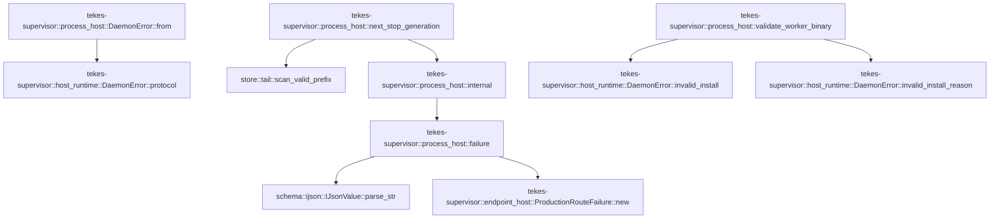

```mermaid
flowchart TD
  n0["endpoint::service::NativeEndpoint::open"]
  n1["endpoint::types::validate_session_id"]
  n2["engine::admission::AdmissionPool::new"]
  n3["profile::config::ConfigRepository::open"]
  n4["profile::scope::workspace_instructions"]
  n5["profile::scope::SessionScope::locate"]
  n6["provider::secret_store::MemorySecretStore::new"]
  n7["schedule::ScheduleAuthority::open"]
  n8["store::folder::ThreadStore::open"]
  n9["store::folder_events::subscribe"]
  n10["store::folder_events::canonical_root"]
  n11["tekes-supervisor::catalog::Catalog::new"]
  n12["tekes-supervisor::dynamic_bindings::resolve_worker_launch_bindings"]
  n13["tekes-supervisor::host_runtime::DaemonError::invalid_config"]
  n14["tekes-supervisor::host_runtime::DaemonError::corrupt"]
  n15["tekes-supervisor::host_runtime::DaemonError::required_broker"]
  n16["tekes-supervisor::mcp_runtime::McpRuntime::open_production_authorities_with_mutation"]
  n17["tekes-supervisor::process_host::ProductionProcessHost::workspace_policy_published"]
  n18["tekes-supervisor::process_host::ProductionProcessHost::workspace_policy_recovered"]
  n19["tekes-supervisor::process_host::ProductionProcessHost::plugin_store"]
  n20["tekes-supervisor::process_host::ProductionProcessHost::client_file_changes"]
  n21["tekes-supervisor::process_host::ProductionProcessHost::client_file_page"]
  n22["tekes-supervisor::process_host::ProductionProcessHost::session_scope"]
  n23["tekes-supervisor::process_host::ProductionProcessHost::user_agent_dir"]
  n24["tekes-supervisor::process_host::mcp_failure_is_required"]
  n25["tekes-supervisor::process_host::required_mcp_failure_reason"]
  n26["tekes-supervisor::process_host::PolicyCandidateError::new"]
  n27["tekes-supervisor::process_host::terminate_worker"]
  n28["tekes-supervisor::process_host::WorkerHandshakeGuard::child_mut"]
  n29["tekes-supervisor::process_host::WorkerHandshakeGuard::take_credential_broker"]
  n30["tekes-supervisor::process_host::WorkerHandshakeGuard::wait_for_exit"]
  n31["tekes-supervisor::process_host::WorkerHandshakeGuard::drop"]
  n32["tekes-supervisor::process_host::reconcile_credential_bindings"]
  n33["tekes-supervisor::process_host::scoped_client_file_path"]
  n34["tekes-supervisor::process_host::validate_worker_binary"]
  n35["tekes-supervisor::process_host::credential_control"]
  n36["tekes-supervisor::process_host::active_material"]
  n37["tekes-supervisor::process_host::retain_prior_for_unknown_credentials"]
  n38["tekes-supervisor::process_host::ProductionProcessHost::open"]
  n39["tekes-supervisor::process_host::ProductionProcessHost::open_with_secret_store"]
  n40["tekes-supervisor::process_host::ProductionProcessHost::open_with_secret_authorities"]
  n41["tekes-supervisor::process_host::ProductionProcessHost::mcp_runtime"]
  n42["tekes-supervisor::process_host::ProductionProcessHost::credential_is_ready"]
  n43["tekes-supervisor::process_host::ProductionProcessHost::validate_workspace_policy_candidate"]
  n44["tekes-supervisor::thread_card::CardWriter::spawn_from_env"]
  n45["tools::builtin::BuiltinManifest::compiled"]
  n46["workspace-service::file_text_page"]
  n47["workspace-service::file_byte_page"]
  n17 --> n13
  n17 --> n27
  n18 --> n27
  n20 --> n22
  n21 --> n13
  n21 --> n22
  n21 --> n33
  n21 --> n46
  n21 --> n47
  n22 --> n1
  n22 --> n5
  n22 --> n13
  n30 --> n28
  n32 --> n15
  n32 --> n35
  n32 --> n36
  n35 --> n15
  n38 --> n6
  n38 --> n39
  n39 --> n40
  n40 --> n0
  n40 --> n2
  n40 --> n3
  n40 --> n7
  n40 --> n8
  n40 --> n9
  n40 --> n10
  n40 --> n11
  n40 --> n13
  n40 --> n14
  n40 --> n15
  n40 --> n16
  n40 --> n34
  n40 --> n44
  n43 --> n4
  n43 --> n12
  n43 --> n24
  n43 --> n25
  n43 --> n26
  n43 --> n45
```

```mermaid
flowchart TD
  n0["endpoint::management::ManagementStore::open_light_at"]
  n1["engine::lifecycle::classify"]
  n2["profile::resources::ResourceCatalog::from_snapshot"]
  n3["profile::scope::workspace_instructions"]
  n4["store::folder::ThreadStore::open"]
  n5["store::folder_events::is_admitted"]
  n6["store::tail::scan_valid_prefix"]
  n7["tekes-supervisor::boot_trace::phase"]
  n8["tekes-supervisor::dynamic_bindings::resolve_worker_launch_bindings"]
  n9["tekes-supervisor::host_runtime::DaemonError::protocol"]
  n10["tekes-supervisor::host_runtime::DaemonError::invalid_config"]
  n11["tekes-supervisor::host_runtime::DaemonError::corrupt"]
  n12["tekes-supervisor::host_runtime::DaemonError::required_broker"]
  n13["tekes-supervisor::process_host::ProductionProcessHost::session_scope"]
  n14["tekes-supervisor::process_host::ProductionProcessHost::client_session_roots"]
  n15["tekes-supervisor::process_host::ProductionProcessHost::client_resource_catalog"]
  n16["tekes-supervisor::process_host::ProductionProcessHost::client_tool_catalog"]
  n17["tekes-supervisor::process_host::ProductionProcessHost::schedule_authority"]
  n18["tekes-supervisor::process_host::ProductionProcessHost::start_schedule_timer"]
  n19["tekes-supervisor::process_host::ProductionProcessHost::schedule_failure"]
  n20["tekes-supervisor::process_host::ProductionProcessHost::schedule_has_work"]
  n21["tekes-supervisor::process_host::ProductionProcessHost::drive_schedule"]
  n22["tekes-supervisor::process_host::ProductionProcessHost::execute_schedule_claim"]
  n23["tekes-supervisor::process_host::ProductionProcessHost::reconcile_schedule_statuses"]
  n24["tekes-supervisor::process_host::ProductionProcessHost::run_post_ready"]
  n25["tekes-supervisor::process_host::ProductionProcessHost::post_ready_tasks"]
  n26["tekes-supervisor::process_host::ProductionProcessHost::cleanup_stale_ephemeral"]
  n27["tekes-supervisor::process_host::ProductionProcessHost::live_sessions_for_cleanup"]
  n28["tekes-supervisor::process_host::ProductionProcessHost::run_upgrade_pass"]
  n29["tekes-supervisor::process_host::ProductionProcessHost::is_stale_ephemeral"]
  n30["tekes-supervisor::process_host::ProductionProcessHost::on_folder_event"]
  n31["tekes-supervisor::process_host::ProductionProcessHost::attach_streams"]
  n32["tekes-supervisor::process_host::ProductionProcessHost::reconcile_child_line"]
  n33["tekes-supervisor::process_host::ProductionProcessHost::publish_session_status"]
  n34["tekes-supervisor::process_host::ProductionProcessHost::hydrate"]
  n35["tekes-supervisor::process_host::ProductionProcessHost::recently_failed"]
  n36["tekes-supervisor::process_host::ProductionProcessHost::live_worker"]
  n37["tekes-supervisor::process_host::mcp_failure_is_required"]
  n38["tekes-supervisor::process_host::probe_line_lock"]
  n14 --> n10
  n14 --> n13
  n15 --> n2
  n15 --> n10
  n15 --> n13
  n16 --> n3
  n16 --> n8
  n16 --> n10
  n16 --> n12
  n16 --> n13
  n16 --> n37
  n18 --> n20
  n18 --> n21
  n20 --> n11
  n21 --> n11
  n21 --> n22
  n21 --> n23
  n22 --> n0
  n22 --> n9
  n22 --> n11
  n23 --> n1
  n23 --> n6
  n23 --> n11
  n23 --> n36
  n23 --> n38
  n25 --> n7
  n25 --> n18
  n25 --> n26
  n25 --> n28
  n26 --> n4
  n26 --> n5
  n26 --> n27
  n28 --> n34
  n28 --> n35
  n29 --> n5
```

```mermaid
flowchart TD
  n0["provider::secret_store::resolve_config_credentials"]
  n1["store::card::remove_stale_card_temps"]
  n2["store::folder_events::arm_admission"]
  n3["store::folder_events::is_admitted"]
  n4["store::folder_events::admitted_ids"]
  n5["store::tail::scan_valid_prefix"]
  n6["store::tail::repair_thread_tails"]
  n7["tekes-supervisor::boot_trace::detail"]
  n8["tekes-supervisor::boot_trace::per_item_enabled"]
  n9["tekes-supervisor::endpoint_host::recover_pending_management"]
  n10["tekes-supervisor::host_runtime::DaemonError::protocol"]
  n11["tekes-supervisor::host_runtime::DaemonError::invalid_config"]
  n12["tekes-supervisor::host_runtime::DaemonError::corrupt"]
  n13["tekes-supervisor::host_runtime::DaemonError::required_broker"]
  n14["tekes-supervisor::process_host::ProductionProcessHost::start_periodic_sweep"]
  n15["tekes-supervisor::process_host::ProductionProcessHost::recover_pending_management"]
  n16["tekes-supervisor::process_host::ProductionProcessHost::refresh_live_credentials"]
  n17["tekes-supervisor::process_host::ProductionProcessHost::config_mutation_succeeded"]
  n18["tekes-supervisor::process_host::ProductionProcessHost::refresh_worker_credentials"]
  n19["tekes-supervisor::process_host::ProductionProcessHost::boot_sweep"]
  n20["tekes-supervisor::process_host::ProductionProcessHost::arm_admission"]
  n21["tekes-supervisor::process_host::ProductionProcessHost::recover_client_sessions"]
  n22["tekes-supervisor::process_host::ProductionProcessHost::ensure_verified"]
  n23["tekes-supervisor::process_host::ProductionProcessHost::hydrate"]
  n24["tekes-supervisor::process_host::ProductionProcessHost::hydrate_with"]
  n25["tekes-supervisor::process_host::ProductionProcessHost::recently_failed"]
  n26["tekes-supervisor::process_host::ProductionProcessHost::hydrate_unrecorded"]
  n27["tekes-supervisor::process_host::ProductionProcessHost::repair_main_projection"]
  n28["tekes-supervisor::process_host::ProductionProcessHost::periodic_sweep_once"]
  n29["tekes-supervisor::process_host::ProductionProcessHost::is_draining"]
  n30["tekes-supervisor::process_host::ProductionProcessHost::sweep_ledger_scan"]
  n31["tekes-supervisor::process_host::ProductionProcessHost::sweep_once"]
  n32["tekes-supervisor::process_host::ProductionProcessHost::sweep_ids"]
  n33["tekes-supervisor::process_host::ProductionProcessHost::is_deferred"]
  n34["tekes-supervisor::process_host::ProductionProcessHost::sweep_session"]
  n35["tekes-supervisor::process_host::ProductionProcessHost::publish_appended"]
  n36["tekes-supervisor::process_host::ProductionProcessHost::publish_appended_with"]
  n37["tekes-supervisor::process_host::web_search_scope_ready"]
  n38["tekes-supervisor::process_host::terminate_worker"]
  n39["tekes-supervisor::process_host::damage_under_lock"]
  n40["tekes-supervisor::process_host::child_ledger_damage"]
  n41["tekes-supervisor::process_host::reconcile_credential_bindings"]
  n42["tekes-supervisor::process_host::retain_prior_for_unknown_credentials"]
  n43["tekes-supervisor::process_host::SweepLedgerIdentity::of"]
  n44["tekes-supervisor::thread_card::fold_child_views"]
  n15 --> n9
  n16 --> n18
  n17 --> n16
  n18 --> n0
  n18 --> n13
  n18 --> n37
  n18 --> n38
  n18 --> n41
  n18 --> n42
  n19 --> n31
  n20 --> n2
  n21 --> n11
  n21 --> n22
  n21 --> n34
  n22 --> n11
  n22 --> n12
  n22 --> n23
  n23 --> n24
  n24 --> n26
  n26 --> n1
  n26 --> n6
  n26 --> n12
  n26 --> n36
  n26 --> n39
  n26 --> n40
  n26 --> n44
  n27 --> n35
  n28 --> n31
  n30 --> n5
  n30 --> n10
  n30 --> n12
  n30 --> n43
  n31 --> n7
  n31 --> n8
  n31 --> n32
  n31 --> n34
  n32 --> n4
  n33 --> n3
```

```mermaid
flowchart TD
  n0["engine::lifecycle::ensure_action_at"]
  n1["engine::lifecycle::classify"]
  n2["session-controls::bound_goal_id"]
  n3["store::platform::NamedLock::shared"]
  n4["tekes-supervisor::dynamic_bindings::resolve_worker_launch_bindings"]
  n5["tekes-supervisor::host_runtime::system_timestamp"]
  n6["tekes-supervisor::host_runtime::DaemonError::protocol"]
  n7["tekes-supervisor::host_runtime::DaemonError::io"]
  n8["tekes-supervisor::host_runtime::DaemonError::invalid_config"]
  n9["tekes-supervisor::host_runtime::DaemonError::required_broker"]
  n10["tekes-supervisor::launch_profiled_worker_with_secret_store_and_binding_resolver"]
  n11["tekes-supervisor::process_host::production_sandbox_backend"]
  n12["tekes-supervisor::process_host::ProductionProcessHost::live_sessions_for_cleanup"]
  n13["tekes-supervisor::process_host::now_rfc3339"]
  n14["tekes-supervisor::process_host::ProductionProcessHost::publish_session_status"]
  n15["tekes-supervisor::process_host::ProductionProcessHost::refresh_worker_credentials"]
  n16["tekes-supervisor::process_host::ProductionProcessHost::ensure_verified"]
  n17["tekes-supervisor::process_host::ProductionProcessHost::repair_main_projection"]
  n18["tekes-supervisor::process_host::ProductionProcessHost::sweep_ledger_scan"]
  n19["tekes-supervisor::process_host::ProductionProcessHost::is_deferred"]
  n20["tekes-supervisor::process_host::ProductionProcessHost::sweep_session"]
  n21["tekes-supervisor::process_host::ProductionProcessHost::propagate_durable_stops_before_sweep"]
  n22["tekes-supervisor::process_host::ProductionProcessHost::shutdown"]
  n23["tekes-supervisor::process_host::ProductionProcessHost::shutdown_with"]
  n24["tekes-supervisor::process_host::ProductionProcessHost::ensure_running"]
  n25["tekes-supervisor::process_host::ProductionProcessHost::live_worker"]
  n26["tekes-supervisor::process_host::ProductionProcessHost::spawn_worker_at"]
  n27["tekes-supervisor::process_host::ProductionProcessHost::spawn_worker_at_with_handshake_timeout"]
  n28["tekes-supervisor::process_host::ProductionProcessHost::workspace_service_binary"]
  n29["tekes-supervisor::process_host::ProductionProcessHost::worker_binary_digest"]
  n30["tekes-supervisor::process_host::ProductionProcessHost::refresh_limits"]
  n31["tekes-supervisor::process_host::ProductionProcessHost::preflight_mandatory_authorities"]
  n32["tekes-supervisor::process_host::ProductionProcessHost::is_mcp_only_app_sandbox_host"]
  n33["tekes-supervisor::process_host::ProductionProcessHost::freeze_tool_authority"]
  n34["tekes-supervisor::process_host::ProductionProcessHost::schedule_main"]
  n35["tekes-supervisor::process_host::ProductionProcessHost::schedule_line"]
  n36["tekes-supervisor::process_host::ProductionProcessHost::schedule_worker_at"]
  n37["tekes-supervisor::process_host::ProductionProcessHost::schedule_worker_at_with_startup"]
  n38["tekes-supervisor::process_host::ProductionProcessHost::schedule_child_from_parent"]
  n39["tekes-supervisor::process_host::ProductionProcessHost::wait_for_worker"]
  n40["tekes-supervisor::process_host::ProductionProcessHost::has_worker_capacity"]
  n41["tekes-supervisor::process_host::ProductionProcessHost::cascade_stop_from"]
  n42["tekes-supervisor::process_host::ProductionProcessHost::reset_restart_backoff"]
  n43["tekes-supervisor::process_host::ProductionProcessHost::restart_is_due"]
  n44["tekes-supervisor::process_host::ProductionProcessHost::note_restart_failure"]
  n45["tekes-supervisor::process_host::ProductionProcessHost::record_session_notice"]
  n46["tekes-supervisor::process_host::genesis_preset_skills"]
  n47["tekes-supervisor::process_host::missing_preset_skill_notice"]
  n48["tekes-supervisor::process_host::mcp_launch_notices"]
  n49["tekes-supervisor::process_host::frozen_tool_launch_policy"]
  n50["tekes-supervisor::process_host::validator_tool_launch_policy"]
  n51["tekes-supervisor::process_host::mcp_failure_is_required"]
  n52["tekes-supervisor::process_host::child_dependency_admitted"]
  n53["tekes-supervisor::process_host::worker_reader"]
  n54["tekes-supervisor::process_host::worker_stderr_reader"]
  n55["tekes-supervisor::process_host::unresolved_parent_dependency"]
  n56["tekes-supervisor::process_host::line_schedule_target"]
  n57["tekes-supervisor::process_host::workspace_quiescence_lock_path"]
  n58["tekes-supervisor::process_host::workspace_id"]
  n59["tekes-supervisor::process_host::session_workspace_binding"]
  n60["tekes-supervisor::process_host::goal_continuation_due"]
  n61["tekes-supervisor::process_host::probe_line_lock"]
  n62["tekes-supervisor::process_host::read_worker_hello"]
  n63["tools::runtime_backends::HelperJobLauncher::new"]
  n64["tools::runtime_backends::HelperJobLauncher::disabled"]
  n65["tools::sandbox::probe_backend"]
  n66["worker-control::durable::encode_queue_transaction"]
  n67["worker-control::negotiate"]
  n68["worker-control::encode_line"]
  n20 --> n0
  n20 --> n1
  n20 --> n13
  n20 --> n17
  n20 --> n18
  n20 --> n19
  n20 --> n21
  n20 --> n30
  n20 --> n36
  n20 --> n43
  n20 --> n44
  n20 --> n60
  n20 --> n61
  n21 --> n18
  n21 --> n41
  n22 --> n23
  n23 --> n12
  n24 --> n30
  n24 --> n36
  n24 --> n39
  n24 --> n42
  n26 --> n27
  n27 --> n2
  n27 --> n3
  n27 --> n4
  n27 --> n5
  n27 --> n6
  n27 --> n8
  n27 --> n9
  n27 --> n10
  n27 --> n29
  n27 --> n33
  n27 --> n45
  n27 --> n46
  n27 --> n47
  n27 --> n48
  n27 --> n50
  n27 --> n51
  n27 --> n53
  n27 --> n54
  n27 --> n57
  n27 --> n59
  n27 --> n62
  n27 --> n66
  n27 --> n67
  n27 --> n68
  n30 --> n8
  n30 --> n58
  n31 --> n9
  n31 --> n11
  n31 --> n32
  n31 --> n63
  n31 --> n64
  n31 --> n65
  n32 --> n7
  n32 --> n9
  n33 --> n9
  n33 --> n11
  n33 --> n32
  n33 --> n49
  n33 --> n63
  n33 --> n64
  n33 --> n65
  n34 --> n36
  n35 --> n36
  n35 --> n38
  n35 --> n55
  n35 --> n56
  n36 --> n37
  n37 --> n6
  n37 --> n14
  n37 --> n15
  n37 --> n16
  n37 --> n25
  n37 --> n26
  n37 --> n30
  n37 --> n40
  n38 --> n14
  n38 --> n15
  n38 --> n26
  n38 --> n30
  n38 --> n40
  n38 --> n52
  n39 --> n9
```

```mermaid
flowchart TD
  n0["engine::compaction_summary::admit_summary_artifact"]
  n1["engine::compaction_summary::summary_request_bytes"]
  n2["engine::compaction_summary::CompactionSummary::from_outcome"]
  n3["engine::compaction_summary::freeze_source_bundle"]
  n4["engine::context::plan_context_compaction"]
  n5["provider::compaction_summary::prepare_summary_request"]
  n6["provider::compaction_summary::summary_completion_artifact"]
  n7["provider::http::HttpRuntime::new"]
  n8["schema::event::Event::from_value"]
  n9["schema::ijson::IJsonValue::parse"]
  n10["store::tail::scan_valid_prefix"]
  n11["store::tail::read_genesis"]
  n12["tekes-supervisor::host_runtime::DaemonError::protocol"]
  n13["tekes-supervisor::host_runtime::DaemonError::corrupt"]
  n14["tekes-supervisor::host_runtime::DaemonError::required_broker"]
  n15["tekes-supervisor::process_host::spill_compaction_summary"]
  n16["tekes-supervisor::process_host::ProductionProcessHost::publish_session_status"]
  n17["tekes-supervisor::process_host::deterministic_automatic_thread_title"]
  n18["tekes-supervisor::process_host::normalized_automatic_thread_title"]
  n19["tekes-supervisor::process_host::prompt_text"]
  n20["tekes-supervisor::process_host::automatic_title_origin"]
  n21["tekes-supervisor::process_host::ProductionProcessHost::spawn_worker_at"]
  n22["tekes-supervisor::process_host::automatic_title_route"]
  n23["tekes-supervisor::process_host::ProductionProcessHost::schedule_main"]
  n24["tekes-supervisor::process_host::session_model_route"]
  n25["tekes-supervisor::process_host::ProductionProcessHost::start_pending_workers"]
  n26["tekes-supervisor::process_host::ProductionProcessHost::has_worker_capacity"]
  n27["tekes-supervisor::process_host::ProductionProcessHost::request_provider_lease"]
  n28["tekes-supervisor::process_host::ProductionProcessHost::locked_prompt"]
  n29["tekes-supervisor::process_host::ProductionProcessHost::locked_compact"]
  n30["tekes-supervisor::process_host::ProductionProcessHost::first_root_input"]
  n31["tekes-supervisor::process_host::ProductionProcessHost::seed_automatic_title"]
  n32["tekes-supervisor::process_host::ProductionProcessHost::try_seed_automatic_title"]
  n33["tekes-supervisor::process_host::ProductionProcessHost::wait_and_seed_automatic_title"]
  n34["tekes-supervisor::process_host::ProductionProcessHost::spawn_automatic_title_refinement"]
  n35["tekes-supervisor::process_host::ProductionProcessHost::spawn_automatic_title_seed_and_refinement"]
  n36["tekes-supervisor::process_host::ProductionProcessHost::refine_automatic_title"]
  n37["tekes-supervisor::process_host::prepare_automatic_title_request"]
  n38["tekes-supervisor::process_host::ProductionProcessHost::complete_automatic_text"]
  n39["tekes-supervisor::process_host::ProductionProcessHost::complete_automatic_terminal"]
  n40["tekes-supervisor::process_host::ProductionProcessHost::summary_for_manual_compaction"]
  n41["tekes-supervisor::process_host::ProductionProcessHost::generate_automatic_title"]
  n42["tekes-supervisor::process_host::ProductionProcessHost::handle_tool_control"]
  n43["tekes-supervisor::process_host::ProductionProcessHost::handle_tool_continuation"]
  n44["tekes-supervisor::process_host::ProductionProcessHost::validate_child_proof"]
  n45["tekes-supervisor::process_host::ProductionProcessHost::publish_appended"]
  n46["tekes-supervisor::process_host::ProductionProcessHost::publish_appended_with"]
  n47["tekes-supervisor::process_host::ProductionProcessHost::reset_restart_backoff"]
  n48["tekes-supervisor::process_host::ProductionProcessHost::record_spawn_failure"]
  n49["tekes-supervisor::process_host::ledger_needs_worker"]
  n50["tekes-supervisor::process_host::internal"]
  n51["tekes-supervisor::production_tool_control::JobBrokerSupervisorAuthority::new"]
  n52["tekes-supervisor::production_tool_control::ProductionToolControlHandler::new"]
  n53["tekes-supervisor::production_tool_control::ProductionToolControlPolicy::new"]
  n54["tekes-supervisor::tool_control::ToolControlSession::new"]
  n55["tools::schema_registry::fixed_schema"]
  n56["worker-control::continuation::decode_tool_continuation"]
  n57["worker-control::continuation::encode_tool_continuation_result"]
  n25 --> n16
  n25 --> n21
  n25 --> n26
  n25 --> n49
  n28 --> n9
  n28 --> n19
  n28 --> n23
  n28 --> n30
  n28 --> n31
  n28 --> n34
  n28 --> n47
  n28 --> n48
  n29 --> n4
  n29 --> n8
  n29 --> n9
  n29 --> n15
  n29 --> n40
  n29 --> n45
  n29 --> n50
  n30 --> n10
  n31 --> n32
  n32 --> n17
  n32 --> n20
  n32 --> n45
  n33 --> n32
  n36 --> n20
  n36 --> n41
  n36 --> n45
  n38 --> n39
  n39 --> n7
  n40 --> n0
  n40 --> n1
  n40 --> n2
  n40 --> n3
  n40 --> n4
  n40 --> n5
  n40 --> n6
  n40 --> n9
  n40 --> n10
  n40 --> n24
  n40 --> n39
  n40 --> n55
  n41 --> n18
  n41 --> n22
  n41 --> n37
  n41 --> n38
  n42 --> n12
  n42 --> n14
  n42 --> n51
  n42 --> n52
  n42 --> n53
  n42 --> n54
  n43 --> n12
  n43 --> n14
  n43 --> n51
  n43 --> n52
  n43 --> n53
  n43 --> n56
  n43 --> n57
  n44 --> n11
  n44 --> n13
  n45 --> n46
```

```mermaid
flowchart TD
  n0["endpoint::journal::EndpointJournal::open"]
  n1["engine::lifecycle::ensure_action_at"]
  n2["engine::lifecycle::classify"]
  n3["mcp::projection::project_name"]
  n4["profile::resources::ResourceCatalog::skill_package_names"]
  n5["provider::request::endpoint_origin"]
  n6["schema::event::Event::from_value"]
  n7["schema::ijson::IJsonValue::parse"]
  n8["store::tail::LockedLedger::open"]
  n9["store::tail::scan_valid_prefix"]
  n10["store::tail::read_genesis"]
  n11["tekes-supervisor::host_runtime::system_timestamp"]
  n12["tekes-supervisor::host_runtime::DaemonError::protocol"]
  n13["tekes-supervisor::host_runtime::DaemonError::invalid_config"]
  n14["tekes-supervisor::host_runtime::DaemonError::corrupt"]
  n15["tekes-supervisor::host_runtime::DaemonError::required_broker"]
  n16["tekes-supervisor::process_host::now_rfc3339"]
  n17["tekes-supervisor::process_host::session_event_time_now"]
  n18["tekes-supervisor::process_host::ProductionProcessHost::refresh_limits"]
  n19["tekes-supervisor::process_host::ProductionProcessHost::schedule_worker_at"]
  n20["tekes-supervisor::process_host::ProductionProcessHost::schedule_child_from_parent"]
  n21["tekes-supervisor::process_host::ProductionProcessHost::publish_appended"]
  n22["tekes-supervisor::process_host::ProductionProcessHost::publish_appended_with"]
  n23["tekes-supervisor::process_host::ProductionProcessHost::publish_frame"]
  n24["tekes-supervisor::process_host::ProductionProcessHost::launch_child"]
  n25["tekes-supervisor::process_host::ProductionProcessHost::propagate_parent_stop"]
  n26["tekes-supervisor::process_host::ProductionProcessHost::cascade_stop_from"]
  n27["tekes-supervisor::process_host::ProductionProcessHost::reconcile_after_exit"]
  n28["tekes-supervisor::process_host::ProductionProcessHost::reset_restart_backoff"]
  n29["tekes-supervisor::process_host::ProductionProcessHost::restart_is_due"]
  n30["tekes-supervisor::process_host::ProductionProcessHost::note_restart_failure"]
  n31["tekes-supervisor::process_host::ProductionProcessHost::record_spawn_failure"]
  n32["tekes-supervisor::process_host::ProductionProcessHost::record_session_notice"]
  n33["tekes-supervisor::process_host::genesis_preset_skills"]
  n34["tekes-supervisor::process_host::missing_preset_skill_notice"]
  n35["tekes-supervisor::process_host::mcp_launch_notices"]
  n36["tekes-supervisor::process_host::frozen_tool_launch_policy"]
  n37["tekes-supervisor::process_host::validator_tool_launch_policy"]
  n38["tekes-supervisor::process_host::private_validator_launch_policy"]
  n39["tekes-supervisor::process_host::web_search_scope_ready"]
  n40["tekes-supervisor::process_host::mcp_failure_is_required"]
  n41["tekes-supervisor::process_host::required_mcp_failure_reason"]
  n42["tekes-supervisor::process_host::terminate_worker"]
  n43["tekes-supervisor::process_host::ledger_damage"]
  n44["tekes-supervisor::process_host::damage_under_lock"]
  n45["tekes-supervisor::process_host::line_schedule_target"]
  n46["tekes-supervisor::process_host::goal_continuation_due"]
  n47["tekes-supervisor::process_host::probe_line_lock"]
  n48["tekes-supervisor::thread_card::journal_input"]
  n49["tekes-supervisor::thread_card::prepare"]
  n50["tools::preset::ResolvedPreset::from_genesis"]
  n51["tools::runtime_backends::JobLaunchPolicy::new"]
  n52["tools::sandbox::kernel_protected_roots"]
  n53["tools::sandbox::exposed_protected_roots"]
  n54["worker-control::encode_line"]
  n22 --> n0
  n22 --> n9
  n22 --> n14
  n22 --> n43
  n22 --> n44
  n22 --> n48
  n22 --> n49
  n23 --> n0
  n23 --> n9
  n23 --> n14
  n23 --> n17
  n24 --> n1
  n24 --> n2
  n24 --> n9
  n24 --> n12
  n24 --> n14
  n24 --> n16
  n24 --> n20
  n24 --> n25
  n24 --> n47
  n25 --> n6
  n25 --> n7
  n25 --> n8
  n25 --> n9
  n25 --> n12
  n25 --> n14
  n25 --> n54
  n26 --> n9
  n26 --> n14
  n26 --> n20
  n26 --> n25
  n26 --> n26
  n26 --> n42
  n26 --> n45
  n27 --> n1
  n27 --> n2
  n27 --> n9
  n27 --> n14
  n27 --> n16
  n27 --> n18
  n27 --> n19
  n27 --> n21
  n27 --> n28
  n27 --> n29
  n27 --> n30
  n27 --> n46
  n27 --> n47
  n31 --> n32
  n32 --> n11
  n32 --> n21
  n33 --> n10
  n33 --> n50
  n34 --> n4
  n36 --> n13
  n36 --> n15
  n36 --> n51
  n36 --> n52
  n36 --> n53
  n37 --> n9
  n37 --> n12
  n37 --> n14
  n37 --> n15
  n37 --> n38
  n38 --> n15
  n38 --> n51
  n39 --> n5
  n40 --> n3
  n41 --> n40
```

```mermaid
flowchart TD
  n0["endpoint::service::genesis_preset_summary"]
  n1["endpoint::service::permission_mode_of"]
  n2["endpoint::service::last_record_updated_ms"]
  n3["endpoint::types::validate_session_id"]
  n4["store::card::valid_line_name"]
  n5["store::folder_events::admitted_ids"]
  n6["store::tail::scan_valid_prefix"]
  n7["store::tail::read_genesis"]
  n8["tekes-supervisor::endpoint_host::ProductionRouteFailure::new"]
  n9["tekes-supervisor::process_host::ProductionProcessHost::is_stale_ephemeral"]
  n10["tekes-supervisor::process_host::ProductionProcessHost::ensure_verified"]
  n11["tekes-supervisor::process_host::ProductionProcessHost::recently_failed"]
  n12["tekes-supervisor::process_host::cancel_stage_failure"]
  n13["tekes-supervisor::process_host::child_exited_within"]
  n14["tekes-supervisor::process_host::neutral_lifecycle"]
  n15["tekes-supervisor::process_host::ledger_damage"]
  n16["tekes-supervisor::process_host::damage_under_lock"]
  n17["tekes-supervisor::process_host::child_ledger_damage"]
  n18["tekes-supervisor::process_host::is_single_line_ledger"]
  n19["tekes-supervisor::process_host::ProductionProcessHost::list_wait"]
  n20["tekes-supervisor::process_host::ProductionProcessHost::is_running"]
  n21["tekes-supervisor::process_host::ProductionProcessHost::catalog_item"]
  n22["tekes-supervisor::process_host::ProductionProcessHost::verify_within"]
  n23["tekes-supervisor::process_host::ProductionProcessHost::build_inventory"]
  n24["tekes-supervisor::process_host::ProductionProcessHost::inventory_items"]
  n25["tekes-supervisor::process_host::ProductionProcessHost::ensure_verified"]
  n26["tekes-supervisor::process_host::ProductionProcessHost::has_catalog"]
  n27["tekes-supervisor::process_host::ProductionProcessHost::hold_catalog"]
  n28["tekes-supervisor::process_host::ProductionProcessHost::inventory_item"]
  n29["tekes-supervisor::process_host::ProductionProcessHost::live_sessions"]
  n30["tekes-supervisor::process_host::ProductionProcessHost::reconcile_projection"]
  n31["tekes-supervisor::process_host::ProductionProcessHost::execute"]
  n32["worker-control::durable::encode_queue_transaction"]
  n12 --> n8
  n15 --> n6
  n16 --> n15
  n17 --> n4
  n17 --> n15
  n17 --> n16
  n21 --> n0
  n21 --> n1
  n21 --> n2
  n21 --> n7
  n21 --> n9
  n21 --> n14
  n21 --> n18
  n21 --> n20
  n23 --> n3
  n23 --> n5
  n23 --> n11
  n23 --> n14
  n23 --> n21
  n23 --> n22
  n25 --> n10
  n31 --> n32
```

```mermaid
flowchart TD
  n0["engine::lifecycle::ensure_action_at"]
  n1["engine::lifecycle::classify"]
  n2["profile::scope::SessionScope::for_ledger"]
  n3["provider::dialect::validate_provider"]
  n4["provider::dialect::resolve_profile"]
  n5["provider::request::endpoint_origin"]
  n6["provider::secret_store::resolve_config_credentials"]
  n7["schema::ijson::IJsonValue::parse"]
  n8["session-controls::read_goal"]
  n9["store::tail::scan_valid_prefix"]
  n10["tekes-supervisor::host_runtime::system_timestamp"]
  n11["tekes-supervisor::host_runtime::DaemonError::protocol"]
  n12["tekes-supervisor::host_runtime::DaemonError::io"]
  n13["tekes-supervisor::host_runtime::DaemonError::store"]
  n14["tekes-supervisor::host_runtime::DaemonError::invalid_config"]
  n15["tekes-supervisor::host_runtime::DaemonError::corrupt"]
  n16["tekes-supervisor::process_host::now_rfc3339"]
  n17["tekes-supervisor::process_host::ProductionProcessHost::readiness"]
  n18["tekes-supervisor::process_host::ProductionProcessHost::config_mutation_succeeded"]
  n19["tekes-supervisor::process_host::ProcessToolRuntime::host"]
  n20["tekes-supervisor::process_host::ProcessToolRuntime::ensure_running"]
  n21["tekes-supervisor::process_host::ProcessToolRuntime::deliver_input"]
  n22["tekes-supervisor::process_host::ProcessToolRuntime::interrupt"]
  n23["tekes-supervisor::process_host::ProcessToolRuntime::ensure_child"]
  n24["tekes-supervisor::process_host::ProcessToolRuntime::deliver_report"]
  n25["tekes-supervisor::process_host::unresolved_parent_dependency"]
  n26["tekes-supervisor::process_host::line_schedule_target"]
  n27["tekes-supervisor::process_host::operation_unavailable"]
  n28["tekes-supervisor::process_host::operation_value"]
  n29["tekes-supervisor::process_host::workspace_quiescence_lock_path"]
  n30["tekes-supervisor::process_host::workspace_id"]
  n31["tekes-supervisor::process_host::scoped_client_file_path"]
  n32["tekes-supervisor::process_host::session_workspace_binding"]
  n33["tekes-supervisor::process_host::ledger_needs_worker"]
  n34["tekes-supervisor::process_host::goal_continuation_due"]
  n35["tekes-supervisor::process_host::probe_line_lock"]
  n36["tekes-supervisor::process_host::read_worker_hello"]
  n37["worker-control::decode_hello"]
  n17 --> n3
  n17 --> n4
  n17 --> n5
  n17 --> n6
  n20 --> n28
  n21 --> n10
  n21 --> n28
  n22 --> n10
  n22 --> n28
  n23 --> n28
  n24 --> n28
  n25 --> n9
  n25 --> n15
  n25 --> n26
  n26 --> n15
  n28 --> n7
  n30 --> n32
  n31 --> n14
  n32 --> n2
  n32 --> n13
  n32 --> n15
  n33 --> n0
  n33 --> n1
  n33 --> n9
  n33 --> n15
  n33 --> n16
  n33 --> n34
  n33 --> n35
  n34 --> n8
  n34 --> n9
  n34 --> n14
  n34 --> n15
  n35 --> n12
  n35 --> n15
  n36 --> n11
  n36 --> n12
  n36 --> n37
```

# tekes-supervisor::process_host

[Package atlas](index.md) · [Source](../../src/process_host.rs)

## Declarations

Visibility is the declaration spelling; trait members and reexports require their enclosing interface. `cfg` is not evaluated.

| Symbol | Kind | Visibility | Test / cfg |
|---|---|---|---|
| [tekes-supervisor::process_host::DELIVERY_TIMEOUT](../../src/process_host.rs#L62) | const_item | `private` |  |
| [tekes-supervisor::process_host::MCP_ONLY_APP_SANDBOX_MARKER](../../src/process_host.rs#L63) | const_item | `private` |  |
| [tekes-supervisor::process_host::WORKER_HANDSHAKE_TIMEOUT](../../src/process_host.rs#L64) | const_item | `private` |  |
| [tekes-supervisor::process_host::WORKER_HELLO_MAX_BYTES](../../src/process_host.rs#L65) | const_item | `private` |  |
| [tekes-supervisor::process_host::MANAGEMENT_RECOVERY_SECONDS](../../src/process_host.rs#L67) | const_item | `private` |  |
| [tekes-supervisor::process_host::PERIODIC_SWEEP_INTERVAL](../../src/process_host.rs#L68) | const_item | `private` |  |
| [tekes-supervisor::process_host::SweepLedgerIdentity](../../src/process_host.rs#L73) | struct_item | `private` |  |
| [tekes-supervisor::process_host::SweepLedgerIdentity::of](../../src/process_host.rs#L80) | function_item | `private` |  |
| [tekes-supervisor::process_host::SweepLedgerScan](../../src/process_host.rs#L93) | struct_item | `private` |  |
| [tekes-supervisor::process_host::AUTOMATIC_THREAD_TITLE_MODEL_HINT](../../src/process_host.rs#L107) | const_item | `private` |  |
| [tekes-supervisor::process_host::AUTOMATIC_THREAD_TITLE_MAX_CHARS](../../src/process_host.rs#L108) | const_item | `private` |  |
| [tekes-supervisor::process_host::AUTOMATIC_THREAD_TITLE_TIMEOUT](../../src/process_host.rs#L109) | const_item | `private` |  |
| [tekes-supervisor::process_host::AUTOMATIC_THREAD_TITLE_MAX_OUTPUT_TOKENS](../../src/process_host.rs#L113) | const_item | `private` |  |
| [tekes-supervisor::process_host::COMPACTION_SUMMARY_TIMEOUT](../../src/process_host.rs#L114) | const_item | `private` |  |
| [tekes-supervisor::process_host::AUTOMATIC_THREAD_TITLE_SYSTEM](../../src/process_host.rs#L115) | const_item | `private` |  |
| [tekes-supervisor::process_host::LineLockState](../../src/process_host.rs#L118) | enum_item | `private` |  |
| [tekes-supervisor::process_host::production_sandbox_backend](../../src/process_host.rs#L123) | function_item | `private` |  |
| [tekes-supervisor::process_host::seq_ranges](../../src/process_host.rs#L134) | function_item | `private` |  |
| [tekes-supervisor::process_host::spill_compaction_summary](../../src/process_host.rs#L153) | function_item | `private` |  |
| [tekes-supervisor::process_host::now_rfc3339](../../src/process_host.rs#L170) | function_item | `private` |  |
| [tekes-supervisor::process_host::session_event_time_now](../../src/process_host.rs#L174) | function_item | `private` |  |
| [tekes-supervisor::process_host::session_event_time](../../src/process_host.rs#L178) | function_item | `private` |  |
| [tekes-supervisor::process_host::compact_title_source](../../src/process_host.rs#L188) | function_item | `private` |  |
| [tekes-supervisor::process_host::bounded_title](../../src/process_host.rs#L192) | function_item | `private` |  |
| [tekes-supervisor::process_host::deterministic_automatic_thread_title](../../src/process_host.rs#L199) | function_item | `private` |  |
| [tekes-supervisor::process_host::normalized_automatic_thread_title](../../src/process_host.rs#L203) | function_item | `private` |  |
| [tekes-supervisor::process_host::prompt_text](../../src/process_host.rs#L228) | function_item | `private` |  |
| [tekes-supervisor::process_host::automatic_title_origin](../../src/process_host.rs#L239) | function_item | `private` |  |
| [tekes-supervisor::process_host::automatic_title_route](../../src/process_host.rs#L249) | function_item | `private` |  |
| [tekes-supervisor::process_host::session_model_route](../../src/process_host.rs#L288) | function_item | `private` |  |
| [tekes-supervisor::process_host::prepare_automatic_title_request](../../src/process_host.rs#L336) | function_item | `private` |  |
| [tekes-supervisor::process_host::prepare_automatic_text_request](../../src/process_host.rs#L353) | function_item | `private` |  |
| [tekes-supervisor::process_host::accepted_stream_event](../../src/process_host.rs#L404) | function_item | `private` | test; #[cfg(test)] |
| [tekes-supervisor::process_host::ProcessToolRuntime](../../src/process_host.rs#L419) | struct_item | `private` |  |
| [tekes-supervisor::process_host::ProductionProcessHost](../../src/process_host.rs#L423) | struct_item | `pub` |  |
| [tekes-supervisor::process_host::SessionProjectionCache](../../src/process_host.rs#L485) | struct_item | `private` |  |
| [tekes-supervisor::process_host::WorkerHandle](../../src/process_host.rs#L491) | struct_item | `private` |  |
| [tekes-supervisor::process_host::WorkerHandshakeGuard](../../src/process_host.rs#L512) | struct_item | `private` |  |
| [tekes-supervisor::process_host::WorkerHandshakeGuard::child_mut](../../src/process_host.rs#L519) | function_item | `private` |  |
| [tekes-supervisor::process_host::WorkerHandshakeGuard::take_child](../../src/process_host.rs#L523) | function_item | `private` |  |
| [tekes-supervisor::process_host::WorkerHandshakeGuard::take_credential_control](../../src/process_host.rs#L527) | function_item | `private` |  |
| [tekes-supervisor::process_host::WorkerHandshakeGuard::take_credential_broker](../../src/process_host.rs#L531) | function_item | `private` |  |
| [tekes-supervisor::process_host::WorkerHandshakeGuard::wait_for_exit](../../src/process_host.rs#L535) | function_item | `private` |  |
| [tekes-supervisor::process_host::WorkerHandshakeGuard::drop](../../src/process_host.rs#L548) | function_item | `private` |  |
| [tekes-supervisor::process_host::PendingWorker](../../src/process_host.rs#L561) | struct_item | `private` |  |
| [tekes-supervisor::process_host::WorkerProtocolQuarantine](../../src/process_host.rs#L568) | struct_item | `private` |  |
| [tekes-supervisor::process_host::RestartBackoff](../../src/process_host.rs#L575) | struct_item | `private` |  |
| [tekes-supervisor::process_host::ScheduledWorker](../../src/process_host.rs#L582) | struct_item | `private` |  |
| [tekes-supervisor::process_host::WorkerState](../../src/process_host.rs#L588) | struct_item | `private` |  |
| [tekes-supervisor::process_host::reconcile_credential_bindings](../../src/process_host.rs#L595) | function_item | `private` |  |
| [tekes-supervisor::process_host::credential_control](../../src/process_host.rs#L699) | function_item | `private` |  |
| [tekes-supervisor::process_host::active_material](../../src/process_host.rs#L710) | function_item | `private` |  |
| [tekes-supervisor::process_host::retain_prior_for_unknown_credentials](../../src/process_host.rs#L724) | function_item | `private` |  |
| [tekes-supervisor::process_host::ProductionProcessHost::open](../../src/process_host.rs#L767) | function_item | `pub` |  |
| [tekes-supervisor::process_host::ProductionProcessHost::open_with_secret_store](../../src/process_host.rs#L782) | function_item | `pub` |  |
| [tekes-supervisor::process_host::ProductionProcessHost::open_with_secret_authorities](../../src/process_host.rs#L802) | function_item | `pub` |  |
| [tekes-supervisor::process_host::ProductionProcessHost::mcp_runtime](../../src/process_host.rs#L914) | function_item | `pub` |  |
| [tekes-supervisor::process_host::ProductionProcessHost::credential_is_ready](../../src/process_host.rs#L921) | function_item | `pub` |  |
| [tekes-supervisor::process_host::ProductionProcessHost::validate_workspace_policy_candidate](../../src/process_host.rs#L942) | function_item | `pub` |  |
| [tekes-supervisor::process_host::ProductionProcessHost::workspace_policy_published](../../src/process_host.rs#L1041) | function_item | `pub` |  |
| [tekes-supervisor::process_host::ProductionProcessHost::workspace_policy_recovered](../../src/process_host.rs#L1070) | function_item | `pub` |  |
| [tekes-supervisor::process_host::ProductionProcessHost::plugin_store](../../src/process_host.rs#L1085) | function_item | `pub(crate)` |  |
| [tekes-supervisor::process_host::ProductionProcessHost::client_file_changes](../../src/process_host.rs#L1091) | function_item | `pub(crate)` |  |
| [tekes-supervisor::process_host::ProductionProcessHost::client_file_page](../../src/process_host.rs#L1118) | function_item | `pub(crate)` |  |
| [tekes-supervisor::process_host::ProductionProcessHost::session_scope](../../src/process_host.rs#L1148) | function_item | `private` |  |
| [tekes-supervisor::process_host::ProductionProcessHost::user_agent_dir](../../src/process_host.rs#L1156) | function_item | `pub` |  |
| [tekes-supervisor::process_host::ProductionProcessHost::client_session_roots](../../src/process_host.rs#L1162) | function_item | `pub` |  |
| [tekes-supervisor::process_host::ProductionProcessHost::client_resource_catalog](../../src/process_host.rs#L1183) | function_item | `pub(crate)` |  |
| [tekes-supervisor::process_host::ProductionProcessHost::client_tool_catalog](../../src/process_host.rs#L1202) | function_item | `pub(crate)` |  |
| [tekes-supervisor::process_host::ProductionProcessHost::schedule_authority](../../src/process_host.rs#L1257) | function_item | `pub` |  |
| [tekes-supervisor::process_host::ProductionProcessHost::start_schedule_timer](../../src/process_host.rs#L1264) | function_item | `pub` |  |
| [tekes-supervisor::process_host::ProductionProcessHost::schedule_failure](../../src/process_host.rs#L1361) | function_item | `pub` |  |
| [tekes-supervisor::process_host::ProductionProcessHost::schedule_has_work](../../src/process_host.rs#L1368) | function_item | `private` |  |
| [tekes-supervisor::process_host::ProductionProcessHost::drive_schedule](../../src/process_host.rs#L1379) | function_item | `private` |  |
| [tekes-supervisor::process_host::ProductionProcessHost::execute_schedule_claim](../../src/process_host.rs#L1393) | function_item | `private` |  |
| [tekes-supervisor::process_host::ProductionProcessHost::reconcile_schedule_statuses](../../src/process_host.rs#L1466) | function_item | `private` |  |
| [tekes-supervisor::process_host::ProductionProcessHost::run_post_ready](../../src/process_host.rs#L1543) | function_item | `pub` |  |
| [tekes-supervisor::process_host::ProductionProcessHost::post_ready_tasks](../../src/process_host.rs#L1557) | function_item | `private` |  |
| [tekes-supervisor::process_host::ProductionProcessHost::cleanup_stale_ephemeral](../../src/process_host.rs#L1578) | function_item | `private` |  |
| [tekes-supervisor::process_host::ProductionProcessHost::live_sessions_for_cleanup](../../src/process_host.rs#L1603) | function_item | `private` |  |
| [tekes-supervisor::process_host::ProductionProcessHost::run_upgrade_pass](../../src/process_host.rs#L1616) | function_item | `private` |  |
| [tekes-supervisor::process_host::ProductionProcessHost::release_for_test](../../src/process_host.rs#L1659) | function_item | `pub(crate)` | test; #[cfg(test)] #[cfg_attr(not(target_os = "macos"), allow(dead_code))] |
| [tekes-supervisor::process_host::ProductionProcessHost::is_stale_ephemeral](../../src/process_host.rs#L1667) | function_item | `pub(crate)` |  |
| [tekes-supervisor::process_host::ProductionProcessHost::on_folder_event](../../src/process_host.rs#L1671) | function_item | `private` |  |
| [tekes-supervisor::process_host::ProductionProcessHost::attach_streams](../../src/process_host.rs#L1710) | function_item | `pub` |  |
| [tekes-supervisor::process_host::ProductionProcessHost::reconcile_child_line](../../src/process_host.rs#L1720) | function_item | `private` |  |
| [tekes-supervisor::process_host::ProductionProcessHost::publish_session_status](../../src/process_host.rs#L1739) | function_item | `private` |  |
| [tekes-supervisor::process_host::ProductionProcessHost::start_periodic_sweep](../../src/process_host.rs#L1756) | function_item | `pub` |  |
| [tekes-supervisor::process_host::ProductionProcessHost::recover_pending_management](../../src/process_host.rs#L1807) | function_item | `private` |  |
| [tekes-supervisor::process_host::ProductionProcessHost::refresh_live_credentials](../../src/process_host.rs#L1815) | function_item | `pub` |  |
| [tekes-supervisor::process_host::ProductionProcessHost::config_mutation_succeeded](../../src/process_host.rs#L1833) | function_item | `pub` |  |
| [tekes-supervisor::process_host::ProductionProcessHost::refresh_worker_credentials](../../src/process_host.rs#L1848) | function_item | `private` |  |
| [tekes-supervisor::process_host::ProductionProcessHost::boot_sweep](../../src/process_host.rs#L1887) | function_item | `pub` |  |
| [tekes-supervisor::process_host::ProductionProcessHost::arm_admission](../../src/process_host.rs#L1898) | function_item | `pub` |  |
| [tekes-supervisor::process_host::ProductionProcessHost::recover_client_sessions](../../src/process_host.rs#L1907) | function_item | `pub` |  |
| [tekes-supervisor::process_host::ProductionProcessHost::ensure_verified](../../src/process_host.rs#L1949) | function_item | `pub(crate)` |  |
| [tekes-supervisor::process_host::ProductionProcessHost::hydrate](../../src/process_host.rs#L1964) | function_item | `pub(crate)` |  |
| [tekes-supervisor::process_host::ProductionProcessHost::hydrate_with](../../src/process_host.rs#L1970) | function_item | `pub(crate)` |  |
| [tekes-supervisor::process_host::ProductionProcessHost::recently_failed](../../src/process_host.rs#L1990) | function_item | `private` |  |
| [tekes-supervisor::process_host::ProductionProcessHost::hydrate_unrecorded](../../src/process_host.rs#L1998) | function_item | `private` |  |
| [tekes-supervisor::process_host::ProductionProcessHost::repair_main_projection](../../src/process_host.rs#L2087) | function_item | `private` |  |
| [tekes-supervisor::process_host::ProductionProcessHost::periodic_sweep_once](../../src/process_host.rs#L2132) | function_item | `pub` |  |
| [tekes-supervisor::process_host::ProductionProcessHost::is_draining](../../src/process_host.rs#L2149) | function_item | `pub` |  |
| [tekes-supervisor::process_host::ProductionProcessHost::sweep_ledger_scan](../../src/process_host.rs#L2159) | function_item | `private` |  |
| [tekes-supervisor::process_host::ProductionProcessHost::sweep_once](../../src/process_host.rs#L2209) | function_item | `private` |  |
| [tekes-supervisor::process_host::ProductionProcessHost::sweep_ids](../../src/process_host.rs#L2229) | function_item | `private` |  |
| [tekes-supervisor::process_host::ProductionProcessHost::is_deferred](../../src/process_host.rs#L2258) | function_item | `private` |  |
| [tekes-supervisor::process_host::ProductionProcessHost::sweep_session](../../src/process_host.rs#L2270) | function_item | `private` |  |
| [tekes-supervisor::process_host::ProductionProcessHost::propagate_durable_stops_before_sweep](../../src/process_host.rs#L2353) | function_item | `private` |  |
| [tekes-supervisor::process_host::ProductionProcessHost::shutdown](../../src/process_host.rs#L2388) | function_item | `pub` |  |
| [tekes-supervisor::process_host::ProductionProcessHost::shutdown_with](../../src/process_host.rs#L2395) | function_item | `private` |  |
| [tekes-supervisor::process_host::ProductionProcessHost::ensure_running](../../src/process_host.rs#L2434) | function_item | `private` |  |
| [tekes-supervisor::process_host::ProductionProcessHost::live_worker](../../src/process_host.rs#L2448) | function_item | `private` |  |
| [tekes-supervisor::process_host::ProductionProcessHost::spawn_worker_at](../../src/process_host.rs#L2458) | function_item | `private` |  |
| [tekes-supervisor::process_host::ProductionProcessHost::spawn_worker_at_with_handshake_timeout](../../src/process_host.rs#L2474) | function_item | `private` |  |
| [tekes-supervisor::process_host::ProductionProcessHost::workspace_service_binary](../../src/process_host.rs#L2707) | function_item | `pub` |  |
| [tekes-supervisor::process_host::ProductionProcessHost::worker_binary_digest](../../src/process_host.rs#L2711) | function_item | `private` |  |
| [tekes-supervisor::process_host::ProductionProcessHost::refresh_limits](../../src/process_host.rs#L2716) | function_item | `private` |  |
| [tekes-supervisor::process_host::ProductionProcessHost::preflight_mandatory_authorities](../../src/process_host.rs#L2736) | function_item | `pub` |  |
| [tekes-supervisor::process_host::ProductionProcessHost::is_mcp_only_app_sandbox_host](../../src/process_host.rs#L2755) | function_item | `private` |  |
| [tekes-supervisor::process_host::ProductionProcessHost::freeze_tool_authority](../../src/process_host.rs#L2775) | function_item | `private` |  |
| [tekes-supervisor::process_host::ProductionProcessHost::schedule_main](../../src/process_host.rs#L2795) | function_item | `private` |  |
| [tekes-supervisor::process_host::ProductionProcessHost::schedule_line](../../src/process_host.rs#L2806) | function_item | `private` |  |
| [tekes-supervisor::process_host::ProductionProcessHost::schedule_worker_at](../../src/process_host.rs#L2822) | function_item | `private` |  |
| [tekes-supervisor::process_host::ProductionProcessHost::schedule_worker_at_with_startup](../../src/process_host.rs#L2833) | function_item | `private` |  |
| [tekes-supervisor::process_host::ProductionProcessHost::schedule_child_from_parent](../../src/process_host.rs#L2920) | function_item | `private` |  |
| [tekes-supervisor::process_host::ProductionProcessHost::wait_for_worker](../../src/process_host.rs#L2968) | function_item | `private` |  |
| [tekes-supervisor::process_host::ProductionProcessHost::start_pending_workers](../../src/process_host.rs#L2996) | function_item | `private` |  |
| [tekes-supervisor::process_host::ProductionProcessHost::has_worker_capacity](../../src/process_host.rs#L3063) | function_item | `private` |  |
| [tekes-supervisor::process_host::ProductionProcessHost::request_provider_lease](../../src/process_host.rs#L3071) | function_item | `private` |  |
| [tekes-supervisor::process_host::ProductionProcessHost::locked_prompt](../../src/process_host.rs#L3110) | function_item | `private` |  |
| [tekes-supervisor::process_host::ProductionProcessHost::locked_compact](../../src/process_host.rs#L3144) | function_item | `private` |  |
| [tekes-supervisor::process_host::ProductionProcessHost::first_root_input](../../src/process_host.rs#L3221) | function_item | `private` |  |
| [tekes-supervisor::process_host::ProductionProcessHost::seed_automatic_title](../../src/process_host.rs#L3253) | function_item | `private` |  |
| [tekes-supervisor::process_host::ProductionProcessHost::try_seed_automatic_title](../../src/process_host.rs#L3265) | function_item | `private` |  |
| [tekes-supervisor::process_host::ProductionProcessHost::wait_and_seed_automatic_title](../../src/process_host.rs#L3293) | function_item | `private` |  |
| [tekes-supervisor::process_host::ProductionProcessHost::spawn_automatic_title_refinement](../../src/process_host.rs#L3318) | function_item | `private` |  |
| [tekes-supervisor::process_host::ProductionProcessHost::spawn_automatic_title_seed_and_refinement](../../src/process_host.rs#L3332) | function_item | `private` |  |
| [tekes-supervisor::process_host::ProductionProcessHost::refine_automatic_title](../../src/process_host.rs#L3356) | function_item | `private` |  |
| [tekes-supervisor::process_host::ProductionProcessHost::complete_automatic_text](../../src/process_host.rs#L3393) | function_item | `private` |  |
| [tekes-supervisor::process_host::ProductionProcessHost::complete_automatic_terminal](../../src/process_host.rs#L3419) | function_item | `private` |  |
| [tekes-supervisor::process_host::ProductionProcessHost::summary_for_manual_compaction](../../src/process_host.rs#L3483) | function_item | `private` |  |
| [tekes-supervisor::process_host::ProductionProcessHost::generate_automatic_title](../../src/process_host.rs#L3554) | function_item | `private` |  |
| [tekes-supervisor::process_host::ProductionProcessHost::handle_tool_control](../../src/process_host.rs#L3579) | function_item | `private` |  |
| [tekes-supervisor::process_host::ProductionProcessHost::handle_tool_continuation](../../src/process_host.rs#L3614) | function_item | `private` |  |
| [tekes-supervisor::process_host::ProductionProcessHost::validate_child_proof](../../src/process_host.rs#L3652) | function_item | `private` |  |
| [tekes-supervisor::process_host::ProductionProcessHost::publish_appended](../../src/process_host.rs#L3669) | function_item | `private` |  |
| [tekes-supervisor::process_host::ProductionProcessHost::publish_appended_with](../../src/process_host.rs#L3675) | function_item | `private` |  |
| [tekes-supervisor::process_host::ProductionProcessHost::publish_frame](../../src/process_host.rs#L3874) | function_item | `private` |  |
| [tekes-supervisor::process_host::ProductionProcessHost::launch_child](../../src/process_host.rs#L4019) | function_item | `private` |  |
| [tekes-supervisor::process_host::ProductionProcessHost::propagate_parent_stop](../../src/process_host.rs#L4106) | function_item | `private` |  |
| [tekes-supervisor::process_host::ProductionProcessHost::cascade_stop_from](../../src/process_host.rs#L4199) | function_item | `private` |  |
| [tekes-supervisor::process_host::ProductionProcessHost::reconcile_after_exit](../../src/process_host.rs#L4285) | function_item | `private` |  |
| [tekes-supervisor::process_host::ProductionProcessHost::reset_restart_backoff](../../src/process_host.rs#L4348) | function_item | `private` |  |
| [tekes-supervisor::process_host::ProductionProcessHost::restart_is_due](../../src/process_host.rs#L4355) | function_item | `private` |  |
| [tekes-supervisor::process_host::ProductionProcessHost::note_restart_failure](../../src/process_host.rs#L4363) | function_item | `private` |  |
| [tekes-supervisor::process_host::ProductionProcessHost::record_spawn_failure](../../src/process_host.rs#L4404) | function_item | `private` |  |
| [tekes-supervisor::process_host::ProductionProcessHost::record_session_notice](../../src/process_host.rs#L4429) | function_item | `private` |  |
| [tekes-supervisor::process_host::MAX_NOTICE_TOOLS](../../src/process_host.rs#L4467) | const_item | `private` |  |
| [tekes-supervisor::process_host::genesis_preset_skills](../../src/process_host.rs#L4470) | function_item | `private` |  |
| [tekes-supervisor::process_host::missing_preset_skill_notice](../../src/process_host.rs#L4481) | function_item | `private` |  |
| [tekes-supervisor::process_host::mcp_launch_notices](../../src/process_host.rs#L4502) | function_item | `private` |  |
| [tekes-supervisor::process_host::frozen_tool_launch_policy](../../src/process_host.rs#L4580) | function_item | `private` |  |
| [tekes-supervisor::process_host::validator_tool_launch_policy](../../src/process_host.rs#L4610) | function_item | `private` |  |
| [tekes-supervisor::process_host::private_validator_launch_policy](../../src/process_host.rs#L4652) | function_item | `private` |  |
| [tekes-supervisor::process_host::web_search_scope_ready](../../src/process_host.rs#L4681) | function_item | `private` |  |
| [tekes-supervisor::process_host::mcp_failure_is_required](../../src/process_host.rs#L4699) | function_item | `private` |  |
| [tekes-supervisor::process_host::required_mcp_failure_reason](../../src/process_host.rs#L4715) | function_item | `private` |  |
| [tekes-supervisor::process_host::bounded_name_list](../../src/process_host.rs#L4731) | function_item | `private` |  |
| [tekes-supervisor::process_host::bounded_name_list::LISTED](../../src/process_host.rs#L4732) | const_item | `private` |  |
| [tekes-supervisor::process_host::PolicyCandidateError](../../src/process_host.rs#L4755) | struct_item | `pub` |  |
| [tekes-supervisor::process_host::PolicyCandidateError::new](../../src/process_host.rs#L4761) | function_item | `private` |  |
| [tekes-supervisor::process_host::PolicyCandidateError::fmt](../../src/process_host.rs#L4770) | function_item | `private` |  |
| [tekes-supervisor::process_host::PolicyCandidateCause](../../src/process_host.rs#L4778) | enum_item | `pub` |  |
| [tekes-supervisor::process_host::PolicyCandidateCause::code](../../src/process_host.rs#L4793) | function_item | `pub` |  |
| [tekes-supervisor::process_host::child_dependency_admitted](../../src/process_host.rs#L4803) | function_item | `private` |  |
| [tekes-supervisor::process_host::WorkerHandle::write](../../src/process_host.rs#L4808) | function_item | `private` |  |
| [tekes-supervisor::process_host::WorkerHandle::receipt](../../src/process_host.rs#L4817) | function_item | `private` |  |
| [tekes-supervisor::process_host::WorkerHandle::queue_result](../../src/process_host.rs#L4842) | function_item | `private` |  |
| [tekes-supervisor::process_host::worker_reader](../../src/process_host.rs#L4871) | function_item | `private` |  |
| [tekes-supervisor::process_host::terminate_worker](../../src/process_host.rs#L5126) | function_item | `private` |  |
| [tekes-supervisor::process_host::fail_worker](../../src/process_host.rs#L5153) | function_item | `private` |  |
| [tekes-supervisor::process_host::worker_stderr_reader](../../src/process_host.rs#L5177) | function_item | `private` |  |
| [tekes-supervisor::process_host::worker_stderr_reader::MAX_STDERR_TAIL](../../src/process_host.rs#L5178) | const_item | `private` |  |
| [tekes-supervisor::process_host::preserve_first_failure](../../src/process_host.rs#L5197) | function_item | `private` |  |
| [tekes-supervisor::process_host::ProductionProcessHost::session_metadata_changed](../../src/process_host.rs#L5204) | function_item | `private` |  |
| [tekes-supervisor::process_host::ProductionProcessHost::prompt](../../src/process_host.rs#L5208) | function_item | `private` |  |
| [tekes-supervisor::process_host::ProductionProcessHost::compact](../../src/process_host.rs#L5271) | function_item | `private` |  |
| [tekes-supervisor::process_host::ProductionProcessHost::cancel](../../src/process_host.rs#L5310) | function_item | `private` |  |
| [tekes-supervisor::process_host::ProductionProcessHost::rename](../../src/process_host.rs#L5394) | function_item | `private` |  |
| [tekes-supervisor::process_host::ProductionProcessHost::deliver_if_live](../../src/process_host.rs#L5431) | function_item | `private` |  |
| [tekes-supervisor::process_host::ProductionProcessHost::ensure_after_locked_append](../../src/process_host.rs#L5455) | function_item | `private` |  |
| [tekes-supervisor::process_host::cancel_stage_failure](../../src/process_host.rs#L5469) | function_item | `private` |  |
| [tekes-supervisor::process_host::child_exited_within](../../src/process_host.rs#L5488) | function_item | `private` |  |
| [tekes-supervisor::process_host::neutral_lifecycle](../../src/process_host.rs#L5510) | function_item | `private` |  |
| [tekes-supervisor::process_host::ledger_damage](../../src/process_host.rs#L5533) | function_item | `private` |  |
| [tekes-supervisor::process_host::DamageVerdict](../../src/process_host.rs#L5543) | enum_item | `private` |  |
| [tekes-supervisor::process_host::damage_under_lock](../../src/process_host.rs#L5559) | function_item | `private` |  |
| [tekes-supervisor::process_host::child_ledger_damage](../../src/process_host.rs#L5595) | function_item | `private` |  |
| [tekes-supervisor::process_host::is_single_line_ledger](../../src/process_host.rs#L5621) | function_item | `private` |  |
| [tekes-supervisor::process_host::HYDRATE_RETRY](../../src/process_host.rs#L5634) | const_item | `private` |  |
| [tekes-supervisor::process_host::DEFAULT_LIST_WAIT](../../src/process_host.rs#L5636) | const_item | `private` |  |
| [tekes-supervisor::process_host::ProductionProcessHost::list_wait](../../src/process_host.rs#L5639) | function_item | `private` |  |
| [tekes-supervisor::process_host::ProductionProcessHost::is_running](../../src/process_host.rs#L5654) | function_item | `private` |  |
| [tekes-supervisor::process_host::ProductionProcessHost::catalog_item](../../src/process_host.rs#L5664) | function_item | `private` |  |
| [tekes-supervisor::process_host::ProductionProcessHost::verify_within](../../src/process_host.rs#L5740) | function_item | `private` |  |
| [tekes-supervisor::process_host::ProductionProcessHost::build_inventory](../../src/process_host.rs#L5805) | function_item | `private` |  |
| [tekes-supervisor::process_host::ProductionProcessHost::inventory_items](../../src/process_host.rs#L5860) | function_item | `private` |  |
| [tekes-supervisor::process_host::ProductionProcessHost::ensure_verified](../../src/process_host.rs#L5870) | function_item | `private` |  |
| [tekes-supervisor::process_host::ProductionProcessHost::has_catalog](../../src/process_host.rs#L5885) | function_item | `private` |  |
| [tekes-supervisor::process_host::ProductionProcessHost::hold_catalog](../../src/process_host.rs#L5889) | function_item | `private` |  |
| [tekes-supervisor::process_host::ProductionProcessHost::inventory_item](../../src/process_host.rs#L5945) | function_item | `private` |  |
| [tekes-supervisor::process_host::ProductionProcessHost::live_sessions](../../src/process_host.rs#L5974) | function_item | `private` |  |
| [tekes-supervisor::process_host::ProductionProcessHost::reconcile_projection](../../src/process_host.rs#L5984) | function_item | `private` |  |
| [tekes-supervisor::process_host::ProductionProcessHost::execute](../../src/process_host.rs#L5994) | function_item | `private` |  |
| [tekes-supervisor::process_host::ProductionProcessHost::readiness](../../src/process_host.rs#L6022) | function_item | `private` |  |
| [tekes-supervisor::process_host::ProductionProcessHost::config_mutation_succeeded](../../src/process_host.rs#L6099) | function_item | `private` |  |
| [tekes-supervisor::process_host::ProcessToolRuntime::host](../../src/process_host.rs#L6123) | function_item | `private` |  |
| [tekes-supervisor::process_host::ProcessToolRuntime::ensure_running](../../src/process_host.rs#L6131) | function_item | `private` |  |
| [tekes-supervisor::process_host::ProcessToolRuntime::deliver_input](../../src/process_host.rs#L6142) | function_item | `private` |  |
| [tekes-supervisor::process_host::ProcessToolRuntime::interrupt](../../src/process_host.rs#L6178) | function_item | `private` |  |
| [tekes-supervisor::process_host::ProcessToolRuntime::ensure_child](../../src/process_host.rs#L6202) | function_item | `private` |  |
| [tekes-supervisor::process_host::ProcessToolRuntime::deliver_report](../../src/process_host.rs#L6216) | function_item | `private` |  |
| [tekes-supervisor::process_host::unresolved_parent_dependency](../../src/process_host.rs#L6238) | function_item | `private` |  |
| [tekes-supervisor::process_host::line_schedule_target](../../src/process_host.rs#L6316) | function_item | `private` |  |
| [tekes-supervisor::process_host::operation_unavailable](../../src/process_host.rs#L6352) | function_item | `private` |  |
| [tekes-supervisor::process_host::operation_value](../../src/process_host.rs#L6356) | function_item | `private` |  |
| [tekes-supervisor::process_host::workspace_quiescence_lock_path](../../src/process_host.rs#L6364) | function_item | `pub(crate)` |  |
| [tekes-supervisor::process_host::workspace_id](../../src/process_host.rs#L6369) | function_item | `private` |  |
| [tekes-supervisor::process_host::scoped_client_file_path](../../src/process_host.rs#L6373) | function_item | `private` |  |
| [tekes-supervisor::process_host::session_workspace_binding](../../src/process_host.rs#L6416) | function_item | `private` |  |
| [tekes-supervisor::process_host::ledger_needs_worker](../../src/process_host.rs#L6429) | function_item | `private` |  |
| [tekes-supervisor::process_host::goal_continuation_due](../../src/process_host.rs#L6447) | function_item | `private` |  |
| [tekes-supervisor::process_host::probe_line_lock](../../src/process_host.rs#L6491) | function_item | `private` |  |
| [tekes-supervisor::process_host::read_worker_hello](../../src/process_host.rs#L6525) | function_item | `private` |  |
| [tekes-supervisor::process_host::next_stop_generation](../../src/process_host.rs#L6597) | function_item | `private` |  |
| [tekes-supervisor::process_host::validate_worker_binary](../../src/process_host.rs#L6616) | function_item | `private` |  |
| [tekes-supervisor::process_host::failure](../../src/process_host.rs#L6628) | function_item | `private` |  |
| [tekes-supervisor::process_host::internal](../../src/process_host.rs#L6636) | function_item | `private` |  |
| [tekes-supervisor::process_host::DaemonError::from](../../src/process_host.rs#L6641) | function_item | `private` |  |
| [tekes-supervisor::process_host::tests::client_file_scope_uses_selected_directory_and_rejects_escape](../../src/process_host.rs#L6649) | function_item | `private` | test; #[cfg(test)] |
| [tekes-supervisor::process_host::tests::deepseek_title_provider](../../src/process_host.rs#L6692) | function_item | `private` | test; #[cfg(test)] |
| [tekes-supervisor::process_host::tests::serve_title_once](../../src/process_host.rs#L6715) | function_item | `private` | test; #[cfg(test)] |
| [tekes-supervisor::process_host::tests::serve_title_response](../../src/process_host.rs#L6730) | function_item | `private` | test; #[cfg(test)] |
| [tekes-supervisor::process_host::tests::automatic_title_text_normalization_matches_the_legacy_contract](../../src/process_host.rs#L6784) | function_item | `private` | test; #[cfg(test)] |
| [tekes-supervisor::process_host::tests::automatic_title_route_finds_flash_by_hint_and_falls_back_to_any_deepseek](../../src/process_host.rs#L6807) | function_item | `private` | test; #[cfg(test)] |
| [tekes-supervisor::process_host::tests::automatic_title_route_finds_flash_by_hint_and_falls_back_to_any_deepseek::providers_with](../../src/process_host.rs#L6808) | function_item | `private` | test; #[cfg(test)] |
| [tekes-supervisor::process_host::tests::automatic_title_request_uses_configured_deepseek_adapter_and_pins_flash](../../src/process_host.rs#L6851) | function_item | `private` | test; #[cfg(test)] |
| [tekes-supervisor::process_host::tests::automatic_title_uses_the_provider_runtime_and_normalizes_its_terminal](../../src/process_host.rs#L6887) | function_item | `private` | test; #[cfg(test)] |
| [tekes-supervisor::process_host::tests::automatic_title_rejects_cut_and_failed_responses](../../src/process_host.rs#L6932) | function_item | `private` | test; #[cfg(test)] |
| [tekes-supervisor::process_host::tests::automatic_title_request_fails_closed_without_a_reasoning_off_switch](../../src/process_host.rs#L6986) | function_item | `private` | test; #[cfg(test)] |
| [tekes-supervisor::process_host::tests::locked_manual_compact_covers_settled_history_and_is_keyed_by_origin](../../src/process_host.rs#L7019) | function_item | `private` | test; #[cfg(test)] |
| [tekes-supervisor::process_host::tests::worker_failure_preserves_first_root_cause](../../src/process_host.rs#L7118) | function_item | `private` | test; #[cfg(test)] |
| [tekes-supervisor::process_host::tests::restart_backoff_is_reason_scoped_bounded_and_user_resettable](../../src/process_host.rs#L7128) | function_item | `private` | test; #[cfg(test)] |
| [tekes-supervisor::process_host::tests::unavailable_credential_refresh_retains_last_authoritative_generation](../../src/process_host.rs#L7171) | function_item | `private` | test; #[cfg(test)] |
| [tekes-supervisor::process_host::tests::a_missing_preset_skill_is_one_warning](../../src/process_host.rs#L7209) | function_item | `private` | test; #[cfg(test)] |
| [tekes-supervisor::process_host::tests::mcp_launch_notices_name_the_skipped_server_and_its_reason](../../src/process_host.rs#L7238) | function_item | `private` | test; #[cfg(test)] |
| [tekes-supervisor::process_host::tests::refused_tools_produce_one_bounded_notice_per_healthy_server](../../src/process_host.rs#L7280) | function_item | `private` | test; #[cfg(test)] |
| [tekes-supervisor::process_host::tests::write_catalog_server](../../src/process_host.rs#L7321) | function_item | `private` | test; #[cfg(test)] #[cfg(target_os = "macos")] |
| [tekes-supervisor::process_host::tests::launch_notice_for_policy](../../src/process_host.rs#L7337) | function_item | `private` | test; #[cfg(test)] #[cfg(target_os = "macos")] |
| [tekes-supervisor::process_host::tests::a_policy_set_accepts_never_breaks_the_launch_binding](../../src/process_host.rs#L7426) | function_item | `private` | test; #[cfg(test)] #[cfg(target_os = "macos")] |
| [tekes-supervisor::process_host::tests::unavailable_mcp_server_fails_launch_only_when_policy_names_its_tools](../../src/process_host.rs#L7472) | function_item | `private` | test; #[cfg(test)] |
| [tekes-supervisor::process_host::tests::durable_prompt_receipt_survives_spawn_failure_and_exact_retry_deduplicates](../../src/process_host.rs#L7495) | function_item | `private` | test; #[cfg(test)] #[cfg(target_os = "macos")] |
| [tekes-supervisor::process_host::tests::broken_mcp_registry_degrades_the_launch_and_warns_in_the_session](../../src/process_host.rs#L7580) | function_item | `private` | test; #[cfg(test)] #[cfg(target_os = "macos")] |
| [tekes-supervisor::process_host::tests::session_notices](../../src/process_host.rs#L7647) | function_item | `private` | test; #[cfg(test)] #[cfg(target_os = "macos")] |
| [tekes-supervisor::process_host::tests::late_provider_frame_does_not_reopen_sealed_output](../../src/process_host.rs#L7659) | function_item | `private` | test; #[cfg(test)] #[cfg(target_os = "macos")] |
| [tekes-supervisor::process_host::tests::late_provider_frame_does_not_reopen_sealed_output::SESSION](../../src/process_host.rs#L7660) | const_item | `private` | test; #[cfg(test)] #[cfg(target_os = "macos")] |
| [tekes-supervisor::process_host::tests::eager_tool_records_published_by_doorbell_do_not_drop_later_frames](../../src/process_host.rs#L7703) | function_item | `private` | test; #[cfg(test)] #[cfg(target_os = "macos")] |
| [tekes-supervisor::process_host::tests::eager_tool_records_published_by_doorbell_do_not_drop_later_frames::SESSION](../../src/process_host.rs#L7704) | const_item | `private` | test; #[cfg(test)] #[cfg(target_os = "macos")] |
| [tekes-supervisor::process_host::tests::late_stamped_frame_does_not_reopen_sealed_output](../../src/process_host.rs#L7788) | function_item | `private` | test; #[cfg(test)] #[cfg(target_os = "macos")] |
| [tekes-supervisor::process_host::tests::late_stamped_frame_does_not_reopen_sealed_output::SESSION](../../src/process_host.rs#L7789) | const_item | `private` | test; #[cfg(test)] #[cfg(target_os = "macos")] |
| [tekes-supervisor::process_host::tests::provider_frame_reaches_transient_sink_and_is_never_journaled](../../src/process_host.rs#L7826) | function_item | `private` | test; #[cfg(test)] |
| [tekes-supervisor::process_host::tests::provider_frame_reaches_transient_sink_and_is_never_journaled::SESSION](../../src/process_host.rs#L7827) | const_item | `private` | test; #[cfg(test)] |
| [tekes-supervisor::process_host::tests::block_on_ready](../../src/process_host.rs#L7913) | function_item | `private` | test; #[cfg(test)] |
| [tekes-supervisor::process_host::tests::appended_events_are_projected_before_any_endpoint_stream_is_attached](../../src/process_host.rs#L7925) | function_item | `private` | test; #[cfg(test)] #[cfg(target_os = "macos")] |
| [tekes-supervisor::process_host::tests::opening_a_thread_repairs_a_terminal_main_tail_missing_from_the_endpoint_journal](../../src/process_host.rs#L7974) | function_item | `private` | test; #[cfg(test)] #[cfg(target_os = "macos")] |
| [tekes-supervisor::process_host::tests::opening_a_thread_repairs_a_terminal_main_tail_missing_from_the_endpoint_journal::SESSION](../../src/process_host.rs#L7975) | const_item | `private` | test; #[cfg(test)] #[cfg(target_os = "macos")] |
| [tekes-supervisor::process_host::tests::attached_streams_report_inventory_running_from_the_line_lock_on_status_frames](../../src/process_host.rs#L8034) | function_item | `private` | test; #[cfg(test)] #[cfg(target_os = "macos")] |
| [tekes-supervisor::process_host::tests::periodic_sweep_repairs_a_stale_endpoint_journal_for_live_subscribers](../../src/process_host.rs#L8102) | function_item | `private` | test; #[cfg(test)] #[cfg(target_os = "macos")] |
| [tekes-supervisor::process_host::tests::periodic_sweep_repairs_a_stale_endpoint_journal_for_live_subscribers::SESSION](../../src/process_host.rs#L8103) | const_item | `private` | test; #[cfg(test)] #[cfg(target_os = "macos")] |
| [tekes-supervisor::process_host::tests::opening_a_mux_journal_reconciles_the_semantic_tail_first](../../src/process_host.rs#L8207) | function_item | `private` | test; #[cfg(test)] #[cfg(target_os = "macos")] |
| [tekes-supervisor::process_host::tests::opening_a_mux_journal_reconciles_the_semantic_tail_first::SESSION](../../src/process_host.rs#L8208) | const_item | `private` | test; #[cfg(test)] #[cfg(target_os = "macos")] |
| [tekes-supervisor::process_host::tests::wait_for_mux_frame](../../src/process_host.rs#L8260) | function_item | `private` | test; #[cfg(test)] #[cfg(target_os = "macos")] |
| [tekes-supervisor::process_host::tests::worker_exit_path_projects_the_settled_tail_and_refreshes_inventory](../../src/process_host.rs#L8292) | function_item | `private` | test; #[cfg(test)] #[cfg(target_os = "macos")] |
| [tekes-supervisor::process_host::tests::worker_exit_path_projects_the_settled_tail_and_refreshes_inventory::SESSION](../../src/process_host.rs#L8293) | const_item | `private` | test; #[cfg(test)] #[cfg(target_os = "macos")] |
| [tekes-supervisor::process_host::tests::sweep_retries_a_projection_that_failed_on_the_doorbell](../../src/process_host.rs#L8424) | function_item | `private` | test; #[cfg(test)] #[cfg(target_os = "macos")] |
| [tekes-supervisor::process_host::tests::sweep_retries_a_projection_that_failed_on_the_doorbell::SESSION](../../src/process_host.rs#L8425) | const_item | `private` | test; #[cfg(test)] #[cfg(target_os = "macos")] |
| [tekes-supervisor::process_host::tests::live_stream_time_is_integral_epoch_milliseconds](../../src/process_host.rs#L8489) | function_item | `private` | test; #[cfg(test)] |
| [tekes-supervisor::process_host::tests::terminal_attempt_pipe_tail_is_not_a_worker_failure](../../src/process_host.rs#L8496) | function_item | `private` | test; #[cfg(test)] |
| [tekes-supervisor::process_host::tests::tool_launch_policy_uses_selected_folder_without_dropping_other_roots](../../src/process_host.rs#L8512) | function_item | `private` | test; #[cfg(test)] |
| [tekes-supervisor::process_host::tests::report_wake_targets_the_exact_nested_parent_line](../../src/process_host.rs#L8604) | function_item | `private` | test; #[cfg(test)] |
| [tekes-supervisor::process_host::tests::report_wake_rejects_parent_line_aliases_and_path_escape](../../src/process_host.rs#L8614) | function_item | `private` | test; #[cfg(test)] |
| [tekes-supervisor::process_host::tests::child_dependency_overrides_only_its_live_parent_capacity_slot](../../src/process_host.rs#L8628) | function_item | `private` | test; #[cfg(test)] |
| [tekes-supervisor::process_host::tests::slice14c_gate_103_production_claim_uses_management_and_delivery_authorities](../../src/process_host.rs#L8643) | function_item | `private` | test; #[cfg(test)] #[cfg(target_os = "macos")] |
| [tekes-supervisor::process_host::tests::periodic_sweep_is_single_flight_and_stops_at_drain](../../src/process_host.rs#L8752) | function_item | `private` | test; #[cfg(test)] |
| [tekes-supervisor::process_host::tests::sweep_isolates_one_corrupt_session_and_still_recovers_the_next](../../src/process_host.rs#L8783) | function_item | `private` | test; #[cfg(test)] #[cfg(target_os = "macos")] |
| [tekes-supervisor::process_host::tests::builtin_recovery_waits_for_explicit_request_and_is_idempotent](../../src/process_host.rs#L8789) | function_item | `private` | test; #[cfg(test)] #[cfg(target_os = "macos")] |
| [tekes-supervisor::process_host::tests::check_sweep_recovery](../../src/process_host.rs#L8794) | function_item | `private` | test; #[cfg(test)] #[cfg(target_os = "macos")] |
| [tekes-supervisor::process_host::tests::sweep_scans_a_ledger_once_per_file_identity](../../src/process_host.rs#L8892) | function_item | `private` | test; #[cfg(test)] |
| [tekes-supervisor::process_host::tests::sweep_quarantines_busy_unknown_until_the_file_lock_is_free](../../src/process_host.rs#L8933) | function_item | `private` | test; #[cfg(test)] #[cfg(target_os = "macos")] |
| [tekes-supervisor::process_host::tests::ensure_existing_worker_refreshes_adjacent_secret_revocation](../../src/process_host.rs#L8999) | function_item | `private` | test; #[cfg(test)] #[cfg(target_os = "macos")] |
| [tekes-supervisor::process_host::tests::queue_recovery_is_preloaded_during_worker_negotiation](../../src/process_host.rs#L9086) | function_item | `private` | test; #[cfg(test)] #[cfg(target_os = "macos")] |
| [tekes-supervisor::process_host::tests::pending_queue_recovery_survives_an_ordinary_ensure_race](../../src/process_host.rs#L9171) | function_item | `private` | test; #[cfg(test)] #[cfg(target_os = "macos")] |
| [tekes-supervisor::process_host::tests::capacity_release_starts_a_pending_queue_transaction_on_a_settled_tail](../../src/process_host.rs#L9276) | function_item | `private` | test; #[cfg(test)] #[cfg(target_os = "macos")] |
| [tekes-supervisor::process_host::tests::no_mutual_worker_protocol_is_quarantined_until_binary_bytes_change](../../src/process_host.rs#L9391) | function_item | `private` | test; #[cfg(test)] #[cfg(target_os = "macos")] |
| [tekes-supervisor::process_host::tests::worker_hello_timeout_kills_waits_and_closes_the_broker](../../src/process_host.rs#L9463) | function_item | `private` | test; #[cfg(test)] #[cfg(target_os = "macos")] |
| [tekes-supervisor::process_host::tests::malformed_worker_hello_kills_waits_and_closes_the_broker](../../src/process_host.rs#L9473) | function_item | `private` | test; #[cfg(test)] #[cfg(target_os = "macos")] |
| [tekes-supervisor::process_host::tests::worker_early_eof_is_reaped_before_spawn_returns](../../src/process_host.rs#L9483) | function_item | `private` | test; #[cfg(test)] #[cfg(target_os = "macos")] |
| [tekes-supervisor::process_host::tests::assert_handshake_failure_reaps_worker](../../src/process_host.rs#L9492) | function_item | `private` | test; #[cfg(test)] #[cfg(target_os = "macos")] |
| [tekes-supervisor::process_host::tests::stop_cascade_durably_gates_the_entire_unpaired_spawn_graph](../../src/process_host.rs#L9593) | function_item | `private` | test; #[cfg(test)] #[cfg(target_os = "macos")] |
| [tekes-supervisor::process_host::tests::live_root_stop_receipt_precedes_the_same_durable_cascade](../../src/process_host.rs#L9599) | function_item | `private` | test; #[cfg(test)] #[cfg(target_os = "macos")] |
| [tekes-supervisor::process_host::tests::sweep_propagates_a_durable_root_stop_before_descendant_triage](../../src/process_host.rs#L9605) | function_item | `private` | test; #[cfg(test)] #[cfg(target_os = "macos")] |
| [tekes-supervisor::process_host::tests::exercise_stop_cascade](../../src/process_host.rs#L9689) | function_item | `private` | test; #[cfg(test)] #[cfg(target_os = "macos")] |
| [tekes-supervisor::process_host::tests::max_one_worker_dependency_chain_progresses_without_admitting_unrelated_work](../../src/process_host.rs#L9815) | function_item | `private` | test; #[cfg(test)] #[cfg(target_os = "macos")] |
| [tekes-supervisor::process_host::tests::prompt_after_confirmed_worker_exit_reuses_locked_origin](../../src/process_host.rs#L9979) | function_item | `private` | test; #[cfg(test)] #[cfg(target_os = "macos")] |
| [tekes-supervisor::process_host::tests::write_canonical_test_json](../../src/process_host.rs#L10050) | function_item | `private` | test; #[cfg(test)] #[cfg_attr(not(target_os = "macos"), allow(dead_code))] |
| [tekes-supervisor::process_host::tests::real_worker_recovers_final_before_settlement_with_resume_never](../../src/process_host.rs#L10059) | function_item | `private` | test; #[cfg(test)] #[cfg(target_os = "macos")] |
| [tekes-supervisor::process_host::tests::HELD_TS](../../src/process_host.rs#L10308) | const_item | `private` | test; #[cfg(test)] |
| [tekes-supervisor::process_host::tests::held_ledger_lines](../../src/process_host.rs#L10311) | function_item | `private` | test; #[cfg(test)] |
| [tekes-supervisor::process_host::tests::held_response_line](../../src/process_host.rs#L10344) | function_item | `private` | test; #[cfg(test)] #[cfg_attr(not(target_os = "macos"), allow(dead_code))] |
| [tekes-supervisor::process_host::tests::held_host](../../src/process_host.rs#L10351) | function_item | `private` | test; #[cfg(test)] #[cfg_attr(not(target_os = "macos"), allow(dead_code))] |
| [tekes-supervisor::process_host::tests::publish_appended_writes_a_fresh_card_that_matches_the_inventory_scan](../../src/process_host.rs#L10385) | function_item | `private` | test; #[cfg(test)] #[cfg(target_os = "macos")] |
| [tekes-supervisor::process_host::tests::card_writer_coalesces_and_flushes_at_shutdown](../../src/process_host.rs#L10433) | function_item | `private` | test; #[cfg(test)] #[cfg(target_os = "macos")] |
| [tekes-supervisor::process_host::tests::publish_appended_fast_path_publishes_the_pending_hold_from_one_decode](../../src/process_host.rs#L10466) | function_item | `private` | test; #[cfg(test)] #[cfg(target_os = "macos")] |
| [tekes-supervisor::process_host::tests::publish_appended_with_a_grown_ledger_does_not_resurrect_a_resolved_hold](../../src/process_host.rs#L10485) | function_item | `private` | test; #[cfg(test)] #[cfg(target_os = "macos")] |
| [tekes-supervisor::process_host::tests::a_reused_session_id_does_not_inherit_the_old_actionable_high_water_mark](../../src/process_host.rs#L10519) | function_item | `private` | test; #[cfg(test)] #[cfg(target_os = "macos")] |
| [tekes-supervisor::process_host::tests::held_thread_on_disk](../../src/process_host.rs#L10563) | function_item | `private` | test; #[cfg(test)] #[cfg_attr(not(target_os = "macos"), allow(dead_code))] |
| [tekes-supervisor::process_host::tests::the_catalog_list_equals_the_scan_list_and_a_late_thread_is_a_placeholder](../../src/process_host.rs#L10580) | function_item | `private` | test; #[cfg(test)] #[cfg(target_os = "macos")] |
| [tekes-supervisor::process_host::tests::only_threads_this_process_published_or_unarchived_are_admitted](../../src/process_host.rs#L10702) | function_item | `private` | test; #[cfg(test)] #[cfg(target_os = "macos")] |
| [tekes-supervisor::process_host::tests::open_host](../../src/process_host.rs#L10731) | function_item | `private` | test; #[cfg(test)] #[cfg_attr(not(target_os = "macos"), allow(dead_code))] |
| [tekes-supervisor::process_host::tests::poll_until_ready](../../src/process_host.rs#L10754) | function_item | `private` | test; #[cfg(test)] #[cfg_attr(not(target_os = "macos"), allow(dead_code))] |
| [tekes-supervisor::process_host::tests::a_thread_published_after_the_catalog_loaded_is_listed_swept_and_blank](../../src/process_host.rs#L10773) | function_item | `private` | test; #[cfg(test)] #[cfg(target_os = "macos")] |
| [tekes-supervisor::process_host::tests::hydrations_run_in_parallel_and_never_hold_up_a_doorbell](../../src/process_host.rs#L10828) | function_item | `private` | test; #[cfg(test)] #[cfg(target_os = "macos")] |
| [tekes-supervisor::process_host::tests::a_complete_invalid_line_quarantines_and_is_not_rehydrated](../../src/process_host.rs#L10903) | function_item | `private` | test; #[cfg(test)] #[cfg(target_os = "macos")] |
| [tekes-supervisor::process_host::tests::damage_in_a_held_ledger_is_deferred_until_the_lock_is_free](../../src/process_host.rs#L10946) | function_item | `private` | test; #[cfg(test)] #[cfg(target_os = "macos")] |
| [tekes-supervisor::process_host::tests::a_placeholder_row_is_followed_by_the_real_row_as_an_upsert](../../src/process_host.rs#L10993) | function_item | `private` | test; #[cfg(test)] #[cfg(target_os = "macos")] |
| [tekes-supervisor::process_host::tests::a_client_unarchive_admits_the_thread_and_lists_it_again](../../src/process_host.rs#L11040) | function_item | `private` | test; #[cfg(test)] #[cfg(target_os = "macos")] |
| [tekes-supervisor::process_host::tests::shutdown_stops_workers_before_it_flushes_the_cards_of_live_threads](../../src/process_host.rs#L11071) | function_item | `private` | test; #[cfg(test)] #[cfg(target_os = "macos")] |
| [tekes-supervisor::process_host::tests::a_fold_between_card_writes_does_not_rebuild_the_card_view](../../src/process_host.rs#L11106) | function_item | `private` | test; #[cfg(test)] #[cfg(target_os = "macos")] |
| [tekes-supervisor::process_host::tests::a_complete_invalid_line_in_a_child_ledger_quarantines_the_thread](../../src/process_host.rs#L11169) | function_item | `private` | test; #[cfg(test)] #[cfg(target_os = "macos")] |
| [tekes-supervisor::process_host::tests::a_published_folder_enters_the_catalog_unread](../../src/process_host.rs#L11192) | function_item | `private` | test; #[cfg(test)] #[cfg(target_os = "macos")] |
| [tekes-supervisor::process_host::tests::the_management_recovery_tick_runs_on_an_idle_root_and_reads_no_thread](../../src/process_host.rs#L11219) | function_item | `private` | test; #[cfg(test)] #[cfg(target_os = "macos")] |
| [tekes-supervisor::process_host::tests::a_thread_that_fails_verification_is_not_retried_by_every_list](../../src/process_host.rs#L11241) | function_item | `private` | test; #[cfg(test)] #[cfg(target_os = "macos")] |
| [tekes-supervisor::process_host::tests::opening_a_thread_bypasses_the_list_backoff](../../src/process_host.rs#L11274) | function_item | `private` | test; #[cfg(test)] #[cfg(target_os = "macos")] |
| [tekes-supervisor::process_host::tests::the_list_verifies_the_newest_ledgers_first](../../src/process_host.rs#L11300) | function_item | `private` | test; #[cfg(test)] #[cfg(target_os = "macos")] |
| [tekes-supervisor::process_host::tests::the_ready_path_does_not_read_any_thread_or_archive_folder](../../src/process_host.rs#L11347) | function_item | `private` | test; #[cfg(test)] #[cfg(target_os = "macos")] |
| [tekes-supervisor::process_host::tests::the_ready_path_does_not_read_any_thread_or_archive_folder::Restore](../../src/process_host.rs#L11365) | struct_item | `private` | test; #[cfg(test)] #[cfg(target_os = "macos")] |
| [tekes-supervisor::process_host::tests::the_ready_path_does_not_read_any_thread_or_archive_folder::Restore::drop](../../src/process_host.rs#L11367) | function_item | `private` | test; #[cfg(test)] #[cfg(target_os = "macos")] |
| [tekes-supervisor::process_host::tests::a_stale_projection_cannot_overwrite_a_newer_published_actionable_set](../../src/process_host.rs#L11402) | function_item | `private` | test; #[cfg(test)] #[cfg(target_os = "macos")] |
| [tekes-supervisor::process_host::tests::publish_appended_with_a_torn_tail_keeps_the_previous_error_path](../../src/process_host.rs#L11434) | function_item | `private` | test; #[cfg(test)] #[cfg(target_os = "macos")] |
| [tekes-supervisor::process_host::tests::write_test_genesis](../../src/process_host.rs#L11449) | function_item | `private` | test; #[cfg(test)] |
| [tekes-supervisor::process_host::tests::write_test_genesis_with_identity](../../src/process_host.rs#L11455) | function_item | `private` | test; #[cfg(test)] |
| [tekes-supervisor::process_host::tests::append_test_input](../../src/process_host.rs#L11473) | function_item | `private` | test; #[cfg(test)] |
| [tekes-supervisor::process_host::tests::append_test_stop](../../src/process_host.rs#L11496) | function_item | `private` | test; #[cfg(test)] #[cfg(target_os = "macos")] |
| [tekes-supervisor::process_host::tests::write_test_spawn_line](../../src/process_host.rs#L11519) | function_item | `private` | test; #[cfg(test)] #[cfg(target_os = "macos")] |
| [tekes-supervisor::process_host::tests::write_test_child_genesis](../../src/process_host.rs#L11578) | function_item | `private` | test; #[cfg(test)] #[cfg(target_os = "macos")] |
| [tekes-supervisor::process_host::tests::write_test_events](../../src/process_host.rs#L11601) | function_item | `private` | test; #[cfg(test)] #[cfg(target_os = "macos")] |
| [tekes-supervisor::process_host::tests::CHILD_TS](../../src/process_host.rs#L11614) | const_item | `private` | test; #[cfg(test)] #[cfg_attr(not(target_os = "macos"), allow(dead_code))] |
| [tekes-supervisor::process_host::tests::write_thread_with_child](../../src/process_host.rs#L11619) | function_item | `private` | test; #[cfg(test)] #[cfg(target_os = "macos")] |
| [tekes-supervisor::process_host::tests::child_request_event](../../src/process_host.rs#L11660) | function_item | `private` | test; #[cfg(test)] #[cfg(target_os = "macos")] |
| [tekes-supervisor::process_host::tests::child_response_event](../../src/process_host.rs#L11665) | function_item | `private` | test; #[cfg(test)] #[cfg(target_os = "macos")] |
| [tekes-supervisor::process_host::tests::append_test_events](../../src/process_host.rs#L11671) | function_item | `private` | test; #[cfg(test)] #[cfg(target_os = "macos")] |
| [tekes-supervisor::process_host::tests::child_rpc_id](../../src/process_host.rs#L11684) | function_item | `private` | test; #[cfg(test)] #[cfg(target_os = "macos")] |
| [tekes-supervisor::process_host::tests::a_live_child_hold_is_in_the_baseline_of_a_verified_thread_until_it_is_answered](../../src/process_host.rs#L11699) | function_item | `private` | test; #[cfg(test)] #[cfg(target_os = "macos")] |
| [tekes-supervisor::process_host::tests::a_child_exit_announces_a_hold_no_doorbell_announced](../../src/process_host.rs#L11740) | function_item | `private` | test; #[cfg(test)] #[cfg(target_os = "macos")] |
| [tekes-supervisor::process_host::tests::a_doorbell_fold_clears_child_exactness_and_the_prefilter_finds_the_new_hold](../../src/process_host.rs#L11765) | function_item | `private` | test; #[cfg(test)] #[cfg(target_os = "macos")] |
| [tekes-supervisor::process_host::tests::actionables_recomputes_do_not_reread_unchanged_child_files](../../src/process_host.rs#L11817) | function_item | `private` | test; #[cfg(test)] #[cfg(target_os = "macos")] |
| [tekes-supervisor::process_host::tests::a_busy_stale_scratch_thread_is_removed_by_the_retry](../../src/process_host.rs#L11855) | function_item | `private` | test; #[cfg(test)] #[cfg(target_os = "macos")] |
| [tekes-supervisor::process_host::tests::hydration_removes_a_dead_processs_card_temporary](../../src/process_host.rs#L11882) | function_item | `private` | test; #[cfg(test)] #[cfg(target_os = "macos")] |
| [tekes-supervisor::process_host::tests::hold_line_lock](../../src/process_host.rs#L11900) | function_item | `private` | test; #[cfg(test)] |
| [tekes-supervisor::process_host::tests::damage_is_decided_under_the_line_lock](../../src/process_host.rs#L11914) | function_item | `private` | test; #[cfg(test)] |
| [tekes-supervisor::process_host::tests::provider_admission_waits_fairly_and_drain_denies_waiter](../../src/process_host.rs#L11969) | function_item | `private` | test; #[cfg(test)] |

## Imports / reexports

| Local name | Source path | Visibility |
|---|---|---|
| `BTreeMap` | `std::collections::BTreeMap` | `private` |
| `BTreeSet` | `std::collections::BTreeSet` | `private` |
| `HashMap` | `std::collections::HashMap` | `private` |
| `HashSet` | `std::collections::HashSet` | `private` |
| `VecDeque` | `std::collections::VecDeque` | `private` |
| `_` | `std::fmt::Write` | `private` |
| `fs` | `std::fs` | `private` |
| `BufRead` | `std::io::BufRead` | `private` |
| `BufReader` | `std::io::BufReader` | `private` |
| `Read` | `std::io::Read` | `private` |
| `Write` | `std::io::Write` | `private` |
| `AsRawFd` | `std::os::fd::AsRawFd` | `private` |
| `MetadataExt` | `std::os::unix::fs::MetadataExt` | `private` |
| `OpenOptionsExt` | `std::os::unix::fs::OpenOptionsExt` | `private` |
| `Path` | `std::path::Path` | `private` |
| `PathBuf` | `std::path::PathBuf` | `private` |
| `Child` | `std::process::Child` | `private` |
| `ChildStdin` | `std::process::ChildStdin` | `private` |
| `AtomicBool` | `std::sync::atomic::AtomicBool` | `private` |
| `AtomicU64` | `std::sync::atomic::AtomicU64` | `private` |
| `Ordering` | `std::sync::atomic::Ordering` | `private` |
| `Arc` | `std::sync::Arc` | `private` |
| `Condvar` | `std::sync::Condvar` | `private` |
| `Mutex` | `std::sync::Mutex` | `private` |
| `TryLockError` | `std::sync::TryLockError` | `private` |
| `Weak` | `std::sync::Weak` | `private` |
| `Duration` | `std::time::Duration` | `private` |
| `Instant` | `std::time::Instant` | `private` |
| `UNIX_EPOCH` | `std::time::UNIX_EPOCH` | `private` |
| `DateTime` | `chrono::DateTime` | `private` |
| `Utc` | `chrono::Utc` | `private` |
| `AUTOMATIC_TITLE_REFINE_OPERATION` | `endpoint::AUTOMATIC_TITLE_REFINE_OPERATION` | `private` |
| `AUTOMATIC_TITLE_SEED_OPERATION` | `endpoint::AUTOMATIC_TITLE_SEED_OPERATION` | `private` |
| `AcceptedStreamFrame` | `endpoint::AcceptedStreamFrame` | `private` |
| `EndpointJournal` | `endpoint::EndpointJournal` | `private` |
| `ManagementStore` | `endpoint::ManagementStore` | `private` |
| `MaterializedPrompt` | `endpoint::MaterializedPrompt` | `private` |
| `MutationReceipt` | `endpoint::MutationReceipt` | `private` |
| `NativeEndpoint` | `endpoint::NativeEndpoint` | `private` |
| `Projector` | `endpoint::Projector` | `private` |
| `SESSION_NOTICE_OPERATION` | `endpoint::SESSION_NOTICE_OPERATION` | `private` |
| `SessionCreateOperation` | `endpoint::SessionCreateOperation` | `private` |
| `SessionInventoryItem` | `endpoint::SessionInventoryItem` | `private` |
| `SessionNotice` | `endpoint::SessionNotice` | `private` |
| `SessionNoticeSeverity` | `endpoint::SessionNoticeSeverity` | `private` |
| `AdmissionLease` | `engine::AdmissionLease` | `private` |
| `AdmissionPool` | `engine::AdmissionPool` | `private` |
| `EnsureAction` | `engine::EnsureAction` | `private` |
| `LockFacts` | `engine::LockFacts` | `private` |
| `TailState` | `engine::TailState` | `private` |
| `classify` | `engine::classify` | `private` |
| `ensure_action_at` | `engine::ensure_action_at` | `private` |
| `MacOsNativeHelperVerifier` | `plugins::MacOsNativeHelperVerifier` | `private` |
| `PluginStore` | `plugins::PluginStore` | `private` |
| `ConfigRepository` | `profile::ConfigRepository` | `private` |
| `ConfigSnapshot` | `profile::ConfigSnapshot` | `private` |
| `DynamicToolCatalog` | `profile::DynamicToolCatalog` | `private` |
| `Block` | `schema::Block` | `private` |
| `Event` | `schema::Event` | `private` |
| `EventKind` | `schema::EventKind` | `private` |
| `IJsonValue` | `schema::IJsonValue` | `private` |
| `OriginTuple` | `schema::OriginTuple` | `private` |
| `Digest` | `sha2::Digest` | `private` |
| `Sha256` | `sha2::Sha256` | `private` |
| `AssetStore` | `store::AssetStore` | `private` |
| `LockedLedger` | `store::LockedLedger` | `private` |
| `ThreadStore` | `store::ThreadStore` | `private` |
| `scan_valid_prefix` | `store::scan_valid_prefix` | `private` |
| `ApprovalResponse` | `worker_control::ApprovalResponse` | `private` |
| `Frame` | `worker_control::Frame` | `private` |
| `FrameChannel` | `worker_control::FrameChannel` | `private` |
| `Input` | `worker_control::Input` | `private` |
| `LaunchChild` | `worker_control::LaunchChild` | `private` |
| `LaunchResult` | `worker_control::LaunchResult` | `private` |
| `Lease` | `worker_control::Lease` | `private` |
| `Meta` | `worker_control::Meta` | `private` |
| `Receipt` | `worker_control::Receipt` | `private` |
| `Reject` | `worker_control::Reject` | `private` |
| `Stop` | `worker_control::Stop` | `private` |
| `WorkerMessage` | `worker_control::WorkerMessage` | `private` |
| `decode_hello` | `worker_control::decode_hello` | `private` |
| `decode_worker` | `worker_control::decode_worker` | `private` |
| `encode_line` | `worker_control::encode_line` | `private` |
| `QueueTransaction` | `worker_control::QueueTransaction` | `private` |
| `QueueTransactionResult` | `worker_control::QueueTransactionResult` | `private` |
| `Selection` | `worker_control::Selection` | `private` |
| `WorkerStartup` | `worker_control::WorkerStartup` | `private` |
| `decode_tool_control` | `worker_control::decode_tool_control` | `private` |
| `encode_queue_transaction` | `worker_control::encode_queue_transaction` | `private` |
| `resolve_worker_launch_bindings` | `crate::dynamic_bindings::resolve_worker_launch_bindings` | `private` |
| `HoldCatalog` | `crate::endpoint_carrier::HoldCatalog` | `private` |
| `HoldRef` | `crate::endpoint_carrier::HoldRef` | `private` |
| `LiveRespondAuthority` | `crate::endpoint_carrier::LiveRespondAuthority` | `private` |
| `ProductionCarrierError` | `crate::endpoint_carrier::ProductionCarrierError` | `private` |
| `ProductionCarrierStreams` | `crate::endpoint_carrier::ProductionCarrierStreams` | `private` |
| `SessionGateError` | `crate::endpoint_carrier::SessionGateError` | `private` |
| `SupervisorSessionAuthority` | `crate::endpoint_carrier::SupervisorSessionAuthority` | `private` |
| `VerifiedHolds` | `crate::endpoint_carrier::VerifiedHolds` | `private` |
| `ProductionRouteFailure` | `crate::endpoint_host::ProductionRouteFailure` | `private` |
| `ProviderReadinessAuthority` | `crate::endpoint_host::ProviderReadinessAuthority` | `private` |
| `QueueTransactionAuthority` | `crate::endpoint_host::QueueTransactionAuthority` | `private` |
| `RuntimeModelReadiness` | `crate::endpoint_host::RuntimeModelReadiness` | `private` |
| `RuntimeProviderFailure` | `crate::endpoint_host::RuntimeProviderFailure` | `private` |
| `RuntimeProviderReadiness` | `crate::endpoint_host::RuntimeProviderReadiness` | `private` |
| `RuntimeProviderStatus` | `crate::endpoint_host::RuntimeProviderStatus` | `private` |
| `SessionDeliveryAuthority` | `crate::endpoint_host::SessionDeliveryAuthority` | `private` |
| `DaemonError` | `crate::host_runtime::DaemonError` | `private` |
| `McpRuntime` | `crate::mcp_runtime::McpRuntime` | `private` |
| `ChildLaunchProof` | `crate::production_tool_control::ChildLaunchProof` | `private` |
| `DeliveryRequest` | `crate::production_tool_control::DeliveryRequest` | `private` |
| `DynamicSupervisorAuthority` | `crate::production_tool_control::DynamicSupervisorAuthority` | `private` |
| `InterruptRequest` | `crate::production_tool_control::InterruptRequest` | `private` |
| `JobBrokerSupervisorAuthority` | `crate::production_tool_control::JobBrokerSupervisorAuthority` | `private` |
| `ParentReportProof` | `crate::production_tool_control::ParentReportProof` | `private` |
| `ProductionToolControlHandler` | `crate::production_tool_control::ProductionToolControlHandler` | `private` |
| `ProductionToolControlPolicy` | `crate::production_tool_control::ProductionToolControlPolicy` | `private` |
| `SupervisorOperationError` | `crate::production_tool_control::SupervisorOperationError` | `private` |
| `SupervisorRuntimeAuthority` | `crate::production_tool_control::SupervisorRuntimeAuthority` | `private` |
| `ToolControlSession` | `crate::tool_control::ToolControlSession` | `private` |
| `ProfiledWorkerLaunchSpec` | `crate::ProfiledWorkerLaunchSpec` | `private` |
| `launch_profiled_worker_with_secret_store_and_binding_resolver` | `crate::launch_profiled_worker_with_secret_store_and_binding_resolver` | `private` |
| `Future` | `std::future::Future` | `private` |
| `_` | `std::io::Read` | `private` |
| `_` | `std::io::Write` | `private` |
| `TcpListener` | `std::net::TcpListener` | `private` |
| `PermissionsExt` | `std::os::unix::fs::PermissionsExt` | `private` |
| `mpsc` | `std::sync::mpsc` | `private` |
| `Context` | `std::task::Context` | `private` |
| `Poll` | `std::task::Poll` | `private` |
| `Waker` | `std::task::Waker` | `private` |
| `Value` | `serde_json::Value` | `private` |
| `json` | `serde_json::json` | `private` |
| `*` | `super::*` | `private` |

## Module declarations

| Module | Visibility | Attributes |
|---|---|---|
| `tekes-supervisor::process_host::tests` | `private` | #[cfg(test)] |

## Function call graphs

Edges below are syntactically resolved calls only, including private functions. Graphs partition callers into groups of 20; they are not execution order. All unresolved sites are listed below and in the JSON inventory.

Functions 1–20: 12 direct edges

Functions 21–40: 40 direct edges

Functions 41–60: 35 direct edges

Functions 61–80: 38 direct edges

Functions 81–100: 84 direct edges

Functions 101–120: 62 direct edges

Functions 121–140: 68 direct edges

Functions 141–160: 24 direct edges

Functions 161–180: 22 direct edges

Functions 181–200: 37 direct edges

Functions 201–205: 8 direct edges

## Call sites

Includes test functions (marked in declarations). Receiver-type-required sites need type analysis/manual tracing. Calls in closures are attributed to their enclosing function; their occurrence here does not mean the closure executes immediately.

| Caller | Callee expression | Source lines | Target / classification |
|---|---|---|---|
| `DELIVERY_TIMEOUT` | `Duration::from_secs` | [62](../../src/process_host.rs#L62) | external-constructor-callback-or-unresolved |
| `WORKER_HANDSHAKE_TIMEOUT` | `Duration::from_secs` | [64](../../src/process_host.rs#L64) | external-constructor-callback-or-unresolved |
| `PERIODIC_SWEEP_INTERVAL` | `Duration::from_secs` | [68](../../src/process_host.rs#L68) | external-constructor-callback-or-unresolved |
| `of` | `fs::metadata(path).map_err` | [81](../../src/process_host.rs#L81) | receiver-type-required |
| `of` | `fs::metadata` | [81](../../src/process_host.rs#L81) | external-constructor-callback-or-unresolved |
| `of` | `Ok` | [82](../../src/process_host.rs#L82) | external-constructor-callback-or-unresolved |
| `of` | `metadata.ino` | [83](../../src/process_host.rs#L83) | receiver-type-required |
| `of` | `metadata.len` | [84](../../src/process_host.rs#L84) | receiver-type-required |
| `of` | `i128::from` | [85](../../src/process_host.rs#L85), [86](../../src/process_host.rs#L86) | external-constructor-callback-or-unresolved |
| `of` | `metadata.mtime` | [85](../../src/process_host.rs#L85) | receiver-type-required |
| `of` | `metadata.mtime_nsec` | [86](../../src/process_host.rs#L86) | receiver-type-required |
| `AUTOMATIC_THREAD_TITLE_TIMEOUT` | `Duration::from_secs` | [109](../../src/process_host.rs#L109) | external-constructor-callback-or-unresolved |
| `COMPACTION_SUMMARY_TIMEOUT` | `Duration::from_secs` | [114](../../src/process_host.rs#L114) | external-constructor-callback-or-unresolved |
| `seq_ranges` | `Vec::new` | [135](../../src/process_host.rs#L135) | external-constructor-callback-or-unresolved |
| `seq_ranges` | `ranges.last_mut().and_then` | [137](../../src/process_host.rs#L137) | receiver-type-required |
| `seq_ranges` | `ranges.last_mut` | [137](../../src/process_host.rs#L137) | receiver-type-required |
| `seq_ranges` | `range.get("to").and_then` | [139](../../src/process_host.rs#L139) | receiver-type-required |
| `seq_ranges` | `range.get` | [139](../../src/process_host.rs#L139) | receiver-type-required |
| `seq_ranges` | `Some` | [140](../../src/process_host.rs#L140) | external-constructor-callback-or-unresolved |
| `seq_ranges` | `seq.saturating_sub` | [140](../../src/process_host.rs#L140) | receiver-type-required |
| `seq_ranges` | `range.insert` | [142](../../src/process_host.rs#L142) | receiver-type-required |
| `seq_ranges` | `"to".to_owned` | [142](../../src/process_host.rs#L142) | receiver-type-required |
| `seq_ranges` | `serde_json::Value::from` | [142](../../src/process_host.rs#L142) | external-constructor-callback-or-unresolved |
| `seq_ranges` | `ranges.push` | [144](../../src/process_host.rs#L144) | receiver-type-required |
| `spill_compaction_summary` | `serde_json_canonicalizer::to_vec(&serde_json::Value::String(summary.to_owned()))         .map_err` | [157](../../src/process_host.rs#L157) | receiver-type-required |
| `spill_compaction_summary` | `serde_json_canonicalizer::to_vec` | [157](../../src/process_host.rs#L157) | external-constructor-callback-or-unresolved |
| `spill_compaction_summary` | `serde_json::Value::String` | [157](../../src/process_host.rs#L157), [160](../../src/process_host.rs#L160) | external-constructor-callback-or-unresolved |
| `spill_compaction_summary` | `summary.to_owned` | [157](../../src/process_host.rs#L157), [160](../../src/process_host.rs#L160) | receiver-type-required |
| `spill_compaction_summary` | `store::StoreError::Corruption` | [158](../../src/process_host.rs#L158), [165](../../src/process_host.rs#L165) | external-constructor-callback-or-unresolved |
| `spill_compaction_summary` | `error.to_string` | [158](../../src/process_host.rs#L158) | receiver-type-required |
| `spill_compaction_summary` | `encoded.len` | [159](../../src/process_host.rs#L159) | receiver-type-required |
| `spill_compaction_summary` | `Ok` | [160](../../src/process_host.rs#L160), [167](../../src/process_host.rs#L167) | external-constructor-callback-or-unresolved |
| `spill_compaction_summary` | `ledger         .path()         .parent()         .ok_or_else` | [162](../../src/process_host.rs#L162) | receiver-type-required |
| `spill_compaction_summary` | `ledger         .path()         .parent` | [162](../../src/process_host.rs#L162) | receiver-type-required |
| `spill_compaction_summary` | `ledger         .path` | [162](../../src/process_host.rs#L162) | receiver-type-required |
| `spill_compaction_summary` | `"ledger has no folder".to_owned` | [165](../../src/process_host.rs#L165) | receiver-type-required |
| `spill_compaction_summary` | `AssetStore::new(folder.join("assets"))?.publish` | [166](../../src/process_host.rs#L166) | receiver-type-required |
| `spill_compaction_summary` | `AssetStore::new` | [166](../../src/process_host.rs#L166) | [store::asset::AssetStore::new](../../../store/src/asset.rs#L27) |
| `spill_compaction_summary` | `folder.join` | [166](../../src/process_host.rs#L166) | receiver-type-required |
| `now_rfc3339` | `Utc::now().to_rfc3339_opts` | [171](../../src/process_host.rs#L171) | receiver-type-required |
| `now_rfc3339` | `Utc::now` | [171](../../src/process_host.rs#L171) | external-constructor-callback-or-unresolved |
| `session_event_time_now` | `session_event_time` | [175](../../src/process_host.rs#L175) | [tekes-supervisor::process_host::session_event_time](../../src/process_host.rs#L178) |
| `session_event_time_now` | `std::time::SystemTime::now` | [175](../../src/process_host.rs#L175) | external-constructor-callback-or-unresolved |
| `session_event_time` | `time         .duration_since(std::time::UNIX_EPOCH)         .map_err(&#124;error&#124; DaemonError::protocol(error.to_string()))?         .as_millis` | [179](../../src/process_host.rs#L179) | receiver-type-required |
| `session_event_time` | `time         .duration_since(std::time::UNIX_EPOCH)         .map_err` | [179](../../src/process_host.rs#L179) | receiver-type-required |
| `session_event_time` | `time         .duration_since` | [179](../../src/process_host.rs#L179) | receiver-type-required |
| `session_event_time` | `DaemonError::protocol` | [181](../../src/process_host.rs#L181), [184](../../src/process_host.rs#L184) | [tekes-supervisor::host_runtime::DaemonError::protocol](../../src/host_runtime.rs#L542) |
| `session_event_time` | `error.to_string` | [181](../../src/process_host.rs#L181) | receiver-type-required |
| `session_event_time` | `u64::try_from(millis)         .map_err` | [183](../../src/process_host.rs#L183) | receiver-type-required |
| `session_event_time` | `u64::try_from` | [183](../../src/process_host.rs#L183) | external-constructor-callback-or-unresolved |
| `session_event_time` | `Ok` | [185](../../src/process_host.rs#L185) | external-constructor-callback-or-unresolved |
| `compact_title_source` | `value.split_whitespace().collect::<Vec<_>>().join` | [189](../../src/process_host.rs#L189) | receiver-type-required |
| `compact_title_source` | `value.split_whitespace().collect::<Vec<_>>` | [189](../../src/process_host.rs#L189) | receiver-type-required |
| `compact_title_source` | `value.split_whitespace` | [189](../../src/process_host.rs#L189) | receiver-type-required |
| `bounded_title` | `value         .chars()         .take(AUTOMATIC_THREAD_TITLE_MAX_CHARS)         .collect` | [193](../../src/process_host.rs#L193) | receiver-type-required |
| `bounded_title` | `value         .chars()         .take` | [193](../../src/process_host.rs#L193) | receiver-type-required |
| `bounded_title` | `value         .chars` | [193](../../src/process_host.rs#L193) | receiver-type-required |
| `deterministic_automatic_thread_title` | `bounded_title` | [200](../../src/process_host.rs#L200) | [tekes-supervisor::process_host::bounded_title](../../src/process_host.rs#L192) |
| `deterministic_automatic_thread_title` | `compact_title_source` | [200](../../src/process_host.rs#L200) | [tekes-supervisor::process_host::compact_title_source](../../src/process_host.rs#L188) |
| `normalized_automatic_thread_title` | `compact_title_source` | [204](../../src/process_host.rs#L204) | [tekes-supervisor::process_host::compact_title_source](../../src/process_host.rs#L188) |
| `normalized_automatic_thread_title` | `value.trim().to_owned` | [206](../../src/process_host.rs#L206), [216](../../src/process_host.rs#L216) | receiver-type-required |
| `normalized_automatic_thread_title` | `value.trim` | [206](../../src/process_host.rs#L206), [216](../../src/process_host.rs#L216) | receiver-type-required |
| `normalized_automatic_thread_title` | `value.chars().next` | [207](../../src/process_host.rs#L207) | receiver-type-required |
| `normalized_automatic_thread_title` | `value.chars` | [207](../../src/process_host.rs#L207), [217](../../src/process_host.rs#L217) | receiver-type-required |
| `normalized_automatic_thread_title` | `"#'\"'“‘".contains` | [210](../../src/process_host.rs#L210) | receiver-type-required |
| `normalized_automatic_thread_title` | `value.drain` | [213](../../src/process_host.rs#L213) | receiver-type-required |
| `normalized_automatic_thread_title` | `first.len_utf8` | [213](../../src/process_host.rs#L213) | receiver-type-required |
| `normalized_automatic_thread_title` | `value.chars().next_back` | [217](../../src/process_host.rs#L217) | receiver-type-required |
| `normalized_automatic_thread_title` | `"'\"'”’。.!！?？:：;；".contains` | [220](../../src/process_host.rs#L220) | receiver-type-required |
| `normalized_automatic_thread_title` | `value.truncate` | [223](../../src/process_host.rs#L223) | receiver-type-required |
| `normalized_automatic_thread_title` | `value.len` | [223](../../src/process_host.rs#L223) | receiver-type-required |
| `normalized_automatic_thread_title` | `last.len_utf8` | [223](../../src/process_host.rs#L223) | receiver-type-required |
| `normalized_automatic_thread_title` | `bounded_title` | [225](../../src/process_host.rs#L225) | [tekes-supervisor::process_host::bounded_title](../../src/process_host.rs#L192) |
| `prompt_text` | `blocks         .iter()         .filter_map(&#124;block&#124; match block {             Block::Text { text } => Some(text.as_str()),             _ => None,         })         .collect::<Vec<_>>()         .join` | [229](../../src/process_host.rs#L229) | receiver-type-required |
| `prompt_text` | `blocks         .iter()         .filter_map(&#124;block&#124; match block {             Block::Text { text } => Some(text.as_str()),             _ => None,         })         .collect::<Vec<_>>` | [229](../../src/process_host.rs#L229) | receiver-type-required |
| `prompt_text` | `blocks         .iter()         .filter_map` | [229](../../src/process_host.rs#L229) | receiver-type-required |
| `prompt_text` | `blocks         .iter` | [229](../../src/process_host.rs#L229) | receiver-type-required |
| `prompt_text` | `Some` | [232](../../src/process_host.rs#L232) | external-constructor-callback-or-unresolved |
| `prompt_text` | `text.as_str` | [232](../../src/process_host.rs#L232) | receiver-type-required |
| `automatic_title_origin` | `"host".to_owned` | [241](../../src/process_host.rs#L241) | receiver-type-required |
| `automatic_title_origin` | `"tekes-supervisor".to_owned` | [242](../../src/process_host.rs#L242) | receiver-type-required |
| `automatic_title_origin` | `session_id.to_owned` | [243](../../src/process_host.rs#L243) | receiver-type-required |
| `automatic_title_origin` | `operation.to_owned` | [244](../../src/process_host.rs#L244) | receiver-type-required |
| `automatic_title_route` | `configured.models.iter().filter` | [263](../../src/process_host.rs#L263) | receiver-type-required |
| `automatic_title_route` | `configured.models.iter` | [263](../../src/process_host.rs#L263) | receiver-type-required |
| `automatic_title_route` | `provider::resolve_profile` | [264](../../src/process_host.rs#L264) | [provider::dialect::resolve_profile](../../../provider/src/dialect.rs#L692) |
| `automatic_title_route` | `configured.clone` | [273](../../src/process_host.rs#L273) | receiver-type-required |
| `automatic_title_route` | `model.clone` | [273](../../src/process_host.rs#L273) | receiver-type-required |
| `automatic_title_route` | `model.id.contains` | [274](../../src/process_host.rs#L274) | receiver-type-required |
| `automatic_title_route` | `model.profile.contains` | [275](../../src/process_host.rs#L275) | receiver-type-required |
| `automatic_title_route` | `Ok` | [277](../../src/process_host.rs#L277) | external-constructor-callback-or-unresolved |
| `automatic_title_route` | `fallback.get_or_insert` | [279](../../src/process_host.rs#L279) | receiver-type-required |
| `automatic_title_route` | `fallback.ok_or_else` | [282](../../src/process_host.rs#L282) | receiver-type-required |
| `automatic_title_route` | `"no enabled DeepSeek model is configured".to_owned` | [282](../../src/process_host.rs#L282) | receiver-type-required |
| `session_model_route` | `session.provider.clone` | [303](../../src/process_host.rs#L303) | receiver-type-required |
| `session_model_route` | `session.model.clone` | [303](../../src/process_host.rs#L303) | receiver-type-required |
| `session_model_route` | `provider_id.clone` | [304](../../src/process_host.rs#L304) | receiver-type-required |
| `session_model_route` | `model_id.clone` | [304](../../src/process_host.rs#L304) | receiver-type-required |
| `session_model_route` | `config                 .providers                 .providers                 .iter()                 .find(&#124;configured&#124; configured.models.iter().any(&#124;model&#124; model.enabled))                 .ok_or` | [306](../../src/process_host.rs#L306) | receiver-type-required |
| `session_model_route` | `config                 .providers                 .providers                 .iter()                 .find` | [306](../../src/process_host.rs#L306) | receiver-type-required |
| `session_model_route` | `config                 .providers                 .providers                 .iter` | [306](../../src/process_host.rs#L306) | receiver-type-required |
| `session_model_route` | `configured.models.iter().any` | [310](../../src/process_host.rs#L310) | receiver-type-required |
| `session_model_route` | `configured.models.iter` | [310](../../src/process_host.rs#L310) | receiver-type-required |
| `session_model_route` | `configured                 .models                 .iter()                 .find(&#124;model&#124; model.enabled)                 .expect` | [312](../../src/process_host.rs#L312) | receiver-type-required |
| `session_model_route` | `configured                 .models                 .iter()                 .find` | [312](../../src/process_host.rs#L312) | receiver-type-required |
| `session_model_route` | `configured                 .models                 .iter` | [312](../../src/process_host.rs#L312) | receiver-type-required |
| `session_model_route` | `configured.id.clone` | [317](../../src/process_host.rs#L317) | receiver-type-required |
| `session_model_route` | `model.id.clone` | [317](../../src/process_host.rs#L317) | receiver-type-required |
| `session_model_route` | `config         .providers         .providers         .iter()         .find(&#124;configured&#124; configured.id == provider_id)         .ok_or_else` | [320](../../src/process_host.rs#L320) | receiver-type-required |
| `session_model_route` | `config         .providers         .providers         .iter()         .find` | [320](../../src/process_host.rs#L320) | receiver-type-required |
| `session_model_route` | `config         .providers         .providers         .iter` | [320](../../src/process_host.rs#L320) | receiver-type-required |
| `session_model_route` | `configured         .models         .iter()         .find(&#124;model&#124; model.enabled && model.id == model_id)         .ok_or_else` | [326](../../src/process_host.rs#L326) | receiver-type-required |
| `session_model_route` | `configured         .models         .iter()         .find` | [326](../../src/process_host.rs#L326) | receiver-type-required |
| `session_model_route` | `configured         .models         .iter` | [326](../../src/process_host.rs#L326) | receiver-type-required |
| `session_model_route` | `provider::resolve_profile(configured, model)         .map_err` | [331](../../src/process_host.rs#L331) | receiver-type-required |
| `session_model_route` | `provider::resolve_profile` | [331](../../src/process_host.rs#L331) | [provider::dialect::resolve_profile](../../../provider/src/dialect.rs#L692) |
| `session_model_route` | `Ok` | [333](../../src/process_host.rs#L333) | external-constructor-callback-or-unresolved |
| `session_model_route` | `configured.clone` | [333](../../src/process_host.rs#L333) | receiver-type-required |
| `session_model_route` | `model.clone` | [333](../../src/process_host.rs#L333) | receiver-type-required |
| `prepare_automatic_title_request` | `prepare_automatic_text_request` | [342](../../src/process_host.rs#L342) | [tekes-supervisor::process_host::prepare_automatic_text_request](../../src/process_host.rs#L353) |
| `prepare_automatic_text_request` | `IJsonValue::parse(         &serde_json_canonicalizer::to_vec(&serde_json::json!({             "controls": {                 "title_max_output_tokens": AUTOMATIC_THREAD_TITLE_MAX_OUTPUT_TOKENS,                 "reasoning_disabled": true,             },             "serializer_revision": resolved.serializer_revision,             "system": system,             "target": resolved.target,         }))         .map_err(&#124;error&#124; format!("request profile: {error}"))?,     )     .map_err` | [368](../../src/process_host.rs#L368) | receiver-type-required |
| `prepare_automatic_text_request` | `IJsonValue::parse` | [368](../../src/process_host.rs#L368), [381](../../src/process_host.rs#L381), [389](../../src/process_host.rs#L389) | [schema::ijson::IJsonValue::parse](../../../schema/src/ijson.rs#L16) |
| `prepare_automatic_text_request` | `serde_json_canonicalizer::to_vec(&serde_json::json!({             "controls": {                 "title_max_output_tokens": AUTOMATIC_THREAD_TITLE_MAX_OUTPUT_TOKENS,                 "reasoning_disabled": true,             },             "serializer_revision": resolved.serializer_revision,             "system": system,             "target": resolved.target,         }))         .map_err` | [369](../../src/process_host.rs#L369) | receiver-type-required |
| `prepare_automatic_text_request` | `serde_json_canonicalizer::to_vec` | [369](../../src/process_host.rs#L369), [382](../../src/process_host.rs#L382) | external-constructor-callback-or-unresolved |
| `prepare_automatic_text_request` | `IJsonValue::parse(         &serde_json_canonicalizer::to_vec(&serde_json::json!({             "content": [{"text": source, "type": "text"}],             "role": "user",         }))         .map_err(&#124;error&#124; format!("request input: {error}"))?,     )     .map_err` | [381](../../src/process_host.rs#L381) | receiver-type-required |
| `prepare_automatic_text_request` | `serde_json_canonicalizer::to_vec(&serde_json::json!({             "content": [{"text": source, "type": "text"}],             "role": "user",         }))         .map_err` | [382](../../src/process_host.rs#L382) | receiver-type-required |
| `prepare_automatic_text_request` | `IJsonValue::parse(b"[]").map_err` | [389](../../src/process_host.rs#L389) | receiver-type-required |
| `prepare_automatic_text_request` | `provider::prepare(&provider::PrepareInput {         attempt_id,         target: resolved.target.clone(),         endpoint: configured.endpoint.clone(),         epoch_profile,         continuation_id: None,         rendered_items: vec![rendered],         tool_catalog: tools,         stream: false,     })     .map_err` | [390](../../src/process_host.rs#L390) | receiver-type-required |
| `prepare_automatic_text_request` | `provider::prepare` | [390](../../src/process_host.rs#L390) | [provider::request::prepare](../../../provider/src/request.rs#L132) |
| `prepare_automatic_text_request` | `resolved.target.clone` | [392](../../src/process_host.rs#L392) | receiver-type-required |
| `prepare_automatic_text_request` | `configured.endpoint.clone` | [393](../../src/process_host.rs#L393) | receiver-type-required |
| `accepted_stream_event` | `Ok` | [408](../../src/process_host.rs#L408), [413](../../src/process_host.rs#L413) | external-constructor-callback-or-unresolved |
| `accepted_stream_event` | `Some` | [408](../../src/process_host.rs#L408) | external-constructor-callback-or-unresolved |
| `accepted_stream_event` | `Err` | [414](../../src/process_host.rs#L414) | external-constructor-callback-or-unresolved |
| `accepted_stream_event` | `DaemonError::protocol` | [414](../../src/process_host.rs#L414) | [tekes-supervisor::host_runtime::DaemonError::protocol](../../src/host_runtime.rs#L542) |
| `accepted_stream_event` | `error.to_string` | [414](../../src/process_host.rs#L414) | receiver-type-required |
| `child_mut` | `self.child.as_mut().expect` | [520](../../src/process_host.rs#L520) | receiver-type-required |
| `child_mut` | `self.child.as_mut` | [520](../../src/process_host.rs#L520) | receiver-type-required |
| `take_child` | `self.child.take().expect` | [524](../../src/process_host.rs#L524) | receiver-type-required |
| `take_child` | `self.child.take` | [524](../../src/process_host.rs#L524) | receiver-type-required |
| `take_credential_control` | `self.credential_control.take` | [528](../../src/process_host.rs#L528) | receiver-type-required |
| `take_credential_broker` | `self.credential_broker.take` | [532](../../src/process_host.rs#L532) | receiver-type-required |
| `wait_for_exit` | `Instant::now` | [536](../../src/process_host.rs#L536), [537](../../src/process_host.rs#L537) | external-constructor-callback-or-unresolved |
| `wait_for_exit` | `self.child_mut().try_wait` | [538](../../src/process_host.rs#L538) | receiver-type-required |
| `wait_for_exit` | `self.child_mut` | [538](../../src/process_host.rs#L538) | [tekes-supervisor::process_host::WorkerHandshakeGuard::child_mut](../../src/process_host.rs#L519) |
| `wait_for_exit` | `std::thread::sleep` | [540](../../src/process_host.rs#L540) | external-constructor-callback-or-unresolved |
| `wait_for_exit` | `Duration::from_millis` | [540](../../src/process_host.rs#L540) | external-constructor-callback-or-unresolved |
| `drop` | `self.child.take` | [549](../../src/process_host.rs#L549) | receiver-type-required |
| `drop` | `child.kill` | [550](../../src/process_host.rs#L550) | receiver-type-required |
| `drop` | `child.wait` | [551](../../src/process_host.rs#L551) | receiver-type-required |
| `drop` | `drop` | [553](../../src/process_host.rs#L553) | external-constructor-callback-or-unresolved |
| `drop` | `self.credential_control.take` | [553](../../src/process_host.rs#L553) | receiver-type-required |
| `drop` | `self.credential_broker.take` | [554](../../src/process_host.rs#L554) | receiver-type-required |
| `drop` | `join.join` | [555](../../src/process_host.rs#L555) | receiver-type-required |
| `reconcile_credential_bindings` | `previous         .availability         .keys()         .chain(current.availability.keys())         .cloned()         .collect::<BTreeSet<_>>` | [600](../../src/process_host.rs#L600) | receiver-type-required |
| `reconcile_credential_bindings` | `previous         .availability         .keys()         .chain(current.availability.keys())         .cloned` | [600](../../src/process_host.rs#L600) | receiver-type-required |
| `reconcile_credential_bindings` | `previous         .availability         .keys()         .chain` | [600](../../src/process_host.rs#L600) | receiver-type-required |
| `reconcile_credential_bindings` | `previous         .availability         .keys` | [600](../../src/process_host.rs#L600) | receiver-type-required |
| `reconcile_credential_bindings` | `current.availability.keys` | [603](../../src/process_host.rs#L603) | receiver-type-required |
| `reconcile_credential_bindings` | `previous.availability.get` | [607](../../src/process_host.rs#L607) | receiver-type-required |
| `reconcile_credential_bindings` | `current.availability.get` | [608](../../src/process_host.rs#L608) | receiver-type-required |
| `reconcile_credential_bindings` | `active_material` | [619](../../src/process_host.rs#L619), [620](../../src/process_host.rs#L620), [635](../../src/process_host.rs#L635), [677](../../src/process_host.rs#L677) | [tekes-supervisor::process_host::active_material](../../src/process_host.rs#L710) |
| `reconcile_credential_bindings` | `Err` | [622](../../src/process_host.rs#L622), [690](../../src/process_host.rs#L690) | external-constructor-callback-or-unresolved |
| `reconcile_credential_bindings` | `DaemonError::required_broker` | [622](../../src/process_host.rs#L622), [636](../../src/process_host.rs#L636), [644](../../src/process_host.rs#L644), [667](../../src/process_host.rs#L667), [678](../../src/process_host.rs#L678), [686](../../src/process_host.rs#L686), [690](../../src/process_host.rs#L690) | [tekes-supervisor::host_runtime::DaemonError::required_broker](../../src/host_runtime.rs#L592) |
| `reconcile_credential_bindings` | `active_material(current, &credential_id).ok_or_else` | [635](../../src/process_host.rs#L635), [677](../../src/process_host.rs#L677) | receiver-type-required |
| `reconcile_credential_bindings` | `credential_control(worker)?                     .rotate(                         credential_id.clone(),                         after_generation.to_string(),                         material.to_owned(),                     )                     .map_err` | [638](../../src/process_host.rs#L638), [680](../../src/process_host.rs#L680) | receiver-type-required |
| `reconcile_credential_bindings` | `credential_control(worker)?                     .rotate` | [638](../../src/process_host.rs#L638), [680](../../src/process_host.rs#L680) | receiver-type-required |
| `reconcile_credential_bindings` | `credential_control` | [638](../../src/process_host.rs#L638), [665](../../src/process_host.rs#L665), [680](../../src/process_host.rs#L680) | [tekes-supervisor::process_host::credential_control](../../src/process_host.rs#L699) |
| `reconcile_credential_bindings` | `credential_id.clone` | [640](../../src/process_host.rs#L640), [666](../../src/process_host.rs#L666), [682](../../src/process_host.rs#L682) | receiver-type-required |
| `reconcile_credential_bindings` | `after_generation.to_string` | [641](../../src/process_host.rs#L641), [666](../../src/process_host.rs#L666), [683](../../src/process_host.rs#L683) | receiver-type-required |
| `reconcile_credential_bindings` | `material.to_owned` | [642](../../src/process_host.rs#L642), [684](../../src/process_host.rs#L684) | receiver-type-required |
| `reconcile_credential_bindings` | `credential_control(worker)?                     .revoke(credential_id.clone(), after_generation.to_string())                     .map_err` | [665](../../src/process_host.rs#L665) | receiver-type-required |
| `reconcile_credential_bindings` | `credential_control(worker)?                     .revoke` | [665](../../src/process_host.rs#L665) | receiver-type-required |
| `reconcile_credential_bindings` | `Ok` | [696](../../src/process_host.rs#L696) | external-constructor-callback-or-unresolved |
| `credential_control` | `worker         .credential_control         .lock()         .unwrap_or_else(std::sync::PoisonError::into_inner)         .clone()         .ok_or_else` | [702](../../src/process_host.rs#L702) | receiver-type-required |
| `credential_control` | `worker         .credential_control         .lock()         .unwrap_or_else(std::sync::PoisonError::into_inner)         .clone` | [702](../../src/process_host.rs#L702) | receiver-type-required |
| `credential_control` | `worker         .credential_control         .lock()         .unwrap_or_else` | [702](../../src/process_host.rs#L702) | receiver-type-required |
| `credential_control` | `worker         .credential_control         .lock` | [702](../../src/process_host.rs#L702) | receiver-type-required |
| `credential_control` | `DaemonError::required_broker` | [707](../../src/process_host.rs#L707) | [tekes-supervisor::host_runtime::DaemonError::required_broker](../../src/host_runtime.rs#L592) |
| `active_material` | `bindings         .active         .iter()         .filter` | [714](../../src/process_host.rs#L714) | receiver-type-required |
| `active_material` | `bindings         .active         .iter` | [714](../../src/process_host.rs#L714) | receiver-type-required |
| `active_material` | `scopes.next()?.material.as_str` | [718](../../src/process_host.rs#L718) | receiver-type-required |
| `active_material` | `scopes.next` | [718](../../src/process_host.rs#L718) | receiver-type-required |
| `active_material` | `scopes         .all(&#124;scope&#124; scope.material == material)         .then_some` | [719](../../src/process_host.rs#L719) | receiver-type-required |
| `active_material` | `scopes         .all` | [719](../../src/process_host.rs#L719) | receiver-type-required |
| `retain_prior_for_unknown_credentials` | `current         .availability         .iter()         .filter_map(&#124;(credential_id, availability)&#124; {             matches!(availability, provider::CredentialAvailability::Unavailable)                 .then_some(credential_id.clone())         })         .collect::<BTreeSet<_>>` | [728](../../src/process_host.rs#L728) | receiver-type-required |
| `retain_prior_for_unknown_credentials` | `current         .availability         .iter()         .filter_map` | [728](../../src/process_host.rs#L728) | receiver-type-required |
| `retain_prior_for_unknown_credentials` | `current         .availability         .iter` | [728](../../src/process_host.rs#L728) | receiver-type-required |
| `retain_prior_for_unknown_credentials` | `matches!(availability, provider::CredentialAvailability::Unavailable)                 .then_some` | [732](../../src/process_host.rs#L732) | receiver-type-required |
| `retain_prior_for_unknown_credentials` | `credential_id.clone` | [733](../../src/process_host.rs#L733), [742](../../src/process_host.rs#L742) | receiver-type-required |
| `retain_prior_for_unknown_credentials` | `previous.availability.get` | [737](../../src/process_host.rs#L737) | receiver-type-required |
| `retain_prior_for_unknown_credentials` | `current             .availability             .insert` | [740](../../src/process_host.rs#L740) | receiver-type-required |
| `retain_prior_for_unknown_credentials` | `prior_availability.clone` | [742](../../src/process_host.rs#L742) | receiver-type-required |
| `retain_prior_for_unknown_credentials` | `current             .active             .retain` | [743](../../src/process_host.rs#L743) | receiver-type-required |
| `retain_prior_for_unknown_credentials` | `current             .revoked             .retain` | [746](../../src/process_host.rs#L746) | receiver-type-required |
| `retain_prior_for_unknown_credentials` | `current.active.extend` | [749](../../src/process_host.rs#L749) | receiver-type-required |
| `retain_prior_for_unknown_credentials` | `previous                 .active                 .iter()                 .filter(&#124;scope&#124; scope.credential_id == credential_id)                 .cloned` | [750](../../src/process_host.rs#L750) | receiver-type-required |
| `retain_prior_for_unknown_credentials` | `previous                 .active                 .iter()                 .filter` | [750](../../src/process_host.rs#L750) | receiver-type-required |
| `retain_prior_for_unknown_credentials` | `previous                 .active                 .iter` | [750](../../src/process_host.rs#L750) | receiver-type-required |
| `retain_prior_for_unknown_credentials` | `current.revoked.extend` | [756](../../src/process_host.rs#L756) | receiver-type-required |
| `retain_prior_for_unknown_credentials` | `previous                 .revoked                 .iter()                 .filter(&#124;scope&#124; scope.credential_id == credential_id)                 .cloned` | [757](../../src/process_host.rs#L757) | receiver-type-required |
| `retain_prior_for_unknown_credentials` | `previous                 .revoked                 .iter()                 .filter` | [757](../../src/process_host.rs#L757) | receiver-type-required |
| `retain_prior_for_unknown_credentials` | `previous                 .revoked                 .iter` | [757](../../src/process_host.rs#L757) | receiver-type-required |
| `open` | `Self::open_with_secret_store` | [773](../../src/process_host.rs#L773) | [tekes-supervisor::process_host::ProductionProcessHost::open_with_secret_store](../../src/process_host.rs#L782) |
| `open` | `Arc::new` | [778](../../src/process_host.rs#L778) | external-constructor-callback-or-unresolved |
| `open` | `provider::MemorySecretStore::new` | [778](../../src/process_host.rs#L778) | [provider::secret_store::MemorySecretStore::new](../../../provider/src/secret_store.rs#L179) |
| `open_with_secret_store` | `Self::open_with_secret_authorities` | [789](../../src/process_host.rs#L789) | [tekes-supervisor::process_host::ProductionProcessHost::open_with_secret_authorities](../../src/process_host.rs#L802) |
| `open_with_secret_authorities` | `root.as_ref().to_path_buf` | [810](../../src/process_host.rs#L810) | receiver-type-required |
| `open_with_secret_authorities` | `root.as_ref` | [810](../../src/process_host.rs#L810) | receiver-type-required |
| `open_with_secret_authorities` | `worker_binary.into` | [811](../../src/process_host.rs#L811) | receiver-type-required |
| `open_with_secret_authorities` | `validate_worker_binary` | [812](../../src/process_host.rs#L812) | [tekes-supervisor::process_host::validate_worker_binary](../../src/process_host.rs#L6616) |
| `open_with_secret_authorities` | `ConfigRepository::open(&root)             .map_err` | [813](../../src/process_host.rs#L813) | receiver-type-required |
| `open_with_secret_authorities` | `ConfigRepository::open` | [813](../../src/process_host.rs#L813) | [profile::config::ConfigRepository::open](../../../profile/src/config.rs#L688) |
| `open_with_secret_authorities` | `DaemonError::invalid_config` | [814](../../src/process_host.rs#L814) | [tekes-supervisor::host_runtime::DaemonError::invalid_config](../../src/host_runtime.rs#L584) |
| `open_with_secret_authorities` | `error.to_string` | [814](../../src/process_host.rs#L814), [816](../../src/process_host.rs#L816), [818](../../src/process_host.rs#L818), [827](../../src/process_host.rs#L827) | receiver-type-required |
| `open_with_secret_authorities` | `NativeEndpoint::open(&root).map_err` | [816](../../src/process_host.rs#L816) | receiver-type-required |
| `open_with_secret_authorities` | `NativeEndpoint::open` | [816](../../src/process_host.rs#L816) | [endpoint::service::NativeEndpoint::open](../../../endpoint/src/service.rs#L263) |
| `open_with_secret_authorities` | `DaemonError::corrupt` | [816](../../src/process_host.rs#L816), [818](../../src/process_host.rs#L818) | [tekes-supervisor::host_runtime::DaemonError::corrupt](../../src/host_runtime.rs#L588) |
| `open_with_secret_authorities` | `schedule::ScheduleAuthority::open(&root)             .map_err` | [817](../../src/process_host.rs#L817) | receiver-type-required |
| `open_with_secret_authorities` | `schedule::ScheduleAuthority::open` | [817](../../src/process_host.rs#L817) | [schedule::ScheduleAuthority::open](../../../schedule/src/lib.rs#L216) |
| `open_with_secret_authorities` | `build.into` | [819](../../src/process_host.rs#L819) | receiver-type-required |
| `open_with_secret_authorities` | `McpRuntime::open_production_authorities_with_mutation(             root.join("config"),             root.join("plugins"),             &build,             Arc::clone(&secret_store),             secret_mutation,         )         .map_err` | [820](../../src/process_host.rs#L820) | receiver-type-required |
| `open_with_secret_authorities` | `McpRuntime::open_production_authorities_with_mutation` | [820](../../src/process_host.rs#L820) | [tekes-supervisor::mcp_runtime::McpRuntime::open_production_authorities_with_mutation](../../src/mcp_runtime.rs#L293) |
| `open_with_secret_authorities` | `root.join` | [821](../../src/process_host.rs#L821), [822](../../src/process_host.rs#L822) | receiver-type-required |
| `open_with_secret_authorities` | `Arc::clone` | [824](../../src/process_host.rs#L824) | external-constructor-callback-or-unresolved |
| `open_with_secret_authorities` | `DaemonError::required_broker` | [827](../../src/process_host.rs#L827) | [tekes-supervisor::host_runtime::DaemonError::required_broker](../../src/host_runtime.rs#L592) |
| `open_with_secret_authorities` | `Arc::new` | [828](../../src/process_host.rs#L828), [845](../../src/process_host.rs#L845), [861](../../src/process_host.rs#L861), [888](../../src/process_host.rs#L888) | external-constructor-callback-or-unresolved |
| `open_with_secret_authorities` | `root.clone` | [829](../../src/process_host.rs#L829) | receiver-type-required |
| `open_with_secret_authorities` | `ThreadStore::open(&root_for_catalog).map_err` | [830](../../src/process_host.rs#L830) | receiver-type-required |
| `open_with_secret_authorities` | `ThreadStore::open` | [830](../../src/process_host.rs#L830) | [store::folder::ThreadStore::open](../../../store/src/folder.rs#L36) |
| `open_with_secret_authorities` | `Arc::new_cyclic` | [831](../../src/process_host.rs#L831) | external-constructor-callback-or-unresolved |
| `open_with_secret_authorities` | `crate::thread_card::CardWriter::spawn_from_env` | [832](../../src/process_host.rs#L832) | [tekes-supervisor::thread_card::CardWriter::spawn_from_env](../../src/thread_card.rs#L431) |
| `open_with_secret_authorities` | `user_agent_dir.into` | [838](../../src/process_host.rs#L838) | receiver-type-required |
| `open_with_secret_authorities` | `Mutex::new` | [843](../../src/process_host.rs#L843), [844](../../src/process_host.rs#L844), [847](../../src/process_host.rs#L847), [848](../../src/process_host.rs#L848), [855](../../src/process_host.rs#L855), [857](../../src/process_host.rs#L857), [859](../../src/process_host.rs#L859), [861](../../src/process_host.rs#L861), [862](../../src/process_host.rs#L862), [868](../../src/process_host.rs#L868), [869](../../src/process_host.rs#L869), [870](../../src/process_host.rs#L870), [871](../../src/process_host.rs#L871), [872](../../src/process_host.rs#L872), [873](../../src/process_host.rs#L873), [874](../../src/process_host.rs#L874), [875](../../src/process_host.rs#L875), [878](../../src/process_host.rs#L878), [879](../../src/process_host.rs#L879), [882](../../src/process_host.rs#L882) | external-constructor-callback-or-unresolved |
| `open_with_secret_authorities` | `HashMap::new` | [843](../../src/process_host.rs#L843), [847](../../src/process_host.rs#L847), [848](../../src/process_host.rs#L848), [869](../../src/process_host.rs#L869), [874](../../src/process_host.rs#L874), [879](../../src/process_host.rs#L879) | external-constructor-callback-or-unresolved |
| `open_with_secret_authorities` | `HashSet::new` | [844](../../src/process_host.rs#L844), [870](../../src/process_host.rs#L870), [871](../../src/process_host.rs#L871) | external-constructor-callback-or-unresolved |
| `open_with_secret_authorities` | `crate::catalog::Catalog::new` | [845](../../src/process_host.rs#L845) | [tekes-supervisor::catalog::Catalog::new](../../src/catalog.rs#L105) |
| `open_with_secret_authorities` | `std::sync::atomic::AtomicUsize::new` | [849](../../src/process_host.rs#L849) | external-constructor-callback-or-unresolved |
| `open_with_secret_authorities` | `AtomicU64::new` | [851](../../src/process_host.rs#L851), [853](../../src/process_host.rs#L853), [864](../../src/process_host.rs#L864), [865](../../src/process_host.rs#L865), [866](../../src/process_host.rs#L866) | external-constructor-callback-or-unresolved |
| `open_with_secret_authorities` | `Vec::new` | [855](../../src/process_host.rs#L855) | external-constructor-callback-or-unresolved |
| `open_with_secret_authorities` | `crate::file_observation::SessionFileObservations::default` | [858](../../src/process_host.rs#L858) | external-constructor-callback-or-unresolved |
| `open_with_secret_authorities` | `BTreeMap::new` | [859](../../src/process_host.rs#L859) | external-constructor-callback-or-unresolved |
| `open_with_secret_authorities` | `Condvar::new` | [860](../../src/process_host.rs#L860), [863](../../src/process_host.rs#L863) | external-constructor-callback-or-unresolved |
| `open_with_secret_authorities` | `AdmissionPool::new` | [861](../../src/process_host.rs#L861) | [engine::admission::AdmissionPool::new](../../../engine/src/admission.rs#L24) |
| `open_with_secret_authorities` | `VecDeque::new` | [862](../../src/process_host.rs#L862) | external-constructor-callback-or-unresolved |
| `open_with_secret_authorities` | `weak.clone` | [867](../../src/process_host.rs#L867) | receiver-type-required |
| `open_with_secret_authorities` | `BTreeSet::new` | [872](../../src/process_host.rs#L872) | external-constructor-callback-or-unresolved |
| `open_with_secret_authorities` | `AtomicBool::new` | [876](../../src/process_host.rs#L876), [877](../../src/process_host.rs#L877), [880](../../src/process_host.rs#L880) | external-constructor-callback-or-unresolved |
| `open_with_secret_authorities` | `Arc::downgrade` | [886](../../src/process_host.rs#L886), [897](../../src/process_host.rs#L897) | external-constructor-callback-or-unresolved |
| `open_with_secret_authorities` | `store::folder_events::canonical_root` | [887](../../src/process_host.rs#L887) | [store::folder_events::canonical_root](../../../store/src/folder_events.rs#L69) |
| `open_with_secret_authorities` | `store::folder_events::subscribe` | [888](../../src/process_host.rs#L888) | [store::folder_events::subscribe](../../../store/src/folder_events.rs#L135) |
| `open_with_secret_authorities` | `events_host.upgrade` | [889](../../src/process_host.rs#L889) | receiver-type-required |
| `open_with_secret_authorities` | `event.root` | [892](../../src/process_host.rs#L892) | receiver-type-required |
| `open_with_secret_authorities` | `host.on_folder_event` | [893](../../src/process_host.rs#L893) | receiver-type-required |
| `open_with_secret_authorities` | `std::thread::spawn` | [898](../../src/process_host.rs#L898) | external-constructor-callback-or-unresolved |
| `open_with_secret_authorities` | `refresh_host.upgrade` | [899](../../src/process_host.rs#L899) | receiver-type-required |
| `open_with_secret_authorities` | `host.draining.load` | [900](../../src/process_host.rs#L900), [904](../../src/process_host.rs#L904) | receiver-type-required |
| `open_with_secret_authorities` | `std::thread::sleep` | [903](../../src/process_host.rs#L903) | external-constructor-callback-or-unresolved |
| `open_with_secret_authorities` | `Duration::from_secs` | [903](../../src/process_host.rs#L903) | external-constructor-callback-or-unresolved |
| `open_with_secret_authorities` | `host.refresh_live_credentials` | [907](../../src/process_host.rs#L907) | receiver-type-required |
| `open_with_secret_authorities` | `Ok` | [910](../../src/process_host.rs#L910) | external-constructor-callback-or-unresolved |
| `mcp_runtime` | `Arc::clone` | [915](../../src/process_host.rs#L915) | external-constructor-callback-or-unresolved |
| `credential_is_ready` | `Ok` | [923](../../src/process_host.rs#L923), [925](../../src/process_host.rs#L925) | external-constructor-callback-or-unresolved |
| `validate_workspace_policy_candidate` | `self             .repository             .resolve(workspace_id)             .map_err` | [948](../../src/process_host.rs#L948) | receiver-type-required |
| `validate_workspace_policy_candidate` | `self             .repository             .resolve` | [948](../../src/process_host.rs#L948) | receiver-type-required |
| `validate_workspace_policy_candidate` | `PolicyCandidateError::new` | [951](../../src/process_host.rs#L951), [960](../../src/process_host.rs#L960), [969](../../src/process_host.rs#L969), [994](../../src/process_host.rs#L994), [1005](../../src/process_host.rs#L1005), [1007](../../src/process_host.rs#L1007), [1026](../../src/process_host.rs#L1026) | [tekes-supervisor::process_host::PolicyCandidateError::new](../../src/process_host.rs#L4761) |
| `validate_workspace_policy_candidate` | `policy.clone` | [952](../../src/process_host.rs#L952) | receiver-type-required |
| `validate_workspace_policy_candidate` | `profile::workspace_instructions(             &self.repository,             workspace_id,             &self.user_agent_dir,             &config,         )         .and_then(&#124;resolver&#124; resolver.capture())         .map_err` | [953](../../src/process_host.rs#L953) | receiver-type-required |
| `validate_workspace_policy_candidate` | `profile::workspace_instructions(             &self.repository,             workspace_id,             &self.user_agent_dir,             &config,         )         .and_then` | [953](../../src/process_host.rs#L953) | receiver-type-required |
| `validate_workspace_policy_candidate` | `profile::workspace_instructions` | [953](../../src/process_host.rs#L953) | [profile::scope::workspace_instructions](../../../profile/src/scope.rs#L142) |
| `validate_workspace_policy_candidate` | `resolver.capture` | [959](../../src/process_host.rs#L959) | receiver-type-required |
| `validate_workspace_policy_candidate` | `instruction.meet_workspace_policy` | [961](../../src/process_host.rs#L961) | receiver-type-required |
| `validate_workspace_policy_candidate` | `effective.allowed_tools.iter().collect::<BTreeSet<_>>` | [963](../../src/process_host.rs#L963) | receiver-type-required |
| `validate_workspace_policy_candidate` | `effective.allowed_tools.iter` | [963](../../src/process_host.rs#L963) | receiver-type-required |
| `validate_workspace_policy_candidate` | `policy.allowed_tools.iter().collect::<BTreeSet<_>>` | [964](../../src/process_host.rs#L964) | receiver-type-required |
| `validate_workspace_policy_candidate` | `policy.allowed_tools.iter` | [964](../../src/process_host.rs#L964) | receiver-type-required |
| `validate_workspace_policy_candidate` | `effective.writable_roots.iter().collect::<BTreeSet<_>>` | [965](../../src/process_host.rs#L965) | receiver-type-required |
| `validate_workspace_policy_candidate` | `effective.writable_roots.iter` | [965](../../src/process_host.rs#L965) | receiver-type-required |
| `validate_workspace_policy_candidate` | `policy.writable_roots.iter().collect::<BTreeSet<_>>` | [966](../../src/process_host.rs#L966) | receiver-type-required |
| `validate_workspace_policy_candidate` | `policy.writable_roots.iter` | [966](../../src/process_host.rs#L966) | receiver-type-required |
| `validate_workspace_policy_candidate` | `Err` | [969](../../src/process_host.rs#L969), [1007](../../src/process_host.rs#L1007), [1026](../../src/process_host.rs#L1026) | external-constructor-callback-or-unresolved |
| `validate_workspace_policy_candidate` | `policy             .allowed_tools             .iter()             .cloned()             .collect::<BTreeSet<_>>` | [975](../../src/process_host.rs#L975) | receiver-type-required |
| `validate_workspace_policy_candidate` | `policy             .allowed_tools             .iter()             .cloned` | [975](../../src/process_host.rs#L975) | receiver-type-required |
| `validate_workspace_policy_candidate` | `policy             .allowed_tools             .iter` | [975](../../src/process_host.rs#L975) | receiver-type-required |
| `validate_workspace_policy_candidate` | `tools::BuiltinManifest::compiled()             .tools             .into_iter()             .map(&#124;tool&#124; tool.name)             .collect::<BTreeSet<_>>` | [980](../../src/process_host.rs#L980) | receiver-type-required |
| `validate_workspace_policy_candidate` | `tools::BuiltinManifest::compiled()             .tools             .into_iter()             .map` | [980](../../src/process_host.rs#L980) | receiver-type-required |
| `validate_workspace_policy_candidate` | `tools::BuiltinManifest::compiled()             .tools             .into_iter` | [980](../../src/process_host.rs#L980) | receiver-type-required |
| `validate_workspace_policy_candidate` | `tools::BuiltinManifest::compiled` | [980](../../src/process_host.rs#L980) | [tools::builtin::BuiltinManifest::compiled](../../../tools/src/builtin.rs#L315) |
| `validate_workspace_policy_candidate` | `config.clone` | [985](../../src/process_host.rs#L985) | receiver-type-required |
| `validate_workspace_policy_candidate` | `discovery_config.workspace.policy.allowed_tools.clear` | [986](../../src/process_host.rs#L986) | receiver-type-required |
| `validate_workspace_policy_candidate` | `resolve_worker_launch_bindings(             &discovery_config,             &instruction,             None,             Vec::new(),             Vec::new(),         )         .map_err` | [987](../../src/process_host.rs#L987) | receiver-type-required |
| `validate_workspace_policy_candidate` | `resolve_worker_launch_bindings` | [987](../../src/process_host.rs#L987) | [tekes-supervisor::dynamic_bindings::resolve_worker_launch_bindings](../../src/dynamic_bindings.rs#L14) |
| `validate_workspace_policy_candidate` | `Vec::new` | [991](../../src/process_host.rs#L991), [992](../../src/process_host.rs#L992) | external-constructor-callback-or-unresolved |
| `validate_workspace_policy_candidate` | `available.extend` | [995](../../src/process_host.rs#L995), [1012](../../src/process_host.rs#L1012) | receiver-type-required |
| `validate_workspace_policy_candidate` | `bindings                 .dynamic_catalog                 .tools                 .into_iter()                 .map` | [996](../../src/process_host.rs#L996) | receiver-type-required |
| `validate_workspace_policy_candidate` | `bindings                 .dynamic_catalog                 .tools                 .into_iter` | [996](../../src/process_host.rs#L996) | receiver-type-required |
| `validate_workspace_policy_candidate` | `self             .mcp_runtime             .prepare_workspace(workspace_id)             .map_err` | [1002](../../src/process_host.rs#L1002) | receiver-type-required |
| `validate_workspace_policy_candidate` | `self             .mcp_runtime             .prepare_workspace` | [1002](../../src/process_host.rs#L1002) | receiver-type-required |
| `validate_workspace_policy_candidate` | `mcp_failure_is_required` | [1006](../../src/process_host.rs#L1006) | [tekes-supervisor::process_host::mcp_failure_is_required](../../src/process_host.rs#L4699) |
| `validate_workspace_policy_candidate` | `required_mcp_failure_reason` | [1009](../../src/process_host.rs#L1009) | [tekes-supervisor::process_host::required_mcp_failure_reason](../../src/process_host.rs#L4715) |
| `validate_workspace_policy_candidate` | `mcp.catalog.tools.iter().map` | [1012](../../src/process_host.rs#L1012) | receiver-type-required |
| `validate_workspace_policy_candidate` | `mcp.catalog.tools.iter` | [1012](../../src/process_host.rs#L1012) | receiver-type-required |
| `validate_workspace_policy_candidate` | `tool.name.clone` | [1012](../../src/process_host.rs#L1012) | receiver-type-required |
| `validate_workspace_policy_candidate` | `mcp.refused_allowed_tools` | [1016](../../src/process_host.rs#L1016) | receiver-type-required |
| `validate_workspace_policy_candidate` | `unavailable             .iter()             .filter_map(&#124;refused&#124; refused.refusal.name.clone())             .collect::<BTreeSet<_>>` | [1017](../../src/process_host.rs#L1017) | receiver-type-required |
| `validate_workspace_policy_candidate` | `unavailable             .iter()             .filter_map` | [1017](../../src/process_host.rs#L1017) | receiver-type-required |
| `validate_workspace_policy_candidate` | `unavailable             .iter` | [1017](../../src/process_host.rs#L1017) | receiver-type-required |
| `validate_workspace_policy_candidate` | `refused.refusal.name.clone` | [1019](../../src/process_host.rs#L1019) | receiver-type-required |
| `validate_workspace_policy_candidate` | `requested             .iter()             .filter(&#124;name&#124; !available.contains(*name) && !excused.contains(*name))             .collect::<Vec<_>>` | [1021](../../src/process_host.rs#L1021) | receiver-type-required |
| `validate_workspace_policy_candidate` | `requested             .iter()             .filter` | [1021](../../src/process_host.rs#L1021) | receiver-type-required |
| `validate_workspace_policy_candidate` | `requested             .iter` | [1021](../../src/process_host.rs#L1021) | receiver-type-required |
| `validate_workspace_policy_candidate` | `available.contains` | [1023](../../src/process_host.rs#L1023) | receiver-type-required |
| `validate_workspace_policy_candidate` | `excused.contains` | [1023](../../src/process_host.rs#L1023) | receiver-type-required |
| `validate_workspace_policy_candidate` | `unknown.is_empty` | [1025](../../src/process_host.rs#L1025) | receiver-type-required |
| `validate_workspace_policy_candidate` | `Ok` | [1034](../../src/process_host.rs#L1034) | external-constructor-callback-or-unresolved |
| `workspace_policy_published` | `self             .repository             .resolve(workspace_id)             .map_err` | [1046](../../src/process_host.rs#L1046) | receiver-type-required |
| `workspace_policy_published` | `self             .repository             .resolve` | [1046](../../src/process_host.rs#L1046) | receiver-type-required |
| `workspace_policy_published` | `DaemonError::invalid_config` | [1049](../../src/process_host.rs#L1049) | [tekes-supervisor::host_runtime::DaemonError::invalid_config](../../src/host_runtime.rs#L584) |
| `workspace_policy_published` | `error.to_string` | [1049](../../src/process_host.rs#L1049) | receiver-type-required |
| `workspace_policy_published` | `current.requires_respawn_from` | [1050](../../src/process_host.rs#L1050) | receiver-type-required |
| `workspace_policy_published` | `self                 .workers                 .lock()                 .unwrap_or_else(std::sync::PoisonError::into_inner)                 .values()                 .filter(&#124;worker&#124; worker.config_snapshot.workspace.id == workspace_id)                 .cloned()                 .collect::<Vec<_>>` | [1051](../../src/process_host.rs#L1051) | receiver-type-required |
| `workspace_policy_published` | `self                 .workers                 .lock()                 .unwrap_or_else(std::sync::PoisonError::into_inner)                 .values()                 .filter(&#124;worker&#124; worker.config_snapshot.workspace.id == workspace_id)                 .cloned` | [1051](../../src/process_host.rs#L1051) | receiver-type-required |
| `workspace_policy_published` | `self                 .workers                 .lock()                 .unwrap_or_else(std::sync::PoisonError::into_inner)                 .values()                 .filter` | [1051](../../src/process_host.rs#L1051) | receiver-type-required |
| `workspace_policy_published` | `self                 .workers                 .lock()                 .unwrap_or_else(std::sync::PoisonError::into_inner)                 .values` | [1051](../../src/process_host.rs#L1051) | receiver-type-required |
| `workspace_policy_published` | `self                 .workers                 .lock()                 .unwrap_or_else` | [1051](../../src/process_host.rs#L1051) | receiver-type-required |
| `workspace_policy_published` | `self                 .workers                 .lock` | [1051](../../src/process_host.rs#L1051) | receiver-type-required |
| `workspace_policy_published` | `terminate_worker` | [1060](../../src/process_host.rs#L1060) | [tekes-supervisor::process_host::terminate_worker](../../src/process_host.rs#L5126) |
| `workspace_policy_published` | `Ok` | [1063](../../src/process_host.rs#L1063) | external-constructor-callback-or-unresolved |
| `workspace_policy_recovered` | `self             .workers             .lock()             .unwrap_or_else(std::sync::PoisonError::into_inner)             .values()             .filter(&#124;worker&#124; worker.config_snapshot.workspace.id == workspace_id)             .cloned()             .collect::<Vec<_>>` | [1071](../../src/process_host.rs#L1071) | receiver-type-required |
| `workspace_policy_recovered` | `self             .workers             .lock()             .unwrap_or_else(std::sync::PoisonError::into_inner)             .values()             .filter(&#124;worker&#124; worker.config_snapshot.workspace.id == workspace_id)             .cloned` | [1071](../../src/process_host.rs#L1071) | receiver-type-required |
| `workspace_policy_recovered` | `self             .workers             .lock()             .unwrap_or_else(std::sync::PoisonError::into_inner)             .values()             .filter` | [1071](../../src/process_host.rs#L1071) | receiver-type-required |
| `workspace_policy_recovered` | `self             .workers             .lock()             .unwrap_or_else(std::sync::PoisonError::into_inner)             .values` | [1071](../../src/process_host.rs#L1071) | receiver-type-required |
| `workspace_policy_recovered` | `self             .workers             .lock()             .unwrap_or_else` | [1071](../../src/process_host.rs#L1071) | receiver-type-required |
| `workspace_policy_recovered` | `self             .workers             .lock` | [1071](../../src/process_host.rs#L1071) | receiver-type-required |
| `workspace_policy_recovered` | `terminate_worker` | [1080](../../src/process_host.rs#L1080) | [tekes-supervisor::process_host::terminate_worker](../../src/process_host.rs#L5126) |
| `plugin_store` | `self.plugin_store.clone` | [1088](../../src/process_host.rs#L1088) | receiver-type-required |
| `client_file_changes` | `self.session_scope` | [1095](../../src/process_host.rs#L1095) | [tekes-supervisor::process_host::ProductionProcessHost::session_scope](../../src/process_host.rs#L1148) |
| `client_file_changes` | `self.repository.clone` | [1096](../../src/process_host.rs#L1096) | receiver-type-required |
| `client_file_changes` | `scope                 .config(&repository)                 .map(&#124;config&#124; config.workspace)                 .map_err` | [1098](../../src/process_host.rs#L1098) | receiver-type-required |
| `client_file_changes` | `scope                 .config(&repository)                 .map` | [1098](../../src/process_host.rs#L1098) | receiver-type-required |
| `client_file_changes` | `scope                 .config` | [1098](../../src/process_host.rs#L1098) | receiver-type-required |
| `client_file_changes` | `error.to_string` | [1101](../../src/process_host.rs#L1101) | receiver-type-required |
| `client_file_changes` | `resolve().map_err` | [1103](../../src/process_host.rs#L1103) | receiver-type-required |
| `client_file_changes` | `resolve` | [1103](../../src/process_host.rs#L1103), [1109](../../src/process_host.rs#L1109) | external-constructor-callback-or-unresolved |
| `client_file_changes` | `self             .file_observations             .open(session_id)             .map_err` | [1104](../../src/process_host.rs#L1104) | receiver-type-required |
| `client_file_changes` | `self             .file_observations             .open` | [1104](../../src/process_host.rs#L1104) | receiver-type-required |
| `client_file_changes` | `Ok` | [1108](../../src/process_host.rs#L1108), [1112](../../src/process_host.rs#L1112) | external-constructor-callback-or-unresolved |
| `client_file_changes` | `subscription.with_authority_check` | [1108](../../src/process_host.rs#L1108) | receiver-type-required |
| `client_file_changes` | `Err` | [1110](../../src/process_host.rs#L1110) | external-constructor-callback-or-unresolved |
| `client_file_changes` | `"Session workspace authority changed".into` | [1110](../../src/process_host.rs#L1110) | receiver-type-required |
| `client_file_page` | `self.session_scope` | [1126](../../src/process_host.rs#L1126) | [tekes-supervisor::process_host::ProductionProcessHost::session_scope](../../src/process_host.rs#L1148) |
| `client_file_page` | `scope             .config(&self.repository)             .map_err` | [1127](../../src/process_host.rs#L1127) | receiver-type-required |
| `client_file_page` | `scope             .config` | [1127](../../src/process_host.rs#L1127) | receiver-type-required |
| `client_file_page` | `DaemonError::invalid_config` | [1129](../../src/process_host.rs#L1129), [1136](../../src/process_host.rs#L1136), [1142](../../src/process_host.rs#L1142) | [tekes-supervisor::host_runtime::DaemonError::invalid_config](../../src/host_runtime.rs#L584) |
| `client_file_page` | `error.to_string` | [1129](../../src/process_host.rs#L1129) | receiver-type-required |
| `client_file_page` | `scoped_client_file_path` | [1130](../../src/process_host.rs#L1130) | [tekes-supervisor::process_host::scoped_client_file_path](../../src/process_host.rs#L6373) |
| `client_file_page` | `self.file_observations             .register(session_id, &root, &relative)             .map_err` | [1131](../../src/process_host.rs#L1131) | receiver-type-required |
| `client_file_page` | `self.file_observations             .register` | [1131](../../src/process_host.rs#L1131) | receiver-type-required |
| `client_file_page` | `usize::try_from(offset)                 .map_err` | [1135](../../src/process_host.rs#L1135) | receiver-type-required |
| `client_file_page` | `usize::try_from` | [1135](../../src/process_host.rs#L1135) | external-constructor-callback-or-unresolved |
| `client_file_page` | `workspace_service::file_text_page` | [1137](../../src/process_host.rs#L1137) | [workspace-service::file_text_page](../../../workspace-service/src/lib.rs#L128) |
| `client_file_page` | `workspace_service::file_byte_page` | [1139](../../src/process_host.rs#L1139) | [workspace-service::file_byte_page](../../../workspace-service/src/lib.rs#L199) |
| `client_file_page` | `result.map_err` | [1141](../../src/process_host.rs#L1141) | receiver-type-required |
| `session_scope` | `endpoint::validate_session_id(session_id)             .map_err` | [1149](../../src/process_host.rs#L1149) | receiver-type-required |
| `session_scope` | `endpoint::validate_session_id` | [1149](../../src/process_host.rs#L1149) | [endpoint::types::validate_session_id](../../../endpoint/src/types.rs#L130) |
| `session_scope` | `DaemonError::invalid_config` | [1150](../../src/process_host.rs#L1150), [1152](../../src/process_host.rs#L1152) | [tekes-supervisor::host_runtime::DaemonError::invalid_config](../../src/host_runtime.rs#L584) |
| `session_scope` | `profile::SessionScope::locate(&self.root, session_id)             .map_err` | [1151](../../src/process_host.rs#L1151) | receiver-type-required |
| `session_scope` | `profile::SessionScope::locate` | [1151](../../src/process_host.rs#L1151) | [profile::scope::SessionScope::locate](../../../profile/src/scope.rs#L21) |
| `client_session_roots` | `self.session_scope` | [1163](../../src/process_host.rs#L1163) | [tekes-supervisor::process_host::ProductionProcessHost::session_scope](../../src/process_host.rs#L1148) |
| `client_session_roots` | `scope             .config(&self.repository)             .map_err` | [1164](../../src/process_host.rs#L1164) | receiver-type-required |
| `client_session_roots` | `scope             .config` | [1164](../../src/process_host.rs#L1164) | receiver-type-required |
| `client_session_roots` | `DaemonError::invalid_config` | [1166](../../src/process_host.rs#L1166) | [tekes-supervisor::host_runtime::DaemonError::invalid_config](../../src/host_runtime.rs#L584) |
| `client_session_roots` | `error.to_string` | [1166](../../src/process_host.rs#L1166) | receiver-type-required |
| `client_session_roots` | `workspace.selected_cwd.as_deref` | [1168](../../src/process_host.rs#L1168) | receiver-type-required |
| `client_session_roots` | `selected             .into_iter()             .chain(                 workspace                     .cwd                     .iter()                     .map(String::as_str)                     .filter(&#124;root&#124; Some(*root) != selected),             )             .map(&#124;root&#124; Path::new(root).canonicalize().map_err(DaemonError::io))             .collect` | [1169](../../src/process_host.rs#L1169) | receiver-type-required |
| `client_session_roots` | `selected             .into_iter()             .chain(                 workspace                     .cwd                     .iter()                     .map(String::as_str)                     .filter(&#124;root&#124; Some(*root) != selected),             )             .map` | [1169](../../src/process_host.rs#L1169) | receiver-type-required |
| `client_session_roots` | `selected             .into_iter()             .chain` | [1169](../../src/process_host.rs#L1169) | receiver-type-required |
| `client_session_roots` | `selected             .into_iter` | [1169](../../src/process_host.rs#L1169) | receiver-type-required |
| `client_session_roots` | `workspace                     .cwd                     .iter()                     .map(String::as_str)                     .filter` | [1172](../../src/process_host.rs#L1172) | receiver-type-required |
| `client_session_roots` | `workspace                     .cwd                     .iter()                     .map` | [1172](../../src/process_host.rs#L1172) | receiver-type-required |
| `client_session_roots` | `workspace                     .cwd                     .iter` | [1172](../../src/process_host.rs#L1172) | receiver-type-required |
| `client_session_roots` | `Some` | [1176](../../src/process_host.rs#L1176) | external-constructor-callback-or-unresolved |
| `client_session_roots` | `Path::new(root).canonicalize().map_err` | [1178](../../src/process_host.rs#L1178) | receiver-type-required |
| `client_session_roots` | `Path::new(root).canonicalize` | [1178](../../src/process_host.rs#L1178) | receiver-type-required |
| `client_session_roots` | `Path::new` | [1178](../../src/process_host.rs#L1178) | external-constructor-callback-or-unresolved |
| `client_resource_catalog` | `self.session_scope` | [1187](../../src/process_host.rs#L1187) | [tekes-supervisor::process_host::ProductionProcessHost::session_scope](../../src/process_host.rs#L1148) |
| `client_resource_catalog` | `scope             .config(&self.repository)             .map_err` | [1188](../../src/process_host.rs#L1188) | receiver-type-required |
| `client_resource_catalog` | `scope             .config` | [1188](../../src/process_host.rs#L1188) | receiver-type-required |
| `client_resource_catalog` | `DaemonError::invalid_config` | [1190](../../src/process_host.rs#L1190), [1194](../../src/process_host.rs#L1194), [1196](../../src/process_host.rs#L1196) | [tekes-supervisor::host_runtime::DaemonError::invalid_config](../../src/host_runtime.rs#L584) |
| `client_resource_catalog` | `error.to_string` | [1190](../../src/process_host.rs#L1190), [1194](../../src/process_host.rs#L1194), [1196](../../src/process_host.rs#L1196) | receiver-type-required |
| `client_resource_catalog` | `scope             .instructions(&self.repository, &self.user_agent_dir, &config)             .and_then(&#124;resolver&#124; resolver.capture())             .map_err` | [1191](../../src/process_host.rs#L1191) | receiver-type-required |
| `client_resource_catalog` | `scope             .instructions(&self.repository, &self.user_agent_dir, &config)             .and_then` | [1191](../../src/process_host.rs#L1191) | receiver-type-required |
| `client_resource_catalog` | `scope             .instructions` | [1191](../../src/process_host.rs#L1191) | receiver-type-required |
| `client_resource_catalog` | `resolver.capture` | [1193](../../src/process_host.rs#L1193) | receiver-type-required |
| `client_resource_catalog` | `profile::ResourceCatalog::from_snapshot(&snapshot)             .map_err` | [1195](../../src/process_host.rs#L1195) | receiver-type-required |
| `client_resource_catalog` | `profile::ResourceCatalog::from_snapshot` | [1195](../../src/process_host.rs#L1195) | [profile::resources::ResourceCatalog::from_snapshot](../../../profile/src/resources.rs#L98) |
| `client_tool_catalog` | `session_id             .map(&#124;session_id&#124; self.session_scope(session_id))             .transpose` | [1209](../../src/process_host.rs#L1209) | receiver-type-required |
| `client_tool_catalog` | `session_id             .map` | [1209](../../src/process_host.rs#L1209) | receiver-type-required |
| `client_tool_catalog` | `self.session_scope` | [1210](../../src/process_host.rs#L1210) | [tekes-supervisor::process_host::ProductionProcessHost::session_scope](../../src/process_host.rs#L1148) |
| `client_tool_catalog` | `scope             .as_ref()             .is_some_and` | [1212](../../src/process_host.rs#L1212) | receiver-type-required |
| `client_tool_catalog` | `scope             .as_ref` | [1212](../../src/process_host.rs#L1212) | receiver-type-required |
| `client_tool_catalog` | `scope.workspace_id` | [1214](../../src/process_host.rs#L1214) | receiver-type-required |
| `client_tool_catalog` | `Err` | [1216](../../src/process_host.rs#L1216), [1238](../../src/process_host.rs#L1238) | external-constructor-callback-or-unresolved |
| `client_tool_catalog` | `DaemonError::invalid_config` | [1216](../../src/process_host.rs#L1216), [1224](../../src/process_host.rs#L1224), [1232](../../src/process_host.rs#L1232) | [tekes-supervisor::host_runtime::DaemonError::invalid_config](../../src/host_runtime.rs#L584) |
| `client_tool_catalog` | `match &scope {             Some(scope) => scope.config(&self.repository),             None => self.repository.resolve(workspace_id),         }         .map_err` | [1220](../../src/process_host.rs#L1220) | receiver-type-required |
| `client_tool_catalog` | `scope.config` | [1221](../../src/process_host.rs#L1221) | receiver-type-required |
| `client_tool_catalog` | `self.repository.resolve` | [1222](../../src/process_host.rs#L1222) | receiver-type-required |
| `client_tool_catalog` | `error.to_string` | [1224](../../src/process_host.rs#L1224), [1232](../../src/process_host.rs#L1232), [1236](../../src/process_host.rs#L1236), [1250](../../src/process_host.rs#L1250) | receiver-type-required |
| `client_tool_catalog` | `profile::workspace_instructions(             &self.repository,             workspace_id,             &self.user_agent_dir,             &config,         )         .and_then(&#124;resolver&#124; resolver.capture())         .map_err` | [1225](../../src/process_host.rs#L1225) | receiver-type-required |
| `client_tool_catalog` | `profile::workspace_instructions(             &self.repository,             workspace_id,             &self.user_agent_dir,             &config,         )         .and_then` | [1225](../../src/process_host.rs#L1225) | receiver-type-required |
| `client_tool_catalog` | `profile::workspace_instructions` | [1225](../../src/process_host.rs#L1225) | [profile::scope::workspace_instructions](../../../profile/src/scope.rs#L142) |
| `client_tool_catalog` | `resolver.capture` | [1231](../../src/process_host.rs#L1231) | receiver-type-required |
| `client_tool_catalog` | `self             .mcp_runtime             .prepare_workspace(workspace_id)             .map_err` | [1233](../../src/process_host.rs#L1233) | receiver-type-required |
| `client_tool_catalog` | `self             .mcp_runtime             .prepare_workspace` | [1233](../../src/process_host.rs#L1233) | receiver-type-required |
| `client_tool_catalog` | `DaemonError::required_broker` | [1236](../../src/process_host.rs#L1236), [1238](../../src/process_host.rs#L1238), [1250](../../src/process_host.rs#L1250) | [tekes-supervisor::host_runtime::DaemonError::required_broker](../../src/host_runtime.rs#L592) |
| `client_tool_catalog` | `mcp_failure_is_required` | [1237](../../src/process_host.rs#L1237) | [tekes-supervisor::process_host::mcp_failure_is_required](../../src/process_host.rs#L4699) |
| `client_tool_catalog` | `mcp.refused_allowed_tool_names` | [1242](../../src/process_host.rs#L1242) | receiver-type-required |
| `client_tool_catalog` | `resolve_worker_launch_bindings(             &config,             &instruction,             None,             mcp.catalog.tools,             unavailable,         )         .map_err` | [1243](../../src/process_host.rs#L1243) | receiver-type-required |
| `client_tool_catalog` | `resolve_worker_launch_bindings` | [1243](../../src/process_host.rs#L1243) | [tekes-supervisor::dynamic_bindings::resolve_worker_launch_bindings](../../src/dynamic_bindings.rs#L14) |
| `client_tool_catalog` | `Ok` | [1251](../../src/process_host.rs#L1251) | external-constructor-callback-or-unresolved |
| `start_schedule_timer` | `self.schedule_timer_started.swap` | [1265](../../src/process_host.rs#L1265) | receiver-type-required |
| `start_schedule_timer` | `Ok` | [1266](../../src/process_host.rs#L1266), [1278](../../src/process_host.rs#L1278), [1357](../../src/process_host.rs#L1357) | external-constructor-callback-or-unresolved |
| `start_schedule_timer` | `self             .schedule_failure             .lock()             .unwrap_or_else` | [1268](../../src/process_host.rs#L1268) | receiver-type-required |
| `start_schedule_timer` | `self             .schedule_failure             .lock` | [1268](../../src/process_host.rs#L1268) | receiver-type-required |
| `start_schedule_timer` | `self.drive_schedule` | [1272](../../src/process_host.rs#L1272) | [tekes-supervisor::process_host::ProductionProcessHost::drive_schedule](../../src/process_host.rs#L1379) |
| `start_schedule_timer` | `Utc::now` | [1272](../../src/process_host.rs#L1272), [1292](../../src/process_host.rs#L1292) | external-constructor-callback-or-unresolved |
| `start_schedule_timer` | `self.schedule_timer_started.store` | [1273](../../src/process_host.rs#L1273), [1277](../../src/process_host.rs#L1277) | receiver-type-required |
| `start_schedule_timer` | `Err` | [1274](../../src/process_host.rs#L1274) | external-constructor-callback-or-unresolved |
| `start_schedule_timer` | `self.schedule_has_work` | [1276](../../src/process_host.rs#L1276) | [tekes-supervisor::process_host::ProductionProcessHost::schedule_has_work](../../src/process_host.rs#L1368) |
| `start_schedule_timer` | `self.self_weak.clone` | [1280](../../src/process_host.rs#L1280) | receiver-type-required |
| `start_schedule_timer` | `std::thread::spawn` | [1281](../../src/process_host.rs#L1281) | external-constructor-callback-or-unresolved |
| `start_schedule_timer` | `host.upgrade` | [1282](../../src/process_host.rs#L1282) | receiver-type-required |
| `start_schedule_timer` | `host.draining.load` | [1283](../../src/process_host.rs#L1283), [1288](../../src/process_host.rs#L1288) | receiver-type-required |
| `start_schedule_timer` | `host.schedule_timer_started.store` | [1284](../../src/process_host.rs#L1284), [1289](../../src/process_host.rs#L1289), [1315](../../src/process_host.rs#L1315), [1351](../../src/process_host.rs#L1351) | receiver-type-required |
| `start_schedule_timer` | `std::thread::sleep` | [1287](../../src/process_host.rs#L1287) | external-constructor-callback-or-unresolved |
| `start_schedule_timer` | `Duration::from_secs` | [1287](../../src/process_host.rs#L1287) | external-constructor-callback-or-unresolved |
| `start_schedule_timer` | `host.drive_schedule` | [1292](../../src/process_host.rs#L1292) | receiver-type-required |
| `start_schedule_timer` | `host                             .schedule_failure                             .lock()                             .unwrap_or_else` | [1294](../../src/process_host.rs#L1294), [1304](../../src/process_host.rs#L1304), [1346](../../src/process_host.rs#L1346) | receiver-type-required |
| `start_schedule_timer` | `host                             .schedule_failure                             .lock` | [1294](../../src/process_host.rs#L1294), [1304](../../src/process_host.rs#L1304), [1346](../../src/process_host.rs#L1346) | receiver-type-required |
| `start_schedule_timer` | `Some` | [1308](../../src/process_host.rs#L1308), [1340](../../src/process_host.rs#L1340), [1350](../../src/process_host.rs#L1350) | external-constructor-callback-or-unresolved |
| `start_schedule_timer` | `error.to_string` | [1308](../../src/process_host.rs#L1308), [1340](../../src/process_host.rs#L1340), [1350](../../src/process_host.rs#L1350) | receiver-type-required |
| `start_schedule_timer` | `host.schedule_has_work` | [1312](../../src/process_host.rs#L1312), [1320](../../src/process_host.rs#L1320) | receiver-type-required |
| `start_schedule_timer` | `host                                     .schedule_timer_started                                     .compare_exchange(                                         false,                                         true,                                         Ordering::AcqRel,                                         Ordering::Acquire,                                     )                                     .is_ok` | [1322](../../src/process_host.rs#L1322) | receiver-type-required |
| `start_schedule_timer` | `host                                     .schedule_timer_started                                     .compare_exchange` | [1322](../../src/process_host.rs#L1322) | receiver-type-required |
| `start_schedule_timer` | `host                                     .schedule_failure                                     .lock()                                     .unwrap_or_else` | [1336](../../src/process_host.rs#L1336) | receiver-type-required |
| `start_schedule_timer` | `host                                     .schedule_failure                                     .lock` | [1336](../../src/process_host.rs#L1336) | receiver-type-required |
| `schedule_failure` | `self.schedule_failure             .lock()             .unwrap_or_else(std::sync::PoisonError::into_inner)             .clone` | [1362](../../src/process_host.rs#L1362) | receiver-type-required |
| `schedule_failure` | `self.schedule_failure             .lock()             .unwrap_or_else` | [1362](../../src/process_host.rs#L1362) | receiver-type-required |
| `schedule_failure` | `self.schedule_failure             .lock` | [1362](../../src/process_host.rs#L1362) | receiver-type-required |
| `schedule_has_work` | `self.schedule             .list(None)             .map(&#124;tasks&#124; {                 tasks                     .into_iter()                     .any(&#124;task&#124; task.definition.enabled &#124;&#124; task.last_status.is_active())             })             .map_err` | [1369](../../src/process_host.rs#L1369) | receiver-type-required |
| `schedule_has_work` | `self.schedule             .list(None)             .map` | [1369](../../src/process_host.rs#L1369) | receiver-type-required |
| `schedule_has_work` | `self.schedule             .list` | [1369](../../src/process_host.rs#L1369) | receiver-type-required |
| `schedule_has_work` | `tasks                     .into_iter()                     .any` | [1372](../../src/process_host.rs#L1372) | receiver-type-required |
| `schedule_has_work` | `tasks                     .into_iter` | [1372](../../src/process_host.rs#L1372) | receiver-type-required |
| `schedule_has_work` | `task.last_status.is_active` | [1374](../../src/process_host.rs#L1374) | receiver-type-required |
| `schedule_has_work` | `DaemonError::corrupt` | [1376](../../src/process_host.rs#L1376) | [tekes-supervisor::host_runtime::DaemonError::corrupt](../../src/host_runtime.rs#L588) |
| `schedule_has_work` | `error.to_string` | [1376](../../src/process_host.rs#L1376) | receiver-type-required |
| `drive_schedule` | `self.reconcile_schedule_statuses` | [1380](../../src/process_host.rs#L1380) | [tekes-supervisor::process_host::ProductionProcessHost::reconcile_schedule_statuses](../../src/process_host.rs#L1466) |
| `drive_schedule` | `if startup {             self.schedule.recover(now)         } else {             self.schedule.poll_due(now)         }         .map_err` | [1381](../../src/process_host.rs#L1381) | receiver-type-required |
| `drive_schedule` | `self.schedule.recover` | [1382](../../src/process_host.rs#L1382) | receiver-type-required |
| `drive_schedule` | `self.schedule.poll_due` | [1384](../../src/process_host.rs#L1384) | receiver-type-required |
| `drive_schedule` | `DaemonError::corrupt` | [1386](../../src/process_host.rs#L1386) | [tekes-supervisor::host_runtime::DaemonError::corrupt](../../src/host_runtime.rs#L588) |
| `drive_schedule` | `error.to_string` | [1386](../../src/process_host.rs#L1386) | receiver-type-required |
| `drive_schedule` | `self.execute_schedule_claim` | [1388](../../src/process_host.rs#L1388) | [tekes-supervisor::process_host::ProductionProcessHost::execute_schedule_claim](../../src/process_host.rs#L1393) |
| `drive_schedule` | `Ok` | [1390](../../src/process_host.rs#L1390) | external-constructor-callback-or-unresolved |
| `execute_schedule_claim` | `DateTime::parse_from_rfc3339(&claim.scheduled_for)             .map_err(&#124;error&#124; DaemonError::corrupt(error.to_string()))?             .with_timezone(&Utc)             .to_rfc3339_opts` | [1401](../../src/process_host.rs#L1401) | receiver-type-required |
| `execute_schedule_claim` | `DateTime::parse_from_rfc3339(&claim.scheduled_for)             .map_err(&#124;error&#124; DaemonError::corrupt(error.to_string()))?             .with_timezone` | [1401](../../src/process_host.rs#L1401) | receiver-type-required |
| `execute_schedule_claim` | `DateTime::parse_from_rfc3339(&claim.scheduled_for)             .map_err` | [1401](../../src/process_host.rs#L1401) | receiver-type-required |
| `execute_schedule_claim` | `DateTime::parse_from_rfc3339` | [1401](../../src/process_host.rs#L1401) | external-constructor-callback-or-unresolved |
| `execute_schedule_claim` | `DaemonError::corrupt` | [1402](../../src/process_host.rs#L1402), [1415](../../src/process_host.rs#L1415), [1431](../../src/process_host.rs#L1431), [1462](../../src/process_host.rs#L1462) | [tekes-supervisor::host_runtime::DaemonError::corrupt](../../src/host_runtime.rs#L588) |
| `execute_schedule_claim` | `error.to_string` | [1402](../../src/process_host.rs#L1402), [1406](../../src/process_host.rs#L1406), [1415](../../src/process_host.rs#L1415), [1431](../../src/process_host.rs#L1431), [1462](../../src/process_host.rs#L1462) | receiver-type-required |
| `execute_schedule_claim` | `serde_json_canonicalizer::to_vec(claim)             .map_err` | [1405](../../src/process_host.rs#L1405) | receiver-type-required |
| `execute_schedule_claim` | `serde_json_canonicalizer::to_vec` | [1405](../../src/process_host.rs#L1405) | external-constructor-callback-or-unresolved |
| `execute_schedule_claim` | `DaemonError::protocol` | [1406](../../src/process_host.rs#L1406), [1453](../../src/process_host.rs#L1453) | [tekes-supervisor::host_runtime::DaemonError::protocol](../../src/host_runtime.rs#L542) |
| `execute_schedule_claim` | `Sha256::digest(&request_bytes).iter().fold` | [1407](../../src/process_host.rs#L1407) | receiver-type-required |
| `execute_schedule_claim` | `Sha256::digest(&request_bytes).iter` | [1407](../../src/process_host.rs#L1407) | receiver-type-required |
| `execute_schedule_claim` | `Sha256::digest` | [1407](../../src/process_host.rs#L1407) | external-constructor-callback-or-unresolved |
| `execute_schedule_claim` | `String::with_capacity` | [1408](../../src/process_host.rs#L1408) | external-constructor-callback-or-unresolved |
| `execute_schedule_claim` | `write!(output, "{byte:02x}").expect` | [1410](../../src/process_host.rs#L1410) | receiver-type-required |
| `execute_schedule_claim` | `ManagementStore::open_light_at(&self.root, &timestamp)             .map_err` | [1414](../../src/process_host.rs#L1414) | receiver-type-required |
| `execute_schedule_claim` | `ManagementStore::open_light_at` | [1414](../../src/process_host.rs#L1414) | [endpoint::management::ManagementStore::open_light_at](../../../endpoint/src/management.rs#L537) |
| `execute_schedule_claim` | `management             .create_session(SessionCreateOperation {                 rpc_id: &claim.claim_id,                 request_sha256: &request_sha256,                 requested_session_id: None,                 workspace_id: Some(&claim.definition.workspace_id),                 cwd: None,                 identity_profile: None,                 preset: None,                 preset_mcp: None,                 preset_models: None,                 user_agent_dir: &self.user_agent_dir,                 started_at: &timestamp,                 principal: "schedule",             })             .map_err` | [1416](../../src/process_host.rs#L1416) | receiver-type-required |
| `execute_schedule_claim` | `management             .create_session` | [1416](../../src/process_host.rs#L1416) | receiver-type-required |
| `execute_schedule_claim` | `Some` | [1421](../../src/process_host.rs#L1421) | external-constructor-callback-or-unresolved |
| `execute_schedule_claim` | `"schedule".to_owned` | [1433](../../src/process_host.rs#L1433), [1434](../../src/process_host.rs#L1434) | receiver-type-required |
| `execute_schedule_claim` | `session_id.clone` | [1435](../../src/process_host.rs#L1435) | receiver-type-required |
| `execute_schedule_claim` | `"session.prompt".to_owned` | [1436](../../src/process_host.rs#L1436) | receiver-type-required |
| `execute_schedule_claim` | `claim.claim_id.clone` | [1437](../../src/process_host.rs#L1437) | receiver-type-required |
| `execute_schedule_claim` | `SessionDeliveryAuthority::prompt(             self,             &session_id,             &timestamp,             &origin,             &MaterializedPrompt {                 blocks: vec![Block::Text {                     text: claim.definition.prompt.clone(),                 }],                 attachments: Vec::new(),                 files: Vec::new(),             },             false,         )         .map_err` | [1439](../../src/process_host.rs#L1439) | receiver-type-required |
| `execute_schedule_claim` | `SessionDeliveryAuthority::prompt` | [1439](../../src/process_host.rs#L1439) | external-constructor-callback-or-unresolved |
| `execute_schedule_claim` | `Vec::new` | [1448](../../src/process_host.rs#L1448), [1449](../../src/process_host.rs#L1449) | external-constructor-callback-or-unresolved |
| `execute_schedule_claim` | `self.schedule             .bind_launch(                 &claim.task_id,                 &claim.claim_id,                 &session_id,                 receipt.seq,                 now,             )             .map_err` | [1454](../../src/process_host.rs#L1454) | receiver-type-required |
| `execute_schedule_claim` | `self.schedule             .bind_launch` | [1454](../../src/process_host.rs#L1454) | receiver-type-required |
| `execute_schedule_claim` | `Ok` | [1463](../../src/process_host.rs#L1463) | external-constructor-callback-or-unresolved |
| `reconcile_schedule_statuses` | `self             .schedule             .list(None)             .map_err` | [1467](../../src/process_host.rs#L1467) | receiver-type-required |
| `reconcile_schedule_statuses` | `self             .schedule             .list` | [1467](../../src/process_host.rs#L1467) | receiver-type-required |
| `reconcile_schedule_statuses` | `DaemonError::corrupt` | [1470](../../src/process_host.rs#L1470), [1481](../../src/process_host.rs#L1481), [1493](../../src/process_host.rs#L1493), [1511](../../src/process_host.rs#L1511), [1521](../../src/process_host.rs#L1521), [1532](../../src/process_host.rs#L1532) | [tekes-supervisor::host_runtime::DaemonError::corrupt](../../src/host_runtime.rs#L588) |
| `reconcile_schedule_statuses` | `error.to_string` | [1470](../../src/process_host.rs#L1470), [1532](../../src/process_host.rs#L1532) | receiver-type-required |
| `reconcile_schedule_statuses` | `tasks.into_iter().filter` | [1471](../../src/process_host.rs#L1471) | receiver-type-required |
| `reconcile_schedule_statuses` | `tasks.into_iter` | [1471](../../src/process_host.rs#L1471) | receiver-type-required |
| `reconcile_schedule_statuses` | `task.active_claim_id.as_deref` | [1478](../../src/process_host.rs#L1478) | receiver-type-required |
| `reconcile_schedule_statuses` | `task.last_session_id.as_deref` | [1479](../../src/process_host.rs#L1479) | receiver-type-required |
| `reconcile_schedule_statuses` | `Err` | [1481](../../src/process_host.rs#L1481), [1521](../../src/process_host.rs#L1521) | external-constructor-callback-or-unresolved |
| `reconcile_schedule_statuses` | `self.root.join("threads").join` | [1485](../../src/process_host.rs#L1485) | receiver-type-required |
| `reconcile_schedule_statuses` | `self.root.join` | [1485](../../src/process_host.rs#L1485), [1486](../../src/process_host.rs#L1486) | receiver-type-required |
| `reconcile_schedule_statuses` | `self.root.join("archive").join` | [1486](../../src/process_host.rs#L1486) | receiver-type-required |
| `reconcile_schedule_statuses` | `active.is_dir` | [1487](../../src/process_host.rs#L1487) | receiver-type-required |
| `reconcile_schedule_statuses` | `folder.join` | [1488](../../src/process_host.rs#L1488) | receiver-type-required |
| `reconcile_schedule_statuses` | `fs::read(&ledger).map_err` | [1489](../../src/process_host.rs#L1489) | receiver-type-required |
| `reconcile_schedule_statuses` | `fs::read` | [1489](../../src/process_host.rs#L1489) | external-constructor-callback-or-unresolved |
| `reconcile_schedule_statuses` | `scan_valid_prefix` | [1490](../../src/process_host.rs#L1490) | [store::tail::scan_valid_prefix](../../../store/src/tail.rs#L37) |
| `reconcile_schedule_statuses` | `scan                 .projection                 .ok_or_else` | [1491](../../src/process_host.rs#L1491) | receiver-type-required |
| `reconcile_schedule_statuses` | `self.live_worker(session_id).is_some` | [1494](../../src/process_host.rs#L1494) | receiver-type-required |
| `reconcile_schedule_statuses` | `self.live_worker` | [1494](../../src/process_host.rs#L1494) | [tekes-supervisor::process_host::ProductionProcessHost::live_worker](../../src/process_host.rs#L2448) |
| `reconcile_schedule_statuses` | `probe_line_lock` | [1495](../../src/process_host.rs#L1495) | [tekes-supervisor::process_host::probe_line_lock](../../src/process_host.rs#L6491) |
| `reconcile_schedule_statuses` | `classify` | [1501](../../src/process_host.rs#L1501) | [engine::lifecycle::classify](../../../engine/src/lifecycle.rs#L84) |
| `reconcile_schedule_statuses` | `projection                         .events                         .iter()                         .rev()                         .find(&#124;event&#124; matches!(event.kind(), EventKind::Settle))                         .ok_or_else` | [1505](../../src/process_host.rs#L1505) | receiver-type-required |
| `reconcile_schedule_statuses` | `projection                         .events                         .iter()                         .rev()                         .find` | [1505](../../src/process_host.rs#L1505) | receiver-type-required |
| `reconcile_schedule_statuses` | `projection                         .events                         .iter()                         .rev` | [1505](../../src/process_host.rs#L1505) | receiver-type-required |
| `reconcile_schedule_statuses` | `projection                         .events                         .iter` | [1505](../../src/process_host.rs#L1505) | receiver-type-required |
| `reconcile_schedule_statuses` | `settle.string_field` | [1513](../../src/process_host.rs#L1513), [1518](../../src/process_host.rs#L1518) | receiver-type-required |
| `reconcile_schedule_statuses` | `settle.string_field("reason").map` | [1518](../../src/process_host.rs#L1518) | receiver-type-required |
| `reconcile_schedule_statuses` | `self.schedule                     .record_status(&task.definition.id, claim_id, status, error, now)                     .map_err` | [1530](../../src/process_host.rs#L1530) | receiver-type-required |
| `reconcile_schedule_statuses` | `self.schedule                     .record_status` | [1530](../../src/process_host.rs#L1530) | receiver-type-required |
| `reconcile_schedule_statuses` | `Ok` | [1535](../../src/process_host.rs#L1535) | external-constructor-callback-or-unresolved |
| `run_post_ready` | `Arc::downgrade` | [1544](../../src/process_host.rs#L1544) | external-constructor-callback-or-unresolved |
| `run_post_ready` | `std::thread::Builder::new()             .name("post-ready".to_owned())             .spawn` | [1545](../../src/process_host.rs#L1545) | receiver-type-required |
| `run_post_ready` | `std::thread::Builder::new()             .name` | [1545](../../src/process_host.rs#L1545) | receiver-type-required |
| `run_post_ready` | `std::thread::Builder::new` | [1545](../../src/process_host.rs#L1545) | external-constructor-callback-or-unresolved |
| `run_post_ready` | `"post-ready".to_owned` | [1546](../../src/process_host.rs#L1546) | receiver-type-required |
| `run_post_ready` | `host.upgrade` | [1548](../../src/process_host.rs#L1548) | receiver-type-required |
| `run_post_ready` | `host.post_ready_tasks` | [1549](../../src/process_host.rs#L1549) | receiver-type-required |
| `post_ready_tasks` | `self.catalog.ensure_loaded` | [1558](../../src/process_host.rs#L1558) | receiver-type-required |
| `post_ready_tasks` | `crate::boot_trace::phase` | [1559](../../src/process_host.rs#L1559), [1570](../../src/process_host.rs#L1570) | [tekes-supervisor::boot_trace::phase](../../src/boot_trace.rs#L60) |
| `post_ready_tasks` | `self.draining.load` | [1560](../../src/process_host.rs#L1560), [1564](../../src/process_host.rs#L1564) | receiver-type-required |
| `post_ready_tasks` | `self.cleanup_stale_ephemeral` | [1563](../../src/process_host.rs#L1563) | [tekes-supervisor::process_host::ProductionProcessHost::cleanup_stale_ephemeral](../../src/process_host.rs#L1578) |
| `post_ready_tasks` | `self.start_schedule_timer` | [1567](../../src/process_host.rs#L1567) | [tekes-supervisor::process_host::ProductionProcessHost::start_schedule_timer](../../src/process_host.rs#L1264) |
| `post_ready_tasks` | `self.run_upgrade_pass` | [1571](../../src/process_host.rs#L1571) | [tekes-supervisor::process_host::ProductionProcessHost::run_upgrade_pass](../../src/process_host.rs#L1616) |
| `cleanup_stale_ephemeral` | `store::ThreadStore::open` | [1579](../../src/process_host.rs#L1579) | [store::folder::ThreadStore::open](../../../store/src/folder.rs#L36) |
| `cleanup_stale_ephemeral` | `self.live_sessions_for_cleanup` | [1582](../../src/process_host.rs#L1582) | [tekes-supervisor::process_host::ProductionProcessHost::live_sessions_for_cleanup](../../src/process_host.rs#L1603) |
| `cleanup_stale_ephemeral` | `threads.cleanup_stale_ephemeral` | [1583](../../src/process_host.rs#L1583) | receiver-type-required |
| `cleanup_stale_ephemeral` | `store::folder_events::is_admitted` | [1584](../../src/process_host.rs#L1584) | [store::folder_events::is_admitted](../../../store/src/folder_events.rs#L148) |
| `cleanup_stale_ephemeral` | `live.contains` | [1584](../../src/process_host.rs#L1584) | receiver-type-required |
| `cleanup_stale_ephemeral` | `self.stale_ephemeral_busy                     .store` | [1588](../../src/process_host.rs#L1588) | receiver-type-required |
| `cleanup_stale_ephemeral` | `report.busy.len` | [1589](../../src/process_host.rs#L1589) | receiver-type-required |
| `cleanup_stale_ephemeral` | `report.removed.is_empty` | [1590](../../src/process_host.rs#L1590) | receiver-type-required |
| `cleanup_stale_ephemeral` | `report.busy.is_empty` | [1590](../../src/process_host.rs#L1590) | receiver-type-required |
| `live_sessions_for_cleanup` | `self.workers             .lock()             .unwrap_or_else(std::sync::PoisonError::into_inner)             .iter()             .filter(&#124;(_, worker)&#124; worker.alive.load(Ordering::Acquire))             .map(&#124;(key, _)&#124; key.split(':').next().unwrap_or(key).to_owned())             .collect` | [1604](../../src/process_host.rs#L1604) | receiver-type-required |
| `live_sessions_for_cleanup` | `self.workers             .lock()             .unwrap_or_else(std::sync::PoisonError::into_inner)             .iter()             .filter(&#124;(_, worker)&#124; worker.alive.load(Ordering::Acquire))             .map` | [1604](../../src/process_host.rs#L1604) | receiver-type-required |
| `live_sessions_for_cleanup` | `self.workers             .lock()             .unwrap_or_else(std::sync::PoisonError::into_inner)             .iter()             .filter` | [1604](../../src/process_host.rs#L1604) | receiver-type-required |
| `live_sessions_for_cleanup` | `self.workers             .lock()             .unwrap_or_else(std::sync::PoisonError::into_inner)             .iter` | [1604](../../src/process_host.rs#L1604) | receiver-type-required |
| `live_sessions_for_cleanup` | `self.workers             .lock()             .unwrap_or_else` | [1604](../../src/process_host.rs#L1604) | receiver-type-required |
| `live_sessions_for_cleanup` | `self.workers             .lock` | [1604](../../src/process_host.rs#L1604) | receiver-type-required |
| `live_sessions_for_cleanup` | `worker.alive.load` | [1608](../../src/process_host.rs#L1608) | receiver-type-required |
| `live_sessions_for_cleanup` | `key.split(':').next().unwrap_or(key).to_owned` | [1609](../../src/process_host.rs#L1609) | receiver-type-required |
| `live_sessions_for_cleanup` | `key.split(':').next().unwrap_or` | [1609](../../src/process_host.rs#L1609) | receiver-type-required |
| `live_sessions_for_cleanup` | `key.split(':').next` | [1609](../../src/process_host.rs#L1609) | receiver-type-required |
| `live_sessions_for_cleanup` | `key.split` | [1609](../../src/process_host.rs#L1609) | receiver-type-required |
| `run_upgrade_pass` | `self.catalog.unverified` | [1617](../../src/process_host.rs#L1617) | receiver-type-required |
| `run_upgrade_pass` | `work.is_empty` | [1618](../../src/process_host.rs#L1618) | receiver-type-required |
| `run_upgrade_pass` | `Instant::now` | [1621](../../src/process_host.rs#L1621), [1624](../../src/process_host.rs#L1624), [1632](../../src/process_host.rs#L1632), [1644](../../src/process_host.rs#L1644) | external-constructor-callback-or-unresolved |
| `run_upgrade_pass` | `work.len` | [1622](../../src/process_host.rs#L1622) | receiver-type-required |
| `run_upgrade_pass` | `self.draining.load` | [1626](../../src/process_host.rs#L1626) | receiver-type-required |
| `run_upgrade_pass` | `self.recently_failed` | [1629](../../src/process_host.rs#L1629) | [tekes-supervisor::process_host::ProductionProcessHost::recently_failed](../../src/process_host.rs#L1990) |
| `run_upgrade_pass` | `self.hydrate` | [1633](../../src/process_host.rs#L1633) | [tekes-supervisor::process_host::ProductionProcessHost::hydrate](../../src/process_host.rs#L1964) |
| `run_upgrade_pass` | `last_report.elapsed` | [1639](../../src/process_host.rs#L1639) | receiver-type-required |
| `run_upgrade_pass` | `Duration::from_millis` | [1639](../../src/process_host.rs#L1639), [1648](../../src/process_host.rs#L1648) | external-constructor-callback-or-unresolved |
| `run_upgrade_pass` | `std::thread::sleep` | [1648](../../src/process_host.rs#L1648) | external-constructor-callback-or-unresolved |
| `run_upgrade_pass` | `began.elapsed().min` | [1648](../../src/process_host.rs#L1648) | receiver-type-required |
| `run_upgrade_pass` | `began.elapsed` | [1648](../../src/process_host.rs#L1648) | receiver-type-required |
| `release_for_test` | `self.released             .lock()             .unwrap_or_else(std::sync::PoisonError::into_inner)             .insert` | [1660](../../src/process_host.rs#L1660) | receiver-type-required |
| `release_for_test` | `self.released             .lock()             .unwrap_or_else` | [1660](../../src/process_host.rs#L1660) | receiver-type-required |
| `release_for_test` | `self.released             .lock` | [1660](../../src/process_host.rs#L1660) | receiver-type-required |
| `release_for_test` | `session_id.to_owned` | [1663](../../src/process_host.rs#L1663) | receiver-type-required |
| `is_stale_ephemeral` | `store::folder_events::is_admitted` | [1668](../../src/process_host.rs#L1668) | [store::folder_events::is_admitted](../../../store/src/folder_events.rs#L148) |
| `on_folder_event` | `event.id` | [1673](../../src/process_host.rs#L1673) | receiver-type-required |
| `on_folder_event` | `self.catalog.forget` | [1674](../../src/process_host.rs#L1674) | receiver-type-required |
| `on_folder_event` | `self.catalog.note_present` | [1688](../../src/process_host.rs#L1688) | receiver-type-required |
| `on_folder_event` | `self.projection_cache             .lock()             .unwrap_or_else(std::sync::PoisonError::into_inner)             .remove` | [1690](../../src/process_host.rs#L1690) | receiver-type-required |
| `on_folder_event` | `self.projection_cache             .lock()             .unwrap_or_else` | [1690](../../src/process_host.rs#L1690) | receiver-type-required |
| `on_folder_event` | `self.projection_cache             .lock` | [1690](../../src/process_host.rs#L1690) | receiver-type-required |
| `on_folder_event` | `self             .streams             .lock()             .unwrap_or_else(std::sync::PoisonError::into_inner)             .clone` | [1694](../../src/process_host.rs#L1694) | receiver-type-required |
| `on_folder_event` | `self             .streams             .lock()             .unwrap_or_else` | [1694](../../src/process_host.rs#L1694) | receiver-type-required |
| `on_folder_event` | `self             .streams             .lock` | [1694](../../src/process_host.rs#L1694) | receiver-type-required |
| `on_folder_event` | `streams.forget_session` | [1700](../../src/process_host.rs#L1700) | receiver-type-required |
| `on_folder_event` | `self.released                 .lock()                 .unwrap_or_else(std::sync::PoisonError::into_inner)                 .remove` | [1703](../../src/process_host.rs#L1703) | receiver-type-required |
| `on_folder_event` | `self.released                 .lock()                 .unwrap_or_else` | [1703](../../src/process_host.rs#L1703) | receiver-type-required |
| `on_folder_event` | `self.released                 .lock` | [1703](../../src/process_host.rs#L1703) | receiver-type-required |
| `attach_streams` | `streams.attach_session_authority` | [1711](../../src/process_host.rs#L1711) | receiver-type-required |
| `attach_streams` | `self.self_weak.clone` | [1711](../../src/process_host.rs#L1711) | receiver-type-required |
| `attach_streams` | `self             .streams             .lock()             .unwrap_or_else` | [1712](../../src/process_host.rs#L1712) | receiver-type-required |
| `attach_streams` | `self             .streams             .lock` | [1712](../../src/process_host.rs#L1712) | receiver-type-required |
| `attach_streams` | `Some` | [1715](../../src/process_host.rs#L1715) | external-constructor-callback-or-unresolved |
| `reconcile_child_line` | `self             .streams             .lock()             .unwrap_or_else(std::sync::PoisonError::into_inner)             .clone` | [1721](../../src/process_host.rs#L1721) | receiver-type-required |
| `reconcile_child_line` | `self             .streams             .lock()             .unwrap_or_else` | [1721](../../src/process_host.rs#L1721) | receiver-type-required |
| `reconcile_child_line` | `self             .streams             .lock` | [1721](../../src/process_host.rs#L1721) | receiver-type-required |
| `reconcile_child_line` | `ledger.file_name().and_then` | [1727](../../src/process_host.rs#L1727) | receiver-type-required |
| `reconcile_child_line` | `ledger.file_name` | [1727](../../src/process_host.rs#L1727) | receiver-type-required |
| `reconcile_child_line` | `name.to_str` | [1727](../../src/process_host.rs#L1727) | receiver-type-required |
| `reconcile_child_line` | `streams.reconcile_actionables` | [1731](../../src/process_host.rs#L1731) | receiver-type-required |
| `reconcile_child_line` | `Some` | [1731](../../src/process_host.rs#L1731) | external-constructor-callback-or-unresolved |
| `publish_session_status` | `self             .streams             .lock()             .unwrap_or_else(std::sync::PoisonError::into_inner)             .clone` | [1740](../../src/process_host.rs#L1740) | receiver-type-required |
| `publish_session_status` | `self             .streams             .lock()             .unwrap_or_else` | [1740](../../src/process_host.rs#L1740) | receiver-type-required |
| `publish_session_status` | `self             .streams             .lock` | [1740](../../src/process_host.rs#L1740) | receiver-type-required |
| `publish_session_status` | `self.live_sessions().contains` | [1748](../../src/process_host.rs#L1748) | receiver-type-required |
| `publish_session_status` | `self.live_sessions` | [1748](../../src/process_host.rs#L1748) | receiver-type-required |
| `publish_session_status` | `streams.publish_session_status` | [1749](../../src/process_host.rs#L1749) | receiver-type-required |
| `start_periodic_sweep` | `self             .periodic_sweep_started             .compare_exchange(false, true, Ordering::AcqRel, Ordering::Acquire)             .is_err` | [1757](../../src/process_host.rs#L1757) | receiver-type-required |
| `start_periodic_sweep` | `self             .periodic_sweep_started             .compare_exchange` | [1757](../../src/process_host.rs#L1757) | receiver-type-required |
| `start_periodic_sweep` | `Arc::downgrade` | [1764](../../src/process_host.rs#L1764), [1781](../../src/process_host.rs#L1781) | external-constructor-callback-or-unresolved |
| `start_periodic_sweep` | `std::thread::spawn` | [1765](../../src/process_host.rs#L1765), [1782](../../src/process_host.rs#L1782) | external-constructor-callback-or-unresolved |
| `start_periodic_sweep` | `std::thread::sleep` | [1767](../../src/process_host.rs#L1767), [1786](../../src/process_host.rs#L1786) | external-constructor-callback-or-unresolved |
| `start_periodic_sweep` | `sweep_host.upgrade` | [1768](../../src/process_host.rs#L1768) | receiver-type-required |
| `start_periodic_sweep` | `host.draining.load` | [1771](../../src/process_host.rs#L1771), [1788](../../src/process_host.rs#L1788) | receiver-type-required |
| `start_periodic_sweep` | `host.periodic_sweep_once` | [1774](../../src/process_host.rs#L1774) | receiver-type-required |
| `start_periodic_sweep` | `endpoint::CompleteOperations::default` | [1783](../../src/process_host.rs#L1783) | external-constructor-callback-or-unresolved |
| `start_periodic_sweep` | `Duration::from_secs` | [1786](../../src/process_host.rs#L1786) | external-constructor-callback-or-unresolved |
| `start_periodic_sweep` | `recovery_host.upgrade` | [1787](../../src/process_host.rs#L1787), [1792](../../src/process_host.rs#L1792) | receiver-type-required |
| `start_periodic_sweep` | `host.recover_pending_management` | [1795](../../src/process_host.rs#L1795) | receiver-type-required |
| `start_periodic_sweep` | `host.stale_ephemeral_busy.load` | [1798](../../src/process_host.rs#L1798) | receiver-type-required |
| `start_periodic_sweep` | `host.cleanup_stale_ephemeral` | [1799](../../src/process_host.rs#L1799) | receiver-type-required |
| `recover_pending_management` | `crate::endpoint_host::recover_pending_management` | [1809](../../src/process_host.rs#L1809) | [tekes-supervisor::endpoint_host::recover_pending_management](../../src/endpoint_host.rs#L197) |
| `refresh_live_credentials` | `self             .workers             .lock()             .unwrap_or_else(std::sync::PoisonError::into_inner)             .values()             .filter(&#124;worker&#124; worker.alive.load(Ordering::Acquire))             .cloned()             .collect::<Vec<_>>` | [1816](../../src/process_host.rs#L1816) | receiver-type-required |
| `refresh_live_credentials` | `self             .workers             .lock()             .unwrap_or_else(std::sync::PoisonError::into_inner)             .values()             .filter(&#124;worker&#124; worker.alive.load(Ordering::Acquire))             .cloned` | [1816](../../src/process_host.rs#L1816) | receiver-type-required |
| `refresh_live_credentials` | `self             .workers             .lock()             .unwrap_or_else(std::sync::PoisonError::into_inner)             .values()             .filter` | [1816](../../src/process_host.rs#L1816) | receiver-type-required |
| `refresh_live_credentials` | `self             .workers             .lock()             .unwrap_or_else(std::sync::PoisonError::into_inner)             .values` | [1816](../../src/process_host.rs#L1816) | receiver-type-required |
| `refresh_live_credentials` | `self             .workers             .lock()             .unwrap_or_else` | [1816](../../src/process_host.rs#L1816) | receiver-type-required |
| `refresh_live_credentials` | `self             .workers             .lock` | [1816](../../src/process_host.rs#L1816) | receiver-type-required |
| `refresh_live_credentials` | `worker.alive.load` | [1821](../../src/process_host.rs#L1821) | receiver-type-required |
| `refresh_live_credentials` | `self.refresh_worker_credentials` | [1825](../../src/process_host.rs#L1825) | [tekes-supervisor::process_host::ProductionProcessHost::refresh_worker_credentials](../../src/process_host.rs#L1848) |
| `refresh_live_credentials` | `Ok` | [1827](../../src/process_host.rs#L1827) | external-constructor-callback-or-unresolved |
| `config_mutation_succeeded` | `self.refresh_live_credentials` | [1834](../../src/process_host.rs#L1834) | [tekes-supervisor::process_host::ProductionProcessHost::refresh_live_credentials](../../src/process_host.rs#L1815) |
| `config_mutation_succeeded` | `self             .streams             .lock()             .unwrap_or_else(std::sync::PoisonError::into_inner)             .clone` | [1835](../../src/process_host.rs#L1835) | receiver-type-required |
| `config_mutation_succeeded` | `self             .streams             .lock()             .unwrap_or_else` | [1835](../../src/process_host.rs#L1835) | receiver-type-required |
| `config_mutation_succeeded` | `self             .streams             .lock` | [1835](../../src/process_host.rs#L1835) | receiver-type-required |
| `config_mutation_succeeded` | `streams                 .refresh_all_context_projections()                 .map_err` | [1841](../../src/process_host.rs#L1841) | receiver-type-required |
| `config_mutation_succeeded` | `streams                 .refresh_all_context_projections` | [1841](../../src/process_host.rs#L1841) | receiver-type-required |
| `config_mutation_succeeded` | `Ok` | [1845](../../src/process_host.rs#L1845) | external-constructor-callback-or-unresolved |
| `refresh_worker_credentials` | `provider::resolve_config_credentials(             &worker.config_snapshot,             self.secret_store.as_ref(),         )         .map_err` | [1849](../../src/process_host.rs#L1849) | receiver-type-required |
| `refresh_worker_credentials` | `provider::resolve_config_credentials` | [1849](../../src/process_host.rs#L1849) | [provider::secret_store::resolve_config_credentials](../../../provider/src/secret_store.rs#L294) |
| `refresh_worker_credentials` | `self.secret_store.as_ref` | [1851](../../src/process_host.rs#L1851) | receiver-type-required |
| `refresh_worker_credentials` | `DaemonError::required_broker` | [1853](../../src/process_host.rs#L1853), [1861](../../src/process_host.rs#L1861) | [tekes-supervisor::host_runtime::DaemonError::required_broker](../../src/host_runtime.rs#L592) |
| `refresh_worker_credentials` | `worker             .credential_bindings             .lock()             .unwrap_or_else` | [1854](../../src/process_host.rs#L1854) | receiver-type-required |
| `refresh_worker_credentials` | `worker             .credential_bindings             .lock` | [1854](../../src/process_host.rs#L1854) | receiver-type-required |
| `refresh_worker_credentials` | `prior.as_ref` | [1858](../../src/process_host.rs#L1858) | receiver-type-required |
| `refresh_worker_credentials` | `current.availability.is_empty` | [1859](../../src/process_host.rs#L1859) | receiver-type-required |
| `refresh_worker_credentials` | `terminate_worker` | [1860](../../src/process_host.rs#L1860), [1870](../../src/process_host.rs#L1870), [1877](../../src/process_host.rs#L1877) | [tekes-supervisor::process_host::terminate_worker](../../src/process_host.rs#L5126) |
| `refresh_worker_credentials` | `Err` | [1861](../../src/process_host.rs#L1861), [1871](../../src/process_host.rs#L1871) | external-constructor-callback-or-unresolved |
| `refresh_worker_credentials` | `Some` | [1865](../../src/process_host.rs#L1865), [1876](../../src/process_host.rs#L1876), [1880](../../src/process_host.rs#L1880) | external-constructor-callback-or-unresolved |
| `refresh_worker_credentials` | `Ok` | [1866](../../src/process_host.rs#L1866), [1878](../../src/process_host.rs#L1878), [1881](../../src/process_host.rs#L1881) | external-constructor-callback-or-unresolved |
| `refresh_worker_credentials` | `retain_prior_for_unknown_credentials` | [1868](../../src/process_host.rs#L1868) | [tekes-supervisor::process_host::retain_prior_for_unknown_credentials](../../src/process_host.rs#L724) |
| `refresh_worker_credentials` | `reconcile_credential_bindings` | [1869](../../src/process_host.rs#L1869) | [tekes-supervisor::process_host::reconcile_credential_bindings](../../src/process_host.rs#L595) |
| `refresh_worker_credentials` | `web_search_scope_ready` | [1873](../../src/process_host.rs#L1873), [1874](../../src/process_host.rs#L1874) | [tekes-supervisor::process_host::web_search_scope_ready](../../src/process_host.rs#L4681) |
| `boot_sweep` | `self             .sweep_lock             .lock()             .unwrap_or_else` | [1888](../../src/process_host.rs#L1888) | receiver-type-required |
| `boot_sweep` | `self             .sweep_lock             .lock` | [1888](../../src/process_host.rs#L1888) | receiver-type-required |
| `boot_sweep` | `self.sweep_once` | [1892](../../src/process_host.rs#L1892) | [tekes-supervisor::process_host::ProductionProcessHost::sweep_once](../../src/process_host.rs#L2209) |
| `arm_admission` | `store::folder_events::arm_admission` | [1899](../../src/process_host.rs#L1899) | [store::folder_events::arm_admission](../../../store/src/folder_events.rs#L141) |
| `recover_client_sessions` | `session.is_empty` | [1909](../../src/process_host.rs#L1909) | receiver-type-required |
| `recover_client_sessions` | `session.contains` | [1910](../../src/process_host.rs#L1910) | receiver-type-required |
| `recover_client_sessions` | `self                     .root                     .join("threads")                     .join(session)                     .join("main.jsonl")                     .is_file` | [1913](../../src/process_host.rs#L1913) | receiver-type-required |
| `recover_client_sessions` | `self                     .root                     .join("threads")                     .join(session)                     .join` | [1913](../../src/process_host.rs#L1913) | receiver-type-required |
| `recover_client_sessions` | `self                     .root                     .join("threads")                     .join` | [1913](../../src/process_host.rs#L1913) | receiver-type-required |
| `recover_client_sessions` | `self                     .root                     .join` | [1913](../../src/process_host.rs#L1913) | receiver-type-required |
| `recover_client_sessions` | `Err` | [1920](../../src/process_host.rs#L1920) | external-constructor-callback-or-unresolved |
| `recover_client_sessions` | `DaemonError::invalid_config` | [1920](../../src/process_host.rs#L1920) | [tekes-supervisor::host_runtime::DaemonError::invalid_config](../../src/host_runtime.rs#L584) |
| `recover_client_sessions` | `self.ensure_verified` | [1924](../../src/process_host.rs#L1924) | [tekes-supervisor::process_host::ProductionProcessHost::ensure_verified](../../src/process_host.rs#L1949) |
| `recover_client_sessions` | `self.released                 .lock()                 .unwrap_or_else(std::sync::PoisonError::into_inner)                 .insert` | [1929](../../src/process_host.rs#L1929) | receiver-type-required |
| `recover_client_sessions` | `self.released                 .lock()                 .unwrap_or_else` | [1929](../../src/process_host.rs#L1929) | receiver-type-required |
| `recover_client_sessions` | `self.released                 .lock` | [1929](../../src/process_host.rs#L1929) | receiver-type-required |
| `recover_client_sessions` | `session.clone` | [1932](../../src/process_host.rs#L1932) | receiver-type-required |
| `recover_client_sessions` | `self                 .sweep_lock                 .lock()                 .unwrap_or_else` | [1933](../../src/process_host.rs#L1933) | receiver-type-required |
| `recover_client_sessions` | `self                 .sweep_lock                 .lock` | [1933](../../src/process_host.rs#L1933) | receiver-type-required |
| `recover_client_sessions` | `self.sweep_session` | [1937](../../src/process_host.rs#L1937) | [tekes-supervisor::process_host::ProductionProcessHost::sweep_session](../../src/process_host.rs#L2270) |
| `recover_client_sessions` | `Ok` | [1941](../../src/process_host.rs#L1941) | external-constructor-callback-or-unresolved |
| `ensure_verified` | `self.catalog.get` | [1950](../../src/process_host.rs#L1950) | receiver-type-required |
| `ensure_verified` | `Err` | [1951](../../src/process_host.rs#L1951), [1956](../../src/process_host.rs#L1956) | external-constructor-callback-or-unresolved |
| `ensure_verified` | `DaemonError::invalid_config` | [1951](../../src/process_host.rs#L1951) | [tekes-supervisor::host_runtime::DaemonError::invalid_config](../../src/host_runtime.rs#L584) |
| `ensure_verified` | `Ok` | [1954](../../src/process_host.rs#L1954) | external-constructor-callback-or-unresolved |
| `ensure_verified` | `DaemonError::corrupt` | [1956](../../src/process_host.rs#L1956) | [tekes-supervisor::host_runtime::DaemonError::corrupt](../../src/host_runtime.rs#L588) |
| `ensure_verified` | `self.hydrate` | [1960](../../src/process_host.rs#L1960) | [tekes-supervisor::process_host::ProductionProcessHost::hydrate](../../src/process_host.rs#L1964) |
| `hydrate` | `self.hydrate_with` | [1965](../../src/process_host.rs#L1965) | [tekes-supervisor::process_host::ProductionProcessHost::hydrate_with](../../src/process_host.rs#L1970) |
| `hydrate_with` | `self.hydrate_unrecorded` | [1975](../../src/process_host.rs#L1975) | [tekes-supervisor::process_host::ProductionProcessHost::hydrate_unrecorded](../../src/process_host.rs#L1998) |
| `hydrate_with` | `self             .hydrate_failures             .lock()             .unwrap_or_else` | [1976](../../src/process_host.rs#L1976) | receiver-type-required |
| `hydrate_with` | `self             .hydrate_failures             .lock` | [1976](../../src/process_host.rs#L1976) | receiver-type-required |
| `hydrate_with` | `outcome.is_ok` | [1980](../../src/process_host.rs#L1980) | receiver-type-required |
| `hydrate_with` | `failures.remove` | [1981](../../src/process_host.rs#L1981) | receiver-type-required |
| `hydrate_with` | `failures.insert` | [1983](../../src/process_host.rs#L1983) | receiver-type-required |
| `hydrate_with` | `session_id.to_owned` | [1983](../../src/process_host.rs#L1983) | receiver-type-required |
| `hydrate_with` | `Instant::now` | [1983](../../src/process_host.rs#L1983) | external-constructor-callback-or-unresolved |
| `recently_failed` | `self.hydrate_failures             .lock()             .unwrap_or_else(std::sync::PoisonError::into_inner)             .get(session_id)             .is_some_and` | [1991](../../src/process_host.rs#L1991) | receiver-type-required |
| `recently_failed` | `self.hydrate_failures             .lock()             .unwrap_or_else(std::sync::PoisonError::into_inner)             .get` | [1991](../../src/process_host.rs#L1991) | receiver-type-required |
| `recently_failed` | `self.hydrate_failures             .lock()             .unwrap_or_else` | [1991](../../src/process_host.rs#L1991) | receiver-type-required |
| `recently_failed` | `self.hydrate_failures             .lock` | [1991](../../src/process_host.rs#L1991) | receiver-type-required |
| `recently_failed` | `at.elapsed` | [1995](../../src/process_host.rs#L1995) | receiver-type-required |
| `hydrate_unrecorded` | `self                 .hydrating                 .lock()                 .unwrap_or_else` | [2004](../../src/process_host.rs#L2004) | receiver-type-required |
| `hydrate_unrecorded` | `self                 .hydrating                 .lock` | [2004](../../src/process_host.rs#L2004) | receiver-type-required |
| `hydrate_unrecorded` | `Arc::clone` | [2008](../../src/process_host.rs#L2008) | external-constructor-callback-or-unresolved |
| `hydrate_unrecorded` | `gates.entry(session_id.to_owned()).or_default` | [2008](../../src/process_host.rs#L2008) | receiver-type-required |
| `hydrate_unrecorded` | `gates.entry` | [2008](../../src/process_host.rs#L2008) | receiver-type-required |
| `hydrate_unrecorded` | `session_id.to_owned` | [2008](../../src/process_host.rs#L2008) | receiver-type-required |
| `hydrate_unrecorded` | `gate             .lock()             .unwrap_or_else` | [2010](../../src/process_host.rs#L2010) | receiver-type-required |
| `hydrate_unrecorded` | `gate             .lock` | [2010](../../src/process_host.rs#L2010) | receiver-type-required |
| `hydrate_unrecorded` | `self.catalog.get` | [2014](../../src/process_host.rs#L2014) | receiver-type-required |
| `hydrate_unrecorded` | `Ok` | [2016](../../src/process_host.rs#L2016), [2078](../../src/process_host.rs#L2078) | external-constructor-callback-or-unresolved |
| `hydrate_unrecorded` | `Err` | [2018](../../src/process_host.rs#L2018), [2045](../../src/process_host.rs#L2045), [2070](../../src/process_host.rs#L2070) | external-constructor-callback-or-unresolved |
| `hydrate_unrecorded` | `DaemonError::corrupt` | [2018](../../src/process_host.rs#L2018), [2045](../../src/process_host.rs#L2045), [2070](../../src/process_host.rs#L2070) | [tekes-supervisor::host_runtime::DaemonError::corrupt](../../src/host_runtime.rs#L588) |
| `hydrate_unrecorded` | `self.root.join("threads").join` | [2023](../../src/process_host.rs#L2023) | receiver-type-required |
| `hydrate_unrecorded` | `self.root.join` | [2023](../../src/process_host.rs#L2023) | receiver-type-required |
| `hydrate_unrecorded` | `store::repair_thread_tails(&folder).map_err` | [2024](../../src/process_host.rs#L2024) | receiver-type-required |
| `hydrate_unrecorded` | `store::repair_thread_tails` | [2024](../../src/process_host.rs#L2024) | [store::tail::repair_thread_tails](../../../store/src/tail.rs#L676) |
| `hydrate_unrecorded` | `report             .corrupt             .iter()             .find` | [2028](../../src/process_host.rs#L2028) | receiver-type-required |
| `hydrate_unrecorded` | `report             .corrupt             .iter` | [2028](../../src/process_host.rs#L2028) | receiver-type-required |
| `hydrate_unrecorded` | `damage_under_lock` | [2031](../../src/process_host.rs#L2031) | [tekes-supervisor::process_host::damage_under_lock](../../src/process_host.rs#L5559) |
| `hydrate_unrecorded` | `folder.join` | [2031](../../src/process_host.rs#L2031) | receiver-type-required |
| `hydrate_unrecorded` | `self.catalog.mark_corrupt` | [2044](../../src/process_host.rs#L2044), [2069](../../src/process_host.rs#L2069) | receiver-type-required |
| `hydrate_unrecorded` | `self.card_writer.governor().charge` | [2054](../../src/process_host.rs#L2054) | receiver-type-required |
| `hydrate_unrecorded` | `self.card_writer.governor` | [2054](../../src/process_host.rs#L2054) | receiver-type-required |
| `hydrate_unrecorded` | `store::card::remove_stale_card_temps` | [2058](../../src/process_host.rs#L2058) | [store::card::remove_stale_card_temps](../../../store/src/card.rs#L717) |
| `hydrate_unrecorded` | `self.card_writer.reset_window` | [2062](../../src/process_host.rs#L2062) | receiver-type-required |
| `hydrate_unrecorded` | `self.hydrate_runs.fetch_add` | [2064](../../src/process_host.rs#L2064) | receiver-type-required |
| `hydrate_unrecorded` | `self.publish_appended_with` | [2065](../../src/process_host.rs#L2065) | [tekes-supervisor::process_host::ProductionProcessHost::publish_appended_with](../../src/process_host.rs#L3675) |
| `hydrate_unrecorded` | `child_ledger_damage` | [2067](../../src/process_host.rs#L2067) | [tekes-supervisor::process_host::child_ledger_damage](../../src/process_host.rs#L5595) |
| `hydrate_unrecorded` | `self.catalog.set_children` | [2074](../../src/process_host.rs#L2074) | receiver-type-required |
| `hydrate_unrecorded` | `crate::thread_card::fold_child_views` | [2076](../../src/process_host.rs#L2076) | [tekes-supervisor::thread_card::fold_child_views](../../src/thread_card.rs#L184) |
| `repair_main_projection` | `self             .projection_cache             .lock()             .unwrap_or_else(std::sync::PoisonError::into_inner)             .get(session_id)             .map` | [2088](../../src/process_host.rs#L2088) | receiver-type-required |
| `repair_main_projection` | `self             .projection_cache             .lock()             .unwrap_or_else(std::sync::PoisonError::into_inner)             .get` | [2088](../../src/process_host.rs#L2088) | receiver-type-required |
| `repair_main_projection` | `self             .projection_cache             .lock()             .unwrap_or_else` | [2088](../../src/process_host.rs#L2088) | receiver-type-required |
| `repair_main_projection` | `self             .projection_cache             .lock` | [2088](../../src/process_host.rs#L2088) | receiver-type-required |
| `repair_main_projection` | `cache.projector.processed_through().unwrap_or` | [2093](../../src/process_host.rs#L2093) | receiver-type-required |
| `repair_main_projection` | `cache.projector.processed_through` | [2093](../../src/process_host.rs#L2093) | receiver-type-required |
| `repair_main_projection` | `cached_through.is_some_and` | [2094](../../src/process_host.rs#L2094) | receiver-type-required |
| `repair_main_projection` | `self                 .context_projection_retries                 .lock()                 .unwrap_or_else(std::sync::PoisonError::into_inner)                 .contains` | [2095](../../src/process_host.rs#L2095) | receiver-type-required |
| `repair_main_projection` | `self                 .context_projection_retries                 .lock()                 .unwrap_or_else` | [2095](../../src/process_host.rs#L2095) | receiver-type-required |
| `repair_main_projection` | `self                 .context_projection_retries                 .lock` | [2095](../../src/process_host.rs#L2095) | receiver-type-required |
| `repair_main_projection` | `self.publish_appended` | [2103](../../src/process_host.rs#L2103) | [tekes-supervisor::process_host::ProductionProcessHost::publish_appended](../../src/process_host.rs#L3669) |
| `repair_main_projection` | `self.projection_repair_failures                     .lock()                     .unwrap_or_else(std::sync::PoisonError::into_inner)                     .remove` | [2105](../../src/process_host.rs#L2105) | receiver-type-required |
| `repair_main_projection` | `self.projection_repair_failures                     .lock()                     .unwrap_or_else` | [2105](../../src/process_host.rs#L2105) | receiver-type-required |
| `repair_main_projection` | `self.projection_repair_failures                     .lock` | [2105](../../src/process_host.rs#L2105) | receiver-type-required |
| `repair_main_projection` | `self                     .projection_repair_failures                     .lock()                     .unwrap_or_else(std::sync::PoisonError::into_inner)                     .insert` | [2113](../../src/process_host.rs#L2113) | receiver-type-required |
| `repair_main_projection` | `self                     .projection_repair_failures                     .lock()                     .unwrap_or_else` | [2113](../../src/process_host.rs#L2113) | receiver-type-required |
| `repair_main_projection` | `self                     .projection_repair_failures                     .lock` | [2113](../../src/process_host.rs#L2113) | receiver-type-required |
| `repair_main_projection` | `session_id.to_owned` | [2117](../../src/process_host.rs#L2117) | receiver-type-required |
| `periodic_sweep_once` | `self.draining.load` | [2133](../../src/process_host.rs#L2133), [2141](../../src/process_host.rs#L2141) | receiver-type-required |
| `periodic_sweep_once` | `Ok` | [2134](../../src/process_host.rs#L2134), [2138](../../src/process_host.rs#L2138), [2142](../../src/process_host.rs#L2142), [2145](../../src/process_host.rs#L2145) | external-constructor-callback-or-unresolved |
| `periodic_sweep_once` | `self.sweep_lock.try_lock` | [2136](../../src/process_host.rs#L2136) | receiver-type-required |
| `periodic_sweep_once` | `poisoned.into_inner` | [2139](../../src/process_host.rs#L2139) | receiver-type-required |
| `periodic_sweep_once` | `self.sweep_once` | [2144](../../src/process_host.rs#L2144) | [tekes-supervisor::process_host::ProductionProcessHost::sweep_once](../../src/process_host.rs#L2209) |
| `is_draining` | `self.draining.load` | [2150](../../src/process_host.rs#L2150) | receiver-type-required |
| `sweep_ledger_scan` | `SweepLedgerIdentity::of` | [2160](../../src/process_host.rs#L2160) | [tekes-supervisor::process_host::SweepLedgerIdentity::of](../../src/process_host.rs#L80) |
| `sweep_ledger_scan` | `self             .sweep_scans             .lock()             .unwrap_or_else(std::sync::PoisonError::into_inner)             .get(path)             .filter` | [2161](../../src/process_host.rs#L2161) | receiver-type-required |
| `sweep_ledger_scan` | `self             .sweep_scans             .lock()             .unwrap_or_else(std::sync::PoisonError::into_inner)             .get` | [2161](../../src/process_host.rs#L2161) | receiver-type-required |
| `sweep_ledger_scan` | `self             .sweep_scans             .lock()             .unwrap_or_else` | [2161](../../src/process_host.rs#L2161) | receiver-type-required |
| `sweep_ledger_scan` | `self             .sweep_scans             .lock` | [2161](../../src/process_host.rs#L2161) | receiver-type-required |
| `sweep_ledger_scan` | `Ok` | [2168](../../src/process_host.rs#L2168), [2206](../../src/process_host.rs#L2206) | external-constructor-callback-or-unresolved |
| `sweep_ledger_scan` | `Arc::clone` | [2168](../../src/process_host.rs#L2168), [2205](../../src/process_host.rs#L2205) | external-constructor-callback-or-unresolved |
| `sweep_ledger_scan` | `fs::read(path).map_err` | [2170](../../src/process_host.rs#L2170) | receiver-type-required |
| `sweep_ledger_scan` | `fs::read` | [2170](../../src/process_host.rs#L2170) | external-constructor-callback-or-unresolved |
| `sweep_ledger_scan` | `scan_valid_prefix` | [2173](../../src/process_host.rs#L2173) | [store::tail::scan_valid_prefix](../../../store/src/tail.rs#L37) |
| `sweep_ledger_scan` | `self.sweep_scans                 .lock()                 .unwrap_or_else(std::sync::PoisonError::into_inner)                 .remove` | [2175](../../src/process_host.rs#L2175) | receiver-type-required |
| `sweep_ledger_scan` | `self.sweep_scans                 .lock()                 .unwrap_or_else` | [2175](../../src/process_host.rs#L2175) | receiver-type-required |
| `sweep_ledger_scan` | `self.sweep_scans                 .lock` | [2175](../../src/process_host.rs#L2175) | receiver-type-required |
| `sweep_ledger_scan` | `Err` | [2179](../../src/process_host.rs#L2179) | external-constructor-callback-or-unresolved |
| `sweep_ledger_scan` | `DaemonError::corrupt` | [2179](../../src/process_host.rs#L2179), [2184](../../src/process_host.rs#L2184), [2187](../../src/process_host.rs#L2187) | [tekes-supervisor::host_runtime::DaemonError::corrupt](../../src/host_runtime.rs#L588) |
| `sweep_ledger_scan` | `projection             .events             .first()             .ok_or_else` | [2181](../../src/process_host.rs#L2181) | receiver-type-required |
| `sweep_ledger_scan` | `projection             .events             .first` | [2181](../../src/process_host.rs#L2181) | receiver-type-required |
| `sweep_ledger_scan` | `genesis             .string_field("thread")             .ok_or_else(&#124;&#124; DaemonError::corrupt("line genesis has no thread"))?             .to_owned` | [2185](../../src/process_host.rs#L2185) | receiver-type-required |
| `sweep_ledger_scan` | `genesis             .string_field("thread")             .ok_or_else` | [2185](../../src/process_host.rs#L2185) | receiver-type-required |
| `sweep_ledger_scan` | `genesis             .string_field` | [2185](../../src/process_host.rs#L2185) | receiver-type-required |
| `sweep_ledger_scan` | `serde_json::to_value(genesis.raw())             .map_err(&#124;error&#124; DaemonError::protocol(error.to_string()))?             .get("parent")             .and_then(&#124;parent&#124; parent.get("file"))             .and_then(serde_json::Value::as_str)             .map` | [2189](../../src/process_host.rs#L2189) | receiver-type-required |
| `sweep_ledger_scan` | `serde_json::to_value(genesis.raw())             .map_err(&#124;error&#124; DaemonError::protocol(error.to_string()))?             .get("parent")             .and_then(&#124;parent&#124; parent.get("file"))             .and_then` | [2189](../../src/process_host.rs#L2189) | receiver-type-required |
| `sweep_ledger_scan` | `serde_json::to_value(genesis.raw())             .map_err(&#124;error&#124; DaemonError::protocol(error.to_string()))?             .get("parent")             .and_then` | [2189](../../src/process_host.rs#L2189) | receiver-type-required |
| `sweep_ledger_scan` | `serde_json::to_value(genesis.raw())             .map_err(&#124;error&#124; DaemonError::protocol(error.to_string()))?             .get` | [2189](../../src/process_host.rs#L2189) | receiver-type-required |
| `sweep_ledger_scan` | `serde_json::to_value(genesis.raw())             .map_err` | [2189](../../src/process_host.rs#L2189) | receiver-type-required |
| `sweep_ledger_scan` | `serde_json::to_value` | [2189](../../src/process_host.rs#L2189) | external-constructor-callback-or-unresolved |
| `sweep_ledger_scan` | `genesis.raw` | [2189](../../src/process_host.rs#L2189) | receiver-type-required |
| `sweep_ledger_scan` | `DaemonError::protocol` | [2190](../../src/process_host.rs#L2190) | [tekes-supervisor::host_runtime::DaemonError::protocol](../../src/host_runtime.rs#L542) |
| `sweep_ledger_scan` | `error.to_string` | [2190](../../src/process_host.rs#L2190) | receiver-type-required |
| `sweep_ledger_scan` | `parent.get` | [2192](../../src/process_host.rs#L2192) | receiver-type-required |
| `sweep_ledger_scan` | `Arc::new` | [2195](../../src/process_host.rs#L2195) | external-constructor-callback-or-unresolved |
| `sweep_ledger_scan` | `self.sweep_scans             .lock()             .unwrap_or_else(std::sync::PoisonError::into_inner)             .insert` | [2202](../../src/process_host.rs#L2202) | receiver-type-required |
| `sweep_ledger_scan` | `self.sweep_scans             .lock()             .unwrap_or_else` | [2202](../../src/process_host.rs#L2202) | receiver-type-required |
| `sweep_ledger_scan` | `self.sweep_scans             .lock` | [2202](../../src/process_host.rs#L2202) | receiver-type-required |
| `sweep_ledger_scan` | `path.to_path_buf` | [2205](../../src/process_host.rs#L2205) | receiver-type-required |
| `sweep_once` | `self.sweep_ids` | [2210](../../src/process_host.rs#L2210) | [tekes-supervisor::process_host::ProductionProcessHost::sweep_ids](../../src/process_host.rs#L2229) |
| `sweep_once` | `Instant::now` | [2211](../../src/process_host.rs#L2211) | external-constructor-callback-or-unresolved |
| `sweep_once` | `self.sweep_session` | [2212](../../src/process_host.rs#L2212) | [tekes-supervisor::process_host::ProductionProcessHost::sweep_session](../../src/process_host.rs#L2270) |
| `sweep_once` | `crate::boot_trace::per_item_enabled` | [2217](../../src/process_host.rs#L2217) | [tekes-supervisor::boot_trace::per_item_enabled](../../src/boot_trace.rs#L93) |
| `sweep_once` | `started.elapsed().as_millis` | [2217](../../src/process_host.rs#L2217) | receiver-type-required |
| `sweep_once` | `started.elapsed` | [2217](../../src/process_host.rs#L2217) | receiver-type-required |
| `sweep_once` | `crate::boot_trace::detail` | [2218](../../src/process_host.rs#L2218) | [tekes-supervisor::boot_trace::detail](../../src/boot_trace.rs#L65) |
| `sweep_once` | `Ok` | [2224](../../src/process_host.rs#L2224) | external-constructor-callback-or-unresolved |
| `sweep_ids` | `self.catalog.is_loaded` | [2230](../../src/process_host.rs#L2230) | receiver-type-required |
| `sweep_ids` | `self.catalog                 .entries_now()                 .into_iter()                 .map(&#124;(id, _)&#124; id)                 .collect::<Vec<_>>` | [2231](../../src/process_host.rs#L2231) | receiver-type-required |
| `sweep_ids` | `self.catalog                 .entries_now()                 .into_iter()                 .map` | [2231](../../src/process_host.rs#L2231) | receiver-type-required |
| `sweep_ids` | `self.catalog                 .entries_now()                 .into_iter` | [2231](../../src/process_host.rs#L2231) | receiver-type-required |
| `sweep_ids` | `self.catalog                 .entries_now` | [2231](../../src/process_host.rs#L2231) | receiver-type-required |
| `sweep_ids` | `Vec::new` | [2237](../../src/process_host.rs#L2237) | external-constructor-callback-or-unresolved |
| `sweep_ids` | `ids.extend` | [2241](../../src/process_host.rs#L2241), [2242](../../src/process_host.rs#L2242) | receiver-type-required |
| `sweep_ids` | `store::folder_events::admitted_ids` | [2241](../../src/process_host.rs#L2241) | [store::folder_events::admitted_ids](../../../store/src/folder_events.rs#L158) |
| `sweep_ids` | `self.released                 .lock()                 .unwrap_or_else(std::sync::PoisonError::into_inner)                 .iter()                 .cloned` | [2243](../../src/process_host.rs#L2243) | receiver-type-required |
| `sweep_ids` | `self.released                 .lock()                 .unwrap_or_else(std::sync::PoisonError::into_inner)                 .iter` | [2243](../../src/process_host.rs#L2243) | receiver-type-required |
| `sweep_ids` | `self.released                 .lock()                 .unwrap_or_else` | [2243](../../src/process_host.rs#L2243) | receiver-type-required |
| `sweep_ids` | `self.released                 .lock` | [2243](../../src/process_host.rs#L2243) | receiver-type-required |
| `sweep_ids` | `ids.sort` | [2249](../../src/process_host.rs#L2249) | receiver-type-required |
| `sweep_ids` | `ids.dedup` | [2250](../../src/process_host.rs#L2250) | receiver-type-required |
| `is_deferred` | `store::folder_events::is_admitted` | [2259](../../src/process_host.rs#L2259) | [store::folder_events::is_admitted](../../../store/src/folder_events.rs#L148) |
| `is_deferred` | `self                 .released                 .lock()                 .unwrap_or_else(std::sync::PoisonError::into_inner)                 .contains` | [2260](../../src/process_host.rs#L2260) | receiver-type-required |
| `is_deferred` | `self                 .released                 .lock()                 .unwrap_or_else` | [2260](../../src/process_host.rs#L2260) | receiver-type-required |
| `is_deferred` | `self                 .released                 .lock` | [2260](../../src/process_host.rs#L2260) | receiver-type-required |
| `sweep_session` | `self.catalog.get` | [2271](../../src/process_host.rs#L2271) | receiver-type-required |
| `sweep_session` | `Ok` | [2272](../../src/process_host.rs#L2272), [2275](../../src/process_host.rs#L2275), [2284](../../src/process_host.rs#L2284), [2307](../../src/process_host.rs#L2307), [2347](../../src/process_host.rs#L2347) | external-constructor-callback-or-unresolved |
| `sweep_session` | `self.is_deferred` | [2277](../../src/process_host.rs#L2277) | [tekes-supervisor::process_host::ProductionProcessHost::is_deferred](../../src/process_host.rs#L2258) |
| `sweep_session` | `entry                 .view                 .as_ref()                 .is_some_and` | [2279](../../src/process_host.rs#L2279) | receiver-type-required |
| `sweep_session` | `entry                 .view                 .as_ref` | [2279](../../src/process_host.rs#L2279) | receiver-type-required |
| `sweep_session` | `view.stop_active` | [2282](../../src/process_host.rs#L2282) | receiver-type-required |
| `sweep_session` | `self.root.join("threads").join` | [2286](../../src/process_host.rs#L2286) | receiver-type-required |
| `sweep_session` | `self.root.join` | [2286](../../src/process_host.rs#L2286) | receiver-type-required |
| `sweep_session` | `fs::read_dir(&session_dir)             .map_err(DaemonError::io)?             .collect::<Result<Vec<_>, _>>()             .map_err` | [2287](../../src/process_host.rs#L2287) | receiver-type-required |
| `sweep_session` | `fs::read_dir(&session_dir)             .map_err(DaemonError::io)?             .collect::<Result<Vec<_>, _>>` | [2287](../../src/process_host.rs#L2287) | receiver-type-required |
| `sweep_session` | `fs::read_dir(&session_dir)             .map_err` | [2287](../../src/process_host.rs#L2287) | receiver-type-required |
| `sweep_session` | `fs::read_dir` | [2287](../../src/process_host.rs#L2287) | external-constructor-callback-or-unresolved |
| `sweep_session` | `ledgers.retain` | [2291](../../src/process_host.rs#L2291) | receiver-type-required |
| `sweep_session` | `entry.file_type().is_ok_and` | [2292](../../src/process_host.rs#L2292) | receiver-type-required |
| `sweep_session` | `entry.file_type` | [2292](../../src/process_host.rs#L2292) | receiver-type-required |
| `sweep_session` | `kind.is_file` | [2292](../../src/process_host.rs#L2292) | receiver-type-required |
| `sweep_session` | `entry.path().extension().and_then` | [2293](../../src/process_host.rs#L2293) | receiver-type-required |
| `sweep_session` | `entry.path().extension` | [2293](../../src/process_host.rs#L2293) | receiver-type-required |
| `sweep_session` | `entry.path` | [2293](../../src/process_host.rs#L2293) | receiver-type-required |
| `sweep_session` | `value.to_str` | [2293](../../src/process_host.rs#L2293) | receiver-type-required |
| `sweep_session` | `Some` | [2293](../../src/process_host.rs#L2293), [2334](../../src/process_host.rs#L2334) | external-constructor-callback-or-unresolved |
| `sweep_session` | `entry                     .file_name()                     .to_str()                     .is_some_and` | [2294](../../src/process_host.rs#L2294) | receiver-type-required |
| `sweep_session` | `entry                     .file_name()                     .to_str` | [2294](../../src/process_host.rs#L2294) | receiver-type-required |
| `sweep_session` | `entry                     .file_name` | [2294](../../src/process_host.rs#L2294) | receiver-type-required |
| `sweep_session` | `ledgers.sort_by_key` | [2299](../../src/process_host.rs#L2299) | receiver-type-required |
| `sweep_session` | `entry.file_name` | [2301](../../src/process_host.rs#L2301), [2302](../../src/process_host.rs#L2302) | receiver-type-required |
| `sweep_session` | `std::ffi::OsStr::new` | [2301](../../src/process_host.rs#L2301), [2314](../../src/process_host.rs#L2314) | external-constructor-callback-or-unresolved |
| `sweep_session` | `self.propagate_durable_stops_before_sweep` | [2305](../../src/process_host.rs#L2305) | [tekes-supervisor::process_host::ProductionProcessHost::propagate_durable_stops_before_sweep](../../src/process_host.rs#L2353) |
| `sweep_session` | `ledger.path` | [2310](../../src/process_host.rs#L2310) | receiver-type-required |
| `sweep_session` | `self.sweep_ledger_scan` | [2311](../../src/process_host.rs#L2311) | [tekes-supervisor::process_host::ProductionProcessHost::sweep_ledger_scan](../../src/process_host.rs#L2159) |
| `sweep_session` | `ledger.file_name` | [2314](../../src/process_host.rs#L2314) | receiver-type-required |
| `sweep_session` | `session_id.to_owned` | [2315](../../src/process_host.rs#L2315) | receiver-type-required |
| `sweep_session` | `self                 .workers                 .lock()                 .unwrap_or_else(std::sync::PoisonError::into_inner)                 .get(&key)                 .is_some_and` | [2319](../../src/process_host.rs#L2319) | receiver-type-required |
| `sweep_session` | `self                 .workers                 .lock()                 .unwrap_or_else(std::sync::PoisonError::into_inner)                 .get` | [2319](../../src/process_host.rs#L2319) | receiver-type-required |
| `sweep_session` | `self                 .workers                 .lock()                 .unwrap_or_else` | [2319](../../src/process_host.rs#L2319) | receiver-type-required |
| `sweep_session` | `self                 .workers                 .lock` | [2319](../../src/process_host.rs#L2319) | receiver-type-required |
| `sweep_session` | `worker.alive.load` | [2324](../../src/process_host.rs#L2324) | receiver-type-required |
| `sweep_session` | `self.repair_main_projection` | [2326](../../src/process_host.rs#L2326) | [tekes-supervisor::process_host::ProductionProcessHost::repair_main_projection](../../src/process_host.rs#L2087) |
| `sweep_session` | `probe_line_lock` | [2328](../../src/process_host.rs#L2328) | [tekes-supervisor::process_host::probe_line_lock](../../src/process_host.rs#L6491) |
| `sweep_session` | `classify` | [2333](../../src/process_host.rs#L2333) | [engine::lifecycle::classify](../../../engine/src/lifecycle.rs#L84) |
| `sweep_session` | `ensure_action_at` | [2334](../../src/process_host.rs#L2334) | [engine::lifecycle::ensure_action_at](../../../engine/src/lifecycle.rs#L116) |
| `sweep_session` | `now_rfc3339` | [2334](../../src/process_host.rs#L2334) | [tekes-supervisor::process_host::now_rfc3339](../../src/process_host.rs#L170) |
| `sweep_session` | `goal_continuation_due` | [2335](../../src/process_host.rs#L2335) | [tekes-supervisor::process_host::goal_continuation_due](../../src/process_host.rs#L6447) |
| `sweep_session` | `self.restart_is_due` | [2339](../../src/process_host.rs#L2339) | [tekes-supervisor::process_host::ProductionProcessHost::restart_is_due](../../src/process_host.rs#L4355) |
| `sweep_session` | `self.refresh_limits` | [2342](../../src/process_host.rs#L2342) | [tekes-supervisor::process_host::ProductionProcessHost::refresh_limits](../../src/process_host.rs#L2716) |
| `sweep_session` | `self.schedule_worker_at` | [2343](../../src/process_host.rs#L2343) | [tekes-supervisor::process_host::ProductionProcessHost::schedule_worker_at](../../src/process_host.rs#L2822) |
| `sweep_session` | `self.note_restart_failure` | [2344](../../src/process_host.rs#L2344) | [tekes-supervisor::process_host::ProductionProcessHost::note_restart_failure](../../src/process_host.rs#L4363) |
| `sweep_session` | `error.bootstrap_code().as_bytes` | [2344](../../src/process_host.rs#L2344) | receiver-type-required |
| `sweep_session` | `error.bootstrap_code` | [2344](../../src/process_host.rs#L2344) | receiver-type-required |
| `propagate_durable_stops_before_sweep` | `self.root.join("threads").join` | [2358](../../src/process_host.rs#L2358) | receiver-type-required |
| `propagate_durable_stops_before_sweep` | `self.root.join` | [2358](../../src/process_host.rs#L2358) | receiver-type-required |
| `propagate_durable_stops_before_sweep` | `Vec::new` | [2359](../../src/process_host.rs#L2359) | external-constructor-callback-or-unresolved |
| `propagate_durable_stops_before_sweep` | `HashSet::new` | [2360](../../src/process_host.rs#L2360), [2383](../../src/process_host.rs#L2383) | external-constructor-callback-or-unresolved |
| `propagate_durable_stops_before_sweep` | `ledger.path` | [2362](../../src/process_host.rs#L2362) | receiver-type-required |
| `propagate_durable_stops_before_sweep` | `self.sweep_ledger_scan` | [2363](../../src/process_host.rs#L2363) | [tekes-supervisor::process_host::ProductionProcessHost::sweep_ledger_scan](../../src/process_host.rs#L2159) |
| `propagate_durable_stops_before_sweep` | `scan.parent_file.as_deref().map` | [2367](../../src/process_host.rs#L2367) | receiver-type-required |
| `propagate_durable_stops_before_sweep` | `scan.parent_file.as_deref` | [2367](../../src/process_host.rs#L2367) | receiver-type-required |
| `propagate_durable_stops_before_sweep` | `folder.join` | [2367](../../src/process_host.rs#L2367) | receiver-type-required |
| `propagate_durable_stops_before_sweep` | `active_paths.insert` | [2368](../../src/process_host.rs#L2368) | receiver-type-required |
| `propagate_durable_stops_before_sweep` | `path.clone` | [2368](../../src/process_host.rs#L2368) | receiver-type-required |
| `propagate_durable_stops_before_sweep` | `active.push` | [2369](../../src/process_host.rs#L2369) | receiver-type-required |
| `propagate_durable_stops_before_sweep` | `scan.line.clone` | [2369](../../src/process_host.rs#L2369) | receiver-type-required |
| `propagate_durable_stops_before_sweep` | `parent                 .as_ref()                 .is_some_and` | [2372](../../src/process_host.rs#L2372) | receiver-type-required |
| `propagate_durable_stops_before_sweep` | `parent                 .as_ref` | [2372](../../src/process_host.rs#L2372) | receiver-type-required |
| `propagate_durable_stops_before_sweep` | `active_paths.contains` | [2374](../../src/process_host.rs#L2374) | receiver-type-required |
| `propagate_durable_stops_before_sweep` | `path.file_name` | [2378](../../src/process_host.rs#L2378) | receiver-type-required |
| `propagate_durable_stops_before_sweep` | `Some` | [2378](../../src/process_host.rs#L2378) | external-constructor-callback-or-unresolved |
| `propagate_durable_stops_before_sweep` | `std::ffi::OsStr::new` | [2378](../../src/process_host.rs#L2378) | external-constructor-callback-or-unresolved |
| `propagate_durable_stops_before_sweep` | `session_id.to_owned` | [2379](../../src/process_host.rs#L2379) | receiver-type-required |
| `propagate_durable_stops_before_sweep` | `self.cascade_stop_from` | [2383](../../src/process_host.rs#L2383) | [tekes-supervisor::process_host::ProductionProcessHost::cascade_stop_from](../../src/process_host.rs#L4199) |
| `propagate_durable_stops_before_sweep` | `Ok` | [2385](../../src/process_host.rs#L2385) | external-constructor-callback-or-unresolved |
| `shutdown` | `self.shutdown_with` | [2389](../../src/process_host.rs#L2389) | [tekes-supervisor::process_host::ProductionProcessHost::shutdown_with](../../src/process_host.rs#L2395) |
| `shutdown` | `HashSet::new` | [2389](../../src/process_host.rs#L2389) | external-constructor-callback-or-unresolved |
| `shutdown_with` | `self.draining.store` | [2396](../../src/process_host.rs#L2396) | receiver-type-required |
| `shutdown_with` | `self.pending_workers             .lock()             .unwrap_or_else(std::sync::PoisonError::into_inner)             .clear` | [2397](../../src/process_host.rs#L2397) | receiver-type-required |
| `shutdown_with` | `self.pending_workers             .lock()             .unwrap_or_else` | [2397](../../src/process_host.rs#L2397) | receiver-type-required |
| `shutdown_with` | `self.pending_workers             .lock` | [2397](../../src/process_host.rs#L2397) | receiver-type-required |
| `shutdown_with` | `self.admission_changed.notify_all` | [2401](../../src/process_host.rs#L2401) | receiver-type-required |
| `shutdown_with` | `self.workers_changed.notify_all` | [2402](../../src/process_host.rs#L2402) | receiver-type-required |
| `shutdown_with` | `self.live_sessions_for_cleanup` | [2403](../../src/process_host.rs#L2403) | [tekes-supervisor::process_host::ProductionProcessHost::live_sessions_for_cleanup](../../src/process_host.rs#L1603) |
| `shutdown_with` | `live_before.extend` | [2404](../../src/process_host.rs#L2404) | receiver-type-required |
| `shutdown_with` | `also_live.iter().cloned` | [2404](../../src/process_host.rs#L2404) | receiver-type-required |
| `shutdown_with` | `also_live.iter` | [2404](../../src/process_host.rs#L2404) | receiver-type-required |
| `shutdown_with` | `self             .workers             .lock()             .unwrap_or_else(std::sync::PoisonError::into_inner)             .values()             .cloned()             .collect::<Vec<_>>` | [2405](../../src/process_host.rs#L2405) | receiver-type-required |
| `shutdown_with` | `self             .workers             .lock()             .unwrap_or_else(std::sync::PoisonError::into_inner)             .values()             .cloned` | [2405](../../src/process_host.rs#L2405) | receiver-type-required |
| `shutdown_with` | `self             .workers             .lock()             .unwrap_or_else(std::sync::PoisonError::into_inner)             .values` | [2405](../../src/process_host.rs#L2405) | receiver-type-required |
| `shutdown_with` | `self             .workers             .lock()             .unwrap_or_else` | [2405](../../src/process_host.rs#L2405) | receiver-type-required |
| `shutdown_with` | `self             .workers             .lock` | [2405](../../src/process_host.rs#L2405) | receiver-type-required |
| `shutdown_with` | `worker                 .child                 .lock()                 .unwrap_or_else` | [2413](../../src/process_host.rs#L2413) | receiver-type-required |
| `shutdown_with` | `worker                 .child                 .lock` | [2413](../../src/process_host.rs#L2413) | receiver-type-required |
| `shutdown_with` | `child.kill` | [2417](../../src/process_host.rs#L2417) | receiver-type-required |
| `shutdown_with` | `child.wait` | [2418](../../src/process_host.rs#L2418) | receiver-type-required |
| `shutdown_with` | `worker.alive.store` | [2419](../../src/process_host.rs#L2419) | receiver-type-required |
| `shutdown_with` | `after_workers_stopped` | [2425](../../src/process_host.rs#L2425) | external-constructor-callback-or-unresolved |
| `shutdown_with` | `self.root.join("threads").join` | [2428](../../src/process_host.rs#L2428) | receiver-type-required |
| `shutdown_with` | `self.root.join` | [2428](../../src/process_host.rs#L2428) | receiver-type-required |
| `shutdown_with` | `self.card_writer.mark_dirty` | [2429](../../src/process_host.rs#L2429) | receiver-type-required |
| `shutdown_with` | `self.card_writer.shutdown` | [2431](../../src/process_host.rs#L2431) | receiver-type-required |
| `ensure_running` | `self.reset_restart_backoff` | [2435](../../src/process_host.rs#L2435) | [tekes-supervisor::process_host::ProductionProcessHost::reset_restart_backoff](../../src/process_host.rs#L4348) |
| `ensure_running` | `self             .root             .join("threads")             .join(session_id)             .join` | [2436](../../src/process_host.rs#L2436) | receiver-type-required |
| `ensure_running` | `self             .root             .join("threads")             .join` | [2436](../../src/process_host.rs#L2436) | receiver-type-required |
| `ensure_running` | `self             .root             .join` | [2436](../../src/process_host.rs#L2436) | receiver-type-required |
| `ensure_running` | `self.refresh_limits` | [2441](../../src/process_host.rs#L2441) | [tekes-supervisor::process_host::ProductionProcessHost::refresh_limits](../../src/process_host.rs#L2716) |
| `ensure_running` | `self.schedule_worker_at` | [2442](../../src/process_host.rs#L2442) | [tekes-supervisor::process_host::ProductionProcessHost::schedule_worker_at](../../src/process_host.rs#L2822) |
| `ensure_running` | `Ok` | [2443](../../src/process_host.rs#L2443) | external-constructor-callback-or-unresolved |
| `ensure_running` | `self.wait_for_worker` | [2445](../../src/process_host.rs#L2445) | [tekes-supervisor::process_host::ProductionProcessHost::wait_for_worker](../../src/process_host.rs#L2968) |
| `live_worker` | `self             .workers             .lock()             .unwrap_or_else(std::sync::PoisonError::into_inner)             .get(session_id)             .cloned` | [2449](../../src/process_host.rs#L2449) | receiver-type-required |
| `live_worker` | `self             .workers             .lock()             .unwrap_or_else(std::sync::PoisonError::into_inner)             .get` | [2449](../../src/process_host.rs#L2449) | receiver-type-required |
| `live_worker` | `self             .workers             .lock()             .unwrap_or_else` | [2449](../../src/process_host.rs#L2449) | receiver-type-required |
| `live_worker` | `self             .workers             .lock` | [2449](../../src/process_host.rs#L2449) | receiver-type-required |
| `live_worker` | `worker.alive.load(Ordering::Acquire).then_some` | [2455](../../src/process_host.rs#L2455) | receiver-type-required |
| `live_worker` | `worker.alive.load` | [2455](../../src/process_host.rs#L2455) | receiver-type-required |
| `spawn_worker_at` | `self.spawn_worker_at_with_handshake_timeout` | [2465](../../src/process_host.rs#L2465) | [tekes-supervisor::process_host::ProductionProcessHost::spawn_worker_at_with_handshake_timeout](../../src/process_host.rs#L2474) |
| `spawn_worker_at_with_handshake_timeout` | `self.worker_binary_digest` | [2482](../../src/process_host.rs#L2482) | [tekes-supervisor::process_host::ProductionProcessHost::worker_binary_digest](../../src/process_host.rs#L2711) |
| `spawn_worker_at_with_handshake_timeout` | `self             .protocol_quarantine             .lock()             .unwrap_or_else(std::sync::PoisonError::into_inner)             .iter()             .any` | [2483](../../src/process_host.rs#L2483) | receiver-type-required |
| `spawn_worker_at_with_handshake_timeout` | `self             .protocol_quarantine             .lock()             .unwrap_or_else(std::sync::PoisonError::into_inner)             .iter` | [2483](../../src/process_host.rs#L2483) | receiver-type-required |
| `spawn_worker_at_with_handshake_timeout` | `self             .protocol_quarantine             .lock()             .unwrap_or_else` | [2483](../../src/process_host.rs#L2483) | receiver-type-required |
| `spawn_worker_at_with_handshake_timeout` | `self             .protocol_quarantine             .lock` | [2483](../../src/process_host.rs#L2483) | receiver-type-required |
| `spawn_worker_at_with_handshake_timeout` | `Err` | [2490](../../src/process_host.rs#L2490), [2533](../../src/process_host.rs#L2533), [2636](../../src/process_host.rs#L2636), [2638](../../src/process_host.rs#L2638) | external-constructor-callback-or-unresolved |
| `spawn_worker_at_with_handshake_timeout` | `DaemonError::protocol` | [2490](../../src/process_host.rs#L2490), [2599](../../src/process_host.rs#L2599), [2604](../../src/process_host.rs#L2604), [2609](../../src/process_host.rs#L2609), [2636](../../src/process_host.rs#L2636), [2638](../../src/process_host.rs#L2638), [2653](../../src/process_host.rs#L2653) | [tekes-supervisor::host_runtime::DaemonError::protocol](../../src/host_runtime.rs#L542) |
| `spawn_worker_at_with_handshake_timeout` | `session_workspace_binding` | [2494](../../src/process_host.rs#L2494) | [tekes-supervisor::process_host::session_workspace_binding](../../src/process_host.rs#L6416) |
| `spawn_worker_at_with_handshake_timeout` | `store::NamedLock::shared(workspace_quiescence_lock_path(&self.root, &workspace_id))                 .map_err` | [2496](../../src/process_host.rs#L2496) | receiver-type-required |
| `spawn_worker_at_with_handshake_timeout` | `store::NamedLock::shared` | [2496](../../src/process_host.rs#L2496) | [store::platform::NamedLock::shared](../../../store/src/platform.rs#L99) |
| `spawn_worker_at_with_handshake_timeout` | `workspace_quiescence_lock_path` | [2496](../../src/process_host.rs#L2496) | [tekes-supervisor::process_host::workspace_quiescence_lock_path](../../src/process_host.rs#L6364) |
| `spawn_worker_at_with_handshake_timeout` | `Arc::new` | [2498](../../src/process_host.rs#L2498), [2510](../../src/process_host.rs#L2510), [2669](../../src/process_host.rs#L2669) | external-constructor-callback-or-unresolved |
| `spawn_worker_at_with_handshake_timeout` | `Mutex::new` | [2498](../../src/process_host.rs#L2498), [2510](../../src/process_host.rs#L2510), [2671](../../src/process_host.rs#L2671), [2672](../../src/process_host.rs#L2672), [2673](../../src/process_host.rs#L2673), [2674](../../src/process_host.rs#L2674), [2679](../../src/process_host.rs#L2679), [2680](../../src/process_host.rs#L2680), [2681](../../src/process_host.rs#L2681) | external-constructor-callback-or-unresolved |
| `spawn_worker_at_with_handshake_timeout` | `Arc::clone` | [2501](../../src/process_host.rs#L2501), [2511](../../src/process_host.rs#L2511), [2687](../../src/process_host.rs#L2687), [2702](../../src/process_host.rs#L2702) | external-constructor-callback-or-unresolved |
| `spawn_worker_at_with_handshake_timeout` | `session_controls::bound_goal_id(&self.root, session_id)             .map_err` | [2505](../../src/process_host.rs#L2505) | receiver-type-required |
| `spawn_worker_at_with_handshake_timeout` | `session_controls::bound_goal_id` | [2505](../../src/process_host.rs#L2505) | [session-controls::bound_goal_id](../../../session-controls/src/lib.rs#L352) |
| `spawn_worker_at_with_handshake_timeout` | `DaemonError::invalid_config` | [2506](../../src/process_host.rs#L2506) | [tekes-supervisor::host_runtime::DaemonError::invalid_config](../../src/host_runtime.rs#L584) |
| `spawn_worker_at_with_handshake_timeout` | `error.to_string` | [2506](../../src/process_host.rs#L2506), [2531](../../src/process_host.rs#L2531), [2561](../../src/process_host.rs#L2561), [2571](../../src/process_host.rs#L2571), [2638](../../src/process_host.rs#L2638), [2653](../../src/process_host.rs#L2653) | receiver-type-required |
| `spawn_worker_at_with_handshake_timeout` | `self.next_run.fetch_add` | [2507](../../src/process_host.rs#L2507) | receiver-type-required |
| `spawn_worker_at_with_handshake_timeout` | `crate::host_runtime::system_timestamp().map_err` | [2508](../../src/process_host.rs#L2508) | receiver-type-required |
| `spawn_worker_at_with_handshake_timeout` | `crate::host_runtime::system_timestamp` | [2508](../../src/process_host.rs#L2508) | [tekes-supervisor::host_runtime::system_timestamp](../../src/host_runtime.rs#L501) |
| `spawn_worker_at_with_handshake_timeout` | `Vec::<SessionNotice>::new` | [2510](../../src/process_host.rs#L2510) | external-constructor-callback-or-unresolved |
| `spawn_worker_at_with_handshake_timeout` | `genesis_preset_skills` | [2512](../../src/process_host.rs#L2512) | [tekes-supervisor::process_host::genesis_preset_skills](../../src/process_host.rs#L4470) |
| `spawn_worker_at_with_handshake_timeout` | `launch_profiled_worker_with_secret_store_and_binding_resolver(             &self.repository,             &ProfiledWorkerLaunchSpec {                 binary: self.worker_binary.clone(),                 ledger: ledger.clone(),                 timestamp,                 run_id: run_id.clone(),                 binary_attribution: self.build.clone(),                 workspace_id,                 folder_binding,                 user_agent_dir: self.user_agent_dir.clone(),             },             self.secret_store.as_ref(),             move &#124;config, instruction&#124; {                 // MCP tools join the effective catalog before the policy is                 // validated against it: a policy may allow-list an MCP tool.                 let mcp = mcp_runtime                     .prepare_workspace(&config.workspace.id)                     .map_err(&#124;error&#124; error.to_string())?;                 if mcp_failure_is_required(&mcp.failures, &config.workspace.policy.allowed_tools) {                     return Err("workspace policy requires an unavailable MCP server".to_owned());                 }                 // A degraded MCP catalog still launches; the session learns                 // what it is missing through a notice rather than a dead turn.                 let mut notices = mcp_launch_notices(                     mcp.registry_failure.as_deref(),                     &mcp.failures,                     &mcp.tool_refusals,                     &config.workspace.policy.allowed_tools,                 );                 notices.extend(missing_preset_skill_notice(                     preset_skills.as_deref(),                     instruction,                 ));                 *launch_notices_capture                     .lock()                     .unwrap_or_else(std::sync::PoisonError::into_inner) = notices;                 let unavailable =                     mcp.refused_allowed_tool_names(&config.workspace.policy.allowed_tools);                 // The bound goal is the session's durable goals.v1 record id                 // (never a session, ledger, or process id).                 let bindings = resolve_worker_launch_bindings(                     config,                     instruction,                     goal_id.clone(),                     mcp.catalog.tools,                     unavailable,                 )                 .map_err(&#124;error&#124; error.to_string())?;                 *mcp_routes_capture                     .lock()                     .unwrap_or_else(std::sync::PoisonError::into_inner) = Some((                     bindings.dynamic_catalog.clone(),                     mcp.authority as Arc<dyn DynamicSupervisorAuthority>,                 ));                 Ok(bindings)             },         )         .map_err` | [2513](../../src/process_host.rs#L2513) | receiver-type-required |
| `spawn_worker_at_with_handshake_timeout` | `launch_profiled_worker_with_secret_store_and_binding_resolver` | [2513](../../src/process_host.rs#L2513) | [tekes-supervisor::launch_profiled_worker_with_secret_store_and_binding_resolver](../../src/lib.rs#L200) |
| `spawn_worker_at_with_handshake_timeout` | `self.worker_binary.clone` | [2516](../../src/process_host.rs#L2516) | receiver-type-required |
| `spawn_worker_at_with_handshake_timeout` | `ledger.clone` | [2517](../../src/process_host.rs#L2517), [2691](../../src/process_host.rs#L2691) | receiver-type-required |
| `spawn_worker_at_with_handshake_timeout` | `run_id.clone` | [2519](../../src/process_host.rs#L2519) | receiver-type-required |
| `spawn_worker_at_with_handshake_timeout` | `self.build.clone` | [2520](../../src/process_host.rs#L2520) | receiver-type-required |
| `spawn_worker_at_with_handshake_timeout` | `self.user_agent_dir.clone` | [2523](../../src/process_host.rs#L2523) | receiver-type-required |
| `spawn_worker_at_with_handshake_timeout` | `self.secret_store.as_ref` | [2525](../../src/process_host.rs#L2525) | receiver-type-required |
| `spawn_worker_at_with_handshake_timeout` | `mcp_runtime                     .prepare_workspace(&config.workspace.id)                     .map_err` | [2529](../../src/process_host.rs#L2529) | receiver-type-required |
| `spawn_worker_at_with_handshake_timeout` | `mcp_runtime                     .prepare_workspace` | [2529](../../src/process_host.rs#L2529) | receiver-type-required |
| `spawn_worker_at_with_handshake_timeout` | `mcp_failure_is_required` | [2532](../../src/process_host.rs#L2532) | [tekes-supervisor::process_host::mcp_failure_is_required](../../src/process_host.rs#L4699) |
| `spawn_worker_at_with_handshake_timeout` | `"workspace policy requires an unavailable MCP server".to_owned` | [2533](../../src/process_host.rs#L2533) | receiver-type-required |
| `spawn_worker_at_with_handshake_timeout` | `mcp_launch_notices` | [2537](../../src/process_host.rs#L2537) | [tekes-supervisor::process_host::mcp_launch_notices](../../src/process_host.rs#L4502) |
| `spawn_worker_at_with_handshake_timeout` | `mcp.registry_failure.as_deref` | [2538](../../src/process_host.rs#L2538) | receiver-type-required |
| `spawn_worker_at_with_handshake_timeout` | `notices.extend` | [2543](../../src/process_host.rs#L2543) | receiver-type-required |
| `spawn_worker_at_with_handshake_timeout` | `missing_preset_skill_notice` | [2543](../../src/process_host.rs#L2543) | [tekes-supervisor::process_host::missing_preset_skill_notice](../../src/process_host.rs#L4481) |
| `spawn_worker_at_with_handshake_timeout` | `preset_skills.as_deref` | [2544](../../src/process_host.rs#L2544) | receiver-type-required |
| `spawn_worker_at_with_handshake_timeout` | `launch_notices_capture                     .lock()                     .unwrap_or_else` | [2547](../../src/process_host.rs#L2547) | receiver-type-required |
| `spawn_worker_at_with_handshake_timeout` | `launch_notices_capture                     .lock` | [2547](../../src/process_host.rs#L2547) | receiver-type-required |
| `spawn_worker_at_with_handshake_timeout` | `mcp.refused_allowed_tool_names` | [2551](../../src/process_host.rs#L2551) | receiver-type-required |
| `spawn_worker_at_with_handshake_timeout` | `resolve_worker_launch_bindings(                     config,                     instruction,                     goal_id.clone(),                     mcp.catalog.tools,                     unavailable,                 )                 .map_err` | [2554](../../src/process_host.rs#L2554) | receiver-type-required |
| `spawn_worker_at_with_handshake_timeout` | `resolve_worker_launch_bindings` | [2554](../../src/process_host.rs#L2554) | [tekes-supervisor::dynamic_bindings::resolve_worker_launch_bindings](../../src/dynamic_bindings.rs#L14) |
| `spawn_worker_at_with_handshake_timeout` | `goal_id.clone` | [2557](../../src/process_host.rs#L2557) | receiver-type-required |
| `spawn_worker_at_with_handshake_timeout` | `mcp_routes_capture                     .lock()                     .unwrap_or_else` | [2562](../../src/process_host.rs#L2562) | receiver-type-required |
| `spawn_worker_at_with_handshake_timeout` | `mcp_routes_capture                     .lock` | [2562](../../src/process_host.rs#L2562) | receiver-type-required |
| `spawn_worker_at_with_handshake_timeout` | `Some` | [2564](../../src/process_host.rs#L2564), [2582](../../src/process_host.rs#L2582), [2667](../../src/process_host.rs#L2667) | external-constructor-callback-or-unresolved |
| `spawn_worker_at_with_handshake_timeout` | `bindings.dynamic_catalog.clone` | [2565](../../src/process_host.rs#L2565) | receiver-type-required |
| `spawn_worker_at_with_handshake_timeout` | `Ok` | [2568](../../src/process_host.rs#L2568), [2704](../../src/process_host.rs#L2704) | external-constructor-callback-or-unresolved |
| `spawn_worker_at_with_handshake_timeout` | `DaemonError::required_broker` | [2571](../../src/process_host.rs#L2571) | [tekes-supervisor::host_runtime::DaemonError::required_broker](../../src/host_runtime.rs#L592) |
| `spawn_worker_at_with_handshake_timeout` | `std::mem::take` | [2572](../../src/process_host.rs#L2572) | external-constructor-callback-or-unresolved |
| `spawn_worker_at_with_handshake_timeout` | `launch_notices                 .lock()                 .unwrap_or_else` | [2573](../../src/process_host.rs#L2573) | receiver-type-required |
| `spawn_worker_at_with_handshake_timeout` | `launch_notices                 .lock` | [2573](../../src/process_host.rs#L2573) | receiver-type-required |
| `spawn_worker_at_with_handshake_timeout` | `self.record_session_notice` | [2578](../../src/process_host.rs#L2578) | [tekes-supervisor::process_host::ProductionProcessHost::record_session_notice](../../src/process_host.rs#L4429) |
| `spawn_worker_at_with_handshake_timeout` | `Instant::now` | [2580](../../src/process_host.rs#L2580) | external-constructor-callback-or-unresolved |
| `spawn_worker_at_with_handshake_timeout` | `launch.credential_control.take` | [2583](../../src/process_host.rs#L2583) | receiver-type-required |
| `spawn_worker_at_with_handshake_timeout` | `launch.credential_broker.take` | [2584](../../src/process_host.rs#L2584) | receiver-type-required |
| `spawn_worker_at_with_handshake_timeout` | `self.freeze_tool_authority` | [2587](../../src/process_host.rs#L2587) | [tekes-supervisor::process_host::ProductionProcessHost::freeze_tool_authority](../../src/process_host.rs#L2775) |
| `spawn_worker_at_with_handshake_timeout` | `validator_tool_launch_policy` | [2588](../../src/process_host.rs#L2588) | [tekes-supervisor::process_host::validator_tool_launch_policy](../../src/process_host.rs#L4610) |
| `spawn_worker_at_with_handshake_timeout` | `guard             .child_mut()             .stdin             .take()             .ok_or_else` | [2595](../../src/process_host.rs#L2595) | receiver-type-required |
| `spawn_worker_at_with_handshake_timeout` | `guard             .child_mut()             .stdin             .take` | [2595](../../src/process_host.rs#L2595) | receiver-type-required |
| `spawn_worker_at_with_handshake_timeout` | `guard             .child_mut` | [2595](../../src/process_host.rs#L2595), [2600](../../src/process_host.rs#L2600), [2605](../../src/process_host.rs#L2605) | receiver-type-required |
| `spawn_worker_at_with_handshake_timeout` | `guard             .child_mut()             .stdout             .take()             .ok_or_else` | [2600](../../src/process_host.rs#L2600) | receiver-type-required |
| `spawn_worker_at_with_handshake_timeout` | `guard             .child_mut()             .stdout             .take` | [2600](../../src/process_host.rs#L2600) | receiver-type-required |
| `spawn_worker_at_with_handshake_timeout` | `guard             .child_mut()             .stderr             .take()             .ok_or_else` | [2605](../../src/process_host.rs#L2605) | receiver-type-required |
| `spawn_worker_at_with_handshake_timeout` | `guard             .child_mut()             .stderr             .take` | [2605](../../src/process_host.rs#L2605) | receiver-type-required |
| `spawn_worker_at_with_handshake_timeout` | `BufReader::new` | [2610](../../src/process_host.rs#L2610), [2703](../../src/process_host.rs#L2703) | external-constructor-callback-or-unresolved |
| `spawn_worker_at_with_handshake_timeout` | `read_worker_hello` | [2611](../../src/process_host.rs#L2611) | [tekes-supervisor::process_host::read_worker_hello](../../src/process_host.rs#L6525) |
| `spawn_worker_at_with_handshake_timeout` | `worker_control::negotiate` | [2612](../../src/process_host.rs#L2612) | [worker-control::negotiate](../../../worker-control/src/lib.rs#L276) |
| `spawn_worker_at_with_handshake_timeout` | `self.protocol_quarantine                     .lock()                     .unwrap_or_else(std::sync::PoisonError::into_inner)                     .insert` | [2619](../../src/process_host.rs#L2619) | receiver-type-required |
| `spawn_worker_at_with_handshake_timeout` | `self.protocol_quarantine                     .lock()                     .unwrap_or_else` | [2619](../../src/process_host.rs#L2619) | receiver-type-required |
| `spawn_worker_at_with_handshake_timeout` | `self.protocol_quarantine                     .lock` | [2619](../../src/process_host.rs#L2619) | receiver-type-required |
| `spawn_worker_at_with_handshake_timeout` | `encode_line` | [2627](../../src/process_host.rs#L2627), [2641](../../src/process_host.rs#L2641) | [worker-control::encode_line](../../../worker-control/src/lib.rs#L359) |
| `spawn_worker_at_with_handshake_timeout` | `"no_mutual_version".to_owned` | [2630](../../src/process_host.rs#L2630) | receiver-type-required |
| `spawn_worker_at_with_handshake_timeout` | `stdin.write_all(&reject).map_err` | [2633](../../src/process_host.rs#L2633) | receiver-type-required |
| `spawn_worker_at_with_handshake_timeout` | `stdin.write_all` | [2633](../../src/process_host.rs#L2633) | receiver-type-required |
| `spawn_worker_at_with_handshake_timeout` | `stdin.flush().map_err` | [2634](../../src/process_host.rs#L2634), [2657](../../src/process_host.rs#L2657) | receiver-type-required |
| `spawn_worker_at_with_handshake_timeout` | `stdin.flush` | [2634](../../src/process_host.rs#L2634), [2657](../../src/process_host.rs#L2657) | receiver-type-required |
| `spawn_worker_at_with_handshake_timeout` | `guard.wait_for_exit` | [2635](../../src/process_host.rs#L2635) | receiver-type-required |
| `spawn_worker_at_with_handshake_timeout` | `Duration::from_secs` | [2635](../../src/process_host.rs#L2635) | external-constructor-callback-or-unresolved |
| `spawn_worker_at_with_handshake_timeout` | `stdin             .write_all(&encode_line(                 "selected",                 &Selection {                     version: selected,                     startup: startup.map(&#124;_&#124; WorkerStartup::QueueTransaction),                 },             )?)             .map_err` | [2640](../../src/process_host.rs#L2640) | receiver-type-required |
| `spawn_worker_at_with_handshake_timeout` | `stdin             .write_all` | [2640](../../src/process_host.rs#L2640) | receiver-type-required |
| `spawn_worker_at_with_handshake_timeout` | `startup.map` | [2645](../../src/process_host.rs#L2645) | receiver-type-required |
| `spawn_worker_at_with_handshake_timeout` | `stdin                 .write_all(                     &encode_queue_transaction(transaction)                         .map_err(&#124;error&#124; DaemonError::protocol(error.to_string()))?,                 )                 .map_err` | [2650](../../src/process_host.rs#L2650) | receiver-type-required |
| `spawn_worker_at_with_handshake_timeout` | `stdin                 .write_all` | [2650](../../src/process_host.rs#L2650) | receiver-type-required |
| `spawn_worker_at_with_handshake_timeout` | `encode_queue_transaction(transaction)                         .map_err` | [2652](../../src/process_host.rs#L2652) | receiver-type-required |
| `spawn_worker_at_with_handshake_timeout` | `encode_queue_transaction` | [2652](../../src/process_host.rs#L2652) | [worker-control::durable::encode_queue_transaction](../../../worker-control/src/durable.rs#L499) |
| `spawn_worker_at_with_handshake_timeout` | `guard.take_child` | [2658](../../src/process_host.rs#L2658) | receiver-type-required |
| `spawn_worker_at_with_handshake_timeout` | `guard.take_credential_control` | [2659](../../src/process_host.rs#L2659) | receiver-type-required |
| `spawn_worker_at_with_handshake_timeout` | `guard.take_credential_broker` | [2660](../../src/process_host.rs#L2660) | receiver-type-required |
| `spawn_worker_at_with_handshake_timeout` | `mcp_routes             .lock()             .unwrap_or_else(std::sync::PoisonError::into_inner)             .take()             .map_or_else` | [2661](../../src/process_host.rs#L2661) | receiver-type-required |
| `spawn_worker_at_with_handshake_timeout` | `mcp_routes             .lock()             .unwrap_or_else(std::sync::PoisonError::into_inner)             .take` | [2661](../../src/process_host.rs#L2661) | receiver-type-required |
| `spawn_worker_at_with_handshake_timeout` | `mcp_routes             .lock()             .unwrap_or_else` | [2661](../../src/process_host.rs#L2661) | receiver-type-required |
| `spawn_worker_at_with_handshake_timeout` | `mcp_routes             .lock` | [2661](../../src/process_host.rs#L2661) | receiver-type-required |
| `spawn_worker_at_with_handshake_timeout` | `DynamicToolCatalog::default` | [2666](../../src/process_host.rs#L2666) | external-constructor-callback-or-unresolved |
| `spawn_worker_at_with_handshake_timeout` | `WorkerState::default` | [2673](../../src/process_host.rs#L2673) | external-constructor-callback-or-unresolved |
| `spawn_worker_at_with_handshake_timeout` | `Vec::new` | [2674](../../src/process_host.rs#L2674) | external-constructor-callback-or-unresolved |
| `spawn_worker_at_with_handshake_timeout` | `Condvar::new` | [2675](../../src/process_host.rs#L2675) | external-constructor-callback-or-unresolved |
| `spawn_worker_at_with_handshake_timeout` | `AtomicBool::new` | [2676](../../src/process_host.rs#L2676) | external-constructor-callback-or-unresolved |
| `spawn_worker_at_with_handshake_timeout` | `launch.credential_bindings.take` | [2681](../../src/process_host.rs#L2681) | receiver-type-required |
| `spawn_worker_at_with_handshake_timeout` | `tools::CancellationToken::default` | [2685](../../src/process_host.rs#L2685) | external-constructor-callback-or-unresolved |
| `spawn_worker_at_with_handshake_timeout` | `self.self_weak.clone` | [2688](../../src/process_host.rs#L2688) | receiver-type-required |
| `spawn_worker_at_with_handshake_timeout` | `session_id.to_owned` | [2689](../../src/process_host.rs#L2689) | receiver-type-required |
| `spawn_worker_at_with_handshake_timeout` | `process_key.to_owned` | [2690](../../src/process_host.rs#L2690) | receiver-type-required |
| `spawn_worker_at_with_handshake_timeout` | `std::thread::spawn` | [2692](../../src/process_host.rs#L2692), [2703](../../src/process_host.rs#L2703) | external-constructor-callback-or-unresolved |
| `spawn_worker_at_with_handshake_timeout` | `worker_reader` | [2693](../../src/process_host.rs#L2693) | [tekes-supervisor::process_host::worker_reader](../../src/process_host.rs#L4871) |
| `spawn_worker_at_with_handshake_timeout` | `worker_stderr_reader` | [2703](../../src/process_host.rs#L2703) | [tekes-supervisor::process_host::worker_stderr_reader](../../src/process_host.rs#L5177) |
| `workspace_service_binary` | `self.worker_binary.with_file_name` | [2708](../../src/process_host.rs#L2708) | receiver-type-required |
| `worker_binary_digest` | `fs::read(&self.worker_binary).map_err` | [2712](../../src/process_host.rs#L2712) | receiver-type-required |
| `worker_binary_digest` | `fs::read` | [2712](../../src/process_host.rs#L2712) | external-constructor-callback-or-unresolved |
| `worker_binary_digest` | `Ok` | [2713](../../src/process_host.rs#L2713) | external-constructor-callback-or-unresolved |
| `worker_binary_digest` | `Sha256::digest(bytes).into` | [2713](../../src/process_host.rs#L2713) | receiver-type-required |
| `worker_binary_digest` | `Sha256::digest` | [2713](../../src/process_host.rs#L2713) | external-constructor-callback-or-unresolved |
| `refresh_limits` | `workspace_id` | [2717](../../src/process_host.rs#L2717) | [tekes-supervisor::process_host::workspace_id](../../src/process_host.rs#L6369) |
| `refresh_limits` | `self             .repository             .resolve(&workspace)             .map_err` | [2718](../../src/process_host.rs#L2718) | receiver-type-required |
| `refresh_limits` | `self             .repository             .resolve` | [2718](../../src/process_host.rs#L2718) | receiver-type-required |
| `refresh_limits` | `DaemonError::invalid_config` | [2721](../../src/process_host.rs#L2721) | [tekes-supervisor::host_runtime::DaemonError::invalid_config](../../src/host_runtime.rs#L584) |
| `refresh_limits` | `error.to_string` | [2721](../../src/process_host.rs#L2721) | receiver-type-required |
| `refresh_limits` | `snapshot.settings.limits.as_ref` | [2722](../../src/process_host.rs#L2722) | receiver-type-required |
| `refresh_limits` | `self.max_workers.store` | [2723](../../src/process_host.rs#L2723) | receiver-type-required |
| `refresh_limits` | `limits.and_then(&#124;limits&#124; limits.max_workers).unwrap_or` | [2724](../../src/process_host.rs#L2724) | receiver-type-required |
| `refresh_limits` | `limits.and_then` | [2724](../../src/process_host.rs#L2724) | receiver-type-required |
| `refresh_limits` | `self.max_provider_leases.store` | [2727](../../src/process_host.rs#L2727) | receiver-type-required |
| `refresh_limits` | `limits                 .and_then(&#124;limits&#124; limits.max_provider_leases)                 .unwrap_or` | [2728](../../src/process_host.rs#L2728) | receiver-type-required |
| `refresh_limits` | `limits                 .and_then` | [2728](../../src/process_host.rs#L2728) | receiver-type-required |
| `refresh_limits` | `Ok` | [2733](../../src/process_host.rs#L2733) | external-constructor-callback-or-unresolved |
| `preflight_mandatory_authorities` | `self.root.join("jobs").is_dir` | [2737](../../src/process_host.rs#L2737) | receiver-type-required |
| `preflight_mandatory_authorities` | `self.root.join` | [2737](../../src/process_host.rs#L2737) | receiver-type-required |
| `preflight_mandatory_authorities` | `Err` | [2738](../../src/process_host.rs#L2738) | external-constructor-callback-or-unresolved |
| `preflight_mandatory_authorities` | `DaemonError::required_broker` | [2738](../../src/process_host.rs#L2738), [2744](../../src/process_host.rs#L2744), [2750](../../src/process_host.rs#L2750) | [tekes-supervisor::host_runtime::DaemonError::required_broker](../../src/host_runtime.rs#L592) |
| `preflight_mandatory_authorities` | `self.is_mcp_only_app_sandbox_host` | [2742](../../src/process_host.rs#L2742) | [tekes-supervisor::process_host::ProductionProcessHost::is_mcp_only_app_sandbox_host](../../src/process_host.rs#L2755) |
| `preflight_mandatory_authorities` | `tools::HelperJobLauncher::disabled(self.worker_binary.with_file_name("tekes-helper"))                 .map_err` | [2743](../../src/process_host.rs#L2743) | receiver-type-required |
| `preflight_mandatory_authorities` | `tools::HelperJobLauncher::disabled` | [2743](../../src/process_host.rs#L2743) | [tools::runtime_backends::HelperJobLauncher::disabled](../../../tools/src/runtime_backends.rs#L516) |
| `preflight_mandatory_authorities` | `self.worker_binary.with_file_name` | [2743](../../src/process_host.rs#L2743), [2747](../../src/process_host.rs#L2747) | receiver-type-required |
| `preflight_mandatory_authorities` | `error.to_string` | [2744](../../src/process_host.rs#L2744), [2750](../../src/process_host.rs#L2750) | receiver-type-required |
| `preflight_mandatory_authorities` | `tools::HelperJobLauncher::new(                 self.worker_binary.with_file_name("tekes-helper"),                 tools::probe_backend(production_sandbox_backend()),             )             .map_err` | [2746](../../src/process_host.rs#L2746) | receiver-type-required |
| `preflight_mandatory_authorities` | `tools::HelperJobLauncher::new` | [2746](../../src/process_host.rs#L2746) | [tools::runtime_backends::HelperJobLauncher::new](../../../tools/src/runtime_backends.rs#L498) |
| `preflight_mandatory_authorities` | `tools::probe_backend` | [2748](../../src/process_host.rs#L2748) | [tools::sandbox::probe_backend](../../../tools/src/sandbox.rs#L477) |
| `preflight_mandatory_authorities` | `production_sandbox_backend` | [2748](../../src/process_host.rs#L2748) | [tekes-supervisor::process_host::production_sandbox_backend](../../src/process_host.rs#L123) |
| `preflight_mandatory_authorities` | `Ok` | [2752](../../src/process_host.rs#L2752) | external-constructor-callback-or-unresolved |
| `is_mcp_only_app_sandbox_host` | `self.root.join` | [2756](../../src/process_host.rs#L2756) | receiver-type-required |
| `is_mcp_only_app_sandbox_host` | `libc::geteuid` | [2758](../../src/process_host.rs#L2758) | external-constructor-callback-or-unresolved |
| `is_mcp_only_app_sandbox_host` | `fs::symlink_metadata` | [2759](../../src/process_host.rs#L2759) | external-constructor-callback-or-unresolved |
| `is_mcp_only_app_sandbox_host` | `metadata.file_type().is_file` | [2761](../../src/process_host.rs#L2761) | receiver-type-required |
| `is_mcp_only_app_sandbox_host` | `metadata.file_type` | [2761](../../src/process_host.rs#L2761) | receiver-type-required |
| `is_mcp_only_app_sandbox_host` | `metadata.uid` | [2762](../../src/process_host.rs#L2762) | receiver-type-required |
| `is_mcp_only_app_sandbox_host` | `metadata.mode` | [2763](../../src/process_host.rs#L2763) | receiver-type-required |
| `is_mcp_only_app_sandbox_host` | `Ok` | [2765](../../src/process_host.rs#L2765), [2770](../../src/process_host.rs#L2770) | external-constructor-callback-or-unresolved |
| `is_mcp_only_app_sandbox_host` | `Err` | [2767](../../src/process_host.rs#L2767), [2771](../../src/process_host.rs#L2771) | external-constructor-callback-or-unresolved |
| `is_mcp_only_app_sandbox_host` | `DaemonError::required_broker` | [2767](../../src/process_host.rs#L2767) | [tekes-supervisor::host_runtime::DaemonError::required_broker](../../src/host_runtime.rs#L592) |
| `is_mcp_only_app_sandbox_host` | `error.kind` | [2770](../../src/process_host.rs#L2770) | receiver-type-required |
| `is_mcp_only_app_sandbox_host` | `DaemonError::io` | [2771](../../src/process_host.rs#L2771) | [tekes-supervisor::host_runtime::DaemonError::io](../../src/host_runtime.rs#L546) |
| `freeze_tool_authority` | `frozen_tool_launch_policy` | [2780](../../src/process_host.rs#L2780) | [tekes-supervisor::process_host::frozen_tool_launch_policy](../../src/process_host.rs#L4580) |
| `freeze_tool_authority` | `self.worker_binary.with_file_name` | [2781](../../src/process_host.rs#L2781) | receiver-type-required |
| `freeze_tool_authority` | `if self.is_mcp_only_app_sandbox_host()? {             tools::HelperJobLauncher::disabled(executable)         } else {             tools::HelperJobLauncher::new(                 executable,                 tools::probe_backend(production_sandbox_backend()),             )         }         .map_err` | [2782](../../src/process_host.rs#L2782) | receiver-type-required |
| `freeze_tool_authority` | `self.is_mcp_only_app_sandbox_host` | [2782](../../src/process_host.rs#L2782) | [tekes-supervisor::process_host::ProductionProcessHost::is_mcp_only_app_sandbox_host](../../src/process_host.rs#L2755) |
| `freeze_tool_authority` | `tools::HelperJobLauncher::disabled` | [2783](../../src/process_host.rs#L2783) | [tools::runtime_backends::HelperJobLauncher::disabled](../../../tools/src/runtime_backends.rs#L516) |
| `freeze_tool_authority` | `tools::HelperJobLauncher::new` | [2785](../../src/process_host.rs#L2785) | [tools::runtime_backends::HelperJobLauncher::new](../../../tools/src/runtime_backends.rs#L498) |
| `freeze_tool_authority` | `tools::probe_backend` | [2787](../../src/process_host.rs#L2787) | [tools::sandbox::probe_backend](../../../tools/src/sandbox.rs#L477) |
| `freeze_tool_authority` | `production_sandbox_backend` | [2787](../../src/process_host.rs#L2787) | [tekes-supervisor::process_host::production_sandbox_backend](../../src/process_host.rs#L123) |
| `freeze_tool_authority` | `DaemonError::required_broker` | [2790](../../src/process_host.rs#L2790) | [tekes-supervisor::host_runtime::DaemonError::required_broker](../../src/host_runtime.rs#L592) |
| `freeze_tool_authority` | `error.to_string` | [2790](../../src/process_host.rs#L2790) | receiver-type-required |
| `freeze_tool_authority` | `Arc::new` | [2791](../../src/process_host.rs#L2791) | external-constructor-callback-or-unresolved |
| `freeze_tool_authority` | `Ok` | [2792](../../src/process_host.rs#L2792) | external-constructor-callback-or-unresolved |
| `schedule_main` | `self.schedule_worker_at` | [2796](../../src/process_host.rs#L2796) | [tekes-supervisor::process_host::ProductionProcessHost::schedule_worker_at](../../src/process_host.rs#L2822) |
| `schedule_main` | `self.root                 .join("threads")                 .join(session_id)                 .join` | [2799](../../src/process_host.rs#L2799) | receiver-type-required |
| `schedule_main` | `self.root                 .join("threads")                 .join` | [2799](../../src/process_host.rs#L2799) | receiver-type-required |
| `schedule_main` | `self.root                 .join` | [2799](../../src/process_host.rs#L2799) | receiver-type-required |
| `schedule_line` | `line_schedule_target` | [2813](../../src/process_host.rs#L2813) | [tekes-supervisor::process_host::line_schedule_target](../../src/process_host.rs#L6316) |
| `schedule_line` | `unresolved_parent_dependency` | [2815](../../src/process_host.rs#L2815) | [tekes-supervisor::process_host::unresolved_parent_dependency](../../src/process_host.rs#L6238) |
| `schedule_line` | `self.schedule_child_from_parent` | [2817](../../src/process_host.rs#L2817) | [tekes-supervisor::process_host::ProductionProcessHost::schedule_child_from_parent](../../src/process_host.rs#L2920) |
| `schedule_line` | `self.schedule_worker_at` | [2819](../../src/process_host.rs#L2819) | [tekes-supervisor::process_host::ProductionProcessHost::schedule_worker_at](../../src/process_host.rs#L2822) |
| `schedule_worker_at` | `Ok` | [2828](../../src/process_host.rs#L2828) | external-constructor-callback-or-unresolved |
| `schedule_worker_at` | `self             .schedule_worker_at_with_startup` | [2828](../../src/process_host.rs#L2828) | [tekes-supervisor::process_host::ProductionProcessHost::schedule_worker_at_with_startup](../../src/process_host.rs#L2833) |
| `schedule_worker_at_with_startup` | `self.live_worker(process_key).is_none` | [2842](../../src/process_host.rs#L2842) | receiver-type-required |
| `schedule_worker_at_with_startup` | `self.live_worker` | [2842](../../src/process_host.rs#L2842) | [tekes-supervisor::process_host::ProductionProcessHost::live_worker](../../src/process_host.rs#L2448) |
| `schedule_worker_at_with_startup` | `ProductionProcessHost::ensure_verified` | [2843](../../src/process_host.rs#L2843) | [tekes-supervisor::process_host::ProductionProcessHost::ensure_verified](../../src/process_host.rs#L1949) |
| `schedule_worker_at_with_startup` | `self.refresh_limits` | [2845](../../src/process_host.rs#L2845) | [tekes-supervisor::process_host::ProductionProcessHost::refresh_limits](../../src/process_host.rs#L2716) |
| `schedule_worker_at_with_startup` | `self             .workers             .lock()             .unwrap_or_else` | [2846](../../src/process_host.rs#L2846) | receiver-type-required |
| `schedule_worker_at_with_startup` | `self             .workers             .lock` | [2846](../../src/process_host.rs#L2846) | receiver-type-required |
| `schedule_worker_at_with_startup` | `workers             .get(process_key)             .filter(&#124;worker&#124; worker.alive.load(Ordering::Acquire))             .cloned` | [2850](../../src/process_host.rs#L2850) | receiver-type-required |
| `schedule_worker_at_with_startup` | `workers             .get(process_key)             .filter` | [2850](../../src/process_host.rs#L2850) | receiver-type-required |
| `schedule_worker_at_with_startup` | `workers             .get` | [2850](../../src/process_host.rs#L2850) | receiver-type-required |
| `schedule_worker_at_with_startup` | `worker.alive.load` | [2852](../../src/process_host.rs#L2852) | receiver-type-required |
| `schedule_worker_at_with_startup` | `drop` | [2855](../../src/process_host.rs#L2855), [2911](../../src/process_host.rs#L2911) | external-constructor-callback-or-unresolved |
| `schedule_worker_at_with_startup` | `self.refresh_worker_credentials` | [2856](../../src/process_host.rs#L2856) | [tekes-supervisor::process_host::ProductionProcessHost::refresh_worker_credentials](../../src/process_host.rs#L1848) |
| `schedule_worker_at_with_startup` | `Ok` | [2857](../../src/process_host.rs#L2857), [2885](../../src/process_host.rs#L2885), [2914](../../src/process_host.rs#L2914) | external-constructor-callback-or-unresolved |
| `schedule_worker_at_with_startup` | `Some` | [2858](../../src/process_host.rs#L2858), [2882](../../src/process_host.rs#L2882), [2902](../../src/process_host.rs#L2902), [2915](../../src/process_host.rs#L2915) | external-constructor-callback-or-unresolved |
| `schedule_worker_at_with_startup` | `self.has_worker_capacity` | [2862](../../src/process_host.rs#L2862) | [tekes-supervisor::process_host::ProductionProcessHost::has_worker_capacity](../../src/process_host.rs#L3063) |
| `schedule_worker_at_with_startup` | `self                 .pending_workers                 .lock()                 .unwrap_or_else` | [2863](../../src/process_host.rs#L2863) | receiver-type-required |
| `schedule_worker_at_with_startup` | `self                 .pending_workers                 .lock` | [2863](../../src/process_host.rs#L2863) | receiver-type-required |
| `schedule_worker_at_with_startup` | `pending                 .entry(process_key.to_owned())                 .or_insert_with` | [2867](../../src/process_host.rs#L2867) | receiver-type-required |
| `schedule_worker_at_with_startup` | `pending                 .entry` | [2867](../../src/process_host.rs#L2867) | receiver-type-required |
| `schedule_worker_at_with_startup` | `process_key.to_owned` | [2868](../../src/process_host.rs#L2868), [2910](../../src/process_host.rs#L2910) | receiver-type-required |
| `schedule_worker_at_with_startup` | `session_id.to_owned` | [2870](../../src/process_host.rs#L2870) | receiver-type-required |
| `schedule_worker_at_with_startup` | `pending.startup.as_ref` | [2875](../../src/process_host.rs#L2875) | receiver-type-required |
| `schedule_worker_at_with_startup` | `Err` | [2877](../../src/process_host.rs#L2877), [2898](../../src/process_host.rs#L2898) | external-constructor-callback-or-unresolved |
| `schedule_worker_at_with_startup` | `DaemonError::protocol` | [2877](../../src/process_host.rs#L2877), [2898](../../src/process_host.rs#L2898) | [tekes-supervisor::host_runtime::DaemonError::protocol](../../src/host_runtime.rs#L542) |
| `schedule_worker_at_with_startup` | `startup.clone` | [2882](../../src/process_host.rs#L2882) | receiver-type-required |
| `schedule_worker_at_with_startup` | `startup.is_some` | [2887](../../src/process_host.rs#L2887) | receiver-type-required |
| `schedule_worker_at_with_startup` | `self             .pending_workers             .lock()             .unwrap_or_else(std::sync::PoisonError::into_inner)             .get(process_key)             .and_then` | [2890](../../src/process_host.rs#L2890) | receiver-type-required |
| `schedule_worker_at_with_startup` | `self             .pending_workers             .lock()             .unwrap_or_else(std::sync::PoisonError::into_inner)             .get` | [2890](../../src/process_host.rs#L2890) | receiver-type-required |
| `schedule_worker_at_with_startup` | `self             .pending_workers             .lock()             .unwrap_or_else` | [2890](../../src/process_host.rs#L2890) | receiver-type-required |
| `schedule_worker_at_with_startup` | `self             .pending_workers             .lock` | [2890](../../src/process_host.rs#L2890) | receiver-type-required |
| `schedule_worker_at_with_startup` | `pending.startup.clone` | [2895](../../src/process_host.rs#L2895) | receiver-type-required |
| `schedule_worker_at_with_startup` | `pending_startup.as_ref` | [2896](../../src/process_host.rs#L2896) | receiver-type-required |
| `schedule_worker_at_with_startup` | `self.spawn_worker_at` | [2905](../../src/process_host.rs#L2905) | [tekes-supervisor::process_host::ProductionProcessHost::spawn_worker_at](../../src/process_host.rs#L2458) |
| `schedule_worker_at_with_startup` | `self.pending_workers             .lock()             .unwrap_or_else(std::sync::PoisonError::into_inner)             .remove` | [2906](../../src/process_host.rs#L2906) | receiver-type-required |
| `schedule_worker_at_with_startup` | `self.pending_workers             .lock()             .unwrap_or_else` | [2906](../../src/process_host.rs#L2906) | receiver-type-required |
| `schedule_worker_at_with_startup` | `self.pending_workers             .lock` | [2906](../../src/process_host.rs#L2906) | receiver-type-required |
| `schedule_worker_at_with_startup` | `workers.insert` | [2910](../../src/process_host.rs#L2910) | receiver-type-required |
| `schedule_worker_at_with_startup` | `Arc::clone` | [2910](../../src/process_host.rs#L2910) | external-constructor-callback-or-unresolved |
| `schedule_worker_at_with_startup` | `self.workers_changed.notify_all` | [2912](../../src/process_host.rs#L2912) | receiver-type-required |
| `schedule_worker_at_with_startup` | `self.publish_session_status` | [2913](../../src/process_host.rs#L2913) | [tekes-supervisor::process_host::ProductionProcessHost::publish_session_status](../../src/process_host.rs#L1739) |
| `schedule_worker_at_with_startup` | `effective_startup.is_some` | [2916](../../src/process_host.rs#L2916) | receiver-type-required |
| `schedule_child_from_parent` | `self.refresh_limits` | [2927](../../src/process_host.rs#L2927) | [tekes-supervisor::process_host::ProductionProcessHost::refresh_limits](../../src/process_host.rs#L2716) |
| `schedule_child_from_parent` | `self             .workers             .lock()             .unwrap_or_else` | [2928](../../src/process_host.rs#L2928) | receiver-type-required |
| `schedule_child_from_parent` | `self             .workers             .lock` | [2928](../../src/process_host.rs#L2928) | receiver-type-required |
| `schedule_child_from_parent` | `workers             .get(child_process_key)             .filter(&#124;worker&#124; worker.alive.load(Ordering::Acquire))             .cloned` | [2932](../../src/process_host.rs#L2932) | receiver-type-required |
| `schedule_child_from_parent` | `workers             .get(child_process_key)             .filter` | [2932](../../src/process_host.rs#L2932) | receiver-type-required |
| `schedule_child_from_parent` | `workers             .get` | [2932](../../src/process_host.rs#L2932), [2941](../../src/process_host.rs#L2941) | receiver-type-required |
| `schedule_child_from_parent` | `worker.alive.load` | [2934](../../src/process_host.rs#L2934), [2943](../../src/process_host.rs#L2943) | receiver-type-required |
| `schedule_child_from_parent` | `drop` | [2937](../../src/process_host.rs#L2937), [2962](../../src/process_host.rs#L2962) | external-constructor-callback-or-unresolved |
| `schedule_child_from_parent` | `self.refresh_worker_credentials` | [2938](../../src/process_host.rs#L2938) | [tekes-supervisor::process_host::ProductionProcessHost::refresh_worker_credentials](../../src/process_host.rs#L1848) |
| `schedule_child_from_parent` | `Ok` | [2939](../../src/process_host.rs#L2939), [2954](../../src/process_host.rs#L2954), [2965](../../src/process_host.rs#L2965) | external-constructor-callback-or-unresolved |
| `schedule_child_from_parent` | `Some` | [2939](../../src/process_host.rs#L2939), [2965](../../src/process_host.rs#L2965) | external-constructor-callback-or-unresolved |
| `schedule_child_from_parent` | `workers             .get(parent_process_key)             .is_some_and` | [2941](../../src/process_host.rs#L2941) | receiver-type-required |
| `schedule_child_from_parent` | `child_dependency_admitted` | [2944](../../src/process_host.rs#L2944) | [tekes-supervisor::process_host::child_dependency_admitted](../../src/process_host.rs#L4803) |
| `schedule_child_from_parent` | `self.has_worker_capacity` | [2944](../../src/process_host.rs#L2944) | [tekes-supervisor::process_host::ProductionProcessHost::has_worker_capacity](../../src/process_host.rs#L3063) |
| `schedule_child_from_parent` | `self.pending_workers                 .lock()                 .unwrap_or_else(std::sync::PoisonError::into_inner)                 .entry(child_process_key.to_owned())                 .or_insert_with` | [2945](../../src/process_host.rs#L2945) | receiver-type-required |
| `schedule_child_from_parent` | `self.pending_workers                 .lock()                 .unwrap_or_else(std::sync::PoisonError::into_inner)                 .entry` | [2945](../../src/process_host.rs#L2945) | receiver-type-required |
| `schedule_child_from_parent` | `self.pending_workers                 .lock()                 .unwrap_or_else` | [2945](../../src/process_host.rs#L2945) | receiver-type-required |
| `schedule_child_from_parent` | `self.pending_workers                 .lock` | [2945](../../src/process_host.rs#L2945) | receiver-type-required |
| `schedule_child_from_parent` | `child_process_key.to_owned` | [2948](../../src/process_host.rs#L2948), [2961](../../src/process_host.rs#L2961) | receiver-type-required |
| `schedule_child_from_parent` | `session_id.to_owned` | [2950](../../src/process_host.rs#L2950) | receiver-type-required |
| `schedule_child_from_parent` | `self.spawn_worker_at` | [2956](../../src/process_host.rs#L2956) | [tekes-supervisor::process_host::ProductionProcessHost::spawn_worker_at](../../src/process_host.rs#L2458) |
| `schedule_child_from_parent` | `self.pending_workers             .lock()             .unwrap_or_else(std::sync::PoisonError::into_inner)             .remove` | [2957](../../src/process_host.rs#L2957) | receiver-type-required |
| `schedule_child_from_parent` | `self.pending_workers             .lock()             .unwrap_or_else` | [2957](../../src/process_host.rs#L2957) | receiver-type-required |
| `schedule_child_from_parent` | `self.pending_workers             .lock` | [2957](../../src/process_host.rs#L2957) | receiver-type-required |
| `schedule_child_from_parent` | `workers.insert` | [2961](../../src/process_host.rs#L2961) | receiver-type-required |
| `schedule_child_from_parent` | `Arc::clone` | [2961](../../src/process_host.rs#L2961) | external-constructor-callback-or-unresolved |
| `schedule_child_from_parent` | `self.workers_changed.notify_all` | [2963](../../src/process_host.rs#L2963) | receiver-type-required |
| `schedule_child_from_parent` | `self.publish_session_status` | [2964](../../src/process_host.rs#L2964) | [tekes-supervisor::process_host::ProductionProcessHost::publish_session_status](../../src/process_host.rs#L1739) |
| `wait_for_worker` | `Instant::now` | [2969](../../src/process_host.rs#L2969), [2984](../../src/process_host.rs#L2984) | external-constructor-callback-or-unresolved |
| `wait_for_worker` | `self             .workers             .lock()             .unwrap_or_else` | [2970](../../src/process_host.rs#L2970) | receiver-type-required |
| `wait_for_worker` | `self             .workers             .lock` | [2970](../../src/process_host.rs#L2970) | receiver-type-required |
| `wait_for_worker` | `workers                 .get(process_key)                 .filter` | [2975](../../src/process_host.rs#L2975) | receiver-type-required |
| `wait_for_worker` | `workers                 .get` | [2975](../../src/process_host.rs#L2975) | receiver-type-required |
| `wait_for_worker` | `worker.alive.load` | [2977](../../src/process_host.rs#L2977) | receiver-type-required |
| `wait_for_worker` | `Ok` | [2979](../../src/process_host.rs#L2979) | external-constructor-callback-or-unresolved |
| `wait_for_worker` | `Arc::clone` | [2979](../../src/process_host.rs#L2979) | external-constructor-callback-or-unresolved |
| `wait_for_worker` | `self.draining.load` | [2981](../../src/process_host.rs#L2981) | receiver-type-required |
| `wait_for_worker` | `Err` | [2982](../../src/process_host.rs#L2982), [2986](../../src/process_host.rs#L2986) | external-constructor-callback-or-unresolved |
| `wait_for_worker` | `DaemonError::required_broker` | [2982](../../src/process_host.rs#L2982), [2986](../../src/process_host.rs#L2986) | [tekes-supervisor::host_runtime::DaemonError::required_broker](../../src/host_runtime.rs#L592) |
| `wait_for_worker` | `self                 .workers_changed                 .wait_timeout(workers, deadline - now)                 .unwrap_or_else` | [2988](../../src/process_host.rs#L2988) | receiver-type-required |
| `wait_for_worker` | `self                 .workers_changed                 .wait_timeout` | [2988](../../src/process_host.rs#L2988) | receiver-type-required |
| `start_pending_workers` | `self.draining.load` | [2998](../../src/process_host.rs#L2998) | receiver-type-required |
| `start_pending_workers` | `self                 .workers                 .lock()                 .unwrap_or_else` | [3001](../../src/process_host.rs#L3001) | receiver-type-required |
| `start_pending_workers` | `self                 .workers                 .lock` | [3001](../../src/process_host.rs#L3001) | receiver-type-required |
| `start_pending_workers` | `self.has_worker_capacity` | [3005](../../src/process_host.rs#L3005) | [tekes-supervisor::process_host::ProductionProcessHost::has_worker_capacity](../../src/process_host.rs#L3063) |
| `start_pending_workers` | `self                     .pending_workers                     .lock()                     .unwrap_or_else` | [3009](../../src/process_host.rs#L3009) | receiver-type-required |
| `start_pending_workers` | `self                     .pending_workers                     .lock` | [3009](../../src/process_host.rs#L3009) | receiver-type-required |
| `start_pending_workers` | `pending.keys().next().cloned` | [3013](../../src/process_host.rs#L3013) | receiver-type-required |
| `start_pending_workers` | `pending.keys().next` | [3013](../../src/process_host.rs#L3013) | receiver-type-required |
| `start_pending_workers` | `pending.keys` | [3013](../../src/process_host.rs#L3013) | receiver-type-required |
| `start_pending_workers` | `pending.get(&key).cloned().map` | [3016](../../src/process_host.rs#L3016) | receiver-type-required |
| `start_pending_workers` | `pending.get(&key).cloned` | [3016](../../src/process_host.rs#L3016) | receiver-type-required |
| `start_pending_workers` | `pending.get` | [3016](../../src/process_host.rs#L3016) | receiver-type-required |
| `start_pending_workers` | `pending.startup.is_some` | [3021](../../src/process_host.rs#L3021) | receiver-type-required |
| `start_pending_workers` | `ledger_needs_worker` | [3024](../../src/process_host.rs#L3024) | [tekes-supervisor::process_host::ledger_needs_worker](../../src/process_host.rs#L6429) |
| `start_pending_workers` | `self.pending_workers                     .lock()                     .unwrap_or_else(std::sync::PoisonError::into_inner)                     .remove` | [3033](../../src/process_host.rs#L3033) | receiver-type-required |
| `start_pending_workers` | `self.pending_workers                     .lock()                     .unwrap_or_else` | [3033](../../src/process_host.rs#L3033) | receiver-type-required |
| `start_pending_workers` | `self.pending_workers                     .lock` | [3033](../../src/process_host.rs#L3033) | receiver-type-required |
| `start_pending_workers` | `self.spawn_worker_at` | [3039](../../src/process_host.rs#L3039) | [tekes-supervisor::process_host::ProductionProcessHost::spawn_worker_at](../../src/process_host.rs#L2458) |
| `start_pending_workers` | `pending.ledger.clone` | [3042](../../src/process_host.rs#L3042) | receiver-type-required |
| `start_pending_workers` | `pending.startup.as_ref` | [3043](../../src/process_host.rs#L3043) | receiver-type-required |
| `start_pending_workers` | `self.pending_workers                         .lock()                         .unwrap_or_else(std::sync::PoisonError::into_inner)                         .remove` | [3046](../../src/process_host.rs#L3046) | receiver-type-required |
| `start_pending_workers` | `self.pending_workers                         .lock()                         .unwrap_or_else` | [3046](../../src/process_host.rs#L3046) | receiver-type-required |
| `start_pending_workers` | `self.pending_workers                         .lock` | [3046](../../src/process_host.rs#L3046) | receiver-type-required |
| `start_pending_workers` | `workers.insert` | [3050](../../src/process_host.rs#L3050) | receiver-type-required |
| `start_pending_workers` | `drop` | [3051](../../src/process_host.rs#L3051) | external-constructor-callback-or-unresolved |
| `start_pending_workers` | `self.workers_changed.notify_all` | [3052](../../src/process_host.rs#L3052) | receiver-type-required |
| `start_pending_workers` | `self.publish_session_status` | [3053](../../src/process_host.rs#L3053) | [tekes-supervisor::process_host::ProductionProcessHost::publish_session_status](../../src/process_host.rs#L1739) |
| `has_worker_capacity` | `workers             .values()             .filter(&#124;worker&#124; worker.alive.load(Ordering::Acquire))             .count` | [3064](../../src/process_host.rs#L3064) | receiver-type-required |
| `has_worker_capacity` | `workers             .values()             .filter` | [3064](../../src/process_host.rs#L3064) | receiver-type-required |
| `has_worker_capacity` | `workers             .values` | [3064](../../src/process_host.rs#L3064) | receiver-type-required |
| `has_worker_capacity` | `worker.alive.load` | [3066](../../src/process_host.rs#L3066) | receiver-type-required |
| `has_worker_capacity` | `self.max_workers.load` | [3068](../../src/process_host.rs#L3068) | receiver-type-required |
| `request_provider_lease` | `lease.attempt.clone` | [3072](../../src/process_host.rs#L3072) | receiver-type-required |
| `request_provider_lease` | `self             .admission_waiters             .lock()             .unwrap_or_else` | [3073](../../src/process_host.rs#L3073) | receiver-type-required |
| `request_provider_lease` | `self             .admission_waiters             .lock` | [3073](../../src/process_host.rs#L3073) | receiver-type-required |
| `request_provider_lease` | `waiters.contains` | [3077](../../src/process_host.rs#L3077) | receiver-type-required |
| `request_provider_lease` | `waiters.push_back` | [3078](../../src/process_host.rs#L3078) | receiver-type-required |
| `request_provider_lease` | `attempt.clone` | [3078](../../src/process_host.rs#L3078) | receiver-type-required |
| `request_provider_lease` | `self.draining.load` | [3081](../../src/process_host.rs#L3081) | receiver-type-required |
| `request_provider_lease` | `waiters.retain` | [3082](../../src/process_host.rs#L3082) | receiver-type-required |
| `request_provider_lease` | `self.admission_changed.notify_all` | [3083](../../src/process_host.rs#L3083), [3099](../../src/process_host.rs#L3099) | receiver-type-required |
| `request_provider_lease` | `waiters.front` | [3086](../../src/process_host.rs#L3086) | receiver-type-required |
| `request_provider_lease` | `Some` | [3086](../../src/process_host.rs#L3086) | external-constructor-callback-or-unresolved |
| `request_provider_lease` | `self                     .admission                     .lock()                     .unwrap_or_else` | [3088](../../src/process_host.rs#L3088) | receiver-type-required |
| `request_provider_lease` | `self                     .admission                     .lock` | [3088](../../src/process_host.rs#L3088) | receiver-type-required |
| `request_provider_lease` | `admission.is_held` | [3092](../../src/process_host.rs#L3092) | receiver-type-required |
| `request_provider_lease` | `admission.held_count` | [3093](../../src/process_host.rs#L3093) | receiver-type-required |
| `request_provider_lease` | `self.max_provider_leases.load` | [3094](../../src/process_host.rs#L3094) | receiver-type-required |
| `request_provider_lease` | `admission.request` | [3095](../../src/process_host.rs#L3095) | receiver-type-required |
| `request_provider_lease` | `lease.clone` | [3095](../../src/process_host.rs#L3095) | receiver-type-required |
| `request_provider_lease` | `waiters.pop_front` | [3097](../../src/process_host.rs#L3097) | receiver-type-required |
| `request_provider_lease` | `drop` | [3098](../../src/process_host.rs#L3098) | external-constructor-callback-or-unresolved |
| `request_provider_lease` | `self                 .admission_changed                 .wait(waiters)                 .unwrap_or_else` | [3103](../../src/process_host.rs#L3103) | receiver-type-required |
| `request_provider_lease` | `self                 .admission_changed                 .wait` | [3103](../../src/process_host.rs#L3103) | receiver-type-required |
| `locked_prompt` | `IJsonValue::parse(&serde_json::to_vec(&prompt.blocks).map_err(internal)?)             .map_err` | [3118](../../src/process_host.rs#L3118) | receiver-type-required |
| `locked_prompt` | `IJsonValue::parse` | [3118](../../src/process_host.rs#L3118) | [schema::ijson::IJsonValue::parse](../../../schema/src/ijson.rs#L16) |
| `locked_prompt` | `serde_json::to_vec(&prompt.blocks).map_err` | [3118](../../src/process_host.rs#L3118) | receiver-type-required |
| `locked_prompt` | `serde_json::to_vec` | [3118](../../src/process_host.rs#L3118) | external-constructor-callback-or-unresolved |
| `locked_prompt` | `self             .endpoint             .prompt_for_endpoint(session_id, timestamp, origin, content, steer)             .map_err` | [3120](../../src/process_host.rs#L3120) | receiver-type-required |
| `locked_prompt` | `self             .endpoint             .prompt_for_endpoint` | [3120](../../src/process_host.rs#L3120) | receiver-type-required |
| `locked_prompt` | `self             .first_root_input(session_id)             .unwrap_or_else` | [3124](../../src/process_host.rs#L3124) | receiver-type-required |
| `locked_prompt` | `self             .first_root_input` | [3124](../../src/process_host.rs#L3124) | [tekes-supervisor::process_host::ProductionProcessHost::first_root_input](../../src/process_host.rs#L3221) |
| `locked_prompt` | `prompt_text` | [3126](../../src/process_host.rs#L3126) | [tekes-supervisor::process_host::prompt_text](../../src/process_host.rs#L228) |
| `locked_prompt` | `self.seed_automatic_title` | [3127](../../src/process_host.rs#L3127) | [tekes-supervisor::process_host::ProductionProcessHost::seed_automatic_title](../../src/process_host.rs#L3253) |
| `locked_prompt` | `self.reset_restart_backoff` | [3128](../../src/process_host.rs#L3128) | [tekes-supervisor::process_host::ProductionProcessHost::reset_restart_backoff](../../src/process_host.rs#L4348) |
| `locked_prompt` | `self.schedule_main` | [3129](../../src/process_host.rs#L3129) | [tekes-supervisor::process_host::ProductionProcessHost::schedule_main](../../src/process_host.rs#L2795) |
| `locked_prompt` | `self.record_spawn_failure` | [3130](../../src/process_host.rs#L3130) | [tekes-supervisor::process_host::ProductionProcessHost::record_spawn_failure](../../src/process_host.rs#L4404) |
| `locked_prompt` | `self.spawn_automatic_title_refinement` | [3133](../../src/process_host.rs#L3133) | [tekes-supervisor::process_host::ProductionProcessHost::spawn_automatic_title_refinement](../../src/process_host.rs#L3318) |
| `locked_prompt` | `session_id.to_owned` | [3133](../../src/process_host.rs#L3133) | receiver-type-required |
| `locked_prompt` | `Ok` | [3135](../../src/process_host.rs#L3135) | external-constructor-callback-or-unresolved |
| `locked_compact` | `std::thread::scope` | [3155](../../src/process_host.rs#L3155) | external-constructor-callback-or-unresolved |
| `locked_compact` | `scope                 .spawn(&#124;&#124; self.summary_for_manual_compaction(session_id))                 .join()                 .unwrap_or_else` | [3156](../../src/process_host.rs#L3156) | receiver-type-required |
| `locked_compact` | `scope                 .spawn(&#124;&#124; self.summary_for_manual_compaction(session_id))                 .join` | [3156](../../src/process_host.rs#L3156) | receiver-type-required |
| `locked_compact` | `scope                 .spawn` | [3156](../../src/process_host.rs#L3156) | receiver-type-required |
| `locked_compact` | `self.summary_for_manual_compaction` | [3157](../../src/process_host.rs#L3157) | [tekes-supervisor::process_host::ProductionProcessHost::summary_for_manual_compaction](../../src/process_host.rs#L3483) |
| `locked_compact` | `Err` | [3159](../../src/process_host.rs#L3159) | external-constructor-callback-or-unresolved |
| `locked_compact` | `"summary request thread panicked".to_owned` | [3159](../../src/process_host.rs#L3159) | receiver-type-required |
| `locked_compact` | `self             .endpoint             .author_keyed_with_ledger(session_id, origin, &#124;ledger&#124; {                 let (turn, plan) = {                     let projection = ledger.projection().ok_or_else(&#124;&#124; {                         store::StoreError::Corruption("empty thread ledger".to_owned())                     })?;                     let turn = projection                         .latest_turn                         .unwrap_or(0)                         .saturating_add(u64::from(                             projection.terminal_tail &#124;&#124; projection.latest_turn.is_none(),                         ));                     let plan = engine::plan_context_compaction(&projection.events, turn).map_err(                         &#124;error&#124; store::StoreError::Corruption(format!("compaction plan: {error}")),                     )?;                     (turn, plan)                 };                 let _ = turn;                 let (summary_record, summary_text) = match summary.as_ref() {                     Some(model_summary) => {                         let (record, text) =                             model_summary.apply(&plan.covers, plan.summary.clone());                         (Some(record), text)                     }                     None => (None, plan.summary.clone()),                 };                 ledger.create_checkpoint(timestamp, "manual compaction boundary")?;                 let summary = spill_compaction_summary(ledger, &summary_text)?;                 let mut value = serde_json::json!({                     "v": 1, "seq": ledger.next_seq(), "kind": "compact", "ts": timestamp,                     "covers": seq_ranges(&plan.covers), "summary": summary,                     "origin_key": origin.key, "origin_tuple": origin,                 });                 if let Some(record) = summary_record {                     value["summary_request"] = record;                 }                 let bytes = serde_json::to_vec(&value)                     .map_err(&#124;error&#124; store::StoreError::Corruption(error.to_string()))?;                 let parsed = IJsonValue::parse(&bytes)                     .map_err(&#124;error&#124; store::StoreError::Corruption(error.to_string()))?;                 Ok(Some(schema::Event::from_value(parsed)?))             })             .map_err` | [3170](../../src/process_host.rs#L3170) | receiver-type-required |
| `locked_compact` | `self             .endpoint             .author_keyed_with_ledger` | [3170](../../src/process_host.rs#L3170) | receiver-type-required |
| `locked_compact` | `ledger.projection().ok_or_else` | [3174](../../src/process_host.rs#L3174) | receiver-type-required |
| `locked_compact` | `ledger.projection` | [3174](../../src/process_host.rs#L3174) | receiver-type-required |
| `locked_compact` | `store::StoreError::Corruption` | [3175](../../src/process_host.rs#L3175), [3184](../../src/process_host.rs#L3184), [3208](../../src/process_host.rs#L3208), [3210](../../src/process_host.rs#L3210) | external-constructor-callback-or-unresolved |
| `locked_compact` | `"empty thread ledger".to_owned` | [3175](../../src/process_host.rs#L3175) | receiver-type-required |
| `locked_compact` | `projection                         .latest_turn                         .unwrap_or(0)                         .saturating_add` | [3177](../../src/process_host.rs#L3177) | receiver-type-required |
| `locked_compact` | `projection                         .latest_turn                         .unwrap_or` | [3177](../../src/process_host.rs#L3177) | receiver-type-required |
| `locked_compact` | `u64::from` | [3180](../../src/process_host.rs#L3180) | external-constructor-callback-or-unresolved |
| `locked_compact` | `projection.latest_turn.is_none` | [3181](../../src/process_host.rs#L3181) | receiver-type-required |
| `locked_compact` | `engine::plan_context_compaction(&projection.events, turn).map_err` | [3183](../../src/process_host.rs#L3183) | receiver-type-required |
| `locked_compact` | `engine::plan_context_compaction` | [3183](../../src/process_host.rs#L3183) | [engine::context::plan_context_compaction](../../../engine/src/context.rs#L106) |
| `locked_compact` | `summary.as_ref` | [3189](../../src/process_host.rs#L3189) | receiver-type-required |
| `locked_compact` | `model_summary.apply` | [3192](../../src/process_host.rs#L3192) | receiver-type-required |
| `locked_compact` | `plan.summary.clone` | [3192](../../src/process_host.rs#L3192), [3195](../../src/process_host.rs#L3195) | receiver-type-required |
| `locked_compact` | `Some` | [3193](../../src/process_host.rs#L3193), [3211](../../src/process_host.rs#L3211) | external-constructor-callback-or-unresolved |
| `locked_compact` | `ledger.create_checkpoint` | [3197](../../src/process_host.rs#L3197) | receiver-type-required |
| `locked_compact` | `spill_compaction_summary` | [3198](../../src/process_host.rs#L3198) | [tekes-supervisor::process_host::spill_compaction_summary](../../src/process_host.rs#L153) |
| `locked_compact` | `serde_json::to_vec(&value)                     .map_err` | [3207](../../src/process_host.rs#L3207) | receiver-type-required |
| `locked_compact` | `serde_json::to_vec` | [3207](../../src/process_host.rs#L3207) | external-constructor-callback-or-unresolved |
| `locked_compact` | `error.to_string` | [3208](../../src/process_host.rs#L3208), [3210](../../src/process_host.rs#L3210) | receiver-type-required |
| `locked_compact` | `IJsonValue::parse(&bytes)                     .map_err` | [3209](../../src/process_host.rs#L3209) | receiver-type-required |
| `locked_compact` | `IJsonValue::parse` | [3209](../../src/process_host.rs#L3209) | [schema::ijson::IJsonValue::parse](../../../schema/src/ijson.rs#L16) |
| `locked_compact` | `Ok` | [3211](../../src/process_host.rs#L3211), [3218](../../src/process_host.rs#L3218) | external-constructor-callback-or-unresolved |
| `locked_compact` | `schema::Event::from_value` | [3211](../../src/process_host.rs#L3211) | [schema::event::Event::from_value](../../../schema/src/event.rs#L179) |
| `locked_compact` | `appended.ok_or_else` | [3214](../../src/process_host.rs#L3214) | receiver-type-required |
| `locked_compact` | `internal` | [3214](../../src/process_host.rs#L3214) | [tekes-supervisor::process_host::internal](../../src/process_host.rs#L6636) |
| `locked_compact` | `self.publish_appended(session_id).map_err` | [3216](../../src/process_host.rs#L3216) | receiver-type-required |
| `locked_compact` | `self.publish_appended` | [3216](../../src/process_host.rs#L3216) | [tekes-supervisor::process_host::ProductionProcessHost::publish_appended](../../src/process_host.rs#L3669) |
| `first_root_input` | `self.root.join("threads").join` | [3222](../../src/process_host.rs#L3222) | receiver-type-required |
| `first_root_input` | `self.root.join` | [3222](../../src/process_host.rs#L3222) | receiver-type-required |
| `first_root_input` | `fs::read(folder.join("main.jsonl")).ok` | [3223](../../src/process_host.rs#L3223) | receiver-type-required |
| `first_root_input` | `fs::read` | [3223](../../src/process_host.rs#L3223) | external-constructor-callback-or-unresolved |
| `first_root_input` | `folder.join` | [3223](../../src/process_host.rs#L3223) | receiver-type-required |
| `first_root_input` | `scan_valid_prefix` | [3224](../../src/process_host.rs#L3224) | [store::tail::scan_valid_prefix](../../../store/src/tail.rs#L37) |
| `first_root_input` | `projection             .events             .iter()             .find(&#124;event&#124; *event.kind() == EventKind::Input)             .and_then(&#124;event&#124; serde_json::to_value(event.raw()).ok())             .and_then(&#124;event&#124; {                 event                     .get("content")                     .and_then(serde_json::Value::as_array)                     .cloned()             })             .map(&#124;blocks&#124; {                 blocks                     .iter()                     .filter_map(&#124;block&#124; {                         (block.get("type").and_then(serde_json::Value::as_str) == Some("text"))                             .then(&#124;&#124; block.get("text").and_then(serde_json::Value::as_str))                             .flatten()                     })                     .collect::<Vec<_>>()                     .join("\n")             })             .filter` | [3225](../../src/process_host.rs#L3225) | receiver-type-required |
| `first_root_input` | `projection             .events             .iter()             .find(&#124;event&#124; *event.kind() == EventKind::Input)             .and_then(&#124;event&#124; serde_json::to_value(event.raw()).ok())             .and_then(&#124;event&#124; {                 event                     .get("content")                     .and_then(serde_json::Value::as_array)                     .cloned()             })             .map` | [3225](../../src/process_host.rs#L3225) | receiver-type-required |
| `first_root_input` | `projection             .events             .iter()             .find(&#124;event&#124; *event.kind() == EventKind::Input)             .and_then(&#124;event&#124; serde_json::to_value(event.raw()).ok())             .and_then` | [3225](../../src/process_host.rs#L3225) | receiver-type-required |
| `first_root_input` | `projection             .events             .iter()             .find(&#124;event&#124; *event.kind() == EventKind::Input)             .and_then` | [3225](../../src/process_host.rs#L3225) | receiver-type-required |
| `first_root_input` | `projection             .events             .iter()             .find` | [3225](../../src/process_host.rs#L3225) | receiver-type-required |
| `first_root_input` | `projection             .events             .iter` | [3225](../../src/process_host.rs#L3225) | receiver-type-required |
| `first_root_input` | `event.kind` | [3228](../../src/process_host.rs#L3228) | receiver-type-required |
| `first_root_input` | `serde_json::to_value(event.raw()).ok` | [3229](../../src/process_host.rs#L3229) | receiver-type-required |
| `first_root_input` | `serde_json::to_value` | [3229](../../src/process_host.rs#L3229) | external-constructor-callback-or-unresolved |
| `first_root_input` | `event.raw` | [3229](../../src/process_host.rs#L3229) | receiver-type-required |
| `first_root_input` | `event                     .get("content")                     .and_then(serde_json::Value::as_array)                     .cloned` | [3231](../../src/process_host.rs#L3231) | receiver-type-required |
| `first_root_input` | `event                     .get("content")                     .and_then` | [3231](../../src/process_host.rs#L3231) | receiver-type-required |
| `first_root_input` | `event                     .get` | [3231](../../src/process_host.rs#L3231) | receiver-type-required |
| `first_root_input` | `blocks                     .iter()                     .filter_map(&#124;block&#124; {                         (block.get("type").and_then(serde_json::Value::as_str) == Some("text"))                             .then(&#124;&#124; block.get("text").and_then(serde_json::Value::as_str))                             .flatten()                     })                     .collect::<Vec<_>>()                     .join` | [3237](../../src/process_host.rs#L3237) | receiver-type-required |
| `first_root_input` | `blocks                     .iter()                     .filter_map(&#124;block&#124; {                         (block.get("type").and_then(serde_json::Value::as_str) == Some("text"))                             .then(&#124;&#124; block.get("text").and_then(serde_json::Value::as_str))                             .flatten()                     })                     .collect::<Vec<_>>` | [3237](../../src/process_host.rs#L3237) | receiver-type-required |
| `first_root_input` | `blocks                     .iter()                     .filter_map` | [3237](../../src/process_host.rs#L3237) | receiver-type-required |
| `first_root_input` | `blocks                     .iter` | [3237](../../src/process_host.rs#L3237) | receiver-type-required |
| `first_root_input` | `(block.get("type").and_then(serde_json::Value::as_str) == Some("text"))                             .then(&#124;&#124; block.get("text").and_then(serde_json::Value::as_str))                             .flatten` | [3240](../../src/process_host.rs#L3240) | receiver-type-required |
| `first_root_input` | `(block.get("type").and_then(serde_json::Value::as_str) == Some("text"))                             .then` | [3240](../../src/process_host.rs#L3240) | receiver-type-required |
| `first_root_input` | `block.get("type").and_then` | [3240](../../src/process_host.rs#L3240) | receiver-type-required |
| `first_root_input` | `block.get` | [3240](../../src/process_host.rs#L3240), [3241](../../src/process_host.rs#L3241) | receiver-type-required |
| `first_root_input` | `Some` | [3240](../../src/process_host.rs#L3240) | external-constructor-callback-or-unresolved |
| `first_root_input` | `block.get("text").and_then` | [3241](../../src/process_host.rs#L3241) | receiver-type-required |
| `first_root_input` | `value.trim().is_empty` | [3247](../../src/process_host.rs#L3247) | receiver-type-required |
| `first_root_input` | `value.trim` | [3247](../../src/process_host.rs#L3247) | receiver-type-required |
| `seed_automatic_title` | `self.try_seed_automatic_title` | [3254](../../src/process_host.rs#L3254) | [tekes-supervisor::process_host::ProductionProcessHost::try_seed_automatic_title](../../src/process_host.rs#L3265) |
| `try_seed_automatic_title` | `deterministic_automatic_thread_title` | [3271](../../src/process_host.rs#L3271) | [tekes-supervisor::process_host::deterministic_automatic_thread_title](../../src/process_host.rs#L199) |
| `try_seed_automatic_title` | `fallback.is_empty` | [3272](../../src/process_host.rs#L3272) | receiver-type-required |
| `try_seed_automatic_title` | `Ok` | [3273](../../src/process_host.rs#L3273), [3286](../../src/process_host.rs#L3286), [3288](../../src/process_host.rs#L3288) | external-constructor-callback-or-unresolved |
| `try_seed_automatic_title` | `automatic_title_origin` | [3275](../../src/process_host.rs#L3275) | [tekes-supervisor::process_host::automatic_title_origin](../../src/process_host.rs#L239) |
| `try_seed_automatic_title` | `self             .endpoint             .seed_automatic_title_if_missing` | [3276](../../src/process_host.rs#L3276) | receiver-type-required |
| `try_seed_automatic_title` | `self.publish_appended` | [3281](../../src/process_host.rs#L3281) | [tekes-supervisor::process_host::ProductionProcessHost::publish_appended](../../src/process_host.rs#L3669) |
| `try_seed_automatic_title` | `Err` | [3289](../../src/process_host.rs#L3289) | external-constructor-callback-or-unresolved |
| `wait_and_seed_automatic_title` | `self.draining.load` | [3300](../../src/process_host.rs#L3300) | receiver-type-required |
| `wait_and_seed_automatic_title` | `self.try_seed_automatic_title` | [3303](../../src/process_host.rs#L3303) | [tekes-supervisor::process_host::ProductionProcessHost::try_seed_automatic_title](../../src/process_host.rs#L3265) |
| `wait_and_seed_automatic_title` | `std::thread::sleep` | [3306](../../src/process_host.rs#L3306) | external-constructor-callback-or-unresolved |
| `wait_and_seed_automatic_title` | `Duration::from_millis` | [3306](../../src/process_host.rs#L3306) | external-constructor-callback-or-unresolved |
| `spawn_automatic_title_refinement` | `self.self_weak.clone` | [3319](../../src/process_host.rs#L3319) | receiver-type-required |
| `spawn_automatic_title_refinement` | `std::thread::spawn` | [3320](../../src/process_host.rs#L3320) | external-constructor-callback-or-unresolved |
| `spawn_automatic_title_refinement` | `owner.upgrade` | [3321](../../src/process_host.rs#L3321) | receiver-type-required |
| `spawn_automatic_title_refinement` | `owner.refine_automatic_title` | [3324](../../src/process_host.rs#L3324) | receiver-type-required |
| `spawn_automatic_title_seed_and_refinement` | `self.self_weak.clone` | [3338](../../src/process_host.rs#L3338) | receiver-type-required |
| `spawn_automatic_title_seed_and_refinement` | `std::thread::spawn` | [3339](../../src/process_host.rs#L3339) | external-constructor-callback-or-unresolved |
| `spawn_automatic_title_seed_and_refinement` | `owner.upgrade` | [3340](../../src/process_host.rs#L3340) | receiver-type-required |
| `spawn_automatic_title_seed_and_refinement` | `owner                 .first_root_input(&session_id)                 .unwrap_or` | [3343](../../src/process_host.rs#L3343) | receiver-type-required |
| `spawn_automatic_title_seed_and_refinement` | `owner                 .first_root_input` | [3343](../../src/process_host.rs#L3343) | receiver-type-required |
| `spawn_automatic_title_seed_and_refinement` | `owner.wait_and_seed_automatic_title` | [3346](../../src/process_host.rs#L3346) | receiver-type-required |
| `spawn_automatic_title_seed_and_refinement` | `owner.refine_automatic_title` | [3347](../../src/process_host.rs#L3347) | receiver-type-required |
| `refine_automatic_title` | `self.draining.load` | [3357](../../src/process_host.rs#L3357), [3368](../../src/process_host.rs#L3368) | receiver-type-required |
| `refine_automatic_title` | `Ok` | [3358](../../src/process_host.rs#L3358), [3369](../../src/process_host.rs#L3369), [3389](../../src/process_host.rs#L3389) | external-constructor-callback-or-unresolved |
| `refine_automatic_title` | `self             .endpoint             .session_config_snapshot(session_id)             .map_err` | [3360](../../src/process_host.rs#L3360) | receiver-type-required |
| `refine_automatic_title` | `self             .endpoint             .session_config_snapshot` | [3360](../../src/process_host.rs#L3360) | receiver-type-required |
| `refine_automatic_title` | `self.generate_automatic_title` | [3364](../../src/process_host.rs#L3364) | [tekes-supervisor::process_host::ProductionProcessHost::generate_automatic_title](../../src/process_host.rs#L3554) |
| `refine_automatic_title` | `automatic_title_origin` | [3365](../../src/process_host.rs#L3365) | [tekes-supervisor::process_host::automatic_title_origin](../../src/process_host.rs#L239) |
| `refine_automatic_title` | `Utc::now().to_rfc3339_opts` | [3366](../../src/process_host.rs#L3366) | receiver-type-required |
| `refine_automatic_title` | `Utc::now` | [3366](../../src/process_host.rs#L3366) | external-constructor-callback-or-unresolved |
| `refine_automatic_title` | `self                 .endpoint                 .refine_automatic_title` | [3371](../../src/process_host.rs#L3371) | receiver-type-required |
| `refine_automatic_title` | `std::thread::sleep` | [3380](../../src/process_host.rs#L3380) | external-constructor-callback-or-unresolved |
| `refine_automatic_title` | `Duration::from_millis` | [3380](../../src/process_host.rs#L3380) | external-constructor-callback-or-unresolved |
| `refine_automatic_title` | `Err` | [3382](../../src/process_host.rs#L3382) | external-constructor-callback-or-unresolved |
| `refine_automatic_title` | `receipt.is_some_and` | [3385](../../src/process_host.rs#L3385) | receiver-type-required |
| `refine_automatic_title` | `self.publish_appended(session_id)                 .map_err` | [3386](../../src/process_host.rs#L3386) | receiver-type-required |
| `refine_automatic_title` | `self.publish_appended` | [3386](../../src/process_host.rs#L3386) | [tekes-supervisor::process_host::ProductionProcessHost::publish_appended](../../src/process_host.rs#L3669) |
| `complete_automatic_text` | `self.complete_automatic_terminal` | [3400](../../src/process_host.rs#L3400) | [tekes-supervisor::process_host::ProductionProcessHost::complete_automatic_terminal](../../src/process_host.rs#L3419) |
| `complete_automatic_text` | `terminal.tool_calls.is_empty` | [3402](../../src/process_host.rs#L3402) | receiver-type-required |
| `complete_automatic_text` | `Err` | [3404](../../src/process_host.rs#L3404) | external-constructor-callback-or-unresolved |
| `complete_automatic_text` | `terminal             .content             .iter()             .filter_map(&#124;block&#124; match block {                 provider::ContentBlock::Text(text) => Some(text.as_str()),                 provider::ContentBlock::Reasoning(_) => None,             })             .collect::<Vec<_>>()             .join` | [3406](../../src/process_host.rs#L3406) | receiver-type-required |
| `complete_automatic_text` | `terminal             .content             .iter()             .filter_map(&#124;block&#124; match block {                 provider::ContentBlock::Text(text) => Some(text.as_str()),                 provider::ContentBlock::Reasoning(_) => None,             })             .collect::<Vec<_>>` | [3406](../../src/process_host.rs#L3406) | receiver-type-required |
| `complete_automatic_text` | `terminal             .content             .iter()             .filter_map` | [3406](../../src/process_host.rs#L3406) | receiver-type-required |
| `complete_automatic_text` | `terminal             .content             .iter` | [3406](../../src/process_host.rs#L3406) | receiver-type-required |
| `complete_automatic_text` | `Some` | [3410](../../src/process_host.rs#L3410) | external-constructor-callback-or-unresolved |
| `complete_automatic_text` | `text.as_str` | [3410](../../src/process_host.rs#L3410) | receiver-type-required |
| `complete_automatic_text` | `Ok` | [3415](../../src/process_host.rs#L3415) | external-constructor-callback-or-unresolved |
| `complete_automatic_terminal` | `configured             .credential_key             .as_deref()             .map(&#124;key&#124; self.secret_store.resolve(key))             .transpose()             .map_err` | [3426](../../src/process_host.rs#L3426) | receiver-type-required |
| `complete_automatic_terminal` | `configured             .credential_key             .as_deref()             .map(&#124;key&#124; self.secret_store.resolve(key))             .transpose` | [3426](../../src/process_host.rs#L3426) | receiver-type-required |
| `complete_automatic_terminal` | `configured             .credential_key             .as_deref()             .map` | [3426](../../src/process_host.rs#L3426) | receiver-type-required |
| `complete_automatic_terminal` | `configured             .credential_key             .as_deref` | [3426](../../src/process_host.rs#L3426) | receiver-type-required |
| `complete_automatic_terminal` | `self.secret_store.resolve` | [3429](../../src/process_host.rs#L3429) | receiver-type-required |
| `complete_automatic_terminal` | `credential.as_ref` | [3432](../../src/process_host.rs#L3432) | receiver-type-required |
| `complete_automatic_terminal` | `material.as_str` | [3436](../../src/process_host.rs#L3436) | receiver-type-required |
| `complete_automatic_terminal` | `Err` | [3441](../../src/process_host.rs#L3441), [3444](../../src/process_host.rs#L3444), [3472](../../src/process_host.rs#L3472) | external-constructor-callback-or-unresolved |
| `complete_automatic_terminal` | `"credential is revoked".to_owned` | [3441](../../src/process_host.rs#L3441) | receiver-type-required |
| `complete_automatic_terminal` | `"credential is missing".to_owned` | [3444](../../src/process_host.rs#L3444) | receiver-type-required |
| `complete_automatic_terminal` | `provider::HttpRuntime::new().map_err` | [3448](../../src/process_host.rs#L3448) | receiver-type-required |
| `complete_automatic_terminal` | `provider::HttpRuntime::new` | [3448](../../src/process_host.rs#L3448) | [provider::http::HttpRuntime::new](../../../provider/src/http.rs#L62) |
| `complete_automatic_terminal` | `error.to_string` | [3448](../../src/process_host.rs#L3448), [3468](../../src/process_host.rs#L3468) | receiver-type-required |
| `complete_automatic_terminal` | `Arc::new` | [3449](../../src/process_host.rs#L3449) | external-constructor-callback-or-unresolved |
| `complete_automatic_terminal` | `AtomicBool::new` | [3449](../../src/process_host.rs#L3449) | external-constructor-callback-or-unresolved |
| `complete_automatic_terminal` | `self             .automatic_title_test_redirect             .lock()             .unwrap_or_else(std::sync::PoisonError::into_inner)             .clone` | [3451](../../src/process_host.rs#L3451) | receiver-type-required |
| `complete_automatic_terminal` | `self             .automatic_title_test_redirect             .lock()             .unwrap_or_else` | [3451](../../src/process_host.rs#L3451) | receiver-type-required |
| `complete_automatic_terminal` | `self             .automatic_title_test_redirect             .lock` | [3451](../../src/process_host.rs#L3451) | receiver-type-required |
| `complete_automatic_terminal` | `runtime             .send_dialect_with_frames_and_wall_transport(                 resolved.dialect,                 prepared,                 transport_endpoint.as_deref(),                 material,                 &cancelled,                 Some(timeout),                 &#124;_&#124; Ok(()),             )             .map_err` | [3458](../../src/process_host.rs#L3458) | receiver-type-required |
| `complete_automatic_terminal` | `runtime             .send_dialect_with_frames_and_wall_transport` | [3458](../../src/process_host.rs#L3458) | receiver-type-required |
| `complete_automatic_terminal` | `transport_endpoint.as_deref` | [3462](../../src/process_host.rs#L3462) | receiver-type-required |
| `complete_automatic_terminal` | `Some` | [3465](../../src/process_host.rs#L3465) | external-constructor-callback-or-unresolved |
| `complete_automatic_terminal` | `Ok` | [3466](../../src/process_host.rs#L3466), [3470](../../src/process_host.rs#L3470) | external-constructor-callback-or-unresolved |
| `summary_for_manual_compaction` | `self             .endpoint             .session_config_snapshot(session_id)             .map_err` | [3487](../../src/process_host.rs#L3487) | receiver-type-required |
| `summary_for_manual_compaction` | `self             .endpoint             .session_config_snapshot` | [3487](../../src/process_host.rs#L3487) | receiver-type-required |
| `summary_for_manual_compaction` | `self.root.join("threads").join` | [3491](../../src/process_host.rs#L3491) | receiver-type-required |
| `summary_for_manual_compaction` | `self.root.join` | [3491](../../src/process_host.rs#L3491) | receiver-type-required |
| `summary_for_manual_compaction` | `fs::read(folder.join("main.jsonl")).map_err` | [3492](../../src/process_host.rs#L3492) | receiver-type-required |
| `summary_for_manual_compaction` | `fs::read` | [3492](../../src/process_host.rs#L3492) | external-constructor-callback-or-unresolved |
| `summary_for_manual_compaction` | `folder.join` | [3492](../../src/process_host.rs#L3492) | receiver-type-required |
| `summary_for_manual_compaction` | `error.to_string` | [3492](../../src/process_host.rs#L3492), [3503](../../src/process_host.rs#L3503), [3518](../../src/process_host.rs#L3518), [3520](../../src/process_host.rs#L3520) | receiver-type-required |
| `summary_for_manual_compaction` | `scan_valid_prefix(&bytes, schema::READER_VERSION)             .projection             .ok_or` | [3493](../../src/process_host.rs#L3493) | receiver-type-required |
| `summary_for_manual_compaction` | `scan_valid_prefix` | [3493](../../src/process_host.rs#L3493) | [store::tail::scan_valid_prefix](../../../store/src/tail.rs#L37) |
| `summary_for_manual_compaction` | `projection             .latest_turn             .unwrap_or(0)             .saturating_add` | [3496](../../src/process_host.rs#L3496) | receiver-type-required |
| `summary_for_manual_compaction` | `projection             .latest_turn             .unwrap_or` | [3496](../../src/process_host.rs#L3496) | receiver-type-required |
| `summary_for_manual_compaction` | `u64::from` | [3499](../../src/process_host.rs#L3499) | external-constructor-callback-or-unresolved |
| `summary_for_manual_compaction` | `projection.latest_turn.is_none` | [3500](../../src/process_host.rs#L3500) | receiver-type-required |
| `summary_for_manual_compaction` | `engine::plan_context_compaction(&projection.events, turn)             .map_err` | [3502](../../src/process_host.rs#L3502) | receiver-type-required |
| `summary_for_manual_compaction` | `engine::plan_context_compaction` | [3502](../../src/process_host.rs#L3502) | [engine::context::plan_context_compaction](../../../engine/src/context.rs#L106) |
| `summary_for_manual_compaction` | `plan.covers.is_empty` | [3504](../../src/process_host.rs#L3504) | receiver-type-required |
| `summary_for_manual_compaction` | `Ok` | [3505](../../src/process_host.rs#L3505), [3538](../../src/process_host.rs#L3538), [3549](../../src/process_host.rs#L3549) | external-constructor-callback-or-unresolved |
| `summary_for_manual_compaction` | `session_model_route` | [3507](../../src/process_host.rs#L3507) | [tekes-supervisor::process_host::session_model_route](../../src/process_host.rs#L288) |
| `summary_for_manual_compaction` | `engine::freeze_source_bundle` | [3508](../../src/process_host.rs#L3508) | [engine::compaction_summary::freeze_source_bundle](../../../engine/src/compaction_summary.rs#L39) |
| `summary_for_manual_compaction` | `engine::summary_request_bytes` | [3511](../../src/process_host.rs#L3511) | [engine::compaction_summary::summary_request_bytes](../../../engine/src/compaction_summary.rs#L18) |
| `summary_for_manual_compaction` | `(&#124;&#124; -> Result<_, String> {             let schema =                 tools::fixed_schema("summary_artifact").ok_or("summary_artifact schema missing")?;             let catalog = IJsonValue::parse(                 &serde_json::to_vec(&serde_json::json!([schema.model_schema()]))                     .map_err(&#124;error&#124; error.to_string())?,             )             .map_err(&#124;error&#124; error.to_string())?;             let prepared = provider::prepare_summary_request(                 &configured.endpoint,                 &resolved,                 engine::SUMMARY_SYSTEM,                 &bundle.rendered,                 catalog,                 format!("compaction-summary-{}", uuid::Uuid::new_v4()),             )?;             self.complete_automatic_terminal(                 &configured,                 &resolved,                 &prepared,                 COMPACTION_SUMMARY_TIMEOUT,             )         })` | [3513](../../src/process_host.rs#L3513) | external-constructor-callback-or-unresolved |
| `summary_for_manual_compaction` | `tools::fixed_schema("summary_artifact").ok_or` | [3515](../../src/process_host.rs#L3515) | receiver-type-required |
| `summary_for_manual_compaction` | `tools::fixed_schema` | [3515](../../src/process_host.rs#L3515) | [tools::schema_registry::fixed_schema](../../../tools/src/schema_registry.rs#L1225) |
| `summary_for_manual_compaction` | `IJsonValue::parse(                 &serde_json::to_vec(&serde_json::json!([schema.model_schema()]))                     .map_err(&#124;error&#124; error.to_string())?,             )             .map_err` | [3516](../../src/process_host.rs#L3516) | receiver-type-required |
| `summary_for_manual_compaction` | `IJsonValue::parse` | [3516](../../src/process_host.rs#L3516) | [schema::ijson::IJsonValue::parse](../../../schema/src/ijson.rs#L16) |
| `summary_for_manual_compaction` | `serde_json::to_vec(&serde_json::json!([schema.model_schema()]))                     .map_err` | [3517](../../src/process_host.rs#L3517) | receiver-type-required |
| `summary_for_manual_compaction` | `serde_json::to_vec` | [3517](../../src/process_host.rs#L3517) | external-constructor-callback-or-unresolved |
| `summary_for_manual_compaction` | `provider::prepare_summary_request` | [3521](../../src/process_host.rs#L3521) | [provider::compaction_summary::prepare_summary_request](../../../provider/src/compaction_summary.rs#L14) |
| `summary_for_manual_compaction` | `self.complete_automatic_terminal` | [3529](../../src/process_host.rs#L3529) | [tekes-supervisor::process_host::ProductionProcessHost::complete_automatic_terminal](../../src/process_host.rs#L3419) |
| `summary_for_manual_compaction` | `provider::summary_completion_artifact` | [3538](../../src/process_host.rs#L3538) | [provider::compaction_summary::summary_completion_artifact](../../../provider/src/compaction_summary.rs#L62) |
| `summary_for_manual_compaction` | `provider::ProviderCompletion::Terminal` | [3539](../../src/process_host.rs#L3539) | external-constructor-callback-or-unresolved |
| `summary_for_manual_compaction` | `artifact                         .and_then` | [3542](../../src/process_host.rs#L3542) | receiver-type-required |
| `summary_for_manual_compaction` | `engine::admit_summary_artifact` | [3543](../../src/process_host.rs#L3543) | [engine::compaction_summary::admit_summary_artifact](../../../engine/src/compaction_summary.rs#L103) |
| `summary_for_manual_compaction` | `Err` | [3547](../../src/process_host.rs#L3547) | external-constructor-callback-or-unresolved |
| `summary_for_manual_compaction` | `Some` | [3549](../../src/process_host.rs#L3549) | external-constructor-callback-or-unresolved |
| `summary_for_manual_compaction` | `engine::CompactionSummary::from_outcome` | [3549](../../src/process_host.rs#L3549) | [engine::compaction_summary::CompactionSummary::from_outcome](../../../engine/src/compaction_summary.rs#L192) |
| `generate_automatic_title` | `automatic_title_route` | [3559](../../src/process_host.rs#L3559) | [tekes-supervisor::process_host::automatic_title_route](../../src/process_host.rs#L249) |
| `generate_automatic_title` | `prepare_automatic_title_request` | [3560](../../src/process_host.rs#L3560) | [tekes-supervisor::process_host::prepare_automatic_title_request](../../src/process_host.rs#L336) |
| `generate_automatic_title` | `self.complete_automatic_text` | [3566](../../src/process_host.rs#L3566) | [tekes-supervisor::process_host::ProductionProcessHost::complete_automatic_text](../../src/process_host.rs#L3393) |
| `generate_automatic_title` | `normalized_automatic_thread_title` | [3572](../../src/process_host.rs#L3572) | [tekes-supervisor::process_host::normalized_automatic_thread_title](../../src/process_host.rs#L203) |
| `generate_automatic_title` | `title.is_empty` | [3573](../../src/process_host.rs#L3573) | receiver-type-required |
| `generate_automatic_title` | `Err` | [3574](../../src/process_host.rs#L3574) | external-constructor-callback-or-unresolved |
| `generate_automatic_title` | `"provider returned an empty title".to_owned` | [3574](../../src/process_host.rs#L3574) | receiver-type-required |
| `generate_automatic_title` | `Ok` | [3576](../../src/process_host.rs#L3576) | external-constructor-callback-or-unresolved |
| `handle_tool_control` | `JobBrokerSupervisorAuthority::new(             self.root.join("jobs"),             64 * 1024,             handle.tool_launch_policy.clone(),             Arc::clone(&handle.tool_launcher),             handle.tool_cancellation.clone(),         )         .map_err` | [3584](../../src/process_host.rs#L3584) | receiver-type-required |
| `handle_tool_control` | `JobBrokerSupervisorAuthority::new` | [3584](../../src/process_host.rs#L3584) | [tekes-supervisor::production_tool_control::JobBrokerSupervisorAuthority::new](../../src/production_tool_control.rs#L188) |
| `handle_tool_control` | `self.root.join` | [3585](../../src/process_host.rs#L3585) | receiver-type-required |
| `handle_tool_control` | `handle.tool_launch_policy.clone` | [3587](../../src/process_host.rs#L3587) | receiver-type-required |
| `handle_tool_control` | `Arc::clone` | [3588](../../src/process_host.rs#L3588), [3598](../../src/process_host.rs#L3598) | external-constructor-callback-or-unresolved |
| `handle_tool_control` | `handle.tool_cancellation.clone` | [3589](../../src/process_host.rs#L3589) | receiver-type-required |
| `handle_tool_control` | `DaemonError::required_broker` | [3591](../../src/process_host.rs#L3591) | [tekes-supervisor::host_runtime::DaemonError::required_broker](../../src/host_runtime.rs#L592) |
| `handle_tool_control` | `error.to_string` | [3591](../../src/process_host.rs#L3591), [3608](../../src/process_host.rs#L3608) | receiver-type-required |
| `handle_tool_control` | `self.self_weak.clone` | [3593](../../src/process_host.rs#L3593) | receiver-type-required |
| `handle_tool_control` | `ProductionToolControlHandler::new` | [3595](../../src/process_host.rs#L3595) | [tekes-supervisor::production_tool_control::ProductionToolControlHandler::new](../../src/production_tool_control.rs#L273) |
| `handle_tool_control` | `self.root.clone` | [3595](../../src/process_host.rs#L3595), [3601](../../src/process_host.rs#L3601) | receiver-type-required |
| `handle_tool_control` | `handle.dynamic_authority.as_ref` | [3596](../../src/process_host.rs#L3596) | receiver-type-required |
| `handle_tool_control` | `handler.with_dynamic_routes` | [3598](../../src/process_host.rs#L3598) | receiver-type-required |
| `handle_tool_control` | `handle.dynamic_catalog.clone` | [3598](../../src/process_host.rs#L3598) | receiver-type-required |
| `handle_tool_control` | `ToolControlSession::new` | [3600](../../src/process_host.rs#L3600) | [tekes-supervisor::tool_control::ToolControlSession::new](../../src/tool_control.rs#L125) |
| `handle_tool_control` | `ProductionToolControlPolicy::new` | [3604](../../src/process_host.rs#L3604) | [tekes-supervisor::production_tool_control::ProductionToolControlPolicy::new](../../src/production_tool_control.rs#L875) |
| `handle_tool_control` | `tools::SecretScanner::default` | [3604](../../src/process_host.rs#L3604) | external-constructor-callback-or-unresolved |
| `handle_tool_control` | `session             .handle_line(line)             .map_err` | [3606](../../src/process_host.rs#L3606) | receiver-type-required |
| `handle_tool_control` | `session             .handle_line` | [3606](../../src/process_host.rs#L3606) | receiver-type-required |
| `handle_tool_control` | `DaemonError::protocol` | [3608](../../src/process_host.rs#L3608) | [tekes-supervisor::host_runtime::DaemonError::protocol](../../src/host_runtime.rs#L542) |
| `handle_tool_continuation` | `worker_control::continuation::decode_tool_continuation(line)             .map_err` | [3619](../../src/process_host.rs#L3619) | receiver-type-required |
| `handle_tool_continuation` | `worker_control::continuation::decode_tool_continuation` | [3619](../../src/process_host.rs#L3619) | [worker-control::continuation::decode_tool_continuation](../../../worker-control/src/continuation.rs#L277) |
| `handle_tool_continuation` | `DaemonError::protocol` | [3620](../../src/process_host.rs#L3620), [3623](../../src/process_host.rs#L3623), [3625](../../src/process_host.rs#L3625), [3649](../../src/process_host.rs#L3649) | [tekes-supervisor::host_runtime::DaemonError::protocol](../../src/host_runtime.rs#L542) |
| `handle_tool_continuation` | `error.to_string` | [3620](../../src/process_host.rs#L3620), [3636](../../src/process_host.rs#L3636), [3649](../../src/process_host.rs#L3649) | receiver-type-required |
| `handle_tool_continuation` | `self.root.join("threads").join` | [3621](../../src/process_host.rs#L3621) | receiver-type-required |
| `handle_tool_continuation` | `self.root.join` | [3621](../../src/process_host.rs#L3621), [3630](../../src/process_host.rs#L3630) | receiver-type-required |
| `handle_tool_continuation` | `fs::symlink_metadata(&thread_folder)             .map_err` | [3622](../../src/process_host.rs#L3622) | receiver-type-required |
| `handle_tool_continuation` | `fs::symlink_metadata` | [3622](../../src/process_host.rs#L3622) | external-constructor-callback-or-unresolved |
| `handle_tool_continuation` | `metadata.is_dir` | [3624](../../src/process_host.rs#L3624) | receiver-type-required |
| `handle_tool_continuation` | `metadata.file_type().is_symlink` | [3624](../../src/process_host.rs#L3624) | receiver-type-required |
| `handle_tool_continuation` | `metadata.file_type` | [3624](../../src/process_host.rs#L3624) | receiver-type-required |
| `handle_tool_continuation` | `Err` | [3625](../../src/process_host.rs#L3625) | external-constructor-callback-or-unresolved |
| `handle_tool_continuation` | `JobBrokerSupervisorAuthority::new(             self.root.join("jobs"),             64 * 1024,             handle.tool_launch_policy.clone(),             Arc::clone(&handle.tool_launcher),             handle.tool_cancellation.clone(),         )         .map_err` | [3629](../../src/process_host.rs#L3629) | receiver-type-required |
| `handle_tool_continuation` | `JobBrokerSupervisorAuthority::new` | [3629](../../src/process_host.rs#L3629) | [tekes-supervisor::production_tool_control::JobBrokerSupervisorAuthority::new](../../src/production_tool_control.rs#L188) |
| `handle_tool_continuation` | `handle.tool_launch_policy.clone` | [3632](../../src/process_host.rs#L3632) | receiver-type-required |
| `handle_tool_continuation` | `Arc::clone` | [3633](../../src/process_host.rs#L3633), [3643](../../src/process_host.rs#L3643) | external-constructor-callback-or-unresolved |
| `handle_tool_continuation` | `handle.tool_cancellation.clone` | [3634](../../src/process_host.rs#L3634) | receiver-type-required |
| `handle_tool_continuation` | `DaemonError::required_broker` | [3636](../../src/process_host.rs#L3636) | [tekes-supervisor::host_runtime::DaemonError::required_broker](../../src/host_runtime.rs#L592) |
| `handle_tool_continuation` | `self.self_weak.clone` | [3638](../../src/process_host.rs#L3638) | receiver-type-required |
| `handle_tool_continuation` | `ProductionToolControlHandler::new` | [3640](../../src/process_host.rs#L3640) | [tekes-supervisor::production_tool_control::ProductionToolControlHandler::new](../../src/production_tool_control.rs#L273) |
| `handle_tool_continuation` | `self.root.clone` | [3640](../../src/process_host.rs#L3640) | receiver-type-required |
| `handle_tool_continuation` | `handle.dynamic_authority.as_ref` | [3641](../../src/process_host.rs#L3641) | receiver-type-required |
| `handle_tool_continuation` | `handler.with_dynamic_routes` | [3643](../../src/process_host.rs#L3643) | receiver-type-required |
| `handle_tool_continuation` | `handle.dynamic_catalog.clone` | [3643](../../src/process_host.rs#L3643) | receiver-type-required |
| `handle_tool_continuation` | `handler.continue_task` | [3645](../../src/process_host.rs#L3645) | receiver-type-required |
| `handle_tool_continuation` | `ProductionToolControlPolicy::new(tools::SecretScanner::default())             .apply_continuation` | [3646](../../src/process_host.rs#L3646) | receiver-type-required |
| `handle_tool_continuation` | `ProductionToolControlPolicy::new` | [3646](../../src/process_host.rs#L3646) | [tekes-supervisor::production_tool_control::ProductionToolControlPolicy::new](../../src/production_tool_control.rs#L875) |
| `handle_tool_continuation` | `tools::SecretScanner::default` | [3646](../../src/process_host.rs#L3646) | external-constructor-callback-or-unresolved |
| `handle_tool_continuation` | `worker_control::continuation::encode_tool_continuation_result(&response)             .map_err` | [3648](../../src/process_host.rs#L3648) | receiver-type-required |
| `handle_tool_continuation` | `worker_control::continuation::encode_tool_continuation_result` | [3648](../../src/process_host.rs#L3648) | [worker-control::continuation::encode_tool_continuation_result](../../../worker-control/src/continuation.rs#L287) |
| `validate_child_proof` | `self             .root             .join("threads")             .join(&proof.session)             .join` | [3653](../../src/process_host.rs#L3653) | receiver-type-required |
| `validate_child_proof` | `self             .root             .join("threads")             .join` | [3653](../../src/process_host.rs#L3653) | receiver-type-required |
| `validate_child_proof` | `self             .root             .join` | [3653](../../src/process_host.rs#L3653) | receiver-type-required |
| `validate_child_proof` | `store::read_genesis(&ledger)             .map_err(DaemonError::store)?             .ok_or_else` | [3658](../../src/process_host.rs#L3658) | receiver-type-required |
| `validate_child_proof` | `store::read_genesis(&ledger)             .map_err` | [3658](../../src/process_host.rs#L3658) | receiver-type-required |
| `validate_child_proof` | `store::read_genesis` | [3658](../../src/process_host.rs#L3658) | [store::tail::read_genesis](../../../store/src/tail.rs#L86) |
| `validate_child_proof` | `DaemonError::corrupt` | [3660](../../src/process_host.rs#L3660), [3662](../../src/process_host.rs#L3662) | [tekes-supervisor::host_runtime::DaemonError::corrupt](../../src/host_runtime.rs#L588) |
| `validate_child_proof` | `genesis.string_field` | [3661](../../src/process_host.rs#L3661) | receiver-type-required |
| `validate_child_proof` | `Some` | [3661](../../src/process_host.rs#L3661) | external-constructor-callback-or-unresolved |
| `validate_child_proof` | `proof.child_line.as_str` | [3661](../../src/process_host.rs#L3661) | receiver-type-required |
| `validate_child_proof` | `Err` | [3662](../../src/process_host.rs#L3662) | external-constructor-callback-or-unresolved |
| `validate_child_proof` | `Ok` | [3666](../../src/process_host.rs#L3666) | external-constructor-callback-or-unresolved |
| `publish_appended` | `self.publish_appended_with` | [3670](../../src/process_host.rs#L3670) | [tekes-supervisor::process_host::ProductionProcessHost::publish_appended_with](../../src/process_host.rs#L3675) |
| `publish_appended_with` | `self             .streams             .lock()             .unwrap_or_else(std::sync::PoisonError::into_inner)             .clone` | [3680](../../src/process_host.rs#L3680) | receiver-type-required |
| `publish_appended_with` | `self             .streams             .lock()             .unwrap_or_else` | [3680](../../src/process_host.rs#L3680) | receiver-type-required |
| `publish_appended_with` | `self             .streams             .lock` | [3680](../../src/process_host.rs#L3680) | receiver-type-required |
| `publish_appended_with` | `self.root.join("threads").join` | [3685](../../src/process_host.rs#L3685) | receiver-type-required |
| `publish_appended_with` | `self.root.join` | [3685](../../src/process_host.rs#L3685) | receiver-type-required |
| `publish_appended_with` | `folder.join` | [3686](../../src/process_host.rs#L3686) | receiver-type-required |
| `publish_appended_with` | `fs::read(&ledger_path).map_err` | [3690](../../src/process_host.rs#L3690), [3708](../../src/process_host.rs#L3708) | receiver-type-required |
| `publish_appended_with` | `fs::read` | [3690](../../src/process_host.rs#L3690), [3708](../../src/process_host.rs#L3708) | external-constructor-callback-or-unresolved |
| `publish_appended_with` | `scan_valid_prefix` | [3691](../../src/process_host.rs#L3691), [3709](../../src/process_host.rs#L3709) | [store::tail::scan_valid_prefix](../../../store/src/tail.rs#L37) |
| `publish_appended_with` | `ledger_damage(&bytes).is_some` | [3698](../../src/process_host.rs#L3698) | receiver-type-required |
| `publish_appended_with` | `ledger_damage` | [3698](../../src/process_host.rs#L3698) | [tekes-supervisor::process_host::ledger_damage](../../src/process_host.rs#L5533) |
| `publish_appended_with` | `damage_under_lock` | [3699](../../src/process_host.rs#L3699) | [tekes-supervisor::process_host::damage_under_lock](../../src/process_host.rs#L5559) |
| `publish_appended_with` | `self.catalog.mark_corrupt` | [3703](../../src/process_host.rs#L3703) | receiver-type-required |
| `publish_appended_with` | `Err` | [3704](../../src/process_host.rs#L3704), [3781](../../src/process_host.rs#L3781) | external-constructor-callback-or-unresolved |
| `publish_appended_with` | `DaemonError::corrupt` | [3704](../../src/process_host.rs#L3704), [3721](../../src/process_host.rs#L3721), [3755](../../src/process_host.rs#L3755), [3759](../../src/process_host.rs#L3759) | [tekes-supervisor::host_runtime::DaemonError::corrupt](../../src/host_runtime.rs#L588) |
| `publish_appended_with` | `bytes.len` | [3713](../../src/process_host.rs#L3713) | receiver-type-required |
| `publish_appended_with` | `usize::try_from(scan.valid_bytes).unwrap_or` | [3714](../../src/process_host.rs#L3714) | receiver-type-required |
| `publish_appended_with` | `usize::try_from` | [3714](../../src/process_host.rs#L3714) | external-constructor-callback-or-unresolved |
| `publish_appended_with` | `scan.needs_repair` | [3718](../../src/process_host.rs#L3718) | receiver-type-required |
| `publish_appended_with` | `scan             .projection             .ok_or_else` | [3719](../../src/process_host.rs#L3719) | receiver-type-required |
| `publish_appended_with` | `self.card_writer.is_due` | [3722](../../src/process_host.rs#L3722) | receiver-type-required |
| `publish_appended_with` | `self.catalog.refresh_light` | [3726](../../src/process_host.rs#L3726) | receiver-type-required |
| `publish_appended_with` | `self.card_builds.fetch_add` | [3729](../../src/process_host.rs#L3729) | receiver-type-required |
| `publish_appended_with` | `crate::thread_card::prepare` | [3732](../../src/process_host.rs#L3732) | [tekes-supervisor::thread_card::prepare](../../src/thread_card.rs#L155) |
| `publish_appended_with` | `folder.clone` | [3734](../../src/process_host.rs#L3734), [3823](../../src/process_host.rs#L3823), [3837](../../src/process_host.rs#L3837), [3845](../../src/process_host.rs#L3845) | receiver-type-required |
| `publish_appended_with` | `after_decode` | [3744](../../src/process_host.rs#L3744) | external-constructor-callback-or-unresolved |
| `publish_appended_with` | `self             .projection_lock             .lock()             .unwrap_or_else` | [3750](../../src/process_host.rs#L3750) | receiver-type-required |
| `publish_appended_with` | `self             .projection_lock             .lock` | [3750](../../src/process_host.rs#L3750) | receiver-type-required |
| `publish_appended_with` | `EndpointJournal::open(&folder)             .map_err` | [3754](../../src/process_host.rs#L3754) | receiver-type-required |
| `publish_appended_with` | `EndpointJournal::open` | [3754](../../src/process_host.rs#L3754) | [endpoint::journal::EndpointJournal::open](../../../endpoint/src/journal.rs#L165) |
| `publish_appended_with` | `error.to_string` | [3755](../../src/process_host.rs#L3755), [3759](../../src/process_host.rs#L3759) | receiver-type-required |
| `publish_appended_with` | `Projector::default` | [3756](../../src/process_host.rs#L3756) | external-constructor-callback-or-unresolved |
| `publish_appended_with` | `projector             .reconcile(&projection.events, &journal)             .map_err` | [3757](../../src/process_host.rs#L3757) | receiver-type-required |
| `publish_appended_with` | `projector             .reconcile` | [3757](../../src/process_host.rs#L3757) | receiver-type-required |
| `publish_appended_with` | `fs::metadata(&ledger_path).is_ok_and` | [3765](../../src/process_host.rs#L3765) | receiver-type-required |
| `publish_appended_with` | `fs::metadata` | [3765](../../src/process_host.rs#L3765) | external-constructor-callback-or-unresolved |
| `publish_appended_with` | `metadata.len` | [3765](../../src/process_host.rs#L3765) | receiver-type-required |
| `publish_appended_with` | `ledger_unchanged` | [3768](../../src/process_host.rs#L3768), [3792](../../src/process_host.rs#L3792) | external-constructor-callback-or-unresolved |
| `publish_appended_with` | `streams.reconcile_actionables_main` | [3769](../../src/process_host.rs#L3769) | receiver-type-required |
| `publish_appended_with` | `streams.reconcile_actionables` | [3771](../../src/process_host.rs#L3771) | receiver-type-required |
| `publish_appended_with` | `DaemonError::from` | [3781](../../src/process_host.rs#L3781) | external-constructor-callback-or-unresolved |
| `publish_appended_with` | `streams                     .publish_durable_session_event_from_journal(session_id, &journal, event, None)                     .map_err` | [3786](../../src/process_host.rs#L3786) | receiver-type-required |
| `publish_appended_with` | `streams                     .publish_durable_session_event_from_journal` | [3786](../../src/process_host.rs#L3786) | receiver-type-required |
| `publish_appended_with` | `streams.refresh_context_projection_shared` | [3793](../../src/process_host.rs#L3793) | receiver-type-required |
| `publish_appended_with` | `streams.refresh_context_projection` | [3795](../../src/process_host.rs#L3795) | receiver-type-required |
| `publish_appended_with` | `self.context_projection_retries                         .lock()                         .unwrap_or_else(std::sync::PoisonError::into_inner)                         .remove` | [3799](../../src/process_host.rs#L3799) | receiver-type-required |
| `publish_appended_with` | `self.context_projection_retries                         .lock()                         .unwrap_or_else` | [3799](../../src/process_host.rs#L3799), [3805](../../src/process_host.rs#L3805) | receiver-type-required |
| `publish_appended_with` | `self.context_projection_retries                         .lock` | [3799](../../src/process_host.rs#L3799), [3805](../../src/process_host.rs#L3805) | receiver-type-required |
| `publish_appended_with` | `self.context_projection_retries                         .lock()                         .unwrap_or_else(std::sync::PoisonError::into_inner)                         .insert` | [3805](../../src/process_host.rs#L3805) | receiver-type-required |
| `publish_appended_with` | `session_id.to_owned` | [3808](../../src/process_host.rs#L3808), [3857](../../src/process_host.rs#L3857), [3861](../../src/process_host.rs#L3861) | receiver-type-required |
| `publish_appended_with` | `self.card_writer.mark_dirty` | [3821](../../src/process_host.rs#L3821), [3835](../../src/process_host.rs#L3835) | receiver-type-required |
| `publish_appended_with` | `crate::thread_card::journal_input` | [3824](../../src/process_host.rs#L3824), [3827](../../src/process_host.rs#L3827) | [tekes-supervisor::thread_card::journal_input](../../src/thread_card.rs#L117) |
| `publish_appended_with` | `card.with_journal` | [3830](../../src/process_host.rs#L3830) | receiver-type-required |
| `publish_appended_with` | `self.catalog.set_fresh_main` | [3831](../../src/process_host.rs#L3831) | receiver-type-required |
| `publish_appended_with` | `card.view` | [3831](../../src/process_host.rs#L3831) | receiver-type-required |
| `publish_appended_with` | `self.card_writer.submit` | [3833](../../src/process_host.rs#L3833) | receiver-type-required |
| `publish_appended_with` | `self.card_writer                         .mark_dirty` | [3844](../../src/process_host.rs#L3844) | receiver-type-required |
| `publish_appended_with` | `self             .projection_cache             .lock()             .unwrap_or_else` | [3850](../../src/process_host.rs#L3850) | receiver-type-required |
| `publish_appended_with` | `self             .projection_cache             .lock` | [3850](../../src/process_host.rs#L3850) | receiver-type-required |
| `publish_appended_with` | `projection_cache.remove` | [3854](../../src/process_host.rs#L3854) | receiver-type-required |
| `publish_appended_with` | `projection_cache.insert` | [3857](../../src/process_host.rs#L3857), [3860](../../src/process_host.rs#L3860) | receiver-type-required |
| `publish_appended_with` | `previous.map(&#124;cache&#124; cache.next_frames).unwrap_or_default` | [3865](../../src/process_host.rs#L3865) | receiver-type-required |
| `publish_appended_with` | `previous.map` | [3865](../../src/process_host.rs#L3865) | receiver-type-required |
| `publish_appended_with` | `drop` | [3870](../../src/process_host.rs#L3870) | external-constructor-callback-or-unresolved |
| `publish_appended_with` | `Ok` | [3871](../../src/process_host.rs#L3871) | external-constructor-callback-or-unresolved |
| `publish_frame` | `self             .projection_lock             .lock()             .unwrap_or_else` | [3875](../../src/process_host.rs#L3875) | receiver-type-required |
| `publish_frame` | `self             .projection_lock             .lock` | [3875](../../src/process_host.rs#L3875) | receiver-type-required |
| `publish_frame` | `self             .streams             .lock()             .unwrap_or_else(std::sync::PoisonError::into_inner)             .clone` | [3879](../../src/process_host.rs#L3879) | receiver-type-required |
| `publish_frame` | `self             .streams             .lock()             .unwrap_or_else` | [3879](../../src/process_host.rs#L3879) | receiver-type-required |
| `publish_frame` | `self             .streams             .lock` | [3879](../../src/process_host.rs#L3879) | receiver-type-required |
| `publish_frame` | `self.root.join("threads").join` | [3884](../../src/process_host.rs#L3884) | receiver-type-required |
| `publish_frame` | `self.root.join` | [3884](../../src/process_host.rs#L3884) | receiver-type-required |
| `publish_frame` | `folder.join` | [3885](../../src/process_host.rs#L3885) | receiver-type-required |
| `publish_frame` | `fs::metadata(&ledger_path).map_err(DaemonError::io)?.len` | [3886](../../src/process_host.rs#L3886) | receiver-type-required |
| `publish_frame` | `fs::metadata(&ledger_path).map_err` | [3886](../../src/process_host.rs#L3886) | receiver-type-required |
| `publish_frame` | `fs::metadata` | [3886](../../src/process_host.rs#L3886) | external-constructor-callback-or-unresolved |
| `publish_frame` | `self             .projection_cache             .lock()             .unwrap_or_else` | [3887](../../src/process_host.rs#L3887) | receiver-type-required |
| `publish_frame` | `self             .projection_cache             .lock` | [3887](../../src/process_host.rs#L3887) | receiver-type-required |
| `publish_frame` | `projection_cache.get(session_id).is_some_and` | [3891](../../src/process_host.rs#L3891) | receiver-type-required |
| `publish_frame` | `projection_cache.get` | [3891](../../src/process_host.rs#L3891) | receiver-type-required |
| `publish_frame` | `cache.next_frames.contains_key` | [3893](../../src/process_host.rs#L3893) | receiver-type-required |
| `publish_frame` | `fs::read(&ledger_path).map_err` | [3896](../../src/process_host.rs#L3896) | receiver-type-required |
| `publish_frame` | `fs::read` | [3896](../../src/process_host.rs#L3896) | external-constructor-callback-or-unresolved |
| `publish_frame` | `scan_valid_prefix(&bytes, schema::READER_VERSION)                 .projection                 .ok_or_else` | [3897](../../src/process_host.rs#L3897) | receiver-type-required |
| `publish_frame` | `scan_valid_prefix` | [3897](../../src/process_host.rs#L3897) | [store::tail::scan_valid_prefix](../../../store/src/tail.rs#L37) |
| `publish_frame` | `DaemonError::corrupt` | [3899](../../src/process_host.rs#L3899), [3901](../../src/process_host.rs#L3901), [3907](../../src/process_host.rs#L3907), [3948](../../src/process_host.rs#L3948), [4003](../../src/process_host.rs#L4003) | [tekes-supervisor::host_runtime::DaemonError::corrupt](../../src/host_runtime.rs#L588) |
| `publish_frame` | `EndpointJournal::open(&folder)                 .map_err` | [3900](../../src/process_host.rs#L3900) | receiver-type-required |
| `publish_frame` | `EndpointJournal::open` | [3900](../../src/process_host.rs#L3900) | [endpoint::journal::EndpointJournal::open](../../../endpoint/src/journal.rs#L165) |
| `publish_frame` | `error.to_string` | [3901](../../src/process_host.rs#L3901), [3907](../../src/process_host.rs#L3907), [3948](../../src/process_host.rs#L3948), [4003](../../src/process_host.rs#L4003) | receiver-type-required |
| `publish_frame` | `journal                 .records()                 .map_err(&#124;error&#124; DaemonError::corrupt(error.to_string()))?                 .iter()                 .flat_map(&#124;record&#124; record.kernel_seqs.iter().copied())                 .max()                 .unwrap_or` | [3905](../../src/process_host.rs#L3905) | receiver-type-required |
| `publish_frame` | `journal                 .records()                 .map_err(&#124;error&#124; DaemonError::corrupt(error.to_string()))?                 .iter()                 .flat_map(&#124;record&#124; record.kernel_seqs.iter().copied())                 .max` | [3905](../../src/process_host.rs#L3905) | receiver-type-required |
| `publish_frame` | `journal                 .records()                 .map_err(&#124;error&#124; DaemonError::corrupt(error.to_string()))?                 .iter()                 .flat_map` | [3905](../../src/process_host.rs#L3905) | receiver-type-required |
| `publish_frame` | `journal                 .records()                 .map_err(&#124;error&#124; DaemonError::corrupt(error.to_string()))?                 .iter` | [3905](../../src/process_host.rs#L3905) | receiver-type-required |
| `publish_frame` | `journal                 .records()                 .map_err` | [3905](../../src/process_host.rs#L3905) | receiver-type-required |
| `publish_frame` | `journal                 .records` | [3905](../../src/process_host.rs#L3905) | receiver-type-required |
| `publish_frame` | `record.kernel_seqs.iter().copied` | [3909](../../src/process_host.rs#L3909) | receiver-type-required |
| `publish_frame` | `record.kernel_seqs.iter` | [3909](../../src/process_host.rs#L3909) | receiver-type-required |
| `publish_frame` | `ledger_seq.max` | [3920](../../src/process_host.rs#L3920) | receiver-type-required |
| `publish_frame` | `projection                     .events                     .partition_point` | [3921](../../src/process_host.rs#L3921) | receiver-type-required |
| `publish_frame` | `event.seq` | [3923](../../src/process_host.rs#L3923) | receiver-type-required |
| `publish_frame` | `projection                     .events                     .iter()                     .position(&#124;event&#124; {                         event.string_field("attempt") == Some(frame.attempt.as_str())                             && matches!(                                 event.kind(),                                 EventKind::ToolCall &#124; EventKind::Output &#124; EventKind::Error                             )                     })                     .unwrap_or` | [3925](../../src/process_host.rs#L3925) | receiver-type-required |
| `publish_frame` | `projection                     .events                     .iter()                     .position` | [3925](../../src/process_host.rs#L3925) | receiver-type-required |
| `publish_frame` | `projection                     .events                     .iter` | [3925](../../src/process_host.rs#L3925) | receiver-type-required |
| `publish_frame` | `event.string_field` | [3929](../../src/process_host.rs#L3929) | receiver-type-required |
| `publish_frame` | `Some` | [3929](../../src/process_host.rs#L3929) | external-constructor-callback-or-unresolved |
| `publish_frame` | `frame.attempt.as_str` | [3929](../../src/process_host.rs#L3929) | receiver-type-required |
| `publish_frame` | `projection.events.len` | [3935](../../src/process_host.rs#L3935) | receiver-type-required |
| `publish_frame` | `prefix.last().map_or` | [3937](../../src/process_host.rs#L3937) | receiver-type-required |
| `publish_frame` | `prefix.last` | [3937](../../src/process_host.rs#L3937) | receiver-type-required |
| `publish_frame` | `Ok` | [3941](../../src/process_host.rs#L3941), [4002](../../src/process_host.rs#L4002), [4016](../../src/process_host.rs#L4016) | external-constructor-callback-or-unresolved |
| `publish_frame` | `Projector::default` | [3945](../../src/process_host.rs#L3945) | external-constructor-callback-or-unresolved |
| `publish_frame` | `projector                 .reconcile(prefix, &journal)                 .map_err` | [3946](../../src/process_host.rs#L3946) | receiver-type-required |
| `publish_frame` | `projector                 .reconcile` | [3946](../../src/process_host.rs#L3946) | receiver-type-required |
| `publish_frame` | `streams                         .publish_durable_session_event_from_journal(                             session_id, &journal, event, None,                         )                         .map_err` | [3951](../../src/process_host.rs#L3951) | receiver-type-required |
| `publish_frame` | `streams                         .publish_durable_session_event_from_journal` | [3951](../../src/process_host.rs#L3951) | receiver-type-required |
| `publish_frame` | `projection_cache                 .remove(session_id)                 .map(&#124;previous&#124; previous.next_frames)                 .unwrap_or_default` | [3958](../../src/process_host.rs#L3958) | receiver-type-required |
| `publish_frame` | `projection_cache                 .remove(session_id)                 .map` | [3958](../../src/process_host.rs#L3958) | receiver-type-required |
| `publish_frame` | `projection_cache                 .remove` | [3958](../../src/process_host.rs#L3958) | receiver-type-required |
| `publish_frame` | `projection_cache.insert` | [3962](../../src/process_host.rs#L3962) | receiver-type-required |
| `publish_frame` | `session_id.to_owned` | [3963](../../src/process_host.rs#L3963), [4010](../../src/process_host.rs#L4010) | receiver-type-required |
| `publish_frame` | `projection_cache             .get_mut(session_id)             .expect` | [3971](../../src/process_host.rs#L3971) | receiver-type-required |
| `publish_frame` | `projection_cache             .get_mut` | [3971](../../src/process_host.rs#L3971) | receiver-type-required |
| `publish_frame` | `cache.next_frames.get(&frame.attempt).copied().unwrap_or` | [3976](../../src/process_host.rs#L3976) | receiver-type-required |
| `publish_frame` | `cache.next_frames.get(&frame.attempt).copied` | [3976](../../src/process_host.rs#L3976) | receiver-type-required |
| `publish_frame` | `cache.next_frames.get` | [3976](../../src/process_host.rs#L3976) | receiver-type-required |
| `publish_frame` | `cache             .next_frames             .insert` | [3977](../../src/process_host.rs#L3977) | receiver-type-required |
| `publish_frame` | `frame.attempt.clone` | [3979](../../src/process_host.rs#L3979) | receiver-type-required |
| `publish_frame` | `next_frame.saturating_add` | [3979](../../src/process_host.rs#L3979) | receiver-type-required |
| `publish_frame` | `session_event_time_now` | [3980](../../src/process_host.rs#L3980) | [tekes-supervisor::process_host::session_event_time_now](../../src/process_host.rs#L174) |
| `publish_frame` | `match frame.channel {                 FrameChannel::Text => "text",                 FrameChannel::Reasoning => "reasoning",                 FrameChannel::Tool => "tool",                 FrameChannel::Usage => "usage",             }             .to_owned` | [3985](../../src/process_host.rs#L3985) | receiver-type-required |
| `publish_frame` | `cache.projector.stream_event` | [3998](../../src/process_host.rs#L3998) | receiver-type-required |
| `publish_frame` | `Err` | [4003](../../src/process_host.rs#L4003) | external-constructor-callback-or-unresolved |
| `publish_frame` | `streams                 .publish_session_frame(                     session_id,                     endpoint::MuxFrame::Transient {                         session_id: session_id.to_owned(),                         event: transient.clone(),                     },                 )                 .map_err` | [4006](../../src/process_host.rs#L4006) | receiver-type-required |
| `publish_frame` | `streams                 .publish_session_frame` | [4006](../../src/process_host.rs#L4006) | receiver-type-required |
| `publish_frame` | `transient.clone` | [4011](../../src/process_host.rs#L4011) | receiver-type-required |
| `launch_child` | `self.root.join("threads").join` | [4026](../../src/process_host.rs#L4026) | receiver-type-required |
| `launch_child` | `self.root.join` | [4026](../../src/process_host.rs#L4026) | receiver-type-required |
| `launch_child` | `fs::read_dir(&folder)             .map_err(DaemonError::io)?             .collect::<Result<Vec<_>, _>>()             .map_err` | [4027](../../src/process_host.rs#L4027) | receiver-type-required |
| `launch_child` | `fs::read_dir(&folder)             .map_err(DaemonError::io)?             .collect::<Result<Vec<_>, _>>` | [4027](../../src/process_host.rs#L4027) | receiver-type-required |
| `launch_child` | `fs::read_dir(&folder)             .map_err` | [4027](../../src/process_host.rs#L4027) | receiver-type-required |
| `launch_child` | `fs::read_dir` | [4027](../../src/process_host.rs#L4027) | external-constructor-callback-or-unresolved |
| `launch_child` | `ledgers.sort_by_key` | [4031](../../src/process_host.rs#L4031) | receiver-type-required |
| `launch_child` | `ledger.path` | [4033](../../src/process_host.rs#L4033) | receiver-type-required |
| `launch_child` | `ledger.file_type().map_err(DaemonError::io)?.is_file` | [4034](../../src/process_host.rs#L4034) | receiver-type-required |
| `launch_child` | `ledger.file_type().map_err` | [4034](../../src/process_host.rs#L4034) | receiver-type-required |
| `launch_child` | `ledger.file_type` | [4034](../../src/process_host.rs#L4034) | receiver-type-required |
| `launch_child` | `path.extension().and_then` | [4035](../../src/process_host.rs#L4035) | receiver-type-required |
| `launch_child` | `path.extension` | [4035](../../src/process_host.rs#L4035) | receiver-type-required |
| `launch_child` | `value.to_str` | [4035](../../src/process_host.rs#L4035), [4038](../../src/process_host.rs#L4038) | receiver-type-required |
| `launch_child` | `Some` | [4035](../../src/process_host.rs#L4035), [4050](../../src/process_host.rs#L4050), [4059](../../src/process_host.rs#L4059), [4065](../../src/process_host.rs#L4065), [4086](../../src/process_host.rs#L4086), [4102](../../src/process_host.rs#L4102) | external-constructor-callback-or-unresolved |
| `launch_child` | `path                     .file_name()                     .and_then(&#124;value&#124; value.to_str())                     .is_some_and` | [4036](../../src/process_host.rs#L4036) | receiver-type-required |
| `launch_child` | `path                     .file_name()                     .and_then` | [4036](../../src/process_host.rs#L4036) | receiver-type-required |
| `launch_child` | `path                     .file_name` | [4036](../../src/process_host.rs#L4036) | receiver-type-required |
| `launch_child` | `fs::read(&path).map_err` | [4043](../../src/process_host.rs#L4043), [4070](../../src/process_host.rs#L4070) | receiver-type-required |
| `launch_child` | `fs::read` | [4043](../../src/process_host.rs#L4043), [4070](../../src/process_host.rs#L4070) | external-constructor-callback-or-unresolved |
| `launch_child` | `scan_valid_prefix(&bytes, schema::READER_VERSION)                 .projection                 .ok_or_else` | [4044](../../src/process_host.rs#L4044), [4071](../../src/process_host.rs#L4071) | receiver-type-required |
| `launch_child` | `scan_valid_prefix` | [4044](../../src/process_host.rs#L4044), [4071](../../src/process_host.rs#L4071) | [store::tail::scan_valid_prefix](../../../store/src/tail.rs#L37) |
| `launch_child` | `DaemonError::corrupt` | [4046](../../src/process_host.rs#L4046), [4073](../../src/process_host.rs#L4073) | [tekes-supervisor::host_runtime::DaemonError::corrupt](../../src/host_runtime.rs#L588) |
| `launch_child` | `projection.events.first` | [4047](../../src/process_host.rs#L4047) | receiver-type-required |
| `launch_child` | `genesis.string_field` | [4050](../../src/process_host.rs#L4050) | receiver-type-required |
| `launch_child` | `request.child.as_str` | [4050](../../src/process_host.rs#L4050) | receiver-type-required |
| `launch_child` | `serde_json::to_value(genesis.raw())                 .map_err` | [4053](../../src/process_host.rs#L4053) | receiver-type-required |
| `launch_child` | `serde_json::to_value` | [4053](../../src/process_host.rs#L4053) | external-constructor-callback-or-unresolved |
| `launch_child` | `genesis.raw` | [4053](../../src/process_host.rs#L4053) | receiver-type-required |
| `launch_child` | `DaemonError::protocol` | [4054](../../src/process_host.rs#L4054) | [tekes-supervisor::host_runtime::DaemonError::protocol](../../src/host_runtime.rs#L542) |
| `launch_child` | `error.to_string` | [4054](../../src/process_host.rs#L4054) | receiver-type-required |
| `launch_child` | `genesis_value                 .get("parent")                 .and_then(&#124;parent&#124; parent.get("spawn_id"))                 .and_then` | [4055](../../src/process_host.rs#L4055) | receiver-type-required |
| `launch_child` | `genesis_value                 .get("parent")                 .and_then` | [4055](../../src/process_host.rs#L4055) | receiver-type-required |
| `launch_child` | `genesis_value                 .get` | [4055](../../src/process_host.rs#L4055) | receiver-type-required |
| `launch_child` | `parent.get` | [4057](../../src/process_host.rs#L4057) | receiver-type-required |
| `launch_child` | `request.spawn_id.as_str` | [4059](../../src/process_host.rs#L4059) | receiver-type-required |
| `launch_child` | `Ok` | [4061](../../src/process_host.rs#L4061), [4091](../../src/process_host.rs#L4091), [4098](../../src/process_host.rs#L4098) | external-constructor-callback-or-unresolved |
| `launch_child` | `request.child.clone` | [4062](../../src/process_host.rs#L4062), [4092](../../src/process_host.rs#L4092), [4099](../../src/process_host.rs#L4099) | receiver-type-required |
| `launch_child` | `request.spawn_id.clone` | [4063](../../src/process_host.rs#L4063), [4093](../../src/process_host.rs#L4093), [4100](../../src/process_host.rs#L4100) | receiver-type-required |
| `launch_child` | `"spawn_mismatch".to_owned` | [4065](../../src/process_host.rs#L4065) | receiver-type-required |
| `launch_child` | `self.propagate_parent_stop` | [4069](../../src/process_host.rs#L4069) | [tekes-supervisor::process_host::ProductionProcessHost::propagate_parent_stop](../../src/process_host.rs#L4106) |
| `launch_child` | `self                 .workers                 .lock()                 .unwrap_or_else(std::sync::PoisonError::into_inner)                 .get(&key)                 .is_some_and` | [4075](../../src/process_host.rs#L4075) | receiver-type-required |
| `launch_child` | `self                 .workers                 .lock()                 .unwrap_or_else(std::sync::PoisonError::into_inner)                 .get` | [4075](../../src/process_host.rs#L4075) | receiver-type-required |
| `launch_child` | `self                 .workers                 .lock()                 .unwrap_or_else` | [4075](../../src/process_host.rs#L4075) | receiver-type-required |
| `launch_child` | `self                 .workers                 .lock` | [4075](../../src/process_host.rs#L4075) | receiver-type-required |
| `launch_child` | `worker.alive.load` | [4080](../../src/process_host.rs#L4080) | receiver-type-required |
| `launch_child` | `probe_line_lock` | [4081](../../src/process_host.rs#L4081) | [tekes-supervisor::process_host::probe_line_lock](../../src/process_host.rs#L6491) |
| `launch_child` | `ensure_action_at` | [4086](../../src/process_host.rs#L4086) | [engine::lifecycle::ensure_action_at](../../../engine/src/lifecycle.rs#L116) |
| `launch_child` | `classify` | [4086](../../src/process_host.rs#L4086) | [engine::lifecycle::classify](../../../engine/src/lifecycle.rs#L84) |
| `launch_child` | `now_rfc3339` | [4086](../../src/process_host.rs#L4086) | [tekes-supervisor::process_host::now_rfc3339](../../src/process_host.rs#L170) |
| `launch_child` | `self.schedule_child_from_parent` | [4089](../../src/process_host.rs#L4089) | [tekes-supervisor::process_host::ProductionProcessHost::schedule_child_from_parent](../../src/process_host.rs#L2920) |
| `launch_child` | `"missing".to_owned` | [4102](../../src/process_host.rs#L4102) | receiver-type-required |
| `propagate_parent_stop` | `fs::read(parent_ledger).map_err` | [4113](../../src/process_host.rs#L4113) | receiver-type-required |
| `propagate_parent_stop` | `fs::read` | [4113](../../src/process_host.rs#L4113), [4139](../../src/process_host.rs#L4139) | external-constructor-callback-or-unresolved |
| `propagate_parent_stop` | `scan_valid_prefix(&parent_bytes, schema::READER_VERSION)             .projection             .ok_or_else` | [4114](../../src/process_host.rs#L4114) | receiver-type-required |
| `propagate_parent_stop` | `scan_valid_prefix` | [4114](../../src/process_host.rs#L4114), [4140](../../src/process_host.rs#L4140) | [store::tail::scan_valid_prefix](../../../store/src/tail.rs#L37) |
| `propagate_parent_stop` | `DaemonError::corrupt` | [4116](../../src/process_host.rs#L4116), [4125](../../src/process_host.rs#L4125), [4128](../../src/process_host.rs#L4128), [4135](../../src/process_host.rs#L4135), [4142](../../src/process_host.rs#L4142) | [tekes-supervisor::host_runtime::DaemonError::corrupt](../../src/host_runtime.rs#L588) |
| `propagate_parent_stop` | `Ok` | [4118](../../src/process_host.rs#L4118), [4154](../../src/process_host.rs#L4154), [4176](../../src/process_host.rs#L4176) | external-constructor-callback-or-unresolved |
| `propagate_parent_stop` | `parent             .events             .iter()             .rev()             .find(&#124;event&#124; event.kind() == &schema::EventKind::StopRequested)             .ok_or_else` | [4120](../../src/process_host.rs#L4120) | receiver-type-required |
| `propagate_parent_stop` | `parent             .events             .iter()             .rev()             .find` | [4120](../../src/process_host.rs#L4120) | receiver-type-required |
| `propagate_parent_stop` | `parent             .events             .iter()             .rev` | [4120](../../src/process_host.rs#L4120) | receiver-type-required |
| `propagate_parent_stop` | `parent             .events             .iter` | [4120](../../src/process_host.rs#L4120) | receiver-type-required |
| `propagate_parent_stop` | `event.kind` | [4124](../../src/process_host.rs#L4124), [4147](../../src/process_host.rs#L4147) | receiver-type-required |
| `propagate_parent_stop` | `stop             .integer_field("generation")             .ok_or_else` | [4126](../../src/process_host.rs#L4126) | receiver-type-required |
| `propagate_parent_stop` | `stop             .integer_field` | [4126](../../src/process_host.rs#L4126) | receiver-type-required |
| `propagate_parent_stop` | `serde_json::to_value(stop.raw())             .map_err` | [4129](../../src/process_host.rs#L4129) | receiver-type-required |
| `propagate_parent_stop` | `serde_json::to_value` | [4129](../../src/process_host.rs#L4129) | external-constructor-callback-or-unresolved |
| `propagate_parent_stop` | `stop.raw` | [4129](../../src/process_host.rs#L4129) | receiver-type-required |
| `propagate_parent_stop` | `DaemonError::protocol` | [4130](../../src/process_host.rs#L4130), [4137](../../src/process_host.rs#L4137), [4175](../../src/process_host.rs#L4175), [4191](../../src/process_host.rs#L4191), [4193](../../src/process_host.rs#L4193), [4195](../../src/process_host.rs#L4195) | [tekes-supervisor::host_runtime::DaemonError::protocol](../../src/host_runtime.rs#L542) |
| `propagate_parent_stop` | `error.to_string` | [4130](../../src/process_host.rs#L4130), [4137](../../src/process_host.rs#L4137), [4191](../../src/process_host.rs#L4191), [4193](../../src/process_host.rs#L4193), [4195](../../src/process_host.rs#L4195) | receiver-type-required |
| `propagate_parent_stop` | `serde_json::from_value(             value                 .get("origin_tuple")                 .cloned()                 .ok_or_else(&#124;&#124; DaemonError::corrupt("parent stop has no origin tuple"))?,         )         .map_err` | [4131](../../src/process_host.rs#L4131) | receiver-type-required |
| `propagate_parent_stop` | `serde_json::from_value` | [4131](../../src/process_host.rs#L4131) | external-constructor-callback-or-unresolved |
| `propagate_parent_stop` | `value                 .get("origin_tuple")                 .cloned()                 .ok_or_else` | [4132](../../src/process_host.rs#L4132) | receiver-type-required |
| `propagate_parent_stop` | `value                 .get("origin_tuple")                 .cloned` | [4132](../../src/process_host.rs#L4132) | receiver-type-required |
| `propagate_parent_stop` | `value                 .get` | [4132](../../src/process_host.rs#L4132) | receiver-type-required |
| `propagate_parent_stop` | `fs::read(child_ledger).map_err` | [4139](../../src/process_host.rs#L4139) | receiver-type-required |
| `propagate_parent_stop` | `scan_valid_prefix(&child_bytes, schema::READER_VERSION)             .projection             .ok_or_else` | [4140](../../src/process_host.rs#L4140) | receiver-type-required |
| `propagate_parent_stop` | `child             .events             .iter()             .filter_map(&#124;event&#124; {                 (event.kind() == &schema::EventKind::StopRequested)                     .then(&#124;&#124; event.integer_field("generation"))                     .flatten()             })             .max()             .unwrap_or` | [4143](../../src/process_host.rs#L4143) | receiver-type-required |
| `propagate_parent_stop` | `child             .events             .iter()             .filter_map(&#124;event&#124; {                 (event.kind() == &schema::EventKind::StopRequested)                     .then(&#124;&#124; event.integer_field("generation"))                     .flatten()             })             .max` | [4143](../../src/process_host.rs#L4143) | receiver-type-required |
| `propagate_parent_stop` | `child             .events             .iter()             .filter_map` | [4143](../../src/process_host.rs#L4143) | receiver-type-required |
| `propagate_parent_stop` | `child             .events             .iter` | [4143](../../src/process_host.rs#L4143) | receiver-type-required |
| `propagate_parent_stop` | `(event.kind() == &schema::EventKind::StopRequested)                     .then(&#124;&#124; event.integer_field("generation"))                     .flatten` | [4147](../../src/process_host.rs#L4147) | receiver-type-required |
| `propagate_parent_stop` | `(event.kind() == &schema::EventKind::StopRequested)                     .then` | [4147](../../src/process_host.rs#L4147) | receiver-type-required |
| `propagate_parent_stop` | `event.integer_field` | [4148](../../src/process_host.rs#L4148) | receiver-type-required |
| `propagate_parent_stop` | `self             .workers             .lock()             .unwrap_or_else(std::sync::PoisonError::into_inner)             .get(child_key)             .filter(&#124;worker&#124; worker.alive.load(Ordering::Acquire))             .cloned` | [4156](../../src/process_host.rs#L4156) | receiver-type-required |
| `propagate_parent_stop` | `self             .workers             .lock()             .unwrap_or_else(std::sync::PoisonError::into_inner)             .get(child_key)             .filter` | [4156](../../src/process_host.rs#L4156) | receiver-type-required |
| `propagate_parent_stop` | `self             .workers             .lock()             .unwrap_or_else(std::sync::PoisonError::into_inner)             .get` | [4156](../../src/process_host.rs#L4156) | receiver-type-required |
| `propagate_parent_stop` | `self             .workers             .lock()             .unwrap_or_else` | [4156](../../src/process_host.rs#L4156) | receiver-type-required |
| `propagate_parent_stop` | `self             .workers             .lock` | [4156](../../src/process_host.rs#L4156) | receiver-type-required |
| `propagate_parent_stop` | `worker.alive.load` | [4161](../../src/process_host.rs#L4161) | receiver-type-required |
| `propagate_parent_stop` | `worker.write` | [4165](../../src/process_host.rs#L4165) | receiver-type-required |
| `propagate_parent_stop` | `encode_line` | [4165](../../src/process_host.rs#L4165) | [worker-control::encode_line](../../../worker-control/src/lib.rs#L359) |
| `propagate_parent_stop` | `delivery.clone` | [4168](../../src/process_host.rs#L4168) | receiver-type-required |
| `propagate_parent_stop` | `worker                 .receipt(&delivery)                 .map_err` | [4173](../../src/process_host.rs#L4173) | receiver-type-required |
| `propagate_parent_stop` | `worker                 .receipt` | [4173](../../src/process_host.rs#L4173) | receiver-type-required |
| `propagate_parent_stop` | `LockedLedger::open(child_ledger, schema::READER_VERSION).map_err` | [4179](../../src/process_host.rs#L4179) | receiver-type-required |
| `propagate_parent_stop` | `LockedLedger::open` | [4179](../../src/process_host.rs#L4179) | [store::tail::LockedLedger::open](../../../store/src/tail.rs#L186) |
| `propagate_parent_stop` | `schema::Event::from_value(             IJsonValue::parse(                 &serde_json::to_vec(&serde_json::json!({                     "v":1,                     "seq":ledger.next_seq(),                     "ts":crate::host_runtime::system_timestamp().map_err(DaemonError::protocol)?,                     "kind":"stop_requested",                     "generation":generation,                     "origin_key":origin.key,                     "origin_tuple":origin,                 }))                 .map_err(&#124;error&#124; DaemonError::protocol(error.to_string()))?,             )             .map_err(&#124;error&#124; DaemonError::protocol(error.to_string()))?,         )         .map_err` | [4180](../../src/process_host.rs#L4180) | receiver-type-required |
| `propagate_parent_stop` | `schema::Event::from_value` | [4180](../../src/process_host.rs#L4180) | [schema::event::Event::from_value](../../../schema/src/event.rs#L179) |
| `propagate_parent_stop` | `IJsonValue::parse(                 &serde_json::to_vec(&serde_json::json!({                     "v":1,                     "seq":ledger.next_seq(),                     "ts":crate::host_runtime::system_timestamp().map_err(DaemonError::protocol)?,                     "kind":"stop_requested",                     "generation":generation,                     "origin_key":origin.key,                     "origin_tuple":origin,                 }))                 .map_err(&#124;error&#124; DaemonError::protocol(error.to_string()))?,             )             .map_err` | [4181](../../src/process_host.rs#L4181) | receiver-type-required |
| `propagate_parent_stop` | `IJsonValue::parse` | [4181](../../src/process_host.rs#L4181) | [schema::ijson::IJsonValue::parse](../../../schema/src/ijson.rs#L16) |
| `propagate_parent_stop` | `serde_json::to_vec(&serde_json::json!({                     "v":1,                     "seq":ledger.next_seq(),                     "ts":crate::host_runtime::system_timestamp().map_err(DaemonError::protocol)?,                     "kind":"stop_requested",                     "generation":generation,                     "origin_key":origin.key,                     "origin_tuple":origin,                 }))                 .map_err` | [4182](../../src/process_host.rs#L4182) | receiver-type-required |
| `propagate_parent_stop` | `serde_json::to_vec` | [4182](../../src/process_host.rs#L4182) | external-constructor-callback-or-unresolved |
| `propagate_parent_stop` | `ledger.append(event, true).map_err` | [4196](../../src/process_host.rs#L4196) | receiver-type-required |
| `propagate_parent_stop` | `ledger.append` | [4196](../../src/process_host.rs#L4196) | receiver-type-required |
| `cascade_stop_from` | `parent_ledger.canonicalize().map_err` | [4206](../../src/process_host.rs#L4206) | receiver-type-required |
| `cascade_stop_from` | `parent_ledger.canonicalize` | [4206](../../src/process_host.rs#L4206) | receiver-type-required |
| `cascade_stop_from` | `visited.insert` | [4207](../../src/process_host.rs#L4207) | receiver-type-required |
| `cascade_stop_from` | `Err` | [4208](../../src/process_host.rs#L4208), [4241](../../src/process_host.rs#L4241), [4255](../../src/process_host.rs#L4255) | external-constructor-callback-or-unresolved |
| `cascade_stop_from` | `DaemonError::corrupt` | [4208](../../src/process_host.rs#L4208), [4212](../../src/process_host.rs#L4212), [4216](../../src/process_host.rs#L4216), [4241](../../src/process_host.rs#L4241), [4246](../../src/process_host.rs#L4246), [4251](../../src/process_host.rs#L4251), [4255](../../src/process_host.rs#L4255) | [tekes-supervisor::host_runtime::DaemonError::corrupt](../../src/host_runtime.rs#L588) |
| `cascade_stop_from` | `parent_ledger             .parent()             .ok_or_else` | [4210](../../src/process_host.rs#L4210) | receiver-type-required |
| `cascade_stop_from` | `parent_ledger             .parent` | [4210](../../src/process_host.rs#L4210) | receiver-type-required |
| `cascade_stop_from` | `fs::read(parent_ledger).map_err` | [4213](../../src/process_host.rs#L4213) | receiver-type-required |
| `cascade_stop_from` | `fs::read` | [4213](../../src/process_host.rs#L4213), [4243](../../src/process_host.rs#L4243) | external-constructor-callback-or-unresolved |
| `cascade_stop_from` | `scan_valid_prefix(&bytes, schema::READER_VERSION)             .projection             .ok_or_else` | [4214](../../src/process_host.rs#L4214) | receiver-type-required |
| `cascade_stop_from` | `scan_valid_prefix` | [4214](../../src/process_host.rs#L4214), [4244](../../src/process_host.rs#L4244) | [store::tail::scan_valid_prefix](../../../store/src/tail.rs#L37) |
| `cascade_stop_from` | `projection             .events             .iter()             .filter(&#124;event&#124; event.kind() == &EventKind::ChildResult)             .filter_map(&#124;event&#124; event.string_field("call"))             .collect::<HashSet<_>>` | [4217](../../src/process_host.rs#L4217) | receiver-type-required |
| `cascade_stop_from` | `projection             .events             .iter()             .filter(&#124;event&#124; event.kind() == &EventKind::ChildResult)             .filter_map` | [4217](../../src/process_host.rs#L4217) | receiver-type-required |
| `cascade_stop_from` | `projection             .events             .iter()             .filter` | [4217](../../src/process_host.rs#L4217), [4223](../../src/process_host.rs#L4223) | receiver-type-required |
| `cascade_stop_from` | `projection             .events             .iter` | [4217](../../src/process_host.rs#L4217), [4223](../../src/process_host.rs#L4223) | receiver-type-required |
| `cascade_stop_from` | `event.kind` | [4220](../../src/process_host.rs#L4220), [4226](../../src/process_host.rs#L4226) | receiver-type-required |
| `cascade_stop_from` | `event.string_field` | [4221](../../src/process_host.rs#L4221), [4228](../../src/process_host.rs#L4228), [4230](../../src/process_host.rs#L4230), [4250](../../src/process_host.rs#L4250) | receiver-type-required |
| `cascade_stop_from` | `projection             .events             .iter()             .filter(&#124;event&#124; event.kind() == &EventKind::Spawn)             .filter_map(&#124;event&#124; {                 let call = event.string_field("call")?;                 (!completed_calls.contains(call))                     .then(&#124;&#124; event.string_field("child").map(str::to_owned))                     .flatten()             })             .collect::<Vec<_>>` | [4223](../../src/process_host.rs#L4223) | receiver-type-required |
| `cascade_stop_from` | `projection             .events             .iter()             .filter(&#124;event&#124; event.kind() == &EventKind::Spawn)             .filter_map` | [4223](../../src/process_host.rs#L4223) | receiver-type-required |
| `cascade_stop_from` | `(!completed_calls.contains(call))                     .then(&#124;&#124; event.string_field("child").map(str::to_owned))                     .flatten` | [4229](../../src/process_host.rs#L4229) | receiver-type-required |
| `cascade_stop_from` | `(!completed_calls.contains(call))                     .then` | [4229](../../src/process_host.rs#L4229) | receiver-type-required |
| `cascade_stop_from` | `completed_calls.contains` | [4229](../../src/process_host.rs#L4229) | receiver-type-required |
| `cascade_stop_from` | `event.string_field("child").map` | [4230](../../src/process_host.rs#L4230) | receiver-type-required |
| `cascade_stop_from` | `children.sort_by` | [4234](../../src/process_host.rs#L4234) | receiver-type-required |
| `cascade_stop_from` | `left.as_bytes().cmp` | [4234](../../src/process_host.rs#L4234) | receiver-type-required |
| `cascade_stop_from` | `left.as_bytes` | [4234](../../src/process_host.rs#L4234) | receiver-type-required |
| `cascade_stop_from` | `right.as_bytes` | [4234](../../src/process_host.rs#L4234) | receiver-type-required |
| `cascade_stop_from` | `children.dedup` | [4235](../../src/process_host.rs#L4235) | receiver-type-required |
| `cascade_stop_from` | `folder.join` | [4237](../../src/process_host.rs#L4237) | receiver-type-required |
| `cascade_stop_from` | `child_ledger.parent` | [4238](../../src/process_host.rs#L4238) | receiver-type-required |
| `cascade_stop_from` | `Some` | [4238](../../src/process_host.rs#L4238), [4239](../../src/process_host.rs#L4239) | external-constructor-callback-or-unresolved |
| `cascade_stop_from` | `child_ledger.extension().and_then` | [4239](../../src/process_host.rs#L4239) | receiver-type-required |
| `cascade_stop_from` | `child_ledger.extension` | [4239](../../src/process_host.rs#L4239) | receiver-type-required |
| `cascade_stop_from` | `v.to_str` | [4239](../../src/process_host.rs#L4239) | receiver-type-required |
| `cascade_stop_from` | `fs::read(&child_ledger).map_err` | [4243](../../src/process_host.rs#L4243) | receiver-type-required |
| `cascade_stop_from` | `scan_valid_prefix(&child_bytes, schema::READER_VERSION)                 .projection                 .ok_or_else` | [4244](../../src/process_host.rs#L4244) | receiver-type-required |
| `cascade_stop_from` | `child_projection                 .events                 .first()                 .and_then(&#124;event&#124; event.string_field("thread"))                 .ok_or_else` | [4247](../../src/process_host.rs#L4247) | receiver-type-required |
| `cascade_stop_from` | `child_projection                 .events                 .first()                 .and_then` | [4247](../../src/process_host.rs#L4247) | receiver-type-required |
| `cascade_stop_from` | `child_projection                 .events                 .first` | [4247](../../src/process_host.rs#L4247) | receiver-type-required |
| `cascade_stop_from` | `line_schedule_target` | [4253](../../src/process_host.rs#L4253) | [tekes-supervisor::process_host::line_schedule_target](../../src/process_host.rs#L6316) |
| `cascade_stop_from` | `self.propagate_parent_stop` | [4259](../../src/process_host.rs#L4259) | [tekes-supervisor::process_host::ProductionProcessHost::propagate_parent_stop](../../src/process_host.rs#L4106) |
| `cascade_stop_from` | `self.cascade_stop_from` | [4260](../../src/process_host.rs#L4260) | [tekes-supervisor::process_host::ProductionProcessHost::cascade_stop_from](../../src/process_host.rs#L4199) |
| `cascade_stop_from` | `self                 .workers                 .lock()                 .unwrap_or_else(std::sync::PoisonError::into_inner)                 .get(&child_key)                 .cloned` | [4261](../../src/process_host.rs#L4261) | receiver-type-required |
| `cascade_stop_from` | `self                 .workers                 .lock()                 .unwrap_or_else(std::sync::PoisonError::into_inner)                 .get` | [4261](../../src/process_host.rs#L4261) | receiver-type-required |
| `cascade_stop_from` | `self                 .workers                 .lock()                 .unwrap_or_else` | [4261](../../src/process_host.rs#L4261) | receiver-type-required |
| `cascade_stop_from` | `self                 .workers                 .lock` | [4261](../../src/process_host.rs#L4261) | receiver-type-required |
| `cascade_stop_from` | `terminate_worker` | [4268](../../src/process_host.rs#L4268) | [tekes-supervisor::process_host::terminate_worker](../../src/process_host.rs#L5126) |
| `cascade_stop_from` | `self.schedule_child_from_parent` | [4270](../../src/process_host.rs#L4270) | [tekes-supervisor::process_host::ProductionProcessHost::schedule_child_from_parent](../../src/process_host.rs#L2920) |
| `cascade_stop_from` | `Ok` | [4278](../../src/process_host.rs#L4278) | external-constructor-callback-or-unresolved |
| `reconcile_after_exit` | `self.draining.load` | [4292](../../src/process_host.rs#L4292) | receiver-type-required |
| `reconcile_after_exit` | `(&#124;&#124; {             if process_key == session_id {                 self.publish_appended(session_id)?;             }             self.refresh_limits(ledger)?;             let bytes = fs::read(ledger).map_err(DaemonError::io)?;             let facts = scan_valid_prefix(&bytes, schema::READER_VERSION)                 .projection                 .ok_or_else(&#124;&#124; DaemonError::corrupt("worker ledger has no projection"))?                 .lifecycle;             let lock_facts = if probe_line_lock(ledger)? == LineLockState::Busy {                 LockFacts::OTHER             } else {                 LockFacts::FREE             };             let state = classify(&facts, lock_facts);             if ensure_action_at(state, &facts, Some(&now_rfc3339())) == EnsureAction::None                 && !(process_key == session_id && goal_continuation_due(ledger)?)             {                 self.reset_restart_backoff(process_key);                 return Ok(());             }             match failure {                 Some(failure) => {                     let Some(delay) = self.note_restart_failure(process_key, session_id, failure)                     else {                         return Ok(());                     };                     std::thread::sleep(delay);                     if !self.restart_is_due(process_key) {                         return Ok(());                     }                 }                 None => self.reset_restart_backoff(process_key),             }             match self.schedule_worker_at(process_key, session_id, ledger.to_owned()) {                 Ok(Some(_)) => {}                 Ok(None) => {}                 Err(error) => {                     self.note_restart_failure(                         process_key,                         session_id,                         error.bootstrap_code().as_bytes(),                     );                 }             }             Ok::<_, DaemonError>(())         })` | [4295](../../src/process_host.rs#L4295) | external-constructor-callback-or-unresolved |
| `reconcile_after_exit` | `self.publish_appended` | [4297](../../src/process_host.rs#L4297) | [tekes-supervisor::process_host::ProductionProcessHost::publish_appended](../../src/process_host.rs#L3669) |
| `reconcile_after_exit` | `self.refresh_limits` | [4299](../../src/process_host.rs#L4299) | [tekes-supervisor::process_host::ProductionProcessHost::refresh_limits](../../src/process_host.rs#L2716) |
| `reconcile_after_exit` | `fs::read(ledger).map_err` | [4300](../../src/process_host.rs#L4300) | receiver-type-required |
| `reconcile_after_exit` | `fs::read` | [4300](../../src/process_host.rs#L4300) | external-constructor-callback-or-unresolved |
| `reconcile_after_exit` | `scan_valid_prefix(&bytes, schema::READER_VERSION)                 .projection                 .ok_or_else` | [4301](../../src/process_host.rs#L4301) | receiver-type-required |
| `reconcile_after_exit` | `scan_valid_prefix` | [4301](../../src/process_host.rs#L4301) | [store::tail::scan_valid_prefix](../../../store/src/tail.rs#L37) |
| `reconcile_after_exit` | `DaemonError::corrupt` | [4303](../../src/process_host.rs#L4303) | [tekes-supervisor::host_runtime::DaemonError::corrupt](../../src/host_runtime.rs#L588) |
| `reconcile_after_exit` | `probe_line_lock` | [4305](../../src/process_host.rs#L4305) | [tekes-supervisor::process_host::probe_line_lock](../../src/process_host.rs#L6491) |
| `reconcile_after_exit` | `classify` | [4310](../../src/process_host.rs#L4310) | [engine::lifecycle::classify](../../../engine/src/lifecycle.rs#L84) |
| `reconcile_after_exit` | `ensure_action_at` | [4311](../../src/process_host.rs#L4311) | [engine::lifecycle::ensure_action_at](../../../engine/src/lifecycle.rs#L116) |
| `reconcile_after_exit` | `Some` | [4311](../../src/process_host.rs#L4311) | external-constructor-callback-or-unresolved |
| `reconcile_after_exit` | `now_rfc3339` | [4311](../../src/process_host.rs#L4311) | [tekes-supervisor::process_host::now_rfc3339](../../src/process_host.rs#L170) |
| `reconcile_after_exit` | `goal_continuation_due` | [4312](../../src/process_host.rs#L4312) | [tekes-supervisor::process_host::goal_continuation_due](../../src/process_host.rs#L6447) |
| `reconcile_after_exit` | `self.reset_restart_backoff` | [4314](../../src/process_host.rs#L4314), [4328](../../src/process_host.rs#L4328) | [tekes-supervisor::process_host::ProductionProcessHost::reset_restart_backoff](../../src/process_host.rs#L4348) |
| `reconcile_after_exit` | `Ok` | [4315](../../src/process_host.rs#L4315), [4321](../../src/process_host.rs#L4321), [4325](../../src/process_host.rs#L4325) | external-constructor-callback-or-unresolved |
| `reconcile_after_exit` | `self.note_restart_failure` | [4319](../../src/process_host.rs#L4319), [4334](../../src/process_host.rs#L4334) | [tekes-supervisor::process_host::ProductionProcessHost::note_restart_failure](../../src/process_host.rs#L4363) |
| `reconcile_after_exit` | `std::thread::sleep` | [4323](../../src/process_host.rs#L4323) | external-constructor-callback-or-unresolved |
| `reconcile_after_exit` | `self.restart_is_due` | [4324](../../src/process_host.rs#L4324) | [tekes-supervisor::process_host::ProductionProcessHost::restart_is_due](../../src/process_host.rs#L4355) |
| `reconcile_after_exit` | `self.schedule_worker_at` | [4330](../../src/process_host.rs#L4330) | [tekes-supervisor::process_host::ProductionProcessHost::schedule_worker_at](../../src/process_host.rs#L2822) |
| `reconcile_after_exit` | `ledger.to_owned` | [4330](../../src/process_host.rs#L4330) | receiver-type-required |
| `reconcile_after_exit` | `error.bootstrap_code().as_bytes` | [4337](../../src/process_host.rs#L4337) | receiver-type-required |
| `reconcile_after_exit` | `error.bootstrap_code` | [4337](../../src/process_host.rs#L4337) | receiver-type-required |
| `reconcile_after_exit` | `Ok::<_, DaemonError>` | [4341](../../src/process_host.rs#L4341) | external-constructor-callback-or-unresolved |
| `reset_restart_backoff` | `self.restart_failures             .lock()             .unwrap_or_else(std::sync::PoisonError::into_inner)             .remove` | [4349](../../src/process_host.rs#L4349) | receiver-type-required |
| `reset_restart_backoff` | `self.restart_failures             .lock()             .unwrap_or_else` | [4349](../../src/process_host.rs#L4349) | receiver-type-required |
| `reset_restart_backoff` | `self.restart_failures             .lock` | [4349](../../src/process_host.rs#L4349) | receiver-type-required |
| `restart_is_due` | `self.restart_failures             .lock()             .unwrap_or_else(std::sync::PoisonError::into_inner)             .get(process_key)             .is_none_or` | [4356](../../src/process_host.rs#L4356) | receiver-type-required |
| `restart_is_due` | `self.restart_failures             .lock()             .unwrap_or_else(std::sync::PoisonError::into_inner)             .get` | [4356](../../src/process_host.rs#L4356) | receiver-type-required |
| `restart_is_due` | `self.restart_failures             .lock()             .unwrap_or_else` | [4356](../../src/process_host.rs#L4356) | receiver-type-required |
| `restart_is_due` | `self.restart_failures             .lock` | [4356](../../src/process_host.rs#L4356) | receiver-type-required |
| `restart_is_due` | `Instant::now` | [4360](../../src/process_host.rs#L4360) | external-constructor-callback-or-unresolved |
| `note_restart_failure` | `Sha256::digest(reason).into` | [4369](../../src/process_host.rs#L4369) | receiver-type-required |
| `note_restart_failure` | `Sha256::digest` | [4369](../../src/process_host.rs#L4369) | external-constructor-callback-or-unresolved |
| `note_restart_failure` | `self             .restart_failures             .lock()             .unwrap_or_else` | [4370](../../src/process_host.rs#L4370) | receiver-type-required |
| `note_restart_failure` | `self             .restart_failures             .lock` | [4370](../../src/process_host.rs#L4370) | receiver-type-required |
| `note_restart_failure` | `Instant::now` | [4374](../../src/process_host.rs#L4374) | external-constructor-callback-or-unresolved |
| `note_restart_failure` | `failures             .entry(process_key.to_owned())             .or_insert` | [4375](../../src/process_host.rs#L4375) | receiver-type-required |
| `note_restart_failure` | `failures             .entry` | [4375](../../src/process_host.rs#L4375) | receiver-type-required |
| `note_restart_failure` | `process_key.to_owned` | [4376](../../src/process_host.rs#L4376) | receiver-type-required |
| `note_restart_failure` | `backoff.failures.saturating_add` | [4388](../../src/process_host.rs#L4388) | receiver-type-required |
| `note_restart_failure` | `(1_u64 << backoff.failures.saturating_sub(1).min(4)).min` | [4394](../../src/process_host.rs#L4394) | receiver-type-required |
| `note_restart_failure` | `backoff.failures.saturating_sub(1).min` | [4394](../../src/process_host.rs#L4394) | receiver-type-required |
| `note_restart_failure` | `backoff.failures.saturating_sub` | [4394](../../src/process_host.rs#L4394) | receiver-type-required |
| `note_restart_failure` | `Duration::from_secs` | [4395](../../src/process_host.rs#L4395) | external-constructor-callback-or-unresolved |
| `note_restart_failure` | `Some` | [4397](../../src/process_host.rs#L4397) | external-constructor-callback-or-unresolved |
| `record_spawn_failure` | `self.record_session_notice` | [4414](../../src/process_host.rs#L4414) | [tekes-supervisor::process_host::ProductionProcessHost::record_session_notice](../../src/process_host.rs#L4429) |
| `record_spawn_failure` | `"worker_launch".to_owned` | [4419](../../src/process_host.rs#L4419) | receiver-type-required |
| `record_spawn_failure` | `operation.to_owned` | [4420](../../src/process_host.rs#L4420) | receiver-type-required |
| `record_session_notice` | `crate::host_runtime::system_timestamp` | [4430](../../src/process_host.rs#L4430) | [tekes-supervisor::host_runtime::system_timestamp](../../src/host_runtime.rs#L501) |
| `record_session_notice` | `"host".to_owned` | [4438](../../src/process_host.rs#L4438) | receiver-type-required |
| `record_session_notice` | `"tekes-supervisor".to_owned` | [4439](../../src/process_host.rs#L4439) | receiver-type-required |
| `record_session_notice` | `session_id.to_owned` | [4440](../../src/process_host.rs#L4440) | receiver-type-required |
| `record_session_notice` | `SESSION_NOTICE_OPERATION.to_owned` | [4441](../../src/process_host.rs#L4441) | receiver-type-required |
| `record_session_notice` | `self             .endpoint             .record_session_notice` | [4444](../../src/process_host.rs#L4444) | receiver-type-required |
| `record_session_notice` | `self.publish_appended` | [4449](../../src/process_host.rs#L4449) | [tekes-supervisor::process_host::ProductionProcessHost::publish_appended](../../src/process_host.rs#L3669) |
| `genesis_preset_skills` | `store::read_genesis(ledger).ok` | [4471](../../src/process_host.rs#L4471) | receiver-type-required |
| `genesis_preset_skills` | `store::read_genesis` | [4471](../../src/process_host.rs#L4471) | [store::tail::read_genesis](../../../store/src/tail.rs#L86) |
| `genesis_preset_skills` | `serde_json::to_value(genesis.raw()).ok` | [4472](../../src/process_host.rs#L4472) | receiver-type-required |
| `genesis_preset_skills` | `serde_json::to_value` | [4472](../../src/process_host.rs#L4472) | external-constructor-callback-or-unresolved |
| `genesis_preset_skills` | `genesis.raw` | [4472](../../src/process_host.rs#L4472) | receiver-type-required |
| `genesis_preset_skills` | `tools::ResolvedPreset::from_genesis(raw.get("preset")?)         .ok` | [4473](../../src/process_host.rs#L4473) | receiver-type-required |
| `genesis_preset_skills` | `tools::ResolvedPreset::from_genesis` | [4473](../../src/process_host.rs#L4473) | [tools::preset::ResolvedPreset::from_genesis](../../../tools/src/preset.rs#L855) |
| `genesis_preset_skills` | `raw.get` | [4473](../../src/process_host.rs#L4473) | receiver-type-required |
| `missing_preset_skill_notice` | `profile::ResourceCatalog::skill_package_names` | [4485](../../src/process_host.rs#L4485) | [profile::resources::ResourceCatalog::skill_package_names](../../../profile/src/resources.rs#L109) |
| `missing_preset_skill_notice` | `selected?         .iter()         .filter(&#124;name&#124; !packages.contains(name.as_str()))         .map(String::as_str)         .collect::<Vec<_>>` | [4486](../../src/process_host.rs#L4486) | receiver-type-required |
| `missing_preset_skill_notice` | `selected?         .iter()         .filter(&#124;name&#124; !packages.contains(name.as_str()))         .map` | [4486](../../src/process_host.rs#L4486) | receiver-type-required |
| `missing_preset_skill_notice` | `selected?         .iter()         .filter` | [4486](../../src/process_host.rs#L4486) | receiver-type-required |
| `missing_preset_skill_notice` | `selected?         .iter` | [4486](../../src/process_host.rs#L4486) | receiver-type-required |
| `missing_preset_skill_notice` | `packages.contains` | [4488](../../src/process_host.rs#L4488) | receiver-type-required |
| `missing_preset_skill_notice` | `name.as_str` | [4488](../../src/process_host.rs#L4488) | receiver-type-required |
| `missing_preset_skill_notice` | `(!missing.is_empty()).then` | [4491](../../src/process_host.rs#L4491) | receiver-type-required |
| `missing_preset_skill_notice` | `missing.is_empty` | [4491](../../src/process_host.rs#L4491) | receiver-type-required |
| `missing_preset_skill_notice` | `"preset_skill".to_owned` | [4493](../../src/process_host.rs#L4493) | receiver-type-required |
| `missing_preset_skill_notice` | `"worker-launch".to_owned` | [4494](../../src/process_host.rs#L4494) | receiver-type-required |
| `mcp_launch_notices` | `Vec::new` | [4508](../../src/process_host.rs#L4508) | external-constructor-callback-or-unresolved |
| `mcp_launch_notices` | `notices.push` | [4510](../../src/process_host.rs#L4510), [4519](../../src/process_host.rs#L4519), [4566](../../src/process_host.rs#L4566) | receiver-type-required |
| `mcp_launch_notices` | `"mcp_registry".to_owned` | [4512](../../src/process_host.rs#L4512) | receiver-type-required |
| `mcp_launch_notices` | `"worker-launch".to_owned` | [4513](../../src/process_host.rs#L4513), [4522](../../src/process_host.rs#L4522), [4569](../../src/process_host.rs#L4569) | receiver-type-required |
| `mcp_launch_notices` | `failure.detail.as_deref().unwrap_or` | [4518](../../src/process_host.rs#L4518) | receiver-type-required |
| `mcp_launch_notices` | `failure.detail.as_deref` | [4518](../../src/process_host.rs#L4518) | receiver-type-required |
| `mcp_launch_notices` | `"mcp_server".to_owned` | [4521](../../src/process_host.rs#L4521) | receiver-type-required |
| `mcp_launch_notices` | `BTreeMap::<&mcp::McpServerReference, Vec<&mcp::McpToolRefusal>>::new` | [4533](../../src/process_host.rs#L4533) | external-constructor-callback-or-unresolved |
| `mcp_launch_notices` | `servers             .entry(&refused.server)             .or_default()             .push` | [4535](../../src/process_host.rs#L4535) | receiver-type-required |
| `mcp_launch_notices` | `servers             .entry(&refused.server)             .or_default` | [4535](../../src/process_host.rs#L4535) | receiver-type-required |
| `mcp_launch_notices` | `servers             .entry` | [4535](../../src/process_host.rs#L4535) | receiver-type-required |
| `mcp_launch_notices` | `refusals.sort_by_key` | [4541](../../src/process_host.rs#L4541) | receiver-type-required |
| `mcp_launch_notices` | `refusal                 .name                 .as_ref()                 .is_some_and` | [4542](../../src/process_host.rs#L4542) | receiver-type-required |
| `mcp_launch_notices` | `refusal                 .name                 .as_ref` | [4542](../../src/process_host.rs#L4542) | receiver-type-required |
| `mcp_launch_notices` | `allowed_tools.contains` | [4545](../../src/process_host.rs#L4545) | receiver-type-required |
| `mcp_launch_notices` | `refusals             .iter()             .take(MAX_NOTICE_TOOLS)             .map(&#124;refusal&#124; {                 let location = refusal                     .pointer                     .as_deref()                     .map(&#124;pointer&#124; format!(" at {pointer}"))                     .unwrap_or_default();                 format!("{}{location}: {}", refusal.tool, refusal.reason)             })             .collect::<Vec<_>>()             .join` | [4547](../../src/process_host.rs#L4547) | receiver-type-required |
| `mcp_launch_notices` | `refusals             .iter()             .take(MAX_NOTICE_TOOLS)             .map(&#124;refusal&#124; {                 let location = refusal                     .pointer                     .as_deref()                     .map(&#124;pointer&#124; format!(" at {pointer}"))                     .unwrap_or_default();                 format!("{}{location}: {}", refusal.tool, refusal.reason)             })             .collect::<Vec<_>>` | [4547](../../src/process_host.rs#L4547) | receiver-type-required |
| `mcp_launch_notices` | `refusals             .iter()             .take(MAX_NOTICE_TOOLS)             .map` | [4547](../../src/process_host.rs#L4547) | receiver-type-required |
| `mcp_launch_notices` | `refusals             .iter()             .take` | [4547](../../src/process_host.rs#L4547) | receiver-type-required |
| `mcp_launch_notices` | `refusals             .iter` | [4547](../../src/process_host.rs#L4547) | receiver-type-required |
| `mcp_launch_notices` | `refusal                     .pointer                     .as_deref()                     .map(&#124;pointer&#124; format!(" at {pointer}"))                     .unwrap_or_default` | [4551](../../src/process_host.rs#L4551) | receiver-type-required |
| `mcp_launch_notices` | `refusal                     .pointer                     .as_deref()                     .map` | [4551](../../src/process_host.rs#L4551) | receiver-type-required |
| `mcp_launch_notices` | `refusal                     .pointer                     .as_deref` | [4551](../../src/process_host.rs#L4551) | receiver-type-required |
| `mcp_launch_notices` | `refusals.len().saturating_sub` | [4560](../../src/process_host.rs#L4560) | receiver-type-required |
| `mcp_launch_notices` | `refusals.len` | [4560](../../src/process_host.rs#L4560) | receiver-type-required |
| `mcp_launch_notices` | `String::new` | [4562](../../src/process_host.rs#L4562) | external-constructor-callback-or-unresolved |
| `mcp_launch_notices` | `"mcp_tool".to_owned` | [4568](../../src/process_host.rs#L4568) | receiver-type-required |
| `frozen_tool_launch_policy` | `instruction.meet_workspace_policy` | [4585](../../src/process_host.rs#L4585) | receiver-type-required |
| `frozen_tool_launch_policy` | `config         .execution_cwd()         .map(str::to_owned)         .ok_or_else` | [4586](../../src/process_host.rs#L4586) | receiver-type-required |
| `frozen_tool_launch_policy` | `config         .execution_cwd()         .map` | [4586](../../src/process_host.rs#L4586) | receiver-type-required |
| `frozen_tool_launch_policy` | `config         .execution_cwd` | [4586](../../src/process_host.rs#L4586) | receiver-type-required |
| `frozen_tool_launch_policy` | `DaemonError::invalid_config` | [4589](../../src/process_host.rs#L4589) | [tekes-supervisor::host_runtime::DaemonError::invalid_config](../../src/host_runtime.rs#L584) |
| `frozen_tool_launch_policy` | `config.workspace.cwd.clone` | [4592](../../src/process_host.rs#L4592) | receiver-type-required |
| `frozen_tool_launch_policy` | `Vec::new` | [4593](../../src/process_host.rs#L4593) | external-constructor-callback-or-unresolved |
| `frozen_tool_launch_policy` | `tools::exposed_protected_roots` | [4601](../../src/process_host.rs#L4601) | [tools::sandbox::exposed_protected_roots](../../../tools/src/sandbox.rs#L173) |
| `frozen_tool_launch_policy` | `tools::kernel_protected_roots` | [4602](../../src/process_host.rs#L4602) | [tools::sandbox::kernel_protected_roots](../../../tools/src/sandbox.rs#L150) |
| `frozen_tool_launch_policy` | `tools::JobLaunchPolicy::new(execution_cwd, sandbox, effective.writable_roots)         .map_err` | [4606](../../src/process_host.rs#L4606) | receiver-type-required |
| `frozen_tool_launch_policy` | `tools::JobLaunchPolicy::new` | [4606](../../src/process_host.rs#L4606) | [tools::runtime_backends::JobLaunchPolicy::new](../../../tools/src/runtime_backends.rs#L319) |
| `frozen_tool_launch_policy` | `DaemonError::required_broker` | [4607](../../src/process_host.rs#L4607) | [tekes-supervisor::host_runtime::DaemonError::required_broker](../../src/host_runtime.rs#L592) |
| `frozen_tool_launch_policy` | `error.to_string` | [4607](../../src/process_host.rs#L4607) | receiver-type-required |
| `validator_tool_launch_policy` | `fs::read(ledger).map_err` | [4615](../../src/process_host.rs#L4615) | receiver-type-required |
| `validator_tool_launch_policy` | `fs::read` | [4615](../../src/process_host.rs#L4615) | external-constructor-callback-or-unresolved |
| `validator_tool_launch_policy` | `scan_valid_prefix(&bytes, schema::READER_VERSION)         .projection         .ok_or_else` | [4616](../../src/process_host.rs#L4616) | receiver-type-required |
| `validator_tool_launch_policy` | `scan_valid_prefix` | [4616](../../src/process_host.rs#L4616) | [store::tail::scan_valid_prefix](../../../store/src/tail.rs#L37) |
| `validator_tool_launch_policy` | `DaemonError::corrupt` | [4618](../../src/process_host.rs#L4618) | [tekes-supervisor::host_runtime::DaemonError::corrupt](../../src/host_runtime.rs#L588) |
| `validator_tool_launch_policy` | `projection         .events         .first()         .is_some_and` | [4619](../../src/process_host.rs#L4619) | receiver-type-required |
| `validator_tool_launch_policy` | `projection         .events         .first` | [4619](../../src/process_host.rs#L4619) | receiver-type-required |
| `validator_tool_launch_policy` | `genesis.has_field` | [4622](../../src/process_host.rs#L4622) | receiver-type-required |
| `validator_tool_launch_policy` | `Ok` | [4624](../../src/process_host.rs#L4624) | external-constructor-callback-or-unresolved |
| `validator_tool_launch_policy` | `ledger         .parent()         .ok_or_else(&#124;&#124; DaemonError::protocol("validator ledger has no folder"))?         .canonicalize()         .map_err` | [4626](../../src/process_host.rs#L4626) | receiver-type-required |
| `validator_tool_launch_policy` | `ledger         .parent()         .ok_or_else(&#124;&#124; DaemonError::protocol("validator ledger has no folder"))?         .canonicalize` | [4626](../../src/process_host.rs#L4626) | receiver-type-required |
| `validator_tool_launch_policy` | `ledger         .parent()         .ok_or_else` | [4626](../../src/process_host.rs#L4626) | receiver-type-required |
| `validator_tool_launch_policy` | `ledger         .parent` | [4626](../../src/process_host.rs#L4626) | receiver-type-required |
| `validator_tool_launch_policy` | `DaemonError::protocol` | [4628](../../src/process_host.rs#L4628), [4634](../../src/process_host.rs#L4634) | [tekes-supervisor::host_runtime::DaemonError::protocol](../../src/host_runtime.rs#L542) |
| `validator_tool_launch_policy` | `ledger         .file_stem()         .and_then(&#124;value&#124; value.to_str())         .ok_or_else` | [4631](../../src/process_host.rs#L4631) | receiver-type-required |
| `validator_tool_launch_policy` | `ledger         .file_stem()         .and_then` | [4631](../../src/process_host.rs#L4631) | receiver-type-required |
| `validator_tool_launch_policy` | `ledger         .file_stem` | [4631](../../src/process_host.rs#L4631) | receiver-type-required |
| `validator_tool_launch_policy` | `value.to_str` | [4633](../../src/process_host.rs#L4633) | receiver-type-required |
| `validator_tool_launch_policy` | `folder.join("validator-workspaces").join` | [4635](../../src/process_host.rs#L4635) | receiver-type-required |
| `validator_tool_launch_policy` | `folder.join` | [4635](../../src/process_host.rs#L4635) | receiver-type-required |
| `validator_tool_launch_policy` | `private         .join("scratch")         .canonicalize()         .map_err` | [4636](../../src/process_host.rs#L4636) | receiver-type-required |
| `validator_tool_launch_policy` | `private         .join("scratch")         .canonicalize` | [4636](../../src/process_host.rs#L4636) | receiver-type-required |
| `validator_tool_launch_policy` | `private         .join` | [4636](../../src/process_host.rs#L4636), [4640](../../src/process_host.rs#L4640) | receiver-type-required |
| `validator_tool_launch_policy` | `private         .join("snapshot")         .canonicalize()         .map_err` | [4640](../../src/process_host.rs#L4640) | receiver-type-required |
| `validator_tool_launch_policy` | `private         .join("snapshot")         .canonicalize` | [4640](../../src/process_host.rs#L4640) | receiver-type-required |
| `validator_tool_launch_policy` | `private.join` | [4644](../../src/process_host.rs#L4644) | receiver-type-required |
| `validator_tool_launch_policy` | `Err` | [4645](../../src/process_host.rs#L4645) | external-constructor-callback-or-unresolved |
| `validator_tool_launch_policy` | `DaemonError::required_broker` | [4645](../../src/process_host.rs#L4645) | [tekes-supervisor::host_runtime::DaemonError::required_broker](../../src/host_runtime.rs#L592) |
| `validator_tool_launch_policy` | `private_validator_launch_policy(&scratch, &snapshot, config, instruction).map` | [4649](../../src/process_host.rs#L4649) | receiver-type-required |
| `validator_tool_launch_policy` | `private_validator_launch_policy` | [4649](../../src/process_host.rs#L4649) | [tekes-supervisor::process_host::private_validator_launch_policy](../../src/process_host.rs#L4652) |
| `private_validator_launch_policy` | `scratch.to_string_lossy().into_owned` | [4658](../../src/process_host.rs#L4658) | receiver-type-required |
| `private_validator_launch_policy` | `scratch.to_string_lossy` | [4658](../../src/process_host.rs#L4658) | receiver-type-required |
| `private_validator_launch_policy` | `read_roots.extend` | [4660](../../src/process_host.rs#L4660) | receiver-type-required |
| `private_validator_launch_policy` | `config.workspace.cwd.iter().cloned` | [4660](../../src/process_host.rs#L4660) | receiver-type-required |
| `private_validator_launch_policy` | `config.workspace.cwd.iter` | [4660](../../src/process_host.rs#L4660) | receiver-type-required |
| `private_validator_launch_policy` | `read_roots.sort` | [4661](../../src/process_host.rs#L4661) | receiver-type-required |
| `private_validator_launch_policy` | `read_roots.dedup` | [4662](../../src/process_host.rs#L4662) | receiver-type-required |
| `private_validator_launch_policy` | `instruction.meet_workspace_policy` | [4663](../../src/process_host.rs#L4663) | receiver-type-required |
| `private_validator_launch_policy` | `Vec::new` | [4667](../../src/process_host.rs#L4667), [4675](../../src/process_host.rs#L4675) | external-constructor-callback-or-unresolved |
| `private_validator_launch_policy` | `tools::JobLaunchPolicy::new(scratch.clone(), sandbox, vec![scratch])         .map_err` | [4677](../../src/process_host.rs#L4677) | receiver-type-required |
| `private_validator_launch_policy` | `tools::JobLaunchPolicy::new` | [4677](../../src/process_host.rs#L4677) | [tools::runtime_backends::JobLaunchPolicy::new](../../../tools/src/runtime_backends.rs#L319) |
| `private_validator_launch_policy` | `scratch.clone` | [4677](../../src/process_host.rs#L4677) | receiver-type-required |
| `private_validator_launch_policy` | `DaemonError::required_broker` | [4678](../../src/process_host.rs#L4678) | [tekes-supervisor::host_runtime::DaemonError::required_broker](../../src/host_runtime.rs#L592) |
| `private_validator_launch_policy` | `error.to_string` | [4678](../../src/process_host.rs#L4678) | receiver-type-required |
| `web_search_scope_ready` | `provider::endpoint_origin` | [4688](../../src/process_host.rs#L4688) | [provider::request::endpoint_origin](../../../provider/src/request.rs#L113) |
| `web_search_scope_ready` | `bindings.active.iter().any` | [4691](../../src/process_host.rs#L4691) | receiver-type-required |
| `web_search_scope_ready` | `bindings.active.iter` | [4691](../../src/process_host.rs#L4691) | receiver-type-required |
| `mcp_failure_is_required` | `failures.iter().any` | [4703](../../src/process_host.rs#L4703) | receiver-type-required |
| `mcp_failure_is_required` | `failures.iter` | [4703](../../src/process_host.rs#L4703) | receiver-type-required |
| `mcp_failure_is_required` | `mcp::project_name(&failure.server.name, "required_marker")             .expect` | [4704](../../src/process_host.rs#L4704) | receiver-type-required |
| `mcp_failure_is_required` | `mcp::project_name` | [4704](../../src/process_host.rs#L4704) | [mcp::projection::project_name](../../../mcp/src/projection.rs#L14) |
| `mcp_failure_is_required` | `marker             .strip_suffix("required_marker")             .expect` | [4706](../../src/process_host.rs#L4706) | receiver-type-required |
| `mcp_failure_is_required` | `marker             .strip_suffix` | [4706](../../src/process_host.rs#L4706) | receiver-type-required |
| `mcp_failure_is_required` | `allowed_tools.iter().any` | [4709](../../src/process_host.rs#L4709) | receiver-type-required |
| `mcp_failure_is_required` | `allowed_tools.iter` | [4709](../../src/process_host.rs#L4709) | receiver-type-required |
| `mcp_failure_is_required` | `tool.starts_with` | [4709](../../src/process_host.rs#L4709) | receiver-type-required |
| `required_mcp_failure_reason` | `failures         .iter()         .filter(&#124;failure&#124; mcp_failure_is_required(std::slice::from_ref(failure), allowed_tools))         .map(&#124;failure&#124; format!("{} ({})", failure.server.name, failure.code))         .collect::<Vec<_>>` | [4719](../../src/process_host.rs#L4719) | receiver-type-required |
| `required_mcp_failure_reason` | `failures         .iter()         .filter(&#124;failure&#124; mcp_failure_is_required(std::slice::from_ref(failure), allowed_tools))         .map` | [4719](../../src/process_host.rs#L4719) | receiver-type-required |
| `required_mcp_failure_reason` | `failures         .iter()         .filter` | [4719](../../src/process_host.rs#L4719) | receiver-type-required |
| `required_mcp_failure_reason` | `failures         .iter` | [4719](../../src/process_host.rs#L4719) | receiver-type-required |
| `required_mcp_failure_reason` | `mcp_failure_is_required` | [4721](../../src/process_host.rs#L4721) | [tekes-supervisor::process_host::mcp_failure_is_required](../../src/process_host.rs#L4699) |
| `required_mcp_failure_reason` | `std::slice::from_ref` | [4721](../../src/process_host.rs#L4721) | external-constructor-callback-or-unresolved |
| `bounded_name_list` | `names.collect::<Vec<_>>` | [4733](../../src/process_host.rs#L4733) | receiver-type-required |
| `bounded_name_list` | `names         .iter()         .take(LISTED)         .map(&#124;name&#124; {             let mut end = name.len().min(128);             while !name.is_char_boundary(end) {                 end -= 1;             }             name[..end].to_owned()         })         .collect::<Vec<_>>()         .join` | [4734](../../src/process_host.rs#L4734) | receiver-type-required |
| `bounded_name_list` | `names         .iter()         .take(LISTED)         .map(&#124;name&#124; {             let mut end = name.len().min(128);             while !name.is_char_boundary(end) {                 end -= 1;             }             name[..end].to_owned()         })         .collect::<Vec<_>>` | [4734](../../src/process_host.rs#L4734) | receiver-type-required |
| `bounded_name_list` | `names         .iter()         .take(LISTED)         .map` | [4734](../../src/process_host.rs#L4734) | receiver-type-required |
| `bounded_name_list` | `names         .iter()         .take` | [4734](../../src/process_host.rs#L4734) | receiver-type-required |
| `bounded_name_list` | `names         .iter` | [4734](../../src/process_host.rs#L4734) | receiver-type-required |
| `bounded_name_list` | `name.len().min` | [4738](../../src/process_host.rs#L4738) | receiver-type-required |
| `bounded_name_list` | `name.len` | [4738](../../src/process_host.rs#L4738) | receiver-type-required |
| `bounded_name_list` | `name.is_char_boundary` | [4739](../../src/process_host.rs#L4739) | receiver-type-required |
| `bounded_name_list` | `name[..end].to_owned` | [4742](../../src/process_host.rs#L4742) | receiver-type-required |
| `bounded_name_list` | `names.len` | [4746](../../src/process_host.rs#L4746) | receiver-type-required |
| `bounded_name_list` | `text.push_str` | [4747](../../src/process_host.rs#L4747) | receiver-type-required |
| `new` | `reason.to_string` | [4764](../../src/process_host.rs#L4764) | receiver-type-required |
| `fmt` | `formatter.write_str` | [4771](../../src/process_host.rs#L4771) | receiver-type-required |
| `write` | `self             .stdin             .lock()             .unwrap_or_else` | [4809](../../src/process_host.rs#L4809) | receiver-type-required |
| `write` | `self             .stdin             .lock` | [4809](../../src/process_host.rs#L4809) | receiver-type-required |
| `write` | `stdin.write_all(bytes).map_err` | [4813](../../src/process_host.rs#L4813) | receiver-type-required |
| `write` | `stdin.write_all` | [4813](../../src/process_host.rs#L4813) | receiver-type-required |
| `write` | `stdin.flush().map_err` | [4814](../../src/process_host.rs#L4814) | receiver-type-required |
| `write` | `stdin.flush` | [4814](../../src/process_host.rs#L4814) | receiver-type-required |
| `receipt` | `Instant::now` | [4818](../../src/process_host.rs#L4818), [4830](../../src/process_host.rs#L4830) | external-constructor-callback-or-unresolved |
| `receipt` | `self             .state             .lock()             .unwrap_or_else` | [4819](../../src/process_host.rs#L4819) | receiver-type-required |
| `receipt` | `self             .state             .lock` | [4819](../../src/process_host.rs#L4819) | receiver-type-required |
| `receipt` | `state.receipts.remove` | [4824](../../src/process_host.rs#L4824) | receiver-type-required |
| `receipt` | `Ok` | [4825](../../src/process_host.rs#L4825) | external-constructor-callback-or-unresolved |
| `receipt` | `state.failure.as_ref` | [4827](../../src/process_host.rs#L4827) | receiver-type-required |
| `receipt` | `Err` | [4828](../../src/process_host.rs#L4828), [4832](../../src/process_host.rs#L4832) | external-constructor-callback-or-unresolved |
| `receipt` | `internal` | [4828](../../src/process_host.rs#L4828), [4832](../../src/process_host.rs#L4832) | [tekes-supervisor::process_host::internal](../../src/process_host.rs#L6636) |
| `receipt` | `self                 .changed                 .wait_timeout(state, deadline - now)                 .unwrap_or_else` | [4834](../../src/process_host.rs#L4834) | receiver-type-required |
| `receipt` | `self                 .changed                 .wait_timeout` | [4834](../../src/process_host.rs#L4834) | receiver-type-required |
| `queue_result` | `Instant::now` | [4846](../../src/process_host.rs#L4846), [4858](../../src/process_host.rs#L4858) | external-constructor-callback-or-unresolved |
| `queue_result` | `self             .state             .lock()             .unwrap_or_else` | [4847](../../src/process_host.rs#L4847) | receiver-type-required |
| `queue_result` | `self             .state             .lock` | [4847](../../src/process_host.rs#L4847) | receiver-type-required |
| `queue_result` | `state.queue_results.remove` | [4852](../../src/process_host.rs#L4852) | receiver-type-required |
| `queue_result` | `Ok` | [4853](../../src/process_host.rs#L4853) | external-constructor-callback-or-unresolved |
| `queue_result` | `state.failure.as_ref` | [4855](../../src/process_host.rs#L4855) | receiver-type-required |
| `queue_result` | `Err` | [4856](../../src/process_host.rs#L4856), [4860](../../src/process_host.rs#L4860) | external-constructor-callback-or-unresolved |
| `queue_result` | `internal` | [4856](../../src/process_host.rs#L4856), [4860](../../src/process_host.rs#L4860) | [tekes-supervisor::process_host::internal](../../src/process_host.rs#L6636) |
| `queue_result` | `self                 .changed                 .wait_timeout(state, deadline - now)                 .unwrap_or_else` | [4862](../../src/process_host.rs#L4862) | receiver-type-required |
| `queue_result` | `self                 .changed                 .wait_timeout` | [4862](../../src/process_host.rs#L4862) | receiver-type-required |
| `worker_reader` | `String::new` | [4879](../../src/process_host.rs#L4879) | external-constructor-callback-or-unresolved |
| `worker_reader` | `line.clear` | [4882](../../src/process_host.rs#L4882) | receiver-type-required |
| `worker_reader` | `reader.read_line` | [4883](../../src/process_host.rs#L4883) | receiver-type-required |
| `worker_reader` | `fail_worker` | [4887](../../src/process_host.rs#L4887), [4997](../../src/process_host.rs#L4997), [5022](../../src/process_host.rs#L5022), [5031](../../src/process_host.rs#L5031), [5038](../../src/process_host.rs#L5038) | [tekes-supervisor::process_host::fail_worker](../../src/process_host.rs#L5153) |
| `worker_reader` | `error.to_string` | [4887](../../src/process_host.rs#L4887), [4992](../../src/process_host.rs#L4992), [4997](../../src/process_host.rs#L4997), [5022](../../src/process_host.rs#L5022), [5031](../../src/process_host.rs#L5031) | receiver-type-required |
| `worker_reader` | `decode_worker` | [4892](../../src/process_host.rs#L4892) | [worker-control::decode_worker](../../../worker-control/src/lib.rs#L330) |
| `worker_reader` | `line.as_bytes` | [4892](../../src/process_host.rs#L4892), [5004](../../src/process_host.rs#L5004), [5006](../../src/process_host.rs#L5006), [5014](../../src/process_host.rs#L5014), [5016](../../src/process_host.rs#L5016) | receiver-type-required |
| `worker_reader` | `handle                     .state                     .lock()                     .unwrap_or_else(std::sync::PoisonError::into_inner)                     .receipts                     .insert` | [4894](../../src/process_host.rs#L4894) | receiver-type-required |
| `worker_reader` | `handle                     .state                     .lock()                     .unwrap_or_else` | [4894](../../src/process_host.rs#L4894), [4903](../../src/process_host.rs#L4903) | receiver-type-required |
| `worker_reader` | `handle                     .state                     .lock` | [4894](../../src/process_host.rs#L4894), [4903](../../src/process_host.rs#L4903) | receiver-type-required |
| `worker_reader` | `receipt.delivery.clone` | [4899](../../src/process_host.rs#L4899) | receiver-type-required |
| `worker_reader` | `handle.changed.notify_all` | [4900](../../src/process_host.rs#L4900), [4909](../../src/process_host.rs#L4909) | receiver-type-required |
| `worker_reader` | `handle                     .state                     .lock()                     .unwrap_or_else(std::sync::PoisonError::into_inner)                     .queue_results                     .insert` | [4903](../../src/process_host.rs#L4903) | receiver-type-required |
| `worker_reader` | `result.delivery.clone` | [4908](../../src/process_host.rs#L4908) | receiver-type-required |
| `worker_reader` | `owner.upgrade().is_some_and` | [4912](../../src/process_host.rs#L4912) | receiver-type-required |
| `worker_reader` | `owner.upgrade` | [4912](../../src/process_host.rs#L4912), [4938](../../src/process_host.rs#L4938), [4955](../../src/process_host.rs#L4955), [4960](../../src/process_host.rs#L4960), [4968](../../src/process_host.rs#L4968), [5069](../../src/process_host.rs#L5069) | receiver-type-required |
| `worker_reader` | `owner.request_provider_lease` | [4913](../../src/process_host.rs#L4913) | receiver-type-required |
| `worker_reader` | `request.attempt.clone` | [4914](../../src/process_host.rs#L4914), [4924](../../src/process_host.rs#L4924) | receiver-type-required |
| `worker_reader` | `handle                         .state                         .lock()                         .unwrap_or_else(std::sync::PoisonError::into_inner)                         .held_attempts                         .insert` | [4919](../../src/process_host.rs#L4919) | receiver-type-required |
| `worker_reader` | `handle                         .state                         .lock()                         .unwrap_or_else` | [4919](../../src/process_host.rs#L4919), [4939](../../src/process_host.rs#L4939), [5107](../../src/process_host.rs#L5107) | receiver-type-required |
| `worker_reader` | `handle                         .state                         .lock` | [4919](../../src/process_host.rs#L4919), [4939](../../src/process_host.rs#L4939), [5107](../../src/process_host.rs#L5107) | receiver-type-required |
| `worker_reader` | `handle.write` | [4926](../../src/process_host.rs#L4926), [4991](../../src/process_host.rs#L4991), [5019](../../src/process_host.rs#L5019) | receiver-type-required |
| `worker_reader` | `encode_line(                         "lease",                         &Lease {                             attempt: request.attempt,                             granted,                         },                     )                     .unwrap_or_default` | [4927](../../src/process_host.rs#L4927) | receiver-type-required |
| `worker_reader` | `encode_line` | [4927](../../src/process_host.rs#L4927), [4990](../../src/process_host.rs#L4990) | [worker-control::encode_line](../../../worker-control/src/lib.rs#L359) |
| `worker_reader` | `handle                         .state                         .lock()                         .unwrap_or_else(std::sync::PoisonError::into_inner)                         .held_attempts                         .remove` | [4939](../../src/process_host.rs#L4939) | receiver-type-required |
| `worker_reader` | `owner                         .admission                         .lock()                         .unwrap_or_else(std::sync::PoisonError::into_inner)                         .settle` | [4945](../../src/process_host.rs#L4945) | receiver-type-required |
| `worker_reader` | `owner                         .admission                         .lock()                         .unwrap_or_else` | [4945](../../src/process_host.rs#L4945) | receiver-type-required |
| `worker_reader` | `owner                         .admission                         .lock` | [4945](../../src/process_host.rs#L4945) | receiver-type-required |
| `worker_reader` | `owner.admission_changed.notify_all` | [4950](../../src/process_host.rs#L4950), [5082](../../src/process_host.rs#L5082) | receiver-type-required |
| `worker_reader` | `owner.reconcile_child_line` | [4957](../../src/process_host.rs#L4957), [5099](../../src/process_host.rs#L5099) | receiver-type-required |
| `worker_reader` | `owner.publish_appended` | [4961](../../src/process_host.rs#L4961) | receiver-type-required |
| `worker_reader` | `owner.publish_frame` | [4969](../../src/process_host.rs#L4969) | receiver-type-required |
| `worker_reader` | `owner                     .upgrade()                     .ok_or_else(&#124;&#124; DaemonError::protocol("process host was dropped"))                     .and_then` | [4975](../../src/process_host.rs#L4975) | receiver-type-required |
| `worker_reader` | `owner                     .upgrade()                     .ok_or_else` | [4975](../../src/process_host.rs#L4975) | receiver-type-required |
| `worker_reader` | `owner                     .upgrade` | [4975](../../src/process_host.rs#L4975) | receiver-type-required |
| `worker_reader` | `DaemonError::protocol` | [4977](../../src/process_host.rs#L4977), [5011](../../src/process_host.rs#L5011) | [tekes-supervisor::host_runtime::DaemonError::protocol](../../src/host_runtime.rs#L542) |
| `worker_reader` | `owner.launch_child` | [4979](../../src/process_host.rs#L4979) | receiver-type-required |
| `worker_reader` | `Some` | [4987](../../src/process_host.rs#L4987), [5106](../../src/process_host.rs#L5106) | external-constructor-callback-or-unresolved |
| `worker_reader` | `error.bootstrap_code().to_owned` | [4987](../../src/process_host.rs#L4987) | receiver-type-required |
| `worker_reader` | `error.bootstrap_code` | [4987](../../src/process_host.rs#L4987) | receiver-type-required |
| `worker_reader` | `encode_line("launch_result", &result).and_then` | [4990](../../src/process_host.rs#L4990) | receiver-type-required |
| `worker_reader` | `handle.write(&bytes).map_err` | [4991](../../src/process_host.rs#L4991) | receiver-type-required |
| `worker_reader` | `worker_control::ProtocolError::InvalidDurableControl` | [4992](../../src/process_host.rs#L4992) | external-constructor-callback-or-unresolved |
| `worker_reader` | `decode_tool_control(line.as_bytes()).is_ok` | [5004](../../src/process_host.rs#L5004) | receiver-type-required |
| `worker_reader` | `decode_tool_control` | [5004](../../src/process_host.rs#L5004) | [worker-control::durable::decode_tool_control](../../../worker-control/src/durable.rs#L474) |
| `worker_reader` | `worker_control::continuation::decode_tool_continuation(line.as_bytes())                         .is_ok` | [5006](../../src/process_host.rs#L5006) | receiver-type-required |
| `worker_reader` | `worker_control::continuation::decode_tool_continuation` | [5006](../../src/process_host.rs#L5006) | [worker-control::continuation::decode_tool_continuation](../../../worker-control/src/continuation.rs#L277) |
| `worker_reader` | `owner                         .upgrade()                         .ok_or_else(&#124;&#124; DaemonError::protocol("process host was dropped"))                         .and_then` | [5009](../../src/process_host.rs#L5009) | receiver-type-required |
| `worker_reader` | `owner                         .upgrade()                         .ok_or_else` | [5009](../../src/process_host.rs#L5009) | receiver-type-required |
| `worker_reader` | `owner                         .upgrade` | [5009](../../src/process_host.rs#L5009) | receiver-type-required |
| `worker_reader` | `owner.handle_tool_control` | [5014](../../src/process_host.rs#L5014) | receiver-type-required |
| `worker_reader` | `owner.handle_tool_continuation` | [5016](../../src/process_host.rs#L5016) | receiver-type-required |
| `worker_reader` | `result.and_then` | [5019](../../src/process_host.rs#L5019) | receiver-type-required |
| `worker_reader` | `handle.alive.store` | [5037](../../src/process_host.rs#L5037) | receiver-type-required |
| `worker_reader` | `"worker exited".to_owned` | [5038](../../src/process_host.rs#L5038) | receiver-type-required |
| `worker_reader` | `terminate_worker` | [5040](../../src/process_host.rs#L5040) | [tekes-supervisor::process_host::terminate_worker](../../src/process_host.rs#L5126) |
| `worker_reader` | `handle         .child         .lock()         .unwrap_or_else(std::sync::PoisonError::into_inner)         .wait` | [5042](../../src/process_host.rs#L5042) | receiver-type-required |
| `worker_reader` | `handle         .child         .lock()         .unwrap_or_else` | [5042](../../src/process_host.rs#L5042) | receiver-type-required |
| `worker_reader` | `handle         .child         .lock` | [5042](../../src/process_host.rs#L5042) | receiver-type-required |
| `worker_reader` | `exit_status             .as_ref()             .is_ok_and` | [5051](../../src/process_host.rs#L5051) | receiver-type-required |
| `worker_reader` | `exit_status             .as_ref` | [5051](../../src/process_host.rs#L5051) | receiver-type-required |
| `worker_reader` | `drop` | [5054](../../src/process_host.rs#L5054), [5093](../../src/process_host.rs#L5093) | external-constructor-callback-or-unresolved |
| `worker_reader` | `handle             .credential_control             .lock()             .unwrap_or_else(std::sync::PoisonError::into_inner)             .take` | [5055](../../src/process_host.rs#L5055) | receiver-type-required |
| `worker_reader` | `handle             .credential_control             .lock()             .unwrap_or_else` | [5055](../../src/process_host.rs#L5055) | receiver-type-required |
| `worker_reader` | `handle             .credential_control             .lock` | [5055](../../src/process_host.rs#L5055) | receiver-type-required |
| `worker_reader` | `handle         .credential_broker         .lock()         .unwrap_or_else(std::sync::PoisonError::into_inner)         .take` | [5061](../../src/process_host.rs#L5061) | receiver-type-required |
| `worker_reader` | `handle         .credential_broker         .lock()         .unwrap_or_else` | [5061](../../src/process_host.rs#L5061) | receiver-type-required |
| `worker_reader` | `handle         .credential_broker         .lock` | [5061](../../src/process_host.rs#L5061) | receiver-type-required |
| `worker_reader` | `join.join` | [5067](../../src/process_host.rs#L5067) | receiver-type-required |
| `worker_reader` | `std::mem::take` | [5070](../../src/process_host.rs#L5070) | external-constructor-callback-or-unresolved |
| `worker_reader` | `handle                 .state                 .lock()                 .unwrap_or_else` | [5071](../../src/process_host.rs#L5071) | receiver-type-required |
| `worker_reader` | `handle                 .state                 .lock` | [5071](../../src/process_host.rs#L5071) | receiver-type-required |
| `worker_reader` | `owner             .admission             .lock()             .unwrap_or_else(std::sync::PoisonError::into_inner)             .reap` | [5077](../../src/process_host.rs#L5077) | receiver-type-required |
| `worker_reader` | `owner             .admission             .lock()             .unwrap_or_else` | [5077](../../src/process_host.rs#L5077) | receiver-type-required |
| `worker_reader` | `owner             .admission             .lock` | [5077](../../src/process_host.rs#L5077) | receiver-type-required |
| `worker_reader` | `owner             .workers             .lock()             .unwrap_or_else` | [5083](../../src/process_host.rs#L5083) | receiver-type-required |
| `worker_reader` | `owner             .workers             .lock` | [5083](../../src/process_host.rs#L5083) | receiver-type-required |
| `worker_reader` | `workers             .get(&process_key)             .is_some_and` | [5087](../../src/process_host.rs#L5087) | receiver-type-required |
| `worker_reader` | `workers             .get` | [5087](../../src/process_host.rs#L5087) | receiver-type-required |
| `worker_reader` | `Arc::ptr_eq` | [5089](../../src/process_host.rs#L5089) | external-constructor-callback-or-unresolved |
| `worker_reader` | `workers.remove` | [5091](../../src/process_host.rs#L5091) | receiver-type-required |
| `worker_reader` | `owner.workers_changed.notify_all` | [5094](../../src/process_host.rs#L5094) | receiver-type-required |
| `worker_reader` | `owner.publish_session_status` | [5095](../../src/process_host.rs#L5095) | receiver-type-required |
| `worker_reader` | `owner.start_pending_workers` | [5101](../../src/process_host.rs#L5101) | receiver-type-required |
| `worker_reader` | `owner.draining.load` | [5102](../../src/process_host.rs#L5102) | receiver-type-required |
| `worker_reader` | `handle                         .state                         .lock()                         .unwrap_or_else(std::sync::PoisonError::into_inner)                         .failure                         .clone()                         .unwrap_or_else` | [5107](../../src/process_host.rs#L5107) | receiver-type-required |
| `worker_reader` | `handle                         .state                         .lock()                         .unwrap_or_else(std::sync::PoisonError::into_inner)                         .failure                         .clone` | [5107](../../src/process_host.rs#L5107) | receiver-type-required |
| `worker_reader` | `"worker-exit".to_owned` | [5113](../../src/process_host.rs#L5113) | receiver-type-required |
| `worker_reader` | `owner.reconcile_after_exit` | [5116](../../src/process_host.rs#L5116) | receiver-type-required |
| `worker_reader` | `failure.as_deref().map` | [5120](../../src/process_host.rs#L5120) | receiver-type-required |
| `worker_reader` | `failure.as_deref` | [5120](../../src/process_host.rs#L5120) | receiver-type-required |
| `terminate_worker` | `handle.tool_cancellation.cancel` | [5127](../../src/process_host.rs#L5127) | receiver-type-required |
| `terminate_worker` | `handle.dynamic_authority.as_ref` | [5128](../../src/process_host.rs#L5128) | receiver-type-required |
| `terminate_worker` | `authority.cancel_inflight` | [5129](../../src/process_host.rs#L5129) | receiver-type-required |
| `terminate_worker` | `handle         .child         .lock()         .unwrap_or_else` | [5131](../../src/process_host.rs#L5131) | receiver-type-required |
| `terminate_worker` | `handle         .child         .lock` | [5131](../../src/process_host.rs#L5131) | receiver-type-required |
| `terminate_worker` | `child.id` | [5135](../../src/process_host.rs#L5135) | receiver-type-required |
| `terminate_worker` | `libc::kill` | [5137](../../src/process_host.rs#L5137) | external-constructor-callback-or-unresolved |
| `terminate_worker` | `Instant::now` | [5138](../../src/process_host.rs#L5138), [5142](../../src/process_host.rs#L5142) | external-constructor-callback-or-unresolved |
| `terminate_worker` | `Duration::from_secs` | [5138](../../src/process_host.rs#L5138) | external-constructor-callback-or-unresolved |
| `terminate_worker` | `child.try_wait` | [5140](../../src/process_host.rs#L5140) | receiver-type-required |
| `terminate_worker` | `std::thread::sleep` | [5143](../../src/process_host.rs#L5143) | external-constructor-callback-or-unresolved |
| `terminate_worker` | `Duration::from_millis` | [5143](../../src/process_host.rs#L5143) | external-constructor-callback-or-unresolved |
| `terminate_worker` | `child.kill` | [5146](../../src/process_host.rs#L5146) | receiver-type-required |
| `fail_worker` | `handle.tool_cancellation.cancel` | [5154](../../src/process_host.rs#L5154) | receiver-type-required |
| `fail_worker` | `handle.dynamic_authority.as_ref` | [5155](../../src/process_host.rs#L5155) | receiver-type-required |
| `fail_worker` | `authority.cancel_inflight` | [5156](../../src/process_host.rs#L5156) | receiver-type-required |
| `fail_worker` | `handle.alive.store` | [5158](../../src/process_host.rs#L5158) | receiver-type-required |
| `fail_worker` | `handle         .state         .lock()         .unwrap_or_else` | [5159](../../src/process_host.rs#L5159) | receiver-type-required |
| `fail_worker` | `handle         .state         .lock` | [5159](../../src/process_host.rs#L5159) | receiver-type-required |
| `fail_worker` | `handle         .stderr_tail         .lock()         .unwrap_or_else` | [5163](../../src/process_host.rs#L5163) | receiver-type-required |
| `fail_worker` | `handle         .stderr_tail         .lock` | [5163](../../src/process_host.rs#L5163) | receiver-type-required |
| `fail_worker` | `stderr.is_empty` | [5167](../../src/process_host.rs#L5167) | receiver-type-required |
| `fail_worker` | `preserve_first_failure` | [5172](../../src/process_host.rs#L5172) | [tekes-supervisor::process_host::preserve_first_failure](../../src/process_host.rs#L5197) |
| `fail_worker` | `drop` | [5173](../../src/process_host.rs#L5173) | external-constructor-callback-or-unresolved |
| `fail_worker` | `handle.changed.notify_all` | [5174](../../src/process_host.rs#L5174) | receiver-type-required |
| `worker_stderr_reader` | `reader.read` | [5181](../../src/process_host.rs#L5181) | receiver-type-required |
| `worker_stderr_reader` | `handle             .stderr_tail             .lock()             .unwrap_or_else` | [5185](../../src/process_host.rs#L5185) | receiver-type-required |
| `worker_stderr_reader` | `handle             .stderr_tail             .lock` | [5185](../../src/process_host.rs#L5185) | receiver-type-required |
| `worker_stderr_reader` | `tail.extend_from_slice` | [5189](../../src/process_host.rs#L5189) | receiver-type-required |
| `worker_stderr_reader` | `tail.len` | [5190](../../src/process_host.rs#L5190), [5191](../../src/process_host.rs#L5191) | receiver-type-required |
| `worker_stderr_reader` | `tail.drain` | [5192](../../src/process_host.rs#L5192) | receiver-type-required |
| `preserve_first_failure` | `failure.is_none` | [5198](../../src/process_host.rs#L5198) | receiver-type-required |
| `preserve_first_failure` | `Some` | [5199](../../src/process_host.rs#L5199) | external-constructor-callback-or-unresolved |
| `session_metadata_changed` | `self.publish_session_status` | [5205](../../src/process_host.rs#L5205) | receiver-type-required |
| `prompt` | `self.reset_restart_backoff` | [5216](../../src/process_host.rs#L5216) | receiver-type-required |
| `prompt` | `self.live_worker` | [5217](../../src/process_host.rs#L5217) | receiver-type-required |
| `prompt` | `origin.key.clone` | [5218](../../src/process_host.rs#L5218) | receiver-type-required |
| `prompt` | `worker                 .write(                     &encode_line(                         "input",                         &Input {                             delivery: delivery.clone(),                             origin: origin.clone(),                             content: prompt.blocks.clone(),                             submission: Some(                                 self.endpoint                                     .submission_snapshot(session_id)                                     .map_err(internal)?,                             ),                             steer: Some(steer),                             assets: (!prompt.attachments.is_empty()).then(&#124;&#124; {                                 prompt                                     .attachments                                     .iter()                                     .map(&#124;attachment&#124; worker_control::AssetRef {                                         asset: attachment.attachment_id.clone(),                                         mime: attachment.media_type.as_str().to_owned(),                                     })                                     .collect()                             }),                         },                     )                     .map_err(internal)?,                 )                 .map_err(internal)                 .and_then` | [5219](../../src/process_host.rs#L5219) | receiver-type-required |
| `prompt` | `worker                 .write(                     &encode_line(                         "input",                         &Input {                             delivery: delivery.clone(),                             origin: origin.clone(),                             content: prompt.blocks.clone(),                             submission: Some(                                 self.endpoint                                     .submission_snapshot(session_id)                                     .map_err(internal)?,                             ),                             steer: Some(steer),                             assets: (!prompt.attachments.is_empty()).then(&#124;&#124; {                                 prompt                                     .attachments                                     .iter()                                     .map(&#124;attachment&#124; worker_control::AssetRef {                                         asset: attachment.attachment_id.clone(),                                         mime: attachment.media_type.as_str().to_owned(),                                     })                                     .collect()                             }),                         },                     )                     .map_err(internal)?,                 )                 .map_err` | [5219](../../src/process_host.rs#L5219) | receiver-type-required |
| `prompt` | `worker                 .write` | [5219](../../src/process_host.rs#L5219) | receiver-type-required |
| `prompt` | `encode_line(                         "input",                         &Input {                             delivery: delivery.clone(),                             origin: origin.clone(),                             content: prompt.blocks.clone(),                             submission: Some(                                 self.endpoint                                     .submission_snapshot(session_id)                                     .map_err(internal)?,                             ),                             steer: Some(steer),                             assets: (!prompt.attachments.is_empty()).then(&#124;&#124; {                                 prompt                                     .attachments                                     .iter()                                     .map(&#124;attachment&#124; worker_control::AssetRef {                                         asset: attachment.attachment_id.clone(),                                         mime: attachment.media_type.as_str().to_owned(),                                     })                                     .collect()                             }),                         },                     )                     .map_err` | [5221](../../src/process_host.rs#L5221) | receiver-type-required |
| `prompt` | `encode_line` | [5221](../../src/process_host.rs#L5221) | [worker-control::encode_line](../../../worker-control/src/lib.rs#L359) |
| `prompt` | `delivery.clone` | [5224](../../src/process_host.rs#L5224) | receiver-type-required |
| `prompt` | `origin.clone` | [5225](../../src/process_host.rs#L5225) | receiver-type-required |
| `prompt` | `prompt.blocks.clone` | [5226](../../src/process_host.rs#L5226) | receiver-type-required |
| `prompt` | `Some` | [5227](../../src/process_host.rs#L5227), [5232](../../src/process_host.rs#L5232) | external-constructor-callback-or-unresolved |
| `prompt` | `self.endpoint                                     .submission_snapshot(session_id)                                     .map_err` | [5228](../../src/process_host.rs#L5228) | receiver-type-required |
| `prompt` | `self.endpoint                                     .submission_snapshot` | [5228](../../src/process_host.rs#L5228) | receiver-type-required |
| `prompt` | `(!prompt.attachments.is_empty()).then` | [5233](../../src/process_host.rs#L5233) | receiver-type-required |
| `prompt` | `prompt.attachments.is_empty` | [5233](../../src/process_host.rs#L5233) | receiver-type-required |
| `prompt` | `prompt                                     .attachments                                     .iter()                                     .map(&#124;attachment&#124; worker_control::AssetRef {                                         asset: attachment.attachment_id.clone(),                                         mime: attachment.media_type.as_str().to_owned(),                                     })                                     .collect` | [5234](../../src/process_host.rs#L5234) | receiver-type-required |
| `prompt` | `prompt                                     .attachments                                     .iter()                                     .map` | [5234](../../src/process_host.rs#L5234) | receiver-type-required |
| `prompt` | `prompt                                     .attachments                                     .iter` | [5234](../../src/process_host.rs#L5234) | receiver-type-required |
| `prompt` | `attachment.attachment_id.clone` | [5238](../../src/process_host.rs#L5238) | receiver-type-required |
| `prompt` | `attachment.media_type.as_str().to_owned` | [5239](../../src/process_host.rs#L5239) | receiver-type-required |
| `prompt` | `attachment.media_type.as_str` | [5239](../../src/process_host.rs#L5239) | receiver-type-required |
| `prompt` | `worker.receipt` | [5248](../../src/process_host.rs#L5248) | receiver-type-required |
| `prompt` | `self.spawn_automatic_title_seed_and_refinement` | [5250](../../src/process_host.rs#L5250) | receiver-type-required |
| `prompt` | `session_id.to_owned` | [5251](../../src/process_host.rs#L5251) | receiver-type-required |
| `prompt` | `timestamp.to_owned` | [5252](../../src/process_host.rs#L5252) | receiver-type-required |
| `prompt` | `prompt_text` | [5253](../../src/process_host.rs#L5253) | [tekes-supervisor::process_host::prompt_text](../../src/process_host.rs#L228) |
| `prompt` | `Ok` | [5255](../../src/process_host.rs#L5255) | external-constructor-callback-or-unresolved |
| `prompt` | `child_exited_within` | [5263](../../src/process_host.rs#L5263) | [tekes-supervisor::process_host::child_exited_within](../../src/process_host.rs#L5488) |
| `prompt` | `Duration::from_secs` | [5263](../../src/process_host.rs#L5263) | external-constructor-callback-or-unresolved |
| `prompt` | `Err` | [5264](../../src/process_host.rs#L5264) | external-constructor-callback-or-unresolved |
| `prompt` | `delivered.unwrap_err` | [5264](../../src/process_host.rs#L5264) | receiver-type-required |
| `prompt` | `worker.alive.store` | [5266](../../src/process_host.rs#L5266) | receiver-type-required |
| `prompt` | `self.locked_prompt` | [5268](../../src/process_host.rs#L5268) | receiver-type-required |
| `compact` | `self.reset_restart_backoff` | [5277](../../src/process_host.rs#L5277) | receiver-type-required |
| `compact` | `self.live_worker` | [5278](../../src/process_host.rs#L5278) | receiver-type-required |
| `compact` | `origin.key.clone` | [5279](../../src/process_host.rs#L5279) | receiver-type-required |
| `compact` | `worker                 .write(                     &encode_line(                         "compact",                         &worker_control::Compact {                             delivery: delivery.clone(),                             origin: origin.clone(),                         },                     )                     .map_err(internal)?,                 )                 .map_err(internal)                 .and_then` | [5280](../../src/process_host.rs#L5280) | receiver-type-required |
| `compact` | `worker                 .write(                     &encode_line(                         "compact",                         &worker_control::Compact {                             delivery: delivery.clone(),                             origin: origin.clone(),                         },                     )                     .map_err(internal)?,                 )                 .map_err` | [5280](../../src/process_host.rs#L5280) | receiver-type-required |
| `compact` | `worker                 .write` | [5280](../../src/process_host.rs#L5280) | receiver-type-required |
| `compact` | `encode_line(                         "compact",                         &worker_control::Compact {                             delivery: delivery.clone(),                             origin: origin.clone(),                         },                     )                     .map_err` | [5282](../../src/process_host.rs#L5282) | receiver-type-required |
| `compact` | `encode_line` | [5282](../../src/process_host.rs#L5282) | [worker-control::encode_line](../../../worker-control/src/lib.rs#L359) |
| `compact` | `delivery.clone` | [5285](../../src/process_host.rs#L5285) | receiver-type-required |
| `compact` | `origin.clone` | [5286](../../src/process_host.rs#L5286) | receiver-type-required |
| `compact` | `worker.receipt` | [5292](../../src/process_host.rs#L5292) | receiver-type-required |
| `compact` | `Ok` | [5294](../../src/process_host.rs#L5294) | external-constructor-callback-or-unresolved |
| `compact` | `child_exited_within` | [5302](../../src/process_host.rs#L5302) | [tekes-supervisor::process_host::child_exited_within](../../src/process_host.rs#L5488) |
| `compact` | `Duration::from_secs` | [5302](../../src/process_host.rs#L5302) | external-constructor-callback-or-unresolved |
| `compact` | `Err` | [5303](../../src/process_host.rs#L5303) | external-constructor-callback-or-unresolved |
| `compact` | `delivered.unwrap_err` | [5303](../../src/process_host.rs#L5303) | receiver-type-required |
| `compact` | `worker.alive.store` | [5305](../../src/process_host.rs#L5305) | receiver-type-required |
| `compact` | `self.locked_compact` | [5307](../../src/process_host.rs#L5307) | receiver-type-required |
| `cancel` | `self.reset_restart_backoff` | [5316](../../src/process_host.rs#L5316) | receiver-type-required |
| `cancel` | `Instant::now` | [5317](../../src/process_host.rs#L5317) | external-constructor-callback-or-unresolved |
| `cancel` | `self.live_worker` | [5318](../../src/process_host.rs#L5318) | receiver-type-required |
| `cancel` | `worker.tool_cancellation.cancel` | [5319](../../src/process_host.rs#L5319) | receiver-type-required |
| `cancel` | `worker.dynamic_authority.as_ref` | [5320](../../src/process_host.rs#L5320) | receiver-type-required |
| `cancel` | `authority.cancel_inflight` | [5321](../../src/process_host.rs#L5321) | receiver-type-required |
| `cancel` | `origin.key.clone` | [5323](../../src/process_host.rs#L5323) | receiver-type-required |
| `cancel` | `next_stop_generation` | [5324](../../src/process_host.rs#L5324) | [tekes-supervisor::process_host::next_stop_generation](../../src/process_host.rs#L6597) |
| `cancel` | `encode_line(                 "stop",                 &Stop {                     delivery: delivery.clone(),                     origin: origin.clone(),                     generation,                 },             )             .map_err` | [5325](../../src/process_host.rs#L5325) | receiver-type-required |
| `cancel` | `encode_line` | [5325](../../src/process_host.rs#L5325) | [worker-control::encode_line](../../../worker-control/src/lib.rs#L359) |
| `cancel` | `delivery.clone` | [5328](../../src/process_host.rs#L5328) | receiver-type-required |
| `cancel` | `origin.clone` | [5329](../../src/process_host.rs#L5329) | receiver-type-required |
| `cancel` | `worker                 .write(&stop)                 .map_err(&#124;error&#124; ("stop-write", internal(error)))                 .and_then` | [5334](../../src/process_host.rs#L5334) | receiver-type-required |
| `cancel` | `worker                 .write(&stop)                 .map_err` | [5334](../../src/process_host.rs#L5334) | receiver-type-required |
| `cancel` | `worker                 .write` | [5334](../../src/process_host.rs#L5334) | receiver-type-required |
| `cancel` | `internal` | [5336](../../src/process_host.rs#L5336), [5351](../../src/process_host.rs#L5351) | [tekes-supervisor::process_host::internal](../../src/process_host.rs#L6636) |
| `cancel` | `worker                         .receipt(&delivery)                         .map_err` | [5338](../../src/process_host.rs#L5338) | receiver-type-required |
| `cancel` | `worker                         .receipt` | [5338](../../src/process_host.rs#L5338) | receiver-type-required |
| `cancel` | `self                         .root                         .join("threads")                         .join(session_id)                         .join` | [5344](../../src/process_host.rs#L5344) | receiver-type-required |
| `cancel` | `self                         .root                         .join("threads")                         .join` | [5344](../../src/process_host.rs#L5344) | receiver-type-required |
| `cancel` | `self                         .root                         .join` | [5344](../../src/process_host.rs#L5344) | receiver-type-required |
| `cancel` | `self.cascade_stop_from(session_id, session_id, &ledger, &mut HashSet::new())                         .map_err` | [5349](../../src/process_host.rs#L5349) | receiver-type-required |
| `cancel` | `self.cascade_stop_from` | [5349](../../src/process_host.rs#L5349), [5386](../../src/process_host.rs#L5386) | receiver-type-required |
| `cancel` | `HashSet::new` | [5349](../../src/process_host.rs#L5349), [5386](../../src/process_host.rs#L5386) | external-constructor-callback-or-unresolved |
| `cancel` | `cancel_stage_failure` | [5351](../../src/process_host.rs#L5351), [5367](../../src/process_host.rs#L5367) | [tekes-supervisor::process_host::cancel_stage_failure](../../src/process_host.rs#L5469) |
| `cancel` | `terminate_worker` | [5353](../../src/process_host.rs#L5353) | [tekes-supervisor::process_host::terminate_worker](../../src/process_host.rs#L5126) |
| `cancel` | `Ok` | [5354](../../src/process_host.rs#L5354), [5391](../../src/process_host.rs#L5391) | external-constructor-callback-or-unresolved |
| `cancel` | `child_exited_within` | [5366](../../src/process_host.rs#L5366) | [tekes-supervisor::process_host::child_exited_within](../../src/process_host.rs#L5488) |
| `cancel` | `Duration::from_secs` | [5366](../../src/process_host.rs#L5366) | external-constructor-callback-or-unresolved |
| `cancel` | `Err` | [5367](../../src/process_host.rs#L5367) | external-constructor-callback-or-unresolved |
| `cancel` | `worker.alive.store` | [5369](../../src/process_host.rs#L5369) | receiver-type-required |
| `cancel` | `self             .endpoint             .cancel_for_endpoint(session_id, timestamp, origin)             .map_err` | [5377](../../src/process_host.rs#L5377) | receiver-type-required |
| `cancel` | `self             .endpoint             .cancel_for_endpoint` | [5377](../../src/process_host.rs#L5377) | receiver-type-required |
| `cancel` | `self             .root             .join("threads")             .join(session_id)             .join` | [5381](../../src/process_host.rs#L5381) | receiver-type-required |
| `cancel` | `self             .root             .join("threads")             .join` | [5381](../../src/process_host.rs#L5381) | receiver-type-required |
| `cancel` | `self             .root             .join` | [5381](../../src/process_host.rs#L5381) | receiver-type-required |
| `cancel` | `self.cascade_stop_from(session_id, session_id, &ledger, &mut HashSet::new())             .map_err` | [5386](../../src/process_host.rs#L5386) | receiver-type-required |
| `cancel` | `self.schedule_main` | [5388](../../src/process_host.rs#L5388) | receiver-type-required |
| `cancel` | `self.record_spawn_failure` | [5389](../../src/process_host.rs#L5389) | receiver-type-required |
| `rename` | `self.reset_restart_backoff` | [5401](../../src/process_host.rs#L5401) | receiver-type-required |
| `rename` | `self.live_worker` | [5402](../../src/process_host.rs#L5402) | receiver-type-required |
| `rename` | `origin.key.clone` | [5403](../../src/process_host.rs#L5403) | receiver-type-required |
| `rename` | `worker                 .write(                     &encode_line(                         "meta",                         &Meta {                             delivery: delivery.clone(),                             origin: origin.clone(),                             title: Some(title.to_owned()),                             labels: None,                         },                     )                     .map_err(internal)?,                 )                 .map_err` | [5404](../../src/process_host.rs#L5404) | receiver-type-required |
| `rename` | `worker                 .write` | [5404](../../src/process_host.rs#L5404) | receiver-type-required |
| `rename` | `encode_line(                         "meta",                         &Meta {                             delivery: delivery.clone(),                             origin: origin.clone(),                             title: Some(title.to_owned()),                             labels: None,                         },                     )                     .map_err` | [5406](../../src/process_host.rs#L5406) | receiver-type-required |
| `rename` | `encode_line` | [5406](../../src/process_host.rs#L5406) | [worker-control::encode_line](../../../worker-control/src/lib.rs#L359) |
| `rename` | `delivery.clone` | [5409](../../src/process_host.rs#L5409) | receiver-type-required |
| `rename` | `origin.clone` | [5410](../../src/process_host.rs#L5410) | receiver-type-required |
| `rename` | `Some` | [5411](../../src/process_host.rs#L5411) | external-constructor-callback-or-unresolved |
| `rename` | `title.to_owned` | [5411](../../src/process_host.rs#L5411) | receiver-type-required |
| `rename` | `worker.receipt` | [5418](../../src/process_host.rs#L5418) | receiver-type-required |
| `rename` | `Ok` | [5419](../../src/process_host.rs#L5419) | external-constructor-callback-or-unresolved |
| `rename` | `self.endpoint             .rename_session_for_endpoint(session_id, timestamp, origin, title)             .map_err` | [5424](../../src/process_host.rs#L5424) | receiver-type-required |
| `rename` | `self.endpoint             .rename_session_for_endpoint` | [5424](../../src/process_host.rs#L5424) | receiver-type-required |
| `deliver_if_live` | `self.live_worker` | [5436](../../src/process_host.rs#L5436) | receiver-type-required |
| `deliver_if_live` | `Ok` | [5437](../../src/process_host.rs#L5437), [5450](../../src/process_host.rs#L5450) | external-constructor-callback-or-unresolved |
| `deliver_if_live` | `encode_line("approval_response", response).map_err` | [5439](../../src/process_host.rs#L5439) | receiver-type-required |
| `deliver_if_live` | `encode_line` | [5439](../../src/process_host.rs#L5439) | [worker-control::encode_line](../../../worker-control/src/lib.rs#L359) |
| `deliver_if_live` | `worker             .write(&bytes)             .map_err(internal)             .and_then(&#124;()&#124; worker.receipt(&response.delivery))             .map` | [5440](../../src/process_host.rs#L5440) | receiver-type-required |
| `deliver_if_live` | `worker             .write(&bytes)             .map_err(internal)             .and_then` | [5440](../../src/process_host.rs#L5440) | receiver-type-required |
| `deliver_if_live` | `worker             .write(&bytes)             .map_err` | [5440](../../src/process_host.rs#L5440) | receiver-type-required |
| `deliver_if_live` | `worker             .write` | [5440](../../src/process_host.rs#L5440) | receiver-type-required |
| `deliver_if_live` | `worker.receipt` | [5443](../../src/process_host.rs#L5443) | receiver-type-required |
| `deliver_if_live` | `result.is_err` | [5445](../../src/process_host.rs#L5445) | receiver-type-required |
| `deliver_if_live` | `child_exited_within` | [5445](../../src/process_host.rs#L5445) | [tekes-supervisor::process_host::child_exited_within](../../src/process_host.rs#L5488) |
| `deliver_if_live` | `Duration::from_secs` | [5445](../../src/process_host.rs#L5445) | external-constructor-callback-or-unresolved |
| `ensure_after_locked_append` | `session_id.split_once` | [5456](../../src/process_host.rs#L5456) | receiver-type-required |
| `ensure_after_locked_append` | `self.schedule_line(session, child, &format!("{child}.jsonl"))                 .map(&#124;_&#124; ())                 .map_err` | [5457](../../src/process_host.rs#L5457) | receiver-type-required |
| `ensure_after_locked_append` | `self.schedule_line(session, child, &format!("{child}.jsonl"))                 .map` | [5457](../../src/process_host.rs#L5457) | receiver-type-required |
| `ensure_after_locked_append` | `self.schedule_line` | [5457](../../src/process_host.rs#L5457) | receiver-type-required |
| `ensure_after_locked_append` | `self.schedule_main(session_id).map(&#124;_&#124; ()).map_err` | [5461](../../src/process_host.rs#L5461) | receiver-type-required |
| `ensure_after_locked_append` | `self.schedule_main(session_id).map` | [5461](../../src/process_host.rs#L5461) | receiver-type-required |
| `ensure_after_locked_append` | `self.schedule_main` | [5461](../../src/process_host.rs#L5461) | receiver-type-required |
| `cancel_stage_failure` | `ProductionRouteFailure::new` | [5477](../../src/process_host.rs#L5477) | [tekes-supervisor::endpoint_host::ProductionRouteFailure::new](../../src/endpoint_host.rs#L513) |
| `child_exited_within` | `Instant::now` | [5489](../../src/process_host.rs#L5489), [5500](../../src/process_host.rs#L5500) | external-constructor-callback-or-unresolved |
| `child_exited_within` | `child.try_lock` | [5491](../../src/process_host.rs#L5491) | receiver-type-required |
| `child_exited_within` | `child.try_wait` | [5492](../../src/process_host.rs#L5492) | receiver-type-required |
| `child_exited_within` | `std::thread::sleep` | [5503](../../src/process_host.rs#L5503) | external-constructor-callback-or-unresolved |
| `child_exited_within` | `Duration::from_millis` | [5503](../../src/process_host.rs#L5503) | external-constructor-callback-or-unresolved |
| `neutral_lifecycle` | `Vec::new` | [5518](../../src/process_host.rs#L5518), [5519](../../src/process_host.rs#L5519), [5520](../../src/process_host.rs#L5520) | external-constructor-callback-or-unresolved |
| `ledger_damage` | `scan_valid_prefix` | [5534](../../src/process_host.rs#L5534) | [store::tail::scan_valid_prefix](../../../store/src/tail.rs#L37) |
| `ledger_damage` | `usize::try_from(scan.valid_bytes).unwrap_or` | [5535](../../src/process_host.rs#L5535) | receiver-type-required |
| `ledger_damage` | `usize::try_from` | [5535](../../src/process_host.rs#L5535) | external-constructor-callback-or-unresolved |
| `ledger_damage` | `(scan.projection.is_none()         &#124;&#124; (scan.needs_repair() && bytes.get(valid..).is_some_and(&#124;tail&#124; tail.contains(&b'\n'))))     .then` | [5536](../../src/process_host.rs#L5536) | receiver-type-required |
| `ledger_damage` | `scan.projection.is_none` | [5536](../../src/process_host.rs#L5536) | receiver-type-required |
| `ledger_damage` | `scan.needs_repair` | [5537](../../src/process_host.rs#L5537) | receiver-type-required |
| `ledger_damage` | `bytes.get(valid..).is_some_and` | [5537](../../src/process_host.rs#L5537) | receiver-type-required |
| `ledger_damage` | `bytes.get` | [5537](../../src/process_host.rs#L5537) | receiver-type-required |
| `ledger_damage` | `tail.contains` | [5537](../../src/process_host.rs#L5537) | receiver-type-required |
| `ledger_damage` | `scan.first_invalid_offset.unwrap_or` | [5538](../../src/process_host.rs#L5538) | receiver-type-required |
| `damage_under_lock` | `fs::OpenOptions::new()         .read(true)         .append(true)         .custom_flags(libc::O_CLOEXEC &#124; libc::O_NOFOLLOW)         .open` | [5560](../../src/process_host.rs#L5560) | receiver-type-required |
| `damage_under_lock` | `fs::OpenOptions::new()         .read(true)         .append(true)         .custom_flags` | [5560](../../src/process_host.rs#L5560) | receiver-type-required |
| `damage_under_lock` | `fs::OpenOptions::new()         .read(true)         .append` | [5560](../../src/process_host.rs#L5560) | receiver-type-required |
| `damage_under_lock` | `fs::OpenOptions::new()         .read` | [5560](../../src/process_host.rs#L5560) | receiver-type-required |
| `damage_under_lock` | `fs::OpenOptions::new` | [5560](../../src/process_host.rs#L5560) | external-constructor-callback-or-unresolved |
| `damage_under_lock` | `libc::flock` | [5570](../../src/process_host.rs#L5570) | external-constructor-callback-or-unresolved |
| `damage_under_lock` | `file.as_raw_fd` | [5570](../../src/process_host.rs#L5570) | receiver-type-required |
| `damage_under_lock` | `std::io::Error::last_os_error().kind` | [5573](../../src/process_host.rs#L5573) | receiver-type-required |
| `damage_under_lock` | `std::io::Error::last_os_error` | [5573](../../src/process_host.rs#L5573) | external-constructor-callback-or-unresolved |
| `damage_under_lock` | `file.metadata` | [5579](../../src/process_host.rs#L5579) | receiver-type-required |
| `damage_under_lock` | `fs::metadata` | [5579](../../src/process_host.rs#L5579) | external-constructor-callback-or-unresolved |
| `damage_under_lock` | `descriptor.dev` | [5582](../../src/process_host.rs#L5582) | receiver-type-required |
| `damage_under_lock` | `pathname.dev` | [5582](../../src/process_host.rs#L5582) | receiver-type-required |
| `damage_under_lock` | `descriptor.ino` | [5582](../../src/process_host.rs#L5582) | receiver-type-required |
| `damage_under_lock` | `pathname.ino` | [5582](../../src/process_host.rs#L5582) | receiver-type-required |
| `damage_under_lock` | `fs::read` | [5585](../../src/process_host.rs#L5585) | external-constructor-callback-or-unresolved |
| `damage_under_lock` | `ledger_damage(&bytes).map_or` | [5586](../../src/process_host.rs#L5586) | receiver-type-required |
| `damage_under_lock` | `ledger_damage` | [5586](../../src/process_host.rs#L5586) | [tekes-supervisor::process_host::ledger_damage](../../src/process_host.rs#L5533) |
| `child_ledger_damage` | `fs::read_dir(folder).ok` | [5596](../../src/process_host.rs#L5596) | receiver-type-required |
| `child_ledger_damage` | `fs::read_dir` | [5596](../../src/process_host.rs#L5596) | external-constructor-callback-or-unresolved |
| `child_ledger_damage` | `entries.flatten` | [5597](../../src/process_host.rs#L5597) | receiver-type-required |
| `child_ledger_damage` | `entry.file_name().to_string_lossy().into_owned` | [5598](../../src/process_host.rs#L5598) | receiver-type-required |
| `child_ledger_damage` | `entry.file_name().to_string_lossy` | [5598](../../src/process_host.rs#L5598) | receiver-type-required |
| `child_ledger_damage` | `entry.file_name` | [5598](../../src/process_host.rs#L5598) | receiver-type-required |
| `child_ledger_damage` | `store::card::valid_line_name` | [5600](../../src/process_host.rs#L5600) | [store::card::valid_line_name](../../../store/src/card.rs#L255) |
| `child_ledger_damage` | `entry.file_type().is_ok_and` | [5601](../../src/process_host.rs#L5601) | receiver-type-required |
| `child_ledger_damage` | `entry.file_type` | [5601](../../src/process_host.rs#L5601) | receiver-type-required |
| `child_ledger_damage` | `kind.is_file` | [5601](../../src/process_host.rs#L5601) | receiver-type-required |
| `child_ledger_damage` | `fs::read` | [5605](../../src/process_host.rs#L5605) | external-constructor-callback-or-unresolved |
| `child_ledger_damage` | `entry.path` | [5605](../../src/process_host.rs#L5605), [5612](../../src/process_host.rs#L5612) | receiver-type-required |
| `child_ledger_damage` | `bytes.is_empty` | [5608](../../src/process_host.rs#L5608) | receiver-type-required |
| `child_ledger_damage` | `ledger_damage(&bytes).is_some` | [5611](../../src/process_host.rs#L5611) | receiver-type-required |
| `child_ledger_damage` | `ledger_damage` | [5611](../../src/process_host.rs#L5611) | [tekes-supervisor::process_host::ledger_damage](../../src/process_host.rs#L5533) |
| `child_ledger_damage` | `damage_under_lock` | [5612](../../src/process_host.rs#L5612) | [tekes-supervisor::process_host::damage_under_lock](../../src/process_host.rs#L5559) |
| `child_ledger_damage` | `Some` | [5614](../../src/process_host.rs#L5614) | external-constructor-callback-or-unresolved |
| `is_single_line_ledger` | `fs::File::open` | [5622](../../src/process_host.rs#L5622) | external-constructor-callback-or-unresolved |
| `is_single_line_ledger` | `BufReader::new` | [5625](../../src/process_host.rs#L5625) | external-constructor-callback-or-unresolved |
| `is_single_line_ledger` | `Vec::new` | [5626](../../src/process_host.rs#L5626) | external-constructor-callback-or-unresolved |
| `is_single_line_ledger` | `reader.read_until(b'\n', &mut first).is_err` | [5627](../../src/process_host.rs#L5627) | receiver-type-required |
| `is_single_line_ledger` | `reader.read_until` | [5627](../../src/process_host.rs#L5627) | receiver-type-required |
| `is_single_line_ledger` | `first.last` | [5627](../../src/process_host.rs#L5627) | receiver-type-required |
| `is_single_line_ledger` | `Some` | [5627](../../src/process_host.rs#L5627) | external-constructor-callback-or-unresolved |
| `is_single_line_ledger` | `reader.fill_buf().is_ok_and` | [5630](../../src/process_host.rs#L5630) | receiver-type-required |
| `is_single_line_ledger` | `reader.fill_buf` | [5630](../../src/process_host.rs#L5630) | receiver-type-required |
| `HYDRATE_RETRY` | `Duration::from_secs` | [5634](../../src/process_host.rs#L5634) | external-constructor-callback-or-unresolved |
| `DEFAULT_LIST_WAIT` | `Duration::from_millis` | [5636](../../src/process_host.rs#L5636) | external-constructor-callback-or-unresolved |
| `list_wait` | `self             .list_wait_override             .lock()             .unwrap_or_else` | [5641](../../src/process_host.rs#L5641) | receiver-type-required |
| `list_wait` | `self             .list_wait_override             .lock` | [5641](../../src/process_host.rs#L5641) | receiver-type-required |
| `list_wait` | `std::env::var("TEKES_KERNEL_LIST_COLD_WAIT_MS")             .ok()             .and_then(&#124;value&#124; value.parse::<u64>().ok())             .map_or` | [5648](../../src/process_host.rs#L5648) | receiver-type-required |
| `list_wait` | `std::env::var("TEKES_KERNEL_LIST_COLD_WAIT_MS")             .ok()             .and_then` | [5648](../../src/process_host.rs#L5648) | receiver-type-required |
| `list_wait` | `std::env::var("TEKES_KERNEL_LIST_COLD_WAIT_MS")             .ok` | [5648](../../src/process_host.rs#L5648) | receiver-type-required |
| `list_wait` | `std::env::var` | [5648](../../src/process_host.rs#L5648) | external-constructor-callback-or-unresolved |
| `list_wait` | `value.parse::<u64>().ok` | [5650](../../src/process_host.rs#L5650) | receiver-type-required |
| `list_wait` | `value.parse::<u64>` | [5650](../../src/process_host.rs#L5650) | receiver-type-required |
| `is_running` | `live.contains` | [5655](../../src/process_host.rs#L5655) | receiver-type-required |
| `is_running` | `self                 .threads                 .session_has_live_line_holder(session_id)                 .unwrap_or` | [5656](../../src/process_host.rs#L5656) | receiver-type-required |
| `is_running` | `self                 .threads                 .session_has_live_line_holder` | [5656](../../src/process_host.rs#L5656) | receiver-type-required |
| `catalog_item` | `self.root.join("threads").join` | [5670](../../src/process_host.rs#L5670) | receiver-type-required |
| `catalog_item` | `self.root.join` | [5670](../../src/process_host.rs#L5670) | receiver-type-required |
| `catalog_item` | `self.is_running` | [5671](../../src/process_host.rs#L5671) | [tekes-supervisor::process_host::ProductionProcessHost::is_running](../../src/process_host.rs#L5654) |
| `catalog_item` | `entry             .view             .as_ref()             .filter` | [5672](../../src/process_host.rs#L5672) | receiver-type-required |
| `catalog_item` | `entry             .view             .as_ref` | [5672](../../src/process_host.rs#L5672) | receiver-type-required |
| `catalog_item` | `view.main` | [5677](../../src/process_host.rs#L5677) | receiver-type-required |
| `catalog_item` | `self.is_stale_ephemeral` | [5678](../../src/process_host.rs#L5678), [5701](../../src/process_host.rs#L5701) | [tekes-supervisor::process_host::ProductionProcessHost::is_stale_ephemeral](../../src/process_host.rs#L1667) |
| `catalog_item` | `Some` | [5681](../../src/process_host.rs#L5681), [5715](../../src/process_host.rs#L5715), [5729](../../src/process_host.rs#L5729), [5730](../../src/process_host.rs#L5730) | external-constructor-callback-or-unresolved |
| `catalog_item` | `session_id.to_owned` | [5682](../../src/process_host.rs#L5682), [5716](../../src/process_host.rs#L5716) | receiver-type-required |
| `catalog_item` | `view.summary.workspace.clone` | [5683](../../src/process_host.rs#L5683) | receiver-type-required |
| `catalog_item` | `view.summary.title.clone` | [5684](../../src/process_host.rs#L5684) | receiver-type-required |
| `catalog_item` | `main.facts.clone` | [5690](../../src/process_host.rs#L5690) | receiver-type-required |
| `catalog_item` | `endpoint::permission_mode_of` | [5691](../../src/process_host.rs#L5691), [5725](../../src/process_host.rs#L5725) | [endpoint::service::permission_mode_of](../../../endpoint/src/service.rs#L110) |
| `catalog_item` | `view.summary.identity_profile.clone` | [5692](../../src/process_host.rs#L5692) | receiver-type-required |
| `catalog_item` | `view.summary.preset.clone` | [5693](../../src/process_host.rs#L5693) | receiver-type-required |
| `catalog_item` | `store::read_genesis(folder.join("main.jsonl")).ok` | [5699](../../src/process_host.rs#L5699) | receiver-type-required |
| `catalog_item` | `store::read_genesis` | [5699](../../src/process_host.rs#L5699) | [store::tail::read_genesis](../../../store/src/tail.rs#L86) |
| `catalog_item` | `folder.join` | [5699](../../src/process_host.rs#L5699), [5705](../../src/process_host.rs#L5705), [5707](../../src/process_host.rs#L5707), [5722](../../src/process_host.rs#L5722) | receiver-type-required |
| `catalog_item` | `genesis.is_ephemeral_genesis` | [5700](../../src/process_host.rs#L5700) | receiver-type-required |
| `catalog_item` | `endpoint::last_record_updated_ms(&folder.join("main.jsonl"))             .unwrap_or_else` | [5705](../../src/process_host.rs#L5705) | receiver-type-required |
| `catalog_item` | `endpoint::last_record_updated_ms` | [5705](../../src/process_host.rs#L5705) | [endpoint::service::last_record_updated_ms](../../../endpoint/src/service.rs#L175) |
| `catalog_item` | `fs::metadata(folder.join("main.jsonl"))                     .and_then(&#124;metadata&#124; metadata.modified())                     .ok()                     .and_then(&#124;time&#124; time.duration_since(UNIX_EPOCH).ok())                     .map_or` | [5707](../../src/process_host.rs#L5707) | receiver-type-required |
| `catalog_item` | `fs::metadata(folder.join("main.jsonl"))                     .and_then(&#124;metadata&#124; metadata.modified())                     .ok()                     .and_then` | [5707](../../src/process_host.rs#L5707) | receiver-type-required |
| `catalog_item` | `fs::metadata(folder.join("main.jsonl"))                     .and_then(&#124;metadata&#124; metadata.modified())                     .ok` | [5707](../../src/process_host.rs#L5707) | receiver-type-required |
| `catalog_item` | `fs::metadata(folder.join("main.jsonl"))                     .and_then` | [5707](../../src/process_host.rs#L5707) | receiver-type-required |
| `catalog_item` | `fs::metadata` | [5707](../../src/process_host.rs#L5707) | external-constructor-callback-or-unresolved |
| `catalog_item` | `metadata.modified` | [5708](../../src/process_host.rs#L5708) | receiver-type-required |
| `catalog_item` | `time.duration_since(UNIX_EPOCH).ok` | [5710](../../src/process_host.rs#L5710) | receiver-type-required |
| `catalog_item` | `time.duration_since` | [5710](../../src/process_host.rs#L5710) | receiver-type-required |
| `catalog_item` | `u64::try_from(duration.as_millis()).unwrap_or` | [5712](../../src/process_host.rs#L5712) | receiver-type-required |
| `catalog_item` | `u64::try_from` | [5712](../../src/process_host.rs#L5712) | external-constructor-callback-or-unresolved |
| `catalog_item` | `duration.as_millis` | [5712](../../src/process_host.rs#L5712) | receiver-type-required |
| `catalog_item` | `genesis.string_field("workspace")?.to_owned` | [5717](../../src/process_host.rs#L5717) | receiver-type-required |
| `catalog_item` | `genesis.string_field` | [5717](../../src/process_host.rs#L5717), [5727](../../src/process_host.rs#L5727) | receiver-type-required |
| `catalog_item` | `is_single_line_ledger` | [5722](../../src/process_host.rs#L5722) | [tekes-supervisor::process_host::is_single_line_ledger](../../src/process_host.rs#L5621) |
| `catalog_item` | `neutral_lifecycle` | [5724](../../src/process_host.rs#L5724) | [tekes-supervisor::process_host::neutral_lifecycle](../../src/process_host.rs#L5510) |
| `catalog_item` | `endpoint::genesis_preset_summary` | [5726](../../src/process_host.rs#L5726), [5728](../../src/process_host.rs#L5728) | [endpoint::service::genesis_preset_summary](../../../endpoint/src/service.rs#L104) |
| `catalog_item` | `endpoint::genesis_preset_summary(&genesis).is_some` | [5728](../../src/process_host.rs#L5728) | receiver-type-required |
| `catalog_item` | `"coding".to_owned` | [5729](../../src/process_host.rs#L5729) | receiver-type-required |
| `catalog_item` | `profile.to_owned` | [5730](../../src/process_host.rs#L5730) | receiver-type-required |
| `verify_within` | `ids.is_empty` | [5741](../../src/process_host.rs#L5741) | receiver-type-required |
| `verify_within` | `self.self_weak.upgrade` | [5744](../../src/process_host.rs#L5744) | receiver-type-required |
| `verify_within` | `ids.len` | [5747](../../src/process_host.rs#L5747) | receiver-type-required |
| `verify_within` | `Arc::new` | [5748](../../src/process_host.rs#L5748), [5749](../../src/process_host.rs#L5749) | external-constructor-callback-or-unresolved |
| `verify_within` | `Mutex::new` | [5748](../../src/process_host.rs#L5748), [5749](../../src/process_host.rs#L5749) | external-constructor-callback-or-unresolved |
| `verify_within` | `ids.into_iter().collect::<VecDeque<_>>` | [5748](../../src/process_host.rs#L5748) | receiver-type-required |
| `verify_within` | `ids.into_iter` | [5748](../../src/process_host.rs#L5748) | receiver-type-required |
| `verify_within` | `Condvar::new` | [5749](../../src/process_host.rs#L5749) | external-constructor-callback-or-unresolved |
| `verify_within` | `std::thread::available_parallelism()             .map_or(2, std::num::NonZeroUsize::get)             .min(8)             .min` | [5750](../../src/process_host.rs#L5750) | receiver-type-required |
| `verify_within` | `std::thread::available_parallelism()             .map_or(2, std::num::NonZeroUsize::get)             .min` | [5750](../../src/process_host.rs#L5750) | receiver-type-required |
| `verify_within` | `std::thread::available_parallelism()             .map_or` | [5750](../../src/process_host.rs#L5750) | receiver-type-required |
| `verify_within` | `std::thread::available_parallelism` | [5750](../../src/process_host.rs#L5750) | external-constructor-callback-or-unresolved |
| `verify_within` | `Arc::clone` | [5756](../../src/process_host.rs#L5756) | external-constructor-callback-or-unresolved |
| `verify_within` | `std::thread::spawn` | [5757](../../src/process_host.rs#L5757) | external-constructor-callback-or-unresolved |
| `verify_within` | `queue                             .lock()                             .unwrap_or_else` | [5760](../../src/process_host.rs#L5760) | receiver-type-required |
| `verify_within` | `queue                             .lock` | [5760](../../src/process_host.rs#L5760) | receiver-type-required |
| `verify_within` | `queue.pop_front` | [5763](../../src/process_host.rs#L5763) | receiver-type-required |
| `verify_within` | `host.verify_order                                 .lock()                                 .unwrap_or_else(std::sync::PoisonError::into_inner)                                 .push` | [5767](../../src/process_host.rs#L5767) | receiver-type-required |
| `verify_within` | `host.verify_order                                 .lock()                                 .unwrap_or_else` | [5767](../../src/process_host.rs#L5767) | receiver-type-required |
| `verify_within` | `host.verify_order                                 .lock` | [5767](../../src/process_host.rs#L5767) | receiver-type-required |
| `verify_within` | `id.clone` | [5770](../../src/process_host.rs#L5770) | receiver-type-required |
| `verify_within` | `host.hydrate` | [5777](../../src/process_host.rs#L5777) | receiver-type-required |
| `verify_within` | `host.publish_session_status` | [5780](../../src/process_host.rs#L5780) | receiver-type-required |
| `verify_within` | `count                         .lock()                         .unwrap_or_else` | [5782](../../src/process_host.rs#L5782) | receiver-type-required |
| `verify_within` | `count                         .lock` | [5782](../../src/process_host.rs#L5782) | receiver-type-required |
| `verify_within` | `changed.notify_all` | [5785](../../src/process_host.rs#L5785) | receiver-type-required |
| `verify_within` | `Instant::now` | [5790](../../src/process_host.rs#L5790), [5795](../../src/process_host.rs#L5795) | external-constructor-callback-or-unresolved |
| `verify_within` | `count             .lock()             .unwrap_or_else` | [5791](../../src/process_host.rs#L5791) | receiver-type-required |
| `verify_within` | `count             .lock` | [5791](../../src/process_host.rs#L5791) | receiver-type-required |
| `verify_within` | `deadline.checked_duration_since` | [5795](../../src/process_host.rs#L5795) | receiver-type-required |
| `verify_within` | `changed                 .wait_timeout(done, remaining)                 .unwrap_or_else` | [5798](../../src/process_host.rs#L5798) | receiver-type-required |
| `verify_within` | `changed                 .wait_timeout` | [5798](../../src/process_host.rs#L5798) | receiver-type-required |
| `build_inventory` | `self.live_sessions` | [5810](../../src/process_host.rs#L5810) | receiver-type-required |
| `build_inventory` | `self.catalog.ensure_loaded` | [5811](../../src/process_host.rs#L5811) | receiver-type-required |
| `build_inventory` | `store::folder_events::admitted_ids` | [5812](../../src/process_host.rs#L5812) | [store::folder_events::admitted_ids](../../../store/src/folder_events.rs#L158) |
| `build_inventory` | `self.catalog.get` | [5813](../../src/process_host.rs#L5813) | receiver-type-required |
| `build_inventory` | `self             .catalog             .unverified()             .into_iter()             .filter(&#124;id&#124; !self.recently_failed(id))             .collect::<Vec<_>>` | [5816](../../src/process_host.rs#L5816) | receiver-type-required |
| `build_inventory` | `self             .catalog             .unverified()             .into_iter()             .filter` | [5816](../../src/process_host.rs#L5816) | receiver-type-required |
| `build_inventory` | `self             .catalog             .unverified()             .into_iter` | [5816](../../src/process_host.rs#L5816) | receiver-type-required |
| `build_inventory` | `self             .catalog             .unverified` | [5816](../../src/process_host.rs#L5816) | receiver-type-required |
| `build_inventory` | `self.recently_failed` | [5820](../../src/process_host.rs#L5820) | [tekes-supervisor::process_host::ProductionProcessHost::recently_failed](../../src/process_host.rs#L1990) |
| `build_inventory` | `self.verify_within` | [5822](../../src/process_host.rs#L5822) | [tekes-supervisor::process_host::ProductionProcessHost::verify_within](../../src/process_host.rs#L5740) |
| `build_inventory` | `self             .catalog             .entries_now()             .into_iter()             .filter_map(&#124;(id, entry)&#124; self.catalog_item(&id, &entry, &live))             .collect::<Vec<_>>` | [5823](../../src/process_host.rs#L5823) | receiver-type-required |
| `build_inventory` | `self             .catalog             .entries_now()             .into_iter()             .filter_map` | [5823](../../src/process_host.rs#L5823) | receiver-type-required |
| `build_inventory` | `self             .catalog             .entries_now()             .into_iter` | [5823](../../src/process_host.rs#L5823) | receiver-type-required |
| `build_inventory` | `self             .catalog             .entries_now` | [5823](../../src/process_host.rs#L5823) | receiver-type-required |
| `build_inventory` | `self.catalog_item` | [5827](../../src/process_host.rs#L5827) | [tekes-supervisor::process_host::ProductionProcessHost::catalog_item](../../src/process_host.rs#L5664) |
| `build_inventory` | `fs::read_dir(self.root.join("archive")).map_err` | [5830](../../src/process_host.rs#L5830) | receiver-type-required |
| `build_inventory` | `fs::read_dir` | [5830](../../src/process_host.rs#L5830) | external-constructor-callback-or-unresolved |
| `build_inventory` | `self.root.join` | [5830](../../src/process_host.rs#L5830) | receiver-type-required |
| `build_inventory` | `entry.map_err` | [5831](../../src/process_host.rs#L5831) | receiver-type-required |
| `build_inventory` | `entry.file_name().to_string_lossy().into_owned` | [5832](../../src/process_host.rs#L5832) | receiver-type-required |
| `build_inventory` | `entry.file_name().to_string_lossy` | [5832](../../src/process_host.rs#L5832) | receiver-type-required |
| `build_inventory` | `entry.file_name` | [5832](../../src/process_host.rs#L5832) | receiver-type-required |
| `build_inventory` | `entry.file_type().map_err(DaemonError::io)?.is_dir` | [5833](../../src/process_host.rs#L5833) | receiver-type-required |
| `build_inventory` | `entry.file_type().map_err` | [5833](../../src/process_host.rs#L5833) | receiver-type-required |
| `build_inventory` | `entry.file_type` | [5833](../../src/process_host.rs#L5833) | receiver-type-required |
| `build_inventory` | `endpoint::validate_session_id(&id).is_ok` | [5834](../../src/process_host.rs#L5834) | receiver-type-required |
| `build_inventory` | `endpoint::validate_session_id` | [5834](../../src/process_host.rs#L5834) | [endpoint::types::validate_session_id](../../../endpoint/src/types.rs#L130) |
| `build_inventory` | `items.push` | [5836](../../src/process_host.rs#L5836) | receiver-type-required |
| `build_inventory` | `String::new` | [5838](../../src/process_host.rs#L5838), [5846](../../src/process_host.rs#L5846) | external-constructor-callback-or-unresolved |
| `build_inventory` | `neutral_lifecycle` | [5845](../../src/process_host.rs#L5845) | [tekes-supervisor::process_host::neutral_lifecycle](../../src/process_host.rs#L5510) |
| `build_inventory` | `items.sort_by` | [5854](../../src/process_host.rs#L5854) | receiver-type-required |
| `build_inventory` | `left.session_id.as_bytes().cmp` | [5854](../../src/process_host.rs#L5854) | receiver-type-required |
| `build_inventory` | `left.session_id.as_bytes` | [5854](../../src/process_host.rs#L5854) | receiver-type-required |
| `build_inventory` | `right.session_id.as_bytes` | [5854](../../src/process_host.rs#L5854) | receiver-type-required |
| `build_inventory` | `Ok` | [5855](../../src/process_host.rs#L5855) | external-constructor-callback-or-unresolved |
| `inventory_items` | `Some` | [5864](../../src/process_host.rs#L5864) | external-constructor-callback-or-unresolved |
| `inventory_items` | `self.build_inventory(include_archived, self.list_wait())                 .map_err` | [5865](../../src/process_host.rs#L5865) | receiver-type-required |
| `inventory_items` | `self.build_inventory` | [5865](../../src/process_host.rs#L5865) | receiver-type-required |
| `inventory_items` | `self.list_wait` | [5865](../../src/process_host.rs#L5865) | receiver-type-required |
| `inventory_items` | `error.to_string` | [5866](../../src/process_host.rs#L5866) | receiver-type-required |
| `ensure_verified` | `self.live_worker(session_id).is_some` | [5872](../../src/process_host.rs#L5872) | receiver-type-required |
| `ensure_verified` | `self.live_worker` | [5872](../../src/process_host.rs#L5872) | receiver-type-required |
| `ensure_verified` | `Ok` | [5873](../../src/process_host.rs#L5873) | external-constructor-callback-or-unresolved |
| `ensure_verified` | `ProductionProcessHost::ensure_verified(self, session_id).map_err` | [5875](../../src/process_host.rs#L5875) | receiver-type-required |
| `ensure_verified` | `ProductionProcessHost::ensure_verified` | [5875](../../src/process_host.rs#L5875) | [tekes-supervisor::process_host::ProductionProcessHost::ensure_verified](../../src/process_host.rs#L1949) |
| `ensure_verified` | `error.to_string` | [5876](../../src/process_host.rs#L5876) | receiver-type-required |
| `ensure_verified` | `message.contains` | [5877](../../src/process_host.rs#L5877) | receiver-type-required |
| `ensure_verified` | `SessionGateError::Quarantined` | [5878](../../src/process_host.rs#L5878) | external-constructor-callback-or-unresolved |
| `ensure_verified` | `SessionGateError::Failed` | [5880](../../src/process_host.rs#L5880) | external-constructor-callback-or-unresolved |
| `hold_catalog` | `self.catalog.ensure_loaded` | [5891](../../src/process_host.rs#L5891) | receiver-type-required |
| `hold_catalog` | `HoldCatalog::default` | [5892](../../src/process_host.rs#L5892) | external-constructor-callback-or-unresolved |
| `hold_catalog` | `self.catalog.entries_now` | [5893](../../src/process_host.rs#L5893) | receiver-type-required |
| `hold_catalog` | `entry                 .view                 .as_ref()                 .map(&#124;view&#124; {                     view.lines                         .iter()                         .flat_map(&#124;line&#124; {                             line.holds.iter().map(&#124;hold&#124; HoldRef {                                 line: (line.file != "main.jsonl").then(&#124;&#124; line.file.clone()),                                 hold_seq: hold.hold_seq,                                 kind: if hold.kind == "question" {                                     endpoint::RequestFrameType::Question                                 } else {                                     endpoint::RequestFrameType::Approval                                 },                                 resolved: hold.resolved.is_some(),                             })                         })                         .collect::<Vec<_>>()                 })                 .unwrap_or_default` | [5894](../../src/process_host.rs#L5894) | receiver-type-required |
| `hold_catalog` | `entry                 .view                 .as_ref()                 .map` | [5894](../../src/process_host.rs#L5894) | receiver-type-required |
| `hold_catalog` | `entry                 .view                 .as_ref` | [5894](../../src/process_host.rs#L5894) | receiver-type-required |
| `hold_catalog` | `view.lines                         .iter()                         .flat_map(&#124;line&#124; {                             line.holds.iter().map(&#124;hold&#124; HoldRef {                                 line: (line.file != "main.jsonl").then(&#124;&#124; line.file.clone()),                                 hold_seq: hold.hold_seq,                                 kind: if hold.kind == "question" {                                     endpoint::RequestFrameType::Question                                 } else {                                     endpoint::RequestFrameType::Approval                                 },                                 resolved: hold.resolved.is_some(),                             })                         })                         .collect::<Vec<_>>` | [5898](../../src/process_host.rs#L5898) | receiver-type-required |
| `hold_catalog` | `view.lines                         .iter()                         .flat_map` | [5898](../../src/process_host.rs#L5898) | receiver-type-required |
| `hold_catalog` | `view.lines                         .iter` | [5898](../../src/process_host.rs#L5898) | receiver-type-required |
| `hold_catalog` | `line.holds.iter().map` | [5901](../../src/process_host.rs#L5901) | receiver-type-required |
| `hold_catalog` | `line.holds.iter` | [5901](../../src/process_host.rs#L5901) | receiver-type-required |
| `hold_catalog` | `(line.file != "main.jsonl").then` | [5902](../../src/process_host.rs#L5902) | receiver-type-required |
| `hold_catalog` | `line.file.clone` | [5902](../../src/process_host.rs#L5902) | receiver-type-required |
| `hold_catalog` | `hold.resolved.is_some` | [5909](../../src/process_host.rs#L5909) | receiver-type-required |
| `hold_catalog` | `entry.view.as_ref().is_some_and` | [5917](../../src/process_host.rs#L5917) | receiver-type-required |
| `hold_catalog` | `entry.view.as_ref` | [5917](../../src/process_host.rs#L5917) | receiver-type-required |
| `hold_catalog` | `result.children_unverified.push` | [5918](../../src/process_host.rs#L5918) | receiver-type-required |
| `hold_catalog` | `session.clone` | [5918](../../src/process_host.rs#L5918), [5933](../../src/process_host.rs#L5933) | receiver-type-required |
| `hold_catalog` | `result.verified.push` | [5920](../../src/process_host.rs#L5920), [5926](../../src/process_host.rs#L5926), [5932](../../src/process_host.rs#L5932) | receiver-type-required |
| `hold_catalog` | `result.unverified.push` | [5937](../../src/process_host.rs#L5937), [5939](../../src/process_host.rs#L5939) | receiver-type-required |
| `hold_catalog` | `Some` | [5942](../../src/process_host.rs#L5942) | external-constructor-callback-or-unresolved |
| `inventory_item` | `self.live_sessions` | [5949](../../src/process_host.rs#L5949) | receiver-type-required |
| `inventory_item` | `self.catalog.get` | [5950](../../src/process_host.rs#L5950), [5967](../../src/process_host.rs#L5967) | receiver-type-required |
| `inventory_item` | `entry.as_ref().is_some_and` | [5955](../../src/process_host.rs#L5955) | receiver-type-required |
| `inventory_item` | `entry.as_ref` | [5955](../../src/process_host.rs#L5955) | receiver-type-required |
| `inventory_item` | `self.live_worker(session_id).is_none` | [5960](../../src/process_host.rs#L5960) | receiver-type-required |
| `inventory_item` | `self.live_worker` | [5960](../../src/process_host.rs#L5960) | receiver-type-required |
| `inventory_item` | `self.hydrate` | [5962](../../src/process_host.rs#L5962) | receiver-type-required |
| `inventory_item` | `Some` | [5969](../../src/process_host.rs#L5969) | external-constructor-callback-or-unresolved |
| `inventory_item` | `Ok` | [5969](../../src/process_host.rs#L5969) | external-constructor-callback-or-unresolved |
| `inventory_item` | `entry.and_then` | [5969](../../src/process_host.rs#L5969) | receiver-type-required |
| `inventory_item` | `self.catalog_item` | [5970](../../src/process_host.rs#L5970) | receiver-type-required |
| `live_sessions` | `self.workers             .lock()             .unwrap_or_else(std::sync::PoisonError::into_inner)             .iter()             .filter(&#124;(_, worker)&#124; worker.alive.load(Ordering::Acquire))             .map(&#124;(key, _)&#124; key.split(':').next().unwrap_or(key).to_owned())             .collect` | [5975](../../src/process_host.rs#L5975) | receiver-type-required |
| `live_sessions` | `self.workers             .lock()             .unwrap_or_else(std::sync::PoisonError::into_inner)             .iter()             .filter(&#124;(_, worker)&#124; worker.alive.load(Ordering::Acquire))             .map` | [5975](../../src/process_host.rs#L5975) | receiver-type-required |
| `live_sessions` | `self.workers             .lock()             .unwrap_or_else(std::sync::PoisonError::into_inner)             .iter()             .filter` | [5975](../../src/process_host.rs#L5975) | receiver-type-required |
| `live_sessions` | `self.workers             .lock()             .unwrap_or_else(std::sync::PoisonError::into_inner)             .iter` | [5975](../../src/process_host.rs#L5975) | receiver-type-required |
| `live_sessions` | `self.workers             .lock()             .unwrap_or_else` | [5975](../../src/process_host.rs#L5975) | receiver-type-required |
| `live_sessions` | `self.workers             .lock` | [5975](../../src/process_host.rs#L5975) | receiver-type-required |
| `live_sessions` | `worker.alive.load` | [5979](../../src/process_host.rs#L5979) | receiver-type-required |
| `live_sessions` | `key.split(':').next().unwrap_or(key).to_owned` | [5980](../../src/process_host.rs#L5980) | receiver-type-required |
| `live_sessions` | `key.split(':').next().unwrap_or` | [5980](../../src/process_host.rs#L5980) | receiver-type-required |
| `live_sessions` | `key.split(':').next` | [5980](../../src/process_host.rs#L5980) | receiver-type-required |
| `live_sessions` | `key.split` | [5980](../../src/process_host.rs#L5980) | receiver-type-required |
| `reconcile_projection` | `self.live_worker(session_id).is_some` | [5985](../../src/process_host.rs#L5985) | receiver-type-required |
| `reconcile_projection` | `self.live_worker` | [5985](../../src/process_host.rs#L5985) | receiver-type-required |
| `reconcile_projection` | `Ok` | [5986](../../src/process_host.rs#L5986) | external-constructor-callback-or-unresolved |
| `reconcile_projection` | `self.publish_appended(session_id)             .map_err` | [5988](../../src/process_host.rs#L5988) | receiver-type-required |
| `reconcile_projection` | `self.publish_appended` | [5988](../../src/process_host.rs#L5988) | receiver-type-required |
| `reconcile_projection` | `error.to_string` | [5989](../../src/process_host.rs#L5989) | receiver-type-required |
| `execute` | `self.reset_restart_backoff` | [5999](../../src/process_host.rs#L5999) | receiver-type-required |
| `execute` | `self             .root             .join("threads")             .join(session_id)             .join` | [6000](../../src/process_host.rs#L6000) | receiver-type-required |
| `execute` | `self             .root             .join("threads")             .join` | [6000](../../src/process_host.rs#L6000) | receiver-type-required |
| `execute` | `self             .root             .join` | [6000](../../src/process_host.rs#L6000) | receiver-type-required |
| `execute` | `self             .schedule_worker_at_with_startup(session_id, session_id, ledger, Some(transaction))             .map_err` | [6005](../../src/process_host.rs#L6005) | receiver-type-required |
| `execute` | `self             .schedule_worker_at_with_startup` | [6005](../../src/process_host.rs#L6005) | receiver-type-required |
| `execute` | `Some` | [6006](../../src/process_host.rs#L6006) | external-constructor-callback-or-unresolved |
| `execute` | `self.wait_for_worker(session_id).map_err` | [6010](../../src/process_host.rs#L6010) | receiver-type-required |
| `execute` | `self.wait_for_worker` | [6010](../../src/process_host.rs#L6010) | receiver-type-required |
| `execute` | `worker                 .write(&encode_queue_transaction(transaction).map_err(internal)?)                 .map_err` | [6013](../../src/process_host.rs#L6013) | receiver-type-required |
| `execute` | `worker                 .write` | [6013](../../src/process_host.rs#L6013) | receiver-type-required |
| `execute` | `encode_queue_transaction(transaction).map_err` | [6014](../../src/process_host.rs#L6014) | receiver-type-required |
| `execute` | `encode_queue_transaction` | [6014](../../src/process_host.rs#L6014) | [worker-control::durable::encode_queue_transaction](../../../worker-control/src/durable.rs#L499) |
| `execute` | `worker.queue_result` | [6017](../../src/process_host.rs#L6017) | receiver-type-required |
| `readiness` | `provider::resolve_config_credentials(config, self.secret_store.as_ref())             .map_err` | [6027](../../src/process_host.rs#L6027) | receiver-type-required |
| `readiness` | `provider::resolve_config_credentials` | [6027](../../src/process_host.rs#L6027) | [provider::secret_store::resolve_config_credentials](../../../provider/src/secret_store.rs#L294) |
| `readiness` | `self.secret_store.as_ref` | [6027](../../src/process_host.rs#L6027) | receiver-type-required |
| `readiness` | `Ok` | [6029](../../src/process_host.rs#L6029) | external-constructor-callback-or-unresolved |
| `readiness` | `config             .providers             .providers             .iter()             .map(&#124;configured&#124; {                 let route_misconfigured = provider::validate_provider(configured).is_err();                 let resolved_models = configured                     .models                     .iter()                     .filter(&#124;model&#124; model.enabled)                     .filter_map(&#124;model&#124; {                         provider::resolve_profile(configured, model)                             .ok()                             .map(&#124;profile&#124; (model, profile))                     })                     .collect::<Vec<_>>();                 let status = if route_misconfigured                     &#124;&#124; provider::endpoint_origin(&configured.endpoint).is_err()                     &#124;&#124; resolved_models.is_empty()                 {                     RuntimeProviderStatus::Failed {                         failure: RuntimeProviderFailure::Misconfigured,                     }                 } else if let Some(credential_id) = &configured.credential_key {                     match credentials.availability.get(credential_id) {                         Some(provider::CredentialAvailability::Active { .. }) => {                             RuntimeProviderStatus::Ready                         }                         Some(provider::CredentialAvailability::Unavailable) => {                             RuntimeProviderStatus::Failed {                                 failure: RuntimeProviderFailure::Unavailable,                             }                         }                         Some(                             provider::CredentialAvailability::Revoked { .. }                             &#124; provider::CredentialAvailability::NotFound,                         )                         &#124; None => RuntimeProviderStatus::Failed {                             failure: RuntimeProviderFailure::InvalidCredential,                         },                     }                 } else {                     RuntimeProviderStatus::Ready                 };                 RuntimeProviderReadiness {                     provider: configured.id.clone(),                     models: if status == RuntimeProviderStatus::Ready {                         resolved_models                             .into_iter()                             .map(&#124;(model, profile)&#124; RuntimeModelReadiness {                                 id: model.id.clone(),                                 efforts: profile                                     .reasoning_efforts()                                     .iter()                                     .map(&#124;value&#124; (*value).to_owned())                                     .collect(),                                 default_effort: profile                                     .default_reasoning_effort()                                     .map(str::to_owned),                             })                             .collect()                     } else {                         Vec::new()                     },                     status,                 }             })             .collect` | [6029](../../src/process_host.rs#L6029) | receiver-type-required |
| `readiness` | `config             .providers             .providers             .iter()             .map` | [6029](../../src/process_host.rs#L6029) | receiver-type-required |
| `readiness` | `config             .providers             .providers             .iter` | [6029](../../src/process_host.rs#L6029) | receiver-type-required |
| `readiness` | `provider::validate_provider(configured).is_err` | [6034](../../src/process_host.rs#L6034) | receiver-type-required |
| `readiness` | `provider::validate_provider` | [6034](../../src/process_host.rs#L6034) | [provider::dialect::validate_provider](../../../provider/src/dialect.rs#L683) |
| `readiness` | `configured                     .models                     .iter()                     .filter(&#124;model&#124; model.enabled)                     .filter_map(&#124;model&#124; {                         provider::resolve_profile(configured, model)                             .ok()                             .map(&#124;profile&#124; (model, profile))                     })                     .collect::<Vec<_>>` | [6035](../../src/process_host.rs#L6035) | receiver-type-required |
| `readiness` | `configured                     .models                     .iter()                     .filter(&#124;model&#124; model.enabled)                     .filter_map` | [6035](../../src/process_host.rs#L6035) | receiver-type-required |
| `readiness` | `configured                     .models                     .iter()                     .filter` | [6035](../../src/process_host.rs#L6035) | receiver-type-required |
| `readiness` | `configured                     .models                     .iter` | [6035](../../src/process_host.rs#L6035) | receiver-type-required |
| `readiness` | `provider::resolve_profile(configured, model)                             .ok()                             .map` | [6040](../../src/process_host.rs#L6040) | receiver-type-required |
| `readiness` | `provider::resolve_profile(configured, model)                             .ok` | [6040](../../src/process_host.rs#L6040) | receiver-type-required |
| `readiness` | `provider::resolve_profile` | [6040](../../src/process_host.rs#L6040) | [provider::dialect::resolve_profile](../../../provider/src/dialect.rs#L692) |
| `readiness` | `provider::endpoint_origin(&configured.endpoint).is_err` | [6046](../../src/process_host.rs#L6046) | receiver-type-required |
| `readiness` | `provider::endpoint_origin` | [6046](../../src/process_host.rs#L6046) | [provider::request::endpoint_origin](../../../provider/src/request.rs#L113) |
| `readiness` | `resolved_models.is_empty` | [6047](../../src/process_host.rs#L6047) | receiver-type-required |
| `readiness` | `credentials.availability.get` | [6053](../../src/process_host.rs#L6053) | receiver-type-required |
| `readiness` | `configured.id.clone` | [6074](../../src/process_host.rs#L6074) | receiver-type-required |
| `readiness` | `resolved_models                             .into_iter()                             .map(&#124;(model, profile)&#124; RuntimeModelReadiness {                                 id: model.id.clone(),                                 efforts: profile                                     .reasoning_efforts()                                     .iter()                                     .map(&#124;value&#124; (*value).to_owned())                                     .collect(),                                 default_effort: profile                                     .default_reasoning_effort()                                     .map(str::to_owned),                             })                             .collect` | [6076](../../src/process_host.rs#L6076) | receiver-type-required |
| `readiness` | `resolved_models                             .into_iter()                             .map` | [6076](../../src/process_host.rs#L6076) | receiver-type-required |
| `readiness` | `resolved_models                             .into_iter` | [6076](../../src/process_host.rs#L6076) | receiver-type-required |
| `readiness` | `model.id.clone` | [6079](../../src/process_host.rs#L6079) | receiver-type-required |
| `readiness` | `profile                                     .reasoning_efforts()                                     .iter()                                     .map(&#124;value&#124; (*value).to_owned())                                     .collect` | [6080](../../src/process_host.rs#L6080) | receiver-type-required |
| `readiness` | `profile                                     .reasoning_efforts()                                     .iter()                                     .map` | [6080](../../src/process_host.rs#L6080) | receiver-type-required |
| `readiness` | `profile                                     .reasoning_efforts()                                     .iter` | [6080](../../src/process_host.rs#L6080) | receiver-type-required |
| `readiness` | `profile                                     .reasoning_efforts` | [6080](../../src/process_host.rs#L6080) | receiver-type-required |
| `readiness` | `(*value).to_owned` | [6083](../../src/process_host.rs#L6083) | receiver-type-required |
| `readiness` | `profile                                     .default_reasoning_effort()                                     .map` | [6085](../../src/process_host.rs#L6085) | receiver-type-required |
| `readiness` | `profile                                     .default_reasoning_effort` | [6085](../../src/process_host.rs#L6085) | receiver-type-required |
| `readiness` | `Vec::new` | [6091](../../src/process_host.rs#L6091) | external-constructor-callback-or-unresolved |
| `config_mutation_succeeded` | `self.refresh_live_credentials().map_err` | [6100](../../src/process_host.rs#L6100) | receiver-type-required |
| `config_mutation_succeeded` | `self.refresh_live_credentials` | [6100](../../src/process_host.rs#L6100) | receiver-type-required |
| `config_mutation_succeeded` | `self             .streams             .lock()             .unwrap_or_else(std::sync::PoisonError::into_inner)             .clone` | [6101](../../src/process_host.rs#L6101) | receiver-type-required |
| `config_mutation_succeeded` | `self             .streams             .lock()             .unwrap_or_else` | [6101](../../src/process_host.rs#L6101) | receiver-type-required |
| `config_mutation_succeeded` | `self             .streams             .lock` | [6101](../../src/process_host.rs#L6101) | receiver-type-required |
| `config_mutation_succeeded` | `session_id.is_empty` | [6107](../../src/process_host.rs#L6107) | receiver-type-required |
| `config_mutation_succeeded` | `streams.refresh_all_context_projections` | [6108](../../src/process_host.rs#L6108) | receiver-type-required |
| `config_mutation_succeeded` | `streams.refresh_context_projection` | [6110](../../src/process_host.rs#L6110) | receiver-type-required |
| `config_mutation_succeeded` | `Ok` | [6118](../../src/process_host.rs#L6118) | external-constructor-callback-or-unresolved |
| `host` | `self.host.upgrade().ok_or_else` | [6124](../../src/process_host.rs#L6124) | receiver-type-required |
| `host` | `self.host.upgrade` | [6124](../../src/process_host.rs#L6124) | receiver-type-required |
| `host` | `SupervisorOperationError::Unavailable` | [6125](../../src/process_host.rs#L6125) | external-constructor-callback-or-unresolved |
| `host` | `"production process host was dropped".into` | [6125](../../src/process_host.rs#L6125) | receiver-type-required |
| `ensure_running` | `self.host()?             .ensure_running(session)             .map_err` | [6136](../../src/process_host.rs#L6136) | receiver-type-required |
| `ensure_running` | `self.host()?             .ensure_running` | [6136](../../src/process_host.rs#L6136) | receiver-type-required |
| `ensure_running` | `self.host` | [6136](../../src/process_host.rs#L6136) | receiver-type-required |
| `ensure_running` | `operation_value` | [6139](../../src/process_host.rs#L6139) | [tekes-supervisor::process_host::operation_value](../../src/process_host.rs#L6356) |
| `deliver_input` | `self.host` | [6146](../../src/process_host.rs#L6146) | receiver-type-required |
| `deliver_input` | `crate::host_runtime::system_timestamp().map_err` | [6148](../../src/process_host.rs#L6148) | receiver-type-required |
| `deliver_input` | `crate::host_runtime::system_timestamp` | [6148](../../src/process_host.rs#L6148) | [tekes-supervisor::host_runtime::system_timestamp](../../src/host_runtime.rs#L501) |
| `deliver_input` | `"kernel-worker".into` | [6150](../../src/process_host.rs#L6150) | receiver-type-required |
| `deliver_input` | `"context".into` | [6151](../../src/process_host.rs#L6151) | receiver-type-required |
| `deliver_input` | `request.target_session.clone` | [6152](../../src/process_host.rs#L6152) | receiver-type-required |
| `deliver_input` | `"prompt".into` | [6153](../../src/process_host.rs#L6153) | receiver-type-required |
| `deliver_input` | `request.request_id.clone` | [6154](../../src/process_host.rs#L6154) | receiver-type-required |
| `deliver_input` | `host             .locked_prompt(                 &request.target_session,                 &timestamp,                 &origin,                 &MaterializedPrompt {                     blocks: vec![Block::Text {                         text: request.message.clone(),                     }],                     attachments: Vec::new(),                     files: Vec::new(),                 },                 false,             )             .map_err` | [6156](../../src/process_host.rs#L6156) | receiver-type-required |
| `deliver_input` | `host             .locked_prompt` | [6156](../../src/process_host.rs#L6156) | receiver-type-required |
| `deliver_input` | `Vec::new` | [6165](../../src/process_host.rs#L6165), [6166](../../src/process_host.rs#L6166) | external-constructor-callback-or-unresolved |
| `deliver_input` | `SupervisorOperationError::Unavailable` | [6170](../../src/process_host.rs#L6170) | external-constructor-callback-or-unresolved |
| `deliver_input` | `operation_value` | [6171](../../src/process_host.rs#L6171) | [tekes-supervisor::process_host::operation_value](../../src/process_host.rs#L6356) |
| `interrupt` | `self.host` | [6182](../../src/process_host.rs#L6182) | receiver-type-required |
| `interrupt` | `crate::host_runtime::system_timestamp().map_err` | [6184](../../src/process_host.rs#L6184) | receiver-type-required |
| `interrupt` | `crate::host_runtime::system_timestamp` | [6184](../../src/process_host.rs#L6184) | [tekes-supervisor::host_runtime::system_timestamp](../../src/host_runtime.rs#L501) |
| `interrupt` | `"kernel-worker".into` | [6186](../../src/process_host.rs#L6186) | receiver-type-required |
| `interrupt` | `"context".into` | [6187](../../src/process_host.rs#L6187) | receiver-type-required |
| `interrupt` | `request.target_session.clone` | [6188](../../src/process_host.rs#L6188) | receiver-type-required |
| `interrupt` | `"cancel".into` | [6189](../../src/process_host.rs#L6189) | receiver-type-required |
| `interrupt` | `request.request_id.clone` | [6190](../../src/process_host.rs#L6190) | receiver-type-required |
| `interrupt` | `host             .cancel(&request.target_session, &timestamp, &origin)             .map_err` | [6192](../../src/process_host.rs#L6192) | receiver-type-required |
| `interrupt` | `host             .cancel` | [6192](../../src/process_host.rs#L6192) | receiver-type-required |
| `interrupt` | `SupervisorOperationError::Unavailable` | [6194](../../src/process_host.rs#L6194) | external-constructor-callback-or-unresolved |
| `interrupt` | `operation_value` | [6195](../../src/process_host.rs#L6195) | [tekes-supervisor::process_host::operation_value](../../src/process_host.rs#L6356) |
| `ensure_child` | `self.host()?             .validate_child_proof(proof)             .map_err` | [6206](../../src/process_host.rs#L6206) | receiver-type-required |
| `ensure_child` | `self.host()?             .validate_child_proof` | [6206](../../src/process_host.rs#L6206) | receiver-type-required |
| `ensure_child` | `self.host` | [6206](../../src/process_host.rs#L6206) | receiver-type-required |
| `ensure_child` | `operation_value` | [6209](../../src/process_host.rs#L6209) | [tekes-supervisor::process_host::operation_value](../../src/process_host.rs#L6356) |
| `deliver_report` | `self.host()?             .schedule_line(&proof.session, &proof.parent_line, &proof.parent_file)             .map_err` | [6224](../../src/process_host.rs#L6224) | receiver-type-required |
| `deliver_report` | `self.host()?             .schedule_line` | [6224](../../src/process_host.rs#L6224) | receiver-type-required |
| `deliver_report` | `self.host` | [6224](../../src/process_host.rs#L6224) | receiver-type-required |
| `deliver_report` | `operation_value` | [6227](../../src/process_host.rs#L6227) | [tekes-supervisor::process_host::operation_value](../../src/process_host.rs#L6356) |
| `unresolved_parent_dependency` | `scan_valid_prefix(             &fs::read(path).map_err(DaemonError::io)?,             schema::READER_VERSION,         )         .projection         .ok_or_else` | [6245](../../src/process_host.rs#L6245) | receiver-type-required |
| `unresolved_parent_dependency` | `scan_valid_prefix` | [6245](../../src/process_host.rs#L6245) | [store::tail::scan_valid_prefix](../../../store/src/tail.rs#L37) |
| `unresolved_parent_dependency` | `fs::read(path).map_err` | [6246](../../src/process_host.rs#L6246) | receiver-type-required |
| `unresolved_parent_dependency` | `fs::read` | [6246](../../src/process_host.rs#L6246) | external-constructor-callback-or-unresolved |
| `unresolved_parent_dependency` | `DaemonError::corrupt` | [6250](../../src/process_host.rs#L6250), [6256](../../src/process_host.rs#L6256), [6258](../../src/process_host.rs#L6258), [6261](../../src/process_host.rs#L6261), [6267](../../src/process_host.rs#L6267), [6272](../../src/process_host.rs#L6272), [6276](../../src/process_host.rs#L6276), [6285](../../src/process_host.rs#L6285), [6289](../../src/process_host.rs#L6289), [6292](../../src/process_host.rs#L6292), [6297](../../src/process_host.rs#L6297), [6301](../../src/process_host.rs#L6301) | [tekes-supervisor::host_runtime::DaemonError::corrupt](../../src/host_runtime.rs#L588) |
| `unresolved_parent_dependency` | `read` | [6252](../../src/process_host.rs#L6252), [6278](../../src/process_host.rs#L6278) | external-constructor-callback-or-unresolved |
| `unresolved_parent_dependency` | `child         .events         .first()         .ok_or_else` | [6253](../../src/process_host.rs#L6253) | receiver-type-required |
| `unresolved_parent_dependency` | `child         .events         .first` | [6253](../../src/process_host.rs#L6253) | receiver-type-required |
| `unresolved_parent_dependency` | `genesis.string_field` | [6257](../../src/process_host.rs#L6257) | receiver-type-required |
| `unresolved_parent_dependency` | `Some` | [6257](../../src/process_host.rs#L6257), [6283](../../src/process_host.rs#L6283), [6299](../../src/process_host.rs#L6299), [6307](../../src/process_host.rs#L6307), [6313](../../src/process_host.rs#L6313) | external-constructor-callback-or-unresolved |
| `unresolved_parent_dependency` | `Err` | [6258](../../src/process_host.rs#L6258), [6276](../../src/process_host.rs#L6276), [6285](../../src/process_host.rs#L6285), [6301](../../src/process_host.rs#L6301) | external-constructor-callback-or-unresolved |
| `unresolved_parent_dependency` | `serde_json::to_value(genesis.raw()).map_err` | [6261](../../src/process_host.rs#L6261) | receiver-type-required |
| `unresolved_parent_dependency` | `serde_json::to_value` | [6261](../../src/process_host.rs#L6261) | external-constructor-callback-or-unresolved |
| `unresolved_parent_dependency` | `genesis.raw` | [6261](../../src/process_host.rs#L6261) | receiver-type-required |
| `unresolved_parent_dependency` | `e.to_string` | [6261](../../src/process_host.rs#L6261) | receiver-type-required |
| `unresolved_parent_dependency` | `raw.get` | [6262](../../src/process_host.rs#L6262) | receiver-type-required |
| `unresolved_parent_dependency` | `Ok` | [6263](../../src/process_host.rs#L6263), [6311](../../src/process_host.rs#L6311), [6313](../../src/process_host.rs#L6313) | external-constructor-callback-or-unresolved |
| `unresolved_parent_dependency` | `parent["file"]         .as_str()         .ok_or_else` | [6265](../../src/process_host.rs#L6265) | receiver-type-required |
| `unresolved_parent_dependency` | `parent["file"]         .as_str` | [6265](../../src/process_host.rs#L6265) | receiver-type-required |
| `unresolved_parent_dependency` | `file.strip_suffix(".jsonl")             .ok_or_else` | [6271](../../src/process_host.rs#L6271) | receiver-type-required |
| `unresolved_parent_dependency` | `file.strip_suffix` | [6271](../../src/process_host.rs#L6271) | receiver-type-required |
| `unresolved_parent_dependency` | `line_schedule_target` | [6274](../../src/process_host.rs#L6274) | [tekes-supervisor::process_host::line_schedule_target](../../src/process_host.rs#L6316) |
| `unresolved_parent_dependency` | `projection         .events         .first()         .and_then` | [6279](../../src/process_host.rs#L6279) | receiver-type-required |
| `unresolved_parent_dependency` | `projection         .events         .first` | [6279](../../src/process_host.rs#L6279) | receiver-type-required |
| `unresolved_parent_dependency` | `e.string_field` | [6282](../../src/process_host.rs#L6282), [6307](../../src/process_host.rs#L6307) | receiver-type-required |
| `unresolved_parent_dependency` | `parent["seq"]         .as_u64()         .ok_or_else` | [6287](../../src/process_host.rs#L6287) | receiver-type-required |
| `unresolved_parent_dependency` | `parent["seq"]         .as_u64` | [6287](../../src/process_host.rs#L6287) | receiver-type-required |
| `unresolved_parent_dependency` | `parent["spawn_id"]         .as_str()         .ok_or_else` | [6290](../../src/process_host.rs#L6290) | receiver-type-required |
| `unresolved_parent_dependency` | `parent["spawn_id"]         .as_str` | [6290](../../src/process_host.rs#L6290) | receiver-type-required |
| `unresolved_parent_dependency` | `projection         .events         .iter()         .find(&#124;e&#124; e.seq() == seq && e.kind() == &EventKind::Spawn)         .ok_or_else` | [6293](../../src/process_host.rs#L6293) | receiver-type-required |
| `unresolved_parent_dependency` | `projection         .events         .iter()         .find` | [6293](../../src/process_host.rs#L6293) | receiver-type-required |
| `unresolved_parent_dependency` | `projection         .events         .iter` | [6293](../../src/process_host.rs#L6293) | receiver-type-required |
| `unresolved_parent_dependency` | `e.seq` | [6296](../../src/process_host.rs#L6296), [6305](../../src/process_host.rs#L6305) | receiver-type-required |
| `unresolved_parent_dependency` | `e.kind` | [6296](../../src/process_host.rs#L6296), [6306](../../src/process_host.rs#L6306), [6308](../../src/process_host.rs#L6308) | receiver-type-required |
| `unresolved_parent_dependency` | `spawn.string_field` | [6298](../../src/process_host.rs#L6298), [6299](../../src/process_host.rs#L6299) | receiver-type-required |
| `unresolved_parent_dependency` | `child_path.file_name().and_then` | [6298](../../src/process_host.rs#L6298) | receiver-type-required |
| `unresolved_parent_dependency` | `child_path.file_name` | [6298](../../src/process_host.rs#L6298) | receiver-type-required |
| `unresolved_parent_dependency` | `n.to_str` | [6298](../../src/process_host.rs#L6298) | receiver-type-required |
| `unresolved_parent_dependency` | `spawn.turn` | [6303](../../src/process_host.rs#L6303), [6308](../../src/process_host.rs#L6308) | receiver-type-required |
| `unresolved_parent_dependency` | `projection.events.iter().any` | [6304](../../src/process_host.rs#L6304) | receiver-type-required |
| `unresolved_parent_dependency` | `projection.events.iter` | [6304](../../src/process_host.rs#L6304) | receiver-type-required |
| `unresolved_parent_dependency` | `e.turn` | [6308](../../src/process_host.rs#L6308) | receiver-type-required |
| `line_schedule_target` | `Path::new` | [6322](../../src/process_host.rs#L6322) | external-constructor-callback-or-unresolved |
| `line_schedule_target` | `file_path.file_name().and_then` | [6323](../../src/process_host.rs#L6323) | receiver-type-required |
| `line_schedule_target` | `file_path.file_name` | [6323](../../src/process_host.rs#L6323) | receiver-type-required |
| `line_schedule_target` | `name.to_str` | [6323](../../src/process_host.rs#L6323) | receiver-type-required |
| `line_schedule_target` | `Some` | [6323](../../src/process_host.rs#L6323), [6327](../../src/process_host.rs#L6327) | external-constructor-callback-or-unresolved |
| `line_schedule_target` | `file_path             .extension()             .and_then` | [6324](../../src/process_host.rs#L6324) | receiver-type-required |
| `line_schedule_target` | `file_path             .extension` | [6324](../../src/process_host.rs#L6324) | receiver-type-required |
| `line_schedule_target` | `extension.to_str` | [6326](../../src/process_host.rs#L6326) | receiver-type-required |
| `line_schedule_target` | `Err` | [6329](../../src/process_host.rs#L6329), [6333](../../src/process_host.rs#L6333), [6340](../../src/process_host.rs#L6340) | external-constructor-callback-or-unresolved |
| `line_schedule_target` | `DaemonError::corrupt` | [6329](../../src/process_host.rs#L6329), [6333](../../src/process_host.rs#L6333), [6340](../../src/process_host.rs#L6340) | [tekes-supervisor::host_runtime::DaemonError::corrupt](../../src/host_runtime.rs#L588) |
| `line_schedule_target` | `session_id.to_owned` | [6337](../../src/process_host.rs#L6337) | receiver-type-required |
| `line_schedule_target` | `Ok` | [6346](../../src/process_host.rs#L6346) | external-constructor-callback-or-unresolved |
| `line_schedule_target` | `root.join("threads").join(session_id).join` | [6348](../../src/process_host.rs#L6348) | receiver-type-required |
| `line_schedule_target` | `root.join("threads").join` | [6348](../../src/process_host.rs#L6348) | receiver-type-required |
| `line_schedule_target` | `root.join` | [6348](../../src/process_host.rs#L6348) | receiver-type-required |
| `operation_unavailable` | `SupervisorOperationError::Unavailable` | [6353](../../src/process_host.rs#L6353) | external-constructor-callback-or-unresolved |
| `operation_unavailable` | `error.to_string` | [6353](../../src/process_host.rs#L6353) | receiver-type-required |
| `operation_value` | `IJsonValue::parse(         &serde_json::to_vec(&value)             .map_err(&#124;error&#124; SupervisorOperationError::Protocol(error.to_string()))?,     )     .map_err` | [6357](../../src/process_host.rs#L6357) | receiver-type-required |
| `operation_value` | `IJsonValue::parse` | [6357](../../src/process_host.rs#L6357) | [schema::ijson::IJsonValue::parse](../../../schema/src/ijson.rs#L16) |
| `operation_value` | `serde_json::to_vec(&value)             .map_err` | [6358](../../src/process_host.rs#L6358) | receiver-type-required |
| `operation_value` | `serde_json::to_vec` | [6358](../../src/process_host.rs#L6358) | external-constructor-callback-or-unresolved |
| `operation_value` | `SupervisorOperationError::Protocol` | [6359](../../src/process_host.rs#L6359), [6361](../../src/process_host.rs#L6361) | external-constructor-callback-or-unresolved |
| `operation_value` | `error.to_string` | [6359](../../src/process_host.rs#L6359), [6361](../../src/process_host.rs#L6361) | receiver-type-required |
| `workspace_quiescence_lock_path` | `Sha256::digest` | [6365](../../src/process_host.rs#L6365) | external-constructor-callback-or-unresolved |
| `workspace_quiescence_lock_path` | `workspace_id.as_bytes` | [6365](../../src/process_host.rs#L6365) | receiver-type-required |
| `workspace_quiescence_lock_path` | `root.join` | [6366](../../src/process_host.rs#L6366) | receiver-type-required |
| `workspace_id` | `session_workspace_binding(ledger).map` | [6370](../../src/process_host.rs#L6370) | receiver-type-required |
| `workspace_id` | `session_workspace_binding` | [6370](../../src/process_host.rs#L6370) | [tekes-supervisor::process_host::session_workspace_binding](../../src/process_host.rs#L6416) |
| `scoped_client_file_path` | `Path::new` | [6377](../../src/process_host.rs#L6377), [6389](../../src/process_host.rs#L6389), [6399](../../src/process_host.rs#L6399) | external-constructor-callback-or-unresolved |
| `scoped_client_file_path` | `path.is_empty` | [6378](../../src/process_host.rs#L6378) | receiver-type-required |
| `scoped_client_file_path` | `path.contains` | [6379](../../src/process_host.rs#L6379) | receiver-type-required |
| `scoped_client_file_path` | `requested             .components()             .any` | [6380](../../src/process_host.rs#L6380) | receiver-type-required |
| `scoped_client_file_path` | `requested             .components` | [6380](../../src/process_host.rs#L6380) | receiver-type-required |
| `scoped_client_file_path` | `Err` | [6384](../../src/process_host.rs#L6384) | external-constructor-callback-or-unresolved |
| `scoped_client_file_path` | `DaemonError::invalid_config` | [6384](../../src/process_host.rs#L6384), [6398](../../src/process_host.rs#L6398), [6406](../../src/process_host.rs#L6406), [6411](../../src/process_host.rs#L6411) | [tekes-supervisor::host_runtime::DaemonError::invalid_config](../../src/host_runtime.rs#L584) |
| `scoped_client_file_path` | `workspace         .cwd         .iter()         .map(&#124;root&#124; Path::new(root).canonicalize().map_err(DaemonError::io))         .collect::<Result<Vec<_>, _>>` | [6386](../../src/process_host.rs#L6386) | receiver-type-required |
| `scoped_client_file_path` | `workspace         .cwd         .iter()         .map` | [6386](../../src/process_host.rs#L6386) | receiver-type-required |
| `scoped_client_file_path` | `workspace         .cwd         .iter` | [6386](../../src/process_host.rs#L6386) | receiver-type-required |
| `scoped_client_file_path` | `Path::new(root).canonicalize().map_err` | [6389](../../src/process_host.rs#L6389) | receiver-type-required |
| `scoped_client_file_path` | `Path::new(root).canonicalize` | [6389](../../src/process_host.rs#L6389) | receiver-type-required |
| `scoped_client_file_path` | `if requested.is_absolute() {         requested.to_owned()     } else {         let selected = workspace             .selected_cwd             .as_deref()             .or_else(&#124;&#124; workspace.cwd.first().map(String::as_str))             .ok_or_else(&#124;&#124; DaemonError::invalid_config("session has no directory"))?;         Path::new(selected).join(requested)     }     .canonicalize()     .map_err` | [6391](../../src/process_host.rs#L6391) | receiver-type-required |
| `scoped_client_file_path` | `if requested.is_absolute() {         requested.to_owned()     } else {         let selected = workspace             .selected_cwd             .as_deref()             .or_else(&#124;&#124; workspace.cwd.first().map(String::as_str))             .ok_or_else(&#124;&#124; DaemonError::invalid_config("session has no directory"))?;         Path::new(selected).join(requested)     }     .canonicalize` | [6391](../../src/process_host.rs#L6391) | receiver-type-required |
| `scoped_client_file_path` | `requested.is_absolute` | [6391](../../src/process_host.rs#L6391) | receiver-type-required |
| `scoped_client_file_path` | `requested.to_owned` | [6392](../../src/process_host.rs#L6392) | receiver-type-required |
| `scoped_client_file_path` | `workspace             .selected_cwd             .as_deref()             .or_else(&#124;&#124; workspace.cwd.first().map(String::as_str))             .ok_or_else` | [6394](../../src/process_host.rs#L6394) | receiver-type-required |
| `scoped_client_file_path` | `workspace             .selected_cwd             .as_deref()             .or_else` | [6394](../../src/process_host.rs#L6394) | receiver-type-required |
| `scoped_client_file_path` | `workspace             .selected_cwd             .as_deref` | [6394](../../src/process_host.rs#L6394) | receiver-type-required |
| `scoped_client_file_path` | `workspace.cwd.first().map` | [6397](../../src/process_host.rs#L6397) | receiver-type-required |
| `scoped_client_file_path` | `workspace.cwd.first` | [6397](../../src/process_host.rs#L6397) | receiver-type-required |
| `scoped_client_file_path` | `Path::new(selected).join` | [6399](../../src/process_host.rs#L6399) | receiver-type-required |
| `scoped_client_file_path` | `roots         .into_iter()         .find(&#124;root&#124; target.starts_with(root))         .ok_or_else` | [6403](../../src/process_host.rs#L6403) | receiver-type-required |
| `scoped_client_file_path` | `roots         .into_iter()         .find` | [6403](../../src/process_host.rs#L6403) | receiver-type-required |
| `scoped_client_file_path` | `roots         .into_iter` | [6403](../../src/process_host.rs#L6403) | receiver-type-required |
| `scoped_client_file_path` | `target.starts_with` | [6405](../../src/process_host.rs#L6405) | receiver-type-required |
| `scoped_client_file_path` | `target         .strip_prefix(&root)         .unwrap()         .to_str()         .ok_or_else(&#124;&#124; DaemonError::invalid_config("file path is not UTF-8"))?         .to_owned` | [6407](../../src/process_host.rs#L6407) | receiver-type-required |
| `scoped_client_file_path` | `target         .strip_prefix(&root)         .unwrap()         .to_str()         .ok_or_else` | [6407](../../src/process_host.rs#L6407) | receiver-type-required |
| `scoped_client_file_path` | `target         .strip_prefix(&root)         .unwrap()         .to_str` | [6407](../../src/process_host.rs#L6407) | receiver-type-required |
| `scoped_client_file_path` | `target         .strip_prefix(&root)         .unwrap` | [6407](../../src/process_host.rs#L6407) | receiver-type-required |
| `scoped_client_file_path` | `target         .strip_prefix` | [6407](../../src/process_host.rs#L6407) | receiver-type-required |
| `scoped_client_file_path` | `Ok` | [6413](../../src/process_host.rs#L6413) | external-constructor-callback-or-unresolved |
| `session_workspace_binding` | `profile::SessionScope::for_ledger(ledger).map_err` | [6419](../../src/process_host.rs#L6419) | receiver-type-required |
| `session_workspace_binding` | `profile::SessionScope::for_ledger` | [6419](../../src/process_host.rs#L6419) | [profile::scope::SessionScope::for_ledger](../../../profile/src/scope.rs#L41) |
| `session_workspace_binding` | `DaemonError::store` | [6420](../../src/process_host.rs#L6420) | [tekes-supervisor::host_runtime::DaemonError::store](../../src/host_runtime.rs#L550) |
| `session_workspace_binding` | `DaemonError::corrupt` | [6421](../../src/process_host.rs#L6421) | [tekes-supervisor::host_runtime::DaemonError::corrupt](../../src/host_runtime.rs#L588) |
| `session_workspace_binding` | `other.to_string` | [6421](../../src/process_host.rs#L6421) | receiver-type-required |
| `session_workspace_binding` | `Ok` | [6423](../../src/process_host.rs#L6423) | external-constructor-callback-or-unresolved |
| `session_workspace_binding` | `scope.workspace_id().to_owned` | [6424](../../src/process_host.rs#L6424) | receiver-type-required |
| `session_workspace_binding` | `scope.workspace_id` | [6424](../../src/process_host.rs#L6424) | receiver-type-required |
| `session_workspace_binding` | `scope.folder_binding().map` | [6425](../../src/process_host.rs#L6425) | receiver-type-required |
| `session_workspace_binding` | `scope.folder_binding` | [6425](../../src/process_host.rs#L6425) | receiver-type-required |
| `ledger_needs_worker` | `fs::read(ledger).map_err` | [6430](../../src/process_host.rs#L6430) | receiver-type-required |
| `ledger_needs_worker` | `fs::read` | [6430](../../src/process_host.rs#L6430) | external-constructor-callback-or-unresolved |
| `ledger_needs_worker` | `scan_valid_prefix(&bytes, schema::READER_VERSION)         .projection         .ok_or_else` | [6431](../../src/process_host.rs#L6431) | receiver-type-required |
| `ledger_needs_worker` | `scan_valid_prefix` | [6431](../../src/process_host.rs#L6431) | [store::tail::scan_valid_prefix](../../../store/src/tail.rs#L37) |
| `ledger_needs_worker` | `DaemonError::corrupt` | [6433](../../src/process_host.rs#L6433) | [tekes-supervisor::host_runtime::DaemonError::corrupt](../../src/host_runtime.rs#L588) |
| `ledger_needs_worker` | `probe_line_lock` | [6435](../../src/process_host.rs#L6435) | [tekes-supervisor::process_host::probe_line_lock](../../src/process_host.rs#L6491) |
| `ledger_needs_worker` | `Ok` | [6440](../../src/process_host.rs#L6440) | external-constructor-callback-or-unresolved |
| `ledger_needs_worker` | `ensure_action_at` | [6441](../../src/process_host.rs#L6441) | [engine::lifecycle::ensure_action_at](../../../engine/src/lifecycle.rs#L116) |
| `ledger_needs_worker` | `classify` | [6441](../../src/process_host.rs#L6441) | [engine::lifecycle::classify](../../../engine/src/lifecycle.rs#L84) |
| `ledger_needs_worker` | `Some` | [6441](../../src/process_host.rs#L6441) | external-constructor-callback-or-unresolved |
| `ledger_needs_worker` | `now_rfc3339` | [6441](../../src/process_host.rs#L6441) | [tekes-supervisor::process_host::now_rfc3339](../../src/process_host.rs#L170) |
| `ledger_needs_worker` | `goal_continuation_due` | [6443](../../src/process_host.rs#L6443) | [tekes-supervisor::process_host::goal_continuation_due](../../src/process_host.rs#L6447) |
| `goal_continuation_due` | `ledger.file_name` | [6448](../../src/process_host.rs#L6448) | receiver-type-required |
| `goal_continuation_due` | `Some` | [6448](../../src/process_host.rs#L6448), [6487](../../src/process_host.rs#L6487) | external-constructor-callback-or-unresolved |
| `goal_continuation_due` | `std::ffi::OsStr::new` | [6448](../../src/process_host.rs#L6448) | external-constructor-callback-or-unresolved |
| `goal_continuation_due` | `Ok` | [6449](../../src/process_host.rs#L6449), [6465](../../src/process_host.rs#L6465), [6468](../../src/process_host.rs#L6468), [6476](../../src/process_host.rs#L6476), [6479](../../src/process_host.rs#L6479), [6481](../../src/process_host.rs#L6481) | external-constructor-callback-or-unresolved |
| `goal_continuation_due` | `ledger         .parent()         .ok_or_else` | [6451](../../src/process_host.rs#L6451) | receiver-type-required |
| `goal_continuation_due` | `ledger         .parent` | [6451](../../src/process_host.rs#L6451) | receiver-type-required |
| `goal_continuation_due` | `DaemonError::corrupt` | [6453](../../src/process_host.rs#L6453), [6457](../../src/process_host.rs#L6457), [6461](../../src/process_host.rs#L6461), [6473](../../src/process_host.rs#L6473) | [tekes-supervisor::host_runtime::DaemonError::corrupt](../../src/host_runtime.rs#L588) |
| `goal_continuation_due` | `folder         .file_name()         .and_then(&#124;name&#124; name.to_str())         .ok_or_else` | [6454](../../src/process_host.rs#L6454) | receiver-type-required |
| `goal_continuation_due` | `folder         .file_name()         .and_then` | [6454](../../src/process_host.rs#L6454) | receiver-type-required |
| `goal_continuation_due` | `folder         .file_name` | [6454](../../src/process_host.rs#L6454) | receiver-type-required |
| `goal_continuation_due` | `name.to_str` | [6456](../../src/process_host.rs#L6456) | receiver-type-required |
| `goal_continuation_due` | `folder         .parent()         .and_then(Path::parent)         .ok_or_else` | [6458](../../src/process_host.rs#L6458) | receiver-type-required |
| `goal_continuation_due` | `folder         .parent()         .and_then` | [6458](../../src/process_host.rs#L6458) | receiver-type-required |
| `goal_continuation_due` | `folder         .parent` | [6458](../../src/process_host.rs#L6458) | receiver-type-required |
| `goal_continuation_due` | `session_controls::read_goal(root, session)         .map_err` | [6462](../../src/process_host.rs#L6462) | receiver-type-required |
| `goal_continuation_due` | `session_controls::read_goal` | [6462](../../src/process_host.rs#L6462) | [session-controls::read_goal](../../../session-controls/src/lib.rs#L366) |
| `goal_continuation_due` | `DaemonError::invalid_config` | [6463](../../src/process_host.rs#L6463) | [tekes-supervisor::host_runtime::DaemonError::invalid_config](../../src/host_runtime.rs#L584) |
| `goal_continuation_due` | `error.to_string` | [6463](../../src/process_host.rs#L6463) | receiver-type-required |
| `goal_continuation_due` | `fs::read(ledger).map_err` | [6470](../../src/process_host.rs#L6470) | receiver-type-required |
| `goal_continuation_due` | `fs::read` | [6470](../../src/process_host.rs#L6470) | external-constructor-callback-or-unresolved |
| `goal_continuation_due` | `scan_valid_prefix(&bytes, schema::READER_VERSION)         .projection         .ok_or_else` | [6471](../../src/process_host.rs#L6471) | receiver-type-required |
| `goal_continuation_due` | `scan_valid_prefix` | [6471](../../src/process_host.rs#L6471) | [store::tail::scan_valid_prefix](../../../store/src/tail.rs#L37) |
| `goal_continuation_due` | `facts.turn_open_inputs.is_empty` | [6475](../../src/process_host.rs#L6475) | receiver-type-required |
| `goal_continuation_due` | `projection         .events         .iter()         .rev()         .find(&#124;event&#124; event.kind() == &schema::EventKind::Settle)         .is_some_and` | [6481](../../src/process_host.rs#L6481) | receiver-type-required |
| `goal_continuation_due` | `projection         .events         .iter()         .rev()         .find` | [6481](../../src/process_host.rs#L6481) | receiver-type-required |
| `goal_continuation_due` | `projection         .events         .iter()         .rev` | [6481](../../src/process_host.rs#L6481) | receiver-type-required |
| `goal_continuation_due` | `projection         .events         .iter` | [6481](../../src/process_host.rs#L6481) | receiver-type-required |
| `goal_continuation_due` | `event.kind` | [6485](../../src/process_host.rs#L6485) | receiver-type-required |
| `goal_continuation_due` | `event.turn` | [6487](../../src/process_host.rs#L6487) | receiver-type-required |
| `goal_continuation_due` | `event.string_field` | [6487](../../src/process_host.rs#L6487) | receiver-type-required |
| `probe_line_lock` | `fs::OpenOptions::new()         .read(true)         .append(true)         .custom_flags(libc::O_CLOEXEC &#124; libc::O_NOFOLLOW)         .open(path)         .map_err` | [6492](../../src/process_host.rs#L6492) | receiver-type-required |
| `probe_line_lock` | `fs::OpenOptions::new()         .read(true)         .append(true)         .custom_flags(libc::O_CLOEXEC &#124; libc::O_NOFOLLOW)         .open` | [6492](../../src/process_host.rs#L6492) | receiver-type-required |
| `probe_line_lock` | `fs::OpenOptions::new()         .read(true)         .append(true)         .custom_flags` | [6492](../../src/process_host.rs#L6492) | receiver-type-required |
| `probe_line_lock` | `fs::OpenOptions::new()         .read(true)         .append` | [6492](../../src/process_host.rs#L6492) | receiver-type-required |
| `probe_line_lock` | `fs::OpenOptions::new()         .read` | [6492](../../src/process_host.rs#L6492) | receiver-type-required |
| `probe_line_lock` | `fs::OpenOptions::new` | [6492](../../src/process_host.rs#L6492) | external-constructor-callback-or-unresolved |
| `probe_line_lock` | `libc::flock` | [6500](../../src/process_host.rs#L6500), [6509](../../src/process_host.rs#L6509) | external-constructor-callback-or-unresolved |
| `probe_line_lock` | `file.as_raw_fd` | [6500](../../src/process_host.rs#L6500), [6509](../../src/process_host.rs#L6509) | receiver-type-required |
| `probe_line_lock` | `file.metadata().map_err` | [6501](../../src/process_host.rs#L6501) | receiver-type-required |
| `probe_line_lock` | `file.metadata` | [6501](../../src/process_host.rs#L6501) | receiver-type-required |
| `probe_line_lock` | `fs::metadata(path).map_err` | [6502](../../src/process_host.rs#L6502) | receiver-type-required |
| `probe_line_lock` | `fs::metadata` | [6502](../../src/process_host.rs#L6502) | external-constructor-callback-or-unresolved |
| `probe_line_lock` | `descriptor.dev` | [6503](../../src/process_host.rs#L6503) | receiver-type-required |
| `probe_line_lock` | `pathname.dev` | [6503](../../src/process_host.rs#L6503) | receiver-type-required |
| `probe_line_lock` | `descriptor.ino` | [6503](../../src/process_host.rs#L6503) | receiver-type-required |
| `probe_line_lock` | `pathname.ino` | [6503](../../src/process_host.rs#L6503) | receiver-type-required |
| `probe_line_lock` | `Err` | [6504](../../src/process_host.rs#L6504), [6510](../../src/process_host.rs#L6510), [6520](../../src/process_host.rs#L6520) | external-constructor-callback-or-unresolved |
| `probe_line_lock` | `DaemonError::corrupt` | [6504](../../src/process_host.rs#L6504) | [tekes-supervisor::host_runtime::DaemonError::corrupt](../../src/host_runtime.rs#L588) |
| `probe_line_lock` | `DaemonError::io` | [6510](../../src/process_host.rs#L6510), [6520](../../src/process_host.rs#L6520) | [tekes-supervisor::host_runtime::DaemonError::io](../../src/host_runtime.rs#L546) |
| `probe_line_lock` | `std::io::Error::last_os_error` | [6510](../../src/process_host.rs#L6510), [6514](../../src/process_host.rs#L6514) | external-constructor-callback-or-unresolved |
| `probe_line_lock` | `Ok` | [6512](../../src/process_host.rs#L6512), [6517](../../src/process_host.rs#L6517) | external-constructor-callback-or-unresolved |
| `probe_line_lock` | `error.raw_os_error` | [6515](../../src/process_host.rs#L6515) | receiver-type-required |
| `probe_line_lock` | `error.kind` | [6519](../../src/process_host.rs#L6519) | receiver-type-required |
| `read_worker_hello` | `Vec::new` | [6529](../../src/process_host.rs#L6529) | external-constructor-callback-or-unresolved |
| `read_worker_hello` | `Instant::now` | [6531](../../src/process_host.rs#L6531) | external-constructor-callback-or-unresolved |
| `read_worker_hello` | `remaining                 .as_millis()                 .saturating_add(u128::from(                     !remaining.subsec_nanos().is_multiple_of(1_000_000),                 ))                 .clamp` | [6541](../../src/process_host.rs#L6541) | receiver-type-required |
| `read_worker_hello` | `remaining                 .as_millis()                 .saturating_add` | [6541](../../src/process_host.rs#L6541) | receiver-type-required |
| `read_worker_hello` | `remaining                 .as_millis` | [6541](../../src/process_host.rs#L6541) | receiver-type-required |
| `read_worker_hello` | `u128::from` | [6543](../../src/process_host.rs#L6543) | external-constructor-callback-or-unresolved |
| `read_worker_hello` | `remaining.subsec_nanos().is_multiple_of` | [6544](../../src/process_host.rs#L6544) | receiver-type-required |
| `read_worker_hello` | `remaining.subsec_nanos` | [6544](../../src/process_host.rs#L6544) | receiver-type-required |
| `read_worker_hello` | `reader.get_ref().as_raw_fd` | [6549](../../src/process_host.rs#L6549) | receiver-type-required |
| `read_worker_hello` | `reader.get_ref` | [6549](../../src/process_host.rs#L6549) | receiver-type-required |
| `read_worker_hello` | `libc::poll` | [6554](../../src/process_host.rs#L6554) | external-constructor-callback-or-unresolved |
| `read_worker_hello` | `Err` | [6556](../../src/process_host.rs#L6556), [6563](../../src/process_host.rs#L6563), [6566](../../src/process_host.rs#L6566), [6573](../../src/process_host.rs#L6573), [6578](../../src/process_host.rs#L6578), [6584](../../src/process_host.rs#L6584) | external-constructor-callback-or-unresolved |
| `read_worker_hello` | `DaemonError::protocol` | [6556](../../src/process_host.rs#L6556), [6566](../../src/process_host.rs#L6566), [6573](../../src/process_host.rs#L6573), [6578](../../src/process_host.rs#L6578), [6584](../../src/process_host.rs#L6584), [6592](../../src/process_host.rs#L6592) | [tekes-supervisor::host_runtime::DaemonError::protocol](../../src/host_runtime.rs#L542) |
| `read_worker_hello` | `std::io::Error::last_os_error` | [6559](../../src/process_host.rs#L6559) | external-constructor-callback-or-unresolved |
| `read_worker_hello` | `error.kind` | [6560](../../src/process_host.rs#L6560) | receiver-type-required |
| `read_worker_hello` | `DaemonError::io` | [6563](../../src/process_host.rs#L6563) | [tekes-supervisor::host_runtime::DaemonError::io](../../src/host_runtime.rs#L546) |
| `read_worker_hello` | `reader.fill_buf().map_err` | [6571](../../src/process_host.rs#L6571) | receiver-type-required |
| `read_worker_hello` | `reader.fill_buf` | [6571](../../src/process_host.rs#L6571) | receiver-type-required |
| `read_worker_hello` | `available.is_empty` | [6572](../../src/process_host.rs#L6572) | receiver-type-required |
| `read_worker_hello` | `available.iter().position` | [6575](../../src/process_host.rs#L6575) | receiver-type-required |
| `read_worker_hello` | `available.iter` | [6575](../../src/process_host.rs#L6575) | receiver-type-required |
| `read_worker_hello` | `line.len().saturating_add` | [6577](../../src/process_host.rs#L6577), [6583](../../src/process_host.rs#L6583) | receiver-type-required |
| `read_worker_hello` | `line.len` | [6577](../../src/process_host.rs#L6577), [6583](../../src/process_host.rs#L6583) | receiver-type-required |
| `read_worker_hello` | `line.extend_from_slice` | [6580](../../src/process_host.rs#L6580), [6586](../../src/process_host.rs#L6586) | receiver-type-required |
| `read_worker_hello` | `available.len` | [6583](../../src/process_host.rs#L6583), [6587](../../src/process_host.rs#L6587) | receiver-type-required |
| `read_worker_hello` | `reader.consume` | [6590](../../src/process_host.rs#L6590) | receiver-type-required |
| `read_worker_hello` | `decode_hello(&line).map_err` | [6592](../../src/process_host.rs#L6592) | receiver-type-required |
| `read_worker_hello` | `decode_hello` | [6592](../../src/process_host.rs#L6592) | [worker-control::decode_hello](../../../worker-control/src/lib.rs#L292) |
| `read_worker_hello` | `error.to_string` | [6592](../../src/process_host.rs#L6592) | receiver-type-required |
| `next_stop_generation` | `root.join("threads").join(session_id).join` | [6598](../../src/process_host.rs#L6598) | receiver-type-required |
| `next_stop_generation` | `root.join("threads").join` | [6598](../../src/process_host.rs#L6598) | receiver-type-required |
| `next_stop_generation` | `root.join` | [6598](../../src/process_host.rs#L6598) | receiver-type-required |
| `next_stop_generation` | `fs::read(&ledger).map_err` | [6599](../../src/process_host.rs#L6599) | receiver-type-required |
| `next_stop_generation` | `fs::read` | [6599](../../src/process_host.rs#L6599) | external-constructor-callback-or-unresolved |
| `next_stop_generation` | `scan_valid_prefix(&bytes, schema::READER_VERSION)         .projection         .ok_or_else` | [6600](../../src/process_host.rs#L6600) | receiver-type-required |
| `next_stop_generation` | `scan_valid_prefix` | [6600](../../src/process_host.rs#L6600) | [store::tail::scan_valid_prefix](../../../store/src/tail.rs#L37) |
| `next_stop_generation` | `internal` | [6602](../../src/process_host.rs#L6602) | [tekes-supervisor::process_host::internal](../../src/process_host.rs#L6636) |
| `next_stop_generation` | `Ok` | [6603](../../src/process_host.rs#L6603) | external-constructor-callback-or-unresolved |
| `next_stop_generation` | `projection         .events         .iter()         .filter_map(&#124;event&#124; {             (event.kind() == &schema::EventKind::StopRequested)                 .then(&#124;&#124; event.integer_field("generation"))                 .flatten()         })         .max()         .unwrap_or(0)         .saturating_add` | [6603](../../src/process_host.rs#L6603) | receiver-type-required |
| `next_stop_generation` | `projection         .events         .iter()         .filter_map(&#124;event&#124; {             (event.kind() == &schema::EventKind::StopRequested)                 .then(&#124;&#124; event.integer_field("generation"))                 .flatten()         })         .max()         .unwrap_or` | [6603](../../src/process_host.rs#L6603) | receiver-type-required |
| `next_stop_generation` | `projection         .events         .iter()         .filter_map(&#124;event&#124; {             (event.kind() == &schema::EventKind::StopRequested)                 .then(&#124;&#124; event.integer_field("generation"))                 .flatten()         })         .max` | [6603](../../src/process_host.rs#L6603) | receiver-type-required |
| `next_stop_generation` | `projection         .events         .iter()         .filter_map` | [6603](../../src/process_host.rs#L6603) | receiver-type-required |
| `next_stop_generation` | `projection         .events         .iter` | [6603](../../src/process_host.rs#L6603) | receiver-type-required |
| `next_stop_generation` | `(event.kind() == &schema::EventKind::StopRequested)                 .then(&#124;&#124; event.integer_field("generation"))                 .flatten` | [6607](../../src/process_host.rs#L6607) | receiver-type-required |
| `next_stop_generation` | `(event.kind() == &schema::EventKind::StopRequested)                 .then` | [6607](../../src/process_host.rs#L6607) | receiver-type-required |
| `next_stop_generation` | `event.kind` | [6607](../../src/process_host.rs#L6607) | receiver-type-required |
| `next_stop_generation` | `event.integer_field` | [6608](../../src/process_host.rs#L6608) | receiver-type-required |
| `validate_worker_binary` | `fs::symlink_metadata(path)         .map_err` | [6617](../../src/process_host.rs#L6617) | receiver-type-required |
| `validate_worker_binary` | `fs::symlink_metadata` | [6617](../../src/process_host.rs#L6617) | external-constructor-callback-or-unresolved |
| `validate_worker_binary` | `DaemonError::invalid_install` | [6618](../../src/process_host.rs#L6618) | [tekes-supervisor::host_runtime::DaemonError::invalid_install](../../src/host_runtime.rs#L576) |
| `validate_worker_binary` | `path.to_path_buf` | [6618](../../src/process_host.rs#L6618) | receiver-type-required |
| `validate_worker_binary` | `metadata.file_type().is_symlink` | [6619](../../src/process_host.rs#L6619) | receiver-type-required |
| `validate_worker_binary` | `metadata.file_type` | [6619](../../src/process_host.rs#L6619) | receiver-type-required |
| `validate_worker_binary` | `metadata.file_type().is_file` | [6619](../../src/process_host.rs#L6619) | receiver-type-required |
| `validate_worker_binary` | `Err` | [6620](../../src/process_host.rs#L6620) | external-constructor-callback-or-unresolved |
| `validate_worker_binary` | `DaemonError::invalid_install_reason` | [6620](../../src/process_host.rs#L6620) | [tekes-supervisor::host_runtime::DaemonError::invalid_install_reason](../../src/host_runtime.rs#L580) |
| `validate_worker_binary` | `Ok` | [6625](../../src/process_host.rs#L6625) | external-constructor-callback-or-unresolved |
| `failure` | `ProductionRouteFailure::new` | [6629](../../src/process_host.rs#L6629) | [tekes-supervisor::endpoint_host::ProductionRouteFailure::new](../../src/endpoint_host.rs#L513) |
| `failure` | `IJsonValue::parse_str("{}").expect` | [6632](../../src/process_host.rs#L6632) | receiver-type-required |
| `failure` | `IJsonValue::parse_str` | [6632](../../src/process_host.rs#L6632) | [schema::ijson::IJsonValue::parse_str](../../../schema/src/ijson.rs#L23) |
| `internal` | `failure` | [6637](../../src/process_host.rs#L6637) | [tekes-supervisor::process_host::failure](../../src/process_host.rs#L6628) |
| `internal` | `error.to_string` | [6637](../../src/process_host.rs#L6637) | receiver-type-required |
| `from` | `DaemonError::protocol` | [6642](../../src/process_host.rs#L6642) | [tekes-supervisor::host_runtime::DaemonError::protocol](../../src/host_runtime.rs#L542) |
| `from` | `error.to_string` | [6642](../../src/process_host.rs#L6642) | receiver-type-required |
| `client_file_scope_uses_selected_directory_and_rejects_escape` | `tempfile::tempdir().unwrap` | [6650](../../src/process_host.rs#L6650), [6651](../../src/process_host.rs#L6651), [6652](../../src/process_host.rs#L6652) | receiver-type-required |
| `client_file_scope_uses_selected_directory_and_rejects_escape` | `tempfile::tempdir` | [6650](../../src/process_host.rs#L6650), [6651](../../src/process_host.rs#L6651), [6652](../../src/process_host.rs#L6652) | external-constructor-callback-or-unresolved |
| `client_file_scope_uses_selected_directory_and_rejects_escape` | `first.path` | [6653](../../src/process_host.rs#L6653) | receiver-type-required |
| `client_file_scope_uses_selected_directory_and_rejects_escape` | `selected.path` | [6653](../../src/process_host.rs#L6653), [6676](../../src/process_host.rs#L6676) | receiver-type-required |
| `client_file_scope_uses_selected_directory_and_rejects_escape` | `outside.path` | [6653](../../src/process_host.rs#L6653), [6676](../../src/process_host.rs#L6676) | receiver-type-required |
| `client_file_scope_uses_selected_directory_and_rejects_escape` | `std::fs::write(directory.join("file"), "fixture").unwrap` | [6654](../../src/process_host.rs#L6654) | receiver-type-required |
| `client_file_scope_uses_selected_directory_and_rejects_escape` | `std::fs::write` | [6654](../../src/process_host.rs#L6654) | external-constructor-callback-or-unresolved |
| `client_file_scope_uses_selected_directory_and_rejects_escape` | `directory.join` | [6654](../../src/process_host.rs#L6654) | receiver-type-required |
| `client_file_scope_uses_selected_directory_and_rejects_escape` | `serde_json::from_value(serde_json::json!({             "format":1,"revision":1,"id":"w","name":"w","selected_cwd":selected.path(),             "cwd":[first.path(),selected.path()],"policy":{}         }))         .unwrap` | [6656](../../src/process_host.rs#L6656) | receiver-type-required |
| `client_file_scope_uses_selected_directory_and_rejects_escape` | `serde_json::from_value` | [6656](../../src/process_host.rs#L6656) | external-constructor-callback-or-unresolved |
| `client_file_scope_uses_selected_directory_and_rejects_escape` | `super::scoped_client_file_path(&workspace, "file").unwrap` | [6661](../../src/process_host.rs#L6661) | receiver-type-required |
| `client_file_scope_uses_selected_directory_and_rejects_escape` | `super::scoped_client_file_path` | [6661](../../src/process_host.rs#L6661) | [tekes-supervisor::process_host::scoped_client_file_path](../../src/process_host.rs#L6373) |
| `client_file_scope_uses_selected_directory_and_rejects_escape` | `std::os::unix::fs::symlink(outside.path().join("file"), selected.path().join("escape"))             .unwrap` | [6676](../../src/process_host.rs#L6676) | receiver-type-required |
| `client_file_scope_uses_selected_directory_and_rejects_escape` | `std::os::unix::fs::symlink` | [6676](../../src/process_host.rs#L6676) | external-constructor-callback-or-unresolved |
| `client_file_scope_uses_selected_directory_and_rejects_escape` | `outside.path().join` | [6676](../../src/process_host.rs#L6676) | receiver-type-required |
| `client_file_scope_uses_selected_directory_and_rejects_escape` | `selected.path().join` | [6676](../../src/process_host.rs#L6676) | receiver-type-required |
| `deepseek_title_provider` | `"deepseek-responses".to_owned` | [6694](../../src/process_host.rs#L6694) | receiver-type-required |
| `deepseek_title_provider` | `Some` | [6695](../../src/process_host.rs#L6695), [6703](../../src/process_host.rs#L6703) | external-constructor-callback-or-unresolved |
| `deepseek_title_provider` | `"DeepSeek".to_owned` | [6695](../../src/process_host.rs#L6695) | receiver-type-required |
| `deepseek_title_provider` | `"responses".to_owned` | [6696](../../src/process_host.rs#L6696) | receiver-type-required |
| `deepseek_title_provider` | `"deepseek_responses_v1".to_owned` | [6697](../../src/process_host.rs#L6697) | receiver-type-required |
| `deepseek_title_provider` | `"deepseek".to_owned` | [6698](../../src/process_host.rs#L6698) | receiver-type-required |
| `deepseek_title_provider` | `"direct".to_owned` | [6699](../../src/process_host.rs#L6699) | receiver-type-required |
| `deepseek_title_provider` | `"deepseek-direct-responses-v4-2026-07-31+function-json-schema-strict-v1".to_owned` | [6701](../../src/process_host.rs#L6701) | receiver-type-required |
| `deepseek_title_provider` | `"https://api.deepseek.com".to_owned` | [6702](../../src/process_host.rs#L6702) | receiver-type-required |
| `deepseek_title_provider` | `"deepseek-key".to_owned` | [6703](../../src/process_host.rs#L6703) | receiver-type-required |
| `serve_title_once` | `serve_title_response` | [6716](../../src/process_host.rs#L6716) | [tekes-supervisor::process_host::tests::serve_title_response](../../src/process_host.rs#L6730) |
| `serve_title_response` | `TcpListener::bind("127.0.0.1:0").expect` | [6734](../../src/process_host.rs#L6734) | receiver-type-required |
| `serve_title_response` | `TcpListener::bind` | [6734](../../src/process_host.rs#L6734) | external-constructor-callback-or-unresolved |
| `serve_title_response` | `listener.local_addr().expect` | [6735](../../src/process_host.rs#L6735) | receiver-type-required |
| `serve_title_response` | `listener.local_addr` | [6735](../../src/process_host.rs#L6735) | receiver-type-required |
| `serve_title_response` | `serde_json::to_vec(response).expect` | [6736](../../src/process_host.rs#L6736) | receiver-type-required |
| `serve_title_response` | `serde_json::to_vec` | [6736](../../src/process_host.rs#L6736) | external-constructor-callback-or-unresolved |
| `serve_title_response` | `std::thread::spawn` | [6737](../../src/process_host.rs#L6737) | external-constructor-callback-or-unresolved |
| `serve_title_response` | `listener.accept().expect` | [6738](../../src/process_host.rs#L6738) | receiver-type-required |
| `serve_title_response` | `listener.accept` | [6738](../../src/process_host.rs#L6738) | receiver-type-required |
| `serve_title_response` | `stream                 .set_read_timeout(Some(Duration::from_secs(2)))                 .expect` | [6739](../../src/process_host.rs#L6739) | receiver-type-required |
| `serve_title_response` | `stream                 .set_read_timeout` | [6739](../../src/process_host.rs#L6739) | receiver-type-required |
| `serve_title_response` | `Some` | [6740](../../src/process_host.rs#L6740), [6763](../../src/process_host.rs#L6763) | external-constructor-callback-or-unresolved |
| `serve_title_response` | `Duration::from_secs` | [6740](../../src/process_host.rs#L6740) | external-constructor-callback-or-unresolved |
| `serve_title_response` | `Vec::new` | [6742](../../src/process_host.rs#L6742) | external-constructor-callback-or-unresolved |
| `serve_title_response` | `stream.read(&mut chunk).expect` | [6746](../../src/process_host.rs#L6746) | receiver-type-required |
| `serve_title_response` | `stream.read` | [6746](../../src/process_host.rs#L6746) | receiver-type-required |
| `serve_title_response` | `request.extend_from_slice` | [6750](../../src/process_host.rs#L6750) | receiver-type-required |
| `serve_title_response` | `expected.is_none` | [6751](../../src/process_host.rs#L6751) | receiver-type-required |
| `serve_title_response` | `request.windows(4).position` | [6752](../../src/process_host.rs#L6752) | receiver-type-required |
| `serve_title_response` | `request.windows` | [6752](../../src/process_host.rs#L6752) | receiver-type-required |
| `serve_title_response` | `String::from_utf8_lossy` | [6754](../../src/process_host.rs#L6754) | external-constructor-callback-or-unresolved |
| `serve_title_response` | `headers                         .lines()                         .find_map(&#124;line&#124; {                             line.strip_prefix("content-length: ")                                 .or_else(&#124;&#124; line.strip_prefix("Content-Length: "))                         })                         .and_then(&#124;value&#124; value.parse::<usize>().ok())                         .unwrap_or` | [6755](../../src/process_host.rs#L6755) | receiver-type-required |
| `serve_title_response` | `headers                         .lines()                         .find_map(&#124;line&#124; {                             line.strip_prefix("content-length: ")                                 .or_else(&#124;&#124; line.strip_prefix("Content-Length: "))                         })                         .and_then` | [6755](../../src/process_host.rs#L6755) | receiver-type-required |
| `serve_title_response` | `headers                         .lines()                         .find_map` | [6755](../../src/process_host.rs#L6755) | receiver-type-required |
| `serve_title_response` | `headers                         .lines` | [6755](../../src/process_host.rs#L6755) | receiver-type-required |
| `serve_title_response` | `line.strip_prefix("content-length: ")                                 .or_else` | [6758](../../src/process_host.rs#L6758) | receiver-type-required |
| `serve_title_response` | `line.strip_prefix` | [6758](../../src/process_host.rs#L6758), [6759](../../src/process_host.rs#L6759) | receiver-type-required |
| `serve_title_response` | `value.parse::<usize>().ok` | [6761](../../src/process_host.rs#L6761) | receiver-type-required |
| `serve_title_response` | `value.parse::<usize>` | [6761](../../src/process_host.rs#L6761) | receiver-type-required |
| `serve_title_response` | `expected.is_some_and` | [6765](../../src/process_host.rs#L6765) | receiver-type-required |
| `serve_title_response` | `request.len` | [6765](../../src/process_host.rs#L6765) | receiver-type-required |
| `serve_title_response` | `stream                 .write_all(header.as_bytes())                 .expect` | [6773](../../src/process_host.rs#L6773) | receiver-type-required |
| `serve_title_response` | `stream                 .write_all` | [6773](../../src/process_host.rs#L6773) | receiver-type-required |
| `serve_title_response` | `header.as_bytes` | [6774](../../src/process_host.rs#L6774) | receiver-type-required |
| `serve_title_response` | `stream.write_all(&body).expect` | [6776](../../src/process_host.rs#L6776) | receiver-type-required |
| `serve_title_response` | `stream.write_all` | [6776](../../src/process_host.rs#L6776) | receiver-type-required |
| `serve_title_response` | `stream.flush().expect` | [6777](../../src/process_host.rs#L6777) | receiver-type-required |
| `serve_title_response` | `stream.flush` | [6777](../../src/process_host.rs#L6777) | receiver-type-required |
| `automatic_title_route_finds_flash_by_hint_and_falls_back_to_any_deepseek` | `providers_with` | [6829](../../src/process_host.rs#L6829), [6837](../../src/process_host.rs#L6837), [6842](../../src/process_host.rs#L6842) | external-constructor-callback-or-unresolved |
| `automatic_title_route_finds_flash_by_hint_and_falls_back_to_any_deepseek` | `automatic_title_route(&production).expect` | [6833](../../src/process_host.rs#L6833) | receiver-type-required |
| `automatic_title_route_finds_flash_by_hint_and_falls_back_to_any_deepseek` | `automatic_title_route` | [6833](../../src/process_host.rs#L6833), [6838](../../src/process_host.rs#L6838), [6846](../../src/process_host.rs#L6846) | external-constructor-callback-or-unresolved |
| `automatic_title_route_finds_flash_by_hint_and_falls_back_to_any_deepseek` | `automatic_title_route(&renamed).expect` | [6838](../../src/process_host.rs#L6838) | receiver-type-required |
| `automatic_title_route_finds_flash_by_hint_and_falls_back_to_any_deepseek` | `automatic_title_route(&pro_only).expect` | [6846](../../src/process_host.rs#L6846) | receiver-type-required |
| `providers_with` | `deepseek_title_provider` | [6809](../../src/process_host.rs#L6809) | external-constructor-callback-or-unresolved |
| `providers_with` | `models                 .into_iter()                 .map(&#124;(id, profile_id)&#124; profile::Model {                     id: id.to_owned(),                     profile: profile_id.to_owned(),                     enabled: true,                     context_window_tokens: 200_000,                     compact_trigger_tokens: 180_000,                 })                 .collect` | [6810](../../src/process_host.rs#L6810) | receiver-type-required |
| `providers_with` | `models                 .into_iter()                 .map` | [6810](../../src/process_host.rs#L6810) | receiver-type-required |
| `providers_with` | `models                 .into_iter` | [6810](../../src/process_host.rs#L6810) | receiver-type-required |
| `providers_with` | `id.to_owned` | [6813](../../src/process_host.rs#L6813) | receiver-type-required |
| `providers_with` | `profile_id.to_owned` | [6814](../../src/process_host.rs#L6814) | receiver-type-required |
| `automatic_title_request_uses_configured_deepseek_adapter_and_pins_flash` | `automatic_title_route(&providers).expect` | [6859](../../src/process_host.rs#L6859) | receiver-type-required |
| `automatic_title_request_uses_configured_deepseek_adapter_and_pins_flash` | `automatic_title_route` | [6859](../../src/process_host.rs#L6859) | external-constructor-callback-or-unresolved |
| `automatic_title_request_uses_configured_deepseek_adapter_and_pins_flash` | `prepare_automatic_title_request(             &configured,             &resolved,             "请修复登录问题",             "automatic-title-test".to_owned(),         )         .expect` | [6862](../../src/process_host.rs#L6862) | receiver-type-required |
| `automatic_title_request_uses_configured_deepseek_adapter_and_pins_flash` | `prepare_automatic_title_request` | [6862](../../src/process_host.rs#L6862) | external-constructor-callback-or-unresolved |
| `automatic_title_request_uses_configured_deepseek_adapter_and_pins_flash` | `"automatic-title-test".to_owned` | [6866](../../src/process_host.rs#L6866) | receiver-type-required |
| `automatic_title_request_uses_configured_deepseek_adapter_and_pins_flash` | `serde_json::from_slice(&prepared.body).expect` | [6870](../../src/process_host.rs#L6870) | receiver-type-required |
| `automatic_title_request_uses_configured_deepseek_adapter_and_pins_flash` | `serde_json::from_slice` | [6870](../../src/process_host.rs#L6870) | external-constructor-callback-or-unresolved |
| `automatic_title_uses_the_provider_runtime_and_normalizes_its_terminal` | `tempfile::tempdir().expect` | [6888](../../src/process_host.rs#L6888) | receiver-type-required |
| `automatic_title_uses_the_provider_runtime_and_normalizes_its_terminal` | `tempfile::tempdir` | [6888](../../src/process_host.rs#L6888) | external-constructor-callback-or-unresolved |
| `automatic_title_uses_the_provider_runtime_and_normalizes_its_terminal` | `Arc::new` | [6889](../../src/process_host.rs#L6889) | external-constructor-callback-or-unresolved |
| `automatic_title_uses_the_provider_runtime_and_normalizes_its_terminal` | `provider::MemorySecretStore::new` | [6889](../../src/process_host.rs#L6889) | [provider::secret_store::MemorySecretStore::new](../../../provider/src/secret_store.rs#L179) |
| `automatic_title_uses_the_provider_runtime_and_normalizes_its_terminal` | `secrets             .publish(                 "deepseek-key",                 provider::SecretRecord::Active {                     generation: 1,                     material: "fixture-title-secret".to_owned(),                 },             )             .expect` | [6890](../../src/process_host.rs#L6890) | receiver-type-required |
| `automatic_title_uses_the_provider_runtime_and_normalizes_its_terminal` | `secrets             .publish` | [6890](../../src/process_host.rs#L6890) | receiver-type-required |
| `automatic_title_uses_the_provider_runtime_and_normalizes_its_terminal` | `"fixture-title-secret".to_owned` | [6895](../../src/process_host.rs#L6895) | receiver-type-required |
| `automatic_title_uses_the_provider_runtime_and_normalizes_its_terminal` | `ProductionProcessHost::open_with_secret_store(             root.path(),             std::env::current_exe().expect("test executable"),             "test-build",             root.path().join("missing-agent-home"),             secrets,         )         .expect` | [6899](../../src/process_host.rs#L6899) | receiver-type-required |
| `automatic_title_uses_the_provider_runtime_and_normalizes_its_terminal` | `ProductionProcessHost::open_with_secret_store` | [6899](../../src/process_host.rs#L6899) | external-constructor-callback-or-unresolved |
| `automatic_title_uses_the_provider_runtime_and_normalizes_its_terminal` | `root.path` | [6900](../../src/process_host.rs#L6900), [6903](../../src/process_host.rs#L6903) | receiver-type-required |
| `automatic_title_uses_the_provider_runtime_and_normalizes_its_terminal` | `std::env::current_exe().expect` | [6901](../../src/process_host.rs#L6901) | receiver-type-required |
| `automatic_title_uses_the_provider_runtime_and_normalizes_its_terminal` | `std::env::current_exe` | [6901](../../src/process_host.rs#L6901) | external-constructor-callback-or-unresolved |
| `automatic_title_uses_the_provider_runtime_and_normalizes_its_terminal` | `root.path().join` | [6903](../../src/process_host.rs#L6903) | receiver-type-required |
| `automatic_title_uses_the_provider_runtime_and_normalizes_its_terminal` | `serve_title_once` | [6907](../../src/process_host.rs#L6907) | [tekes-supervisor::process_host::tests::serve_title_once](../../src/process_host.rs#L6715) |
| `automatic_title_uses_the_provider_runtime_and_normalizes_its_terminal` | `host             .automatic_title_test_redirect             .lock()             .unwrap_or_else` | [6908](../../src/process_host.rs#L6908) | receiver-type-required |
| `automatic_title_uses_the_provider_runtime_and_normalizes_its_terminal` | `host             .automatic_title_test_redirect             .lock` | [6908](../../src/process_host.rs#L6908) | receiver-type-required |
| `automatic_title_uses_the_provider_runtime_and_normalizes_its_terminal` | `Some` | [6911](../../src/process_host.rs#L6911) | external-constructor-callback-or-unresolved |
| `automatic_title_uses_the_provider_runtime_and_normalizes_its_terminal` | `String::from_utf8(request.join().expect("title server")).expect` | [6923](../../src/process_host.rs#L6923) | receiver-type-required |
| `automatic_title_uses_the_provider_runtime_and_normalizes_its_terminal` | `String::from_utf8` | [6923](../../src/process_host.rs#L6923) | external-constructor-callback-or-unresolved |
| `automatic_title_uses_the_provider_runtime_and_normalizes_its_terminal` | `request.join().expect` | [6923](../../src/process_host.rs#L6923) | receiver-type-required |
| `automatic_title_uses_the_provider_runtime_and_normalizes_its_terminal` | `request.join` | [6923](../../src/process_host.rs#L6923) | receiver-type-required |
| `automatic_title_uses_the_provider_runtime_and_normalizes_its_terminal` | `host.shutdown` | [6926](../../src/process_host.rs#L6926) | receiver-type-required |
| `automatic_title_rejects_cut_and_failed_responses` | `tempfile::tempdir().expect` | [6933](../../src/process_host.rs#L6933) | receiver-type-required |
| `automatic_title_rejects_cut_and_failed_responses` | `tempfile::tempdir` | [6933](../../src/process_host.rs#L6933) | external-constructor-callback-or-unresolved |
| `automatic_title_rejects_cut_and_failed_responses` | `Arc::new` | [6934](../../src/process_host.rs#L6934) | external-constructor-callback-or-unresolved |
| `automatic_title_rejects_cut_and_failed_responses` | `provider::MemorySecretStore::new` | [6934](../../src/process_host.rs#L6934) | [provider::secret_store::MemorySecretStore::new](../../../provider/src/secret_store.rs#L179) |
| `automatic_title_rejects_cut_and_failed_responses` | `secrets             .publish(                 "deepseek-key",                 provider::SecretRecord::Active {                     generation: 1,                     material: "fixture-title-secret".to_owned(),                 },             )             .expect` | [6935](../../src/process_host.rs#L6935) | receiver-type-required |
| `automatic_title_rejects_cut_and_failed_responses` | `secrets             .publish` | [6935](../../src/process_host.rs#L6935) | receiver-type-required |
| `automatic_title_rejects_cut_and_failed_responses` | `"fixture-title-secret".to_owned` | [6940](../../src/process_host.rs#L6940) | receiver-type-required |
| `automatic_title_rejects_cut_and_failed_responses` | `ProductionProcessHost::open_with_secret_store(             root.path(),             std::env::current_exe().expect("test executable"),             "test-build",             root.path().join("missing-agent-home"),             secrets,         )         .expect` | [6944](../../src/process_host.rs#L6944) | receiver-type-required |
| `automatic_title_rejects_cut_and_failed_responses` | `ProductionProcessHost::open_with_secret_store` | [6944](../../src/process_host.rs#L6944) | external-constructor-callback-or-unresolved |
| `automatic_title_rejects_cut_and_failed_responses` | `root.path` | [6945](../../src/process_host.rs#L6945), [6948](../../src/process_host.rs#L6948) | receiver-type-required |
| `automatic_title_rejects_cut_and_failed_responses` | `std::env::current_exe().expect` | [6946](../../src/process_host.rs#L6946) | receiver-type-required |
| `automatic_title_rejects_cut_and_failed_responses` | `std::env::current_exe` | [6946](../../src/process_host.rs#L6946) | external-constructor-callback-or-unresolved |
| `automatic_title_rejects_cut_and_failed_responses` | `root.path().join` | [6948](../../src/process_host.rs#L6948) | receiver-type-required |
| `automatic_title_rejects_cut_and_failed_responses` | `serve_title_response` | [6970](../../src/process_host.rs#L6970) | [tekes-supervisor::process_host::tests::serve_title_response](../../src/process_host.rs#L6730) |
| `automatic_title_rejects_cut_and_failed_responses` | `host                 .automatic_title_test_redirect                 .lock()                 .unwrap_or_else` | [6971](../../src/process_host.rs#L6971) | receiver-type-required |
| `automatic_title_rejects_cut_and_failed_responses` | `host                 .automatic_title_test_redirect                 .lock` | [6971](../../src/process_host.rs#L6971) | receiver-type-required |
| `automatic_title_rejects_cut_and_failed_responses` | `Some` | [6974](../../src/process_host.rs#L6974) | external-constructor-callback-or-unresolved |
| `automatic_title_rejects_cut_and_failed_responses` | `request.join().expect` | [6980](../../src/process_host.rs#L6980) | receiver-type-required |
| `automatic_title_rejects_cut_and_failed_responses` | `request.join` | [6980](../../src/process_host.rs#L6980) | receiver-type-required |
| `automatic_title_rejects_cut_and_failed_responses` | `host.shutdown` | [6982](../../src/process_host.rs#L6982) | receiver-type-required |
| `automatic_title_request_fails_closed_without_a_reasoning_off_switch` | `"openai".to_owned` | [6988](../../src/process_host.rs#L6988), [6992](../../src/process_host.rs#L6992) | receiver-type-required |
| `automatic_title_request_fails_closed_without_a_reasoning_off_switch` | `"responses".to_owned` | [6990](../../src/process_host.rs#L6990) | receiver-type-required |
| `automatic_title_request_fails_closed_without_a_reasoning_off_switch` | `"openai_responses_v1".to_owned` | [6991](../../src/process_host.rs#L6991) | receiver-type-required |
| `automatic_title_request_fails_closed_without_a_reasoning_off_switch` | `"direct".to_owned` | [6993](../../src/process_host.rs#L6993) | receiver-type-required |
| `automatic_title_request_fails_closed_without_a_reasoning_off_switch` | `"openai-2026-08-01".to_owned` | [6994](../../src/process_host.rs#L6994) | receiver-type-required |
| `automatic_title_request_fails_closed_without_a_reasoning_off_switch` | `"https://api.openai.com/v1".to_owned` | [6995](../../src/process_host.rs#L6995) | receiver-type-required |
| `automatic_title_request_fails_closed_without_a_reasoning_off_switch` | `provider::resolve_profile(&configured, &configured.models[0]).expect` | [7006](../../src/process_host.rs#L7006) | receiver-type-required |
| `automatic_title_request_fails_closed_without_a_reasoning_off_switch` | `provider::resolve_profile` | [7006](../../src/process_host.rs#L7006) | [provider::dialect::resolve_profile](../../../provider/src/dialect.rs#L692) |
| `locked_manual_compact_covers_settled_history_and_is_keyed_by_origin` | `tempfile::tempdir().expect` | [7020](../../src/process_host.rs#L7020) | receiver-type-required |
| `locked_manual_compact_covers_settled_history_and_is_keyed_by_origin` | `tempfile::tempdir` | [7020](../../src/process_host.rs#L7020) | external-constructor-callback-or-unresolved |
| `locked_manual_compact_covers_settled_history_and_is_keyed_by_origin` | `ProductionProcessHost::open(             root.path(),             std::env::current_exe().expect("test executable"),             "test-build",             root.path().join("missing-agent-home"),         )         .expect` | [7021](../../src/process_host.rs#L7021) | receiver-type-required |
| `locked_manual_compact_covers_settled_history_and_is_keyed_by_origin` | `ProductionProcessHost::open` | [7021](../../src/process_host.rs#L7021) | external-constructor-callback-or-unresolved |
| `locked_manual_compact_covers_settled_history_and_is_keyed_by_origin` | `root.path` | [7022](../../src/process_host.rs#L7022), [7025](../../src/process_host.rs#L7025), [7029](../../src/process_host.rs#L7029) | receiver-type-required |
| `locked_manual_compact_covers_settled_history_and_is_keyed_by_origin` | `std::env::current_exe().expect` | [7023](../../src/process_host.rs#L7023) | receiver-type-required |
| `locked_manual_compact_covers_settled_history_and_is_keyed_by_origin` | `std::env::current_exe` | [7023](../../src/process_host.rs#L7023) | external-constructor-callback-or-unresolved |
| `locked_manual_compact_covers_settled_history_and_is_keyed_by_origin` | `root.path().join` | [7025](../../src/process_host.rs#L7025), [7029](../../src/process_host.rs#L7029) | receiver-type-required |
| `locked_manual_compact_covers_settled_history_and_is_keyed_by_origin` | `root.path().join("threads").join` | [7029](../../src/process_host.rs#L7029) | receiver-type-required |
| `locked_manual_compact_covers_settled_history_and_is_keyed_by_origin` | `fs::create_dir_all(folder.join("assets")).expect` | [7030](../../src/process_host.rs#L7030) | receiver-type-required |
| `locked_manual_compact_covers_settled_history_and_is_keyed_by_origin` | `fs::create_dir_all` | [7030](../../src/process_host.rs#L7030) | external-constructor-callback-or-unresolved |
| `locked_manual_compact_covers_settled_history_and_is_keyed_by_origin` | `folder.join` | [7030](../../src/process_host.rs#L7030), [7031](../../src/process_host.rs#L7031), [7032](../../src/process_host.rs#L7032), [7038](../../src/process_host.rs#L7038), [7070](../../src/process_host.rs#L7070) | receiver-type-required |
| `locked_manual_compact_covers_settled_history_and_is_keyed_by_origin` | `write_test_genesis` | [7031](../../src/process_host.rs#L7031) | [tekes-supervisor::process_host::tests::write_test_genesis](../../src/process_host.rs#L11449) |
| `locked_manual_compact_covers_settled_history_and_is_keyed_by_origin` | `AssetStore::new(folder.join("assets"))             .expect("assets")             .publish(b"system")             .expect` | [7032](../../src/process_host.rs#L7032) | receiver-type-required |
| `locked_manual_compact_covers_settled_history_and_is_keyed_by_origin` | `AssetStore::new(folder.join("assets"))             .expect("assets")             .publish` | [7032](../../src/process_host.rs#L7032) | receiver-type-required |
| `locked_manual_compact_covers_settled_history_and_is_keyed_by_origin` | `AssetStore::new(folder.join("assets"))             .expect` | [7032](../../src/process_host.rs#L7032) | receiver-type-required |
| `locked_manual_compact_covers_settled_history_and_is_keyed_by_origin` | `AssetStore::new` | [7032](../../src/process_host.rs#L7032) | external-constructor-callback-or-unresolved |
| `locked_manual_compact_covers_settled_history_and_is_keyed_by_origin` | `store::LockedLedger::open(folder.join("main.jsonl"), schema::READER_VERSION)                     .expect` | [7038](../../src/process_host.rs#L7038) | receiver-type-required |
| `locked_manual_compact_covers_settled_history_and_is_keyed_by_origin` | `store::LockedLedger::open` | [7038](../../src/process_host.rs#L7038) | [store::tail::LockedLedger::open](../../../store/src/tail.rs#L186) |
| `locked_manual_compact_covers_settled_history_and_is_keyed_by_origin` | `schema::Event::decode(&serde_json::to_vec(&value).expect("event JSON"))                     .expect` | [7052](../../src/process_host.rs#L7052) | receiver-type-required |
| `locked_manual_compact_covers_settled_history_and_is_keyed_by_origin` | `schema::Event::decode` | [7052](../../src/process_host.rs#L7052) | [schema::event::Event::decode](../../../schema/src/event.rs#L163) |
| `locked_manual_compact_covers_settled_history_and_is_keyed_by_origin` | `serde_json::to_vec(&value).expect` | [7052](../../src/process_host.rs#L7052) | receiver-type-required |
| `locked_manual_compact_covers_settled_history_and_is_keyed_by_origin` | `serde_json::to_vec` | [7052](../../src/process_host.rs#L7052) | external-constructor-callback-or-unresolved |
| `locked_manual_compact_covers_settled_history_and_is_keyed_by_origin` | `ledger                     .append_contract(event, store::BarrierContext::default())                     .expect` | [7054](../../src/process_host.rs#L7054) | receiver-type-required |
| `locked_manual_compact_covers_settled_history_and_is_keyed_by_origin` | `ledger                     .append_contract` | [7054](../../src/process_host.rs#L7054) | receiver-type-required |
| `locked_manual_compact_covers_settled_history_and_is_keyed_by_origin` | `store::BarrierContext::default` | [7055](../../src/process_host.rs#L7055) | external-constructor-callback-or-unresolved |
| `locked_manual_compact_covers_settled_history_and_is_keyed_by_origin` | `"uid:501".to_owned` | [7060](../../src/process_host.rs#L7060) | receiver-type-required |
| `locked_manual_compact_covers_settled_history_and_is_keyed_by_origin` | `"tekes-client-resource".to_owned` | [7061](../../src/process_host.rs#L7061) | receiver-type-required |
| `locked_manual_compact_covers_settled_history_and_is_keyed_by_origin` | `session.to_owned` | [7062](../../src/process_host.rs#L7062) | receiver-type-required |
| `locked_manual_compact_covers_settled_history_and_is_keyed_by_origin` | `"commands/run".to_owned` | [7063](../../src/process_host.rs#L7063) | receiver-type-required |
| `locked_manual_compact_covers_settled_history_and_is_keyed_by_origin` | `"compact-1".to_owned` | [7064](../../src/process_host.rs#L7064) | receiver-type-required |
| `locked_manual_compact_covers_settled_history_and_is_keyed_by_origin` | `host             .locked_compact(session, "2026-09-05T00:00:03.000Z", &origin)             .expect` | [7066](../../src/process_host.rs#L7066) | receiver-type-required |
| `locked_manual_compact_covers_settled_history_and_is_keyed_by_origin` | `host             .locked_compact` | [7066](../../src/process_host.rs#L7066), [7095](../../src/process_host.rs#L7095) | receiver-type-required |
| `locked_manual_compact_covers_settled_history_and_is_keyed_by_origin` | `fs::read_to_string(folder.join("main.jsonl")).expect` | [7070](../../src/process_host.rs#L7070) | receiver-type-required |
| `locked_manual_compact_covers_settled_history_and_is_keyed_by_origin` | `fs::read_to_string` | [7070](../../src/process_host.rs#L7070) | external-constructor-callback-or-unresolved |
| `locked_manual_compact_covers_settled_history_and_is_keyed_by_origin` | `ledger             .lines()             .map(&#124;line&#124; serde_json::from_str(line).expect("event"))             .collect` | [7071](../../src/process_host.rs#L7071) | receiver-type-required |
| `locked_manual_compact_covers_settled_history_and_is_keyed_by_origin` | `ledger             .lines()             .map` | [7071](../../src/process_host.rs#L7071) | receiver-type-required |
| `locked_manual_compact_covers_settled_history_and_is_keyed_by_origin` | `ledger             .lines` | [7071](../../src/process_host.rs#L7071) | receiver-type-required |
| `locked_manual_compact_covers_settled_history_and_is_keyed_by_origin` | `serde_json::from_str(line).expect` | [7073](../../src/process_host.rs#L7073) | receiver-type-required |
| `locked_manual_compact_covers_settled_history_and_is_keyed_by_origin` | `serde_json::from_str` | [7073](../../src/process_host.rs#L7073) | external-constructor-callback-or-unresolved |
| `locked_manual_compact_covers_settled_history_and_is_keyed_by_origin` | `events             .iter()             .find(&#124;event&#124; event["kind"] == "compact")             .expect` | [7075](../../src/process_host.rs#L7075) | receiver-type-required |
| `locked_manual_compact_covers_settled_history_and_is_keyed_by_origin` | `events             .iter()             .find` | [7075](../../src/process_host.rs#L7075) | receiver-type-required |
| `locked_manual_compact_covers_settled_history_and_is_keyed_by_origin` | `events             .iter` | [7075](../../src/process_host.rs#L7075) | receiver-type-required |
| `locked_manual_compact_covers_settled_history_and_is_keyed_by_origin` | `host             .locked_compact(session, "2026-09-05T00:00:04.000Z", &origin)             .expect` | [7095](../../src/process_host.rs#L7095) | receiver-type-required |
| `locked_manual_compact_covers_settled_history_and_is_keyed_by_origin` | `schema::validate_ledger(ledger.as_bytes(), schema::READER_VERSION)             .expect` | [7106](../../src/process_host.rs#L7106) | receiver-type-required |
| `locked_manual_compact_covers_settled_history_and_is_keyed_by_origin` | `schema::validate_ledger` | [7106](../../src/process_host.rs#L7106) | [schema::fold::validate_ledger](../../../schema/src/fold.rs#L1053) |
| `locked_manual_compact_covers_settled_history_and_is_keyed_by_origin` | `ledger.as_bytes` | [7106](../../src/process_host.rs#L7106) | receiver-type-required |
| `locked_manual_compact_covers_settled_history_and_is_keyed_by_origin` | `host.shutdown` | [7114](../../src/process_host.rs#L7114) | receiver-type-required |
| `worker_failure_preserves_first_root_cause` | `preserve_first_failure` | [7121](../../src/process_host.rs#L7121), [7122](../../src/process_host.rs#L7122) | external-constructor-callback-or-unresolved |
| `worker_failure_preserves_first_root_cause` | `"publish frame failed".to_owned` | [7121](../../src/process_host.rs#L7121) | receiver-type-required |
| `worker_failure_preserves_first_root_cause` | `"worker exited".to_owned` | [7122](../../src/process_host.rs#L7122) | receiver-type-required |
| `restart_backoff_is_reason_scoped_bounded_and_user_resettable` | `tempfile::tempdir().expect` | [7129](../../src/process_host.rs#L7129) | receiver-type-required |
| `restart_backoff_is_reason_scoped_bounded_and_user_resettable` | `tempfile::tempdir` | [7129](../../src/process_host.rs#L7129) | external-constructor-callback-or-unresolved |
| `restart_backoff_is_reason_scoped_bounded_and_user_resettable` | `ProductionProcessHost::open(             root.path(),             std::env::current_exe().expect("test executable"),             "test-build",             root.path().join("missing-agent-home"),         )         .expect` | [7130](../../src/process_host.rs#L7130) | receiver-type-required |
| `restart_backoff_is_reason_scoped_bounded_and_user_resettable` | `ProductionProcessHost::open` | [7130](../../src/process_host.rs#L7130) | external-constructor-callback-or-unresolved |
| `restart_backoff_is_reason_scoped_bounded_and_user_resettable` | `root.path` | [7131](../../src/process_host.rs#L7131), [7134](../../src/process_host.rs#L7134) | receiver-type-required |
| `restart_backoff_is_reason_scoped_bounded_and_user_resettable` | `std::env::current_exe().expect` | [7132](../../src/process_host.rs#L7132) | receiver-type-required |
| `restart_backoff_is_reason_scoped_bounded_and_user_resettable` | `std::env::current_exe` | [7132](../../src/process_host.rs#L7132) | external-constructor-callback-or-unresolved |
| `restart_backoff_is_reason_scoped_bounded_and_user_resettable` | `root.path().join` | [7134](../../src/process_host.rs#L7134) | receiver-type-required |
| `restart_backoff_is_reason_scoped_bounded_and_user_resettable` | `host.reset_restart_backoff` | [7165](../../src/process_host.rs#L7165) | receiver-type-required |
| `restart_backoff_is_reason_scoped_bounded_and_user_resettable` | `host.shutdown` | [7167](../../src/process_host.rs#L7167) | receiver-type-required |
| `unavailable_credential_refresh_retains_last_authoritative_generation` | `"provider-key".to_owned` | [7173](../../src/process_host.rs#L7173), [7184](../../src/process_host.rs#L7184), [7194](../../src/process_host.rs#L7194) | receiver-type-required |
| `unavailable_credential_refresh_retains_last_authoritative_generation` | `"responses".to_owned` | [7174](../../src/process_host.rs#L7174) | receiver-type-required |
| `unavailable_credential_refresh_retains_last_authoritative_generation` | `"https://api.example.test".to_owned` | [7175](../../src/process_host.rs#L7175) | receiver-type-required |
| `unavailable_credential_refresh_retains_last_authoritative_generation` | `"provider".to_owned` | [7176](../../src/process_host.rs#L7176) | receiver-type-required |
| `unavailable_credential_refresh_retains_last_authoritative_generation` | `"7".to_owned` | [7177](../../src/process_host.rs#L7177) | receiver-type-required |
| `unavailable_credential_refresh_retains_last_authoritative_generation` | `"fixture-secret-never-log".to_owned` | [7178](../../src/process_host.rs#L7178) | receiver-type-required |
| `unavailable_credential_refresh_retains_last_authoritative_generation` | `Vec::new` | [7182](../../src/process_host.rs#L7182), [7191](../../src/process_host.rs#L7191), [7192](../../src/process_host.rs#L7192) | external-constructor-callback-or-unresolved |
| `unavailable_credential_refresh_retains_last_authoritative_generation` | `[(                 "provider-key".to_owned(),                 provider::CredentialAvailability::Active { generation: 7 },             )]             .into_iter()             .collect` | [7183](../../src/process_host.rs#L7183) | receiver-type-required |
| `unavailable_credential_refresh_retains_last_authoritative_generation` | `[(                 "provider-key".to_owned(),                 provider::CredentialAvailability::Active { generation: 7 },             )]             .into_iter` | [7183](../../src/process_host.rs#L7183) | receiver-type-required |
| `unavailable_credential_refresh_retains_last_authoritative_generation` | `[(                 "provider-key".to_owned(),                 provider::CredentialAvailability::Unavailable,             )]             .into_iter()             .collect` | [7193](../../src/process_host.rs#L7193) | receiver-type-required |
| `unavailable_credential_refresh_retains_last_authoritative_generation` | `[(                 "provider-key".to_owned(),                 provider::CredentialAvailability::Unavailable,             )]             .into_iter` | [7193](../../src/process_host.rs#L7193) | receiver-type-required |
| `unavailable_credential_refresh_retains_last_authoritative_generation` | `retain_prior_for_unknown_credentials` | [7201](../../src/process_host.rs#L7201) | external-constructor-callback-or-unresolved |
| `a_missing_preset_skill_is_one_warning` | `profile::EffectiveInstructions::default` | [7220](../../src/process_host.rs#L7220) | external-constructor-callback-or-unresolved |
| `a_missing_preset_skill_is_one_warning` | `missing_preset_skill_notice(Some(&selected), &instruction).expect` | [7223](../../src/process_host.rs#L7223) | receiver-type-required |
| `a_missing_preset_skill_is_one_warning` | `missing_preset_skill_notice` | [7223](../../src/process_host.rs#L7223) | external-constructor-callback-or-unresolved |
| `a_missing_preset_skill_is_one_warning` | `Some` | [7223](../../src/process_host.rs#L7223) | external-constructor-callback-or-unresolved |
| `mcp_launch_notices_name_the_skipped_server_and_its_reason` | `"ws".to_owned` | [7240](../../src/process_host.rs#L7240) | receiver-type-required |
| `mcp_launch_notices_name_the_skipped_server_and_its_reason` | `"drawing-editor".to_owned` | [7242](../../src/process_host.rs#L7242) | receiver-type-required |
| `mcp_launch_notices_name_the_skipped_server_and_its_reason` | `mcp_launch_notices` | [7244](../../src/process_host.rs#L7244) | external-constructor-callback-or-unresolved |
| `mcp_launch_notices_name_the_skipped_server_and_its_reason` | `reference.clone` | [7248](../../src/process_host.rs#L7248) | receiver-type-required |
| `mcp_launch_notices_name_the_skipped_server_and_its_reason` | `Some` | [7250](../../src/process_host.rs#L7250) | external-constructor-callback-or-unresolved |
| `mcp_launch_notices_name_the_skipped_server_and_its_reason` | `"MCP schema projection failed: tool get_entities: unsupported keyword"                             .to_owned` | [7251](../../src/process_host.rs#L7251) | receiver-type-required |
| `mcp_launch_notices_name_the_skipped_server_and_its_reason` | `"offline".to_owned` | [7257](../../src/process_host.rs#L7257) | receiver-type-required |
| `refused_tools_produce_one_bounded_notice_per_healthy_server` | `"ws".to_owned` | [7282](../../src/process_host.rs#L7282) | receiver-type-required |
| `refused_tools_produce_one_bounded_notice_per_healthy_server` | `"probe".to_owned` | [7284](../../src/process_host.rs#L7284) | receiver-type-required |
| `refused_tools_produce_one_bounded_notice_per_healthy_server` | `reference.clone` | [7287](../../src/process_host.rs#L7287) | receiver-type-required |
| `refused_tools_produce_one_bounded_notice_per_healthy_server` | `Some` | [7290](../../src/process_host.rs#L7290), [7292](../../src/process_host.rs#L7292), [7293](../../src/process_host.rs#L7293) | external-constructor-callback-or-unresolved |
| `refused_tools_produce_one_bounded_notice_per_healthy_server` | `"/parameters/properties/operand".to_owned` | [7292](../../src/process_host.rs#L7292) | receiver-type-required |
| `refused_tools_produce_one_bounded_notice_per_healthy_server` | `"maxProperties".to_owned` | [7293](../../src/process_host.rs#L7293) | receiver-type-required |
| `refused_tools_produce_one_bounded_notice_per_healthy_server` | `"uses unsupported keyword \"maxProperties\"".to_owned` | [7294](../../src/process_host.rs#L7294) | receiver-type-required |
| `refused_tools_produce_one_bounded_notice_per_healthy_server` | `mcp_launch_notices` | [7297](../../src/process_host.rs#L7297), [7307](../../src/process_host.rs#L7307) | external-constructor-callback-or-unresolved |
| `refused_tools_produce_one_bounded_notice_per_healthy_server` | `refusal` | [7297](../../src/process_host.rs#L7297) | external-constructor-callback-or-unresolved |
| `refused_tools_produce_one_bounded_notice_per_healthy_server` | `(0..MAX_NOTICE_TOOLS + 3).map(refusal).collect::<Vec<_>>` | [7304](../../src/process_host.rs#L7304) | receiver-type-required |
| `refused_tools_produce_one_bounded_notice_per_healthy_server` | `(0..MAX_NOTICE_TOOLS + 3).map` | [7304](../../src/process_host.rs#L7304) | receiver-type-required |
| `refused_tools_produce_one_bounded_notice_per_healthy_server` | `std::slice::from_ref` | [7307](../../src/process_host.rs#L7307) | external-constructor-callback-or-unresolved |
| `write_catalog_server` | `fs::write(             script,             format!(                 "#!/bin/sh\nwhile IFS= read -r line; do\ncase \"$line\" in\n*'\"method\":\"initialize\"'*) printf '%s\\n' '{{\"jsonrpc\":\"2.0\",\"id\":1,\"result\":{{\"protocolVersion\":\"{}\",\"capabilities\":{{\"tools\":{{}}}},\"serverInfo\":{{\"name\":\"catalog\",\"version\":\"1\"}}}}}}' ;;\n*'\"method\":\"tools/list\"'*) printf '%s\\n' '{{\"jsonrpc\":\"2.0\",\"id\":2,\"result\":{{\"tools\":{tools_json}}}}}' ;;\nesac\ndone\n",                 mcp::LEGACY_PROTOCOL_VERSION             ),         )         .expect` | [7322](../../src/process_host.rs#L7322) | receiver-type-required |
| `write_catalog_server` | `fs::write` | [7322](../../src/process_host.rs#L7322) | external-constructor-callback-or-unresolved |
| `write_catalog_server` | `fs::set_permissions(script, fs::Permissions::from_mode(0o755)).expect` | [7330](../../src/process_host.rs#L7330) | receiver-type-required |
| `write_catalog_server` | `fs::set_permissions` | [7330](../../src/process_host.rs#L7330) | external-constructor-callback-or-unresolved |
| `write_catalog_server` | `fs::Permissions::from_mode` | [7330](../../src/process_host.rs#L7330) | external-constructor-callback-or-unresolved |
| `launch_notice_for_policy` | `tempfile::tempdir().expect` | [7338](../../src/process_host.rs#L7338) | receiver-type-required |
| `launch_notice_for_policy` | `tempfile::tempdir` | [7338](../../src/process_host.rs#L7338) | external-constructor-callback-or-unresolved |
| `launch_notice_for_policy` | `root.path().join` | [7339](../../src/process_host.rs#L7339), [7341](../../src/process_host.rs#L7341), [7343](../../src/process_host.rs#L7343), [7349](../../src/process_host.rs#L7349), [7353](../../src/process_host.rs#L7353), [7356](../../src/process_host.rs#L7356), [7363](../../src/process_host.rs#L7363), [7367](../../src/process_host.rs#L7367) | receiver-type-required |
| `launch_notice_for_policy` | `root.path` | [7339](../../src/process_host.rs#L7339), [7341](../../src/process_host.rs#L7341), [7343](../../src/process_host.rs#L7343), [7349](../../src/process_host.rs#L7349), [7353](../../src/process_host.rs#L7353), [7356](../../src/process_host.rs#L7356), [7360](../../src/process_host.rs#L7360), [7363](../../src/process_host.rs#L7363), [7367](../../src/process_host.rs#L7367) | receiver-type-required |
| `launch_notice_for_policy` | `fs::create_dir_all(&workspace).expect` | [7340](../../src/process_host.rs#L7340) | receiver-type-required |
| `launch_notice_for_policy` | `fs::create_dir_all` | [7340](../../src/process_host.rs#L7340), [7341](../../src/process_host.rs#L7341), [7350](../../src/process_host.rs#L7350) | external-constructor-callback-or-unresolved |
| `launch_notice_for_policy` | `fs::create_dir_all(root.path().join("workspaces/ws")).expect` | [7341](../../src/process_host.rs#L7341) | receiver-type-required |
| `launch_notice_for_policy` | `write_canonical_test_json` | [7342](../../src/process_host.rs#L7342) | [tekes-supervisor::process_host::tests::write_canonical_test_json](../../src/process_host.rs#L10050) |
| `launch_notice_for_policy` | `root.path().join("threads").join` | [7349](../../src/process_host.rs#L7349) | receiver-type-required |
| `launch_notice_for_policy` | `fs::create_dir_all(folder.join("assets")).expect` | [7350](../../src/process_host.rs#L7350) | receiver-type-required |
| `launch_notice_for_policy` | `folder.join` | [7350](../../src/process_host.rs#L7350), [7351](../../src/process_host.rs#L7351) | receiver-type-required |
| `launch_notice_for_policy` | `write_test_genesis` | [7352](../../src/process_host.rs#L7352) | [tekes-supervisor::process_host::tests::write_test_genesis](../../src/process_host.rs#L11449) |
| `launch_notice_for_policy` | `fs::write(&worker, b"#!/bin/sh\nexit 1\n").expect` | [7354](../../src/process_host.rs#L7354) | receiver-type-required |
| `launch_notice_for_policy` | `fs::write` | [7354](../../src/process_host.rs#L7354), [7357](../../src/process_host.rs#L7357) | external-constructor-callback-or-unresolved |
| `launch_notice_for_policy` | `fs::set_permissions(&worker, fs::Permissions::from_mode(0o700)).expect` | [7355](../../src/process_host.rs#L7355) | receiver-type-required |
| `launch_notice_for_policy` | `fs::set_permissions` | [7355](../../src/process_host.rs#L7355), [7358](../../src/process_host.rs#L7358) | external-constructor-callback-or-unresolved |
| `launch_notice_for_policy` | `fs::Permissions::from_mode` | [7355](../../src/process_host.rs#L7355), [7358](../../src/process_host.rs#L7358) | external-constructor-callback-or-unresolved |
| `launch_notice_for_policy` | `fs::write(&helper, b"#!/bin/sh\nexit 0\n").expect` | [7357](../../src/process_host.rs#L7357) | receiver-type-required |
| `launch_notice_for_policy` | `fs::set_permissions(&helper, fs::Permissions::from_mode(0o700)).expect` | [7358](../../src/process_host.rs#L7358) | receiver-type-required |
| `launch_notice_for_policy` | `ProductionProcessHost::open(             root.path(),             worker,             "test-build",             root.path().join("missing-agent-home"),         )         .expect` | [7359](../../src/process_host.rs#L7359) | receiver-type-required |
| `launch_notice_for_policy` | `ProductionProcessHost::open` | [7359](../../src/process_host.rs#L7359) | external-constructor-callback-or-unresolved |
| `launch_notice_for_policy` | `write_catalog_server` | [7368](../../src/process_host.rs#L7368) | [tekes-supervisor::process_host::tests::write_catalog_server](../../src/process_host.rs#L7321) |
| `launch_notice_for_policy` | `host.mcp_runtime                 .mutate(                     &format!("save-{name}"),                     &mcp::McpManagementMutation::Save {                         server: mcp::McpServerConfig {                             reference: mcp::McpServerReference {                                 workspace_id: "ws".to_owned(),                                 scope: mcp::McpScope::User,                                 name: (*name).to_owned(),                             },                             transport: mcp::McpTransportConfig::Stdio {                                 command: vec![script.to_string_lossy().into_owned()],                                 cwd: None,                                 environment: BTreeMap::new(),                             },                             enabled: true,                             always_on: false,                             protocol_mode: mcp::ProtocolMode::Legacy,                             owner: None,                             plugin_component: None,                             project_trusted: true,                         },                         credential_fields: BTreeMap::new(),                     },                 )                 .expect` | [7369](../../src/process_host.rs#L7369) | receiver-type-required |
| `launch_notice_for_policy` | `host.mcp_runtime                 .mutate` | [7369](../../src/process_host.rs#L7369) | receiver-type-required |
| `launch_notice_for_policy` | `"ws".to_owned` | [7375](../../src/process_host.rs#L7375) | receiver-type-required |
| `launch_notice_for_policy` | `(*name).to_owned` | [7377](../../src/process_host.rs#L7377) | receiver-type-required |
| `launch_notice_for_policy` | `BTreeMap::new` | [7382](../../src/process_host.rs#L7382), [7391](../../src/process_host.rs#L7391) | external-constructor-callback-or-unresolved |
| `launch_notice_for_policy` | `"test".to_owned` | [7397](../../src/process_host.rs#L7397), [7398](../../src/process_host.rs#L7398) | receiver-type-required |
| `launch_notice_for_policy` | `session.to_owned` | [7399](../../src/process_host.rs#L7399) | receiver-type-required |
| `launch_notice_for_policy` | `"session.prompt".to_owned` | [7400](../../src/process_host.rs#L7400) | receiver-type-required |
| `launch_notice_for_policy` | `"rpc-launch-probe".to_owned` | [7401](../../src/process_host.rs#L7401) | receiver-type-required |
| `launch_notice_for_policy` | `Vec::new` | [7407](../../src/process_host.rs#L7407), [7408](../../src/process_host.rs#L7408) | external-constructor-callback-or-unresolved |
| `launch_notice_for_policy` | `host.locked_prompt(session, "2026-08-28T00:00:01.000Z", &origin, &prompt, false)             .expect` | [7410](../../src/process_host.rs#L7410) | receiver-type-required |
| `launch_notice_for_policy` | `host.locked_prompt` | [7410](../../src/process_host.rs#L7410) | receiver-type-required |
| `launch_notice_for_policy` | `session_notices` | [7412](../../src/process_host.rs#L7412) | [tekes-supervisor::process_host::tests::session_notices](../../src/process_host.rs#L7647) |
| `launch_notice_for_policy` | `fs::read(&ledger).expect` | [7412](../../src/process_host.rs#L7412) | receiver-type-required |
| `launch_notice_for_policy` | `fs::read` | [7412](../../src/process_host.rs#L7412) | external-constructor-callback-or-unresolved |
| `launch_notice_for_policy` | `notices             .iter()             .find(&#124;notice&#124; notice["classification"] == "worker_launch")             .unwrap_or_else` | [7413](../../src/process_host.rs#L7413) | receiver-type-required |
| `launch_notice_for_policy` | `notices             .iter()             .find` | [7413](../../src/process_host.rs#L7413) | receiver-type-required |
| `launch_notice_for_policy` | `notices             .iter` | [7413](../../src/process_host.rs#L7413) | receiver-type-required |
| `launch_notice_for_policy` | `launch["message"].as_str().unwrap_or_default().to_owned` | [7417](../../src/process_host.rs#L7417) | receiver-type-required |
| `launch_notice_for_policy` | `launch["message"].as_str().unwrap_or_default` | [7417](../../src/process_host.rs#L7417) | receiver-type-required |
| `launch_notice_for_policy` | `launch["message"].as_str` | [7417](../../src/process_host.rs#L7417) | receiver-type-required |
| `a_policy_set_accepts_never_breaks_the_launch_binding` | `message.contains` | [7438](../../src/process_host.rs#L7438) | receiver-type-required |
| `a_policy_set_accepts_never_breaks_the_launch_binding` | `launch_notice_for_policy` | [7440](../../src/process_host.rs#L7440), [7446](../../src/process_host.rs#L7446), [7452](../../src/process_host.rs#L7452), [7464](../../src/process_host.rs#L7464) | [tekes-supervisor::process_host::tests::launch_notice_for_policy](../../src/process_host.rs#L7337) |
| `a_policy_set_accepts_never_breaks_the_launch_binding` | `"x".repeat` | [7463](../../src/process_host.rs#L7463) | receiver-type-required |
| `durable_prompt_receipt_survives_spawn_failure_and_exact_retry_deduplicates` | `tempfile::tempdir().expect` | [7496](../../src/process_host.rs#L7496) | receiver-type-required |
| `durable_prompt_receipt_survives_spawn_failure_and_exact_retry_deduplicates` | `tempfile::tempdir` | [7496](../../src/process_host.rs#L7496) | external-constructor-callback-or-unresolved |
| `durable_prompt_receipt_survives_spawn_failure_and_exact_retry_deduplicates` | `root.path().join` | [7497](../../src/process_host.rs#L7497), [7499](../../src/process_host.rs#L7499), [7501](../../src/process_host.rs#L7501), [7507](../../src/process_host.rs#L7507), [7511](../../src/process_host.rs#L7511), [7514](../../src/process_host.rs#L7514), [7521](../../src/process_host.rs#L7521) | receiver-type-required |
| `durable_prompt_receipt_survives_spawn_failure_and_exact_retry_deduplicates` | `root.path` | [7497](../../src/process_host.rs#L7497), [7499](../../src/process_host.rs#L7499), [7501](../../src/process_host.rs#L7501), [7507](../../src/process_host.rs#L7507), [7511](../../src/process_host.rs#L7511), [7514](../../src/process_host.rs#L7514), [7518](../../src/process_host.rs#L7518), [7521](../../src/process_host.rs#L7521) | receiver-type-required |
| `durable_prompt_receipt_survives_spawn_failure_and_exact_retry_deduplicates` | `fs::create_dir_all(&workspace).expect` | [7498](../../src/process_host.rs#L7498) | receiver-type-required |
| `durable_prompt_receipt_survives_spawn_failure_and_exact_retry_deduplicates` | `fs::create_dir_all` | [7498](../../src/process_host.rs#L7498), [7499](../../src/process_host.rs#L7499), [7508](../../src/process_host.rs#L7508) | external-constructor-callback-or-unresolved |
| `durable_prompt_receipt_survives_spawn_failure_and_exact_retry_deduplicates` | `fs::create_dir_all(root.path().join("workspaces/ws")).expect` | [7499](../../src/process_host.rs#L7499) | receiver-type-required |
| `durable_prompt_receipt_survives_spawn_failure_and_exact_retry_deduplicates` | `write_canonical_test_json` | [7500](../../src/process_host.rs#L7500) | [tekes-supervisor::process_host::tests::write_canonical_test_json](../../src/process_host.rs#L10050) |
| `durable_prompt_receipt_survives_spawn_failure_and_exact_retry_deduplicates` | `root.path().join("threads").join` | [7507](../../src/process_host.rs#L7507) | receiver-type-required |
| `durable_prompt_receipt_survives_spawn_failure_and_exact_retry_deduplicates` | `fs::create_dir_all(folder.join("assets")).expect` | [7508](../../src/process_host.rs#L7508) | receiver-type-required |
| `durable_prompt_receipt_survives_spawn_failure_and_exact_retry_deduplicates` | `folder.join` | [7508](../../src/process_host.rs#L7508), [7509](../../src/process_host.rs#L7509) | receiver-type-required |
| `durable_prompt_receipt_survives_spawn_failure_and_exact_retry_deduplicates` | `write_test_genesis` | [7510](../../src/process_host.rs#L7510) | [tekes-supervisor::process_host::tests::write_test_genesis](../../src/process_host.rs#L11449) |
| `durable_prompt_receipt_survives_spawn_failure_and_exact_retry_deduplicates` | `fs::write(&worker, b"#!/bin/sh\nexit 1\n").expect` | [7512](../../src/process_host.rs#L7512) | receiver-type-required |
| `durable_prompt_receipt_survives_spawn_failure_and_exact_retry_deduplicates` | `fs::write` | [7512](../../src/process_host.rs#L7512), [7515](../../src/process_host.rs#L7515) | external-constructor-callback-or-unresolved |
| `durable_prompt_receipt_survives_spawn_failure_and_exact_retry_deduplicates` | `fs::set_permissions(&worker, fs::Permissions::from_mode(0o700)).expect` | [7513](../../src/process_host.rs#L7513) | receiver-type-required |
| `durable_prompt_receipt_survives_spawn_failure_and_exact_retry_deduplicates` | `fs::set_permissions` | [7513](../../src/process_host.rs#L7513), [7516](../../src/process_host.rs#L7516) | external-constructor-callback-or-unresolved |
| `durable_prompt_receipt_survives_spawn_failure_and_exact_retry_deduplicates` | `fs::Permissions::from_mode` | [7513](../../src/process_host.rs#L7513), [7516](../../src/process_host.rs#L7516) | external-constructor-callback-or-unresolved |
| `durable_prompt_receipt_survives_spawn_failure_and_exact_retry_deduplicates` | `fs::write(&helper, b"#!/bin/sh\nexit 0\n").expect` | [7515](../../src/process_host.rs#L7515) | receiver-type-required |
| `durable_prompt_receipt_survives_spawn_failure_and_exact_retry_deduplicates` | `fs::set_permissions(&helper, fs::Permissions::from_mode(0o700)).expect` | [7516](../../src/process_host.rs#L7516) | receiver-type-required |
| `durable_prompt_receipt_survives_spawn_failure_and_exact_retry_deduplicates` | `ProductionProcessHost::open(             root.path(),             worker,             "test-build",             root.path().join("missing-agent-home"),         )         .expect` | [7517](../../src/process_host.rs#L7517) | receiver-type-required |
| `durable_prompt_receipt_survives_spawn_failure_and_exact_retry_deduplicates` | `ProductionProcessHost::open` | [7517](../../src/process_host.rs#L7517) | external-constructor-callback-or-unresolved |
| `durable_prompt_receipt_survives_spawn_failure_and_exact_retry_deduplicates` | `"test".to_owned` | [7525](../../src/process_host.rs#L7525), [7526](../../src/process_host.rs#L7526) | receiver-type-required |
| `durable_prompt_receipt_survives_spawn_failure_and_exact_retry_deduplicates` | `session.to_owned` | [7527](../../src/process_host.rs#L7527) | receiver-type-required |
| `durable_prompt_receipt_survives_spawn_failure_and_exact_retry_deduplicates` | `"session.prompt".to_owned` | [7528](../../src/process_host.rs#L7528) | receiver-type-required |
| `durable_prompt_receipt_survives_spawn_failure_and_exact_retry_deduplicates` | `"rpc-durable-spawn-failure".to_owned` | [7529](../../src/process_host.rs#L7529) | receiver-type-required |
| `durable_prompt_receipt_survives_spawn_failure_and_exact_retry_deduplicates` | `Vec::new` | [7535](../../src/process_host.rs#L7535), [7536](../../src/process_host.rs#L7536) | external-constructor-callback-or-unresolved |
| `durable_prompt_receipt_survives_spawn_failure_and_exact_retry_deduplicates` | `host             .locked_prompt(session, "2026-08-28T00:00:01.000Z", &origin, &prompt, false)             .expect` | [7539](../../src/process_host.rs#L7539), [7542](../../src/process_host.rs#L7542) | receiver-type-required |
| `durable_prompt_receipt_survives_spawn_failure_and_exact_retry_deduplicates` | `host             .locked_prompt` | [7539](../../src/process_host.rs#L7539), [7542](../../src/process_host.rs#L7542) | receiver-type-required |
| `durable_prompt_receipt_survives_spawn_failure_and_exact_retry_deduplicates` | `fs::read(&ledger).expect` | [7549](../../src/process_host.rs#L7549) | receiver-type-required |
| `durable_prompt_receipt_survives_spawn_failure_and_exact_retry_deduplicates` | `fs::read` | [7549](../../src/process_host.rs#L7549) | external-constructor-callback-or-unresolved |
| `durable_prompt_receipt_survives_spawn_failure_and_exact_retry_deduplicates` | `session_notices` | [7559](../../src/process_host.rs#L7559) | [tekes-supervisor::process_host::tests::session_notices](../../src/process_host.rs#L7647) |
| `durable_prompt_receipt_survives_spawn_failure_and_exact_retry_deduplicates` | `host.shutdown` | [7571](../../src/process_host.rs#L7571) | receiver-type-required |
| `broken_mcp_registry_degrades_the_launch_and_warns_in_the_session` | `tempfile::tempdir().expect` | [7581](../../src/process_host.rs#L7581) | receiver-type-required |
| `broken_mcp_registry_degrades_the_launch_and_warns_in_the_session` | `tempfile::tempdir` | [7581](../../src/process_host.rs#L7581) | external-constructor-callback-or-unresolved |
| `broken_mcp_registry_degrades_the_launch_and_warns_in_the_session` | `root.path().join` | [7582](../../src/process_host.rs#L7582), [7584](../../src/process_host.rs#L7584), [7586](../../src/process_host.rs#L7586), [7591](../../src/process_host.rs#L7591), [7593](../../src/process_host.rs#L7593), [7598](../../src/process_host.rs#L7598), [7602](../../src/process_host.rs#L7602), [7609](../../src/process_host.rs#L7609) | receiver-type-required |
| `broken_mcp_registry_degrades_the_launch_and_warns_in_the_session` | `root.path` | [7582](../../src/process_host.rs#L7582), [7584](../../src/process_host.rs#L7584), [7586](../../src/process_host.rs#L7586), [7591](../../src/process_host.rs#L7591), [7593](../../src/process_host.rs#L7593), [7598](../../src/process_host.rs#L7598), [7602](../../src/process_host.rs#L7602), [7606](../../src/process_host.rs#L7606), [7609](../../src/process_host.rs#L7609) | receiver-type-required |
| `broken_mcp_registry_degrades_the_launch_and_warns_in_the_session` | `fs::create_dir_all(&workspace).expect` | [7583](../../src/process_host.rs#L7583) | receiver-type-required |
| `broken_mcp_registry_degrades_the_launch_and_warns_in_the_session` | `fs::create_dir_all` | [7583](../../src/process_host.rs#L7583), [7584](../../src/process_host.rs#L7584), [7591](../../src/process_host.rs#L7591), [7599](../../src/process_host.rs#L7599) | external-constructor-callback-or-unresolved |
| `broken_mcp_registry_degrades_the_launch_and_warns_in_the_session` | `fs::create_dir_all(root.path().join("workspaces/ws")).expect` | [7584](../../src/process_host.rs#L7584) | receiver-type-required |
| `broken_mcp_registry_degrades_the_launch_and_warns_in_the_session` | `write_canonical_test_json` | [7585](../../src/process_host.rs#L7585) | [tekes-supervisor::process_host::tests::write_canonical_test_json](../../src/process_host.rs#L10050) |
| `broken_mcp_registry_degrades_the_launch_and_warns_in_the_session` | `fs::create_dir_all(root.path().join("config")).expect` | [7591](../../src/process_host.rs#L7591) | receiver-type-required |
| `broken_mcp_registry_degrades_the_launch_and_warns_in_the_session` | `fs::write(             root.path().join("config/mcp-servers.json"),             b"{\"format\":1,\"servers\":[]} ",         )         .expect` | [7592](../../src/process_host.rs#L7592) | receiver-type-required |
| `broken_mcp_registry_degrades_the_launch_and_warns_in_the_session` | `fs::write` | [7592](../../src/process_host.rs#L7592), [7603](../../src/process_host.rs#L7603) | external-constructor-callback-or-unresolved |
| `broken_mcp_registry_degrades_the_launch_and_warns_in_the_session` | `root.path().join("threads").join` | [7598](../../src/process_host.rs#L7598) | receiver-type-required |
| `broken_mcp_registry_degrades_the_launch_and_warns_in_the_session` | `fs::create_dir_all(folder.join("assets")).expect` | [7599](../../src/process_host.rs#L7599) | receiver-type-required |
| `broken_mcp_registry_degrades_the_launch_and_warns_in_the_session` | `folder.join` | [7599](../../src/process_host.rs#L7599), [7600](../../src/process_host.rs#L7600) | receiver-type-required |
| `broken_mcp_registry_degrades_the_launch_and_warns_in_the_session` | `write_test_genesis` | [7601](../../src/process_host.rs#L7601) | [tekes-supervisor::process_host::tests::write_test_genesis](../../src/process_host.rs#L11449) |
| `broken_mcp_registry_degrades_the_launch_and_warns_in_the_session` | `fs::write(&worker, b"#!/bin/sh\nexit 1\n").expect` | [7603](../../src/process_host.rs#L7603) | receiver-type-required |
| `broken_mcp_registry_degrades_the_launch_and_warns_in_the_session` | `fs::set_permissions(&worker, fs::Permissions::from_mode(0o700)).expect` | [7604](../../src/process_host.rs#L7604) | receiver-type-required |
| `broken_mcp_registry_degrades_the_launch_and_warns_in_the_session` | `fs::set_permissions` | [7604](../../src/process_host.rs#L7604) | external-constructor-callback-or-unresolved |
| `broken_mcp_registry_degrades_the_launch_and_warns_in_the_session` | `fs::Permissions::from_mode` | [7604](../../src/process_host.rs#L7604) | external-constructor-callback-or-unresolved |
| `broken_mcp_registry_degrades_the_launch_and_warns_in_the_session` | `ProductionProcessHost::open(             root.path(),             worker,             "test-build",             root.path().join("missing-agent-home"),         )         .expect` | [7605](../../src/process_host.rs#L7605) | receiver-type-required |
| `broken_mcp_registry_degrades_the_launch_and_warns_in_the_session` | `ProductionProcessHost::open` | [7605](../../src/process_host.rs#L7605) | external-constructor-callback-or-unresolved |
| `broken_mcp_registry_degrades_the_launch_and_warns_in_the_session` | `"test".to_owned` | [7613](../../src/process_host.rs#L7613), [7614](../../src/process_host.rs#L7614) | receiver-type-required |
| `broken_mcp_registry_degrades_the_launch_and_warns_in_the_session` | `session.to_owned` | [7615](../../src/process_host.rs#L7615) | receiver-type-required |
| `broken_mcp_registry_degrades_the_launch_and_warns_in_the_session` | `"session.prompt".to_owned` | [7616](../../src/process_host.rs#L7616) | receiver-type-required |
| `broken_mcp_registry_degrades_the_launch_and_warns_in_the_session` | `"rpc-broken-registry".to_owned` | [7617](../../src/process_host.rs#L7617) | receiver-type-required |
| `broken_mcp_registry_degrades_the_launch_and_warns_in_the_session` | `Vec::new` | [7623](../../src/process_host.rs#L7623), [7624](../../src/process_host.rs#L7624) | external-constructor-callback-or-unresolved |
| `broken_mcp_registry_degrades_the_launch_and_warns_in_the_session` | `host.locked_prompt(session, "2026-09-20T00:00:01.000Z", &origin, &prompt, false)             .expect` | [7626](../../src/process_host.rs#L7626) | receiver-type-required |
| `broken_mcp_registry_degrades_the_launch_and_warns_in_the_session` | `host.locked_prompt` | [7626](../../src/process_host.rs#L7626) | receiver-type-required |
| `broken_mcp_registry_degrades_the_launch_and_warns_in_the_session` | `session_notices` | [7628](../../src/process_host.rs#L7628) | [tekes-supervisor::process_host::tests::session_notices](../../src/process_host.rs#L7647) |
| `broken_mcp_registry_degrades_the_launch_and_warns_in_the_session` | `fs::read(&ledger).expect` | [7628](../../src/process_host.rs#L7628) | receiver-type-required |
| `broken_mcp_registry_degrades_the_launch_and_warns_in_the_session` | `fs::read` | [7628](../../src/process_host.rs#L7628) | external-constructor-callback-or-unresolved |
| `broken_mcp_registry_degrades_the_launch_and_warns_in_the_session` | `notices             .iter()             .find(&#124;notice&#124; notice["severity"] == "warning")             .unwrap_or_else` | [7631](../../src/process_host.rs#L7631) | receiver-type-required |
| `broken_mcp_registry_degrades_the_launch_and_warns_in_the_session` | `notices             .iter()             .find` | [7631](../../src/process_host.rs#L7631) | receiver-type-required |
| `broken_mcp_registry_degrades_the_launch_and_warns_in_the_session` | `notices             .iter` | [7631](../../src/process_host.rs#L7631) | receiver-type-required |
| `broken_mcp_registry_degrades_the_launch_and_warns_in_the_session` | `warning["message"].as_str().expect` | [7636](../../src/process_host.rs#L7636) | receiver-type-required |
| `broken_mcp_registry_degrades_the_launch_and_warns_in_the_session` | `warning["message"].as_str` | [7636](../../src/process_host.rs#L7636) | receiver-type-required |
| `broken_mcp_registry_degrades_the_launch_and_warns_in_the_session` | `host.shutdown` | [7643](../../src/process_host.rs#L7643) | receiver-type-required |
| `session_notices` | `ledger             .split(&#124;byte&#124; *byte == b'\n')             .filter(&#124;line&#124; !line.is_empty())             .filter_map(&#124;line&#124; serde_json::from_slice::<serde_json::Value>(line).ok())             .filter(&#124;event&#124; event["kind"] == "meta")             .filter_map(&#124;event&#124; event.get("notice").cloned())             .collect` | [7648](../../src/process_host.rs#L7648) | receiver-type-required |
| `session_notices` | `ledger             .split(&#124;byte&#124; *byte == b'\n')             .filter(&#124;line&#124; !line.is_empty())             .filter_map(&#124;line&#124; serde_json::from_slice::<serde_json::Value>(line).ok())             .filter(&#124;event&#124; event["kind"] == "meta")             .filter_map` | [7648](../../src/process_host.rs#L7648) | receiver-type-required |
| `session_notices` | `ledger             .split(&#124;byte&#124; *byte == b'\n')             .filter(&#124;line&#124; !line.is_empty())             .filter_map(&#124;line&#124; serde_json::from_slice::<serde_json::Value>(line).ok())             .filter` | [7648](../../src/process_host.rs#L7648) | receiver-type-required |
| `session_notices` | `ledger             .split(&#124;byte&#124; *byte == b'\n')             .filter(&#124;line&#124; !line.is_empty())             .filter_map` | [7648](../../src/process_host.rs#L7648) | receiver-type-required |
| `session_notices` | `ledger             .split(&#124;byte&#124; *byte == b'\n')             .filter` | [7648](../../src/process_host.rs#L7648) | receiver-type-required |
| `session_notices` | `ledger             .split` | [7648](../../src/process_host.rs#L7648) | receiver-type-required |
| `session_notices` | `line.is_empty` | [7650](../../src/process_host.rs#L7650) | receiver-type-required |
| `session_notices` | `serde_json::from_slice::<serde_json::Value>(line).ok` | [7651](../../src/process_host.rs#L7651) | receiver-type-required |
| `session_notices` | `serde_json::from_slice::<serde_json::Value>` | [7651](../../src/process_host.rs#L7651) | external-constructor-callback-or-unresolved |
| `session_notices` | `event.get("notice").cloned` | [7653](../../src/process_host.rs#L7653) | receiver-type-required |
| `session_notices` | `event.get` | [7653](../../src/process_host.rs#L7653) | receiver-type-required |
| `late_provider_frame_does_not_reopen_sealed_output` | `tempfile::tempdir().unwrap` | [7661](../../src/process_host.rs#L7661) | receiver-type-required |
| `late_provider_frame_does_not_reopen_sealed_output` | `tempfile::tempdir` | [7661](../../src/process_host.rs#L7661) | external-constructor-callback-or-unresolved |
| `late_provider_frame_does_not_reopen_sealed_output` | `root.path().join("threads").join` | [7662](../../src/process_host.rs#L7662) | receiver-type-required |
| `late_provider_frame_does_not_reopen_sealed_output` | `root.path().join` | [7662](../../src/process_host.rs#L7662), [7673](../../src/process_host.rs#L7673) | receiver-type-required |
| `late_provider_frame_does_not_reopen_sealed_output` | `root.path` | [7662](../../src/process_host.rs#L7662), [7670](../../src/process_host.rs#L7670), [7673](../../src/process_host.rs#L7673) | receiver-type-required |
| `late_provider_frame_does_not_reopen_sealed_output` | `fs::create_dir_all(folder.join("assets")).unwrap` | [7663](../../src/process_host.rs#L7663) | receiver-type-required |
| `late_provider_frame_does_not_reopen_sealed_output` | `fs::create_dir_all` | [7663](../../src/process_host.rs#L7663) | external-constructor-callback-or-unresolved |
| `late_provider_frame_does_not_reopen_sealed_output` | `folder.join` | [7663](../../src/process_host.rs#L7663), [7665](../../src/process_host.rs#L7665), [7677](../../src/process_host.rs#L7677) | receiver-type-required |
| `late_provider_frame_does_not_reopen_sealed_output` | `fs::write(             folder.join("main.jsonl"),             include_str!("../../../fixtures/endpoint/projection-source.jsonl"),         )         .unwrap` | [7664](../../src/process_host.rs#L7664) | receiver-type-required |
| `late_provider_frame_does_not_reopen_sealed_output` | `fs::write` | [7664](../../src/process_host.rs#L7664) | external-constructor-callback-or-unresolved |
| `late_provider_frame_does_not_reopen_sealed_output` | `ProductionProcessHost::open(             root.path(),             std::env::current_exe().unwrap(),             "test-build",             root.path().join("missing-agent-home"),         )         .unwrap` | [7669](../../src/process_host.rs#L7669) | receiver-type-required |
| `late_provider_frame_does_not_reopen_sealed_output` | `ProductionProcessHost::open` | [7669](../../src/process_host.rs#L7669) | external-constructor-callback-or-unresolved |
| `late_provider_frame_does_not_reopen_sealed_output` | `std::env::current_exe().unwrap` | [7671](../../src/process_host.rs#L7671) | receiver-type-required |
| `late_provider_frame_does_not_reopen_sealed_output` | `std::env::current_exe` | [7671](../../src/process_host.rs#L7671) | external-constructor-callback-or-unresolved |
| `late_provider_frame_does_not_reopen_sealed_output` | `host.publish_appended(SESSION).unwrap` | [7676](../../src/process_host.rs#L7676), [7692](../../src/process_host.rs#L7692) | receiver-type-required |
| `late_provider_frame_does_not_reopen_sealed_output` | `host.publish_appended` | [7676](../../src/process_host.rs#L7676), [7692](../../src/process_host.rs#L7692) | receiver-type-required |
| `late_provider_frame_does_not_reopen_sealed_output` | `fs::read(folder.join("endpoint.jsonl")).unwrap` | [7677](../../src/process_host.rs#L7677) | receiver-type-required |
| `late_provider_frame_does_not_reopen_sealed_output` | `fs::read` | [7677](../../src/process_host.rs#L7677) | external-constructor-callback-or-unresolved |
| `late_provider_frame_does_not_reopen_sealed_output` | `host.publish_frame(             SESSION,             Frame {                 arguments_complete: None,                 ledger_seq: None,                 attempt: "a1".into(),                 channel: FrameChannel::Text,                 block: 0,                 delta: "late text".into(),                 call_id: None,                 name: None,             },         )         .unwrap` | [7678](../../src/process_host.rs#L7678) | receiver-type-required |
| `late_provider_frame_does_not_reopen_sealed_output` | `host.publish_frame` | [7678](../../src/process_host.rs#L7678) | receiver-type-required |
| `late_provider_frame_does_not_reopen_sealed_output` | `"a1".into` | [7683](../../src/process_host.rs#L7683) | receiver-type-required |
| `late_provider_frame_does_not_reopen_sealed_output` | `"late text".into` | [7686](../../src/process_host.rs#L7686) | receiver-type-required |
| `eager_tool_records_published_by_doorbell_do_not_drop_later_frames` | `tempfile::tempdir().unwrap` | [7705](../../src/process_host.rs#L7705) | receiver-type-required |
| `eager_tool_records_published_by_doorbell_do_not_drop_later_frames` | `tempfile::tempdir` | [7705](../../src/process_host.rs#L7705) | external-constructor-callback-or-unresolved |
| `eager_tool_records_published_by_doorbell_do_not_drop_later_frames` | `root.path().join("threads").join` | [7706](../../src/process_host.rs#L7706) | receiver-type-required |
| `eager_tool_records_published_by_doorbell_do_not_drop_later_frames` | `root.path().join` | [7706](../../src/process_host.rs#L7706), [7719](../../src/process_host.rs#L7719) | receiver-type-required |
| `eager_tool_records_published_by_doorbell_do_not_drop_later_frames` | `root.path` | [7706](../../src/process_host.rs#L7706), [7716](../../src/process_host.rs#L7716), [7719](../../src/process_host.rs#L7719) | receiver-type-required |
| `eager_tool_records_published_by_doorbell_do_not_drop_later_frames` | `fs::create_dir_all(folder.join("assets")).unwrap` | [7707](../../src/process_host.rs#L7707) | receiver-type-required |
| `eager_tool_records_published_by_doorbell_do_not_drop_later_frames` | `fs::create_dir_all` | [7707](../../src/process_host.rs#L7707) | external-constructor-callback-or-unresolved |
| `eager_tool_records_published_by_doorbell_do_not_drop_later_frames` | `folder.join` | [7707](../../src/process_host.rs#L7707), [7714](../../src/process_host.rs#L7714) | receiver-type-required |
| `eager_tool_records_published_by_doorbell_do_not_drop_later_frames` | `source.lines().take(6).collect::<Vec<_>>().join` | [7709](../../src/process_host.rs#L7709) | receiver-type-required |
| `eager_tool_records_published_by_doorbell_do_not_drop_later_frames` | `source.lines().take(6).collect::<Vec<_>>` | [7709](../../src/process_host.rs#L7709) | receiver-type-required |
| `eager_tool_records_published_by_doorbell_do_not_drop_later_frames` | `source.lines().take` | [7709](../../src/process_host.rs#L7709) | receiver-type-required |
| `eager_tool_records_published_by_doorbell_do_not_drop_later_frames` | `source.lines` | [7709](../../src/process_host.rs#L7709) | receiver-type-required |
| `eager_tool_records_published_by_doorbell_do_not_drop_later_frames` | `ledger.push_str` | [7710](../../src/process_host.rs#L7710), [7712](../../src/process_host.rs#L7712) | receiver-type-required |
| `eager_tool_records_published_by_doorbell_do_not_drop_later_frames` | `ledger.push` | [7711](../../src/process_host.rs#L7711), [7713](../../src/process_host.rs#L7713) | receiver-type-required |
| `eager_tool_records_published_by_doorbell_do_not_drop_later_frames` | `fs::write(folder.join("main.jsonl"), ledger).unwrap` | [7714](../../src/process_host.rs#L7714) | receiver-type-required |
| `eager_tool_records_published_by_doorbell_do_not_drop_later_frames` | `fs::write` | [7714](../../src/process_host.rs#L7714) | external-constructor-callback-or-unresolved |
| `eager_tool_records_published_by_doorbell_do_not_drop_later_frames` | `ProductionProcessHost::open(             root.path(),             std::env::current_exe().unwrap(),             "test-build",             root.path().join("missing-agent-home"),         )         .unwrap` | [7715](../../src/process_host.rs#L7715) | receiver-type-required |
| `eager_tool_records_published_by_doorbell_do_not_drop_later_frames` | `ProductionProcessHost::open` | [7715](../../src/process_host.rs#L7715) | external-constructor-callback-or-unresolved |
| `eager_tool_records_published_by_doorbell_do_not_drop_later_frames` | `std::env::current_exe().unwrap` | [7717](../../src/process_host.rs#L7717) | receiver-type-required |
| `eager_tool_records_published_by_doorbell_do_not_drop_later_frames` | `std::env::current_exe` | [7717](../../src/process_host.rs#L7717) | external-constructor-callback-or-unresolved |
| `eager_tool_records_published_by_doorbell_do_not_drop_later_frames` | `host.publish_appended(SESSION).unwrap` | [7722](../../src/process_host.rs#L7722) | receiver-type-required |
| `eager_tool_records_published_by_doorbell_do_not_drop_later_frames` | `host.publish_appended` | [7722](../../src/process_host.rs#L7722) | receiver-type-required |
| `eager_tool_records_published_by_doorbell_do_not_drop_later_frames` | `EndpointJournal::open(&folder).unwrap` | [7723](../../src/process_host.rs#L7723) | receiver-type-required |
| `eager_tool_records_published_by_doorbell_do_not_drop_later_frames` | `EndpointJournal::open` | [7723](../../src/process_host.rs#L7723) | external-constructor-callback-or-unresolved |
| `eager_tool_records_published_by_doorbell_do_not_drop_later_frames` | `host.publish_frame(             SESSION,             Frame {                 arguments_complete: None,                 ledger_seq: Some(8),                 attempt: "a1".into(),                 channel: FrameChannel::Text,                 block: 0,                 delta: "after the tool".into(),                 call_id: None,                 name: None,             },         )         .unwrap` | [7733](../../src/process_host.rs#L7733) | receiver-type-required |
| `eager_tool_records_published_by_doorbell_do_not_drop_later_frames` | `host.publish_frame` | [7733](../../src/process_host.rs#L7733), [7759](../../src/process_host.rs#L7759) | receiver-type-required |
| `eager_tool_records_published_by_doorbell_do_not_drop_later_frames` | `Some` | [7737](../../src/process_host.rs#L7737), [7763](../../src/process_host.rs#L7763) | external-constructor-callback-or-unresolved |
| `eager_tool_records_published_by_doorbell_do_not_drop_later_frames` | `"a1".into` | [7738](../../src/process_host.rs#L7738), [7764](../../src/process_host.rs#L7764) | receiver-type-required |
| `eager_tool_records_published_by_doorbell_do_not_drop_later_frames` | `"after the tool".into` | [7741](../../src/process_host.rs#L7741) | receiver-type-required |
| `eager_tool_records_published_by_doorbell_do_not_drop_later_frames` | `host.publish_frame(             SESSION,             Frame {                 arguments_complete: None,                 ledger_seq: Some(6),                 attempt: "a1".into(),                 channel: FrameChannel::Text,                 block: 1,                 delta: "stale stamp".into(),                 call_id: None,                 name: None,             },         )         .unwrap` | [7759](../../src/process_host.rs#L7759) | receiver-type-required |
| `eager_tool_records_published_by_doorbell_do_not_drop_later_frames` | `"stale stamp".into` | [7767](../../src/process_host.rs#L7767) | receiver-type-required |
| `late_stamped_frame_does_not_reopen_sealed_output` | `tempfile::tempdir().unwrap` | [7790](../../src/process_host.rs#L7790) | receiver-type-required |
| `late_stamped_frame_does_not_reopen_sealed_output` | `tempfile::tempdir` | [7790](../../src/process_host.rs#L7790) | external-constructor-callback-or-unresolved |
| `late_stamped_frame_does_not_reopen_sealed_output` | `root.path().join("threads").join` | [7791](../../src/process_host.rs#L7791) | receiver-type-required |
| `late_stamped_frame_does_not_reopen_sealed_output` | `root.path().join` | [7791](../../src/process_host.rs#L7791), [7802](../../src/process_host.rs#L7802) | receiver-type-required |
| `late_stamped_frame_does_not_reopen_sealed_output` | `root.path` | [7791](../../src/process_host.rs#L7791), [7799](../../src/process_host.rs#L7799), [7802](../../src/process_host.rs#L7802) | receiver-type-required |
| `late_stamped_frame_does_not_reopen_sealed_output` | `fs::create_dir_all(folder.join("assets")).unwrap` | [7792](../../src/process_host.rs#L7792) | receiver-type-required |
| `late_stamped_frame_does_not_reopen_sealed_output` | `fs::create_dir_all` | [7792](../../src/process_host.rs#L7792) | external-constructor-callback-or-unresolved |
| `late_stamped_frame_does_not_reopen_sealed_output` | `folder.join` | [7792](../../src/process_host.rs#L7792), [7794](../../src/process_host.rs#L7794), [7806](../../src/process_host.rs#L7806) | receiver-type-required |
| `late_stamped_frame_does_not_reopen_sealed_output` | `fs::write(             folder.join("main.jsonl"),             include_str!("../../../fixtures/endpoint/projection-source.jsonl"),         )         .unwrap` | [7793](../../src/process_host.rs#L7793) | receiver-type-required |
| `late_stamped_frame_does_not_reopen_sealed_output` | `fs::write` | [7793](../../src/process_host.rs#L7793) | external-constructor-callback-or-unresolved |
| `late_stamped_frame_does_not_reopen_sealed_output` | `ProductionProcessHost::open(             root.path(),             std::env::current_exe().unwrap(),             "test-build",             root.path().join("missing-agent-home"),         )         .unwrap` | [7798](../../src/process_host.rs#L7798) | receiver-type-required |
| `late_stamped_frame_does_not_reopen_sealed_output` | `ProductionProcessHost::open` | [7798](../../src/process_host.rs#L7798) | external-constructor-callback-or-unresolved |
| `late_stamped_frame_does_not_reopen_sealed_output` | `std::env::current_exe().unwrap` | [7800](../../src/process_host.rs#L7800) | receiver-type-required |
| `late_stamped_frame_does_not_reopen_sealed_output` | `std::env::current_exe` | [7800](../../src/process_host.rs#L7800) | external-constructor-callback-or-unresolved |
| `late_stamped_frame_does_not_reopen_sealed_output` | `host.publish_appended(SESSION).unwrap` | [7805](../../src/process_host.rs#L7805), [7821](../../src/process_host.rs#L7821) | receiver-type-required |
| `late_stamped_frame_does_not_reopen_sealed_output` | `host.publish_appended` | [7805](../../src/process_host.rs#L7805), [7821](../../src/process_host.rs#L7821) | receiver-type-required |
| `late_stamped_frame_does_not_reopen_sealed_output` | `fs::read(folder.join("endpoint.jsonl")).unwrap` | [7806](../../src/process_host.rs#L7806) | receiver-type-required |
| `late_stamped_frame_does_not_reopen_sealed_output` | `fs::read` | [7806](../../src/process_host.rs#L7806) | external-constructor-callback-or-unresolved |
| `late_stamped_frame_does_not_reopen_sealed_output` | `host.publish_frame(             SESSION,             Frame {                 arguments_complete: None,                 ledger_seq: Some(6),                 attempt: "a1".into(),                 channel: FrameChannel::Text,                 block: 0,                 delta: "late text".into(),                 call_id: None,                 name: None,             },         )         .unwrap` | [7807](../../src/process_host.rs#L7807) | receiver-type-required |
| `late_stamped_frame_does_not_reopen_sealed_output` | `host.publish_frame` | [7807](../../src/process_host.rs#L7807) | receiver-type-required |
| `late_stamped_frame_does_not_reopen_sealed_output` | `Some` | [7811](../../src/process_host.rs#L7811) | external-constructor-callback-or-unresolved |
| `late_stamped_frame_does_not_reopen_sealed_output` | `"a1".into` | [7812](../../src/process_host.rs#L7812) | receiver-type-required |
| `late_stamped_frame_does_not_reopen_sealed_output` | `"late text".into` | [7815](../../src/process_host.rs#L7815) | receiver-type-required |
| `provider_frame_reaches_transient_sink_and_is_never_journaled` | `tempfile::tempdir().expect` | [7828](../../src/process_host.rs#L7828) | receiver-type-required |
| `provider_frame_reaches_transient_sink_and_is_never_journaled` | `tempfile::tempdir` | [7828](../../src/process_host.rs#L7828) | external-constructor-callback-or-unresolved |
| `provider_frame_reaches_transient_sink_and_is_never_journaled` | `root.path().join("threads").join` | [7829](../../src/process_host.rs#L7829) | receiver-type-required |
| `provider_frame_reaches_transient_sink_and_is_never_journaled` | `root.path().join` | [7829](../../src/process_host.rs#L7829), [7839](../../src/process_host.rs#L7839) | receiver-type-required |
| `provider_frame_reaches_transient_sink_and_is_never_journaled` | `root.path` | [7829](../../src/process_host.rs#L7829), [7836](../../src/process_host.rs#L7836), [7839](../../src/process_host.rs#L7839), [7845](../../src/process_host.rs#L7845) | receiver-type-required |
| `provider_frame_reaches_transient_sink_and_is_never_journaled` | `fs::create_dir_all(folder.join("assets")).expect` | [7830](../../src/process_host.rs#L7830) | receiver-type-required |
| `provider_frame_reaches_transient_sink_and_is_never_journaled` | `fs::create_dir_all` | [7830](../../src/process_host.rs#L7830) | external-constructor-callback-or-unresolved |
| `provider_frame_reaches_transient_sink_and_is_never_journaled` | `folder.join` | [7830](../../src/process_host.rs#L7830), [7833](../../src/process_host.rs#L7833), [7862](../../src/process_host.rs#L7862) | receiver-type-required |
| `provider_frame_reaches_transient_sink_and_is_never_journaled` | `source.lines().take(6).collect::<Vec<_>>().join` | [7832](../../src/process_host.rs#L7832) | receiver-type-required |
| `provider_frame_reaches_transient_sink_and_is_never_journaled` | `source.lines().take(6).collect::<Vec<_>>` | [7832](../../src/process_host.rs#L7832) | receiver-type-required |
| `provider_frame_reaches_transient_sink_and_is_never_journaled` | `source.lines().take` | [7832](../../src/process_host.rs#L7832) | receiver-type-required |
| `provider_frame_reaches_transient_sink_and_is_never_journaled` | `source.lines` | [7832](../../src/process_host.rs#L7832) | receiver-type-required |
| `provider_frame_reaches_transient_sink_and_is_never_journaled` | `fs::write(folder.join("main.jsonl"), active_attempt).expect` | [7833](../../src/process_host.rs#L7833) | receiver-type-required |
| `provider_frame_reaches_transient_sink_and_is_never_journaled` | `fs::write` | [7833](../../src/process_host.rs#L7833), [7862](../../src/process_host.rs#L7862) | external-constructor-callback-or-unresolved |
| `provider_frame_reaches_transient_sink_and_is_never_journaled` | `ProductionProcessHost::open(             root.path(),             std::env::current_exe().expect("test executable"),             "test-build",             root.path().join("missing-agent-home"),         )         .expect` | [7835](../../src/process_host.rs#L7835) | receiver-type-required |
| `provider_frame_reaches_transient_sink_and_is_never_journaled` | `ProductionProcessHost::open` | [7835](../../src/process_host.rs#L7835) | external-constructor-callback-or-unresolved |
| `provider_frame_reaches_transient_sink_and_is_never_journaled` | `std::env::current_exe().expect` | [7837](../../src/process_host.rs#L7837) | receiver-type-required |
| `provider_frame_reaches_transient_sink_and_is_never_journaled` | `std::env::current_exe` | [7837](../../src/process_host.rs#L7837) | external-constructor-callback-or-unresolved |
| `provider_frame_reaches_transient_sink_and_is_never_journaled` | `host.publish_appended(SESSION)             .expect` | [7842](../../src/process_host.rs#L7842) | receiver-type-required |
| `provider_frame_reaches_transient_sink_and_is_never_journaled` | `host.publish_appended` | [7842](../../src/process_host.rs#L7842), [7898](../../src/process_host.rs#L7898) | receiver-type-required |
| `provider_frame_reaches_transient_sink_and_is_never_journaled` | `ProductionCarrierStreams::new` | [7845](../../src/process_host.rs#L7845) | external-constructor-callback-or-unresolved |
| `provider_frame_reaches_transient_sink_and_is_never_journaled` | `block_on_ready(endpoint::CarrierStreamHandler::open_stream(             &streams,             endpoint::StreamChannel::Mux,         ))         .expect` | [7846](../../src/process_host.rs#L7846) | receiver-type-required |
| `provider_frame_reaches_transient_sink_and_is_never_journaled` | `block_on_ready` | [7846](../../src/process_host.rs#L7846), [7855](../../src/process_host.rs#L7855), [7879](../../src/process_host.rs#L7879) | [tekes-supervisor::process_host::tests::block_on_ready](../../src/process_host.rs#L7913) |
| `provider_frame_reaches_transient_sink_and_is_never_journaled` | `endpoint::CarrierStreamHandler::open_stream` | [7846](../../src/process_host.rs#L7846) | external-constructor-callback-or-unresolved |
| `provider_frame_reaches_transient_sink_and_is_never_journaled` | `host.attach_streams` | [7851](../../src/process_host.rs#L7851) | receiver-type-required |
| `provider_frame_reaches_transient_sink_and_is_never_journaled` | `streams.clone` | [7851](../../src/process_host.rs#L7851) | receiver-type-required |
| `provider_frame_reaches_transient_sink_and_is_never_journaled` | `streams.attach_session(SESSION).expect` | [7854](../../src/process_host.rs#L7854) | receiver-type-required |
| `provider_frame_reaches_transient_sink_and_is_never_journaled` | `streams.attach_session` | [7854](../../src/process_host.rs#L7854) | receiver-type-required |
| `provider_frame_reaches_transient_sink_and_is_never_journaled` | `block_on_ready(mux.recv())             .expect("baseline item")             .expect` | [7855](../../src/process_host.rs#L7855) | receiver-type-required |
| `provider_frame_reaches_transient_sink_and_is_never_journaled` | `block_on_ready(mux.recv())             .expect` | [7855](../../src/process_host.rs#L7855), [7879](../../src/process_host.rs#L7879) | receiver-type-required |
| `provider_frame_reaches_transient_sink_and_is_never_journaled` | `mux.recv` | [7855](../../src/process_host.rs#L7855), [7879](../../src/process_host.rs#L7879) | receiver-type-required |
| `provider_frame_reaches_transient_sink_and_is_never_journaled` | `fs::write(folder.join("main.jsonl"), source).unwrap` | [7862](../../src/process_host.rs#L7862) | receiver-type-required |
| `provider_frame_reaches_transient_sink_and_is_never_journaled` | `host.publish_frame(             SESSION,             Frame {                 arguments_complete: None,                 ledger_seq: None,                 attempt: "a1".to_owned(),                 channel: FrameChannel::Reasoning,                 block: 0,                 delta: "live reasoning".to_owned(),                 call_id: None,                 name: None,             },         )         .expect` | [7864](../../src/process_host.rs#L7864) | receiver-type-required |
| `provider_frame_reaches_transient_sink_and_is_never_journaled` | `host.publish_frame` | [7864](../../src/process_host.rs#L7864) | receiver-type-required |
| `provider_frame_reaches_transient_sink_and_is_never_journaled` | `"a1".to_owned` | [7869](../../src/process_host.rs#L7869) | receiver-type-required |
| `provider_frame_reaches_transient_sink_and_is_never_journaled` | `"live reasoning".to_owned` | [7872](../../src/process_host.rs#L7872) | receiver-type-required |
| `provider_frame_reaches_transient_sink_and_is_never_journaled` | `block_on_ready(mux.recv())             .expect("transient item")             .expect` | [7879](../../src/process_host.rs#L7879) | receiver-type-required |
| `provider_frame_reaches_transient_sink_and_is_never_journaled` | `serde_json::from_slice(             &transient                 .payload                 .canonical_bytes()                 .expect("transient payload"),         )         .expect` | [7883](../../src/process_host.rs#L7883) | receiver-type-required |
| `provider_frame_reaches_transient_sink_and_is_never_journaled` | `serde_json::from_slice` | [7883](../../src/process_host.rs#L7883) | external-constructor-callback-or-unresolved |
| `provider_frame_reaches_transient_sink_and_is_never_journaled` | `transient                 .payload                 .canonical_bytes()                 .expect` | [7884](../../src/process_host.rs#L7884) | receiver-type-required |
| `provider_frame_reaches_transient_sink_and_is_never_journaled` | `transient                 .payload                 .canonical_bytes` | [7884](../../src/process_host.rs#L7884) | receiver-type-required |
| `provider_frame_reaches_transient_sink_and_is_never_journaled` | `host.publish_appended(SESSION).unwrap` | [7898](../../src/process_host.rs#L7898) | receiver-type-required |
| `provider_frame_reaches_transient_sink_and_is_never_journaled` | `EndpointJournal::open(&folder).expect` | [7899](../../src/process_host.rs#L7899) | receiver-type-required |
| `provider_frame_reaches_transient_sink_and_is_never_journaled` | `EndpointJournal::open` | [7899](../../src/process_host.rs#L7899) | external-constructor-callback-or-unresolved |
| `provider_frame_reaches_transient_sink_and_is_never_journaled` | `journal.records().unwrap` | [7900](../../src/process_host.rs#L7900) | receiver-type-required |
| `provider_frame_reaches_transient_sink_and_is_never_journaled` | `journal.records` | [7900](../../src/process_host.rs#L7900) | receiver-type-required |
| `provider_frame_reaches_transient_sink_and_is_never_journaled` | `host.shutdown` | [7910](../../src/process_host.rs#L7910) | receiver-type-required |
| `block_on_ready` | `Waker::noop` | [7914](../../src/process_host.rs#L7914) | external-constructor-callback-or-unresolved |
| `block_on_ready` | `Context::from_waker` | [7915](../../src/process_host.rs#L7915) | external-constructor-callback-or-unresolved |
| `block_on_ready` | `future.as_mut().poll` | [7917](../../src/process_host.rs#L7917) | receiver-type-required |
| `block_on_ready` | `future.as_mut` | [7917](../../src/process_host.rs#L7917) | receiver-type-required |
| `appended_events_are_projected_before_any_endpoint_stream_is_attached` | `tempfile::tempdir().expect` | [7926](../../src/process_host.rs#L7926) | receiver-type-required |
| `appended_events_are_projected_before_any_endpoint_stream_is_attached` | `tempfile::tempdir` | [7926](../../src/process_host.rs#L7926) | external-constructor-callback-or-unresolved |
| `appended_events_are_projected_before_any_endpoint_stream_is_attached` | `root.path().join("threads").join` | [7928](../../src/process_host.rs#L7928) | receiver-type-required |
| `appended_events_are_projected_before_any_endpoint_stream_is_attached` | `root.path().join` | [7928](../../src/process_host.rs#L7928), [7958](../../src/process_host.rs#L7958) | receiver-type-required |
| `appended_events_are_projected_before_any_endpoint_stream_is_attached` | `root.path` | [7928](../../src/process_host.rs#L7928), [7955](../../src/process_host.rs#L7955), [7958](../../src/process_host.rs#L7958) | receiver-type-required |
| `appended_events_are_projected_before_any_endpoint_stream_is_attached` | `fs::create_dir_all(folder.join("assets")).expect` | [7929](../../src/process_host.rs#L7929) | receiver-type-required |
| `appended_events_are_projected_before_any_endpoint_stream_is_attached` | `fs::create_dir_all` | [7929](../../src/process_host.rs#L7929) | external-constructor-callback-or-unresolved |
| `appended_events_are_projected_before_any_endpoint_stream_is_attached` | `folder.join` | [7929](../../src/process_host.rs#L7929), [7930](../../src/process_host.rs#L7930), [7931](../../src/process_host.rs#L7931), [7949](../../src/process_host.rs#L7949) | receiver-type-required |
| `appended_events_are_projected_before_any_endpoint_stream_is_attached` | `write_test_genesis` | [7930](../../src/process_host.rs#L7930) | [tekes-supervisor::process_host::tests::write_test_genesis](../../src/process_host.rs#L11449) |
| `appended_events_are_projected_before_any_endpoint_stream_is_attached` | `append_test_input` | [7931](../../src/process_host.rs#L7931) | [tekes-supervisor::process_host::tests::append_test_input](../../src/process_host.rs#L11473) |
| `appended_events_are_projected_before_any_endpoint_stream_is_attached` | `schema::Event::decode(&serde_json::to_vec(&value).expect("event JSON"))                 .expect` | [7943](../../src/process_host.rs#L7943) | receiver-type-required |
| `appended_events_are_projected_before_any_endpoint_stream_is_attached` | `schema::Event::decode` | [7943](../../src/process_host.rs#L7943) | [schema::event::Event::decode](../../../schema/src/event.rs#L163) |
| `appended_events_are_projected_before_any_endpoint_stream_is_attached` | `serde_json::to_vec(&value).expect` | [7943](../../src/process_host.rs#L7943) | receiver-type-required |
| `appended_events_are_projected_before_any_endpoint_stream_is_attached` | `serde_json::to_vec` | [7943](../../src/process_host.rs#L7943) | external-constructor-callback-or-unresolved |
| `appended_events_are_projected_before_any_endpoint_stream_is_attached` | `event.canonical_bytes().expect` | [7945](../../src/process_host.rs#L7945) | receiver-type-required |
| `appended_events_are_projected_before_any_endpoint_stream_is_attached` | `event.canonical_bytes` | [7945](../../src/process_host.rs#L7945) | receiver-type-required |
| `appended_events_are_projected_before_any_endpoint_stream_is_attached` | `bytes.push` | [7946](../../src/process_host.rs#L7946) | receiver-type-required |
| `appended_events_are_projected_before_any_endpoint_stream_is_attached` | `fs::OpenOptions::new()                 .append(true)                 .open(folder.join("main.jsonl"))                 .expect("open ledger")                 .write_all(&bytes)                 .expect` | [7947](../../src/process_host.rs#L7947) | receiver-type-required |
| `appended_events_are_projected_before_any_endpoint_stream_is_attached` | `fs::OpenOptions::new()                 .append(true)                 .open(folder.join("main.jsonl"))                 .expect("open ledger")                 .write_all` | [7947](../../src/process_host.rs#L7947) | receiver-type-required |
| `appended_events_are_projected_before_any_endpoint_stream_is_attached` | `fs::OpenOptions::new()                 .append(true)                 .open(folder.join("main.jsonl"))                 .expect` | [7947](../../src/process_host.rs#L7947) | receiver-type-required |
| `appended_events_are_projected_before_any_endpoint_stream_is_attached` | `fs::OpenOptions::new()                 .append(true)                 .open` | [7947](../../src/process_host.rs#L7947) | receiver-type-required |
| `appended_events_are_projected_before_any_endpoint_stream_is_attached` | `fs::OpenOptions::new()                 .append` | [7947](../../src/process_host.rs#L7947) | receiver-type-required |
| `appended_events_are_projected_before_any_endpoint_stream_is_attached` | `fs::OpenOptions::new` | [7947](../../src/process_host.rs#L7947) | external-constructor-callback-or-unresolved |
| `appended_events_are_projected_before_any_endpoint_stream_is_attached` | `ProductionProcessHost::open(             root.path(),             std::env::current_exe().expect("test executable"),             "test-build",             root.path().join("missing-agent-home"),         )         .expect` | [7954](../../src/process_host.rs#L7954) | receiver-type-required |
| `appended_events_are_projected_before_any_endpoint_stream_is_attached` | `ProductionProcessHost::open` | [7954](../../src/process_host.rs#L7954) | external-constructor-callback-or-unresolved |
| `appended_events_are_projected_before_any_endpoint_stream_is_attached` | `std::env::current_exe().expect` | [7956](../../src/process_host.rs#L7956) | receiver-type-required |
| `appended_events_are_projected_before_any_endpoint_stream_is_attached` | `std::env::current_exe` | [7956](../../src/process_host.rs#L7956) | external-constructor-callback-or-unresolved |
| `appended_events_are_projected_before_any_endpoint_stream_is_attached` | `host.publish_appended(session)             .expect` | [7962](../../src/process_host.rs#L7962) | receiver-type-required |
| `appended_events_are_projected_before_any_endpoint_stream_is_attached` | `host.publish_appended` | [7962](../../src/process_host.rs#L7962) | receiver-type-required |
| `appended_events_are_projected_before_any_endpoint_stream_is_attached` | `EndpointJournal::open(&folder).expect` | [7965](../../src/process_host.rs#L7965) | receiver-type-required |
| `appended_events_are_projected_before_any_endpoint_stream_is_attached` | `EndpointJournal::open` | [7965](../../src/process_host.rs#L7965) | external-constructor-callback-or-unresolved |
| `opening_a_thread_repairs_a_terminal_main_tail_missing_from_the_endpoint_journal` | `tempfile::tempdir().expect` | [7976](../../src/process_host.rs#L7976) | receiver-type-required |
| `opening_a_thread_repairs_a_terminal_main_tail_missing_from_the_endpoint_journal` | `tempfile::tempdir` | [7976](../../src/process_host.rs#L7976) | external-constructor-callback-or-unresolved |
| `opening_a_thread_repairs_a_terminal_main_tail_missing_from_the_endpoint_journal` | `root.path().join("threads").join` | [7977](../../src/process_host.rs#L7977) | receiver-type-required |
| `opening_a_thread_repairs_a_terminal_main_tail_missing_from_the_endpoint_journal` | `root.path().join` | [7977](../../src/process_host.rs#L7977), [7987](../../src/process_host.rs#L7987) | receiver-type-required |
| `opening_a_thread_repairs_a_terminal_main_tail_missing_from_the_endpoint_journal` | `root.path` | [7977](../../src/process_host.rs#L7977), [7984](../../src/process_host.rs#L7984), [7987](../../src/process_host.rs#L7987) | receiver-type-required |
| `opening_a_thread_repairs_a_terminal_main_tail_missing_from_the_endpoint_journal` | `fs::create_dir_all(folder.join("assets")).expect` | [7978](../../src/process_host.rs#L7978) | receiver-type-required |
| `opening_a_thread_repairs_a_terminal_main_tail_missing_from_the_endpoint_journal` | `fs::create_dir_all` | [7978](../../src/process_host.rs#L7978) | external-constructor-callback-or-unresolved |
| `opening_a_thread_repairs_a_terminal_main_tail_missing_from_the_endpoint_journal` | `folder.join` | [7978](../../src/process_host.rs#L7978), [7981](../../src/process_host.rs#L7981), [8006](../../src/process_host.rs#L8006) | receiver-type-required |
| `opening_a_thread_repairs_a_terminal_main_tail_missing_from_the_endpoint_journal` | `source.lines().collect::<Vec<_>>` | [7980](../../src/process_host.rs#L7980) | receiver-type-required |
| `opening_a_thread_repairs_a_terminal_main_tail_missing_from_the_endpoint_journal` | `source.lines` | [7980](../../src/process_host.rs#L7980) | receiver-type-required |
| `opening_a_thread_repairs_a_terminal_main_tail_missing_from_the_endpoint_journal` | `fs::write(folder.join("main.jsonl"), lines[..6].join("\n") + "\n")             .expect` | [7981](../../src/process_host.rs#L7981) | receiver-type-required |
| `opening_a_thread_repairs_a_terminal_main_tail_missing_from_the_endpoint_journal` | `fs::write` | [7981](../../src/process_host.rs#L7981), [8006](../../src/process_host.rs#L8006) | external-constructor-callback-or-unresolved |
| `opening_a_thread_repairs_a_terminal_main_tail_missing_from_the_endpoint_journal` | `lines[..6].join` | [7981](../../src/process_host.rs#L7981) | receiver-type-required |
| `opening_a_thread_repairs_a_terminal_main_tail_missing_from_the_endpoint_journal` | `ProductionProcessHost::open(             root.path(),             std::env::current_exe().expect("test executable"),             "test-build",             root.path().join("missing-agent-home"),         )         .expect` | [7983](../../src/process_host.rs#L7983) | receiver-type-required |
| `opening_a_thread_repairs_a_terminal_main_tail_missing_from_the_endpoint_journal` | `ProductionProcessHost::open` | [7983](../../src/process_host.rs#L7983) | external-constructor-callback-or-unresolved |
| `opening_a_thread_repairs_a_terminal_main_tail_missing_from_the_endpoint_journal` | `std::env::current_exe().expect` | [7985](../../src/process_host.rs#L7985) | receiver-type-required |
| `opening_a_thread_repairs_a_terminal_main_tail_missing_from_the_endpoint_journal` | `std::env::current_exe` | [7985](../../src/process_host.rs#L7985) | external-constructor-callback-or-unresolved |
| `opening_a_thread_repairs_a_terminal_main_tail_missing_from_the_endpoint_journal` | `host.publish_appended(SESSION)             .expect` | [7990](../../src/process_host.rs#L7990) | receiver-type-required |
| `opening_a_thread_repairs_a_terminal_main_tail_missing_from_the_endpoint_journal` | `host.publish_appended` | [7990](../../src/process_host.rs#L7990) | receiver-type-required |
| `opening_a_thread_repairs_a_terminal_main_tail_missing_from_the_endpoint_journal` | `host.publish_frame(             SESSION,             Frame {                 arguments_complete: None,                 ledger_seq: None,                 attempt: "a1".to_owned(),                 channel: FrameChannel::Text,                 block: 0,                 delta: "done".to_owned(),                 call_id: None,                 name: None,             },         )         .expect` | [7992](../../src/process_host.rs#L7992) | receiver-type-required |
| `opening_a_thread_repairs_a_terminal_main_tail_missing_from_the_endpoint_journal` | `host.publish_frame` | [7992](../../src/process_host.rs#L7992) | receiver-type-required |
| `opening_a_thread_repairs_a_terminal_main_tail_missing_from_the_endpoint_journal` | `"a1".to_owned` | [7997](../../src/process_host.rs#L7997) | receiver-type-required |
| `opening_a_thread_repairs_a_terminal_main_tail_missing_from_the_endpoint_journal` | `"done".to_owned` | [8000](../../src/process_host.rs#L8000) | receiver-type-required |
| `opening_a_thread_repairs_a_terminal_main_tail_missing_from_the_endpoint_journal` | `fs::write(folder.join("main.jsonl"), source).expect` | [8006](../../src/process_host.rs#L8006) | receiver-type-required |
| `opening_a_thread_repairs_a_terminal_main_tail_missing_from_the_endpoint_journal` | `SupervisorSessionAuthority::reconcile_projection(&*host, SESSION)             .expect` | [8010](../../src/process_host.rs#L8010) | receiver-type-required |
| `opening_a_thread_repairs_a_terminal_main_tail_missing_from_the_endpoint_journal` | `SupervisorSessionAuthority::reconcile_projection` | [8010](../../src/process_host.rs#L8010) | external-constructor-callback-or-unresolved |
| `opening_a_thread_repairs_a_terminal_main_tail_missing_from_the_endpoint_journal` | `EndpointJournal::open(&folder).expect` | [8013](../../src/process_host.rs#L8013) | receiver-type-required |
| `opening_a_thread_repairs_a_terminal_main_tail_missing_from_the_endpoint_journal` | `EndpointJournal::open` | [8013](../../src/process_host.rs#L8013) | external-constructor-callback-or-unresolved |
| `opening_a_thread_repairs_a_terminal_main_tail_missing_from_the_endpoint_journal` | `endpoint             .records()             .expect("endpoint records")             .into_iter()             .map(&#124;record&#124; record.event.event_type)             .collect::<Vec<_>>` | [8014](../../src/process_host.rs#L8014) | receiver-type-required |
| `opening_a_thread_repairs_a_terminal_main_tail_missing_from_the_endpoint_journal` | `endpoint             .records()             .expect("endpoint records")             .into_iter()             .map` | [8014](../../src/process_host.rs#L8014) | receiver-type-required |
| `opening_a_thread_repairs_a_terminal_main_tail_missing_from_the_endpoint_journal` | `endpoint             .records()             .expect("endpoint records")             .into_iter` | [8014](../../src/process_host.rs#L8014) | receiver-type-required |
| `opening_a_thread_repairs_a_terminal_main_tail_missing_from_the_endpoint_journal` | `endpoint             .records()             .expect` | [8014](../../src/process_host.rs#L8014) | receiver-type-required |
| `opening_a_thread_repairs_a_terminal_main_tail_missing_from_the_endpoint_journal` | `endpoint             .records` | [8014](../../src/process_host.rs#L8014) | receiver-type-required |
| `opening_a_thread_repairs_a_terminal_main_tail_missing_from_the_endpoint_journal` | `host.shutdown` | [8029](../../src/process_host.rs#L8029) | receiver-type-required |
| `attached_streams_report_inventory_running_from_the_line_lock_on_status_frames` | `tempfile::tempdir().expect` | [8035](../../src/process_host.rs#L8035) | receiver-type-required |
| `attached_streams_report_inventory_running_from_the_line_lock_on_status_frames` | `tempfile::tempdir` | [8035](../../src/process_host.rs#L8035) | external-constructor-callback-or-unresolved |
| `attached_streams_report_inventory_running_from_the_line_lock_on_status_frames` | `root.path().join("threads").join` | [8037](../../src/process_host.rs#L8037) | receiver-type-required |
| `attached_streams_report_inventory_running_from_the_line_lock_on_status_frames` | `root.path().join` | [8037](../../src/process_host.rs#L8037), [8039](../../src/process_host.rs#L8039), [8041](../../src/process_host.rs#L8041), [8053](../../src/process_host.rs#L8053) | receiver-type-required |
| `attached_streams_report_inventory_running_from_the_line_lock_on_status_frames` | `root.path` | [8037](../../src/process_host.rs#L8037), [8039](../../src/process_host.rs#L8039), [8041](../../src/process_host.rs#L8041), [8050](../../src/process_host.rs#L8050), [8053](../../src/process_host.rs#L8053), [8056](../../src/process_host.rs#L8056) | receiver-type-required |
| `attached_streams_report_inventory_running_from_the_line_lock_on_status_frames` | `fs::create_dir_all(folder.join("assets")).expect` | [8038](../../src/process_host.rs#L8038) | receiver-type-required |
| `attached_streams_report_inventory_running_from_the_line_lock_on_status_frames` | `fs::create_dir_all` | [8038](../../src/process_host.rs#L8038), [8039](../../src/process_host.rs#L8039) | external-constructor-callback-or-unresolved |
| `attached_streams_report_inventory_running_from_the_line_lock_on_status_frames` | `folder.join` | [8038](../../src/process_host.rs#L8038), [8048](../../src/process_host.rs#L8048), [8072](../../src/process_host.rs#L8072) | receiver-type-required |
| `attached_streams_report_inventory_running_from_the_line_lock_on_status_frames` | `fs::create_dir_all(root.path().join("workspaces/ws")).expect` | [8039](../../src/process_host.rs#L8039) | receiver-type-required |
| `attached_streams_report_inventory_running_from_the_line_lock_on_status_frames` | `write_canonical_test_json` | [8040](../../src/process_host.rs#L8040) | [tekes-supervisor::process_host::tests::write_canonical_test_json](../../src/process_host.rs#L10050) |
| `attached_streams_report_inventory_running_from_the_line_lock_on_status_frames` | `write_test_genesis` | [8048](../../src/process_host.rs#L8048) | [tekes-supervisor::process_host::tests::write_test_genesis](../../src/process_host.rs#L11449) |
| `attached_streams_report_inventory_running_from_the_line_lock_on_status_frames` | `ProductionProcessHost::open(             root.path(),             std::env::current_exe().expect("test executable"),             "test-build",             root.path().join("missing-agent-home"),         )         .expect` | [8049](../../src/process_host.rs#L8049) | receiver-type-required |
| `attached_streams_report_inventory_running_from_the_line_lock_on_status_frames` | `ProductionProcessHost::open` | [8049](../../src/process_host.rs#L8049) | external-constructor-callback-or-unresolved |
| `attached_streams_report_inventory_running_from_the_line_lock_on_status_frames` | `std::env::current_exe().expect` | [8051](../../src/process_host.rs#L8051) | receiver-type-required |
| `attached_streams_report_inventory_running_from_the_line_lock_on_status_frames` | `std::env::current_exe` | [8051](../../src/process_host.rs#L8051) | external-constructor-callback-or-unresolved |
| `attached_streams_report_inventory_running_from_the_line_lock_on_status_frames` | `ProductionCarrierStreams::new` | [8056](../../src/process_host.rs#L8056) | external-constructor-callback-or-unresolved |
| `attached_streams_report_inventory_running_from_the_line_lock_on_status_frames` | `host.attach_streams` | [8057](../../src/process_host.rs#L8057) | receiver-type-required |
| `attached_streams_report_inventory_running_from_the_line_lock_on_status_frames` | `streams.clone` | [8057](../../src/process_host.rs#L8057) | receiver-type-required |
| `attached_streams_report_inventory_running_from_the_line_lock_on_status_frames` | `streams             .open_mux(1, endpoint::SessionStreamTarget::SessionInventory)             .expect` | [8058](../../src/process_host.rs#L8058) | receiver-type-required |
| `attached_streams_report_inventory_running_from_the_line_lock_on_status_frames` | `streams             .open_mux` | [8058](../../src/process_host.rs#L8058) | receiver-type-required |
| `attached_streams_report_inventory_running_from_the_line_lock_on_status_frames` | `block_on_ready(inventory.recv())                 .expect("baseline item")                 .expect` | [8062](../../src/process_host.rs#L8062) | receiver-type-required |
| `attached_streams_report_inventory_running_from_the_line_lock_on_status_frames` | `block_on_ready(inventory.recv())                 .expect` | [8062](../../src/process_host.rs#L8062) | receiver-type-required |
| `attached_streams_report_inventory_running_from_the_line_lock_on_status_frames` | `block_on_ready` | [8062](../../src/process_host.rs#L8062), [8077](../../src/process_host.rs#L8077), [8090](../../src/process_host.rs#L8090) | [tekes-supervisor::process_host::tests::block_on_ready](../../src/process_host.rs#L7913) |
| `attached_streams_report_inventory_running_from_the_line_lock_on_status_frames` | `inventory.recv` | [8062](../../src/process_host.rs#L8062), [8077](../../src/process_host.rs#L8077), [8090](../../src/process_host.rs#L8090) | receiver-type-required |
| `attached_streams_report_inventory_running_from_the_line_lock_on_status_frames` | `LockedLedger::open(folder.join("main.jsonl"), schema::READER_VERSION)             .expect` | [8072](../../src/process_host.rs#L8072) | receiver-type-required |
| `attached_streams_report_inventory_running_from_the_line_lock_on_status_frames` | `LockedLedger::open` | [8072](../../src/process_host.rs#L8072) | external-constructor-callback-or-unresolved |
| `attached_streams_report_inventory_running_from_the_line_lock_on_status_frames` | `host.publish_session_status` | [8074](../../src/process_host.rs#L8074), [8087](../../src/process_host.rs#L8087) | receiver-type-required |
| `attached_streams_report_inventory_running_from_the_line_lock_on_status_frames` | `block_on_ready(inventory.recv())             .expect("running upsert item")             .expect` | [8077](../../src/process_host.rs#L8077) | receiver-type-required |
| `attached_streams_report_inventory_running_from_the_line_lock_on_status_frames` | `block_on_ready(inventory.recv())             .expect` | [8077](../../src/process_host.rs#L8077), [8090](../../src/process_host.rs#L8090) | receiver-type-required |
| `attached_streams_report_inventory_running_from_the_line_lock_on_status_frames` | `drop` | [8086](../../src/process_host.rs#L8086) | external-constructor-callback-or-unresolved |
| `attached_streams_report_inventory_running_from_the_line_lock_on_status_frames` | `block_on_ready(inventory.recv())             .expect("idle upsert item")             .expect` | [8090](../../src/process_host.rs#L8090) | receiver-type-required |
| `attached_streams_report_inventory_running_from_the_line_lock_on_status_frames` | `host.shutdown` | [8097](../../src/process_host.rs#L8097) | receiver-type-required |
| `periodic_sweep_repairs_a_stale_endpoint_journal_for_live_subscribers` | `tempfile::tempdir().expect` | [8104](../../src/process_host.rs#L8104) | receiver-type-required |
| `periodic_sweep_repairs_a_stale_endpoint_journal_for_live_subscribers` | `tempfile::tempdir` | [8104](../../src/process_host.rs#L8104) | external-constructor-callback-or-unresolved |
| `periodic_sweep_repairs_a_stale_endpoint_journal_for_live_subscribers` | `root.path().join("threads").join` | [8105](../../src/process_host.rs#L8105) | receiver-type-required |
| `periodic_sweep_repairs_a_stale_endpoint_journal_for_live_subscribers` | `root.path().join` | [8105](../../src/process_host.rs#L8105), [8116](../../src/process_host.rs#L8116) | receiver-type-required |
| `periodic_sweep_repairs_a_stale_endpoint_journal_for_live_subscribers` | `root.path` | [8105](../../src/process_host.rs#L8105), [8113](../../src/process_host.rs#L8113), [8116](../../src/process_host.rs#L8116), [8120](../../src/process_host.rs#L8120) | receiver-type-required |
| `periodic_sweep_repairs_a_stale_endpoint_journal_for_live_subscribers` | `fs::create_dir_all(folder.join("assets")).expect` | [8106](../../src/process_host.rs#L8106) | receiver-type-required |
| `periodic_sweep_repairs_a_stale_endpoint_journal_for_live_subscribers` | `fs::create_dir_all` | [8106](../../src/process_host.rs#L8106) | external-constructor-callback-or-unresolved |
| `periodic_sweep_repairs_a_stale_endpoint_journal_for_live_subscribers` | `folder.join` | [8106](../../src/process_host.rs#L8106), [8110](../../src/process_host.rs#L8110), [8165](../../src/process_host.rs#L8165) | receiver-type-required |
| `periodic_sweep_repairs_a_stale_endpoint_journal_for_live_subscribers` | `include_str!("../../../fixtures/endpoint/projection-source.jsonl")             .replace` | [8107](../../src/process_host.rs#L8107) | receiver-type-required |
| `periodic_sweep_repairs_a_stale_endpoint_journal_for_live_subscribers` | `source.lines().collect::<Vec<_>>` | [8109](../../src/process_host.rs#L8109) | receiver-type-required |
| `periodic_sweep_repairs_a_stale_endpoint_journal_for_live_subscribers` | `source.lines` | [8109](../../src/process_host.rs#L8109) | receiver-type-required |
| `periodic_sweep_repairs_a_stale_endpoint_journal_for_live_subscribers` | `fs::write(folder.join("main.jsonl"), lines[..6].join("\n") + "\n")             .expect` | [8110](../../src/process_host.rs#L8110) | receiver-type-required |
| `periodic_sweep_repairs_a_stale_endpoint_journal_for_live_subscribers` | `fs::write` | [8110](../../src/process_host.rs#L8110), [8165](../../src/process_host.rs#L8165) | external-constructor-callback-or-unresolved |
| `periodic_sweep_repairs_a_stale_endpoint_journal_for_live_subscribers` | `lines[..6].join` | [8110](../../src/process_host.rs#L8110) | receiver-type-required |
| `periodic_sweep_repairs_a_stale_endpoint_journal_for_live_subscribers` | `ProductionProcessHost::open(             root.path(),             std::env::current_exe().expect("test executable"),             "test-build",             root.path().join("missing-agent-home"),         )         .expect` | [8112](../../src/process_host.rs#L8112) | receiver-type-required |
| `periodic_sweep_repairs_a_stale_endpoint_journal_for_live_subscribers` | `ProductionProcessHost::open` | [8112](../../src/process_host.rs#L8112) | external-constructor-callback-or-unresolved |
| `periodic_sweep_repairs_a_stale_endpoint_journal_for_live_subscribers` | `std::env::current_exe().expect` | [8114](../../src/process_host.rs#L8114) | receiver-type-required |
| `periodic_sweep_repairs_a_stale_endpoint_journal_for_live_subscribers` | `std::env::current_exe` | [8114](../../src/process_host.rs#L8114) | external-constructor-callback-or-unresolved |
| `periodic_sweep_repairs_a_stale_endpoint_journal_for_live_subscribers` | `host.release_for_test` | [8119](../../src/process_host.rs#L8119) | receiver-type-required |
| `periodic_sweep_repairs_a_stale_endpoint_journal_for_live_subscribers` | `ProductionCarrierStreams::new` | [8120](../../src/process_host.rs#L8120) | external-constructor-callback-or-unresolved |
| `periodic_sweep_repairs_a_stale_endpoint_journal_for_live_subscribers` | `host.attach_streams` | [8121](../../src/process_host.rs#L8121) | receiver-type-required |
| `periodic_sweep_repairs_a_stale_endpoint_journal_for_live_subscribers` | `streams.clone` | [8121](../../src/process_host.rs#L8121) | receiver-type-required |
| `periodic_sweep_repairs_a_stale_endpoint_journal_for_live_subscribers` | `host.publish_appended(SESSION)             .expect` | [8122](../../src/process_host.rs#L8122) | receiver-type-required |
| `periodic_sweep_repairs_a_stale_endpoint_journal_for_live_subscribers` | `host.publish_appended` | [8122](../../src/process_host.rs#L8122) | receiver-type-required |
| `periodic_sweep_repairs_a_stale_endpoint_journal_for_live_subscribers` | `host.publish_frame(             SESSION,             Frame {                 arguments_complete: None,                 ledger_seq: None,                 attempt: "a1".to_owned(),                 channel: FrameChannel::Text,                 block: 0,                 delta: "done".to_owned(),                 call_id: None,                 name: None,             },         )         .expect` | [8124](../../src/process_host.rs#L8124) | receiver-type-required |
| `periodic_sweep_repairs_a_stale_endpoint_journal_for_live_subscribers` | `host.publish_frame` | [8124](../../src/process_host.rs#L8124) | receiver-type-required |
| `periodic_sweep_repairs_a_stale_endpoint_journal_for_live_subscribers` | `"a1".to_owned` | [8129](../../src/process_host.rs#L8129) | receiver-type-required |
| `periodic_sweep_repairs_a_stale_endpoint_journal_for_live_subscribers` | `"done".to_owned` | [8132](../../src/process_host.rs#L8132) | receiver-type-required |
| `periodic_sweep_repairs_a_stale_endpoint_journal_for_live_subscribers` | `streams             .open_mux(                 1,                 endpoint::SessionStreamTarget::SessionJournal {                     address: endpoint::SessionAddress {                         session_id: SESSION.to_owned(),                     },                     max_messages: 50,                 },             )             .expect` | [8138](../../src/process_host.rs#L8138) | receiver-type-required |
| `periodic_sweep_repairs_a_stale_endpoint_journal_for_live_subscribers` | `streams             .open_mux` | [8138](../../src/process_host.rs#L8138) | receiver-type-required |
| `periodic_sweep_repairs_a_stale_endpoint_journal_for_live_subscribers` | `SESSION.to_owned` | [8143](../../src/process_host.rs#L8143) | receiver-type-required |
| `periodic_sweep_repairs_a_stale_endpoint_journal_for_live_subscribers` | `block_on_ready(journal.recv())                 .expect("snapshot item")                 .expect` | [8150](../../src/process_host.rs#L8150) | receiver-type-required |
| `periodic_sweep_repairs_a_stale_endpoint_journal_for_live_subscribers` | `block_on_ready(journal.recv())                 .expect` | [8150](../../src/process_host.rs#L8150), [8172](../../src/process_host.rs#L8172) | receiver-type-required |
| `periodic_sweep_repairs_a_stale_endpoint_journal_for_live_subscribers` | `block_on_ready` | [8150](../../src/process_host.rs#L8150), [8172](../../src/process_host.rs#L8172) | [tekes-supervisor::process_host::tests::block_on_ready](../../src/process_host.rs#L7913) |
| `periodic_sweep_repairs_a_stale_endpoint_journal_for_live_subscribers` | `journal.recv` | [8150](../../src/process_host.rs#L8150), [8172](../../src/process_host.rs#L8172) | receiver-type-required |
| `periodic_sweep_repairs_a_stale_endpoint_journal_for_live_subscribers` | `fs::write(folder.join("main.jsonl"), source).expect` | [8165](../../src/process_host.rs#L8165) | receiver-type-required |
| `periodic_sweep_repairs_a_stale_endpoint_journal_for_live_subscribers` | `Vec::new` | [8169](../../src/process_host.rs#L8169), [8170](../../src/process_host.rs#L8170) | external-constructor-callback-or-unresolved |
| `periodic_sweep_repairs_a_stale_endpoint_journal_for_live_subscribers` | `delivered.len` | [8171](../../src/process_host.rs#L8171) | receiver-type-required |
| `periodic_sweep_repairs_a_stale_endpoint_journal_for_live_subscribers` | `block_on_ready(journal.recv())                 .expect("live repair item")                 .expect` | [8172](../../src/process_host.rs#L8172) | receiver-type-required |
| `periodic_sweep_repairs_a_stale_endpoint_journal_for_live_subscribers` | `replayed.push` | [8178](../../src/process_host.rs#L8178) | receiver-type-required |
| `periodic_sweep_repairs_a_stale_endpoint_journal_for_live_subscribers` | `delivered.push` | [8180](../../src/process_host.rs#L8180) | receiver-type-required |
| `periodic_sweep_repairs_a_stale_endpoint_journal_for_live_subscribers` | `EndpointJournal::open(&folder)             .expect("endpoint journal")             .records()             .expect` | [8192](../../src/process_host.rs#L8192) | receiver-type-required |
| `periodic_sweep_repairs_a_stale_endpoint_journal_for_live_subscribers` | `EndpointJournal::open(&folder)             .expect("endpoint journal")             .records` | [8192](../../src/process_host.rs#L8192) | receiver-type-required |
| `periodic_sweep_repairs_a_stale_endpoint_journal_for_live_subscribers` | `EndpointJournal::open(&folder)             .expect` | [8192](../../src/process_host.rs#L8192) | receiver-type-required |
| `periodic_sweep_repairs_a_stale_endpoint_journal_for_live_subscribers` | `EndpointJournal::open` | [8192](../../src/process_host.rs#L8192) | external-constructor-callback-or-unresolved |
| `periodic_sweep_repairs_a_stale_endpoint_journal_for_live_subscribers` | `host.shutdown` | [8202](../../src/process_host.rs#L8202) | receiver-type-required |
| `opening_a_mux_journal_reconciles_the_semantic_tail_first` | `tempfile::tempdir().expect` | [8209](../../src/process_host.rs#L8209) | receiver-type-required |
| `opening_a_mux_journal_reconciles_the_semantic_tail_first` | `tempfile::tempdir` | [8209](../../src/process_host.rs#L8209) | external-constructor-callback-or-unresolved |
| `opening_a_mux_journal_reconciles_the_semantic_tail_first` | `root.path().join("threads").join` | [8210](../../src/process_host.rs#L8210) | receiver-type-required |
| `opening_a_mux_journal_reconciles_the_semantic_tail_first` | `root.path().join` | [8210](../../src/process_host.rs#L8210), [8219](../../src/process_host.rs#L8219) | receiver-type-required |
| `opening_a_mux_journal_reconciles_the_semantic_tail_first` | `root.path` | [8210](../../src/process_host.rs#L8210), [8216](../../src/process_host.rs#L8216), [8219](../../src/process_host.rs#L8219), [8222](../../src/process_host.rs#L8222) | receiver-type-required |
| `opening_a_mux_journal_reconciles_the_semantic_tail_first` | `fs::create_dir_all(folder.join("assets")).expect` | [8211](../../src/process_host.rs#L8211) | receiver-type-required |
| `opening_a_mux_journal_reconciles_the_semantic_tail_first` | `fs::create_dir_all` | [8211](../../src/process_host.rs#L8211) | external-constructor-callback-or-unresolved |
| `opening_a_mux_journal_reconciles_the_semantic_tail_first` | `folder.join` | [8211](../../src/process_host.rs#L8211), [8214](../../src/process_host.rs#L8214) | receiver-type-required |
| `opening_a_mux_journal_reconciles_the_semantic_tail_first` | `include_str!("../../../fixtures/endpoint/projection-source.jsonl")             .replace` | [8212](../../src/process_host.rs#L8212) | receiver-type-required |
| `opening_a_mux_journal_reconciles_the_semantic_tail_first` | `fs::write(folder.join("main.jsonl"), source).expect` | [8214](../../src/process_host.rs#L8214) | receiver-type-required |
| `opening_a_mux_journal_reconciles_the_semantic_tail_first` | `fs::write` | [8214](../../src/process_host.rs#L8214) | external-constructor-callback-or-unresolved |
| `opening_a_mux_journal_reconciles_the_semantic_tail_first` | `ProductionProcessHost::open(             root.path(),             std::env::current_exe().expect("test executable"),             "test-build",             root.path().join("missing-agent-home"),         )         .expect` | [8215](../../src/process_host.rs#L8215) | receiver-type-required |
| `opening_a_mux_journal_reconciles_the_semantic_tail_first` | `ProductionProcessHost::open` | [8215](../../src/process_host.rs#L8215) | external-constructor-callback-or-unresolved |
| `opening_a_mux_journal_reconciles_the_semantic_tail_first` | `std::env::current_exe().expect` | [8217](../../src/process_host.rs#L8217) | receiver-type-required |
| `opening_a_mux_journal_reconciles_the_semantic_tail_first` | `std::env::current_exe` | [8217](../../src/process_host.rs#L8217) | external-constructor-callback-or-unresolved |
| `opening_a_mux_journal_reconciles_the_semantic_tail_first` | `ProductionCarrierStreams::new` | [8222](../../src/process_host.rs#L8222) | external-constructor-callback-or-unresolved |
| `opening_a_mux_journal_reconciles_the_semantic_tail_first` | `host.attach_streams` | [8223](../../src/process_host.rs#L8223) | receiver-type-required |
| `opening_a_mux_journal_reconciles_the_semantic_tail_first` | `streams.clone` | [8223](../../src/process_host.rs#L8223) | receiver-type-required |
| `opening_a_mux_journal_reconciles_the_semantic_tail_first` | `streams             .open_mux(                 1,                 endpoint::SessionStreamTarget::SessionJournal {                     address: endpoint::SessionAddress {                         session_id: SESSION.to_owned(),                     },                     max_messages: 50,                 },             )             .expect` | [8224](../../src/process_host.rs#L8224) | receiver-type-required |
| `opening_a_mux_journal_reconciles_the_semantic_tail_first` | `streams             .open_mux` | [8224](../../src/process_host.rs#L8224) | receiver-type-required |
| `opening_a_mux_journal_reconciles_the_semantic_tail_first` | `SESSION.to_owned` | [8229](../../src/process_host.rs#L8229) | receiver-type-required |
| `opening_a_mux_journal_reconciles_the_semantic_tail_first` | `block_on_ready(journal.recv())                 .expect("snapshot item")                 .expect` | [8236](../../src/process_host.rs#L8236) | receiver-type-required |
| `opening_a_mux_journal_reconciles_the_semantic_tail_first` | `block_on_ready(journal.recv())                 .expect` | [8236](../../src/process_host.rs#L8236) | receiver-type-required |
| `opening_a_mux_journal_reconciles_the_semantic_tail_first` | `block_on_ready` | [8236](../../src/process_host.rs#L8236) | [tekes-supervisor::process_host::tests::block_on_ready](../../src/process_host.rs#L7913) |
| `opening_a_mux_journal_reconciles_the_semantic_tail_first` | `journal.recv` | [8236](../../src/process_host.rs#L8236) | receiver-type-required |
| `opening_a_mux_journal_reconciles_the_semantic_tail_first` | `host.shutdown` | [8254](../../src/process_host.rs#L8254) | receiver-type-required |
| `wait_for_mux_frame` | `Instant::now` | [8264](../../src/process_host.rs#L8264), [8280](../../src/process_host.rs#L8280) | external-constructor-callback-or-unresolved |
| `wait_for_mux_frame` | `Waker::noop` | [8266](../../src/process_host.rs#L8266) | external-constructor-callback-or-unresolved |
| `wait_for_mux_frame` | `Context::from_waker` | [8267](../../src/process_host.rs#L8267) | external-constructor-callback-or-unresolved |
| `wait_for_mux_frame` | `future.as_mut().poll` | [8270](../../src/process_host.rs#L8270) | receiver-type-required |
| `wait_for_mux_frame` | `future.as_mut` | [8270](../../src/process_host.rs#L8270) | receiver-type-required |
| `wait_for_mux_frame` | `Some` | [8271](../../src/process_host.rs#L8271), [8273](../../src/process_host.rs#L8273) | external-constructor-callback-or-unresolved |
| `wait_for_mux_frame` | `std::thread::sleep` | [8283](../../src/process_host.rs#L8283) | external-constructor-callback-or-unresolved |
| `wait_for_mux_frame` | `Duration::from_millis` | [8283](../../src/process_host.rs#L8283) | external-constructor-callback-or-unresolved |
| `worker_exit_path_projects_the_settled_tail_and_refreshes_inventory` | `tempfile::tempdir().expect` | [8294](../../src/process_host.rs#L8294) | receiver-type-required |
| `worker_exit_path_projects_the_settled_tail_and_refreshes_inventory` | `tempfile::tempdir` | [8294](../../src/process_host.rs#L8294) | external-constructor-callback-or-unresolved |
| `worker_exit_path_projects_the_settled_tail_and_refreshes_inventory` | `root.path().join` | [8295](../../src/process_host.rs#L8295), [8297](../../src/process_host.rs#L8297), [8298](../../src/process_host.rs#L8298), [8299](../../src/process_host.rs#L8299), [8301](../../src/process_host.rs#L8301), [8313](../../src/process_host.rs#L8313), [8322](../../src/process_host.rs#L8322), [8326](../../src/process_host.rs#L8326), [8334](../../src/process_host.rs#L8334) | receiver-type-required |
| `worker_exit_path_projects_the_settled_tail_and_refreshes_inventory` | `root.path` | [8295](../../src/process_host.rs#L8295), [8297](../../src/process_host.rs#L8297), [8298](../../src/process_host.rs#L8298), [8299](../../src/process_host.rs#L8299), [8301](../../src/process_host.rs#L8301), [8313](../../src/process_host.rs#L8313), [8322](../../src/process_host.rs#L8322), [8326](../../src/process_host.rs#L8326), [8334](../../src/process_host.rs#L8334), [8337](../../src/process_host.rs#L8337) | receiver-type-required |
| `worker_exit_path_projects_the_settled_tail_and_refreshes_inventory` | `fs::create_dir_all(&workspace).expect` | [8296](../../src/process_host.rs#L8296) | receiver-type-required |
| `worker_exit_path_projects_the_settled_tail_and_refreshes_inventory` | `fs::create_dir_all` | [8296](../../src/process_host.rs#L8296), [8297](../../src/process_host.rs#L8297), [8298](../../src/process_host.rs#L8298), [8299](../../src/process_host.rs#L8299), [8327](../../src/process_host.rs#L8327) | external-constructor-callback-or-unresolved |
| `worker_exit_path_projects_the_settled_tail_and_refreshes_inventory` | `fs::create_dir_all(root.path().join("config")).expect` | [8297](../../src/process_host.rs#L8297) | receiver-type-required |
| `worker_exit_path_projects_the_settled_tail_and_refreshes_inventory` | `fs::create_dir_all(root.path().join("workspaces/ws")).expect` | [8298](../../src/process_host.rs#L8298) | receiver-type-required |
| `worker_exit_path_projects_the_settled_tail_and_refreshes_inventory` | `fs::create_dir_all(root.path().join("threads")).expect` | [8299](../../src/process_host.rs#L8299) | receiver-type-required |
| `worker_exit_path_projects_the_settled_tail_and_refreshes_inventory` | `write_canonical_test_json` | [8300](../../src/process_host.rs#L8300) | [tekes-supervisor::process_host::tests::write_canonical_test_json](../../src/process_host.rs#L10050) |
| `worker_exit_path_projects_the_settled_tail_and_refreshes_inventory` | `fs::write(             &bin,             format!(                 "#!/bin/sh\nLEDGER=\"$1\"\nprintf '%s\\n' '{{\"hello\":{{\"max\":2,\"min\":2,\"proto\":\"tekes-worker\"}}}}'\nIFS= read -r selected\nsleep 0.5\ncp '{fixture}' \"$LEDGER\"\nexit 0\n"             ),         )         .expect` | [8314](../../src/process_host.rs#L8314) | receiver-type-required |
| `worker_exit_path_projects_the_settled_tail_and_refreshes_inventory` | `fs::write` | [8314](../../src/process_host.rs#L8314), [8323](../../src/process_host.rs#L8323), [8330](../../src/process_host.rs#L8330) | external-constructor-callback-or-unresolved |
| `worker_exit_path_projects_the_settled_tail_and_refreshes_inventory` | `fs::set_permissions(&bin, fs::Permissions::from_mode(0o700)).expect` | [8321](../../src/process_host.rs#L8321) | receiver-type-required |
| `worker_exit_path_projects_the_settled_tail_and_refreshes_inventory` | `fs::set_permissions` | [8321](../../src/process_host.rs#L8321), [8324](../../src/process_host.rs#L8324) | external-constructor-callback-or-unresolved |
| `worker_exit_path_projects_the_settled_tail_and_refreshes_inventory` | `fs::Permissions::from_mode` | [8321](../../src/process_host.rs#L8321), [8324](../../src/process_host.rs#L8324) | external-constructor-callback-or-unresolved |
| `worker_exit_path_projects_the_settled_tail_and_refreshes_inventory` | `fs::write(&helper, b"#!/bin/sh\nexit 0\n").expect` | [8323](../../src/process_host.rs#L8323) | receiver-type-required |
| `worker_exit_path_projects_the_settled_tail_and_refreshes_inventory` | `fs::set_permissions(&helper, fs::Permissions::from_mode(0o700)).expect` | [8324](../../src/process_host.rs#L8324) | receiver-type-required |
| `worker_exit_path_projects_the_settled_tail_and_refreshes_inventory` | `root.path().join("threads").join` | [8326](../../src/process_host.rs#L8326) | receiver-type-required |
| `worker_exit_path_projects_the_settled_tail_and_refreshes_inventory` | `fs::create_dir_all(folder.join("assets")).expect` | [8327](../../src/process_host.rs#L8327) | receiver-type-required |
| `worker_exit_path_projects_the_settled_tail_and_refreshes_inventory` | `folder.join` | [8327](../../src/process_host.rs#L8327), [8330](../../src/process_host.rs#L8330) | receiver-type-required |
| `worker_exit_path_projects_the_settled_tail_and_refreshes_inventory` | `fs::read_to_string(fixture).expect` | [8328](../../src/process_host.rs#L8328) | receiver-type-required |
| `worker_exit_path_projects_the_settled_tail_and_refreshes_inventory` | `fs::read_to_string` | [8328](../../src/process_host.rs#L8328) | external-constructor-callback-or-unresolved |
| `worker_exit_path_projects_the_settled_tail_and_refreshes_inventory` | `source.lines().collect::<Vec<_>>` | [8329](../../src/process_host.rs#L8329) | receiver-type-required |
| `worker_exit_path_projects_the_settled_tail_and_refreshes_inventory` | `source.lines` | [8329](../../src/process_host.rs#L8329) | receiver-type-required |
| `worker_exit_path_projects_the_settled_tail_and_refreshes_inventory` | `fs::write(folder.join("main.jsonl"), lines[..2].join("\n") + "\n")             .expect` | [8330](../../src/process_host.rs#L8330) | receiver-type-required |
| `worker_exit_path_projects_the_settled_tail_and_refreshes_inventory` | `lines[..2].join` | [8330](../../src/process_host.rs#L8330) | receiver-type-required |
| `worker_exit_path_projects_the_settled_tail_and_refreshes_inventory` | `ProductionProcessHost::open(root.path(), &bin, "test", root.path().join(".agent"))                 .expect` | [8334](../../src/process_host.rs#L8334) | receiver-type-required |
| `worker_exit_path_projects_the_settled_tail_and_refreshes_inventory` | `ProductionProcessHost::open` | [8334](../../src/process_host.rs#L8334) | external-constructor-callback-or-unresolved |
| `worker_exit_path_projects_the_settled_tail_and_refreshes_inventory` | `host.release_for_test` | [8336](../../src/process_host.rs#L8336) | receiver-type-required |
| `worker_exit_path_projects_the_settled_tail_and_refreshes_inventory` | `ProductionCarrierStreams::new` | [8337](../../src/process_host.rs#L8337) | external-constructor-callback-or-unresolved |
| `worker_exit_path_projects_the_settled_tail_and_refreshes_inventory` | `host.attach_streams` | [8338](../../src/process_host.rs#L8338) | receiver-type-required |
| `worker_exit_path_projects_the_settled_tail_and_refreshes_inventory` | `streams.clone` | [8338](../../src/process_host.rs#L8338) | receiver-type-required |
| `worker_exit_path_projects_the_settled_tail_and_refreshes_inventory` | `streams             .open_mux(1, endpoint::SessionStreamTarget::SessionInventory)             .expect` | [8339](../../src/process_host.rs#L8339) | receiver-type-required |
| `worker_exit_path_projects_the_settled_tail_and_refreshes_inventory` | `streams             .open_mux` | [8339](../../src/process_host.rs#L8339), [8350](../../src/process_host.rs#L8350) | receiver-type-required |
| `worker_exit_path_projects_the_settled_tail_and_refreshes_inventory` | `block_on_ready(inventory.recv())                 .expect("baseline item")                 .expect` | [8343](../../src/process_host.rs#L8343) | receiver-type-required |
| `worker_exit_path_projects_the_settled_tail_and_refreshes_inventory` | `block_on_ready(inventory.recv())                 .expect` | [8343](../../src/process_host.rs#L8343) | receiver-type-required |
| `worker_exit_path_projects_the_settled_tail_and_refreshes_inventory` | `block_on_ready` | [8343](../../src/process_host.rs#L8343) | [tekes-supervisor::process_host::tests::block_on_ready](../../src/process_host.rs#L7913) |
| `worker_exit_path_projects_the_settled_tail_and_refreshes_inventory` | `inventory.recv` | [8343](../../src/process_host.rs#L8343) | receiver-type-required |
| `worker_exit_path_projects_the_settled_tail_and_refreshes_inventory` | `streams             .open_mux(                 1,                 endpoint::SessionStreamTarget::SessionJournal {                     address: endpoint::SessionAddress {                         session_id: SESSION.to_owned(),                     },                     max_messages: 50,                 },             )             .expect` | [8350](../../src/process_host.rs#L8350) | receiver-type-required |
| `worker_exit_path_projects_the_settled_tail_and_refreshes_inventory` | `SESSION.to_owned` | [8355](../../src/process_host.rs#L8355) | receiver-type-required |
| `worker_exit_path_projects_the_settled_tail_and_refreshes_inventory` | `wait_for_mux_frame` | [8372](../../src/process_host.rs#L8372), [8385](../../src/process_host.rs#L8385), [8402](../../src/process_host.rs#L8402) | [tekes-supervisor::process_host::tests::wait_for_mux_frame](../../src/process_host.rs#L8260) |
| `worker_exit_path_projects_the_settled_tail_and_refreshes_inventory` | `Duration::from_secs` | [8372](../../src/process_host.rs#L8372), [8379](../../src/process_host.rs#L8379), [8385](../../src/process_host.rs#L8385), [8396](../../src/process_host.rs#L8396) | external-constructor-callback-or-unresolved |
| `worker_exit_path_projects_the_settled_tail_and_refreshes_inventory` | `Vec::new` | [8378](../../src/process_host.rs#L8378) | external-constructor-callback-or-unresolved |
| `worker_exit_path_projects_the_settled_tail_and_refreshes_inventory` | `Instant::now` | [8379](../../src/process_host.rs#L8379), [8396](../../src/process_host.rs#L8396), [8404](../../src/process_host.rs#L8404) | external-constructor-callback-or-unresolved |
| `worker_exit_path_projects_the_settled_tail_and_refreshes_inventory` | `delivered.contains` | [8380](../../src/process_host.rs#L8380) | receiver-type-required |
| `worker_exit_path_projects_the_settled_tail_and_refreshes_inventory` | `"turn/end".to_owned` | [8380](../../src/process_host.rs#L8380) | receiver-type-required |
| `worker_exit_path_projects_the_settled_tail_and_refreshes_inventory` | `delivered.push` | [8387](../../src/process_host.rs#L8387) | receiver-type-required |
| `worker_exit_path_projects_the_settled_tail_and_refreshes_inventory` | `deadline.saturating_duration_since` | [8404](../../src/process_host.rs#L8404) | receiver-type-required |
| `worker_exit_path_projects_the_settled_tail_and_refreshes_inventory` | `host.shutdown` | [8417](../../src/process_host.rs#L8417) | receiver-type-required |
| `sweep_retries_a_projection_that_failed_on_the_doorbell` | `tempfile::tempdir().expect` | [8426](../../src/process_host.rs#L8426) | receiver-type-required |
| `sweep_retries_a_projection_that_failed_on_the_doorbell` | `tempfile::tempdir` | [8426](../../src/process_host.rs#L8426) | external-constructor-callback-or-unresolved |
| `sweep_retries_a_projection_that_failed_on_the_doorbell` | `root.path().join("threads").join` | [8427](../../src/process_host.rs#L8427) | receiver-type-required |
| `sweep_retries_a_projection_that_failed_on_the_doorbell` | `root.path().join` | [8427](../../src/process_host.rs#L8427), [8437](../../src/process_host.rs#L8437) | receiver-type-required |
| `sweep_retries_a_projection_that_failed_on_the_doorbell` | `root.path` | [8427](../../src/process_host.rs#L8427), [8434](../../src/process_host.rs#L8434), [8437](../../src/process_host.rs#L8437) | receiver-type-required |
| `sweep_retries_a_projection_that_failed_on_the_doorbell` | `fs::create_dir_all(folder.join("assets")).expect` | [8428](../../src/process_host.rs#L8428) | receiver-type-required |
| `sweep_retries_a_projection_that_failed_on_the_doorbell` | `fs::create_dir_all` | [8428](../../src/process_host.rs#L8428) | external-constructor-callback-or-unresolved |
| `sweep_retries_a_projection_that_failed_on_the_doorbell` | `folder.join` | [8428](../../src/process_host.rs#L8428), [8431](../../src/process_host.rs#L8431), [8443](../../src/process_host.rs#L8443), [8445](../../src/process_host.rs#L8445) | receiver-type-required |
| `sweep_retries_a_projection_that_failed_on_the_doorbell` | `source.lines().collect::<Vec<_>>` | [8430](../../src/process_host.rs#L8430) | receiver-type-required |
| `sweep_retries_a_projection_that_failed_on_the_doorbell` | `source.lines` | [8430](../../src/process_host.rs#L8430) | receiver-type-required |
| `sweep_retries_a_projection_that_failed_on_the_doorbell` | `fs::write(folder.join("main.jsonl"), lines[..6].join("\n") + "\n")             .expect` | [8431](../../src/process_host.rs#L8431) | receiver-type-required |
| `sweep_retries_a_projection_that_failed_on_the_doorbell` | `fs::write` | [8431](../../src/process_host.rs#L8431), [8443](../../src/process_host.rs#L8443) | external-constructor-callback-or-unresolved |
| `sweep_retries_a_projection_that_failed_on_the_doorbell` | `lines[..6].join` | [8431](../../src/process_host.rs#L8431) | receiver-type-required |
| `sweep_retries_a_projection_that_failed_on_the_doorbell` | `ProductionProcessHost::open(             root.path(),             std::env::current_exe().expect("test executable"),             "test-build",             root.path().join("missing-agent-home"),         )         .expect` | [8433](../../src/process_host.rs#L8433) | receiver-type-required |
| `sweep_retries_a_projection_that_failed_on_the_doorbell` | `ProductionProcessHost::open` | [8433](../../src/process_host.rs#L8433) | external-constructor-callback-or-unresolved |
| `sweep_retries_a_projection_that_failed_on_the_doorbell` | `std::env::current_exe().expect` | [8435](../../src/process_host.rs#L8435) | receiver-type-required |
| `sweep_retries_a_projection_that_failed_on_the_doorbell` | `std::env::current_exe` | [8435](../../src/process_host.rs#L8435) | external-constructor-callback-or-unresolved |
| `sweep_retries_a_projection_that_failed_on_the_doorbell` | `host.release_for_test` | [8440](../../src/process_host.rs#L8440) | receiver-type-required |
| `sweep_retries_a_projection_that_failed_on_the_doorbell` | `host.publish_appended(SESSION)             .expect` | [8441](../../src/process_host.rs#L8441) | receiver-type-required |
| `sweep_retries_a_projection_that_failed_on_the_doorbell` | `host.publish_appended` | [8441](../../src/process_host.rs#L8441) | receiver-type-required |
| `sweep_retries_a_projection_that_failed_on_the_doorbell` | `fs::write(folder.join("main.jsonl"), source).expect` | [8443](../../src/process_host.rs#L8443) | receiver-type-required |
| `sweep_retries_a_projection_that_failed_on_the_doorbell` | `fs::set_permissions(&journal_path, fs::Permissions::from_mode(0o400))             .expect` | [8446](../../src/process_host.rs#L8446) | receiver-type-required |
| `sweep_retries_a_projection_that_failed_on_the_doorbell` | `fs::set_permissions` | [8446](../../src/process_host.rs#L8446), [8466](../../src/process_host.rs#L8466) | external-constructor-callback-or-unresolved |
| `sweep_retries_a_projection_that_failed_on_the_doorbell` | `fs::Permissions::from_mode` | [8446](../../src/process_host.rs#L8446), [8466](../../src/process_host.rs#L8466) | external-constructor-callback-or-unresolved |
| `sweep_retries_a_projection_that_failed_on_the_doorbell` | `fs::read_to_string(&journal_path).expect` | [8460](../../src/process_host.rs#L8460) | receiver-type-required |
| `sweep_retries_a_projection_that_failed_on_the_doorbell` | `fs::read_to_string` | [8460](../../src/process_host.rs#L8460) | external-constructor-callback-or-unresolved |
| `sweep_retries_a_projection_that_failed_on_the_doorbell` | `fs::set_permissions(&journal_path, fs::Permissions::from_mode(0o644))             .expect` | [8466](../../src/process_host.rs#L8466) | receiver-type-required |
| `sweep_retries_a_projection_that_failed_on_the_doorbell` | `EndpointJournal::open(&folder)             .expect("endpoint journal")             .records()             .expect` | [8469](../../src/process_host.rs#L8469) | receiver-type-required |
| `sweep_retries_a_projection_that_failed_on_the_doorbell` | `EndpointJournal::open(&folder)             .expect("endpoint journal")             .records` | [8469](../../src/process_host.rs#L8469) | receiver-type-required |
| `sweep_retries_a_projection_that_failed_on_the_doorbell` | `EndpointJournal::open(&folder)             .expect` | [8469](../../src/process_host.rs#L8469) | receiver-type-required |
| `sweep_retries_a_projection_that_failed_on_the_doorbell` | `EndpointJournal::open` | [8469](../../src/process_host.rs#L8469) | external-constructor-callback-or-unresolved |
| `sweep_retries_a_projection_that_failed_on_the_doorbell` | `host.shutdown` | [8485](../../src/process_host.rs#L8485) | receiver-type-required |
| `live_stream_time_is_integral_epoch_milliseconds` | `Duration::from_micros` | [8490](../../src/process_host.rs#L8490) | external-constructor-callback-or-unresolved |
| `terminal_attempt_pipe_tail_is_not_a_worker_failure` | `accepted_stream_event(Err(endpoint::ProjectionError::TerminalAttempt(             "attempt-1".to_owned(),         )))         .expect` | [8497](../../src/process_host.rs#L8497) | receiver-type-required |
| `terminal_attempt_pipe_tail_is_not_a_worker_failure` | `accepted_stream_event` | [8497](../../src/process_host.rs#L8497) | external-constructor-callback-or-unresolved |
| `terminal_attempt_pipe_tail_is_not_a_worker_failure` | `Err` | [8497](../../src/process_host.rs#L8497) | external-constructor-callback-or-unresolved |
| `terminal_attempt_pipe_tail_is_not_a_worker_failure` | `endpoint::ProjectionError::TerminalAttempt` | [8497](../../src/process_host.rs#L8497) | external-constructor-callback-or-unresolved |
| `terminal_attempt_pipe_tail_is_not_a_worker_failure` | `"attempt-1".to_owned` | [8498](../../src/process_host.rs#L8498) | receiver-type-required |
| `tool_launch_policy_uses_selected_folder_without_dropping_other_roots` | `tempfile::tempdir().expect` | [8513](../../src/process_host.rs#L8513) | receiver-type-required |
| `tool_launch_policy_uses_selected_folder_without_dropping_other_roots` | `tempfile::tempdir` | [8513](../../src/process_host.rs#L8513) | external-constructor-callback-or-unresolved |
| `tool_launch_policy_uses_selected_folder_without_dropping_other_roots` | `root.path().join` | [8514](../../src/process_host.rs#L8514), [8515](../../src/process_host.rs#L8515), [8546](../../src/process_host.rs#L8546), [8576](../../src/process_host.rs#L8576), [8577](../../src/process_host.rs#L8577) | receiver-type-required |
| `tool_launch_policy_uses_selected_folder_without_dropping_other_roots` | `root.path` | [8514](../../src/process_host.rs#L8514), [8515](../../src/process_host.rs#L8515), [8518](../../src/process_host.rs#L8518), [8546](../../src/process_host.rs#L8546), [8552](../../src/process_host.rs#L8552), [8576](../../src/process_host.rs#L8576), [8577](../../src/process_host.rs#L8577) | receiver-type-required |
| `tool_launch_policy_uses_selected_folder_without_dropping_other_roots` | `fs::create_dir(&first).expect` | [8516](../../src/process_host.rs#L8516) | receiver-type-required |
| `tool_launch_policy_uses_selected_folder_without_dropping_other_roots` | `fs::create_dir` | [8516](../../src/process_host.rs#L8516), [8517](../../src/process_host.rs#L8517) | external-constructor-callback-or-unresolved |
| `tool_launch_policy_uses_selected_folder_without_dropping_other_roots` | `fs::create_dir(&second).expect` | [8517](../../src/process_host.rs#L8517) | receiver-type-required |
| `tool_launch_policy_uses_selected_folder_without_dropping_other_roots` | `profile::ConfigRepository::open(root.path()).expect` | [8518](../../src/process_host.rs#L8518) | receiver-type-required |
| `tool_launch_policy_uses_selected_folder_without_dropping_other_roots` | `profile::ConfigRepository::open` | [8518](../../src/process_host.rs#L8518) | [profile::config::ConfigRepository::open](../../../profile/src/config.rs#L688) |
| `tool_launch_policy_uses_selected_folder_without_dropping_other_roots` | `repository             .publish_workspace(                 0,                 &profile::WorkspaceConfig {                     format: 1,                     revision: 1,                     id: "workspace-tools".to_owned(),                     name: "Workspace".to_owned(),                     cwd: Vec::new(),                     folders: vec![                         profile::WorkspaceFolder {                             id: "primary".to_owned(),                             path: first.display().to_string(),                         },                         profile::WorkspaceFolder {                             id: "secondary".to_owned(),                             path: second.display().to_string(),                         },                     ],                     policy: None,                 },             )             .expect` | [8519](../../src/process_host.rs#L8519) | receiver-type-required |
| `tool_launch_policy_uses_selected_folder_without_dropping_other_roots` | `repository             .publish_workspace` | [8519](../../src/process_host.rs#L8519) | receiver-type-required |
| `tool_launch_policy_uses_selected_folder_without_dropping_other_roots` | `"workspace-tools".to_owned` | [8525](../../src/process_host.rs#L8525) | receiver-type-required |
| `tool_launch_policy_uses_selected_folder_without_dropping_other_roots` | `"Workspace".to_owned` | [8526](../../src/process_host.rs#L8526) | receiver-type-required |
| `tool_launch_policy_uses_selected_folder_without_dropping_other_roots` | `Vec::new` | [8527](../../src/process_host.rs#L8527) | external-constructor-callback-or-unresolved |
| `tool_launch_policy_uses_selected_folder_without_dropping_other_roots` | `repository             .resolve_for_binding("workspace-tools", "secondary")             .expect` | [8542](../../src/process_host.rs#L8542) | receiver-type-required |
| `tool_launch_policy_uses_selected_folder_without_dropping_other_roots` | `repository             .resolve_for_binding` | [8542](../../src/process_host.rs#L8542) | receiver-type-required |
| `tool_launch_policy_uses_selected_folder_without_dropping_other_roots` | `profile::InstructionResolver::new(             root.path().join("missing-agent"),             config.workspace.cwd.iter().map(Path::new),         )         .capture()         .expect` | [8545](../../src/process_host.rs#L8545) | receiver-type-required |
| `tool_launch_policy_uses_selected_folder_without_dropping_other_roots` | `profile::InstructionResolver::new(             root.path().join("missing-agent"),             config.workspace.cwd.iter().map(Path::new),         )         .capture` | [8545](../../src/process_host.rs#L8545) | receiver-type-required |
| `tool_launch_policy_uses_selected_folder_without_dropping_other_roots` | `profile::InstructionResolver::new` | [8545](../../src/process_host.rs#L8545) | [profile::instruction::InstructionResolver::new](../../../profile/src/instruction.rs#L282) |
| `tool_launch_policy_uses_selected_folder_without_dropping_other_roots` | `config.workspace.cwd.iter().map` | [8547](../../src/process_host.rs#L8547) | receiver-type-required |
| `tool_launch_policy_uses_selected_folder_without_dropping_other_roots` | `config.workspace.cwd.iter` | [8547](../../src/process_host.rs#L8547) | receiver-type-required |
| `tool_launch_policy_uses_selected_folder_without_dropping_other_roots` | `frozen_tool_launch_policy(root.path(), &config, &instruction).expect` | [8552](../../src/process_host.rs#L8552) | receiver-type-required |
| `tool_launch_policy_uses_selected_folder_without_dropping_other_roots` | `frozen_tool_launch_policy` | [8552](../../src/process_host.rs#L8552) | external-constructor-callback-or-unresolved |
| `tool_launch_policy_uses_selected_folder_without_dropping_other_roots` | `fs::create_dir_all(&scratch).expect` | [8578](../../src/process_host.rs#L8578) | receiver-type-required |
| `tool_launch_policy_uses_selected_folder_without_dropping_other_roots` | `fs::create_dir_all` | [8578](../../src/process_host.rs#L8578), [8579](../../src/process_host.rs#L8579) | external-constructor-callback-or-unresolved |
| `tool_launch_policy_uses_selected_folder_without_dropping_other_roots` | `fs::create_dir_all(&snapshot).expect` | [8579](../../src/process_host.rs#L8579) | receiver-type-required |
| `tool_launch_policy_uses_selected_folder_without_dropping_other_roots` | `scratch.canonicalize().expect` | [8580](../../src/process_host.rs#L8580) | receiver-type-required |
| `tool_launch_policy_uses_selected_folder_without_dropping_other_roots` | `scratch.canonicalize` | [8580](../../src/process_host.rs#L8580) | receiver-type-required |
| `tool_launch_policy_uses_selected_folder_without_dropping_other_roots` | `snapshot.canonicalize().expect` | [8581](../../src/process_host.rs#L8581) | receiver-type-required |
| `tool_launch_policy_uses_selected_folder_without_dropping_other_roots` | `snapshot.canonicalize` | [8581](../../src/process_host.rs#L8581) | receiver-type-required |
| `tool_launch_policy_uses_selected_folder_without_dropping_other_roots` | `private_validator_launch_policy(&scratch, &snapshot, &config, &instruction)             .expect` | [8582](../../src/process_host.rs#L8582) | receiver-type-required |
| `tool_launch_policy_uses_selected_folder_without_dropping_other_roots` | `private_validator_launch_policy` | [8582](../../src/process_host.rs#L8582) | external-constructor-callback-or-unresolved |
| `report_wake_targets_the_exact_nested_parent_line` | `Path::new` | [8605](../../src/process_host.rs#L8605) | external-constructor-callback-or-unresolved |
| `report_wake_targets_the_exact_nested_parent_line` | `line_schedule_target(root, "session-1", "parent-child", "parent-child.jsonl")                 .expect` | [8607](../../src/process_host.rs#L8607) | receiver-type-required |
| `report_wake_targets_the_exact_nested_parent_line` | `line_schedule_target` | [8607](../../src/process_host.rs#L8607) | external-constructor-callback-or-unresolved |
| `report_wake_rejects_parent_line_aliases_and_path_escape` | `Path::new` | [8615](../../src/process_host.rs#L8615) | external-constructor-callback-or-unresolved |
| `slice14c_gate_103_production_claim_uses_management_and_delivery_authorities` | `tempfile::tempdir().expect` | [8644](../../src/process_host.rs#L8644) | receiver-type-required |
| `slice14c_gate_103_production_claim_uses_management_and_delivery_authorities` | `tempfile::tempdir` | [8644](../../src/process_host.rs#L8644) | external-constructor-callback-or-unresolved |
| `slice14c_gate_103_production_claim_uses_management_and_delivery_authorities` | `root.path().join` | [8645](../../src/process_host.rs#L8645), [8663](../../src/process_host.rs#L8663), [8670](../../src/process_host.rs#L8670), [8675](../../src/process_host.rs#L8675) | receiver-type-required |
| `slice14c_gate_103_production_claim_uses_management_and_delivery_authorities` | `root.path` | [8645](../../src/process_host.rs#L8645), [8648](../../src/process_host.rs#L8648), [8663](../../src/process_host.rs#L8663), [8670](../../src/process_host.rs#L8670), [8675](../../src/process_host.rs#L8675) | receiver-type-required |
| `slice14c_gate_103_production_claim_uses_management_and_delivery_authorities` | `fs::create_dir_all(&workspace).expect` | [8646](../../src/process_host.rs#L8646) | receiver-type-required |
| `slice14c_gate_103_production_claim_uses_management_and_delivery_authorities` | `fs::create_dir_all` | [8646](../../src/process_host.rs#L8646) | external-constructor-callback-or-unresolved |
| `slice14c_gate_103_production_claim_uses_management_and_delivery_authorities` | `fs::canonicalize(&workspace).expect` | [8647](../../src/process_host.rs#L8647) | receiver-type-required |
| `slice14c_gate_103_production_claim_uses_management_and_delivery_authorities` | `fs::canonicalize` | [8647](../../src/process_host.rs#L8647) | external-constructor-callback-or-unresolved |
| `slice14c_gate_103_production_claim_uses_management_and_delivery_authorities` | `profile::ConfigRepository::open(root.path()).expect` | [8648](../../src/process_host.rs#L8648) | receiver-type-required |
| `slice14c_gate_103_production_claim_uses_management_and_delivery_authorities` | `profile::ConfigRepository::open` | [8648](../../src/process_host.rs#L8648) | [profile::config::ConfigRepository::open](../../../profile/src/config.rs#L688) |
| `slice14c_gate_103_production_claim_uses_management_and_delivery_authorities` | `repository             .publish_workspace(                 0,                 &profile::WorkspaceConfig {                     format: 1,                     revision: 1,                     id: "ws".to_owned(),                     name: "ws".to_owned(),                     cwd: vec![workspace.to_string_lossy().into_owned()],                     folders: Vec::new(),                     policy: Some(profile::WorkspacePolicy::default()),                 },             )             .expect` | [8649](../../src/process_host.rs#L8649) | receiver-type-required |
| `slice14c_gate_103_production_claim_uses_management_and_delivery_authorities` | `repository             .publish_workspace` | [8649](../../src/process_host.rs#L8649) | receiver-type-required |
| `slice14c_gate_103_production_claim_uses_management_and_delivery_authorities` | `"ws".to_owned` | [8655](../../src/process_host.rs#L8655), [8656](../../src/process_host.rs#L8656), [8690](../../src/process_host.rs#L8690) | receiver-type-required |
| `slice14c_gate_103_production_claim_uses_management_and_delivery_authorities` | `Vec::new` | [8658](../../src/process_host.rs#L8658) | external-constructor-callback-or-unresolved |
| `slice14c_gate_103_production_claim_uses_management_and_delivery_authorities` | `Some` | [8659](../../src/process_host.rs#L8659) | external-constructor-callback-or-unresolved |
| `slice14c_gate_103_production_claim_uses_management_and_delivery_authorities` | `profile::WorkspacePolicy::default` | [8659](../../src/process_host.rs#L8659) | external-constructor-callback-or-unresolved |
| `slice14c_gate_103_production_claim_uses_management_and_delivery_authorities` | `fs::write(             &bin,             b"#!/bin/sh\nprintf '%s\\n' '{\"hello\":{\"max\":2,\"min\":2,\"proto\":\"tekes-worker\"}}'\nIFS= read -r selected\nwhile IFS= read -r line; do :; done\n",         )         .expect` | [8664](../../src/process_host.rs#L8664) | receiver-type-required |
| `slice14c_gate_103_production_claim_uses_management_and_delivery_authorities` | `fs::write` | [8664](../../src/process_host.rs#L8664), [8671](../../src/process_host.rs#L8671) | external-constructor-callback-or-unresolved |
| `slice14c_gate_103_production_claim_uses_management_and_delivery_authorities` | `fs::set_permissions(&bin, fs::Permissions::from_mode(0o700)).expect` | [8669](../../src/process_host.rs#L8669) | receiver-type-required |
| `slice14c_gate_103_production_claim_uses_management_and_delivery_authorities` | `fs::set_permissions` | [8669](../../src/process_host.rs#L8669), [8672](../../src/process_host.rs#L8672) | external-constructor-callback-or-unresolved |
| `slice14c_gate_103_production_claim_uses_management_and_delivery_authorities` | `fs::Permissions::from_mode` | [8669](../../src/process_host.rs#L8669), [8672](../../src/process_host.rs#L8672) | external-constructor-callback-or-unresolved |
| `slice14c_gate_103_production_claim_uses_management_and_delivery_authorities` | `fs::write(&helper, b"#!/bin/sh\nexit 0\n").expect` | [8671](../../src/process_host.rs#L8671) | receiver-type-required |
| `slice14c_gate_103_production_claim_uses_management_and_delivery_authorities` | `fs::set_permissions(&helper, fs::Permissions::from_mode(0o700)).expect` | [8672](../../src/process_host.rs#L8672) | receiver-type-required |
| `slice14c_gate_103_production_claim_uses_management_and_delivery_authorities` | `ProductionProcessHost::open(root.path(), &bin, "test", root.path().join(".agent"))                 .expect` | [8675](../../src/process_host.rs#L8675) | receiver-type-required |
| `slice14c_gate_103_production_claim_uses_management_and_delivery_authorities` | `ProductionProcessHost::open` | [8675](../../src/process_host.rs#L8675) | external-constructor-callback-or-unresolved |
| `slice14c_gate_103_production_claim_uses_management_and_delivery_authorities` | `DateTime::parse_from_rfc3339("2026-08-29T04:00:00Z")             .expect("time")             .with_timezone` | [8677](../../src/process_host.rs#L8677) | receiver-type-required |
| `slice14c_gate_103_production_claim_uses_management_and_delivery_authorities` | `DateTime::parse_from_rfc3339("2026-08-29T04:00:00Z")             .expect` | [8677](../../src/process_host.rs#L8677) | receiver-type-required |
| `slice14c_gate_103_production_claim_uses_management_and_delivery_authorities` | `DateTime::parse_from_rfc3339` | [8677](../../src/process_host.rs#L8677) | external-constructor-callback-or-unresolved |
| `slice14c_gate_103_production_claim_uses_management_and_delivery_authorities` | `host.schedule             .save(                 schedule::OriginTuple {                     client_id: "test-client".to_owned(),                     key: "save".to_owned(),                 },                 schedule::ScheduleDefinition {                     id: task_id.to_owned(),                     name: "Scheduled review".to_owned(),                     workspace_id: "ws".to_owned(),                     cron: "0 * * * *".to_owned(),                     time_zone: "UTC".to_owned(),                     prompt: "Review now".to_owned(),                     permission_mode: "workspace-write".to_owned(),                     model_id: None,                     enabled: true,                     missed_policy: schedule::MissedPolicy::SkipAndRecord,                 },                 now,             )             .expect` | [8681](../../src/process_host.rs#L8681) | receiver-type-required |
| `slice14c_gate_103_production_claim_uses_management_and_delivery_authorities` | `host.schedule             .save` | [8681](../../src/process_host.rs#L8681) | receiver-type-required |
| `slice14c_gate_103_production_claim_uses_management_and_delivery_authorities` | `"test-client".to_owned` | [8684](../../src/process_host.rs#L8684), [8706](../../src/process_host.rs#L8706) | receiver-type-required |
| `slice14c_gate_103_production_claim_uses_management_and_delivery_authorities` | `"save".to_owned` | [8685](../../src/process_host.rs#L8685) | receiver-type-required |
| `slice14c_gate_103_production_claim_uses_management_and_delivery_authorities` | `task_id.to_owned` | [8688](../../src/process_host.rs#L8688) | receiver-type-required |
| `slice14c_gate_103_production_claim_uses_management_and_delivery_authorities` | `"Scheduled review".to_owned` | [8689](../../src/process_host.rs#L8689) | receiver-type-required |
| `slice14c_gate_103_production_claim_uses_management_and_delivery_authorities` | `"0 * * * *".to_owned` | [8691](../../src/process_host.rs#L8691) | receiver-type-required |
| `slice14c_gate_103_production_claim_uses_management_and_delivery_authorities` | `"UTC".to_owned` | [8692](../../src/process_host.rs#L8692) | receiver-type-required |
| `slice14c_gate_103_production_claim_uses_management_and_delivery_authorities` | `"Review now".to_owned` | [8693](../../src/process_host.rs#L8693) | receiver-type-required |
| `slice14c_gate_103_production_claim_uses_management_and_delivery_authorities` | `"workspace-write".to_owned` | [8694](../../src/process_host.rs#L8694) | receiver-type-required |
| `slice14c_gate_103_production_claim_uses_management_and_delivery_authorities` | `host             .schedule             .run_now(                 schedule::OriginTuple {                     client_id: "test-client".to_owned(),                     key: "run".to_owned(),                 },                 task_id,                 now,             )             .expect` | [8702](../../src/process_host.rs#L8702) | receiver-type-required |
| `slice14c_gate_103_production_claim_uses_management_and_delivery_authorities` | `host             .schedule             .run_now` | [8702](../../src/process_host.rs#L8702) | receiver-type-required |
| `slice14c_gate_103_production_claim_uses_management_and_delivery_authorities` | `"run".to_owned` | [8707](../../src/process_host.rs#L8707) | receiver-type-required |
| `slice14c_gate_103_production_claim_uses_management_and_delivery_authorities` | `host.execute_schedule_claim(&claim, now)             .expect` | [8713](../../src/process_host.rs#L8713) | receiver-type-required |
| `slice14c_gate_103_production_claim_uses_management_and_delivery_authorities` | `host.execute_schedule_claim` | [8713](../../src/process_host.rs#L8713) | receiver-type-required |
| `slice14c_gate_103_production_claim_uses_management_and_delivery_authorities` | `host.schedule.list(None).expect("schedule view").remove` | [8715](../../src/process_host.rs#L8715) | receiver-type-required |
| `slice14c_gate_103_production_claim_uses_management_and_delivery_authorities` | `host.schedule.list(None).expect` | [8715](../../src/process_host.rs#L8715) | receiver-type-required |
| `slice14c_gate_103_production_claim_uses_management_and_delivery_authorities` | `host.schedule.list` | [8715](../../src/process_host.rs#L8715) | receiver-type-required |
| `slice14c_gate_103_production_claim_uses_management_and_delivery_authorities` | `view.last_session_id.expect` | [8718](../../src/process_host.rs#L8718) | receiver-type-required |
| `slice14c_gate_103_production_claim_uses_management_and_delivery_authorities` | `root             .path()             .join("threads")             .join(&session)             .join` | [8719](../../src/process_host.rs#L8719) | receiver-type-required |
| `slice14c_gate_103_production_claim_uses_management_and_delivery_authorities` | `root             .path()             .join("threads")             .join` | [8719](../../src/process_host.rs#L8719) | receiver-type-required |
| `slice14c_gate_103_production_claim_uses_management_and_delivery_authorities` | `root             .path()             .join` | [8719](../../src/process_host.rs#L8719) | receiver-type-required |
| `slice14c_gate_103_production_claim_uses_management_and_delivery_authorities` | `root             .path` | [8719](../../src/process_host.rs#L8719) | receiver-type-required |
| `slice14c_gate_103_production_claim_uses_management_and_delivery_authorities` | `store::scan_valid_prefix(&fs::read(ledger).expect("ledger"), schema::READER_VERSION)                 .projection                 .expect` | [8725](../../src/process_host.rs#L8725) | receiver-type-required |
| `slice14c_gate_103_production_claim_uses_management_and_delivery_authorities` | `store::scan_valid_prefix` | [8725](../../src/process_host.rs#L8725) | [store::tail::scan_valid_prefix](../../../store/src/tail.rs#L37) |
| `slice14c_gate_103_production_claim_uses_management_and_delivery_authorities` | `fs::read(ledger).expect` | [8725](../../src/process_host.rs#L8725) | receiver-type-required |
| `slice14c_gate_103_production_claim_uses_management_and_delivery_authorities` | `fs::read` | [8725](../../src/process_host.rs#L8725) | external-constructor-callback-or-unresolved |
| `slice14c_gate_103_production_claim_uses_management_and_delivery_authorities` | `host.shutdown` | [8748](../../src/process_host.rs#L8748) | receiver-type-required |
| `periodic_sweep_is_single_flight_and_stops_at_drain` | `tempfile::tempdir().expect` | [8753](../../src/process_host.rs#L8753) | receiver-type-required |
| `periodic_sweep_is_single_flight_and_stops_at_drain` | `tempfile::tempdir` | [8753](../../src/process_host.rs#L8753) | external-constructor-callback-or-unresolved |
| `periodic_sweep_is_single_flight_and_stops_at_drain` | `fs::create_dir_all(root.path().join("threads")).expect` | [8754](../../src/process_host.rs#L8754) | receiver-type-required |
| `periodic_sweep_is_single_flight_and_stops_at_drain` | `fs::create_dir_all` | [8754](../../src/process_host.rs#L8754) | external-constructor-callback-or-unresolved |
| `periodic_sweep_is_single_flight_and_stops_at_drain` | `root.path().join` | [8754](../../src/process_host.rs#L8754), [8759](../../src/process_host.rs#L8759) | receiver-type-required |
| `periodic_sweep_is_single_flight_and_stops_at_drain` | `root.path` | [8754](../../src/process_host.rs#L8754), [8756](../../src/process_host.rs#L8756), [8759](../../src/process_host.rs#L8759) | receiver-type-required |
| `periodic_sweep_is_single_flight_and_stops_at_drain` | `ProductionProcessHost::open(             root.path(),             std::env::current_exe().expect("test executable"),             "test-build",             root.path().join("missing-agent-home"),         )         .expect` | [8755](../../src/process_host.rs#L8755) | receiver-type-required |
| `periodic_sweep_is_single_flight_and_stops_at_drain` | `ProductionProcessHost::open` | [8755](../../src/process_host.rs#L8755) | external-constructor-callback-or-unresolved |
| `periodic_sweep_is_single_flight_and_stops_at_drain` | `std::env::current_exe().expect` | [8757](../../src/process_host.rs#L8757) | receiver-type-required |
| `periodic_sweep_is_single_flight_and_stops_at_drain` | `std::env::current_exe` | [8757](../../src/process_host.rs#L8757) | external-constructor-callback-or-unresolved |
| `periodic_sweep_is_single_flight_and_stops_at_drain` | `host             .sweep_lock             .lock()             .unwrap_or_else` | [8763](../../src/process_host.rs#L8763) | receiver-type-required |
| `periodic_sweep_is_single_flight_and_stops_at_drain` | `host             .sweep_lock             .lock` | [8763](../../src/process_host.rs#L8763) | receiver-type-required |
| `periodic_sweep_is_single_flight_and_stops_at_drain` | `drop` | [8771](../../src/process_host.rs#L8771) | external-constructor-callback-or-unresolved |
| `periodic_sweep_is_single_flight_and_stops_at_drain` | `host.shutdown` | [8774](../../src/process_host.rs#L8774) | receiver-type-required |
| `sweep_isolates_one_corrupt_session_and_still_recovers_the_next` | `check_sweep_recovery` | [8784](../../src/process_host.rs#L8784) | [tekes-supervisor::process_host::tests::check_sweep_recovery](../../src/process_host.rs#L8794) |
| `builtin_recovery_waits_for_explicit_request_and_is_idempotent` | `check_sweep_recovery` | [8790](../../src/process_host.rs#L8790) | [tekes-supervisor::process_host::tests::check_sweep_recovery](../../src/process_host.rs#L8794) |
| `check_sweep_recovery` | `tempfile::tempdir().expect` | [8795](../../src/process_host.rs#L8795) | receiver-type-required |
| `check_sweep_recovery` | `tempfile::tempdir` | [8795](../../src/process_host.rs#L8795) | external-constructor-callback-or-unresolved |
| `check_sweep_recovery` | `root.path().join` | [8796](../../src/process_host.rs#L8796), [8798](../../src/process_host.rs#L8798), [8799](../../src/process_host.rs#L8799), [8800](../../src/process_host.rs#L8800), [8802](../../src/process_host.rs#L8802), [8809](../../src/process_host.rs#L8809), [8816](../../src/process_host.rs#L8816), [8821](../../src/process_host.rs#L8821), [8824](../../src/process_host.rs#L8824), [8828](../../src/process_host.rs#L8828) | receiver-type-required |
| `check_sweep_recovery` | `root.path` | [8796](../../src/process_host.rs#L8796), [8798](../../src/process_host.rs#L8798), [8799](../../src/process_host.rs#L8799), [8800](../../src/process_host.rs#L8800), [8802](../../src/process_host.rs#L8802), [8809](../../src/process_host.rs#L8809), [8816](../../src/process_host.rs#L8816), [8821](../../src/process_host.rs#L8821), [8824](../../src/process_host.rs#L8824), [8828](../../src/process_host.rs#L8828) | receiver-type-required |
| `check_sweep_recovery` | `fs::create_dir_all(&workspace).expect` | [8797](../../src/process_host.rs#L8797) | receiver-type-required |
| `check_sweep_recovery` | `fs::create_dir_all` | [8797](../../src/process_host.rs#L8797), [8798](../../src/process_host.rs#L8798), [8799](../../src/process_host.rs#L8799), [8800](../../src/process_host.rs#L8800), [8825](../../src/process_host.rs#L8825), [8829](../../src/process_host.rs#L8829) | external-constructor-callback-or-unresolved |
| `check_sweep_recovery` | `fs::create_dir_all(root.path().join("config")).expect` | [8798](../../src/process_host.rs#L8798) | receiver-type-required |
| `check_sweep_recovery` | `fs::create_dir_all(root.path().join("workspaces/ws")).expect` | [8799](../../src/process_host.rs#L8799) | receiver-type-required |
| `check_sweep_recovery` | `fs::create_dir_all(root.path().join("threads")).expect` | [8800](../../src/process_host.rs#L8800) | receiver-type-required |
| `check_sweep_recovery` | `write_canonical_test_json` | [8801](../../src/process_host.rs#L8801) | [tekes-supervisor::process_host::tests::write_canonical_test_json](../../src/process_host.rs#L10050) |
| `check_sweep_recovery` | `fs::write(             &bin,             b"#!/bin/sh\nprintf '%s\\n' '{\"hello\":{\"max\":2,\"min\":2,\"proto\":\"tekes-worker\"}}'\nIFS= read -r selected\nwhile IFS= read -r line; do :; done\n",         )         .expect` | [8810](../../src/process_host.rs#L8810) | receiver-type-required |
| `check_sweep_recovery` | `fs::write` | [8810](../../src/process_host.rs#L8810), [8817](../../src/process_host.rs#L8817), [8826](../../src/process_host.rs#L8826) | external-constructor-callback-or-unresolved |
| `check_sweep_recovery` | `fs::set_permissions(&bin, fs::Permissions::from_mode(0o700)).expect` | [8815](../../src/process_host.rs#L8815) | receiver-type-required |
| `check_sweep_recovery` | `fs::set_permissions` | [8815](../../src/process_host.rs#L8815), [8818](../../src/process_host.rs#L8818) | external-constructor-callback-or-unresolved |
| `check_sweep_recovery` | `fs::Permissions::from_mode` | [8815](../../src/process_host.rs#L8815), [8818](../../src/process_host.rs#L8818) | external-constructor-callback-or-unresolved |
| `check_sweep_recovery` | `fs::write(&helper, b"#!/bin/sh\nexit 0\n").expect` | [8817](../../src/process_host.rs#L8817) | receiver-type-required |
| `check_sweep_recovery` | `fs::set_permissions(&helper, fs::Permissions::from_mode(0o700)).expect` | [8818](../../src/process_host.rs#L8818) | receiver-type-required |
| `check_sweep_recovery` | `ProductionProcessHost::open(root.path(), &bin, "test", root.path().join(".agent"))                 .expect` | [8821](../../src/process_host.rs#L8821) | receiver-type-required |
| `check_sweep_recovery` | `ProductionProcessHost::open` | [8821](../../src/process_host.rs#L8821) | external-constructor-callback-or-unresolved |
| `check_sweep_recovery` | `root.path().join("threads").join` | [8824](../../src/process_host.rs#L8824), [8828](../../src/process_host.rs#L8828) | receiver-type-required |
| `check_sweep_recovery` | `fs::create_dir_all(corrupt_folder.join("assets")).expect` | [8825](../../src/process_host.rs#L8825) | receiver-type-required |
| `check_sweep_recovery` | `corrupt_folder.join` | [8825](../../src/process_host.rs#L8825), [8826](../../src/process_host.rs#L8826) | receiver-type-required |
| `check_sweep_recovery` | `fs::write(corrupt_folder.join("main.jsonl"), b"corrupt\n").expect` | [8826](../../src/process_host.rs#L8826) | receiver-type-required |
| `check_sweep_recovery` | `fs::create_dir_all(folder.join("assets")).expect` | [8829](../../src/process_host.rs#L8829) | receiver-type-required |
| `check_sweep_recovery` | `folder.join` | [8829](../../src/process_host.rs#L8829), [8830](../../src/process_host.rs#L8830), [8831](../../src/process_host.rs#L8831) | receiver-type-required |
| `check_sweep_recovery` | `write_test_genesis` | [8830](../../src/process_host.rs#L8830) | [tekes-supervisor::process_host::tests::write_test_genesis](../../src/process_host.rs#L11449) |
| `check_sweep_recovery` | `append_test_input` | [8831](../../src/process_host.rs#L8831) | [tekes-supervisor::process_host::tests::append_test_input](../../src/process_host.rs#L11473) |
| `check_sweep_recovery` | `host.boot_sweep().expect` | [8835](../../src/process_host.rs#L8835) | receiver-type-required |
| `check_sweep_recovery` | `host.boot_sweep` | [8835](../../src/process_host.rs#L8835) | receiver-type-required |
| `check_sweep_recovery` | `host.recover_client_sessions(&[session.to_owned()])                 .expect` | [8841](../../src/process_host.rs#L8841), [8850](../../src/process_host.rs#L8850) | receiver-type-required |
| `check_sweep_recovery` | `host.recover_client_sessions` | [8841](../../src/process_host.rs#L8841), [8850](../../src/process_host.rs#L8850) | receiver-type-required |
| `check_sweep_recovery` | `session.to_owned` | [8841](../../src/process_host.rs#L8841), [8850](../../src/process_host.rs#L8850), [8869](../../src/process_host.rs#L8869) | receiver-type-required |
| `check_sweep_recovery` | `host                 .workers                 .lock()                 .unwrap()                 .get(session)                 .cloned()                 .expect` | [8843](../../src/process_host.rs#L8843), [8852](../../src/process_host.rs#L8852) | receiver-type-required |
| `check_sweep_recovery` | `host                 .workers                 .lock()                 .unwrap()                 .get(session)                 .cloned` | [8843](../../src/process_host.rs#L8843), [8852](../../src/process_host.rs#L8852) | receiver-type-required |
| `check_sweep_recovery` | `host                 .workers                 .lock()                 .unwrap()                 .get` | [8843](../../src/process_host.rs#L8843), [8852](../../src/process_host.rs#L8852) | receiver-type-required |
| `check_sweep_recovery` | `host                 .workers                 .lock()                 .unwrap` | [8843](../../src/process_host.rs#L8843), [8852](../../src/process_host.rs#L8852) | receiver-type-required |
| `check_sweep_recovery` | `host                 .workers                 .lock` | [8843](../../src/process_host.rs#L8843), [8852](../../src/process_host.rs#L8852), [8874](../../src/process_host.rs#L8874) | receiver-type-required |
| `check_sweep_recovery` | `host.released                 .lock()                 .unwrap()                 .extend` | [8866](../../src/process_host.rs#L8866) | receiver-type-required |
| `check_sweep_recovery` | `host.released                 .lock()                 .unwrap` | [8866](../../src/process_host.rs#L8866) | receiver-type-required |
| `check_sweep_recovery` | `host.released                 .lock` | [8866](../../src/process_host.rs#L8866) | receiver-type-required |
| `check_sweep_recovery` | `corrupt.to_owned` | [8869](../../src/process_host.rs#L8869) | receiver-type-required |
| `check_sweep_recovery` | `host                 .workers                 .lock()                 .unwrap_or_else(std::sync::PoisonError::into_inner)                 .get(session)                 .is_some_and` | [8874](../../src/process_host.rs#L8874) | receiver-type-required |
| `check_sweep_recovery` | `host                 .workers                 .lock()                 .unwrap_or_else(std::sync::PoisonError::into_inner)                 .get` | [8874](../../src/process_host.rs#L8874) | receiver-type-required |
| `check_sweep_recovery` | `host                 .workers                 .lock()                 .unwrap_or_else` | [8874](../../src/process_host.rs#L8874) | receiver-type-required |
| `check_sweep_recovery` | `worker.alive.load` | [8879](../../src/process_host.rs#L8879) | receiver-type-required |
| `check_sweep_recovery` | `host.shutdown` | [8881](../../src/process_host.rs#L8881), [8886](../../src/process_host.rs#L8886) | receiver-type-required |
| `check_sweep_recovery` | `std::thread::sleep` | [8884](../../src/process_host.rs#L8884) | external-constructor-callback-or-unresolved |
| `check_sweep_recovery` | `Duration::from_millis` | [8884](../../src/process_host.rs#L8884) | external-constructor-callback-or-unresolved |
| `sweep_scans_a_ledger_once_per_file_identity` | `tempfile::tempdir().expect` | [8893](../../src/process_host.rs#L8893) | receiver-type-required |
| `sweep_scans_a_ledger_once_per_file_identity` | `tempfile::tempdir` | [8893](../../src/process_host.rs#L8893) | external-constructor-callback-or-unresolved |
| `sweep_scans_a_ledger_once_per_file_identity` | `fs::create_dir_all(root.path().join("config")).expect` | [8894](../../src/process_host.rs#L8894) | receiver-type-required |
| `sweep_scans_a_ledger_once_per_file_identity` | `fs::create_dir_all` | [8894](../../src/process_host.rs#L8894), [8895](../../src/process_host.rs#L8895), [8904](../../src/process_host.rs#L8904) | external-constructor-callback-or-unresolved |
| `sweep_scans_a_ledger_once_per_file_identity` | `root.path().join` | [8894](../../src/process_host.rs#L8894), [8895](../../src/process_host.rs#L8895), [8896](../../src/process_host.rs#L8896), [8900](../../src/process_host.rs#L8900), [8903](../../src/process_host.rs#L8903) | receiver-type-required |
| `sweep_scans_a_ledger_once_per_file_identity` | `root.path` | [8894](../../src/process_host.rs#L8894), [8895](../../src/process_host.rs#L8895), [8896](../../src/process_host.rs#L8896), [8900](../../src/process_host.rs#L8900), [8903](../../src/process_host.rs#L8903) | receiver-type-required |
| `sweep_scans_a_ledger_once_per_file_identity` | `fs::create_dir_all(root.path().join("threads")).expect` | [8895](../../src/process_host.rs#L8895) | receiver-type-required |
| `sweep_scans_a_ledger_once_per_file_identity` | `fs::write(&bin, b"#!/bin/sh\nexit 0\n").expect` | [8897](../../src/process_host.rs#L8897) | receiver-type-required |
| `sweep_scans_a_ledger_once_per_file_identity` | `fs::write` | [8897](../../src/process_host.rs#L8897), [8922](../../src/process_host.rs#L8922) | external-constructor-callback-or-unresolved |
| `sweep_scans_a_ledger_once_per_file_identity` | `fs::set_permissions(&bin, fs::Permissions::from_mode(0o700)).expect` | [8898](../../src/process_host.rs#L8898) | receiver-type-required |
| `sweep_scans_a_ledger_once_per_file_identity` | `fs::set_permissions` | [8898](../../src/process_host.rs#L8898) | external-constructor-callback-or-unresolved |
| `sweep_scans_a_ledger_once_per_file_identity` | `fs::Permissions::from_mode` | [8898](../../src/process_host.rs#L8898) | external-constructor-callback-or-unresolved |
| `sweep_scans_a_ledger_once_per_file_identity` | `ProductionProcessHost::open(root.path(), &bin, "test", root.path().join(".agent"))                 .expect` | [8900](../../src/process_host.rs#L8900) | receiver-type-required |
| `sweep_scans_a_ledger_once_per_file_identity` | `ProductionProcessHost::open` | [8900](../../src/process_host.rs#L8900) | external-constructor-callback-or-unresolved |
| `sweep_scans_a_ledger_once_per_file_identity` | `root.path().join("threads").join` | [8903](../../src/process_host.rs#L8903) | receiver-type-required |
| `sweep_scans_a_ledger_once_per_file_identity` | `fs::create_dir_all(&folder).expect` | [8904](../../src/process_host.rs#L8904) | receiver-type-required |
| `sweep_scans_a_ledger_once_per_file_identity` | `folder.join` | [8905](../../src/process_host.rs#L8905) | receiver-type-required |
| `sweep_scans_a_ledger_once_per_file_identity` | `write_test_genesis` | [8906](../../src/process_host.rs#L8906) | [tekes-supervisor::process_host::tests::write_test_genesis](../../src/process_host.rs#L11449) |
| `sweep_scans_a_ledger_once_per_file_identity` | `host.sweep_ledger_scan(&ledger).expect` | [8908](../../src/process_host.rs#L8908), [8909](../../src/process_host.rs#L8909), [8915](../../src/process_host.rs#L8915) | receiver-type-required |
| `sweep_scans_a_ledger_once_per_file_identity` | `host.sweep_ledger_scan` | [8908](../../src/process_host.rs#L8908), [8909](../../src/process_host.rs#L8909), [8915](../../src/process_host.rs#L8915) | receiver-type-required |
| `sweep_scans_a_ledger_once_per_file_identity` | `append_test_input` | [8914](../../src/process_host.rs#L8914) | [tekes-supervisor::process_host::tests::append_test_input](../../src/process_host.rs#L11473) |
| `sweep_scans_a_ledger_once_per_file_identity` | `fs::write(&ledger, b"corrupt\n").expect` | [8922](../../src/process_host.rs#L8922) | receiver-type-required |
| `sweep_scans_a_ledger_once_per_file_identity` | `host.shutdown` | [8928](../../src/process_host.rs#L8928) | receiver-type-required |
| `sweep_quarantines_busy_unknown_until_the_file_lock_is_free` | `tempfile::tempdir().expect` | [8934](../../src/process_host.rs#L8934) | receiver-type-required |
| `sweep_quarantines_busy_unknown_until_the_file_lock_is_free` | `tempfile::tempdir` | [8934](../../src/process_host.rs#L8934) | external-constructor-callback-or-unresolved |
| `sweep_quarantines_busy_unknown_until_the_file_lock_is_free` | `root.path().join` | [8935](../../src/process_host.rs#L8935), [8937](../../src/process_host.rs#L8937), [8938](../../src/process_host.rs#L8938), [8939](../../src/process_host.rs#L8939), [8941](../../src/process_host.rs#L8941), [8948](../../src/process_host.rs#L8948), [8955](../../src/process_host.rs#L8955), [8960](../../src/process_host.rs#L8960), [8971](../../src/process_host.rs#L8971) | receiver-type-required |
| `sweep_quarantines_busy_unknown_until_the_file_lock_is_free` | `root.path` | [8935](../../src/process_host.rs#L8935), [8937](../../src/process_host.rs#L8937), [8938](../../src/process_host.rs#L8938), [8939](../../src/process_host.rs#L8939), [8941](../../src/process_host.rs#L8941), [8948](../../src/process_host.rs#L8948), [8955](../../src/process_host.rs#L8955), [8960](../../src/process_host.rs#L8960), [8968](../../src/process_host.rs#L8968), [8971](../../src/process_host.rs#L8971) | receiver-type-required |
| `sweep_quarantines_busy_unknown_until_the_file_lock_is_free` | `fs::create_dir_all(&workspace).expect` | [8936](../../src/process_host.rs#L8936) | receiver-type-required |
| `sweep_quarantines_busy_unknown_until_the_file_lock_is_free` | `fs::create_dir_all` | [8936](../../src/process_host.rs#L8936), [8937](../../src/process_host.rs#L8937), [8938](../../src/process_host.rs#L8938), [8939](../../src/process_host.rs#L8939), [8961](../../src/process_host.rs#L8961) | external-constructor-callback-or-unresolved |
| `sweep_quarantines_busy_unknown_until_the_file_lock_is_free` | `fs::create_dir_all(root.path().join("config")).expect` | [8937](../../src/process_host.rs#L8937) | receiver-type-required |
| `sweep_quarantines_busy_unknown_until_the_file_lock_is_free` | `fs::create_dir_all(root.path().join("workspaces/ws")).expect` | [8938](../../src/process_host.rs#L8938) | receiver-type-required |
| `sweep_quarantines_busy_unknown_until_the_file_lock_is_free` | `fs::create_dir_all(root.path().join("threads")).expect` | [8939](../../src/process_host.rs#L8939) | receiver-type-required |
| `sweep_quarantines_busy_unknown_until_the_file_lock_is_free` | `write_canonical_test_json` | [8940](../../src/process_host.rs#L8940) | [tekes-supervisor::process_host::tests::write_canonical_test_json](../../src/process_host.rs#L10050) |
| `sweep_quarantines_busy_unknown_until_the_file_lock_is_free` | `fs::write(             &bin,             b"#!/bin/sh\nprintf '%s\n' '{\"hello\":{\"max\":2,\"min\":2,\"proto\":\"tekes-worker\"}}'\nIFS= read -r selected\nwhile IFS= read -r line; do :; done\n",         )         .expect` | [8949](../../src/process_host.rs#L8949) | receiver-type-required |
| `sweep_quarantines_busy_unknown_until_the_file_lock_is_free` | `fs::write` | [8949](../../src/process_host.rs#L8949), [8956](../../src/process_host.rs#L8956) | external-constructor-callback-or-unresolved |
| `sweep_quarantines_busy_unknown_until_the_file_lock_is_free` | `fs::set_permissions(&bin, fs::Permissions::from_mode(0o700)).expect` | [8954](../../src/process_host.rs#L8954) | receiver-type-required |
| `sweep_quarantines_busy_unknown_until_the_file_lock_is_free` | `fs::set_permissions` | [8954](../../src/process_host.rs#L8954), [8957](../../src/process_host.rs#L8957) | external-constructor-callback-or-unresolved |
| `sweep_quarantines_busy_unknown_until_the_file_lock_is_free` | `fs::Permissions::from_mode` | [8954](../../src/process_host.rs#L8954), [8957](../../src/process_host.rs#L8957) | external-constructor-callback-or-unresolved |
| `sweep_quarantines_busy_unknown_until_the_file_lock_is_free` | `fs::write(&helper, b"#!/bin/sh\nexit 0\n").expect` | [8956](../../src/process_host.rs#L8956) | receiver-type-required |
| `sweep_quarantines_busy_unknown_until_the_file_lock_is_free` | `fs::set_permissions(&helper, fs::Permissions::from_mode(0o700)).expect` | [8957](../../src/process_host.rs#L8957) | receiver-type-required |
| `sweep_quarantines_busy_unknown_until_the_file_lock_is_free` | `root.path().join("threads").join` | [8960](../../src/process_host.rs#L8960) | receiver-type-required |
| `sweep_quarantines_busy_unknown_until_the_file_lock_is_free` | `fs::create_dir_all(folder.join("assets")).expect` | [8961](../../src/process_host.rs#L8961) | receiver-type-required |
| `sweep_quarantines_busy_unknown_until_the_file_lock_is_free` | `folder.join` | [8961](../../src/process_host.rs#L8961), [8962](../../src/process_host.rs#L8962) | receiver-type-required |
| `sweep_quarantines_busy_unknown_until_the_file_lock_is_free` | `write_test_genesis` | [8963](../../src/process_host.rs#L8963) | [tekes-supervisor::process_host::tests::write_test_genesis](../../src/process_host.rs#L11449) |
| `sweep_quarantines_busy_unknown_until_the_file_lock_is_free` | `append_test_input` | [8964](../../src/process_host.rs#L8964) | [tekes-supervisor::process_host::tests::append_test_input](../../src/process_host.rs#L11473) |
| `sweep_quarantines_busy_unknown_until_the_file_lock_is_free` | `LockedLedger::open(&ledger, schema::READER_VERSION).expect` | [8966](../../src/process_host.rs#L8966) | receiver-type-required |
| `sweep_quarantines_busy_unknown_until_the_file_lock_is_free` | `LockedLedger::open` | [8966](../../src/process_host.rs#L8966) | external-constructor-callback-or-unresolved |
| `sweep_quarantines_busy_unknown_until_the_file_lock_is_free` | `ProductionProcessHost::open(             root.path(),             &bin,             "test",             root.path().join("missing-agent-home"),         )         .expect` | [8967](../../src/process_host.rs#L8967) | receiver-type-required |
| `sweep_quarantines_busy_unknown_until_the_file_lock_is_free` | `ProductionProcessHost::open` | [8967](../../src/process_host.rs#L8967) | external-constructor-callback-or-unresolved |
| `sweep_quarantines_busy_unknown_until_the_file_lock_is_free` | `host.release_for_test` | [8974](../../src/process_host.rs#L8974) | receiver-type-required |
| `sweep_quarantines_busy_unknown_until_the_file_lock_is_free` | `drop` | [8984](../../src/process_host.rs#L8984) | external-constructor-callback-or-unresolved |
| `sweep_quarantines_busy_unknown_until_the_file_lock_is_free` | `host.shutdown` | [8994](../../src/process_host.rs#L8994) | receiver-type-required |
| `ensure_existing_worker_refreshes_adjacent_secret_revocation` | `tempfile::tempdir().expect` | [9000](../../src/process_host.rs#L9000) | receiver-type-required |
| `ensure_existing_worker_refreshes_adjacent_secret_revocation` | `tempfile::tempdir` | [9000](../../src/process_host.rs#L9000) | external-constructor-callback-or-unresolved |
| `ensure_existing_worker_refreshes_adjacent_secret_revocation` | `root.path().join` | [9001](../../src/process_host.rs#L9001), [9003](../../src/process_host.rs#L9003), [9004](../../src/process_host.rs#L9004), [9006](../../src/process_host.rs#L9006), [9014](../../src/process_host.rs#L9014), [9026](../../src/process_host.rs#L9026), [9033](../../src/process_host.rs#L9033), [9038](../../src/process_host.rs#L9038), [9055](../../src/process_host.rs#L9055) | receiver-type-required |
| `ensure_existing_worker_refreshes_adjacent_secret_revocation` | `root.path` | [9001](../../src/process_host.rs#L9001), [9003](../../src/process_host.rs#L9003), [9004](../../src/process_host.rs#L9004), [9006](../../src/process_host.rs#L9006), [9014](../../src/process_host.rs#L9014), [9026](../../src/process_host.rs#L9026), [9033](../../src/process_host.rs#L9033), [9038](../../src/process_host.rs#L9038), [9052](../../src/process_host.rs#L9052), [9055](../../src/process_host.rs#L9055) | receiver-type-required |
| `ensure_existing_worker_refreshes_adjacent_secret_revocation` | `fs::create_dir_all(&workspace).expect` | [9002](../../src/process_host.rs#L9002) | receiver-type-required |
| `ensure_existing_worker_refreshes_adjacent_secret_revocation` | `fs::create_dir_all` | [9002](../../src/process_host.rs#L9002), [9003](../../src/process_host.rs#L9003), [9004](../../src/process_host.rs#L9004), [9039](../../src/process_host.rs#L9039) | external-constructor-callback-or-unresolved |
| `ensure_existing_worker_refreshes_adjacent_secret_revocation` | `fs::create_dir_all(root.path().join("config")).expect` | [9003](../../src/process_host.rs#L9003) | receiver-type-required |
| `ensure_existing_worker_refreshes_adjacent_secret_revocation` | `fs::create_dir_all(root.path().join("workspaces/ws")).expect` | [9004](../../src/process_host.rs#L9004) | receiver-type-required |
| `ensure_existing_worker_refreshes_adjacent_secret_revocation` | `write_canonical_test_json` | [9005](../../src/process_host.rs#L9005), [9013](../../src/process_host.rs#L9013) | [tekes-supervisor::process_host::tests::write_canonical_test_json](../../src/process_host.rs#L10050) |
| `ensure_existing_worker_refreshes_adjacent_secret_revocation` | `fs::write(             &bin,             b"#!/bin/sh\nprintf '%s\\n' '{\"hello\":{\"max\":2,\"min\":2,\"proto\":\"tekes-worker\"}}'\nIFS= read -r selected\nwhile IFS= read -r line; do :; done\n",         )         .expect` | [9027](../../src/process_host.rs#L9027) | receiver-type-required |
| `ensure_existing_worker_refreshes_adjacent_secret_revocation` | `fs::write` | [9027](../../src/process_host.rs#L9027), [9034](../../src/process_host.rs#L9034) | external-constructor-callback-or-unresolved |
| `ensure_existing_worker_refreshes_adjacent_secret_revocation` | `fs::set_permissions(&bin, fs::Permissions::from_mode(0o700)).expect` | [9032](../../src/process_host.rs#L9032) | receiver-type-required |
| `ensure_existing_worker_refreshes_adjacent_secret_revocation` | `fs::set_permissions` | [9032](../../src/process_host.rs#L9032), [9035](../../src/process_host.rs#L9035) | external-constructor-callback-or-unresolved |
| `ensure_existing_worker_refreshes_adjacent_secret_revocation` | `fs::Permissions::from_mode` | [9032](../../src/process_host.rs#L9032), [9035](../../src/process_host.rs#L9035) | external-constructor-callback-or-unresolved |
| `ensure_existing_worker_refreshes_adjacent_secret_revocation` | `fs::write(&helper, b"#!/bin/sh\nexit 0\n").expect` | [9034](../../src/process_host.rs#L9034) | receiver-type-required |
| `ensure_existing_worker_refreshes_adjacent_secret_revocation` | `fs::set_permissions(&helper, fs::Permissions::from_mode(0o700)).expect` | [9035](../../src/process_host.rs#L9035) | receiver-type-required |
| `ensure_existing_worker_refreshes_adjacent_secret_revocation` | `root.path().join("threads").join` | [9038](../../src/process_host.rs#L9038) | receiver-type-required |
| `ensure_existing_worker_refreshes_adjacent_secret_revocation` | `fs::create_dir_all(folder.join("assets")).expect` | [9039](../../src/process_host.rs#L9039) | receiver-type-required |
| `ensure_existing_worker_refreshes_adjacent_secret_revocation` | `folder.join` | [9039](../../src/process_host.rs#L9039), [9040](../../src/process_host.rs#L9040), [9060](../../src/process_host.rs#L9060), [9068](../../src/process_host.rs#L9068) | receiver-type-required |
| `ensure_existing_worker_refreshes_adjacent_secret_revocation` | `write_test_genesis` | [9040](../../src/process_host.rs#L9040) | [tekes-supervisor::process_host::tests::write_test_genesis](../../src/process_host.rs#L11449) |
| `ensure_existing_worker_refreshes_adjacent_secret_revocation` | `Arc::new` | [9041](../../src/process_host.rs#L9041) | external-constructor-callback-or-unresolved |
| `ensure_existing_worker_refreshes_adjacent_secret_revocation` | `provider::MemorySecretStore::new` | [9041](../../src/process_host.rs#L9041) | [provider::secret_store::MemorySecretStore::new](../../../provider/src/secret_store.rs#L179) |
| `ensure_existing_worker_refreshes_adjacent_secret_revocation` | `store             .publish(                 "shared",                 provider::SecretRecord::Active {                     generation: 1,                     material: "fixture-secret-never-log".to_owned(),                 },             )             .expect` | [9042](../../src/process_host.rs#L9042) | receiver-type-required |
| `ensure_existing_worker_refreshes_adjacent_secret_revocation` | `store             .publish` | [9042](../../src/process_host.rs#L9042), [9064](../../src/process_host.rs#L9064) | receiver-type-required |
| `ensure_existing_worker_refreshes_adjacent_secret_revocation` | `"fixture-secret-never-log".to_owned` | [9047](../../src/process_host.rs#L9047) | receiver-type-required |
| `ensure_existing_worker_refreshes_adjacent_secret_revocation` | `ProductionProcessHost::open_with_secret_store(             root.path(),             &bin,             "test",             root.path().join(".agent"),             Arc::clone(&store) as Arc<dyn provider::SecretStore>,         )         .expect` | [9051](../../src/process_host.rs#L9051) | receiver-type-required |
| `ensure_existing_worker_refreshes_adjacent_secret_revocation` | `ProductionProcessHost::open_with_secret_store` | [9051](../../src/process_host.rs#L9051) | external-constructor-callback-or-unresolved |
| `ensure_existing_worker_refreshes_adjacent_secret_revocation` | `Arc::clone` | [9056](../../src/process_host.rs#L9056) | external-constructor-callback-or-unresolved |
| `ensure_existing_worker_refreshes_adjacent_secret_revocation` | `host             .schedule_worker_at(session, session, folder.join("main.jsonl"))             .expect("first ensure")             .expect` | [9059](../../src/process_host.rs#L9059) | receiver-type-required |
| `ensure_existing_worker_refreshes_adjacent_secret_revocation` | `host             .schedule_worker_at(session, session, folder.join("main.jsonl"))             .expect` | [9059](../../src/process_host.rs#L9059), [9067](../../src/process_host.rs#L9067) | receiver-type-required |
| `ensure_existing_worker_refreshes_adjacent_secret_revocation` | `host             .schedule_worker_at` | [9059](../../src/process_host.rs#L9059), [9067](../../src/process_host.rs#L9067) | receiver-type-required |
| `ensure_existing_worker_refreshes_adjacent_secret_revocation` | `store             .publish("shared", provider::SecretRecord::Revoked { generation: 2 })             .expect` | [9064](../../src/process_host.rs#L9064) | receiver-type-required |
| `ensure_existing_worker_refreshes_adjacent_secret_revocation` | `host             .schedule_worker_at(session, session, folder.join("main.jsonl"))             .expect("second ensure")             .expect` | [9067](../../src/process_host.rs#L9067) | receiver-type-required |
| `ensure_existing_worker_refreshes_adjacent_secret_revocation` | `host.shutdown` | [9081](../../src/process_host.rs#L9081) | receiver-type-required |
| `queue_recovery_is_preloaded_during_worker_negotiation` | `tempfile::tempdir().expect` | [9087](../../src/process_host.rs#L9087) | receiver-type-required |
| `queue_recovery_is_preloaded_during_worker_negotiation` | `tempfile::tempdir` | [9087](../../src/process_host.rs#L9087) | external-constructor-callback-or-unresolved |
| `queue_recovery_is_preloaded_during_worker_negotiation` | `root.path().join` | [9088](../../src/process_host.rs#L9088), [9090](../../src/process_host.rs#L9090), [9091](../../src/process_host.rs#L9091), [9093](../../src/process_host.rs#L9093), [9100](../../src/process_host.rs#L9100), [9113](../../src/process_host.rs#L9113), [9124](../../src/process_host.rs#L9124), [9129](../../src/process_host.rs#L9129), [9149](../../src/process_host.rs#L9149) | receiver-type-required |
| `queue_recovery_is_preloaded_during_worker_negotiation` | `root.path` | [9088](../../src/process_host.rs#L9088), [9090](../../src/process_host.rs#L9090), [9091](../../src/process_host.rs#L9091), [9093](../../src/process_host.rs#L9093), [9100](../../src/process_host.rs#L9100), [9113](../../src/process_host.rs#L9113), [9124](../../src/process_host.rs#L9124), [9129](../../src/process_host.rs#L9129), [9146](../../src/process_host.rs#L9146), [9149](../../src/process_host.rs#L9149) | receiver-type-required |
| `queue_recovery_is_preloaded_during_worker_negotiation` | `fs::create_dir_all(&workspace).expect` | [9089](../../src/process_host.rs#L9089) | receiver-type-required |
| `queue_recovery_is_preloaded_during_worker_negotiation` | `fs::create_dir_all` | [9089](../../src/process_host.rs#L9089), [9090](../../src/process_host.rs#L9090), [9091](../../src/process_host.rs#L9091), [9130](../../src/process_host.rs#L9130) | external-constructor-callback-or-unresolved |
| `queue_recovery_is_preloaded_during_worker_negotiation` | `fs::create_dir_all(root.path().join("config")).expect` | [9090](../../src/process_host.rs#L9090) | receiver-type-required |
| `queue_recovery_is_preloaded_during_worker_negotiation` | `fs::create_dir_all(root.path().join("workspaces/ws")).expect` | [9091](../../src/process_host.rs#L9091) | receiver-type-required |
| `queue_recovery_is_preloaded_during_worker_negotiation` | `write_canonical_test_json` | [9092](../../src/process_host.rs#L9092) | [tekes-supervisor::process_host::tests::write_canonical_test_json](../../src/process_host.rs#L10050) |
| `queue_recovery_is_preloaded_during_worker_negotiation` | `"rpc-queue".to_owned` | [9102](../../src/process_host.rs#L9102), [9133](../../src/process_host.rs#L9133), [9134](../../src/process_host.rs#L9134) | receiver-type-required |
| `queue_recovery_is_preloaded_during_worker_negotiation` | `String::from_utf8(             worker_control::encode_queue_transaction_result(&result).expect("queue result line"),         )         .expect` | [9109](../../src/process_host.rs#L9109) | receiver-type-required |
| `queue_recovery_is_preloaded_during_worker_negotiation` | `String::from_utf8` | [9109](../../src/process_host.rs#L9109) | external-constructor-callback-or-unresolved |
| `queue_recovery_is_preloaded_during_worker_negotiation` | `worker_control::encode_queue_transaction_result(&result).expect` | [9110](../../src/process_host.rs#L9110) | receiver-type-required |
| `queue_recovery_is_preloaded_during_worker_negotiation` | `worker_control::encode_queue_transaction_result` | [9110](../../src/process_host.rs#L9110) | [worker-control::durable::encode_queue_transaction_result](../../../worker-control/src/durable.rs#L512) |
| `queue_recovery_is_preloaded_during_worker_negotiation` | `fs::write(             &bin,             format!(                 "#!/bin/sh\nprintf '%s\\n' '{{\"hello\":{{\"max\":2,\"min\":2,\"proto\":\"tekes-worker\"}}}}'\nIFS= read -r selected\nIFS= read -r startup\nprintf '%s\\n%s\\n' \"$selected\" \"$startup\" > '{}'\nprintf '%s\\n' '{}'\nwhile IFS= read -r line; do :; done\n",                 capture.display(),                 result_line.trim_end()             ),         )         .expect` | [9114](../../src/process_host.rs#L9114) | receiver-type-required |
| `queue_recovery_is_preloaded_during_worker_negotiation` | `fs::write` | [9114](../../src/process_host.rs#L9114), [9125](../../src/process_host.rs#L9125) | external-constructor-callback-or-unresolved |
| `queue_recovery_is_preloaded_during_worker_negotiation` | `fs::set_permissions(&bin, fs::Permissions::from_mode(0o700)).expect` | [9123](../../src/process_host.rs#L9123) | receiver-type-required |
| `queue_recovery_is_preloaded_during_worker_negotiation` | `fs::set_permissions` | [9123](../../src/process_host.rs#L9123), [9126](../../src/process_host.rs#L9126) | external-constructor-callback-or-unresolved |
| `queue_recovery_is_preloaded_during_worker_negotiation` | `fs::Permissions::from_mode` | [9123](../../src/process_host.rs#L9123), [9126](../../src/process_host.rs#L9126) | external-constructor-callback-or-unresolved |
| `queue_recovery_is_preloaded_during_worker_negotiation` | `fs::write(&helper, b"#!/bin/sh\nexit 0\n").expect` | [9125](../../src/process_host.rs#L9125) | receiver-type-required |
| `queue_recovery_is_preloaded_during_worker_negotiation` | `fs::set_permissions(&helper, fs::Permissions::from_mode(0o700)).expect` | [9126](../../src/process_host.rs#L9126) | receiver-type-required |
| `queue_recovery_is_preloaded_during_worker_negotiation` | `root.path().join("threads").join` | [9129](../../src/process_host.rs#L9129) | receiver-type-required |
| `queue_recovery_is_preloaded_during_worker_negotiation` | `fs::create_dir_all(folder.join("assets")).expect` | [9130](../../src/process_host.rs#L9130) | receiver-type-required |
| `queue_recovery_is_preloaded_during_worker_negotiation` | `folder.join` | [9130](../../src/process_host.rs#L9130), [9131](../../src/process_host.rs#L9131) | receiver-type-required |
| `queue_recovery_is_preloaded_during_worker_negotiation` | `write_test_genesis` | [9131](../../src/process_host.rs#L9131) | [tekes-supervisor::process_host::tests::write_test_genesis](../../src/process_host.rs#L11449) |
| `queue_recovery_is_preloaded_during_worker_negotiation` | `"client".to_owned` | [9137](../../src/process_host.rs#L9137) | receiver-type-required |
| `queue_recovery_is_preloaded_during_worker_negotiation` | `"principal".to_owned` | [9138](../../src/process_host.rs#L9138) | receiver-type-required |
| `queue_recovery_is_preloaded_during_worker_negotiation` | `"session.updateQueue".to_owned` | [9139](../../src/process_host.rs#L9139) | receiver-type-required |
| `queue_recovery_is_preloaded_during_worker_negotiation` | `session.to_owned` | [9140](../../src/process_host.rs#L9140) | receiver-type-required |
| `queue_recovery_is_preloaded_during_worker_negotiation` | `"rpc-queue/retract".to_owned` | [9141](../../src/process_host.rs#L9141) | receiver-type-required |
| `queue_recovery_is_preloaded_during_worker_negotiation` | `ProductionProcessHost::open(             root.path(),             &bin,             "test",             root.path().join("missing-agent-home"),         )         .expect` | [9145](../../src/process_host.rs#L9145) | receiver-type-required |
| `queue_recovery_is_preloaded_during_worker_negotiation` | `ProductionProcessHost::open` | [9145](../../src/process_host.rs#L9145) | external-constructor-callback-or-unresolved |
| `queue_recovery_is_preloaded_during_worker_negotiation` | `QueueTransactionAuthority::execute(&*host, session, &transaction)             .expect` | [9152](../../src/process_host.rs#L9152) | receiver-type-required |
| `queue_recovery_is_preloaded_during_worker_negotiation` | `QueueTransactionAuthority::execute` | [9152](../../src/process_host.rs#L9152) | external-constructor-callback-or-unresolved |
| `queue_recovery_is_preloaded_during_worker_negotiation` | `fs::read(&capture).expect` | [9155](../../src/process_host.rs#L9155) | receiver-type-required |
| `queue_recovery_is_preloaded_during_worker_negotiation` | `fs::read` | [9155](../../src/process_host.rs#L9155) | external-constructor-callback-or-unresolved |
| `queue_recovery_is_preloaded_during_worker_negotiation` | `lines.split_inclusive` | [9156](../../src/process_host.rs#L9156) | receiver-type-required |
| `queue_recovery_is_preloaded_during_worker_negotiation` | `worker_control::decode_selection(lines.next().expect("selection line"))             .expect` | [9157](../../src/process_host.rs#L9157) | receiver-type-required |
| `queue_recovery_is_preloaded_during_worker_negotiation` | `worker_control::decode_selection` | [9157](../../src/process_host.rs#L9157) | [worker-control::durable::decode_selection](../../../worker-control/src/durable.rs#L493) |
| `queue_recovery_is_preloaded_during_worker_negotiation` | `lines.next().expect` | [9157](../../src/process_host.rs#L9157) | receiver-type-required |
| `queue_recovery_is_preloaded_during_worker_negotiation` | `lines.next` | [9157](../../src/process_host.rs#L9157) | receiver-type-required |
| `queue_recovery_is_preloaded_during_worker_negotiation` | `host.shutdown` | [9166](../../src/process_host.rs#L9166) | receiver-type-required |
| `pending_queue_recovery_survives_an_ordinary_ensure_race` | `tempfile::tempdir().expect` | [9172](../../src/process_host.rs#L9172) | receiver-type-required |
| `pending_queue_recovery_survives_an_ordinary_ensure_race` | `tempfile::tempdir` | [9172](../../src/process_host.rs#L9172) | external-constructor-callback-or-unresolved |
| `pending_queue_recovery_survives_an_ordinary_ensure_race` | `root.path().join` | [9173](../../src/process_host.rs#L9173), [9175](../../src/process_host.rs#L9175), [9176](../../src/process_host.rs#L9176), [9177](../../src/process_host.rs#L9177), [9179](../../src/process_host.rs#L9179), [9186](../../src/process_host.rs#L9186), [9199](../../src/process_host.rs#L9199), [9210](../../src/process_host.rs#L9210), [9215](../../src/process_host.rs#L9215), [9236](../../src/process_host.rs#L9236) | receiver-type-required |
| `pending_queue_recovery_survives_an_ordinary_ensure_race` | `root.path` | [9173](../../src/process_host.rs#L9173), [9175](../../src/process_host.rs#L9175), [9176](../../src/process_host.rs#L9176), [9177](../../src/process_host.rs#L9177), [9179](../../src/process_host.rs#L9179), [9186](../../src/process_host.rs#L9186), [9199](../../src/process_host.rs#L9199), [9210](../../src/process_host.rs#L9210), [9215](../../src/process_host.rs#L9215), [9233](../../src/process_host.rs#L9233), [9236](../../src/process_host.rs#L9236) | receiver-type-required |
| `pending_queue_recovery_survives_an_ordinary_ensure_race` | `fs::create_dir_all(&workspace).expect` | [9174](../../src/process_host.rs#L9174) | receiver-type-required |
| `pending_queue_recovery_survives_an_ordinary_ensure_race` | `fs::create_dir_all` | [9174](../../src/process_host.rs#L9174), [9175](../../src/process_host.rs#L9175), [9176](../../src/process_host.rs#L9176), [9177](../../src/process_host.rs#L9177), [9216](../../src/process_host.rs#L9216) | external-constructor-callback-or-unresolved |
| `pending_queue_recovery_survives_an_ordinary_ensure_race` | `fs::create_dir_all(root.path().join("config")).expect` | [9175](../../src/process_host.rs#L9175) | receiver-type-required |
| `pending_queue_recovery_survives_an_ordinary_ensure_race` | `fs::create_dir_all(root.path().join("workspaces/ws")).expect` | [9176](../../src/process_host.rs#L9176) | receiver-type-required |
| `pending_queue_recovery_survives_an_ordinary_ensure_race` | `fs::create_dir_all(root.path().join("threads")).expect` | [9177](../../src/process_host.rs#L9177) | receiver-type-required |
| `pending_queue_recovery_survives_an_ordinary_ensure_race` | `write_canonical_test_json` | [9178](../../src/process_host.rs#L9178) | [tekes-supervisor::process_host::tests::write_canonical_test_json](../../src/process_host.rs#L10050) |
| `pending_queue_recovery_survives_an_ordinary_ensure_race` | `"rpc-pending".to_owned` | [9188](../../src/process_host.rs#L9188), [9220](../../src/process_host.rs#L9220), [9221](../../src/process_host.rs#L9221) | receiver-type-required |
| `pending_queue_recovery_survives_an_ordinary_ensure_race` | `String::from_utf8(             worker_control::encode_queue_transaction_result(&result).expect("queue result line"),         )         .expect` | [9195](../../src/process_host.rs#L9195) | receiver-type-required |
| `pending_queue_recovery_survives_an_ordinary_ensure_race` | `String::from_utf8` | [9195](../../src/process_host.rs#L9195) | external-constructor-callback-or-unresolved |
| `pending_queue_recovery_survives_an_ordinary_ensure_race` | `worker_control::encode_queue_transaction_result(&result).expect` | [9196](../../src/process_host.rs#L9196) | receiver-type-required |
| `pending_queue_recovery_survives_an_ordinary_ensure_race` | `worker_control::encode_queue_transaction_result` | [9196](../../src/process_host.rs#L9196) | [worker-control::durable::encode_queue_transaction_result](../../../worker-control/src/durable.rs#L512) |
| `pending_queue_recovery_survives_an_ordinary_ensure_race` | `fs::write(             &bin,             format!(                 "#!/bin/sh\nprintf '%s\\n' '{{\"hello\":{{\"max\":2,\"min\":2,\"proto\":\"tekes-worker\"}}}}'\nIFS= read -r selected\nIFS= read -r startup\nprintf '%s\\n%s\\n' \"$selected\" \"$startup\" > '{}'\nprintf '%s\\n' '{}'\nwhile IFS= read -r line; do :; done\n",                 capture.display(),                 result_line.trim_end()             ),         )         .expect` | [9200](../../src/process_host.rs#L9200) | receiver-type-required |
| `pending_queue_recovery_survives_an_ordinary_ensure_race` | `fs::write` | [9200](../../src/process_host.rs#L9200), [9211](../../src/process_host.rs#L9211) | external-constructor-callback-or-unresolved |
| `pending_queue_recovery_survives_an_ordinary_ensure_race` | `fs::set_permissions(&bin, fs::Permissions::from_mode(0o700)).expect` | [9209](../../src/process_host.rs#L9209) | receiver-type-required |
| `pending_queue_recovery_survives_an_ordinary_ensure_race` | `fs::set_permissions` | [9209](../../src/process_host.rs#L9209), [9212](../../src/process_host.rs#L9212) | external-constructor-callback-or-unresolved |
| `pending_queue_recovery_survives_an_ordinary_ensure_race` | `fs::Permissions::from_mode` | [9209](../../src/process_host.rs#L9209), [9212](../../src/process_host.rs#L9212) | external-constructor-callback-or-unresolved |
| `pending_queue_recovery_survives_an_ordinary_ensure_race` | `fs::write(&helper, b"#!/bin/sh\nexit 0\n").expect` | [9211](../../src/process_host.rs#L9211) | receiver-type-required |
| `pending_queue_recovery_survives_an_ordinary_ensure_race` | `fs::set_permissions(&helper, fs::Permissions::from_mode(0o700)).expect` | [9212](../../src/process_host.rs#L9212) | receiver-type-required |
| `pending_queue_recovery_survives_an_ordinary_ensure_race` | `root.path().join("threads").join` | [9215](../../src/process_host.rs#L9215) | receiver-type-required |
| `pending_queue_recovery_survives_an_ordinary_ensure_race` | `fs::create_dir_all(folder.join("assets")).expect` | [9216](../../src/process_host.rs#L9216) | receiver-type-required |
| `pending_queue_recovery_survives_an_ordinary_ensure_race` | `folder.join` | [9216](../../src/process_host.rs#L9216), [9217](../../src/process_host.rs#L9217) | receiver-type-required |
| `pending_queue_recovery_survives_an_ordinary_ensure_race` | `write_test_genesis` | [9218](../../src/process_host.rs#L9218) | [tekes-supervisor::process_host::tests::write_test_genesis](../../src/process_host.rs#L11449) |
| `pending_queue_recovery_survives_an_ordinary_ensure_race` | `"client".to_owned` | [9224](../../src/process_host.rs#L9224) | receiver-type-required |
| `pending_queue_recovery_survives_an_ordinary_ensure_race` | `"principal".to_owned` | [9225](../../src/process_host.rs#L9225) | receiver-type-required |
| `pending_queue_recovery_survives_an_ordinary_ensure_race` | `"session.updateQueue".to_owned` | [9226](../../src/process_host.rs#L9226) | receiver-type-required |
| `pending_queue_recovery_survives_an_ordinary_ensure_race` | `session.to_owned` | [9227](../../src/process_host.rs#L9227), [9243](../../src/process_host.rs#L9243), [9245](../../src/process_host.rs#L9245) | receiver-type-required |
| `pending_queue_recovery_survives_an_ordinary_ensure_race` | `"rpc-pending/retract".to_owned` | [9228](../../src/process_host.rs#L9228) | receiver-type-required |
| `pending_queue_recovery_survives_an_ordinary_ensure_race` | `ProductionProcessHost::open(             root.path(),             &bin,             "test",             root.path().join("missing-agent-home"),         )         .expect` | [9232](../../src/process_host.rs#L9232) | receiver-type-required |
| `pending_queue_recovery_survives_an_ordinary_ensure_race` | `ProductionProcessHost::open` | [9232](../../src/process_host.rs#L9232) | external-constructor-callback-or-unresolved |
| `pending_queue_recovery_survives_an_ordinary_ensure_race` | `host.pending_workers             .lock()             .unwrap_or_else(std::sync::PoisonError::into_inner)             .insert` | [9239](../../src/process_host.rs#L9239) | receiver-type-required |
| `pending_queue_recovery_survives_an_ordinary_ensure_race` | `host.pending_workers             .lock()             .unwrap_or_else` | [9239](../../src/process_host.rs#L9239) | receiver-type-required |
| `pending_queue_recovery_survives_an_ordinary_ensure_race` | `host.pending_workers             .lock` | [9239](../../src/process_host.rs#L9239) | receiver-type-required |
| `pending_queue_recovery_survives_an_ordinary_ensure_race` | `ledger.clone` | [9246](../../src/process_host.rs#L9246) | receiver-type-required |
| `pending_queue_recovery_survives_an_ordinary_ensure_race` | `Some` | [9247](../../src/process_host.rs#L9247) | external-constructor-callback-or-unresolved |
| `pending_queue_recovery_survives_an_ordinary_ensure_race` | `transaction.clone` | [9247](../../src/process_host.rs#L9247) | receiver-type-required |
| `pending_queue_recovery_survives_an_ordinary_ensure_race` | `host             .schedule_worker_at(session, session, ledger)             .expect("ordinary ensure")             .expect` | [9250](../../src/process_host.rs#L9250) | receiver-type-required |
| `pending_queue_recovery_survives_an_ordinary_ensure_race` | `host             .schedule_worker_at(session, session, ledger)             .expect` | [9250](../../src/process_host.rs#L9250) | receiver-type-required |
| `pending_queue_recovery_survives_an_ordinary_ensure_race` | `host             .schedule_worker_at` | [9250](../../src/process_host.rs#L9250) | receiver-type-required |
| `pending_queue_recovery_survives_an_ordinary_ensure_race` | `fs::read(&capture).expect` | [9260](../../src/process_host.rs#L9260) | receiver-type-required |
| `pending_queue_recovery_survives_an_ordinary_ensure_race` | `fs::read` | [9260](../../src/process_host.rs#L9260) | external-constructor-callback-or-unresolved |
| `pending_queue_recovery_survives_an_ordinary_ensure_race` | `lines.split_inclusive` | [9261](../../src/process_host.rs#L9261) | receiver-type-required |
| `pending_queue_recovery_survives_an_ordinary_ensure_race` | `worker_control::decode_selection(lines.next().expect("selection line"))             .expect` | [9262](../../src/process_host.rs#L9262) | receiver-type-required |
| `pending_queue_recovery_survives_an_ordinary_ensure_race` | `worker_control::decode_selection` | [9262](../../src/process_host.rs#L9262) | [worker-control::durable::decode_selection](../../../worker-control/src/durable.rs#L493) |
| `pending_queue_recovery_survives_an_ordinary_ensure_race` | `lines.next().expect` | [9262](../../src/process_host.rs#L9262) | receiver-type-required |
| `pending_queue_recovery_survives_an_ordinary_ensure_race` | `lines.next` | [9262](../../src/process_host.rs#L9262) | receiver-type-required |
| `pending_queue_recovery_survives_an_ordinary_ensure_race` | `host.shutdown` | [9271](../../src/process_host.rs#L9271) | receiver-type-required |
| `capacity_release_starts_a_pending_queue_transaction_on_a_settled_tail` | `tempfile::tempdir().expect` | [9277](../../src/process_host.rs#L9277) | receiver-type-required |
| `capacity_release_starts_a_pending_queue_transaction_on_a_settled_tail` | `tempfile::tempdir` | [9277](../../src/process_host.rs#L9277) | external-constructor-callback-or-unresolved |
| `capacity_release_starts_a_pending_queue_transaction_on_a_settled_tail` | `root.path().join` | [9278](../../src/process_host.rs#L9278), [9280](../../src/process_host.rs#L9280), [9281](../../src/process_host.rs#L9281), [9282](../../src/process_host.rs#L9282), [9284](../../src/process_host.rs#L9284), [9292](../../src/process_host.rs#L9292), [9307](../../src/process_host.rs#L9307), [9319](../../src/process_host.rs#L9319), [9326](../../src/process_host.rs#L9326), [9347](../../src/process_host.rs#L9347), [9358](../../src/process_host.rs#L9358) | receiver-type-required |
| `capacity_release_starts_a_pending_queue_transaction_on_a_settled_tail` | `root.path` | [9278](../../src/process_host.rs#L9278), [9280](../../src/process_host.rs#L9280), [9281](../../src/process_host.rs#L9281), [9282](../../src/process_host.rs#L9282), [9284](../../src/process_host.rs#L9284), [9292](../../src/process_host.rs#L9292), [9307](../../src/process_host.rs#L9307), [9319](../../src/process_host.rs#L9319), [9326](../../src/process_host.rs#L9326), [9344](../../src/process_host.rs#L9344), [9347](../../src/process_host.rs#L9347), [9358](../../src/process_host.rs#L9358) | receiver-type-required |
| `capacity_release_starts_a_pending_queue_transaction_on_a_settled_tail` | `fs::create_dir_all(&workspace).expect` | [9279](../../src/process_host.rs#L9279) | receiver-type-required |
| `capacity_release_starts_a_pending_queue_transaction_on_a_settled_tail` | `fs::create_dir_all` | [9279](../../src/process_host.rs#L9279), [9280](../../src/process_host.rs#L9280), [9281](../../src/process_host.rs#L9281), [9282](../../src/process_host.rs#L9282), [9327](../../src/process_host.rs#L9327) | external-constructor-callback-or-unresolved |
| `capacity_release_starts_a_pending_queue_transaction_on_a_settled_tail` | `fs::create_dir_all(root.path().join("config")).expect` | [9280](../../src/process_host.rs#L9280) | receiver-type-required |
| `capacity_release_starts_a_pending_queue_transaction_on_a_settled_tail` | `fs::create_dir_all(root.path().join("workspaces/ws")).expect` | [9281](../../src/process_host.rs#L9281) | receiver-type-required |
| `capacity_release_starts_a_pending_queue_transaction_on_a_settled_tail` | `fs::create_dir_all(root.path().join("threads")).expect` | [9282](../../src/process_host.rs#L9282) | receiver-type-required |
| `capacity_release_starts_a_pending_queue_transaction_on_a_settled_tail` | `write_canonical_test_json` | [9283](../../src/process_host.rs#L9283), [9291](../../src/process_host.rs#L9291) | [tekes-supervisor::process_host::tests::write_canonical_test_json](../../src/process_host.rs#L10050) |
| `capacity_release_starts_a_pending_queue_transaction_on_a_settled_tail` | `"rpc-capacity".to_owned` | [9296](../../src/process_host.rs#L9296), [9331](../../src/process_host.rs#L9331), [9332](../../src/process_host.rs#L9332) | receiver-type-required |
| `capacity_release_starts_a_pending_queue_transaction_on_a_settled_tail` | `String::from_utf8(             worker_control::encode_queue_transaction_result(&result).expect("queue result line"),         )         .expect` | [9303](../../src/process_host.rs#L9303) | receiver-type-required |
| `capacity_release_starts_a_pending_queue_transaction_on_a_settled_tail` | `String::from_utf8` | [9303](../../src/process_host.rs#L9303) | external-constructor-callback-or-unresolved |
| `capacity_release_starts_a_pending_queue_transaction_on_a_settled_tail` | `worker_control::encode_queue_transaction_result(&result).expect` | [9304](../../src/process_host.rs#L9304) | receiver-type-required |
| `capacity_release_starts_a_pending_queue_transaction_on_a_settled_tail` | `worker_control::encode_queue_transaction_result` | [9304](../../src/process_host.rs#L9304) | [worker-control::durable::encode_queue_transaction_result](../../../worker-control/src/durable.rs#L512) |
| `capacity_release_starts_a_pending_queue_transaction_on_a_settled_tail` | `fs::write(             &bin,             format!(                 "#!/bin/sh\nprintf '%s\\n' '{{\"hello\":{{\"max\":2,\"min\":2,\"proto\":\"tekes-worker\"}}}}'\nIFS= read -r selected\ncase \"$selected\" in\n  *queue-transaction*) IFS= read -r startup; printf '%s\\n' '{}'; while IFS= read -r line; do :; done ;;\n  *) while IFS= read -r line; do :; done ;;\nesac\n",                 result_line.trim_end()             ),         )         .expect` | [9310](../../src/process_host.rs#L9310) | receiver-type-required |
| `capacity_release_starts_a_pending_queue_transaction_on_a_settled_tail` | `fs::write` | [9310](../../src/process_host.rs#L9310), [9320](../../src/process_host.rs#L9320) | external-constructor-callback-or-unresolved |
| `capacity_release_starts_a_pending_queue_transaction_on_a_settled_tail` | `fs::set_permissions(&bin, fs::Permissions::from_mode(0o700)).expect` | [9318](../../src/process_host.rs#L9318) | receiver-type-required |
| `capacity_release_starts_a_pending_queue_transaction_on_a_settled_tail` | `fs::set_permissions` | [9318](../../src/process_host.rs#L9318), [9321](../../src/process_host.rs#L9321) | external-constructor-callback-or-unresolved |
| `capacity_release_starts_a_pending_queue_transaction_on_a_settled_tail` | `fs::Permissions::from_mode` | [9318](../../src/process_host.rs#L9318), [9321](../../src/process_host.rs#L9321) | external-constructor-callback-or-unresolved |
| `capacity_release_starts_a_pending_queue_transaction_on_a_settled_tail` | `fs::write(&helper, b"#!/bin/sh\nexit 0\n").expect` | [9320](../../src/process_host.rs#L9320) | receiver-type-required |
| `capacity_release_starts_a_pending_queue_transaction_on_a_settled_tail` | `fs::set_permissions(&helper, fs::Permissions::from_mode(0o700)).expect` | [9321](../../src/process_host.rs#L9321) | receiver-type-required |
| `capacity_release_starts_a_pending_queue_transaction_on_a_settled_tail` | `root.path().join("threads").join` | [9326](../../src/process_host.rs#L9326), [9358](../../src/process_host.rs#L9358) | receiver-type-required |
| `capacity_release_starts_a_pending_queue_transaction_on_a_settled_tail` | `fs::create_dir_all(folder.join("assets")).expect` | [9327](../../src/process_host.rs#L9327) | receiver-type-required |
| `capacity_release_starts_a_pending_queue_transaction_on_a_settled_tail` | `folder.join` | [9327](../../src/process_host.rs#L9327), [9328](../../src/process_host.rs#L9328) | receiver-type-required |
| `capacity_release_starts_a_pending_queue_transaction_on_a_settled_tail` | `write_test_genesis` | [9328](../../src/process_host.rs#L9328) | [tekes-supervisor::process_host::tests::write_test_genesis](../../src/process_host.rs#L11449) |
| `capacity_release_starts_a_pending_queue_transaction_on_a_settled_tail` | `"client".to_owned` | [9335](../../src/process_host.rs#L9335) | receiver-type-required |
| `capacity_release_starts_a_pending_queue_transaction_on_a_settled_tail` | `"principal".to_owned` | [9336](../../src/process_host.rs#L9336) | receiver-type-required |
| `capacity_release_starts_a_pending_queue_transaction_on_a_settled_tail` | `"session.updateQueue".to_owned` | [9337](../../src/process_host.rs#L9337) | receiver-type-required |
| `capacity_release_starts_a_pending_queue_transaction_on_a_settled_tail` | `target.to_owned` | [9338](../../src/process_host.rs#L9338) | receiver-type-required |
| `capacity_release_starts_a_pending_queue_transaction_on_a_settled_tail` | `"rpc-capacity/retract".to_owned` | [9339](../../src/process_host.rs#L9339) | receiver-type-required |
| `capacity_release_starts_a_pending_queue_transaction_on_a_settled_tail` | `ProductionProcessHost::open(             root.path(),             &bin,             "test",             root.path().join("missing-agent-home"),         )         .expect` | [9343](../../src/process_host.rs#L9343) | receiver-type-required |
| `capacity_release_starts_a_pending_queue_transaction_on_a_settled_tail` | `ProductionProcessHost::open` | [9343](../../src/process_host.rs#L9343) | external-constructor-callback-or-unresolved |
| `capacity_release_starts_a_pending_queue_transaction_on_a_settled_tail` | `host             .schedule_main(blocker)             .expect("blocker schedule")             .expect` | [9350](../../src/process_host.rs#L9350) | receiver-type-required |
| `capacity_release_starts_a_pending_queue_transaction_on_a_settled_tail` | `host             .schedule_main(blocker)             .expect` | [9350](../../src/process_host.rs#L9350) | receiver-type-required |
| `capacity_release_starts_a_pending_queue_transaction_on_a_settled_tail` | `host             .schedule_main` | [9350](../../src/process_host.rs#L9350) | receiver-type-required |
| `capacity_release_starts_a_pending_queue_transaction_on_a_settled_tail` | `host             .schedule_worker_at_with_startup(                 target,                 target,                 root.path().join("threads").join(target).join("main.jsonl"),                 Some(&transaction),             )             .expect` | [9354](../../src/process_host.rs#L9354) | receiver-type-required |
| `capacity_release_starts_a_pending_queue_transaction_on_a_settled_tail` | `host             .schedule_worker_at_with_startup` | [9354](../../src/process_host.rs#L9354) | receiver-type-required |
| `capacity_release_starts_a_pending_queue_transaction_on_a_settled_tail` | `root.path().join("threads").join(target).join` | [9358](../../src/process_host.rs#L9358) | receiver-type-required |
| `capacity_release_starts_a_pending_queue_transaction_on_a_settled_tail` | `Some` | [9359](../../src/process_host.rs#L9359) | external-constructor-callback-or-unresolved |
| `capacity_release_starts_a_pending_queue_transaction_on_a_settled_tail` | `blocker_worker             .child             .lock()             .unwrap_or_else(std::sync::PoisonError::into_inner)             .kill()             .expect` | [9365](../../src/process_host.rs#L9365) | receiver-type-required |
| `capacity_release_starts_a_pending_queue_transaction_on_a_settled_tail` | `blocker_worker             .child             .lock()             .unwrap_or_else(std::sync::PoisonError::into_inner)             .kill` | [9365](../../src/process_host.rs#L9365) | receiver-type-required |
| `capacity_release_starts_a_pending_queue_transaction_on_a_settled_tail` | `blocker_worker             .child             .lock()             .unwrap_or_else` | [9365](../../src/process_host.rs#L9365) | receiver-type-required |
| `capacity_release_starts_a_pending_queue_transaction_on_a_settled_tail` | `blocker_worker             .child             .lock` | [9365](../../src/process_host.rs#L9365) | receiver-type-required |
| `capacity_release_starts_a_pending_queue_transaction_on_a_settled_tail` | `host.wait_for_worker(target).expect` | [9371](../../src/process_host.rs#L9371) | receiver-type-required |
| `capacity_release_starts_a_pending_queue_transaction_on_a_settled_tail` | `host.wait_for_worker` | [9371](../../src/process_host.rs#L9371) | receiver-type-required |
| `capacity_release_starts_a_pending_queue_transaction_on_a_settled_tail` | `host.shutdown` | [9386](../../src/process_host.rs#L9386) | receiver-type-required |
| `no_mutual_worker_protocol_is_quarantined_until_binary_bytes_change` | `tempfile::tempdir().expect` | [9392](../../src/process_host.rs#L9392) | receiver-type-required |
| `no_mutual_worker_protocol_is_quarantined_until_binary_bytes_change` | `tempfile::tempdir` | [9392](../../src/process_host.rs#L9392) | external-constructor-callback-or-unresolved |
| `no_mutual_worker_protocol_is_quarantined_until_binary_bytes_change` | `root.path().join` | [9393](../../src/process_host.rs#L9393), [9395](../../src/process_host.rs#L9395), [9396](../../src/process_host.rs#L9396), [9397](../../src/process_host.rs#L9397), [9399](../../src/process_host.rs#L9399), [9408](../../src/process_host.rs#L9408), [9419](../../src/process_host.rs#L9419), [9423](../../src/process_host.rs#L9423), [9431](../../src/process_host.rs#L9431) | receiver-type-required |
| `no_mutual_worker_protocol_is_quarantined_until_binary_bytes_change` | `root.path` | [9393](../../src/process_host.rs#L9393), [9395](../../src/process_host.rs#L9395), [9396](../../src/process_host.rs#L9396), [9397](../../src/process_host.rs#L9397), [9399](../../src/process_host.rs#L9399), [9408](../../src/process_host.rs#L9408), [9419](../../src/process_host.rs#L9419), [9423](../../src/process_host.rs#L9423), [9428](../../src/process_host.rs#L9428), [9431](../../src/process_host.rs#L9431) | receiver-type-required |
| `no_mutual_worker_protocol_is_quarantined_until_binary_bytes_change` | `fs::create_dir_all(&workspace).expect` | [9394](../../src/process_host.rs#L9394) | receiver-type-required |
| `no_mutual_worker_protocol_is_quarantined_until_binary_bytes_change` | `fs::create_dir_all` | [9394](../../src/process_host.rs#L9394), [9395](../../src/process_host.rs#L9395), [9396](../../src/process_host.rs#L9396), [9397](../../src/process_host.rs#L9397), [9424](../../src/process_host.rs#L9424) | external-constructor-callback-or-unresolved |
| `no_mutual_worker_protocol_is_quarantined_until_binary_bytes_change` | `fs::create_dir_all(root.path().join("config")).expect` | [9395](../../src/process_host.rs#L9395) | receiver-type-required |
| `no_mutual_worker_protocol_is_quarantined_until_binary_bytes_change` | `fs::create_dir_all(root.path().join("workspaces/ws")).expect` | [9396](../../src/process_host.rs#L9396) | receiver-type-required |
| `no_mutual_worker_protocol_is_quarantined_until_binary_bytes_change` | `fs::create_dir_all(root.path().join("threads")).expect` | [9397](../../src/process_host.rs#L9397) | receiver-type-required |
| `no_mutual_worker_protocol_is_quarantined_until_binary_bytes_change` | `write_canonical_test_json` | [9398](../../src/process_host.rs#L9398) | [tekes-supervisor::process_host::tests::write_canonical_test_json](../../src/process_host.rs#L10050) |
| `no_mutual_worker_protocol_is_quarantined_until_binary_bytes_change` | `workspace.join` | [9406](../../src/process_host.rs#L9406), [9407](../../src/process_host.rs#L9407) | receiver-type-required |
| `no_mutual_worker_protocol_is_quarantined_until_binary_bytes_change` | `fs::write(             &bin,             format!(                 "#!/bin/sh\nprintf x >> '{}'\nprintf '%s\\n' '{{\"hello\":{{\"max\":4,\"min\":3,\"proto\":\"tekes-worker\"}}}}'\nIFS= read -r line\nprintf '%s\\n' \"$line\" > '{}'\nexit 76\n",                 launches.display(),                 reject.display(),             ),         )         .expect` | [9409](../../src/process_host.rs#L9409) | receiver-type-required |
| `no_mutual_worker_protocol_is_quarantined_until_binary_bytes_change` | `fs::write` | [9409](../../src/process_host.rs#L9409), [9420](../../src/process_host.rs#L9420) | external-constructor-callback-or-unresolved |
| `no_mutual_worker_protocol_is_quarantined_until_binary_bytes_change` | `fs::set_permissions(&bin, fs::Permissions::from_mode(0o700)).expect` | [9418](../../src/process_host.rs#L9418) | receiver-type-required |
| `no_mutual_worker_protocol_is_quarantined_until_binary_bytes_change` | `fs::set_permissions` | [9418](../../src/process_host.rs#L9418), [9421](../../src/process_host.rs#L9421) | external-constructor-callback-or-unresolved |
| `no_mutual_worker_protocol_is_quarantined_until_binary_bytes_change` | `fs::Permissions::from_mode` | [9418](../../src/process_host.rs#L9418), [9421](../../src/process_host.rs#L9421) | external-constructor-callback-or-unresolved |
| `no_mutual_worker_protocol_is_quarantined_until_binary_bytes_change` | `fs::write(&helper, b"#!/bin/sh\nexit 0\n").expect` | [9420](../../src/process_host.rs#L9420) | receiver-type-required |
| `no_mutual_worker_protocol_is_quarantined_until_binary_bytes_change` | `fs::set_permissions(&helper, fs::Permissions::from_mode(0o700)).expect` | [9421](../../src/process_host.rs#L9421) | receiver-type-required |
| `no_mutual_worker_protocol_is_quarantined_until_binary_bytes_change` | `root.path().join("threads").join` | [9423](../../src/process_host.rs#L9423) | receiver-type-required |
| `no_mutual_worker_protocol_is_quarantined_until_binary_bytes_change` | `fs::create_dir_all(folder.join("assets")).expect` | [9424](../../src/process_host.rs#L9424) | receiver-type-required |
| `no_mutual_worker_protocol_is_quarantined_until_binary_bytes_change` | `folder.join` | [9424](../../src/process_host.rs#L9424), [9425](../../src/process_host.rs#L9425) | receiver-type-required |
| `no_mutual_worker_protocol_is_quarantined_until_binary_bytes_change` | `write_test_genesis` | [9426](../../src/process_host.rs#L9426) | [tekes-supervisor::process_host::tests::write_test_genesis](../../src/process_host.rs#L11449) |
| `no_mutual_worker_protocol_is_quarantined_until_binary_bytes_change` | `ProductionProcessHost::open(             root.path(),             &bin,             "test",             root.path().join("missing-agent-home"),         )         .expect` | [9427](../../src/process_host.rs#L9427) | receiver-type-required |
| `no_mutual_worker_protocol_is_quarantined_until_binary_bytes_change` | `ProductionProcessHost::open` | [9427](../../src/process_host.rs#L9427) | external-constructor-callback-or-unresolved |
| `no_mutual_worker_protocol_is_quarantined_until_binary_bytes_change` | `host.schedule_worker_at` | [9435](../../src/process_host.rs#L9435), [9440](../../src/process_host.rs#L9440) | receiver-type-required |
| `no_mutual_worker_protocol_is_quarantined_until_binary_bytes_change` | `ledger.clone` | [9435](../../src/process_host.rs#L9435) | receiver-type-required |
| `no_mutual_worker_protocol_is_quarantined_until_binary_bytes_change` | `host.shutdown` | [9458](../../src/process_host.rs#L9458) | receiver-type-required |
| `worker_hello_timeout_kills_waits_and_closes_the_broker` | `assert_handshake_failure_reaps_worker` | [9464](../../src/process_host.rs#L9464) | [tekes-supervisor::process_host::tests::assert_handshake_failure_reaps_worker](../../src/process_host.rs#L9492) |
| `worker_hello_timeout_kills_waits_and_closes_the_broker` | `Duration::from_secs` | [9466](../../src/process_host.rs#L9466) | external-constructor-callback-or-unresolved |
| `worker_hello_timeout_kills_waits_and_closes_the_broker` | `Some` | [9467](../../src/process_host.rs#L9467) | external-constructor-callback-or-unresolved |
| `malformed_worker_hello_kills_waits_and_closes_the_broker` | `assert_handshake_failure_reaps_worker` | [9474](../../src/process_host.rs#L9474) | [tekes-supervisor::process_host::tests::assert_handshake_failure_reaps_worker](../../src/process_host.rs#L9492) |
| `malformed_worker_hello_kills_waits_and_closes_the_broker` | `Duration::from_secs` | [9476](../../src/process_host.rs#L9476) | external-constructor-callback-or-unresolved |
| `worker_early_eof_is_reaped_before_spawn_returns` | `assert_handshake_failure_reaps_worker` | [9484](../../src/process_host.rs#L9484) | [tekes-supervisor::process_host::tests::assert_handshake_failure_reaps_worker](../../src/process_host.rs#L9492) |
| `worker_early_eof_is_reaped_before_spawn_returns` | `Duration::from_secs` | [9486](../../src/process_host.rs#L9486) | external-constructor-callback-or-unresolved |
| `worker_early_eof_is_reaped_before_spawn_returns` | `Some` | [9487](../../src/process_host.rs#L9487) | external-constructor-callback-or-unresolved |
| `assert_handshake_failure_reaps_worker` | `tempfile::tempdir().expect` | [9497](../../src/process_host.rs#L9497) | receiver-type-required |
| `assert_handshake_failure_reaps_worker` | `tempfile::tempdir` | [9497](../../src/process_host.rs#L9497) | external-constructor-callback-or-unresolved |
| `assert_handshake_failure_reaps_worker` | `root.path().join` | [9498](../../src/process_host.rs#L9498), [9500](../../src/process_host.rs#L9500), [9501](../../src/process_host.rs#L9501), [9502](../../src/process_host.rs#L9502), [9504](../../src/process_host.rs#L9504), [9513](../../src/process_host.rs#L9513), [9526](../../src/process_host.rs#L9526), [9536](../../src/process_host.rs#L9536), [9541](../../src/process_host.rs#L9541), [9559](../../src/process_host.rs#L9559) | receiver-type-required |
| `assert_handshake_failure_reaps_worker` | `root.path` | [9498](../../src/process_host.rs#L9498), [9500](../../src/process_host.rs#L9500), [9501](../../src/process_host.rs#L9501), [9502](../../src/process_host.rs#L9502), [9504](../../src/process_host.rs#L9504), [9513](../../src/process_host.rs#L9513), [9526](../../src/process_host.rs#L9526), [9536](../../src/process_host.rs#L9536), [9541](../../src/process_host.rs#L9541), [9556](../../src/process_host.rs#L9556), [9559](../../src/process_host.rs#L9559) | receiver-type-required |
| `assert_handshake_failure_reaps_worker` | `fs::create_dir_all(&workspace).expect` | [9499](../../src/process_host.rs#L9499) | receiver-type-required |
| `assert_handshake_failure_reaps_worker` | `fs::create_dir_all` | [9499](../../src/process_host.rs#L9499), [9500](../../src/process_host.rs#L9500), [9501](../../src/process_host.rs#L9501), [9502](../../src/process_host.rs#L9502), [9542](../../src/process_host.rs#L9542) | external-constructor-callback-or-unresolved |
| `assert_handshake_failure_reaps_worker` | `fs::create_dir_all(root.path().join("config")).expect` | [9500](../../src/process_host.rs#L9500) | receiver-type-required |
| `assert_handshake_failure_reaps_worker` | `fs::create_dir_all(root.path().join("workspaces/ws")).expect` | [9501](../../src/process_host.rs#L9501) | receiver-type-required |
| `assert_handshake_failure_reaps_worker` | `fs::create_dir_all(root.path().join("threads")).expect` | [9502](../../src/process_host.rs#L9502) | receiver-type-required |
| `assert_handshake_failure_reaps_worker` | `write_canonical_test_json` | [9503](../../src/process_host.rs#L9503), [9512](../../src/process_host.rs#L9512) | [tekes-supervisor::process_host::tests::write_canonical_test_json](../../src/process_host.rs#L10050) |
| `assert_handshake_failure_reaps_worker` | `workspace.join` | [9525](../../src/process_host.rs#L9525) | receiver-type-required |
| `assert_handshake_failure_reaps_worker` | `fs::write(             &bin,             format!(                 "#!/bin/sh\nprintf '%s\\n' \"$$\" > '{}'\n{behavior}\n",                 pid_file.display()             ),         )         .expect` | [9527](../../src/process_host.rs#L9527) | receiver-type-required |
| `assert_handshake_failure_reaps_worker` | `fs::write` | [9527](../../src/process_host.rs#L9527), [9537](../../src/process_host.rs#L9537) | external-constructor-callback-or-unresolved |
| `assert_handshake_failure_reaps_worker` | `fs::set_permissions(&bin, fs::Permissions::from_mode(0o700)).expect` | [9535](../../src/process_host.rs#L9535) | receiver-type-required |
| `assert_handshake_failure_reaps_worker` | `fs::set_permissions` | [9535](../../src/process_host.rs#L9535), [9538](../../src/process_host.rs#L9538) | external-constructor-callback-or-unresolved |
| `assert_handshake_failure_reaps_worker` | `fs::Permissions::from_mode` | [9535](../../src/process_host.rs#L9535), [9538](../../src/process_host.rs#L9538) | external-constructor-callback-or-unresolved |
| `assert_handshake_failure_reaps_worker` | `fs::write(&helper, b"#!/bin/sh\nexit 0\n").expect` | [9537](../../src/process_host.rs#L9537) | receiver-type-required |
| `assert_handshake_failure_reaps_worker` | `fs::set_permissions(&helper, fs::Permissions::from_mode(0o700)).expect` | [9538](../../src/process_host.rs#L9538) | receiver-type-required |
| `assert_handshake_failure_reaps_worker` | `root.path().join("threads").join` | [9541](../../src/process_host.rs#L9541) | receiver-type-required |
| `assert_handshake_failure_reaps_worker` | `fs::create_dir_all(folder.join("assets")).expect` | [9542](../../src/process_host.rs#L9542) | receiver-type-required |
| `assert_handshake_failure_reaps_worker` | `folder.join` | [9542](../../src/process_host.rs#L9542), [9543](../../src/process_host.rs#L9543) | receiver-type-required |
| `assert_handshake_failure_reaps_worker` | `write_test_genesis` | [9544](../../src/process_host.rs#L9544) | [tekes-supervisor::process_host::tests::write_test_genesis](../../src/process_host.rs#L11449) |
| `assert_handshake_failure_reaps_worker` | `Arc::new` | [9545](../../src/process_host.rs#L9545) | external-constructor-callback-or-unresolved |
| `assert_handshake_failure_reaps_worker` | `provider::MemorySecretStore::new` | [9545](../../src/process_host.rs#L9545) | [provider::secret_store::MemorySecretStore::new](../../../provider/src/secret_store.rs#L179) |
| `assert_handshake_failure_reaps_worker` | `store             .publish(                 "shared",                 provider::SecretRecord::Active {                     generation: 1,                     material: "fixture-secret-never-log".to_owned(),                 },             )             .expect` | [9546](../../src/process_host.rs#L9546) | receiver-type-required |
| `assert_handshake_failure_reaps_worker` | `store             .publish` | [9546](../../src/process_host.rs#L9546) | receiver-type-required |
| `assert_handshake_failure_reaps_worker` | `"fixture-secret-never-log".to_owned` | [9551](../../src/process_host.rs#L9551) | receiver-type-required |
| `assert_handshake_failure_reaps_worker` | `ProductionProcessHost::open_with_secret_store(             root.path(),             &bin,             "test",             root.path().join("missing-agent-home"),             store as Arc<dyn provider::SecretStore>,         )         .expect` | [9555](../../src/process_host.rs#L9555) | receiver-type-required |
| `assert_handshake_failure_reaps_worker` | `ProductionProcessHost::open_with_secret_store` | [9555](../../src/process_host.rs#L9555) | external-constructor-callback-or-unresolved |
| `assert_handshake_failure_reaps_worker` | `host             .spawn_worker_at_with_handshake_timeout` | [9563](../../src/process_host.rs#L9563) | receiver-type-required |
| `assert_handshake_failure_reaps_worker` | `fs::read_to_string(&pid_file)             .expect("worker pid witness")             .trim()             .parse::<libc::pid_t>()             .expect` | [9576](../../src/process_host.rs#L9576) | receiver-type-required |
| `assert_handshake_failure_reaps_worker` | `fs::read_to_string(&pid_file)             .expect("worker pid witness")             .trim()             .parse::<libc::pid_t>` | [9576](../../src/process_host.rs#L9576) | receiver-type-required |
| `assert_handshake_failure_reaps_worker` | `fs::read_to_string(&pid_file)             .expect("worker pid witness")             .trim` | [9576](../../src/process_host.rs#L9576) | receiver-type-required |
| `assert_handshake_failure_reaps_worker` | `fs::read_to_string(&pid_file)             .expect` | [9576](../../src/process_host.rs#L9576) | receiver-type-required |
| `assert_handshake_failure_reaps_worker` | `fs::read_to_string` | [9576](../../src/process_host.rs#L9576) | external-constructor-callback-or-unresolved |
| `assert_handshake_failure_reaps_worker` | `host.shutdown` | [9588](../../src/process_host.rs#L9588) | receiver-type-required |
| `stop_cascade_durably_gates_the_entire_unpaired_spawn_graph` | `exercise_stop_cascade` | [9594](../../src/process_host.rs#L9594) | [tekes-supervisor::process_host::tests::exercise_stop_cascade](../../src/process_host.rs#L9689) |
| `live_root_stop_receipt_precedes_the_same_durable_cascade` | `exercise_stop_cascade` | [9600](../../src/process_host.rs#L9600) | [tekes-supervisor::process_host::tests::exercise_stop_cascade](../../src/process_host.rs#L9689) |
| `sweep_propagates_a_durable_root_stop_before_descendant_triage` | `tempfile::tempdir().expect` | [9606](../../src/process_host.rs#L9606) | receiver-type-required |
| `sweep_propagates_a_durable_root_stop_before_descendant_triage` | `tempfile::tempdir` | [9606](../../src/process_host.rs#L9606) | external-constructor-callback-or-unresolved |
| `sweep_propagates_a_durable_root_stop_before_descendant_triage` | `root.path().join` | [9607](../../src/process_host.rs#L9607), [9609](../../src/process_host.rs#L9609), [9610](../../src/process_host.rs#L9610), [9611](../../src/process_host.rs#L9611), [9613](../../src/process_host.rs#L9613), [9621](../../src/process_host.rs#L9621), [9624](../../src/process_host.rs#L9624), [9631](../../src/process_host.rs#L9631), [9638](../../src/process_host.rs#L9638), [9666](../../src/process_host.rs#L9666) | receiver-type-required |
| `sweep_propagates_a_durable_root_stop_before_descendant_triage` | `root.path` | [9607](../../src/process_host.rs#L9607), [9609](../../src/process_host.rs#L9609), [9610](../../src/process_host.rs#L9610), [9611](../../src/process_host.rs#L9611), [9613](../../src/process_host.rs#L9613), [9621](../../src/process_host.rs#L9621), [9624](../../src/process_host.rs#L9624), [9631](../../src/process_host.rs#L9631), [9638](../../src/process_host.rs#L9638), [9663](../../src/process_host.rs#L9663), [9666](../../src/process_host.rs#L9666) | receiver-type-required |
| `sweep_propagates_a_durable_root_stop_before_descendant_triage` | `fs::create_dir_all(&workspace).expect` | [9608](../../src/process_host.rs#L9608) | receiver-type-required |
| `sweep_propagates_a_durable_root_stop_before_descendant_triage` | `fs::create_dir_all` | [9608](../../src/process_host.rs#L9608), [9609](../../src/process_host.rs#L9609), [9610](../../src/process_host.rs#L9610), [9611](../../src/process_host.rs#L9611), [9639](../../src/process_host.rs#L9639) | external-constructor-callback-or-unresolved |
| `sweep_propagates_a_durable_root_stop_before_descendant_triage` | `fs::create_dir_all(root.path().join("config")).expect` | [9609](../../src/process_host.rs#L9609) | receiver-type-required |
| `sweep_propagates_a_durable_root_stop_before_descendant_triage` | `fs::create_dir_all(root.path().join("workspaces/ws")).expect` | [9610](../../src/process_host.rs#L9610) | receiver-type-required |
| `sweep_propagates_a_durable_root_stop_before_descendant_triage` | `fs::create_dir_all(root.path().join("threads")).expect` | [9611](../../src/process_host.rs#L9611) | receiver-type-required |
| `sweep_propagates_a_durable_root_stop_before_descendant_triage` | `write_canonical_test_json` | [9612](../../src/process_host.rs#L9612), [9620](../../src/process_host.rs#L9620) | [tekes-supervisor::process_host::tests::write_canonical_test_json](../../src/process_host.rs#L10050) |
| `sweep_propagates_a_durable_root_stop_before_descendant_triage` | `fs::write(             &bin,             b"#!/bin/sh\nprintf '%s\n' '{\"hello\":{\"max\":2,\"min\":2,\"proto\":\"tekes-worker\"}}'\nIFS= read -r selected\nwhile IFS= read -r line; do :; done\n",         )         .expect` | [9625](../../src/process_host.rs#L9625) | receiver-type-required |
| `sweep_propagates_a_durable_root_stop_before_descendant_triage` | `fs::write` | [9625](../../src/process_host.rs#L9625), [9632](../../src/process_host.rs#L9632) | external-constructor-callback-or-unresolved |
| `sweep_propagates_a_durable_root_stop_before_descendant_triage` | `fs::set_permissions(&bin, fs::Permissions::from_mode(0o700)).expect` | [9630](../../src/process_host.rs#L9630) | receiver-type-required |
| `sweep_propagates_a_durable_root_stop_before_descendant_triage` | `fs::set_permissions` | [9630](../../src/process_host.rs#L9630), [9633](../../src/process_host.rs#L9633) | external-constructor-callback-or-unresolved |
| `sweep_propagates_a_durable_root_stop_before_descendant_triage` | `fs::Permissions::from_mode` | [9630](../../src/process_host.rs#L9630), [9633](../../src/process_host.rs#L9633) | external-constructor-callback-or-unresolved |
| `sweep_propagates_a_durable_root_stop_before_descendant_triage` | `fs::write(&helper, b"#!/bin/sh\nexit 0\n").expect` | [9632](../../src/process_host.rs#L9632) | receiver-type-required |
| `sweep_propagates_a_durable_root_stop_before_descendant_triage` | `fs::set_permissions(&helper, fs::Permissions::from_mode(0o700)).expect` | [9633](../../src/process_host.rs#L9633) | receiver-type-required |
| `sweep_propagates_a_durable_root_stop_before_descendant_triage` | `root.path().join("threads").join` | [9638](../../src/process_host.rs#L9638) | receiver-type-required |
| `sweep_propagates_a_durable_root_stop_before_descendant_triage` | `fs::create_dir_all(folder.join("assets")).expect` | [9639](../../src/process_host.rs#L9639) | receiver-type-required |
| `sweep_propagates_a_durable_root_stop_before_descendant_triage` | `folder.join` | [9639](../../src/process_host.rs#L9639), [9640](../../src/process_host.rs#L9640), [9641](../../src/process_host.rs#L9641), [9642](../../src/process_host.rs#L9642) | receiver-type-required |
| `sweep_propagates_a_durable_root_stop_before_descendant_triage` | `write_test_spawn_line` | [9643](../../src/process_host.rs#L9643), [9644](../../src/process_host.rs#L9644) | [tekes-supervisor::process_host::tests::write_test_spawn_line](../../src/process_host.rs#L11519) |
| `sweep_propagates_a_durable_root_stop_before_descendant_triage` | `Some` | [9649](../../src/process_host.rs#L9649) | external-constructor-callback-or-unresolved |
| `sweep_propagates_a_durable_root_stop_before_descendant_triage` | `write_test_child_genesis` | [9653](../../src/process_host.rs#L9653) | [tekes-supervisor::process_host::tests::write_test_child_genesis](../../src/process_host.rs#L11578) |
| `sweep_propagates_a_durable_root_stop_before_descendant_triage` | `append_test_stop` | [9660](../../src/process_host.rs#L9660) | [tekes-supervisor::process_host::tests::append_test_stop](../../src/process_host.rs#L11496) |
| `sweep_propagates_a_durable_root_stop_before_descendant_triage` | `ProductionProcessHost::open(             root.path(),             &bin,             "test",             root.path().join("missing-agent-home"),         )         .expect` | [9662](../../src/process_host.rs#L9662) | receiver-type-required |
| `sweep_propagates_a_durable_root_stop_before_descendant_triage` | `ProductionProcessHost::open` | [9662](../../src/process_host.rs#L9662) | external-constructor-callback-or-unresolved |
| `sweep_propagates_a_durable_root_stop_before_descendant_triage` | `host.release_for_test` | [9669](../../src/process_host.rs#L9669) | receiver-type-required |
| `sweep_propagates_a_durable_root_stop_before_descendant_triage` | `host.boot_sweep().expect` | [9670](../../src/process_host.rs#L9670) | receiver-type-required |
| `sweep_propagates_a_durable_root_stop_before_descendant_triage` | `host.boot_sweep` | [9670](../../src/process_host.rs#L9670) | receiver-type-required |
| `sweep_propagates_a_durable_root_stop_before_descendant_triage` | `fs::read(ledger).expect` | [9673](../../src/process_host.rs#L9673) | receiver-type-required |
| `sweep_propagates_a_durable_root_stop_before_descendant_triage` | `fs::read` | [9673](../../src/process_host.rs#L9673) | external-constructor-callback-or-unresolved |
| `sweep_propagates_a_durable_root_stop_before_descendant_triage` | `scan_valid_prefix(&bytes, schema::READER_VERSION)                 .projection                 .expect` | [9674](../../src/process_host.rs#L9674) | receiver-type-required |
| `sweep_propagates_a_durable_root_stop_before_descendant_triage` | `scan_valid_prefix` | [9674](../../src/process_host.rs#L9674) | external-constructor-callback-or-unresolved |
| `sweep_propagates_a_durable_root_stop_before_descendant_triage` | `host.shutdown` | [9685](../../src/process_host.rs#L9685) | receiver-type-required |
| `exercise_stop_cascade` | `tempfile::tempdir().expect` | [9690](../../src/process_host.rs#L9690) | receiver-type-required |
| `exercise_stop_cascade` | `tempfile::tempdir` | [9690](../../src/process_host.rs#L9690) | external-constructor-callback-or-unresolved |
| `exercise_stop_cascade` | `root.path().join` | [9691](../../src/process_host.rs#L9691), [9693](../../src/process_host.rs#L9693), [9694](../../src/process_host.rs#L9694), [9695](../../src/process_host.rs#L9695), [9697](../../src/process_host.rs#L9697), [9705](../../src/process_host.rs#L9705), [9708](../../src/process_host.rs#L9708), [9715](../../src/process_host.rs#L9715), [9722](../../src/process_host.rs#L9722), [9749](../../src/process_host.rs#L9749) | receiver-type-required |
| `exercise_stop_cascade` | `root.path` | [9691](../../src/process_host.rs#L9691), [9693](../../src/process_host.rs#L9693), [9694](../../src/process_host.rs#L9694), [9695](../../src/process_host.rs#L9695), [9697](../../src/process_host.rs#L9697), [9705](../../src/process_host.rs#L9705), [9708](../../src/process_host.rs#L9708), [9715](../../src/process_host.rs#L9715), [9722](../../src/process_host.rs#L9722), [9746](../../src/process_host.rs#L9746), [9749](../../src/process_host.rs#L9749) | receiver-type-required |
| `exercise_stop_cascade` | `fs::create_dir_all(&workspace).expect` | [9692](../../src/process_host.rs#L9692) | receiver-type-required |
| `exercise_stop_cascade` | `fs::create_dir_all` | [9692](../../src/process_host.rs#L9692), [9693](../../src/process_host.rs#L9693), [9694](../../src/process_host.rs#L9694), [9695](../../src/process_host.rs#L9695), [9723](../../src/process_host.rs#L9723) | external-constructor-callback-or-unresolved |
| `exercise_stop_cascade` | `fs::create_dir_all(root.path().join("config")).expect` | [9693](../../src/process_host.rs#L9693) | receiver-type-required |
| `exercise_stop_cascade` | `fs::create_dir_all(root.path().join("workspaces/ws")).expect` | [9694](../../src/process_host.rs#L9694) | receiver-type-required |
| `exercise_stop_cascade` | `fs::create_dir_all(root.path().join("threads")).expect` | [9695](../../src/process_host.rs#L9695) | receiver-type-required |
| `exercise_stop_cascade` | `write_canonical_test_json` | [9696](../../src/process_host.rs#L9696), [9704](../../src/process_host.rs#L9704) | [tekes-supervisor::process_host::tests::write_canonical_test_json](../../src/process_host.rs#L10050) |
| `exercise_stop_cascade` | `fs::write(             &bin,             b"#!/bin/sh\nprintf '%s\\n' '{\"hello\":{\"max\":2,\"min\":2,\"proto\":\"tekes-worker\"}}'\nIFS= read -r selected\nwhile IFS= read -r line; do\n  case \"$line\" in\n    *'\"stop\"'*)\n      printf '%s\\n' '{\"generation\":1,\"kind\":\"stop_requested\",\"origin_key\":\"root-stop\",\"origin_tuple\":{\"client\":\"test\",\"key\":\"root-stop\",\"op\":\"session.cancel\",\"principal\":\"test\",\"target\":\"018f0000-0000-7000-8000-000000000109\"},\"seq\":6,\"ts\":\"2026-08-28T00:00:05.000Z\",\"v\":1}' >> \"$1\"\n      sync\n      printf '%s\\n' '{\"receipt\":{\"deduplicated\":false,\"delivery\":\"root-stop\",\"seq\":6}}'\n      ;;\n  esac\ndone\n",         )         .expect` | [9709](../../src/process_host.rs#L9709) | receiver-type-required |
| `exercise_stop_cascade` | `fs::write` | [9709](../../src/process_host.rs#L9709), [9716](../../src/process_host.rs#L9716) | external-constructor-callback-or-unresolved |
| `exercise_stop_cascade` | `fs::set_permissions(&bin, fs::Permissions::from_mode(0o700)).expect` | [9714](../../src/process_host.rs#L9714) | receiver-type-required |
| `exercise_stop_cascade` | `fs::set_permissions` | [9714](../../src/process_host.rs#L9714), [9717](../../src/process_host.rs#L9717) | external-constructor-callback-or-unresolved |
| `exercise_stop_cascade` | `fs::Permissions::from_mode` | [9714](../../src/process_host.rs#L9714), [9717](../../src/process_host.rs#L9717) | external-constructor-callback-or-unresolved |
| `exercise_stop_cascade` | `fs::write(&helper, b"#!/bin/sh\nexit 0\n").expect` | [9716](../../src/process_host.rs#L9716) | receiver-type-required |
| `exercise_stop_cascade` | `fs::set_permissions(&helper, fs::Permissions::from_mode(0o700)).expect` | [9717](../../src/process_host.rs#L9717) | receiver-type-required |
| `exercise_stop_cascade` | `root.path().join("threads").join` | [9722](../../src/process_host.rs#L9722) | receiver-type-required |
| `exercise_stop_cascade` | `fs::create_dir_all(folder.join("assets")).expect` | [9723](../../src/process_host.rs#L9723) | receiver-type-required |
| `exercise_stop_cascade` | `folder.join` | [9723](../../src/process_host.rs#L9723), [9724](../../src/process_host.rs#L9724), [9725](../../src/process_host.rs#L9725), [9726](../../src/process_host.rs#L9726) | receiver-type-required |
| `exercise_stop_cascade` | `write_test_spawn_line` | [9727](../../src/process_host.rs#L9727), [9728](../../src/process_host.rs#L9728) | [tekes-supervisor::process_host::tests::write_test_spawn_line](../../src/process_host.rs#L11519) |
| `exercise_stop_cascade` | `Some` | [9733](../../src/process_host.rs#L9733), [9753](../../src/process_host.rs#L9753) | external-constructor-callback-or-unresolved |
| `exercise_stop_cascade` | `write_test_child_genesis` | [9737](../../src/process_host.rs#L9737) | [tekes-supervisor::process_host::tests::write_test_child_genesis](../../src/process_host.rs#L11578) |
| `exercise_stop_cascade` | `ProductionProcessHost::open(             root.path(),             &bin,             "test",             root.path().join("missing-agent-home"),         )         .expect` | [9745](../../src/process_host.rs#L9745) | receiver-type-required |
| `exercise_stop_cascade` | `ProductionProcessHost::open` | [9745](../../src/process_host.rs#L9745) | external-constructor-callback-or-unresolved |
| `exercise_stop_cascade` | `host.schedule_worker_at(session, session, main.clone())                     .expect("schedule root")                     .expect` | [9754](../../src/process_host.rs#L9754) | receiver-type-required |
| `exercise_stop_cascade` | `host.schedule_worker_at(session, session, main.clone())                     .expect` | [9754](../../src/process_host.rs#L9754) | receiver-type-required |
| `exercise_stop_cascade` | `host.schedule_worker_at` | [9754](../../src/process_host.rs#L9754) | receiver-type-required |
| `exercise_stop_cascade` | `main.clone` | [9754](../../src/process_host.rs#L9754) | receiver-type-required |
| `exercise_stop_cascade` | `host             .cancel(                 session,                 "2026-08-28T00:00:05.000Z",                 &OriginTuple {                     principal: "test".to_owned(),                     client: "test".to_owned(),                     target: session.to_owned(),                     op: "session.cancel".to_owned(),                     key: "root-stop".to_owned(),                 },             )             .expect` | [9761](../../src/process_host.rs#L9761) | receiver-type-required |
| `exercise_stop_cascade` | `host             .cancel` | [9761](../../src/process_host.rs#L9761) | receiver-type-required |
| `exercise_stop_cascade` | `"test".to_owned` | [9766](../../src/process_host.rs#L9766), [9767](../../src/process_host.rs#L9767) | receiver-type-required |
| `exercise_stop_cascade` | `session.to_owned` | [9768](../../src/process_host.rs#L9768) | receiver-type-required |
| `exercise_stop_cascade` | `"session.cancel".to_owned` | [9769](../../src/process_host.rs#L9769) | receiver-type-required |
| `exercise_stop_cascade` | `"root-stop".to_owned` | [9770](../../src/process_host.rs#L9770) | receiver-type-required |
| `exercise_stop_cascade` | `fs::read(ledger).expect` | [9777](../../src/process_host.rs#L9777) | receiver-type-required |
| `exercise_stop_cascade` | `fs::read` | [9777](../../src/process_host.rs#L9777) | external-constructor-callback-or-unresolved |
| `exercise_stop_cascade` | `scan_valid_prefix(&bytes, schema::READER_VERSION)                 .projection                 .expect` | [9778](../../src/process_host.rs#L9778) | receiver-type-required |
| `exercise_stop_cascade` | `scan_valid_prefix` | [9778](../../src/process_host.rs#L9778) | external-constructor-callback-or-unresolved |
| `exercise_stop_cascade` | `host                     .workers                     .lock()                     .unwrap_or_else(std::sync::PoisonError::into_inner)                     .get(session)                     .filter(&#124;worker&#124; worker.alive.load(Ordering::Acquire))                     .is_some_and` | [9794](../../src/process_host.rs#L9794) | receiver-type-required |
| `exercise_stop_cascade` | `host                     .workers                     .lock()                     .unwrap_or_else(std::sync::PoisonError::into_inner)                     .get(session)                     .filter` | [9794](../../src/process_host.rs#L9794) | receiver-type-required |
| `exercise_stop_cascade` | `host                     .workers                     .lock()                     .unwrap_or_else(std::sync::PoisonError::into_inner)                     .get` | [9794](../../src/process_host.rs#L9794) | receiver-type-required |
| `exercise_stop_cascade` | `host                     .workers                     .lock()                     .unwrap_or_else` | [9794](../../src/process_host.rs#L9794) | receiver-type-required |
| `exercise_stop_cascade` | `host                     .workers                     .lock` | [9794](../../src/process_host.rs#L9794) | receiver-type-required |
| `exercise_stop_cascade` | `worker.alive.load` | [9799](../../src/process_host.rs#L9799) | receiver-type-required |
| `exercise_stop_cascade` | `Arc::ptr_eq` | [9800](../../src/process_host.rs#L9800) | external-constructor-callback-or-unresolved |
| `exercise_stop_cascade` | `host.shutdown` | [9802](../../src/process_host.rs#L9802), [9807](../../src/process_host.rs#L9807), [9810](../../src/process_host.rs#L9810) | receiver-type-required |
| `exercise_stop_cascade` | `std::thread::sleep` | [9805](../../src/process_host.rs#L9805) | external-constructor-callback-or-unresolved |
| `exercise_stop_cascade` | `Duration::from_millis` | [9805](../../src/process_host.rs#L9805) | external-constructor-callback-or-unresolved |
| `max_one_worker_dependency_chain_progresses_without_admitting_unrelated_work` | `tempfile::tempdir().expect` | [9816](../../src/process_host.rs#L9816) | receiver-type-required |
| `max_one_worker_dependency_chain_progresses_without_admitting_unrelated_work` | `tempfile::tempdir` | [9816](../../src/process_host.rs#L9816) | external-constructor-callback-or-unresolved |
| `max_one_worker_dependency_chain_progresses_without_admitting_unrelated_work` | `root.path().join` | [9817](../../src/process_host.rs#L9817), [9819](../../src/process_host.rs#L9819), [9820](../../src/process_host.rs#L9820), [9822](../../src/process_host.rs#L9822), [9830](../../src/process_host.rs#L9830), [9833](../../src/process_host.rs#L9833), [9840](../../src/process_host.rs#L9840), [9848](../../src/process_host.rs#L9848), [9856](../../src/process_host.rs#L9856) | receiver-type-required |
| `max_one_worker_dependency_chain_progresses_without_admitting_unrelated_work` | `root.path` | [9817](../../src/process_host.rs#L9817), [9819](../../src/process_host.rs#L9819), [9820](../../src/process_host.rs#L9820), [9822](../../src/process_host.rs#L9822), [9830](../../src/process_host.rs#L9830), [9833](../../src/process_host.rs#L9833), [9840](../../src/process_host.rs#L9840), [9848](../../src/process_host.rs#L9848), [9856](../../src/process_host.rs#L9856) | receiver-type-required |
| `max_one_worker_dependency_chain_progresses_without_admitting_unrelated_work` | `fs::create_dir_all(&workspace).expect` | [9818](../../src/process_host.rs#L9818) | receiver-type-required |
| `max_one_worker_dependency_chain_progresses_without_admitting_unrelated_work` | `fs::create_dir_all` | [9818](../../src/process_host.rs#L9818), [9819](../../src/process_host.rs#L9819), [9820](../../src/process_host.rs#L9820), [9849](../../src/process_host.rs#L9849) | external-constructor-callback-or-unresolved |
| `max_one_worker_dependency_chain_progresses_without_admitting_unrelated_work` | `fs::create_dir_all(root.path().join("config")).expect` | [9819](../../src/process_host.rs#L9819) | receiver-type-required |
| `max_one_worker_dependency_chain_progresses_without_admitting_unrelated_work` | `fs::create_dir_all(root.path().join("workspaces/ws")).expect` | [9820](../../src/process_host.rs#L9820) | receiver-type-required |
| `max_one_worker_dependency_chain_progresses_without_admitting_unrelated_work` | `write_canonical_test_json` | [9821](../../src/process_host.rs#L9821), [9829](../../src/process_host.rs#L9829) | [tekes-supervisor::process_host::tests::write_canonical_test_json](../../src/process_host.rs#L10050) |
| `max_one_worker_dependency_chain_progresses_without_admitting_unrelated_work` | `fs::write(             &bin,             b"#!/bin/sh\nprintf '%s\\n' '{\"hello\":{\"max\":2,\"min\":2,\"proto\":\"tekes-worker\"}}'\nIFS= read -r selected\nwhile IFS= read -r line; do :; done\n",         )         .expect` | [9834](../../src/process_host.rs#L9834) | receiver-type-required |
| `max_one_worker_dependency_chain_progresses_without_admitting_unrelated_work` | `fs::write` | [9834](../../src/process_host.rs#L9834), [9841](../../src/process_host.rs#L9841), [9888](../../src/process_host.rs#L9888), [9896](../../src/process_host.rs#L9896), [9909](../../src/process_host.rs#L9909) | external-constructor-callback-or-unresolved |
| `max_one_worker_dependency_chain_progresses_without_admitting_unrelated_work` | `fs::set_permissions(&bin, fs::Permissions::from_mode(0o700)).expect` | [9839](../../src/process_host.rs#L9839) | receiver-type-required |
| `max_one_worker_dependency_chain_progresses_without_admitting_unrelated_work` | `fs::set_permissions` | [9839](../../src/process_host.rs#L9839), [9842](../../src/process_host.rs#L9842) | external-constructor-callback-or-unresolved |
| `max_one_worker_dependency_chain_progresses_without_admitting_unrelated_work` | `fs::Permissions::from_mode` | [9839](../../src/process_host.rs#L9839), [9842](../../src/process_host.rs#L9842) | external-constructor-callback-or-unresolved |
| `max_one_worker_dependency_chain_progresses_without_admitting_unrelated_work` | `fs::write(&helper, b"#!/bin/sh\nexit 0\n").expect` | [9841](../../src/process_host.rs#L9841) | receiver-type-required |
| `max_one_worker_dependency_chain_progresses_without_admitting_unrelated_work` | `fs::set_permissions(&helper, fs::Permissions::from_mode(0o700)).expect` | [9842](../../src/process_host.rs#L9842) | receiver-type-required |
| `max_one_worker_dependency_chain_progresses_without_admitting_unrelated_work` | `root.path().join("threads").join` | [9848](../../src/process_host.rs#L9848) | receiver-type-required |
| `max_one_worker_dependency_chain_progresses_without_admitting_unrelated_work` | `fs::create_dir_all(folder.join("assets")).expect` | [9849](../../src/process_host.rs#L9849) | receiver-type-required |
| `max_one_worker_dependency_chain_progresses_without_admitting_unrelated_work` | `folder.join` | [9849](../../src/process_host.rs#L9849), [9850](../../src/process_host.rs#L9850), [9851](../../src/process_host.rs#L9851), [9852](../../src/process_host.rs#L9852), [9853](../../src/process_host.rs#L9853), [9858](../../src/process_host.rs#L9858), [9876](../../src/process_host.rs#L9876), [9877](../../src/process_host.rs#L9877), [9916](../../src/process_host.rs#L9916) | receiver-type-required |
| `max_one_worker_dependency_chain_progresses_without_admitting_unrelated_work` | `write_test_genesis` | [9850](../../src/process_host.rs#L9850), [9851](../../src/process_host.rs#L9851), [9852](../../src/process_host.rs#L9852), [9853](../../src/process_host.rs#L9853) | [tekes-supervisor::process_host::tests::write_test_genesis](../../src/process_host.rs#L11449) |
| `max_one_worker_dependency_chain_progresses_without_admitting_unrelated_work` | `ProductionProcessHost::open(root.path(), &bin, "test", root.path().join(".agent"))                 .expect` | [9856](../../src/process_host.rs#L9856) | receiver-type-required |
| `max_one_worker_dependency_chain_progresses_without_admitting_unrelated_work` | `ProductionProcessHost::open` | [9856](../../src/process_host.rs#L9856) | external-constructor-callback-or-unresolved |
| `max_one_worker_dependency_chain_progresses_without_admitting_unrelated_work` | `host.schedule_worker_at(session, session, folder.join("main.jsonl"))             .expect("parent schedule")             .expect` | [9858](../../src/process_host.rs#L9858) | receiver-type-required |
| `max_one_worker_dependency_chain_progresses_without_admitting_unrelated_work` | `host.schedule_worker_at(session, session, folder.join("main.jsonl"))             .expect` | [9858](../../src/process_host.rs#L9858) | receiver-type-required |
| `max_one_worker_dependency_chain_progresses_without_admitting_unrelated_work` | `host.schedule_worker_at` | [9858](../../src/process_host.rs#L9858) | receiver-type-required |
| `max_one_worker_dependency_chain_progresses_without_admitting_unrelated_work` | `append_test_input` | [9878](../../src/process_host.rs#L9878) | [tekes-supervisor::process_host::tests::append_test_input](../../src/process_host.rs#L11473) |
| `max_one_worker_dependency_chain_progresses_without_admitting_unrelated_work` | `fs::read(&parent_path).unwrap` | [9879](../../src/process_host.rs#L9879) | receiver-type-required |
| `max_one_worker_dependency_chain_progresses_without_admitting_unrelated_work` | `fs::read` | [9879](../../src/process_host.rs#L9879), [9890](../../src/process_host.rs#L9890) | external-constructor-callback-or-unresolved |
| `max_one_worker_dependency_chain_progresses_without_admitting_unrelated_work` | `Event::decode(&serde_json::to_vec(&value).unwrap()).unwrap` | [9884](../../src/process_host.rs#L9884) | receiver-type-required |
| `max_one_worker_dependency_chain_progresses_without_admitting_unrelated_work` | `Event::decode` | [9884](../../src/process_host.rs#L9884), [9893](../../src/process_host.rs#L9893), [9906](../../src/process_host.rs#L9906) | external-constructor-callback-or-unresolved |
| `max_one_worker_dependency_chain_progresses_without_admitting_unrelated_work` | `serde_json::to_vec(&value).unwrap` | [9884](../../src/process_host.rs#L9884) | receiver-type-required |
| `max_one_worker_dependency_chain_progresses_without_admitting_unrelated_work` | `serde_json::to_vec` | [9884](../../src/process_host.rs#L9884), [9893](../../src/process_host.rs#L9893), [9906](../../src/process_host.rs#L9906) | external-constructor-callback-or-unresolved |
| `max_one_worker_dependency_chain_progresses_without_admitting_unrelated_work` | `parent_bytes.extend` | [9885](../../src/process_host.rs#L9885) | receiver-type-required |
| `max_one_worker_dependency_chain_progresses_without_admitting_unrelated_work` | `event.canonical_bytes().unwrap` | [9885](../../src/process_host.rs#L9885), [9894](../../src/process_host.rs#L9894), [9907](../../src/process_host.rs#L9907) | receiver-type-required |
| `max_one_worker_dependency_chain_progresses_without_admitting_unrelated_work` | `event.canonical_bytes` | [9885](../../src/process_host.rs#L9885), [9894](../../src/process_host.rs#L9894), [9907](../../src/process_host.rs#L9907) | receiver-type-required |
| `max_one_worker_dependency_chain_progresses_without_admitting_unrelated_work` | `parent_bytes.push` | [9886](../../src/process_host.rs#L9886) | receiver-type-required |
| `max_one_worker_dependency_chain_progresses_without_admitting_unrelated_work` | `fs::write(&parent_path, &parent_bytes).unwrap` | [9888](../../src/process_host.rs#L9888) | receiver-type-required |
| `max_one_worker_dependency_chain_progresses_without_admitting_unrelated_work` | `serde_json::from_slice(&fs::read(&child_path).unwrap()).unwrap` | [9890](../../src/process_host.rs#L9890) | receiver-type-required |
| `max_one_worker_dependency_chain_progresses_without_admitting_unrelated_work` | `serde_json::from_slice` | [9890](../../src/process_host.rs#L9890) | external-constructor-callback-or-unresolved |
| `max_one_worker_dependency_chain_progresses_without_admitting_unrelated_work` | `fs::read(&child_path).unwrap` | [9890](../../src/process_host.rs#L9890) | receiver-type-required |
| `max_one_worker_dependency_chain_progresses_without_admitting_unrelated_work` | `Event::decode(&serde_json::to_vec(&child_genesis).unwrap()).unwrap` | [9893](../../src/process_host.rs#L9893), [9906](../../src/process_host.rs#L9906) | receiver-type-required |
| `max_one_worker_dependency_chain_progresses_without_admitting_unrelated_work` | `serde_json::to_vec(&child_genesis).unwrap` | [9893](../../src/process_host.rs#L9893), [9906](../../src/process_host.rs#L9906) | receiver-type-required |
| `max_one_worker_dependency_chain_progresses_without_admitting_unrelated_work` | `bytes.push` | [9895](../../src/process_host.rs#L9895), [9908](../../src/process_host.rs#L9908) | receiver-type-required |
| `max_one_worker_dependency_chain_progresses_without_admitting_unrelated_work` | `fs::write(&child_path, bytes).unwrap` | [9896](../../src/process_host.rs#L9896), [9909](../../src/process_host.rs#L9909) | receiver-type-required |
| `max_one_worker_dependency_chain_progresses_without_admitting_unrelated_work` | `host.ensure_after_locked_append(&child_key)             .expect` | [9901](../../src/process_host.rs#L9901) | receiver-type-required |
| `max_one_worker_dependency_chain_progresses_without_admitting_unrelated_work` | `host.ensure_after_locked_append` | [9901](../../src/process_host.rs#L9901) | receiver-type-required |
| `max_one_worker_dependency_chain_progresses_without_admitting_unrelated_work` | `host.schedule_child_from_parent(             &child_key,             &grandchild_key,             session,             folder.join(format!("{grandchild}.jsonl")),         )         .expect("grandchild dependency schedule")         .expect` | [9912](../../src/process_host.rs#L9912) | receiver-type-required |
| `max_one_worker_dependency_chain_progresses_without_admitting_unrelated_work` | `host.schedule_child_from_parent(             &child_key,             &grandchild_key,             session,             folder.join(format!("{grandchild}.jsonl")),         )         .expect` | [9912](../../src/process_host.rs#L9912) | receiver-type-required |
| `max_one_worker_dependency_chain_progresses_without_admitting_unrelated_work` | `host.schedule_child_from_parent` | [9912](../../src/process_host.rs#L9912) | receiver-type-required |
| `max_one_worker_dependency_chain_progresses_without_admitting_unrelated_work` | `host             .workers             .lock()             .unwrap_or_else(std::sync::PoisonError::into_inner)             .get(&grandchild_key)             .cloned()             .expect` | [9947](../../src/process_host.rs#L9947) | receiver-type-required |
| `max_one_worker_dependency_chain_progresses_without_admitting_unrelated_work` | `host             .workers             .lock()             .unwrap_or_else(std::sync::PoisonError::into_inner)             .get(&grandchild_key)             .cloned` | [9947](../../src/process_host.rs#L9947) | receiver-type-required |
| `max_one_worker_dependency_chain_progresses_without_admitting_unrelated_work` | `host             .workers             .lock()             .unwrap_or_else(std::sync::PoisonError::into_inner)             .get` | [9947](../../src/process_host.rs#L9947) | receiver-type-required |
| `max_one_worker_dependency_chain_progresses_without_admitting_unrelated_work` | `host             .workers             .lock()             .unwrap_or_else` | [9947](../../src/process_host.rs#L9947) | receiver-type-required |
| `max_one_worker_dependency_chain_progresses_without_admitting_unrelated_work` | `host             .workers             .lock` | [9947](../../src/process_host.rs#L9947) | receiver-type-required |
| `max_one_worker_dependency_chain_progresses_without_admitting_unrelated_work` | `grandchild_worker             .child             .lock()             .unwrap_or_else(std::sync::PoisonError::into_inner)             .kill()             .expect` | [9954](../../src/process_host.rs#L9954) | receiver-type-required |
| `max_one_worker_dependency_chain_progresses_without_admitting_unrelated_work` | `grandchild_worker             .child             .lock()             .unwrap_or_else(std::sync::PoisonError::into_inner)             .kill` | [9954](../../src/process_host.rs#L9954) | receiver-type-required |
| `max_one_worker_dependency_chain_progresses_without_admitting_unrelated_work` | `grandchild_worker             .child             .lock()             .unwrap_or_else` | [9954](../../src/process_host.rs#L9954) | receiver-type-required |
| `max_one_worker_dependency_chain_progresses_without_admitting_unrelated_work` | `grandchild_worker             .child             .lock` | [9954](../../src/process_host.rs#L9954) | receiver-type-required |
| `max_one_worker_dependency_chain_progresses_without_admitting_unrelated_work` | `grandchild_worker.alive.load` | [9961](../../src/process_host.rs#L9961) | receiver-type-required |
| `max_one_worker_dependency_chain_progresses_without_admitting_unrelated_work` | `std::thread::sleep` | [9964](../../src/process_host.rs#L9964) | external-constructor-callback-or-unresolved |
| `max_one_worker_dependency_chain_progresses_without_admitting_unrelated_work` | `Duration::from_millis` | [9964](../../src/process_host.rs#L9964) | external-constructor-callback-or-unresolved |
| `max_one_worker_dependency_chain_progresses_without_admitting_unrelated_work` | `host.shutdown` | [9974](../../src/process_host.rs#L9974) | receiver-type-required |
| `prompt_after_confirmed_worker_exit_reuses_locked_origin` | `tempfile::tempdir().unwrap` | [9980](../../src/process_host.rs#L9980) | receiver-type-required |
| `prompt_after_confirmed_worker_exit_reuses_locked_origin` | `tempfile::tempdir` | [9980](../../src/process_host.rs#L9980) | external-constructor-callback-or-unresolved |
| `prompt_after_confirmed_worker_exit_reuses_locked_origin` | `root.path().join` | [9981](../../src/process_host.rs#L9981), [9983](../../src/process_host.rs#L9983), [9985](../../src/process_host.rs#L9985), [9989](../../src/process_host.rs#L9989), [9992](../../src/process_host.rs#L9992), [9996](../../src/process_host.rs#L9996), [10001](../../src/process_host.rs#L10001) | receiver-type-required |
| `prompt_after_confirmed_worker_exit_reuses_locked_origin` | `root.path` | [9981](../../src/process_host.rs#L9981), [9983](../../src/process_host.rs#L9983), [9985](../../src/process_host.rs#L9985), [9989](../../src/process_host.rs#L9989), [9992](../../src/process_host.rs#L9992), [9996](../../src/process_host.rs#L9996), [10001](../../src/process_host.rs#L10001) | receiver-type-required |
| `prompt_after_confirmed_worker_exit_reuses_locked_origin` | `fs::create_dir_all(&workspace).unwrap` | [9982](../../src/process_host.rs#L9982) | receiver-type-required |
| `prompt_after_confirmed_worker_exit_reuses_locked_origin` | `fs::create_dir_all` | [9982](../../src/process_host.rs#L9982), [9983](../../src/process_host.rs#L9983), [9997](../../src/process_host.rs#L9997) | external-constructor-callback-or-unresolved |
| `prompt_after_confirmed_worker_exit_reuses_locked_origin` | `fs::create_dir_all(root.path().join("workspaces/ws")).unwrap` | [9983](../../src/process_host.rs#L9983) | receiver-type-required |
| `prompt_after_confirmed_worker_exit_reuses_locked_origin` | `write_canonical_test_json` | [9984](../../src/process_host.rs#L9984) | [tekes-supervisor::process_host::tests::write_canonical_test_json](../../src/process_host.rs#L10050) |
| `prompt_after_confirmed_worker_exit_reuses_locked_origin` | `fs::write(&bin,b"#!/bin/sh\nprintf '%s\\n' '{\"hello\":{\"max\":2,\"min\":2,\"proto\":\"tekes-worker\"}}'\nIFS= read -r selected\nexit 0\n").unwrap` | [9990](../../src/process_host.rs#L9990) | receiver-type-required |
| `prompt_after_confirmed_worker_exit_reuses_locked_origin` | `fs::write` | [9990](../../src/process_host.rs#L9990), [9993](../../src/process_host.rs#L9993) | external-constructor-callback-or-unresolved |
| `prompt_after_confirmed_worker_exit_reuses_locked_origin` | `fs::set_permissions(&bin, fs::Permissions::from_mode(0o700)).unwrap` | [9991](../../src/process_host.rs#L9991) | receiver-type-required |
| `prompt_after_confirmed_worker_exit_reuses_locked_origin` | `fs::set_permissions` | [9991](../../src/process_host.rs#L9991), [9994](../../src/process_host.rs#L9994) | external-constructor-callback-or-unresolved |
| `prompt_after_confirmed_worker_exit_reuses_locked_origin` | `fs::Permissions::from_mode` | [9991](../../src/process_host.rs#L9991), [9994](../../src/process_host.rs#L9994) | external-constructor-callback-or-unresolved |
| `prompt_after_confirmed_worker_exit_reuses_locked_origin` | `fs::write(&helper, b"#!/bin/sh\nexit 0\n").unwrap` | [9993](../../src/process_host.rs#L9993) | receiver-type-required |
| `prompt_after_confirmed_worker_exit_reuses_locked_origin` | `fs::set_permissions(&helper, fs::Permissions::from_mode(0o700)).unwrap` | [9994](../../src/process_host.rs#L9994) | receiver-type-required |
| `prompt_after_confirmed_worker_exit_reuses_locked_origin` | `root.path().join("threads").join` | [9996](../../src/process_host.rs#L9996) | receiver-type-required |
| `prompt_after_confirmed_worker_exit_reuses_locked_origin` | `fs::create_dir_all(folder.join("assets")).unwrap` | [9997](../../src/process_host.rs#L9997) | receiver-type-required |
| `prompt_after_confirmed_worker_exit_reuses_locked_origin` | `folder.join` | [9997](../../src/process_host.rs#L9997), [9998](../../src/process_host.rs#L9998) | receiver-type-required |
| `prompt_after_confirmed_worker_exit_reuses_locked_origin` | `write_test_genesis` | [9999](../../src/process_host.rs#L9999) | [tekes-supervisor::process_host::tests::write_test_genesis](../../src/process_host.rs#L11449) |
| `prompt_after_confirmed_worker_exit_reuses_locked_origin` | `ProductionProcessHost::open(root.path(), &bin, "test", root.path().join(".agent"))                 .unwrap` | [10001](../../src/process_host.rs#L10001) | receiver-type-required |
| `prompt_after_confirmed_worker_exit_reuses_locked_origin` | `ProductionProcessHost::open` | [10001](../../src/process_host.rs#L10001) | external-constructor-callback-or-unresolved |
| `prompt_after_confirmed_worker_exit_reuses_locked_origin` | `host             .spawn_worker_at(session, session, path.clone(), None)             .unwrap` | [10003](../../src/process_host.rs#L10003) | receiver-type-required |
| `prompt_after_confirmed_worker_exit_reuses_locked_origin` | `host             .spawn_worker_at` | [10003](../../src/process_host.rs#L10003) | receiver-type-required |
| `prompt_after_confirmed_worker_exit_reuses_locked_origin` | `path.clone` | [10004](../../src/process_host.rs#L10004) | receiver-type-required |
| `prompt_after_confirmed_worker_exit_reuses_locked_origin` | `worker.alive.store` | [10009](../../src/process_host.rs#L10009) | receiver-type-required |
| `prompt_after_confirmed_worker_exit_reuses_locked_origin` | `host.workers.lock().unwrap().insert` | [10010](../../src/process_host.rs#L10010) | receiver-type-required |
| `prompt_after_confirmed_worker_exit_reuses_locked_origin` | `host.workers.lock().unwrap` | [10010](../../src/process_host.rs#L10010) | receiver-type-required |
| `prompt_after_confirmed_worker_exit_reuses_locked_origin` | `host.workers.lock` | [10010](../../src/process_host.rs#L10010) | receiver-type-required |
| `prompt_after_confirmed_worker_exit_reuses_locked_origin` | `session.into` | [10010](../../src/process_host.rs#L10010), [10014](../../src/process_host.rs#L10014) | receiver-type-required |
| `prompt_after_confirmed_worker_exit_reuses_locked_origin` | `"test".into` | [10012](../../src/process_host.rs#L10012), [10013](../../src/process_host.rs#L10013) | receiver-type-required |
| `prompt_after_confirmed_worker_exit_reuses_locked_origin` | `"session.prompt".into` | [10015](../../src/process_host.rs#L10015) | receiver-type-required |
| `prompt_after_confirmed_worker_exit_reuses_locked_origin` | `"exit-input".into` | [10016](../../src/process_host.rs#L10016) | receiver-type-required |
| `prompt_after_confirmed_worker_exit_reuses_locked_origin` | `Vec::new` | [10023](../../src/process_host.rs#L10023) | external-constructor-callback-or-unresolved |
| `prompt_after_confirmed_worker_exit_reuses_locked_origin` | `SessionDeliveryAuthority::prompt(             &*host,             session,             "2026-09-04T00:00:00.000Z",             &origin,             &prompt,             false,         )         .unwrap` | [10025](../../src/process_host.rs#L10025) | receiver-type-required |
| `prompt_after_confirmed_worker_exit_reuses_locked_origin` | `SessionDeliveryAuthority::prompt` | [10025](../../src/process_host.rs#L10025) | external-constructor-callback-or-unresolved |
| `prompt_after_confirmed_worker_exit_reuses_locked_origin` | `host.shutdown` | [10034](../../src/process_host.rs#L10034) | receiver-type-required |
| `prompt_after_confirmed_worker_exit_reuses_locked_origin` | `LockedLedger::open(&path, schema::READER_VERSION).unwrap` | [10035](../../src/process_host.rs#L10035) | receiver-type-required |
| `prompt_after_confirmed_worker_exit_reuses_locked_origin` | `LockedLedger::open` | [10035](../../src/process_host.rs#L10035) | external-constructor-callback-or-unresolved |
| `prompt_after_confirmed_worker_exit_reuses_locked_origin` | `ledger.projection().unwrap` | [10036](../../src/process_host.rs#L10036) | receiver-type-required |
| `prompt_after_confirmed_worker_exit_reuses_locked_origin` | `ledger.projection` | [10036](../../src/process_host.rs#L10036) | receiver-type-required |
| `write_canonical_test_json` | `serde_json_canonicalizer::to_vec(&value).expect` | [10051](../../src/process_host.rs#L10051) | receiver-type-required |
| `write_canonical_test_json` | `serde_json_canonicalizer::to_vec` | [10051](../../src/process_host.rs#L10051) | external-constructor-callback-or-unresolved |
| `write_canonical_test_json` | `bytes.push` | [10052](../../src/process_host.rs#L10052) | receiver-type-required |
| `write_canonical_test_json` | `fs::write(path, bytes).expect` | [10053](../../src/process_host.rs#L10053) | receiver-type-required |
| `write_canonical_test_json` | `fs::write` | [10053](../../src/process_host.rs#L10053) | external-constructor-callback-or-unresolved |
| `real_worker_recovers_final_before_settlement_with_resume_never` | `boundary.contains` | [10067](../../src/process_host.rs#L10067) | receiver-type-required |
| `real_worker_recovers_final_before_settlement_with_resume_never` | `PathBuf::from` | [10070](../../src/process_host.rs#L10070) | external-constructor-callback-or-unresolved |
| `real_worker_recovers_final_before_settlement_with_resume_never` | `std::env::var("TEKES_TEST_REAL_WORKER").expect` | [10070](../../src/process_host.rs#L10070) | receiver-type-required |
| `real_worker_recovers_final_before_settlement_with_resume_never` | `std::env::var` | [10070](../../src/process_host.rs#L10070) | external-constructor-callback-or-unresolved |
| `real_worker_recovers_final_before_settlement_with_resume_never` | `tempfile::tempdir().unwrap` | [10071](../../src/process_host.rs#L10071) | receiver-type-required |
| `real_worker_recovers_final_before_settlement_with_resume_never` | `tempfile::tempdir` | [10071](../../src/process_host.rs#L10071) | external-constructor-callback-or-unresolved |
| `real_worker_recovers_final_before_settlement_with_resume_never` | `root.path().join` | [10072](../../src/process_host.rs#L10072), [10074](../../src/process_host.rs#L10074), [10076](../../src/process_host.rs#L10076), [10081](../../src/process_host.rs#L10081), [10161](../../src/process_host.rs#L10161) | receiver-type-required |
| `real_worker_recovers_final_before_settlement_with_resume_never` | `root.path` | [10072](../../src/process_host.rs#L10072), [10074](../../src/process_host.rs#L10074), [10076](../../src/process_host.rs#L10076), [10081](../../src/process_host.rs#L10081), [10158](../../src/process_host.rs#L10158), [10161](../../src/process_host.rs#L10161) | receiver-type-required |
| `real_worker_recovers_final_before_settlement_with_resume_never` | `fs::create_dir_all(&workspace).unwrap` | [10073](../../src/process_host.rs#L10073) | receiver-type-required |
| `real_worker_recovers_final_before_settlement_with_resume_never` | `fs::create_dir_all` | [10073](../../src/process_host.rs#L10073), [10074](../../src/process_host.rs#L10074), [10082](../../src/process_host.rs#L10082) | external-constructor-callback-or-unresolved |
| `real_worker_recovers_final_before_settlement_with_resume_never` | `fs::create_dir_all(root.path().join("workspaces/ws")).unwrap` | [10074](../../src/process_host.rs#L10074) | receiver-type-required |
| `real_worker_recovers_final_before_settlement_with_resume_never` | `write_canonical_test_json` | [10075](../../src/process_host.rs#L10075) | [tekes-supervisor::process_host::tests::write_canonical_test_json](../../src/process_host.rs#L10050) |
| `real_worker_recovers_final_before_settlement_with_resume_never` | `root.path().join("threads").join` | [10081](../../src/process_host.rs#L10081) | receiver-type-required |
| `real_worker_recovers_final_before_settlement_with_resume_never` | `fs::create_dir_all(folder.join("assets")).unwrap` | [10082](../../src/process_host.rs#L10082) | receiver-type-required |
| `real_worker_recovers_final_before_settlement_with_resume_never` | `folder.join` | [10082](../../src/process_host.rs#L10082), [10083](../../src/process_host.rs#L10083), [10086](../../src/process_host.rs#L10086), [10283](../../src/process_host.rs#L10283) | receiver-type-required |
| `real_worker_recovers_final_before_settlement_with_resume_never` | `write_test_genesis` | [10084](../../src/process_host.rs#L10084) | [tekes-supervisor::process_host::tests::write_test_genesis](../../src/process_host.rs#L11449) |
| `real_worker_recovers_final_before_settlement_with_resume_never` | `append_test_input` | [10085](../../src/process_host.rs#L10085) | [tekes-supervisor::process_host::tests::append_test_input](../../src/process_host.rs#L11473) |
| `real_worker_recovers_final_before_settlement_with_resume_never` | `AssetStore::new(folder.join("assets"))                 .unwrap()                 .publish(b"{}")                 .unwrap` | [10086](../../src/process_host.rs#L10086) | receiver-type-required |
| `real_worker_recovers_final_before_settlement_with_resume_never` | `AssetStore::new(folder.join("assets"))                 .unwrap()                 .publish` | [10086](../../src/process_host.rs#L10086) | receiver-type-required |
| `real_worker_recovers_final_before_settlement_with_resume_never` | `AssetStore::new(folder.join("assets"))                 .unwrap` | [10086](../../src/process_host.rs#L10086) | receiver-type-required |
| `real_worker_recovers_final_before_settlement_with_resume_never` | `AssetStore::new` | [10086](../../src/process_host.rs#L10086) | external-constructor-callback-or-unresolved |
| `real_worker_recovers_final_before_settlement_with_resume_never` | `fs::read(&path).unwrap` | [10090](../../src/process_host.rs#L10090), [10155](../../src/process_host.rs#L10155) | receiver-type-required |
| `real_worker_recovers_final_before_settlement_with_resume_never` | `fs::read` | [10090](../../src/process_host.rs#L10090), [10155](../../src/process_host.rs#L10155) | external-constructor-callback-or-unresolved |
| `real_worker_recovers_final_before_settlement_with_resume_never` | `records                 .iter()                 .position(&#124;record&#124; record["kind"] == "output")                 .unwrap` | [10098](../../src/process_host.rs#L10098) | receiver-type-required |
| `real_worker_recovers_final_before_settlement_with_resume_never` | `records                 .iter()                 .position` | [10098](../../src/process_host.rs#L10098) | receiver-type-required |
| `real_worker_recovers_final_before_settlement_with_resume_never` | `records                 .iter` | [10098](../../src/process_host.rs#L10098) | receiver-type-required |
| `real_worker_recovers_final_before_settlement_with_resume_never` | `records.into_iter().enumerate` | [10103](../../src/process_host.rs#L10103) | receiver-type-required |
| `real_worker_recovers_final_before_settlement_with_resume_never` | `records.into_iter` | [10103](../../src/process_host.rs#L10103) | receiver-type-required |
| `real_worker_recovers_final_before_settlement_with_resume_never` | `schema::Event::decode(&serde_json::to_vec(&raw).unwrap()).unwrap` | [10107](../../src/process_host.rs#L10107), [10150](../../src/process_host.rs#L10150) | receiver-type-required |
| `real_worker_recovers_final_before_settlement_with_resume_never` | `schema::Event::decode` | [10107](../../src/process_host.rs#L10107), [10150](../../src/process_host.rs#L10150) | [schema::event::Event::decode](../../../schema/src/event.rs#L163) |
| `real_worker_recovers_final_before_settlement_with_resume_never` | `serde_json::to_vec(&raw).unwrap` | [10107](../../src/process_host.rs#L10107), [10150](../../src/process_host.rs#L10150) | receiver-type-required |
| `real_worker_recovers_final_before_settlement_with_resume_never` | `serde_json::to_vec` | [10107](../../src/process_host.rs#L10107), [10150](../../src/process_host.rs#L10150) | external-constructor-callback-or-unresolved |
| `real_worker_recovers_final_before_settlement_with_resume_never` | `bytes.extend` | [10108](../../src/process_host.rs#L10108) | receiver-type-required |
| `real_worker_recovers_final_before_settlement_with_resume_never` | `event.canonical_bytes().unwrap` | [10108](../../src/process_host.rs#L10108) | receiver-type-required |
| `real_worker_recovers_final_before_settlement_with_resume_never` | `event.canonical_bytes` | [10108](../../src/process_host.rs#L10108) | receiver-type-required |
| `real_worker_recovers_final_before_settlement_with_resume_never` | `bytes.push` | [10109](../../src/process_host.rs#L10109) | receiver-type-required |
| `real_worker_recovers_final_before_settlement_with_resume_never` | `fs::write(&path, bytes).unwrap` | [10111](../../src/process_host.rs#L10111) | receiver-type-required |
| `real_worker_recovers_final_before_settlement_with_resume_never` | `fs::write` | [10111](../../src/process_host.rs#L10111), [10124](../../src/process_host.rs#L10124) | external-constructor-callback-or-unresolved |
| `real_worker_recovers_final_before_settlement_with_resume_never` | `store::LockedLedger::open(&path, schema::READER_VERSION).unwrap` | [10113](../../src/process_host.rs#L10113), [10144](../../src/process_host.rs#L10144) | receiver-type-required |
| `real_worker_recovers_final_before_settlement_with_resume_never` | `store::LockedLedger::open` | [10113](../../src/process_host.rs#L10113), [10144](../../src/process_host.rs#L10144) | [store::tail::LockedLedger::open](../../../store/src/tail.rs#L186) |
| `real_worker_recovers_final_before_settlement_with_resume_never` | `session.into` | [10115](../../src/process_host.rs#L10115), [10116](../../src/process_host.rs#L10116) | receiver-type-required |
| `real_worker_recovers_final_before_settlement_with_resume_never` | `Default::default` | [10119](../../src/process_host.rs#L10119) | external-constructor-callback-or-unresolved |
| `real_worker_recovers_final_before_settlement_with_resume_never` | `workspace.join` | [10123](../../src/process_host.rs#L10123) | receiver-type-required |
| `real_worker_recovers_final_before_settlement_with_resume_never` | `fs::write(&artifact, b"frozen draft").unwrap` | [10124](../../src/process_host.rs#L10124) | receiver-type-required |
| `real_worker_recovers_final_before_settlement_with_resume_never` | `binding.snapshot.insert` | [10125](../../src/process_host.rs#L10125) | receiver-type-required |
| `real_worker_recovers_final_before_settlement_with_resume_never` | `artifact.to_string_lossy().into_owned` | [10126](../../src/process_host.rs#L10126) | receiver-type-required |
| `real_worker_recovers_final_before_settlement_with_resume_never` | `artifact.to_string_lossy` | [10126](../../src/process_host.rs#L10126) | receiver-type-required |
| `real_worker_recovers_final_before_settlement_with_resume_never` | `engine::begin_validation(&mut ledger, "2026-08-28T00:00:03.000Z", &binding)                         .unwrap` | [10131](../../src/process_host.rs#L10131) | receiver-type-required |
| `real_worker_recovers_final_before_settlement_with_resume_never` | `engine::begin_validation` | [10131](../../src/process_host.rs#L10131) | [engine::validation_writer::begin_validation](../../../engine/src/validation_writer.rs#L25) |
| `real_worker_recovers_final_before_settlement_with_resume_never` | `engine::commit_validation_decision(                         &mut ledger,                         "2026-08-28T00:00:04.000Z",                         candidate,                         candidate,                     )                     .unwrap` | [10134](../../src/process_host.rs#L10134) | receiver-type-required |
| `real_worker_recovers_final_before_settlement_with_resume_never` | `engine::commit_validation_decision` | [10134](../../src/process_host.rs#L10134) | [engine::validation_writer::commit_validation_decision](../../../engine/src/validation_writer.rs#L92) |
| `real_worker_recovers_final_before_settlement_with_resume_never` | `ledger                     .append(                         schema::Event::decode(&serde_json::to_vec(&raw).unwrap()).unwrap(),                         true,                     )                     .unwrap` | [10148](../../src/process_host.rs#L10148) | receiver-type-required |
| `real_worker_recovers_final_before_settlement_with_resume_never` | `ledger                     .append` | [10148](../../src/process_host.rs#L10148) | receiver-type-required |
| `real_worker_recovers_final_before_settlement_with_resume_never` | `ProductionProcessHost::open(                 root.path(),                 worker,                 "test",                 root.path().join(".agent"),             )             .unwrap` | [10157](../../src/process_host.rs#L10157) | receiver-type-required |
| `real_worker_recovers_final_before_settlement_with_resume_never` | `ProductionProcessHost::open` | [10157](../../src/process_host.rs#L10157) | external-constructor-callback-or-unresolved |
| `real_worker_recovers_final_before_settlement_with_resume_never` | `std::panic::catch_unwind` | [10164](../../src/process_host.rs#L10164) | external-constructor-callback-or-unresolved |
| `real_worker_recovers_final_before_settlement_with_resume_never` | `std::panic::AssertUnwindSafe` | [10164](../../src/process_host.rs#L10164) | external-constructor-callback-or-unresolved |
| `real_worker_recovers_final_before_settlement_with_resume_never` | `host.schedule_main(session)                     .unwrap()                     .expect` | [10165](../../src/process_host.rs#L10165) | receiver-type-required |
| `real_worker_recovers_final_before_settlement_with_resume_never` | `host.schedule_main(session)                     .unwrap` | [10165](../../src/process_host.rs#L10165) | receiver-type-required |
| `real_worker_recovers_final_before_settlement_with_resume_never` | `host.schedule_main` | [10165](../../src/process_host.rs#L10165) | receiver-type-required |
| `real_worker_recovers_final_before_settlement_with_resume_never` | `Instant::now` | [10168](../../src/process_host.rs#L10168) | external-constructor-callback-or-unresolved |
| `real_worker_recovers_final_before_settlement_with_resume_never` | `Duration::from_secs` | [10168](../../src/process_host.rs#L10168) | external-constructor-callback-or-unresolved |
| `real_worker_recovers_final_before_settlement_with_resume_never` | `fs::read_to_string(&path).unwrap` | [10170](../../src/process_host.rs#L10170) | receiver-type-required |
| `real_worker_recovers_final_before_settlement_with_resume_never` | `fs::read_to_string` | [10170](../../src/process_host.rs#L10170), [10252](../../src/process_host.rs#L10252), [10283](../../src/process_host.rs#L10283) | external-constructor-callback-or-unresolved |
| `real_worker_recovers_final_before_settlement_with_resume_never` | `text                         .lines()                         .map(&#124;line&#124; serde_json::from_str::<Value>(line).unwrap())                         .collect::<Vec<_>>` | [10171](../../src/process_host.rs#L10171) | receiver-type-required |
| `real_worker_recovers_final_before_settlement_with_resume_never` | `text                         .lines()                         .map` | [10171](../../src/process_host.rs#L10171) | receiver-type-required |
| `real_worker_recovers_final_before_settlement_with_resume_never` | `text                         .lines` | [10171](../../src/process_host.rs#L10171) | receiver-type-required |
| `real_worker_recovers_final_before_settlement_with_resume_never` | `serde_json::from_str::<Value>(line).unwrap` | [10173](../../src/process_host.rs#L10173), [10255](../../src/process_host.rs#L10255), [10286](../../src/process_host.rs#L10286) | receiver-type-required |
| `real_worker_recovers_final_before_settlement_with_resume_never` | `serde_json::from_str::<Value>` | [10173](../../src/process_host.rs#L10173), [10255](../../src/process_host.rs#L10255), [10286](../../src/process_host.rs#L10286) | external-constructor-callback-or-unresolved |
| `real_worker_recovers_final_before_settlement_with_resume_never` | `events.iter().find` | [10175](../../src/process_host.rs#L10175) | receiver-type-required |
| `real_worker_recovers_final_before_settlement_with_resume_never` | `events.iter` | [10175](../../src/process_host.rs#L10175) | receiver-type-required |
| `real_worker_recovers_final_before_settlement_with_resume_never` | `events                                 .iter()                                 .find` | [10199](../../src/process_host.rs#L10199) | receiver-type-required |
| `real_worker_recovers_final_before_settlement_with_resume_never` | `events                                 .iter` | [10199](../../src/process_host.rs#L10199) | receiver-type-required |
| `real_worker_recovers_final_before_settlement_with_resume_never` | `events                                     .iter()                                     .find(&#124;e&#124; e["kind"] == "turn_open" && e["turn"] == 2)                                     .unwrap` | [10203](../../src/process_host.rs#L10203) | receiver-type-required |
| `real_worker_recovers_final_before_settlement_with_resume_never` | `events                                     .iter()                                     .find` | [10203](../../src/process_host.rs#L10203), [10212](../../src/process_host.rs#L10212) | receiver-type-required |
| `real_worker_recovers_final_before_settlement_with_resume_never` | `events                                     .iter` | [10203](../../src/process_host.rs#L10203), [10212](../../src/process_host.rs#L10212) | receiver-type-required |
| `real_worker_recovers_final_before_settlement_with_resume_never` | `events                                     .iter()                                     .find(&#124;event&#124; {                                         event["kind"] == "input"                                             && event["origin_key"] == "queued-second"                                     })                                     .unwrap` | [10212](../../src/process_host.rs#L10212) | receiver-type-required |
| `real_worker_recovers_final_before_settlement_with_resume_never` | `std::thread::sleep` | [10238](../../src/process_host.rs#L10238) | external-constructor-callback-or-unresolved |
| `real_worker_recovers_final_before_settlement_with_resume_never` | `Duration::from_millis` | [10238](../../src/process_host.rs#L10238) | external-constructor-callback-or-unresolved |
| `real_worker_recovers_final_before_settlement_with_resume_never` | `host.shutdown` | [10241](../../src/process_host.rs#L10241) | receiver-type-required |
| `real_worker_recovers_final_before_settlement_with_resume_never` | `std::panic::resume_unwind` | [10243](../../src/process_host.rs#L10243) | external-constructor-callback-or-unresolved |
| `real_worker_recovers_final_before_settlement_with_resume_never` | `fs::read_to_string(&path)                 .unwrap()                 .lines()                 .map(&#124;line&#124; serde_json::from_str::<Value>(line).unwrap())                 .collect::<Vec<_>>` | [10252](../../src/process_host.rs#L10252) | receiver-type-required |
| `real_worker_recovers_final_before_settlement_with_resume_never` | `fs::read_to_string(&path)                 .unwrap()                 .lines()                 .map` | [10252](../../src/process_host.rs#L10252) | receiver-type-required |
| `real_worker_recovers_final_before_settlement_with_resume_never` | `fs::read_to_string(&path)                 .unwrap()                 .lines` | [10252](../../src/process_host.rs#L10252) | receiver-type-required |
| `real_worker_recovers_final_before_settlement_with_resume_never` | `fs::read_to_string(&path)                 .unwrap` | [10252](../../src/process_host.rs#L10252) | receiver-type-required |
| `real_worker_recovers_final_before_settlement_with_resume_never` | `records                     .iter()                     .find(&#124;e&#124; e["kind"] == "spawn")                     .expect` | [10278](../../src/process_host.rs#L10278) | receiver-type-required |
| `real_worker_recovers_final_before_settlement_with_resume_never` | `records                     .iter()                     .find` | [10278](../../src/process_host.rs#L10278) | receiver-type-required |
| `real_worker_recovers_final_before_settlement_with_resume_never` | `records                     .iter` | [10278](../../src/process_host.rs#L10278) | receiver-type-required |
| `real_worker_recovers_final_before_settlement_with_resume_never` | `fs::read_to_string(folder.join(spawn["child"].as_str().unwrap())).unwrap` | [10283](../../src/process_host.rs#L10283) | receiver-type-required |
| `real_worker_recovers_final_before_settlement_with_resume_never` | `spawn["child"].as_str().unwrap` | [10283](../../src/process_host.rs#L10283) | receiver-type-required |
| `real_worker_recovers_final_before_settlement_with_resume_never` | `spawn["child"].as_str` | [10283](../../src/process_host.rs#L10283) | receiver-type-required |
| `real_worker_recovers_final_before_settlement_with_resume_never` | `child                     .lines()                     .map(&#124;line&#124; serde_json::from_str::<Value>(line).unwrap())                     .collect::<Vec<_>>` | [10284](../../src/process_host.rs#L10284) | receiver-type-required |
| `real_worker_recovers_final_before_settlement_with_resume_never` | `child                     .lines()                     .map` | [10284](../../src/process_host.rs#L10284) | receiver-type-required |
| `real_worker_recovers_final_before_settlement_with_resume_never` | `child                     .lines` | [10284](../../src/process_host.rs#L10284) | receiver-type-required |
| `held_host` | `root.join("threads").join` | [10360](../../src/process_host.rs#L10360) | receiver-type-required |
| `held_host` | `root.join` | [10360](../../src/process_host.rs#L10360), [10372](../../src/process_host.rs#L10372) | receiver-type-required |
| `held_host` | `fs::create_dir_all(folder.join("assets")).expect` | [10361](../../src/process_host.rs#L10361) | receiver-type-required |
| `held_host` | `fs::create_dir_all` | [10361](../../src/process_host.rs#L10361) | external-constructor-callback-or-unresolved |
| `held_host` | `folder.join` | [10361](../../src/process_host.rs#L10361), [10362](../../src/process_host.rs#L10362) | receiver-type-required |
| `held_host` | `fs::write(             &ledger,             held_ledger_lines(session).join("\n") + "\n" + extra,         )         .expect` | [10363](../../src/process_host.rs#L10363) | receiver-type-required |
| `held_host` | `fs::write` | [10363](../../src/process_host.rs#L10363) | external-constructor-callback-or-unresolved |
| `held_host` | `held_ledger_lines(session).join` | [10365](../../src/process_host.rs#L10365) | receiver-type-required |
| `held_host` | `held_ledger_lines` | [10365](../../src/process_host.rs#L10365) | [tekes-supervisor::process_host::tests::held_ledger_lines](../../src/process_host.rs#L10311) |
| `held_host` | `ProductionProcessHost::open(             root,             std::env::current_exe().expect("test executable"),             "test-build",             root.join("missing-agent-home"),         )         .expect` | [10368](../../src/process_host.rs#L10368) | receiver-type-required |
| `held_host` | `ProductionProcessHost::open` | [10368](../../src/process_host.rs#L10368) | external-constructor-callback-or-unresolved |
| `held_host` | `std::env::current_exe().expect` | [10370](../../src/process_host.rs#L10370) | receiver-type-required |
| `held_host` | `std::env::current_exe` | [10370](../../src/process_host.rs#L10370) | external-constructor-callback-or-unresolved |
| `held_host` | `ProductionCarrierStreams::new` | [10375](../../src/process_host.rs#L10375) | external-constructor-callback-or-unresolved |
| `held_host` | `host.attach_streams` | [10376](../../src/process_host.rs#L10376) | receiver-type-required |
| `held_host` | `streams.clone` | [10376](../../src/process_host.rs#L10376) | receiver-type-required |
| `publish_appended_writes_a_fresh_card_that_matches_the_inventory_scan` | `tempfile::tempdir().expect` | [10386](../../src/process_host.rs#L10386) | receiver-type-required |
| `publish_appended_writes_a_fresh_card_that_matches_the_inventory_scan` | `tempfile::tempdir` | [10386](../../src/process_host.rs#L10386) | external-constructor-callback-or-unresolved |
| `publish_appended_writes_a_fresh_card_that_matches_the_inventory_scan` | `held_host` | [10388](../../src/process_host.rs#L10388) | [tekes-supervisor::process_host::tests::held_host](../../src/process_host.rs#L10351) |
| `publish_appended_writes_a_fresh_card_that_matches_the_inventory_scan` | `root.path` | [10388](../../src/process_host.rs#L10388), [10391](../../src/process_host.rs#L10391), [10400](../../src/process_host.rs#L10400) | receiver-type-required |
| `publish_appended_writes_a_fresh_card_that_matches_the_inventory_scan` | `host.publish_appended(session).expect` | [10389](../../src/process_host.rs#L10389) | receiver-type-required |
| `publish_appended_writes_a_fresh_card_that_matches_the_inventory_scan` | `host.publish_appended` | [10389](../../src/process_host.rs#L10389) | receiver-type-required |
| `publish_appended_writes_a_fresh_card_that_matches_the_inventory_scan` | `host.card_writer.shutdown` | [10390](../../src/process_host.rs#L10390) | receiver-type-required |
| `publish_appended_writes_a_fresh_card_that_matches_the_inventory_scan` | `root.path().join("threads").join` | [10391](../../src/process_host.rs#L10391) | receiver-type-required |
| `publish_appended_writes_a_fresh_card_that_matches_the_inventory_scan` | `root.path().join` | [10391](../../src/process_host.rs#L10391) | receiver-type-required |
| `publish_appended_writes_a_fresh_card_that_matches_the_inventory_scan` | `store::card::read_card(&folder).expect` | [10392](../../src/process_host.rs#L10392) | receiver-type-required |
| `publish_appended_writes_a_fresh_card_that_matches_the_inventory_scan` | `store::card::read_card` | [10392](../../src/process_host.rs#L10392) | [store::card::read_card](../../../store/src/card.rs#L175) |
| `publish_appended_writes_a_fresh_card_that_matches_the_inventory_scan` | `store::card::classify(&folder, &card).expect` | [10393](../../src/process_host.rs#L10393), [10426](../../src/process_host.rs#L10426) | receiver-type-required |
| `publish_appended_writes_a_fresh_card_that_matches_the_inventory_scan` | `store::card::classify` | [10393](../../src/process_host.rs#L10393), [10426](../../src/process_host.rs#L10426) | [store::card::classify](../../../store/src/card.rs#L390) |
| `publish_appended_writes_a_fresh_card_that_matches_the_inventory_scan` | `NativeEndpoint::open(root.path())             .expect("endpoint")             .list_sessions(&HashSet::new())             .expect("scan")             .into_iter()             .find(&#124;item&#124; item.session_id == session)             .expect` | [10400](../../src/process_host.rs#L10400) | receiver-type-required |
| `publish_appended_writes_a_fresh_card_that_matches_the_inventory_scan` | `NativeEndpoint::open(root.path())             .expect("endpoint")             .list_sessions(&HashSet::new())             .expect("scan")             .into_iter()             .find` | [10400](../../src/process_host.rs#L10400) | receiver-type-required |
| `publish_appended_writes_a_fresh_card_that_matches_the_inventory_scan` | `NativeEndpoint::open(root.path())             .expect("endpoint")             .list_sessions(&HashSet::new())             .expect("scan")             .into_iter` | [10400](../../src/process_host.rs#L10400) | receiver-type-required |
| `publish_appended_writes_a_fresh_card_that_matches_the_inventory_scan` | `NativeEndpoint::open(root.path())             .expect("endpoint")             .list_sessions(&HashSet::new())             .expect` | [10400](../../src/process_host.rs#L10400) | receiver-type-required |
| `publish_appended_writes_a_fresh_card_that_matches_the_inventory_scan` | `NativeEndpoint::open(root.path())             .expect("endpoint")             .list_sessions` | [10400](../../src/process_host.rs#L10400) | receiver-type-required |
| `publish_appended_writes_a_fresh_card_that_matches_the_inventory_scan` | `NativeEndpoint::open(root.path())             .expect` | [10400](../../src/process_host.rs#L10400) | receiver-type-required |
| `publish_appended_writes_a_fresh_card_that_matches_the_inventory_scan` | `NativeEndpoint::open` | [10400](../../src/process_host.rs#L10400) | external-constructor-callback-or-unresolved |
| `publish_appended_writes_a_fresh_card_that_matches_the_inventory_scan` | `HashSet::new` | [10402](../../src/process_host.rs#L10402) | external-constructor-callback-or-unresolved |
| `publish_appended_writes_a_fresh_card_that_matches_the_inventory_scan` | `fs::OpenOptions::new()                 .append(true)                 .open(&ledger)                 .expect` | [10419](../../src/process_host.rs#L10419) | receiver-type-required |
| `publish_appended_writes_a_fresh_card_that_matches_the_inventory_scan` | `fs::OpenOptions::new()                 .append(true)                 .open` | [10419](../../src/process_host.rs#L10419) | receiver-type-required |
| `publish_appended_writes_a_fresh_card_that_matches_the_inventory_scan` | `fs::OpenOptions::new()                 .append` | [10419](../../src/process_host.rs#L10419) | receiver-type-required |
| `publish_appended_writes_a_fresh_card_that_matches_the_inventory_scan` | `fs::OpenOptions::new` | [10419](../../src/process_host.rs#L10419) | external-constructor-callback-or-unresolved |
| `publish_appended_writes_a_fresh_card_that_matches_the_inventory_scan` | `file.write_all((held_response_line(session) + "\n").as_bytes())                 .expect` | [10423](../../src/process_host.rs#L10423) | receiver-type-required |
| `publish_appended_writes_a_fresh_card_that_matches_the_inventory_scan` | `file.write_all` | [10423](../../src/process_host.rs#L10423) | receiver-type-required |
| `publish_appended_writes_a_fresh_card_that_matches_the_inventory_scan` | `(held_response_line(session) + "\n").as_bytes` | [10423](../../src/process_host.rs#L10423) | receiver-type-required |
| `publish_appended_writes_a_fresh_card_that_matches_the_inventory_scan` | `held_response_line` | [10423](../../src/process_host.rs#L10423) | [tekes-supervisor::process_host::tests::held_response_line](../../src/process_host.rs#L10344) |
| `publish_appended_writes_a_fresh_card_that_matches_the_inventory_scan` | `host.shutdown` | [10428](../../src/process_host.rs#L10428) | receiver-type-required |
| `card_writer_coalesces_and_flushes_at_shutdown` | `tempfile::tempdir().expect` | [10434](../../src/process_host.rs#L10434) | receiver-type-required |
| `card_writer_coalesces_and_flushes_at_shutdown` | `tempfile::tempdir` | [10434](../../src/process_host.rs#L10434) | external-constructor-callback-or-unresolved |
| `card_writer_coalesces_and_flushes_at_shutdown` | `held_host` | [10436](../../src/process_host.rs#L10436) | [tekes-supervisor::process_host::tests::held_host](../../src/process_host.rs#L10351) |
| `card_writer_coalesces_and_flushes_at_shutdown` | `root.path` | [10436](../../src/process_host.rs#L10436), [10449](../../src/process_host.rs#L10449) | receiver-type-required |
| `card_writer_coalesces_and_flushes_at_shutdown` | `host.publish_appended(session).expect` | [10437](../../src/process_host.rs#L10437), [10447](../../src/process_host.rs#L10447) | receiver-type-required |
| `card_writer_coalesces_and_flushes_at_shutdown` | `host.publish_appended` | [10437](../../src/process_host.rs#L10437), [10447](../../src/process_host.rs#L10447) | receiver-type-required |
| `card_writer_coalesces_and_flushes_at_shutdown` | `fs::OpenOptions::new()                 .append(true)                 .open(&ledger)                 .expect` | [10440](../../src/process_host.rs#L10440) | receiver-type-required |
| `card_writer_coalesces_and_flushes_at_shutdown` | `fs::OpenOptions::new()                 .append(true)                 .open` | [10440](../../src/process_host.rs#L10440) | receiver-type-required |
| `card_writer_coalesces_and_flushes_at_shutdown` | `fs::OpenOptions::new()                 .append` | [10440](../../src/process_host.rs#L10440) | receiver-type-required |
| `card_writer_coalesces_and_flushes_at_shutdown` | `fs::OpenOptions::new` | [10440](../../src/process_host.rs#L10440) | external-constructor-callback-or-unresolved |
| `card_writer_coalesces_and_flushes_at_shutdown` | `file.write_all((held_response_line(session) + "\n").as_bytes())                 .expect` | [10444](../../src/process_host.rs#L10444) | receiver-type-required |
| `card_writer_coalesces_and_flushes_at_shutdown` | `file.write_all` | [10444](../../src/process_host.rs#L10444) | receiver-type-required |
| `card_writer_coalesces_and_flushes_at_shutdown` | `(held_response_line(session) + "\n").as_bytes` | [10444](../../src/process_host.rs#L10444) | receiver-type-required |
| `card_writer_coalesces_and_flushes_at_shutdown` | `held_response_line` | [10444](../../src/process_host.rs#L10444) | [tekes-supervisor::process_host::tests::held_response_line](../../src/process_host.rs#L10344) |
| `card_writer_coalesces_and_flushes_at_shutdown` | `host.shutdown` | [10448](../../src/process_host.rs#L10448) | receiver-type-required |
| `card_writer_coalesces_and_flushes_at_shutdown` | `root.path().join("threads").join` | [10449](../../src/process_host.rs#L10449) | receiver-type-required |
| `card_writer_coalesces_and_flushes_at_shutdown` | `root.path().join` | [10449](../../src/process_host.rs#L10449) | receiver-type-required |
| `card_writer_coalesces_and_flushes_at_shutdown` | `store::card::read_card(&folder).expect` | [10450](../../src/process_host.rs#L10450) | receiver-type-required |
| `card_writer_coalesces_and_flushes_at_shutdown` | `store::card::read_card` | [10450](../../src/process_host.rs#L10450) | [store::card::read_card](../../../store/src/card.rs#L175) |
| `publish_appended_fast_path_publishes_the_pending_hold_from_one_decode` | `tempfile::tempdir().expect` | [10467](../../src/process_host.rs#L10467) | receiver-type-required |
| `publish_appended_fast_path_publishes_the_pending_hold_from_one_decode` | `tempfile::tempdir` | [10467](../../src/process_host.rs#L10467) | external-constructor-callback-or-unresolved |
| `publish_appended_fast_path_publishes_the_pending_hold_from_one_decode` | `held_host` | [10469](../../src/process_host.rs#L10469) | [tekes-supervisor::process_host::tests::held_host](../../src/process_host.rs#L10351) |
| `publish_appended_fast_path_publishes_the_pending_hold_from_one_decode` | `root.path` | [10469](../../src/process_host.rs#L10469) | receiver-type-required |
| `publish_appended_fast_path_publishes_the_pending_hold_from_one_decode` | `host.publish_appended(session).expect` | [10470](../../src/process_host.rs#L10470) | receiver-type-required |
| `publish_appended_fast_path_publishes_the_pending_hold_from_one_decode` | `host.publish_appended` | [10470](../../src/process_host.rs#L10470) | receiver-type-required |
| `publish_appended_fast_path_publishes_the_pending_hold_from_one_decode` | `host.shutdown` | [10476](../../src/process_host.rs#L10476) | receiver-type-required |
| `publish_appended_with_a_grown_ledger_does_not_resurrect_a_resolved_hold` | `tempfile::tempdir().expect` | [10486](../../src/process_host.rs#L10486) | receiver-type-required |
| `publish_appended_with_a_grown_ledger_does_not_resurrect_a_resolved_hold` | `tempfile::tempdir` | [10486](../../src/process_host.rs#L10486) | external-constructor-callback-or-unresolved |
| `publish_appended_with_a_grown_ledger_does_not_resurrect_a_resolved_hold` | `held_host` | [10488](../../src/process_host.rs#L10488) | [tekes-supervisor::process_host::tests::held_host](../../src/process_host.rs#L10351) |
| `publish_appended_with_a_grown_ledger_does_not_resurrect_a_resolved_hold` | `root.path` | [10488](../../src/process_host.rs#L10488) | receiver-type-required |
| `publish_appended_with_a_grown_ledger_does_not_resurrect_a_resolved_hold` | `host.publish_appended(session).expect` | [10490](../../src/process_host.rs#L10490) | receiver-type-required |
| `publish_appended_with_a_grown_ledger_does_not_resurrect_a_resolved_hold` | `host.publish_appended` | [10490](../../src/process_host.rs#L10490) | receiver-type-required |
| `publish_appended_with_a_grown_ledger_does_not_resurrect_a_resolved_hold` | `fs::OpenOptions::new()                 .append(true)                 .open(&ledger)                 .expect` | [10493](../../src/process_host.rs#L10493) | receiver-type-required |
| `publish_appended_with_a_grown_ledger_does_not_resurrect_a_resolved_hold` | `fs::OpenOptions::new()                 .append(true)                 .open` | [10493](../../src/process_host.rs#L10493) | receiver-type-required |
| `publish_appended_with_a_grown_ledger_does_not_resurrect_a_resolved_hold` | `fs::OpenOptions::new()                 .append` | [10493](../../src/process_host.rs#L10493) | receiver-type-required |
| `publish_appended_with_a_grown_ledger_does_not_resurrect_a_resolved_hold` | `fs::OpenOptions::new` | [10493](../../src/process_host.rs#L10493) | external-constructor-callback-or-unresolved |
| `publish_appended_with_a_grown_ledger_does_not_resurrect_a_resolved_hold` | `file.write_all((held_response_line(session) + "\n").as_bytes())                 .expect` | [10497](../../src/process_host.rs#L10497) | receiver-type-required |
| `publish_appended_with_a_grown_ledger_does_not_resurrect_a_resolved_hold` | `file.write_all` | [10497](../../src/process_host.rs#L10497) | receiver-type-required |
| `publish_appended_with_a_grown_ledger_does_not_resurrect_a_resolved_hold` | `(held_response_line(session) + "\n").as_bytes` | [10497](../../src/process_host.rs#L10497) | receiver-type-required |
| `publish_appended_with_a_grown_ledger_does_not_resurrect_a_resolved_hold` | `held_response_line` | [10497](../../src/process_host.rs#L10497) | [tekes-supervisor::process_host::tests::held_response_line](../../src/process_host.rs#L10344) |
| `publish_appended_with_a_grown_ledger_does_not_resurrect_a_resolved_hold` | `drop` | [10499](../../src/process_host.rs#L10499) | external-constructor-callback-or-unresolved |
| `publish_appended_with_a_grown_ledger_does_not_resurrect_a_resolved_hold` | `streams                 .reconcile_actionables(session, None)                 .expect` | [10500](../../src/process_host.rs#L10500) | receiver-type-required |
| `publish_appended_with_a_grown_ledger_does_not_resurrect_a_resolved_hold` | `streams                 .reconcile_actionables` | [10500](../../src/process_host.rs#L10500) | receiver-type-required |
| `publish_appended_with_a_grown_ledger_does_not_resurrect_a_resolved_hold` | `host.publish_appended_with(session, Some(&respond))             .expect` | [10504](../../src/process_host.rs#L10504) | receiver-type-required |
| `publish_appended_with_a_grown_ledger_does_not_resurrect_a_resolved_hold` | `host.publish_appended_with` | [10504](../../src/process_host.rs#L10504) | receiver-type-required |
| `publish_appended_with_a_grown_ledger_does_not_resurrect_a_resolved_hold` | `Some` | [10504](../../src/process_host.rs#L10504) | external-constructor-callback-or-unresolved |
| `publish_appended_with_a_grown_ledger_does_not_resurrect_a_resolved_hold` | `host.shutdown` | [10510](../../src/process_host.rs#L10510) | receiver-type-required |
| `a_reused_session_id_does_not_inherit_the_old_actionable_high_water_mark` | `tempfile::tempdir().expect` | [10520](../../src/process_host.rs#L10520) | receiver-type-required |
| `a_reused_session_id_does_not_inherit_the_old_actionable_high_water_mark` | `tempfile::tempdir` | [10520](../../src/process_host.rs#L10520) | external-constructor-callback-or-unresolved |
| `a_reused_session_id_does_not_inherit_the_old_actionable_high_water_mark` | `held_host` | [10522](../../src/process_host.rs#L10522) | [tekes-supervisor::process_host::tests::held_host](../../src/process_host.rs#L10351) |
| `a_reused_session_id_does_not_inherit_the_old_actionable_high_water_mark` | `root.path` | [10522](../../src/process_host.rs#L10522), [10542](../../src/process_host.rs#L10542), [10546](../../src/process_host.rs#L10546) | receiver-type-required |
| `a_reused_session_id_does_not_inherit_the_old_actionable_high_water_mark` | `fs::read_to_string(&ledger).expect` | [10524](../../src/process_host.rs#L10524) | receiver-type-required |
| `a_reused_session_id_does_not_inherit_the_old_actionable_high_water_mark` | `fs::read_to_string` | [10524](../../src/process_host.rs#L10524) | external-constructor-callback-or-unresolved |
| `a_reused_session_id_does_not_inherit_the_old_actionable_high_water_mark` | `text.replacen` | [10526](../../src/process_host.rs#L10526) | receiver-type-required |
| `a_reused_session_id_does_not_inherit_the_old_actionable_high_water_mark` | `fs::write(&ledger, &ephemeral).expect` | [10528](../../src/process_host.rs#L10528) | receiver-type-required |
| `a_reused_session_id_does_not_inherit_the_old_actionable_high_water_mark` | `fs::write` | [10528](../../src/process_host.rs#L10528), [10548](../../src/process_host.rs#L10548) | external-constructor-callback-or-unresolved |
| `a_reused_session_id_does_not_inherit_the_old_actionable_high_water_mark` | `fs::OpenOptions::new()                 .append(true)                 .open(&ledger)                 .expect` | [10531](../../src/process_host.rs#L10531) | receiver-type-required |
| `a_reused_session_id_does_not_inherit_the_old_actionable_high_water_mark` | `fs::OpenOptions::new()                 .append(true)                 .open` | [10531](../../src/process_host.rs#L10531) | receiver-type-required |
| `a_reused_session_id_does_not_inherit_the_old_actionable_high_water_mark` | `fs::OpenOptions::new()                 .append` | [10531](../../src/process_host.rs#L10531) | receiver-type-required |
| `a_reused_session_id_does_not_inherit_the_old_actionable_high_water_mark` | `fs::OpenOptions::new` | [10531](../../src/process_host.rs#L10531) | external-constructor-callback-or-unresolved |
| `a_reused_session_id_does_not_inherit_the_old_actionable_high_water_mark` | `file.write_all((held_response_line(session) + "\n").as_bytes())                 .expect` | [10535](../../src/process_host.rs#L10535) | receiver-type-required |
| `a_reused_session_id_does_not_inherit_the_old_actionable_high_water_mark` | `file.write_all` | [10535](../../src/process_host.rs#L10535) | receiver-type-required |
| `a_reused_session_id_does_not_inherit_the_old_actionable_high_water_mark` | `(held_response_line(session) + "\n").as_bytes` | [10535](../../src/process_host.rs#L10535) | receiver-type-required |
| `a_reused_session_id_does_not_inherit_the_old_actionable_high_water_mark` | `held_response_line` | [10535](../../src/process_host.rs#L10535) | [tekes-supervisor::process_host::tests::held_response_line](../../src/process_host.rs#L10344) |
| `a_reused_session_id_does_not_inherit_the_old_actionable_high_water_mark` | `host.publish_appended(session).expect` | [10538](../../src/process_host.rs#L10538), [10553](../../src/process_host.rs#L10553) | receiver-type-required |
| `a_reused_session_id_does_not_inherit_the_old_actionable_high_water_mark` | `host.publish_appended` | [10538](../../src/process_host.rs#L10538), [10553](../../src/process_host.rs#L10553) | receiver-type-required |
| `a_reused_session_id_does_not_inherit_the_old_actionable_high_water_mark` | `store::ThreadStore::open(root.path())             .expect("store")             .discard_ephemeral(session)             .expect` | [10542](../../src/process_host.rs#L10542) | receiver-type-required |
| `a_reused_session_id_does_not_inherit_the_old_actionable_high_water_mark` | `store::ThreadStore::open(root.path())             .expect("store")             .discard_ephemeral` | [10542](../../src/process_host.rs#L10542) | receiver-type-required |
| `a_reused_session_id_does_not_inherit_the_old_actionable_high_water_mark` | `store::ThreadStore::open(root.path())             .expect` | [10542](../../src/process_host.rs#L10542) | receiver-type-required |
| `a_reused_session_id_does_not_inherit_the_old_actionable_high_water_mark` | `store::ThreadStore::open` | [10542](../../src/process_host.rs#L10542) | [store::folder::ThreadStore::open](../../../store/src/folder.rs#L36) |
| `a_reused_session_id_does_not_inherit_the_old_actionable_high_water_mark` | `root.path().join("threads").join` | [10546](../../src/process_host.rs#L10546) | receiver-type-required |
| `a_reused_session_id_does_not_inherit_the_old_actionable_high_water_mark` | `root.path().join` | [10546](../../src/process_host.rs#L10546) | receiver-type-required |
| `a_reused_session_id_does_not_inherit_the_old_actionable_high_water_mark` | `fs::create_dir_all(folder.join("assets")).expect` | [10547](../../src/process_host.rs#L10547) | receiver-type-required |
| `a_reused_session_id_does_not_inherit_the_old_actionable_high_water_mark` | `fs::create_dir_all` | [10547](../../src/process_host.rs#L10547) | external-constructor-callback-or-unresolved |
| `a_reused_session_id_does_not_inherit_the_old_actionable_high_water_mark` | `folder.join` | [10547](../../src/process_host.rs#L10547), [10549](../../src/process_host.rs#L10549) | receiver-type-required |
| `a_reused_session_id_does_not_inherit_the_old_actionable_high_water_mark` | `fs::write(             folder.join("main.jsonl"),             held_ledger_lines(session).join("\n") + "\n",         )         .expect` | [10548](../../src/process_host.rs#L10548) | receiver-type-required |
| `a_reused_session_id_does_not_inherit_the_old_actionable_high_water_mark` | `held_ledger_lines(session).join` | [10550](../../src/process_host.rs#L10550) | receiver-type-required |
| `a_reused_session_id_does_not_inherit_the_old_actionable_high_water_mark` | `held_ledger_lines` | [10550](../../src/process_host.rs#L10550) | [tekes-supervisor::process_host::tests::held_ledger_lines](../../src/process_host.rs#L10311) |
| `a_reused_session_id_does_not_inherit_the_old_actionable_high_water_mark` | `host.shutdown` | [10559](../../src/process_host.rs#L10559) | receiver-type-required |
| `held_thread_on_disk` | `root.join("threads").join` | [10564](../../src/process_host.rs#L10564) | receiver-type-required |
| `held_thread_on_disk` | `root.join` | [10564](../../src/process_host.rs#L10564) | receiver-type-required |
| `held_thread_on_disk` | `fs::create_dir_all(folder.join("assets")).expect` | [10565](../../src/process_host.rs#L10565) | receiver-type-required |
| `held_thread_on_disk` | `fs::create_dir_all` | [10565](../../src/process_host.rs#L10565) | external-constructor-callback-or-unresolved |
| `held_thread_on_disk` | `folder.join` | [10565](../../src/process_host.rs#L10565), [10567](../../src/process_host.rs#L10567) | receiver-type-required |
| `held_thread_on_disk` | `fs::write(             folder.join("main.jsonl"),             held_ledger_lines(session).join("\n") + "\n",         )         .expect` | [10566](../../src/process_host.rs#L10566) | receiver-type-required |
| `held_thread_on_disk` | `fs::write` | [10566](../../src/process_host.rs#L10566) | external-constructor-callback-or-unresolved |
| `held_thread_on_disk` | `held_ledger_lines(session).join` | [10568](../../src/process_host.rs#L10568) | receiver-type-required |
| `held_thread_on_disk` | `held_ledger_lines` | [10568](../../src/process_host.rs#L10568) | [tekes-supervisor::process_host::tests::held_ledger_lines](../../src/process_host.rs#L10311) |
| `the_catalog_list_equals_the_scan_list_and_a_late_thread_is_a_placeholder` | `tempfile::tempdir().expect` | [10581](../../src/process_host.rs#L10581) | receiver-type-required |
| `the_catalog_list_equals_the_scan_list_and_a_late_thread_is_a_placeholder` | `tempfile::tempdir` | [10581](../../src/process_host.rs#L10581) | external-constructor-callback-or-unresolved |
| `the_catalog_list_equals_the_scan_list_and_a_late_thread_is_a_placeholder` | `(0..14)             .map(&#124;n&#124; format!("018f0000-0000-7000-8000-0000000000b{n:x}"))             .collect::<Vec<_>>` | [10582](../../src/process_host.rs#L10582) | receiver-type-required |
| `the_catalog_list_equals_the_scan_list_and_a_late_thread_is_a_placeholder` | `(0..14)             .map` | [10582](../../src/process_host.rs#L10582) | receiver-type-required |
| `the_catalog_list_equals_the_scan_list_and_a_late_thread_is_a_placeholder` | `ids.iter().enumerate` | [10585](../../src/process_host.rs#L10585) | receiver-type-required |
| `the_catalog_list_equals_the_scan_list_and_a_late_thread_is_a_placeholder` | `ids.iter` | [10585](../../src/process_host.rs#L10585) | receiver-type-required |
| `the_catalog_list_equals_the_scan_list_and_a_late_thread_is_a_placeholder` | `held_thread_on_disk` | [10589](../../src/process_host.rs#L10589), [10606](../../src/process_host.rs#L10606), [10626](../../src/process_host.rs#L10626) | [tekes-supervisor::process_host::tests::held_thread_on_disk](../../src/process_host.rs#L10563) |
| `the_catalog_list_equals_the_scan_list_and_a_late_thread_is_a_placeholder` | `root.path` | [10589](../../src/process_host.rs#L10589), [10593](../../src/process_host.rs#L10593), [10599](../../src/process_host.rs#L10599), [10606](../../src/process_host.rs#L10606), [10616](../../src/process_host.rs#L10616), [10626](../../src/process_host.rs#L10626), [10627](../../src/process_host.rs#L10627), [10630](../../src/process_host.rs#L10630), [10633](../../src/process_host.rs#L10633), [10636](../../src/process_host.rs#L10636), [10647](../../src/process_host.rs#L10647) | receiver-type-required |
| `the_catalog_list_equals_the_scan_list_and_a_late_thread_is_a_placeholder` | `root.path().join("threads").join` | [10593](../../src/process_host.rs#L10593), [10599](../../src/process_host.rs#L10599), [10616](../../src/process_host.rs#L10616) | receiver-type-required |
| `the_catalog_list_equals_the_scan_list_and_a_late_thread_is_a_placeholder` | `root.path().join` | [10593](../../src/process_host.rs#L10593), [10599](../../src/process_host.rs#L10599), [10616](../../src/process_host.rs#L10616), [10627](../../src/process_host.rs#L10627), [10630](../../src/process_host.rs#L10630) | receiver-type-required |
| `the_catalog_list_equals_the_scan_list_and_a_late_thread_is_a_placeholder` | `fs::create_dir_all(folder.join("assets")).expect` | [10594](../../src/process_host.rs#L10594), [10600](../../src/process_host.rs#L10600), [10617](../../src/process_host.rs#L10617) | receiver-type-required |
| `the_catalog_list_equals_the_scan_list_and_a_late_thread_is_a_placeholder` | `fs::create_dir_all` | [10594](../../src/process_host.rs#L10594), [10600](../../src/process_host.rs#L10600), [10617](../../src/process_host.rs#L10617), [10627](../../src/process_host.rs#L10627) | external-constructor-callback-or-unresolved |
| `the_catalog_list_equals_the_scan_list_and_a_late_thread_is_a_placeholder` | `folder.join` | [10594](../../src/process_host.rs#L10594), [10595](../../src/process_host.rs#L10595), [10600](../../src/process_host.rs#L10600), [10601](../../src/process_host.rs#L10601), [10602](../../src/process_host.rs#L10602), [10607](../../src/process_host.rs#L10607), [10609](../../src/process_host.rs#L10609), [10617](../../src/process_host.rs#L10617), [10618](../../src/process_host.rs#L10618), [10619](../../src/process_host.rs#L10619), [10620](../../src/process_host.rs#L10620) | receiver-type-required |
| `the_catalog_list_equals_the_scan_list_and_a_late_thread_is_a_placeholder` | `write_test_genesis` | [10595](../../src/process_host.rs#L10595), [10601](../../src/process_host.rs#L10601), [10618](../../src/process_host.rs#L10618) | [tekes-supervisor::process_host::tests::write_test_genesis](../../src/process_host.rs#L11449) |
| `the_catalog_list_equals_the_scan_list_and_a_late_thread_is_a_placeholder` | `append_test_input` | [10602](../../src/process_host.rs#L10602), [10619](../../src/process_host.rs#L10619) | [tekes-supervisor::process_host::tests::append_test_input](../../src/process_host.rs#L11473) |
| `the_catalog_list_equals_the_scan_list_and_a_late_thread_is_a_placeholder` | `fs::read_to_string(folder.join("main.jsonl")).expect` | [10607](../../src/process_host.rs#L10607) | receiver-type-required |
| `the_catalog_list_equals_the_scan_list_and_a_late_thread_is_a_placeholder` | `fs::read_to_string` | [10607](../../src/process_host.rs#L10607) | external-constructor-callback-or-unresolved |
| `the_catalog_list_equals_the_scan_list_and_a_late_thread_is_a_placeholder` | `fs::write(                         folder.join("main.jsonl"),                         text.replacen(r#""format":1,"#, r#""ephemeral":true,"format":1,"#, 1),                     )                     .expect` | [10608](../../src/process_host.rs#L10608) | receiver-type-required |
| `the_catalog_list_equals_the_scan_list_and_a_late_thread_is_a_placeholder` | `fs::write` | [10608](../../src/process_host.rs#L10608) | external-constructor-callback-or-unresolved |
| `the_catalog_list_equals_the_scan_list_and_a_late_thread_is_a_placeholder` | `text.replacen` | [10610](../../src/process_host.rs#L10610) | receiver-type-required |
| `the_catalog_list_equals_the_scan_list_and_a_late_thread_is_a_placeholder` | `append_test_stop` | [10620](../../src/process_host.rs#L10620) | [tekes-supervisor::process_host::tests::append_test_stop](../../src/process_host.rs#L11496) |
| `the_catalog_list_equals_the_scan_list_and_a_late_thread_is_a_placeholder` | `fs::create_dir_all(root.path().join("archive")).expect` | [10627](../../src/process_host.rs#L10627) | receiver-type-required |
| `the_catalog_list_equals_the_scan_list_and_a_late_thread_is_a_placeholder` | `store::move_thread_folder(             &archived_folder,             &root.path().join("archive").join(archived),         )         .expect` | [10628](../../src/process_host.rs#L10628) | receiver-type-required |
| `the_catalog_list_equals_the_scan_list_and_a_late_thread_is_a_placeholder` | `store::move_thread_folder` | [10628](../../src/process_host.rs#L10628) | [store::folder::move_thread_folder](../../../store/src/folder.rs#L986) |
| `the_catalog_list_equals_the_scan_list_and_a_late_thread_is_a_placeholder` | `root.path().join("archive").join` | [10630](../../src/process_host.rs#L10630) | receiver-type-required |
| `the_catalog_list_equals_the_scan_list_and_a_late_thread_is_a_placeholder` | `open_host` | [10633](../../src/process_host.rs#L10633) | [tekes-supervisor::process_host::tests::open_host](../../src/process_host.rs#L10731) |
| `the_catalog_list_equals_the_scan_list_and_a_late_thread_is_a_placeholder` | `host.arm_admission` | [10635](../../src/process_host.rs#L10635) | receiver-type-required |
| `the_catalog_list_equals_the_scan_list_and_a_late_thread_is_a_placeholder` | `store::folder_events::arm_admission` | [10636](../../src/process_host.rs#L10636) | [store::folder_events::arm_admission](../../../store/src/folder_events.rs#L141) |
| `the_catalog_list_equals_the_scan_list_and_a_late_thread_is_a_placeholder` | `host             .build_inventory(false, Duration::ZERO)             .expect` | [10639](../../src/process_host.rs#L10639) | receiver-type-required |
| `the_catalog_list_equals_the_scan_list_and_a_late_thread_is_a_placeholder` | `host             .build_inventory` | [10639](../../src/process_host.rs#L10639), [10644](../../src/process_host.rs#L10644) | receiver-type-required |
| `the_catalog_list_equals_the_scan_list_and_a_late_thread_is_a_placeholder` | `host             .build_inventory(true, Duration::from_secs(120))             .expect` | [10644](../../src/process_host.rs#L10644) | receiver-type-required |
| `the_catalog_list_equals_the_scan_list_and_a_late_thread_is_a_placeholder` | `Duration::from_secs` | [10645](../../src/process_host.rs#L10645) | external-constructor-callback-or-unresolved |
| `the_catalog_list_equals_the_scan_list_and_a_late_thread_is_a_placeholder` | `NativeEndpoint::open(root.path())             .expect("endpoint")             .list_sessions(&HashSet::new())             .expect` | [10647](../../src/process_host.rs#L10647) | receiver-type-required |
| `the_catalog_list_equals_the_scan_list_and_a_late_thread_is_a_placeholder` | `NativeEndpoint::open(root.path())             .expect("endpoint")             .list_sessions` | [10647](../../src/process_host.rs#L10647) | receiver-type-required |
| `the_catalog_list_equals_the_scan_list_and_a_late_thread_is_a_placeholder` | `NativeEndpoint::open(root.path())             .expect` | [10647](../../src/process_host.rs#L10647) | receiver-type-required |
| `the_catalog_list_equals_the_scan_list_and_a_late_thread_is_a_placeholder` | `NativeEndpoint::open` | [10647](../../src/process_host.rs#L10647) | external-constructor-callback-or-unresolved |
| `the_catalog_list_equals_the_scan_list_and_a_late_thread_is_a_placeholder` | `HashSet::new` | [10649](../../src/process_host.rs#L10649) | external-constructor-callback-or-unresolved |
| `the_catalog_list_equals_the_scan_list_and_a_late_thread_is_a_placeholder` | `items                 .iter()                 .filter(&#124;item&#124; !item.archived)                 .cloned()                 .collect::<Vec<_>>` | [10652](../../src/process_host.rs#L10652) | receiver-type-required |
| `the_catalog_list_equals_the_scan_list_and_a_late_thread_is_a_placeholder` | `items                 .iter()                 .filter(&#124;item&#124; !item.archived)                 .cloned` | [10652](../../src/process_host.rs#L10652) | receiver-type-required |
| `the_catalog_list_equals_the_scan_list_and_a_late_thread_is_a_placeholder` | `items                 .iter()                 .filter` | [10652](../../src/process_host.rs#L10652) | receiver-type-required |
| `the_catalog_list_equals_the_scan_list_and_a_late_thread_is_a_placeholder` | `items                 .iter` | [10652](../../src/process_host.rs#L10652) | receiver-type-required |
| `the_catalog_list_equals_the_scan_list_and_a_late_thread_is_a_placeholder` | `active` | [10658](../../src/process_host.rs#L10658) | external-constructor-callback-or-unresolved |
| `the_catalog_list_equals_the_scan_list_and_a_late_thread_is_a_placeholder` | `right             .into_iter()             .filter(&#124;item&#124; !item.ephemeral)             .collect::<Vec<_>>` | [10661](../../src/process_host.rs#L10661) | receiver-type-required |
| `the_catalog_list_equals_the_scan_list_and_a_late_thread_is_a_placeholder` | `right             .into_iter()             .filter` | [10661](../../src/process_host.rs#L10661) | receiver-type-required |
| `the_catalog_list_equals_the_scan_list_and_a_late_thread_is_a_placeholder` | `right             .into_iter` | [10661](../../src/process_host.rs#L10661) | receiver-type-required |
| `the_catalog_list_equals_the_scan_list_and_a_late_thread_is_a_placeholder` | `rows.iter()                 .map(&#124;row&#124; row.session_id.clone())                 .collect::<Vec<_>>` | [10666](../../src/process_host.rs#L10666) | receiver-type-required |
| `the_catalog_list_equals_the_scan_list_and_a_late_thread_is_a_placeholder` | `rows.iter()                 .map` | [10666](../../src/process_host.rs#L10666) | receiver-type-required |
| `the_catalog_list_equals_the_scan_list_and_a_late_thread_is_a_placeholder` | `rows.iter` | [10666](../../src/process_host.rs#L10666) | receiver-type-required |
| `the_catalog_list_equals_the_scan_list_and_a_late_thread_is_a_placeholder` | `row.session_id.clone` | [10667](../../src/process_host.rs#L10667) | receiver-type-required |
| `the_catalog_list_equals_the_scan_list_and_a_late_thread_is_a_placeholder` | `left.iter().zip` | [10671](../../src/process_host.rs#L10671) | receiver-type-required |
| `the_catalog_list_equals_the_scan_list_and_a_late_thread_is_a_placeholder` | `left.iter` | [10671](../../src/process_host.rs#L10671) | receiver-type-required |
| `the_catalog_list_equals_the_scan_list_and_a_late_thread_is_a_placeholder` | `patient             .iter()             .filter(&#124;item&#124; item.archived)             .map(&#124;item&#124; item.session_id.as_str())             .collect::<Vec<_>>` | [10674](../../src/process_host.rs#L10674) | receiver-type-required |
| `the_catalog_list_equals_the_scan_list_and_a_late_thread_is_a_placeholder` | `patient             .iter()             .filter(&#124;item&#124; item.archived)             .map` | [10674](../../src/process_host.rs#L10674) | receiver-type-required |
| `the_catalog_list_equals_the_scan_list_and_a_late_thread_is_a_placeholder` | `patient             .iter()             .filter` | [10674](../../src/process_host.rs#L10674) | receiver-type-required |
| `the_catalog_list_equals_the_scan_list_and_a_late_thread_is_a_placeholder` | `patient             .iter` | [10674](../../src/process_host.rs#L10674) | receiver-type-required |
| `the_catalog_list_equals_the_scan_list_and_a_late_thread_is_a_placeholder` | `item.session_id.as_str` | [10677](../../src/process_host.rs#L10677) | receiver-type-required |
| `the_catalog_list_equals_the_scan_list_and_a_late_thread_is_a_placeholder` | `host             .inventory_item(&ids[1])             .expect("catalog backed")             .expect("ok")             .expect` | [10681](../../src/process_host.rs#L10681) | receiver-type-required |
| `the_catalog_list_equals_the_scan_list_and_a_late_thread_is_a_placeholder` | `host             .inventory_item(&ids[1])             .expect("catalog backed")             .expect` | [10681](../../src/process_host.rs#L10681) | receiver-type-required |
| `the_catalog_list_equals_the_scan_list_and_a_late_thread_is_a_placeholder` | `host             .inventory_item(&ids[1])             .expect` | [10681](../../src/process_host.rs#L10681) | receiver-type-required |
| `the_catalog_list_equals_the_scan_list_and_a_late_thread_is_a_placeholder` | `host             .inventory_item` | [10681](../../src/process_host.rs#L10681) | receiver-type-required |
| `the_catalog_list_equals_the_scan_list_and_a_late_thread_is_a_placeholder` | `host.shutdown` | [10694](../../src/process_host.rs#L10694) | receiver-type-required |
| `only_threads_this_process_published_or_unarchived_are_admitted` | `tempfile::tempdir().expect` | [10703](../../src/process_host.rs#L10703) | receiver-type-required |
| `only_threads_this_process_published_or_unarchived_are_admitted` | `tempfile::tempdir` | [10703](../../src/process_host.rs#L10703) | external-constructor-callback-or-unresolved |
| `only_threads_this_process_published_or_unarchived_are_admitted` | `held_thread_on_disk` | [10706](../../src/process_host.rs#L10706), [10707](../../src/process_host.rs#L10707) | [tekes-supervisor::process_host::tests::held_thread_on_disk](../../src/process_host.rs#L10563) |
| `only_threads_this_process_published_or_unarchived_are_admitted` | `root.path` | [10706](../../src/process_host.rs#L10706), [10707](../../src/process_host.rs#L10707), [10708](../../src/process_host.rs#L10708), [10709](../../src/process_host.rs#L10709), [10712](../../src/process_host.rs#L10712), [10715](../../src/process_host.rs#L10715), [10721](../../src/process_host.rs#L10721) | receiver-type-required |
| `only_threads_this_process_published_or_unarchived_are_admitted` | `fs::create_dir_all(root.path().join("archive")).expect` | [10708](../../src/process_host.rs#L10708) | receiver-type-required |
| `only_threads_this_process_published_or_unarchived_are_admitted` | `fs::create_dir_all` | [10708](../../src/process_host.rs#L10708) | external-constructor-callback-or-unresolved |
| `only_threads_this_process_published_or_unarchived_are_admitted` | `root.path().join` | [10708](../../src/process_host.rs#L10708), [10709](../../src/process_host.rs#L10709), [10715](../../src/process_host.rs#L10715), [10721](../../src/process_host.rs#L10721) | receiver-type-required |
| `only_threads_this_process_published_or_unarchived_are_admitted` | `root.path().join("archive").join` | [10709](../../src/process_host.rs#L10709) | receiver-type-required |
| `only_threads_this_process_published_or_unarchived_are_admitted` | `store::move_thread_folder(&archived_folder, &in_archive).expect` | [10710](../../src/process_host.rs#L10710) | receiver-type-required |
| `only_threads_this_process_published_or_unarchived_are_admitted` | `store::move_thread_folder` | [10710](../../src/process_host.rs#L10710), [10721](../../src/process_host.rs#L10721) | [store::folder::move_thread_folder](../../../store/src/folder.rs#L986) |
| `only_threads_this_process_published_or_unarchived_are_admitted` | `ProductionProcessHost::open(             root.path(),             std::env::current_exe().expect("test executable"),             "test-build",             root.path().join("missing-agent-home"),         )         .expect` | [10711](../../src/process_host.rs#L10711) | receiver-type-required |
| `only_threads_this_process_published_or_unarchived_are_admitted` | `ProductionProcessHost::open` | [10711](../../src/process_host.rs#L10711) | external-constructor-callback-or-unresolved |
| `only_threads_this_process_published_or_unarchived_are_admitted` | `std::env::current_exe().expect` | [10713](../../src/process_host.rs#L10713) | receiver-type-required |
| `only_threads_this_process_published_or_unarchived_are_admitted` | `std::env::current_exe` | [10713](../../src/process_host.rs#L10713) | external-constructor-callback-or-unresolved |
| `only_threads_this_process_published_or_unarchived_are_admitted` | `host.arm_admission` | [10718](../../src/process_host.rs#L10718) | receiver-type-required |
| `only_threads_this_process_published_or_unarchived_are_admitted` | `store::move_thread_folder(&in_archive, &root.path().join("threads").join(archived))             .expect` | [10721](../../src/process_host.rs#L10721) | receiver-type-required |
| `only_threads_this_process_published_or_unarchived_are_admitted` | `root.path().join("threads").join` | [10721](../../src/process_host.rs#L10721) | receiver-type-required |
| `only_threads_this_process_published_or_unarchived_are_admitted` | `host.release_for_test` | [10725](../../src/process_host.rs#L10725) | receiver-type-required |
| `only_threads_this_process_published_or_unarchived_are_admitted` | `host.shutdown` | [10727](../../src/process_host.rs#L10727) | receiver-type-required |
| `open_host` | `fs::create_dir_all(root.join("workspaces/ws")).expect` | [10732](../../src/process_host.rs#L10732) | receiver-type-required |
| `open_host` | `fs::create_dir_all` | [10732](../../src/process_host.rs#L10732) | external-constructor-callback-or-unresolved |
| `open_host` | `root.join` | [10732](../../src/process_host.rs#L10732), [10734](../../src/process_host.rs#L10734), [10745](../../src/process_host.rs#L10745) | receiver-type-required |
| `open_host` | `write_canonical_test_json` | [10733](../../src/process_host.rs#L10733) | [tekes-supervisor::process_host::tests::write_canonical_test_json](../../src/process_host.rs#L10050) |
| `open_host` | `ProductionProcessHost::open(             root,             std::env::current_exe().expect("test executable"),             "test-build",             root.join("missing-agent-home"),         )         .expect` | [10741](../../src/process_host.rs#L10741) | receiver-type-required |
| `open_host` | `ProductionProcessHost::open` | [10741](../../src/process_host.rs#L10741) | external-constructor-callback-or-unresolved |
| `open_host` | `std::env::current_exe().expect` | [10743](../../src/process_host.rs#L10743) | receiver-type-required |
| `open_host` | `std::env::current_exe` | [10743](../../src/process_host.rs#L10743) | external-constructor-callback-or-unresolved |
| `open_host` | `ProductionCarrierStreams::new` | [10748](../../src/process_host.rs#L10748) | external-constructor-callback-or-unresolved |
| `open_host` | `host.attach_streams` | [10749](../../src/process_host.rs#L10749) | receiver-type-required |
| `open_host` | `streams.clone` | [10749](../../src/process_host.rs#L10749) | receiver-type-required |
| `poll_until_ready` | `Waker::noop` | [10755](../../src/process_host.rs#L10755) | external-constructor-callback-or-unresolved |
| `poll_until_ready` | `Context::from_waker` | [10756](../../src/process_host.rs#L10756) | external-constructor-callback-or-unresolved |
| `poll_until_ready` | `Instant::now` | [10758](../../src/process_host.rs#L10758) | external-constructor-callback-or-unresolved |
| `poll_until_ready` | `Duration::from_secs` | [10758](../../src/process_host.rs#L10758) | external-constructor-callback-or-unresolved |
| `poll_until_ready` | `future.as_mut().poll` | [10760](../../src/process_host.rs#L10760) | receiver-type-required |
| `poll_until_ready` | `future.as_mut` | [10760](../../src/process_host.rs#L10760) | receiver-type-required |
| `poll_until_ready` | `std::thread::sleep` | [10764](../../src/process_host.rs#L10764) | external-constructor-callback-or-unresolved |
| `poll_until_ready` | `Duration::from_millis` | [10764](../../src/process_host.rs#L10764) | external-constructor-callback-or-unresolved |
| `a_thread_published_after_the_catalog_loaded_is_listed_swept_and_blank` | `tempfile::tempdir().expect` | [10774](../../src/process_host.rs#L10774) | receiver-type-required |
| `a_thread_published_after_the_catalog_loaded_is_listed_swept_and_blank` | `tempfile::tempdir` | [10774](../../src/process_host.rs#L10774) | external-constructor-callback-or-unresolved |
| `a_thread_published_after_the_catalog_loaded_is_listed_swept_and_blank` | `held_thread_on_disk` | [10777](../../src/process_host.rs#L10777) | [tekes-supervisor::process_host::tests::held_thread_on_disk](../../src/process_host.rs#L10563) |
| `a_thread_published_after_the_catalog_loaded_is_listed_swept_and_blank` | `root.path` | [10777](../../src/process_host.rs#L10777), [10778](../../src/process_host.rs#L10778), [10784](../../src/process_host.rs#L10784) | receiver-type-required |
| `a_thread_published_after_the_catalog_loaded_is_listed_swept_and_blank` | `open_host` | [10778](../../src/process_host.rs#L10778) | [tekes-supervisor::process_host::tests::open_host](../../src/process_host.rs#L10731) |
| `a_thread_published_after_the_catalog_loaded_is_listed_swept_and_blank` | `host.arm_admission` | [10779](../../src/process_host.rs#L10779) | receiver-type-required |
| `a_thread_published_after_the_catalog_loaded_is_listed_swept_and_blank` | `host.catalog.ensure_loaded` | [10780](../../src/process_host.rs#L10780) | receiver-type-required |
| `a_thread_published_after_the_catalog_loaded_is_listed_swept_and_blank` | `schema::Event::decode_canonical(held_ledger_lines(fresh)[0].as_bytes())             .expect` | [10782](../../src/process_host.rs#L10782) | receiver-type-required |
| `a_thread_published_after_the_catalog_loaded_is_listed_swept_and_blank` | `schema::Event::decode_canonical` | [10782](../../src/process_host.rs#L10782) | [schema::event::Event::decode_canonical](../../../schema/src/event.rs#L168) |
| `a_thread_published_after_the_catalog_loaded_is_listed_swept_and_blank` | `held_ledger_lines(fresh)[0].as_bytes` | [10782](../../src/process_host.rs#L10782) | receiver-type-required |
| `a_thread_published_after_the_catalog_loaded_is_listed_swept_and_blank` | `held_ledger_lines` | [10782](../../src/process_host.rs#L10782) | [tekes-supervisor::process_host::tests::held_ledger_lines](../../src/process_host.rs#L10311) |
| `a_thread_published_after_the_catalog_loaded_is_listed_swept_and_blank` | `store::ThreadStore::open(root.path())             .expect("store")             .create_thread(fresh, genesis)             .expect` | [10784](../../src/process_host.rs#L10784) | receiver-type-required |
| `a_thread_published_after_the_catalog_loaded_is_listed_swept_and_blank` | `store::ThreadStore::open(root.path())             .expect("store")             .create_thread` | [10784](../../src/process_host.rs#L10784) | receiver-type-required |
| `a_thread_published_after_the_catalog_loaded_is_listed_swept_and_blank` | `store::ThreadStore::open(root.path())             .expect` | [10784](../../src/process_host.rs#L10784) | receiver-type-required |
| `a_thread_published_after_the_catalog_loaded_is_listed_swept_and_blank` | `store::ThreadStore::open` | [10784](../../src/process_host.rs#L10784) | [store::folder::ThreadStore::open](../../../store/src/folder.rs#L36) |
| `a_thread_published_after_the_catalog_loaded_is_listed_swept_and_blank` | `host             .build_inventory(false, Duration::from_secs(60))             .expect` | [10792](../../src/process_host.rs#L10792) | receiver-type-required |
| `a_thread_published_after_the_catalog_loaded_is_listed_swept_and_blank` | `host             .build_inventory` | [10792](../../src/process_host.rs#L10792) | receiver-type-required |
| `a_thread_published_after_the_catalog_loaded_is_listed_swept_and_blank` | `Duration::from_secs` | [10793](../../src/process_host.rs#L10793) | external-constructor-callback-or-unresolved |
| `a_thread_published_after_the_catalog_loaded_is_listed_swept_and_blank` | `list             .iter()             .find(&#124;item&#124; item.session_id == fresh)             .expect` | [10795](../../src/process_host.rs#L10795) | receiver-type-required |
| `a_thread_published_after_the_catalog_loaded_is_listed_swept_and_blank` | `list             .iter()             .find` | [10795](../../src/process_host.rs#L10795) | receiver-type-required |
| `a_thread_published_after_the_catalog_loaded_is_listed_swept_and_blank` | `list             .iter` | [10795](../../src/process_host.rs#L10795) | receiver-type-required |
| `a_thread_published_after_the_catalog_loaded_is_listed_swept_and_blank` | `host             .inventory_item(fresh)             .expect("catalog backed")             .expect("ok")             .expect` | [10801](../../src/process_host.rs#L10801) | receiver-type-required |
| `a_thread_published_after_the_catalog_loaded_is_listed_swept_and_blank` | `host             .inventory_item(fresh)             .expect("catalog backed")             .expect` | [10801](../../src/process_host.rs#L10801) | receiver-type-required |
| `a_thread_published_after_the_catalog_loaded_is_listed_swept_and_blank` | `host             .inventory_item(fresh)             .expect` | [10801](../../src/process_host.rs#L10801) | receiver-type-required |
| `a_thread_published_after_the_catalog_loaded_is_listed_swept_and_blank` | `host             .inventory_item` | [10801](../../src/process_host.rs#L10801) | receiver-type-required |
| `a_thread_published_after_the_catalog_loaded_is_listed_swept_and_blank` | `streams             .open_mux(7, endpoint::SessionStreamTarget::SessionInventory)             .expect` | [10809](../../src/process_host.rs#L10809) | receiver-type-required |
| `a_thread_published_after_the_catalog_loaded_is_listed_swept_and_blank` | `streams             .open_mux` | [10809](../../src/process_host.rs#L10809) | receiver-type-required |
| `a_thread_published_after_the_catalog_loaded_is_listed_swept_and_blank` | `poll_until_ready(inventory.recv())                 .expect("baseline item")                 .expect` | [10813](../../src/process_host.rs#L10813) | receiver-type-required |
| `a_thread_published_after_the_catalog_loaded_is_listed_swept_and_blank` | `poll_until_ready(inventory.recv())                 .expect` | [10813](../../src/process_host.rs#L10813) | receiver-type-required |
| `a_thread_published_after_the_catalog_loaded_is_listed_swept_and_blank` | `poll_until_ready` | [10813](../../src/process_host.rs#L10813) | [tekes-supervisor::process_host::tests::poll_until_ready](../../src/process_host.rs#L10754) |
| `a_thread_published_after_the_catalog_loaded_is_listed_swept_and_blank` | `inventory.recv` | [10813](../../src/process_host.rs#L10813) | receiver-type-required |
| `a_thread_published_after_the_catalog_loaded_is_listed_swept_and_blank` | `host.shutdown` | [10820](../../src/process_host.rs#L10820) | receiver-type-required |
| `hydrations_run_in_parallel_and_never_hold_up_a_doorbell` | `tempfile::tempdir().expect` | [10829](../../src/process_host.rs#L10829) | receiver-type-required |
| `hydrations_run_in_parallel_and_never_hold_up_a_doorbell` | `tempfile::tempdir` | [10829](../../src/process_host.rs#L10829) | external-constructor-callback-or-unresolved |
| `hydrations_run_in_parallel_and_never_hold_up_a_doorbell` | `(0..8)             .map(&#124;n&#124; format!("018f0000-0000-7000-8000-0000000000f{n}"))             .collect::<Vec<_>>` | [10830](../../src/process_host.rs#L10830) | receiver-type-required |
| `hydrations_run_in_parallel_and_never_hold_up_a_doorbell` | `(0..8)             .map` | [10830](../../src/process_host.rs#L10830) | receiver-type-required |
| `hydrations_run_in_parallel_and_never_hold_up_a_doorbell` | `held_thread_on_disk` | [10834](../../src/process_host.rs#L10834), [10867](../../src/process_host.rs#L10867), [10868](../../src/process_host.rs#L10868) | [tekes-supervisor::process_host::tests::held_thread_on_disk](../../src/process_host.rs#L10563) |
| `hydrations_run_in_parallel_and_never_hold_up_a_doorbell` | `root.path` | [10834](../../src/process_host.rs#L10834), [10836](../../src/process_host.rs#L10836), [10867](../../src/process_host.rs#L10867), [10868](../../src/process_host.rs#L10868) | receiver-type-required |
| `hydrations_run_in_parallel_and_never_hold_up_a_doorbell` | `open_host` | [10836](../../src/process_host.rs#L10836) | [tekes-supervisor::process_host::tests::open_host](../../src/process_host.rs#L10731) |
| `hydrations_run_in_parallel_and_never_hold_up_a_doorbell` | `std::sync::atomic::AtomicUsize::new` | [10837](../../src/process_host.rs#L10837) | external-constructor-callback-or-unresolved |
| `hydrations_run_in_parallel_and_never_hold_up_a_doorbell` | `std::thread::scope` | [10838](../../src/process_host.rs#L10838), [10871](../../src/process_host.rs#L10871) | external-constructor-callback-or-unresolved |
| `hydrations_run_in_parallel_and_never_hold_up_a_doorbell` | `scope.spawn` | [10841](../../src/process_host.rs#L10841), [10873](../../src/process_host.rs#L10873) | receiver-type-required |
| `hydrations_run_in_parallel_and_never_hold_up_a_doorbell` | `arrived.fetch_add` | [10843](../../src/process_host.rs#L10843) | receiver-type-required |
| `hydrations_run_in_parallel_and_never_hold_up_a_doorbell` | `Instant::now` | [10844](../../src/process_host.rs#L10844), [10876](../../src/process_host.rs#L10876), [10886](../../src/process_host.rs#L10886) | external-constructor-callback-or-unresolved |
| `hydrations_run_in_parallel_and_never_hold_up_a_doorbell` | `Duration::from_secs` | [10844](../../src/process_host.rs#L10844), [10876](../../src/process_host.rs#L10876), [10886](../../src/process_host.rs#L10886) | external-constructor-callback-or-unresolved |
| `hydrations_run_in_parallel_and_never_hold_up_a_doorbell` | `arrived.load` | [10845](../../src/process_host.rs#L10845) | receiver-type-required |
| `hydrations_run_in_parallel_and_never_hold_up_a_doorbell` | `std::thread::sleep` | [10851](../../src/process_host.rs#L10851), [10879](../../src/process_host.rs#L10879), [10889](../../src/process_host.rs#L10889) | external-constructor-callback-or-unresolved |
| `hydrations_run_in_parallel_and_never_hold_up_a_doorbell` | `Duration::from_millis` | [10851](../../src/process_host.rs#L10851), [10879](../../src/process_host.rs#L10879), [10889](../../src/process_host.rs#L10889) | external-constructor-callback-or-unresolved |
| `hydrations_run_in_parallel_and_never_hold_up_a_doorbell` | `host.hydrate_with(id, Some(&rendezvous)).expect` | [10854](../../src/process_host.rs#L10854) | receiver-type-required |
| `hydrations_run_in_parallel_and_never_hold_up_a_doorbell` | `host.hydrate_with` | [10854](../../src/process_host.rs#L10854) | receiver-type-required |
| `hydrations_run_in_parallel_and_never_hold_up_a_doorbell` | `Some` | [10854](../../src/process_host.rs#L10854), [10883](../../src/process_host.rs#L10883) | external-constructor-callback-or-unresolved |
| `hydrations_run_in_parallel_and_never_hold_up_a_doorbell` | `std::sync::atomic::AtomicBool::new` | [10869](../../src/process_host.rs#L10869), [10870](../../src/process_host.rs#L10870) | external-constructor-callback-or-unresolved |
| `hydrations_run_in_parallel_and_never_hold_up_a_doorbell` | `holding.store` | [10875](../../src/process_host.rs#L10875) | receiver-type-required |
| `hydrations_run_in_parallel_and_never_hold_up_a_doorbell` | `release.load` | [10877](../../src/process_host.rs#L10877) | receiver-type-required |
| `hydrations_run_in_parallel_and_never_hold_up_a_doorbell` | `host_ref                     .hydrate_with(cold, Some(&hold))                     .expect` | [10882](../../src/process_host.rs#L10882) | receiver-type-required |
| `hydrations_run_in_parallel_and_never_hold_up_a_doorbell` | `host_ref                     .hydrate_with` | [10882](../../src/process_host.rs#L10882) | receiver-type-required |
| `hydrations_run_in_parallel_and_never_hold_up_a_doorbell` | `holding.load` | [10887](../../src/process_host.rs#L10887) | receiver-type-required |
| `hydrations_run_in_parallel_and_never_hold_up_a_doorbell` | `host.publish_appended(live)                 .expect` | [10891](../../src/process_host.rs#L10891) | receiver-type-required |
| `hydrations_run_in_parallel_and_never_hold_up_a_doorbell` | `host.publish_appended` | [10891](../../src/process_host.rs#L10891) | receiver-type-required |
| `hydrations_run_in_parallel_and_never_hold_up_a_doorbell` | `release.store` | [10893](../../src/process_host.rs#L10893) | receiver-type-required |
| `hydrations_run_in_parallel_and_never_hold_up_a_doorbell` | `slow.join().expect` | [10894](../../src/process_host.rs#L10894) | receiver-type-required |
| `hydrations_run_in_parallel_and_never_hold_up_a_doorbell` | `slow.join` | [10894](../../src/process_host.rs#L10894) | receiver-type-required |
| `hydrations_run_in_parallel_and_never_hold_up_a_doorbell` | `host.shutdown` | [10896](../../src/process_host.rs#L10896) | receiver-type-required |
| `a_complete_invalid_line_quarantines_and_is_not_rehydrated` | `tempfile::tempdir().expect` | [10904](../../src/process_host.rs#L10904) | receiver-type-required |
| `a_complete_invalid_line_quarantines_and_is_not_rehydrated` | `tempfile::tempdir` | [10904](../../src/process_host.rs#L10904) | external-constructor-callback-or-unresolved |
| `a_complete_invalid_line_quarantines_and_is_not_rehydrated` | `held_thread_on_disk` | [10907](../../src/process_host.rs#L10907), [10908](../../src/process_host.rs#L10908) | [tekes-supervisor::process_host::tests::held_thread_on_disk](../../src/process_host.rs#L10563) |
| `a_complete_invalid_line_quarantines_and_is_not_rehydrated` | `root.path` | [10907](../../src/process_host.rs#L10907), [10908](../../src/process_host.rs#L10908), [10919](../../src/process_host.rs#L10919) | receiver-type-required |
| `a_complete_invalid_line_quarantines_and_is_not_rehydrated` | `fs::OpenOptions::new()                 .append(true)                 .open(folder.join("main.jsonl"))                 .expect` | [10910](../../src/process_host.rs#L10910) | receiver-type-required |
| `a_complete_invalid_line_quarantines_and_is_not_rehydrated` | `fs::OpenOptions::new()                 .append(true)                 .open` | [10910](../../src/process_host.rs#L10910) | receiver-type-required |
| `a_complete_invalid_line_quarantines_and_is_not_rehydrated` | `fs::OpenOptions::new()                 .append` | [10910](../../src/process_host.rs#L10910) | receiver-type-required |
| `a_complete_invalid_line_quarantines_and_is_not_rehydrated` | `fs::OpenOptions::new` | [10910](../../src/process_host.rs#L10910) | external-constructor-callback-or-unresolved |
| `a_complete_invalid_line_quarantines_and_is_not_rehydrated` | `folder.join` | [10912](../../src/process_host.rs#L10912) | receiver-type-required |
| `a_complete_invalid_line_quarantines_and_is_not_rehydrated` | `ledger                 .write_all(b"{\"not\":\"an event\"}\n")                 .expect` | [10915](../../src/process_host.rs#L10915) | receiver-type-required |
| `a_complete_invalid_line_quarantines_and_is_not_rehydrated` | `ledger                 .write_all` | [10915](../../src/process_host.rs#L10915) | receiver-type-required |
| `a_complete_invalid_line_quarantines_and_is_not_rehydrated` | `open_host` | [10919](../../src/process_host.rs#L10919) | [tekes-supervisor::process_host::tests::open_host](../../src/process_host.rs#L10731) |
| `a_complete_invalid_line_quarantines_and_is_not_rehydrated` | `host.hydrate(bad).expect_err` | [10920](../../src/process_host.rs#L10920) | receiver-type-required |
| `a_complete_invalid_line_quarantines_and_is_not_rehydrated` | `host.hydrate` | [10920](../../src/process_host.rs#L10920) | receiver-type-required |
| `a_complete_invalid_line_quarantines_and_is_not_rehydrated` | `host.hydrate_runs.load` | [10926](../../src/process_host.rs#L10926) | receiver-type-required |
| `a_complete_invalid_line_quarantines_and_is_not_rehydrated` | `host                 .build_inventory(false, Duration::from_secs(60))                 .expect` | [10928](../../src/process_host.rs#L10928) | receiver-type-required |
| `a_complete_invalid_line_quarantines_and_is_not_rehydrated` | `host                 .build_inventory` | [10928](../../src/process_host.rs#L10928) | receiver-type-required |
| `a_complete_invalid_line_quarantines_and_is_not_rehydrated` | `Duration::from_secs` | [10929](../../src/process_host.rs#L10929) | external-constructor-callback-or-unresolved |
| `a_complete_invalid_line_quarantines_and_is_not_rehydrated` | `host.ensure_verified(bad).expect_err` | [10936](../../src/process_host.rs#L10936) | receiver-type-required |
| `a_complete_invalid_line_quarantines_and_is_not_rehydrated` | `host.ensure_verified` | [10936](../../src/process_host.rs#L10936) | receiver-type-required |
| `a_complete_invalid_line_quarantines_and_is_not_rehydrated` | `host.shutdown` | [10938](../../src/process_host.rs#L10938) | receiver-type-required |
| `damage_in_a_held_ledger_is_deferred_until_the_lock_is_free` | `tempfile::tempdir().expect` | [10947](../../src/process_host.rs#L10947) | receiver-type-required |
| `damage_in_a_held_ledger_is_deferred_until_the_lock_is_free` | `tempfile::tempdir` | [10947](../../src/process_host.rs#L10947) | external-constructor-callback-or-unresolved |
| `damage_in_a_held_ledger_is_deferred_until_the_lock_is_free` | `held_thread_on_disk` | [10949](../../src/process_host.rs#L10949) | [tekes-supervisor::process_host::tests::held_thread_on_disk](../../src/process_host.rs#L10563) |
| `damage_in_a_held_ledger_is_deferred_until_the_lock_is_free` | `root.path` | [10949](../../src/process_host.rs#L10949), [10956](../../src/process_host.rs#L10956), [10977](../../src/process_host.rs#L10977) | receiver-type-required |
| `damage_in_a_held_ledger_is_deferred_until_the_lock_is_free` | `fs::OpenOptions::new()             .append(true)             .open(folder.join("main.jsonl"))             .expect("ledger")             .write_all(b"{\"not\":\"an event\"}\n")             .expect` | [10950](../../src/process_host.rs#L10950) | receiver-type-required |
| `damage_in_a_held_ledger_is_deferred_until_the_lock_is_free` | `fs::OpenOptions::new()             .append(true)             .open(folder.join("main.jsonl"))             .expect("ledger")             .write_all` | [10950](../../src/process_host.rs#L10950) | receiver-type-required |
| `damage_in_a_held_ledger_is_deferred_until_the_lock_is_free` | `fs::OpenOptions::new()             .append(true)             .open(folder.join("main.jsonl"))             .expect` | [10950](../../src/process_host.rs#L10950) | receiver-type-required |
| `damage_in_a_held_ledger_is_deferred_until_the_lock_is_free` | `fs::OpenOptions::new()             .append(true)             .open` | [10950](../../src/process_host.rs#L10950) | receiver-type-required |
| `damage_in_a_held_ledger_is_deferred_until_the_lock_is_free` | `fs::OpenOptions::new()             .append` | [10950](../../src/process_host.rs#L10950) | receiver-type-required |
| `damage_in_a_held_ledger_is_deferred_until_the_lock_is_free` | `fs::OpenOptions::new` | [10950](../../src/process_host.rs#L10950), [10957](../../src/process_host.rs#L10957) | external-constructor-callback-or-unresolved |
| `damage_in_a_held_ledger_is_deferred_until_the_lock_is_free` | `folder.join` | [10952](../../src/process_host.rs#L10952), [10960](../../src/process_host.rs#L10960) | receiver-type-required |
| `damage_in_a_held_ledger_is_deferred_until_the_lock_is_free` | `open_host` | [10956](../../src/process_host.rs#L10956), [10977](../../src/process_host.rs#L10977) | [tekes-supervisor::process_host::tests::open_host](../../src/process_host.rs#L10731) |
| `damage_in_a_held_ledger_is_deferred_until_the_lock_is_free` | `fs::OpenOptions::new()             .read(true)             .append(true)             .open(folder.join("main.jsonl"))             .expect` | [10957](../../src/process_host.rs#L10957) | receiver-type-required |
| `damage_in_a_held_ledger_is_deferred_until_the_lock_is_free` | `fs::OpenOptions::new()             .read(true)             .append(true)             .open` | [10957](../../src/process_host.rs#L10957) | receiver-type-required |
| `damage_in_a_held_ledger_is_deferred_until_the_lock_is_free` | `fs::OpenOptions::new()             .read(true)             .append` | [10957](../../src/process_host.rs#L10957) | receiver-type-required |
| `damage_in_a_held_ledger_is_deferred_until_the_lock_is_free` | `fs::OpenOptions::new()             .read` | [10957](../../src/process_host.rs#L10957) | receiver-type-required |
| `damage_in_a_held_ledger_is_deferred_until_the_lock_is_free` | `hold_line_lock` | [10962](../../src/process_host.rs#L10962) | [tekes-supervisor::process_host::tests::hold_line_lock](../../src/process_host.rs#L11900) |
| `damage_in_a_held_ledger_is_deferred_until_the_lock_is_free` | `host.hydrate` | [10963](../../src/process_host.rs#L10963), [10978](../../src/process_host.rs#L10978) | receiver-type-required |
| `damage_in_a_held_ledger_is_deferred_until_the_lock_is_free` | `drop` | [10971](../../src/process_host.rs#L10971) | external-constructor-callback-or-unresolved |
| `damage_in_a_held_ledger_is_deferred_until_the_lock_is_free` | `host.shutdown` | [10972](../../src/process_host.rs#L10972), [10979](../../src/process_host.rs#L10979) | receiver-type-required |
| `damage_in_a_held_ledger_is_deferred_until_the_lock_is_free` | `outcome.is_err_and` | [10980](../../src/process_host.rs#L10980) | receiver-type-required |
| `damage_in_a_held_ledger_is_deferred_until_the_lock_is_free` | `error.to_string().contains` | [10980](../../src/process_host.rs#L10980) | receiver-type-required |
| `damage_in_a_held_ledger_is_deferred_until_the_lock_is_free` | `error.to_string` | [10980](../../src/process_host.rs#L10980) | receiver-type-required |
| `damage_in_a_held_ledger_is_deferred_until_the_lock_is_free` | `std::thread::sleep` | [10984](../../src/process_host.rs#L10984) | external-constructor-callback-or-unresolved |
| `damage_in_a_held_ledger_is_deferred_until_the_lock_is_free` | `Duration::from_millis` | [10984](../../src/process_host.rs#L10984) | external-constructor-callback-or-unresolved |
| `a_placeholder_row_is_followed_by_the_real_row_as_an_upsert` | `tempfile::tempdir().expect` | [10994](../../src/process_host.rs#L10994) | receiver-type-required |
| `a_placeholder_row_is_followed_by_the_real_row_as_an_upsert` | `tempfile::tempdir` | [10994](../../src/process_host.rs#L10994) | external-constructor-callback-or-unresolved |
| `a_placeholder_row_is_followed_by_the_real_row_as_an_upsert` | `held_thread_on_disk` | [10996](../../src/process_host.rs#L10996) | [tekes-supervisor::process_host::tests::held_thread_on_disk](../../src/process_host.rs#L10563) |
| `a_placeholder_row_is_followed_by_the_real_row_as_an_upsert` | `root.path` | [10996](../../src/process_host.rs#L10996), [10997](../../src/process_host.rs#L10997) | receiver-type-required |
| `a_placeholder_row_is_followed_by_the_real_row_as_an_upsert` | `open_host` | [10997](../../src/process_host.rs#L10997) | [tekes-supervisor::process_host::tests::open_host](../../src/process_host.rs#L10731) |
| `a_placeholder_row_is_followed_by_the_real_row_as_an_upsert` | `host             .list_wait_override             .lock()             .unwrap_or_else` | [10998](../../src/process_host.rs#L10998) | receiver-type-required |
| `a_placeholder_row_is_followed_by_the_real_row_as_an_upsert` | `host             .list_wait_override             .lock` | [10998](../../src/process_host.rs#L10998) | receiver-type-required |
| `a_placeholder_row_is_followed_by_the_real_row_as_an_upsert` | `Some` | [11001](../../src/process_host.rs#L11001) | external-constructor-callback-or-unresolved |
| `a_placeholder_row_is_followed_by_the_real_row_as_an_upsert` | `streams             .open_mux(3, endpoint::SessionStreamTarget::SessionInventory)             .expect` | [11002](../../src/process_host.rs#L11002) | receiver-type-required |
| `a_placeholder_row_is_followed_by_the_real_row_as_an_upsert` | `streams             .open_mux` | [11002](../../src/process_host.rs#L11002) | receiver-type-required |
| `a_placeholder_row_is_followed_by_the_real_row_as_an_upsert` | `poll_until_ready(inventory.recv())                 .expect("baseline item")                 .expect` | [11006](../../src/process_host.rs#L11006) | receiver-type-required |
| `a_placeholder_row_is_followed_by_the_real_row_as_an_upsert` | `poll_until_ready(inventory.recv())                 .expect` | [11006](../../src/process_host.rs#L11006), [11021](../../src/process_host.rs#L11021) | receiver-type-required |
| `a_placeholder_row_is_followed_by_the_real_row_as_an_upsert` | `poll_until_ready` | [11006](../../src/process_host.rs#L11006), [11021](../../src/process_host.rs#L11021) | [tekes-supervisor::process_host::tests::poll_until_ready](../../src/process_host.rs#L10754) |
| `a_placeholder_row_is_followed_by_the_real_row_as_an_upsert` | `inventory.recv` | [11006](../../src/process_host.rs#L11006), [11021](../../src/process_host.rs#L11021) | receiver-type-required |
| `a_placeholder_row_is_followed_by_the_real_row_as_an_upsert` | `poll_until_ready(inventory.recv())                 .expect("upsert item")                 .expect` | [11021](../../src/process_host.rs#L11021) | receiver-type-required |
| `a_placeholder_row_is_followed_by_the_real_row_as_an_upsert` | `host.shutdown` | [11033](../../src/process_host.rs#L11033) | receiver-type-required |
| `a_client_unarchive_admits_the_thread_and_lists_it_again` | `tempfile::tempdir().expect` | [11041](../../src/process_host.rs#L11041) | receiver-type-required |
| `a_client_unarchive_admits_the_thread_and_lists_it_again` | `tempfile::tempdir` | [11041](../../src/process_host.rs#L11041) | external-constructor-callback-or-unresolved |
| `a_client_unarchive_admits_the_thread_and_lists_it_again` | `held_thread_on_disk` | [11043](../../src/process_host.rs#L11043) | [tekes-supervisor::process_host::tests::held_thread_on_disk](../../src/process_host.rs#L10563) |
| `a_client_unarchive_admits_the_thread_and_lists_it_again` | `root.path` | [11043](../../src/process_host.rs#L11043), [11044](../../src/process_host.rs#L11044), [11048](../../src/process_host.rs#L11048) | receiver-type-required |
| `a_client_unarchive_admits_the_thread_and_lists_it_again` | `open_host` | [11044](../../src/process_host.rs#L11044) | [tekes-supervisor::process_host::tests::open_host](../../src/process_host.rs#L10731) |
| `a_client_unarchive_admits_the_thread_and_lists_it_again` | `host.arm_admission` | [11045](../../src/process_host.rs#L11045) | receiver-type-required |
| `a_client_unarchive_admits_the_thread_and_lists_it_again` | `host.catalog.ensure_loaded` | [11046](../../src/process_host.rs#L11046) | receiver-type-required |
| `a_client_unarchive_admits_the_thread_and_lists_it_again` | `endpoint::ManagementStore::open_light(root.path()).expect` | [11048](../../src/process_host.rs#L11048) | receiver-type-required |
| `a_client_unarchive_admits_the_thread_and_lists_it_again` | `endpoint::ManagementStore::open_light` | [11048](../../src/process_host.rs#L11048) | [endpoint::management::ManagementStore::open_light](../../../endpoint/src/management.rs#L533) |
| `a_client_unarchive_admits_the_thread_and_lists_it_again` | `"a".repeat` | [11049](../../src/process_host.rs#L11049) | receiver-type-required |
| `a_client_unarchive_admits_the_thread_and_lists_it_again` | `management             .archive_session("rpc-archive-1", &sha, session, "2026-10-12T00:00:00.000Z")             .expect` | [11050](../../src/process_host.rs#L11050) | receiver-type-required |
| `a_client_unarchive_admits_the_thread_and_lists_it_again` | `management             .archive_session` | [11050](../../src/process_host.rs#L11050) | receiver-type-required |
| `a_client_unarchive_admits_the_thread_and_lists_it_again` | `management             .unarchive_session("rpc-unarchive-1", &sha, session, "2026-10-12T00:00:00.000Z")             .expect` | [11054](../../src/process_host.rs#L11054) | receiver-type-required |
| `a_client_unarchive_admits_the_thread_and_lists_it_again` | `management             .unarchive_session` | [11054](../../src/process_host.rs#L11054) | receiver-type-required |
| `a_client_unarchive_admits_the_thread_and_lists_it_again` | `host.shutdown` | [11064](../../src/process_host.rs#L11064) | receiver-type-required |
| `shutdown_stops_workers_before_it_flushes_the_cards_of_live_threads` | `tempfile::tempdir().expect` | [11072](../../src/process_host.rs#L11072) | receiver-type-required |
| `shutdown_stops_workers_before_it_flushes_the_cards_of_live_threads` | `tempfile::tempdir` | [11072](../../src/process_host.rs#L11072) | external-constructor-callback-or-unresolved |
| `shutdown_stops_workers_before_it_flushes_the_cards_of_live_threads` | `held_host` | [11074](../../src/process_host.rs#L11074) | [tekes-supervisor::process_host::tests::held_host](../../src/process_host.rs#L10351) |
| `shutdown_stops_workers_before_it_flushes_the_cards_of_live_threads` | `root.path` | [11074](../../src/process_host.rs#L11074), [11076](../../src/process_host.rs#L11076) | receiver-type-required |
| `shutdown_stops_workers_before_it_flushes_the_cards_of_live_threads` | `host.publish_appended(session).expect` | [11075](../../src/process_host.rs#L11075) | receiver-type-required |
| `shutdown_stops_workers_before_it_flushes_the_cards_of_live_threads` | `host.publish_appended` | [11075](../../src/process_host.rs#L11075) | receiver-type-required |
| `shutdown_stops_workers_before_it_flushes_the_cards_of_live_threads` | `root.path().join("threads").join` | [11076](../../src/process_host.rs#L11076) | receiver-type-required |
| `shutdown_stops_workers_before_it_flushes_the_cards_of_live_threads` | `root.path().join` | [11076](../../src/process_host.rs#L11076) | receiver-type-required |
| `shutdown_stops_workers_before_it_flushes_the_cards_of_live_threads` | `fs::OpenOptions::new()                 .append(true)                 .open(&ledger)                 .expect` | [11078](../../src/process_host.rs#L11078) | receiver-type-required |
| `shutdown_stops_workers_before_it_flushes_the_cards_of_live_threads` | `fs::OpenOptions::new()                 .append(true)                 .open` | [11078](../../src/process_host.rs#L11078) | receiver-type-required |
| `shutdown_stops_workers_before_it_flushes_the_cards_of_live_threads` | `fs::OpenOptions::new()                 .append` | [11078](../../src/process_host.rs#L11078) | receiver-type-required |
| `shutdown_stops_workers_before_it_flushes_the_cards_of_live_threads` | `fs::OpenOptions::new` | [11078](../../src/process_host.rs#L11078) | external-constructor-callback-or-unresolved |
| `shutdown_stops_workers_before_it_flushes_the_cards_of_live_threads` | `file.write_all((held_response_line(session) + "\n").as_bytes())                 .expect` | [11082](../../src/process_host.rs#L11082) | receiver-type-required |
| `shutdown_stops_workers_before_it_flushes_the_cards_of_live_threads` | `file.write_all` | [11082](../../src/process_host.rs#L11082) | receiver-type-required |
| `shutdown_stops_workers_before_it_flushes_the_cards_of_live_threads` | `(held_response_line(session) + "\n").as_bytes` | [11082](../../src/process_host.rs#L11082) | receiver-type-required |
| `shutdown_stops_workers_before_it_flushes_the_cards_of_live_threads` | `held_response_line` | [11082](../../src/process_host.rs#L11082) | [tekes-supervisor::process_host::tests::held_response_line](../../src/process_host.rs#L10344) |
| `shutdown_stops_workers_before_it_flushes_the_cards_of_live_threads` | `host.shutdown_with` | [11085](../../src/process_host.rs#L11085) | receiver-type-required |
| `shutdown_stops_workers_before_it_flushes_the_cards_of_live_threads` | `Some` | [11086](../../src/process_host.rs#L11086) | external-constructor-callback-or-unresolved |
| `shutdown_stops_workers_before_it_flushes_the_cards_of_live_threads` | `HashSet::from` | [11087](../../src/process_host.rs#L11087) | external-constructor-callback-or-unresolved |
| `shutdown_stops_workers_before_it_flushes_the_cards_of_live_threads` | `session.to_owned` | [11087](../../src/process_host.rs#L11087) | receiver-type-required |
| `shutdown_stops_workers_before_it_flushes_the_cards_of_live_threads` | `store::card::read_card(&folder).expect` | [11089](../../src/process_host.rs#L11089) | receiver-type-required |
| `shutdown_stops_workers_before_it_flushes_the_cards_of_live_threads` | `store::card::read_card` | [11089](../../src/process_host.rs#L11089) | [store::card::read_card](../../../store/src/card.rs#L175) |
| `a_fold_between_card_writes_does_not_rebuild_the_card_view` | `tempfile::tempdir().expect` | [11107](../../src/process_host.rs#L11107) | receiver-type-required |
| `a_fold_between_card_writes_does_not_rebuild_the_card_view` | `tempfile::tempdir` | [11107](../../src/process_host.rs#L11107) | external-constructor-callback-or-unresolved |
| `a_fold_between_card_writes_does_not_rebuild_the_card_view` | `root.path().join("threads").join` | [11109](../../src/process_host.rs#L11109) | receiver-type-required |
| `a_fold_between_card_writes_does_not_rebuild_the_card_view` | `root.path().join` | [11109](../../src/process_host.rs#L11109) | receiver-type-required |
| `a_fold_between_card_writes_does_not_rebuild_the_card_view` | `root.path` | [11109](../../src/process_host.rs#L11109), [11112](../../src/process_host.rs#L11112), [11132](../../src/process_host.rs#L11132) | receiver-type-required |
| `a_fold_between_card_writes_does_not_rebuild_the_card_view` | `fs::create_dir_all(folder.join("assets")).expect` | [11110](../../src/process_host.rs#L11110) | receiver-type-required |
| `a_fold_between_card_writes_does_not_rebuild_the_card_view` | `fs::create_dir_all` | [11110](../../src/process_host.rs#L11110) | external-constructor-callback-or-unresolved |
| `a_fold_between_card_writes_does_not_rebuild_the_card_view` | `folder.join` | [11110](../../src/process_host.rs#L11110), [11111](../../src/process_host.rs#L11111), [11117](../../src/process_host.rs#L11117), [11146](../../src/process_host.rs#L11146) | receiver-type-required |
| `a_fold_between_card_writes_does_not_rebuild_the_card_view` | `write_test_genesis` | [11111](../../src/process_host.rs#L11111) | [tekes-supervisor::process_host::tests::write_test_genesis](../../src/process_host.rs#L11449) |
| `a_fold_between_card_writes_does_not_rebuild_the_card_view` | `open_host` | [11112](../../src/process_host.rs#L11112) | [tekes-supervisor::process_host::tests::open_host](../../src/process_host.rs#L10731) |
| `a_fold_between_card_writes_does_not_rebuild_the_card_view` | `host.publish_appended(session).expect` | [11113](../../src/process_host.rs#L11113), [11118](../../src/process_host.rs#L11118), [11156](../../src/process_host.rs#L11156) | receiver-type-required |
| `a_fold_between_card_writes_does_not_rebuild_the_card_view` | `host.publish_appended` | [11113](../../src/process_host.rs#L11113), [11118](../../src/process_host.rs#L11118), [11156](../../src/process_host.rs#L11156) | receiver-type-required |
| `a_fold_between_card_writes_does_not_rebuild_the_card_view` | `append_test_input` | [11117](../../src/process_host.rs#L11117) | [tekes-supervisor::process_host::tests::append_test_input](../../src/process_host.rs#L11473) |
| `a_fold_between_card_writes_does_not_rebuild_the_card_view` | `host.catalog.get(session).expect` | [11124](../../src/process_host.rs#L11124), [11158](../../src/process_host.rs#L11158) | receiver-type-required |
| `a_fold_between_card_writes_does_not_rebuild_the_card_view` | `host.catalog.get` | [11124](../../src/process_host.rs#L11124), [11158](../../src/process_host.rs#L11158) | receiver-type-required |
| `a_fold_between_card_writes_does_not_rebuild_the_card_view` | `entry             .view             .as_ref()             .and_then(&#124;view&#124; view.main())             .expect` | [11125](../../src/process_host.rs#L11125) | receiver-type-required |
| `a_fold_between_card_writes_does_not_rebuild_the_card_view` | `entry             .view             .as_ref()             .and_then` | [11125](../../src/process_host.rs#L11125) | receiver-type-required |
| `a_fold_between_card_writes_does_not_rebuild_the_card_view` | `entry             .view             .as_ref` | [11125](../../src/process_host.rs#L11125) | receiver-type-required |
| `a_fold_between_card_writes_does_not_rebuild_the_card_view` | `view.main` | [11128](../../src/process_host.rs#L11128) | receiver-type-required |
| `a_fold_between_card_writes_does_not_rebuild_the_card_view` | `NativeEndpoint::open(root.path())             .expect("endpoint")             .list_sessions(&HashSet::new())             .expect("scan")             .into_iter()             .find(&#124;item&#124; item.session_id == session)             .expect` | [11132](../../src/process_host.rs#L11132) | receiver-type-required |
| `a_fold_between_card_writes_does_not_rebuild_the_card_view` | `NativeEndpoint::open(root.path())             .expect("endpoint")             .list_sessions(&HashSet::new())             .expect("scan")             .into_iter()             .find` | [11132](../../src/process_host.rs#L11132) | receiver-type-required |
| `a_fold_between_card_writes_does_not_rebuild_the_card_view` | `NativeEndpoint::open(root.path())             .expect("endpoint")             .list_sessions(&HashSet::new())             .expect("scan")             .into_iter` | [11132](../../src/process_host.rs#L11132) | receiver-type-required |
| `a_fold_between_card_writes_does_not_rebuild_the_card_view` | `NativeEndpoint::open(root.path())             .expect("endpoint")             .list_sessions(&HashSet::new())             .expect` | [11132](../../src/process_host.rs#L11132) | receiver-type-required |
| `a_fold_between_card_writes_does_not_rebuild_the_card_view` | `NativeEndpoint::open(root.path())             .expect("endpoint")             .list_sessions` | [11132](../../src/process_host.rs#L11132) | receiver-type-required |
| `a_fold_between_card_writes_does_not_rebuild_the_card_view` | `NativeEndpoint::open(root.path())             .expect` | [11132](../../src/process_host.rs#L11132) | receiver-type-required |
| `a_fold_between_card_writes_does_not_rebuild_the_card_view` | `NativeEndpoint::open` | [11132](../../src/process_host.rs#L11132) | external-constructor-callback-or-unresolved |
| `a_fold_between_card_writes_does_not_rebuild_the_card_view` | `HashSet::new` | [11134](../../src/process_host.rs#L11134), [11139](../../src/process_host.rs#L11139) | external-constructor-callback-or-unresolved |
| `a_fold_between_card_writes_does_not_rebuild_the_card_view` | `host.catalog_item(session, &entry, &live).expect` | [11140](../../src/process_host.rs#L11140) | receiver-type-required |
| `a_fold_between_card_writes_does_not_rebuild_the_card_view` | `host.catalog_item` | [11140](../../src/process_host.rs#L11140) | receiver-type-required |
| `a_fold_between_card_writes_does_not_rebuild_the_card_view` | `fs::OpenOptions::new()                 .append(true)                 .open(folder.join("main.jsonl"))                 .expect` | [11144](../../src/process_host.rs#L11144) | receiver-type-required |
| `a_fold_between_card_writes_does_not_rebuild_the_card_view` | `fs::OpenOptions::new()                 .append(true)                 .open` | [11144](../../src/process_host.rs#L11144) | receiver-type-required |
| `a_fold_between_card_writes_does_not_rebuild_the_card_view` | `fs::OpenOptions::new()                 .append` | [11144](../../src/process_host.rs#L11144) | receiver-type-required |
| `a_fold_between_card_writes_does_not_rebuild_the_card_view` | `fs::OpenOptions::new` | [11144](../../src/process_host.rs#L11144) | external-constructor-callback-or-unresolved |
| `a_fold_between_card_writes_does_not_rebuild_the_card_view` | `ledger                 .write_all(                     (r#"{"kind":"meta","seq":3,"title":"A title","ts":"2026-08-28T00:00:02.000Z","v":1}"#.to_owned()                         + "\n")                         .as_bytes(),                 )                 .expect` | [11148](../../src/process_host.rs#L11148) | receiver-type-required |
| `a_fold_between_card_writes_does_not_rebuild_the_card_view` | `ledger                 .write_all` | [11148](../../src/process_host.rs#L11148) | receiver-type-required |
| `a_fold_between_card_writes_does_not_rebuild_the_card_view` | `(r#"{"kind":"meta","seq":3,"title":"A title","ts":"2026-08-28T00:00:02.000Z","v":1}"#.to_owned()                         + "\n")                         .as_bytes` | [11150](../../src/process_host.rs#L11150) | receiver-type-required |
| `a_fold_between_card_writes_does_not_rebuild_the_card_view` | `r#"{"kind":"meta","seq":3,"title":"A title","ts":"2026-08-28T00:00:02.000Z","v":1}"#.to_owned` | [11150](../../src/process_host.rs#L11150) | receiver-type-required |
| `a_fold_between_card_writes_does_not_rebuild_the_card_view` | `host.shutdown` | [11163](../../src/process_host.rs#L11163) | receiver-type-required |
| `a_complete_invalid_line_in_a_child_ledger_quarantines_the_thread` | `tempfile::tempdir().expect` | [11170](../../src/process_host.rs#L11170) | receiver-type-required |
| `a_complete_invalid_line_in_a_child_ledger_quarantines_the_thread` | `tempfile::tempdir` | [11170](../../src/process_host.rs#L11170) | external-constructor-callback-or-unresolved |
| `a_complete_invalid_line_in_a_child_ledger_quarantines_the_thread` | `held_thread_on_disk` | [11172](../../src/process_host.rs#L11172) | [tekes-supervisor::process_host::tests::held_thread_on_disk](../../src/process_host.rs#L10563) |
| `a_complete_invalid_line_in_a_child_ledger_quarantines_the_thread` | `root.path` | [11172](../../src/process_host.rs#L11172), [11178](../../src/process_host.rs#L11178) | receiver-type-required |
| `a_complete_invalid_line_in_a_child_ledger_quarantines_the_thread` | `fs::write(             folder.join("018f0000-0000-7000-8000-0000000000c0.jsonl"),             b"{\"not\":\"a record\"}\n",         )         .expect` | [11173](../../src/process_host.rs#L11173) | receiver-type-required |
| `a_complete_invalid_line_in_a_child_ledger_quarantines_the_thread` | `fs::write` | [11173](../../src/process_host.rs#L11173) | external-constructor-callback-or-unresolved |
| `a_complete_invalid_line_in_a_child_ledger_quarantines_the_thread` | `folder.join` | [11174](../../src/process_host.rs#L11174) | receiver-type-required |
| `a_complete_invalid_line_in_a_child_ledger_quarantines_the_thread` | `open_host` | [11178](../../src/process_host.rs#L11178) | [tekes-supervisor::process_host::tests::open_host](../../src/process_host.rs#L10731) |
| `a_complete_invalid_line_in_a_child_ledger_quarantines_the_thread` | `host.hydrate(session).expect_err` | [11179](../../src/process_host.rs#L11179) | receiver-type-required |
| `a_complete_invalid_line_in_a_child_ledger_quarantines_the_thread` | `host.hydrate` | [11179](../../src/process_host.rs#L11179) | receiver-type-required |
| `a_complete_invalid_line_in_a_child_ledger_quarantines_the_thread` | `host.shutdown` | [11185](../../src/process_host.rs#L11185) | receiver-type-required |
| `a_published_folder_enters_the_catalog_unread` | `tempfile::tempdir().expect` | [11193](../../src/process_host.rs#L11193) | receiver-type-required |
| `a_published_folder_enters_the_catalog_unread` | `tempfile::tempdir` | [11193](../../src/process_host.rs#L11193) | external-constructor-callback-or-unresolved |
| `a_published_folder_enters_the_catalog_unread` | `open_host` | [11195](../../src/process_host.rs#L11195) | [tekes-supervisor::process_host::tests::open_host](../../src/process_host.rs#L10731) |
| `a_published_folder_enters_the_catalog_unread` | `root.path` | [11195](../../src/process_host.rs#L11195), [11199](../../src/process_host.rs#L11199) | receiver-type-required |
| `a_published_folder_enters_the_catalog_unread` | `host.arm_admission` | [11196](../../src/process_host.rs#L11196) | receiver-type-required |
| `a_published_folder_enters_the_catalog_unread` | `schema::Event::decode_canonical(held_ledger_lines(session)[0].as_bytes())             .expect` | [11197](../../src/process_host.rs#L11197) | receiver-type-required |
| `a_published_folder_enters_the_catalog_unread` | `schema::Event::decode_canonical` | [11197](../../src/process_host.rs#L11197) | [schema::event::Event::decode_canonical](../../../schema/src/event.rs#L168) |
| `a_published_folder_enters_the_catalog_unread` | `held_ledger_lines(session)[0].as_bytes` | [11197](../../src/process_host.rs#L11197) | receiver-type-required |
| `a_published_folder_enters_the_catalog_unread` | `held_ledger_lines` | [11197](../../src/process_host.rs#L11197) | [tekes-supervisor::process_host::tests::held_ledger_lines](../../src/process_host.rs#L10311) |
| `a_published_folder_enters_the_catalog_unread` | `store::ThreadStore::open(root.path())             .expect("store")             .create_thread(session, genesis)             .expect` | [11199](../../src/process_host.rs#L11199) | receiver-type-required |
| `a_published_folder_enters_the_catalog_unread` | `store::ThreadStore::open(root.path())             .expect("store")             .create_thread` | [11199](../../src/process_host.rs#L11199) | receiver-type-required |
| `a_published_folder_enters_the_catalog_unread` | `store::ThreadStore::open(root.path())             .expect` | [11199](../../src/process_host.rs#L11199) | receiver-type-required |
| `a_published_folder_enters_the_catalog_unread` | `store::ThreadStore::open` | [11199](../../src/process_host.rs#L11199) | [store::folder::ThreadStore::open](../../../store/src/folder.rs#L36) |
| `a_published_folder_enters_the_catalog_unread` | `host.catalog.entries_now` | [11203](../../src/process_host.rs#L11203) | receiver-type-required |
| `a_published_folder_enters_the_catalog_unread` | `listed             .iter()             .find(&#124;(id, _)&#124; id == session)             .expect` | [11204](../../src/process_host.rs#L11204) | receiver-type-required |
| `a_published_folder_enters_the_catalog_unread` | `listed             .iter()             .find` | [11204](../../src/process_host.rs#L11204) | receiver-type-required |
| `a_published_folder_enters_the_catalog_unread` | `listed             .iter` | [11204](../../src/process_host.rs#L11204) | receiver-type-required |
| `a_published_folder_enters_the_catalog_unread` | `host.catalog.get(session).expect` | [11210](../../src/process_host.rs#L11210) | receiver-type-required |
| `a_published_folder_enters_the_catalog_unread` | `host.catalog.get` | [11210](../../src/process_host.rs#L11210) | receiver-type-required |
| `a_published_folder_enters_the_catalog_unread` | `host.shutdown` | [11212](../../src/process_host.rs#L11212) | receiver-type-required |
| `the_management_recovery_tick_runs_on_an_idle_root_and_reads_no_thread` | `tempfile::tempdir().expect` | [11221](../../src/process_host.rs#L11221) | receiver-type-required |
| `the_management_recovery_tick_runs_on_an_idle_root_and_reads_no_thread` | `tempfile::tempdir` | [11221](../../src/process_host.rs#L11221) | external-constructor-callback-or-unresolved |
| `the_management_recovery_tick_runs_on_an_idle_root_and_reads_no_thread` | `held_thread_on_disk` | [11223](../../src/process_host.rs#L11223) | [tekes-supervisor::process_host::tests::held_thread_on_disk](../../src/process_host.rs#L10563) |
| `the_management_recovery_tick_runs_on_an_idle_root_and_reads_no_thread` | `root.path` | [11223](../../src/process_host.rs#L11223), [11224](../../src/process_host.rs#L11224), [11227](../../src/process_host.rs#L11227), [11231](../../src/process_host.rs#L11231) | receiver-type-required |
| `the_management_recovery_tick_runs_on_an_idle_root_and_reads_no_thread` | `open_host` | [11224](../../src/process_host.rs#L11224) | [tekes-supervisor::process_host::tests::open_host](../../src/process_host.rs#L10731) |
| `the_management_recovery_tick_runs_on_an_idle_root_and_reads_no_thread` | `endpoint::CompleteOperations::default` | [11226](../../src/process_host.rs#L11226) | external-constructor-callback-or-unresolved |
| `the_management_recovery_tick_runs_on_an_idle_root_and_reads_no_thread` | `crate::endpoint_host::recover_pending_management(root.path(), &*host, &mut validated)             .expect` | [11227](../../src/process_host.rs#L11227) | receiver-type-required |
| `the_management_recovery_tick_runs_on_an_idle_root_and_reads_no_thread` | `crate::endpoint_host::recover_pending_management` | [11227](../../src/process_host.rs#L11227), [11231](../../src/process_host.rs#L11231) | [tekes-supervisor::endpoint_host::recover_pending_management](../../src/endpoint_host.rs#L197) |
| `the_management_recovery_tick_runs_on_an_idle_root_and_reads_no_thread` | `fs::set_permissions(&folder, fs::Permissions::from_mode(0o000)).expect` | [11229](../../src/process_host.rs#L11229) | receiver-type-required |
| `the_management_recovery_tick_runs_on_an_idle_root_and_reads_no_thread` | `fs::set_permissions` | [11229](../../src/process_host.rs#L11229), [11232](../../src/process_host.rs#L11232) | external-constructor-callback-or-unresolved |
| `the_management_recovery_tick_runs_on_an_idle_root_and_reads_no_thread` | `fs::Permissions::from_mode` | [11229](../../src/process_host.rs#L11229), [11232](../../src/process_host.rs#L11232) | external-constructor-callback-or-unresolved |
| `the_management_recovery_tick_runs_on_an_idle_root_and_reads_no_thread` | `fs::set_permissions(&folder, fs::Permissions::from_mode(0o700)).expect` | [11232](../../src/process_host.rs#L11232) | receiver-type-required |
| `the_management_recovery_tick_runs_on_an_idle_root_and_reads_no_thread` | `outcome.expect` | [11233](../../src/process_host.rs#L11233) | receiver-type-required |
| `the_management_recovery_tick_runs_on_an_idle_root_and_reads_no_thread` | `host.shutdown` | [11234](../../src/process_host.rs#L11234) | receiver-type-required |
| `a_thread_that_fails_verification_is_not_retried_by_every_list` | `tempfile::tempdir().expect` | [11242](../../src/process_host.rs#L11242) | receiver-type-required |
| `a_thread_that_fails_verification_is_not_retried_by_every_list` | `tempfile::tempdir` | [11242](../../src/process_host.rs#L11242) | external-constructor-callback-or-unresolved |
| `a_thread_that_fails_verification_is_not_retried_by_every_list` | `held_thread_on_disk` | [11244](../../src/process_host.rs#L11244) | [tekes-supervisor::process_host::tests::held_thread_on_disk](../../src/process_host.rs#L10563) |
| `a_thread_that_fails_verification_is_not_retried_by_every_list` | `root.path` | [11244](../../src/process_host.rs#L11244), [11246](../../src/process_host.rs#L11246) | receiver-type-required |
| `a_thread_that_fails_verification_is_not_retried_by_every_list` | `fs::create_dir(folder.join("endpoint.jsonl")).expect` | [11245](../../src/process_host.rs#L11245) | receiver-type-required |
| `a_thread_that_fails_verification_is_not_retried_by_every_list` | `fs::create_dir` | [11245](../../src/process_host.rs#L11245) | external-constructor-callback-or-unresolved |
| `a_thread_that_fails_verification_is_not_retried_by_every_list` | `folder.join` | [11245](../../src/process_host.rs#L11245) | receiver-type-required |
| `a_thread_that_fails_verification_is_not_retried_by_every_list` | `open_host` | [11246](../../src/process_host.rs#L11246) | [tekes-supervisor::process_host::tests::open_host](../../src/process_host.rs#L10731) |
| `a_thread_that_fails_verification_is_not_retried_by_every_list` | `host             .build_inventory(false, Duration::from_secs(30))             .expect` | [11247](../../src/process_host.rs#L11247) | receiver-type-required |
| `a_thread_that_fails_verification_is_not_retried_by_every_list` | `host             .build_inventory` | [11247](../../src/process_host.rs#L11247) | receiver-type-required |
| `a_thread_that_fails_verification_is_not_retried_by_every_list` | `Duration::from_secs` | [11248](../../src/process_host.rs#L11248), [11259](../../src/process_host.rs#L11259) | external-constructor-callback-or-unresolved |
| `a_thread_that_fails_verification_is_not_retried_by_every_list` | `host.hydrate_runs.load` | [11251](../../src/process_host.rs#L11251) | receiver-type-required |
| `a_thread_that_fails_verification_is_not_retried_by_every_list` | `host.build_inventory(false, Duration::from_secs(30))                 .expect` | [11259](../../src/process_host.rs#L11259) | receiver-type-required |
| `a_thread_that_fails_verification_is_not_retried_by_every_list` | `host.build_inventory` | [11259](../../src/process_host.rs#L11259) | receiver-type-required |
| `a_thread_that_fails_verification_is_not_retried_by_every_list` | `host.shutdown` | [11267](../../src/process_host.rs#L11267) | receiver-type-required |
| `opening_a_thread_bypasses_the_list_backoff` | `tempfile::tempdir().expect` | [11275](../../src/process_host.rs#L11275) | receiver-type-required |
| `opening_a_thread_bypasses_the_list_backoff` | `tempfile::tempdir` | [11275](../../src/process_host.rs#L11275) | external-constructor-callback-or-unresolved |
| `opening_a_thread_bypasses_the_list_backoff` | `held_thread_on_disk` | [11277](../../src/process_host.rs#L11277) | [tekes-supervisor::process_host::tests::held_thread_on_disk](../../src/process_host.rs#L10563) |
| `opening_a_thread_bypasses_the_list_backoff` | `root.path` | [11277](../../src/process_host.rs#L11277), [11279](../../src/process_host.rs#L11279) | receiver-type-required |
| `opening_a_thread_bypasses_the_list_backoff` | `fs::create_dir(folder.join("endpoint.jsonl")).expect` | [11278](../../src/process_host.rs#L11278) | receiver-type-required |
| `opening_a_thread_bypasses_the_list_backoff` | `fs::create_dir` | [11278](../../src/process_host.rs#L11278) | external-constructor-callback-or-unresolved |
| `opening_a_thread_bypasses_the_list_backoff` | `folder.join` | [11278](../../src/process_host.rs#L11278), [11285](../../src/process_host.rs#L11285) | receiver-type-required |
| `opening_a_thread_bypasses_the_list_backoff` | `open_host` | [11279](../../src/process_host.rs#L11279) | [tekes-supervisor::process_host::tests::open_host](../../src/process_host.rs#L10731) |
| `opening_a_thread_bypasses_the_list_backoff` | `host.build_inventory(false, Duration::from_secs(30))             .expect` | [11280](../../src/process_host.rs#L11280), [11286](../../src/process_host.rs#L11286) | receiver-type-required |
| `opening_a_thread_bypasses_the_list_backoff` | `host.build_inventory` | [11280](../../src/process_host.rs#L11280), [11286](../../src/process_host.rs#L11286) | receiver-type-required |
| `opening_a_thread_bypasses_the_list_backoff` | `Duration::from_secs` | [11280](../../src/process_host.rs#L11280), [11286](../../src/process_host.rs#L11286) | external-constructor-callback-or-unresolved |
| `opening_a_thread_bypasses_the_list_backoff` | `host.hydrate_runs.load` | [11282](../../src/process_host.rs#L11282) | receiver-type-required |
| `opening_a_thread_bypasses_the_list_backoff` | `fs::remove_dir(folder.join("endpoint.jsonl")).expect` | [11285](../../src/process_host.rs#L11285) | receiver-type-required |
| `opening_a_thread_bypasses_the_list_backoff` | `fs::remove_dir` | [11285](../../src/process_host.rs#L11285) | external-constructor-callback-or-unresolved |
| `opening_a_thread_bypasses_the_list_backoff` | `host.ensure_verified(broken)             .expect` | [11289](../../src/process_host.rs#L11289) | receiver-type-required |
| `opening_a_thread_bypasses_the_list_backoff` | `host.ensure_verified` | [11289](../../src/process_host.rs#L11289) | receiver-type-required |
| `opening_a_thread_bypasses_the_list_backoff` | `host.shutdown` | [11293](../../src/process_host.rs#L11293) | receiver-type-required |
| `the_list_verifies_the_newest_ledgers_first` | `tempfile::tempdir().expect` | [11301](../../src/process_host.rs#L11301) | receiver-type-required |
| `the_list_verifies_the_newest_ledgers_first` | `tempfile::tempdir` | [11301](../../src/process_host.rs#L11301) | external-constructor-callback-or-unresolved |
| `the_list_verifies_the_newest_ledgers_first` | `std::time::SystemTime::now` | [11310](../../src/process_host.rs#L11310) | external-constructor-callback-or-unresolved |
| `the_list_verifies_the_newest_ledgers_first` | `Duration::from_secs` | [11310](../../src/process_host.rs#L11310), [11317](../../src/process_host.rs#L11317), [11328](../../src/process_host.rs#L11328) | external-constructor-callback-or-unresolved |
| `the_list_verifies_the_newest_ledgers_first` | `ids.iter().enumerate` | [11311](../../src/process_host.rs#L11311) | receiver-type-required |
| `the_list_verifies_the_newest_ledgers_first` | `ids.iter` | [11311](../../src/process_host.rs#L11311) | receiver-type-required |
| `the_list_verifies_the_newest_ledgers_first` | `held_thread_on_disk` | [11312](../../src/process_host.rs#L11312) | [tekes-supervisor::process_host::tests::held_thread_on_disk](../../src/process_host.rs#L10563) |
| `the_list_verifies_the_newest_ledgers_first` | `root.path` | [11312](../../src/process_host.rs#L11312), [11320](../../src/process_host.rs#L11320) | receiver-type-required |
| `the_list_verifies_the_newest_ledgers_first` | `fs::OpenOptions::new()                 .write(true)                 .open(folder.join("main.jsonl"))                 .expect` | [11313](../../src/process_host.rs#L11313) | receiver-type-required |
| `the_list_verifies_the_newest_ledgers_first` | `fs::OpenOptions::new()                 .write(true)                 .open` | [11313](../../src/process_host.rs#L11313) | receiver-type-required |
| `the_list_verifies_the_newest_ledgers_first` | `fs::OpenOptions::new()                 .write` | [11313](../../src/process_host.rs#L11313) | receiver-type-required |
| `the_list_verifies_the_newest_ledgers_first` | `fs::OpenOptions::new` | [11313](../../src/process_host.rs#L11313) | external-constructor-callback-or-unresolved |
| `the_list_verifies_the_newest_ledgers_first` | `folder.join` | [11315](../../src/process_host.rs#L11315) | receiver-type-required |
| `the_list_verifies_the_newest_ledgers_first` | `file.set_modified(base + Duration::from_secs(1_000 * (n as u64 + 1)))                 .expect` | [11317](../../src/process_host.rs#L11317) | receiver-type-required |
| `the_list_verifies_the_newest_ledgers_first` | `file.set_modified` | [11317](../../src/process_host.rs#L11317) | receiver-type-required |
| `the_list_verifies_the_newest_ledgers_first` | `open_host` | [11320](../../src/process_host.rs#L11320) | [tekes-supervisor::process_host::tests::open_host](../../src/process_host.rs#L10731) |
| `the_list_verifies_the_newest_ledgers_first` | `host.catalog.ensure_loaded` | [11321](../../src/process_host.rs#L11321) | receiver-type-required |
| `the_list_verifies_the_newest_ledgers_first` | `ids             .iter()             .rev()             .map(ToString::to_string)             .collect::<Vec<_>>` | [11322](../../src/process_host.rs#L11322) | receiver-type-required |
| `the_list_verifies_the_newest_ledgers_first` | `ids             .iter()             .rev()             .map` | [11322](../../src/process_host.rs#L11322) | receiver-type-required |
| `the_list_verifies_the_newest_ledgers_first` | `ids             .iter()             .rev` | [11322](../../src/process_host.rs#L11322) | receiver-type-required |
| `the_list_verifies_the_newest_ledgers_first` | `ids             .iter` | [11322](../../src/process_host.rs#L11322) | receiver-type-required |
| `the_list_verifies_the_newest_ledgers_first` | `host.build_inventory(false, Duration::from_secs(30))             .expect` | [11328](../../src/process_host.rs#L11328) | receiver-type-required |
| `the_list_verifies_the_newest_ledgers_first` | `host.build_inventory` | [11328](../../src/process_host.rs#L11328) | receiver-type-required |
| `the_list_verifies_the_newest_ledgers_first` | `host.shutdown` | [11338](../../src/process_host.rs#L11338) | receiver-type-required |
| `the_ready_path_does_not_read_any_thread_or_archive_folder` | `tempfile::tempdir().expect` | [11349](../../src/process_host.rs#L11349) | receiver-type-required |
| `the_ready_path_does_not_read_any_thread_or_archive_folder` | `tempfile::tempdir` | [11349](../../src/process_host.rs#L11349) | external-constructor-callback-or-unresolved |
| `the_ready_path_does_not_read_any_thread_or_archive_folder` | `fs::canonicalize(root_dir.path()).expect` | [11350](../../src/process_host.rs#L11350) | receiver-type-required |
| `the_ready_path_does_not_read_any_thread_or_archive_folder` | `fs::canonicalize` | [11350](../../src/process_host.rs#L11350) | external-constructor-callback-or-unresolved |
| `the_ready_path_does_not_read_any_thread_or_archive_folder` | `root_dir.path` | [11350](../../src/process_host.rs#L11350) | receiver-type-required |
| `the_ready_path_does_not_read_any_thread_or_archive_folder` | `Vec::new` | [11351](../../src/process_host.rs#L11351) | external-constructor-callback-or-unresolved |
| `the_ready_path_does_not_read_any_thread_or_archive_folder` | `["threads", "archive"].into_iter().enumerate` | [11352](../../src/process_host.rs#L11352) | receiver-type-required |
| `the_ready_path_does_not_read_any_thread_or_archive_folder` | `["threads", "archive"].into_iter` | [11352](../../src/process_host.rs#L11352) | receiver-type-required |
| `the_ready_path_does_not_read_any_thread_or_archive_folder` | `root_path.join(area).join` | [11355](../../src/process_host.rs#L11355) | receiver-type-required |
| `the_ready_path_does_not_read_any_thread_or_archive_folder` | `root_path.join` | [11355](../../src/process_host.rs#L11355), [11378](../../src/process_host.rs#L11378), [11381](../../src/process_host.rs#L11381), [11387](../../src/process_host.rs#L11387) | receiver-type-required |
| `the_ready_path_does_not_read_any_thread_or_archive_folder` | `fs::create_dir_all(folder.join("assets")).expect` | [11356](../../src/process_host.rs#L11356) | receiver-type-required |
| `the_ready_path_does_not_read_any_thread_or_archive_folder` | `fs::create_dir_all` | [11356](../../src/process_host.rs#L11356) | external-constructor-callback-or-unresolved |
| `the_ready_path_does_not_read_any_thread_or_archive_folder` | `folder.join` | [11356](../../src/process_host.rs#L11356), [11358](../../src/process_host.rs#L11358) | receiver-type-required |
| `the_ready_path_does_not_read_any_thread_or_archive_folder` | `fs::write(                     folder.join("main.jsonl"),                     held_ledger_lines(&id).join("\n") + "\n",                 )                 .expect` | [11357](../../src/process_host.rs#L11357) | receiver-type-required |
| `the_ready_path_does_not_read_any_thread_or_archive_folder` | `fs::write` | [11357](../../src/process_host.rs#L11357) | external-constructor-callback-or-unresolved |
| `the_ready_path_does_not_read_any_thread_or_archive_folder` | `held_ledger_lines(&id).join` | [11359](../../src/process_host.rs#L11359) | receiver-type-required |
| `the_ready_path_does_not_read_any_thread_or_archive_folder` | `held_ledger_lines` | [11359](../../src/process_host.rs#L11359) | [tekes-supervisor::process_host::tests::held_ledger_lines](../../src/process_host.rs#L10311) |
| `the_ready_path_does_not_read_any_thread_or_archive_folder` | `locked.push` | [11362](../../src/process_host.rs#L11362) | receiver-type-required |
| `the_ready_path_does_not_read_any_thread_or_archive_folder` | `Restore` | [11373](../../src/process_host.rs#L11373) | external-constructor-callback-or-unresolved |
| `the_ready_path_does_not_read_any_thread_or_archive_folder` | `locked.clone` | [11373](../../src/process_host.rs#L11373) | receiver-type-required |
| `the_ready_path_does_not_read_any_thread_or_archive_folder` | `fs::set_permissions(folder, fs::Permissions::from_mode(0o000)).expect` | [11375](../../src/process_host.rs#L11375) | receiver-type-required |
| `the_ready_path_does_not_read_any_thread_or_archive_folder` | `fs::set_permissions` | [11375](../../src/process_host.rs#L11375), [11378](../../src/process_host.rs#L11378) | external-constructor-callback-or-unresolved |
| `the_ready_path_does_not_read_any_thread_or_archive_folder` | `fs::Permissions::from_mode` | [11375](../../src/process_host.rs#L11375), [11378](../../src/process_host.rs#L11378) | external-constructor-callback-or-unresolved |
| `the_ready_path_does_not_read_any_thread_or_archive_folder` | `fs::set_permissions(root_path.join(area), fs::Permissions::from_mode(0o700))                 .expect` | [11378](../../src/process_host.rs#L11378) | receiver-type-required |
| `the_ready_path_does_not_read_any_thread_or_archive_folder` | `crate::host_runtime::prepare_storage(&root_path.join("threads"))             .expect` | [11381](../../src/process_host.rs#L11381) | receiver-type-required |
| `the_ready_path_does_not_read_any_thread_or_archive_folder` | `crate::host_runtime::prepare_storage` | [11381](../../src/process_host.rs#L11381) | [tekes-supervisor::host_runtime::prepare_storage](../../src/host_runtime.rs#L187) |
| `the_ready_path_does_not_read_any_thread_or_archive_folder` | `ProductionProcessHost::open(             &root_path,             std::env::current_exe().expect("test executable"),             "test-build",             root_path.join("missing-agent-home"),         )         .expect` | [11383](../../src/process_host.rs#L11383) | receiver-type-required |
| `the_ready_path_does_not_read_any_thread_or_archive_folder` | `ProductionProcessHost::open` | [11383](../../src/process_host.rs#L11383) | external-constructor-callback-or-unresolved |
| `the_ready_path_does_not_read_any_thread_or_archive_folder` | `std::env::current_exe().expect` | [11385](../../src/process_host.rs#L11385) | receiver-type-required |
| `the_ready_path_does_not_read_any_thread_or_archive_folder` | `std::env::current_exe` | [11385](../../src/process_host.rs#L11385) | external-constructor-callback-or-unresolved |
| `the_ready_path_does_not_read_any_thread_or_archive_folder` | `host.arm_admission` | [11390](../../src/process_host.rs#L11390) | receiver-type-required |
| `the_ready_path_does_not_read_any_thread_or_archive_folder` | `host.shutdown` | [11395](../../src/process_host.rs#L11395) | receiver-type-required |
| `drop` | `fs::set_permissions` | [11369](../../src/process_host.rs#L11369) | external-constructor-callback-or-unresolved |
| `drop` | `fs::Permissions::from_mode` | [11369](../../src/process_host.rs#L11369) | external-constructor-callback-or-unresolved |
| `a_stale_projection_cannot_overwrite_a_newer_published_actionable_set` | `tempfile::tempdir().expect` | [11403](../../src/process_host.rs#L11403) | receiver-type-required |
| `a_stale_projection_cannot_overwrite_a_newer_published_actionable_set` | `tempfile::tempdir` | [11403](../../src/process_host.rs#L11403) | external-constructor-callback-or-unresolved |
| `a_stale_projection_cannot_overwrite_a_newer_published_actionable_set` | `held_host` | [11405](../../src/process_host.rs#L11405) | [tekes-supervisor::process_host::tests::held_host](../../src/process_host.rs#L10351) |
| `a_stale_projection_cannot_overwrite_a_newer_published_actionable_set` | `root.path` | [11405](../../src/process_host.rs#L11405) | receiver-type-required |
| `a_stale_projection_cannot_overwrite_a_newer_published_actionable_set` | `scan_valid_prefix(&fs::read(&ledger).expect("ledger"), schema::READER_VERSION)             .projection             .expect` | [11406](../../src/process_host.rs#L11406) | receiver-type-required |
| `a_stale_projection_cannot_overwrite_a_newer_published_actionable_set` | `scan_valid_prefix` | [11406](../../src/process_host.rs#L11406) | external-constructor-callback-or-unresolved |
| `a_stale_projection_cannot_overwrite_a_newer_published_actionable_set` | `fs::read(&ledger).expect` | [11406](../../src/process_host.rs#L11406) | receiver-type-required |
| `a_stale_projection_cannot_overwrite_a_newer_published_actionable_set` | `fs::read` | [11406](../../src/process_host.rs#L11406) | external-constructor-callback-or-unresolved |
| `a_stale_projection_cannot_overwrite_a_newer_published_actionable_set` | `fs::OpenOptions::new()                 .append(true)                 .open(&ledger)                 .expect` | [11411](../../src/process_host.rs#L11411) | receiver-type-required |
| `a_stale_projection_cannot_overwrite_a_newer_published_actionable_set` | `fs::OpenOptions::new()                 .append(true)                 .open` | [11411](../../src/process_host.rs#L11411) | receiver-type-required |
| `a_stale_projection_cannot_overwrite_a_newer_published_actionable_set` | `fs::OpenOptions::new()                 .append` | [11411](../../src/process_host.rs#L11411) | receiver-type-required |
| `a_stale_projection_cannot_overwrite_a_newer_published_actionable_set` | `fs::OpenOptions::new` | [11411](../../src/process_host.rs#L11411) | external-constructor-callback-or-unresolved |
| `a_stale_projection_cannot_overwrite_a_newer_published_actionable_set` | `file.write_all((held_response_line(session) + "\n").as_bytes())                 .expect` | [11415](../../src/process_host.rs#L11415) | receiver-type-required |
| `a_stale_projection_cannot_overwrite_a_newer_published_actionable_set` | `file.write_all` | [11415](../../src/process_host.rs#L11415) | receiver-type-required |
| `a_stale_projection_cannot_overwrite_a_newer_published_actionable_set` | `(held_response_line(session) + "\n").as_bytes` | [11415](../../src/process_host.rs#L11415) | receiver-type-required |
| `a_stale_projection_cannot_overwrite_a_newer_published_actionable_set` | `held_response_line` | [11415](../../src/process_host.rs#L11415) | [tekes-supervisor::process_host::tests::held_response_line](../../src/process_host.rs#L10344) |
| `a_stale_projection_cannot_overwrite_a_newer_published_actionable_set` | `host.publish_appended(session)             .expect` | [11418](../../src/process_host.rs#L11418) | receiver-type-required |
| `a_stale_projection_cannot_overwrite_a_newer_published_actionable_set` | `host.publish_appended` | [11418](../../src/process_host.rs#L11418) | receiver-type-required |
| `a_stale_projection_cannot_overwrite_a_newer_published_actionable_set` | `streams             .reconcile_actionables_main(session, &stale)             .expect` | [11422](../../src/process_host.rs#L11422) | receiver-type-required |
| `a_stale_projection_cannot_overwrite_a_newer_published_actionable_set` | `streams             .reconcile_actionables_main` | [11422](../../src/process_host.rs#L11422) | receiver-type-required |
| `a_stale_projection_cannot_overwrite_a_newer_published_actionable_set` | `host.shutdown` | [11429](../../src/process_host.rs#L11429) | receiver-type-required |
| `publish_appended_with_a_torn_tail_keeps_the_previous_error_path` | `tempfile::tempdir().expect` | [11435](../../src/process_host.rs#L11435) | receiver-type-required |
| `publish_appended_with_a_torn_tail_keeps_the_previous_error_path` | `tempfile::tempdir` | [11435](../../src/process_host.rs#L11435) | external-constructor-callback-or-unresolved |
| `publish_appended_with_a_torn_tail_keeps_the_previous_error_path` | `held_host` | [11437](../../src/process_host.rs#L11437) | [tekes-supervisor::process_host::tests::held_host](../../src/process_host.rs#L10351) |
| `publish_appended_with_a_torn_tail_keeps_the_previous_error_path` | `root.path` | [11437](../../src/process_host.rs#L11437) | receiver-type-required |
| `publish_appended_with_a_torn_tail_keeps_the_previous_error_path` | `host             .publish_appended(session)             .expect_err` | [11438](../../src/process_host.rs#L11438) | receiver-type-required |
| `publish_appended_with_a_torn_tail_keeps_the_previous_error_path` | `host             .publish_appended` | [11438](../../src/process_host.rs#L11438) | receiver-type-required |
| `publish_appended_with_a_torn_tail_keeps_the_previous_error_path` | `host.shutdown` | [11446](../../src/process_host.rs#L11446) | receiver-type-required |
| `write_test_genesis` | `write_test_genesis_with_identity` | [11450](../../src/process_host.rs#L11450) | [tekes-supervisor::process_host::tests::write_test_genesis_with_identity](../../src/process_host.rs#L11455) |
| `write_test_genesis_with_identity` | `schema::Event::decode(&serde_json::to_vec(&genesis).expect("genesis JSON"))             .expect` | [11466](../../src/process_host.rs#L11466) | receiver-type-required |
| `write_test_genesis_with_identity` | `schema::Event::decode` | [11466](../../src/process_host.rs#L11466) | [schema::event::Event::decode](../../../schema/src/event.rs#L163) |
| `write_test_genesis_with_identity` | `serde_json::to_vec(&genesis).expect` | [11466](../../src/process_host.rs#L11466) | receiver-type-required |
| `write_test_genesis_with_identity` | `serde_json::to_vec` | [11466](../../src/process_host.rs#L11466) | external-constructor-callback-or-unresolved |
| `write_test_genesis_with_identity` | `event.canonical_bytes().expect` | [11468](../../src/process_host.rs#L11468) | receiver-type-required |
| `write_test_genesis_with_identity` | `event.canonical_bytes` | [11468](../../src/process_host.rs#L11468) | receiver-type-required |
| `write_test_genesis_with_identity` | `bytes.push` | [11469](../../src/process_host.rs#L11469) | receiver-type-required |
| `write_test_genesis_with_identity` | `fs::write(path, bytes).expect` | [11470](../../src/process_host.rs#L11470) | receiver-type-required |
| `write_test_genesis_with_identity` | `fs::write` | [11470](../../src/process_host.rs#L11470) | external-constructor-callback-or-unresolved |
| `append_test_input` | `schema::Event::decode(             &serde_json::to_vec(&json!({                 "v":1,"seq":2,"kind":"input","ts":"2026-08-28T00:00:01.000Z",                 "content":[{"type":"text","text":"recover"}],                 "origin_key":"periodic-input",                 "origin_tuple":{"principal":"test","client":"test","target":thread,                     "op":"submit","key":"periodic-input"}             }))             .expect("input JSON"),         )         .expect` | [11474](../../src/process_host.rs#L11474) | receiver-type-required |
| `append_test_input` | `schema::Event::decode` | [11474](../../src/process_host.rs#L11474) | [schema::event::Event::decode](../../../schema/src/event.rs#L163) |
| `append_test_input` | `serde_json::to_vec(&json!({                 "v":1,"seq":2,"kind":"input","ts":"2026-08-28T00:00:01.000Z",                 "content":[{"type":"text","text":"recover"}],                 "origin_key":"periodic-input",                 "origin_tuple":{"principal":"test","client":"test","target":thread,                     "op":"submit","key":"periodic-input"}             }))             .expect` | [11475](../../src/process_host.rs#L11475) | receiver-type-required |
| `append_test_input` | `serde_json::to_vec` | [11475](../../src/process_host.rs#L11475) | external-constructor-callback-or-unresolved |
| `append_test_input` | `event.canonical_bytes().expect` | [11485](../../src/process_host.rs#L11485) | receiver-type-required |
| `append_test_input` | `event.canonical_bytes` | [11485](../../src/process_host.rs#L11485) | receiver-type-required |
| `append_test_input` | `bytes.push` | [11486](../../src/process_host.rs#L11486) | receiver-type-required |
| `append_test_input` | `fs::OpenOptions::new()             .append(true)             .open(path)             .expect("open ledger")             .write_all(&bytes)             .expect` | [11487](../../src/process_host.rs#L11487) | receiver-type-required |
| `append_test_input` | `fs::OpenOptions::new()             .append(true)             .open(path)             .expect("open ledger")             .write_all` | [11487](../../src/process_host.rs#L11487) | receiver-type-required |
| `append_test_input` | `fs::OpenOptions::new()             .append(true)             .open(path)             .expect` | [11487](../../src/process_host.rs#L11487) | receiver-type-required |
| `append_test_input` | `fs::OpenOptions::new()             .append(true)             .open` | [11487](../../src/process_host.rs#L11487) | receiver-type-required |
| `append_test_input` | `fs::OpenOptions::new()             .append` | [11487](../../src/process_host.rs#L11487) | receiver-type-required |
| `append_test_input` | `fs::OpenOptions::new` | [11487](../../src/process_host.rs#L11487) | external-constructor-callback-or-unresolved |
| `append_test_stop` | `schema::Event::decode(             &serde_json::to_vec(&json!({                 "v":1,"seq":seq,"kind":"stop_requested",                 "ts":"2026-08-28T00:00:05.000Z","generation":generation,                 "origin_key":"root-stop",                 "origin_tuple":{"principal":"test","client":"test","target":thread,                     "op":"session.cancel","key":"root-stop"}             }))             .expect("stop JSON"),         )         .expect` | [11497](../../src/process_host.rs#L11497) | receiver-type-required |
| `append_test_stop` | `schema::Event::decode` | [11497](../../src/process_host.rs#L11497) | [schema::event::Event::decode](../../../schema/src/event.rs#L163) |
| `append_test_stop` | `serde_json::to_vec(&json!({                 "v":1,"seq":seq,"kind":"stop_requested",                 "ts":"2026-08-28T00:00:05.000Z","generation":generation,                 "origin_key":"root-stop",                 "origin_tuple":{"principal":"test","client":"test","target":thread,                     "op":"session.cancel","key":"root-stop"}             }))             .expect` | [11498](../../src/process_host.rs#L11498) | receiver-type-required |
| `append_test_stop` | `serde_json::to_vec` | [11498](../../src/process_host.rs#L11498) | external-constructor-callback-or-unresolved |
| `append_test_stop` | `event.canonical_bytes().expect` | [11508](../../src/process_host.rs#L11508) | receiver-type-required |
| `append_test_stop` | `event.canonical_bytes` | [11508](../../src/process_host.rs#L11508) | receiver-type-required |
| `append_test_stop` | `bytes.push` | [11509](../../src/process_host.rs#L11509) | receiver-type-required |
| `append_test_stop` | `fs::OpenOptions::new()             .append(true)             .open(path)             .expect("open ledger")             .write_all(&bytes)             .expect` | [11510](../../src/process_host.rs#L11510) | receiver-type-required |
| `append_test_stop` | `fs::OpenOptions::new()             .append(true)             .open(path)             .expect("open ledger")             .write_all` | [11510](../../src/process_host.rs#L11510) | receiver-type-required |
| `append_test_stop` | `fs::OpenOptions::new()             .append(true)             .open(path)             .expect` | [11510](../../src/process_host.rs#L11510) | receiver-type-required |
| `append_test_stop` | `fs::OpenOptions::new()             .append(true)             .open` | [11510](../../src/process_host.rs#L11510) | receiver-type-required |
| `append_test_stop` | `fs::OpenOptions::new()             .append` | [11510](../../src/process_host.rs#L11510) | receiver-type-required |
| `append_test_stop` | `fs::OpenOptions::new` | [11510](../../src/process_host.rs#L11510) | external-constructor-callback-or-unresolved |
| `write_test_spawn_line` | `parent.is_none` | [11545](../../src/process_host.rs#L11545) | receiver-type-required |
| `write_test_spawn_line` | `events.extend` | [11546](../../src/process_host.rs#L11546) | receiver-type-required |
| `write_test_spawn_line` | `events.push` | [11564](../../src/process_host.rs#L11564), [11569](../../src/process_host.rs#L11569) | receiver-type-required |
| `write_test_spawn_line` | `write_test_events` | [11574](../../src/process_host.rs#L11574) | [tekes-supervisor::process_host::tests::write_test_events](../../src/process_host.rs#L11601) |
| `write_test_child_genesis` | `write_test_events` | [11585](../../src/process_host.rs#L11585) | [tekes-supervisor::process_host::tests::write_test_events](../../src/process_host.rs#L11601) |
| `write_test_events` | `Vec::new` | [11602](../../src/process_host.rs#L11602) | external-constructor-callback-or-unresolved |
| `write_test_events` | `schema::Event::decode(&serde_json::to_vec(&value).expect("event JSON"))                 .expect` | [11604](../../src/process_host.rs#L11604) | receiver-type-required |
| `write_test_events` | `schema::Event::decode` | [11604](../../src/process_host.rs#L11604) | [schema::event::Event::decode](../../../schema/src/event.rs#L163) |
| `write_test_events` | `serde_json::to_vec(&value).expect` | [11604](../../src/process_host.rs#L11604) | receiver-type-required |
| `write_test_events` | `serde_json::to_vec` | [11604](../../src/process_host.rs#L11604) | external-constructor-callback-or-unresolved |
| `write_test_events` | `bytes.extend_from_slice` | [11606](../../src/process_host.rs#L11606) | receiver-type-required |
| `write_test_events` | `event.canonical_bytes().expect` | [11606](../../src/process_host.rs#L11606) | receiver-type-required |
| `write_test_events` | `event.canonical_bytes` | [11606](../../src/process_host.rs#L11606) | receiver-type-required |
| `write_test_events` | `bytes.push` | [11607](../../src/process_host.rs#L11607) | receiver-type-required |
| `write_test_events` | `schema::validate_ledger(&bytes, schema::READER_VERSION).expect` | [11609](../../src/process_host.rs#L11609) | receiver-type-required |
| `write_test_events` | `schema::validate_ledger` | [11609](../../src/process_host.rs#L11609) | [schema::fold::validate_ledger](../../../schema/src/fold.rs#L1053) |
| `write_test_events` | `fs::write(path, bytes).expect` | [11610](../../src/process_host.rs#L11610) | receiver-type-required |
| `write_test_events` | `fs::write` | [11610](../../src/process_host.rs#L11610) | external-constructor-callback-or-unresolved |
| `write_thread_with_child` | `root.join("threads").join` | [11620](../../src/process_host.rs#L11620) | receiver-type-required |
| `write_thread_with_child` | `root.join` | [11620](../../src/process_host.rs#L11620) | receiver-type-required |
| `write_thread_with_child` | `fs::create_dir_all(folder.join("assets")).expect` | [11621](../../src/process_host.rs#L11621) | receiver-type-required |
| `write_thread_with_child` | `fs::create_dir_all` | [11621](../../src/process_host.rs#L11621) | external-constructor-callback-or-unresolved |
| `write_thread_with_child` | `folder.join` | [11621](../../src/process_host.rs#L11621), [11623](../../src/process_host.rs#L11623), [11654](../../src/process_host.rs#L11654) | receiver-type-required |
| `write_thread_with_child` | `write_test_spawn_line` | [11622](../../src/process_host.rs#L11622) | [tekes-supervisor::process_host::tests::write_test_spawn_line](../../src/process_host.rs#L11519) |
| `write_thread_with_child` | `events.push` | [11652](../../src/process_host.rs#L11652) | receiver-type-required |
| `write_thread_with_child` | `child_request_event` | [11652](../../src/process_host.rs#L11652) | [tekes-supervisor::process_host::tests::child_request_event](../../src/process_host.rs#L11660) |
| `write_thread_with_child` | `write_test_events` | [11655](../../src/process_host.rs#L11655) | [tekes-supervisor::process_host::tests::write_test_events](../../src/process_host.rs#L11601) |
| `append_test_events` | `fs::read(path).expect` | [11672](../../src/process_host.rs#L11672) | receiver-type-required |
| `append_test_events` | `fs::read` | [11672](../../src/process_host.rs#L11672) | external-constructor-callback-or-unresolved |
| `append_test_events` | `schema::Event::decode(&serde_json::to_vec(&value).expect("event JSON"))                 .expect` | [11674](../../src/process_host.rs#L11674) | receiver-type-required |
| `append_test_events` | `schema::Event::decode` | [11674](../../src/process_host.rs#L11674) | [schema::event::Event::decode](../../../schema/src/event.rs#L163) |
| `append_test_events` | `serde_json::to_vec(&value).expect` | [11674](../../src/process_host.rs#L11674) | receiver-type-required |
| `append_test_events` | `serde_json::to_vec` | [11674](../../src/process_host.rs#L11674) | external-constructor-callback-or-unresolved |
| `append_test_events` | `bytes.extend_from_slice` | [11676](../../src/process_host.rs#L11676) | receiver-type-required |
| `append_test_events` | `event.canonical_bytes().expect` | [11676](../../src/process_host.rs#L11676) | receiver-type-required |
| `append_test_events` | `event.canonical_bytes` | [11676](../../src/process_host.rs#L11676) | receiver-type-required |
| `append_test_events` | `bytes.push` | [11677](../../src/process_host.rs#L11677) | receiver-type-required |
| `append_test_events` | `schema::validate_ledger(&bytes, schema::READER_VERSION).expect` | [11679](../../src/process_host.rs#L11679) | receiver-type-required |
| `append_test_events` | `schema::validate_ledger` | [11679](../../src/process_host.rs#L11679) | [schema::fold::validate_ledger](../../../schema/src/fold.rs#L1053) |
| `append_test_events` | `fs::write(path, bytes).expect` | [11680](../../src/process_host.rs#L11680) | receiver-type-required |
| `append_test_events` | `fs::write` | [11680](../../src/process_host.rs#L11680) | external-constructor-callback-or-unresolved |
| `child_rpc_id` | `endpoint::derive_line_request_rpc_id` | [11685](../../src/process_host.rs#L11685) | [endpoint::requests::derive_line_request_rpc_id](../../../endpoint/src/requests.rs#L128) |
| `child_rpc_id` | `Some` | [11687](../../src/process_host.rs#L11687) | external-constructor-callback-or-unresolved |
| `a_live_child_hold_is_in_the_baseline_of_a_verified_thread_until_it_is_answered` | `tempfile::tempdir().expect` | [11700](../../src/process_host.rs#L11700) | receiver-type-required |
| `a_live_child_hold_is_in_the_baseline_of_a_verified_thread_until_it_is_answered` | `tempfile::tempdir` | [11700](../../src/process_host.rs#L11700) | external-constructor-callback-or-unresolved |
| `a_live_child_hold_is_in_the_baseline_of_a_verified_thread_until_it_is_answered` | `write_thread_with_child` | [11703](../../src/process_host.rs#L11703) | [tekes-supervisor::process_host::tests::write_thread_with_child](../../src/process_host.rs#L11619) |
| `a_live_child_hold_is_in_the_baseline_of_a_verified_thread_until_it_is_answered` | `root.path` | [11703](../../src/process_host.rs#L11703), [11704](../../src/process_host.rs#L11704) | receiver-type-required |
| `a_live_child_hold_is_in_the_baseline_of_a_verified_thread_until_it_is_answered` | `open_host` | [11704](../../src/process_host.rs#L11704) | [tekes-supervisor::process_host::tests::open_host](../../src/process_host.rs#L10731) |
| `a_live_child_hold_is_in_the_baseline_of_a_verified_thread_until_it_is_answered` | `host.hydrate(session).expect` | [11705](../../src/process_host.rs#L11705) | receiver-type-required |
| `a_live_child_hold_is_in_the_baseline_of_a_verified_thread_until_it_is_answered` | `host.hydrate` | [11705](../../src/process_host.rs#L11705) | receiver-type-required |
| `a_live_child_hold_is_in_the_baseline_of_a_verified_thread_until_it_is_answered` | `host             .catalog             .get(session)             .and_then(&#124;entry&#124; entry.view)             .expect` | [11706](../../src/process_host.rs#L11706) | receiver-type-required |
| `a_live_child_hold_is_in_the_baseline_of_a_verified_thread_until_it_is_answered` | `host             .catalog             .get(session)             .and_then` | [11706](../../src/process_host.rs#L11706) | receiver-type-required |
| `a_live_child_hold_is_in_the_baseline_of_a_verified_thread_until_it_is_answered` | `host             .catalog             .get` | [11706](../../src/process_host.rs#L11706) | receiver-type-required |
| `a_live_child_hold_is_in_the_baseline_of_a_verified_thread_until_it_is_answered` | `append_test_events` | [11715](../../src/process_host.rs#L11715), [11725](../../src/process_host.rs#L11725) | [tekes-supervisor::process_host::tests::append_test_events](../../src/process_host.rs#L11671) |
| `a_live_child_hold_is_in_the_baseline_of_a_verified_thread_until_it_is_answered` | `streams             .reconcile_actionables(session, Some(&line))             .expect` | [11717](../../src/process_host.rs#L11717), [11726](../../src/process_host.rs#L11726) | receiver-type-required |
| `a_live_child_hold_is_in_the_baseline_of_a_verified_thread_until_it_is_answered` | `streams             .reconcile_actionables` | [11717](../../src/process_host.rs#L11717), [11726](../../src/process_host.rs#L11726) | receiver-type-required |
| `a_live_child_hold_is_in_the_baseline_of_a_verified_thread_until_it_is_answered` | `Some` | [11718](../../src/process_host.rs#L11718), [11727](../../src/process_host.rs#L11727) | external-constructor-callback-or-unresolved |
| `a_live_child_hold_is_in_the_baseline_of_a_verified_thread_until_it_is_answered` | `host.shutdown` | [11733](../../src/process_host.rs#L11733) | receiver-type-required |
| `a_child_exit_announces_a_hold_no_doorbell_announced` | `tempfile::tempdir().expect` | [11741](../../src/process_host.rs#L11741) | receiver-type-required |
| `a_child_exit_announces_a_hold_no_doorbell_announced` | `tempfile::tempdir` | [11741](../../src/process_host.rs#L11741) | external-constructor-callback-or-unresolved |
| `a_child_exit_announces_a_hold_no_doorbell_announced` | `write_thread_with_child` | [11744](../../src/process_host.rs#L11744) | [tekes-supervisor::process_host::tests::write_thread_with_child](../../src/process_host.rs#L11619) |
| `a_child_exit_announces_a_hold_no_doorbell_announced` | `root.path` | [11744](../../src/process_host.rs#L11744), [11745](../../src/process_host.rs#L11745) | receiver-type-required |
| `a_child_exit_announces_a_hold_no_doorbell_announced` | `open_host` | [11745](../../src/process_host.rs#L11745) | [tekes-supervisor::process_host::tests::open_host](../../src/process_host.rs#L10731) |
| `a_child_exit_announces_a_hold_no_doorbell_announced` | `host.hydrate(session).expect` | [11746](../../src/process_host.rs#L11746) | receiver-type-required |
| `a_child_exit_announces_a_hold_no_doorbell_announced` | `host.hydrate` | [11746](../../src/process_host.rs#L11746) | receiver-type-required |
| `a_child_exit_announces_a_hold_no_doorbell_announced` | `append_test_events` | [11747](../../src/process_host.rs#L11747) | [tekes-supervisor::process_host::tests::append_test_events](../../src/process_host.rs#L11671) |
| `a_child_exit_announces_a_hold_no_doorbell_announced` | `host.reconcile_child_line` | [11752](../../src/process_host.rs#L11752) | receiver-type-required |
| `a_child_exit_announces_a_hold_no_doorbell_announced` | `host.shutdown` | [11757](../../src/process_host.rs#L11757) | receiver-type-required |
| `a_doorbell_fold_clears_child_exactness_and_the_prefilter_finds_the_new_hold` | `tempfile::tempdir().expect` | [11766](../../src/process_host.rs#L11766) | receiver-type-required |
| `a_doorbell_fold_clears_child_exactness_and_the_prefilter_finds_the_new_hold` | `tempfile::tempdir` | [11766](../../src/process_host.rs#L11766) | external-constructor-callback-or-unresolved |
| `a_doorbell_fold_clears_child_exactness_and_the_prefilter_finds_the_new_hold` | `write_thread_with_child` | [11769](../../src/process_host.rs#L11769) | [tekes-supervisor::process_host::tests::write_thread_with_child](../../src/process_host.rs#L11619) |
| `a_doorbell_fold_clears_child_exactness_and_the_prefilter_finds_the_new_hold` | `root.path` | [11769](../../src/process_host.rs#L11769), [11770](../../src/process_host.rs#L11770) | receiver-type-required |
| `a_doorbell_fold_clears_child_exactness_and_the_prefilter_finds_the_new_hold` | `open_host` | [11770](../../src/process_host.rs#L11770) | [tekes-supervisor::process_host::tests::open_host](../../src/process_host.rs#L10731) |
| `a_doorbell_fold_clears_child_exactness_and_the_prefilter_finds_the_new_hold` | `host.hydrate(session).expect` | [11771](../../src/process_host.rs#L11771) | receiver-type-required |
| `a_doorbell_fold_clears_child_exactness_and_the_prefilter_finds_the_new_hold` | `host.hydrate` | [11771](../../src/process_host.rs#L11771) | receiver-type-required |
| `a_doorbell_fold_clears_child_exactness_and_the_prefilter_finds_the_new_hold` | `append_test_events` | [11787](../../src/process_host.rs#L11787) | [tekes-supervisor::process_host::tests::append_test_events](../../src/process_host.rs#L11671) |
| `a_doorbell_fold_clears_child_exactness_and_the_prefilter_finds_the_new_hold` | `host.publish_appended(session).expect` | [11788](../../src/process_host.rs#L11788) | receiver-type-required |
| `a_doorbell_fold_clears_child_exactness_and_the_prefilter_finds_the_new_hold` | `host.publish_appended` | [11788](../../src/process_host.rs#L11788) | receiver-type-required |
| `a_doorbell_fold_clears_child_exactness_and_the_prefilter_finds_the_new_hold` | `host.shutdown` | [11809](../../src/process_host.rs#L11809) | receiver-type-required |
| `actionables_recomputes_do_not_reread_unchanged_child_files` | `tempfile::tempdir().expect` | [11818](../../src/process_host.rs#L11818) | receiver-type-required |
| `actionables_recomputes_do_not_reread_unchanged_child_files` | `tempfile::tempdir` | [11818](../../src/process_host.rs#L11818) | external-constructor-callback-or-unresolved |
| `actionables_recomputes_do_not_reread_unchanged_child_files` | `write_thread_with_child` | [11821](../../src/process_host.rs#L11821) | [tekes-supervisor::process_host::tests::write_thread_with_child](../../src/process_host.rs#L11619) |
| `actionables_recomputes_do_not_reread_unchanged_child_files` | `root.path` | [11821](../../src/process_host.rs#L11821), [11822](../../src/process_host.rs#L11822) | receiver-type-required |
| `actionables_recomputes_do_not_reread_unchanged_child_files` | `open_host` | [11822](../../src/process_host.rs#L11822) | [tekes-supervisor::process_host::tests::open_host](../../src/process_host.rs#L10731) |
| `actionables_recomputes_do_not_reread_unchanged_child_files` | `host.hydrate(session).expect` | [11823](../../src/process_host.rs#L11823) | receiver-type-required |
| `actionables_recomputes_do_not_reread_unchanged_child_files` | `host.hydrate` | [11823](../../src/process_host.rs#L11823) | receiver-type-required |
| `actionables_recomputes_do_not_reread_unchanged_child_files` | `host.publish_appended(session).expect` | [11824](../../src/process_host.rs#L11824) | receiver-type-required |
| `actionables_recomputes_do_not_reread_unchanged_child_files` | `host.publish_appended` | [11824](../../src/process_host.rs#L11824) | receiver-type-required |
| `actionables_recomputes_do_not_reread_unchanged_child_files` | `append_test_events` | [11840](../../src/process_host.rs#L11840) | [tekes-supervisor::process_host::tests::append_test_events](../../src/process_host.rs#L11671) |
| `actionables_recomputes_do_not_reread_unchanged_child_files` | `host.shutdown` | [11847](../../src/process_host.rs#L11847) | receiver-type-required |
| `a_busy_stale_scratch_thread_is_removed_by_the_retry` | `tempfile::tempdir().expect` | [11856](../../src/process_host.rs#L11856) | receiver-type-required |
| `a_busy_stale_scratch_thread_is_removed_by_the_retry` | `tempfile::tempdir` | [11856](../../src/process_host.rs#L11856) | external-constructor-callback-or-unresolved |
| `a_busy_stale_scratch_thread_is_removed_by_the_retry` | `held_thread_on_disk` | [11858](../../src/process_host.rs#L11858) | [tekes-supervisor::process_host::tests::held_thread_on_disk](../../src/process_host.rs#L10563) |
| `a_busy_stale_scratch_thread_is_removed_by_the_retry` | `root.path` | [11858](../../src/process_host.rs#L11858), [11866](../../src/process_host.rs#L11866) | receiver-type-required |
| `a_busy_stale_scratch_thread_is_removed_by_the_retry` | `folder.join` | [11859](../../src/process_host.rs#L11859) | receiver-type-required |
| `a_busy_stale_scratch_thread_is_removed_by_the_retry` | `fs::read_to_string(&ledger).expect` | [11860](../../src/process_host.rs#L11860) | receiver-type-required |
| `a_busy_stale_scratch_thread_is_removed_by_the_retry` | `fs::read_to_string` | [11860](../../src/process_host.rs#L11860) | external-constructor-callback-or-unresolved |
| `a_busy_stale_scratch_thread_is_removed_by_the_retry` | `fs::write(             &ledger,             text.replacen(r#""format":1,"#, r#""ephemeral":true,"format":1,"#, 1),         )         .expect` | [11861](../../src/process_host.rs#L11861) | receiver-type-required |
| `a_busy_stale_scratch_thread_is_removed_by_the_retry` | `fs::write` | [11861](../../src/process_host.rs#L11861) | external-constructor-callback-or-unresolved |
| `a_busy_stale_scratch_thread_is_removed_by_the_retry` | `text.replacen` | [11863](../../src/process_host.rs#L11863) | receiver-type-required |
| `a_busy_stale_scratch_thread_is_removed_by_the_retry` | `open_host` | [11866](../../src/process_host.rs#L11866) | [tekes-supervisor::process_host::tests::open_host](../../src/process_host.rs#L10731) |
| `a_busy_stale_scratch_thread_is_removed_by_the_retry` | `store::LockedLedger::open(ledger.clone(), schema::READER_VERSION)             .expect` | [11867](../../src/process_host.rs#L11867) | receiver-type-required |
| `a_busy_stale_scratch_thread_is_removed_by_the_retry` | `store::LockedLedger::open` | [11867](../../src/process_host.rs#L11867) | [store::tail::LockedLedger::open](../../../store/src/tail.rs#L186) |
| `a_busy_stale_scratch_thread_is_removed_by_the_retry` | `ledger.clone` | [11867](../../src/process_host.rs#L11867) | receiver-type-required |
| `a_busy_stale_scratch_thread_is_removed_by_the_retry` | `host.cleanup_stale_ephemeral` | [11869](../../src/process_host.rs#L11869), [11873](../../src/process_host.rs#L11873) | receiver-type-required |
| `a_busy_stale_scratch_thread_is_removed_by_the_retry` | `drop` | [11872](../../src/process_host.rs#L11872) | external-constructor-callback-or-unresolved |
| `a_busy_stale_scratch_thread_is_removed_by_the_retry` | `host.shutdown` | [11876](../../src/process_host.rs#L11876) | receiver-type-required |
| `hydration_removes_a_dead_processs_card_temporary` | `tempfile::tempdir().expect` | [11883](../../src/process_host.rs#L11883) | receiver-type-required |
| `hydration_removes_a_dead_processs_card_temporary` | `tempfile::tempdir` | [11883](../../src/process_host.rs#L11883) | external-constructor-callback-or-unresolved |
| `hydration_removes_a_dead_processs_card_temporary` | `held_thread_on_disk` | [11885](../../src/process_host.rs#L11885) | [tekes-supervisor::process_host::tests::held_thread_on_disk](../../src/process_host.rs#L10563) |
| `hydration_removes_a_dead_processs_card_temporary` | `root.path` | [11885](../../src/process_host.rs#L11885), [11891](../../src/process_host.rs#L11891) | receiver-type-required |
| `hydration_removes_a_dead_processs_card_temporary` | `std::process::Command::new("true").spawn().expect` | [11886](../../src/process_host.rs#L11886) | receiver-type-required |
| `hydration_removes_a_dead_processs_card_temporary` | `std::process::Command::new("true").spawn` | [11886](../../src/process_host.rs#L11886) | receiver-type-required |
| `hydration_removes_a_dead_processs_card_temporary` | `std::process::Command::new` | [11886](../../src/process_host.rs#L11886) | external-constructor-callback-or-unresolved |
| `hydration_removes_a_dead_processs_card_temporary` | `gone.id` | [11887](../../src/process_host.rs#L11887) | receiver-type-required |
| `hydration_removes_a_dead_processs_card_temporary` | `gone.wait().expect` | [11888](../../src/process_host.rs#L11888) | receiver-type-required |
| `hydration_removes_a_dead_processs_card_temporary` | `gone.wait` | [11888](../../src/process_host.rs#L11888) | receiver-type-required |
| `hydration_removes_a_dead_processs_card_temporary` | `folder.join` | [11889](../../src/process_host.rs#L11889) | receiver-type-required |
| `hydration_removes_a_dead_processs_card_temporary` | `fs::write(&stale, b"half a card").expect` | [11890](../../src/process_host.rs#L11890) | receiver-type-required |
| `hydration_removes_a_dead_processs_card_temporary` | `fs::write` | [11890](../../src/process_host.rs#L11890) | external-constructor-callback-or-unresolved |
| `hydration_removes_a_dead_processs_card_temporary` | `open_host` | [11891](../../src/process_host.rs#L11891) | [tekes-supervisor::process_host::tests::open_host](../../src/process_host.rs#L10731) |
| `hydration_removes_a_dead_processs_card_temporary` | `host.hydrate(session).expect` | [11892](../../src/process_host.rs#L11892) | receiver-type-required |
| `hydration_removes_a_dead_processs_card_temporary` | `host.hydrate` | [11892](../../src/process_host.rs#L11892) | receiver-type-required |
| `hydration_removes_a_dead_processs_card_temporary` | `host.shutdown` | [11894](../../src/process_host.rs#L11894) | receiver-type-required |
| `hold_line_lock` | `libc::flock` | [11903](../../src/process_host.rs#L11903) | external-constructor-callback-or-unresolved |
| `hold_line_lock` | `holder.as_raw_fd` | [11903](../../src/process_host.rs#L11903) | receiver-type-required |
| `hold_line_lock` | `std::thread::sleep` | [11906](../../src/process_host.rs#L11906) | external-constructor-callback-or-unresolved |
| `hold_line_lock` | `Duration::from_millis` | [11906](../../src/process_host.rs#L11906) | external-constructor-callback-or-unresolved |
| `damage_is_decided_under_the_line_lock` | `damage_under_lock` | [11919](../../src/process_host.rs#L11919) | external-constructor-callback-or-unresolved |
| `damage_is_decided_under_the_line_lock` | `std::thread::sleep` | [11923](../../src/process_host.rs#L11923) | external-constructor-callback-or-unresolved |
| `damage_is_decided_under_the_line_lock` | `Duration::from_millis` | [11923](../../src/process_host.rs#L11923) | external-constructor-callback-or-unresolved |
| `damage_is_decided_under_the_line_lock` | `tempfile::tempdir().expect` | [11927](../../src/process_host.rs#L11927) | receiver-type-required |
| `damage_is_decided_under_the_line_lock` | `tempfile::tempdir` | [11927](../../src/process_host.rs#L11927) | external-constructor-callback-or-unresolved |
| `damage_is_decided_under_the_line_lock` | `dir.path().join` | [11928](../../src/process_host.rs#L11928) | receiver-type-required |
| `damage_is_decided_under_the_line_lock` | `dir.path` | [11928](../../src/process_host.rs#L11928) | receiver-type-required |
| `damage_is_decided_under_the_line_lock` | `fs::write(&path, &good).expect` | [11933](../../src/process_host.rs#L11933) | receiver-type-required |
| `damage_is_decided_under_the_line_lock` | `fs::write` | [11933](../../src/process_host.rs#L11933), [11941](../../src/process_host.rs#L11941) | external-constructor-callback-or-unresolved |
| `damage_is_decided_under_the_line_lock` | `fs::write(&path, &damaged).expect` | [11941](../../src/process_host.rs#L11941) | receiver-type-required |
| `damage_is_decided_under_the_line_lock` | `ledger_damage(damaged.as_bytes()).expect` | [11942](../../src/process_host.rs#L11942) | receiver-type-required |
| `damage_is_decided_under_the_line_lock` | `ledger_damage` | [11942](../../src/process_host.rs#L11942) | external-constructor-callback-or-unresolved |
| `damage_is_decided_under_the_line_lock` | `damaged.as_bytes` | [11942](../../src/process_host.rs#L11942) | receiver-type-required |
| `damage_is_decided_under_the_line_lock` | `fs::OpenOptions::new()             .read(true)             .append(true)             .open(&path)             .expect` | [11949](../../src/process_host.rs#L11949) | receiver-type-required |
| `damage_is_decided_under_the_line_lock` | `fs::OpenOptions::new()             .read(true)             .append(true)             .open` | [11949](../../src/process_host.rs#L11949) | receiver-type-required |
| `damage_is_decided_under_the_line_lock` | `fs::OpenOptions::new()             .read(true)             .append` | [11949](../../src/process_host.rs#L11949) | receiver-type-required |
| `damage_is_decided_under_the_line_lock` | `fs::OpenOptions::new()             .read` | [11949](../../src/process_host.rs#L11949) | receiver-type-required |
| `damage_is_decided_under_the_line_lock` | `fs::OpenOptions::new` | [11949](../../src/process_host.rs#L11949) | external-constructor-callback-or-unresolved |
| `damage_is_decided_under_the_line_lock` | `hold_line_lock` | [11954](../../src/process_host.rs#L11954) | [tekes-supervisor::process_host::tests::hold_line_lock](../../src/process_host.rs#L11900) |
| `damage_is_decided_under_the_line_lock` | `drop` | [11956](../../src/process_host.rs#L11956) | external-constructor-callback-or-unresolved |
| `provider_admission_waits_fairly_and_drain_denies_waiter` | `tempfile::tempdir().expect` | [11970](../../src/process_host.rs#L11970) | receiver-type-required |
| `provider_admission_waits_fairly_and_drain_denies_waiter` | `tempfile::tempdir` | [11970](../../src/process_host.rs#L11970) | external-constructor-callback-or-unresolved |
| `provider_admission_waits_fairly_and_drain_denies_waiter` | `ProductionProcessHost::open(             root.path(),             std::env::current_exe().expect("test executable"),             "test-build",             root.path().join("missing-agent-home"),         )         .expect` | [11971](../../src/process_host.rs#L11971) | receiver-type-required |
| `provider_admission_waits_fairly_and_drain_denies_waiter` | `ProductionProcessHost::open` | [11971](../../src/process_host.rs#L11971) | external-constructor-callback-or-unresolved |
| `provider_admission_waits_fairly_and_drain_denies_waiter` | `root.path` | [11972](../../src/process_host.rs#L11972), [11975](../../src/process_host.rs#L11975) | receiver-type-required |
| `provider_admission_waits_fairly_and_drain_denies_waiter` | `std::env::current_exe().expect` | [11973](../../src/process_host.rs#L11973) | receiver-type-required |
| `provider_admission_waits_fairly_and_drain_denies_waiter` | `std::env::current_exe` | [11973](../../src/process_host.rs#L11973) | external-constructor-callback-or-unresolved |
| `provider_admission_waits_fairly_and_drain_denies_waiter` | `root.path().join` | [11975](../../src/process_host.rs#L11975) | receiver-type-required |
| `provider_admission_waits_fairly_and_drain_denies_waiter` | `host.max_provider_leases.store` | [11978](../../src/process_host.rs#L11978) | receiver-type-required |
| `provider_admission_waits_fairly_and_drain_denies_waiter` | `mpsc::channel` | [11984](../../src/process_host.rs#L11984), [12009](../../src/process_host.rs#L12009) | external-constructor-callback-or-unresolved |
| `provider_admission_waits_fairly_and_drain_denies_waiter` | `Arc::clone` | [11985](../../src/process_host.rs#L11985), [12010](../../src/process_host.rs#L12010) | external-constructor-callback-or-unresolved |
| `provider_admission_waits_fairly_and_drain_denies_waiter` | `std::thread::spawn` | [11986](../../src/process_host.rs#L11986), [12011](../../src/process_host.rs#L12011) | external-constructor-callback-or-unresolved |
| `provider_admission_waits_fairly_and_drain_denies_waiter` | `sent.send(waiter.request_provider_lease(AdmissionLease {                 attempt: "attempt-b".to_owned(),                 class: "provider".to_owned(),             }))             .expect` | [11987](../../src/process_host.rs#L11987) | receiver-type-required |
| `provider_admission_waits_fairly_and_drain_denies_waiter` | `sent.send` | [11987](../../src/process_host.rs#L11987), [12012](../../src/process_host.rs#L12012) | receiver-type-required |
| `provider_admission_waits_fairly_and_drain_denies_waiter` | `waiter.request_provider_lease` | [11987](../../src/process_host.rs#L11987), [12012](../../src/process_host.rs#L12012) | receiver-type-required |
| `provider_admission_waits_fairly_and_drain_denies_waiter` | `"attempt-b".to_owned` | [11988](../../src/process_host.rs#L11988) | receiver-type-required |
| `provider_admission_waits_fairly_and_drain_denies_waiter` | `"provider".to_owned` | [11989](../../src/process_host.rs#L11989), [12014](../../src/process_host.rs#L12014) | receiver-type-required |
| `provider_admission_waits_fairly_and_drain_denies_waiter` | `host.admission             .lock()             .unwrap_or_else(std::sync::PoisonError::into_inner)             .settle` | [11997](../../src/process_host.rs#L11997) | receiver-type-required |
| `provider_admission_waits_fairly_and_drain_denies_waiter` | `host.admission             .lock()             .unwrap_or_else` | [11997](../../src/process_host.rs#L11997) | receiver-type-required |
| `provider_admission_waits_fairly_and_drain_denies_waiter` | `host.admission             .lock` | [11997](../../src/process_host.rs#L11997) | receiver-type-required |
| `provider_admission_waits_fairly_and_drain_denies_waiter` | `host.admission_changed.notify_all` | [12001](../../src/process_host.rs#L12001), [12020](../../src/process_host.rs#L12020) | receiver-type-required |
| `provider_admission_waits_fairly_and_drain_denies_waiter` | `join.join().expect` | [12007](../../src/process_host.rs#L12007), [12026](../../src/process_host.rs#L12026) | receiver-type-required |
| `provider_admission_waits_fairly_and_drain_denies_waiter` | `join.join` | [12007](../../src/process_host.rs#L12007), [12026](../../src/process_host.rs#L12026) | receiver-type-required |
| `provider_admission_waits_fairly_and_drain_denies_waiter` | `sent.send(waiter.request_provider_lease(AdmissionLease {                 attempt: "attempt-c".to_owned(),                 class: "provider".to_owned(),             }))             .expect` | [12012](../../src/process_host.rs#L12012) | receiver-type-required |
| `provider_admission_waits_fairly_and_drain_denies_waiter` | `"attempt-c".to_owned` | [12013](../../src/process_host.rs#L12013) | receiver-type-required |
| `provider_admission_waits_fairly_and_drain_denies_waiter` | `host.draining.store` | [12019](../../src/process_host.rs#L12019) | receiver-type-required |
