```mermaid
flowchart TD
  n0["endpoint::service::NativeEndpoint::open_with_sync"]
  n1["engine::admission::AdmissionPool::new"]
  n2["profile::config::ConfigRepository::open"]
  n3["provider::secret_store::MemorySecretStore::new"]
  n4["store::folder::ThreadStore::open_with_sync"]
  n5["store::folder_events::subscribe"]
  n6["store::folder_events::canonical_root"]
  n7["store::management_root::session_settings_path"]
  n8["store::tail::scan_valid_prefix"]
  n9["tekes-supervisor::catalog::Catalog::new"]
  n10["tekes-supervisor::endpoint_carrier::LedgerSyncGate::new"]
  n11["tekes-supervisor::host_runtime::DaemonError::invalid_config"]
  n12["tekes-supervisor::host_runtime::DaemonError::corrupt"]
  n13["tekes-supervisor::host_runtime::DaemonError::required_broker"]
  n14["tekes-supervisor::mcp_runtime::McpRuntime::new"]
  n15["tekes-supervisor::process_host::ProductionProcessHost::open_with_secret_store"]
  n16["tekes-supervisor::process_host::ProductionProcessHost::open_with_secret_store_and_sync"]
  n17["tekes-supervisor::process_host::SessionProjectionCache::matches_incremental"]
  n18["tekes-supervisor::process_host::historical_mcp_tool_calls"]
  n19["tekes-supervisor::process_host::file_dev_ino"]
  n20["tekes-supervisor::process_host::stat_stamp"]
  n21["tekes-supervisor::process_host::FileAuthorityFingerprint::capture"]
  n22["tekes-supervisor::process_host::FileAuthorityFingerprint::matches_current"]
  n23["tekes-supervisor::process_host::WorkerHandshakeGuard::child_mut"]
  n24["tekes-supervisor::process_host::WorkerHandshakeGuard::take_child"]
  n25["tekes-supervisor::process_host::validate_worker_binary"]
  n26["tekes-supervisor::process_host::WorkerHandshakeGuard::take_credential_control"]
  n27["tekes-supervisor::process_host::WorkerHandshakeGuard::take_credential_broker"]
  n28["tekes-supervisor::process_host::WorkerHandshakeGuard::wait_for_exit"]
  n29["tekes-supervisor::process_host::WorkerHandshakeGuard::drop"]
  n30["tekes-supervisor::process_host::WorkerStartReservation::drop"]
  n31["tekes-supervisor::process_host::reconcile_credential_bindings"]
  n32["tekes-supervisor::process_host::credential_control"]
  n33["tekes-supervisor::process_host::active_material"]
  n34["tekes-supervisor::process_host::retain_prior_for_unknown_credentials"]
  n35["tekes-supervisor::process_host::ProductionProcessHost::open"]
  n36["tekes-supervisor::thread_card::CardWriter::spawn_from_env"]
  n15 --> n16
  n16 --> n0
  n16 --> n1
  n16 --> n2
  n16 --> n4
  n16 --> n5
  n16 --> n6
  n16 --> n9
  n16 --> n10
  n16 --> n11
  n16 --> n12
  n16 --> n13
  n16 --> n14
  n16 --> n25
  n16 --> n36
  n18 --> n8
  n21 --> n7
  n21 --> n20
  n22 --> n7
  n22 --> n20
  n28 --> n23
  n31 --> n13
  n31 --> n32
  n31 --> n33
  n32 --> n13
  n35 --> n3
  n35 --> n15
```

```mermaid
flowchart TD
  n0["engine::lifecycle::ensure_action_at"]
  n1["engine::lifecycle::classify"]
  n2["provider::secret_store::resolve_config_credentials"]
  n3["store::card::remove_stale_card_temps"]
  n4["store::folder_events::arm_admission"]
  n5["store::folder_events::is_admitted"]
  n6["store::folder_events::admitted_ids"]
  n7["store::tail::scan_valid_prefix"]
  n8["store::tail::repair_thread_tails"]
  n9["tekes-supervisor::boot_trace::detail"]
  n10["tekes-supervisor::boot_trace::per_item_enabled"]
  n11["tekes-supervisor::endpoint_host::recover_pending_management"]
  n12["tekes-supervisor::host_runtime::DaemonError::protocol"]
  n13["tekes-supervisor::host_runtime::DaemonError::invalid_config"]
  n14["tekes-supervisor::host_runtime::DaemonError::corrupt"]
  n15["tekes-supervisor::host_runtime::DaemonError::required_broker"]
  n16["tekes-supervisor::process_host::ProductionProcessHost::publish_session_status"]
  n17["tekes-supervisor::process_host::ProductionProcessHost::recover_pending_management"]
  n18["tekes-supervisor::process_host::ProductionProcessHost::refresh_live_credentials"]
  n19["tekes-supervisor::process_host::ProductionProcessHost::config_mutation_succeeded"]
  n20["tekes-supervisor::process_host::ProductionProcessHost::refresh_worker_credentials"]
  n21["tekes-supervisor::process_host::ProductionProcessHost::boot_sweep"]
  n22["tekes-supervisor::process_host::ProductionProcessHost::arm_admission"]
  n23["tekes-supervisor::process_host::now_rfc3339"]
  n24["tekes-supervisor::process_host::ProductionProcessHost::recover_client_sessions"]
  n25["tekes-supervisor::process_host::ProductionProcessHost::ensure_verified"]
  n26["tekes-supervisor::process_host::ProductionProcessHost::hydrate"]
  n27["tekes-supervisor::process_host::ProductionProcessHost::hydrate_with"]
  n28["tekes-supervisor::process_host::ProductionProcessHost::recently_failed"]
  n29["tekes-supervisor::process_host::ProductionProcessHost::hydrate_unrecorded"]
  n30["tekes-supervisor::process_host::ProductionProcessHost::repair_main_projection"]
  n31["tekes-supervisor::process_host::ProductionProcessHost::periodic_sweep_once"]
  n32["tekes-supervisor::process_host::ProductionProcessHost::is_draining"]
  n33["tekes-supervisor::process_host::ProductionProcessHost::sweep_ledger_scan"]
  n34["tekes-supervisor::process_host::ProductionProcessHost::sweep_once"]
  n35["tekes-supervisor::process_host::ProductionProcessHost::sweep_ids"]
  n36["tekes-supervisor::process_host::ProductionProcessHost::is_deferred"]
  n37["tekes-supervisor::process_host::ProductionProcessHost::sweep_session"]
  n38["tekes-supervisor::process_host::ProductionProcessHost::propagate_durable_stops_before_sweep"]
  n39["tekes-supervisor::process_host::ProductionProcessHost::refresh_limits"]
  n40["tekes-supervisor::process_host::ProductionProcessHost::schedule_worker_at"]
  n41["tekes-supervisor::process_host::ProductionProcessHost::publish_appended"]
  n42["tekes-supervisor::process_host::ProductionProcessHost::publish_appended_with"]
  n43["tekes-supervisor::process_host::ProductionProcessHost::restart_is_due"]
  n44["tekes-supervisor::process_host::ProductionProcessHost::note_restart_failure"]
  n45["tekes-supervisor::process_host::web_search_scope_ready"]
  n46["tekes-supervisor::process_host::terminate_worker"]
  n47["tekes-supervisor::process_host::damage_under_lock"]
  n48["tekes-supervisor::process_host::child_ledger_damage"]
  n49["tekes-supervisor::process_host::ProductionProcessHost::is_running"]
  n50["tekes-supervisor::process_host::goal_continuation_due"]
  n51["tekes-supervisor::process_host::probe_line_lock"]
  n52["tekes-supervisor::process_host::reconcile_credential_bindings"]
  n53["tekes-supervisor::process_host::SweepLedgerIdentity::of"]
  n54["tekes-supervisor::process_host::retain_prior_for_unknown_credentials"]
  n55["tekes-supervisor::thread_card::fold_child_views"]
  n17 --> n11
  n18 --> n20
  n19 --> n18
  n20 --> n2
  n20 --> n15
  n20 --> n45
  n20 --> n46
  n20 --> n52
  n20 --> n54
  n21 --> n34
  n22 --> n4
  n24 --> n13
  n24 --> n25
  n24 --> n37
  n25 --> n13
  n25 --> n14
  n25 --> n26
  n26 --> n27
  n27 --> n29
  n29 --> n3
  n29 --> n8
  n29 --> n14
  n29 --> n42
  n29 --> n47
  n29 --> n48
  n29 --> n55
  n30 --> n41
  n31 --> n34
  n33 --> n7
  n33 --> n12
  n33 --> n14
  n33 --> n53
  n34 --> n9
  n34 --> n10
  n34 --> n16
  n34 --> n35
  n34 --> n37
  n34 --> n49
  n35 --> n6
  n36 --> n5
  n37 --> n0
  n37 --> n1
  n37 --> n23
  n37 --> n30
  n37 --> n33
  n37 --> n36
  n37 --> n38
  n37 --> n39
  n37 --> n40
  n37 --> n43
  n37 --> n44
  n37 --> n50
  n37 --> n51
```

```mermaid
flowchart TD
  n0["profile::scope::SessionScope::for_ledger"]
  n1["session-controls::bound_goal_id"]
  n2["store::platform::NamedLock::shared"]
  n3["tekes-supervisor::dynamic_bindings::resolve_worker_launch_bindings"]
  n4["tekes-supervisor::host_runtime::system_timestamp"]
  n5["tekes-supervisor::host_runtime::DaemonError::protocol"]
  n6["tekes-supervisor::host_runtime::DaemonError::io"]
  n7["tekes-supervisor::host_runtime::DaemonError::invalid_config"]
  n8["tekes-supervisor::host_runtime::DaemonError::required_broker"]
  n9["tekes-supervisor::launch_profiled_worker_with_secret_store_and_binding_resolver"]
  n10["tekes-supervisor::process_host::production_sandbox_backend"]
  n11["tekes-supervisor::process_host::ProductionProcessHost::live_sessions_for_cleanup"]
  n12["tekes-supervisor::process_host::ProductionProcessHost::publish_session_status"]
  n13["tekes-supervisor::process_host::ProductionProcessHost::refresh_worker_credentials"]
  n14["tekes-supervisor::process_host::ProductionProcessHost::ensure_verified"]
  n15["tekes-supervisor::process_host::ProductionProcessHost::sweep_ledger_scan"]
  n16["tekes-supervisor::process_host::ProductionProcessHost::propagate_durable_stops_before_sweep"]
  n17["tekes-supervisor::process_host::ProductionProcessHost::shutdown"]
  n18["tekes-supervisor::process_host::ProductionProcessHost::shutdown_with"]
  n19["tekes-supervisor::process_host::ProductionProcessHost::ensure_running"]
  n20["tekes-supervisor::process_host::ProductionProcessHost::live_worker"]
  n21["tekes-supervisor::process_host::ProductionProcessHost::spawn_worker_at"]
  n22["tekes-supervisor::process_host::ProductionProcessHost::spawn_worker_at_with_handshake_timeout"]
  n23["tekes-supervisor::process_host::ProductionProcessHost::workspace_service_binary"]
  n24["tekes-supervisor::process_host::ProductionProcessHost::worker_binary_digest"]
  n25["tekes-supervisor::process_host::ProductionProcessHost::refresh_limits"]
  n26["tekes-supervisor::process_host::ProductionProcessHost::preflight_mandatory_authorities"]
  n27["tekes-supervisor::process_host::ProductionProcessHost::is_mcp_only_app_sandbox_host"]
  n28["tekes-supervisor::process_host::ProductionProcessHost::freeze_tool_authority"]
  n29["tekes-supervisor::process_host::ProductionProcessHost::schedule_main"]
  n30["tekes-supervisor::process_host::ProductionProcessHost::schedule_line"]
  n31["tekes-supervisor::process_host::ProductionProcessHost::schedule_worker_at"]
  n32["tekes-supervisor::process_host::ProductionProcessHost::schedule_worker_at_with_startup"]
  n33["tekes-supervisor::process_host::ProductionProcessHost::spawn_reserved_worker"]
  n34["tekes-supervisor::process_host::ProductionProcessHost::schedule_child_from_parent"]
  n35["tekes-supervisor::process_host::ProductionProcessHost::wait_for_worker"]
  n36["tekes-supervisor::process_host::ProductionProcessHost::has_worker_capacity"]
  n37["tekes-supervisor::process_host::ProductionProcessHost::cascade_stop_from"]
  n38["tekes-supervisor::process_host::ProductionProcessHost::reset_restart_backoff"]
  n39["tekes-supervisor::process_host::ProductionProcessHost::record_session_notice"]
  n40["tekes-supervisor::process_host::genesis_preset_skills"]
  n41["tekes-supervisor::process_host::missing_preset_skill_notice"]
  n42["tekes-supervisor::process_host::frozen_tool_launch_policy"]
  n43["tekes-supervisor::process_host::validator_tool_launch_policy"]
  n44["tekes-supervisor::process_host::child_dependency_admitted"]
  n45["tekes-supervisor::process_host::worker_reader"]
  n46["tekes-supervisor::process_host::terminate_worker"]
  n47["tekes-supervisor::process_host::capture_worker_stderr"]
  n48["tekes-supervisor::process_host::historical_mcp_tool_calls"]
  n49["tekes-supervisor::process_host::unresolved_parent_dependency"]
  n50["tekes-supervisor::process_host::line_schedule_target"]
  n51["tekes-supervisor::process_host::workspace_quiescence_lock_path"]
  n52["tekes-supervisor::process_host::startup_log"]
  n53["tekes-supervisor::process_host::read_worker_hello_with_progress"]
  n54["tools::runtime_backends::HelperJobLauncher::new"]
  n55["tools::runtime_backends::HelperJobLauncher::disabled"]
  n56["tools::sandbox::probe_backend"]
  n57["worker-control::durable::encode_queue_transaction"]
  n58["worker-control::negotiate"]
  n59["worker-control::encode_line"]
  n16 --> n15
  n16 --> n37
  n17 --> n18
  n18 --> n11
  n19 --> n25
  n19 --> n31
  n19 --> n35
  n19 --> n38
  n21 --> n22
  n22 --> n0
  n22 --> n1
  n22 --> n2
  n22 --> n3
  n22 --> n4
  n22 --> n5
  n22 --> n7
  n22 --> n8
  n22 --> n9
  n22 --> n24
  n22 --> n28
  n22 --> n39
  n22 --> n40
  n22 --> n41
  n22 --> n43
  n22 --> n45
  n22 --> n47
  n22 --> n48
  n22 --> n51
  n22 --> n52
  n22 --> n53
  n22 --> n57
  n22 --> n58
  n22 --> n59
  n25 --> n7
  n26 --> n8
  n26 --> n10
  n26 --> n27
  n26 --> n54
  n26 --> n55
  n26 --> n56
  n27 --> n6
  n27 --> n8
  n28 --> n8
  n28 --> n10
  n28 --> n27
  n28 --> n42
  n28 --> n54
  n28 --> n55
  n28 --> n56
  n29 --> n31
  n30 --> n31
  n30 --> n34
  n30 --> n49
  n30 --> n50
  n31 --> n32
  n32 --> n5
  n32 --> n8
  n32 --> n13
  n32 --> n14
  n32 --> n20
  n32 --> n25
  n32 --> n33
  n32 --> n36
  n33 --> n8
  n33 --> n12
  n33 --> n21
  n33 --> n46
  n34 --> n8
  n34 --> n13
  n34 --> n25
  n34 --> n33
  n34 --> n36
  n34 --> n44
  n35 --> n8
```

```mermaid
flowchart TD
  n0["engine::compaction_summary::admit_summary_artifact"]
  n1["engine::compaction_summary::summary_request_bytes"]
  n2["engine::compaction_summary::CompactionSummary::from_outcome"]
  n3["engine::compaction_summary::freeze_source_bundle"]
  n4["engine::context::plan_context_compaction"]
  n5["provider::compaction_summary::prepare_summary_request"]
  n6["provider::compaction_summary::summary_completion_artifact"]
  n7["provider::http::HttpRuntime::new"]
  n8["schema::event::Event::from_value"]
  n9["schema::ijson::IJsonValue::parse"]
  n10["store::tail::scan_valid_prefix"]
  n11["tekes-supervisor::host_runtime::DaemonError::io"]
  n12["tekes-supervisor::process_host::spill_compaction_summary"]
  n13["tekes-supervisor::process_host::deterministic_automatic_thread_title"]
  n14["tekes-supervisor::process_host::prompt_text"]
  n15["tekes-supervisor::process_host::ProductionProcessHost::live_worker"]
  n16["tekes-supervisor::process_host::automatic_title_origin"]
  n17["tekes-supervisor::process_host::automatic_title_policy"]
  n18["tekes-supervisor::process_host::ProductionProcessHost::schedule_worker_at_with_startup"]
  n19["tekes-supervisor::process_host::ProductionProcessHost::start_pending_workers"]
  n20["tekes-supervisor::process_host::session_model_route"]
  n21["tekes-supervisor::process_host::ProductionProcessHost::has_worker_capacity"]
  n22["tekes-supervisor::process_host::ProductionProcessHost::request_provider_lease_with_liveness"]
  n23["tekes-supervisor::process_host::ProductionProcessHost::request_provider_lease_for_worker"]
  n24["tekes-supervisor::process_host::ProductionProcessHost::locked_prompt"]
  n25["tekes-supervisor::process_host::ProductionProcessHost::publish_queue_snapshot"]
  n26["tekes-supervisor::process_host::ProductionProcessHost::schedule_accepted_prompt"]
  n27["tekes-supervisor::process_host::ProductionProcessHost::locked_compact"]
  n28["tekes-supervisor::process_host::ProductionProcessHost::first_root_input"]
  n29["tekes-supervisor::process_host::ProductionProcessHost::seed_automatic_title"]
  n30["tekes-supervisor::process_host::ProductionProcessHost::try_seed_automatic_title"]
  n31["tekes-supervisor::process_host::ProductionProcessHost::wait_and_seed_automatic_title"]
  n32["tekes-supervisor::process_host::ProductionProcessHost::spawn_automatic_title_refinement"]
  n33["tekes-supervisor::process_host::ProductionProcessHost::spawn_automatic_title_seed_and_refinement"]
  n34["tekes-supervisor::process_host::ProductionProcessHost::automatic_title_model_enabled"]
  n35["tekes-supervisor::process_host::ProductionProcessHost::automatic_title_still_seed"]
  n36["tekes-supervisor::process_host::ProductionProcessHost::refine_automatic_title"]
  n37["tekes-supervisor::process_host::ProductionProcessHost::complete_automatic_text"]
  n38["tekes-supervisor::process_host::ProductionProcessHost::complete_automatic_terminal"]
  n39["tekes-supervisor::process_host::ProductionProcessHost::summary_for_manual_compaction"]
  n40["tekes-supervisor::process_host::ProductionProcessHost::generate_automatic_title"]
  n41["tekes-supervisor::process_host::ProductionProcessHost::publish_appended"]
  n42["tekes-supervisor::process_host::ProductionProcessHost::reset_restart_backoff"]
  n43["tekes-supervisor::process_host::ProductionProcessHost::record_spawn_failure"]
  n44["tekes-supervisor::process_host::steer_unavailable_error"]
  n45["tekes-supervisor::process_host::ledger_needs_worker"]
  n46["tekes-supervisor::process_host::internal"]
  n47["tools::schema_registry::fixed_schema"]
  n48["worker-control::encode_line"]
  n19 --> n18
  n19 --> n21
  n19 --> n45
  n23 --> n22
  n23 --> n48
  n24 --> n9
  n24 --> n14
  n24 --> n15
  n24 --> n25
  n24 --> n26
  n24 --> n28
  n24 --> n29
  n24 --> n32
  n24 --> n34
  n24 --> n42
  n24 --> n44
  n24 --> n46
  n26 --> n11
  n26 --> n43
  n27 --> n4
  n27 --> n8
  n27 --> n9
  n27 --> n12
  n27 --> n39
  n27 --> n41
  n27 --> n46
  n28 --> n10
  n29 --> n30
  n30 --> n13
  n30 --> n16
  n30 --> n41
  n31 --> n30
  n34 --> n17
  n35 --> n10
  n36 --> n16
  n36 --> n17
  n36 --> n35
  n36 --> n40
  n36 --> n41
  n37 --> n38
  n38 --> n7
  n39 --> n0
  n39 --> n1
  n39 --> n2
  n39 --> n3
  n39 --> n4
  n39 --> n5
  n39 --> n6
  n39 --> n9
  n39 --> n10
  n39 --> n20
  n39 --> n38
  n39 --> n47
```

```mermaid
flowchart TD
  n0["endpoint::journal::EndpointJournal::open"]
  n1["engine::lifecycle::ensure_action_at"]
  n2["engine::lifecycle::classify"]
  n3["engine::permission_mode::read_permission_mode"]
  n4["schema::event::Event::from_value"]
  n5["schema::ijson::IJsonValue::parse"]
  n6["store::tail::LockedLedger::open"]
  n7["store::tail::scan_valid_prefix"]
  n8["store::tail::read_genesis"]
  n9["tekes-supervisor::host_runtime::DaemonError::protocol"]
  n10["tekes-supervisor::host_runtime::DaemonError::corrupt"]
  n11["tekes-supervisor::host_runtime::DaemonError::required_broker"]
  n12["tekes-supervisor::process_host::ProductionProcessHost::publish_session_status"]
  n13["tekes-supervisor::process_host::now_rfc3339"]
  n14["tekes-supervisor::process_host::session_event_time_now"]
  n15["tekes-supervisor::process_host::normalized_automatic_thread_title"]
  n16["tekes-supervisor::process_host::truncate_automatic_title_source"]
  n17["tekes-supervisor::process_host::ProductionProcessHost::refresh_limits"]
  n18["tekes-supervisor::process_host::automatic_title_route"]
  n19["tekes-supervisor::process_host::ProductionProcessHost::is_mcp_only_app_sandbox_host"]
  n20["tekes-supervisor::process_host::ProductionProcessHost::schedule_worker_at"]
  n21["tekes-supervisor::process_host::ProductionProcessHost::schedule_child_from_parent"]
  n22["tekes-supervisor::process_host::prepare_automatic_title_request"]
  n23["tekes-supervisor::process_host::ProductionProcessHost::complete_automatic_text"]
  n24["tekes-supervisor::process_host::ProductionProcessHost::generate_automatic_title"]
  n25["tekes-supervisor::process_host::ProductionProcessHost::current_tool_authority"]
  n26["tekes-supervisor::process_host::ProductionProcessHost::tool_authority_for_session"]
  n27["tekes-supervisor::process_host::ProductionProcessHost::handle_tool_control"]
  n28["tekes-supervisor::process_host::ProductionProcessHost::handle_tool_continuation"]
  n29["tekes-supervisor::process_host::ProductionProcessHost::validate_child_proof"]
  n30["tekes-supervisor::process_host::ProductionProcessHost::publish_appended"]
  n31["tekes-supervisor::process_host::ProductionProcessHost::publish_appended_with"]
  n32["tekes-supervisor::process_host::ProductionProcessHost::reconcile_cached_projection"]
  n33["tekes-supervisor::process_host::ProductionProcessHost::reconcile_full_or_rebuild_verified"]
  n34["tekes-supervisor::process_host::ProductionProcessHost::store_projection_cache"]
  n35["tekes-supervisor::process_host::ProductionProcessHost::publish_frame"]
  n36["tekes-supervisor::process_host::ProductionProcessHost::launch_child"]
  n37["tekes-supervisor::process_host::ProductionProcessHost::propagate_parent_stop"]
  n38["tekes-supervisor::process_host::ProductionProcessHost::cascade_stop_from"]
  n39["tekes-supervisor::process_host::ProductionProcessHost::reconcile_after_exit"]
  n40["tekes-supervisor::process_host::ProductionProcessHost::reset_restart_backoff"]
  n41["tekes-supervisor::process_host::ProductionProcessHost::restart_is_due"]
  n42["tekes-supervisor::process_host::ProductionProcessHost::note_restart_failure"]
  n43["tekes-supervisor::process_host::ProductionProcessHost::record_spawn_failure"]
  n44["tekes-supervisor::process_host::ProductionProcessHost::record_session_notice"]
  n45["tekes-supervisor::process_host::SessionProjectionCache::boundary"]
  n46["tekes-supervisor::process_host::terminate_worker"]
  n47["tekes-supervisor::process_host::ledger_damage_from_scan"]
  n48["tekes-supervisor::process_host::file_dev_ino"]
  n49["tekes-supervisor::process_host::damage_under_lock"]
  n50["tekes-supervisor::process_host::line_schedule_target"]
  n51["tekes-supervisor::process_host::goal_continuation_due"]
  n52["tekes-supervisor::process_host::probe_line_lock"]
  n53["tekes-supervisor::production_tool_control::JobBrokerSupervisorAuthority::new"]
  n54["tekes-supervisor::production_tool_control::ProductionToolControlHandler::new"]
  n55["tekes-supervisor::production_tool_control::ProductionToolControlPolicy::new"]
  n56["tekes-supervisor::thread_card::journal_input"]
  n57["tekes-supervisor::thread_card::prepare"]
  n58["tekes-supervisor::tool_control::ToolControlSession::new"]
  n59["tools::runtime_backends::HelperJobLauncher::for_execution_access"]
  n60["worker-control::continuation::decode_tool_continuation"]
  n61["worker-control::continuation::encode_tool_continuation_result"]
  n62["worker-control::encode_line"]
  n24 --> n15
  n24 --> n16
  n24 --> n18
  n24 --> n22
  n24 --> n23
  n25 --> n26
  n26 --> n3
  n26 --> n11
  n26 --> n19
  n26 --> n59
  n27 --> n9
  n27 --> n11
  n27 --> n25
  n27 --> n53
  n27 --> n54
  n27 --> n55
  n27 --> n58
  n28 --> n9
  n28 --> n11
  n28 --> n25
  n28 --> n53
  n28 --> n54
  n28 --> n55
  n28 --> n60
  n28 --> n61
  n29 --> n8
  n29 --> n10
  n30 --> n31
  n31 --> n0
  n31 --> n7
  n31 --> n10
  n31 --> n12
  n31 --> n32
  n31 --> n34
  n31 --> n47
  n31 --> n48
  n31 --> n49
  n31 --> n56
  n31 --> n57
  n32 --> n10
  n32 --> n33
  n32 --> n48
  n33 --> n10
  n34 --> n10
  n34 --> n45
  n34 --> n48
  n35 --> n0
  n35 --> n7
  n35 --> n10
  n35 --> n14
  n35 --> n32
  n35 --> n34
  n36 --> n1
  n36 --> n2
  n36 --> n7
  n36 --> n9
  n36 --> n10
  n36 --> n13
  n36 --> n21
  n36 --> n37
  n36 --> n52
  n37 --> n4
  n37 --> n5
  n37 --> n6
  n37 --> n7
  n37 --> n9
  n37 --> n10
  n37 --> n62
  n38 --> n7
  n38 --> n10
  n38 --> n21
  n38 --> n37
  n38 --> n38
  n38 --> n46
  n38 --> n50
  n39 --> n1
  n39 --> n2
  n39 --> n7
  n39 --> n10
  n39 --> n13
  n39 --> n17
  n39 --> n20
  n39 --> n30
  n39 --> n40
  n39 --> n41
  n39 --> n42
  n39 --> n51
  n39 --> n52
  n43 --> n44
```

```mermaid
flowchart TD
  n0["endpoint::service::genesis_cwd"]
  n1["endpoint::service::genesis_preset_summary"]
  n2["endpoint::service::permission_mode_of"]
  n3["endpoint::service::last_record_updated_ms"]
  n4["schema::ijson::IJsonValue::parse"]
  n5["store::card::valid_line_name"]
  n6["store::tail::scan_valid_prefix"]
  n7["store::tail::read_genesis"]
  n8["tekes-supervisor::endpoint_host::ProductionRouteFailure::new"]
  n9["tekes-supervisor::process_host::ProductionProcessHost::is_stale_ephemeral"]
  n10["tekes-supervisor::process_host::prompt_text"]
  n11["tekes-supervisor::process_host::terminate_worker"]
  n12["tekes-supervisor::process_host::ProductionProcessHost::session_metadata_changed"]
  n13["tekes-supervisor::process_host::ProductionProcessHost::prompt"]
  n14["tekes-supervisor::process_host::ProductionProcessHost::compact"]
  n15["tekes-supervisor::process_host::ProductionProcessHost::cancel"]
  n16["tekes-supervisor::process_host::ProductionProcessHost::rename"]
  n17["tekes-supervisor::process_host::ProductionProcessHost::deliver_if_live"]
  n18["tekes-supervisor::process_host::ProductionProcessHost::ensure_after_locked_append"]
  n19["tekes-supervisor::process_host::steer_unavailable_error"]
  n20["tekes-supervisor::process_host::accepted_but_not_confirmed_error"]
  n21["tekes-supervisor::process_host::cancel_stage_failure"]
  n22["tekes-supervisor::process_host::child_exited_within"]
  n23["tekes-supervisor::process_host::neutral_lifecycle"]
  n24["tekes-supervisor::process_host::ledger_damage"]
  n25["tekes-supervisor::process_host::ledger_damage_from_scan"]
  n26["tekes-supervisor::process_host::damage_under_lock"]
  n27["tekes-supervisor::process_host::child_ledger_damage"]
  n28["tekes-supervisor::process_host::is_single_line_ledger"]
  n29["tekes-supervisor::process_host::ProductionProcessHost::list_wait"]
  n30["tekes-supervisor::process_host::ProductionProcessHost::is_running"]
  n31["tekes-supervisor::process_host::ProductionProcessHost::catalog_item"]
  n32["tekes-supervisor::process_host::next_stop_generation"]
  n33["tekes-supervisor::process_host::internal"]
  n34["worker-control::encode_line"]
  n13 --> n10
  n13 --> n19
  n13 --> n22
  n13 --> n34
  n14 --> n22
  n14 --> n34
  n15 --> n11
  n15 --> n21
  n15 --> n22
  n15 --> n32
  n15 --> n33
  n15 --> n34
  n16 --> n22
  n16 --> n34
  n17 --> n22
  n17 --> n34
  n19 --> n4
  n19 --> n8
  n20 --> n4
  n20 --> n8
  n21 --> n8
  n24 --> n6
  n24 --> n25
  n26 --> n24
  n27 --> n5
  n27 --> n24
  n27 --> n26
  n31 --> n0
  n31 --> n1
  n31 --> n2
  n31 --> n3
  n31 --> n7
  n31 --> n9
  n31 --> n23
  n31 --> n28
  n31 --> n30
```

# tekes-supervisor::process_host

[Package atlas](index.md) · [Source](../../src/process_host.rs)

## Declarations

Visibility is the declaration spelling; trait members and reexports require their enclosing interface. `cfg` is not evaluated.

| Symbol | Kind | Visibility | Test / cfg |
|---|---|---|---|
| [tekes-supervisor::process_host::DELIVERY_TIMEOUT](../../src/process_host.rs#L58) | const_item | `private` |  |
| [tekes-supervisor::process_host::MCP_ONLY_APP_SANDBOX_MARKER](../../src/process_host.rs#L59) | const_item | `private` |  |
| [tekes-supervisor::process_host::WORKER_HANDSHAKE_TIMEOUT](../../src/process_host.rs#L63) | const_item | `private` |  |
| [tekes-supervisor::process_host::WORKER_STARTUP_SLOW_AFTER](../../src/process_host.rs#L68) | const_item | `private` |  |
| [tekes-supervisor::process_host::WORKER_HELLO_MAX_BYTES](../../src/process_host.rs#L69) | const_item | `private` |  |
| [tekes-supervisor::process_host::MANAGEMENT_RECOVERY_SECONDS](../../src/process_host.rs#L71) | const_item | `private` |  |
| [tekes-supervisor::process_host::PERIODIC_SWEEP_INTERVAL](../../src/process_host.rs#L72) | const_item | `private` |  |
| [tekes-supervisor::process_host::SweepLedgerIdentity](../../src/process_host.rs#L77) | struct_item | `private` |  |
| [tekes-supervisor::process_host::SweepLedgerIdentity::of](../../src/process_host.rs#L84) | function_item | `private` |  |
| [tekes-supervisor::process_host::SweepLedgerScan](../../src/process_host.rs#L97) | struct_item | `private` |  |
| [tekes-supervisor::process_host::AUTOMATIC_THREAD_TITLE_MAX_CHARS](../../src/process_host.rs#L106) | const_item | `private` |  |
| [tekes-supervisor::process_host::AUTOMATIC_THREAD_TITLE_TIMEOUT](../../src/process_host.rs#L107) | const_item | `private` |  |
| [tekes-supervisor::process_host::AUTOMATIC_THREAD_TITLE_MAX_OUTPUT_TOKENS](../../src/process_host.rs#L111) | const_item | `private` |  |
| [tekes-supervisor::process_host::COMPACTION_SUMMARY_TIMEOUT](../../src/process_host.rs#L112) | const_item | `private` |  |
| [tekes-supervisor::process_host::AUTOMATIC_THREAD_TITLE_SYSTEM](../../src/process_host.rs#L113) | const_item | `private` |  |
| [tekes-supervisor::process_host::LineLockState](../../src/process_host.rs#L116) | enum_item | `private` |  |
| [tekes-supervisor::process_host::production_sandbox_backend](../../src/process_host.rs#L121) | function_item | `private` |  |
| [tekes-supervisor::process_host::seq_ranges](../../src/process_host.rs#L132) | function_item | `private` |  |
| [tekes-supervisor::process_host::spill_compaction_summary](../../src/process_host.rs#L151) | function_item | `private` |  |
| [tekes-supervisor::process_host::now_rfc3339](../../src/process_host.rs#L168) | function_item | `private` |  |
| [tekes-supervisor::process_host::session_event_time_now](../../src/process_host.rs#L172) | function_item | `private` |  |
| [tekes-supervisor::process_host::session_event_time](../../src/process_host.rs#L176) | function_item | `private` |  |
| [tekes-supervisor::process_host::compact_title_source](../../src/process_host.rs#L186) | function_item | `private` |  |
| [tekes-supervisor::process_host::bounded_title](../../src/process_host.rs#L190) | function_item | `private` |  |
| [tekes-supervisor::process_host::deterministic_automatic_thread_title](../../src/process_host.rs#L197) | function_item | `private` |  |
| [tekes-supervisor::process_host::normalized_automatic_thread_title](../../src/process_host.rs#L201) | function_item | `private` |  |
| [tekes-supervisor::process_host::prompt_text](../../src/process_host.rs#L226) | function_item | `private` |  |
| [tekes-supervisor::process_host::automatic_title_origin](../../src/process_host.rs#L237) | function_item | `private` |  |
| [tekes-supervisor::process_host::automatic_title_policy](../../src/process_host.rs#L247) | function_item | `private` |  |
| [tekes-supervisor::process_host::truncate_automatic_title_source](../../src/process_host.rs#L262) | function_item | `private` |  |
| [tekes-supervisor::process_host::automatic_title_route](../../src/process_host.rs#L266) | function_item | `private` |  |
| [tekes-supervisor::process_host::session_model_route](../../src/process_host.rs#L300) | function_item | `private` |  |
| [tekes-supervisor::process_host::prepare_automatic_title_request](../../src/process_host.rs#L348) | function_item | `private` |  |
| [tekes-supervisor::process_host::prepare_automatic_text_request](../../src/process_host.rs#L365) | function_item | `private` |  |
| [tekes-supervisor::process_host::accepted_stream_event](../../src/process_host.rs#L416) | function_item | `private` | test; #[cfg(test)] |
| [tekes-supervisor::process_host::ProcessToolRuntime](../../src/process_host.rs#L431) | struct_item | `private` |  |
| [tekes-supervisor::process_host::ProductionProcessHost](../../src/process_host.rs#L435) | struct_item | `pub` |  |
| [tekes-supervisor::process_host::SessionProjectionCache](../../src/process_host.rs#L504) | struct_item | `private` |  |
| [tekes-supervisor::process_host::SessionProjectionCache::boundary](../../src/process_host.rs#L521) | function_item | `private` |  |
| [tekes-supervisor::process_host::SessionProjectionCache::matches_incremental](../../src/process_host.rs#L527) | function_item | `private` |  |
| [tekes-supervisor::process_host::RebuiltProjection](../../src/process_host.rs#L557) | struct_item | `private` |  |
| [tekes-supervisor::process_host::CachedReconcileOutcome](../../src/process_host.rs#L564) | struct_item | `private` |  |
| [tekes-supervisor::process_host::historical_mcp_tool_calls](../../src/process_host.rs#L572) | function_item | `private` |  |
| [tekes-supervisor::process_host::file_dev_ino](../../src/process_host.rs#L589) | function_item | `private` |  |
| [tekes-supervisor::process_host::FileStatTuple](../../src/process_host.rs#L594) | type_item | `private` |  |
| [tekes-supervisor::process_host::FileAuthorityFingerprint](../../src/process_host.rs#L597) | struct_item | `private` |  |
| [tekes-supervisor::process_host::stat_stamp](../../src/process_host.rs#L607) | function_item | `private` |  |
| [tekes-supervisor::process_host::FileAuthorityFingerprint::capture](../../src/process_host.rs#L624) | function_item | `private` |  |
| [tekes-supervisor::process_host::FileAuthorityFingerprint::matches_current](../../src/process_host.rs#L656) | function_item | `private` |  |
| [tekes-supervisor::process_host::WorkerHandle](../../src/process_host.rs#L702) | struct_item | `private` |  |
| [tekes-supervisor::process_host::WorkerHandshakeGuard](../../src/process_host.rs#L725) | struct_item | `private` |  |
| [tekes-supervisor::process_host::WorkerHandshakeGuard::child_mut](../../src/process_host.rs#L732) | function_item | `private` |  |
| [tekes-supervisor::process_host::WorkerHandshakeGuard::take_child](../../src/process_host.rs#L736) | function_item | `private` |  |
| [tekes-supervisor::process_host::WorkerHandshakeGuard::take_credential_control](../../src/process_host.rs#L740) | function_item | `private` |  |
| [tekes-supervisor::process_host::WorkerHandshakeGuard::take_credential_broker](../../src/process_host.rs#L744) | function_item | `private` |  |
| [tekes-supervisor::process_host::WorkerHandshakeGuard::wait_for_exit](../../src/process_host.rs#L748) | function_item | `private` |  |
| [tekes-supervisor::process_host::WorkerHandshakeGuard::drop](../../src/process_host.rs#L761) | function_item | `private` |  |
| [tekes-supervisor::process_host::WorkerStartReservation](../../src/process_host.rs#L775) | struct_item | `private` |  |
| [tekes-supervisor::process_host::WorkerStartReservation::drop](../../src/process_host.rs#L780) | function_item | `private` |  |
| [tekes-supervisor::process_host::PendingWorker](../../src/process_host.rs#L791) | struct_item | `private` |  |
| [tekes-supervisor::process_host::WorkerProtocolQuarantine](../../src/process_host.rs#L798) | struct_item | `private` |  |
| [tekes-supervisor::process_host::RestartBackoff](../../src/process_host.rs#L805) | struct_item | `private` |  |
| [tekes-supervisor::process_host::ScheduledWorker](../../src/process_host.rs#L812) | struct_item | `private` |  |
| [tekes-supervisor::process_host::WorkerState](../../src/process_host.rs#L818) | struct_item | `private` |  |
| [tekes-supervisor::process_host::reconcile_credential_bindings](../../src/process_host.rs#L825) | function_item | `private` |  |
| [tekes-supervisor::process_host::credential_control](../../src/process_host.rs#L929) | function_item | `private` |  |
| [tekes-supervisor::process_host::active_material](../../src/process_host.rs#L940) | function_item | `private` |  |
| [tekes-supervisor::process_host::retain_prior_for_unknown_credentials](../../src/process_host.rs#L954) | function_item | `private` |  |
| [tekes-supervisor::process_host::ProductionProcessHost::open](../../src/process_host.rs#L997) | function_item | `pub` |  |
| [tekes-supervisor::process_host::ProductionProcessHost::open_with_secret_store](../../src/process_host.rs#L1012) | function_item | `pub` |  |
| [tekes-supervisor::process_host::ProductionProcessHost::open_with_secret_store_and_sync](../../src/process_host.rs#L1029) | function_item | `pub(crate)` |  |
| [tekes-supervisor::process_host::ProductionProcessHost::mcp_runtime](../../src/process_host.rs#L1141) | function_item | `pub` |  |
| [tekes-supervisor::process_host::ProductionProcessHost::credential_is_ready](../../src/process_host.rs#L1148) | function_item | `pub` |  |
| [tekes-supervisor::process_host::ProductionProcessHost::client_file_changes](../../src/process_host.rs#L1160) | function_item | `pub(crate)` |  |
| [tekes-supervisor::process_host::ProductionProcessHost::client_file_page](../../src/process_host.rs#L1213) | function_item | `pub(crate)` |  |
| [tekes-supervisor::process_host::ProductionProcessHost::session_scope](../../src/process_host.rs#L1243) | function_item | `private` |  |
| [tekes-supervisor::process_host::ProductionProcessHost::user_agent_dir](../../src/process_host.rs#L1251) | function_item | `pub` |  |
| [tekes-supervisor::process_host::ProductionProcessHost::client_session_roots](../../src/process_host.rs#L1257) | function_item | `pub` |  |
| [tekes-supervisor::process_host::ProductionProcessHost::client_resource_catalog](../../src/process_host.rs#L1271) | function_item | `pub(crate)` |  |
| [tekes-supervisor::process_host::ProductionProcessHost::client_tool_catalog](../../src/process_host.rs#L1290) | function_item | `pub(crate)` |  |
| [tekes-supervisor::process_host::ProductionProcessHost::run_post_ready](../../src/process_host.rs#L1326) | function_item | `pub` |  |
| [tekes-supervisor::process_host::ProductionProcessHost::post_ready_tasks](../../src/process_host.rs#L1340) | function_item | `private` |  |
| [tekes-supervisor::process_host::ProductionProcessHost::cleanup_stale_ephemeral](../../src/process_host.rs#L1358) | function_item | `private` |  |
| [tekes-supervisor::process_host::ProductionProcessHost::live_sessions_for_cleanup](../../src/process_host.rs#L1383) | function_item | `private` |  |
| [tekes-supervisor::process_host::ProductionProcessHost::run_upgrade_pass](../../src/process_host.rs#L1396) | function_item | `private` |  |
| [tekes-supervisor::process_host::ProductionProcessHost::release_for_test](../../src/process_host.rs#L1439) | function_item | `pub(crate)` | test; #[cfg(test)] #[cfg_attr(not(target_os = "macos"), allow(dead_code))] |
| [tekes-supervisor::process_host::ProductionProcessHost::is_stale_ephemeral](../../src/process_host.rs#L1447) | function_item | `pub(crate)` |  |
| [tekes-supervisor::process_host::ProductionProcessHost::on_folder_event](../../src/process_host.rs#L1451) | function_item | `private` |  |
| [tekes-supervisor::process_host::ProductionProcessHost::attach_streams](../../src/process_host.rs#L1494) | function_item | `pub` |  |
| [tekes-supervisor::process_host::ProductionProcessHost::reconcile_child_line](../../src/process_host.rs#L1505) | function_item | `private` |  |
| [tekes-supervisor::process_host::ProductionProcessHost::publish_session_status](../../src/process_host.rs#L1523) | function_item | `private` |  |
| [tekes-supervisor::process_host::ProductionProcessHost::start_periodic_sweep](../../src/process_host.rs#L1540) | function_item | `pub` |  |
| [tekes-supervisor::process_host::ProductionProcessHost::recover_pending_management](../../src/process_host.rs#L1591) | function_item | `private` |  |
| [tekes-supervisor::process_host::ProductionProcessHost::refresh_live_credentials](../../src/process_host.rs#L1599) | function_item | `pub` |  |
| [tekes-supervisor::process_host::ProductionProcessHost::config_mutation_succeeded](../../src/process_host.rs#L1617) | function_item | `pub` |  |
| [tekes-supervisor::process_host::ProductionProcessHost::refresh_worker_credentials](../../src/process_host.rs#L1632) | function_item | `private` |  |
| [tekes-supervisor::process_host::ProductionProcessHost::boot_sweep](../../src/process_host.rs#L1671) | function_item | `pub` |  |
| [tekes-supervisor::process_host::ProductionProcessHost::arm_admission](../../src/process_host.rs#L1682) | function_item | `pub` |  |
| [tekes-supervisor::process_host::ProductionProcessHost::recover_client_sessions](../../src/process_host.rs#L1691) | function_item | `pub` |  |
| [tekes-supervisor::process_host::ProductionProcessHost::ensure_verified](../../src/process_host.rs#L1735) | function_item | `pub(crate)` |  |
| [tekes-supervisor::process_host::ProductionProcessHost::hydrate](../../src/process_host.rs#L1750) | function_item | `pub(crate)` |  |
| [tekes-supervisor::process_host::ProductionProcessHost::hydrate_with](../../src/process_host.rs#L1756) | function_item | `pub(crate)` |  |
| [tekes-supervisor::process_host::ProductionProcessHost::recently_failed](../../src/process_host.rs#L1776) | function_item | `private` |  |
| [tekes-supervisor::process_host::ProductionProcessHost::hydrate_unrecorded](../../src/process_host.rs#L1784) | function_item | `private` |  |
| [tekes-supervisor::process_host::ProductionProcessHost::repair_main_projection](../../src/process_host.rs#L1873) | function_item | `private` |  |
| [tekes-supervisor::process_host::ProductionProcessHost::periodic_sweep_once](../../src/process_host.rs#L1918) | function_item | `pub` |  |
| [tekes-supervisor::process_host::ProductionProcessHost::is_draining](../../src/process_host.rs#L1935) | function_item | `pub` |  |
| [tekes-supervisor::process_host::ProductionProcessHost::sweep_ledger_scan](../../src/process_host.rs#L1945) | function_item | `private` |  |
| [tekes-supervisor::process_host::ProductionProcessHost::sweep_once](../../src/process_host.rs#L1998) | function_item | `private` |  |
| [tekes-supervisor::process_host::ProductionProcessHost::sweep_ids](../../src/process_host.rs#L2037) | function_item | `private` |  |
| [tekes-supervisor::process_host::ProductionProcessHost::is_deferred](../../src/process_host.rs#L2066) | function_item | `private` |  |
| [tekes-supervisor::process_host::ProductionProcessHost::sweep_session](../../src/process_host.rs#L2078) | function_item | `private` |  |
| [tekes-supervisor::process_host::ProductionProcessHost::propagate_durable_stops_before_sweep](../../src/process_host.rs#L2161) | function_item | `private` |  |
| [tekes-supervisor::process_host::ProductionProcessHost::shutdown](../../src/process_host.rs#L2196) | function_item | `pub` |  |
| [tekes-supervisor::process_host::ProductionProcessHost::shutdown_with](../../src/process_host.rs#L2203) | function_item | `private` |  |
| [tekes-supervisor::process_host::ProductionProcessHost::ensure_running](../../src/process_host.rs#L2289) | function_item | `private` |  |
| [tekes-supervisor::process_host::ProductionProcessHost::live_worker](../../src/process_host.rs#L2303) | function_item | `private` |  |
| [tekes-supervisor::process_host::ProductionProcessHost::spawn_worker_at](../../src/process_host.rs#L2313) | function_item | `private` |  |
| [tekes-supervisor::process_host::ProductionProcessHost::spawn_worker_at_with_handshake_timeout](../../src/process_host.rs#L2329) | function_item | `private` |  |
| [tekes-supervisor::process_host::ProductionProcessHost::workspace_service_binary](../../src/process_host.rs#L2624) | function_item | `pub` |  |
| [tekes-supervisor::process_host::ProductionProcessHost::worker_binary_digest](../../src/process_host.rs#L2628) | function_item | `private` |  |
| [tekes-supervisor::process_host::ProductionProcessHost::refresh_limits](../../src/process_host.rs#L2633) | function_item | `private` |  |
| [tekes-supervisor::process_host::ProductionProcessHost::preflight_mandatory_authorities](../../src/process_host.rs#L2652) | function_item | `pub` |  |
| [tekes-supervisor::process_host::ProductionProcessHost::is_mcp_only_app_sandbox_host](../../src/process_host.rs#L2671) | function_item | `private` |  |
| [tekes-supervisor::process_host::ProductionProcessHost::freeze_tool_authority](../../src/process_host.rs#L2691) | function_item | `private` |  |
| [tekes-supervisor::process_host::ProductionProcessHost::schedule_main](../../src/process_host.rs#L2711) | function_item | `private` |  |
| [tekes-supervisor::process_host::ProductionProcessHost::schedule_line](../../src/process_host.rs#L2722) | function_item | `private` |  |
| [tekes-supervisor::process_host::ProductionProcessHost::schedule_worker_at](../../src/process_host.rs#L2738) | function_item | `private` |  |
| [tekes-supervisor::process_host::ProductionProcessHost::schedule_worker_at_with_startup](../../src/process_host.rs#L2749) | function_item | `private` |  |
| [tekes-supervisor::process_host::ProductionProcessHost::spawn_reserved_worker](../../src/process_host.rs#L2848) | function_item | `private` |  |
| [tekes-supervisor::process_host::ProductionProcessHost::schedule_child_from_parent](../../src/process_host.rs#L2880) | function_item | `private` |  |
| [tekes-supervisor::process_host::ProductionProcessHost::wait_for_worker](../../src/process_host.rs#L2936) | function_item | `private` |  |
| [tekes-supervisor::process_host::ProductionProcessHost::start_pending_workers](../../src/process_host.rs#L2964) | function_item | `private` |  |
| [tekes-supervisor::process_host::ProductionProcessHost::has_worker_capacity](../../src/process_host.rs#L3028) | function_item | `private` |  |
| [tekes-supervisor::process_host::ProductionProcessHost::request_provider_lease](../../src/process_host.rs#L3042) | function_item | `private` | test; #[cfg(test)] |
| [tekes-supervisor::process_host::ProductionProcessHost::request_provider_lease_with_liveness](../../src/process_host.rs#L3046) | function_item | `private` |  |
| [tekes-supervisor::process_host::ProductionProcessHost::request_provider_lease_for_worker](../../src/process_host.rs#L3089) | function_item | `private` |  |
| [tekes-supervisor::process_host::ProductionProcessHost::locked_prompt](../../src/process_host.rs#L3148) | function_item | `private` |  |
| [tekes-supervisor::process_host::ProductionProcessHost::publish_queue_snapshot](../../src/process_host.rs#L3189) | function_item | `private` |  |
| [tekes-supervisor::process_host::ProductionProcessHost::schedule_accepted_prompt](../../src/process_host.rs#L3202) | function_item | `private` |  |
| [tekes-supervisor::process_host::ProductionProcessHost::locked_compact](../../src/process_host.rs#L3231) | function_item | `private` |  |
| [tekes-supervisor::process_host::ProductionProcessHost::first_root_input](../../src/process_host.rs#L3308) | function_item | `private` |  |
| [tekes-supervisor::process_host::ProductionProcessHost::seed_automatic_title](../../src/process_host.rs#L3340) | function_item | `private` |  |
| [tekes-supervisor::process_host::ProductionProcessHost::try_seed_automatic_title](../../src/process_host.rs#L3352) | function_item | `private` |  |
| [tekes-supervisor::process_host::ProductionProcessHost::wait_and_seed_automatic_title](../../src/process_host.rs#L3380) | function_item | `private` |  |
| [tekes-supervisor::process_host::ProductionProcessHost::spawn_automatic_title_refinement](../../src/process_host.rs#L3405) | function_item | `private` |  |
| [tekes-supervisor::process_host::ProductionProcessHost::spawn_automatic_title_seed_and_refinement](../../src/process_host.rs#L3419) | function_item | `private` |  |
| [tekes-supervisor::process_host::ProductionProcessHost::automatic_title_model_enabled](../../src/process_host.rs#L3443) | function_item | `private` |  |
| [tekes-supervisor::process_host::ProductionProcessHost::automatic_title_still_seed](../../src/process_host.rs#L3450) | function_item | `private` |  |
| [tekes-supervisor::process_host::ProductionProcessHost::refine_automatic_title](../../src/process_host.rs#L3472) | function_item | `private` |  |
| [tekes-supervisor::process_host::ProductionProcessHost::complete_automatic_text](../../src/process_host.rs#L3516) | function_item | `private` |  |
| [tekes-supervisor::process_host::ProductionProcessHost::complete_automatic_terminal](../../src/process_host.rs#L3542) | function_item | `private` |  |
| [tekes-supervisor::process_host::ProductionProcessHost::summary_for_manual_compaction](../../src/process_host.rs#L3606) | function_item | `private` |  |
| [tekes-supervisor::process_host::ProductionProcessHost::generate_automatic_title](../../src/process_host.rs#L3677) | function_item | `private` |  |
| [tekes-supervisor::process_host::ProductionProcessHost::current_tool_authority](../../src/process_host.rs#L3707) | function_item | `private` |  |
| [tekes-supervisor::process_host::ProductionProcessHost::tool_authority_for_session](../../src/process_host.rs#L3719) | function_item | `private` |  |
| [tekes-supervisor::process_host::ProductionProcessHost::handle_tool_control](../../src/process_host.rs#L3746) | function_item | `private` |  |
| [tekes-supervisor::process_host::ProductionProcessHost::handle_tool_continuation](../../src/process_host.rs#L3783) | function_item | `private` |  |
| [tekes-supervisor::process_host::ProductionProcessHost::validate_child_proof](../../src/process_host.rs#L3822) | function_item | `private` |  |
| [tekes-supervisor::process_host::ProductionProcessHost::publish_appended](../../src/process_host.rs#L3839) | function_item | `private` |  |
| [tekes-supervisor::process_host::ProductionProcessHost::publish_appended_with](../../src/process_host.rs#L3845) | function_item | `private` |  |
| [tekes-supervisor::process_host::ProductionProcessHost::reconcile_cached_projection](../../src/process_host.rs#L4088) | function_item | `private` |  |
| [tekes-supervisor::process_host::ProductionProcessHost::reconcile_full_or_rebuild_verified](../../src/process_host.rs#L4186) | function_item | `private` |  |
| [tekes-supervisor::process_host::ProductionProcessHost::store_projection_cache](../../src/process_host.rs#L4251) | function_item | `private` |  |
| [tekes-supervisor::process_host::ProductionProcessHost::publish_frame](../../src/process_host.rs#L4306) | function_item | `private` |  |
| [tekes-supervisor::process_host::ProductionProcessHost::launch_child](../../src/process_host.rs#L4466) | function_item | `private` |  |
| [tekes-supervisor::process_host::ProductionProcessHost::propagate_parent_stop](../../src/process_host.rs#L4553) | function_item | `private` |  |
| [tekes-supervisor::process_host::ProductionProcessHost::cascade_stop_from](../../src/process_host.rs#L4646) | function_item | `private` |  |
| [tekes-supervisor::process_host::ProductionProcessHost::reconcile_after_exit](../../src/process_host.rs#L4732) | function_item | `private` |  |
| [tekes-supervisor::process_host::ProductionProcessHost::reset_restart_backoff](../../src/process_host.rs#L4798) | function_item | `private` |  |
| [tekes-supervisor::process_host::ProductionProcessHost::restart_is_due](../../src/process_host.rs#L4805) | function_item | `private` |  |
| [tekes-supervisor::process_host::ProductionProcessHost::note_restart_failure](../../src/process_host.rs#L4813) | function_item | `private` |  |
| [tekes-supervisor::process_host::ProductionProcessHost::record_spawn_failure](../../src/process_host.rs#L4854) | function_item | `private` |  |
| [tekes-supervisor::process_host::ProductionProcessHost::record_session_notice](../../src/process_host.rs#L4879) | function_item | `private` |  |
| [tekes-supervisor::process_host::genesis_preset_skills](../../src/process_host.rs#L4914) | function_item | `private` |  |
| [tekes-supervisor::process_host::missing_preset_skill_notice](../../src/process_host.rs#L4925) | function_item | `private` |  |
| [tekes-supervisor::process_host::frozen_tool_launch_policy](../../src/process_host.rs#L4946) | function_item | `private` |  |
| [tekes-supervisor::process_host::validator_tool_launch_policy](../../src/process_host.rs#L4979) | function_item | `private` |  |
| [tekes-supervisor::process_host::private_validator_launch_policy](../../src/process_host.rs#L5021) | function_item | `private` |  |
| [tekes-supervisor::process_host::web_search_scope_ready](../../src/process_host.rs#L5050) | function_item | `private` |  |
| [tekes-supervisor::process_host::child_dependency_admitted](../../src/process_host.rs#L5068) | function_item | `private` |  |
| [tekes-supervisor::process_host::WorkerHandle::write](../../src/process_host.rs#L5073) | function_item | `private` |  |
| [tekes-supervisor::process_host::WorkerHandle::close_stdin](../../src/process_host.rs#L5088) | function_item | `private` |  |
| [tekes-supervisor::process_host::WorkerHandle::wait_for_delivery](../../src/process_host.rs#L5097) | function_item | `private` |  |
| [tekes-supervisor::process_host::WorkerHandle::receipt](../../src/process_host.rs#L5126) | function_item | `private` |  |
| [tekes-supervisor::process_host::WorkerHandle::receipt_confirmed](../../src/process_host.rs#L5133) | function_item | `private` |  |
| [tekes-supervisor::process_host::WorkerHandle::queue_result_confirmed](../../src/process_host.rs#L5145) | function_item | `private` |  |
| [tekes-supervisor::process_host::worker_reader](../../src/process_host.rs#L5158) | function_item | `private` |  |
| [tekes-supervisor::process_host::terminate_worker](../../src/process_host.rs#L5420) | function_item | `private` |  |
| [tekes-supervisor::process_host::fail_worker](../../src/process_host.rs#L5457) | function_item | `private` |  |
| [tekes-supervisor::process_host::capture_worker_stderr](../../src/process_host.rs#L5481) | function_item | `private` |  |
| [tekes-supervisor::process_host::capture_worker_stderr::MAX_STDERR_TAIL](../../src/process_host.rs#L5482) | const_item | `private` |  |
| [tekes-supervisor::process_host::preserve_first_failure](../../src/process_host.rs#L5500) | function_item | `private` |  |
| [tekes-supervisor::process_host::ProductionProcessHost::workspace_metadata_changed](../../src/process_host.rs#L5507) | function_item | `private` |  |
| [tekes-supervisor::process_host::ProductionProcessHost::session_metadata_changed](../../src/process_host.rs#L5522) | function_item | `private` |  |
| [tekes-supervisor::process_host::ProductionProcessHost::prompt](../../src/process_host.rs#L5526) | function_item | `private` |  |
| [tekes-supervisor::process_host::ProductionProcessHost::compact](../../src/process_host.rs#L5592) | function_item | `private` |  |
| [tekes-supervisor::process_host::ProductionProcessHost::cancel](../../src/process_host.rs#L5631) | function_item | `private` |  |
| [tekes-supervisor::process_host::ProductionProcessHost::rename](../../src/process_host.rs#L5716) | function_item | `private` |  |
| [tekes-supervisor::process_host::ProductionProcessHost::deliver_if_live](../../src/process_host.rs#L5758) | function_item | `private` |  |
| [tekes-supervisor::process_host::ProductionProcessHost::ensure_after_locked_append](../../src/process_host.rs#L5782) | function_item | `private` |  |
| [tekes-supervisor::process_host::steer_unavailable_error](../../src/process_host.rs#L5796) | function_item | `private` |  |
| [tekes-supervisor::process_host::accepted_but_not_confirmed_error](../../src/process_host.rs#L5808) | function_item | `private` |  |
| [tekes-supervisor::process_host::cancel_stage_failure](../../src/process_host.rs#L5821) | function_item | `private` |  |
| [tekes-supervisor::process_host::child_exited_within](../../src/process_host.rs#L5840) | function_item | `private` |  |
| [tekes-supervisor::process_host::neutral_lifecycle](../../src/process_host.rs#L5862) | function_item | `private` |  |
| [tekes-supervisor::process_host::ledger_damage](../../src/process_host.rs#L5885) | function_item | `private` |  |
| [tekes-supervisor::process_host::ledger_damage_from_scan](../../src/process_host.rs#L5892) | function_item | `private` |  |
| [tekes-supervisor::process_host::DamageVerdict](../../src/process_host.rs#L5901) | enum_item | `private` |  |
| [tekes-supervisor::process_host::damage_under_lock](../../src/process_host.rs#L5917) | function_item | `private` |  |
| [tekes-supervisor::process_host::child_ledger_damage](../../src/process_host.rs#L5953) | function_item | `private` |  |
| [tekes-supervisor::process_host::is_single_line_ledger](../../src/process_host.rs#L5979) | function_item | `private` |  |
| [tekes-supervisor::process_host::HYDRATE_RETRY](../../src/process_host.rs#L5992) | const_item | `private` |  |
| [tekes-supervisor::process_host::DEFAULT_LIST_WAIT](../../src/process_host.rs#L5994) | const_item | `private` |  |
| [tekes-supervisor::process_host::ProductionProcessHost::list_wait](../../src/process_host.rs#L5997) | function_item | `private` |  |
| [tekes-supervisor::process_host::ProductionProcessHost::is_running](../../src/process_host.rs#L6012) | function_item | `private` |  |
| [tekes-supervisor::process_host::ProductionProcessHost::catalog_item](../../src/process_host.rs#L6022) | function_item | `private` |  |
| [tekes-supervisor::process_host::ProductionProcessHost::verify_within](../../src/process_host.rs#L6111) | function_item | `private` |  |
| [tekes-supervisor::process_host::ProductionProcessHost::build_inventory](../../src/process_host.rs#L6176) | function_item | `private` |  |
| [tekes-supervisor::process_host::ProductionProcessHost::inventory_items](../../src/process_host.rs#L6233) | function_item | `private` |  |
| [tekes-supervisor::process_host::ProductionProcessHost::ensure_verified](../../src/process_host.rs#L6243) | function_item | `private` |  |
| [tekes-supervisor::process_host::ProductionProcessHost::has_catalog](../../src/process_host.rs#L6258) | function_item | `private` |  |
| [tekes-supervisor::process_host::ProductionProcessHost::hold_catalog](../../src/process_host.rs#L6262) | function_item | `private` |  |
| [tekes-supervisor::process_host::ProductionProcessHost::inventory_item](../../src/process_host.rs#L6318) | function_item | `private` |  |
| [tekes-supervisor::process_host::ProductionProcessHost::live_sessions](../../src/process_host.rs#L6352) | function_item | `private` |  |
| [tekes-supervisor::process_host::ProductionProcessHost::reconcile_projection](../../src/process_host.rs#L6362) | function_item | `private` |  |
| [tekes-supervisor::process_host::ProductionProcessHost::verify_journal_for_page](../../src/process_host.rs#L6408) | function_item | `private` |  |
| [tekes-supervisor::process_host::verify_existing_journal_matches_ledger](../../src/process_host.rs#L6463) | function_item | `private` |  |
| [tekes-supervisor::process_host::ProductionProcessHost::execute](../../src/process_host.rs#L6525) | function_item | `private` |  |
| [tekes-supervisor::process_host::ProductionProcessHost::readiness](../../src/process_host.rs#L6597) | function_item | `private` |  |
| [tekes-supervisor::process_host::ProductionProcessHost::config_mutation_succeeded](../../src/process_host.rs#L6674) | function_item | `private` |  |
| [tekes-supervisor::process_host::ProcessToolRuntime::host](../../src/process_host.rs#L6698) | function_item | `private` |  |
| [tekes-supervisor::process_host::ProcessToolRuntime::ensure_running](../../src/process_host.rs#L6706) | function_item | `private` |  |
| [tekes-supervisor::process_host::ProcessToolRuntime::deliver_input](../../src/process_host.rs#L6717) | function_item | `private` |  |
| [tekes-supervisor::process_host::ProcessToolRuntime::archive_session](../../src/process_host.rs#L6753) | function_item | `private` |  |
| [tekes-supervisor::process_host::ProcessToolRuntime::interrupt](../../src/process_host.rs#L6779) | function_item | `private` |  |
| [tekes-supervisor::process_host::ProcessToolRuntime::ensure_child](../../src/process_host.rs#L6861) | function_item | `private` |  |
| [tekes-supervisor::process_host::ProcessToolRuntime::deliver_report](../../src/process_host.rs#L6875) | function_item | `private` |  |
| [tekes-supervisor::process_host::unresolved_parent_dependency](../../src/process_host.rs#L6897) | function_item | `private` |  |
| [tekes-supervisor::process_host::line_schedule_target](../../src/process_host.rs#L6975) | function_item | `private` |  |
| [tekes-supervisor::process_host::operation_unavailable](../../src/process_host.rs#L7011) | function_item | `private` |  |
| [tekes-supervisor::process_host::map_tool_archive_failure](../../src/process_host.rs#L7015) | function_item | `private` |  |
| [tekes-supervisor::process_host::archive_runtime_error_tests::archive_missing_or_inactive_target_is_not_a_retryable_outage](../../src/process_host.rs#L7040) | function_item | `private` | test; #[cfg(test)] |
| [tekes-supervisor::process_host::operation_value](../../src/process_host.rs#L7068) | function_item | `private` |  |
| [tekes-supervisor::process_host::workspace_quiescence_lock_path](../../src/process_host.rs#L7076) | function_item | `pub(crate)` |  |
| [tekes-supervisor::process_host::scoped_client_file_path](../../src/process_host.rs#L7081) | function_item | `private` |  |
| [tekes-supervisor::process_host::ledger_needs_worker](../../src/process_host.rs#L7124) | function_item | `private` |  |
| [tekes-supervisor::process_host::goal_continuation_due](../../src/process_host.rs#L7142) | function_item | `private` |  |
| [tekes-supervisor::process_host::probe_line_lock](../../src/process_host.rs#L7186) | function_item | `private` |  |
| [tekes-supervisor::process_host::worker_startup_phase](../../src/process_host.rs#L7222) | function_item | `private` |  |
| [tekes-supervisor::process_host::startup_log](../../src/process_host.rs#L7236) | function_item | `private` |  |
| [tekes-supervisor::process_host::read_worker_hello](../../src/process_host.rs#L7264) | function_item | `private` | test; #[cfg(test)] |
| [tekes-supervisor::process_host::read_worker_hello_with_progress](../../src/process_host.rs#L7271) | function_item | `private` |  |
| [tekes-supervisor::process_host::next_stop_generation](../../src/process_host.rs#L7363) | function_item | `private` |  |
| [tekes-supervisor::process_host::validate_worker_binary](../../src/process_host.rs#L7382) | function_item | `private` |  |
| [tekes-supervisor::process_host::failure](../../src/process_host.rs#L7394) | function_item | `private` |  |
| [tekes-supervisor::process_host::internal](../../src/process_host.rs#L7402) | function_item | `private` |  |
| [tekes-supervisor::process_host::DaemonError::from](../../src/process_host.rs#L7407) | function_item | `private` |  |
| [tekes-supervisor::process_host::tests::client_file_scope_uses_selected_directory_and_rejects_escape](../../src/process_host.rs#L7415) | function_item | `private` | test; #[cfg(test)] |
| [tekes-supervisor::process_host::tests::deepseek_title_provider](../../src/process_host.rs#L7459) | function_item | `private` | test; #[cfg(test)] |
| [tekes-supervisor::process_host::tests::serve_title_once](../../src/process_host.rs#L7482) | function_item | `private` | test; #[cfg(test)] |
| [tekes-supervisor::process_host::tests::serve_title_response](../../src/process_host.rs#L7497) | function_item | `private` | test; #[cfg(test)] |
| [tekes-supervisor::process_host::tests::automatic_title_text_normalization_matches_the_legacy_contract](../../src/process_host.rs#L7551) | function_item | `private` | test; #[cfg(test)] |
| [tekes-supervisor::process_host::tests::automatic_title_route_requires_explicit_model_mode_and_never_falls_back](../../src/process_host.rs#L7570) | function_item | `private` | test; #[cfg(test)] |
| [tekes-supervisor::process_host::tests::automatic_title_request_uses_explicit_target_and_truncates_input_chars](../../src/process_host.rs#L7619) | function_item | `private` | test; #[cfg(test)] |
| [tekes-supervisor::process_host::tests::automatic_title_uses_the_provider_runtime_and_normalizes_its_terminal](../../src/process_host.rs#L7665) | function_item | `private` | test; #[cfg(test)] |
| [tekes-supervisor::process_host::tests::automatic_title_rejects_cut_and_failed_responses](../../src/process_host.rs#L7725) | function_item | `private` | test; #[cfg(test)] |
| [tekes-supervisor::process_host::tests::automatic_title_request_fails_closed_without_a_reasoning_off_switch](../../src/process_host.rs#L7792) | function_item | `private` | test; #[cfg(test)] |
| [tekes-supervisor::process_host::tests::locked_manual_compact_covers_settled_history_and_is_keyed_by_origin](../../src/process_host.rs#L7825) | function_item | `private` | test; #[cfg(test)] |
| [tekes-supervisor::process_host::tests::full_access_job_authority_tracks_session_mode_and_preserves_private_boundaries](../../src/process_host.rs#L7924) | function_item | `private` | test; #[cfg(test)] |
| [tekes-supervisor::process_host::tests::worker_failure_preserves_first_root_cause](../../src/process_host.rs#L8003) | function_item | `private` | test; #[cfg(test)] |
| [tekes-supervisor::process_host::tests::restart_backoff_is_reason_scoped_bounded_and_user_resettable](../../src/process_host.rs#L8013) | function_item | `private` | test; #[cfg(test)] |
| [tekes-supervisor::process_host::tests::unavailable_credential_refresh_retains_last_authoritative_generation](../../src/process_host.rs#L8056) | function_item | `private` | test; #[cfg(test)] |
| [tekes-supervisor::process_host::tests::a_missing_preset_skill_is_one_warning](../../src/process_host.rs#L8094) | function_item | `private` | test; #[cfg(test)] |
| [tekes-supervisor::process_host::tests::durable_prompt_receipt_survives_spawn_failure_and_exact_retry_deduplicates](../../src/process_host.rs#L8124) | function_item | `private` | test; #[cfg(test)] #[cfg(target_os = "macos")] |
| [tekes-supervisor::process_host::tests::session_notices](../../src/process_host.rs#L8231) | function_item | `private` | test; #[cfg(test)] #[cfg(target_os = "macos")] |
| [tekes-supervisor::process_host::tests::late_provider_frame_does_not_reopen_sealed_output](../../src/process_host.rs#L8243) | function_item | `private` | test; #[cfg(test)] #[cfg(target_os = "macos")] |
| [tekes-supervisor::process_host::tests::late_provider_frame_does_not_reopen_sealed_output::SESSION](../../src/process_host.rs#L8244) | const_item | `private` | test; #[cfg(test)] #[cfg(target_os = "macos")] |
| [tekes-supervisor::process_host::tests::eager_tool_records_published_by_doorbell_do_not_drop_later_frames](../../src/process_host.rs#L8287) | function_item | `private` | test; #[cfg(test)] #[cfg(target_os = "macos")] |
| [tekes-supervisor::process_host::tests::eager_tool_records_published_by_doorbell_do_not_drop_later_frames::SESSION](../../src/process_host.rs#L8288) | const_item | `private` | test; #[cfg(test)] #[cfg(target_os = "macos")] |
| [tekes-supervisor::process_host::tests::late_stamped_frame_does_not_reopen_sealed_output](../../src/process_host.rs#L8372) | function_item | `private` | test; #[cfg(test)] #[cfg(target_os = "macos")] |
| [tekes-supervisor::process_host::tests::late_stamped_frame_does_not_reopen_sealed_output::SESSION](../../src/process_host.rs#L8373) | const_item | `private` | test; #[cfg(test)] #[cfg(target_os = "macos")] |
| [tekes-supervisor::process_host::tests::provider_frame_reaches_transient_sink_and_is_never_journaled](../../src/process_host.rs#L8410) | function_item | `private` | test; #[cfg(test)] |
| [tekes-supervisor::process_host::tests::provider_frame_reaches_transient_sink_and_is_never_journaled::SESSION](../../src/process_host.rs#L8411) | const_item | `private` | test; #[cfg(test)] |
| [tekes-supervisor::process_host::tests::block_on_ready](../../src/process_host.rs#L8497) | function_item | `private` | test; #[cfg(test)] |
| [tekes-supervisor::process_host::tests::appended_events_are_projected_before_any_endpoint_stream_is_attached](../../src/process_host.rs#L8509) | function_item | `private` | test; #[cfg(test)] #[cfg(target_os = "macos")] |
| [tekes-supervisor::process_host::tests::opening_a_thread_repairs_a_terminal_main_tail_missing_from_the_endpoint_journal](../../src/process_host.rs#L8558) | function_item | `private` | test; #[cfg(test)] #[cfg(target_os = "macos")] |
| [tekes-supervisor::process_host::tests::opening_a_thread_repairs_a_terminal_main_tail_missing_from_the_endpoint_journal::SESSION](../../src/process_host.rs#L8559) | const_item | `private` | test; #[cfg(test)] #[cfg(target_os = "macos")] |
| [tekes-supervisor::process_host::tests::attached_streams_report_inventory_running_from_the_line_lock_on_status_frames](../../src/process_host.rs#L8618) | function_item | `private` | test; #[cfg(test)] #[cfg(target_os = "macos")] |
| [tekes-supervisor::process_host::tests::periodic_sweep_repairs_a_stale_endpoint_journal_for_live_subscribers](../../src/process_host.rs#L8686) | function_item | `private` | test; #[cfg(test)] #[cfg(target_os = "macos")] |
| [tekes-supervisor::process_host::tests::periodic_sweep_repairs_a_stale_endpoint_journal_for_live_subscribers::SESSION](../../src/process_host.rs#L8687) | const_item | `private` | test; #[cfg(test)] #[cfg(target_os = "macos")] |
| [tekes-supervisor::process_host::tests::opening_a_mux_journal_reconciles_the_semantic_tail_first](../../src/process_host.rs#L8791) | function_item | `private` | test; #[cfg(test)] #[cfg(target_os = "macos")] |
| [tekes-supervisor::process_host::tests::opening_a_mux_journal_reconciles_the_semantic_tail_first::SESSION](../../src/process_host.rs#L8792) | const_item | `private` | test; #[cfg(test)] #[cfg(target_os = "macos")] |
| [tekes-supervisor::process_host::tests::wait_for_mux_frame](../../src/process_host.rs#L8844) | function_item | `private` | test; #[cfg(test)] #[cfg(target_os = "macos")] |
| [tekes-supervisor::process_host::tests::worker_exit_path_projects_the_settled_tail_and_refreshes_inventory](../../src/process_host.rs#L8876) | function_item | `private` | test; #[cfg(test)] #[cfg(target_os = "macos")] |
| [tekes-supervisor::process_host::tests::worker_exit_path_projects_the_settled_tail_and_refreshes_inventory::SESSION](../../src/process_host.rs#L8877) | const_item | `private` | test; #[cfg(test)] #[cfg(target_os = "macos")] |
| [tekes-supervisor::process_host::tests::sweep_retries_a_projection_that_failed_on_the_doorbell](../../src/process_host.rs#L9016) | function_item | `private` | test; #[cfg(test)] #[cfg(target_os = "macos")] |
| [tekes-supervisor::process_host::tests::sweep_retries_a_projection_that_failed_on_the_doorbell::SESSION](../../src/process_host.rs#L9017) | const_item | `private` | test; #[cfg(test)] #[cfg(target_os = "macos")] |
| [tekes-supervisor::process_host::tests::live_stream_time_is_integral_epoch_milliseconds](../../src/process_host.rs#L9081) | function_item | `private` | test; #[cfg(test)] |
| [tekes-supervisor::process_host::tests::terminal_attempt_pipe_tail_is_not_a_worker_failure](../../src/process_host.rs#L9088) | function_item | `private` | test; #[cfg(test)] |
| [tekes-supervisor::process_host::tests::report_wake_targets_the_exact_nested_parent_line](../../src/process_host.rs#L9104) | function_item | `private` | test; #[cfg(test)] |
| [tekes-supervisor::process_host::tests::report_wake_rejects_parent_line_aliases_and_path_escape](../../src/process_host.rs#L9114) | function_item | `private` | test; #[cfg(test)] |
| [tekes-supervisor::process_host::tests::child_dependency_overrides_only_its_live_parent_capacity_slot](../../src/process_host.rs#L9128) | function_item | `private` | test; #[cfg(test)] |
| [tekes-supervisor::process_host::tests::periodic_sweep_is_single_flight_and_stops_at_drain](../../src/process_host.rs#L9142) | function_item | `private` | test; #[cfg(test)] |
| [tekes-supervisor::process_host::tests::sweep_isolates_one_corrupt_session_and_still_recovers_the_next](../../src/process_host.rs#L9173) | function_item | `private` | test; #[cfg(test)] #[cfg(target_os = "macos")] |
| [tekes-supervisor::process_host::tests::builtin_recovery_waits_for_explicit_request_and_is_idempotent](../../src/process_host.rs#L9179) | function_item | `private` | test; #[cfg(test)] #[cfg(target_os = "macos")] |
| [tekes-supervisor::process_host::tests::client_recovery_receipt_lists_only_verified_released_sessions](../../src/process_host.rs#L9184) | function_item | `private` | test; #[cfg(test)] |
| [tekes-supervisor::process_host::tests::check_sweep_recovery](../../src/process_host.rs#L9259) | function_item | `private` | test; #[cfg(test)] #[cfg(target_os = "macos")] |
| [tekes-supervisor::process_host::tests::sweep_scans_a_ledger_once_per_file_identity](../../src/process_host.rs#L9358) | function_item | `private` | test; #[cfg(test)] |
| [tekes-supervisor::process_host::tests::sweep_quarantines_busy_unknown_until_the_file_lock_is_free](../../src/process_host.rs#L9399) | function_item | `private` | test; #[cfg(test)] #[cfg(target_os = "macos")] |
| [tekes-supervisor::process_host::tests::ensure_existing_worker_refreshes_adjacent_secret_revocation](../../src/process_host.rs#L9466) | function_item | `private` | test; #[cfg(test)] #[cfg(target_os = "macos")] |
| [tekes-supervisor::process_host::tests::queue_recovery_is_preloaded_during_worker_negotiation](../../src/process_host.rs#L9554) | function_item | `private` | test; #[cfg(test)] #[cfg(target_os = "macos")] |
| [tekes-supervisor::process_host::tests::pending_queue_recovery_survives_an_ordinary_ensure_race](../../src/process_host.rs#L9640) | function_item | `private` | test; #[cfg(test)] #[cfg(target_os = "macos")] |
| [tekes-supervisor::process_host::tests::queue_transaction_retries_same_identity_after_confirmed_child_exit](../../src/process_host.rs#L9750) | function_item | `private` | test; #[cfg(test)] #[cfg(target_os = "macos")] |
| [tekes-supervisor::process_host::tests::queue_transaction_does_not_retry_a_live_worker_failure](../../src/process_host.rs#L9871) | function_item | `private` | test; #[cfg(test)] #[cfg(target_os = "macos")] |
| [tekes-supervisor::process_host::tests::capacity_release_starts_a_pending_queue_transaction_on_a_settled_tail](../../src/process_host.rs#L9959) | function_item | `private` | test; #[cfg(test)] #[cfg(target_os = "macos")] |
| [tekes-supervisor::process_host::tests::no_mutual_worker_protocol_is_quarantined_until_binary_bytes_change](../../src/process_host.rs#L10079) | function_item | `private` | test; #[cfg(test)] #[cfg(target_os = "macos")] |
| [tekes-supervisor::process_host::tests::shutdown_interrupts_pre_main_hello_wait](../../src/process_host.rs#L10151) | function_item | `private` | test; #[cfg(test)] |
| [tekes-supervisor::process_host::tests::cold_worker_keeps_same_pid_past_slow_threshold](../../src/process_host.rs#L10174) | function_item | `private` | test; #[cfg(test)] |
| [tekes-supervisor::process_host::tests::startup_stderr_drains_before_hello_and_logs_only_allowlisted_witnesses](../../src/process_host.rs#L10211) | function_item | `private` | test; #[cfg(test)] |
| [tekes-supervisor::process_host::tests::worker_hello_timeout_kills_waits_and_closes_the_broker](../../src/process_host.rs#L10242) | function_item | `private` | test; #[cfg(test)] #[cfg(target_os = "macos")] |
| [tekes-supervisor::process_host::tests::malformed_worker_hello_kills_waits_and_closes_the_broker](../../src/process_host.rs#L10252) | function_item | `private` | test; #[cfg(test)] #[cfg(target_os = "macos")] |
| [tekes-supervisor::process_host::tests::worker_early_eof_is_reaped_before_spawn_returns](../../src/process_host.rs#L10262) | function_item | `private` | test; #[cfg(test)] #[cfg(target_os = "macos")] |
| [tekes-supervisor::process_host::tests::worker_without_a_startup_witness_times_out_and_is_reaped](../../src/process_host.rs#L10274) | function_item | `private` | test; #[cfg(test)] #[cfg(target_os = "macos")] |
| [tekes-supervisor::process_host::tests::assert_handshake_failure_reaps_worker](../../src/process_host.rs#L10302) | function_item | `private` | test; #[cfg(test)] #[cfg(target_os = "macos")] |
| [tekes-supervisor::process_host::tests::stop_cascade_durably_gates_the_entire_unpaired_spawn_graph](../../src/process_host.rs#L10437) | function_item | `private` | test; #[cfg(test)] #[cfg(target_os = "macos")] |
| [tekes-supervisor::process_host::tests::live_root_stop_receipt_precedes_the_same_durable_cascade](../../src/process_host.rs#L10443) | function_item | `private` | test; #[cfg(test)] #[cfg(target_os = "macos")] |
| [tekes-supervisor::process_host::tests::sweep_propagates_a_durable_root_stop_before_descendant_triage](../../src/process_host.rs#L10449) | function_item | `private` | test; #[cfg(test)] #[cfg(target_os = "macos")] |
| [tekes-supervisor::process_host::tests::exercise_stop_cascade](../../src/process_host.rs#L10534) | function_item | `private` | test; #[cfg(test)] #[cfg(target_os = "macos")] |
| [tekes-supervisor::process_host::tests::max_one_worker_dependency_chain_progresses_without_admitting_unrelated_work](../../src/process_host.rs#L10661) | function_item | `private` | test; #[cfg(test)] #[cfg(target_os = "macos")] |
| [tekes-supervisor::process_host::tests::prompt_after_confirmed_worker_exit_reuses_locked_origin](../../src/process_host.rs#L10826) | function_item | `private` | test; #[cfg(test)] #[cfg(target_os = "macos")] |
| [tekes-supervisor::process_host::tests::write_test_execution_config](../../src/process_host.rs#L10898) | function_item | `private` | test; #[cfg(test)] |
| [tekes-supervisor::process_host::tests::write_canonical_test_json](../../src/process_host.rs#L10920) | function_item | `private` | test; #[cfg(test)] #[cfg_attr(not(target_os = "macos"), allow(dead_code))] |
| [tekes-supervisor::process_host::tests::real_worker_recovers_final_before_settlement_with_resume_never](../../src/process_host.rs#L10929) | function_item | `private` | test; #[cfg(test)] #[cfg(target_os = "macos")] |
| [tekes-supervisor::process_host::tests::HELD_TS](../../src/process_host.rs#L11178) | const_item | `private` | test; #[cfg(test)] |
| [tekes-supervisor::process_host::tests::held_ledger_lines](../../src/process_host.rs#L11181) | function_item | `private` | test; #[cfg(test)] |
| [tekes-supervisor::process_host::tests::held_response_line](../../src/process_host.rs#L11227) | function_item | `private` | test; #[cfg(test)] #[cfg(target_os = "macos")] |
| [tekes-supervisor::process_host::tests::held_host](../../src/process_host.rs#L11234) | function_item | `private` | test; #[cfg(test)] #[cfg_attr(not(target_os = "macos"), allow(dead_code))] |
| [tekes-supervisor::process_host::tests::publish_appended_writes_a_fresh_card_that_matches_the_inventory_scan](../../src/process_host.rs#L11268) | function_item | `private` | test; #[cfg(test)] #[cfg(target_os = "macos")] |
| [tekes-supervisor::process_host::tests::card_writer_coalesces_and_flushes_at_shutdown](../../src/process_host.rs#L11315) | function_item | `private` | test; #[cfg(test)] #[cfg(target_os = "macos")] |
| [tekes-supervisor::process_host::tests::publish_appended_fast_path_publishes_the_pending_hold_from_one_decode](../../src/process_host.rs#L11348) | function_item | `private` | test; #[cfg(test)] #[cfg(target_os = "macos")] |
| [tekes-supervisor::process_host::tests::publish_appended_with_a_grown_ledger_does_not_resurrect_a_resolved_hold](../../src/process_host.rs#L11367) | function_item | `private` | test; #[cfg(test)] #[cfg(target_os = "macos")] |
| [tekes-supervisor::process_host::tests::a_reused_session_id_does_not_inherit_the_old_actionable_high_water_mark](../../src/process_host.rs#L11401) | function_item | `private` | test; #[cfg(test)] #[cfg(target_os = "macos")] |
| [tekes-supervisor::process_host::tests::held_thread_on_disk](../../src/process_host.rs#L11445) | function_item | `private` | test; #[cfg(test)] #[cfg_attr(not(target_os = "macos"), allow(dead_code))] |
| [tekes-supervisor::process_host::tests::the_catalog_list_equals_the_scan_list_and_a_late_thread_is_a_placeholder](../../src/process_host.rs#L11462) | function_item | `private` | test; #[cfg(test)] #[cfg(target_os = "macos")] |
| [tekes-supervisor::process_host::tests::only_threads_this_process_published_or_unarchived_are_admitted](../../src/process_host.rs#L11584) | function_item | `private` | test; #[cfg(test)] #[cfg(target_os = "macos")] |
| [tekes-supervisor::process_host::tests::open_host](../../src/process_host.rs#L11613) | function_item | `private` | test; #[cfg(test)] #[cfg_attr(not(target_os = "macos"), allow(dead_code))] |
| [tekes-supervisor::process_host::tests::poll_until_ready](../../src/process_host.rs#L11636) | function_item | `private` | test; #[cfg(test)] #[cfg_attr(not(target_os = "macos"), allow(dead_code))] |
| [tekes-supervisor::process_host::tests::a_thread_published_after_the_catalog_loaded_is_listed_swept_and_blank](../../src/process_host.rs#L11655) | function_item | `private` | test; #[cfg(test)] #[cfg(target_os = "macos")] |
| [tekes-supervisor::process_host::tests::idle_rename_sweep_updates_existing_unmounted_inventory](../../src/process_host.rs#L11708) | function_item | `private` | test; #[cfg(test)] #[cfg(target_os = "macos")] |
| [tekes-supervisor::process_host::tests::idle_title_inventory_recovers_after_a_transient_line_lock](../../src/process_host.rs#L11827) | function_item | `private` | test; #[cfg(test)] #[cfg(target_os = "macos")] |
| [tekes-supervisor::process_host::tests::hydrations_run_in_parallel_and_never_hold_up_a_doorbell](../../src/process_host.rs#L12038) | function_item | `private` | test; #[cfg(test)] #[cfg(target_os = "macos")] |
| [tekes-supervisor::process_host::tests::a_complete_invalid_line_quarantines_and_is_not_rehydrated](../../src/process_host.rs#L12113) | function_item | `private` | test; #[cfg(test)] #[cfg(target_os = "macos")] |
| [tekes-supervisor::process_host::tests::damage_in_a_held_ledger_is_deferred_until_the_lock_is_free](../../src/process_host.rs#L12156) | function_item | `private` | test; #[cfg(test)] #[cfg(target_os = "macos")] |
| [tekes-supervisor::process_host::tests::a_placeholder_row_is_followed_by_the_real_row_as_an_upsert](../../src/process_host.rs#L12203) | function_item | `private` | test; #[cfg(test)] #[cfg(target_os = "macos")] |
| [tekes-supervisor::process_host::tests::a_client_unarchive_admits_the_thread_and_lists_it_again](../../src/process_host.rs#L12250) | function_item | `private` | test; #[cfg(test)] #[cfg(target_os = "macos")] |
| [tekes-supervisor::process_host::tests::shutdown_stops_workers_before_it_flushes_the_cards_of_live_threads](../../src/process_host.rs#L12282) | function_item | `private` | test; #[cfg(test)] #[cfg(target_os = "macos")] |
| [tekes-supervisor::process_host::tests::a_fold_between_card_writes_does_not_rebuild_the_card_view](../../src/process_host.rs#L12317) | function_item | `private` | test; #[cfg(test)] #[cfg(target_os = "macos")] |
| [tekes-supervisor::process_host::tests::a_complete_invalid_line_in_a_child_ledger_quarantines_the_thread](../../src/process_host.rs#L12380) | function_item | `private` | test; #[cfg(test)] #[cfg(target_os = "macos")] |
| [tekes-supervisor::process_host::tests::a_published_folder_enters_the_catalog_unread](../../src/process_host.rs#L12403) | function_item | `private` | test; #[cfg(test)] #[cfg(target_os = "macos")] |
| [tekes-supervisor::process_host::tests::the_management_recovery_tick_runs_on_an_idle_root_and_reads_no_thread](../../src/process_host.rs#L12430) | function_item | `private` | test; #[cfg(test)] #[cfg(target_os = "macos")] |
| [tekes-supervisor::process_host::tests::a_thread_that_fails_verification_is_not_retried_by_every_list](../../src/process_host.rs#L12452) | function_item | `private` | test; #[cfg(test)] #[cfg(target_os = "macos")] |
| [tekes-supervisor::process_host::tests::opening_a_thread_bypasses_the_list_backoff](../../src/process_host.rs#L12485) | function_item | `private` | test; #[cfg(test)] #[cfg(target_os = "macos")] |
| [tekes-supervisor::process_host::tests::the_list_verifies_the_newest_ledgers_first](../../src/process_host.rs#L12511) | function_item | `private` | test; #[cfg(test)] #[cfg(target_os = "macos")] |
| [tekes-supervisor::process_host::tests::the_ready_path_does_not_read_any_thread_or_archive_folder](../../src/process_host.rs#L12558) | function_item | `private` | test; #[cfg(test)] #[cfg(target_os = "macos")] |
| [tekes-supervisor::process_host::tests::the_ready_path_does_not_read_any_thread_or_archive_folder::Restore](../../src/process_host.rs#L12576) | struct_item | `private` | test; #[cfg(test)] #[cfg(target_os = "macos")] |
| [tekes-supervisor::process_host::tests::the_ready_path_does_not_read_any_thread_or_archive_folder::Restore::drop](../../src/process_host.rs#L12578) | function_item | `private` | test; #[cfg(test)] #[cfg(target_os = "macos")] |
| [tekes-supervisor::process_host::tests::a_stale_projection_cannot_overwrite_a_newer_published_actionable_set](../../src/process_host.rs#L12613) | function_item | `private` | test; #[cfg(test)] #[cfg(target_os = "macos")] |
| [tekes-supervisor::process_host::tests::publish_appended_with_a_torn_tail_keeps_the_previous_error_path](../../src/process_host.rs#L12645) | function_item | `private` | test; #[cfg(test)] #[cfg(target_os = "macos")] |
| [tekes-supervisor::process_host::tests::write_test_genesis](../../src/process_host.rs#L12660) | function_item | `private` | test; #[cfg(test)] |
| [tekes-supervisor::process_host::tests::write_test_genesis_with_identity](../../src/process_host.rs#L12665) | function_item | `private` | test; #[cfg(test)] |
| [tekes-supervisor::process_host::tests::append_test_input](../../src/process_host.rs#L12694) | function_item | `private` | test; #[cfg(test)] |
| [tekes-supervisor::process_host::tests::append_test_stop](../../src/process_host.rs#L12717) | function_item | `private` | test; #[cfg(test)] #[cfg(target_os = "macos")] |
| [tekes-supervisor::process_host::tests::write_test_spawn_line](../../src/process_host.rs#L12740) | function_item | `private` | test; #[cfg(test)] #[cfg(target_os = "macos")] |
| [tekes-supervisor::process_host::tests::write_test_child_genesis](../../src/process_host.rs#L12800) | function_item | `private` | test; #[cfg(test)] #[cfg(target_os = "macos")] |
| [tekes-supervisor::process_host::tests::write_test_events](../../src/process_host.rs#L12824) | function_item | `private` | test; #[cfg(test)] #[cfg(target_os = "macos")] |
| [tekes-supervisor::process_host::tests::CHILD_TS](../../src/process_host.rs#L12837) | const_item | `private` | test; #[cfg(test)] #[cfg_attr(not(target_os = "macos"), allow(dead_code))] |
| [tekes-supervisor::process_host::tests::write_thread_with_child](../../src/process_host.rs#L12842) | function_item | `private` | test; #[cfg(test)] #[cfg(target_os = "macos")] |
| [tekes-supervisor::process_host::tests::child_request_event](../../src/process_host.rs#L12883) | function_item | `private` | test; #[cfg(test)] #[cfg(target_os = "macos")] |
| [tekes-supervisor::process_host::tests::child_response_event](../../src/process_host.rs#L12888) | function_item | `private` | test; #[cfg(test)] #[cfg(target_os = "macos")] |
| [tekes-supervisor::process_host::tests::append_test_events](../../src/process_host.rs#L12894) | function_item | `private` | test; #[cfg(test)] #[cfg(target_os = "macos")] |
| [tekes-supervisor::process_host::tests::child_rpc_id](../../src/process_host.rs#L12907) | function_item | `private` | test; #[cfg(test)] #[cfg(target_os = "macos")] |
| [tekes-supervisor::process_host::tests::a_live_child_hold_is_in_the_baseline_of_a_verified_thread_until_it_is_answered](../../src/process_host.rs#L12922) | function_item | `private` | test; #[cfg(test)] #[cfg(target_os = "macos")] |
| [tekes-supervisor::process_host::tests::a_child_exit_announces_a_hold_no_doorbell_announced](../../src/process_host.rs#L12963) | function_item | `private` | test; #[cfg(test)] #[cfg(target_os = "macos")] |
| [tekes-supervisor::process_host::tests::a_doorbell_fold_clears_child_exactness_and_the_prefilter_finds_the_new_hold](../../src/process_host.rs#L12988) | function_item | `private` | test; #[cfg(test)] #[cfg(target_os = "macos")] |
| [tekes-supervisor::process_host::tests::actionables_recomputes_do_not_reread_unchanged_child_files](../../src/process_host.rs#L13040) | function_item | `private` | test; #[cfg(test)] #[cfg(target_os = "macos")] |
| [tekes-supervisor::process_host::tests::a_busy_stale_scratch_thread_is_removed_by_the_retry](../../src/process_host.rs#L13078) | function_item | `private` | test; #[cfg(test)] #[cfg(target_os = "macos")] |
| [tekes-supervisor::process_host::tests::hydration_removes_a_dead_processs_card_temporary](../../src/process_host.rs#L13105) | function_item | `private` | test; #[cfg(test)] #[cfg(target_os = "macos")] |
| [tekes-supervisor::process_host::tests::hold_line_lock](../../src/process_host.rs#L13123) | function_item | `private` | test; #[cfg(test)] |
| [tekes-supervisor::process_host::tests::damage_is_decided_under_the_line_lock](../../src/process_host.rs#L13137) | function_item | `private` | test; #[cfg(test)] |
| [tekes-supervisor::process_host::tests::ledger_damage_from_scan_matches_wrapper_for_ledger_shapes](../../src/process_host.rs#L13192) | function_item | `private` | test; #[cfg(test)] |
| [tekes-supervisor::process_host::tests::ledger_damage_from_scan_matches_wrapper_for_ledger_shapes::CHILD_ENV](../../src/process_host.rs#L13193) | const_item | `private` | test; #[cfg(test)] |
| [tekes-supervisor::process_host::tests::ledger_damage_from_scan_matches_wrapper_for_ledger_shapes::TEST_NAME](../../src/process_host.rs#L13194) | const_item | `private` | test; #[cfg(test)] |
| [tekes-supervisor::process_host::tests::provider_admission_waits_fairly_and_drain_denies_waiter](../../src/process_host.rs#L13273) | function_item | `private` | test; #[cfg(test)] |
| [tekes-supervisor::process_host::tests::second_prompt_receipts_while_another_worker_waits_for_saturated_provider_lease](../../src/process_host.rs#L13335) | function_item | `private` | test; #[cfg(test)] #[cfg(target_os = "macos")] |
| [tekes-supervisor::process_host::tests::shutdown_closes_worker_stdin_for_graceful_teardown_and_stops_descendants](../../src/process_host.rs#L13479) | function_item | `private` | test; #[cfg(test)] #[cfg(target_os = "macos")] |
| [tekes-supervisor::process_host::tests::steer_prompt_on_idle_and_settled_sessions_returns_steer_unavailable_without_side_effects](../../src/process_host.rs#L13559) | function_item | `private` | test; #[cfg(test)] |
| [tekes-supervisor::process_host::tests::live_worker_steer_rejection_returns_steer_unavailable_without_title_or_queue_effects](../../src/process_host.rs#L13684) | function_item | `private` | test; #[cfg(test)] #[cfg(target_os = "macos")] |
| [tekes-supervisor::process_host::tests::bench_163_publish_appended_and_attempt_step_counts](../../src/process_host.rs#L13775) | function_item | `private` | test; #[cfg(test)] |
| [tekes-supervisor::process_host::tests::file_changes_idle_poll_caches_authority_until_root_symlink_or_config_changes](../../src/process_host.rs#L13852) | function_item | `private` | test; #[cfg(test)] |
| [tekes-supervisor::process_host::tests::incremental_projection_handles_noop_frame_transition_journal_rebuild_and_stale_fold](../../src/process_host.rs#L13947) | function_item | `private` | test; #[cfg(test)] |
| [tekes-supervisor::process_host::tests::frozen_tool_launch_policy_sorts_read_roots_when_read_root_precedes_cwd](../../src/process_host.rs#L14115) | function_item | `private` | test; #[cfg(test)] |
| [tekes-supervisor::process_host::tests::same_length_in_place_journal_mutation_rebuilds_across_live_reconnect_and_pagination](../../src/process_host.rs#L14168) | function_item | `private` | test; #[cfg(test)] |
| [tekes-supervisor::process_host::tests::unsynced_prompt_and_same_id_retries_do_not_leak_to_control_baseline_or_sweep](../../src/process_host.rs#L14328) | function_item | `private` | test; #[cfg(test)] #[cfg(target_os = "macos")] |
| [tekes-supervisor::process_host::tests::unsynced_prompt_and_same_id_retries_do_not_leak_to_control_baseline_or_sweep::ToggleSync](../../src/process_host.rs#L14329) | struct_item | `private` | test; #[cfg(test)] #[cfg(target_os = "macos")] |
| [tekes-supervisor::process_host::tests::unsynced_prompt_and_same_id_retries_do_not_leak_to_control_baseline_or_sweep::ToggleSync::full_sync](../../src/process_host.rs#L14334) | function_item | `private` | test; #[cfg(test)] #[cfg(target_os = "macos")] |

## Imports / reexports

| Local name | Source path | Visibility |
|---|---|---|
| `BTreeMap` | `std::collections::BTreeMap` | `private` |
| `BTreeSet` | `std::collections::BTreeSet` | `private` |
| `HashMap` | `std::collections::HashMap` | `private` |
| `HashSet` | `std::collections::HashSet` | `private` |
| `VecDeque` | `std::collections::VecDeque` | `private` |
| `fs` | `std::fs` | `private` |
| `BufRead` | `std::io::BufRead` | `private` |
| `BufReader` | `std::io::BufReader` | `private` |
| `Read` | `std::io::Read` | `private` |
| `Write` | `std::io::Write` | `private` |
| `AsRawFd` | `std::os::fd::AsRawFd` | `private` |
| `MetadataExt` | `std::os::unix::fs::MetadataExt` | `private` |
| `OpenOptionsExt` | `std::os::unix::fs::OpenOptionsExt` | `private` |
| `Path` | `std::path::Path` | `private` |
| `PathBuf` | `std::path::PathBuf` | `private` |
| `Child` | `std::process::Child` | `private` |
| `ChildStdin` | `std::process::ChildStdin` | `private` |
| `AtomicBool` | `std::sync::atomic::AtomicBool` | `private` |
| `AtomicU64` | `std::sync::atomic::AtomicU64` | `private` |
| `Ordering` | `std::sync::atomic::Ordering` | `private` |
| `Arc` | `std::sync::Arc` | `private` |
| `Condvar` | `std::sync::Condvar` | `private` |
| `Mutex` | `std::sync::Mutex` | `private` |
| `TryLockError` | `std::sync::TryLockError` | `private` |
| `Weak` | `std::sync::Weak` | `private` |
| `Duration` | `std::time::Duration` | `private` |
| `Instant` | `std::time::Instant` | `private` |
| `UNIX_EPOCH` | `std::time::UNIX_EPOCH` | `private` |
| `Utc` | `chrono::Utc` | `private` |
| `AUTOMATIC_TITLE_REFINE_OPERATION` | `endpoint::AUTOMATIC_TITLE_REFINE_OPERATION` | `private` |
| `AUTOMATIC_TITLE_SEED_OPERATION` | `endpoint::AUTOMATIC_TITLE_SEED_OPERATION` | `private` |
| `AcceptedStreamFrame` | `endpoint::AcceptedStreamFrame` | `private` |
| `EndpointJournal` | `endpoint::EndpointJournal` | `private` |
| `MaterializedPrompt` | `endpoint::MaterializedPrompt` | `private` |
| `MutationReceipt` | `endpoint::MutationReceipt` | `private` |
| `NativeEndpoint` | `endpoint::NativeEndpoint` | `private` |
| `Projector` | `endpoint::Projector` | `private` |
| `SESSION_NOTICE_OPERATION` | `endpoint::SESSION_NOTICE_OPERATION` | `private` |
| `SessionInventoryItem` | `endpoint::SessionInventoryItem` | `private` |
| `SessionNotice` | `endpoint::SessionNotice` | `private` |
| `SessionNoticeSeverity` | `endpoint::SessionNoticeSeverity` | `private` |
| `AdmissionLease` | `engine::AdmissionLease` | `private` |
| `AdmissionPool` | `engine::AdmissionPool` | `private` |
| `EnsureAction` | `engine::EnsureAction` | `private` |
| `LockFacts` | `engine::LockFacts` | `private` |
| `classify` | `engine::classify` | `private` |
| `ensure_action_at` | `engine::ensure_action_at` | `private` |
| `ConfigRepository` | `profile::ConfigRepository` | `private` |
| `ConfigSnapshot` | `profile::ConfigSnapshot` | `private` |
| `DynamicToolCatalog` | `profile::DynamicToolCatalog` | `private` |
| `Block` | `schema::Block` | `private` |
| `Event` | `schema::Event` | `private` |
| `EventKind` | `schema::EventKind` | `private` |
| `IJsonValue` | `schema::IJsonValue` | `private` |
| `OriginTuple` | `schema::OriginTuple` | `private` |
| `Digest` | `sha2::Digest` | `private` |
| `Sha256` | `sha2::Sha256` | `private` |
| `AssetStore` | `store::AssetStore` | `private` |
| `LockedLedger` | `store::LockedLedger` | `private` |
| `SyncPolicy` | `store::SyncPolicy` | `private` |
| `SystemSync` | `store::SystemSync` | `private` |
| `ThreadStore` | `store::ThreadStore` | `private` |
| `scan_valid_prefix` | `store::scan_valid_prefix` | `private` |
| `ApprovalResponse` | `worker_control::ApprovalResponse` | `private` |
| `Frame` | `worker_control::Frame` | `private` |
| `FrameChannel` | `worker_control::FrameChannel` | `private` |
| `Input` | `worker_control::Input` | `private` |
| `LaunchChild` | `worker_control::LaunchChild` | `private` |
| `LaunchResult` | `worker_control::LaunchResult` | `private` |
| `Lease` | `worker_control::Lease` | `private` |
| `Meta` | `worker_control::Meta` | `private` |
| `Receipt` | `worker_control::Receipt` | `private` |
| `Reject` | `worker_control::Reject` | `private` |
| `Stop` | `worker_control::Stop` | `private` |
| `WorkerMessage` | `worker_control::WorkerMessage` | `private` |
| `decode_hello` | `worker_control::decode_hello` | `private` |
| `decode_worker` | `worker_control::decode_worker` | `private` |
| `encode_line` | `worker_control::encode_line` | `private` |
| `QueueTransaction` | `worker_control::QueueTransaction` | `private` |
| `QueueTransactionResult` | `worker_control::QueueTransactionResult` | `private` |
| `Selection` | `worker_control::Selection` | `private` |
| `WorkerStartup` | `worker_control::WorkerStartup` | `private` |
| `decode_tool_control` | `worker_control::decode_tool_control` | `private` |
| `encode_queue_transaction` | `worker_control::encode_queue_transaction` | `private` |
| `resolve_worker_launch_bindings` | `crate::dynamic_bindings::resolve_worker_launch_bindings` | `private` |
| `HoldCatalog` | `crate::endpoint_carrier::HoldCatalog` | `private` |
| `HoldRef` | `crate::endpoint_carrier::HoldRef` | `private` |
| `LedgerSyncGate` | `crate::endpoint_carrier::LedgerSyncGate` | `private` |
| `LiveRespondAuthority` | `crate::endpoint_carrier::LiveRespondAuthority` | `private` |
| `ProductionCarrierError` | `crate::endpoint_carrier::ProductionCarrierError` | `private` |
| `ProductionCarrierStreams` | `crate::endpoint_carrier::ProductionCarrierStreams` | `private` |
| `SessionGateError` | `crate::endpoint_carrier::SessionGateError` | `private` |
| `SupervisorSessionAuthority` | `crate::endpoint_carrier::SupervisorSessionAuthority` | `private` |
| `VerifiedHolds` | `crate::endpoint_carrier::VerifiedHolds` | `private` |
| `ProductionRouteFailure` | `crate::endpoint_host::ProductionRouteFailure` | `private` |
| `ProviderReadinessAuthority` | `crate::endpoint_host::ProviderReadinessAuthority` | `private` |
| `QueueTransactionAuthority` | `crate::endpoint_host::QueueTransactionAuthority` | `private` |
| `RuntimeModelReadiness` | `crate::endpoint_host::RuntimeModelReadiness` | `private` |
| `RuntimeProviderFailure` | `crate::endpoint_host::RuntimeProviderFailure` | `private` |
| `RuntimeProviderReadiness` | `crate::endpoint_host::RuntimeProviderReadiness` | `private` |
| `RuntimeProviderStatus` | `crate::endpoint_host::RuntimeProviderStatus` | `private` |
| `SessionDeliveryAuthority` | `crate::endpoint_host::SessionDeliveryAuthority` | `private` |
| `DaemonError` | `crate::host_runtime::DaemonError` | `private` |
| `McpRuntime` | `crate::mcp_runtime::McpRuntime` | `private` |
| `ChildLaunchProof` | `crate::production_tool_control::ChildLaunchProof` | `private` |
| `DeliveryRequest` | `crate::production_tool_control::DeliveryRequest` | `private` |
| `DynamicSupervisorAuthority` | `crate::production_tool_control::DynamicSupervisorAuthority` | `private` |
| `InterruptRequest` | `crate::production_tool_control::InterruptRequest` | `private` |
| `JobBrokerSupervisorAuthority` | `crate::production_tool_control::JobBrokerSupervisorAuthority` | `private` |
| `ParentReportProof` | `crate::production_tool_control::ParentReportProof` | `private` |
| `ProductionToolControlHandler` | `crate::production_tool_control::ProductionToolControlHandler` | `private` |
| `ProductionToolControlPolicy` | `crate::production_tool_control::ProductionToolControlPolicy` | `private` |
| `SupervisorOperationError` | `crate::production_tool_control::SupervisorOperationError` | `private` |
| `SupervisorRuntimeAuthority` | `crate::production_tool_control::SupervisorRuntimeAuthority` | `private` |
| `ToolControlSession` | `crate::tool_control::ToolControlSession` | `private` |
| `ProfiledWorkerLaunchSpec` | `crate::ProfiledWorkerLaunchSpec` | `private` |
| `launch_profiled_worker_with_secret_store_and_binding_resolver` | `crate::launch_profiled_worker_with_secret_store_and_binding_resolver` | `private` |
| `*` | `super::*` | `private` |
| `ProductionCarrierError` | `crate::endpoint_carrier::ProductionCarrierError` | `private` |
| `SessionOperationError` | `endpoint::SessionOperationError` | `private` |
| `Future` | `std::future::Future` | `private` |
| `_` | `std::io::Read` | `private` |
| `_` | `std::io::Write` | `private` |
| `TcpListener` | `std::net::TcpListener` | `private` |
| `PermissionsExt` | `std::os::unix::fs::PermissionsExt` | `private` |
| `mpsc` | `std::sync::mpsc` | `private` |
| `Context` | `std::task::Context` | `private` |
| `Poll` | `std::task::Poll` | `private` |
| `Waker` | `std::task::Waker` | `private` |
| `Value` | `serde_json::Value` | `private` |
| `json` | `serde_json::json` | `private` |
| `*` | `super::*` | `private` |

## Module declarations

| Module | Visibility | Attributes |
|---|---|---|
| `tekes-supervisor::process_host::archive_runtime_error_tests` | `private` | #[cfg(test)] |
| `tekes-supervisor::process_host::tests` | `private` | #[cfg(test)] |

## Function call graphs

Edges below are syntactically resolved calls only, including private functions. Graphs partition callers into groups of 20; they are not execution order. All unresolved sites are listed below and in the JSON inventory.

Functions 1–20: 13 direct edges

Functions 21–40: 27 direct edges

Functions 41–60: 30 direct edges

Functions 61–80: 53 direct edges

Functions 81–100: 74 direct edges

Functions 101–120: 53 direct edges

Functions 121–140: 89 direct edges

Functions 141–160: 33 direct edges

Functions 161–180: 36 direct edges

Functions 181–200: 29 direct edges

Functions 201–219: 31 direct edges

```mermaid
flowchart TD
  n0["engine::lifecycle::ensure_action_at"]
  n1["engine::lifecycle::classify"]
  n2["schema::ijson::IJsonValue::parse"]
  n3["schema::ijson::IJsonValue::parse_str"]
  n4["session-controls::read_goal"]
  n5["store::tail::scan_valid_prefix"]
  n6["tekes-supervisor::endpoint_host::ProductionRouteFailure::new"]
  n7["tekes-supervisor::host_runtime::DaemonError::protocol"]
  n8["tekes-supervisor::host_runtime::DaemonError::io"]
  n9["tekes-supervisor::host_runtime::DaemonError::invalid_install"]
  n10["tekes-supervisor::host_runtime::DaemonError::invalid_install_reason"]
  n11["tekes-supervisor::host_runtime::DaemonError::invalid_config"]
  n12["tekes-supervisor::host_runtime::DaemonError::corrupt"]
  n13["tekes-supervisor::process_host::now_rfc3339"]
  n14["tekes-supervisor::process_host::ProcessToolRuntime::deliver_report"]
  n15["tekes-supervisor::process_host::unresolved_parent_dependency"]
  n16["tekes-supervisor::process_host::line_schedule_target"]
  n17["tekes-supervisor::process_host::operation_unavailable"]
  n18["tekes-supervisor::process_host::map_tool_archive_failure"]
  n19["tekes-supervisor::process_host::operation_value"]
  n20["tekes-supervisor::process_host::workspace_quiescence_lock_path"]
  n21["tekes-supervisor::process_host::scoped_client_file_path"]
  n22["tekes-supervisor::process_host::ledger_needs_worker"]
  n23["tekes-supervisor::process_host::goal_continuation_due"]
  n24["tekes-supervisor::process_host::probe_line_lock"]
  n25["tekes-supervisor::process_host::worker_startup_phase"]
  n26["tekes-supervisor::process_host::startup_log"]
  n27["tekes-supervisor::process_host::read_worker_hello_with_progress"]
  n28["tekes-supervisor::process_host::next_stop_generation"]
  n29["tekes-supervisor::process_host::validate_worker_binary"]
  n30["tekes-supervisor::process_host::failure"]
  n31["tekes-supervisor::process_host::internal"]
  n32["tekes-supervisor::process_host::DaemonError::from"]
  n33["worker-control::decode_hello"]
  n14 --> n19
  n15 --> n5
  n15 --> n12
  n15 --> n16
  n16 --> n12
  n19 --> n2
  n21 --> n11
  n22 --> n0
  n22 --> n1
  n22 --> n5
  n22 --> n12
  n22 --> n13
  n22 --> n23
  n22 --> n24
  n23 --> n4
  n23 --> n5
  n23 --> n11
  n23 --> n12
  n24 --> n8
  n24 --> n12
  n27 --> n7
  n27 --> n8
  n27 --> n33
  n28 --> n5
  n28 --> n31
  n29 --> n9
  n29 --> n10
  n30 --> n3
  n30 --> n6
  n31 --> n30
  n32 --> n7
```

## Call sites

Includes test functions (marked in declarations). Receiver-type-required sites need type analysis/manual tracing. Calls in closures are attributed to their enclosing function; their occurrence here does not mean the closure executes immediately.

| Caller | Callee expression | Source lines | Target / classification |
|---|---|---|---|
| `DELIVERY_TIMEOUT` | `Duration::from_secs` | [58](../../src/process_host.rs#L58) | external-constructor-callback-or-unresolved |
| `WORKER_HANDSHAKE_TIMEOUT` | `Duration::from_secs` | [64](../../src/process_host.rs#L64), [66](../../src/process_host.rs#L66) | external-constructor-callback-or-unresolved |
| `WORKER_STARTUP_SLOW_AFTER` | `Duration::from_secs` | [68](../../src/process_host.rs#L68) | external-constructor-callback-or-unresolved |
| `PERIODIC_SWEEP_INTERVAL` | `Duration::from_secs` | [72](../../src/process_host.rs#L72) | external-constructor-callback-or-unresolved |
| `of` | `fs::metadata(path).map_err` | [85](../../src/process_host.rs#L85) | receiver-type-required |
| `of` | `fs::metadata` | [85](../../src/process_host.rs#L85) | external-constructor-callback-or-unresolved |
| `of` | `Ok` | [86](../../src/process_host.rs#L86) | external-constructor-callback-or-unresolved |
| `of` | `metadata.ino` | [87](../../src/process_host.rs#L87) | receiver-type-required |
| `of` | `metadata.len` | [88](../../src/process_host.rs#L88) | receiver-type-required |
| `of` | `i128::from` | [89](../../src/process_host.rs#L89), [90](../../src/process_host.rs#L90) | external-constructor-callback-or-unresolved |
| `of` | `metadata.mtime` | [89](../../src/process_host.rs#L89) | receiver-type-required |
| `of` | `metadata.mtime_nsec` | [90](../../src/process_host.rs#L90) | receiver-type-required |
| `AUTOMATIC_THREAD_TITLE_TIMEOUT` | `Duration::from_secs` | [107](../../src/process_host.rs#L107) | external-constructor-callback-or-unresolved |
| `COMPACTION_SUMMARY_TIMEOUT` | `Duration::from_secs` | [112](../../src/process_host.rs#L112) | external-constructor-callback-or-unresolved |
| `seq_ranges` | `Vec::new` | [133](../../src/process_host.rs#L133) | external-constructor-callback-or-unresolved |
| `seq_ranges` | `ranges.last_mut().and_then` | [135](../../src/process_host.rs#L135) | receiver-type-required |
| `seq_ranges` | `ranges.last_mut` | [135](../../src/process_host.rs#L135) | receiver-type-required |
| `seq_ranges` | `range.get("to").and_then` | [137](../../src/process_host.rs#L137) | receiver-type-required |
| `seq_ranges` | `range.get` | [137](../../src/process_host.rs#L137) | receiver-type-required |
| `seq_ranges` | `Some` | [138](../../src/process_host.rs#L138) | external-constructor-callback-or-unresolved |
| `seq_ranges` | `seq.saturating_sub` | [138](../../src/process_host.rs#L138) | receiver-type-required |
| `seq_ranges` | `range.insert` | [140](../../src/process_host.rs#L140) | receiver-type-required |
| `seq_ranges` | `"to".to_owned` | [140](../../src/process_host.rs#L140) | receiver-type-required |
| `seq_ranges` | `serde_json::Value::from` | [140](../../src/process_host.rs#L140) | external-constructor-callback-or-unresolved |
| `seq_ranges` | `ranges.push` | [142](../../src/process_host.rs#L142) | receiver-type-required |
| `spill_compaction_summary` | `serde_json_canonicalizer::to_vec(&serde_json::Value::String(summary.to_owned()))         .map_err` | [155](../../src/process_host.rs#L155) | receiver-type-required |
| `spill_compaction_summary` | `serde_json_canonicalizer::to_vec` | [155](../../src/process_host.rs#L155) | external-constructor-callback-or-unresolved |
| `spill_compaction_summary` | `serde_json::Value::String` | [155](../../src/process_host.rs#L155), [158](../../src/process_host.rs#L158) | external-constructor-callback-or-unresolved |
| `spill_compaction_summary` | `summary.to_owned` | [155](../../src/process_host.rs#L155), [158](../../src/process_host.rs#L158) | receiver-type-required |
| `spill_compaction_summary` | `store::StoreError::Corruption` | [156](../../src/process_host.rs#L156), [163](../../src/process_host.rs#L163) | external-constructor-callback-or-unresolved |
| `spill_compaction_summary` | `error.to_string` | [156](../../src/process_host.rs#L156) | receiver-type-required |
| `spill_compaction_summary` | `encoded.len` | [157](../../src/process_host.rs#L157) | receiver-type-required |
| `spill_compaction_summary` | `Ok` | [158](../../src/process_host.rs#L158), [165](../../src/process_host.rs#L165) | external-constructor-callback-or-unresolved |
| `spill_compaction_summary` | `ledger         .path()         .parent()         .ok_or_else` | [160](../../src/process_host.rs#L160) | receiver-type-required |
| `spill_compaction_summary` | `ledger         .path()         .parent` | [160](../../src/process_host.rs#L160) | receiver-type-required |
| `spill_compaction_summary` | `ledger         .path` | [160](../../src/process_host.rs#L160) | receiver-type-required |
| `spill_compaction_summary` | `"ledger has no folder".to_owned` | [163](../../src/process_host.rs#L163) | receiver-type-required |
| `spill_compaction_summary` | `AssetStore::new(folder.join("assets"))?.publish` | [164](../../src/process_host.rs#L164) | receiver-type-required |
| `spill_compaction_summary` | `AssetStore::new` | [164](../../src/process_host.rs#L164) | [store::asset::AssetStore::new](../../../store/src/asset.rs#L27) |
| `spill_compaction_summary` | `folder.join` | [164](../../src/process_host.rs#L164) | receiver-type-required |
| `now_rfc3339` | `Utc::now().to_rfc3339_opts` | [169](../../src/process_host.rs#L169) | receiver-type-required |
| `now_rfc3339` | `Utc::now` | [169](../../src/process_host.rs#L169) | external-constructor-callback-or-unresolved |
| `session_event_time_now` | `session_event_time` | [173](../../src/process_host.rs#L173) | [tekes-supervisor::process_host::session_event_time](../../src/process_host.rs#L176) |
| `session_event_time_now` | `std::time::SystemTime::now` | [173](../../src/process_host.rs#L173) | external-constructor-callback-or-unresolved |
| `session_event_time` | `time         .duration_since(std::time::UNIX_EPOCH)         .map_err(&#124;error&#124; DaemonError::protocol(error.to_string()))?         .as_millis` | [177](../../src/process_host.rs#L177) | receiver-type-required |
| `session_event_time` | `time         .duration_since(std::time::UNIX_EPOCH)         .map_err` | [177](../../src/process_host.rs#L177) | receiver-type-required |
| `session_event_time` | `time         .duration_since` | [177](../../src/process_host.rs#L177) | receiver-type-required |
| `session_event_time` | `DaemonError::protocol` | [179](../../src/process_host.rs#L179), [182](../../src/process_host.rs#L182) | [tekes-supervisor::host_runtime::DaemonError::protocol](../../src/host_runtime.rs#L447) |
| `session_event_time` | `error.to_string` | [179](../../src/process_host.rs#L179) | receiver-type-required |
| `session_event_time` | `u64::try_from(millis)         .map_err` | [181](../../src/process_host.rs#L181) | receiver-type-required |
| `session_event_time` | `u64::try_from` | [181](../../src/process_host.rs#L181) | external-constructor-callback-or-unresolved |
| `session_event_time` | `Ok` | [183](../../src/process_host.rs#L183) | external-constructor-callback-or-unresolved |
| `compact_title_source` | `value.split_whitespace().collect::<Vec<_>>().join` | [187](../../src/process_host.rs#L187) | receiver-type-required |
| `compact_title_source` | `value.split_whitespace().collect::<Vec<_>>` | [187](../../src/process_host.rs#L187) | receiver-type-required |
| `compact_title_source` | `value.split_whitespace` | [187](../../src/process_host.rs#L187) | receiver-type-required |
| `bounded_title` | `value         .chars()         .take(AUTOMATIC_THREAD_TITLE_MAX_CHARS)         .collect` | [191](../../src/process_host.rs#L191) | receiver-type-required |
| `bounded_title` | `value         .chars()         .take` | [191](../../src/process_host.rs#L191) | receiver-type-required |
| `bounded_title` | `value         .chars` | [191](../../src/process_host.rs#L191) | receiver-type-required |
| `deterministic_automatic_thread_title` | `bounded_title` | [198](../../src/process_host.rs#L198) | [tekes-supervisor::process_host::bounded_title](../../src/process_host.rs#L190) |
| `deterministic_automatic_thread_title` | `compact_title_source` | [198](../../src/process_host.rs#L198) | [tekes-supervisor::process_host::compact_title_source](../../src/process_host.rs#L186) |
| `normalized_automatic_thread_title` | `compact_title_source` | [202](../../src/process_host.rs#L202) | [tekes-supervisor::process_host::compact_title_source](../../src/process_host.rs#L186) |
| `normalized_automatic_thread_title` | `value.trim().to_owned` | [204](../../src/process_host.rs#L204), [214](../../src/process_host.rs#L214) | receiver-type-required |
| `normalized_automatic_thread_title` | `value.trim` | [204](../../src/process_host.rs#L204), [214](../../src/process_host.rs#L214) | receiver-type-required |
| `normalized_automatic_thread_title` | `value.chars().next` | [205](../../src/process_host.rs#L205) | receiver-type-required |
| `normalized_automatic_thread_title` | `value.chars` | [205](../../src/process_host.rs#L205), [215](../../src/process_host.rs#L215) | receiver-type-required |
| `normalized_automatic_thread_title` | `"#'\"'“‘".contains` | [208](../../src/process_host.rs#L208) | receiver-type-required |
| `normalized_automatic_thread_title` | `value.drain` | [211](../../src/process_host.rs#L211) | receiver-type-required |
| `normalized_automatic_thread_title` | `first.len_utf8` | [211](../../src/process_host.rs#L211) | receiver-type-required |
| `normalized_automatic_thread_title` | `value.chars().next_back` | [215](../../src/process_host.rs#L215) | receiver-type-required |
| `normalized_automatic_thread_title` | `"'\"'”’。.!！?？:：;；".contains` | [218](../../src/process_host.rs#L218) | receiver-type-required |
| `normalized_automatic_thread_title` | `value.truncate` | [221](../../src/process_host.rs#L221) | receiver-type-required |
| `normalized_automatic_thread_title` | `value.len` | [221](../../src/process_host.rs#L221) | receiver-type-required |
| `normalized_automatic_thread_title` | `last.len_utf8` | [221](../../src/process_host.rs#L221) | receiver-type-required |
| `normalized_automatic_thread_title` | `bounded_title` | [223](../../src/process_host.rs#L223) | [tekes-supervisor::process_host::bounded_title](../../src/process_host.rs#L190) |
| `prompt_text` | `blocks         .iter()         .filter_map(&#124;block&#124; match block {             Block::Text { text } => Some(text.as_str()),             _ => None,         })         .collect::<Vec<_>>()         .join` | [227](../../src/process_host.rs#L227) | receiver-type-required |
| `prompt_text` | `blocks         .iter()         .filter_map(&#124;block&#124; match block {             Block::Text { text } => Some(text.as_str()),             _ => None,         })         .collect::<Vec<_>>` | [227](../../src/process_host.rs#L227) | receiver-type-required |
| `prompt_text` | `blocks         .iter()         .filter_map` | [227](../../src/process_host.rs#L227) | receiver-type-required |
| `prompt_text` | `blocks         .iter` | [227](../../src/process_host.rs#L227) | receiver-type-required |
| `prompt_text` | `Some` | [230](../../src/process_host.rs#L230) | external-constructor-callback-or-unresolved |
| `prompt_text` | `text.as_str` | [230](../../src/process_host.rs#L230) | receiver-type-required |
| `automatic_title_origin` | `"host".to_owned` | [239](../../src/process_host.rs#L239) | receiver-type-required |
| `automatic_title_origin` | `"tekes-supervisor".to_owned` | [240](../../src/process_host.rs#L240) | receiver-type-required |
| `automatic_title_origin` | `session_id.to_owned` | [241](../../src/process_host.rs#L241) | receiver-type-required |
| `automatic_title_origin` | `operation.to_owned` | [242](../../src/process_host.rs#L242) | receiver-type-required |
| `automatic_title_policy` | `settings.automatic_title.as_ref` | [248](../../src/process_host.rs#L248) | receiver-type-required |
| `automatic_title_policy` | `config.provider.as_deref` | [252](../../src/process_host.rs#L252) | receiver-type-required |
| `automatic_title_policy` | `config.model.as_deref` | [253](../../src/process_host.rs#L253) | receiver-type-required |
| `automatic_title_policy` | `config         .max_input_chars         .and_then(&#124;limit&#124; usize::try_from(limit).ok())         .filter(&#124;limit&#124; *limit > 0)         .unwrap_or` | [254](../../src/process_host.rs#L254) | receiver-type-required |
| `automatic_title_policy` | `config         .max_input_chars         .and_then(&#124;limit&#124; usize::try_from(limit).ok())         .filter` | [254](../../src/process_host.rs#L254) | receiver-type-required |
| `automatic_title_policy` | `config         .max_input_chars         .and_then` | [254](../../src/process_host.rs#L254) | receiver-type-required |
| `automatic_title_policy` | `usize::try_from(limit).ok` | [256](../../src/process_host.rs#L256) | receiver-type-required |
| `automatic_title_policy` | `usize::try_from` | [256](../../src/process_host.rs#L256) | external-constructor-callback-or-unresolved |
| `automatic_title_policy` | `Some` | [259](../../src/process_host.rs#L259) | external-constructor-callback-or-unresolved |
| `truncate_automatic_title_source` | `source.chars().take(max_input_chars).collect` | [263](../../src/process_host.rs#L263) | receiver-type-required |
| `truncate_automatic_title_source` | `source.chars().take` | [263](../../src/process_host.rs#L263) | receiver-type-required |
| `truncate_automatic_title_source` | `source.chars` | [263](../../src/process_host.rs#L263) | receiver-type-required |
| `automatic_title_route` | `automatic_title_policy(settings)         .ok_or_else` | [278](../../src/process_host.rs#L278) | receiver-type-required |
| `automatic_title_route` | `automatic_title_policy` | [278](../../src/process_host.rs#L278) | [tekes-supervisor::process_host::automatic_title_policy](../../src/process_host.rs#L247) |
| `automatic_title_route` | `"automatic title refinement is disabled (local mode)".to_owned` | [279](../../src/process_host.rs#L279) | receiver-type-required |
| `automatic_title_route` | `providers         .providers         .iter()         .find(&#124;configured&#124; configured.id == provider_id)         .ok_or_else` | [280](../../src/process_host.rs#L280) | receiver-type-required |
| `automatic_title_route` | `providers         .providers         .iter()         .find` | [280](../../src/process_host.rs#L280) | receiver-type-required |
| `automatic_title_route` | `providers         .providers         .iter` | [280](../../src/process_host.rs#L280) | receiver-type-required |
| `automatic_title_route` | `configured         .models         .iter()         .find(&#124;model&#124; model.enabled && model.id == model_id)         .ok_or_else` | [285](../../src/process_host.rs#L285) | receiver-type-required |
| `automatic_title_route` | `configured         .models         .iter()         .find` | [285](../../src/process_host.rs#L285) | receiver-type-required |
| `automatic_title_route` | `configured         .models         .iter` | [285](../../src/process_host.rs#L285) | receiver-type-required |
| `automatic_title_route` | `provider::resolve_profile(configured, model)         .map_err` | [292](../../src/process_host.rs#L292) | receiver-type-required |
| `automatic_title_route` | `provider::resolve_profile` | [292](../../src/process_host.rs#L292) | [provider::dialect::resolve_profile](../../../provider/src/dialect.rs#L714) |
| `automatic_title_route` | `Ok` | [294](../../src/process_host.rs#L294) | external-constructor-callback-or-unresolved |
| `automatic_title_route` | `configured.clone` | [294](../../src/process_host.rs#L294) | receiver-type-required |
| `automatic_title_route` | `model.clone` | [294](../../src/process_host.rs#L294) | receiver-type-required |
| `session_model_route` | `session.provider.clone` | [315](../../src/process_host.rs#L315) | receiver-type-required |
| `session_model_route` | `session.model.clone` | [315](../../src/process_host.rs#L315) | receiver-type-required |
| `session_model_route` | `provider_id.clone` | [316](../../src/process_host.rs#L316) | receiver-type-required |
| `session_model_route` | `model_id.clone` | [316](../../src/process_host.rs#L316) | receiver-type-required |
| `session_model_route` | `config                 .providers                 .providers                 .iter()                 .find(&#124;configured&#124; configured.models.iter().any(&#124;model&#124; model.enabled))                 .ok_or` | [318](../../src/process_host.rs#L318) | receiver-type-required |
| `session_model_route` | `config                 .providers                 .providers                 .iter()                 .find` | [318](../../src/process_host.rs#L318) | receiver-type-required |
| `session_model_route` | `config                 .providers                 .providers                 .iter` | [318](../../src/process_host.rs#L318) | receiver-type-required |
| `session_model_route` | `configured.models.iter().any` | [322](../../src/process_host.rs#L322) | receiver-type-required |
| `session_model_route` | `configured.models.iter` | [322](../../src/process_host.rs#L322) | receiver-type-required |
| `session_model_route` | `configured                 .models                 .iter()                 .find(&#124;model&#124; model.enabled)                 .expect` | [324](../../src/process_host.rs#L324) | receiver-type-required |
| `session_model_route` | `configured                 .models                 .iter()                 .find` | [324](../../src/process_host.rs#L324) | receiver-type-required |
| `session_model_route` | `configured                 .models                 .iter` | [324](../../src/process_host.rs#L324) | receiver-type-required |
| `session_model_route` | `configured.id.clone` | [329](../../src/process_host.rs#L329) | receiver-type-required |
| `session_model_route` | `model.id.clone` | [329](../../src/process_host.rs#L329) | receiver-type-required |
| `session_model_route` | `config         .providers         .providers         .iter()         .find(&#124;configured&#124; configured.id == provider_id)         .ok_or_else` | [332](../../src/process_host.rs#L332) | receiver-type-required |
| `session_model_route` | `config         .providers         .providers         .iter()         .find` | [332](../../src/process_host.rs#L332) | receiver-type-required |
| `session_model_route` | `config         .providers         .providers         .iter` | [332](../../src/process_host.rs#L332) | receiver-type-required |
| `session_model_route` | `configured         .models         .iter()         .find(&#124;model&#124; model.enabled && model.id == model_id)         .ok_or_else` | [338](../../src/process_host.rs#L338) | receiver-type-required |
| `session_model_route` | `configured         .models         .iter()         .find` | [338](../../src/process_host.rs#L338) | receiver-type-required |
| `session_model_route` | `configured         .models         .iter` | [338](../../src/process_host.rs#L338) | receiver-type-required |
| `session_model_route` | `provider::resolve_profile(configured, model)         .map_err` | [343](../../src/process_host.rs#L343) | receiver-type-required |
| `session_model_route` | `provider::resolve_profile` | [343](../../src/process_host.rs#L343) | [provider::dialect::resolve_profile](../../../provider/src/dialect.rs#L714) |
| `session_model_route` | `Ok` | [345](../../src/process_host.rs#L345) | external-constructor-callback-or-unresolved |
| `session_model_route` | `configured.clone` | [345](../../src/process_host.rs#L345) | receiver-type-required |
| `session_model_route` | `model.clone` | [345](../../src/process_host.rs#L345) | receiver-type-required |
| `prepare_automatic_title_request` | `prepare_automatic_text_request` | [354](../../src/process_host.rs#L354) | [tekes-supervisor::process_host::prepare_automatic_text_request](../../src/process_host.rs#L365) |
| `prepare_automatic_text_request` | `IJsonValue::parse(         &serde_json_canonicalizer::to_vec(&serde_json::json!({             "controls": {                 "title_max_output_tokens": AUTOMATIC_THREAD_TITLE_MAX_OUTPUT_TOKENS,                 "reasoning_disabled": true,             },             "serializer_revision": resolved.serializer_revision,             "system": system,             "target": resolved.target,         }))         .map_err(&#124;error&#124; format!("request profile: {error}"))?,     )     .map_err` | [380](../../src/process_host.rs#L380) | receiver-type-required |
| `prepare_automatic_text_request` | `IJsonValue::parse` | [380](../../src/process_host.rs#L380), [393](../../src/process_host.rs#L393), [401](../../src/process_host.rs#L401) | [schema::ijson::IJsonValue::parse](../../../schema/src/ijson.rs#L16) |
| `prepare_automatic_text_request` | `serde_json_canonicalizer::to_vec(&serde_json::json!({             "controls": {                 "title_max_output_tokens": AUTOMATIC_THREAD_TITLE_MAX_OUTPUT_TOKENS,                 "reasoning_disabled": true,             },             "serializer_revision": resolved.serializer_revision,             "system": system,             "target": resolved.target,         }))         .map_err` | [381](../../src/process_host.rs#L381) | receiver-type-required |
| `prepare_automatic_text_request` | `serde_json_canonicalizer::to_vec` | [381](../../src/process_host.rs#L381), [394](../../src/process_host.rs#L394) | external-constructor-callback-or-unresolved |
| `prepare_automatic_text_request` | `IJsonValue::parse(         &serde_json_canonicalizer::to_vec(&serde_json::json!({             "content": [{"text": source, "type": "text"}],             "role": "user",         }))         .map_err(&#124;error&#124; format!("request input: {error}"))?,     )     .map_err` | [393](../../src/process_host.rs#L393) | receiver-type-required |
| `prepare_automatic_text_request` | `serde_json_canonicalizer::to_vec(&serde_json::json!({             "content": [{"text": source, "type": "text"}],             "role": "user",         }))         .map_err` | [394](../../src/process_host.rs#L394) | receiver-type-required |
| `prepare_automatic_text_request` | `IJsonValue::parse(b"[]").map_err` | [401](../../src/process_host.rs#L401) | receiver-type-required |
| `prepare_automatic_text_request` | `provider::prepare(&provider::PrepareInput {         attempt_id,         target: resolved.target.clone(),         endpoint: configured.endpoint.clone(),         epoch_profile,         continuation_id: None,         rendered_items: vec![rendered],         tool_catalog: tools,         stream: false,     })     .map_err` | [402](../../src/process_host.rs#L402) | receiver-type-required |
| `prepare_automatic_text_request` | `provider::prepare` | [402](../../src/process_host.rs#L402) | [provider::request::prepare](../../../provider/src/request.rs#L132) |
| `prepare_automatic_text_request` | `resolved.target.clone` | [404](../../src/process_host.rs#L404) | receiver-type-required |
| `prepare_automatic_text_request` | `configured.endpoint.clone` | [405](../../src/process_host.rs#L405) | receiver-type-required |
| `accepted_stream_event` | `Ok` | [420](../../src/process_host.rs#L420), [425](../../src/process_host.rs#L425) | external-constructor-callback-or-unresolved |
| `accepted_stream_event` | `Some` | [420](../../src/process_host.rs#L420) | external-constructor-callback-or-unresolved |
| `accepted_stream_event` | `Err` | [426](../../src/process_host.rs#L426) | external-constructor-callback-or-unresolved |
| `accepted_stream_event` | `DaemonError::protocol` | [426](../../src/process_host.rs#L426) | [tekes-supervisor::host_runtime::DaemonError::protocol](../../src/host_runtime.rs#L447) |
| `accepted_stream_event` | `error.to_string` | [426](../../src/process_host.rs#L426) | receiver-type-required |
| `boundary` | `events.last().map_or` | [522](../../src/process_host.rs#L522) | receiver-type-required |
| `boundary` | `events.last` | [522](../../src/process_host.rs#L522) | receiver-type-required |
| `boundary` | `Some` | [523](../../src/process_host.rs#L523) | external-constructor-callback-or-unresolved |
| `boundary` | `event.seq` | [523](../../src/process_host.rs#L523) | receiver-type-required |
| `boundary` | `event.canonical_bytes().ok` | [523](../../src/process_host.rs#L523) | receiver-type-required |
| `boundary` | `event.canonical_bytes` | [523](../../src/process_host.rs#L523) | receiver-type-required |
| `matches_incremental` | `events.len` | [544](../../src/process_host.rs#L544) | receiver-type-required |
| `matches_incremental` | `Some` | [552](../../src/process_host.rs#L552) | external-constructor-callback-or-unresolved |
| `matches_incremental` | `boundary.seq` | [552](../../src/process_host.rs#L552) | receiver-type-required |
| `matches_incremental` | `boundary.canonical_bytes().ok().as_ref` | [553](../../src/process_host.rs#L553) | receiver-type-required |
| `matches_incremental` | `boundary.canonical_bytes().ok` | [553](../../src/process_host.rs#L553) | receiver-type-required |
| `matches_incremental` | `boundary.canonical_bytes` | [553](../../src/process_host.rs#L553) | receiver-type-required |
| `matches_incremental` | `self.last_projected_bytes.as_ref` | [553](../../src/process_host.rs#L553) | receiver-type-required |
| `historical_mcp_tool_calls` | `fs::read` | [573](../../src/process_host.rs#L573) | external-constructor-callback-or-unresolved |
| `historical_mcp_tool_calls` | `BTreeSet::new` | [574](../../src/process_host.rs#L574), [577](../../src/process_host.rs#L577) | external-constructor-callback-or-unresolved |
| `historical_mcp_tool_calls` | `scan_valid_prefix` | [576](../../src/process_host.rs#L576) | [store::tail::scan_valid_prefix](../../../store/src/tail.rs#L37) |
| `historical_mcp_tool_calls` | `projection         .events         .iter()         .filter(&#124;event&#124; *event.kind() == EventKind::ToolCall)         .filter_map(&#124;event&#124; event.string_field("name"))         .filter(&#124;name&#124; name.starts_with("mcp__"))         .map(str::to_owned)         .collect` | [579](../../src/process_host.rs#L579) | receiver-type-required |
| `historical_mcp_tool_calls` | `projection         .events         .iter()         .filter(&#124;event&#124; *event.kind() == EventKind::ToolCall)         .filter_map(&#124;event&#124; event.string_field("name"))         .filter(&#124;name&#124; name.starts_with("mcp__"))         .map` | [579](../../src/process_host.rs#L579) | receiver-type-required |
| `historical_mcp_tool_calls` | `projection         .events         .iter()         .filter(&#124;event&#124; *event.kind() == EventKind::ToolCall)         .filter_map(&#124;event&#124; event.string_field("name"))         .filter` | [579](../../src/process_host.rs#L579) | receiver-type-required |
| `historical_mcp_tool_calls` | `projection         .events         .iter()         .filter(&#124;event&#124; *event.kind() == EventKind::ToolCall)         .filter_map` | [579](../../src/process_host.rs#L579) | receiver-type-required |
| `historical_mcp_tool_calls` | `projection         .events         .iter()         .filter` | [579](../../src/process_host.rs#L579) | receiver-type-required |
| `historical_mcp_tool_calls` | `projection         .events         .iter` | [579](../../src/process_host.rs#L579) | receiver-type-required |
| `historical_mcp_tool_calls` | `event.kind` | [582](../../src/process_host.rs#L582) | receiver-type-required |
| `historical_mcp_tool_calls` | `event.string_field` | [583](../../src/process_host.rs#L583) | receiver-type-required |
| `historical_mcp_tool_calls` | `name.starts_with` | [584](../../src/process_host.rs#L584) | receiver-type-required |
| `file_dev_ino` | `fs::metadata(path).map_err` | [590](../../src/process_host.rs#L590) | receiver-type-required |
| `file_dev_ino` | `fs::metadata` | [590](../../src/process_host.rs#L590) | external-constructor-callback-or-unresolved |
| `file_dev_ino` | `Ok` | [591](../../src/process_host.rs#L591) | external-constructor-callback-or-unresolved |
| `file_dev_ino` | `meta.dev` | [591](../../src/process_host.rs#L591) | receiver-type-required |
| `file_dev_ino` | `meta.ino` | [591](../../src/process_host.rs#L591) | receiver-type-required |
| `stat_stamp` | `fs::symlink_metadata` | [608](../../src/process_host.rs#L608) | external-constructor-callback-or-unresolved |
| `stat_stamp` | `Ok` | [609](../../src/process_host.rs#L609), [618](../../src/process_host.rs#L618) | external-constructor-callback-or-unresolved |
| `stat_stamp` | `Some` | [609](../../src/process_host.rs#L609) | external-constructor-callback-or-unresolved |
| `stat_stamp` | `m.dev` | [610](../../src/process_host.rs#L610) | receiver-type-required |
| `stat_stamp` | `m.ino` | [611](../../src/process_host.rs#L611) | receiver-type-required |
| `stat_stamp` | `m.len` | [612](../../src/process_host.rs#L612) | receiver-type-required |
| `stat_stamp` | `m.mtime` | [613](../../src/process_host.rs#L613) | receiver-type-required |
| `stat_stamp` | `m.mtime_nsec` | [614](../../src/process_host.rs#L614) | receiver-type-required |
| `stat_stamp` | `m.ctime` | [615](../../src/process_host.rs#L615) | receiver-type-required |
| `stat_stamp` | `m.ctime_nsec` | [616](../../src/process_host.rs#L616) | receiver-type-required |
| `stat_stamp` | `error.kind` | [618](../../src/process_host.rs#L618) | receiver-type-required |
| `stat_stamp` | `Err` | [619](../../src/process_host.rs#L619) | external-constructor-callback-or-unresolved |
| `capture` | `scope.session_folder` | [625](../../src/process_host.rs#L625) | receiver-type-required |
| `capture` | `scope.execution` | [626](../../src/process_host.rs#L626) | receiver-type-required |
| `capture` | `std::iter::once(&exec.cwd)             .chain(&exec.read_roots)             .chain(&exec.writable_roots)             .chain(&exec.toolchain_roots)             .map(PathBuf::from)             .collect` | [627](../../src/process_host.rs#L627) | receiver-type-required |
| `capture` | `std::iter::once(&exec.cwd)             .chain(&exec.read_roots)             .chain(&exec.writable_roots)             .chain(&exec.toolchain_roots)             .map` | [627](../../src/process_host.rs#L627) | receiver-type-required |
| `capture` | `std::iter::once(&exec.cwd)             .chain(&exec.read_roots)             .chain(&exec.writable_roots)             .chain` | [627](../../src/process_host.rs#L627) | receiver-type-required |
| `capture` | `std::iter::once(&exec.cwd)             .chain(&exec.read_roots)             .chain` | [627](../../src/process_host.rs#L627) | receiver-type-required |
| `capture` | `std::iter::once(&exec.cwd)             .chain` | [627](../../src/process_host.rs#L627) | receiver-type-required |
| `capture` | `std::iter::once` | [627](../../src/process_host.rs#L627) | external-constructor-callback-or-unresolved |
| `capture` | `canonical_roots.sort` | [633](../../src/process_host.rs#L633) | receiver-type-required |
| `capture` | `canonical_roots.dedup` | [634](../../src/process_host.rs#L634) | receiver-type-required |
| `capture` | `stat_stamp(&root.join("threads").join(session))                 .ok()                 .flatten` | [636](../../src/process_host.rs#L636) | receiver-type-required |
| `capture` | `stat_stamp(&root.join("threads").join(session))                 .ok` | [636](../../src/process_host.rs#L636) | receiver-type-required |
| `capture` | `stat_stamp` | [636](../../src/process_host.rs#L636), [639](../../src/process_host.rs#L639), [642](../../src/process_host.rs#L642), [643](../../src/process_host.rs#L643), [646](../../src/process_host.rs#L646), [651](../../src/process_host.rs#L651) | [tekes-supervisor::process_host::stat_stamp](../../src/process_host.rs#L607) |
| `capture` | `root.join("threads").join` | [636](../../src/process_host.rs#L636) | receiver-type-required |
| `capture` | `root.join` | [636](../../src/process_host.rs#L636), [639](../../src/process_host.rs#L639), [643](../../src/process_host.rs#L643), [646](../../src/process_host.rs#L646) | receiver-type-required |
| `capture` | `stat_stamp(&root.join("archive").join(session))                 .ok()                 .flatten` | [639](../../src/process_host.rs#L639) | receiver-type-required |
| `capture` | `stat_stamp(&root.join("archive").join(session))                 .ok` | [639](../../src/process_host.rs#L639) | receiver-type-required |
| `capture` | `root.join("archive").join` | [639](../../src/process_host.rs#L639) | receiver-type-required |
| `capture` | `stat_stamp(&folder.join("main.jsonl")).ok().flatten` | [642](../../src/process_host.rs#L642) | receiver-type-required |
| `capture` | `stat_stamp(&folder.join("main.jsonl")).ok` | [642](../../src/process_host.rs#L642) | receiver-type-required |
| `capture` | `folder.join` | [642](../../src/process_host.rs#L642) | receiver-type-required |
| `capture` | `stat_stamp(&root.join("config/providers.json"))                 .ok()                 .flatten` | [643](../../src/process_host.rs#L643) | receiver-type-required |
| `capture` | `stat_stamp(&root.join("config/providers.json"))                 .ok` | [643](../../src/process_host.rs#L643) | receiver-type-required |
| `capture` | `stat_stamp(&root.join("config/settings.json"))                 .ok()                 .flatten` | [646](../../src/process_host.rs#L646) | receiver-type-required |
| `capture` | `stat_stamp(&root.join("config/settings.json"))                 .ok` | [646](../../src/process_host.rs#L646) | receiver-type-required |
| `capture` | `store::session_settings_path(folder)                 .ok()                 .and_then` | [649](../../src/process_host.rs#L649) | receiver-type-required |
| `capture` | `store::session_settings_path(folder)                 .ok` | [649](../../src/process_host.rs#L649) | receiver-type-required |
| `capture` | `store::session_settings_path` | [649](../../src/process_host.rs#L649) | [store::management_root::session_settings_path](../../../store/src/management_root.rs#L44) |
| `capture` | `stat_stamp(&path).ok().flatten` | [651](../../src/process_host.rs#L651) | receiver-type-required |
| `capture` | `stat_stamp(&path).ok` | [651](../../src/process_host.rs#L651) | receiver-type-required |
| `matches_current` | `stat_stamp` | [657](../../src/process_host.rs#L657), [660](../../src/process_host.rs#L660), [673](../../src/process_host.rs#L673), [676](../../src/process_host.rs#L676), [679](../../src/process_host.rs#L679), [685](../../src/process_host.rs#L685) | [tekes-supervisor::process_host::stat_stamp](../../src/process_host.rs#L607) |
| `matches_current` | `root.join("threads").join` | [657](../../src/process_host.rs#L657), [667](../../src/process_host.rs#L667) | receiver-type-required |
| `matches_current` | `root.join` | [657](../../src/process_host.rs#L657), [660](../../src/process_host.rs#L660), [667](../../src/process_host.rs#L667), [669](../../src/process_host.rs#L669), [676](../../src/process_host.rs#L676), [679](../../src/process_host.rs#L679) | receiver-type-required |
| `matches_current` | `root.join("archive").join` | [660](../../src/process_host.rs#L660), [669](../../src/process_host.rs#L669) | receiver-type-required |
| `matches_current` | `active_dir.is_some` | [666](../../src/process_host.rs#L666) | receiver-type-required |
| `matches_current` | `archive_dir.is_some` | [668](../../src/process_host.rs#L668) | receiver-type-required |
| `matches_current` | `folder.join` | [673](../../src/process_host.rs#L673) | receiver-type-required |
| `matches_current` | `store::session_settings_path` | [682](../../src/process_host.rs#L682) | [store::management_root::session_settings_path](../../../store/src/management_root.rs#L44) |
| `matches_current` | `self.canonical_roots.iter().all` | [695](../../src/process_host.rs#L695) | receiver-type-required |
| `matches_current` | `self.canonical_roots.iter` | [695](../../src/process_host.rs#L695) | receiver-type-required |
| `matches_current` | `fs::canonicalize(root_path).ok().as_deref` | [696](../../src/process_host.rs#L696) | receiver-type-required |
| `matches_current` | `fs::canonicalize(root_path).ok` | [696](../../src/process_host.rs#L696) | receiver-type-required |
| `matches_current` | `fs::canonicalize` | [696](../../src/process_host.rs#L696) | external-constructor-callback-or-unresolved |
| `matches_current` | `Some` | [696](../../src/process_host.rs#L696) | external-constructor-callback-or-unresolved |
| `matches_current` | `root_path.as_path` | [696](../../src/process_host.rs#L696) | receiver-type-required |
| `matches_current` | `fs::metadata(root_path).is_ok_and` | [697](../../src/process_host.rs#L697) | receiver-type-required |
| `matches_current` | `fs::metadata` | [697](../../src/process_host.rs#L697) | external-constructor-callback-or-unresolved |
| `matches_current` | `meta.is_dir` | [697](../../src/process_host.rs#L697) | receiver-type-required |
| `child_mut` | `self.child.as_mut().expect` | [733](../../src/process_host.rs#L733) | receiver-type-required |
| `child_mut` | `self.child.as_mut` | [733](../../src/process_host.rs#L733) | receiver-type-required |
| `take_child` | `self.child.take().expect` | [737](../../src/process_host.rs#L737) | receiver-type-required |
| `take_child` | `self.child.take` | [737](../../src/process_host.rs#L737) | receiver-type-required |
| `take_credential_control` | `self.credential_control.take` | [741](../../src/process_host.rs#L741) | receiver-type-required |
| `take_credential_broker` | `self.credential_broker.take` | [745](../../src/process_host.rs#L745) | receiver-type-required |
| `wait_for_exit` | `Instant::now` | [749](../../src/process_host.rs#L749), [750](../../src/process_host.rs#L750) | external-constructor-callback-or-unresolved |
| `wait_for_exit` | `self.child_mut().try_wait` | [751](../../src/process_host.rs#L751) | receiver-type-required |
| `wait_for_exit` | `self.child_mut` | [751](../../src/process_host.rs#L751) | [tekes-supervisor::process_host::WorkerHandshakeGuard::child_mut](../../src/process_host.rs#L732) |
| `wait_for_exit` | `std::thread::sleep` | [753](../../src/process_host.rs#L753) | external-constructor-callback-or-unresolved |
| `wait_for_exit` | `Duration::from_millis` | [753](../../src/process_host.rs#L753) | external-constructor-callback-or-unresolved |
| `drop` | `self.child.take` | [762](../../src/process_host.rs#L762) | receiver-type-required |
| `drop` | `child.kill` | [763](../../src/process_host.rs#L763) | receiver-type-required |
| `drop` | `child.wait` | [764](../../src/process_host.rs#L764) | receiver-type-required |
| `drop` | `drop` | [766](../../src/process_host.rs#L766) | external-constructor-callback-or-unresolved |
| `drop` | `self.credential_control.take` | [766](../../src/process_host.rs#L766) | receiver-type-required |
| `drop` | `self.credential_broker.take` | [767](../../src/process_host.rs#L767) | receiver-type-required |
| `drop` | `join.join` | [768](../../src/process_host.rs#L768) | receiver-type-required |
| `drop` | `self.host             .starting_workers             .lock()             .unwrap_or_else(std::sync::PoisonError::into_inner)             .remove` | [781](../../src/process_host.rs#L781) | receiver-type-required |
| `drop` | `self.host             .starting_workers             .lock()             .unwrap_or_else` | [781](../../src/process_host.rs#L781) | receiver-type-required |
| `drop` | `self.host             .starting_workers             .lock` | [781](../../src/process_host.rs#L781) | receiver-type-required |
| `drop` | `self.host.workers_changed.notify_all` | [786](../../src/process_host.rs#L786) | receiver-type-required |
| `reconcile_credential_bindings` | `previous         .availability         .keys()         .chain(current.availability.keys())         .cloned()         .collect::<BTreeSet<_>>` | [830](../../src/process_host.rs#L830) | receiver-type-required |
| `reconcile_credential_bindings` | `previous         .availability         .keys()         .chain(current.availability.keys())         .cloned` | [830](../../src/process_host.rs#L830) | receiver-type-required |
| `reconcile_credential_bindings` | `previous         .availability         .keys()         .chain` | [830](../../src/process_host.rs#L830) | receiver-type-required |
| `reconcile_credential_bindings` | `previous         .availability         .keys` | [830](../../src/process_host.rs#L830) | receiver-type-required |
| `reconcile_credential_bindings` | `current.availability.keys` | [833](../../src/process_host.rs#L833) | receiver-type-required |
| `reconcile_credential_bindings` | `previous.availability.get` | [837](../../src/process_host.rs#L837) | receiver-type-required |
| `reconcile_credential_bindings` | `current.availability.get` | [838](../../src/process_host.rs#L838) | receiver-type-required |
| `reconcile_credential_bindings` | `active_material` | [849](../../src/process_host.rs#L849), [850](../../src/process_host.rs#L850), [865](../../src/process_host.rs#L865), [907](../../src/process_host.rs#L907) | [tekes-supervisor::process_host::active_material](../../src/process_host.rs#L940) |
| `reconcile_credential_bindings` | `Err` | [852](../../src/process_host.rs#L852), [920](../../src/process_host.rs#L920) | external-constructor-callback-or-unresolved |
| `reconcile_credential_bindings` | `DaemonError::required_broker` | [852](../../src/process_host.rs#L852), [866](../../src/process_host.rs#L866), [874](../../src/process_host.rs#L874), [897](../../src/process_host.rs#L897), [908](../../src/process_host.rs#L908), [916](../../src/process_host.rs#L916), [920](../../src/process_host.rs#L920) | [tekes-supervisor::host_runtime::DaemonError::required_broker](../../src/host_runtime.rs#L497) |
| `reconcile_credential_bindings` | `active_material(current, &credential_id).ok_or_else` | [865](../../src/process_host.rs#L865), [907](../../src/process_host.rs#L907) | receiver-type-required |
| `reconcile_credential_bindings` | `credential_control(worker)?                     .rotate(                         credential_id.clone(),                         after_generation.to_string(),                         material.to_owned(),                     )                     .map_err` | [868](../../src/process_host.rs#L868), [910](../../src/process_host.rs#L910) | receiver-type-required |
| `reconcile_credential_bindings` | `credential_control(worker)?                     .rotate` | [868](../../src/process_host.rs#L868), [910](../../src/process_host.rs#L910) | receiver-type-required |
| `reconcile_credential_bindings` | `credential_control` | [868](../../src/process_host.rs#L868), [895](../../src/process_host.rs#L895), [910](../../src/process_host.rs#L910) | [tekes-supervisor::process_host::credential_control](../../src/process_host.rs#L929) |
| `reconcile_credential_bindings` | `credential_id.clone` | [870](../../src/process_host.rs#L870), [896](../../src/process_host.rs#L896), [912](../../src/process_host.rs#L912) | receiver-type-required |
| `reconcile_credential_bindings` | `after_generation.to_string` | [871](../../src/process_host.rs#L871), [896](../../src/process_host.rs#L896), [913](../../src/process_host.rs#L913) | receiver-type-required |
| `reconcile_credential_bindings` | `material.to_owned` | [872](../../src/process_host.rs#L872), [914](../../src/process_host.rs#L914) | receiver-type-required |
| `reconcile_credential_bindings` | `credential_control(worker)?                     .revoke(credential_id.clone(), after_generation.to_string())                     .map_err` | [895](../../src/process_host.rs#L895) | receiver-type-required |
| `reconcile_credential_bindings` | `credential_control(worker)?                     .revoke` | [895](../../src/process_host.rs#L895) | receiver-type-required |
| `reconcile_credential_bindings` | `Ok` | [926](../../src/process_host.rs#L926) | external-constructor-callback-or-unresolved |
| `credential_control` | `worker         .credential_control         .lock()         .unwrap_or_else(std::sync::PoisonError::into_inner)         .clone()         .ok_or_else` | [932](../../src/process_host.rs#L932) | receiver-type-required |
| `credential_control` | `worker         .credential_control         .lock()         .unwrap_or_else(std::sync::PoisonError::into_inner)         .clone` | [932](../../src/process_host.rs#L932) | receiver-type-required |
| `credential_control` | `worker         .credential_control         .lock()         .unwrap_or_else` | [932](../../src/process_host.rs#L932) | receiver-type-required |
| `credential_control` | `worker         .credential_control         .lock` | [932](../../src/process_host.rs#L932) | receiver-type-required |
| `credential_control` | `DaemonError::required_broker` | [937](../../src/process_host.rs#L937) | [tekes-supervisor::host_runtime::DaemonError::required_broker](../../src/host_runtime.rs#L497) |
| `active_material` | `bindings         .active         .iter()         .filter` | [944](../../src/process_host.rs#L944) | receiver-type-required |
| `active_material` | `bindings         .active         .iter` | [944](../../src/process_host.rs#L944) | receiver-type-required |
| `active_material` | `scopes.next()?.material.as_str` | [948](../../src/process_host.rs#L948) | receiver-type-required |
| `active_material` | `scopes.next` | [948](../../src/process_host.rs#L948) | receiver-type-required |
| `active_material` | `scopes         .all(&#124;scope&#124; scope.material == material)         .then_some` | [949](../../src/process_host.rs#L949) | receiver-type-required |
| `active_material` | `scopes         .all` | [949](../../src/process_host.rs#L949) | receiver-type-required |
| `retain_prior_for_unknown_credentials` | `current         .availability         .iter()         .filter_map(&#124;(credential_id, availability)&#124; {             matches!(availability, provider::CredentialAvailability::Unavailable)                 .then_some(credential_id.clone())         })         .collect::<BTreeSet<_>>` | [958](../../src/process_host.rs#L958) | receiver-type-required |
| `retain_prior_for_unknown_credentials` | `current         .availability         .iter()         .filter_map` | [958](../../src/process_host.rs#L958) | receiver-type-required |
| `retain_prior_for_unknown_credentials` | `current         .availability         .iter` | [958](../../src/process_host.rs#L958) | receiver-type-required |
| `retain_prior_for_unknown_credentials` | `matches!(availability, provider::CredentialAvailability::Unavailable)                 .then_some` | [962](../../src/process_host.rs#L962) | receiver-type-required |
| `retain_prior_for_unknown_credentials` | `credential_id.clone` | [963](../../src/process_host.rs#L963), [972](../../src/process_host.rs#L972) | receiver-type-required |
| `retain_prior_for_unknown_credentials` | `previous.availability.get` | [967](../../src/process_host.rs#L967) | receiver-type-required |
| `retain_prior_for_unknown_credentials` | `current             .availability             .insert` | [970](../../src/process_host.rs#L970) | receiver-type-required |
| `retain_prior_for_unknown_credentials` | `prior_availability.clone` | [972](../../src/process_host.rs#L972) | receiver-type-required |
| `retain_prior_for_unknown_credentials` | `current             .active             .retain` | [973](../../src/process_host.rs#L973) | receiver-type-required |
| `retain_prior_for_unknown_credentials` | `current             .revoked             .retain` | [976](../../src/process_host.rs#L976) | receiver-type-required |
| `retain_prior_for_unknown_credentials` | `current.active.extend` | [979](../../src/process_host.rs#L979) | receiver-type-required |
| `retain_prior_for_unknown_credentials` | `previous                 .active                 .iter()                 .filter(&#124;scope&#124; scope.credential_id == credential_id)                 .cloned` | [980](../../src/process_host.rs#L980) | receiver-type-required |
| `retain_prior_for_unknown_credentials` | `previous                 .active                 .iter()                 .filter` | [980](../../src/process_host.rs#L980) | receiver-type-required |
| `retain_prior_for_unknown_credentials` | `previous                 .active                 .iter` | [980](../../src/process_host.rs#L980) | receiver-type-required |
| `retain_prior_for_unknown_credentials` | `current.revoked.extend` | [986](../../src/process_host.rs#L986) | receiver-type-required |
| `retain_prior_for_unknown_credentials` | `previous                 .revoked                 .iter()                 .filter(&#124;scope&#124; scope.credential_id == credential_id)                 .cloned` | [987](../../src/process_host.rs#L987) | receiver-type-required |
| `retain_prior_for_unknown_credentials` | `previous                 .revoked                 .iter()                 .filter` | [987](../../src/process_host.rs#L987) | receiver-type-required |
| `retain_prior_for_unknown_credentials` | `previous                 .revoked                 .iter` | [987](../../src/process_host.rs#L987) | receiver-type-required |
| `open` | `Self::open_with_secret_store` | [1003](../../src/process_host.rs#L1003) | [tekes-supervisor::process_host::ProductionProcessHost::open_with_secret_store](../../src/process_host.rs#L1012) |
| `open` | `Arc::new` | [1008](../../src/process_host.rs#L1008) | external-constructor-callback-or-unresolved |
| `open` | `provider::MemorySecretStore::new` | [1008](../../src/process_host.rs#L1008) | [provider::secret_store::MemorySecretStore::new](../../../provider/src/secret_store.rs#L179) |
| `open_with_secret_store` | `Self::open_with_secret_store_and_sync` | [1019](../../src/process_host.rs#L1019) | [tekes-supervisor::process_host::ProductionProcessHost::open_with_secret_store_and_sync](../../src/process_host.rs#L1029) |
| `open_with_secret_store` | `Arc::new` | [1025](../../src/process_host.rs#L1025) | external-constructor-callback-or-unresolved |
| `open_with_secret_store_and_sync` | `root.as_ref().to_path_buf` | [1037](../../src/process_host.rs#L1037) | receiver-type-required |
| `open_with_secret_store_and_sync` | `root.as_ref` | [1037](../../src/process_host.rs#L1037) | receiver-type-required |
| `open_with_secret_store_and_sync` | `worker_binary.into` | [1038](../../src/process_host.rs#L1038) | receiver-type-required |
| `open_with_secret_store_and_sync` | `validate_worker_binary` | [1039](../../src/process_host.rs#L1039) | [tekes-supervisor::process_host::validate_worker_binary](../../src/process_host.rs#L7382) |
| `open_with_secret_store_and_sync` | `ConfigRepository::open(&root)             .map_err` | [1040](../../src/process_host.rs#L1040) | receiver-type-required |
| `open_with_secret_store_and_sync` | `ConfigRepository::open` | [1040](../../src/process_host.rs#L1040) | [profile::config::ConfigRepository::open](../../../profile/src/config.rs#L568) |
| `open_with_secret_store_and_sync` | `DaemonError::invalid_config` | [1041](../../src/process_host.rs#L1041) | [tekes-supervisor::host_runtime::DaemonError::invalid_config](../../src/host_runtime.rs#L489) |
| `open_with_secret_store_and_sync` | `error.to_string` | [1041](../../src/process_host.rs#L1041), [1043](../../src/process_host.rs#L1043), [1047](../../src/process_host.rs#L1047) | receiver-type-required |
| `open_with_secret_store_and_sync` | `NativeEndpoint::open_with_sync(&root, Arc::clone(&sync))             .map_err` | [1042](../../src/process_host.rs#L1042) | receiver-type-required |
| `open_with_secret_store_and_sync` | `NativeEndpoint::open_with_sync` | [1042](../../src/process_host.rs#L1042) | [endpoint::service::NativeEndpoint::open_with_sync](../../../endpoint/src/service.rs#L270) |
| `open_with_secret_store_and_sync` | `Arc::clone` | [1042](../../src/process_host.rs#L1042), [1046](../../src/process_host.rs#L1046), [1050](../../src/process_host.rs#L1050) | external-constructor-callback-or-unresolved |
| `open_with_secret_store_and_sync` | `DaemonError::corrupt` | [1043](../../src/process_host.rs#L1043) | [tekes-supervisor::host_runtime::DaemonError::corrupt](../../src/host_runtime.rs#L493) |
| `open_with_secret_store_and_sync` | `build.into` | [1044](../../src/process_host.rs#L1044) | receiver-type-required |
| `open_with_secret_store_and_sync` | `Arc::new` | [1045](../../src/process_host.rs#L1045), [1052](../../src/process_host.rs#L1052), [1067](../../src/process_host.rs#L1067), [1081](../../src/process_host.rs#L1081), [1089](../../src/process_host.rs#L1089), [1115](../../src/process_host.rs#L1115) | external-constructor-callback-or-unresolved |
| `open_with_secret_store_and_sync` | `McpRuntime::new(Arc::clone(&secret_store))                 .map_err` | [1046](../../src/process_host.rs#L1046) | receiver-type-required |
| `open_with_secret_store_and_sync` | `McpRuntime::new` | [1046](../../src/process_host.rs#L1046) | [tekes-supervisor::mcp_runtime::McpRuntime::new](../../src/mcp_runtime.rs#L115) |
| `open_with_secret_store_and_sync` | `DaemonError::required_broker` | [1047](../../src/process_host.rs#L1047) | [tekes-supervisor::host_runtime::DaemonError::required_broker](../../src/host_runtime.rs#L497) |
| `open_with_secret_store_and_sync` | `root.clone` | [1049](../../src/process_host.rs#L1049) | receiver-type-required |
| `open_with_secret_store_and_sync` | `ThreadStore::open_with_sync(&root_for_catalog, Arc::clone(&sync))             .map_err` | [1050](../../src/process_host.rs#L1050) | receiver-type-required |
| `open_with_secret_store_and_sync` | `ThreadStore::open_with_sync` | [1050](../../src/process_host.rs#L1050) | [store::folder::ThreadStore::open_with_sync](../../../store/src/folder.rs#L52) |
| `open_with_secret_store_and_sync` | `LedgerSyncGate::new` | [1052](../../src/process_host.rs#L1052) | [tekes-supervisor::endpoint_carrier::LedgerSyncGate::new](../../src/endpoint_carrier.rs#L551) |
| `open_with_secret_store_and_sync` | `Arc::new_cyclic` | [1053](../../src/process_host.rs#L1053) | external-constructor-callback-or-unresolved |
| `open_with_secret_store_and_sync` | `crate::thread_card::CardWriter::spawn_from_env` | [1054](../../src/process_host.rs#L1054) | [tekes-supervisor::thread_card::CardWriter::spawn_from_env](../../src/thread_card.rs#L437) |
| `open_with_secret_store_and_sync` | `user_agent_dir.into` | [1060](../../src/process_host.rs#L1060) | receiver-type-required |
| `open_with_secret_store_and_sync` | `Mutex::new` | [1063](../../src/process_host.rs#L1063), [1064](../../src/process_host.rs#L1064), [1065](../../src/process_host.rs#L1065), [1066](../../src/process_host.rs#L1066), [1069](../../src/process_host.rs#L1069), [1070](../../src/process_host.rs#L1070), [1083](../../src/process_host.rs#L1083), [1085](../../src/process_host.rs#L1085), [1087](../../src/process_host.rs#L1087), [1089](../../src/process_host.rs#L1089), [1090](../../src/process_host.rs#L1090), [1096](../../src/process_host.rs#L1096), [1098](../../src/process_host.rs#L1098), [1099](../../src/process_host.rs#L1099), [1100](../../src/process_host.rs#L1100), [1101](../../src/process_host.rs#L1101), [1102](../../src/process_host.rs#L1102), [1103](../../src/process_host.rs#L1103), [1104](../../src/process_host.rs#L1104), [1106](../../src/process_host.rs#L1106), [1109](../../src/process_host.rs#L1109) | external-constructor-callback-or-unresolved |
| `open_with_secret_store_and_sync` | `HashMap::new` | [1063](../../src/process_host.rs#L1063), [1069](../../src/process_host.rs#L1069), [1070](../../src/process_host.rs#L1070), [1098](../../src/process_host.rs#L1098), [1103](../../src/process_host.rs#L1103), [1106](../../src/process_host.rs#L1106) | external-constructor-callback-or-unresolved |
| `open_with_secret_store_and_sync` | `HashSet::new` | [1064](../../src/process_host.rs#L1064), [1065](../../src/process_host.rs#L1065), [1066](../../src/process_host.rs#L1066), [1099](../../src/process_host.rs#L1099), [1100](../../src/process_host.rs#L1100) | external-constructor-callback-or-unresolved |
| `open_with_secret_store_and_sync` | `crate::catalog::Catalog::new` | [1067](../../src/process_host.rs#L1067) | [tekes-supervisor::catalog::Catalog::new](../../src/catalog.rs#L105) |
| `open_with_secret_store_and_sync` | `std::sync::atomic::AtomicUsize::new` | [1071](../../src/process_host.rs#L1071) | external-constructor-callback-or-unresolved |
| `open_with_secret_store_and_sync` | `AtomicU64::new` | [1073](../../src/process_host.rs#L1073), [1075](../../src/process_host.rs#L1075), [1077](../../src/process_host.rs#L1077), [1079](../../src/process_host.rs#L1079), [1081](../../src/process_host.rs#L1081), [1092](../../src/process_host.rs#L1092), [1093](../../src/process_host.rs#L1093), [1094](../../src/process_host.rs#L1094) | external-constructor-callback-or-unresolved |
| `open_with_secret_store_and_sync` | `Vec::new` | [1083](../../src/process_host.rs#L1083) | external-constructor-callback-or-unresolved |
| `open_with_secret_store_and_sync` | `crate::file_observation::SessionFileObservations::default` | [1086](../../src/process_host.rs#L1086) | external-constructor-callback-or-unresolved |
| `open_with_secret_store_and_sync` | `BTreeMap::new` | [1087](../../src/process_host.rs#L1087) | external-constructor-callback-or-unresolved |
| `open_with_secret_store_and_sync` | `Condvar::new` | [1088](../../src/process_host.rs#L1088), [1091](../../src/process_host.rs#L1091) | external-constructor-callback-or-unresolved |
| `open_with_secret_store_and_sync` | `AdmissionPool::new` | [1089](../../src/process_host.rs#L1089) | [engine::admission::AdmissionPool::new](../../../engine/src/admission.rs#L24) |
| `open_with_secret_store_and_sync` | `VecDeque::new` | [1090](../../src/process_host.rs#L1090) | external-constructor-callback-or-unresolved |
| `open_with_secret_store_and_sync` | `weak.clone` | [1095](../../src/process_host.rs#L1095) | receiver-type-required |
| `open_with_secret_store_and_sync` | `BTreeSet::new` | [1101](../../src/process_host.rs#L1101) | external-constructor-callback-or-unresolved |
| `open_with_secret_store_and_sync` | `AtomicBool::new` | [1105](../../src/process_host.rs#L1105), [1107](../../src/process_host.rs#L1107) | external-constructor-callback-or-unresolved |
| `open_with_secret_store_and_sync` | `Arc::downgrade` | [1113](../../src/process_host.rs#L1113), [1124](../../src/process_host.rs#L1124) | external-constructor-callback-or-unresolved |
| `open_with_secret_store_and_sync` | `store::folder_events::canonical_root` | [1114](../../src/process_host.rs#L1114) | [store::folder_events::canonical_root](../../../store/src/folder_events.rs#L69) |
| `open_with_secret_store_and_sync` | `store::folder_events::subscribe` | [1115](../../src/process_host.rs#L1115) | [store::folder_events::subscribe](../../../store/src/folder_events.rs#L135) |
| `open_with_secret_store_and_sync` | `events_host.upgrade` | [1116](../../src/process_host.rs#L1116) | receiver-type-required |
| `open_with_secret_store_and_sync` | `event.root` | [1119](../../src/process_host.rs#L1119) | receiver-type-required |
| `open_with_secret_store_and_sync` | `host.on_folder_event` | [1120](../../src/process_host.rs#L1120) | receiver-type-required |
| `open_with_secret_store_and_sync` | `std::thread::spawn` | [1125](../../src/process_host.rs#L1125) | external-constructor-callback-or-unresolved |
| `open_with_secret_store_and_sync` | `refresh_host.upgrade` | [1126](../../src/process_host.rs#L1126) | receiver-type-required |
| `open_with_secret_store_and_sync` | `host.draining.load` | [1127](../../src/process_host.rs#L1127), [1131](../../src/process_host.rs#L1131) | receiver-type-required |
| `open_with_secret_store_and_sync` | `std::thread::sleep` | [1130](../../src/process_host.rs#L1130) | external-constructor-callback-or-unresolved |
| `open_with_secret_store_and_sync` | `Duration::from_secs` | [1130](../../src/process_host.rs#L1130) | external-constructor-callback-or-unresolved |
| `open_with_secret_store_and_sync` | `host.refresh_live_credentials` | [1134](../../src/process_host.rs#L1134) | receiver-type-required |
| `open_with_secret_store_and_sync` | `Ok` | [1137](../../src/process_host.rs#L1137) | external-constructor-callback-or-unresolved |
| `mcp_runtime` | `Arc::clone` | [1142](../../src/process_host.rs#L1142) | external-constructor-callback-or-unresolved |
| `credential_is_ready` | `Ok` | [1150](../../src/process_host.rs#L1150), [1152](../../src/process_host.rs#L1152) | external-constructor-callback-or-unresolved |
| `client_file_changes` | `self.session_scope` | [1167](../../src/process_host.rs#L1167) | [tekes-supervisor::process_host::ProductionProcessHost::session_scope](../../src/process_host.rs#L1243) |
| `client_file_changes` | `self.root.clone` | [1168](../../src/process_host.rs#L1168), [1185](../../src/process_host.rs#L1185) | receiver-type-required |
| `client_file_changes` | `session_id.to_owned` | [1169](../../src/process_host.rs#L1169), [1186](../../src/process_host.rs#L1186) | receiver-type-required |
| `client_file_changes` | `self.repository.clone` | [1170](../../src/process_host.rs#L1170) | receiver-type-required |
| `client_file_changes` | `Arc::clone` | [1172](../../src/process_host.rs#L1172) | external-constructor-callback-or-unresolved |
| `client_file_changes` | `full_scans.fetch_add` | [1176](../../src/process_host.rs#L1176) | receiver-type-required |
| `client_file_changes` | `profile::SessionScope::locate(&root, &session).map_err` | [1178](../../src/process_host.rs#L1178) | receiver-type-required |
| `client_file_changes` | `profile::SessionScope::locate` | [1178](../../src/process_host.rs#L1178) | [profile::scope::SessionScope::locate](../../../profile/src/scope.rs#L11) |
| `client_file_changes` | `e.to_string` | [1178](../../src/process_host.rs#L1178), [1179](../../src/process_host.rs#L1179) | receiver-type-required |
| `client_file_changes` | `scope.config(&repository).map_err` | [1179](../../src/process_host.rs#L1179) | receiver-type-required |
| `client_file_changes` | `scope.config` | [1179](../../src/process_host.rs#L1179) | receiver-type-required |
| `client_file_changes` | `FileAuthorityFingerprint::capture` | [1180](../../src/process_host.rs#L1180) | [tekes-supervisor::process_host::FileAuthorityFingerprint::capture](../../src/process_host.rs#L624) |
| `client_file_changes` | `Ok` | [1181](../../src/process_host.rs#L1181), [1191](../../src/process_host.rs#L1191), [1197](../../src/process_host.rs#L1197), [1207](../../src/process_host.rs#L1207) | external-constructor-callback-or-unresolved |
| `client_file_changes` | `resolve().map_err` | [1183](../../src/process_host.rs#L1183) | receiver-type-required |
| `client_file_changes` | `resolve` | [1183](../../src/process_host.rs#L1183), [1200](../../src/process_host.rs#L1200) | external-constructor-callback-or-unresolved |
| `client_file_changes` | `Arc::new` | [1184](../../src/process_host.rs#L1184) | external-constructor-callback-or-unresolved |
| `client_file_changes` | `Mutex::new` | [1184](../../src/process_host.rs#L1184) | external-constructor-callback-or-unresolved |
| `client_file_changes` | `self             .file_observations             .open(session_id)             .map_err` | [1187](../../src/process_host.rs#L1187) | receiver-type-required |
| `client_file_changes` | `self             .file_observations             .open` | [1187](../../src/process_host.rs#L1187) | receiver-type-required |
| `client_file_changes` | `subscription.with_authority_check` | [1191](../../src/process_host.rs#L1191) | receiver-type-required |
| `client_file_changes` | `cached_fingerprint                     .lock()                     .unwrap_or_else` | [1193](../../src/process_host.rs#L1193) | receiver-type-required |
| `client_file_changes` | `cached_fingerprint                     .lock` | [1193](../../src/process_host.rs#L1193) | receiver-type-required |
| `client_file_changes` | `guard.matches_current` | [1196](../../src/process_host.rs#L1196) | receiver-type-required |
| `client_file_changes` | `Err` | [1202](../../src/process_host.rs#L1202) | external-constructor-callback-or-unresolved |
| `client_file_changes` | `"Session workspace authority changed".into` | [1202](../../src/process_host.rs#L1202) | receiver-type-required |
| `client_file_changes` | `cached_fingerprint                 .lock()                 .unwrap_or_else` | [1204](../../src/process_host.rs#L1204) | receiver-type-required |
| `client_file_changes` | `cached_fingerprint                 .lock` | [1204](../../src/process_host.rs#L1204) | receiver-type-required |
| `client_file_page` | `self.session_scope` | [1221](../../src/process_host.rs#L1221) | [tekes-supervisor::process_host::ProductionProcessHost::session_scope](../../src/process_host.rs#L1243) |
| `client_file_page` | `scope             .config(&self.repository)             .map_err` | [1222](../../src/process_host.rs#L1222) | receiver-type-required |
| `client_file_page` | `scope             .config` | [1222](../../src/process_host.rs#L1222) | receiver-type-required |
| `client_file_page` | `DaemonError::invalid_config` | [1224](../../src/process_host.rs#L1224), [1231](../../src/process_host.rs#L1231), [1237](../../src/process_host.rs#L1237) | [tekes-supervisor::host_runtime::DaemonError::invalid_config](../../src/host_runtime.rs#L489) |
| `client_file_page` | `error.to_string` | [1224](../../src/process_host.rs#L1224) | receiver-type-required |
| `client_file_page` | `scoped_client_file_path` | [1225](../../src/process_host.rs#L1225) | [tekes-supervisor::process_host::scoped_client_file_path](../../src/process_host.rs#L7081) |
| `client_file_page` | `self.file_observations             .register(session_id, &root, &relative)             .map_err` | [1226](../../src/process_host.rs#L1226) | receiver-type-required |
| `client_file_page` | `self.file_observations             .register` | [1226](../../src/process_host.rs#L1226) | receiver-type-required |
| `client_file_page` | `usize::try_from(offset)                 .map_err` | [1230](../../src/process_host.rs#L1230) | receiver-type-required |
| `client_file_page` | `usize::try_from` | [1230](../../src/process_host.rs#L1230) | external-constructor-callback-or-unresolved |
| `client_file_page` | `workspace_service::file_text_page` | [1232](../../src/process_host.rs#L1232) | [workspace-service::file_text_page](../../../workspace-service/src/lib.rs#L128) |
| `client_file_page` | `workspace_service::file_byte_page` | [1234](../../src/process_host.rs#L1234) | [workspace-service::file_byte_page](../../../workspace-service/src/lib.rs#L199) |
| `client_file_page` | `result.map_err` | [1236](../../src/process_host.rs#L1236) | receiver-type-required |
| `session_scope` | `endpoint::validate_session_id(session_id)             .map_err` | [1244](../../src/process_host.rs#L1244) | receiver-type-required |
| `session_scope` | `endpoint::validate_session_id` | [1244](../../src/process_host.rs#L1244) | [endpoint::types::validate_session_id](../../../endpoint/src/types.rs#L130) |
| `session_scope` | `DaemonError::invalid_config` | [1245](../../src/process_host.rs#L1245), [1247](../../src/process_host.rs#L1247) | [tekes-supervisor::host_runtime::DaemonError::invalid_config](../../src/host_runtime.rs#L489) |
| `session_scope` | `profile::SessionScope::locate(&self.root, session_id)             .map_err` | [1246](../../src/process_host.rs#L1246) | receiver-type-required |
| `session_scope` | `profile::SessionScope::locate` | [1246](../../src/process_host.rs#L1246) | [profile::scope::SessionScope::locate](../../../profile/src/scope.rs#L11) |
| `client_session_roots` | `self             .session_scope(session_id)?             .config(&self.repository)             .map_err` | [1258](../../src/process_host.rs#L1258) | receiver-type-required |
| `client_session_roots` | `self             .session_scope(session_id)?             .config` | [1258](../../src/process_host.rs#L1258) | receiver-type-required |
| `client_session_roots` | `self             .session_scope` | [1258](../../src/process_host.rs#L1258) | [tekes-supervisor::process_host::ProductionProcessHost::session_scope](../../src/process_host.rs#L1243) |
| `client_session_roots` | `DaemonError::invalid_config` | [1261](../../src/process_host.rs#L1261) | [tekes-supervisor::host_runtime::DaemonError::invalid_config](../../src/host_runtime.rs#L489) |
| `client_session_roots` | `e.to_string` | [1261](../../src/process_host.rs#L1261) | receiver-type-required |
| `client_session_roots` | `config             .execution             .cwd             .iter()             .map(&#124;root&#124; Path::new(root).canonicalize().map_err(DaemonError::io))             .collect` | [1262](../../src/process_host.rs#L1262) | receiver-type-required |
| `client_session_roots` | `config             .execution             .cwd             .iter()             .map` | [1262](../../src/process_host.rs#L1262) | receiver-type-required |
| `client_session_roots` | `config             .execution             .cwd             .iter` | [1262](../../src/process_host.rs#L1262) | receiver-type-required |
| `client_session_roots` | `Path::new(root).canonicalize().map_err` | [1266](../../src/process_host.rs#L1266) | receiver-type-required |
| `client_session_roots` | `Path::new(root).canonicalize` | [1266](../../src/process_host.rs#L1266) | receiver-type-required |
| `client_session_roots` | `Path::new` | [1266](../../src/process_host.rs#L1266) | external-constructor-callback-or-unresolved |
| `client_resource_catalog` | `self.session_scope` | [1275](../../src/process_host.rs#L1275) | [tekes-supervisor::process_host::ProductionProcessHost::session_scope](../../src/process_host.rs#L1243) |
| `client_resource_catalog` | `scope             .config(&self.repository)             .map_err` | [1276](../../src/process_host.rs#L1276) | receiver-type-required |
| `client_resource_catalog` | `scope             .config` | [1276](../../src/process_host.rs#L1276) | receiver-type-required |
| `client_resource_catalog` | `DaemonError::invalid_config` | [1278](../../src/process_host.rs#L1278), [1282](../../src/process_host.rs#L1282), [1284](../../src/process_host.rs#L1284) | [tekes-supervisor::host_runtime::DaemonError::invalid_config](../../src/host_runtime.rs#L489) |
| `client_resource_catalog` | `error.to_string` | [1278](../../src/process_host.rs#L1278), [1282](../../src/process_host.rs#L1282), [1284](../../src/process_host.rs#L1284) | receiver-type-required |
| `client_resource_catalog` | `scope             .instructions(&self.repository, &self.user_agent_dir, &config)             .and_then(&#124;resolver&#124; resolver.capture())             .map_err` | [1279](../../src/process_host.rs#L1279) | receiver-type-required |
| `client_resource_catalog` | `scope             .instructions(&self.repository, &self.user_agent_dir, &config)             .and_then` | [1279](../../src/process_host.rs#L1279) | receiver-type-required |
| `client_resource_catalog` | `scope             .instructions` | [1279](../../src/process_host.rs#L1279) | receiver-type-required |
| `client_resource_catalog` | `resolver.capture` | [1281](../../src/process_host.rs#L1281) | receiver-type-required |
| `client_resource_catalog` | `profile::ResourceCatalog::from_snapshot(&snapshot)             .map_err` | [1283](../../src/process_host.rs#L1283) | receiver-type-required |
| `client_resource_catalog` | `profile::ResourceCatalog::from_snapshot` | [1283](../../src/process_host.rs#L1283) | [profile::resources::ResourceCatalog::from_snapshot](../../../profile/src/resources.rs#L99) |
| `client_tool_catalog` | `self.session_scope` | [1294](../../src/process_host.rs#L1294) | [tekes-supervisor::process_host::ProductionProcessHost::session_scope](../../src/process_host.rs#L1243) |
| `client_tool_catalog` | `scope             .config(&self.repository)             .map_err` | [1295](../../src/process_host.rs#L1295) | receiver-type-required |
| `client_tool_catalog` | `scope             .config` | [1295](../../src/process_host.rs#L1295) | receiver-type-required |
| `client_tool_catalog` | `DaemonError::invalid_config` | [1297](../../src/process_host.rs#L1297), [1301](../../src/process_host.rs#L1301) | [tekes-supervisor::host_runtime::DaemonError::invalid_config](../../src/host_runtime.rs#L489) |
| `client_tool_catalog` | `e.to_string` | [1297](../../src/process_host.rs#L1297), [1301](../../src/process_host.rs#L1301), [1305](../../src/process_host.rs#L1305), [1318](../../src/process_host.rs#L1318) | receiver-type-required |
| `client_tool_catalog` | `scope             .instructions(&self.repository, &self.user_agent_dir, &config)             .and_then(&#124;r&#124; r.capture())             .map_err` | [1298](../../src/process_host.rs#L1298) | receiver-type-required |
| `client_tool_catalog` | `scope             .instructions(&self.repository, &self.user_agent_dir, &config)             .and_then` | [1298](../../src/process_host.rs#L1298) | receiver-type-required |
| `client_tool_catalog` | `scope             .instructions` | [1298](../../src/process_host.rs#L1298) | receiver-type-required |
| `client_tool_catalog` | `r.capture` | [1300](../../src/process_host.rs#L1300) | receiver-type-required |
| `client_tool_catalog` | `self             .mcp_runtime             .prepare_session(scope.session_id(), &scope.execution().mcp)             .map_err` | [1302](../../src/process_host.rs#L1302) | receiver-type-required |
| `client_tool_catalog` | `self             .mcp_runtime             .prepare_session` | [1302](../../src/process_host.rs#L1302) | receiver-type-required |
| `client_tool_catalog` | `scope.session_id` | [1304](../../src/process_host.rs#L1304), [1309](../../src/process_host.rs#L1309) | receiver-type-required |
| `client_tool_catalog` | `scope.execution` | [1304](../../src/process_host.rs#L1304) | receiver-type-required |
| `client_tool_catalog` | `DaemonError::required_broker` | [1305](../../src/process_host.rs#L1305), [1318](../../src/process_host.rs#L1318) | [tekes-supervisor::host_runtime::DaemonError::required_broker](../../src/host_runtime.rs#L497) |
| `client_tool_catalog` | `self             .root             .join("threads")             .join(scope.session_id())             .join` | [1306](../../src/process_host.rs#L1306) | receiver-type-required |
| `client_tool_catalog` | `self             .root             .join("threads")             .join` | [1306](../../src/process_host.rs#L1306) | receiver-type-required |
| `client_tool_catalog` | `self             .root             .join` | [1306](../../src/process_host.rs#L1306) | receiver-type-required |
| `client_tool_catalog` | `historical_mcp_tool_calls` | [1311](../../src/process_host.rs#L1311) | [tekes-supervisor::process_host::historical_mcp_tool_calls](../../src/process_host.rs#L572) |
| `client_tool_catalog` | `mcp.unavailable_tools_with_prior_calls` | [1312](../../src/process_host.rs#L1312) | receiver-type-required |
| `client_tool_catalog` | `resolve_worker_launch_bindings(&config, &instruction, None, mcp.catalog.tools, unavailable)             .map(&#124;b&#124; b.dynamic_catalog)             .map_err` | [1316](../../src/process_host.rs#L1316) | receiver-type-required |
| `client_tool_catalog` | `resolve_worker_launch_bindings(&config, &instruction, None, mcp.catalog.tools, unavailable)             .map` | [1316](../../src/process_host.rs#L1316) | receiver-type-required |
| `client_tool_catalog` | `resolve_worker_launch_bindings` | [1316](../../src/process_host.rs#L1316) | [tekes-supervisor::dynamic_bindings::resolve_worker_launch_bindings](../../src/dynamic_bindings.rs#L14) |
| `run_post_ready` | `Arc::downgrade` | [1327](../../src/process_host.rs#L1327) | external-constructor-callback-or-unresolved |
| `run_post_ready` | `std::thread::Builder::new()             .name("post-ready".to_owned())             .spawn` | [1328](../../src/process_host.rs#L1328) | receiver-type-required |
| `run_post_ready` | `std::thread::Builder::new()             .name` | [1328](../../src/process_host.rs#L1328) | receiver-type-required |
| `run_post_ready` | `std::thread::Builder::new` | [1328](../../src/process_host.rs#L1328) | external-constructor-callback-or-unresolved |
| `run_post_ready` | `"post-ready".to_owned` | [1329](../../src/process_host.rs#L1329) | receiver-type-required |
| `run_post_ready` | `host.upgrade` | [1331](../../src/process_host.rs#L1331) | receiver-type-required |
| `run_post_ready` | `host.post_ready_tasks` | [1332](../../src/process_host.rs#L1332) | receiver-type-required |
| `post_ready_tasks` | `self.catalog.ensure_loaded` | [1341](../../src/process_host.rs#L1341) | receiver-type-required |
| `post_ready_tasks` | `crate::boot_trace::phase` | [1342](../../src/process_host.rs#L1342), [1350](../../src/process_host.rs#L1350) | [tekes-supervisor::boot_trace::phase](../../src/boot_trace.rs#L60) |
| `post_ready_tasks` | `self.draining.load` | [1343](../../src/process_host.rs#L1343), [1347](../../src/process_host.rs#L1347) | receiver-type-required |
| `post_ready_tasks` | `self.cleanup_stale_ephemeral` | [1346](../../src/process_host.rs#L1346) | [tekes-supervisor::process_host::ProductionProcessHost::cleanup_stale_ephemeral](../../src/process_host.rs#L1358) |
| `post_ready_tasks` | `self.run_upgrade_pass` | [1351](../../src/process_host.rs#L1351) | [tekes-supervisor::process_host::ProductionProcessHost::run_upgrade_pass](../../src/process_host.rs#L1396) |
| `cleanup_stale_ephemeral` | `store::ThreadStore::open` | [1359](../../src/process_host.rs#L1359) | [store::folder::ThreadStore::open](../../../store/src/folder.rs#L48) |
| `cleanup_stale_ephemeral` | `self.live_sessions_for_cleanup` | [1362](../../src/process_host.rs#L1362) | [tekes-supervisor::process_host::ProductionProcessHost::live_sessions_for_cleanup](../../src/process_host.rs#L1383) |
| `cleanup_stale_ephemeral` | `threads.cleanup_stale_ephemeral` | [1363](../../src/process_host.rs#L1363) | receiver-type-required |
| `cleanup_stale_ephemeral` | `store::folder_events::is_admitted` | [1364](../../src/process_host.rs#L1364) | [store::folder_events::is_admitted](../../../store/src/folder_events.rs#L148) |
| `cleanup_stale_ephemeral` | `live.contains` | [1364](../../src/process_host.rs#L1364) | receiver-type-required |
| `cleanup_stale_ephemeral` | `self.stale_ephemeral_busy                     .store` | [1368](../../src/process_host.rs#L1368) | receiver-type-required |
| `cleanup_stale_ephemeral` | `report.busy.len` | [1369](../../src/process_host.rs#L1369) | receiver-type-required |
| `cleanup_stale_ephemeral` | `report.removed.is_empty` | [1370](../../src/process_host.rs#L1370) | receiver-type-required |
| `cleanup_stale_ephemeral` | `report.busy.is_empty` | [1370](../../src/process_host.rs#L1370) | receiver-type-required |
| `live_sessions_for_cleanup` | `self.workers             .lock()             .unwrap_or_else(std::sync::PoisonError::into_inner)             .iter()             .filter(&#124;(_, worker)&#124; worker.alive.load(Ordering::Acquire))             .map(&#124;(key, _)&#124; key.split(':').next().unwrap_or(key).to_owned())             .collect` | [1384](../../src/process_host.rs#L1384) | receiver-type-required |
| `live_sessions_for_cleanup` | `self.workers             .lock()             .unwrap_or_else(std::sync::PoisonError::into_inner)             .iter()             .filter(&#124;(_, worker)&#124; worker.alive.load(Ordering::Acquire))             .map` | [1384](../../src/process_host.rs#L1384) | receiver-type-required |
| `live_sessions_for_cleanup` | `self.workers             .lock()             .unwrap_or_else(std::sync::PoisonError::into_inner)             .iter()             .filter` | [1384](../../src/process_host.rs#L1384) | receiver-type-required |
| `live_sessions_for_cleanup` | `self.workers             .lock()             .unwrap_or_else(std::sync::PoisonError::into_inner)             .iter` | [1384](../../src/process_host.rs#L1384) | receiver-type-required |
| `live_sessions_for_cleanup` | `self.workers             .lock()             .unwrap_or_else` | [1384](../../src/process_host.rs#L1384) | receiver-type-required |
| `live_sessions_for_cleanup` | `self.workers             .lock` | [1384](../../src/process_host.rs#L1384) | receiver-type-required |
| `live_sessions_for_cleanup` | `worker.alive.load` | [1388](../../src/process_host.rs#L1388) | receiver-type-required |
| `live_sessions_for_cleanup` | `key.split(':').next().unwrap_or(key).to_owned` | [1389](../../src/process_host.rs#L1389) | receiver-type-required |
| `live_sessions_for_cleanup` | `key.split(':').next().unwrap_or` | [1389](../../src/process_host.rs#L1389) | receiver-type-required |
| `live_sessions_for_cleanup` | `key.split(':').next` | [1389](../../src/process_host.rs#L1389) | receiver-type-required |
| `live_sessions_for_cleanup` | `key.split` | [1389](../../src/process_host.rs#L1389) | receiver-type-required |
| `run_upgrade_pass` | `self.catalog.unverified` | [1397](../../src/process_host.rs#L1397) | receiver-type-required |
| `run_upgrade_pass` | `work.is_empty` | [1398](../../src/process_host.rs#L1398) | receiver-type-required |
| `run_upgrade_pass` | `Instant::now` | [1401](../../src/process_host.rs#L1401), [1404](../../src/process_host.rs#L1404), [1412](../../src/process_host.rs#L1412), [1424](../../src/process_host.rs#L1424) | external-constructor-callback-or-unresolved |
| `run_upgrade_pass` | `work.len` | [1402](../../src/process_host.rs#L1402) | receiver-type-required |
| `run_upgrade_pass` | `self.draining.load` | [1406](../../src/process_host.rs#L1406) | receiver-type-required |
| `run_upgrade_pass` | `self.recently_failed` | [1409](../../src/process_host.rs#L1409) | [tekes-supervisor::process_host::ProductionProcessHost::recently_failed](../../src/process_host.rs#L1776) |
| `run_upgrade_pass` | `self.hydrate` | [1413](../../src/process_host.rs#L1413) | [tekes-supervisor::process_host::ProductionProcessHost::hydrate](../../src/process_host.rs#L1750) |
| `run_upgrade_pass` | `last_report.elapsed` | [1419](../../src/process_host.rs#L1419) | receiver-type-required |
| `run_upgrade_pass` | `Duration::from_millis` | [1419](../../src/process_host.rs#L1419), [1428](../../src/process_host.rs#L1428) | external-constructor-callback-or-unresolved |
| `run_upgrade_pass` | `std::thread::sleep` | [1428](../../src/process_host.rs#L1428) | external-constructor-callback-or-unresolved |
| `run_upgrade_pass` | `began.elapsed().min` | [1428](../../src/process_host.rs#L1428) | receiver-type-required |
| `run_upgrade_pass` | `began.elapsed` | [1428](../../src/process_host.rs#L1428) | receiver-type-required |
| `release_for_test` | `self.released             .lock()             .unwrap_or_else(std::sync::PoisonError::into_inner)             .insert` | [1440](../../src/process_host.rs#L1440) | receiver-type-required |
| `release_for_test` | `self.released             .lock()             .unwrap_or_else` | [1440](../../src/process_host.rs#L1440) | receiver-type-required |
| `release_for_test` | `self.released             .lock` | [1440](../../src/process_host.rs#L1440) | receiver-type-required |
| `release_for_test` | `session_id.to_owned` | [1443](../../src/process_host.rs#L1443) | receiver-type-required |
| `is_stale_ephemeral` | `store::folder_events::is_admitted` | [1448](../../src/process_host.rs#L1448) | [store::folder_events::is_admitted](../../../store/src/folder_events.rs#L148) |
| `on_folder_event` | `event.id` | [1453](../../src/process_host.rs#L1453) | receiver-type-required |
| `on_folder_event` | `self.catalog.forget` | [1454](../../src/process_host.rs#L1454) | receiver-type-required |
| `on_folder_event` | `self.catalog.note_present` | [1468](../../src/process_host.rs#L1468) | receiver-type-required |
| `on_folder_event` | `self.projection_cache             .lock()             .unwrap_or_else(std::sync::PoisonError::into_inner)             .remove` | [1470](../../src/process_host.rs#L1470) | receiver-type-required |
| `on_folder_event` | `self.projection_cache             .lock()             .unwrap_or_else` | [1470](../../src/process_host.rs#L1470) | receiver-type-required |
| `on_folder_event` | `self.projection_cache             .lock` | [1470](../../src/process_host.rs#L1470) | receiver-type-required |
| `on_folder_event` | `self             .streams             .lock()             .unwrap_or_else(std::sync::PoisonError::into_inner)             .clone` | [1474](../../src/process_host.rs#L1474) | receiver-type-required |
| `on_folder_event` | `self             .streams             .lock()             .unwrap_or_else` | [1474](../../src/process_host.rs#L1474) | receiver-type-required |
| `on_folder_event` | `self             .streams             .lock` | [1474](../../src/process_host.rs#L1474) | receiver-type-required |
| `on_folder_event` | `streams.forget_session` | [1480](../../src/process_host.rs#L1480) | receiver-type-required |
| `on_folder_event` | `self.inventory_line_rechecks                 .lock()                 .unwrap_or_else(std::sync::PoisonError::into_inner)                 .remove` | [1483](../../src/process_host.rs#L1483) | receiver-type-required |
| `on_folder_event` | `self.inventory_line_rechecks                 .lock()                 .unwrap_or_else` | [1483](../../src/process_host.rs#L1483) | receiver-type-required |
| `on_folder_event` | `self.inventory_line_rechecks                 .lock` | [1483](../../src/process_host.rs#L1483) | receiver-type-required |
| `on_folder_event` | `self.released                 .lock()                 .unwrap_or_else(std::sync::PoisonError::into_inner)                 .remove` | [1487](../../src/process_host.rs#L1487) | receiver-type-required |
| `on_folder_event` | `self.released                 .lock()                 .unwrap_or_else` | [1487](../../src/process_host.rs#L1487) | receiver-type-required |
| `on_folder_event` | `self.released                 .lock` | [1487](../../src/process_host.rs#L1487) | receiver-type-required |
| `attach_streams` | `streams.attach_session_authority` | [1495](../../src/process_host.rs#L1495) | receiver-type-required |
| `attach_streams` | `self.self_weak.clone` | [1495](../../src/process_host.rs#L1495) | receiver-type-required |
| `attach_streams` | `streams.attach_sync_gate` | [1496](../../src/process_host.rs#L1496) | receiver-type-required |
| `attach_streams` | `Arc::clone` | [1496](../../src/process_host.rs#L1496) | external-constructor-callback-or-unresolved |
| `attach_streams` | `self             .streams             .lock()             .unwrap_or_else` | [1497](../../src/process_host.rs#L1497) | receiver-type-required |
| `attach_streams` | `self             .streams             .lock` | [1497](../../src/process_host.rs#L1497) | receiver-type-required |
| `attach_streams` | `Some` | [1500](../../src/process_host.rs#L1500) | external-constructor-callback-or-unresolved |
| `reconcile_child_line` | `self             .streams             .lock()             .unwrap_or_else(std::sync::PoisonError::into_inner)             .clone` | [1506](../../src/process_host.rs#L1506) | receiver-type-required |
| `reconcile_child_line` | `self             .streams             .lock()             .unwrap_or_else` | [1506](../../src/process_host.rs#L1506) | receiver-type-required |
| `reconcile_child_line` | `self             .streams             .lock` | [1506](../../src/process_host.rs#L1506) | receiver-type-required |
| `reconcile_child_line` | `ledger.file_name().and_then` | [1512](../../src/process_host.rs#L1512) | receiver-type-required |
| `reconcile_child_line` | `ledger.file_name` | [1512](../../src/process_host.rs#L1512) | receiver-type-required |
| `reconcile_child_line` | `name.to_str` | [1512](../../src/process_host.rs#L1512) | receiver-type-required |
| `reconcile_child_line` | `streams.reconcile_actionables` | [1516](../../src/process_host.rs#L1516) | receiver-type-required |
| `reconcile_child_line` | `Some` | [1516](../../src/process_host.rs#L1516) | external-constructor-callback-or-unresolved |
| `publish_session_status` | `self             .streams             .lock()             .unwrap_or_else(std::sync::PoisonError::into_inner)             .clone` | [1524](../../src/process_host.rs#L1524) | receiver-type-required |
| `publish_session_status` | `self             .streams             .lock()             .unwrap_or_else` | [1524](../../src/process_host.rs#L1524) | receiver-type-required |
| `publish_session_status` | `self             .streams             .lock` | [1524](../../src/process_host.rs#L1524) | receiver-type-required |
| `publish_session_status` | `self.live_sessions().contains` | [1532](../../src/process_host.rs#L1532) | receiver-type-required |
| `publish_session_status` | `self.live_sessions` | [1532](../../src/process_host.rs#L1532) | receiver-type-required |
| `publish_session_status` | `streams.publish_session_status` | [1533](../../src/process_host.rs#L1533) | receiver-type-required |
| `start_periodic_sweep` | `self             .periodic_sweep_started             .compare_exchange(false, true, Ordering::AcqRel, Ordering::Acquire)             .is_err` | [1541](../../src/process_host.rs#L1541) | receiver-type-required |
| `start_periodic_sweep` | `self             .periodic_sweep_started             .compare_exchange` | [1541](../../src/process_host.rs#L1541) | receiver-type-required |
| `start_periodic_sweep` | `Arc::downgrade` | [1548](../../src/process_host.rs#L1548), [1565](../../src/process_host.rs#L1565) | external-constructor-callback-or-unresolved |
| `start_periodic_sweep` | `std::thread::spawn` | [1549](../../src/process_host.rs#L1549), [1566](../../src/process_host.rs#L1566) | external-constructor-callback-or-unresolved |
| `start_periodic_sweep` | `std::thread::sleep` | [1551](../../src/process_host.rs#L1551), [1570](../../src/process_host.rs#L1570) | external-constructor-callback-or-unresolved |
| `start_periodic_sweep` | `sweep_host.upgrade` | [1552](../../src/process_host.rs#L1552) | receiver-type-required |
| `start_periodic_sweep` | `host.draining.load` | [1555](../../src/process_host.rs#L1555), [1572](../../src/process_host.rs#L1572) | receiver-type-required |
| `start_periodic_sweep` | `host.periodic_sweep_once` | [1558](../../src/process_host.rs#L1558) | receiver-type-required |
| `start_periodic_sweep` | `endpoint::CompleteOperations::default` | [1567](../../src/process_host.rs#L1567) | external-constructor-callback-or-unresolved |
| `start_periodic_sweep` | `Duration::from_secs` | [1570](../../src/process_host.rs#L1570) | external-constructor-callback-or-unresolved |
| `start_periodic_sweep` | `recovery_host.upgrade` | [1571](../../src/process_host.rs#L1571), [1576](../../src/process_host.rs#L1576) | receiver-type-required |
| `start_periodic_sweep` | `host.recover_pending_management` | [1579](../../src/process_host.rs#L1579) | receiver-type-required |
| `start_periodic_sweep` | `host.stale_ephemeral_busy.load` | [1582](../../src/process_host.rs#L1582) | receiver-type-required |
| `start_periodic_sweep` | `host.cleanup_stale_ephemeral` | [1583](../../src/process_host.rs#L1583) | receiver-type-required |
| `recover_pending_management` | `crate::endpoint_host::recover_pending_management` | [1593](../../src/process_host.rs#L1593) | [tekes-supervisor::endpoint_host::recover_pending_management](../../src/endpoint_host.rs#L209) |
| `refresh_live_credentials` | `self             .workers             .lock()             .unwrap_or_else(std::sync::PoisonError::into_inner)             .values()             .filter(&#124;worker&#124; worker.alive.load(Ordering::Acquire))             .cloned()             .collect::<Vec<_>>` | [1600](../../src/process_host.rs#L1600) | receiver-type-required |
| `refresh_live_credentials` | `self             .workers             .lock()             .unwrap_or_else(std::sync::PoisonError::into_inner)             .values()             .filter(&#124;worker&#124; worker.alive.load(Ordering::Acquire))             .cloned` | [1600](../../src/process_host.rs#L1600) | receiver-type-required |
| `refresh_live_credentials` | `self             .workers             .lock()             .unwrap_or_else(std::sync::PoisonError::into_inner)             .values()             .filter` | [1600](../../src/process_host.rs#L1600) | receiver-type-required |
| `refresh_live_credentials` | `self             .workers             .lock()             .unwrap_or_else(std::sync::PoisonError::into_inner)             .values` | [1600](../../src/process_host.rs#L1600) | receiver-type-required |
| `refresh_live_credentials` | `self             .workers             .lock()             .unwrap_or_else` | [1600](../../src/process_host.rs#L1600) | receiver-type-required |
| `refresh_live_credentials` | `self             .workers             .lock` | [1600](../../src/process_host.rs#L1600) | receiver-type-required |
| `refresh_live_credentials` | `worker.alive.load` | [1605](../../src/process_host.rs#L1605) | receiver-type-required |
| `refresh_live_credentials` | `self.refresh_worker_credentials` | [1609](../../src/process_host.rs#L1609) | [tekes-supervisor::process_host::ProductionProcessHost::refresh_worker_credentials](../../src/process_host.rs#L1632) |
| `refresh_live_credentials` | `Ok` | [1611](../../src/process_host.rs#L1611) | external-constructor-callback-or-unresolved |
| `config_mutation_succeeded` | `self.refresh_live_credentials` | [1618](../../src/process_host.rs#L1618) | [tekes-supervisor::process_host::ProductionProcessHost::refresh_live_credentials](../../src/process_host.rs#L1599) |
| `config_mutation_succeeded` | `self             .streams             .lock()             .unwrap_or_else(std::sync::PoisonError::into_inner)             .clone` | [1619](../../src/process_host.rs#L1619) | receiver-type-required |
| `config_mutation_succeeded` | `self             .streams             .lock()             .unwrap_or_else` | [1619](../../src/process_host.rs#L1619) | receiver-type-required |
| `config_mutation_succeeded` | `self             .streams             .lock` | [1619](../../src/process_host.rs#L1619) | receiver-type-required |
| `config_mutation_succeeded` | `streams                 .refresh_all_context_projections()                 .map_err` | [1625](../../src/process_host.rs#L1625) | receiver-type-required |
| `config_mutation_succeeded` | `streams                 .refresh_all_context_projections` | [1625](../../src/process_host.rs#L1625) | receiver-type-required |
| `config_mutation_succeeded` | `Ok` | [1629](../../src/process_host.rs#L1629) | external-constructor-callback-or-unresolved |
| `refresh_worker_credentials` | `provider::resolve_config_credentials(             &worker.config_snapshot,             self.secret_store.as_ref(),         )         .map_err` | [1633](../../src/process_host.rs#L1633) | receiver-type-required |
| `refresh_worker_credentials` | `provider::resolve_config_credentials` | [1633](../../src/process_host.rs#L1633) | [provider::secret_store::resolve_config_credentials](../../../provider/src/secret_store.rs#L294) |
| `refresh_worker_credentials` | `self.secret_store.as_ref` | [1635](../../src/process_host.rs#L1635) | receiver-type-required |
| `refresh_worker_credentials` | `DaemonError::required_broker` | [1637](../../src/process_host.rs#L1637), [1645](../../src/process_host.rs#L1645) | [tekes-supervisor::host_runtime::DaemonError::required_broker](../../src/host_runtime.rs#L497) |
| `refresh_worker_credentials` | `worker             .credential_bindings             .lock()             .unwrap_or_else` | [1638](../../src/process_host.rs#L1638) | receiver-type-required |
| `refresh_worker_credentials` | `worker             .credential_bindings             .lock` | [1638](../../src/process_host.rs#L1638) | receiver-type-required |
| `refresh_worker_credentials` | `prior.as_ref` | [1642](../../src/process_host.rs#L1642) | receiver-type-required |
| `refresh_worker_credentials` | `current.availability.is_empty` | [1643](../../src/process_host.rs#L1643) | receiver-type-required |
| `refresh_worker_credentials` | `terminate_worker` | [1644](../../src/process_host.rs#L1644), [1654](../../src/process_host.rs#L1654), [1661](../../src/process_host.rs#L1661) | [tekes-supervisor::process_host::terminate_worker](../../src/process_host.rs#L5420) |
| `refresh_worker_credentials` | `Err` | [1645](../../src/process_host.rs#L1645), [1655](../../src/process_host.rs#L1655) | external-constructor-callback-or-unresolved |
| `refresh_worker_credentials` | `Some` | [1649](../../src/process_host.rs#L1649), [1660](../../src/process_host.rs#L1660), [1664](../../src/process_host.rs#L1664) | external-constructor-callback-or-unresolved |
| `refresh_worker_credentials` | `Ok` | [1650](../../src/process_host.rs#L1650), [1662](../../src/process_host.rs#L1662), [1665](../../src/process_host.rs#L1665) | external-constructor-callback-or-unresolved |
| `refresh_worker_credentials` | `retain_prior_for_unknown_credentials` | [1652](../../src/process_host.rs#L1652) | [tekes-supervisor::process_host::retain_prior_for_unknown_credentials](../../src/process_host.rs#L954) |
| `refresh_worker_credentials` | `reconcile_credential_bindings` | [1653](../../src/process_host.rs#L1653) | [tekes-supervisor::process_host::reconcile_credential_bindings](../../src/process_host.rs#L825) |
| `refresh_worker_credentials` | `web_search_scope_ready` | [1657](../../src/process_host.rs#L1657), [1658](../../src/process_host.rs#L1658) | [tekes-supervisor::process_host::web_search_scope_ready](../../src/process_host.rs#L5050) |
| `boot_sweep` | `self             .sweep_lock             .lock()             .unwrap_or_else` | [1672](../../src/process_host.rs#L1672) | receiver-type-required |
| `boot_sweep` | `self             .sweep_lock             .lock` | [1672](../../src/process_host.rs#L1672) | receiver-type-required |
| `boot_sweep` | `self.sweep_once` | [1676](../../src/process_host.rs#L1676) | [tekes-supervisor::process_host::ProductionProcessHost::sweep_once](../../src/process_host.rs#L1998) |
| `arm_admission` | `store::folder_events::arm_admission` | [1683](../../src/process_host.rs#L1683) | [store::folder_events::arm_admission](../../../store/src/folder_events.rs#L141) |
| `recover_client_sessions` | `session.is_empty` | [1693](../../src/process_host.rs#L1693) | receiver-type-required |
| `recover_client_sessions` | `session.contains` | [1694](../../src/process_host.rs#L1694) | receiver-type-required |
| `recover_client_sessions` | `self                     .root                     .join("threads")                     .join(session)                     .join("main.jsonl")                     .is_file` | [1697](../../src/process_host.rs#L1697) | receiver-type-required |
| `recover_client_sessions` | `self                     .root                     .join("threads")                     .join(session)                     .join` | [1697](../../src/process_host.rs#L1697) | receiver-type-required |
| `recover_client_sessions` | `self                     .root                     .join("threads")                     .join` | [1697](../../src/process_host.rs#L1697) | receiver-type-required |
| `recover_client_sessions` | `self                     .root                     .join` | [1697](../../src/process_host.rs#L1697) | receiver-type-required |
| `recover_client_sessions` | `Err` | [1704](../../src/process_host.rs#L1704) | external-constructor-callback-or-unresolved |
| `recover_client_sessions` | `DaemonError::invalid_config` | [1704](../../src/process_host.rs#L1704) | [tekes-supervisor::host_runtime::DaemonError::invalid_config](../../src/host_runtime.rs#L489) |
| `recover_client_sessions` | `Vec::new` | [1707](../../src/process_host.rs#L1707) | external-constructor-callback-or-unresolved |
| `recover_client_sessions` | `self.ensure_verified` | [1709](../../src/process_host.rs#L1709) | [tekes-supervisor::process_host::ProductionProcessHost::ensure_verified](../../src/process_host.rs#L1735) |
| `recover_client_sessions` | `self.released                 .lock()                 .unwrap_or_else(std::sync::PoisonError::into_inner)                 .insert` | [1714](../../src/process_host.rs#L1714) | receiver-type-required |
| `recover_client_sessions` | `self.released                 .lock()                 .unwrap_or_else` | [1714](../../src/process_host.rs#L1714) | receiver-type-required |
| `recover_client_sessions` | `self.released                 .lock` | [1714](../../src/process_host.rs#L1714) | receiver-type-required |
| `recover_client_sessions` | `session.clone` | [1717](../../src/process_host.rs#L1717), [1718](../../src/process_host.rs#L1718) | receiver-type-required |
| `recover_client_sessions` | `recovered.push` | [1718](../../src/process_host.rs#L1718) | receiver-type-required |
| `recover_client_sessions` | `self                 .sweep_lock                 .lock()                 .unwrap_or_else` | [1719](../../src/process_host.rs#L1719) | receiver-type-required |
| `recover_client_sessions` | `self                 .sweep_lock                 .lock` | [1719](../../src/process_host.rs#L1719) | receiver-type-required |
| `recover_client_sessions` | `self.sweep_session` | [1723](../../src/process_host.rs#L1723) | [tekes-supervisor::process_host::ProductionProcessHost::sweep_session](../../src/process_host.rs#L2078) |
| `recover_client_sessions` | `Ok` | [1727](../../src/process_host.rs#L1727) | external-constructor-callback-or-unresolved |
| `ensure_verified` | `self.catalog.get` | [1736](../../src/process_host.rs#L1736) | receiver-type-required |
| `ensure_verified` | `Err` | [1737](../../src/process_host.rs#L1737), [1742](../../src/process_host.rs#L1742) | external-constructor-callback-or-unresolved |
| `ensure_verified` | `DaemonError::invalid_config` | [1737](../../src/process_host.rs#L1737) | [tekes-supervisor::host_runtime::DaemonError::invalid_config](../../src/host_runtime.rs#L489) |
| `ensure_verified` | `Ok` | [1740](../../src/process_host.rs#L1740) | external-constructor-callback-or-unresolved |
| `ensure_verified` | `DaemonError::corrupt` | [1742](../../src/process_host.rs#L1742) | [tekes-supervisor::host_runtime::DaemonError::corrupt](../../src/host_runtime.rs#L493) |
| `ensure_verified` | `self.hydrate` | [1746](../../src/process_host.rs#L1746) | [tekes-supervisor::process_host::ProductionProcessHost::hydrate](../../src/process_host.rs#L1750) |
| `hydrate` | `self.hydrate_with` | [1751](../../src/process_host.rs#L1751) | [tekes-supervisor::process_host::ProductionProcessHost::hydrate_with](../../src/process_host.rs#L1756) |
| `hydrate_with` | `self.hydrate_unrecorded` | [1761](../../src/process_host.rs#L1761) | [tekes-supervisor::process_host::ProductionProcessHost::hydrate_unrecorded](../../src/process_host.rs#L1784) |
| `hydrate_with` | `self             .hydrate_failures             .lock()             .unwrap_or_else` | [1762](../../src/process_host.rs#L1762) | receiver-type-required |
| `hydrate_with` | `self             .hydrate_failures             .lock` | [1762](../../src/process_host.rs#L1762) | receiver-type-required |
| `hydrate_with` | `outcome.is_ok` | [1766](../../src/process_host.rs#L1766) | receiver-type-required |
| `hydrate_with` | `failures.remove` | [1767](../../src/process_host.rs#L1767) | receiver-type-required |
| `hydrate_with` | `failures.insert` | [1769](../../src/process_host.rs#L1769) | receiver-type-required |
| `hydrate_with` | `session_id.to_owned` | [1769](../../src/process_host.rs#L1769) | receiver-type-required |
| `hydrate_with` | `Instant::now` | [1769](../../src/process_host.rs#L1769) | external-constructor-callback-or-unresolved |
| `recently_failed` | `self.hydrate_failures             .lock()             .unwrap_or_else(std::sync::PoisonError::into_inner)             .get(session_id)             .is_some_and` | [1777](../../src/process_host.rs#L1777) | receiver-type-required |
| `recently_failed` | `self.hydrate_failures             .lock()             .unwrap_or_else(std::sync::PoisonError::into_inner)             .get` | [1777](../../src/process_host.rs#L1777) | receiver-type-required |
| `recently_failed` | `self.hydrate_failures             .lock()             .unwrap_or_else` | [1777](../../src/process_host.rs#L1777) | receiver-type-required |
| `recently_failed` | `self.hydrate_failures             .lock` | [1777](../../src/process_host.rs#L1777) | receiver-type-required |
| `recently_failed` | `at.elapsed` | [1781](../../src/process_host.rs#L1781) | receiver-type-required |
| `hydrate_unrecorded` | `self                 .hydrating                 .lock()                 .unwrap_or_else` | [1790](../../src/process_host.rs#L1790) | receiver-type-required |
| `hydrate_unrecorded` | `self                 .hydrating                 .lock` | [1790](../../src/process_host.rs#L1790) | receiver-type-required |
| `hydrate_unrecorded` | `Arc::clone` | [1794](../../src/process_host.rs#L1794) | external-constructor-callback-or-unresolved |
| `hydrate_unrecorded` | `gates.entry(session_id.to_owned()).or_default` | [1794](../../src/process_host.rs#L1794) | receiver-type-required |
| `hydrate_unrecorded` | `gates.entry` | [1794](../../src/process_host.rs#L1794) | receiver-type-required |
| `hydrate_unrecorded` | `session_id.to_owned` | [1794](../../src/process_host.rs#L1794) | receiver-type-required |
| `hydrate_unrecorded` | `gate             .lock()             .unwrap_or_else` | [1796](../../src/process_host.rs#L1796) | receiver-type-required |
| `hydrate_unrecorded` | `gate             .lock` | [1796](../../src/process_host.rs#L1796) | receiver-type-required |
| `hydrate_unrecorded` | `self.catalog.get` | [1800](../../src/process_host.rs#L1800) | receiver-type-required |
| `hydrate_unrecorded` | `Ok` | [1802](../../src/process_host.rs#L1802), [1864](../../src/process_host.rs#L1864) | external-constructor-callback-or-unresolved |
| `hydrate_unrecorded` | `Err` | [1804](../../src/process_host.rs#L1804), [1831](../../src/process_host.rs#L1831), [1856](../../src/process_host.rs#L1856) | external-constructor-callback-or-unresolved |
| `hydrate_unrecorded` | `DaemonError::corrupt` | [1804](../../src/process_host.rs#L1804), [1831](../../src/process_host.rs#L1831), [1856](../../src/process_host.rs#L1856) | [tekes-supervisor::host_runtime::DaemonError::corrupt](../../src/host_runtime.rs#L493) |
| `hydrate_unrecorded` | `self.root.join("threads").join` | [1809](../../src/process_host.rs#L1809) | receiver-type-required |
| `hydrate_unrecorded` | `self.root.join` | [1809](../../src/process_host.rs#L1809) | receiver-type-required |
| `hydrate_unrecorded` | `store::repair_thread_tails(&folder).map_err` | [1810](../../src/process_host.rs#L1810) | receiver-type-required |
| `hydrate_unrecorded` | `store::repair_thread_tails` | [1810](../../src/process_host.rs#L1810) | [store::tail::repair_thread_tails](../../../store/src/tail.rs#L701) |
| `hydrate_unrecorded` | `report             .corrupt             .iter()             .find` | [1814](../../src/process_host.rs#L1814) | receiver-type-required |
| `hydrate_unrecorded` | `report             .corrupt             .iter` | [1814](../../src/process_host.rs#L1814) | receiver-type-required |
| `hydrate_unrecorded` | `damage_under_lock` | [1817](../../src/process_host.rs#L1817) | [tekes-supervisor::process_host::damage_under_lock](../../src/process_host.rs#L5917) |
| `hydrate_unrecorded` | `folder.join` | [1817](../../src/process_host.rs#L1817) | receiver-type-required |
| `hydrate_unrecorded` | `self.catalog.mark_corrupt` | [1830](../../src/process_host.rs#L1830), [1855](../../src/process_host.rs#L1855) | receiver-type-required |
| `hydrate_unrecorded` | `self.card_writer.governor().charge` | [1840](../../src/process_host.rs#L1840) | receiver-type-required |
| `hydrate_unrecorded` | `self.card_writer.governor` | [1840](../../src/process_host.rs#L1840) | receiver-type-required |
| `hydrate_unrecorded` | `store::card::remove_stale_card_temps` | [1844](../../src/process_host.rs#L1844) | [store::card::remove_stale_card_temps](../../../store/src/card.rs#L722) |
| `hydrate_unrecorded` | `self.card_writer.reset_window` | [1848](../../src/process_host.rs#L1848) | receiver-type-required |
| `hydrate_unrecorded` | `self.hydrate_runs.fetch_add` | [1850](../../src/process_host.rs#L1850) | receiver-type-required |
| `hydrate_unrecorded` | `self.publish_appended_with` | [1851](../../src/process_host.rs#L1851) | [tekes-supervisor::process_host::ProductionProcessHost::publish_appended_with](../../src/process_host.rs#L3845) |
| `hydrate_unrecorded` | `child_ledger_damage` | [1853](../../src/process_host.rs#L1853) | [tekes-supervisor::process_host::child_ledger_damage](../../src/process_host.rs#L5953) |
| `hydrate_unrecorded` | `self.catalog.set_children` | [1860](../../src/process_host.rs#L1860) | receiver-type-required |
| `hydrate_unrecorded` | `crate::thread_card::fold_child_views` | [1862](../../src/process_host.rs#L1862) | [tekes-supervisor::thread_card::fold_child_views](../../src/thread_card.rs#L190) |
| `repair_main_projection` | `self             .projection_cache             .lock()             .unwrap_or_else(std::sync::PoisonError::into_inner)             .get(session_id)             .map` | [1874](../../src/process_host.rs#L1874) | receiver-type-required |
| `repair_main_projection` | `self             .projection_cache             .lock()             .unwrap_or_else(std::sync::PoisonError::into_inner)             .get` | [1874](../../src/process_host.rs#L1874) | receiver-type-required |
| `repair_main_projection` | `self             .projection_cache             .lock()             .unwrap_or_else` | [1874](../../src/process_host.rs#L1874) | receiver-type-required |
| `repair_main_projection` | `self             .projection_cache             .lock` | [1874](../../src/process_host.rs#L1874) | receiver-type-required |
| `repair_main_projection` | `cache.projector.processed_through().unwrap_or` | [1879](../../src/process_host.rs#L1879) | receiver-type-required |
| `repair_main_projection` | `cache.projector.processed_through` | [1879](../../src/process_host.rs#L1879) | receiver-type-required |
| `repair_main_projection` | `cached_through.is_some_and` | [1880](../../src/process_host.rs#L1880) | receiver-type-required |
| `repair_main_projection` | `self                 .context_projection_retries                 .lock()                 .unwrap_or_else(std::sync::PoisonError::into_inner)                 .contains` | [1881](../../src/process_host.rs#L1881) | receiver-type-required |
| `repair_main_projection` | `self                 .context_projection_retries                 .lock()                 .unwrap_or_else` | [1881](../../src/process_host.rs#L1881) | receiver-type-required |
| `repair_main_projection` | `self                 .context_projection_retries                 .lock` | [1881](../../src/process_host.rs#L1881) | receiver-type-required |
| `repair_main_projection` | `self.publish_appended` | [1889](../../src/process_host.rs#L1889) | [tekes-supervisor::process_host::ProductionProcessHost::publish_appended](../../src/process_host.rs#L3839) |
| `repair_main_projection` | `self.projection_repair_failures                     .lock()                     .unwrap_or_else(std::sync::PoisonError::into_inner)                     .remove` | [1891](../../src/process_host.rs#L1891) | receiver-type-required |
| `repair_main_projection` | `self.projection_repair_failures                     .lock()                     .unwrap_or_else` | [1891](../../src/process_host.rs#L1891) | receiver-type-required |
| `repair_main_projection` | `self.projection_repair_failures                     .lock` | [1891](../../src/process_host.rs#L1891) | receiver-type-required |
| `repair_main_projection` | `self                     .projection_repair_failures                     .lock()                     .unwrap_or_else(std::sync::PoisonError::into_inner)                     .insert` | [1899](../../src/process_host.rs#L1899) | receiver-type-required |
| `repair_main_projection` | `self                     .projection_repair_failures                     .lock()                     .unwrap_or_else` | [1899](../../src/process_host.rs#L1899) | receiver-type-required |
| `repair_main_projection` | `self                     .projection_repair_failures                     .lock` | [1899](../../src/process_host.rs#L1899) | receiver-type-required |
| `repair_main_projection` | `session_id.to_owned` | [1903](../../src/process_host.rs#L1903) | receiver-type-required |
| `periodic_sweep_once` | `self.draining.load` | [1919](../../src/process_host.rs#L1919), [1927](../../src/process_host.rs#L1927) | receiver-type-required |
| `periodic_sweep_once` | `Ok` | [1920](../../src/process_host.rs#L1920), [1924](../../src/process_host.rs#L1924), [1928](../../src/process_host.rs#L1928), [1931](../../src/process_host.rs#L1931) | external-constructor-callback-or-unresolved |
| `periodic_sweep_once` | `self.sweep_lock.try_lock` | [1922](../../src/process_host.rs#L1922) | receiver-type-required |
| `periodic_sweep_once` | `poisoned.into_inner` | [1925](../../src/process_host.rs#L1925) | receiver-type-required |
| `periodic_sweep_once` | `self.sweep_once` | [1930](../../src/process_host.rs#L1930) | [tekes-supervisor::process_host::ProductionProcessHost::sweep_once](../../src/process_host.rs#L1998) |
| `is_draining` | `self.draining.load` | [1936](../../src/process_host.rs#L1936) | receiver-type-required |
| `sweep_ledger_scan` | `SweepLedgerIdentity::of` | [1946](../../src/process_host.rs#L1946) | [tekes-supervisor::process_host::SweepLedgerIdentity::of](../../src/process_host.rs#L84) |
| `sweep_ledger_scan` | `self             .sweep_scans             .lock()             .unwrap_or_else(std::sync::PoisonError::into_inner)             .get(path)             .filter` | [1947](../../src/process_host.rs#L1947) | receiver-type-required |
| `sweep_ledger_scan` | `self             .sweep_scans             .lock()             .unwrap_or_else(std::sync::PoisonError::into_inner)             .get` | [1947](../../src/process_host.rs#L1947) | receiver-type-required |
| `sweep_ledger_scan` | `self             .sweep_scans             .lock()             .unwrap_or_else` | [1947](../../src/process_host.rs#L1947) | receiver-type-required |
| `sweep_ledger_scan` | `self             .sweep_scans             .lock` | [1947](../../src/process_host.rs#L1947) | receiver-type-required |
| `sweep_ledger_scan` | `Ok` | [1954](../../src/process_host.rs#L1954), [1995](../../src/process_host.rs#L1995) | external-constructor-callback-or-unresolved |
| `sweep_ledger_scan` | `Arc::clone` | [1954](../../src/process_host.rs#L1954), [1994](../../src/process_host.rs#L1994) | external-constructor-callback-or-unresolved |
| `sweep_ledger_scan` | `self             .sync_gate             .ensure_durable_bytes(path)             .map_err` | [1956](../../src/process_host.rs#L1956) | receiver-type-required |
| `sweep_ledger_scan` | `self             .sync_gate             .ensure_durable_bytes` | [1956](../../src/process_host.rs#L1956) | receiver-type-required |
| `sweep_ledger_scan` | `scan_valid_prefix` | [1962](../../src/process_host.rs#L1962) | [store::tail::scan_valid_prefix](../../../store/src/tail.rs#L37) |
| `sweep_ledger_scan` | `self.sweep_scans                 .lock()                 .unwrap_or_else(std::sync::PoisonError::into_inner)                 .remove` | [1964](../../src/process_host.rs#L1964) | receiver-type-required |
| `sweep_ledger_scan` | `self.sweep_scans                 .lock()                 .unwrap_or_else` | [1964](../../src/process_host.rs#L1964) | receiver-type-required |
| `sweep_ledger_scan` | `self.sweep_scans                 .lock` | [1964](../../src/process_host.rs#L1964) | receiver-type-required |
| `sweep_ledger_scan` | `Err` | [1968](../../src/process_host.rs#L1968) | external-constructor-callback-or-unresolved |
| `sweep_ledger_scan` | `DaemonError::corrupt` | [1968](../../src/process_host.rs#L1968), [1973](../../src/process_host.rs#L1973), [1976](../../src/process_host.rs#L1976) | [tekes-supervisor::host_runtime::DaemonError::corrupt](../../src/host_runtime.rs#L493) |
| `sweep_ledger_scan` | `projection             .events             .first()             .ok_or_else` | [1970](../../src/process_host.rs#L1970) | receiver-type-required |
| `sweep_ledger_scan` | `projection             .events             .first` | [1970](../../src/process_host.rs#L1970) | receiver-type-required |
| `sweep_ledger_scan` | `genesis             .string_field("thread")             .ok_or_else(&#124;&#124; DaemonError::corrupt("line genesis has no thread"))?             .to_owned` | [1974](../../src/process_host.rs#L1974) | receiver-type-required |
| `sweep_ledger_scan` | `genesis             .string_field("thread")             .ok_or_else` | [1974](../../src/process_host.rs#L1974) | receiver-type-required |
| `sweep_ledger_scan` | `genesis             .string_field` | [1974](../../src/process_host.rs#L1974) | receiver-type-required |
| `sweep_ledger_scan` | `serde_json::to_value(genesis.raw())             .map_err(&#124;error&#124; DaemonError::protocol(error.to_string()))?             .get("parent")             .and_then(&#124;parent&#124; parent.get("file"))             .and_then(serde_json::Value::as_str)             .map` | [1978](../../src/process_host.rs#L1978) | receiver-type-required |
| `sweep_ledger_scan` | `serde_json::to_value(genesis.raw())             .map_err(&#124;error&#124; DaemonError::protocol(error.to_string()))?             .get("parent")             .and_then(&#124;parent&#124; parent.get("file"))             .and_then` | [1978](../../src/process_host.rs#L1978) | receiver-type-required |
| `sweep_ledger_scan` | `serde_json::to_value(genesis.raw())             .map_err(&#124;error&#124; DaemonError::protocol(error.to_string()))?             .get("parent")             .and_then` | [1978](../../src/process_host.rs#L1978) | receiver-type-required |
| `sweep_ledger_scan` | `serde_json::to_value(genesis.raw())             .map_err(&#124;error&#124; DaemonError::protocol(error.to_string()))?             .get` | [1978](../../src/process_host.rs#L1978) | receiver-type-required |
| `sweep_ledger_scan` | `serde_json::to_value(genesis.raw())             .map_err` | [1978](../../src/process_host.rs#L1978) | receiver-type-required |
| `sweep_ledger_scan` | `serde_json::to_value` | [1978](../../src/process_host.rs#L1978) | external-constructor-callback-or-unresolved |
| `sweep_ledger_scan` | `genesis.raw` | [1978](../../src/process_host.rs#L1978) | receiver-type-required |
| `sweep_ledger_scan` | `DaemonError::protocol` | [1979](../../src/process_host.rs#L1979) | [tekes-supervisor::host_runtime::DaemonError::protocol](../../src/host_runtime.rs#L447) |
| `sweep_ledger_scan` | `error.to_string` | [1979](../../src/process_host.rs#L1979) | receiver-type-required |
| `sweep_ledger_scan` | `parent.get` | [1981](../../src/process_host.rs#L1981) | receiver-type-required |
| `sweep_ledger_scan` | `Arc::new` | [1984](../../src/process_host.rs#L1984) | external-constructor-callback-or-unresolved |
| `sweep_ledger_scan` | `self.sweep_scans             .lock()             .unwrap_or_else(std::sync::PoisonError::into_inner)             .insert` | [1991](../../src/process_host.rs#L1991) | receiver-type-required |
| `sweep_ledger_scan` | `self.sweep_scans             .lock()             .unwrap_or_else` | [1991](../../src/process_host.rs#L1991) | receiver-type-required |
| `sweep_ledger_scan` | `self.sweep_scans             .lock` | [1991](../../src/process_host.rs#L1991) | receiver-type-required |
| `sweep_ledger_scan` | `path.to_path_buf` | [1994](../../src/process_host.rs#L1994) | receiver-type-required |
| `sweep_once` | `self.sweep_ids` | [1999](../../src/process_host.rs#L1999) | [tekes-supervisor::process_host::ProductionProcessHost::sweep_ids](../../src/process_host.rs#L2037) |
| `sweep_once` | `Instant::now` | [2000](../../src/process_host.rs#L2000) | external-constructor-callback-or-unresolved |
| `sweep_once` | `self.sweep_session` | [2001](../../src/process_host.rs#L2001) | [tekes-supervisor::process_host::ProductionProcessHost::sweep_session](../../src/process_host.rs#L2078) |
| `sweep_once` | `crate::boot_trace::per_item_enabled` | [2006](../../src/process_host.rs#L2006) | [tekes-supervisor::boot_trace::per_item_enabled](../../src/boot_trace.rs#L93) |
| `sweep_once` | `started.elapsed().as_millis` | [2006](../../src/process_host.rs#L2006) | receiver-type-required |
| `sweep_once` | `started.elapsed` | [2006](../../src/process_host.rs#L2006) | receiver-type-required |
| `sweep_once` | `crate::boot_trace::detail` | [2007](../../src/process_host.rs#L2007) | [tekes-supervisor::boot_trace::detail](../../src/boot_trace.rs#L65) |
| `sweep_once` | `std::mem::take` | [2016](../../src/process_host.rs#L2016) | external-constructor-callback-or-unresolved |
| `sweep_once` | `self                 .inventory_line_rechecks                 .lock()                 .unwrap_or_else` | [2017](../../src/process_host.rs#L2017) | receiver-type-required |
| `sweep_once` | `self                 .inventory_line_rechecks                 .lock` | [2017](../../src/process_host.rs#L2017) | receiver-type-required |
| `sweep_once` | `self.is_running` | [2023](../../src/process_host.rs#L2023) | [tekes-supervisor::process_host::ProductionProcessHost::is_running](../../src/process_host.rs#L6012) |
| `sweep_once` | `self.live_sessions` | [2023](../../src/process_host.rs#L2023) | receiver-type-required |
| `sweep_once` | `self.inventory_line_rechecks                     .lock()                     .unwrap_or_else(std::sync::PoisonError::into_inner)                     .insert` | [2024](../../src/process_host.rs#L2024) | receiver-type-required |
| `sweep_once` | `self.inventory_line_rechecks                     .lock()                     .unwrap_or_else` | [2024](../../src/process_host.rs#L2024) | receiver-type-required |
| `sweep_once` | `self.inventory_line_rechecks                     .lock` | [2024](../../src/process_host.rs#L2024) | receiver-type-required |
| `sweep_once` | `self.publish_session_status` | [2029](../../src/process_host.rs#L2029) | [tekes-supervisor::process_host::ProductionProcessHost::publish_session_status](../../src/process_host.rs#L1523) |
| `sweep_once` | `Ok` | [2032](../../src/process_host.rs#L2032) | external-constructor-callback-or-unresolved |
| `sweep_ids` | `self.catalog.is_loaded` | [2038](../../src/process_host.rs#L2038) | receiver-type-required |
| `sweep_ids` | `self.catalog                 .entries_now()                 .into_iter()                 .map(&#124;(id, _)&#124; id)                 .collect::<Vec<_>>` | [2039](../../src/process_host.rs#L2039) | receiver-type-required |
| `sweep_ids` | `self.catalog                 .entries_now()                 .into_iter()                 .map` | [2039](../../src/process_host.rs#L2039) | receiver-type-required |
| `sweep_ids` | `self.catalog                 .entries_now()                 .into_iter` | [2039](../../src/process_host.rs#L2039) | receiver-type-required |
| `sweep_ids` | `self.catalog                 .entries_now` | [2039](../../src/process_host.rs#L2039) | receiver-type-required |
| `sweep_ids` | `Vec::new` | [2045](../../src/process_host.rs#L2045) | external-constructor-callback-or-unresolved |
| `sweep_ids` | `ids.extend` | [2049](../../src/process_host.rs#L2049), [2050](../../src/process_host.rs#L2050) | receiver-type-required |
| `sweep_ids` | `store::folder_events::admitted_ids` | [2049](../../src/process_host.rs#L2049) | [store::folder_events::admitted_ids](../../../store/src/folder_events.rs#L158) |
| `sweep_ids` | `self.released                 .lock()                 .unwrap_or_else(std::sync::PoisonError::into_inner)                 .iter()                 .cloned` | [2051](../../src/process_host.rs#L2051) | receiver-type-required |
| `sweep_ids` | `self.released                 .lock()                 .unwrap_or_else(std::sync::PoisonError::into_inner)                 .iter` | [2051](../../src/process_host.rs#L2051) | receiver-type-required |
| `sweep_ids` | `self.released                 .lock()                 .unwrap_or_else` | [2051](../../src/process_host.rs#L2051) | receiver-type-required |
| `sweep_ids` | `self.released                 .lock` | [2051](../../src/process_host.rs#L2051) | receiver-type-required |
| `sweep_ids` | `ids.sort` | [2057](../../src/process_host.rs#L2057) | receiver-type-required |
| `sweep_ids` | `ids.dedup` | [2058](../../src/process_host.rs#L2058) | receiver-type-required |
| `is_deferred` | `store::folder_events::is_admitted` | [2067](../../src/process_host.rs#L2067) | [store::folder_events::is_admitted](../../../store/src/folder_events.rs#L148) |
| `is_deferred` | `self                 .released                 .lock()                 .unwrap_or_else(std::sync::PoisonError::into_inner)                 .contains` | [2068](../../src/process_host.rs#L2068) | receiver-type-required |
| `is_deferred` | `self                 .released                 .lock()                 .unwrap_or_else` | [2068](../../src/process_host.rs#L2068) | receiver-type-required |
| `is_deferred` | `self                 .released                 .lock` | [2068](../../src/process_host.rs#L2068) | receiver-type-required |
| `sweep_session` | `self.catalog.get` | [2079](../../src/process_host.rs#L2079) | receiver-type-required |
| `sweep_session` | `Ok` | [2080](../../src/process_host.rs#L2080), [2083](../../src/process_host.rs#L2083), [2092](../../src/process_host.rs#L2092), [2115](../../src/process_host.rs#L2115), [2155](../../src/process_host.rs#L2155) | external-constructor-callback-or-unresolved |
| `sweep_session` | `self.is_deferred` | [2085](../../src/process_host.rs#L2085) | [tekes-supervisor::process_host::ProductionProcessHost::is_deferred](../../src/process_host.rs#L2066) |
| `sweep_session` | `entry                 .view                 .as_ref()                 .is_some_and` | [2087](../../src/process_host.rs#L2087) | receiver-type-required |
| `sweep_session` | `entry                 .view                 .as_ref` | [2087](../../src/process_host.rs#L2087) | receiver-type-required |
| `sweep_session` | `view.stop_active` | [2090](../../src/process_host.rs#L2090) | receiver-type-required |
| `sweep_session` | `self.root.join("threads").join` | [2094](../../src/process_host.rs#L2094) | receiver-type-required |
| `sweep_session` | `self.root.join` | [2094](../../src/process_host.rs#L2094) | receiver-type-required |
| `sweep_session` | `fs::read_dir(&session_dir)             .map_err(DaemonError::io)?             .collect::<Result<Vec<_>, _>>()             .map_err` | [2095](../../src/process_host.rs#L2095) | receiver-type-required |
| `sweep_session` | `fs::read_dir(&session_dir)             .map_err(DaemonError::io)?             .collect::<Result<Vec<_>, _>>` | [2095](../../src/process_host.rs#L2095) | receiver-type-required |
| `sweep_session` | `fs::read_dir(&session_dir)             .map_err` | [2095](../../src/process_host.rs#L2095) | receiver-type-required |
| `sweep_session` | `fs::read_dir` | [2095](../../src/process_host.rs#L2095) | external-constructor-callback-or-unresolved |
| `sweep_session` | `ledgers.retain` | [2099](../../src/process_host.rs#L2099) | receiver-type-required |
| `sweep_session` | `entry.file_type().is_ok_and` | [2100](../../src/process_host.rs#L2100) | receiver-type-required |
| `sweep_session` | `entry.file_type` | [2100](../../src/process_host.rs#L2100) | receiver-type-required |
| `sweep_session` | `kind.is_file` | [2100](../../src/process_host.rs#L2100) | receiver-type-required |
| `sweep_session` | `entry.path().extension().and_then` | [2101](../../src/process_host.rs#L2101) | receiver-type-required |
| `sweep_session` | `entry.path().extension` | [2101](../../src/process_host.rs#L2101) | receiver-type-required |
| `sweep_session` | `entry.path` | [2101](../../src/process_host.rs#L2101) | receiver-type-required |
| `sweep_session` | `value.to_str` | [2101](../../src/process_host.rs#L2101) | receiver-type-required |
| `sweep_session` | `Some` | [2101](../../src/process_host.rs#L2101), [2142](../../src/process_host.rs#L2142) | external-constructor-callback-or-unresolved |
| `sweep_session` | `entry                     .file_name()                     .to_str()                     .is_some_and` | [2102](../../src/process_host.rs#L2102) | receiver-type-required |
| `sweep_session` | `entry                     .file_name()                     .to_str` | [2102](../../src/process_host.rs#L2102) | receiver-type-required |
| `sweep_session` | `entry                     .file_name` | [2102](../../src/process_host.rs#L2102) | receiver-type-required |
| `sweep_session` | `ledgers.sort_by_key` | [2107](../../src/process_host.rs#L2107) | receiver-type-required |
| `sweep_session` | `entry.file_name` | [2109](../../src/process_host.rs#L2109), [2110](../../src/process_host.rs#L2110) | receiver-type-required |
| `sweep_session` | `std::ffi::OsStr::new` | [2109](../../src/process_host.rs#L2109), [2122](../../src/process_host.rs#L2122) | external-constructor-callback-or-unresolved |
| `sweep_session` | `self.propagate_durable_stops_before_sweep` | [2113](../../src/process_host.rs#L2113) | [tekes-supervisor::process_host::ProductionProcessHost::propagate_durable_stops_before_sweep](../../src/process_host.rs#L2161) |
| `sweep_session` | `ledger.path` | [2118](../../src/process_host.rs#L2118) | receiver-type-required |
| `sweep_session` | `self.sweep_ledger_scan` | [2119](../../src/process_host.rs#L2119) | [tekes-supervisor::process_host::ProductionProcessHost::sweep_ledger_scan](../../src/process_host.rs#L1945) |
| `sweep_session` | `ledger.file_name` | [2122](../../src/process_host.rs#L2122) | receiver-type-required |
| `sweep_session` | `session_id.to_owned` | [2123](../../src/process_host.rs#L2123) | receiver-type-required |
| `sweep_session` | `self                 .workers                 .lock()                 .unwrap_or_else(std::sync::PoisonError::into_inner)                 .get(&key)                 .is_some_and` | [2127](../../src/process_host.rs#L2127) | receiver-type-required |
| `sweep_session` | `self                 .workers                 .lock()                 .unwrap_or_else(std::sync::PoisonError::into_inner)                 .get` | [2127](../../src/process_host.rs#L2127) | receiver-type-required |
| `sweep_session` | `self                 .workers                 .lock()                 .unwrap_or_else` | [2127](../../src/process_host.rs#L2127) | receiver-type-required |
| `sweep_session` | `self                 .workers                 .lock` | [2127](../../src/process_host.rs#L2127) | receiver-type-required |
| `sweep_session` | `worker.alive.load` | [2132](../../src/process_host.rs#L2132) | receiver-type-required |
| `sweep_session` | `self.repair_main_projection` | [2134](../../src/process_host.rs#L2134) | [tekes-supervisor::process_host::ProductionProcessHost::repair_main_projection](../../src/process_host.rs#L1873) |
| `sweep_session` | `probe_line_lock` | [2136](../../src/process_host.rs#L2136) | [tekes-supervisor::process_host::probe_line_lock](../../src/process_host.rs#L7186) |
| `sweep_session` | `classify` | [2141](../../src/process_host.rs#L2141) | [engine::lifecycle::classify](../../../engine/src/lifecycle.rs#L84) |
| `sweep_session` | `ensure_action_at` | [2142](../../src/process_host.rs#L2142) | [engine::lifecycle::ensure_action_at](../../../engine/src/lifecycle.rs#L116) |
| `sweep_session` | `now_rfc3339` | [2142](../../src/process_host.rs#L2142) | [tekes-supervisor::process_host::now_rfc3339](../../src/process_host.rs#L168) |
| `sweep_session` | `goal_continuation_due` | [2143](../../src/process_host.rs#L2143) | [tekes-supervisor::process_host::goal_continuation_due](../../src/process_host.rs#L7142) |
| `sweep_session` | `self.restart_is_due` | [2147](../../src/process_host.rs#L2147) | [tekes-supervisor::process_host::ProductionProcessHost::restart_is_due](../../src/process_host.rs#L4805) |
| `sweep_session` | `self.refresh_limits` | [2150](../../src/process_host.rs#L2150) | [tekes-supervisor::process_host::ProductionProcessHost::refresh_limits](../../src/process_host.rs#L2633) |
| `sweep_session` | `self.schedule_worker_at` | [2151](../../src/process_host.rs#L2151) | [tekes-supervisor::process_host::ProductionProcessHost::schedule_worker_at](../../src/process_host.rs#L2738) |
| `sweep_session` | `self.note_restart_failure` | [2152](../../src/process_host.rs#L2152) | [tekes-supervisor::process_host::ProductionProcessHost::note_restart_failure](../../src/process_host.rs#L4813) |
| `sweep_session` | `error.bootstrap_code().as_bytes` | [2152](../../src/process_host.rs#L2152) | receiver-type-required |
| `sweep_session` | `error.bootstrap_code` | [2152](../../src/process_host.rs#L2152) | receiver-type-required |
| `propagate_durable_stops_before_sweep` | `self.root.join("threads").join` | [2166](../../src/process_host.rs#L2166) | receiver-type-required |
| `propagate_durable_stops_before_sweep` | `self.root.join` | [2166](../../src/process_host.rs#L2166) | receiver-type-required |
| `propagate_durable_stops_before_sweep` | `Vec::new` | [2167](../../src/process_host.rs#L2167) | external-constructor-callback-or-unresolved |
| `propagate_durable_stops_before_sweep` | `HashSet::new` | [2168](../../src/process_host.rs#L2168), [2191](../../src/process_host.rs#L2191) | external-constructor-callback-or-unresolved |
| `propagate_durable_stops_before_sweep` | `ledger.path` | [2170](../../src/process_host.rs#L2170) | receiver-type-required |
| `propagate_durable_stops_before_sweep` | `self.sweep_ledger_scan` | [2171](../../src/process_host.rs#L2171) | [tekes-supervisor::process_host::ProductionProcessHost::sweep_ledger_scan](../../src/process_host.rs#L1945) |
| `propagate_durable_stops_before_sweep` | `scan.parent_file.as_deref().map` | [2175](../../src/process_host.rs#L2175) | receiver-type-required |
| `propagate_durable_stops_before_sweep` | `scan.parent_file.as_deref` | [2175](../../src/process_host.rs#L2175) | receiver-type-required |
| `propagate_durable_stops_before_sweep` | `folder.join` | [2175](../../src/process_host.rs#L2175) | receiver-type-required |
| `propagate_durable_stops_before_sweep` | `active_paths.insert` | [2176](../../src/process_host.rs#L2176) | receiver-type-required |
| `propagate_durable_stops_before_sweep` | `path.clone` | [2176](../../src/process_host.rs#L2176) | receiver-type-required |
| `propagate_durable_stops_before_sweep` | `active.push` | [2177](../../src/process_host.rs#L2177) | receiver-type-required |
| `propagate_durable_stops_before_sweep` | `scan.line.clone` | [2177](../../src/process_host.rs#L2177) | receiver-type-required |
| `propagate_durable_stops_before_sweep` | `parent                 .as_ref()                 .is_some_and` | [2180](../../src/process_host.rs#L2180) | receiver-type-required |
| `propagate_durable_stops_before_sweep` | `parent                 .as_ref` | [2180](../../src/process_host.rs#L2180) | receiver-type-required |
| `propagate_durable_stops_before_sweep` | `active_paths.contains` | [2182](../../src/process_host.rs#L2182) | receiver-type-required |
| `propagate_durable_stops_before_sweep` | `path.file_name` | [2186](../../src/process_host.rs#L2186) | receiver-type-required |
| `propagate_durable_stops_before_sweep` | `Some` | [2186](../../src/process_host.rs#L2186) | external-constructor-callback-or-unresolved |
| `propagate_durable_stops_before_sweep` | `std::ffi::OsStr::new` | [2186](../../src/process_host.rs#L2186) | external-constructor-callback-or-unresolved |
| `propagate_durable_stops_before_sweep` | `session_id.to_owned` | [2187](../../src/process_host.rs#L2187) | receiver-type-required |
| `propagate_durable_stops_before_sweep` | `self.cascade_stop_from` | [2191](../../src/process_host.rs#L2191) | [tekes-supervisor::process_host::ProductionProcessHost::cascade_stop_from](../../src/process_host.rs#L4646) |
| `propagate_durable_stops_before_sweep` | `Ok` | [2193](../../src/process_host.rs#L2193) | external-constructor-callback-or-unresolved |
| `shutdown` | `self.shutdown_with` | [2197](../../src/process_host.rs#L2197) | [tekes-supervisor::process_host::ProductionProcessHost::shutdown_with](../../src/process_host.rs#L2203) |
| `shutdown` | `HashSet::new` | [2197](../../src/process_host.rs#L2197) | external-constructor-callback-or-unresolved |
| `shutdown_with` | `self.draining.store` | [2204](../../src/process_host.rs#L2204) | receiver-type-required |
| `shutdown_with` | `self.pending_workers             .lock()             .unwrap_or_else(std::sync::PoisonError::into_inner)             .clear` | [2205](../../src/process_host.rs#L2205) | receiver-type-required |
| `shutdown_with` | `self.pending_workers             .lock()             .unwrap_or_else` | [2205](../../src/process_host.rs#L2205) | receiver-type-required |
| `shutdown_with` | `self.pending_workers             .lock` | [2205](../../src/process_host.rs#L2205) | receiver-type-required |
| `shutdown_with` | `self.admission_changed.notify_all` | [2209](../../src/process_host.rs#L2209), [2246](../../src/process_host.rs#L2246) | receiver-type-required |
| `shutdown_with` | `self.workers_changed.notify_all` | [2210](../../src/process_host.rs#L2210) | receiver-type-required |
| `shutdown_with` | `self             .workers             .lock()             .unwrap_or_else` | [2213](../../src/process_host.rs#L2213), [2232](../../src/process_host.rs#L2232) | receiver-type-required |
| `shutdown_with` | `self             .workers             .lock` | [2213](../../src/process_host.rs#L2213), [2232](../../src/process_host.rs#L2232) | receiver-type-required |
| `shutdown_with` | `self             .starting_workers             .lock()             .unwrap_or_else(std::sync::PoisonError::into_inner)             .is_empty` | [2217](../../src/process_host.rs#L2217) | receiver-type-required |
| `shutdown_with` | `self             .starting_workers             .lock()             .unwrap_or_else` | [2217](../../src/process_host.rs#L2217) | receiver-type-required |
| `shutdown_with` | `self             .starting_workers             .lock` | [2217](../../src/process_host.rs#L2217) | receiver-type-required |
| `shutdown_with` | `self                 .workers_changed                 .wait_timeout(table, Duration::from_millis(100))                 .unwrap_or_else` | [2223](../../src/process_host.rs#L2223) | receiver-type-required |
| `shutdown_with` | `self                 .workers_changed                 .wait_timeout` | [2223](../../src/process_host.rs#L2223) | receiver-type-required |
| `shutdown_with` | `Duration::from_millis` | [2225](../../src/process_host.rs#L2225), [2264](../../src/process_host.rs#L2264) | external-constructor-callback-or-unresolved |
| `shutdown_with` | `drop` | [2229](../../src/process_host.rs#L2229) | external-constructor-callback-or-unresolved |
| `shutdown_with` | `self.live_sessions_for_cleanup` | [2230](../../src/process_host.rs#L2230) | [tekes-supervisor::process_host::ProductionProcessHost::live_sessions_for_cleanup](../../src/process_host.rs#L1383) |
| `shutdown_with` | `live_before.extend` | [2231](../../src/process_host.rs#L2231) | receiver-type-required |
| `shutdown_with` | `also_live.iter().cloned` | [2231](../../src/process_host.rs#L2231) | receiver-type-required |
| `shutdown_with` | `also_live.iter` | [2231](../../src/process_host.rs#L2231) | receiver-type-required |
| `shutdown_with` | `self             .workers             .lock()             .unwrap_or_else(std::sync::PoisonError::into_inner)             .values()             .cloned()             .collect::<Vec<_>>` | [2232](../../src/process_host.rs#L2232) | receiver-type-required |
| `shutdown_with` | `self             .workers             .lock()             .unwrap_or_else(std::sync::PoisonError::into_inner)             .values()             .cloned` | [2232](../../src/process_host.rs#L2232) | receiver-type-required |
| `shutdown_with` | `self             .workers             .lock()             .unwrap_or_else(std::sync::PoisonError::into_inner)             .values` | [2232](../../src/process_host.rs#L2232) | receiver-type-required |
| `shutdown_with` | `worker.tool_cancellation.cancel` | [2240](../../src/process_host.rs#L2240) | receiver-type-required |
| `shutdown_with` | `worker.dynamic_authority.as_ref` | [2241](../../src/process_host.rs#L2241) | receiver-type-required |
| `shutdown_with` | `authority.cancel_inflight` | [2242](../../src/process_host.rs#L2242) | receiver-type-required |
| `shutdown_with` | `worker.close_stdin` | [2244](../../src/process_host.rs#L2244) | receiver-type-required |
| `shutdown_with` | `Instant::now` | [2247](../../src/process_host.rs#L2247), [2249](../../src/process_host.rs#L2249) | external-constructor-callback-or-unresolved |
| `shutdown_with` | `Duration::from_secs` | [2247](../../src/process_host.rs#L2247) | external-constructor-callback-or-unresolved |
| `shutdown_with` | `pending.is_empty` | [2249](../../src/process_host.rs#L2249), [2263](../../src/process_host.rs#L2263) | receiver-type-required |
| `shutdown_with` | `pending.retain` | [2250](../../src/process_host.rs#L2250) | receiver-type-required |
| `shutdown_with` | `worker                     .child                     .lock()                     .unwrap_or_else` | [2251](../../src/process_host.rs#L2251) | receiver-type-required |
| `shutdown_with` | `worker                     .child                     .lock` | [2251](../../src/process_host.rs#L2251) | receiver-type-required |
| `shutdown_with` | `child.try_wait` | [2255](../../src/process_host.rs#L2255) | receiver-type-required |
| `shutdown_with` | `worker.alive.store` | [2257](../../src/process_host.rs#L2257), [2274](../../src/process_host.rs#L2274) | receiver-type-required |
| `shutdown_with` | `std::thread::sleep` | [2264](../../src/process_host.rs#L2264) | external-constructor-callback-or-unresolved |
| `shutdown_with` | `worker                 .child                 .lock()                 .unwrap_or_else` | [2268](../../src/process_host.rs#L2268) | receiver-type-required |
| `shutdown_with` | `worker                 .child                 .lock` | [2268](../../src/process_host.rs#L2268) | receiver-type-required |
| `shutdown_with` | `child.kill` | [2272](../../src/process_host.rs#L2272) | receiver-type-required |
| `shutdown_with` | `child.wait` | [2273](../../src/process_host.rs#L2273) | receiver-type-required |
| `shutdown_with` | `after_workers_stopped` | [2280](../../src/process_host.rs#L2280) | external-constructor-callback-or-unresolved |
| `shutdown_with` | `self.root.join("threads").join` | [2283](../../src/process_host.rs#L2283) | receiver-type-required |
| `shutdown_with` | `self.root.join` | [2283](../../src/process_host.rs#L2283) | receiver-type-required |
| `shutdown_with` | `self.card_writer.mark_dirty` | [2284](../../src/process_host.rs#L2284) | receiver-type-required |
| `shutdown_with` | `self.card_writer.shutdown` | [2286](../../src/process_host.rs#L2286) | receiver-type-required |
| `ensure_running` | `self.reset_restart_backoff` | [2290](../../src/process_host.rs#L2290) | [tekes-supervisor::process_host::ProductionProcessHost::reset_restart_backoff](../../src/process_host.rs#L4798) |
| `ensure_running` | `self             .root             .join("threads")             .join(session_id)             .join` | [2291](../../src/process_host.rs#L2291) | receiver-type-required |
| `ensure_running` | `self             .root             .join("threads")             .join` | [2291](../../src/process_host.rs#L2291) | receiver-type-required |
| `ensure_running` | `self             .root             .join` | [2291](../../src/process_host.rs#L2291) | receiver-type-required |
| `ensure_running` | `self.refresh_limits` | [2296](../../src/process_host.rs#L2296) | [tekes-supervisor::process_host::ProductionProcessHost::refresh_limits](../../src/process_host.rs#L2633) |
| `ensure_running` | `self.schedule_worker_at` | [2297](../../src/process_host.rs#L2297) | [tekes-supervisor::process_host::ProductionProcessHost::schedule_worker_at](../../src/process_host.rs#L2738) |
| `ensure_running` | `Ok` | [2298](../../src/process_host.rs#L2298) | external-constructor-callback-or-unresolved |
| `ensure_running` | `self.wait_for_worker` | [2300](../../src/process_host.rs#L2300) | [tekes-supervisor::process_host::ProductionProcessHost::wait_for_worker](../../src/process_host.rs#L2936) |
| `live_worker` | `self             .workers             .lock()             .unwrap_or_else(std::sync::PoisonError::into_inner)             .get(session_id)             .cloned` | [2304](../../src/process_host.rs#L2304) | receiver-type-required |
| `live_worker` | `self             .workers             .lock()             .unwrap_or_else(std::sync::PoisonError::into_inner)             .get` | [2304](../../src/process_host.rs#L2304) | receiver-type-required |
| `live_worker` | `self             .workers             .lock()             .unwrap_or_else` | [2304](../../src/process_host.rs#L2304) | receiver-type-required |
| `live_worker` | `self             .workers             .lock` | [2304](../../src/process_host.rs#L2304) | receiver-type-required |
| `live_worker` | `worker.alive.load(Ordering::Acquire).then_some` | [2310](../../src/process_host.rs#L2310) | receiver-type-required |
| `live_worker` | `worker.alive.load` | [2310](../../src/process_host.rs#L2310) | receiver-type-required |
| `spawn_worker_at` | `self.spawn_worker_at_with_handshake_timeout` | [2320](../../src/process_host.rs#L2320) | [tekes-supervisor::process_host::ProductionProcessHost::spawn_worker_at_with_handshake_timeout](../../src/process_host.rs#L2329) |
| `spawn_worker_at_with_handshake_timeout` | `self.worker_binary_digest` | [2337](../../src/process_host.rs#L2337) | [tekes-supervisor::process_host::ProductionProcessHost::worker_binary_digest](../../src/process_host.rs#L2628) |
| `spawn_worker_at_with_handshake_timeout` | `self             .protocol_quarantine             .lock()             .unwrap_or_else(std::sync::PoisonError::into_inner)             .iter()             .any` | [2338](../../src/process_host.rs#L2338) | receiver-type-required |
| `spawn_worker_at_with_handshake_timeout` | `self             .protocol_quarantine             .lock()             .unwrap_or_else(std::sync::PoisonError::into_inner)             .iter` | [2338](../../src/process_host.rs#L2338) | receiver-type-required |
| `spawn_worker_at_with_handshake_timeout` | `self             .protocol_quarantine             .lock()             .unwrap_or_else` | [2338](../../src/process_host.rs#L2338) | receiver-type-required |
| `spawn_worker_at_with_handshake_timeout` | `self             .protocol_quarantine             .lock` | [2338](../../src/process_host.rs#L2338) | receiver-type-required |
| `spawn_worker_at_with_handshake_timeout` | `Err` | [2345](../../src/process_host.rs#L2345), [2540](../../src/process_host.rs#L2540), [2542](../../src/process_host.rs#L2542) | external-constructor-callback-or-unresolved |
| `spawn_worker_at_with_handshake_timeout` | `DaemonError::protocol` | [2345](../../src/process_host.rs#L2345), [2457](../../src/process_host.rs#L2457), [2462](../../src/process_host.rs#L2462), [2467](../../src/process_host.rs#L2467), [2540](../../src/process_host.rs#L2540), [2542](../../src/process_host.rs#L2542), [2557](../../src/process_host.rs#L2557), [2583](../../src/process_host.rs#L2583) | [tekes-supervisor::host_runtime::DaemonError::protocol](../../src/host_runtime.rs#L447) |
| `spawn_worker_at_with_handshake_timeout` | `store::NamedLock::shared(workspace_quiescence_lock_path(             &self.root,             &format!("session:{session_id}"),         ))         .map_err` | [2349](../../src/process_host.rs#L2349) | receiver-type-required |
| `spawn_worker_at_with_handshake_timeout` | `store::NamedLock::shared` | [2349](../../src/process_host.rs#L2349) | [store::platform::NamedLock::shared](../../../store/src/platform.rs#L99) |
| `spawn_worker_at_with_handshake_timeout` | `workspace_quiescence_lock_path` | [2349](../../src/process_host.rs#L2349) | [tekes-supervisor::process_host::workspace_quiescence_lock_path](../../src/process_host.rs#L7076) |
| `spawn_worker_at_with_handshake_timeout` | `profile::SessionScope::for_ledger(&ledger)             .map_err` | [2354](../../src/process_host.rs#L2354) | receiver-type-required |
| `spawn_worker_at_with_handshake_timeout` | `profile::SessionScope::for_ledger` | [2354](../../src/process_host.rs#L2354) | [profile::scope::SessionScope::for_ledger](../../../profile/src/scope.rs#L25) |
| `spawn_worker_at_with_handshake_timeout` | `DaemonError::invalid_config` | [2355](../../src/process_host.rs#L2355), [2364](../../src/process_host.rs#L2364) | [tekes-supervisor::host_runtime::DaemonError::invalid_config](../../src/host_runtime.rs#L489) |
| `spawn_worker_at_with_handshake_timeout` | `error.to_string` | [2355](../../src/process_host.rs#L2355), [2364](../../src/process_host.rs#L2364), [2388](../../src/process_host.rs#L2388), [2406](../../src/process_host.rs#L2406), [2416](../../src/process_host.rs#L2416), [2542](../../src/process_host.rs#L2542), [2557](../../src/process_host.rs#L2557) | receiver-type-required |
| `spawn_worker_at_with_handshake_timeout` | `Arc::new` | [2356](../../src/process_host.rs#L2356), [2368](../../src/process_host.rs#L2368), [2470](../../src/process_host.rs#L2470), [2573](../../src/process_host.rs#L2573) | external-constructor-callback-or-unresolved |
| `spawn_worker_at_with_handshake_timeout` | `Mutex::new` | [2356](../../src/process_host.rs#L2356), [2368](../../src/process_host.rs#L2368), [2470](../../src/process_host.rs#L2470), [2575](../../src/process_host.rs#L2575), [2576](../../src/process_host.rs#L2576), [2577](../../src/process_host.rs#L2577), [2588](../../src/process_host.rs#L2588), [2589](../../src/process_host.rs#L2589), [2590](../../src/process_host.rs#L2590) | external-constructor-callback-or-unresolved |
| `spawn_worker_at_with_handshake_timeout` | `Arc::clone` | [2359](../../src/process_host.rs#L2359), [2369](../../src/process_host.rs#L2369), [2471](../../src/process_host.rs#L2471), [2596](../../src/process_host.rs#L2596) | external-constructor-callback-or-unresolved |
| `spawn_worker_at_with_handshake_timeout` | `session_controls::bound_goal_id(&self.root, session_id)             .map_err` | [2363](../../src/process_host.rs#L2363) | receiver-type-required |
| `spawn_worker_at_with_handshake_timeout` | `session_controls::bound_goal_id` | [2363](../../src/process_host.rs#L2363) | [session-controls::bound_goal_id](../../../session-controls/src/lib.rs#L352) |
| `spawn_worker_at_with_handshake_timeout` | `self.next_run.fetch_add` | [2365](../../src/process_host.rs#L2365) | receiver-type-required |
| `spawn_worker_at_with_handshake_timeout` | `crate::host_runtime::system_timestamp().map_err` | [2366](../../src/process_host.rs#L2366) | receiver-type-required |
| `spawn_worker_at_with_handshake_timeout` | `crate::host_runtime::system_timestamp` | [2366](../../src/process_host.rs#L2366) | [tekes-supervisor::host_runtime::system_timestamp](../../src/host_runtime.rs#L406) |
| `spawn_worker_at_with_handshake_timeout` | `Vec::<SessionNotice>::new` | [2368](../../src/process_host.rs#L2368) | external-constructor-callback-or-unresolved |
| `spawn_worker_at_with_handshake_timeout` | `genesis_preset_skills` | [2370](../../src/process_host.rs#L2370) | [tekes-supervisor::process_host::genesis_preset_skills](../../src/process_host.rs#L4914) |
| `spawn_worker_at_with_handshake_timeout` | `detached_scope.execution().clone` | [2371](../../src/process_host.rs#L2371) | receiver-type-required |
| `spawn_worker_at_with_handshake_timeout` | `detached_scope.execution` | [2371](../../src/process_host.rs#L2371) | receiver-type-required |
| `spawn_worker_at_with_handshake_timeout` | `historical_mcp_tool_calls` | [2372](../../src/process_host.rs#L2372) | [tekes-supervisor::process_host::historical_mcp_tool_calls](../../src/process_host.rs#L572) |
| `spawn_worker_at_with_handshake_timeout` | `launch_profiled_worker_with_secret_store_and_binding_resolver(             &self.repository,             &ProfiledWorkerLaunchSpec {                 binary: self.worker_binary.clone(),                 ledger: ledger.clone(),                 timestamp,                 run_id: run_id.clone(),                 binary_attribution: self.build.clone(),                  user_agent_dir: self.user_agent_dir.clone(),             },             self.secret_store.as_ref(),             move &#124;config, instruction&#124; {                 let mcp = mcp_runtime                     .prepare_session(&config.execution.session_id, &execution.mcp)                     .map_err(&#124;error&#124; error.to_string())?;                 *launch_notices_capture                     .lock()                     .unwrap_or_else(std::sync::PoisonError::into_inner) =                     missing_preset_skill_notice(preset_skills.as_deref(), instruction)                         .into_iter()                         .collect();                 let unavailable = mcp.unavailable_tools_with_prior_calls(                     &config.execution.policy.allowed_tools,                     &prior_calls,                 );                 let bindings = resolve_worker_launch_bindings(                     config,                     instruction,                     goal_id.clone(),                     mcp.catalog.tools,                     unavailable,                 )                 .map_err(&#124;error&#124; error.to_string())?;                 *mcp_routes_capture                     .lock()                     .unwrap_or_else(std::sync::PoisonError::into_inner) = Some((                     bindings.dynamic_catalog.clone(),                     mcp.authority as Arc<dyn DynamicSupervisorAuthority>,                 ));                 Ok(bindings)             },         )         .map_err` | [2373](../../src/process_host.rs#L2373) | receiver-type-required |
| `spawn_worker_at_with_handshake_timeout` | `launch_profiled_worker_with_secret_store_and_binding_resolver` | [2373](../../src/process_host.rs#L2373) | [tekes-supervisor::launch_profiled_worker_with_secret_store_and_binding_resolver](../../src/lib.rs#L198) |
| `spawn_worker_at_with_handshake_timeout` | `self.worker_binary.clone` | [2376](../../src/process_host.rs#L2376) | receiver-type-required |
| `spawn_worker_at_with_handshake_timeout` | `ledger.clone` | [2377](../../src/process_host.rs#L2377), [2600](../../src/process_host.rs#L2600) | receiver-type-required |
| `spawn_worker_at_with_handshake_timeout` | `run_id.clone` | [2379](../../src/process_host.rs#L2379) | receiver-type-required |
| `spawn_worker_at_with_handshake_timeout` | `self.build.clone` | [2380](../../src/process_host.rs#L2380) | receiver-type-required |
| `spawn_worker_at_with_handshake_timeout` | `self.user_agent_dir.clone` | [2382](../../src/process_host.rs#L2382) | receiver-type-required |
| `spawn_worker_at_with_handshake_timeout` | `self.secret_store.as_ref` | [2384](../../src/process_host.rs#L2384) | receiver-type-required |
| `spawn_worker_at_with_handshake_timeout` | `mcp_runtime                     .prepare_session(&config.execution.session_id, &execution.mcp)                     .map_err` | [2386](../../src/process_host.rs#L2386) | receiver-type-required |
| `spawn_worker_at_with_handshake_timeout` | `mcp_runtime                     .prepare_session` | [2386](../../src/process_host.rs#L2386) | receiver-type-required |
| `spawn_worker_at_with_handshake_timeout` | `launch_notices_capture                     .lock()                     .unwrap_or_else` | [2389](../../src/process_host.rs#L2389) | receiver-type-required |
| `spawn_worker_at_with_handshake_timeout` | `launch_notices_capture                     .lock` | [2389](../../src/process_host.rs#L2389) | receiver-type-required |
| `spawn_worker_at_with_handshake_timeout` | `missing_preset_skill_notice(preset_skills.as_deref(), instruction)                         .into_iter()                         .collect` | [2392](../../src/process_host.rs#L2392) | receiver-type-required |
| `spawn_worker_at_with_handshake_timeout` | `missing_preset_skill_notice(preset_skills.as_deref(), instruction)                         .into_iter` | [2392](../../src/process_host.rs#L2392) | receiver-type-required |
| `spawn_worker_at_with_handshake_timeout` | `missing_preset_skill_notice` | [2392](../../src/process_host.rs#L2392) | [tekes-supervisor::process_host::missing_preset_skill_notice](../../src/process_host.rs#L4925) |
| `spawn_worker_at_with_handshake_timeout` | `preset_skills.as_deref` | [2392](../../src/process_host.rs#L2392) | receiver-type-required |
| `spawn_worker_at_with_handshake_timeout` | `mcp.unavailable_tools_with_prior_calls` | [2395](../../src/process_host.rs#L2395) | receiver-type-required |
| `spawn_worker_at_with_handshake_timeout` | `resolve_worker_launch_bindings(                     config,                     instruction,                     goal_id.clone(),                     mcp.catalog.tools,                     unavailable,                 )                 .map_err` | [2399](../../src/process_host.rs#L2399) | receiver-type-required |
| `spawn_worker_at_with_handshake_timeout` | `resolve_worker_launch_bindings` | [2399](../../src/process_host.rs#L2399) | [tekes-supervisor::dynamic_bindings::resolve_worker_launch_bindings](../../src/dynamic_bindings.rs#L14) |
| `spawn_worker_at_with_handshake_timeout` | `goal_id.clone` | [2402](../../src/process_host.rs#L2402) | receiver-type-required |
| `spawn_worker_at_with_handshake_timeout` | `mcp_routes_capture                     .lock()                     .unwrap_or_else` | [2407](../../src/process_host.rs#L2407) | receiver-type-required |
| `spawn_worker_at_with_handshake_timeout` | `mcp_routes_capture                     .lock` | [2407](../../src/process_host.rs#L2407) | receiver-type-required |
| `spawn_worker_at_with_handshake_timeout` | `Some` | [2409](../../src/process_host.rs#L2409), [2428](../../src/process_host.rs#L2428), [2488](../../src/process_host.rs#L2488), [2502](../../src/process_host.rs#L2502), [2513](../../src/process_host.rs#L2513), [2571](../../src/process_host.rs#L2571), [2575](../../src/process_host.rs#L2575), [2618](../../src/process_host.rs#L2618) | external-constructor-callback-or-unresolved |
| `spawn_worker_at_with_handshake_timeout` | `bindings.dynamic_catalog.clone` | [2410](../../src/process_host.rs#L2410) | receiver-type-required |
| `spawn_worker_at_with_handshake_timeout` | `Ok` | [2413](../../src/process_host.rs#L2413), [2621](../../src/process_host.rs#L2621) | external-constructor-callback-or-unresolved |
| `spawn_worker_at_with_handshake_timeout` | `DaemonError::required_broker` | [2416](../../src/process_host.rs#L2416) | [tekes-supervisor::host_runtime::DaemonError::required_broker](../../src/host_runtime.rs#L497) |
| `spawn_worker_at_with_handshake_timeout` | `std::mem::take` | [2417](../../src/process_host.rs#L2417) | external-constructor-callback-or-unresolved |
| `spawn_worker_at_with_handshake_timeout` | `launch_notices                 .lock()                 .unwrap_or_else` | [2418](../../src/process_host.rs#L2418) | receiver-type-required |
| `spawn_worker_at_with_handshake_timeout` | `launch_notices                 .lock` | [2418](../../src/process_host.rs#L2418) | receiver-type-required |
| `spawn_worker_at_with_handshake_timeout` | `self.record_session_notice` | [2423](../../src/process_host.rs#L2423) | [tekes-supervisor::process_host::ProductionProcessHost::record_session_notice](../../src/process_host.rs#L4879) |
| `spawn_worker_at_with_handshake_timeout` | `Instant::now` | [2425](../../src/process_host.rs#L2425) | external-constructor-callback-or-unresolved |
| `spawn_worker_at_with_handshake_timeout` | `launch.credential_control.take` | [2429](../../src/process_host.rs#L2429) | receiver-type-required |
| `spawn_worker_at_with_handshake_timeout` | `launch.credential_broker.take` | [2430](../../src/process_host.rs#L2430) | receiver-type-required |
| `spawn_worker_at_with_handshake_timeout` | `startup_log` | [2432](../../src/process_host.rs#L2432), [2481](../../src/process_host.rs#L2481), [2495](../../src/process_host.rs#L2495), [2506](../../src/process_host.rs#L2506), [2611](../../src/process_host.rs#L2611) | [tekes-supervisor::process_host::startup_log](../../src/process_host.rs#L7236) |
| `spawn_worker_at_with_handshake_timeout` | `guard.child_mut().id` | [2435](../../src/process_host.rs#L2435), [2474](../../src/process_host.rs#L2474) | receiver-type-required |
| `spawn_worker_at_with_handshake_timeout` | `guard.child_mut` | [2435](../../src/process_host.rs#L2435), [2474](../../src/process_host.rs#L2474), [2494](../../src/process_host.rs#L2494) | receiver-type-required |
| `spawn_worker_at_with_handshake_timeout` | `self.freeze_tool_authority` | [2443](../../src/process_host.rs#L2443) | [tekes-supervisor::process_host::ProductionProcessHost::freeze_tool_authority](../../src/process_host.rs#L2691) |
| `spawn_worker_at_with_handshake_timeout` | `validator_tool_launch_policy` | [2445](../../src/process_host.rs#L2445) | [tekes-supervisor::process_host::validator_tool_launch_policy](../../src/process_host.rs#L4979) |
| `spawn_worker_at_with_handshake_timeout` | `guard             .child_mut()             .stdin             .take()             .ok_or_else` | [2453](../../src/process_host.rs#L2453) | receiver-type-required |
| `spawn_worker_at_with_handshake_timeout` | `guard             .child_mut()             .stdin             .take` | [2453](../../src/process_host.rs#L2453) | receiver-type-required |
| `spawn_worker_at_with_handshake_timeout` | `guard             .child_mut` | [2453](../../src/process_host.rs#L2453), [2458](../../src/process_host.rs#L2458), [2463](../../src/process_host.rs#L2463) | receiver-type-required |
| `spawn_worker_at_with_handshake_timeout` | `guard             .child_mut()             .stdout             .take()             .ok_or_else` | [2458](../../src/process_host.rs#L2458) | receiver-type-required |
| `spawn_worker_at_with_handshake_timeout` | `guard             .child_mut()             .stdout             .take` | [2458](../../src/process_host.rs#L2458) | receiver-type-required |
| `spawn_worker_at_with_handshake_timeout` | `guard             .child_mut()             .stderr             .take()             .ok_or_else` | [2463](../../src/process_host.rs#L2463) | receiver-type-required |
| `spawn_worker_at_with_handshake_timeout` | `guard             .child_mut()             .stderr             .take` | [2463](../../src/process_host.rs#L2463) | receiver-type-required |
| `spawn_worker_at_with_handshake_timeout` | `Vec::new` | [2470](../../src/process_host.rs#L2470) | external-constructor-callback-or-unresolved |
| `spawn_worker_at_with_handshake_timeout` | `std::thread::spawn` | [2472](../../src/process_host.rs#L2472), [2601](../../src/process_host.rs#L2601) | external-constructor-callback-or-unresolved |
| `spawn_worker_at_with_handshake_timeout` | `capture_worker_stderr` | [2472](../../src/process_host.rs#L2472) | [tekes-supervisor::process_host::capture_worker_stderr](../../src/process_host.rs#L5481) |
| `spawn_worker_at_with_handshake_timeout` | `BufReader::new` | [2472](../../src/process_host.rs#L2472), [2473](../../src/process_host.rs#L2473) | external-constructor-callback-or-unresolved |
| `spawn_worker_at_with_handshake_timeout` | `read_worker_hello_with_progress(             &mut reader,             handshake_deadline,             handshake_started + WORKER_STARTUP_SLOW_AFTER.min(handshake_timeout),             &#124;&#124; self.draining.load(Ordering::Acquire),             &#124;&#124; {                 startup_log(                     session_id,                     &run_id,                     pid,                     "waiting_for_hello",                     handshake_started,                     handshake_timeout,                     Some(&stderr_tail),                     None,                 )             },         )         .inspect_err` | [2475](../../src/process_host.rs#L2475) | receiver-type-required |
| `spawn_worker_at_with_handshake_timeout` | `read_worker_hello_with_progress` | [2475](../../src/process_host.rs#L2475) | [tekes-supervisor::process_host::read_worker_hello_with_progress](../../src/process_host.rs#L7271) |
| `spawn_worker_at_with_handshake_timeout` | `WORKER_STARTUP_SLOW_AFTER.min` | [2478](../../src/process_host.rs#L2478) | receiver-type-required |
| `spawn_worker_at_with_handshake_timeout` | `self.draining.load` | [2479](../../src/process_host.rs#L2479) | receiver-type-required |
| `spawn_worker_at_with_handshake_timeout` | `guard.child_mut().try_wait().ok().flatten` | [2494](../../src/process_host.rs#L2494) | receiver-type-required |
| `spawn_worker_at_with_handshake_timeout` | `guard.child_mut().try_wait().ok` | [2494](../../src/process_host.rs#L2494) | receiver-type-required |
| `spawn_worker_at_with_handshake_timeout` | `guard.child_mut().try_wait` | [2494](../../src/process_host.rs#L2494) | receiver-type-required |
| `spawn_worker_at_with_handshake_timeout` | `worker_control::negotiate` | [2516](../../src/process_host.rs#L2516) | [worker-control::negotiate](../../../worker-control/src/lib.rs#L278) |
| `spawn_worker_at_with_handshake_timeout` | `self.protocol_quarantine                     .lock()                     .unwrap_or_else(std::sync::PoisonError::into_inner)                     .insert` | [2523](../../src/process_host.rs#L2523) | receiver-type-required |
| `spawn_worker_at_with_handshake_timeout` | `self.protocol_quarantine                     .lock()                     .unwrap_or_else` | [2523](../../src/process_host.rs#L2523) | receiver-type-required |
| `spawn_worker_at_with_handshake_timeout` | `self.protocol_quarantine                     .lock` | [2523](../../src/process_host.rs#L2523) | receiver-type-required |
| `spawn_worker_at_with_handshake_timeout` | `encode_line` | [2531](../../src/process_host.rs#L2531), [2545](../../src/process_host.rs#L2545) | [worker-control::encode_line](../../../worker-control/src/lib.rs#L361) |
| `spawn_worker_at_with_handshake_timeout` | `"no_mutual_version".to_owned` | [2534](../../src/process_host.rs#L2534) | receiver-type-required |
| `spawn_worker_at_with_handshake_timeout` | `stdin.write_all(&reject).map_err` | [2537](../../src/process_host.rs#L2537) | receiver-type-required |
| `spawn_worker_at_with_handshake_timeout` | `stdin.write_all` | [2537](../../src/process_host.rs#L2537) | receiver-type-required |
| `spawn_worker_at_with_handshake_timeout` | `stdin.flush().map_err` | [2538](../../src/process_host.rs#L2538), [2561](../../src/process_host.rs#L2561) | receiver-type-required |
| `spawn_worker_at_with_handshake_timeout` | `stdin.flush` | [2538](../../src/process_host.rs#L2538), [2561](../../src/process_host.rs#L2561) | receiver-type-required |
| `spawn_worker_at_with_handshake_timeout` | `guard.wait_for_exit` | [2539](../../src/process_host.rs#L2539) | receiver-type-required |
| `spawn_worker_at_with_handshake_timeout` | `Duration::from_secs` | [2539](../../src/process_host.rs#L2539) | external-constructor-callback-or-unresolved |
| `spawn_worker_at_with_handshake_timeout` | `stdin             .write_all(&encode_line(                 "selected",                 &Selection {                     version: selected,                     startup: startup.map(&#124;_&#124; WorkerStartup::QueueTransaction),                 },             )?)             .map_err` | [2544](../../src/process_host.rs#L2544) | receiver-type-required |
| `spawn_worker_at_with_handshake_timeout` | `stdin             .write_all` | [2544](../../src/process_host.rs#L2544) | receiver-type-required |
| `spawn_worker_at_with_handshake_timeout` | `startup.map` | [2549](../../src/process_host.rs#L2549) | receiver-type-required |
| `spawn_worker_at_with_handshake_timeout` | `stdin                 .write_all(                     &encode_queue_transaction(transaction)                         .map_err(&#124;error&#124; DaemonError::protocol(error.to_string()))?,                 )                 .map_err` | [2554](../../src/process_host.rs#L2554) | receiver-type-required |
| `spawn_worker_at_with_handshake_timeout` | `stdin                 .write_all` | [2554](../../src/process_host.rs#L2554) | receiver-type-required |
| `spawn_worker_at_with_handshake_timeout` | `encode_queue_transaction(transaction)                         .map_err` | [2556](../../src/process_host.rs#L2556) | receiver-type-required |
| `spawn_worker_at_with_handshake_timeout` | `encode_queue_transaction` | [2556](../../src/process_host.rs#L2556) | [worker-control::durable::encode_queue_transaction](../../../worker-control/src/durable.rs#L499) |
| `spawn_worker_at_with_handshake_timeout` | `guard.take_child` | [2562](../../src/process_host.rs#L2562) | receiver-type-required |
| `spawn_worker_at_with_handshake_timeout` | `guard.take_credential_control` | [2563](../../src/process_host.rs#L2563) | receiver-type-required |
| `spawn_worker_at_with_handshake_timeout` | `guard.take_credential_broker` | [2564](../../src/process_host.rs#L2564) | receiver-type-required |
| `spawn_worker_at_with_handshake_timeout` | `mcp_routes             .lock()             .unwrap_or_else(std::sync::PoisonError::into_inner)             .take()             .map_or_else` | [2565](../../src/process_host.rs#L2565) | receiver-type-required |
| `spawn_worker_at_with_handshake_timeout` | `mcp_routes             .lock()             .unwrap_or_else(std::sync::PoisonError::into_inner)             .take` | [2565](../../src/process_host.rs#L2565) | receiver-type-required |
| `spawn_worker_at_with_handshake_timeout` | `mcp_routes             .lock()             .unwrap_or_else` | [2565](../../src/process_host.rs#L2565) | receiver-type-required |
| `spawn_worker_at_with_handshake_timeout` | `mcp_routes             .lock` | [2565](../../src/process_host.rs#L2565) | receiver-type-required |
| `spawn_worker_at_with_handshake_timeout` | `DynamicToolCatalog::default` | [2570](../../src/process_host.rs#L2570) | external-constructor-callback-or-unresolved |
| `spawn_worker_at_with_handshake_timeout` | `WorkerState::default` | [2577](../../src/process_host.rs#L2577) | external-constructor-callback-or-unresolved |
| `spawn_worker_at_with_handshake_timeout` | `Condvar::new` | [2579](../../src/process_host.rs#L2579) | external-constructor-callback-or-unresolved |
| `spawn_worker_at_with_handshake_timeout` | `AtomicBool::new` | [2580](../../src/process_host.rs#L2580) | external-constructor-callback-or-unresolved |
| `spawn_worker_at_with_handshake_timeout` | `ledger                 .parent()                 .ok_or_else(&#124;&#124; DaemonError::protocol("worker ledger has no folder"))?                 .to_path_buf` | [2581](../../src/process_host.rs#L2581) | receiver-type-required |
| `spawn_worker_at_with_handshake_timeout` | `ledger                 .parent()                 .ok_or_else` | [2581](../../src/process_host.rs#L2581) | receiver-type-required |
| `spawn_worker_at_with_handshake_timeout` | `ledger                 .parent` | [2581](../../src/process_host.rs#L2581) | receiver-type-required |
| `spawn_worker_at_with_handshake_timeout` | `launch.credential_bindings.take` | [2590](../../src/process_host.rs#L2590) | receiver-type-required |
| `spawn_worker_at_with_handshake_timeout` | `tools::CancellationToken::default` | [2594](../../src/process_host.rs#L2594) | external-constructor-callback-or-unresolved |
| `spawn_worker_at_with_handshake_timeout` | `self.self_weak.clone` | [2597](../../src/process_host.rs#L2597) | receiver-type-required |
| `spawn_worker_at_with_handshake_timeout` | `session_id.to_owned` | [2598](../../src/process_host.rs#L2598) | receiver-type-required |
| `spawn_worker_at_with_handshake_timeout` | `process_key.to_owned` | [2599](../../src/process_host.rs#L2599) | receiver-type-required |
| `spawn_worker_at_with_handshake_timeout` | `worker_reader` | [2602](../../src/process_host.rs#L2602) | [tekes-supervisor::process_host::worker_reader](../../src/process_host.rs#L5158) |
| `workspace_service_binary` | `self.worker_binary.with_file_name` | [2625](../../src/process_host.rs#L2625) | receiver-type-required |
| `worker_binary_digest` | `fs::read(&self.worker_binary).map_err` | [2629](../../src/process_host.rs#L2629) | receiver-type-required |
| `worker_binary_digest` | `fs::read` | [2629](../../src/process_host.rs#L2629) | external-constructor-callback-or-unresolved |
| `worker_binary_digest` | `Ok` | [2630](../../src/process_host.rs#L2630) | external-constructor-callback-or-unresolved |
| `worker_binary_digest` | `Sha256::digest(bytes).into` | [2630](../../src/process_host.rs#L2630) | receiver-type-required |
| `worker_binary_digest` | `Sha256::digest` | [2630](../../src/process_host.rs#L2630) | external-constructor-callback-or-unresolved |
| `refresh_limits` | `self             .repository             .settings()             .map_err` | [2634](../../src/process_host.rs#L2634) | receiver-type-required |
| `refresh_limits` | `self             .repository             .settings` | [2634](../../src/process_host.rs#L2634) | receiver-type-required |
| `refresh_limits` | `DaemonError::invalid_config` | [2637](../../src/process_host.rs#L2637) | [tekes-supervisor::host_runtime::DaemonError::invalid_config](../../src/host_runtime.rs#L489) |
| `refresh_limits` | `error.to_string` | [2637](../../src/process_host.rs#L2637) | receiver-type-required |
| `refresh_limits` | `settings.limits.as_ref` | [2638](../../src/process_host.rs#L2638) | receiver-type-required |
| `refresh_limits` | `self.max_workers.store` | [2639](../../src/process_host.rs#L2639) | receiver-type-required |
| `refresh_limits` | `limits.and_then(&#124;limits&#124; limits.max_workers).unwrap_or` | [2640](../../src/process_host.rs#L2640) | receiver-type-required |
| `refresh_limits` | `limits.and_then` | [2640](../../src/process_host.rs#L2640) | receiver-type-required |
| `refresh_limits` | `self.max_provider_leases.store` | [2643](../../src/process_host.rs#L2643) | receiver-type-required |
| `refresh_limits` | `limits                 .and_then(&#124;limits&#124; limits.max_provider_leases)                 .unwrap_or` | [2644](../../src/process_host.rs#L2644) | receiver-type-required |
| `refresh_limits` | `limits                 .and_then` | [2644](../../src/process_host.rs#L2644) | receiver-type-required |
| `refresh_limits` | `Ok` | [2649](../../src/process_host.rs#L2649) | external-constructor-callback-or-unresolved |
| `preflight_mandatory_authorities` | `self.root.join("jobs").is_dir` | [2653](../../src/process_host.rs#L2653) | receiver-type-required |
| `preflight_mandatory_authorities` | `self.root.join` | [2653](../../src/process_host.rs#L2653) | receiver-type-required |
| `preflight_mandatory_authorities` | `Err` | [2654](../../src/process_host.rs#L2654) | external-constructor-callback-or-unresolved |
| `preflight_mandatory_authorities` | `DaemonError::required_broker` | [2654](../../src/process_host.rs#L2654), [2660](../../src/process_host.rs#L2660), [2666](../../src/process_host.rs#L2666) | [tekes-supervisor::host_runtime::DaemonError::required_broker](../../src/host_runtime.rs#L497) |
| `preflight_mandatory_authorities` | `self.is_mcp_only_app_sandbox_host` | [2658](../../src/process_host.rs#L2658) | [tekes-supervisor::process_host::ProductionProcessHost::is_mcp_only_app_sandbox_host](../../src/process_host.rs#L2671) |
| `preflight_mandatory_authorities` | `tools::HelperJobLauncher::disabled(self.worker_binary.with_file_name("tekes-helper"))                 .map_err` | [2659](../../src/process_host.rs#L2659) | receiver-type-required |
| `preflight_mandatory_authorities` | `tools::HelperJobLauncher::disabled` | [2659](../../src/process_host.rs#L2659) | [tools::runtime_backends::HelperJobLauncher::disabled](../../../tools/src/runtime_backends.rs#L555) |
| `preflight_mandatory_authorities` | `self.worker_binary.with_file_name` | [2659](../../src/process_host.rs#L2659), [2663](../../src/process_host.rs#L2663) | receiver-type-required |
| `preflight_mandatory_authorities` | `error.to_string` | [2660](../../src/process_host.rs#L2660), [2666](../../src/process_host.rs#L2666) | receiver-type-required |
| `preflight_mandatory_authorities` | `tools::HelperJobLauncher::new(                 self.worker_binary.with_file_name("tekes-helper"),                 tools::probe_backend(production_sandbox_backend()),             )             .map_err` | [2662](../../src/process_host.rs#L2662) | receiver-type-required |
| `preflight_mandatory_authorities` | `tools::HelperJobLauncher::new` | [2662](../../src/process_host.rs#L2662) | [tools::runtime_backends::HelperJobLauncher::new](../../../tools/src/runtime_backends.rs#L511) |
| `preflight_mandatory_authorities` | `tools::probe_backend` | [2664](../../src/process_host.rs#L2664) | [tools::sandbox::probe_backend](../../../tools/src/sandbox.rs#L535) |
| `preflight_mandatory_authorities` | `production_sandbox_backend` | [2664](../../src/process_host.rs#L2664) | [tekes-supervisor::process_host::production_sandbox_backend](../../src/process_host.rs#L121) |
| `preflight_mandatory_authorities` | `Ok` | [2668](../../src/process_host.rs#L2668) | external-constructor-callback-or-unresolved |
| `is_mcp_only_app_sandbox_host` | `self.root.join` | [2672](../../src/process_host.rs#L2672) | receiver-type-required |
| `is_mcp_only_app_sandbox_host` | `libc::geteuid` | [2674](../../src/process_host.rs#L2674) | external-constructor-callback-or-unresolved |
| `is_mcp_only_app_sandbox_host` | `fs::symlink_metadata` | [2675](../../src/process_host.rs#L2675) | external-constructor-callback-or-unresolved |
| `is_mcp_only_app_sandbox_host` | `metadata.file_type().is_file` | [2677](../../src/process_host.rs#L2677) | receiver-type-required |
| `is_mcp_only_app_sandbox_host` | `metadata.file_type` | [2677](../../src/process_host.rs#L2677) | receiver-type-required |
| `is_mcp_only_app_sandbox_host` | `metadata.uid` | [2678](../../src/process_host.rs#L2678) | receiver-type-required |
| `is_mcp_only_app_sandbox_host` | `metadata.mode` | [2679](../../src/process_host.rs#L2679) | receiver-type-required |
| `is_mcp_only_app_sandbox_host` | `Ok` | [2681](../../src/process_host.rs#L2681), [2686](../../src/process_host.rs#L2686) | external-constructor-callback-or-unresolved |
| `is_mcp_only_app_sandbox_host` | `Err` | [2683](../../src/process_host.rs#L2683), [2687](../../src/process_host.rs#L2687) | external-constructor-callback-or-unresolved |
| `is_mcp_only_app_sandbox_host` | `DaemonError::required_broker` | [2683](../../src/process_host.rs#L2683) | [tekes-supervisor::host_runtime::DaemonError::required_broker](../../src/host_runtime.rs#L497) |
| `is_mcp_only_app_sandbox_host` | `error.kind` | [2686](../../src/process_host.rs#L2686) | receiver-type-required |
| `is_mcp_only_app_sandbox_host` | `DaemonError::io` | [2687](../../src/process_host.rs#L2687) | [tekes-supervisor::host_runtime::DaemonError::io](../../src/host_runtime.rs#L451) |
| `freeze_tool_authority` | `frozen_tool_launch_policy` | [2696](../../src/process_host.rs#L2696) | [tekes-supervisor::process_host::frozen_tool_launch_policy](../../src/process_host.rs#L4946) |
| `freeze_tool_authority` | `self.worker_binary.with_file_name` | [2697](../../src/process_host.rs#L2697) | receiver-type-required |
| `freeze_tool_authority` | `if self.is_mcp_only_app_sandbox_host()? {             tools::HelperJobLauncher::disabled(executable)         } else {             tools::HelperJobLauncher::new(                 executable,                 tools::probe_backend(production_sandbox_backend()),             )         }         .map_err` | [2698](../../src/process_host.rs#L2698) | receiver-type-required |
| `freeze_tool_authority` | `self.is_mcp_only_app_sandbox_host` | [2698](../../src/process_host.rs#L2698) | [tekes-supervisor::process_host::ProductionProcessHost::is_mcp_only_app_sandbox_host](../../src/process_host.rs#L2671) |
| `freeze_tool_authority` | `tools::HelperJobLauncher::disabled` | [2699](../../src/process_host.rs#L2699) | [tools::runtime_backends::HelperJobLauncher::disabled](../../../tools/src/runtime_backends.rs#L555) |
| `freeze_tool_authority` | `tools::HelperJobLauncher::new` | [2701](../../src/process_host.rs#L2701) | [tools::runtime_backends::HelperJobLauncher::new](../../../tools/src/runtime_backends.rs#L511) |
| `freeze_tool_authority` | `tools::probe_backend` | [2703](../../src/process_host.rs#L2703) | [tools::sandbox::probe_backend](../../../tools/src/sandbox.rs#L535) |
| `freeze_tool_authority` | `production_sandbox_backend` | [2703](../../src/process_host.rs#L2703) | [tekes-supervisor::process_host::production_sandbox_backend](../../src/process_host.rs#L121) |
| `freeze_tool_authority` | `DaemonError::required_broker` | [2706](../../src/process_host.rs#L2706) | [tekes-supervisor::host_runtime::DaemonError::required_broker](../../src/host_runtime.rs#L497) |
| `freeze_tool_authority` | `error.to_string` | [2706](../../src/process_host.rs#L2706) | receiver-type-required |
| `freeze_tool_authority` | `Arc::new` | [2707](../../src/process_host.rs#L2707) | external-constructor-callback-or-unresolved |
| `freeze_tool_authority` | `Ok` | [2708](../../src/process_host.rs#L2708) | external-constructor-callback-or-unresolved |
| `schedule_main` | `self.schedule_worker_at` | [2712](../../src/process_host.rs#L2712) | [tekes-supervisor::process_host::ProductionProcessHost::schedule_worker_at](../../src/process_host.rs#L2738) |
| `schedule_main` | `self.root                 .join("threads")                 .join(session_id)                 .join` | [2715](../../src/process_host.rs#L2715) | receiver-type-required |
| `schedule_main` | `self.root                 .join("threads")                 .join` | [2715](../../src/process_host.rs#L2715) | receiver-type-required |
| `schedule_main` | `self.root                 .join` | [2715](../../src/process_host.rs#L2715) | receiver-type-required |
| `schedule_line` | `line_schedule_target` | [2729](../../src/process_host.rs#L2729) | [tekes-supervisor::process_host::line_schedule_target](../../src/process_host.rs#L6975) |
| `schedule_line` | `unresolved_parent_dependency` | [2731](../../src/process_host.rs#L2731) | [tekes-supervisor::process_host::unresolved_parent_dependency](../../src/process_host.rs#L6897) |
| `schedule_line` | `self.schedule_child_from_parent` | [2733](../../src/process_host.rs#L2733) | [tekes-supervisor::process_host::ProductionProcessHost::schedule_child_from_parent](../../src/process_host.rs#L2880) |
| `schedule_line` | `self.schedule_worker_at` | [2735](../../src/process_host.rs#L2735) | [tekes-supervisor::process_host::ProductionProcessHost::schedule_worker_at](../../src/process_host.rs#L2738) |
| `schedule_worker_at` | `Ok` | [2744](../../src/process_host.rs#L2744) | external-constructor-callback-or-unresolved |
| `schedule_worker_at` | `self             .schedule_worker_at_with_startup` | [2744](../../src/process_host.rs#L2744) | [tekes-supervisor::process_host::ProductionProcessHost::schedule_worker_at_with_startup](../../src/process_host.rs#L2749) |
| `schedule_worker_at_with_startup` | `self.live_worker(process_key).is_none` | [2758](../../src/process_host.rs#L2758) | receiver-type-required |
| `schedule_worker_at_with_startup` | `self.live_worker` | [2758](../../src/process_host.rs#L2758) | [tekes-supervisor::process_host::ProductionProcessHost::live_worker](../../src/process_host.rs#L2303) |
| `schedule_worker_at_with_startup` | `ProductionProcessHost::ensure_verified` | [2759](../../src/process_host.rs#L2759) | [tekes-supervisor::process_host::ProductionProcessHost::ensure_verified](../../src/process_host.rs#L1735) |
| `schedule_worker_at_with_startup` | `self.refresh_limits` | [2761](../../src/process_host.rs#L2761) | [tekes-supervisor::process_host::ProductionProcessHost::refresh_limits](../../src/process_host.rs#L2633) |
| `schedule_worker_at_with_startup` | `self             .workers             .lock()             .unwrap_or_else` | [2762](../../src/process_host.rs#L2762) | receiver-type-required |
| `schedule_worker_at_with_startup` | `self             .workers             .lock` | [2762](../../src/process_host.rs#L2762) | receiver-type-required |
| `schedule_worker_at_with_startup` | `workers             .get(process_key)             .filter(&#124;worker&#124; worker.alive.load(Ordering::Acquire))             .cloned` | [2766](../../src/process_host.rs#L2766) | receiver-type-required |
| `schedule_worker_at_with_startup` | `workers             .get(process_key)             .filter` | [2766](../../src/process_host.rs#L2766) | receiver-type-required |
| `schedule_worker_at_with_startup` | `workers             .get` | [2766](../../src/process_host.rs#L2766) | receiver-type-required |
| `schedule_worker_at_with_startup` | `worker.alive.load` | [2768](../../src/process_host.rs#L2768) | receiver-type-required |
| `schedule_worker_at_with_startup` | `drop` | [2771](../../src/process_host.rs#L2771), [2839](../../src/process_host.rs#L2839) | external-constructor-callback-or-unresolved |
| `schedule_worker_at_with_startup` | `self.refresh_worker_credentials` | [2772](../../src/process_host.rs#L2772) | [tekes-supervisor::process_host::ProductionProcessHost::refresh_worker_credentials](../../src/process_host.rs#L1632) |
| `schedule_worker_at_with_startup` | `Ok` | [2773](../../src/process_host.rs#L2773), [2787](../../src/process_host.rs#L2787), [2815](../../src/process_host.rs#L2815), [2842](../../src/process_host.rs#L2842) | external-constructor-callback-or-unresolved |
| `schedule_worker_at_with_startup` | `Some` | [2774](../../src/process_host.rs#L2774), [2812](../../src/process_host.rs#L2812), [2832](../../src/process_host.rs#L2832), [2843](../../src/process_host.rs#L2843) | external-constructor-callback-or-unresolved |
| `schedule_worker_at_with_startup` | `self.draining.load` | [2778](../../src/process_host.rs#L2778) | receiver-type-required |
| `schedule_worker_at_with_startup` | `Err` | [2779](../../src/process_host.rs#L2779), [2807](../../src/process_host.rs#L2807), [2828](../../src/process_host.rs#L2828) | external-constructor-callback-or-unresolved |
| `schedule_worker_at_with_startup` | `DaemonError::required_broker` | [2779](../../src/process_host.rs#L2779) | [tekes-supervisor::host_runtime::DaemonError::required_broker](../../src/host_runtime.rs#L497) |
| `schedule_worker_at_with_startup` | `self             .starting_workers             .lock()             .unwrap_or_else(std::sync::PoisonError::into_inner)             .contains` | [2781](../../src/process_host.rs#L2781) | receiver-type-required |
| `schedule_worker_at_with_startup` | `self             .starting_workers             .lock()             .unwrap_or_else` | [2781](../../src/process_host.rs#L2781) | receiver-type-required |
| `schedule_worker_at_with_startup` | `self             .starting_workers             .lock` | [2781](../../src/process_host.rs#L2781) | receiver-type-required |
| `schedule_worker_at_with_startup` | `self.has_worker_capacity` | [2792](../../src/process_host.rs#L2792) | [tekes-supervisor::process_host::ProductionProcessHost::has_worker_capacity](../../src/process_host.rs#L3028) |
| `schedule_worker_at_with_startup` | `self                 .pending_workers                 .lock()                 .unwrap_or_else` | [2793](../../src/process_host.rs#L2793) | receiver-type-required |
| `schedule_worker_at_with_startup` | `self                 .pending_workers                 .lock` | [2793](../../src/process_host.rs#L2793) | receiver-type-required |
| `schedule_worker_at_with_startup` | `pending                 .entry(process_key.to_owned())                 .or_insert_with` | [2797](../../src/process_host.rs#L2797) | receiver-type-required |
| `schedule_worker_at_with_startup` | `pending                 .entry` | [2797](../../src/process_host.rs#L2797) | receiver-type-required |
| `schedule_worker_at_with_startup` | `process_key.to_owned` | [2798](../../src/process_host.rs#L2798), [2838](../../src/process_host.rs#L2838) | receiver-type-required |
| `schedule_worker_at_with_startup` | `session_id.to_owned` | [2800](../../src/process_host.rs#L2800) | receiver-type-required |
| `schedule_worker_at_with_startup` | `pending.startup.as_ref` | [2805](../../src/process_host.rs#L2805) | receiver-type-required |
| `schedule_worker_at_with_startup` | `DaemonError::protocol` | [2807](../../src/process_host.rs#L2807), [2828](../../src/process_host.rs#L2828) | [tekes-supervisor::host_runtime::DaemonError::protocol](../../src/host_runtime.rs#L447) |
| `schedule_worker_at_with_startup` | `startup.clone` | [2812](../../src/process_host.rs#L2812) | receiver-type-required |
| `schedule_worker_at_with_startup` | `startup.is_some` | [2817](../../src/process_host.rs#L2817) | receiver-type-required |
| `schedule_worker_at_with_startup` | `self             .pending_workers             .lock()             .unwrap_or_else(std::sync::PoisonError::into_inner)             .get(process_key)             .and_then` | [2820](../../src/process_host.rs#L2820) | receiver-type-required |
| `schedule_worker_at_with_startup` | `self             .pending_workers             .lock()             .unwrap_or_else(std::sync::PoisonError::into_inner)             .get` | [2820](../../src/process_host.rs#L2820) | receiver-type-required |
| `schedule_worker_at_with_startup` | `self             .pending_workers             .lock()             .unwrap_or_else` | [2820](../../src/process_host.rs#L2820) | receiver-type-required |
| `schedule_worker_at_with_startup` | `self             .pending_workers             .lock` | [2820](../../src/process_host.rs#L2820) | receiver-type-required |
| `schedule_worker_at_with_startup` | `pending.startup.clone` | [2825](../../src/process_host.rs#L2825) | receiver-type-required |
| `schedule_worker_at_with_startup` | `pending_startup.as_ref` | [2826](../../src/process_host.rs#L2826) | receiver-type-required |
| `schedule_worker_at_with_startup` | `self.starting_workers             .lock()             .unwrap_or_else(std::sync::PoisonError::into_inner)             .insert` | [2835](../../src/process_host.rs#L2835) | receiver-type-required |
| `schedule_worker_at_with_startup` | `self.starting_workers             .lock()             .unwrap_or_else` | [2835](../../src/process_host.rs#L2835) | receiver-type-required |
| `schedule_worker_at_with_startup` | `self.starting_workers             .lock` | [2835](../../src/process_host.rs#L2835) | receiver-type-required |
| `schedule_worker_at_with_startup` | `self.spawn_reserved_worker` | [2841](../../src/process_host.rs#L2841) | [tekes-supervisor::process_host::ProductionProcessHost::spawn_reserved_worker](../../src/process_host.rs#L2848) |
| `schedule_worker_at_with_startup` | `effective_startup.is_some` | [2844](../../src/process_host.rs#L2844) | receiver-type-required |
| `spawn_reserved_worker` | `self.spawn_worker_at` | [2856](../../src/process_host.rs#L2856) | [tekes-supervisor::process_host::ProductionProcessHost::spawn_worker_at](../../src/process_host.rs#L2313) |
| `spawn_reserved_worker` | `self             .workers             .lock()             .unwrap_or_else` | [2857](../../src/process_host.rs#L2857) | receiver-type-required |
| `spawn_reserved_worker` | `self             .workers             .lock` | [2857](../../src/process_host.rs#L2857) | receiver-type-required |
| `spawn_reserved_worker` | `self.draining.load` | [2861](../../src/process_host.rs#L2861) | receiver-type-required |
| `spawn_reserved_worker` | `drop` | [2862](../../src/process_host.rs#L2862), [2873](../../src/process_host.rs#L2873), [2874](../../src/process_host.rs#L2874) | external-constructor-callback-or-unresolved |
| `spawn_reserved_worker` | `terminate_worker` | [2863](../../src/process_host.rs#L2863) | [tekes-supervisor::process_host::terminate_worker](../../src/process_host.rs#L5420) |
| `spawn_reserved_worker` | `Err` | [2864](../../src/process_host.rs#L2864) | external-constructor-callback-or-unresolved |
| `spawn_reserved_worker` | `DaemonError::required_broker` | [2864](../../src/process_host.rs#L2864) | [tekes-supervisor::host_runtime::DaemonError::required_broker](../../src/host_runtime.rs#L497) |
| `spawn_reserved_worker` | `workers.insert` | [2866](../../src/process_host.rs#L2866) | receiver-type-required |
| `spawn_reserved_worker` | `key.to_owned` | [2866](../../src/process_host.rs#L2866) | receiver-type-required |
| `spawn_reserved_worker` | `Arc::clone` | [2866](../../src/process_host.rs#L2866) | external-constructor-callback-or-unresolved |
| `spawn_reserved_worker` | `self.pending_workers             .lock()             .unwrap_or_else(std::sync::PoisonError::into_inner)             .remove` | [2867](../../src/process_host.rs#L2867) | receiver-type-required |
| `spawn_reserved_worker` | `self.pending_workers             .lock()             .unwrap_or_else` | [2867](../../src/process_host.rs#L2867) | receiver-type-required |
| `spawn_reserved_worker` | `self.pending_workers             .lock` | [2867](../../src/process_host.rs#L2867) | receiver-type-required |
| `spawn_reserved_worker` | `self.workers_changed.notify_all` | [2875](../../src/process_host.rs#L2875) | receiver-type-required |
| `spawn_reserved_worker` | `self.publish_session_status` | [2876](../../src/process_host.rs#L2876) | [tekes-supervisor::process_host::ProductionProcessHost::publish_session_status](../../src/process_host.rs#L1523) |
| `spawn_reserved_worker` | `Ok` | [2877](../../src/process_host.rs#L2877) | external-constructor-callback-or-unresolved |
| `schedule_child_from_parent` | `self.refresh_limits` | [2887](../../src/process_host.rs#L2887) | [tekes-supervisor::process_host::ProductionProcessHost::refresh_limits](../../src/process_host.rs#L2633) |
| `schedule_child_from_parent` | `self             .workers             .lock()             .unwrap_or_else` | [2888](../../src/process_host.rs#L2888) | receiver-type-required |
| `schedule_child_from_parent` | `self             .workers             .lock` | [2888](../../src/process_host.rs#L2888) | receiver-type-required |
| `schedule_child_from_parent` | `workers             .get(child_process_key)             .filter(&#124;worker&#124; worker.alive.load(Ordering::Acquire))             .cloned` | [2892](../../src/process_host.rs#L2892) | receiver-type-required |
| `schedule_child_from_parent` | `workers             .get(child_process_key)             .filter` | [2892](../../src/process_host.rs#L2892) | receiver-type-required |
| `schedule_child_from_parent` | `workers             .get` | [2892](../../src/process_host.rs#L2892), [2912](../../src/process_host.rs#L2912) | receiver-type-required |
| `schedule_child_from_parent` | `worker.alive.load` | [2894](../../src/process_host.rs#L2894), [2914](../../src/process_host.rs#L2914) | receiver-type-required |
| `schedule_child_from_parent` | `drop` | [2897](../../src/process_host.rs#L2897), [2931](../../src/process_host.rs#L2931) | external-constructor-callback-or-unresolved |
| `schedule_child_from_parent` | `self.refresh_worker_credentials` | [2898](../../src/process_host.rs#L2898) | [tekes-supervisor::process_host::ProductionProcessHost::refresh_worker_credentials](../../src/process_host.rs#L1632) |
| `schedule_child_from_parent` | `Ok` | [2899](../../src/process_host.rs#L2899), [2910](../../src/process_host.rs#L2910), [2925](../../src/process_host.rs#L2925) | external-constructor-callback-or-unresolved |
| `schedule_child_from_parent` | `Some` | [2899](../../src/process_host.rs#L2899) | external-constructor-callback-or-unresolved |
| `schedule_child_from_parent` | `self.draining.load` | [2901](../../src/process_host.rs#L2901) | receiver-type-required |
| `schedule_child_from_parent` | `Err` | [2902](../../src/process_host.rs#L2902) | external-constructor-callback-or-unresolved |
| `schedule_child_from_parent` | `DaemonError::required_broker` | [2902](../../src/process_host.rs#L2902) | [tekes-supervisor::host_runtime::DaemonError::required_broker](../../src/host_runtime.rs#L497) |
| `schedule_child_from_parent` | `self             .starting_workers             .lock()             .unwrap_or_else(std::sync::PoisonError::into_inner)             .contains` | [2904](../../src/process_host.rs#L2904) | receiver-type-required |
| `schedule_child_from_parent` | `self             .starting_workers             .lock()             .unwrap_or_else` | [2904](../../src/process_host.rs#L2904) | receiver-type-required |
| `schedule_child_from_parent` | `self             .starting_workers             .lock` | [2904](../../src/process_host.rs#L2904) | receiver-type-required |
| `schedule_child_from_parent` | `workers             .get(parent_process_key)             .is_some_and` | [2912](../../src/process_host.rs#L2912) | receiver-type-required |
| `schedule_child_from_parent` | `child_dependency_admitted` | [2915](../../src/process_host.rs#L2915) | [tekes-supervisor::process_host::child_dependency_admitted](../../src/process_host.rs#L5068) |
| `schedule_child_from_parent` | `self.has_worker_capacity` | [2915](../../src/process_host.rs#L2915) | [tekes-supervisor::process_host::ProductionProcessHost::has_worker_capacity](../../src/process_host.rs#L3028) |
| `schedule_child_from_parent` | `self.pending_workers                 .lock()                 .unwrap_or_else(std::sync::PoisonError::into_inner)                 .entry(child_process_key.to_owned())                 .or_insert_with` | [2916](../../src/process_host.rs#L2916) | receiver-type-required |
| `schedule_child_from_parent` | `self.pending_workers                 .lock()                 .unwrap_or_else(std::sync::PoisonError::into_inner)                 .entry` | [2916](../../src/process_host.rs#L2916) | receiver-type-required |
| `schedule_child_from_parent` | `self.pending_workers                 .lock()                 .unwrap_or_else` | [2916](../../src/process_host.rs#L2916) | receiver-type-required |
| `schedule_child_from_parent` | `self.pending_workers                 .lock` | [2916](../../src/process_host.rs#L2916) | receiver-type-required |
| `schedule_child_from_parent` | `child_process_key.to_owned` | [2919](../../src/process_host.rs#L2919), [2930](../../src/process_host.rs#L2930) | receiver-type-required |
| `schedule_child_from_parent` | `session_id.to_owned` | [2921](../../src/process_host.rs#L2921) | receiver-type-required |
| `schedule_child_from_parent` | `self.starting_workers             .lock()             .unwrap_or_else(std::sync::PoisonError::into_inner)             .insert` | [2927](../../src/process_host.rs#L2927) | receiver-type-required |
| `schedule_child_from_parent` | `self.starting_workers             .lock()             .unwrap_or_else` | [2927](../../src/process_host.rs#L2927) | receiver-type-required |
| `schedule_child_from_parent` | `self.starting_workers             .lock` | [2927](../../src/process_host.rs#L2927) | receiver-type-required |
| `schedule_child_from_parent` | `self.spawn_reserved_worker(child_process_key, session_id, ledger, None)             .map` | [2932](../../src/process_host.rs#L2932) | receiver-type-required |
| `schedule_child_from_parent` | `self.spawn_reserved_worker` | [2932](../../src/process_host.rs#L2932) | [tekes-supervisor::process_host::ProductionProcessHost::spawn_reserved_worker](../../src/process_host.rs#L2848) |
| `wait_for_worker` | `Instant::now` | [2937](../../src/process_host.rs#L2937), [2952](../../src/process_host.rs#L2952) | external-constructor-callback-or-unresolved |
| `wait_for_worker` | `self             .workers             .lock()             .unwrap_or_else` | [2938](../../src/process_host.rs#L2938) | receiver-type-required |
| `wait_for_worker` | `self             .workers             .lock` | [2938](../../src/process_host.rs#L2938) | receiver-type-required |
| `wait_for_worker` | `workers                 .get(process_key)                 .filter` | [2943](../../src/process_host.rs#L2943) | receiver-type-required |
| `wait_for_worker` | `workers                 .get` | [2943](../../src/process_host.rs#L2943) | receiver-type-required |
| `wait_for_worker` | `worker.alive.load` | [2945](../../src/process_host.rs#L2945) | receiver-type-required |
| `wait_for_worker` | `Ok` | [2947](../../src/process_host.rs#L2947) | external-constructor-callback-or-unresolved |
| `wait_for_worker` | `Arc::clone` | [2947](../../src/process_host.rs#L2947) | external-constructor-callback-or-unresolved |
| `wait_for_worker` | `self.draining.load` | [2949](../../src/process_host.rs#L2949) | receiver-type-required |
| `wait_for_worker` | `Err` | [2950](../../src/process_host.rs#L2950), [2954](../../src/process_host.rs#L2954) | external-constructor-callback-or-unresolved |
| `wait_for_worker` | `DaemonError::required_broker` | [2950](../../src/process_host.rs#L2950), [2954](../../src/process_host.rs#L2954) | [tekes-supervisor::host_runtime::DaemonError::required_broker](../../src/host_runtime.rs#L497) |
| `wait_for_worker` | `self                 .workers_changed                 .wait_timeout(workers, deadline - now)                 .unwrap_or_else` | [2956](../../src/process_host.rs#L2956) | receiver-type-required |
| `wait_for_worker` | `self                 .workers_changed                 .wait_timeout` | [2956](../../src/process_host.rs#L2956) | receiver-type-required |
| `start_pending_workers` | `self.draining.load` | [2966](../../src/process_host.rs#L2966) | receiver-type-required |
| `start_pending_workers` | `self                 .workers                 .lock()                 .unwrap_or_else` | [2969](../../src/process_host.rs#L2969) | receiver-type-required |
| `start_pending_workers` | `self                 .workers                 .lock` | [2969](../../src/process_host.rs#L2969) | receiver-type-required |
| `start_pending_workers` | `self.has_worker_capacity` | [2973](../../src/process_host.rs#L2973) | [tekes-supervisor::process_host::ProductionProcessHost::has_worker_capacity](../../src/process_host.rs#L3028) |
| `start_pending_workers` | `self                     .pending_workers                     .lock()                     .unwrap_or_else` | [2977](../../src/process_host.rs#L2977) | receiver-type-required |
| `start_pending_workers` | `self                     .pending_workers                     .lock` | [2977](../../src/process_host.rs#L2977) | receiver-type-required |
| `start_pending_workers` | `self                     .starting_workers                     .lock()                     .unwrap_or_else` | [2981](../../src/process_host.rs#L2981) | receiver-type-required |
| `start_pending_workers` | `self                     .starting_workers                     .lock` | [2981](../../src/process_host.rs#L2981) | receiver-type-required |
| `start_pending_workers` | `pending.keys().find(&#124;key&#124; !starting.contains(*key)).cloned` | [2985](../../src/process_host.rs#L2985) | receiver-type-required |
| `start_pending_workers` | `pending.keys().find` | [2985](../../src/process_host.rs#L2985) | receiver-type-required |
| `start_pending_workers` | `pending.keys` | [2985](../../src/process_host.rs#L2985) | receiver-type-required |
| `start_pending_workers` | `starting.contains` | [2985](../../src/process_host.rs#L2985) | receiver-type-required |
| `start_pending_workers` | `pending.get(&key).cloned().map` | [2988](../../src/process_host.rs#L2988) | receiver-type-required |
| `start_pending_workers` | `pending.get(&key).cloned` | [2988](../../src/process_host.rs#L2988) | receiver-type-required |
| `start_pending_workers` | `pending.get` | [2988](../../src/process_host.rs#L2988) | receiver-type-required |
| `start_pending_workers` | `drop` | [2993](../../src/process_host.rs#L2993) | external-constructor-callback-or-unresolved |
| `start_pending_workers` | `pending.startup.is_some` | [2994](../../src/process_host.rs#L2994) | receiver-type-required |
| `start_pending_workers` | `ledger_needs_worker` | [2997](../../src/process_host.rs#L2997) | [tekes-supervisor::process_host::ledger_needs_worker](../../src/process_host.rs#L7124) |
| `start_pending_workers` | `self.pending_workers                     .lock()                     .unwrap_or_else(std::sync::PoisonError::into_inner)                     .remove` | [3006](../../src/process_host.rs#L3006) | receiver-type-required |
| `start_pending_workers` | `self.pending_workers                     .lock()                     .unwrap_or_else` | [3006](../../src/process_host.rs#L3006) | receiver-type-required |
| `start_pending_workers` | `self.pending_workers                     .lock` | [3006](../../src/process_host.rs#L3006) | receiver-type-required |
| `start_pending_workers` | `self.schedule_worker_at_with_startup` | [3012](../../src/process_host.rs#L3012) | [tekes-supervisor::process_host::ProductionProcessHost::schedule_worker_at_with_startup](../../src/process_host.rs#L2749) |
| `start_pending_workers` | `pending.ledger.clone` | [3015](../../src/process_host.rs#L3015) | receiver-type-required |
| `start_pending_workers` | `pending.startup.as_ref` | [3016](../../src/process_host.rs#L3016) | receiver-type-required |
| `start_pending_workers` | `scheduled.worker.is_some` | [3018](../../src/process_host.rs#L3018) | receiver-type-required |
| `has_worker_capacity` | `workers             .values()             .filter(&#124;worker&#124; worker.alive.load(Ordering::Acquire))             .count` | [3029](../../src/process_host.rs#L3029) | receiver-type-required |
| `has_worker_capacity` | `workers             .values()             .filter` | [3029](../../src/process_host.rs#L3029) | receiver-type-required |
| `has_worker_capacity` | `workers             .values` | [3029](../../src/process_host.rs#L3029) | receiver-type-required |
| `has_worker_capacity` | `worker.alive.load` | [3031](../../src/process_host.rs#L3031) | receiver-type-required |
| `has_worker_capacity` | `self             .starting_workers             .lock()             .unwrap_or_else(std::sync::PoisonError::into_inner)             .len` | [3033](../../src/process_host.rs#L3033) | receiver-type-required |
| `has_worker_capacity` | `self             .starting_workers             .lock()             .unwrap_or_else` | [3033](../../src/process_host.rs#L3033) | receiver-type-required |
| `has_worker_capacity` | `self             .starting_workers             .lock` | [3033](../../src/process_host.rs#L3033) | receiver-type-required |
| `has_worker_capacity` | `self.max_workers.load` | [3038](../../src/process_host.rs#L3038) | receiver-type-required |
| `request_provider_lease` | `self.request_provider_lease_with_liveness` | [3043](../../src/process_host.rs#L3043) | [tekes-supervisor::process_host::ProductionProcessHost::request_provider_lease_with_liveness](../../src/process_host.rs#L3046) |
| `request_provider_lease_with_liveness` | `lease.attempt.clone` | [3051](../../src/process_host.rs#L3051) | receiver-type-required |
| `request_provider_lease_with_liveness` | `self             .admission_waiters             .lock()             .unwrap_or_else` | [3052](../../src/process_host.rs#L3052) | receiver-type-required |
| `request_provider_lease_with_liveness` | `self             .admission_waiters             .lock` | [3052](../../src/process_host.rs#L3052) | receiver-type-required |
| `request_provider_lease_with_liveness` | `waiters.contains` | [3056](../../src/process_host.rs#L3056) | receiver-type-required |
| `request_provider_lease_with_liveness` | `waiters.push_back` | [3057](../../src/process_host.rs#L3057) | receiver-type-required |
| `request_provider_lease_with_liveness` | `attempt.clone` | [3057](../../src/process_host.rs#L3057) | receiver-type-required |
| `request_provider_lease_with_liveness` | `self.draining.load` | [3060](../../src/process_host.rs#L3060) | receiver-type-required |
| `request_provider_lease_with_liveness` | `is_alive` | [3060](../../src/process_host.rs#L3060) | external-constructor-callback-or-unresolved |
| `request_provider_lease_with_liveness` | `waiters.retain` | [3061](../../src/process_host.rs#L3061) | receiver-type-required |
| `request_provider_lease_with_liveness` | `self.admission_changed.notify_all` | [3062](../../src/process_host.rs#L3062), [3078](../../src/process_host.rs#L3078) | receiver-type-required |
| `request_provider_lease_with_liveness` | `waiters.front` | [3065](../../src/process_host.rs#L3065) | receiver-type-required |
| `request_provider_lease_with_liveness` | `Some` | [3065](../../src/process_host.rs#L3065) | external-constructor-callback-or-unresolved |
| `request_provider_lease_with_liveness` | `self                     .admission                     .lock()                     .unwrap_or_else` | [3067](../../src/process_host.rs#L3067) | receiver-type-required |
| `request_provider_lease_with_liveness` | `self                     .admission                     .lock` | [3067](../../src/process_host.rs#L3067) | receiver-type-required |
| `request_provider_lease_with_liveness` | `admission.is_held` | [3071](../../src/process_host.rs#L3071) | receiver-type-required |
| `request_provider_lease_with_liveness` | `admission.held_count` | [3072](../../src/process_host.rs#L3072) | receiver-type-required |
| `request_provider_lease_with_liveness` | `self.max_provider_leases.load` | [3073](../../src/process_host.rs#L3073) | receiver-type-required |
| `request_provider_lease_with_liveness` | `admission.request` | [3074](../../src/process_host.rs#L3074) | receiver-type-required |
| `request_provider_lease_with_liveness` | `lease.clone` | [3074](../../src/process_host.rs#L3074) | receiver-type-required |
| `request_provider_lease_with_liveness` | `waiters.pop_front` | [3076](../../src/process_host.rs#L3076) | receiver-type-required |
| `request_provider_lease_with_liveness` | `drop` | [3077](../../src/process_host.rs#L3077) | external-constructor-callback-or-unresolved |
| `request_provider_lease_with_liveness` | `self                 .admission_changed                 .wait(waiters)                 .unwrap_or_else` | [3082](../../src/process_host.rs#L3082) | receiver-type-required |
| `request_provider_lease_with_liveness` | `self                 .admission_changed                 .wait` | [3082](../../src/process_host.rs#L3082) | receiver-type-required |
| `request_provider_lease_for_worker` | `lease.attempt.clone` | [3090](../../src/process_host.rs#L3090) | receiver-type-required |
| `request_provider_lease_for_worker` | `handle.alive.load` | [3092](../../src/process_host.rs#L3092) | receiver-type-required |
| `request_provider_lease_for_worker` | `handle.tool_cancellation.is_cancelled` | [3092](../../src/process_host.rs#L3092) | receiver-type-required |
| `request_provider_lease_for_worker` | `self.request_provider_lease_with_liveness` | [3093](../../src/process_host.rs#L3093) | [tekes-supervisor::process_host::ProductionProcessHost::request_provider_lease_with_liveness](../../src/process_host.rs#L3046) |
| `request_provider_lease_for_worker` | `worker_active` | [3095](../../src/process_host.rs#L3095), [3114](../../src/process_host.rs#L3114) | external-constructor-callback-or-unresolved |
| `request_provider_lease_for_worker` | `handle.write` | [3096](../../src/process_host.rs#L3096), [3133](../../src/process_host.rs#L3133) | receiver-type-required |
| `request_provider_lease_for_worker` | `encode_line(                         "lease",                         &Lease {                             attempt,                             granted: false,                         },                     )                     .unwrap_or_default` | [3097](../../src/process_host.rs#L3097) | receiver-type-required |
| `request_provider_lease_for_worker` | `encode_line` | [3097](../../src/process_host.rs#L3097), [3125](../../src/process_host.rs#L3125) | [worker-control::encode_line](../../../worker-control/src/lib.rs#L361) |
| `request_provider_lease_for_worker` | `handle                 .state                 .lock()                 .unwrap_or_else` | [3110](../../src/process_host.rs#L3110), [3134](../../src/process_host.rs#L3134) | receiver-type-required |
| `request_provider_lease_for_worker` | `handle                 .state                 .lock` | [3110](../../src/process_host.rs#L3110), [3134](../../src/process_host.rs#L3134) | receiver-type-required |
| `request_provider_lease_for_worker` | `drop` | [3115](../../src/process_host.rs#L3115) | external-constructor-callback-or-unresolved |
| `request_provider_lease_for_worker` | `self.admission                     .lock()                     .unwrap_or_else(std::sync::PoisonError::into_inner)                     .settle` | [3116](../../src/process_host.rs#L3116) | receiver-type-required |
| `request_provider_lease_for_worker` | `self.admission                     .lock()                     .unwrap_or_else` | [3116](../../src/process_host.rs#L3116) | receiver-type-required |
| `request_provider_lease_for_worker` | `self.admission                     .lock` | [3116](../../src/process_host.rs#L3116) | receiver-type-required |
| `request_provider_lease_for_worker` | `self.admission_changed.notify_all` | [3120](../../src/process_host.rs#L3120), [3144](../../src/process_host.rs#L3144) | receiver-type-required |
| `request_provider_lease_for_worker` | `state.held_attempts.insert` | [3123](../../src/process_host.rs#L3123) | receiver-type-required |
| `request_provider_lease_for_worker` | `attempt.clone` | [3123](../../src/process_host.rs#L3123), [3128](../../src/process_host.rs#L3128) | receiver-type-required |
| `request_provider_lease_for_worker` | `encode_line(             "lease",             &Lease {                 attempt: attempt.clone(),                 granted: true,             },         )         .unwrap_or_default` | [3125](../../src/process_host.rs#L3125) | receiver-type-required |
| `request_provider_lease_for_worker` | `handle.write(&line).is_err` | [3133](../../src/process_host.rs#L3133) | receiver-type-required |
| `request_provider_lease_for_worker` | `handle                 .state                 .lock()                 .unwrap_or_else(std::sync::PoisonError::into_inner)                 .held_attempts                 .remove` | [3134](../../src/process_host.rs#L3134) | receiver-type-required |
| `request_provider_lease_for_worker` | `self.admission                 .lock()                 .unwrap_or_else(std::sync::PoisonError::into_inner)                 .settle` | [3140](../../src/process_host.rs#L3140) | receiver-type-required |
| `request_provider_lease_for_worker` | `self.admission                 .lock()                 .unwrap_or_else` | [3140](../../src/process_host.rs#L3140) | receiver-type-required |
| `request_provider_lease_for_worker` | `self.admission                 .lock` | [3140](../../src/process_host.rs#L3140) | receiver-type-required |
| `locked_prompt` | `self             .root             .join("threads")             .join(session_id)             .join` | [3156](../../src/process_host.rs#L3156) | receiver-type-required |
| `locked_prompt` | `self             .root             .join("threads")             .join` | [3156](../../src/process_host.rs#L3156) | receiver-type-required |
| `locked_prompt` | `self             .root             .join` | [3156](../../src/process_host.rs#L3156) | receiver-type-required |
| `locked_prompt` | `self.sync_gate.is_unsynced` | [3161](../../src/process_host.rs#L3161) | receiver-type-required |
| `locked_prompt` | `IJsonValue::parse(&serde_json::to_vec(&prompt.blocks).map_err(internal)?)             .map_err` | [3162](../../src/process_host.rs#L3162) | receiver-type-required |
| `locked_prompt` | `IJsonValue::parse` | [3162](../../src/process_host.rs#L3162) | [schema::ijson::IJsonValue::parse](../../../schema/src/ijson.rs#L16) |
| `locked_prompt` | `serde_json::to_vec(&prompt.blocks).map_err` | [3162](../../src/process_host.rs#L3162) | receiver-type-required |
| `locked_prompt` | `serde_json::to_vec` | [3162](../../src/process_host.rs#L3162) | external-constructor-callback-or-unresolved |
| `locked_prompt` | `self             .endpoint             .prompt_for_endpoint(session_id, timestamp, origin, content, steer)             .map_err` | [3164](../../src/process_host.rs#L3164) | receiver-type-required |
| `locked_prompt` | `self             .endpoint             .prompt_for_endpoint` | [3164](../../src/process_host.rs#L3164) | receiver-type-required |
| `locked_prompt` | `steer_unavailable_error` | [3169](../../src/process_host.rs#L3169) | [tekes-supervisor::process_host::steer_unavailable_error](../../src/process_host.rs#L5796) |
| `locked_prompt` | `internal` | [3171](../../src/process_host.rs#L3171) | [tekes-supervisor::process_host::internal](../../src/process_host.rs#L7402) |
| `locked_prompt` | `self             .first_root_input(session_id)             .unwrap_or_else` | [3173](../../src/process_host.rs#L3173) | receiver-type-required |
| `locked_prompt` | `self             .first_root_input` | [3173](../../src/process_host.rs#L3173) | [tekes-supervisor::process_host::ProductionProcessHost::first_root_input](../../src/process_host.rs#L3308) |
| `locked_prompt` | `prompt_text` | [3175](../../src/process_host.rs#L3175) | [tekes-supervisor::process_host::prompt_text](../../src/process_host.rs#L226) |
| `locked_prompt` | `self.seed_automatic_title` | [3176](../../src/process_host.rs#L3176) | [tekes-supervisor::process_host::ProductionProcessHost::seed_automatic_title](../../src/process_host.rs#L3340) |
| `locked_prompt` | `self.reset_restart_backoff` | [3177](../../src/process_host.rs#L3177) | [tekes-supervisor::process_host::ProductionProcessHost::reset_restart_backoff](../../src/process_host.rs#L4798) |
| `locked_prompt` | `self.live_worker(session_id).is_none` | [3178](../../src/process_host.rs#L3178) | receiver-type-required |
| `locked_prompt` | `self.live_worker` | [3178](../../src/process_host.rs#L3178) | [tekes-supervisor::process_host::ProductionProcessHost::live_worker](../../src/process_host.rs#L2303) |
| `locked_prompt` | `self.publish_queue_snapshot` | [3180](../../src/process_host.rs#L3180) | [tekes-supervisor::process_host::ProductionProcessHost::publish_queue_snapshot](../../src/process_host.rs#L3189) |
| `locked_prompt` | `self.schedule_accepted_prompt` | [3181](../../src/process_host.rs#L3181) | [tekes-supervisor::process_host::ProductionProcessHost::schedule_accepted_prompt](../../src/process_host.rs#L3202) |
| `locked_prompt` | `self.automatic_title_model_enabled` | [3183](../../src/process_host.rs#L3183) | [tekes-supervisor::process_host::ProductionProcessHost::automatic_title_model_enabled](../../src/process_host.rs#L3443) |
| `locked_prompt` | `self.spawn_automatic_title_refinement` | [3184](../../src/process_host.rs#L3184) | [tekes-supervisor::process_host::ProductionProcessHost::spawn_automatic_title_refinement](../../src/process_host.rs#L3405) |
| `locked_prompt` | `session_id.to_owned` | [3184](../../src/process_host.rs#L3184) | receiver-type-required |
| `locked_prompt` | `Ok` | [3186](../../src/process_host.rs#L3186) | external-constructor-callback-or-unresolved |
| `publish_queue_snapshot` | `self             .streams             .lock()             .unwrap_or_else(std::sync::PoisonError::into_inner)             .clone` | [3190](../../src/process_host.rs#L3190) | receiver-type-required |
| `publish_queue_snapshot` | `self             .streams             .lock()             .unwrap_or_else` | [3190](../../src/process_host.rs#L3190) | receiver-type-required |
| `publish_queue_snapshot` | `self             .streams             .lock` | [3190](../../src/process_host.rs#L3190) | receiver-type-required |
| `publish_queue_snapshot` | `streams.publish_queue_snapshot` | [3196](../../src/process_host.rs#L3196) | receiver-type-required |
| `schedule_accepted_prompt` | `self.self_weak.clone` | [3203](../../src/process_host.rs#L3203) | receiver-type-required |
| `schedule_accepted_prompt` | `session_id.to_owned` | [3204](../../src/process_host.rs#L3204) | receiver-type-required |
| `schedule_accepted_prompt` | `std::thread::Builder::new()             .name("worker-start".into())             .spawn` | [3207](../../src/process_host.rs#L3207) | receiver-type-required |
| `schedule_accepted_prompt` | `std::thread::Builder::new()             .name` | [3207](../../src/process_host.rs#L3207) | receiver-type-required |
| `schedule_accepted_prompt` | `std::thread::Builder::new` | [3207](../../src/process_host.rs#L3207) | external-constructor-callback-or-unresolved |
| `schedule_accepted_prompt` | `"worker-start".into` | [3208](../../src/process_host.rs#L3208) | receiver-type-required |
| `schedule_accepted_prompt` | `owner.upgrade` | [3210](../../src/process_host.rs#L3210) | receiver-type-required |
| `schedule_accepted_prompt` | `owner.draining.load` | [3213](../../src/process_host.rs#L3213) | receiver-type-required |
| `schedule_accepted_prompt` | `owner.schedule_main` | [3216](../../src/process_host.rs#L3216) | receiver-type-required |
| `schedule_accepted_prompt` | `owner.record_spawn_failure` | [3217](../../src/process_host.rs#L3217) | receiver-type-required |
| `schedule_accepted_prompt` | `self.record_spawn_failure` | [3221](../../src/process_host.rs#L3221) | [tekes-supervisor::process_host::ProductionProcessHost::record_spawn_failure](../../src/process_host.rs#L4854) |
| `schedule_accepted_prompt` | `DaemonError::io` | [3221](../../src/process_host.rs#L3221) | [tekes-supervisor::host_runtime::DaemonError::io](../../src/host_runtime.rs#L451) |
| `locked_compact` | `std::thread::scope` | [3242](../../src/process_host.rs#L3242) | external-constructor-callback-or-unresolved |
| `locked_compact` | `scope                 .spawn(&#124;&#124; self.summary_for_manual_compaction(session_id))                 .join()                 .unwrap_or_else` | [3243](../../src/process_host.rs#L3243) | receiver-type-required |
| `locked_compact` | `scope                 .spawn(&#124;&#124; self.summary_for_manual_compaction(session_id))                 .join` | [3243](../../src/process_host.rs#L3243) | receiver-type-required |
| `locked_compact` | `scope                 .spawn` | [3243](../../src/process_host.rs#L3243) | receiver-type-required |
| `locked_compact` | `self.summary_for_manual_compaction` | [3244](../../src/process_host.rs#L3244) | [tekes-supervisor::process_host::ProductionProcessHost::summary_for_manual_compaction](../../src/process_host.rs#L3606) |
| `locked_compact` | `Err` | [3246](../../src/process_host.rs#L3246) | external-constructor-callback-or-unresolved |
| `locked_compact` | `"summary request thread panicked".to_owned` | [3246](../../src/process_host.rs#L3246) | receiver-type-required |
| `locked_compact` | `self             .endpoint             .author_keyed_with_ledger(session_id, origin, &#124;ledger&#124; {                 let (turn, plan) = {                     let projection = ledger.projection().ok_or_else(&#124;&#124; {                         store::StoreError::Corruption("empty thread ledger".to_owned())                     })?;                     let turn = projection                         .latest_turn                         .unwrap_or(0)                         .saturating_add(u64::from(                             projection.terminal_tail &#124;&#124; projection.latest_turn.is_none(),                         ));                     let plan = engine::plan_context_compaction(&projection.events, turn).map_err(                         &#124;error&#124; store::StoreError::Corruption(format!("compaction plan: {error}")),                     )?;                     (turn, plan)                 };                 let _ = turn;                 let (summary_record, summary_text) = match summary.as_ref() {                     Some(model_summary) => {                         let (record, text) =                             model_summary.apply(&plan.covers, plan.summary.clone());                         (Some(record), text)                     }                     None => (None, plan.summary.clone()),                 };                 ledger.create_checkpoint(timestamp, "manual compaction boundary")?;                 let summary = spill_compaction_summary(ledger, &summary_text)?;                 let mut value = serde_json::json!({                     "v": 1, "seq": ledger.next_seq(), "kind": "compact", "ts": timestamp,                     "covers": seq_ranges(&plan.covers), "summary": summary,                     "origin_key": origin.key, "origin_tuple": origin,                 });                 if let Some(record) = summary_record {                     value["summary_request"] = record;                 }                 let bytes = serde_json::to_vec(&value)                     .map_err(&#124;error&#124; store::StoreError::Corruption(error.to_string()))?;                 let parsed = IJsonValue::parse(&bytes)                     .map_err(&#124;error&#124; store::StoreError::Corruption(error.to_string()))?;                 Ok(Some(schema::Event::from_value(parsed)?))             })             .map_err` | [3257](../../src/process_host.rs#L3257) | receiver-type-required |
| `locked_compact` | `self             .endpoint             .author_keyed_with_ledger` | [3257](../../src/process_host.rs#L3257) | receiver-type-required |
| `locked_compact` | `ledger.projection().ok_or_else` | [3261](../../src/process_host.rs#L3261) | receiver-type-required |
| `locked_compact` | `ledger.projection` | [3261](../../src/process_host.rs#L3261) | receiver-type-required |
| `locked_compact` | `store::StoreError::Corruption` | [3262](../../src/process_host.rs#L3262), [3271](../../src/process_host.rs#L3271), [3295](../../src/process_host.rs#L3295), [3297](../../src/process_host.rs#L3297) | external-constructor-callback-or-unresolved |
| `locked_compact` | `"empty thread ledger".to_owned` | [3262](../../src/process_host.rs#L3262) | receiver-type-required |
| `locked_compact` | `projection                         .latest_turn                         .unwrap_or(0)                         .saturating_add` | [3264](../../src/process_host.rs#L3264) | receiver-type-required |
| `locked_compact` | `projection                         .latest_turn                         .unwrap_or` | [3264](../../src/process_host.rs#L3264) | receiver-type-required |
| `locked_compact` | `u64::from` | [3267](../../src/process_host.rs#L3267) | external-constructor-callback-or-unresolved |
| `locked_compact` | `projection.latest_turn.is_none` | [3268](../../src/process_host.rs#L3268) | receiver-type-required |
| `locked_compact` | `engine::plan_context_compaction(&projection.events, turn).map_err` | [3270](../../src/process_host.rs#L3270) | receiver-type-required |
| `locked_compact` | `engine::plan_context_compaction` | [3270](../../src/process_host.rs#L3270) | [engine::context::plan_context_compaction](../../../engine/src/context.rs#L106) |
| `locked_compact` | `summary.as_ref` | [3276](../../src/process_host.rs#L3276) | receiver-type-required |
| `locked_compact` | `model_summary.apply` | [3279](../../src/process_host.rs#L3279) | receiver-type-required |
| `locked_compact` | `plan.summary.clone` | [3279](../../src/process_host.rs#L3279), [3282](../../src/process_host.rs#L3282) | receiver-type-required |
| `locked_compact` | `Some` | [3280](../../src/process_host.rs#L3280), [3298](../../src/process_host.rs#L3298) | external-constructor-callback-or-unresolved |
| `locked_compact` | `ledger.create_checkpoint` | [3284](../../src/process_host.rs#L3284) | receiver-type-required |
| `locked_compact` | `spill_compaction_summary` | [3285](../../src/process_host.rs#L3285) | [tekes-supervisor::process_host::spill_compaction_summary](../../src/process_host.rs#L151) |
| `locked_compact` | `serde_json::to_vec(&value)                     .map_err` | [3294](../../src/process_host.rs#L3294) | receiver-type-required |
| `locked_compact` | `serde_json::to_vec` | [3294](../../src/process_host.rs#L3294) | external-constructor-callback-or-unresolved |
| `locked_compact` | `error.to_string` | [3295](../../src/process_host.rs#L3295), [3297](../../src/process_host.rs#L3297) | receiver-type-required |
| `locked_compact` | `IJsonValue::parse(&bytes)                     .map_err` | [3296](../../src/process_host.rs#L3296) | receiver-type-required |
| `locked_compact` | `IJsonValue::parse` | [3296](../../src/process_host.rs#L3296) | [schema::ijson::IJsonValue::parse](../../../schema/src/ijson.rs#L16) |
| `locked_compact` | `Ok` | [3298](../../src/process_host.rs#L3298), [3305](../../src/process_host.rs#L3305) | external-constructor-callback-or-unresolved |
| `locked_compact` | `schema::Event::from_value` | [3298](../../src/process_host.rs#L3298) | [schema::event::Event::from_value](../../../schema/src/event.rs#L182) |
| `locked_compact` | `appended.ok_or_else` | [3301](../../src/process_host.rs#L3301) | receiver-type-required |
| `locked_compact` | `internal` | [3301](../../src/process_host.rs#L3301) | [tekes-supervisor::process_host::internal](../../src/process_host.rs#L7402) |
| `locked_compact` | `self.publish_appended(session_id).map_err` | [3303](../../src/process_host.rs#L3303) | receiver-type-required |
| `locked_compact` | `self.publish_appended` | [3303](../../src/process_host.rs#L3303) | [tekes-supervisor::process_host::ProductionProcessHost::publish_appended](../../src/process_host.rs#L3839) |
| `first_root_input` | `self.root.join("threads").join` | [3309](../../src/process_host.rs#L3309) | receiver-type-required |
| `first_root_input` | `self.root.join` | [3309](../../src/process_host.rs#L3309) | receiver-type-required |
| `first_root_input` | `fs::read(folder.join("main.jsonl")).ok` | [3310](../../src/process_host.rs#L3310) | receiver-type-required |
| `first_root_input` | `fs::read` | [3310](../../src/process_host.rs#L3310) | external-constructor-callback-or-unresolved |
| `first_root_input` | `folder.join` | [3310](../../src/process_host.rs#L3310) | receiver-type-required |
| `first_root_input` | `scan_valid_prefix` | [3311](../../src/process_host.rs#L3311) | [store::tail::scan_valid_prefix](../../../store/src/tail.rs#L37) |
| `first_root_input` | `projection             .events             .iter()             .find(&#124;event&#124; *event.kind() == EventKind::Input)             .and_then(&#124;event&#124; serde_json::to_value(event.raw()).ok())             .and_then(&#124;event&#124; {                 event                     .get("content")                     .and_then(serde_json::Value::as_array)                     .cloned()             })             .map(&#124;blocks&#124; {                 blocks                     .iter()                     .filter_map(&#124;block&#124; {                         (block.get("type").and_then(serde_json::Value::as_str) == Some("text"))                             .then(&#124;&#124; block.get("text").and_then(serde_json::Value::as_str))                             .flatten()                     })                     .collect::<Vec<_>>()                     .join("\n")             })             .filter` | [3312](../../src/process_host.rs#L3312) | receiver-type-required |
| `first_root_input` | `projection             .events             .iter()             .find(&#124;event&#124; *event.kind() == EventKind::Input)             .and_then(&#124;event&#124; serde_json::to_value(event.raw()).ok())             .and_then(&#124;event&#124; {                 event                     .get("content")                     .and_then(serde_json::Value::as_array)                     .cloned()             })             .map` | [3312](../../src/process_host.rs#L3312) | receiver-type-required |
| `first_root_input` | `projection             .events             .iter()             .find(&#124;event&#124; *event.kind() == EventKind::Input)             .and_then(&#124;event&#124; serde_json::to_value(event.raw()).ok())             .and_then` | [3312](../../src/process_host.rs#L3312) | receiver-type-required |
| `first_root_input` | `projection             .events             .iter()             .find(&#124;event&#124; *event.kind() == EventKind::Input)             .and_then` | [3312](../../src/process_host.rs#L3312) | receiver-type-required |
| `first_root_input` | `projection             .events             .iter()             .find` | [3312](../../src/process_host.rs#L3312) | receiver-type-required |
| `first_root_input` | `projection             .events             .iter` | [3312](../../src/process_host.rs#L3312) | receiver-type-required |
| `first_root_input` | `event.kind` | [3315](../../src/process_host.rs#L3315) | receiver-type-required |
| `first_root_input` | `serde_json::to_value(event.raw()).ok` | [3316](../../src/process_host.rs#L3316) | receiver-type-required |
| `first_root_input` | `serde_json::to_value` | [3316](../../src/process_host.rs#L3316) | external-constructor-callback-or-unresolved |
| `first_root_input` | `event.raw` | [3316](../../src/process_host.rs#L3316) | receiver-type-required |
| `first_root_input` | `event                     .get("content")                     .and_then(serde_json::Value::as_array)                     .cloned` | [3318](../../src/process_host.rs#L3318) | receiver-type-required |
| `first_root_input` | `event                     .get("content")                     .and_then` | [3318](../../src/process_host.rs#L3318) | receiver-type-required |
| `first_root_input` | `event                     .get` | [3318](../../src/process_host.rs#L3318) | receiver-type-required |
| `first_root_input` | `blocks                     .iter()                     .filter_map(&#124;block&#124; {                         (block.get("type").and_then(serde_json::Value::as_str) == Some("text"))                             .then(&#124;&#124; block.get("text").and_then(serde_json::Value::as_str))                             .flatten()                     })                     .collect::<Vec<_>>()                     .join` | [3324](../../src/process_host.rs#L3324) | receiver-type-required |
| `first_root_input` | `blocks                     .iter()                     .filter_map(&#124;block&#124; {                         (block.get("type").and_then(serde_json::Value::as_str) == Some("text"))                             .then(&#124;&#124; block.get("text").and_then(serde_json::Value::as_str))                             .flatten()                     })                     .collect::<Vec<_>>` | [3324](../../src/process_host.rs#L3324) | receiver-type-required |
| `first_root_input` | `blocks                     .iter()                     .filter_map` | [3324](../../src/process_host.rs#L3324) | receiver-type-required |
| `first_root_input` | `blocks                     .iter` | [3324](../../src/process_host.rs#L3324) | receiver-type-required |
| `first_root_input` | `(block.get("type").and_then(serde_json::Value::as_str) == Some("text"))                             .then(&#124;&#124; block.get("text").and_then(serde_json::Value::as_str))                             .flatten` | [3327](../../src/process_host.rs#L3327) | receiver-type-required |
| `first_root_input` | `(block.get("type").and_then(serde_json::Value::as_str) == Some("text"))                             .then` | [3327](../../src/process_host.rs#L3327) | receiver-type-required |
| `first_root_input` | `block.get("type").and_then` | [3327](../../src/process_host.rs#L3327) | receiver-type-required |
| `first_root_input` | `block.get` | [3327](../../src/process_host.rs#L3327), [3328](../../src/process_host.rs#L3328) | receiver-type-required |
| `first_root_input` | `Some` | [3327](../../src/process_host.rs#L3327) | external-constructor-callback-or-unresolved |
| `first_root_input` | `block.get("text").and_then` | [3328](../../src/process_host.rs#L3328) | receiver-type-required |
| `first_root_input` | `value.trim().is_empty` | [3334](../../src/process_host.rs#L3334) | receiver-type-required |
| `first_root_input` | `value.trim` | [3334](../../src/process_host.rs#L3334) | receiver-type-required |
| `seed_automatic_title` | `self.try_seed_automatic_title` | [3341](../../src/process_host.rs#L3341) | [tekes-supervisor::process_host::ProductionProcessHost::try_seed_automatic_title](../../src/process_host.rs#L3352) |
| `try_seed_automatic_title` | `deterministic_automatic_thread_title` | [3358](../../src/process_host.rs#L3358) | [tekes-supervisor::process_host::deterministic_automatic_thread_title](../../src/process_host.rs#L197) |
| `try_seed_automatic_title` | `fallback.is_empty` | [3359](../../src/process_host.rs#L3359) | receiver-type-required |
| `try_seed_automatic_title` | `Ok` | [3360](../../src/process_host.rs#L3360), [3373](../../src/process_host.rs#L3373), [3375](../../src/process_host.rs#L3375) | external-constructor-callback-or-unresolved |
| `try_seed_automatic_title` | `automatic_title_origin` | [3362](../../src/process_host.rs#L3362) | [tekes-supervisor::process_host::automatic_title_origin](../../src/process_host.rs#L237) |
| `try_seed_automatic_title` | `self             .endpoint             .seed_automatic_title_if_missing` | [3363](../../src/process_host.rs#L3363) | receiver-type-required |
| `try_seed_automatic_title` | `self.publish_appended` | [3368](../../src/process_host.rs#L3368) | [tekes-supervisor::process_host::ProductionProcessHost::publish_appended](../../src/process_host.rs#L3839) |
| `try_seed_automatic_title` | `Err` | [3376](../../src/process_host.rs#L3376) | external-constructor-callback-or-unresolved |
| `wait_and_seed_automatic_title` | `self.draining.load` | [3387](../../src/process_host.rs#L3387) | receiver-type-required |
| `wait_and_seed_automatic_title` | `self.try_seed_automatic_title` | [3390](../../src/process_host.rs#L3390) | [tekes-supervisor::process_host::ProductionProcessHost::try_seed_automatic_title](../../src/process_host.rs#L3352) |
| `wait_and_seed_automatic_title` | `std::thread::sleep` | [3393](../../src/process_host.rs#L3393) | external-constructor-callback-or-unresolved |
| `wait_and_seed_automatic_title` | `Duration::from_millis` | [3393](../../src/process_host.rs#L3393) | external-constructor-callback-or-unresolved |
| `spawn_automatic_title_refinement` | `self.self_weak.clone` | [3406](../../src/process_host.rs#L3406) | receiver-type-required |
| `spawn_automatic_title_refinement` | `std::thread::spawn` | [3407](../../src/process_host.rs#L3407) | external-constructor-callback-or-unresolved |
| `spawn_automatic_title_refinement` | `owner.upgrade` | [3408](../../src/process_host.rs#L3408) | receiver-type-required |
| `spawn_automatic_title_refinement` | `owner.refine_automatic_title` | [3411](../../src/process_host.rs#L3411) | receiver-type-required |
| `spawn_automatic_title_seed_and_refinement` | `self.self_weak.clone` | [3425](../../src/process_host.rs#L3425) | receiver-type-required |
| `spawn_automatic_title_seed_and_refinement` | `std::thread::spawn` | [3426](../../src/process_host.rs#L3426) | external-constructor-callback-or-unresolved |
| `spawn_automatic_title_seed_and_refinement` | `owner.upgrade` | [3427](../../src/process_host.rs#L3427) | receiver-type-required |
| `spawn_automatic_title_seed_and_refinement` | `owner                 .first_root_input(&session_id)                 .unwrap_or` | [3430](../../src/process_host.rs#L3430) | receiver-type-required |
| `spawn_automatic_title_seed_and_refinement` | `owner                 .first_root_input` | [3430](../../src/process_host.rs#L3430) | receiver-type-required |
| `spawn_automatic_title_seed_and_refinement` | `owner.wait_and_seed_automatic_title` | [3433](../../src/process_host.rs#L3433) | receiver-type-required |
| `spawn_automatic_title_seed_and_refinement` | `owner.refine_automatic_title` | [3434](../../src/process_host.rs#L3434) | receiver-type-required |
| `automatic_title_model_enabled` | `self.endpoint             .session_config_snapshot(session_id)             .ok()             .is_some_and` | [3444](../../src/process_host.rs#L3444) | receiver-type-required |
| `automatic_title_model_enabled` | `self.endpoint             .session_config_snapshot(session_id)             .ok` | [3444](../../src/process_host.rs#L3444) | receiver-type-required |
| `automatic_title_model_enabled` | `self.endpoint             .session_config_snapshot` | [3444](../../src/process_host.rs#L3444) | receiver-type-required |
| `automatic_title_model_enabled` | `automatic_title_policy(&config.settings).is_some` | [3447](../../src/process_host.rs#L3447) | receiver-type-required |
| `automatic_title_model_enabled` | `automatic_title_policy` | [3447](../../src/process_host.rs#L3447) | [tekes-supervisor::process_host::automatic_title_policy](../../src/process_host.rs#L247) |
| `automatic_title_still_seed` | `self.root.join("threads").join` | [3451](../../src/process_host.rs#L3451) | receiver-type-required |
| `automatic_title_still_seed` | `self.root.join` | [3451](../../src/process_host.rs#L3451) | receiver-type-required |
| `automatic_title_still_seed` | `fs::read` | [3452](../../src/process_host.rs#L3452) | external-constructor-callback-or-unresolved |
| `automatic_title_still_seed` | `folder.join` | [3452](../../src/process_host.rs#L3452) | receiver-type-required |
| `automatic_title_still_seed` | `scan_valid_prefix` | [3455](../../src/process_host.rs#L3455) | [store::tail::scan_valid_prefix](../../../store/src/tail.rs#L37) |
| `automatic_title_still_seed` | `projection.events.iter().rev().find` | [3459](../../src/process_host.rs#L3459) | receiver-type-required |
| `automatic_title_still_seed` | `projection.events.iter().rev` | [3459](../../src/process_host.rs#L3459) | receiver-type-required |
| `automatic_title_still_seed` | `projection.events.iter` | [3459](../../src/process_host.rs#L3459) | receiver-type-required |
| `automatic_title_still_seed` | `item.kind` | [3460](../../src/process_host.rs#L3460) | receiver-type-required |
| `automatic_title_still_seed` | `item.string_field("title").is_some` | [3460](../../src/process_host.rs#L3460) | receiver-type-required |
| `automatic_title_still_seed` | `item.string_field` | [3460](../../src/process_host.rs#L3460) | receiver-type-required |
| `automatic_title_still_seed` | `latest_title             .origin_tuple()             .ok()             .flatten()             .is_some_and` | [3465](../../src/process_host.rs#L3465) | receiver-type-required |
| `automatic_title_still_seed` | `latest_title             .origin_tuple()             .ok()             .flatten` | [3465](../../src/process_host.rs#L3465) | receiver-type-required |
| `automatic_title_still_seed` | `latest_title             .origin_tuple()             .ok` | [3465](../../src/process_host.rs#L3465) | receiver-type-required |
| `automatic_title_still_seed` | `latest_title             .origin_tuple` | [3465](../../src/process_host.rs#L3465) | receiver-type-required |
| `refine_automatic_title` | `self.draining.load` | [3473](../../src/process_host.rs#L3473), [3491](../../src/process_host.rs#L3491) | receiver-type-required |
| `refine_automatic_title` | `Ok` | [3474](../../src/process_host.rs#L3474), [3481](../../src/process_host.rs#L3481), [3484](../../src/process_host.rs#L3484), [3492](../../src/process_host.rs#L3492), [3512](../../src/process_host.rs#L3512) | external-constructor-callback-or-unresolved |
| `refine_automatic_title` | `self             .endpoint             .session_config_snapshot(session_id)             .map_err` | [3476](../../src/process_host.rs#L3476) | receiver-type-required |
| `refine_automatic_title` | `self             .endpoint             .session_config_snapshot` | [3476](../../src/process_host.rs#L3476) | receiver-type-required |
| `refine_automatic_title` | `automatic_title_policy(&config.settings).is_none` | [3480](../../src/process_host.rs#L3480) | receiver-type-required |
| `refine_automatic_title` | `automatic_title_policy` | [3480](../../src/process_host.rs#L3480) | [tekes-supervisor::process_host::automatic_title_policy](../../src/process_host.rs#L247) |
| `refine_automatic_title` | `self.automatic_title_still_seed` | [3483](../../src/process_host.rs#L3483) | [tekes-supervisor::process_host::ProductionProcessHost::automatic_title_still_seed](../../src/process_host.rs#L3450) |
| `refine_automatic_title` | `self.generate_automatic_title` | [3487](../../src/process_host.rs#L3487) | [tekes-supervisor::process_host::ProductionProcessHost::generate_automatic_title](../../src/process_host.rs#L3677) |
| `refine_automatic_title` | `automatic_title_origin` | [3488](../../src/process_host.rs#L3488) | [tekes-supervisor::process_host::automatic_title_origin](../../src/process_host.rs#L237) |
| `refine_automatic_title` | `Utc::now().to_rfc3339_opts` | [3489](../../src/process_host.rs#L3489) | receiver-type-required |
| `refine_automatic_title` | `Utc::now` | [3489](../../src/process_host.rs#L3489) | external-constructor-callback-or-unresolved |
| `refine_automatic_title` | `self                 .endpoint                 .refine_automatic_title` | [3494](../../src/process_host.rs#L3494) | receiver-type-required |
| `refine_automatic_title` | `std::thread::sleep` | [3503](../../src/process_host.rs#L3503) | external-constructor-callback-or-unresolved |
| `refine_automatic_title` | `Duration::from_millis` | [3503](../../src/process_host.rs#L3503) | external-constructor-callback-or-unresolved |
| `refine_automatic_title` | `Err` | [3505](../../src/process_host.rs#L3505) | external-constructor-callback-or-unresolved |
| `refine_automatic_title` | `receipt.is_some_and` | [3508](../../src/process_host.rs#L3508) | receiver-type-required |
| `refine_automatic_title` | `self.publish_appended(session_id)                 .map_err` | [3509](../../src/process_host.rs#L3509) | receiver-type-required |
| `refine_automatic_title` | `self.publish_appended` | [3509](../../src/process_host.rs#L3509) | [tekes-supervisor::process_host::ProductionProcessHost::publish_appended](../../src/process_host.rs#L3839) |
| `complete_automatic_text` | `self.complete_automatic_terminal` | [3523](../../src/process_host.rs#L3523) | [tekes-supervisor::process_host::ProductionProcessHost::complete_automatic_terminal](../../src/process_host.rs#L3542) |
| `complete_automatic_text` | `terminal.tool_calls.is_empty` | [3525](../../src/process_host.rs#L3525) | receiver-type-required |
| `complete_automatic_text` | `Err` | [3527](../../src/process_host.rs#L3527) | external-constructor-callback-or-unresolved |
| `complete_automatic_text` | `terminal             .content             .iter()             .filter_map(&#124;block&#124; match block {                 provider::ContentBlock::Text(text) => Some(text.as_str()),                 provider::ContentBlock::Reasoning(_) => None,             })             .collect::<Vec<_>>()             .join` | [3529](../../src/process_host.rs#L3529) | receiver-type-required |
| `complete_automatic_text` | `terminal             .content             .iter()             .filter_map(&#124;block&#124; match block {                 provider::ContentBlock::Text(text) => Some(text.as_str()),                 provider::ContentBlock::Reasoning(_) => None,             })             .collect::<Vec<_>>` | [3529](../../src/process_host.rs#L3529) | receiver-type-required |
| `complete_automatic_text` | `terminal             .content             .iter()             .filter_map` | [3529](../../src/process_host.rs#L3529) | receiver-type-required |
| `complete_automatic_text` | `terminal             .content             .iter` | [3529](../../src/process_host.rs#L3529) | receiver-type-required |
| `complete_automatic_text` | `Some` | [3533](../../src/process_host.rs#L3533) | external-constructor-callback-or-unresolved |
| `complete_automatic_text` | `text.as_str` | [3533](../../src/process_host.rs#L3533) | receiver-type-required |
| `complete_automatic_text` | `Ok` | [3538](../../src/process_host.rs#L3538) | external-constructor-callback-or-unresolved |
| `complete_automatic_terminal` | `configured             .credential_key             .as_deref()             .map(&#124;key&#124; self.secret_store.resolve(key))             .transpose()             .map_err` | [3549](../../src/process_host.rs#L3549) | receiver-type-required |
| `complete_automatic_terminal` | `configured             .credential_key             .as_deref()             .map(&#124;key&#124; self.secret_store.resolve(key))             .transpose` | [3549](../../src/process_host.rs#L3549) | receiver-type-required |
| `complete_automatic_terminal` | `configured             .credential_key             .as_deref()             .map` | [3549](../../src/process_host.rs#L3549) | receiver-type-required |
| `complete_automatic_terminal` | `configured             .credential_key             .as_deref` | [3549](../../src/process_host.rs#L3549) | receiver-type-required |
| `complete_automatic_terminal` | `self.secret_store.resolve` | [3552](../../src/process_host.rs#L3552) | receiver-type-required |
| `complete_automatic_terminal` | `credential.as_ref` | [3555](../../src/process_host.rs#L3555) | receiver-type-required |
| `complete_automatic_terminal` | `material.as_str` | [3559](../../src/process_host.rs#L3559) | receiver-type-required |
| `complete_automatic_terminal` | `Err` | [3564](../../src/process_host.rs#L3564), [3567](../../src/process_host.rs#L3567), [3595](../../src/process_host.rs#L3595) | external-constructor-callback-or-unresolved |
| `complete_automatic_terminal` | `"credential is revoked".to_owned` | [3564](../../src/process_host.rs#L3564) | receiver-type-required |
| `complete_automatic_terminal` | `"credential is missing".to_owned` | [3567](../../src/process_host.rs#L3567) | receiver-type-required |
| `complete_automatic_terminal` | `provider::HttpRuntime::new().map_err` | [3571](../../src/process_host.rs#L3571) | receiver-type-required |
| `complete_automatic_terminal` | `provider::HttpRuntime::new` | [3571](../../src/process_host.rs#L3571) | [provider::http::HttpRuntime::new](../../../provider/src/http.rs#L62) |
| `complete_automatic_terminal` | `error.to_string` | [3571](../../src/process_host.rs#L3571), [3591](../../src/process_host.rs#L3591) | receiver-type-required |
| `complete_automatic_terminal` | `Arc::new` | [3572](../../src/process_host.rs#L3572) | external-constructor-callback-or-unresolved |
| `complete_automatic_terminal` | `AtomicBool::new` | [3572](../../src/process_host.rs#L3572) | external-constructor-callback-or-unresolved |
| `complete_automatic_terminal` | `self             .automatic_title_test_redirect             .lock()             .unwrap_or_else(std::sync::PoisonError::into_inner)             .clone` | [3574](../../src/process_host.rs#L3574) | receiver-type-required |
| `complete_automatic_terminal` | `self             .automatic_title_test_redirect             .lock()             .unwrap_or_else` | [3574](../../src/process_host.rs#L3574) | receiver-type-required |
| `complete_automatic_terminal` | `self             .automatic_title_test_redirect             .lock` | [3574](../../src/process_host.rs#L3574) | receiver-type-required |
| `complete_automatic_terminal` | `runtime             .send_dialect_with_frames_and_wall_transport(                 resolved.dialect,                 prepared,                 transport_endpoint.as_deref(),                 material,                 &cancelled,                 Some(timeout),                 &#124;_&#124; Ok(()),             )             .map_err` | [3581](../../src/process_host.rs#L3581) | receiver-type-required |
| `complete_automatic_terminal` | `runtime             .send_dialect_with_frames_and_wall_transport` | [3581](../../src/process_host.rs#L3581) | receiver-type-required |
| `complete_automatic_terminal` | `transport_endpoint.as_deref` | [3585](../../src/process_host.rs#L3585) | receiver-type-required |
| `complete_automatic_terminal` | `Some` | [3588](../../src/process_host.rs#L3588) | external-constructor-callback-or-unresolved |
| `complete_automatic_terminal` | `Ok` | [3589](../../src/process_host.rs#L3589), [3593](../../src/process_host.rs#L3593) | external-constructor-callback-or-unresolved |
| `summary_for_manual_compaction` | `self             .endpoint             .session_config_snapshot(session_id)             .map_err` | [3610](../../src/process_host.rs#L3610) | receiver-type-required |
| `summary_for_manual_compaction` | `self             .endpoint             .session_config_snapshot` | [3610](../../src/process_host.rs#L3610) | receiver-type-required |
| `summary_for_manual_compaction` | `self.root.join("threads").join` | [3614](../../src/process_host.rs#L3614) | receiver-type-required |
| `summary_for_manual_compaction` | `self.root.join` | [3614](../../src/process_host.rs#L3614) | receiver-type-required |
| `summary_for_manual_compaction` | `fs::read(folder.join("main.jsonl")).map_err` | [3615](../../src/process_host.rs#L3615) | receiver-type-required |
| `summary_for_manual_compaction` | `fs::read` | [3615](../../src/process_host.rs#L3615) | external-constructor-callback-or-unresolved |
| `summary_for_manual_compaction` | `folder.join` | [3615](../../src/process_host.rs#L3615) | receiver-type-required |
| `summary_for_manual_compaction` | `error.to_string` | [3615](../../src/process_host.rs#L3615), [3626](../../src/process_host.rs#L3626), [3641](../../src/process_host.rs#L3641), [3643](../../src/process_host.rs#L3643) | receiver-type-required |
| `summary_for_manual_compaction` | `scan_valid_prefix(&bytes, schema::READER_VERSION)             .projection             .ok_or` | [3616](../../src/process_host.rs#L3616) | receiver-type-required |
| `summary_for_manual_compaction` | `scan_valid_prefix` | [3616](../../src/process_host.rs#L3616) | [store::tail::scan_valid_prefix](../../../store/src/tail.rs#L37) |
| `summary_for_manual_compaction` | `projection             .latest_turn             .unwrap_or(0)             .saturating_add` | [3619](../../src/process_host.rs#L3619) | receiver-type-required |
| `summary_for_manual_compaction` | `projection             .latest_turn             .unwrap_or` | [3619](../../src/process_host.rs#L3619) | receiver-type-required |
| `summary_for_manual_compaction` | `u64::from` | [3622](../../src/process_host.rs#L3622) | external-constructor-callback-or-unresolved |
| `summary_for_manual_compaction` | `projection.latest_turn.is_none` | [3623](../../src/process_host.rs#L3623) | receiver-type-required |
| `summary_for_manual_compaction` | `engine::plan_context_compaction(&projection.events, turn)             .map_err` | [3625](../../src/process_host.rs#L3625) | receiver-type-required |
| `summary_for_manual_compaction` | `engine::plan_context_compaction` | [3625](../../src/process_host.rs#L3625) | [engine::context::plan_context_compaction](../../../engine/src/context.rs#L106) |
| `summary_for_manual_compaction` | `plan.covers.is_empty` | [3627](../../src/process_host.rs#L3627) | receiver-type-required |
| `summary_for_manual_compaction` | `Ok` | [3628](../../src/process_host.rs#L3628), [3661](../../src/process_host.rs#L3661), [3672](../../src/process_host.rs#L3672) | external-constructor-callback-or-unresolved |
| `summary_for_manual_compaction` | `session_model_route` | [3630](../../src/process_host.rs#L3630) | [tekes-supervisor::process_host::session_model_route](../../src/process_host.rs#L300) |
| `summary_for_manual_compaction` | `engine::freeze_source_bundle` | [3631](../../src/process_host.rs#L3631) | [engine::compaction_summary::freeze_source_bundle](../../../engine/src/compaction_summary.rs#L39) |
| `summary_for_manual_compaction` | `engine::summary_request_bytes` | [3634](../../src/process_host.rs#L3634) | [engine::compaction_summary::summary_request_bytes](../../../engine/src/compaction_summary.rs#L18) |
| `summary_for_manual_compaction` | `(&#124;&#124; -> Result<_, String> {             let schema =                 tools::fixed_schema("summary_artifact").ok_or("summary_artifact schema missing")?;             let catalog = IJsonValue::parse(                 &serde_json::to_vec(&serde_json::json!([schema.model_schema()]))                     .map_err(&#124;error&#124; error.to_string())?,             )             .map_err(&#124;error&#124; error.to_string())?;             let prepared = provider::prepare_summary_request(                 &configured.endpoint,                 &resolved,                 engine::SUMMARY_SYSTEM,                 &bundle.rendered,                 catalog,                 format!("compaction-summary-{}", uuid::Uuid::new_v4()),             )?;             self.complete_automatic_terminal(                 &configured,                 &resolved,                 &prepared,                 COMPACTION_SUMMARY_TIMEOUT,             )         })` | [3636](../../src/process_host.rs#L3636) | external-constructor-callback-or-unresolved |
| `summary_for_manual_compaction` | `tools::fixed_schema("summary_artifact").ok_or` | [3638](../../src/process_host.rs#L3638) | receiver-type-required |
| `summary_for_manual_compaction` | `tools::fixed_schema` | [3638](../../src/process_host.rs#L3638) | [tools::schema_registry::fixed_schema](../../../tools/src/schema_registry.rs#L1222) |
| `summary_for_manual_compaction` | `IJsonValue::parse(                 &serde_json::to_vec(&serde_json::json!([schema.model_schema()]))                     .map_err(&#124;error&#124; error.to_string())?,             )             .map_err` | [3639](../../src/process_host.rs#L3639) | receiver-type-required |
| `summary_for_manual_compaction` | `IJsonValue::parse` | [3639](../../src/process_host.rs#L3639) | [schema::ijson::IJsonValue::parse](../../../schema/src/ijson.rs#L16) |
| `summary_for_manual_compaction` | `serde_json::to_vec(&serde_json::json!([schema.model_schema()]))                     .map_err` | [3640](../../src/process_host.rs#L3640) | receiver-type-required |
| `summary_for_manual_compaction` | `serde_json::to_vec` | [3640](../../src/process_host.rs#L3640) | external-constructor-callback-or-unresolved |
| `summary_for_manual_compaction` | `provider::prepare_summary_request` | [3644](../../src/process_host.rs#L3644) | [provider::compaction_summary::prepare_summary_request](../../../provider/src/compaction_summary.rs#L14) |
| `summary_for_manual_compaction` | `self.complete_automatic_terminal` | [3652](../../src/process_host.rs#L3652) | [tekes-supervisor::process_host::ProductionProcessHost::complete_automatic_terminal](../../src/process_host.rs#L3542) |
| `summary_for_manual_compaction` | `provider::summary_completion_artifact` | [3661](../../src/process_host.rs#L3661) | [provider::compaction_summary::summary_completion_artifact](../../../provider/src/compaction_summary.rs#L73) |
| `summary_for_manual_compaction` | `provider::ProviderCompletion::Terminal` | [3662](../../src/process_host.rs#L3662) | external-constructor-callback-or-unresolved |
| `summary_for_manual_compaction` | `artifact                         .and_then` | [3665](../../src/process_host.rs#L3665) | receiver-type-required |
| `summary_for_manual_compaction` | `engine::admit_summary_artifact` | [3666](../../src/process_host.rs#L3666) | [engine::compaction_summary::admit_summary_artifact](../../../engine/src/compaction_summary.rs#L103) |
| `summary_for_manual_compaction` | `Err` | [3670](../../src/process_host.rs#L3670) | external-constructor-callback-or-unresolved |
| `summary_for_manual_compaction` | `Some` | [3672](../../src/process_host.rs#L3672) | external-constructor-callback-or-unresolved |
| `summary_for_manual_compaction` | `engine::CompactionSummary::from_outcome` | [3672](../../src/process_host.rs#L3672) | [engine::compaction_summary::CompactionSummary::from_outcome](../../../engine/src/compaction_summary.rs#L192) |
| `generate_automatic_title` | `automatic_title_route` | [3684](../../src/process_host.rs#L3684) | [tekes-supervisor::process_host::automatic_title_route](../../src/process_host.rs#L266) |
| `generate_automatic_title` | `truncate_automatic_title_source` | [3685](../../src/process_host.rs#L3685) | [tekes-supervisor::process_host::truncate_automatic_title_source](../../src/process_host.rs#L262) |
| `generate_automatic_title` | `prepare_automatic_title_request` | [3686](../../src/process_host.rs#L3686) | [tekes-supervisor::process_host::prepare_automatic_title_request](../../src/process_host.rs#L348) |
| `generate_automatic_title` | `self.complete_automatic_text` | [3692](../../src/process_host.rs#L3692) | [tekes-supervisor::process_host::ProductionProcessHost::complete_automatic_text](../../src/process_host.rs#L3516) |
| `generate_automatic_title` | `normalized_automatic_thread_title` | [3698](../../src/process_host.rs#L3698) | [tekes-supervisor::process_host::normalized_automatic_thread_title](../../src/process_host.rs#L201) |
| `generate_automatic_title` | `title.is_empty` | [3699](../../src/process_host.rs#L3699) | receiver-type-required |
| `generate_automatic_title` | `Err` | [3700](../../src/process_host.rs#L3700) | external-constructor-callback-or-unresolved |
| `generate_automatic_title` | `"provider returned an empty title".to_owned` | [3700](../../src/process_host.rs#L3700) | receiver-type-required |
| `generate_automatic_title` | `Ok` | [3702](../../src/process_host.rs#L3702) | external-constructor-callback-or-unresolved |
| `current_tool_authority` | `self.tool_authority_for_session` | [3711](../../src/process_host.rs#L3711) | [tekes-supervisor::process_host::ProductionProcessHost::tool_authority_for_session](../../src/process_host.rs#L3719) |
| `tool_authority_for_session` | `engine::read_permission_mode` | [3726](../../src/process_host.rs#L3726) | [engine::permission_mode::read_permission_mode](../../../engine/src/permission_mode.rs#L94) |
| `tool_authority_for_session` | `mode.mode.execution_access` | [3728](../../src/process_host.rs#L3728) | receiver-type-required |
| `tool_authority_for_session` | `self.is_mcp_only_app_sandbox_host` | [3729](../../src/process_host.rs#L3729) | [tekes-supervisor::process_host::ProductionProcessHost::is_mcp_only_app_sandbox_host](../../src/process_host.rs#L2671) |
| `tool_authority_for_session` | `Ok` | [3731](../../src/process_host.rs#L3731), [3743](../../src/process_host.rs#L3743) | external-constructor-callback-or-unresolved |
| `tool_authority_for_session` | `restricted_policy.clone` | [3731](../../src/process_host.rs#L3731), [3733](../../src/process_host.rs#L3733) | receiver-type-required |
| `tool_authority_for_session` | `Arc::clone` | [3731](../../src/process_host.rs#L3731) | external-constructor-callback-or-unresolved |
| `tool_authority_for_session` | `restricted_policy.clone().full_access` | [3733](../../src/process_host.rs#L3733) | receiver-type-required |
| `tool_authority_for_session` | `tools::HelperJobLauncher::for_execution_access(             self.worker_binary.with_file_name("tekes-helper"),             tools::ProbeStatus::Unavailable {                 class: tools::ProbeFailure::Rejected,                 detail: "full access uses host execution".to_owned(),             },             tools::ExecutionAccess::FullAccess,         )         .map_err` | [3734](../../src/process_host.rs#L3734) | receiver-type-required |
| `tool_authority_for_session` | `tools::HelperJobLauncher::for_execution_access` | [3734](../../src/process_host.rs#L3734) | [tools::runtime_backends::HelperJobLauncher::for_execution_access](../../../tools/src/runtime_backends.rs#L531) |
| `tool_authority_for_session` | `self.worker_binary.with_file_name` | [3735](../../src/process_host.rs#L3735) | receiver-type-required |
| `tool_authority_for_session` | `"full access uses host execution".to_owned` | [3738](../../src/process_host.rs#L3738) | receiver-type-required |
| `tool_authority_for_session` | `DaemonError::required_broker` | [3742](../../src/process_host.rs#L3742) | [tekes-supervisor::host_runtime::DaemonError::required_broker](../../src/host_runtime.rs#L497) |
| `tool_authority_for_session` | `error.to_string` | [3742](../../src/process_host.rs#L3742) | receiver-type-required |
| `tool_authority_for_session` | `Arc::new` | [3743](../../src/process_host.rs#L3743) | external-constructor-callback-or-unresolved |
| `handle_tool_control` | `self.current_tool_authority` | [3751](../../src/process_host.rs#L3751) | [tekes-supervisor::process_host::ProductionProcessHost::current_tool_authority](../../src/process_host.rs#L3707) |
| `handle_tool_control` | `JobBrokerSupervisorAuthority::new(             self.root.join("jobs"),             64 * 1024,             launch_policy,             launcher,             handle.tool_cancellation.clone(),         )         .map_err` | [3752](../../src/process_host.rs#L3752) | receiver-type-required |
| `handle_tool_control` | `JobBrokerSupervisorAuthority::new` | [3752](../../src/process_host.rs#L3752) | [tekes-supervisor::production_tool_control::JobBrokerSupervisorAuthority::new](../../src/production_tool_control.rs#L205) |
| `handle_tool_control` | `self.root.join` | [3753](../../src/process_host.rs#L3753) | receiver-type-required |
| `handle_tool_control` | `handle.tool_cancellation.clone` | [3757](../../src/process_host.rs#L3757), [3774](../../src/process_host.rs#L3774) | receiver-type-required |
| `handle_tool_control` | `DaemonError::required_broker` | [3759](../../src/process_host.rs#L3759) | [tekes-supervisor::host_runtime::DaemonError::required_broker](../../src/host_runtime.rs#L497) |
| `handle_tool_control` | `error.to_string` | [3759](../../src/process_host.rs#L3759), [3777](../../src/process_host.rs#L3777) | receiver-type-required |
| `handle_tool_control` | `self.self_weak.clone` | [3761](../../src/process_host.rs#L3761) | receiver-type-required |
| `handle_tool_control` | `ProductionToolControlHandler::new` | [3763](../../src/process_host.rs#L3763) | [tekes-supervisor::production_tool_control::ProductionToolControlHandler::new](../../src/production_tool_control.rs#L290) |
| `handle_tool_control` | `self.root.clone` | [3763](../../src/process_host.rs#L3763), [3769](../../src/process_host.rs#L3769) | receiver-type-required |
| `handle_tool_control` | `handle.dynamic_authority.as_ref` | [3764](../../src/process_host.rs#L3764) | receiver-type-required |
| `handle_tool_control` | `handler.with_dynamic_routes` | [3766](../../src/process_host.rs#L3766) | receiver-type-required |
| `handle_tool_control` | `handle.dynamic_catalog.clone` | [3766](../../src/process_host.rs#L3766) | receiver-type-required |
| `handle_tool_control` | `Arc::clone` | [3766](../../src/process_host.rs#L3766) | external-constructor-callback-or-unresolved |
| `handle_tool_control` | `ToolControlSession::new(             self.root.clone(),             worker_control::Selected { version: 2 },             handler,             ProductionToolControlPolicy::new(tools::SecretScanner::default()),         )         .with_cancellation` | [3768](../../src/process_host.rs#L3768) | receiver-type-required |
| `handle_tool_control` | `ToolControlSession::new` | [3768](../../src/process_host.rs#L3768) | [tekes-supervisor::tool_control::ToolControlSession::new](../../src/tool_control.rs#L135) |
| `handle_tool_control` | `ProductionToolControlPolicy::new` | [3772](../../src/process_host.rs#L3772) | [tekes-supervisor::production_tool_control::ProductionToolControlPolicy::new](../../src/production_tool_control.rs#L886) |
| `handle_tool_control` | `tools::SecretScanner::default` | [3772](../../src/process_host.rs#L3772) | external-constructor-callback-or-unresolved |
| `handle_tool_control` | `session             .handle_line(line)             .map_err` | [3775](../../src/process_host.rs#L3775) | receiver-type-required |
| `handle_tool_control` | `session             .handle_line` | [3775](../../src/process_host.rs#L3775) | receiver-type-required |
| `handle_tool_control` | `DaemonError::protocol` | [3777](../../src/process_host.rs#L3777) | [tekes-supervisor::host_runtime::DaemonError::protocol](../../src/host_runtime.rs#L447) |
| `handle_tool_continuation` | `worker_control::continuation::decode_tool_continuation(line)             .map_err` | [3788](../../src/process_host.rs#L3788) | receiver-type-required |
| `handle_tool_continuation` | `worker_control::continuation::decode_tool_continuation` | [3788](../../src/process_host.rs#L3788) | [worker-control::continuation::decode_tool_continuation](../../../worker-control/src/continuation.rs#L277) |
| `handle_tool_continuation` | `DaemonError::protocol` | [3789](../../src/process_host.rs#L3789), [3792](../../src/process_host.rs#L3792), [3794](../../src/process_host.rs#L3794), [3819](../../src/process_host.rs#L3819) | [tekes-supervisor::host_runtime::DaemonError::protocol](../../src/host_runtime.rs#L447) |
| `handle_tool_continuation` | `error.to_string` | [3789](../../src/process_host.rs#L3789), [3806](../../src/process_host.rs#L3806), [3819](../../src/process_host.rs#L3819) | receiver-type-required |
| `handle_tool_continuation` | `self.root.join("threads").join` | [3790](../../src/process_host.rs#L3790) | receiver-type-required |
| `handle_tool_continuation` | `self.root.join` | [3790](../../src/process_host.rs#L3790), [3800](../../src/process_host.rs#L3800) | receiver-type-required |
| `handle_tool_continuation` | `fs::symlink_metadata(&thread_folder)             .map_err` | [3791](../../src/process_host.rs#L3791) | receiver-type-required |
| `handle_tool_continuation` | `fs::symlink_metadata` | [3791](../../src/process_host.rs#L3791) | external-constructor-callback-or-unresolved |
| `handle_tool_continuation` | `metadata.is_dir` | [3793](../../src/process_host.rs#L3793) | receiver-type-required |
| `handle_tool_continuation` | `metadata.file_type().is_symlink` | [3793](../../src/process_host.rs#L3793) | receiver-type-required |
| `handle_tool_continuation` | `metadata.file_type` | [3793](../../src/process_host.rs#L3793) | receiver-type-required |
| `handle_tool_continuation` | `Err` | [3794](../../src/process_host.rs#L3794) | external-constructor-callback-or-unresolved |
| `handle_tool_continuation` | `self.current_tool_authority` | [3798](../../src/process_host.rs#L3798) | [tekes-supervisor::process_host::ProductionProcessHost::current_tool_authority](../../src/process_host.rs#L3707) |
| `handle_tool_continuation` | `JobBrokerSupervisorAuthority::new(             self.root.join("jobs"),             64 * 1024,             launch_policy,             launcher,             handle.tool_cancellation.clone(),         )         .map_err` | [3799](../../src/process_host.rs#L3799) | receiver-type-required |
| `handle_tool_continuation` | `JobBrokerSupervisorAuthority::new` | [3799](../../src/process_host.rs#L3799) | [tekes-supervisor::production_tool_control::JobBrokerSupervisorAuthority::new](../../src/production_tool_control.rs#L205) |
| `handle_tool_continuation` | `handle.tool_cancellation.clone` | [3804](../../src/process_host.rs#L3804) | receiver-type-required |
| `handle_tool_continuation` | `DaemonError::required_broker` | [3806](../../src/process_host.rs#L3806) | [tekes-supervisor::host_runtime::DaemonError::required_broker](../../src/host_runtime.rs#L497) |
| `handle_tool_continuation` | `self.self_weak.clone` | [3808](../../src/process_host.rs#L3808) | receiver-type-required |
| `handle_tool_continuation` | `ProductionToolControlHandler::new` | [3810](../../src/process_host.rs#L3810) | [tekes-supervisor::production_tool_control::ProductionToolControlHandler::new](../../src/production_tool_control.rs#L290) |
| `handle_tool_continuation` | `self.root.clone` | [3810](../../src/process_host.rs#L3810) | receiver-type-required |
| `handle_tool_continuation` | `handle.dynamic_authority.as_ref` | [3811](../../src/process_host.rs#L3811) | receiver-type-required |
| `handle_tool_continuation` | `handler.with_dynamic_routes` | [3813](../../src/process_host.rs#L3813) | receiver-type-required |
| `handle_tool_continuation` | `handle.dynamic_catalog.clone` | [3813](../../src/process_host.rs#L3813) | receiver-type-required |
| `handle_tool_continuation` | `Arc::clone` | [3813](../../src/process_host.rs#L3813) | external-constructor-callback-or-unresolved |
| `handle_tool_continuation` | `handler.continue_task` | [3815](../../src/process_host.rs#L3815) | receiver-type-required |
| `handle_tool_continuation` | `ProductionToolControlPolicy::new(tools::SecretScanner::default())             .apply_continuation` | [3816](../../src/process_host.rs#L3816) | receiver-type-required |
| `handle_tool_continuation` | `ProductionToolControlPolicy::new` | [3816](../../src/process_host.rs#L3816) | [tekes-supervisor::production_tool_control::ProductionToolControlPolicy::new](../../src/production_tool_control.rs#L886) |
| `handle_tool_continuation` | `tools::SecretScanner::default` | [3816](../../src/process_host.rs#L3816) | external-constructor-callback-or-unresolved |
| `handle_tool_continuation` | `worker_control::continuation::encode_tool_continuation_result(&response)             .map_err` | [3818](../../src/process_host.rs#L3818) | receiver-type-required |
| `handle_tool_continuation` | `worker_control::continuation::encode_tool_continuation_result` | [3818](../../src/process_host.rs#L3818) | [worker-control::continuation::encode_tool_continuation_result](../../../worker-control/src/continuation.rs#L287) |
| `validate_child_proof` | `self             .root             .join("threads")             .join(&proof.session)             .join` | [3823](../../src/process_host.rs#L3823) | receiver-type-required |
| `validate_child_proof` | `self             .root             .join("threads")             .join` | [3823](../../src/process_host.rs#L3823) | receiver-type-required |
| `validate_child_proof` | `self             .root             .join` | [3823](../../src/process_host.rs#L3823) | receiver-type-required |
| `validate_child_proof` | `store::read_genesis(&ledger)             .map_err(DaemonError::store)?             .ok_or_else` | [3828](../../src/process_host.rs#L3828) | receiver-type-required |
| `validate_child_proof` | `store::read_genesis(&ledger)             .map_err` | [3828](../../src/process_host.rs#L3828) | receiver-type-required |
| `validate_child_proof` | `store::read_genesis` | [3828](../../src/process_host.rs#L3828) | [store::tail::read_genesis](../../../store/src/tail.rs#L86) |
| `validate_child_proof` | `DaemonError::corrupt` | [3830](../../src/process_host.rs#L3830), [3832](../../src/process_host.rs#L3832) | [tekes-supervisor::host_runtime::DaemonError::corrupt](../../src/host_runtime.rs#L493) |
| `validate_child_proof` | `genesis.string_field` | [3831](../../src/process_host.rs#L3831) | receiver-type-required |
| `validate_child_proof` | `Some` | [3831](../../src/process_host.rs#L3831) | external-constructor-callback-or-unresolved |
| `validate_child_proof` | `proof.child_line.as_str` | [3831](../../src/process_host.rs#L3831) | receiver-type-required |
| `validate_child_proof` | `Err` | [3832](../../src/process_host.rs#L3832) | external-constructor-callback-or-unresolved |
| `validate_child_proof` | `Ok` | [3836](../../src/process_host.rs#L3836) | external-constructor-callback-or-unresolved |
| `publish_appended` | `self.publish_appended_with` | [3840](../../src/process_host.rs#L3840) | [tekes-supervisor::process_host::ProductionProcessHost::publish_appended_with](../../src/process_host.rs#L3845) |
| `publish_appended_with` | `self             .streams             .lock()             .unwrap_or_else(std::sync::PoisonError::into_inner)             .clone` | [3850](../../src/process_host.rs#L3850) | receiver-type-required |
| `publish_appended_with` | `self             .streams             .lock()             .unwrap_or_else` | [3850](../../src/process_host.rs#L3850) | receiver-type-required |
| `publish_appended_with` | `self             .streams             .lock` | [3850](../../src/process_host.rs#L3850) | receiver-type-required |
| `publish_appended_with` | `self.root.join("threads").join` | [3855](../../src/process_host.rs#L3855) | receiver-type-required |
| `publish_appended_with` | `self.root.join` | [3855](../../src/process_host.rs#L3855) | receiver-type-required |
| `publish_appended_with` | `folder.join` | [3856](../../src/process_host.rs#L3856) | receiver-type-required |
| `publish_appended_with` | `self             .sync_gate             .ensure_durable_bytes(&ledger_path)             .map_err` | [3860](../../src/process_host.rs#L3860) | receiver-type-required |
| `publish_appended_with` | `self             .sync_gate             .ensure_durable_bytes` | [3860](../../src/process_host.rs#L3860) | receiver-type-required |
| `publish_appended_with` | `scan_valid_prefix` | [3864](../../src/process_host.rs#L3864), [3885](../../src/process_host.rs#L3885) | [store::tail::scan_valid_prefix](../../../store/src/tail.rs#L37) |
| `publish_appended_with` | `ledger_damage_from_scan(&bytes, &scan).is_some` | [3871](../../src/process_host.rs#L3871) | receiver-type-required |
| `publish_appended_with` | `ledger_damage_from_scan` | [3871](../../src/process_host.rs#L3871) | [tekes-supervisor::process_host::ledger_damage_from_scan](../../src/process_host.rs#L5892) |
| `publish_appended_with` | `damage_under_lock` | [3872](../../src/process_host.rs#L3872) | [tekes-supervisor::process_host::damage_under_lock](../../src/process_host.rs#L5917) |
| `publish_appended_with` | `self.catalog.mark_corrupt` | [3876](../../src/process_host.rs#L3876) | receiver-type-required |
| `publish_appended_with` | `Err` | [3877](../../src/process_host.rs#L3877), [3973](../../src/process_host.rs#L3973), [4003](../../src/process_host.rs#L4003) | external-constructor-callback-or-unresolved |
| `publish_appended_with` | `DaemonError::corrupt` | [3877](../../src/process_host.rs#L3877), [3897](../../src/process_host.rs#L3897), [3932](../../src/process_host.rs#L3932) | [tekes-supervisor::host_runtime::DaemonError::corrupt](../../src/host_runtime.rs#L493) |
| `publish_appended_with` | `self                         .sync_gate                         .ensure_durable_bytes(&ledger_path)                         .map_err` | [3881](../../src/process_host.rs#L3881) | receiver-type-required |
| `publish_appended_with` | `self                         .sync_gate                         .ensure_durable_bytes` | [3881](../../src/process_host.rs#L3881) | receiver-type-required |
| `publish_appended_with` | `bytes.len` | [3889](../../src/process_host.rs#L3889) | receiver-type-required |
| `publish_appended_with` | `usize::try_from(scan.valid_bytes).unwrap_or` | [3890](../../src/process_host.rs#L3890) | receiver-type-required |
| `publish_appended_with` | `usize::try_from` | [3890](../../src/process_host.rs#L3890) | external-constructor-callback-or-unresolved |
| `publish_appended_with` | `scan.needs_repair` | [3894](../../src/process_host.rs#L3894) | receiver-type-required |
| `publish_appended_with` | `scan             .projection             .ok_or_else` | [3895](../../src/process_host.rs#L3895) | receiver-type-required |
| `publish_appended_with` | `self.card_writer.is_due` | [3898](../../src/process_host.rs#L3898) | receiver-type-required |
| `publish_appended_with` | `self.catalog.refresh_light` | [3902](../../src/process_host.rs#L3902) | receiver-type-required |
| `publish_appended_with` | `self.card_builds.fetch_add` | [3905](../../src/process_host.rs#L3905) | receiver-type-required |
| `publish_appended_with` | `crate::thread_card::prepare` | [3908](../../src/process_host.rs#L3908) | [tekes-supervisor::thread_card::prepare](../../src/thread_card.rs#L155) |
| `publish_appended_with` | `folder.clone` | [3910](../../src/process_host.rs#L3910), [4036](../../src/process_host.rs#L4036), [4057](../../src/process_host.rs#L4057), [4068](../../src/process_host.rs#L4068) | receiver-type-required |
| `publish_appended_with` | `after_decode` | [3920](../../src/process_host.rs#L3920) | external-constructor-callback-or-unresolved |
| `publish_appended_with` | `self             .projection_lock             .lock()             .unwrap_or_else` | [3926](../../src/process_host.rs#L3926) | receiver-type-required |
| `publish_appended_with` | `self             .projection_lock             .lock` | [3926](../../src/process_host.rs#L3926) | receiver-type-required |
| `publish_appended_with` | `file_dev_ino` | [3930](../../src/process_host.rs#L3930) | [tekes-supervisor::process_host::file_dev_ino](../../src/process_host.rs#L589) |
| `publish_appended_with` | `EndpointJournal::open(&folder)             .map_err` | [3931](../../src/process_host.rs#L3931) | receiver-type-required |
| `publish_appended_with` | `EndpointJournal::open` | [3931](../../src/process_host.rs#L3931) | [endpoint::journal::EndpointJournal::open](../../../endpoint/src/journal.rs#L225) |
| `publish_appended_with` | `error.to_string` | [3932](../../src/process_host.rs#L3932) | receiver-type-required |
| `publish_appended_with` | `self.reconcile_cached_projection` | [3933](../../src/process_host.rs#L3933) | [tekes-supervisor::process_host::ProductionProcessHost::reconcile_cached_projection](../../src/process_host.rs#L4088) |
| `publish_appended_with` | `streams.is_some` | [3939](../../src/process_host.rs#L3939), [4081](../../src/process_host.rs#L4081) | receiver-type-required |
| `publish_appended_with` | `self.last_publish_projected_events                 .store` | [3944](../../src/process_host.rs#L3944) | receiver-type-required |
| `publish_appended_with` | `self.last_publish_attempt_checks                 .store` | [3946](../../src/process_host.rs#L3946) | receiver-type-required |
| `publish_appended_with` | `fs::metadata(&ledger_path).is_ok_and` | [3957](../../src/process_host.rs#L3957) | receiver-type-required |
| `publish_appended_with` | `fs::metadata` | [3957](../../src/process_host.rs#L3957) | external-constructor-callback-or-unresolved |
| `publish_appended_with` | `metadata.len` | [3957](../../src/process_host.rs#L3957) | receiver-type-required |
| `publish_appended_with` | `ledger_unchanged` | [3960](../../src/process_host.rs#L3960), [3984](../../src/process_host.rs#L3984), [4005](../../src/process_host.rs#L4005) | external-constructor-callback-or-unresolved |
| `publish_appended_with` | `streams.reconcile_actionables_main` | [3961](../../src/process_host.rs#L3961) | receiver-type-required |
| `publish_appended_with` | `streams.reconcile_actionables` | [3963](../../src/process_host.rs#L3963) | receiver-type-required |
| `publish_appended_with` | `DaemonError::from` | [3973](../../src/process_host.rs#L3973), [4003](../../src/process_host.rs#L4003) | external-constructor-callback-or-unresolved |
| `publish_appended_with` | `streams                     .publish_durable_session_event_from_journal(session_id, &journal, event, None)                     .map_err` | [3978](../../src/process_host.rs#L3978) | receiver-type-required |
| `publish_appended_with` | `streams                     .publish_durable_session_event_from_journal` | [3978](../../src/process_host.rs#L3978) | receiver-type-required |
| `publish_appended_with` | `streams.publish_queue_projection_for_delivery` | [3985](../../src/process_host.rs#L3985) | receiver-type-required |
| `publish_appended_with` | `streams.publish_queue_snapshot` | [3992](../../src/process_host.rs#L3992) | receiver-type-required |
| `publish_appended_with` | `streams.refresh_context_projection_shared` | [4006](../../src/process_host.rs#L4006) | receiver-type-required |
| `publish_appended_with` | `streams.refresh_context_projection` | [4008](../../src/process_host.rs#L4008) | receiver-type-required |
| `publish_appended_with` | `self.context_projection_retries                         .lock()                         .unwrap_or_else(std::sync::PoisonError::into_inner)                         .remove` | [4012](../../src/process_host.rs#L4012) | receiver-type-required |
| `publish_appended_with` | `self.context_projection_retries                         .lock()                         .unwrap_or_else` | [4012](../../src/process_host.rs#L4012), [4018](../../src/process_host.rs#L4018) | receiver-type-required |
| `publish_appended_with` | `self.context_projection_retries                         .lock` | [4012](../../src/process_host.rs#L4012), [4018](../../src/process_host.rs#L4018) | receiver-type-required |
| `publish_appended_with` | `self.context_projection_retries                         .lock()                         .unwrap_or_else(std::sync::PoisonError::into_inner)                         .insert` | [4018](../../src/process_host.rs#L4018) | receiver-type-required |
| `publish_appended_with` | `session_id.to_owned` | [4021](../../src/process_host.rs#L4021) | receiver-type-required |
| `publish_appended_with` | `self.card_writer.mark_dirty` | [4034](../../src/process_host.rs#L4034), [4055](../../src/process_host.rs#L4055) | receiver-type-required |
| `publish_appended_with` | `crate::thread_card::journal_input` | [4037](../../src/process_host.rs#L4037), [4040](../../src/process_host.rs#L4040) | [tekes-supervisor::thread_card::journal_input](../../src/thread_card.rs#L117) |
| `publish_appended_with` | `card.with_journal` | [4043](../../src/process_host.rs#L4043) | receiver-type-required |
| `publish_appended_with` | `card.view` | [4044](../../src/process_host.rs#L4044) | receiver-type-required |
| `publish_appended_with` | `self                         .catalog                         .get(session_id)                         .and_then(&#124;entry&#124; entry.view)                         .and_then` | [4045](../../src/process_host.rs#L4045) | receiver-type-required |
| `publish_appended_with` | `self                         .catalog                         .get(session_id)                         .and_then` | [4045](../../src/process_host.rs#L4045) | receiver-type-required |
| `publish_appended_with` | `self                         .catalog                         .get` | [4045](../../src/process_host.rs#L4045) | receiver-type-required |
| `publish_appended_with` | `view.summary.title.clone` | [4049](../../src/process_host.rs#L4049) | receiver-type-required |
| `publish_appended_with` | `self.catalog.set_fresh_main` | [4051](../../src/process_host.rs#L4051) | receiver-type-required |
| `publish_appended_with` | `self.card_writer.submit` | [4053](../../src/process_host.rs#L4053) | receiver-type-required |
| `publish_appended_with` | `self.publish_session_status` | [4062](../../src/process_host.rs#L4062) | [tekes-supervisor::process_host::ProductionProcessHost::publish_session_status](../../src/process_host.rs#L1523) |
| `publish_appended_with` | `self.card_writer                         .mark_dirty` | [4067](../../src/process_host.rs#L4067) | receiver-type-required |
| `publish_appended_with` | `self.store_projection_cache` | [4073](../../src/process_host.rs#L4073) | [tekes-supervisor::process_host::ProductionProcessHost::store_projection_cache](../../src/process_host.rs#L4251) |
| `publish_appended_with` | `Ok` | [4084](../../src/process_host.rs#L4084) | external-constructor-callback-or-unresolved |
| `reconcile_cached_projection` | `journal             .tail_summary()             .map_err` | [4098](../../src/process_host.rs#L4098) | receiver-type-required |
| `reconcile_cached_projection` | `journal             .tail_summary` | [4098](../../src/process_host.rs#L4098) | receiver-type-required |
| `reconcile_cached_projection` | `DaemonError::corrupt` | [4100](../../src/process_host.rs#L4100) | [tekes-supervisor::host_runtime::DaemonError::corrupt](../../src/host_runtime.rs#L493) |
| `reconcile_cached_projection` | `error.to_string` | [4100](../../src/process_host.rs#L4100) | receiver-type-required |
| `reconcile_cached_projection` | `file_dev_ino` | [4101](../../src/process_host.rs#L4101) | [tekes-supervisor::process_host::file_dev_ino](../../src/process_host.rs#L589) |
| `reconcile_cached_projection` | `journal.path` | [4101](../../src/process_host.rs#L4101) | receiver-type-required |
| `reconcile_cached_projection` | `self                 .projection_cache                 .lock()                 .unwrap_or_else` | [4103](../../src/process_host.rs#L4103) | receiver-type-required |
| `reconcile_cached_projection` | `self                 .projection_cache                 .lock` | [4103](../../src/process_host.rs#L4103) | receiver-type-required |
| `reconcile_cached_projection` | `cache                 .get(session_id)                 .is_some_and` | [4107](../../src/process_host.rs#L4107) | receiver-type-required |
| `reconcile_cached_projection` | `cache                 .get` | [4107](../../src/process_host.rs#L4107) | receiver-type-required |
| `reconcile_cached_projection` | `cache.remove` | [4113](../../src/process_host.rs#L4113) | receiver-type-required |
| `reconcile_cached_projection` | `cached.matches_incremental` | [4118](../../src/process_host.rs#L4118) | receiver-type-required |
| `reconcile_cached_projection` | `cached.projector.telemetry_counts` | [4127](../../src/process_host.rs#L4127) | receiver-type-required |
| `reconcile_cached_projection` | `cached                     .projector                     .reconcile_incremental` | [4129](../../src/process_host.rs#L4129) | receiver-type-required |
| `reconcile_cached_projection` | `Self::reconcile_full_or_rebuild_verified` | [4135](../../src/process_host.rs#L4135), [4152](../../src/process_host.rs#L4152) | [tekes-supervisor::process_host::ProductionProcessHost::reconcile_full_or_rebuild_verified](../../src/process_host.rs#L4186) |
| `reconcile_cached_projection` | `other.map(&#124;cache&#124; cache.next_frames).unwrap_or_default` | [4157](../../src/process_host.rs#L4157) | receiver-type-required |
| `reconcile_cached_projection` | `other.map` | [4157](../../src/process_host.rs#L4157) | receiver-type-required |
| `reconcile_cached_projection` | `projector.telemetry_counts` | [4169](../../src/process_host.rs#L4169) | receiver-type-required |
| `reconcile_cached_projection` | `after.0.saturating_sub` | [4171](../../src/process_host.rs#L4171) | receiver-type-required |
| `reconcile_cached_projection` | `after.1.saturating_sub` | [4172](../../src/process_host.rs#L4172) | receiver-type-required |
| `reconcile_cached_projection` | `Ok` | [4177](../../src/process_host.rs#L4177) | external-constructor-callback-or-unresolved |
| `reconcile_full_or_rebuild_verified` | `Projector::default` | [4193](../../src/process_host.rs#L4193), [4219](../../src/process_host.rs#L4219) | external-constructor-callback-or-unresolved |
| `reconcile_full_or_rebuild_verified` | `fresh.reconcile` | [4194](../../src/process_host.rs#L4194) | receiver-type-required |
| `reconcile_full_or_rebuild_verified` | `Ok` | [4195](../../src/process_host.rs#L4195), [4239](../../src/process_host.rs#L4239) | external-constructor-callback-or-unresolved |
| `reconcile_full_or_rebuild_verified` | `journal                     .records()                     .unwrap_or_default()                     .into_iter()                     .filter_map(&#124;record&#124; {                         record                             .kernel_seqs                             .last()                             .copied()                             .map(&#124;anchor&#124; (anchor, record.slot))                     })                     .collect` | [4207](../../src/process_host.rs#L4207) | receiver-type-required |
| `reconcile_full_or_rebuild_verified` | `journal                     .records()                     .unwrap_or_default()                     .into_iter()                     .filter_map` | [4207](../../src/process_host.rs#L4207) | receiver-type-required |
| `reconcile_full_or_rebuild_verified` | `journal                     .records()                     .unwrap_or_default()                     .into_iter` | [4207](../../src/process_host.rs#L4207) | receiver-type-required |
| `reconcile_full_or_rebuild_verified` | `journal                     .records()                     .unwrap_or_default` | [4207](../../src/process_host.rs#L4207) | receiver-type-required |
| `reconcile_full_or_rebuild_verified` | `journal                     .records` | [4207](../../src/process_host.rs#L4207) | receiver-type-required |
| `reconcile_full_or_rebuild_verified` | `record                             .kernel_seqs                             .last()                             .copied()                             .map` | [4212](../../src/process_host.rs#L4212) | receiver-type-required |
| `reconcile_full_or_rebuild_verified` | `record                             .kernel_seqs                             .last()                             .copied` | [4212](../../src/process_host.rs#L4212) | receiver-type-required |
| `reconcile_full_or_rebuild_verified` | `record                             .kernel_seqs                             .last` | [4212](../../src/process_host.rs#L4212) | receiver-type-required |
| `reconcile_full_or_rebuild_verified` | `rebuilt                     .project_verified_records(events, journal.thread_folder())                     .map_err` | [4220](../../src/process_host.rs#L4220) | receiver-type-required |
| `reconcile_full_or_rebuild_verified` | `rebuilt                     .project_verified_records` | [4220](../../src/process_host.rs#L4220) | receiver-type-required |
| `reconcile_full_or_rebuild_verified` | `journal.thread_folder` | [4221](../../src/process_host.rs#L4221) | receiver-type-required |
| `reconcile_full_or_rebuild_verified` | `DaemonError::corrupt` | [4222](../../src/process_host.rs#L4222), [4235](../../src/process_host.rs#L4235), [4246](../../src/process_host.rs#L4246) | [tekes-supervisor::host_runtime::DaemonError::corrupt](../../src/host_runtime.rs#L493) |
| `reconcile_full_or_rebuild_verified` | `rebuild_error.to_string` | [4222](../../src/process_host.rs#L4222) | receiver-type-required |
| `reconcile_full_or_rebuild_verified` | `records.len` | [4223](../../src/process_host.rs#L4223) | receiver-type-required |
| `reconcile_full_or_rebuild_verified` | `records                     .iter()                     .filter(&#124;record&#124; {                         record.kernel_seqs.last().copied().is_none_or(&#124;anchor&#124; {                             !existing_identities.contains(&(anchor, record.slot.clone()))                         })                     })                     .map(&#124;record&#124; record.event.clone())                     .collect` | [4224](../../src/process_host.rs#L4224) | receiver-type-required |
| `reconcile_full_or_rebuild_verified` | `records                     .iter()                     .filter(&#124;record&#124; {                         record.kernel_seqs.last().copied().is_none_or(&#124;anchor&#124; {                             !existing_identities.contains(&(anchor, record.slot.clone()))                         })                     })                     .map` | [4224](../../src/process_host.rs#L4224) | receiver-type-required |
| `reconcile_full_or_rebuild_verified` | `records                     .iter()                     .filter` | [4224](../../src/process_host.rs#L4224) | receiver-type-required |
| `reconcile_full_or_rebuild_verified` | `records                     .iter` | [4224](../../src/process_host.rs#L4224) | receiver-type-required |
| `reconcile_full_or_rebuild_verified` | `record.kernel_seqs.last().copied().is_none_or` | [4227](../../src/process_host.rs#L4227) | receiver-type-required |
| `reconcile_full_or_rebuild_verified` | `record.kernel_seqs.last().copied` | [4227](../../src/process_host.rs#L4227) | receiver-type-required |
| `reconcile_full_or_rebuild_verified` | `record.kernel_seqs.last` | [4227](../../src/process_host.rs#L4227) | receiver-type-required |
| `reconcile_full_or_rebuild_verified` | `existing_identities.contains` | [4228](../../src/process_host.rs#L4228) | receiver-type-required |
| `reconcile_full_or_rebuild_verified` | `record.slot.clone` | [4228](../../src/process_host.rs#L4228) | receiver-type-required |
| `reconcile_full_or_rebuild_verified` | `record.event.clone` | [4231](../../src/process_host.rs#L4231) | receiver-type-required |
| `reconcile_full_or_rebuild_verified` | `journal                     .replace_verified(records)                     .map_err` | [4233](../../src/process_host.rs#L4233) | receiver-type-required |
| `reconcile_full_or_rebuild_verified` | `journal                     .replace_verified` | [4233](../../src/process_host.rs#L4233) | receiver-type-required |
| `reconcile_full_or_rebuild_verified` | `replace_error.to_string` | [4235](../../src/process_host.rs#L4235) | receiver-type-required |
| `reconcile_full_or_rebuild_verified` | `Err` | [4246](../../src/process_host.rs#L4246) | external-constructor-callback-or-unresolved |
| `reconcile_full_or_rebuild_verified` | `error.to_string` | [4246](../../src/process_host.rs#L4246) | receiver-type-required |
| `store_projection_cache` | `journal             .tail_summary()             .map_err` | [4263](../../src/process_host.rs#L4263) | receiver-type-required |
| `store_projection_cache` | `journal             .tail_summary` | [4263](../../src/process_host.rs#L4263) | receiver-type-required |
| `store_projection_cache` | `DaemonError::corrupt` | [4265](../../src/process_host.rs#L4265) | [tekes-supervisor::host_runtime::DaemonError::corrupt](../../src/host_runtime.rs#L493) |
| `store_projection_cache` | `error.to_string` | [4265](../../src/process_host.rs#L4265) | receiver-type-required |
| `store_projection_cache` | `file_dev_ino` | [4266](../../src/process_host.rs#L4266) | [tekes-supervisor::process_host::file_dev_ino](../../src/process_host.rs#L589) |
| `store_projection_cache` | `journal.path` | [4266](../../src/process_host.rs#L4266) | receiver-type-required |
| `store_projection_cache` | `SessionProjectionCache::boundary` | [4267](../../src/process_host.rs#L4267) | [tekes-supervisor::process_host::SessionProjectionCache::boundary](../../src/process_host.rs#L521) |
| `store_projection_cache` | `self             .projection_cache             .lock()             .unwrap_or_else` | [4268](../../src/process_host.rs#L4268) | receiver-type-required |
| `store_projection_cache` | `self             .projection_cache             .lock` | [4268](../../src/process_host.rs#L4268) | receiver-type-required |
| `store_projection_cache` | `projection_cache.remove` | [4272](../../src/process_host.rs#L4272) | receiver-type-required |
| `store_projection_cache` | `projection_cache.insert` | [4275](../../src/process_host.rs#L4275), [4283](../../src/process_host.rs#L4283) | receiver-type-required |
| `store_projection_cache` | `session_id.to_owned` | [4275](../../src/process_host.rs#L4275), [4284](../../src/process_host.rs#L4284) | receiver-type-required |
| `store_projection_cache` | `next_frames.is_empty` | [4278](../../src/process_host.rs#L4278) | receiver-type-required |
| `store_projection_cache` | `previous.map(&#124;cache&#124; cache.next_frames).unwrap_or_default` | [4279](../../src/process_host.rs#L4279) | receiver-type-required |
| `store_projection_cache` | `previous.map` | [4279](../../src/process_host.rs#L4279) | receiver-type-required |
| `store_projection_cache` | `events.len` | [4292](../../src/process_host.rs#L4292) | receiver-type-required |
| `store_projection_cache` | `Ok` | [4303](../../src/process_host.rs#L4303) | external-constructor-callback-or-unresolved |
| `publish_frame` | `self             .projection_lock             .lock()             .unwrap_or_else` | [4307](../../src/process_host.rs#L4307) | receiver-type-required |
| `publish_frame` | `self             .projection_lock             .lock` | [4307](../../src/process_host.rs#L4307) | receiver-type-required |
| `publish_frame` | `self             .streams             .lock()             .unwrap_or_else(std::sync::PoisonError::into_inner)             .clone` | [4311](../../src/process_host.rs#L4311) | receiver-type-required |
| `publish_frame` | `self             .streams             .lock()             .unwrap_or_else` | [4311](../../src/process_host.rs#L4311) | receiver-type-required |
| `publish_frame` | `self             .streams             .lock` | [4311](../../src/process_host.rs#L4311) | receiver-type-required |
| `publish_frame` | `self.root.join("threads").join` | [4316](../../src/process_host.rs#L4316) | receiver-type-required |
| `publish_frame` | `self.root.join` | [4316](../../src/process_host.rs#L4316) | receiver-type-required |
| `publish_frame` | `folder.join` | [4317](../../src/process_host.rs#L4317) | receiver-type-required |
| `publish_frame` | `fs::metadata(&ledger_path).map_err` | [4318](../../src/process_host.rs#L4318) | receiver-type-required |
| `publish_frame` | `fs::metadata` | [4318](../../src/process_host.rs#L4318) | external-constructor-callback-or-unresolved |
| `publish_frame` | `ledger_meta.len` | [4319](../../src/process_host.rs#L4319) | receiver-type-required |
| `publish_frame` | `ledger_meta.dev` | [4320](../../src/process_host.rs#L4320) | receiver-type-required |
| `publish_frame` | `ledger_meta.ino` | [4320](../../src/process_host.rs#L4320) | receiver-type-required |
| `publish_frame` | `self                 .projection_cache                 .lock()                 .unwrap_or_else` | [4322](../../src/process_host.rs#L4322) | receiver-type-required |
| `publish_frame` | `self                 .projection_cache                 .lock` | [4322](../../src/process_host.rs#L4322) | receiver-type-required |
| `publish_frame` | `projection_cache.get(session_id).is_some_and` | [4326](../../src/process_host.rs#L4326) | receiver-type-required |
| `publish_frame` | `projection_cache.get` | [4326](../../src/process_host.rs#L4326) | receiver-type-required |
| `publish_frame` | `cache.next_frames.contains_key` | [4329](../../src/process_host.rs#L4329) | receiver-type-required |
| `publish_frame` | `fs::read(&ledger_path).map_err` | [4333](../../src/process_host.rs#L4333) | receiver-type-required |
| `publish_frame` | `fs::read` | [4333](../../src/process_host.rs#L4333) | external-constructor-callback-or-unresolved |
| `publish_frame` | `scan_valid_prefix` | [4334](../../src/process_host.rs#L4334) | [store::tail::scan_valid_prefix](../../../store/src/tail.rs#L37) |
| `publish_frame` | `scan.needs_repair` | [4335](../../src/process_host.rs#L4335) | receiver-type-required |
| `publish_frame` | `scan                 .projection                 .ok_or_else` | [4336](../../src/process_host.rs#L4336) | receiver-type-required |
| `publish_frame` | `DaemonError::corrupt` | [4338](../../src/process_host.rs#L4338), [4340](../../src/process_host.rs#L4340), [4346](../../src/process_host.rs#L4346), [4450](../../src/process_host.rs#L4450) | [tekes-supervisor::host_runtime::DaemonError::corrupt](../../src/host_runtime.rs#L493) |
| `publish_frame` | `EndpointJournal::open(&folder)                 .map_err` | [4339](../../src/process_host.rs#L4339) | receiver-type-required |
| `publish_frame` | `EndpointJournal::open` | [4339](../../src/process_host.rs#L4339) | [endpoint::journal::EndpointJournal::open](../../../endpoint/src/journal.rs#L225) |
| `publish_frame` | `error.to_string` | [4340](../../src/process_host.rs#L4340), [4346](../../src/process_host.rs#L4346), [4450](../../src/process_host.rs#L4450) | receiver-type-required |
| `publish_frame` | `journal                 .records()                 .map_err(&#124;error&#124; DaemonError::corrupt(error.to_string()))?                 .iter()                 .flat_map(&#124;record&#124; record.kernel_seqs.iter().copied())                 .max()                 .unwrap_or` | [4344](../../src/process_host.rs#L4344) | receiver-type-required |
| `publish_frame` | `journal                 .records()                 .map_err(&#124;error&#124; DaemonError::corrupt(error.to_string()))?                 .iter()                 .flat_map(&#124;record&#124; record.kernel_seqs.iter().copied())                 .max` | [4344](../../src/process_host.rs#L4344) | receiver-type-required |
| `publish_frame` | `journal                 .records()                 .map_err(&#124;error&#124; DaemonError::corrupt(error.to_string()))?                 .iter()                 .flat_map` | [4344](../../src/process_host.rs#L4344) | receiver-type-required |
| `publish_frame` | `journal                 .records()                 .map_err(&#124;error&#124; DaemonError::corrupt(error.to_string()))?                 .iter` | [4344](../../src/process_host.rs#L4344) | receiver-type-required |
| `publish_frame` | `journal                 .records()                 .map_err` | [4344](../../src/process_host.rs#L4344) | receiver-type-required |
| `publish_frame` | `journal                 .records` | [4344](../../src/process_host.rs#L4344) | receiver-type-required |
| `publish_frame` | `record.kernel_seqs.iter().copied` | [4348](../../src/process_host.rs#L4348) | receiver-type-required |
| `publish_frame` | `record.kernel_seqs.iter` | [4348](../../src/process_host.rs#L4348) | receiver-type-required |
| `publish_frame` | `ledger_seq.max` | [4359](../../src/process_host.rs#L4359) | receiver-type-required |
| `publish_frame` | `projection                     .events                     .partition_point` | [4360](../../src/process_host.rs#L4360) | receiver-type-required |
| `publish_frame` | `event.seq` | [4362](../../src/process_host.rs#L4362) | receiver-type-required |
| `publish_frame` | `projection                     .events                     .iter()                     .position(&#124;event&#124; {                         event.string_field("attempt") == Some(frame.attempt.as_str())                             && matches!(                                 event.kind(),                                 EventKind::ToolCall &#124; EventKind::Output &#124; EventKind::Error                             )                     })                     .unwrap_or` | [4364](../../src/process_host.rs#L4364) | receiver-type-required |
| `publish_frame` | `projection                     .events                     .iter()                     .position` | [4364](../../src/process_host.rs#L4364) | receiver-type-required |
| `publish_frame` | `projection                     .events                     .iter` | [4364](../../src/process_host.rs#L4364) | receiver-type-required |
| `publish_frame` | `event.string_field` | [4368](../../src/process_host.rs#L4368) | receiver-type-required |
| `publish_frame` | `Some` | [4368](../../src/process_host.rs#L4368) | external-constructor-callback-or-unresolved |
| `publish_frame` | `frame.attempt.as_str` | [4368](../../src/process_host.rs#L4368) | receiver-type-required |
| `publish_frame` | `projection.events.len` | [4374](../../src/process_host.rs#L4374) | receiver-type-required |
| `publish_frame` | `prefix.last().map_or` | [4376](../../src/process_host.rs#L4376) | receiver-type-required |
| `publish_frame` | `prefix.last` | [4376](../../src/process_host.rs#L4376) | receiver-type-required |
| `publish_frame` | `Ok` | [4380](../../src/process_host.rs#L4380), [4449](../../src/process_host.rs#L4449), [4463](../../src/process_host.rs#L4463) | external-constructor-callback-or-unresolved |
| `publish_frame` | `self.reconcile_cached_projection` | [4384](../../src/process_host.rs#L4384) | [tekes-supervisor::process_host::ProductionProcessHost::reconcile_cached_projection](../../src/process_host.rs#L4088) |
| `publish_frame` | `streams.is_some` | [4390](../../src/process_host.rs#L4390), [4410](../../src/process_host.rs#L4410) | receiver-type-required |
| `publish_frame` | `streams                         .publish_durable_session_event_from_journal(                             session_id, &journal, event, None,                         )                         .map_err` | [4395](../../src/process_host.rs#L4395) | receiver-type-required |
| `publish_frame` | `streams                         .publish_durable_session_event_from_journal` | [4395](../../src/process_host.rs#L4395) | receiver-type-required |
| `publish_frame` | `self.store_projection_cache` | [4402](../../src/process_host.rs#L4402) | [tekes-supervisor::process_host::ProductionProcessHost::store_projection_cache](../../src/process_host.rs#L4251) |
| `publish_frame` | `self             .projection_cache             .lock()             .unwrap_or_else` | [4414](../../src/process_host.rs#L4414) | receiver-type-required |
| `publish_frame` | `self             .projection_cache             .lock` | [4414](../../src/process_host.rs#L4414) | receiver-type-required |
| `publish_frame` | `projection_cache             .get_mut(session_id)             .expect` | [4418](../../src/process_host.rs#L4418) | receiver-type-required |
| `publish_frame` | `projection_cache             .get_mut` | [4418](../../src/process_host.rs#L4418) | receiver-type-required |
| `publish_frame` | `cache.next_frames.get(&frame.attempt).copied().unwrap_or` | [4423](../../src/process_host.rs#L4423) | receiver-type-required |
| `publish_frame` | `cache.next_frames.get(&frame.attempt).copied` | [4423](../../src/process_host.rs#L4423) | receiver-type-required |
| `publish_frame` | `cache.next_frames.get` | [4423](../../src/process_host.rs#L4423) | receiver-type-required |
| `publish_frame` | `cache             .next_frames             .insert` | [4424](../../src/process_host.rs#L4424) | receiver-type-required |
| `publish_frame` | `frame.attempt.clone` | [4426](../../src/process_host.rs#L4426) | receiver-type-required |
| `publish_frame` | `next_frame.saturating_add` | [4426](../../src/process_host.rs#L4426) | receiver-type-required |
| `publish_frame` | `session_event_time_now` | [4427](../../src/process_host.rs#L4427) | [tekes-supervisor::process_host::session_event_time_now](../../src/process_host.rs#L172) |
| `publish_frame` | `match frame.channel {                 FrameChannel::Text => "text",                 FrameChannel::Reasoning => "reasoning",                 FrameChannel::Tool => "tool",                 FrameChannel::Usage => "usage",             }             .to_owned` | [4432](../../src/process_host.rs#L4432) | receiver-type-required |
| `publish_frame` | `cache.projector.stream_event` | [4445](../../src/process_host.rs#L4445) | receiver-type-required |
| `publish_frame` | `Err` | [4450](../../src/process_host.rs#L4450) | external-constructor-callback-or-unresolved |
| `publish_frame` | `streams                 .publish_session_frame(                     session_id,                     endpoint::MuxFrame::Transient {                         session_id: session_id.to_owned(),                         event: transient.clone(),                     },                 )                 .map_err` | [4453](../../src/process_host.rs#L4453) | receiver-type-required |
| `publish_frame` | `streams                 .publish_session_frame` | [4453](../../src/process_host.rs#L4453) | receiver-type-required |
| `publish_frame` | `session_id.to_owned` | [4457](../../src/process_host.rs#L4457) | receiver-type-required |
| `publish_frame` | `transient.clone` | [4458](../../src/process_host.rs#L4458) | receiver-type-required |
| `launch_child` | `self.root.join("threads").join` | [4473](../../src/process_host.rs#L4473) | receiver-type-required |
| `launch_child` | `self.root.join` | [4473](../../src/process_host.rs#L4473) | receiver-type-required |
| `launch_child` | `fs::read_dir(&folder)             .map_err(DaemonError::io)?             .collect::<Result<Vec<_>, _>>()             .map_err` | [4474](../../src/process_host.rs#L4474) | receiver-type-required |
| `launch_child` | `fs::read_dir(&folder)             .map_err(DaemonError::io)?             .collect::<Result<Vec<_>, _>>` | [4474](../../src/process_host.rs#L4474) | receiver-type-required |
| `launch_child` | `fs::read_dir(&folder)             .map_err` | [4474](../../src/process_host.rs#L4474) | receiver-type-required |
| `launch_child` | `fs::read_dir` | [4474](../../src/process_host.rs#L4474) | external-constructor-callback-or-unresolved |
| `launch_child` | `ledgers.sort_by_key` | [4478](../../src/process_host.rs#L4478) | receiver-type-required |
| `launch_child` | `ledger.path` | [4480](../../src/process_host.rs#L4480) | receiver-type-required |
| `launch_child` | `ledger.file_type().map_err(DaemonError::io)?.is_file` | [4481](../../src/process_host.rs#L4481) | receiver-type-required |
| `launch_child` | `ledger.file_type().map_err` | [4481](../../src/process_host.rs#L4481) | receiver-type-required |
| `launch_child` | `ledger.file_type` | [4481](../../src/process_host.rs#L4481) | receiver-type-required |
| `launch_child` | `path.extension().and_then` | [4482](../../src/process_host.rs#L4482) | receiver-type-required |
| `launch_child` | `path.extension` | [4482](../../src/process_host.rs#L4482) | receiver-type-required |
| `launch_child` | `value.to_str` | [4482](../../src/process_host.rs#L4482), [4485](../../src/process_host.rs#L4485) | receiver-type-required |
| `launch_child` | `Some` | [4482](../../src/process_host.rs#L4482), [4497](../../src/process_host.rs#L4497), [4506](../../src/process_host.rs#L4506), [4512](../../src/process_host.rs#L4512), [4533](../../src/process_host.rs#L4533), [4549](../../src/process_host.rs#L4549) | external-constructor-callback-or-unresolved |
| `launch_child` | `path                     .file_name()                     .and_then(&#124;value&#124; value.to_str())                     .is_some_and` | [4483](../../src/process_host.rs#L4483) | receiver-type-required |
| `launch_child` | `path                     .file_name()                     .and_then` | [4483](../../src/process_host.rs#L4483) | receiver-type-required |
| `launch_child` | `path                     .file_name` | [4483](../../src/process_host.rs#L4483) | receiver-type-required |
| `launch_child` | `fs::read(&path).map_err` | [4490](../../src/process_host.rs#L4490), [4517](../../src/process_host.rs#L4517) | receiver-type-required |
| `launch_child` | `fs::read` | [4490](../../src/process_host.rs#L4490), [4517](../../src/process_host.rs#L4517) | external-constructor-callback-or-unresolved |
| `launch_child` | `scan_valid_prefix(&bytes, schema::READER_VERSION)                 .projection                 .ok_or_else` | [4491](../../src/process_host.rs#L4491), [4518](../../src/process_host.rs#L4518) | receiver-type-required |
| `launch_child` | `scan_valid_prefix` | [4491](../../src/process_host.rs#L4491), [4518](../../src/process_host.rs#L4518) | [store::tail::scan_valid_prefix](../../../store/src/tail.rs#L37) |
| `launch_child` | `DaemonError::corrupt` | [4493](../../src/process_host.rs#L4493), [4520](../../src/process_host.rs#L4520) | [tekes-supervisor::host_runtime::DaemonError::corrupt](../../src/host_runtime.rs#L493) |
| `launch_child` | `projection.events.first` | [4494](../../src/process_host.rs#L4494) | receiver-type-required |
| `launch_child` | `genesis.string_field` | [4497](../../src/process_host.rs#L4497) | receiver-type-required |
| `launch_child` | `request.child.as_str` | [4497](../../src/process_host.rs#L4497) | receiver-type-required |
| `launch_child` | `serde_json::to_value(genesis.raw())                 .map_err` | [4500](../../src/process_host.rs#L4500) | receiver-type-required |
| `launch_child` | `serde_json::to_value` | [4500](../../src/process_host.rs#L4500) | external-constructor-callback-or-unresolved |
| `launch_child` | `genesis.raw` | [4500](../../src/process_host.rs#L4500) | receiver-type-required |
| `launch_child` | `DaemonError::protocol` | [4501](../../src/process_host.rs#L4501) | [tekes-supervisor::host_runtime::DaemonError::protocol](../../src/host_runtime.rs#L447) |
| `launch_child` | `error.to_string` | [4501](../../src/process_host.rs#L4501) | receiver-type-required |
| `launch_child` | `genesis_value                 .get("parent")                 .and_then(&#124;parent&#124; parent.get("spawn_id"))                 .and_then` | [4502](../../src/process_host.rs#L4502) | receiver-type-required |
| `launch_child` | `genesis_value                 .get("parent")                 .and_then` | [4502](../../src/process_host.rs#L4502) | receiver-type-required |
| `launch_child` | `genesis_value                 .get` | [4502](../../src/process_host.rs#L4502) | receiver-type-required |
| `launch_child` | `parent.get` | [4504](../../src/process_host.rs#L4504) | receiver-type-required |
| `launch_child` | `request.spawn_id.as_str` | [4506](../../src/process_host.rs#L4506) | receiver-type-required |
| `launch_child` | `Ok` | [4508](../../src/process_host.rs#L4508), [4538](../../src/process_host.rs#L4538), [4545](../../src/process_host.rs#L4545) | external-constructor-callback-or-unresolved |
| `launch_child` | `request.child.clone` | [4509](../../src/process_host.rs#L4509), [4539](../../src/process_host.rs#L4539), [4546](../../src/process_host.rs#L4546) | receiver-type-required |
| `launch_child` | `request.spawn_id.clone` | [4510](../../src/process_host.rs#L4510), [4540](../../src/process_host.rs#L4540), [4547](../../src/process_host.rs#L4547) | receiver-type-required |
| `launch_child` | `"spawn_mismatch".to_owned` | [4512](../../src/process_host.rs#L4512) | receiver-type-required |
| `launch_child` | `self.propagate_parent_stop` | [4516](../../src/process_host.rs#L4516) | [tekes-supervisor::process_host::ProductionProcessHost::propagate_parent_stop](../../src/process_host.rs#L4553) |
| `launch_child` | `self                 .workers                 .lock()                 .unwrap_or_else(std::sync::PoisonError::into_inner)                 .get(&key)                 .is_some_and` | [4522](../../src/process_host.rs#L4522) | receiver-type-required |
| `launch_child` | `self                 .workers                 .lock()                 .unwrap_or_else(std::sync::PoisonError::into_inner)                 .get` | [4522](../../src/process_host.rs#L4522) | receiver-type-required |
| `launch_child` | `self                 .workers                 .lock()                 .unwrap_or_else` | [4522](../../src/process_host.rs#L4522) | receiver-type-required |
| `launch_child` | `self                 .workers                 .lock` | [4522](../../src/process_host.rs#L4522) | receiver-type-required |
| `launch_child` | `worker.alive.load` | [4527](../../src/process_host.rs#L4527) | receiver-type-required |
| `launch_child` | `probe_line_lock` | [4528](../../src/process_host.rs#L4528) | [tekes-supervisor::process_host::probe_line_lock](../../src/process_host.rs#L7186) |
| `launch_child` | `ensure_action_at` | [4533](../../src/process_host.rs#L4533) | [engine::lifecycle::ensure_action_at](../../../engine/src/lifecycle.rs#L116) |
| `launch_child` | `classify` | [4533](../../src/process_host.rs#L4533) | [engine::lifecycle::classify](../../../engine/src/lifecycle.rs#L84) |
| `launch_child` | `now_rfc3339` | [4533](../../src/process_host.rs#L4533) | [tekes-supervisor::process_host::now_rfc3339](../../src/process_host.rs#L168) |
| `launch_child` | `self.schedule_child_from_parent` | [4536](../../src/process_host.rs#L4536) | [tekes-supervisor::process_host::ProductionProcessHost::schedule_child_from_parent](../../src/process_host.rs#L2880) |
| `launch_child` | `"missing".to_owned` | [4549](../../src/process_host.rs#L4549) | receiver-type-required |
| `propagate_parent_stop` | `fs::read(parent_ledger).map_err` | [4560](../../src/process_host.rs#L4560) | receiver-type-required |
| `propagate_parent_stop` | `fs::read` | [4560](../../src/process_host.rs#L4560), [4586](../../src/process_host.rs#L4586) | external-constructor-callback-or-unresolved |
| `propagate_parent_stop` | `scan_valid_prefix(&parent_bytes, schema::READER_VERSION)             .projection             .ok_or_else` | [4561](../../src/process_host.rs#L4561) | receiver-type-required |
| `propagate_parent_stop` | `scan_valid_prefix` | [4561](../../src/process_host.rs#L4561), [4587](../../src/process_host.rs#L4587) | [store::tail::scan_valid_prefix](../../../store/src/tail.rs#L37) |
| `propagate_parent_stop` | `DaemonError::corrupt` | [4563](../../src/process_host.rs#L4563), [4572](../../src/process_host.rs#L4572), [4575](../../src/process_host.rs#L4575), [4582](../../src/process_host.rs#L4582), [4589](../../src/process_host.rs#L4589) | [tekes-supervisor::host_runtime::DaemonError::corrupt](../../src/host_runtime.rs#L493) |
| `propagate_parent_stop` | `Ok` | [4565](../../src/process_host.rs#L4565), [4601](../../src/process_host.rs#L4601), [4623](../../src/process_host.rs#L4623) | external-constructor-callback-or-unresolved |
| `propagate_parent_stop` | `parent             .events             .iter()             .rev()             .find(&#124;event&#124; event.kind() == &schema::EventKind::StopRequested)             .ok_or_else` | [4567](../../src/process_host.rs#L4567) | receiver-type-required |
| `propagate_parent_stop` | `parent             .events             .iter()             .rev()             .find` | [4567](../../src/process_host.rs#L4567) | receiver-type-required |
| `propagate_parent_stop` | `parent             .events             .iter()             .rev` | [4567](../../src/process_host.rs#L4567) | receiver-type-required |
| `propagate_parent_stop` | `parent             .events             .iter` | [4567](../../src/process_host.rs#L4567) | receiver-type-required |
| `propagate_parent_stop` | `event.kind` | [4571](../../src/process_host.rs#L4571), [4594](../../src/process_host.rs#L4594) | receiver-type-required |
| `propagate_parent_stop` | `stop             .integer_field("generation")             .ok_or_else` | [4573](../../src/process_host.rs#L4573) | receiver-type-required |
| `propagate_parent_stop` | `stop             .integer_field` | [4573](../../src/process_host.rs#L4573) | receiver-type-required |
| `propagate_parent_stop` | `serde_json::to_value(stop.raw())             .map_err` | [4576](../../src/process_host.rs#L4576) | receiver-type-required |
| `propagate_parent_stop` | `serde_json::to_value` | [4576](../../src/process_host.rs#L4576) | external-constructor-callback-or-unresolved |
| `propagate_parent_stop` | `stop.raw` | [4576](../../src/process_host.rs#L4576) | receiver-type-required |
| `propagate_parent_stop` | `DaemonError::protocol` | [4577](../../src/process_host.rs#L4577), [4584](../../src/process_host.rs#L4584), [4622](../../src/process_host.rs#L4622), [4638](../../src/process_host.rs#L4638), [4640](../../src/process_host.rs#L4640), [4642](../../src/process_host.rs#L4642) | [tekes-supervisor::host_runtime::DaemonError::protocol](../../src/host_runtime.rs#L447) |
| `propagate_parent_stop` | `error.to_string` | [4577](../../src/process_host.rs#L4577), [4584](../../src/process_host.rs#L4584), [4638](../../src/process_host.rs#L4638), [4640](../../src/process_host.rs#L4640), [4642](../../src/process_host.rs#L4642) | receiver-type-required |
| `propagate_parent_stop` | `serde_json::from_value(             value                 .get("origin_tuple")                 .cloned()                 .ok_or_else(&#124;&#124; DaemonError::corrupt("parent stop has no origin tuple"))?,         )         .map_err` | [4578](../../src/process_host.rs#L4578) | receiver-type-required |
| `propagate_parent_stop` | `serde_json::from_value` | [4578](../../src/process_host.rs#L4578) | external-constructor-callback-or-unresolved |
| `propagate_parent_stop` | `value                 .get("origin_tuple")                 .cloned()                 .ok_or_else` | [4579](../../src/process_host.rs#L4579) | receiver-type-required |
| `propagate_parent_stop` | `value                 .get("origin_tuple")                 .cloned` | [4579](../../src/process_host.rs#L4579) | receiver-type-required |
| `propagate_parent_stop` | `value                 .get` | [4579](../../src/process_host.rs#L4579) | receiver-type-required |
| `propagate_parent_stop` | `fs::read(child_ledger).map_err` | [4586](../../src/process_host.rs#L4586) | receiver-type-required |
| `propagate_parent_stop` | `scan_valid_prefix(&child_bytes, schema::READER_VERSION)             .projection             .ok_or_else` | [4587](../../src/process_host.rs#L4587) | receiver-type-required |
| `propagate_parent_stop` | `child             .events             .iter()             .filter_map(&#124;event&#124; {                 (event.kind() == &schema::EventKind::StopRequested)                     .then(&#124;&#124; event.integer_field("generation"))                     .flatten()             })             .max()             .unwrap_or` | [4590](../../src/process_host.rs#L4590) | receiver-type-required |
| `propagate_parent_stop` | `child             .events             .iter()             .filter_map(&#124;event&#124; {                 (event.kind() == &schema::EventKind::StopRequested)                     .then(&#124;&#124; event.integer_field("generation"))                     .flatten()             })             .max` | [4590](../../src/process_host.rs#L4590) | receiver-type-required |
| `propagate_parent_stop` | `child             .events             .iter()             .filter_map` | [4590](../../src/process_host.rs#L4590) | receiver-type-required |
| `propagate_parent_stop` | `child             .events             .iter` | [4590](../../src/process_host.rs#L4590) | receiver-type-required |
| `propagate_parent_stop` | `(event.kind() == &schema::EventKind::StopRequested)                     .then(&#124;&#124; event.integer_field("generation"))                     .flatten` | [4594](../../src/process_host.rs#L4594) | receiver-type-required |
| `propagate_parent_stop` | `(event.kind() == &schema::EventKind::StopRequested)                     .then` | [4594](../../src/process_host.rs#L4594) | receiver-type-required |
| `propagate_parent_stop` | `event.integer_field` | [4595](../../src/process_host.rs#L4595) | receiver-type-required |
| `propagate_parent_stop` | `self             .workers             .lock()             .unwrap_or_else(std::sync::PoisonError::into_inner)             .get(child_key)             .filter(&#124;worker&#124; worker.alive.load(Ordering::Acquire))             .cloned` | [4603](../../src/process_host.rs#L4603) | receiver-type-required |
| `propagate_parent_stop` | `self             .workers             .lock()             .unwrap_or_else(std::sync::PoisonError::into_inner)             .get(child_key)             .filter` | [4603](../../src/process_host.rs#L4603) | receiver-type-required |
| `propagate_parent_stop` | `self             .workers             .lock()             .unwrap_or_else(std::sync::PoisonError::into_inner)             .get` | [4603](../../src/process_host.rs#L4603) | receiver-type-required |
| `propagate_parent_stop` | `self             .workers             .lock()             .unwrap_or_else` | [4603](../../src/process_host.rs#L4603) | receiver-type-required |
| `propagate_parent_stop` | `self             .workers             .lock` | [4603](../../src/process_host.rs#L4603) | receiver-type-required |
| `propagate_parent_stop` | `worker.alive.load` | [4608](../../src/process_host.rs#L4608) | receiver-type-required |
| `propagate_parent_stop` | `worker.write` | [4612](../../src/process_host.rs#L4612) | receiver-type-required |
| `propagate_parent_stop` | `encode_line` | [4612](../../src/process_host.rs#L4612) | [worker-control::encode_line](../../../worker-control/src/lib.rs#L361) |
| `propagate_parent_stop` | `delivery.clone` | [4615](../../src/process_host.rs#L4615) | receiver-type-required |
| `propagate_parent_stop` | `worker                 .receipt(&delivery)                 .map_err` | [4620](../../src/process_host.rs#L4620) | receiver-type-required |
| `propagate_parent_stop` | `worker                 .receipt` | [4620](../../src/process_host.rs#L4620) | receiver-type-required |
| `propagate_parent_stop` | `LockedLedger::open(child_ledger, schema::READER_VERSION).map_err` | [4626](../../src/process_host.rs#L4626) | receiver-type-required |
| `propagate_parent_stop` | `LockedLedger::open` | [4626](../../src/process_host.rs#L4626) | [store::tail::LockedLedger::open](../../../store/src/tail.rs#L187) |
| `propagate_parent_stop` | `schema::Event::from_value(             IJsonValue::parse(                 &serde_json::to_vec(&serde_json::json!({                     "v":1,                     "seq":ledger.next_seq(),                     "ts":crate::host_runtime::system_timestamp().map_err(DaemonError::protocol)?,                     "kind":"stop_requested",                     "generation":generation,                     "origin_key":origin.key,                     "origin_tuple":origin,                 }))                 .map_err(&#124;error&#124; DaemonError::protocol(error.to_string()))?,             )             .map_err(&#124;error&#124; DaemonError::protocol(error.to_string()))?,         )         .map_err` | [4627](../../src/process_host.rs#L4627) | receiver-type-required |
| `propagate_parent_stop` | `schema::Event::from_value` | [4627](../../src/process_host.rs#L4627) | [schema::event::Event::from_value](../../../schema/src/event.rs#L182) |
| `propagate_parent_stop` | `IJsonValue::parse(                 &serde_json::to_vec(&serde_json::json!({                     "v":1,                     "seq":ledger.next_seq(),                     "ts":crate::host_runtime::system_timestamp().map_err(DaemonError::protocol)?,                     "kind":"stop_requested",                     "generation":generation,                     "origin_key":origin.key,                     "origin_tuple":origin,                 }))                 .map_err(&#124;error&#124; DaemonError::protocol(error.to_string()))?,             )             .map_err` | [4628](../../src/process_host.rs#L4628) | receiver-type-required |
| `propagate_parent_stop` | `IJsonValue::parse` | [4628](../../src/process_host.rs#L4628) | [schema::ijson::IJsonValue::parse](../../../schema/src/ijson.rs#L16) |
| `propagate_parent_stop` | `serde_json::to_vec(&serde_json::json!({                     "v":1,                     "seq":ledger.next_seq(),                     "ts":crate::host_runtime::system_timestamp().map_err(DaemonError::protocol)?,                     "kind":"stop_requested",                     "generation":generation,                     "origin_key":origin.key,                     "origin_tuple":origin,                 }))                 .map_err` | [4629](../../src/process_host.rs#L4629) | receiver-type-required |
| `propagate_parent_stop` | `serde_json::to_vec` | [4629](../../src/process_host.rs#L4629) | external-constructor-callback-or-unresolved |
| `propagate_parent_stop` | `ledger.append(event, true).map_err` | [4643](../../src/process_host.rs#L4643) | receiver-type-required |
| `propagate_parent_stop` | `ledger.append` | [4643](../../src/process_host.rs#L4643) | receiver-type-required |
| `cascade_stop_from` | `parent_ledger.canonicalize().map_err` | [4653](../../src/process_host.rs#L4653) | receiver-type-required |
| `cascade_stop_from` | `parent_ledger.canonicalize` | [4653](../../src/process_host.rs#L4653) | receiver-type-required |
| `cascade_stop_from` | `visited.insert` | [4654](../../src/process_host.rs#L4654) | receiver-type-required |
| `cascade_stop_from` | `Err` | [4655](../../src/process_host.rs#L4655), [4688](../../src/process_host.rs#L4688), [4702](../../src/process_host.rs#L4702) | external-constructor-callback-or-unresolved |
| `cascade_stop_from` | `DaemonError::corrupt` | [4655](../../src/process_host.rs#L4655), [4659](../../src/process_host.rs#L4659), [4663](../../src/process_host.rs#L4663), [4688](../../src/process_host.rs#L4688), [4693](../../src/process_host.rs#L4693), [4698](../../src/process_host.rs#L4698), [4702](../../src/process_host.rs#L4702) | [tekes-supervisor::host_runtime::DaemonError::corrupt](../../src/host_runtime.rs#L493) |
| `cascade_stop_from` | `parent_ledger             .parent()             .ok_or_else` | [4657](../../src/process_host.rs#L4657) | receiver-type-required |
| `cascade_stop_from` | `parent_ledger             .parent` | [4657](../../src/process_host.rs#L4657) | receiver-type-required |
| `cascade_stop_from` | `fs::read(parent_ledger).map_err` | [4660](../../src/process_host.rs#L4660) | receiver-type-required |
| `cascade_stop_from` | `fs::read` | [4660](../../src/process_host.rs#L4660), [4690](../../src/process_host.rs#L4690) | external-constructor-callback-or-unresolved |
| `cascade_stop_from` | `scan_valid_prefix(&bytes, schema::READER_VERSION)             .projection             .ok_or_else` | [4661](../../src/process_host.rs#L4661) | receiver-type-required |
| `cascade_stop_from` | `scan_valid_prefix` | [4661](../../src/process_host.rs#L4661), [4691](../../src/process_host.rs#L4691) | [store::tail::scan_valid_prefix](../../../store/src/tail.rs#L37) |
| `cascade_stop_from` | `projection             .events             .iter()             .filter(&#124;event&#124; event.kind() == &EventKind::ChildResult)             .filter_map(&#124;event&#124; event.string_field("call"))             .collect::<HashSet<_>>` | [4664](../../src/process_host.rs#L4664) | receiver-type-required |
| `cascade_stop_from` | `projection             .events             .iter()             .filter(&#124;event&#124; event.kind() == &EventKind::ChildResult)             .filter_map` | [4664](../../src/process_host.rs#L4664) | receiver-type-required |
| `cascade_stop_from` | `projection             .events             .iter()             .filter` | [4664](../../src/process_host.rs#L4664), [4670](../../src/process_host.rs#L4670) | receiver-type-required |
| `cascade_stop_from` | `projection             .events             .iter` | [4664](../../src/process_host.rs#L4664), [4670](../../src/process_host.rs#L4670) | receiver-type-required |
| `cascade_stop_from` | `event.kind` | [4667](../../src/process_host.rs#L4667), [4673](../../src/process_host.rs#L4673) | receiver-type-required |
| `cascade_stop_from` | `event.string_field` | [4668](../../src/process_host.rs#L4668), [4675](../../src/process_host.rs#L4675), [4677](../../src/process_host.rs#L4677), [4697](../../src/process_host.rs#L4697) | receiver-type-required |
| `cascade_stop_from` | `projection             .events             .iter()             .filter(&#124;event&#124; event.kind() == &EventKind::Spawn)             .filter_map(&#124;event&#124; {                 let call = event.string_field("call")?;                 (!completed_calls.contains(call))                     .then(&#124;&#124; event.string_field("child").map(str::to_owned))                     .flatten()             })             .collect::<Vec<_>>` | [4670](../../src/process_host.rs#L4670) | receiver-type-required |
| `cascade_stop_from` | `projection             .events             .iter()             .filter(&#124;event&#124; event.kind() == &EventKind::Spawn)             .filter_map` | [4670](../../src/process_host.rs#L4670) | receiver-type-required |
| `cascade_stop_from` | `(!completed_calls.contains(call))                     .then(&#124;&#124; event.string_field("child").map(str::to_owned))                     .flatten` | [4676](../../src/process_host.rs#L4676) | receiver-type-required |
| `cascade_stop_from` | `(!completed_calls.contains(call))                     .then` | [4676](../../src/process_host.rs#L4676) | receiver-type-required |
| `cascade_stop_from` | `completed_calls.contains` | [4676](../../src/process_host.rs#L4676) | receiver-type-required |
| `cascade_stop_from` | `event.string_field("child").map` | [4677](../../src/process_host.rs#L4677) | receiver-type-required |
| `cascade_stop_from` | `children.sort_by` | [4681](../../src/process_host.rs#L4681) | receiver-type-required |
| `cascade_stop_from` | `left.as_bytes().cmp` | [4681](../../src/process_host.rs#L4681) | receiver-type-required |
| `cascade_stop_from` | `left.as_bytes` | [4681](../../src/process_host.rs#L4681) | receiver-type-required |
| `cascade_stop_from` | `right.as_bytes` | [4681](../../src/process_host.rs#L4681) | receiver-type-required |
| `cascade_stop_from` | `children.dedup` | [4682](../../src/process_host.rs#L4682) | receiver-type-required |
| `cascade_stop_from` | `folder.join` | [4684](../../src/process_host.rs#L4684) | receiver-type-required |
| `cascade_stop_from` | `child_ledger.parent` | [4685](../../src/process_host.rs#L4685) | receiver-type-required |
| `cascade_stop_from` | `Some` | [4685](../../src/process_host.rs#L4685), [4686](../../src/process_host.rs#L4686) | external-constructor-callback-or-unresolved |
| `cascade_stop_from` | `child_ledger.extension().and_then` | [4686](../../src/process_host.rs#L4686) | receiver-type-required |
| `cascade_stop_from` | `child_ledger.extension` | [4686](../../src/process_host.rs#L4686) | receiver-type-required |
| `cascade_stop_from` | `v.to_str` | [4686](../../src/process_host.rs#L4686) | receiver-type-required |
| `cascade_stop_from` | `fs::read(&child_ledger).map_err` | [4690](../../src/process_host.rs#L4690) | receiver-type-required |
| `cascade_stop_from` | `scan_valid_prefix(&child_bytes, schema::READER_VERSION)                 .projection                 .ok_or_else` | [4691](../../src/process_host.rs#L4691) | receiver-type-required |
| `cascade_stop_from` | `child_projection                 .events                 .first()                 .and_then(&#124;event&#124; event.string_field("thread"))                 .ok_or_else` | [4694](../../src/process_host.rs#L4694) | receiver-type-required |
| `cascade_stop_from` | `child_projection                 .events                 .first()                 .and_then` | [4694](../../src/process_host.rs#L4694) | receiver-type-required |
| `cascade_stop_from` | `child_projection                 .events                 .first` | [4694](../../src/process_host.rs#L4694) | receiver-type-required |
| `cascade_stop_from` | `line_schedule_target` | [4700](../../src/process_host.rs#L4700) | [tekes-supervisor::process_host::line_schedule_target](../../src/process_host.rs#L6975) |
| `cascade_stop_from` | `self.propagate_parent_stop` | [4706](../../src/process_host.rs#L4706) | [tekes-supervisor::process_host::ProductionProcessHost::propagate_parent_stop](../../src/process_host.rs#L4553) |
| `cascade_stop_from` | `self.cascade_stop_from` | [4707](../../src/process_host.rs#L4707) | [tekes-supervisor::process_host::ProductionProcessHost::cascade_stop_from](../../src/process_host.rs#L4646) |
| `cascade_stop_from` | `self                 .workers                 .lock()                 .unwrap_or_else(std::sync::PoisonError::into_inner)                 .get(&child_key)                 .cloned` | [4708](../../src/process_host.rs#L4708) | receiver-type-required |
| `cascade_stop_from` | `self                 .workers                 .lock()                 .unwrap_or_else(std::sync::PoisonError::into_inner)                 .get` | [4708](../../src/process_host.rs#L4708) | receiver-type-required |
| `cascade_stop_from` | `self                 .workers                 .lock()                 .unwrap_or_else` | [4708](../../src/process_host.rs#L4708) | receiver-type-required |
| `cascade_stop_from` | `self                 .workers                 .lock` | [4708](../../src/process_host.rs#L4708) | receiver-type-required |
| `cascade_stop_from` | `terminate_worker` | [4715](../../src/process_host.rs#L4715) | [tekes-supervisor::process_host::terminate_worker](../../src/process_host.rs#L5420) |
| `cascade_stop_from` | `self.schedule_child_from_parent` | [4717](../../src/process_host.rs#L4717) | [tekes-supervisor::process_host::ProductionProcessHost::schedule_child_from_parent](../../src/process_host.rs#L2880) |
| `cascade_stop_from` | `Ok` | [4725](../../src/process_host.rs#L4725) | external-constructor-callback-or-unresolved |
| `reconcile_after_exit` | `self.draining.load` | [4739](../../src/process_host.rs#L4739) | receiver-type-required |
| `reconcile_after_exit` | `(&#124;&#124; {             if process_key == session_id {                 self.publish_appended(session_id)?;             }             self.refresh_limits(ledger)?;             let bytes = self                 .sync_gate                 .ensure_durable_bytes(ledger)                 .map_err(DaemonError::io)?;             let facts = scan_valid_prefix(&bytes, schema::READER_VERSION)                 .projection                 .ok_or_else(&#124;&#124; DaemonError::corrupt("worker ledger has no projection"))?                 .lifecycle;             let lock_facts = if probe_line_lock(ledger)? == LineLockState::Busy {                 LockFacts::OTHER             } else {                 LockFacts::FREE             };             let state = classify(&facts, lock_facts);             if ensure_action_at(state, &facts, Some(&now_rfc3339())) == EnsureAction::None                 && !(process_key == session_id && goal_continuation_due(ledger)?)             {                 self.reset_restart_backoff(process_key);                 return Ok(());             }             match failure {                 Some(failure) => {                     let Some(delay) = self.note_restart_failure(process_key, session_id, failure)                     else {                         return Ok(());                     };                     std::thread::sleep(delay);                     if !self.restart_is_due(process_key) {                         return Ok(());                     }                 }                 None => self.reset_restart_backoff(process_key),             }             match self.schedule_worker_at(process_key, session_id, ledger.to_owned()) {                 Ok(Some(_)) => {}                 Ok(None) => {}                 Err(error) => {                     self.note_restart_failure(                         process_key,                         session_id,                         error.bootstrap_code().as_bytes(),                     );                 }             }             Ok::<_, DaemonError>(())         })` | [4742](../../src/process_host.rs#L4742) | external-constructor-callback-or-unresolved |
| `reconcile_after_exit` | `self.publish_appended` | [4744](../../src/process_host.rs#L4744) | [tekes-supervisor::process_host::ProductionProcessHost::publish_appended](../../src/process_host.rs#L3839) |
| `reconcile_after_exit` | `self.refresh_limits` | [4746](../../src/process_host.rs#L4746) | [tekes-supervisor::process_host::ProductionProcessHost::refresh_limits](../../src/process_host.rs#L2633) |
| `reconcile_after_exit` | `self                 .sync_gate                 .ensure_durable_bytes(ledger)                 .map_err` | [4747](../../src/process_host.rs#L4747) | receiver-type-required |
| `reconcile_after_exit` | `self                 .sync_gate                 .ensure_durable_bytes` | [4747](../../src/process_host.rs#L4747) | receiver-type-required |
| `reconcile_after_exit` | `scan_valid_prefix(&bytes, schema::READER_VERSION)                 .projection                 .ok_or_else` | [4751](../../src/process_host.rs#L4751) | receiver-type-required |
| `reconcile_after_exit` | `scan_valid_prefix` | [4751](../../src/process_host.rs#L4751) | [store::tail::scan_valid_prefix](../../../store/src/tail.rs#L37) |
| `reconcile_after_exit` | `DaemonError::corrupt` | [4753](../../src/process_host.rs#L4753) | [tekes-supervisor::host_runtime::DaemonError::corrupt](../../src/host_runtime.rs#L493) |
| `reconcile_after_exit` | `probe_line_lock` | [4755](../../src/process_host.rs#L4755) | [tekes-supervisor::process_host::probe_line_lock](../../src/process_host.rs#L7186) |
| `reconcile_after_exit` | `classify` | [4760](../../src/process_host.rs#L4760) | [engine::lifecycle::classify](../../../engine/src/lifecycle.rs#L84) |
| `reconcile_after_exit` | `ensure_action_at` | [4761](../../src/process_host.rs#L4761) | [engine::lifecycle::ensure_action_at](../../../engine/src/lifecycle.rs#L116) |
| `reconcile_after_exit` | `Some` | [4761](../../src/process_host.rs#L4761) | external-constructor-callback-or-unresolved |
| `reconcile_after_exit` | `now_rfc3339` | [4761](../../src/process_host.rs#L4761) | [tekes-supervisor::process_host::now_rfc3339](../../src/process_host.rs#L168) |
| `reconcile_after_exit` | `goal_continuation_due` | [4762](../../src/process_host.rs#L4762) | [tekes-supervisor::process_host::goal_continuation_due](../../src/process_host.rs#L7142) |
| `reconcile_after_exit` | `self.reset_restart_backoff` | [4764](../../src/process_host.rs#L4764), [4778](../../src/process_host.rs#L4778) | [tekes-supervisor::process_host::ProductionProcessHost::reset_restart_backoff](../../src/process_host.rs#L4798) |
| `reconcile_after_exit` | `Ok` | [4765](../../src/process_host.rs#L4765), [4771](../../src/process_host.rs#L4771), [4775](../../src/process_host.rs#L4775) | external-constructor-callback-or-unresolved |
| `reconcile_after_exit` | `self.note_restart_failure` | [4769](../../src/process_host.rs#L4769), [4784](../../src/process_host.rs#L4784) | [tekes-supervisor::process_host::ProductionProcessHost::note_restart_failure](../../src/process_host.rs#L4813) |
| `reconcile_after_exit` | `std::thread::sleep` | [4773](../../src/process_host.rs#L4773) | external-constructor-callback-or-unresolved |
| `reconcile_after_exit` | `self.restart_is_due` | [4774](../../src/process_host.rs#L4774) | [tekes-supervisor::process_host::ProductionProcessHost::restart_is_due](../../src/process_host.rs#L4805) |
| `reconcile_after_exit` | `self.schedule_worker_at` | [4780](../../src/process_host.rs#L4780) | [tekes-supervisor::process_host::ProductionProcessHost::schedule_worker_at](../../src/process_host.rs#L2738) |
| `reconcile_after_exit` | `ledger.to_owned` | [4780](../../src/process_host.rs#L4780) | receiver-type-required |
| `reconcile_after_exit` | `error.bootstrap_code().as_bytes` | [4787](../../src/process_host.rs#L4787) | receiver-type-required |
| `reconcile_after_exit` | `error.bootstrap_code` | [4787](../../src/process_host.rs#L4787) | receiver-type-required |
| `reconcile_after_exit` | `Ok::<_, DaemonError>` | [4791](../../src/process_host.rs#L4791) | external-constructor-callback-or-unresolved |
| `reset_restart_backoff` | `self.restart_failures             .lock()             .unwrap_or_else(std::sync::PoisonError::into_inner)             .remove` | [4799](../../src/process_host.rs#L4799) | receiver-type-required |
| `reset_restart_backoff` | `self.restart_failures             .lock()             .unwrap_or_else` | [4799](../../src/process_host.rs#L4799) | receiver-type-required |
| `reset_restart_backoff` | `self.restart_failures             .lock` | [4799](../../src/process_host.rs#L4799) | receiver-type-required |
| `restart_is_due` | `self.restart_failures             .lock()             .unwrap_or_else(std::sync::PoisonError::into_inner)             .get(process_key)             .is_none_or` | [4806](../../src/process_host.rs#L4806) | receiver-type-required |
| `restart_is_due` | `self.restart_failures             .lock()             .unwrap_or_else(std::sync::PoisonError::into_inner)             .get` | [4806](../../src/process_host.rs#L4806) | receiver-type-required |
| `restart_is_due` | `self.restart_failures             .lock()             .unwrap_or_else` | [4806](../../src/process_host.rs#L4806) | receiver-type-required |
| `restart_is_due` | `self.restart_failures             .lock` | [4806](../../src/process_host.rs#L4806) | receiver-type-required |
| `restart_is_due` | `Instant::now` | [4810](../../src/process_host.rs#L4810) | external-constructor-callback-or-unresolved |
| `note_restart_failure` | `Sha256::digest(reason).into` | [4819](../../src/process_host.rs#L4819) | receiver-type-required |
| `note_restart_failure` | `Sha256::digest` | [4819](../../src/process_host.rs#L4819) | external-constructor-callback-or-unresolved |
| `note_restart_failure` | `self             .restart_failures             .lock()             .unwrap_or_else` | [4820](../../src/process_host.rs#L4820) | receiver-type-required |
| `note_restart_failure` | `self             .restart_failures             .lock` | [4820](../../src/process_host.rs#L4820) | receiver-type-required |
| `note_restart_failure` | `Instant::now` | [4824](../../src/process_host.rs#L4824) | external-constructor-callback-or-unresolved |
| `note_restart_failure` | `failures             .entry(process_key.to_owned())             .or_insert` | [4825](../../src/process_host.rs#L4825) | receiver-type-required |
| `note_restart_failure` | `failures             .entry` | [4825](../../src/process_host.rs#L4825) | receiver-type-required |
| `note_restart_failure` | `process_key.to_owned` | [4826](../../src/process_host.rs#L4826) | receiver-type-required |
| `note_restart_failure` | `backoff.failures.saturating_add` | [4838](../../src/process_host.rs#L4838) | receiver-type-required |
| `note_restart_failure` | `(1_u64 << backoff.failures.saturating_sub(1).min(4)).min` | [4844](../../src/process_host.rs#L4844) | receiver-type-required |
| `note_restart_failure` | `backoff.failures.saturating_sub(1).min` | [4844](../../src/process_host.rs#L4844) | receiver-type-required |
| `note_restart_failure` | `backoff.failures.saturating_sub` | [4844](../../src/process_host.rs#L4844) | receiver-type-required |
| `note_restart_failure` | `Duration::from_secs` | [4845](../../src/process_host.rs#L4845) | external-constructor-callback-or-unresolved |
| `note_restart_failure` | `Some` | [4847](../../src/process_host.rs#L4847) | external-constructor-callback-or-unresolved |
| `record_spawn_failure` | `self.record_session_notice` | [4864](../../src/process_host.rs#L4864) | [tekes-supervisor::process_host::ProductionProcessHost::record_session_notice](../../src/process_host.rs#L4879) |
| `record_spawn_failure` | `"worker_launch".to_owned` | [4869](../../src/process_host.rs#L4869) | receiver-type-required |
| `record_spawn_failure` | `operation.to_owned` | [4870](../../src/process_host.rs#L4870) | receiver-type-required |
| `record_session_notice` | `crate::host_runtime::system_timestamp` | [4880](../../src/process_host.rs#L4880) | [tekes-supervisor::host_runtime::system_timestamp](../../src/host_runtime.rs#L406) |
| `record_session_notice` | `"host".to_owned` | [4888](../../src/process_host.rs#L4888) | receiver-type-required |
| `record_session_notice` | `"tekes-supervisor".to_owned` | [4889](../../src/process_host.rs#L4889) | receiver-type-required |
| `record_session_notice` | `session_id.to_owned` | [4890](../../src/process_host.rs#L4890) | receiver-type-required |
| `record_session_notice` | `SESSION_NOTICE_OPERATION.to_owned` | [4891](../../src/process_host.rs#L4891) | receiver-type-required |
| `record_session_notice` | `self             .endpoint             .record_session_notice` | [4894](../../src/process_host.rs#L4894) | receiver-type-required |
| `record_session_notice` | `self.publish_appended` | [4899](../../src/process_host.rs#L4899) | [tekes-supervisor::process_host::ProductionProcessHost::publish_appended](../../src/process_host.rs#L3839) |
| `genesis_preset_skills` | `store::read_genesis(ledger).ok` | [4915](../../src/process_host.rs#L4915) | receiver-type-required |
| `genesis_preset_skills` | `store::read_genesis` | [4915](../../src/process_host.rs#L4915) | [store::tail::read_genesis](../../../store/src/tail.rs#L86) |
| `genesis_preset_skills` | `serde_json::to_value(genesis.raw()).ok` | [4916](../../src/process_host.rs#L4916) | receiver-type-required |
| `genesis_preset_skills` | `serde_json::to_value` | [4916](../../src/process_host.rs#L4916) | external-constructor-callback-or-unresolved |
| `genesis_preset_skills` | `genesis.raw` | [4916](../../src/process_host.rs#L4916) | receiver-type-required |
| `genesis_preset_skills` | `tools::ResolvedPreset::from_genesis(raw.get("preset")?)         .ok` | [4917](../../src/process_host.rs#L4917) | receiver-type-required |
| `genesis_preset_skills` | `tools::ResolvedPreset::from_genesis` | [4917](../../src/process_host.rs#L4917) | [tools::preset::ResolvedPreset::from_genesis](../../../tools/src/preset.rs#L855) |
| `genesis_preset_skills` | `raw.get` | [4917](../../src/process_host.rs#L4917) | receiver-type-required |
| `missing_preset_skill_notice` | `profile::ResourceCatalog::skill_package_names` | [4929](../../src/process_host.rs#L4929) | [profile::resources::ResourceCatalog::skill_package_names](../../../profile/src/resources.rs#L114) |
| `missing_preset_skill_notice` | `selected?         .iter()         .filter(&#124;name&#124; !packages.contains(name.as_str()))         .map(String::as_str)         .collect::<Vec<_>>` | [4930](../../src/process_host.rs#L4930) | receiver-type-required |
| `missing_preset_skill_notice` | `selected?         .iter()         .filter(&#124;name&#124; !packages.contains(name.as_str()))         .map` | [4930](../../src/process_host.rs#L4930) | receiver-type-required |
| `missing_preset_skill_notice` | `selected?         .iter()         .filter` | [4930](../../src/process_host.rs#L4930) | receiver-type-required |
| `missing_preset_skill_notice` | `selected?         .iter` | [4930](../../src/process_host.rs#L4930) | receiver-type-required |
| `missing_preset_skill_notice` | `packages.contains` | [4932](../../src/process_host.rs#L4932) | receiver-type-required |
| `missing_preset_skill_notice` | `name.as_str` | [4932](../../src/process_host.rs#L4932) | receiver-type-required |
| `missing_preset_skill_notice` | `(!missing.is_empty()).then` | [4935](../../src/process_host.rs#L4935) | receiver-type-required |
| `missing_preset_skill_notice` | `missing.is_empty` | [4935](../../src/process_host.rs#L4935) | receiver-type-required |
| `missing_preset_skill_notice` | `"preset_skill".to_owned` | [4937](../../src/process_host.rs#L4937) | receiver-type-required |
| `missing_preset_skill_notice` | `"worker-launch".to_owned` | [4938](../../src/process_host.rs#L4938) | receiver-type-required |
| `frozen_tool_launch_policy` | `instruction.meet_workspace_policy` | [4951](../../src/process_host.rs#L4951) | receiver-type-required |
| `frozen_tool_launch_policy` | `config         .execution_cwd()         .map(str::to_owned)         .ok_or_else` | [4952](../../src/process_host.rs#L4952) | receiver-type-required |
| `frozen_tool_launch_policy` | `config         .execution_cwd()         .map` | [4952](../../src/process_host.rs#L4952) | receiver-type-required |
| `frozen_tool_launch_policy` | `config         .execution_cwd` | [4952](../../src/process_host.rs#L4952) | receiver-type-required |
| `frozen_tool_launch_policy` | `DaemonError::invalid_config` | [4955](../../src/process_host.rs#L4955) | [tekes-supervisor::host_runtime::DaemonError::invalid_config](../../src/host_runtime.rs#L489) |
| `frozen_tool_launch_policy` | `config.execution.cwd.clone` | [4956](../../src/process_host.rs#L4956) | receiver-type-required |
| `frozen_tool_launch_policy` | `read_roots.sort` | [4957](../../src/process_host.rs#L4957) | receiver-type-required |
| `frozen_tool_launch_policy` | `read_roots.dedup` | [4958](../../src/process_host.rs#L4958) | receiver-type-required |
| `frozen_tool_launch_policy` | `Vec::new` | [4962](../../src/process_host.rs#L4962) | external-constructor-callback-or-unresolved |
| `frozen_tool_launch_policy` | `tools::exposed_protected_roots` | [4970](../../src/process_host.rs#L4970) | [tools::sandbox::exposed_protected_roots](../../../tools/src/sandbox.rs#L215) |
| `frozen_tool_launch_policy` | `config.protected_roots` | [4971](../../src/process_host.rs#L4971) | receiver-type-required |
| `frozen_tool_launch_policy` | `tools::JobLaunchPolicy::new(execution_cwd, sandbox, effective.writable_roots)         .map_err` | [4975](../../src/process_host.rs#L4975) | receiver-type-required |
| `frozen_tool_launch_policy` | `tools::JobLaunchPolicy::new` | [4975](../../src/process_host.rs#L4975) | [tools::runtime_backends::JobLaunchPolicy::new](../../../tools/src/runtime_backends.rs#L320) |
| `frozen_tool_launch_policy` | `DaemonError::required_broker` | [4976](../../src/process_host.rs#L4976) | [tekes-supervisor::host_runtime::DaemonError::required_broker](../../src/host_runtime.rs#L497) |
| `frozen_tool_launch_policy` | `error.to_string` | [4976](../../src/process_host.rs#L4976) | receiver-type-required |
| `validator_tool_launch_policy` | `fs::read(ledger).map_err` | [4984](../../src/process_host.rs#L4984) | receiver-type-required |
| `validator_tool_launch_policy` | `fs::read` | [4984](../../src/process_host.rs#L4984) | external-constructor-callback-or-unresolved |
| `validator_tool_launch_policy` | `scan_valid_prefix(&bytes, schema::READER_VERSION)         .projection         .ok_or_else` | [4985](../../src/process_host.rs#L4985) | receiver-type-required |
| `validator_tool_launch_policy` | `scan_valid_prefix` | [4985](../../src/process_host.rs#L4985) | [store::tail::scan_valid_prefix](../../../store/src/tail.rs#L37) |
| `validator_tool_launch_policy` | `DaemonError::corrupt` | [4987](../../src/process_host.rs#L4987) | [tekes-supervisor::host_runtime::DaemonError::corrupt](../../src/host_runtime.rs#L493) |
| `validator_tool_launch_policy` | `projection         .events         .first()         .is_some_and` | [4988](../../src/process_host.rs#L4988) | receiver-type-required |
| `validator_tool_launch_policy` | `projection         .events         .first` | [4988](../../src/process_host.rs#L4988) | receiver-type-required |
| `validator_tool_launch_policy` | `genesis.has_field` | [4991](../../src/process_host.rs#L4991) | receiver-type-required |
| `validator_tool_launch_policy` | `Ok` | [4993](../../src/process_host.rs#L4993) | external-constructor-callback-or-unresolved |
| `validator_tool_launch_policy` | `ledger         .parent()         .ok_or_else(&#124;&#124; DaemonError::protocol("validator ledger has no folder"))?         .canonicalize()         .map_err` | [4995](../../src/process_host.rs#L4995) | receiver-type-required |
| `validator_tool_launch_policy` | `ledger         .parent()         .ok_or_else(&#124;&#124; DaemonError::protocol("validator ledger has no folder"))?         .canonicalize` | [4995](../../src/process_host.rs#L4995) | receiver-type-required |
| `validator_tool_launch_policy` | `ledger         .parent()         .ok_or_else` | [4995](../../src/process_host.rs#L4995) | receiver-type-required |
| `validator_tool_launch_policy` | `ledger         .parent` | [4995](../../src/process_host.rs#L4995) | receiver-type-required |
| `validator_tool_launch_policy` | `DaemonError::protocol` | [4997](../../src/process_host.rs#L4997), [5003](../../src/process_host.rs#L5003) | [tekes-supervisor::host_runtime::DaemonError::protocol](../../src/host_runtime.rs#L447) |
| `validator_tool_launch_policy` | `ledger         .file_stem()         .and_then(&#124;value&#124; value.to_str())         .ok_or_else` | [5000](../../src/process_host.rs#L5000) | receiver-type-required |
| `validator_tool_launch_policy` | `ledger         .file_stem()         .and_then` | [5000](../../src/process_host.rs#L5000) | receiver-type-required |
| `validator_tool_launch_policy` | `ledger         .file_stem` | [5000](../../src/process_host.rs#L5000) | receiver-type-required |
| `validator_tool_launch_policy` | `value.to_str` | [5002](../../src/process_host.rs#L5002) | receiver-type-required |
| `validator_tool_launch_policy` | `folder.join("validator-workspaces").join` | [5004](../../src/process_host.rs#L5004) | receiver-type-required |
| `validator_tool_launch_policy` | `folder.join` | [5004](../../src/process_host.rs#L5004) | receiver-type-required |
| `validator_tool_launch_policy` | `private         .join("scratch")         .canonicalize()         .map_err` | [5005](../../src/process_host.rs#L5005) | receiver-type-required |
| `validator_tool_launch_policy` | `private         .join("scratch")         .canonicalize` | [5005](../../src/process_host.rs#L5005) | receiver-type-required |
| `validator_tool_launch_policy` | `private         .join` | [5005](../../src/process_host.rs#L5005), [5009](../../src/process_host.rs#L5009) | receiver-type-required |
| `validator_tool_launch_policy` | `private         .join("snapshot")         .canonicalize()         .map_err` | [5009](../../src/process_host.rs#L5009) | receiver-type-required |
| `validator_tool_launch_policy` | `private         .join("snapshot")         .canonicalize` | [5009](../../src/process_host.rs#L5009) | receiver-type-required |
| `validator_tool_launch_policy` | `private.join` | [5013](../../src/process_host.rs#L5013) | receiver-type-required |
| `validator_tool_launch_policy` | `Err` | [5014](../../src/process_host.rs#L5014) | external-constructor-callback-or-unresolved |
| `validator_tool_launch_policy` | `DaemonError::required_broker` | [5014](../../src/process_host.rs#L5014) | [tekes-supervisor::host_runtime::DaemonError::required_broker](../../src/host_runtime.rs#L497) |
| `validator_tool_launch_policy` | `private_validator_launch_policy(&scratch, &snapshot, config, instruction).map` | [5018](../../src/process_host.rs#L5018) | receiver-type-required |
| `validator_tool_launch_policy` | `private_validator_launch_policy` | [5018](../../src/process_host.rs#L5018) | [tekes-supervisor::process_host::private_validator_launch_policy](../../src/process_host.rs#L5021) |
| `private_validator_launch_policy` | `scratch.to_string_lossy().into_owned` | [5027](../../src/process_host.rs#L5027) | receiver-type-required |
| `private_validator_launch_policy` | `scratch.to_string_lossy` | [5027](../../src/process_host.rs#L5027) | receiver-type-required |
| `private_validator_launch_policy` | `read_roots.extend` | [5029](../../src/process_host.rs#L5029) | receiver-type-required |
| `private_validator_launch_policy` | `config.execution.cwd.iter().cloned` | [5029](../../src/process_host.rs#L5029) | receiver-type-required |
| `private_validator_launch_policy` | `config.execution.cwd.iter` | [5029](../../src/process_host.rs#L5029) | receiver-type-required |
| `private_validator_launch_policy` | `read_roots.sort` | [5030](../../src/process_host.rs#L5030) | receiver-type-required |
| `private_validator_launch_policy` | `read_roots.dedup` | [5031](../../src/process_host.rs#L5031) | receiver-type-required |
| `private_validator_launch_policy` | `instruction.meet_workspace_policy` | [5032](../../src/process_host.rs#L5032) | receiver-type-required |
| `private_validator_launch_policy` | `Vec::new` | [5036](../../src/process_host.rs#L5036), [5044](../../src/process_host.rs#L5044) | external-constructor-callback-or-unresolved |
| `private_validator_launch_policy` | `tools::JobLaunchPolicy::new(scratch.clone(), sandbox, vec![scratch])         .map_err` | [5046](../../src/process_host.rs#L5046) | receiver-type-required |
| `private_validator_launch_policy` | `tools::JobLaunchPolicy::new` | [5046](../../src/process_host.rs#L5046) | [tools::runtime_backends::JobLaunchPolicy::new](../../../tools/src/runtime_backends.rs#L320) |
| `private_validator_launch_policy` | `scratch.clone` | [5046](../../src/process_host.rs#L5046) | receiver-type-required |
| `private_validator_launch_policy` | `DaemonError::required_broker` | [5047](../../src/process_host.rs#L5047) | [tekes-supervisor::host_runtime::DaemonError::required_broker](../../src/host_runtime.rs#L497) |
| `private_validator_launch_policy` | `error.to_string` | [5047](../../src/process_host.rs#L5047) | receiver-type-required |
| `web_search_scope_ready` | `provider::endpoint_origin` | [5057](../../src/process_host.rs#L5057) | [provider::request::endpoint_origin](../../../provider/src/request.rs#L113) |
| `web_search_scope_ready` | `bindings.active.iter().any` | [5060](../../src/process_host.rs#L5060) | receiver-type-required |
| `web_search_scope_ready` | `bindings.active.iter` | [5060](../../src/process_host.rs#L5060) | receiver-type-required |
| `write` | `self             .stdin             .lock()             .unwrap_or_else` | [5074](../../src/process_host.rs#L5074) | receiver-type-required |
| `write` | `self             .stdin             .lock` | [5074](../../src/process_host.rs#L5074) | receiver-type-required |
| `write` | `guard.as_mut` | [5078](../../src/process_host.rs#L5078) | receiver-type-required |
| `write` | `Err` | [5079](../../src/process_host.rs#L5079) | external-constructor-callback-or-unresolved |
| `write` | `DaemonError::io` | [5079](../../src/process_host.rs#L5079) | [tekes-supervisor::host_runtime::DaemonError::io](../../src/host_runtime.rs#L451) |
| `write` | `std::io::Error::new` | [5079](../../src/process_host.rs#L5079) | external-constructor-callback-or-unresolved |
| `write` | `stdin.write_all(bytes).map_err` | [5084](../../src/process_host.rs#L5084) | receiver-type-required |
| `write` | `stdin.write_all` | [5084](../../src/process_host.rs#L5084) | receiver-type-required |
| `write` | `stdin.flush().map_err` | [5085](../../src/process_host.rs#L5085) | receiver-type-required |
| `write` | `stdin.flush` | [5085](../../src/process_host.rs#L5085) | receiver-type-required |
| `close_stdin` | `drop` | [5089](../../src/process_host.rs#L5089) | external-constructor-callback-or-unresolved |
| `close_stdin` | `self.stdin                 .lock()                 .unwrap_or_else(std::sync::PoisonError::into_inner)                 .take` | [5090](../../src/process_host.rs#L5090) | receiver-type-required |
| `close_stdin` | `self.stdin                 .lock()                 .unwrap_or_else` | [5090](../../src/process_host.rs#L5090) | receiver-type-required |
| `close_stdin` | `self.stdin                 .lock` | [5090](../../src/process_host.rs#L5090) | receiver-type-required |
| `wait_for_delivery` | `Instant::now` | [5102](../../src/process_host.rs#L5102), [5114](../../src/process_host.rs#L5114) | external-constructor-callback-or-unresolved |
| `wait_for_delivery` | `self             .state             .lock()             .unwrap_or_else` | [5103](../../src/process_host.rs#L5103) | receiver-type-required |
| `wait_for_delivery` | `self             .state             .lock` | [5103](../../src/process_host.rs#L5103) | receiver-type-required |
| `wait_for_delivery` | `take` | [5108](../../src/process_host.rs#L5108) | external-constructor-callback-or-unresolved |
| `wait_for_delivery` | `Ok` | [5109](../../src/process_host.rs#L5109) | external-constructor-callback-or-unresolved |
| `wait_for_delivery` | `state.failure.as_ref` | [5111](../../src/process_host.rs#L5111) | receiver-type-required |
| `wait_for_delivery` | `Err` | [5112](../../src/process_host.rs#L5112), [5116](../../src/process_host.rs#L5116) | external-constructor-callback-or-unresolved |
| `wait_for_delivery` | `internal` | [5112](../../src/process_host.rs#L5112) | [tekes-supervisor::process_host::internal](../../src/process_host.rs#L7402) |
| `wait_for_delivery` | `on_timeout` | [5116](../../src/process_host.rs#L5116) | external-constructor-callback-or-unresolved |
| `wait_for_delivery` | `self                 .changed                 .wait_timeout(state, deadline - now)                 .unwrap_or_else` | [5118](../../src/process_host.rs#L5118) | receiver-type-required |
| `wait_for_delivery` | `self                 .changed                 .wait_timeout` | [5118](../../src/process_host.rs#L5118) | receiver-type-required |
| `receipt` | `self.wait_for_delivery` | [5127](../../src/process_host.rs#L5127) | [tekes-supervisor::process_host::WorkerHandle::wait_for_delivery](../../src/process_host.rs#L5097) |
| `receipt` | `state.receipts.remove` | [5128](../../src/process_host.rs#L5128) | receiver-type-required |
| `receipt` | `internal` | [5129](../../src/process_host.rs#L5129) | [tekes-supervisor::process_host::internal](../../src/process_host.rs#L7402) |
| `receipt_confirmed` | `self.wait_for_delivery` | [5139](../../src/process_host.rs#L5139) | [tekes-supervisor::process_host::WorkerHandle::wait_for_delivery](../../src/process_host.rs#L5097) |
| `receipt_confirmed` | `state.receipts.remove` | [5140](../../src/process_host.rs#L5140) | receiver-type-required |
| `receipt_confirmed` | `accepted_but_not_confirmed_error` | [5141](../../src/process_host.rs#L5141) | [tekes-supervisor::process_host::accepted_but_not_confirmed_error](../../src/process_host.rs#L5808) |
| `queue_result_confirmed` | `self.wait_for_delivery` | [5151](../../src/process_host.rs#L5151) | [tekes-supervisor::process_host::WorkerHandle::wait_for_delivery](../../src/process_host.rs#L5097) |
| `queue_result_confirmed` | `state.queue_results.remove` | [5152](../../src/process_host.rs#L5152) | receiver-type-required |
| `queue_result_confirmed` | `accepted_but_not_confirmed_error` | [5153](../../src/process_host.rs#L5153) | [tekes-supervisor::process_host::accepted_but_not_confirmed_error](../../src/process_host.rs#L5808) |
| `worker_reader` | `String::new` | [5166](../../src/process_host.rs#L5166) | external-constructor-callback-or-unresolved |
| `worker_reader` | `line.clear` | [5169](../../src/process_host.rs#L5169) | receiver-type-required |
| `worker_reader` | `reader.read_line` | [5170](../../src/process_host.rs#L5170) | receiver-type-required |
| `worker_reader` | `fail_worker` | [5174](../../src/process_host.rs#L5174), [5211](../../src/process_host.rs#L5211), [5288](../../src/process_host.rs#L5288), [5313](../../src/process_host.rs#L5313), [5322](../../src/process_host.rs#L5322), [5329](../../src/process_host.rs#L5329) | [tekes-supervisor::process_host::fail_worker](../../src/process_host.rs#L5457) |
| `worker_reader` | `error.to_string` | [5174](../../src/process_host.rs#L5174), [5283](../../src/process_host.rs#L5283), [5288](../../src/process_host.rs#L5288), [5313](../../src/process_host.rs#L5313), [5322](../../src/process_host.rs#L5322) | receiver-type-required |
| `worker_reader` | `decode_worker` | [5179](../../src/process_host.rs#L5179) | [worker-control::decode_worker](../../../worker-control/src/lib.rs#L332) |
| `worker_reader` | `line.as_bytes` | [5179](../../src/process_host.rs#L5179), [5295](../../src/process_host.rs#L5295), [5297](../../src/process_host.rs#L5297), [5305](../../src/process_host.rs#L5305), [5307](../../src/process_host.rs#L5307) | receiver-type-required |
| `worker_reader` | `handle                     .state                     .lock()                     .unwrap_or_else(std::sync::PoisonError::into_inner)                     .receipts                     .insert` | [5181](../../src/process_host.rs#L5181) | receiver-type-required |
| `worker_reader` | `handle                     .state                     .lock()                     .unwrap_or_else` | [5181](../../src/process_host.rs#L5181), [5190](../../src/process_host.rs#L5190) | receiver-type-required |
| `worker_reader` | `handle                     .state                     .lock` | [5181](../../src/process_host.rs#L5181), [5190](../../src/process_host.rs#L5190) | receiver-type-required |
| `worker_reader` | `receipt.delivery.clone` | [5186](../../src/process_host.rs#L5186) | receiver-type-required |
| `worker_reader` | `handle.changed.notify_all` | [5187](../../src/process_host.rs#L5187), [5196](../../src/process_host.rs#L5196) | receiver-type-required |
| `worker_reader` | `handle                     .state                     .lock()                     .unwrap_or_else(std::sync::PoisonError::into_inner)                     .queue_results                     .insert` | [5190](../../src/process_host.rs#L5190) | receiver-type-required |
| `worker_reader` | `result.delivery.clone` | [5195](../../src/process_host.rs#L5195) | receiver-type-required |
| `worker_reader` | `owner.upgrade` | [5199](../../src/process_host.rs#L5199), [5229](../../src/process_host.rs#L5229), [5246](../../src/process_host.rs#L5246), [5251](../../src/process_host.rs#L5251), [5259](../../src/process_host.rs#L5259), [5330](../../src/process_host.rs#L5330), [5363](../../src/process_host.rs#L5363) | receiver-type-required |
| `worker_reader` | `Arc::clone` | [5200](../../src/process_host.rs#L5200) | external-constructor-callback-or-unresolved |
| `worker_reader` | `std::thread::Builder::new()                         .name("provider-lease-waiter".into())                         .spawn` | [5205](../../src/process_host.rs#L5205) | receiver-type-required |
| `worker_reader` | `std::thread::Builder::new()                         .name` | [5205](../../src/process_host.rs#L5205) | receiver-type-required |
| `worker_reader` | `std::thread::Builder::new` | [5205](../../src/process_host.rs#L5205) | external-constructor-callback-or-unresolved |
| `worker_reader` | `"provider-lease-waiter".into` | [5206](../../src/process_host.rs#L5206) | receiver-type-required |
| `worker_reader` | `owner.request_provider_lease_for_worker` | [5208](../../src/process_host.rs#L5208) | receiver-type-required |
| `worker_reader` | `handle.write` | [5216](../../src/process_host.rs#L5216), [5282](../../src/process_host.rs#L5282), [5310](../../src/process_host.rs#L5310) | receiver-type-required |
| `worker_reader` | `encode_line(                             "lease",                             &Lease {                                 attempt: request.attempt,                                 granted: false,                             },                         )                         .unwrap_or_default` | [5217](../../src/process_host.rs#L5217) | receiver-type-required |
| `worker_reader` | `encode_line` | [5217](../../src/process_host.rs#L5217), [5281](../../src/process_host.rs#L5281) | [worker-control::encode_line](../../../worker-control/src/lib.rs#L361) |
| `worker_reader` | `handle                         .state                         .lock()                         .unwrap_or_else(std::sync::PoisonError::into_inner)                         .held_attempts                         .remove` | [5230](../../src/process_host.rs#L5230) | receiver-type-required |
| `worker_reader` | `handle                         .state                         .lock()                         .unwrap_or_else` | [5230](../../src/process_host.rs#L5230), [5401](../../src/process_host.rs#L5401) | receiver-type-required |
| `worker_reader` | `handle                         .state                         .lock` | [5230](../../src/process_host.rs#L5230), [5401](../../src/process_host.rs#L5401) | receiver-type-required |
| `worker_reader` | `owner                         .admission                         .lock()                         .unwrap_or_else(std::sync::PoisonError::into_inner)                         .settle` | [5236](../../src/process_host.rs#L5236) | receiver-type-required |
| `worker_reader` | `owner                         .admission                         .lock()                         .unwrap_or_else` | [5236](../../src/process_host.rs#L5236) | receiver-type-required |
| `worker_reader` | `owner                         .admission                         .lock` | [5236](../../src/process_host.rs#L5236) | receiver-type-required |
| `worker_reader` | `owner.admission_changed.notify_all` | [5241](../../src/process_host.rs#L5241), [5331](../../src/process_host.rs#L5331), [5376](../../src/process_host.rs#L5376) | receiver-type-required |
| `worker_reader` | `owner.reconcile_child_line` | [5248](../../src/process_host.rs#L5248), [5393](../../src/process_host.rs#L5393) | receiver-type-required |
| `worker_reader` | `owner.publish_appended` | [5252](../../src/process_host.rs#L5252) | receiver-type-required |
| `worker_reader` | `owner.publish_frame` | [5260](../../src/process_host.rs#L5260) | receiver-type-required |
| `worker_reader` | `owner                     .upgrade()                     .ok_or_else(&#124;&#124; DaemonError::protocol("process host was dropped"))                     .and_then` | [5266](../../src/process_host.rs#L5266) | receiver-type-required |
| `worker_reader` | `owner                     .upgrade()                     .ok_or_else` | [5266](../../src/process_host.rs#L5266) | receiver-type-required |
| `worker_reader` | `owner                     .upgrade` | [5266](../../src/process_host.rs#L5266) | receiver-type-required |
| `worker_reader` | `DaemonError::protocol` | [5268](../../src/process_host.rs#L5268), [5302](../../src/process_host.rs#L5302) | [tekes-supervisor::host_runtime::DaemonError::protocol](../../src/host_runtime.rs#L447) |
| `worker_reader` | `owner.launch_child` | [5270](../../src/process_host.rs#L5270) | receiver-type-required |
| `worker_reader` | `Some` | [5278](../../src/process_host.rs#L5278), [5400](../../src/process_host.rs#L5400) | external-constructor-callback-or-unresolved |
| `worker_reader` | `error.bootstrap_code().to_owned` | [5278](../../src/process_host.rs#L5278) | receiver-type-required |
| `worker_reader` | `error.bootstrap_code` | [5278](../../src/process_host.rs#L5278) | receiver-type-required |
| `worker_reader` | `encode_line("launch_result", &result).and_then` | [5281](../../src/process_host.rs#L5281) | receiver-type-required |
| `worker_reader` | `handle.write(&bytes).map_err` | [5282](../../src/process_host.rs#L5282) | receiver-type-required |
| `worker_reader` | `worker_control::ProtocolError::InvalidDurableControl` | [5283](../../src/process_host.rs#L5283) | external-constructor-callback-or-unresolved |
| `worker_reader` | `decode_tool_control(line.as_bytes()).is_ok` | [5295](../../src/process_host.rs#L5295) | receiver-type-required |
| `worker_reader` | `decode_tool_control` | [5295](../../src/process_host.rs#L5295) | [worker-control::durable::decode_tool_control](../../../worker-control/src/durable.rs#L474) |
| `worker_reader` | `worker_control::continuation::decode_tool_continuation(line.as_bytes())                         .is_ok` | [5297](../../src/process_host.rs#L5297) | receiver-type-required |
| `worker_reader` | `worker_control::continuation::decode_tool_continuation` | [5297](../../src/process_host.rs#L5297) | [worker-control::continuation::decode_tool_continuation](../../../worker-control/src/continuation.rs#L277) |
| `worker_reader` | `owner                         .upgrade()                         .ok_or_else(&#124;&#124; DaemonError::protocol("process host was dropped"))                         .and_then` | [5300](../../src/process_host.rs#L5300) | receiver-type-required |
| `worker_reader` | `owner                         .upgrade()                         .ok_or_else` | [5300](../../src/process_host.rs#L5300) | receiver-type-required |
| `worker_reader` | `owner                         .upgrade` | [5300](../../src/process_host.rs#L5300) | receiver-type-required |
| `worker_reader` | `owner.handle_tool_control` | [5305](../../src/process_host.rs#L5305) | receiver-type-required |
| `worker_reader` | `owner.handle_tool_continuation` | [5307](../../src/process_host.rs#L5307) | receiver-type-required |
| `worker_reader` | `result.and_then` | [5310](../../src/process_host.rs#L5310) | receiver-type-required |
| `worker_reader` | `handle.alive.store` | [5328](../../src/process_host.rs#L5328) | receiver-type-required |
| `worker_reader` | `"worker exited".to_owned` | [5329](../../src/process_host.rs#L5329) | receiver-type-required |
| `worker_reader` | `terminate_worker` | [5334](../../src/process_host.rs#L5334) | [tekes-supervisor::process_host::terminate_worker](../../src/process_host.rs#L5420) |
| `worker_reader` | `handle         .child         .lock()         .unwrap_or_else(std::sync::PoisonError::into_inner)         .wait` | [5336](../../src/process_host.rs#L5336) | receiver-type-required |
| `worker_reader` | `handle         .child         .lock()         .unwrap_or_else` | [5336](../../src/process_host.rs#L5336) | receiver-type-required |
| `worker_reader` | `handle         .child         .lock` | [5336](../../src/process_host.rs#L5336) | receiver-type-required |
| `worker_reader` | `exit_status             .as_ref()             .is_ok_and` | [5345](../../src/process_host.rs#L5345) | receiver-type-required |
| `worker_reader` | `exit_status             .as_ref` | [5345](../../src/process_host.rs#L5345) | receiver-type-required |
| `worker_reader` | `drop` | [5348](../../src/process_host.rs#L5348), [5387](../../src/process_host.rs#L5387) | external-constructor-callback-or-unresolved |
| `worker_reader` | `handle             .credential_control             .lock()             .unwrap_or_else(std::sync::PoisonError::into_inner)             .take` | [5349](../../src/process_host.rs#L5349) | receiver-type-required |
| `worker_reader` | `handle             .credential_control             .lock()             .unwrap_or_else` | [5349](../../src/process_host.rs#L5349) | receiver-type-required |
| `worker_reader` | `handle             .credential_control             .lock` | [5349](../../src/process_host.rs#L5349) | receiver-type-required |
| `worker_reader` | `handle         .credential_broker         .lock()         .unwrap_or_else(std::sync::PoisonError::into_inner)         .take` | [5355](../../src/process_host.rs#L5355) | receiver-type-required |
| `worker_reader` | `handle         .credential_broker         .lock()         .unwrap_or_else` | [5355](../../src/process_host.rs#L5355) | receiver-type-required |
| `worker_reader` | `handle         .credential_broker         .lock` | [5355](../../src/process_host.rs#L5355) | receiver-type-required |
| `worker_reader` | `join.join` | [5361](../../src/process_host.rs#L5361) | receiver-type-required |
| `worker_reader` | `std::mem::take` | [5364](../../src/process_host.rs#L5364) | external-constructor-callback-or-unresolved |
| `worker_reader` | `handle                 .state                 .lock()                 .unwrap_or_else` | [5365](../../src/process_host.rs#L5365) | receiver-type-required |
| `worker_reader` | `handle                 .state                 .lock` | [5365](../../src/process_host.rs#L5365) | receiver-type-required |
| `worker_reader` | `owner             .admission             .lock()             .unwrap_or_else(std::sync::PoisonError::into_inner)             .reap` | [5371](../../src/process_host.rs#L5371) | receiver-type-required |
| `worker_reader` | `owner             .admission             .lock()             .unwrap_or_else` | [5371](../../src/process_host.rs#L5371) | receiver-type-required |
| `worker_reader` | `owner             .admission             .lock` | [5371](../../src/process_host.rs#L5371) | receiver-type-required |
| `worker_reader` | `owner             .workers             .lock()             .unwrap_or_else` | [5377](../../src/process_host.rs#L5377) | receiver-type-required |
| `worker_reader` | `owner             .workers             .lock` | [5377](../../src/process_host.rs#L5377) | receiver-type-required |
| `worker_reader` | `workers             .get(&process_key)             .is_some_and` | [5381](../../src/process_host.rs#L5381) | receiver-type-required |
| `worker_reader` | `workers             .get` | [5381](../../src/process_host.rs#L5381) | receiver-type-required |
| `worker_reader` | `Arc::ptr_eq` | [5383](../../src/process_host.rs#L5383) | external-constructor-callback-or-unresolved |
| `worker_reader` | `workers.remove` | [5385](../../src/process_host.rs#L5385) | receiver-type-required |
| `worker_reader` | `owner.workers_changed.notify_all` | [5388](../../src/process_host.rs#L5388) | receiver-type-required |
| `worker_reader` | `owner.publish_session_status` | [5389](../../src/process_host.rs#L5389) | receiver-type-required |
| `worker_reader` | `owner.start_pending_workers` | [5395](../../src/process_host.rs#L5395) | receiver-type-required |
| `worker_reader` | `owner.draining.load` | [5396](../../src/process_host.rs#L5396) | receiver-type-required |
| `worker_reader` | `handle                         .state                         .lock()                         .unwrap_or_else(std::sync::PoisonError::into_inner)                         .failure                         .clone()                         .unwrap_or_else` | [5401](../../src/process_host.rs#L5401) | receiver-type-required |
| `worker_reader` | `handle                         .state                         .lock()                         .unwrap_or_else(std::sync::PoisonError::into_inner)                         .failure                         .clone` | [5401](../../src/process_host.rs#L5401) | receiver-type-required |
| `worker_reader` | `"worker-exit".to_owned` | [5407](../../src/process_host.rs#L5407) | receiver-type-required |
| `worker_reader` | `owner.reconcile_after_exit` | [5410](../../src/process_host.rs#L5410) | receiver-type-required |
| `worker_reader` | `failure.as_deref().map` | [5414](../../src/process_host.rs#L5414) | receiver-type-required |
| `worker_reader` | `failure.as_deref` | [5414](../../src/process_host.rs#L5414) | receiver-type-required |
| `terminate_worker` | `handle.tool_cancellation.cancel` | [5421](../../src/process_host.rs#L5421) | receiver-type-required |
| `terminate_worker` | `handle.dynamic_authority.as_ref` | [5422](../../src/process_host.rs#L5422) | receiver-type-required |
| `terminate_worker` | `authority.cancel_inflight` | [5423](../../src/process_host.rs#L5423) | receiver-type-required |
| `terminate_worker` | `handle.close_stdin` | [5425](../../src/process_host.rs#L5425) | receiver-type-required |
| `terminate_worker` | `handle         .child         .lock()         .unwrap_or_else` | [5426](../../src/process_host.rs#L5426) | receiver-type-required |
| `terminate_worker` | `handle         .child         .lock` | [5426](../../src/process_host.rs#L5426) | receiver-type-required |
| `terminate_worker` | `Instant::now` | [5430](../../src/process_host.rs#L5430), [5431](../../src/process_host.rs#L5431), [5441](../../src/process_host.rs#L5441), [5445](../../src/process_host.rs#L5445) | external-constructor-callback-or-unresolved |
| `terminate_worker` | `Duration::from_millis` | [5430](../../src/process_host.rs#L5430), [5434](../../src/process_host.rs#L5434), [5441](../../src/process_host.rs#L5441), [5446](../../src/process_host.rs#L5446) | external-constructor-callback-or-unresolved |
| `terminate_worker` | `child.try_wait` | [5432](../../src/process_host.rs#L5432), [5443](../../src/process_host.rs#L5443) | receiver-type-required |
| `terminate_worker` | `std::thread::sleep` | [5434](../../src/process_host.rs#L5434), [5446](../../src/process_host.rs#L5446) | external-constructor-callback-or-unresolved |
| `terminate_worker` | `child.id` | [5438](../../src/process_host.rs#L5438) | receiver-type-required |
| `terminate_worker` | `libc::kill` | [5440](../../src/process_host.rs#L5440) | external-constructor-callback-or-unresolved |
| `terminate_worker` | `child.kill` | [5449](../../src/process_host.rs#L5449) | receiver-type-required |
| `terminate_worker` | `child.wait` | [5450](../../src/process_host.rs#L5450) | receiver-type-required |
| `fail_worker` | `handle.tool_cancellation.cancel` | [5458](../../src/process_host.rs#L5458) | receiver-type-required |
| `fail_worker` | `handle.dynamic_authority.as_ref` | [5459](../../src/process_host.rs#L5459) | receiver-type-required |
| `fail_worker` | `authority.cancel_inflight` | [5460](../../src/process_host.rs#L5460) | receiver-type-required |
| `fail_worker` | `handle.alive.store` | [5462](../../src/process_host.rs#L5462) | receiver-type-required |
| `fail_worker` | `handle         .state         .lock()         .unwrap_or_else` | [5463](../../src/process_host.rs#L5463) | receiver-type-required |
| `fail_worker` | `handle         .state         .lock` | [5463](../../src/process_host.rs#L5463) | receiver-type-required |
| `fail_worker` | `handle         .stderr_tail         .lock()         .unwrap_or_else` | [5467](../../src/process_host.rs#L5467) | receiver-type-required |
| `fail_worker` | `handle         .stderr_tail         .lock` | [5467](../../src/process_host.rs#L5467) | receiver-type-required |
| `fail_worker` | `stderr.is_empty` | [5471](../../src/process_host.rs#L5471) | receiver-type-required |
| `fail_worker` | `preserve_first_failure` | [5476](../../src/process_host.rs#L5476) | [tekes-supervisor::process_host::preserve_first_failure](../../src/process_host.rs#L5500) |
| `fail_worker` | `drop` | [5477](../../src/process_host.rs#L5477) | external-constructor-callback-or-unresolved |
| `fail_worker` | `handle.changed.notify_all` | [5478](../../src/process_host.rs#L5478) | receiver-type-required |
| `capture_worker_stderr` | `reader.read` | [5485](../../src/process_host.rs#L5485) | receiver-type-required |
| `capture_worker_stderr` | `tail             .lock()             .unwrap_or_else` | [5489](../../src/process_host.rs#L5489) | receiver-type-required |
| `capture_worker_stderr` | `tail             .lock` | [5489](../../src/process_host.rs#L5489) | receiver-type-required |
| `capture_worker_stderr` | `tail.extend_from_slice` | [5492](../../src/process_host.rs#L5492) | receiver-type-required |
| `capture_worker_stderr` | `tail.len` | [5493](../../src/process_host.rs#L5493), [5494](../../src/process_host.rs#L5494) | receiver-type-required |
| `capture_worker_stderr` | `tail.drain` | [5495](../../src/process_host.rs#L5495) | receiver-type-required |
| `preserve_first_failure` | `failure.is_none` | [5501](../../src/process_host.rs#L5501) | receiver-type-required |
| `preserve_first_failure` | `Some` | [5502](../../src/process_host.rs#L5502) | external-constructor-callback-or-unresolved |
| `workspace_metadata_changed` | `self             .streams             .lock()             .unwrap_or_else(std::sync::PoisonError::into_inner)             .clone` | [5508](../../src/process_host.rs#L5508) | receiver-type-required |
| `workspace_metadata_changed` | `self             .streams             .lock()             .unwrap_or_else` | [5508](../../src/process_host.rs#L5508) | receiver-type-required |
| `workspace_metadata_changed` | `self             .streams             .lock` | [5508](../../src/process_host.rs#L5508) | receiver-type-required |
| `workspace_metadata_changed` | `streams.publish_workspace_changed` | [5514](../../src/process_host.rs#L5514) | receiver-type-required |
| `session_metadata_changed` | `self.publish_session_status` | [5523](../../src/process_host.rs#L5523) | receiver-type-required |
| `prompt` | `self.reset_restart_backoff` | [5534](../../src/process_host.rs#L5534) | receiver-type-required |
| `prompt` | `self.live_worker` | [5535](../../src/process_host.rs#L5535) | receiver-type-required |
| `prompt` | `origin.key.clone` | [5536](../../src/process_host.rs#L5536) | receiver-type-required |
| `prompt` | `encode_line(                 "input",                 &Input {                     delivery: delivery.clone(),                     origin: origin.clone(),                     content: prompt.blocks.clone(),                     submission: Some(                         self.endpoint                             .submission_snapshot(session_id)                             .map_err(internal)?,                     ),                     steer: Some(steer),                     assets: (!prompt.attachments.is_empty()).then(&#124;&#124; {                         prompt                             .attachments                             .iter()                             .map(&#124;attachment&#124; worker_control::AssetRef {                                 asset: attachment.attachment_id.clone(),                                 mime: attachment.media_type.as_str().to_owned(),                             })                             .collect()                     }),                 },             )             .map_err` | [5537](../../src/process_host.rs#L5537) | receiver-type-required |
| `prompt` | `encode_line` | [5537](../../src/process_host.rs#L5537) | [worker-control::encode_line](../../../worker-control/src/lib.rs#L361) |
| `prompt` | `delivery.clone` | [5540](../../src/process_host.rs#L5540) | receiver-type-required |
| `prompt` | `origin.clone` | [5541](../../src/process_host.rs#L5541) | receiver-type-required |
| `prompt` | `prompt.blocks.clone` | [5542](../../src/process_host.rs#L5542) | receiver-type-required |
| `prompt` | `Some` | [5543](../../src/process_host.rs#L5543), [5548](../../src/process_host.rs#L5548), [5567](../../src/process_host.rs#L5567) | external-constructor-callback-or-unresolved |
| `prompt` | `self.endpoint                             .submission_snapshot(session_id)                             .map_err` | [5544](../../src/process_host.rs#L5544) | receiver-type-required |
| `prompt` | `self.endpoint                             .submission_snapshot` | [5544](../../src/process_host.rs#L5544) | receiver-type-required |
| `prompt` | `(!prompt.attachments.is_empty()).then` | [5549](../../src/process_host.rs#L5549) | receiver-type-required |
| `prompt` | `prompt.attachments.is_empty` | [5549](../../src/process_host.rs#L5549) | receiver-type-required |
| `prompt` | `prompt                             .attachments                             .iter()                             .map(&#124;attachment&#124; worker_control::AssetRef {                                 asset: attachment.attachment_id.clone(),                                 mime: attachment.media_type.as_str().to_owned(),                             })                             .collect` | [5550](../../src/process_host.rs#L5550) | receiver-type-required |
| `prompt` | `prompt                             .attachments                             .iter()                             .map` | [5550](../../src/process_host.rs#L5550) | receiver-type-required |
| `prompt` | `prompt                             .attachments                             .iter` | [5550](../../src/process_host.rs#L5550) | receiver-type-required |
| `prompt` | `attachment.attachment_id.clone` | [5554](../../src/process_host.rs#L5554) | receiver-type-required |
| `prompt` | `attachment.media_type.as_str().to_owned` | [5555](../../src/process_host.rs#L5555) | receiver-type-required |
| `prompt` | `attachment.media_type.as_str` | [5555](../../src/process_host.rs#L5555) | receiver-type-required |
| `prompt` | `worker                 .write(&line)                 .map_err(internal)                 .and_then` | [5562](../../src/process_host.rs#L5562) | receiver-type-required |
| `prompt` | `worker                 .write(&line)                 .map_err` | [5562](../../src/process_host.rs#L5562) | receiver-type-required |
| `prompt` | `worker                 .write` | [5562](../../src/process_host.rs#L5562) | receiver-type-required |
| `prompt` | `worker.receipt_confirmed` | [5565](../../src/process_host.rs#L5565) | receiver-type-required |
| `prompt` | `receipt.rejected.as_deref` | [5567](../../src/process_host.rs#L5567) | receiver-type-required |
| `prompt` | `Err` | [5568](../../src/process_host.rs#L5568), [5585](../../src/process_host.rs#L5585) | external-constructor-callback-or-unresolved |
| `prompt` | `steer_unavailable_error` | [5568](../../src/process_host.rs#L5568) | [tekes-supervisor::process_host::steer_unavailable_error](../../src/process_host.rs#L5796) |
| `prompt` | `self.publish_queue_snapshot` | [5570](../../src/process_host.rs#L5570) | receiver-type-required |
| `prompt` | `self.spawn_automatic_title_seed_and_refinement` | [5571](../../src/process_host.rs#L5571) | receiver-type-required |
| `prompt` | `session_id.to_owned` | [5572](../../src/process_host.rs#L5572) | receiver-type-required |
| `prompt` | `timestamp.to_owned` | [5573](../../src/process_host.rs#L5573) | receiver-type-required |
| `prompt` | `prompt_text` | [5574](../../src/process_host.rs#L5574) | [tekes-supervisor::process_host::prompt_text](../../src/process_host.rs#L226) |
| `prompt` | `Ok` | [5576](../../src/process_host.rs#L5576) | external-constructor-callback-or-unresolved |
| `prompt` | `child_exited_within` | [5584](../../src/process_host.rs#L5584) | [tekes-supervisor::process_host::child_exited_within](../../src/process_host.rs#L5840) |
| `prompt` | `Duration::from_secs` | [5584](../../src/process_host.rs#L5584) | external-constructor-callback-or-unresolved |
| `prompt` | `delivered.unwrap_err` | [5585](../../src/process_host.rs#L5585) | receiver-type-required |
| `prompt` | `worker.alive.store` | [5587](../../src/process_host.rs#L5587) | receiver-type-required |
| `prompt` | `self.locked_prompt` | [5589](../../src/process_host.rs#L5589) | receiver-type-required |
| `compact` | `self.reset_restart_backoff` | [5598](../../src/process_host.rs#L5598) | receiver-type-required |
| `compact` | `self.live_worker` | [5599](../../src/process_host.rs#L5599) | receiver-type-required |
| `compact` | `origin.key.clone` | [5600](../../src/process_host.rs#L5600) | receiver-type-required |
| `compact` | `worker                 .write(                     &encode_line(                         "compact",                         &worker_control::Compact {                             delivery: delivery.clone(),                             origin: origin.clone(),                         },                     )                     .map_err(internal)?,                 )                 .map_err(internal)                 .and_then` | [5601](../../src/process_host.rs#L5601) | receiver-type-required |
| `compact` | `worker                 .write(                     &encode_line(                         "compact",                         &worker_control::Compact {                             delivery: delivery.clone(),                             origin: origin.clone(),                         },                     )                     .map_err(internal)?,                 )                 .map_err` | [5601](../../src/process_host.rs#L5601) | receiver-type-required |
| `compact` | `worker                 .write` | [5601](../../src/process_host.rs#L5601) | receiver-type-required |
| `compact` | `encode_line(                         "compact",                         &worker_control::Compact {                             delivery: delivery.clone(),                             origin: origin.clone(),                         },                     )                     .map_err` | [5603](../../src/process_host.rs#L5603) | receiver-type-required |
| `compact` | `encode_line` | [5603](../../src/process_host.rs#L5603) | [worker-control::encode_line](../../../worker-control/src/lib.rs#L361) |
| `compact` | `delivery.clone` | [5606](../../src/process_host.rs#L5606) | receiver-type-required |
| `compact` | `origin.clone` | [5607](../../src/process_host.rs#L5607) | receiver-type-required |
| `compact` | `worker.receipt` | [5613](../../src/process_host.rs#L5613) | receiver-type-required |
| `compact` | `Ok` | [5615](../../src/process_host.rs#L5615) | external-constructor-callback-or-unresolved |
| `compact` | `child_exited_within` | [5623](../../src/process_host.rs#L5623) | [tekes-supervisor::process_host::child_exited_within](../../src/process_host.rs#L5840) |
| `compact` | `Duration::from_secs` | [5623](../../src/process_host.rs#L5623) | external-constructor-callback-or-unresolved |
| `compact` | `Err` | [5624](../../src/process_host.rs#L5624) | external-constructor-callback-or-unresolved |
| `compact` | `delivered.unwrap_err` | [5624](../../src/process_host.rs#L5624) | receiver-type-required |
| `compact` | `worker.alive.store` | [5626](../../src/process_host.rs#L5626) | receiver-type-required |
| `compact` | `self.locked_compact` | [5628](../../src/process_host.rs#L5628) | receiver-type-required |
| `cancel` | `self.reset_restart_backoff` | [5637](../../src/process_host.rs#L5637) | receiver-type-required |
| `cancel` | `Instant::now` | [5638](../../src/process_host.rs#L5638) | external-constructor-callback-or-unresolved |
| `cancel` | `self.live_worker` | [5639](../../src/process_host.rs#L5639) | receiver-type-required |
| `cancel` | `worker.tool_cancellation.cancel` | [5640](../../src/process_host.rs#L5640) | receiver-type-required |
| `cancel` | `self.admission_changed.notify_all` | [5641](../../src/process_host.rs#L5641) | receiver-type-required |
| `cancel` | `worker.dynamic_authority.as_ref` | [5642](../../src/process_host.rs#L5642) | receiver-type-required |
| `cancel` | `authority.cancel_inflight` | [5643](../../src/process_host.rs#L5643) | receiver-type-required |
| `cancel` | `origin.key.clone` | [5645](../../src/process_host.rs#L5645) | receiver-type-required |
| `cancel` | `next_stop_generation` | [5646](../../src/process_host.rs#L5646) | [tekes-supervisor::process_host::next_stop_generation](../../src/process_host.rs#L7363) |
| `cancel` | `encode_line(                 "stop",                 &Stop {                     delivery: delivery.clone(),                     origin: origin.clone(),                     generation,                 },             )             .map_err` | [5647](../../src/process_host.rs#L5647) | receiver-type-required |
| `cancel` | `encode_line` | [5647](../../src/process_host.rs#L5647) | [worker-control::encode_line](../../../worker-control/src/lib.rs#L361) |
| `cancel` | `delivery.clone` | [5650](../../src/process_host.rs#L5650) | receiver-type-required |
| `cancel` | `origin.clone` | [5651](../../src/process_host.rs#L5651) | receiver-type-required |
| `cancel` | `worker                 .write(&stop)                 .map_err(&#124;error&#124; ("stop-write", internal(error)))                 .and_then` | [5656](../../src/process_host.rs#L5656) | receiver-type-required |
| `cancel` | `worker                 .write(&stop)                 .map_err` | [5656](../../src/process_host.rs#L5656) | receiver-type-required |
| `cancel` | `worker                 .write` | [5656](../../src/process_host.rs#L5656) | receiver-type-required |
| `cancel` | `internal` | [5658](../../src/process_host.rs#L5658), [5673](../../src/process_host.rs#L5673) | [tekes-supervisor::process_host::internal](../../src/process_host.rs#L7402) |
| `cancel` | `worker                         .receipt_confirmed(&delivery, "session.cancel", &origin.key)                         .map_err` | [5660](../../src/process_host.rs#L5660) | receiver-type-required |
| `cancel` | `worker                         .receipt_confirmed` | [5660](../../src/process_host.rs#L5660) | receiver-type-required |
| `cancel` | `self                         .root                         .join("threads")                         .join(session_id)                         .join` | [5666](../../src/process_host.rs#L5666) | receiver-type-required |
| `cancel` | `self                         .root                         .join("threads")                         .join` | [5666](../../src/process_host.rs#L5666) | receiver-type-required |
| `cancel` | `self                         .root                         .join` | [5666](../../src/process_host.rs#L5666) | receiver-type-required |
| `cancel` | `self.cascade_stop_from(session_id, session_id, &ledger, &mut HashSet::new())                         .map_err` | [5671](../../src/process_host.rs#L5671) | receiver-type-required |
| `cancel` | `self.cascade_stop_from` | [5671](../../src/process_host.rs#L5671), [5708](../../src/process_host.rs#L5708) | receiver-type-required |
| `cancel` | `HashSet::new` | [5671](../../src/process_host.rs#L5671), [5708](../../src/process_host.rs#L5708) | external-constructor-callback-or-unresolved |
| `cancel` | `cancel_stage_failure` | [5673](../../src/process_host.rs#L5673), [5689](../../src/process_host.rs#L5689) | [tekes-supervisor::process_host::cancel_stage_failure](../../src/process_host.rs#L5821) |
| `cancel` | `terminate_worker` | [5675](../../src/process_host.rs#L5675) | [tekes-supervisor::process_host::terminate_worker](../../src/process_host.rs#L5420) |
| `cancel` | `Ok` | [5676](../../src/process_host.rs#L5676), [5713](../../src/process_host.rs#L5713) | external-constructor-callback-or-unresolved |
| `cancel` | `child_exited_within` | [5688](../../src/process_host.rs#L5688) | [tekes-supervisor::process_host::child_exited_within](../../src/process_host.rs#L5840) |
| `cancel` | `Duration::from_secs` | [5688](../../src/process_host.rs#L5688) | external-constructor-callback-or-unresolved |
| `cancel` | `Err` | [5689](../../src/process_host.rs#L5689) | external-constructor-callback-or-unresolved |
| `cancel` | `worker.alive.store` | [5691](../../src/process_host.rs#L5691) | receiver-type-required |
| `cancel` | `self             .endpoint             .cancel_for_endpoint(session_id, timestamp, origin)             .map_err` | [5699](../../src/process_host.rs#L5699) | receiver-type-required |
| `cancel` | `self             .endpoint             .cancel_for_endpoint` | [5699](../../src/process_host.rs#L5699) | receiver-type-required |
| `cancel` | `self             .root             .join("threads")             .join(session_id)             .join` | [5703](../../src/process_host.rs#L5703) | receiver-type-required |
| `cancel` | `self             .root             .join("threads")             .join` | [5703](../../src/process_host.rs#L5703) | receiver-type-required |
| `cancel` | `self             .root             .join` | [5703](../../src/process_host.rs#L5703) | receiver-type-required |
| `cancel` | `self.cascade_stop_from(session_id, session_id, &ledger, &mut HashSet::new())             .map_err` | [5708](../../src/process_host.rs#L5708) | receiver-type-required |
| `cancel` | `self.schedule_main` | [5710](../../src/process_host.rs#L5710) | receiver-type-required |
| `cancel` | `self.record_spawn_failure` | [5711](../../src/process_host.rs#L5711) | receiver-type-required |
| `rename` | `self.reset_restart_backoff` | [5723](../../src/process_host.rs#L5723) | receiver-type-required |
| `rename` | `self.live_worker` | [5724](../../src/process_host.rs#L5724) | receiver-type-required |
| `rename` | `origin.key.clone` | [5725](../../src/process_host.rs#L5725) | receiver-type-required |
| `rename` | `encode_line(                 "meta",                 &Meta {                     delivery: delivery.clone(),                     origin: origin.clone(),                     title: Some(title.to_owned()),                     labels: None,                 },             )             .map_err` | [5726](../../src/process_host.rs#L5726) | receiver-type-required |
| `rename` | `encode_line` | [5726](../../src/process_host.rs#L5726) | [worker-control::encode_line](../../../worker-control/src/lib.rs#L361) |
| `rename` | `delivery.clone` | [5729](../../src/process_host.rs#L5729) | receiver-type-required |
| `rename` | `origin.clone` | [5730](../../src/process_host.rs#L5730) | receiver-type-required |
| `rename` | `Some` | [5731](../../src/process_host.rs#L5731) | external-constructor-callback-or-unresolved |
| `rename` | `title.to_owned` | [5731](../../src/process_host.rs#L5731) | receiver-type-required |
| `rename` | `worker                 .write(&line)                 .map_err(internal)                 .and_then` | [5736](../../src/process_host.rs#L5736) | receiver-type-required |
| `rename` | `worker                 .write(&line)                 .map_err` | [5736](../../src/process_host.rs#L5736) | receiver-type-required |
| `rename` | `worker                 .write` | [5736](../../src/process_host.rs#L5736) | receiver-type-required |
| `rename` | `worker.receipt_confirmed` | [5739](../../src/process_host.rs#L5739) | receiver-type-required |
| `rename` | `Ok` | [5741](../../src/process_host.rs#L5741) | external-constructor-callback-or-unresolved |
| `rename` | `child_exited_within` | [5746](../../src/process_host.rs#L5746) | [tekes-supervisor::process_host::child_exited_within](../../src/process_host.rs#L5840) |
| `rename` | `Duration::from_secs` | [5746](../../src/process_host.rs#L5746) | external-constructor-callback-or-unresolved |
| `rename` | `Err` | [5747](../../src/process_host.rs#L5747) | external-constructor-callback-or-unresolved |
| `rename` | `delivered.unwrap_err` | [5747](../../src/process_host.rs#L5747) | receiver-type-required |
| `rename` | `worker.alive.store` | [5749](../../src/process_host.rs#L5749) | receiver-type-required |
| `rename` | `self.endpoint             .rename_session_for_endpoint(session_id, timestamp, origin, title)             .map_err` | [5751](../../src/process_host.rs#L5751) | receiver-type-required |
| `rename` | `self.endpoint             .rename_session_for_endpoint` | [5751](../../src/process_host.rs#L5751) | receiver-type-required |
| `deliver_if_live` | `self.live_worker` | [5763](../../src/process_host.rs#L5763) | receiver-type-required |
| `deliver_if_live` | `Ok` | [5764](../../src/process_host.rs#L5764), [5777](../../src/process_host.rs#L5777) | external-constructor-callback-or-unresolved |
| `deliver_if_live` | `encode_line("approval_response", response).map_err` | [5766](../../src/process_host.rs#L5766) | receiver-type-required |
| `deliver_if_live` | `encode_line` | [5766](../../src/process_host.rs#L5766) | [worker-control::encode_line](../../../worker-control/src/lib.rs#L361) |
| `deliver_if_live` | `worker             .write(&bytes)             .map_err(internal)             .and_then(&#124;()&#124; worker.receipt(&response.delivery))             .map` | [5767](../../src/process_host.rs#L5767) | receiver-type-required |
| `deliver_if_live` | `worker             .write(&bytes)             .map_err(internal)             .and_then` | [5767](../../src/process_host.rs#L5767) | receiver-type-required |
| `deliver_if_live` | `worker             .write(&bytes)             .map_err` | [5767](../../src/process_host.rs#L5767) | receiver-type-required |
| `deliver_if_live` | `worker             .write` | [5767](../../src/process_host.rs#L5767) | receiver-type-required |
| `deliver_if_live` | `worker.receipt` | [5770](../../src/process_host.rs#L5770) | receiver-type-required |
| `deliver_if_live` | `result.is_err` | [5772](../../src/process_host.rs#L5772) | receiver-type-required |
| `deliver_if_live` | `child_exited_within` | [5772](../../src/process_host.rs#L5772) | [tekes-supervisor::process_host::child_exited_within](../../src/process_host.rs#L5840) |
| `deliver_if_live` | `Duration::from_secs` | [5772](../../src/process_host.rs#L5772) | external-constructor-callback-or-unresolved |
| `ensure_after_locked_append` | `session_id.split_once` | [5783](../../src/process_host.rs#L5783) | receiver-type-required |
| `ensure_after_locked_append` | `self.schedule_line(session, child, &format!("{child}.jsonl"))                 .map(&#124;_&#124; ())                 .map_err` | [5784](../../src/process_host.rs#L5784) | receiver-type-required |
| `ensure_after_locked_append` | `self.schedule_line(session, child, &format!("{child}.jsonl"))                 .map` | [5784](../../src/process_host.rs#L5784) | receiver-type-required |
| `ensure_after_locked_append` | `self.schedule_line` | [5784](../../src/process_host.rs#L5784) | receiver-type-required |
| `ensure_after_locked_append` | `self.schedule_main(session_id).map(&#124;_&#124; ()).map_err` | [5788](../../src/process_host.rs#L5788) | receiver-type-required |
| `ensure_after_locked_append` | `self.schedule_main(session_id).map` | [5788](../../src/process_host.rs#L5788) | receiver-type-required |
| `ensure_after_locked_append` | `self.schedule_main` | [5788](../../src/process_host.rs#L5788) | receiver-type-required |
| `steer_unavailable_error` | `serde_json::to_vec(&serde_json::json!({         "itemId": item_id,     }))     .expect` | [5797](../../src/process_host.rs#L5797) | receiver-type-required |
| `steer_unavailable_error` | `serde_json::to_vec` | [5797](../../src/process_host.rs#L5797) | external-constructor-callback-or-unresolved |
| `steer_unavailable_error` | `ProductionRouteFailure::new` | [5801](../../src/process_host.rs#L5801) | [tekes-supervisor::endpoint_host::ProductionRouteFailure::new](../../src/endpoint_host.rs#L518) |
| `steer_unavailable_error` | `IJsonValue::parse(&details).expect` | [5804](../../src/process_host.rs#L5804) | receiver-type-required |
| `steer_unavailable_error` | `IJsonValue::parse` | [5804](../../src/process_host.rs#L5804) | [schema::ijson::IJsonValue::parse](../../../schema/src/ijson.rs#L16) |
| `accepted_but_not_confirmed_error` | `serde_json::to_vec(&serde_json::json!({         "rpcId": rpc_id,         "operation": operation,     }))     .expect` | [5809](../../src/process_host.rs#L5809) | receiver-type-required |
| `accepted_but_not_confirmed_error` | `serde_json::to_vec` | [5809](../../src/process_host.rs#L5809) | external-constructor-callback-or-unresolved |
| `accepted_but_not_confirmed_error` | `ProductionRouteFailure::new` | [5814](../../src/process_host.rs#L5814) | [tekes-supervisor::endpoint_host::ProductionRouteFailure::new](../../src/endpoint_host.rs#L518) |
| `accepted_but_not_confirmed_error` | `IJsonValue::parse(&details).expect` | [5817](../../src/process_host.rs#L5817) | receiver-type-required |
| `accepted_but_not_confirmed_error` | `IJsonValue::parse` | [5817](../../src/process_host.rs#L5817) | [schema::ijson::IJsonValue::parse](../../../schema/src/ijson.rs#L16) |
| `cancel_stage_failure` | `ProductionRouteFailure::new` | [5829](../../src/process_host.rs#L5829) | [tekes-supervisor::endpoint_host::ProductionRouteFailure::new](../../src/endpoint_host.rs#L518) |
| `child_exited_within` | `Instant::now` | [5841](../../src/process_host.rs#L5841), [5852](../../src/process_host.rs#L5852) | external-constructor-callback-or-unresolved |
| `child_exited_within` | `child.try_lock` | [5843](../../src/process_host.rs#L5843) | receiver-type-required |
| `child_exited_within` | `child.try_wait` | [5844](../../src/process_host.rs#L5844) | receiver-type-required |
| `child_exited_within` | `std::thread::sleep` | [5855](../../src/process_host.rs#L5855) | external-constructor-callback-or-unresolved |
| `child_exited_within` | `Duration::from_millis` | [5855](../../src/process_host.rs#L5855) | external-constructor-callback-or-unresolved |
| `neutral_lifecycle` | `Vec::new` | [5870](../../src/process_host.rs#L5870), [5871](../../src/process_host.rs#L5871), [5872](../../src/process_host.rs#L5872) | external-constructor-callback-or-unresolved |
| `ledger_damage` | `scan_valid_prefix` | [5886](../../src/process_host.rs#L5886) | [store::tail::scan_valid_prefix](../../../store/src/tail.rs#L37) |
| `ledger_damage` | `ledger_damage_from_scan` | [5887](../../src/process_host.rs#L5887) | [tekes-supervisor::process_host::ledger_damage_from_scan](../../src/process_host.rs#L5892) |
| `ledger_damage_from_scan` | `usize::try_from(scan.valid_bytes).unwrap_or` | [5893](../../src/process_host.rs#L5893) | receiver-type-required |
| `ledger_damage_from_scan` | `usize::try_from` | [5893](../../src/process_host.rs#L5893) | external-constructor-callback-or-unresolved |
| `ledger_damage_from_scan` | `(scan.projection.is_none()         &#124;&#124; (scan.needs_repair() && bytes.get(valid..).is_some_and(&#124;tail&#124; tail.contains(&b'\n'))))     .then` | [5894](../../src/process_host.rs#L5894) | receiver-type-required |
| `ledger_damage_from_scan` | `scan.projection.is_none` | [5894](../../src/process_host.rs#L5894) | receiver-type-required |
| `ledger_damage_from_scan` | `scan.needs_repair` | [5895](../../src/process_host.rs#L5895) | receiver-type-required |
| `ledger_damage_from_scan` | `bytes.get(valid..).is_some_and` | [5895](../../src/process_host.rs#L5895) | receiver-type-required |
| `ledger_damage_from_scan` | `bytes.get` | [5895](../../src/process_host.rs#L5895) | receiver-type-required |
| `ledger_damage_from_scan` | `tail.contains` | [5895](../../src/process_host.rs#L5895) | receiver-type-required |
| `ledger_damage_from_scan` | `scan.first_invalid_offset.unwrap_or` | [5896](../../src/process_host.rs#L5896) | receiver-type-required |
| `damage_under_lock` | `fs::OpenOptions::new()         .read(true)         .append(true)         .custom_flags(libc::O_CLOEXEC &#124; libc::O_NOFOLLOW)         .open` | [5918](../../src/process_host.rs#L5918) | receiver-type-required |
| `damage_under_lock` | `fs::OpenOptions::new()         .read(true)         .append(true)         .custom_flags` | [5918](../../src/process_host.rs#L5918) | receiver-type-required |
| `damage_under_lock` | `fs::OpenOptions::new()         .read(true)         .append` | [5918](../../src/process_host.rs#L5918) | receiver-type-required |
| `damage_under_lock` | `fs::OpenOptions::new()         .read` | [5918](../../src/process_host.rs#L5918) | receiver-type-required |
| `damage_under_lock` | `fs::OpenOptions::new` | [5918](../../src/process_host.rs#L5918) | external-constructor-callback-or-unresolved |
| `damage_under_lock` | `libc::flock` | [5928](../../src/process_host.rs#L5928) | external-constructor-callback-or-unresolved |
| `damage_under_lock` | `file.as_raw_fd` | [5928](../../src/process_host.rs#L5928) | receiver-type-required |
| `damage_under_lock` | `std::io::Error::last_os_error().kind` | [5931](../../src/process_host.rs#L5931) | receiver-type-required |
| `damage_under_lock` | `std::io::Error::last_os_error` | [5931](../../src/process_host.rs#L5931) | external-constructor-callback-or-unresolved |
| `damage_under_lock` | `file.metadata` | [5937](../../src/process_host.rs#L5937) | receiver-type-required |
| `damage_under_lock` | `fs::metadata` | [5937](../../src/process_host.rs#L5937) | external-constructor-callback-or-unresolved |
| `damage_under_lock` | `descriptor.dev` | [5940](../../src/process_host.rs#L5940) | receiver-type-required |
| `damage_under_lock` | `pathname.dev` | [5940](../../src/process_host.rs#L5940) | receiver-type-required |
| `damage_under_lock` | `descriptor.ino` | [5940](../../src/process_host.rs#L5940) | receiver-type-required |
| `damage_under_lock` | `pathname.ino` | [5940](../../src/process_host.rs#L5940) | receiver-type-required |
| `damage_under_lock` | `fs::read` | [5943](../../src/process_host.rs#L5943) | external-constructor-callback-or-unresolved |
| `damage_under_lock` | `ledger_damage(&bytes).map_or` | [5944](../../src/process_host.rs#L5944) | receiver-type-required |
| `damage_under_lock` | `ledger_damage` | [5944](../../src/process_host.rs#L5944) | [tekes-supervisor::process_host::ledger_damage](../../src/process_host.rs#L5885) |
| `child_ledger_damage` | `fs::read_dir(folder).ok` | [5954](../../src/process_host.rs#L5954) | receiver-type-required |
| `child_ledger_damage` | `fs::read_dir` | [5954](../../src/process_host.rs#L5954) | external-constructor-callback-or-unresolved |
| `child_ledger_damage` | `entries.flatten` | [5955](../../src/process_host.rs#L5955) | receiver-type-required |
| `child_ledger_damage` | `entry.file_name().to_string_lossy().into_owned` | [5956](../../src/process_host.rs#L5956) | receiver-type-required |
| `child_ledger_damage` | `entry.file_name().to_string_lossy` | [5956](../../src/process_host.rs#L5956) | receiver-type-required |
| `child_ledger_damage` | `entry.file_name` | [5956](../../src/process_host.rs#L5956) | receiver-type-required |
| `child_ledger_damage` | `store::card::valid_line_name` | [5958](../../src/process_host.rs#L5958) | [store::card::valid_line_name](../../../store/src/card.rs#L256) |
| `child_ledger_damage` | `entry.file_type().is_ok_and` | [5959](../../src/process_host.rs#L5959) | receiver-type-required |
| `child_ledger_damage` | `entry.file_type` | [5959](../../src/process_host.rs#L5959) | receiver-type-required |
| `child_ledger_damage` | `kind.is_file` | [5959](../../src/process_host.rs#L5959) | receiver-type-required |
| `child_ledger_damage` | `fs::read` | [5963](../../src/process_host.rs#L5963) | external-constructor-callback-or-unresolved |
| `child_ledger_damage` | `entry.path` | [5963](../../src/process_host.rs#L5963), [5970](../../src/process_host.rs#L5970) | receiver-type-required |
| `child_ledger_damage` | `bytes.is_empty` | [5966](../../src/process_host.rs#L5966) | receiver-type-required |
| `child_ledger_damage` | `ledger_damage(&bytes).is_some` | [5969](../../src/process_host.rs#L5969) | receiver-type-required |
| `child_ledger_damage` | `ledger_damage` | [5969](../../src/process_host.rs#L5969) | [tekes-supervisor::process_host::ledger_damage](../../src/process_host.rs#L5885) |
| `child_ledger_damage` | `damage_under_lock` | [5970](../../src/process_host.rs#L5970) | [tekes-supervisor::process_host::damage_under_lock](../../src/process_host.rs#L5917) |
| `child_ledger_damage` | `Some` | [5972](../../src/process_host.rs#L5972) | external-constructor-callback-or-unresolved |
| `is_single_line_ledger` | `fs::File::open` | [5980](../../src/process_host.rs#L5980) | external-constructor-callback-or-unresolved |
| `is_single_line_ledger` | `BufReader::new` | [5983](../../src/process_host.rs#L5983) | external-constructor-callback-or-unresolved |
| `is_single_line_ledger` | `Vec::new` | [5984](../../src/process_host.rs#L5984) | external-constructor-callback-or-unresolved |
| `is_single_line_ledger` | `reader.read_until(b'\n', &mut first).is_err` | [5985](../../src/process_host.rs#L5985) | receiver-type-required |
| `is_single_line_ledger` | `reader.read_until` | [5985](../../src/process_host.rs#L5985) | receiver-type-required |
| `is_single_line_ledger` | `first.last` | [5985](../../src/process_host.rs#L5985) | receiver-type-required |
| `is_single_line_ledger` | `Some` | [5985](../../src/process_host.rs#L5985) | external-constructor-callback-or-unresolved |
| `is_single_line_ledger` | `reader.fill_buf().is_ok_and` | [5988](../../src/process_host.rs#L5988) | receiver-type-required |
| `is_single_line_ledger` | `reader.fill_buf` | [5988](../../src/process_host.rs#L5988) | receiver-type-required |
| `HYDRATE_RETRY` | `Duration::from_secs` | [5992](../../src/process_host.rs#L5992) | external-constructor-callback-or-unresolved |
| `DEFAULT_LIST_WAIT` | `Duration::from_millis` | [5994](../../src/process_host.rs#L5994) | external-constructor-callback-or-unresolved |
| `list_wait` | `self             .list_wait_override             .lock()             .unwrap_or_else` | [5999](../../src/process_host.rs#L5999) | receiver-type-required |
| `list_wait` | `self             .list_wait_override             .lock` | [5999](../../src/process_host.rs#L5999) | receiver-type-required |
| `list_wait` | `std::env::var("TEKES_KERNEL_LIST_COLD_WAIT_MS")             .ok()             .and_then(&#124;value&#124; value.parse::<u64>().ok())             .map_or` | [6006](../../src/process_host.rs#L6006) | receiver-type-required |
| `list_wait` | `std::env::var("TEKES_KERNEL_LIST_COLD_WAIT_MS")             .ok()             .and_then` | [6006](../../src/process_host.rs#L6006) | receiver-type-required |
| `list_wait` | `std::env::var("TEKES_KERNEL_LIST_COLD_WAIT_MS")             .ok` | [6006](../../src/process_host.rs#L6006) | receiver-type-required |
| `list_wait` | `std::env::var` | [6006](../../src/process_host.rs#L6006) | external-constructor-callback-or-unresolved |
| `list_wait` | `value.parse::<u64>().ok` | [6008](../../src/process_host.rs#L6008) | receiver-type-required |
| `list_wait` | `value.parse::<u64>` | [6008](../../src/process_host.rs#L6008) | receiver-type-required |
| `is_running` | `live.contains` | [6013](../../src/process_host.rs#L6013) | receiver-type-required |
| `is_running` | `self                 .threads                 .session_has_live_line_holder(session_id)                 .unwrap_or` | [6014](../../src/process_host.rs#L6014) | receiver-type-required |
| `is_running` | `self                 .threads                 .session_has_live_line_holder` | [6014](../../src/process_host.rs#L6014) | receiver-type-required |
| `catalog_item` | `self.root.join("threads").join` | [6028](../../src/process_host.rs#L6028) | receiver-type-required |
| `catalog_item` | `self.root.join` | [6028](../../src/process_host.rs#L6028) | receiver-type-required |
| `catalog_item` | `self.is_running` | [6029](../../src/process_host.rs#L6029) | [tekes-supervisor::process_host::ProductionProcessHost::is_running](../../src/process_host.rs#L6012) |
| `catalog_item` | `entry             .view             .as_ref()             .filter` | [6030](../../src/process_host.rs#L6030) | receiver-type-required |
| `catalog_item` | `entry             .view             .as_ref` | [6030](../../src/process_host.rs#L6030) | receiver-type-required |
| `catalog_item` | `view.main` | [6035](../../src/process_host.rs#L6035) | receiver-type-required |
| `catalog_item` | `self.is_stale_ephemeral` | [6036](../../src/process_host.rs#L6036), [6071](../../src/process_host.rs#L6071) | [tekes-supervisor::process_host::ProductionProcessHost::is_stale_ephemeral](../../src/process_host.rs#L1447) |
| `catalog_item` | `Some` | [6039](../../src/process_host.rs#L6039), [6085](../../src/process_host.rs#L6085), [6100](../../src/process_host.rs#L6100), [6101](../../src/process_host.rs#L6101) | external-constructor-callback-or-unresolved |
| `catalog_item` | `session_id.to_owned` | [6040](../../src/process_host.rs#L6040), [6086](../../src/process_host.rs#L6086) | receiver-type-required |
| `catalog_item` | `view                     .summary                     .cwd                     .clone()                     .or_else(&#124;&#124; {                         store::read_genesis(folder.join("main.jsonl"))                             .ok()                             .flatten()                             .map(&#124;g&#124; endpoint::genesis_cwd(&folder, &g))                     })                     .unwrap_or_default` | [6042](../../src/process_host.rs#L6042) | receiver-type-required |
| `catalog_item` | `view                     .summary                     .cwd                     .clone()                     .or_else` | [6042](../../src/process_host.rs#L6042) | receiver-type-required |
| `catalog_item` | `view                     .summary                     .cwd                     .clone` | [6042](../../src/process_host.rs#L6042) | receiver-type-required |
| `catalog_item` | `store::read_genesis(folder.join("main.jsonl"))                             .ok()                             .flatten()                             .map` | [6047](../../src/process_host.rs#L6047) | receiver-type-required |
| `catalog_item` | `store::read_genesis(folder.join("main.jsonl"))                             .ok()                             .flatten` | [6047](../../src/process_host.rs#L6047) | receiver-type-required |
| `catalog_item` | `store::read_genesis(folder.join("main.jsonl"))                             .ok` | [6047](../../src/process_host.rs#L6047) | receiver-type-required |
| `catalog_item` | `store::read_genesis` | [6047](../../src/process_host.rs#L6047), [6069](../../src/process_host.rs#L6069) | [store::tail::read_genesis](../../../store/src/tail.rs#L86) |
| `catalog_item` | `folder.join` | [6047](../../src/process_host.rs#L6047), [6069](../../src/process_host.rs#L6069), [6075](../../src/process_host.rs#L6075), [6077](../../src/process_host.rs#L6077), [6093](../../src/process_host.rs#L6093) | receiver-type-required |
| `catalog_item` | `endpoint::genesis_cwd` | [6050](../../src/process_host.rs#L6050), [6088](../../src/process_host.rs#L6088) | [endpoint::service::genesis_cwd](../../../endpoint/src/service.rs#L102) |
| `catalog_item` | `view.summary.title.clone` | [6054](../../src/process_host.rs#L6054) | receiver-type-required |
| `catalog_item` | `main.facts.clone` | [6060](../../src/process_host.rs#L6060) | receiver-type-required |
| `catalog_item` | `endpoint::permission_mode_of` | [6061](../../src/process_host.rs#L6061), [6096](../../src/process_host.rs#L6096) | [endpoint::service::permission_mode_of](../../../endpoint/src/service.rs#L117) |
| `catalog_item` | `view.summary.identity_profile.clone` | [6062](../../src/process_host.rs#L6062) | receiver-type-required |
| `catalog_item` | `view.summary.preset.clone` | [6063](../../src/process_host.rs#L6063) | receiver-type-required |
| `catalog_item` | `store::read_genesis(folder.join("main.jsonl")).ok` | [6069](../../src/process_host.rs#L6069) | receiver-type-required |
| `catalog_item` | `genesis.is_ephemeral_genesis` | [6070](../../src/process_host.rs#L6070) | receiver-type-required |
| `catalog_item` | `endpoint::last_record_updated_ms(&folder.join("main.jsonl"))             .unwrap_or_else` | [6075](../../src/process_host.rs#L6075) | receiver-type-required |
| `catalog_item` | `endpoint::last_record_updated_ms` | [6075](../../src/process_host.rs#L6075) | [endpoint::service::last_record_updated_ms](../../../endpoint/src/service.rs#L188) |
| `catalog_item` | `fs::metadata(folder.join("main.jsonl"))                     .and_then(&#124;metadata&#124; metadata.modified())                     .ok()                     .and_then(&#124;time&#124; time.duration_since(UNIX_EPOCH).ok())                     .map_or` | [6077](../../src/process_host.rs#L6077) | receiver-type-required |
| `catalog_item` | `fs::metadata(folder.join("main.jsonl"))                     .and_then(&#124;metadata&#124; metadata.modified())                     .ok()                     .and_then` | [6077](../../src/process_host.rs#L6077) | receiver-type-required |
| `catalog_item` | `fs::metadata(folder.join("main.jsonl"))                     .and_then(&#124;metadata&#124; metadata.modified())                     .ok` | [6077](../../src/process_host.rs#L6077) | receiver-type-required |
| `catalog_item` | `fs::metadata(folder.join("main.jsonl"))                     .and_then` | [6077](../../src/process_host.rs#L6077) | receiver-type-required |
| `catalog_item` | `fs::metadata` | [6077](../../src/process_host.rs#L6077) | external-constructor-callback-or-unresolved |
| `catalog_item` | `metadata.modified` | [6078](../../src/process_host.rs#L6078) | receiver-type-required |
| `catalog_item` | `time.duration_since(UNIX_EPOCH).ok` | [6080](../../src/process_host.rs#L6080) | receiver-type-required |
| `catalog_item` | `time.duration_since` | [6080](../../src/process_host.rs#L6080) | receiver-type-required |
| `catalog_item` | `u64::try_from(duration.as_millis()).unwrap_or` | [6082](../../src/process_host.rs#L6082) | receiver-type-required |
| `catalog_item` | `u64::try_from` | [6082](../../src/process_host.rs#L6082) | external-constructor-callback-or-unresolved |
| `catalog_item` | `duration.as_millis` | [6082](../../src/process_host.rs#L6082) | receiver-type-required |
| `catalog_item` | `is_single_line_ledger` | [6093](../../src/process_host.rs#L6093) | [tekes-supervisor::process_host::is_single_line_ledger](../../src/process_host.rs#L5979) |
| `catalog_item` | `neutral_lifecycle` | [6095](../../src/process_host.rs#L6095) | [tekes-supervisor::process_host::neutral_lifecycle](../../src/process_host.rs#L5862) |
| `catalog_item` | `endpoint::genesis_preset_summary` | [6097](../../src/process_host.rs#L6097), [6099](../../src/process_host.rs#L6099) | [endpoint::service::genesis_preset_summary](../../../endpoint/src/service.rs#L111) |
| `catalog_item` | `genesis.string_field` | [6098](../../src/process_host.rs#L6098) | receiver-type-required |
| `catalog_item` | `endpoint::genesis_preset_summary(&genesis).is_some` | [6099](../../src/process_host.rs#L6099) | receiver-type-required |
| `catalog_item` | `"coding".to_owned` | [6100](../../src/process_host.rs#L6100) | receiver-type-required |
| `catalog_item` | `profile.to_owned` | [6101](../../src/process_host.rs#L6101) | receiver-type-required |
| `verify_within` | `ids.is_empty` | [6112](../../src/process_host.rs#L6112) | receiver-type-required |
| `verify_within` | `self.self_weak.upgrade` | [6115](../../src/process_host.rs#L6115) | receiver-type-required |
| `verify_within` | `ids.len` | [6118](../../src/process_host.rs#L6118) | receiver-type-required |
| `verify_within` | `Arc::new` | [6119](../../src/process_host.rs#L6119), [6120](../../src/process_host.rs#L6120) | external-constructor-callback-or-unresolved |
| `verify_within` | `Mutex::new` | [6119](../../src/process_host.rs#L6119), [6120](../../src/process_host.rs#L6120) | external-constructor-callback-or-unresolved |
| `verify_within` | `ids.into_iter().collect::<VecDeque<_>>` | [6119](../../src/process_host.rs#L6119) | receiver-type-required |
| `verify_within` | `ids.into_iter` | [6119](../../src/process_host.rs#L6119) | receiver-type-required |
| `verify_within` | `Condvar::new` | [6120](../../src/process_host.rs#L6120) | external-constructor-callback-or-unresolved |
| `verify_within` | `std::thread::available_parallelism()             .map_or(2, std::num::NonZeroUsize::get)             .min(8)             .min` | [6121](../../src/process_host.rs#L6121) | receiver-type-required |
| `verify_within` | `std::thread::available_parallelism()             .map_or(2, std::num::NonZeroUsize::get)             .min` | [6121](../../src/process_host.rs#L6121) | receiver-type-required |
| `verify_within` | `std::thread::available_parallelism()             .map_or` | [6121](../../src/process_host.rs#L6121) | receiver-type-required |
| `verify_within` | `std::thread::available_parallelism` | [6121](../../src/process_host.rs#L6121) | external-constructor-callback-or-unresolved |
| `verify_within` | `Arc::clone` | [6127](../../src/process_host.rs#L6127) | external-constructor-callback-or-unresolved |
| `verify_within` | `std::thread::spawn` | [6128](../../src/process_host.rs#L6128) | external-constructor-callback-or-unresolved |
| `verify_within` | `queue                             .lock()                             .unwrap_or_else` | [6131](../../src/process_host.rs#L6131) | receiver-type-required |
| `verify_within` | `queue                             .lock` | [6131](../../src/process_host.rs#L6131) | receiver-type-required |
| `verify_within` | `queue.pop_front` | [6134](../../src/process_host.rs#L6134) | receiver-type-required |
| `verify_within` | `host.verify_order                                 .lock()                                 .unwrap_or_else(std::sync::PoisonError::into_inner)                                 .push` | [6138](../../src/process_host.rs#L6138) | receiver-type-required |
| `verify_within` | `host.verify_order                                 .lock()                                 .unwrap_or_else` | [6138](../../src/process_host.rs#L6138) | receiver-type-required |
| `verify_within` | `host.verify_order                                 .lock` | [6138](../../src/process_host.rs#L6138) | receiver-type-required |
| `verify_within` | `id.clone` | [6141](../../src/process_host.rs#L6141) | receiver-type-required |
| `verify_within` | `host.hydrate` | [6148](../../src/process_host.rs#L6148) | receiver-type-required |
| `verify_within` | `host.publish_session_status` | [6151](../../src/process_host.rs#L6151) | receiver-type-required |
| `verify_within` | `count                         .lock()                         .unwrap_or_else` | [6153](../../src/process_host.rs#L6153) | receiver-type-required |
| `verify_within` | `count                         .lock` | [6153](../../src/process_host.rs#L6153) | receiver-type-required |
| `verify_within` | `changed.notify_all` | [6156](../../src/process_host.rs#L6156) | receiver-type-required |
| `verify_within` | `Instant::now` | [6161](../../src/process_host.rs#L6161), [6166](../../src/process_host.rs#L6166) | external-constructor-callback-or-unresolved |
| `verify_within` | `count             .lock()             .unwrap_or_else` | [6162](../../src/process_host.rs#L6162) | receiver-type-required |
| `verify_within` | `count             .lock` | [6162](../../src/process_host.rs#L6162) | receiver-type-required |
| `verify_within` | `deadline.checked_duration_since` | [6166](../../src/process_host.rs#L6166) | receiver-type-required |
| `verify_within` | `changed                 .wait_timeout(done, remaining)                 .unwrap_or_else` | [6169](../../src/process_host.rs#L6169) | receiver-type-required |
| `verify_within` | `changed                 .wait_timeout` | [6169](../../src/process_host.rs#L6169) | receiver-type-required |
| `build_inventory` | `self.live_sessions` | [6181](../../src/process_host.rs#L6181) | receiver-type-required |
| `build_inventory` | `self.catalog.ensure_loaded` | [6182](../../src/process_host.rs#L6182) | receiver-type-required |
| `build_inventory` | `store::folder_events::admitted_ids` | [6183](../../src/process_host.rs#L6183) | [store::folder_events::admitted_ids](../../../store/src/folder_events.rs#L158) |
| `build_inventory` | `self.catalog.get` | [6184](../../src/process_host.rs#L6184) | receiver-type-required |
| `build_inventory` | `self             .catalog             .unverified()             .into_iter()             .filter(&#124;id&#124; !self.recently_failed(id))             .collect::<Vec<_>>` | [6187](../../src/process_host.rs#L6187) | receiver-type-required |
| `build_inventory` | `self             .catalog             .unverified()             .into_iter()             .filter` | [6187](../../src/process_host.rs#L6187) | receiver-type-required |
| `build_inventory` | `self             .catalog             .unverified()             .into_iter` | [6187](../../src/process_host.rs#L6187) | receiver-type-required |
| `build_inventory` | `self             .catalog             .unverified` | [6187](../../src/process_host.rs#L6187) | receiver-type-required |
| `build_inventory` | `self.recently_failed` | [6191](../../src/process_host.rs#L6191) | [tekes-supervisor::process_host::ProductionProcessHost::recently_failed](../../src/process_host.rs#L1776) |
| `build_inventory` | `self.verify_within` | [6193](../../src/process_host.rs#L6193) | [tekes-supervisor::process_host::ProductionProcessHost::verify_within](../../src/process_host.rs#L6111) |
| `build_inventory` | `self             .catalog             .entries_now()             .into_iter()             .filter_map(&#124;(id, entry)&#124; self.catalog_item(&id, &entry, &live))             .collect::<Vec<_>>` | [6194](../../src/process_host.rs#L6194) | receiver-type-required |
| `build_inventory` | `self             .catalog             .entries_now()             .into_iter()             .filter_map` | [6194](../../src/process_host.rs#L6194) | receiver-type-required |
| `build_inventory` | `self             .catalog             .entries_now()             .into_iter` | [6194](../../src/process_host.rs#L6194) | receiver-type-required |
| `build_inventory` | `self             .catalog             .entries_now` | [6194](../../src/process_host.rs#L6194) | receiver-type-required |
| `build_inventory` | `self.catalog_item` | [6198](../../src/process_host.rs#L6198) | [tekes-supervisor::process_host::ProductionProcessHost::catalog_item](../../src/process_host.rs#L6022) |
| `build_inventory` | `fs::read_dir(self.root.join("archive")).map_err` | [6201](../../src/process_host.rs#L6201) | receiver-type-required |
| `build_inventory` | `fs::read_dir` | [6201](../../src/process_host.rs#L6201) | external-constructor-callback-or-unresolved |
| `build_inventory` | `self.root.join` | [6201](../../src/process_host.rs#L6201) | receiver-type-required |
| `build_inventory` | `entry.map_err` | [6202](../../src/process_host.rs#L6202) | receiver-type-required |
| `build_inventory` | `entry.file_name().to_string_lossy().into_owned` | [6203](../../src/process_host.rs#L6203) | receiver-type-required |
| `build_inventory` | `entry.file_name().to_string_lossy` | [6203](../../src/process_host.rs#L6203) | receiver-type-required |
| `build_inventory` | `entry.file_name` | [6203](../../src/process_host.rs#L6203) | receiver-type-required |
| `build_inventory` | `entry.file_type().map_err(DaemonError::io)?.is_dir` | [6204](../../src/process_host.rs#L6204) | receiver-type-required |
| `build_inventory` | `entry.file_type().map_err` | [6204](../../src/process_host.rs#L6204) | receiver-type-required |
| `build_inventory` | `entry.file_type` | [6204](../../src/process_host.rs#L6204) | receiver-type-required |
| `build_inventory` | `endpoint::validate_session_id(&id).is_ok` | [6205](../../src/process_host.rs#L6205) | receiver-type-required |
| `build_inventory` | `endpoint::validate_session_id` | [6205](../../src/process_host.rs#L6205) | [endpoint::types::validate_session_id](../../../endpoint/src/types.rs#L130) |
| `build_inventory` | `items.push` | [6207](../../src/process_host.rs#L6207) | receiver-type-required |
| `build_inventory` | `String::new` | [6210](../../src/process_host.rs#L6210), [6219](../../src/process_host.rs#L6219) | external-constructor-callback-or-unresolved |
| `build_inventory` | `neutral_lifecycle` | [6218](../../src/process_host.rs#L6218) | [tekes-supervisor::process_host::neutral_lifecycle](../../src/process_host.rs#L5862) |
| `build_inventory` | `items.sort_by` | [6227](../../src/process_host.rs#L6227) | receiver-type-required |
| `build_inventory` | `left.session_id.as_bytes().cmp` | [6227](../../src/process_host.rs#L6227) | receiver-type-required |
| `build_inventory` | `left.session_id.as_bytes` | [6227](../../src/process_host.rs#L6227) | receiver-type-required |
| `build_inventory` | `right.session_id.as_bytes` | [6227](../../src/process_host.rs#L6227) | receiver-type-required |
| `build_inventory` | `Ok` | [6228](../../src/process_host.rs#L6228) | external-constructor-callback-or-unresolved |
| `inventory_items` | `Some` | [6237](../../src/process_host.rs#L6237) | external-constructor-callback-or-unresolved |
| `inventory_items` | `self.build_inventory(include_archived, self.list_wait())                 .map_err` | [6238](../../src/process_host.rs#L6238) | receiver-type-required |
| `inventory_items` | `self.build_inventory` | [6238](../../src/process_host.rs#L6238) | receiver-type-required |
| `inventory_items` | `self.list_wait` | [6238](../../src/process_host.rs#L6238) | receiver-type-required |
| `inventory_items` | `error.to_string` | [6239](../../src/process_host.rs#L6239) | receiver-type-required |
| `ensure_verified` | `self.live_worker(session_id).is_some` | [6245](../../src/process_host.rs#L6245) | receiver-type-required |
| `ensure_verified` | `self.live_worker` | [6245](../../src/process_host.rs#L6245) | receiver-type-required |
| `ensure_verified` | `Ok` | [6246](../../src/process_host.rs#L6246) | external-constructor-callback-or-unresolved |
| `ensure_verified` | `ProductionProcessHost::ensure_verified(self, session_id).map_err` | [6248](../../src/process_host.rs#L6248) | receiver-type-required |
| `ensure_verified` | `ProductionProcessHost::ensure_verified` | [6248](../../src/process_host.rs#L6248) | [tekes-supervisor::process_host::ProductionProcessHost::ensure_verified](../../src/process_host.rs#L1735) |
| `ensure_verified` | `error.to_string` | [6249](../../src/process_host.rs#L6249) | receiver-type-required |
| `ensure_verified` | `message.contains` | [6250](../../src/process_host.rs#L6250) | receiver-type-required |
| `ensure_verified` | `SessionGateError::Quarantined` | [6251](../../src/process_host.rs#L6251) | external-constructor-callback-or-unresolved |
| `ensure_verified` | `SessionGateError::Failed` | [6253](../../src/process_host.rs#L6253) | external-constructor-callback-or-unresolved |
| `hold_catalog` | `self.catalog.ensure_loaded` | [6264](../../src/process_host.rs#L6264) | receiver-type-required |
| `hold_catalog` | `HoldCatalog::default` | [6265](../../src/process_host.rs#L6265) | external-constructor-callback-or-unresolved |
| `hold_catalog` | `self.catalog.entries_now` | [6266](../../src/process_host.rs#L6266) | receiver-type-required |
| `hold_catalog` | `entry                 .view                 .as_ref()                 .map(&#124;view&#124; {                     view.lines                         .iter()                         .flat_map(&#124;line&#124; {                             line.holds.iter().map(&#124;hold&#124; HoldRef {                                 line: (line.file != "main.jsonl").then(&#124;&#124; line.file.clone()),                                 hold_seq: hold.hold_seq,                                 kind: if hold.kind == "question" {                                     endpoint::RequestFrameType::Question                                 } else {                                     endpoint::RequestFrameType::Approval                                 },                                 resolved: hold.resolved.is_some(),                             })                         })                         .collect::<Vec<_>>()                 })                 .unwrap_or_default` | [6267](../../src/process_host.rs#L6267) | receiver-type-required |
| `hold_catalog` | `entry                 .view                 .as_ref()                 .map` | [6267](../../src/process_host.rs#L6267) | receiver-type-required |
| `hold_catalog` | `entry                 .view                 .as_ref` | [6267](../../src/process_host.rs#L6267) | receiver-type-required |
| `hold_catalog` | `view.lines                         .iter()                         .flat_map(&#124;line&#124; {                             line.holds.iter().map(&#124;hold&#124; HoldRef {                                 line: (line.file != "main.jsonl").then(&#124;&#124; line.file.clone()),                                 hold_seq: hold.hold_seq,                                 kind: if hold.kind == "question" {                                     endpoint::RequestFrameType::Question                                 } else {                                     endpoint::RequestFrameType::Approval                                 },                                 resolved: hold.resolved.is_some(),                             })                         })                         .collect::<Vec<_>>` | [6271](../../src/process_host.rs#L6271) | receiver-type-required |
| `hold_catalog` | `view.lines                         .iter()                         .flat_map` | [6271](../../src/process_host.rs#L6271) | receiver-type-required |
| `hold_catalog` | `view.lines                         .iter` | [6271](../../src/process_host.rs#L6271) | receiver-type-required |
| `hold_catalog` | `line.holds.iter().map` | [6274](../../src/process_host.rs#L6274) | receiver-type-required |
| `hold_catalog` | `line.holds.iter` | [6274](../../src/process_host.rs#L6274) | receiver-type-required |
| `hold_catalog` | `(line.file != "main.jsonl").then` | [6275](../../src/process_host.rs#L6275) | receiver-type-required |
| `hold_catalog` | `line.file.clone` | [6275](../../src/process_host.rs#L6275) | receiver-type-required |
| `hold_catalog` | `hold.resolved.is_some` | [6282](../../src/process_host.rs#L6282) | receiver-type-required |
| `hold_catalog` | `entry.view.as_ref().is_some_and` | [6290](../../src/process_host.rs#L6290) | receiver-type-required |
| `hold_catalog` | `entry.view.as_ref` | [6290](../../src/process_host.rs#L6290) | receiver-type-required |
| `hold_catalog` | `result.children_unverified.push` | [6291](../../src/process_host.rs#L6291) | receiver-type-required |
| `hold_catalog` | `session.clone` | [6291](../../src/process_host.rs#L6291), [6306](../../src/process_host.rs#L6306) | receiver-type-required |
| `hold_catalog` | `result.verified.push` | [6293](../../src/process_host.rs#L6293), [6299](../../src/process_host.rs#L6299), [6305](../../src/process_host.rs#L6305) | receiver-type-required |
| `hold_catalog` | `result.unverified.push` | [6310](../../src/process_host.rs#L6310), [6312](../../src/process_host.rs#L6312) | receiver-type-required |
| `hold_catalog` | `Some` | [6315](../../src/process_host.rs#L6315) | external-constructor-callback-or-unresolved |
| `inventory_item` | `self.live_sessions` | [6322](../../src/process_host.rs#L6322) | receiver-type-required |
| `inventory_item` | `self.catalog.get` | [6323](../../src/process_host.rs#L6323), [6340](../../src/process_host.rs#L6340) | receiver-type-required |
| `inventory_item` | `entry.as_ref().is_some_and` | [6328](../../src/process_host.rs#L6328) | receiver-type-required |
| `inventory_item` | `entry.as_ref` | [6328](../../src/process_host.rs#L6328) | receiver-type-required |
| `inventory_item` | `self.live_worker(session_id).is_none` | [6333](../../src/process_host.rs#L6333) | receiver-type-required |
| `inventory_item` | `self.live_worker` | [6333](../../src/process_host.rs#L6333) | receiver-type-required |
| `inventory_item` | `self.hydrate` | [6335](../../src/process_host.rs#L6335) | receiver-type-required |
| `inventory_item` | `entry.and_then` | [6342](../../src/process_host.rs#L6342) | receiver-type-required |
| `inventory_item` | `self.catalog_item` | [6342](../../src/process_host.rs#L6342) | receiver-type-required |
| `inventory_item` | `item.as_ref().is_some_and` | [6343](../../src/process_host.rs#L6343) | receiver-type-required |
| `inventory_item` | `item.as_ref` | [6343](../../src/process_host.rs#L6343) | receiver-type-required |
| `inventory_item` | `live.contains` | [6343](../../src/process_host.rs#L6343) | receiver-type-required |
| `inventory_item` | `self.inventory_line_rechecks                 .lock()                 .unwrap_or_else(std::sync::PoisonError::into_inner)                 .insert` | [6344](../../src/process_host.rs#L6344) | receiver-type-required |
| `inventory_item` | `self.inventory_line_rechecks                 .lock()                 .unwrap_or_else` | [6344](../../src/process_host.rs#L6344) | receiver-type-required |
| `inventory_item` | `self.inventory_line_rechecks                 .lock` | [6344](../../src/process_host.rs#L6344) | receiver-type-required |
| `inventory_item` | `session_id.to_owned` | [6347](../../src/process_host.rs#L6347) | receiver-type-required |
| `inventory_item` | `Some` | [6349](../../src/process_host.rs#L6349) | external-constructor-callback-or-unresolved |
| `inventory_item` | `Ok` | [6349](../../src/process_host.rs#L6349) | external-constructor-callback-or-unresolved |
| `live_sessions` | `self.workers             .lock()             .unwrap_or_else(std::sync::PoisonError::into_inner)             .iter()             .filter(&#124;(_, worker)&#124; worker.alive.load(Ordering::Acquire))             .map(&#124;(key, _)&#124; key.split(':').next().unwrap_or(key).to_owned())             .collect` | [6353](../../src/process_host.rs#L6353) | receiver-type-required |
| `live_sessions` | `self.workers             .lock()             .unwrap_or_else(std::sync::PoisonError::into_inner)             .iter()             .filter(&#124;(_, worker)&#124; worker.alive.load(Ordering::Acquire))             .map` | [6353](../../src/process_host.rs#L6353) | receiver-type-required |
| `live_sessions` | `self.workers             .lock()             .unwrap_or_else(std::sync::PoisonError::into_inner)             .iter()             .filter` | [6353](../../src/process_host.rs#L6353) | receiver-type-required |
| `live_sessions` | `self.workers             .lock()             .unwrap_or_else(std::sync::PoisonError::into_inner)             .iter` | [6353](../../src/process_host.rs#L6353) | receiver-type-required |
| `live_sessions` | `self.workers             .lock()             .unwrap_or_else` | [6353](../../src/process_host.rs#L6353) | receiver-type-required |
| `live_sessions` | `self.workers             .lock` | [6353](../../src/process_host.rs#L6353) | receiver-type-required |
| `live_sessions` | `worker.alive.load` | [6357](../../src/process_host.rs#L6357) | receiver-type-required |
| `live_sessions` | `key.split(':').next().unwrap_or(key).to_owned` | [6358](../../src/process_host.rs#L6358) | receiver-type-required |
| `live_sessions` | `key.split(':').next().unwrap_or` | [6358](../../src/process_host.rs#L6358) | receiver-type-required |
| `live_sessions` | `key.split(':').next` | [6358](../../src/process_host.rs#L6358) | receiver-type-required |
| `live_sessions` | `key.split` | [6358](../../src/process_host.rs#L6358) | receiver-type-required |
| `reconcile_projection` | `self.live_worker(session_id).is_some` | [6363](../../src/process_host.rs#L6363) | receiver-type-required |
| `reconcile_projection` | `self.live_worker` | [6363](../../src/process_host.rs#L6363) | receiver-type-required |
| `reconcile_projection` | `self                 .projection_lock                 .lock()                 .unwrap_or_else` | [6366](../../src/process_host.rs#L6366) | receiver-type-required |
| `reconcile_projection` | `self                 .projection_lock                 .lock` | [6366](../../src/process_host.rs#L6366) | receiver-type-required |
| `reconcile_projection` | `self                 .projection_cache                 .lock()                 .unwrap_or_else(std::sync::PoisonError::into_inner)                 .get(session_id)                 .map` | [6370](../../src/process_host.rs#L6370) | receiver-type-required |
| `reconcile_projection` | `self                 .projection_cache                 .lock()                 .unwrap_or_else(std::sync::PoisonError::into_inner)                 .get` | [6370](../../src/process_host.rs#L6370) | receiver-type-required |
| `reconcile_projection` | `self                 .projection_cache                 .lock()                 .unwrap_or_else` | [6370](../../src/process_host.rs#L6370) | receiver-type-required |
| `reconcile_projection` | `self                 .projection_cache                 .lock` | [6370](../../src/process_host.rs#L6370) | receiver-type-required |
| `reconcile_projection` | `self                     .root                     .join("threads")                     .join(session_id)                     .join` | [6377](../../src/process_host.rs#L6377) | receiver-type-required |
| `reconcile_projection` | `self                     .root                     .join("threads")                     .join` | [6377](../../src/process_host.rs#L6377) | receiver-type-required |
| `reconcile_projection` | `self                     .root                     .join` | [6377](../../src/process_host.rs#L6377) | receiver-type-required |
| `reconcile_projection` | `file_dev_ino(&journal_path).map_err` | [6382](../../src/process_host.rs#L6382) | receiver-type-required |
| `reconcile_projection` | `file_dev_ino` | [6382](../../src/process_host.rs#L6382) | [tekes-supervisor::process_host::file_dev_ino](../../src/process_host.rs#L589) |
| `reconcile_projection` | `error.to_string` | [6382](../../src/process_host.rs#L6382), [6383](../../src/process_host.rs#L6383), [6405](../../src/process_host.rs#L6405) | receiver-type-required |
| `reconcile_projection` | `fs::read(&journal_path).map_err` | [6383](../../src/process_host.rs#L6383) | receiver-type-required |
| `reconcile_projection` | `fs::read` | [6383](../../src/process_host.rs#L6383) | external-constructor-callback-or-unresolved |
| `reconcile_projection` | `usize::try_from(expected_len).unwrap_or` | [6384](../../src/process_host.rs#L6384) | receiver-type-required |
| `reconcile_projection` | `usize::try_from` | [6384](../../src/process_host.rs#L6384) | external-constructor-callback-or-unresolved |
| `reconcile_projection` | `bytes.len` | [6385](../../src/process_host.rs#L6385), [6391](../../src/process_host.rs#L6391) | receiver-type-required |
| `reconcile_projection` | `Sha256::digest(&bytes[..prefix_len]).into` | [6386](../../src/process_host.rs#L6386) | receiver-type-required |
| `reconcile_projection` | `Sha256::digest` | [6386](../../src/process_host.rs#L6386), [6388](../../src/process_host.rs#L6388) | external-constructor-callback-or-unresolved |
| `reconcile_projection` | `Sha256::digest(&bytes).into` | [6388](../../src/process_host.rs#L6388) | receiver-type-required |
| `reconcile_projection` | `Err` | [6394](../../src/process_host.rs#L6394) | external-constructor-callback-or-unresolved |
| `reconcile_projection` | `"endpoint journal prefix checksum mismatch while worker owns line"                             .to_owned` | [6395](../../src/process_host.rs#L6395) | receiver-type-required |
| `reconcile_projection` | `verify_existing_journal_matches_ledger` | [6400](../../src/process_host.rs#L6400) | [tekes-supervisor::process_host::verify_existing_journal_matches_ledger](../../src/process_host.rs#L6463) |
| `reconcile_projection` | `Ok` | [6402](../../src/process_host.rs#L6402) | external-constructor-callback-or-unresolved |
| `reconcile_projection` | `self.publish_appended(session_id)             .map_err` | [6404](../../src/process_host.rs#L6404) | receiver-type-required |
| `reconcile_projection` | `self.publish_appended` | [6404](../../src/process_host.rs#L6404) | receiver-type-required |
| `verify_journal_for_page` | `self.live_worker(session_id).is_some` | [6409](../../src/process_host.rs#L6409) | receiver-type-required |
| `verify_journal_for_page` | `self.live_worker` | [6409](../../src/process_host.rs#L6409) | receiver-type-required |
| `verify_journal_for_page` | `self             .streams             .lock()             .unwrap_or_else(std::sync::PoisonError::into_inner)             .is_some` | [6410](../../src/process_host.rs#L6410) | receiver-type-required |
| `verify_journal_for_page` | `self             .streams             .lock()             .unwrap_or_else` | [6410](../../src/process_host.rs#L6410) | receiver-type-required |
| `verify_journal_for_page` | `self             .streams             .lock` | [6410](../../src/process_host.rs#L6410) | receiver-type-required |
| `verify_journal_for_page` | `self.root.join("threads").join` | [6415](../../src/process_host.rs#L6415) | receiver-type-required |
| `verify_journal_for_page` | `self.root.join` | [6415](../../src/process_host.rs#L6415) | receiver-type-required |
| `verify_journal_for_page` | `thread_dir.join` | [6416](../../src/process_host.rs#L6416), [6417](../../src/process_host.rs#L6417) | receiver-type-required |
| `verify_journal_for_page` | `self             .projection_cache             .lock()             .unwrap_or_else(std::sync::PoisonError::into_inner)             .get(session_id)             .map` | [6418](../../src/process_host.rs#L6418) | receiver-type-required |
| `verify_journal_for_page` | `self             .projection_cache             .lock()             .unwrap_or_else(std::sync::PoisonError::into_inner)             .get` | [6418](../../src/process_host.rs#L6418) | receiver-type-required |
| `verify_journal_for_page` | `self             .projection_cache             .lock()             .unwrap_or_else` | [6418](../../src/process_host.rs#L6418) | receiver-type-required |
| `verify_journal_for_page` | `self             .projection_cache             .lock` | [6418](../../src/process_host.rs#L6418) | receiver-type-required |
| `verify_journal_for_page` | `self.sync_gate.is_unsynced` | [6446](../../src/process_host.rs#L6446) | receiver-type-required |
| `verify_journal_for_page` | `file_dev_ino` | [6447](../../src/process_host.rs#L6447), [6451](../../src/process_host.rs#L6451) | [tekes-supervisor::process_host::file_dev_ino](../../src/process_host.rs#L589) |
| `verify_journal_for_page` | `fs::metadata` | [6449](../../src/process_host.rs#L6449) | external-constructor-callback-or-unresolved |
| `verify_journal_for_page` | `ledger_meta.len` | [6450](../../src/process_host.rs#L6450) | receiver-type-required |
| `verify_journal_for_page` | `fs::read` | [6453](../../src/process_host.rs#L6453) | external-constructor-callback-or-unresolved |
| `verify_journal_for_page` | `journal_bytes.len` | [6454](../../src/process_host.rs#L6454) | receiver-type-required |
| `verify_journal_for_page` | `<[u8; 32]>::from` | [6455](../../src/process_host.rs#L6455) | external-constructor-callback-or-unresolved |
| `verify_journal_for_page` | `Sha256::digest` | [6455](../../src/process_host.rs#L6455) | external-constructor-callback-or-unresolved |
| `verify_journal_for_page` | `Ok` | [6457](../../src/process_host.rs#L6457) | external-constructor-callback-or-unresolved |
| `verify_journal_for_page` | `self.reconcile_projection` | [6459](../../src/process_host.rs#L6459) | receiver-type-required |
| `verify_existing_journal_matches_ledger` | `root.join("threads").join` | [6468](../../src/process_host.rs#L6468) | receiver-type-required |
| `verify_existing_journal_matches_ledger` | `root.join` | [6468](../../src/process_host.rs#L6468) | receiver-type-required |
| `verify_existing_journal_matches_ledger` | `folder.join` | [6469](../../src/process_host.rs#L6469), [6470](../../src/process_host.rs#L6470) | receiver-type-required |
| `verify_existing_journal_matches_ledger` | `fs::read` | [6471](../../src/process_host.rs#L6471) | external-constructor-callback-or-unresolved |
| `verify_existing_journal_matches_ledger` | `Ok` | [6472](../../src/process_host.rs#L6472), [6475](../../src/process_host.rs#L6475), [6482](../../src/process_host.rs#L6482), [6485](../../src/process_host.rs#L6485), [6490](../../src/process_host.rs#L6490), [6521](../../src/process_host.rs#L6521) | external-constructor-callback-or-unresolved |
| `verify_existing_journal_matches_ledger` | `journal_bytes.is_empty` | [6474](../../src/process_host.rs#L6474) | receiver-type-required |
| `verify_existing_journal_matches_ledger` | `sync_gate         .ensure_durable_bytes(&ledger_path)         .map_err` | [6477](../../src/process_host.rs#L6477) | receiver-type-required |
| `verify_existing_journal_matches_ledger` | `sync_gate         .ensure_durable_bytes` | [6477](../../src/process_host.rs#L6477) | receiver-type-required |
| `verify_existing_journal_matches_ledger` | `error.to_string` | [6479](../../src/process_host.rs#L6479), [6487](../../src/process_host.rs#L6487), [6488](../../src/process_host.rs#L6488), [6495](../../src/process_host.rs#L6495), [6513](../../src/process_host.rs#L6513), [6516](../../src/process_host.rs#L6516) | receiver-type-required |
| `verify_existing_journal_matches_ledger` | `scan_valid_prefix` | [6480](../../src/process_host.rs#L6480) | [store::tail::scan_valid_prefix](../../../store/src/tail.rs#L37) |
| `verify_existing_journal_matches_ledger` | `scan.needs_repair` | [6481](../../src/process_host.rs#L6481) | receiver-type-required |
| `verify_existing_journal_matches_ledger` | `EndpointJournal::open(&folder).map_err` | [6487](../../src/process_host.rs#L6487) | receiver-type-required |
| `verify_existing_journal_matches_ledger` | `EndpointJournal::open` | [6487](../../src/process_host.rs#L6487) | [endpoint::journal::EndpointJournal::open](../../../endpoint/src/journal.rs#L225) |
| `verify_existing_journal_matches_ledger` | `journal.records().map_err` | [6488](../../src/process_host.rs#L6488) | receiver-type-required |
| `verify_existing_journal_matches_ledger` | `journal.records` | [6488](../../src/process_host.rs#L6488) | receiver-type-required |
| `verify_existing_journal_matches_ledger` | `existing.is_empty` | [6489](../../src/process_host.rs#L6489) | receiver-type-required |
| `verify_existing_journal_matches_ledger` | `Projector::default` | [6492](../../src/process_host.rs#L6492) | external-constructor-callback-or-unresolved |
| `verify_existing_journal_matches_ledger` | `fresh         .project_verified_records(&projection.events, &folder)         .map_err` | [6493](../../src/process_host.rs#L6493) | receiver-type-required |
| `verify_existing_journal_matches_ledger` | `fresh         .project_verified_records` | [6493](../../src/process_host.rs#L6493) | receiver-type-required |
| `verify_existing_journal_matches_ledger` | `HashMap::with_capacity` | [6496](../../src/process_host.rs#L6496) | external-constructor-callback-or-unresolved |
| `verify_existing_journal_matches_ledger` | `expected.len` | [6496](../../src/process_host.rs#L6496) | receiver-type-required |
| `verify_existing_journal_matches_ledger` | `record.kernel_seqs.last().copied` | [6498](../../src/process_host.rs#L6498), [6503](../../src/process_host.rs#L6503) | receiver-type-required |
| `verify_existing_journal_matches_ledger` | `record.kernel_seqs.last` | [6498](../../src/process_host.rs#L6498), [6503](../../src/process_host.rs#L6503) | receiver-type-required |
| `verify_existing_journal_matches_ledger` | `expected_by_id.insert` | [6499](../../src/process_host.rs#L6499) | receiver-type-required |
| `verify_existing_journal_matches_ledger` | `record.slot.clone` | [6499](../../src/process_host.rs#L6499), [6506](../../src/process_host.rs#L6506) | receiver-type-required |
| `verify_existing_journal_matches_ledger` | `Err` | [6504](../../src/process_host.rs#L6504), [6508](../../src/process_host.rs#L6508), [6518](../../src/process_host.rs#L6518) | external-constructor-callback-or-unresolved |
| `verify_existing_journal_matches_ledger` | `"endpoint journal lacks causal anchor while worker owns line".to_owned` | [6504](../../src/process_host.rs#L6504) | receiver-type-required |
| `verify_existing_journal_matches_ledger` | `expected_by_id.remove` | [6506](../../src/process_host.rs#L6506) | receiver-type-required |
| `verify_existing_journal_matches_ledger` | `"endpoint journal content mismatch while worker owns line".to_owned` | [6508](../../src/process_host.rs#L6508), [6518](../../src/process_host.rs#L6518) | receiver-type-required |
| `verify_existing_journal_matches_ledger` | `expected_record             .canonical_bytes()             .map_err` | [6511](../../src/process_host.rs#L6511) | receiver-type-required |
| `verify_existing_journal_matches_ledger` | `expected_record             .canonical_bytes` | [6511](../../src/process_host.rs#L6511) | receiver-type-required |
| `verify_existing_journal_matches_ledger` | `record             .canonical_bytes()             .map_err` | [6514](../../src/process_host.rs#L6514) | receiver-type-required |
| `verify_existing_journal_matches_ledger` | `record             .canonical_bytes` | [6514](../../src/process_host.rs#L6514) | receiver-type-required |
| `execute` | `self.reset_restart_backoff` | [6530](../../src/process_host.rs#L6530) | receiver-type-required |
| `execute` | `self             .root             .join("threads")             .join(session_id)             .join` | [6531](../../src/process_host.rs#L6531) | receiver-type-required |
| `execute` | `self             .root             .join("threads")             .join` | [6531](../../src/process_host.rs#L6531) | receiver-type-required |
| `execute` | `self             .root             .join` | [6531](../../src/process_host.rs#L6531) | receiver-type-required |
| `execute` | `encode_queue_transaction(transaction).map_err` | [6536](../../src/process_host.rs#L6536) | receiver-type-required |
| `execute` | `encode_queue_transaction` | [6536](../../src/process_host.rs#L6536) | [worker-control::durable::encode_queue_transaction](../../../worker-control/src/durable.rs#L499) |
| `execute` | `self             .schedule_worker_at_with_startup(                 session_id,                 session_id,                 ledger.clone(),                 Some(transaction),             )             .map_err` | [6537](../../src/process_host.rs#L6537) | receiver-type-required |
| `execute` | `self             .schedule_worker_at_with_startup` | [6537](../../src/process_host.rs#L6537) | receiver-type-required |
| `execute` | `ledger.clone` | [6541](../../src/process_host.rs#L6541) | receiver-type-required |
| `execute` | `Some` | [6542](../../src/process_host.rs#L6542), [6576](../../src/process_host.rs#L6576) | external-constructor-callback-or-unresolved |
| `execute` | `self.wait_for_worker(session_id).map_err` | [6547](../../src/process_host.rs#L6547), [6581](../../src/process_host.rs#L6581) | receiver-type-required |
| `execute` | `self.wait_for_worker` | [6547](../../src/process_host.rs#L6547), [6581](../../src/process_host.rs#L6581) | receiver-type-required |
| `execute` | `Ok` | [6550](../../src/process_host.rs#L6550), [6562](../../src/process_host.rs#L6562) | external-constructor-callback-or-unresolved |
| `execute` | `worker.write(&bytes).map_err` | [6552](../../src/process_host.rs#L6552) | receiver-type-required |
| `execute` | `worker.write` | [6552](../../src/process_host.rs#L6552) | receiver-type-required |
| `execute` | `delivered.and_then` | [6554](../../src/process_host.rs#L6554) | receiver-type-required |
| `execute` | `worker.queue_result_confirmed` | [6555](../../src/process_host.rs#L6555) | receiver-type-required |
| `execute` | `child_exited_within` | [6567](../../src/process_host.rs#L6567) | [tekes-supervisor::process_host::child_exited_within](../../src/process_host.rs#L5840) |
| `execute` | `Duration::from_secs` | [6567](../../src/process_host.rs#L6567) | external-constructor-callback-or-unresolved |
| `execute` | `Err` | [6568](../../src/process_host.rs#L6568) | external-constructor-callback-or-unresolved |
| `execute` | `worker.alive.store` | [6570](../../src/process_host.rs#L6570) | receiver-type-required |
| `execute` | `self                     .schedule_worker_at_with_startup(                         session_id,                         session_id,                         ledger,                         Some(transaction),                     )                     .map_err` | [6571](../../src/process_host.rs#L6571) | receiver-type-required |
| `execute` | `self                     .schedule_worker_at_with_startup` | [6571](../../src/process_host.rs#L6571) | receiver-type-required |
| `execute` | `recovery_worker.write(&bytes).map_err` | [6584](../../src/process_host.rs#L6584) | receiver-type-required |
| `execute` | `recovery_worker.write` | [6584](../../src/process_host.rs#L6584) | receiver-type-required |
| `execute` | `recovery_worker.queue_result_confirmed` | [6586](../../src/process_host.rs#L6586) | receiver-type-required |
| `readiness` | `provider::resolve_config_credentials(config, self.secret_store.as_ref())             .map_err` | [6602](../../src/process_host.rs#L6602) | receiver-type-required |
| `readiness` | `provider::resolve_config_credentials` | [6602](../../src/process_host.rs#L6602) | [provider::secret_store::resolve_config_credentials](../../../provider/src/secret_store.rs#L294) |
| `readiness` | `self.secret_store.as_ref` | [6602](../../src/process_host.rs#L6602) | receiver-type-required |
| `readiness` | `Ok` | [6604](../../src/process_host.rs#L6604) | external-constructor-callback-or-unresolved |
| `readiness` | `config             .providers             .providers             .iter()             .map(&#124;configured&#124; {                 let route_misconfigured = provider::validate_provider(configured).is_err();                 let resolved_models = configured                     .models                     .iter()                     .filter(&#124;model&#124; model.enabled)                     .filter_map(&#124;model&#124; {                         provider::resolve_profile(configured, model)                             .ok()                             .map(&#124;profile&#124; (model, profile))                     })                     .collect::<Vec<_>>();                 let status = if route_misconfigured                     &#124;&#124; provider::endpoint_origin(&configured.endpoint).is_err()                     &#124;&#124; resolved_models.is_empty()                 {                     RuntimeProviderStatus::Failed {                         failure: RuntimeProviderFailure::Misconfigured,                     }                 } else if let Some(credential_id) = &configured.credential_key {                     match credentials.availability.get(credential_id) {                         Some(provider::CredentialAvailability::Active { .. }) => {                             RuntimeProviderStatus::Ready                         }                         Some(provider::CredentialAvailability::Unavailable) => {                             RuntimeProviderStatus::Failed {                                 failure: RuntimeProviderFailure::Unavailable,                             }                         }                         Some(                             provider::CredentialAvailability::Revoked { .. }                             &#124; provider::CredentialAvailability::NotFound,                         )                         &#124; None => RuntimeProviderStatus::Failed {                             failure: RuntimeProviderFailure::InvalidCredential,                         },                     }                 } else {                     RuntimeProviderStatus::Ready                 };                 RuntimeProviderReadiness {                     provider: configured.id.clone(),                     models: if status == RuntimeProviderStatus::Ready {                         resolved_models                             .into_iter()                             .map(&#124;(model, profile)&#124; RuntimeModelReadiness {                                 id: model.id.clone(),                                 efforts: profile                                     .reasoning_efforts()                                     .iter()                                     .map(&#124;value&#124; (*value).to_owned())                                     .collect(),                                 default_effort: profile                                     .default_reasoning_effort()                                     .map(str::to_owned),                             })                             .collect()                     } else {                         Vec::new()                     },                     status,                 }             })             .collect` | [6604](../../src/process_host.rs#L6604) | receiver-type-required |
| `readiness` | `config             .providers             .providers             .iter()             .map` | [6604](../../src/process_host.rs#L6604) | receiver-type-required |
| `readiness` | `config             .providers             .providers             .iter` | [6604](../../src/process_host.rs#L6604) | receiver-type-required |
| `readiness` | `provider::validate_provider(configured).is_err` | [6609](../../src/process_host.rs#L6609) | receiver-type-required |
| `readiness` | `provider::validate_provider` | [6609](../../src/process_host.rs#L6609) | [provider::dialect::validate_provider](../../../provider/src/dialect.rs#L705) |
| `readiness` | `configured                     .models                     .iter()                     .filter(&#124;model&#124; model.enabled)                     .filter_map(&#124;model&#124; {                         provider::resolve_profile(configured, model)                             .ok()                             .map(&#124;profile&#124; (model, profile))                     })                     .collect::<Vec<_>>` | [6610](../../src/process_host.rs#L6610) | receiver-type-required |
| `readiness` | `configured                     .models                     .iter()                     .filter(&#124;model&#124; model.enabled)                     .filter_map` | [6610](../../src/process_host.rs#L6610) | receiver-type-required |
| `readiness` | `configured                     .models                     .iter()                     .filter` | [6610](../../src/process_host.rs#L6610) | receiver-type-required |
| `readiness` | `configured                     .models                     .iter` | [6610](../../src/process_host.rs#L6610) | receiver-type-required |
| `readiness` | `provider::resolve_profile(configured, model)                             .ok()                             .map` | [6615](../../src/process_host.rs#L6615) | receiver-type-required |
| `readiness` | `provider::resolve_profile(configured, model)                             .ok` | [6615](../../src/process_host.rs#L6615) | receiver-type-required |
| `readiness` | `provider::resolve_profile` | [6615](../../src/process_host.rs#L6615) | [provider::dialect::resolve_profile](../../../provider/src/dialect.rs#L714) |
| `readiness` | `provider::endpoint_origin(&configured.endpoint).is_err` | [6621](../../src/process_host.rs#L6621) | receiver-type-required |
| `readiness` | `provider::endpoint_origin` | [6621](../../src/process_host.rs#L6621) | [provider::request::endpoint_origin](../../../provider/src/request.rs#L113) |
| `readiness` | `resolved_models.is_empty` | [6622](../../src/process_host.rs#L6622) | receiver-type-required |
| `readiness` | `credentials.availability.get` | [6628](../../src/process_host.rs#L6628) | receiver-type-required |
| `readiness` | `configured.id.clone` | [6649](../../src/process_host.rs#L6649) | receiver-type-required |
| `readiness` | `resolved_models                             .into_iter()                             .map(&#124;(model, profile)&#124; RuntimeModelReadiness {                                 id: model.id.clone(),                                 efforts: profile                                     .reasoning_efforts()                                     .iter()                                     .map(&#124;value&#124; (*value).to_owned())                                     .collect(),                                 default_effort: profile                                     .default_reasoning_effort()                                     .map(str::to_owned),                             })                             .collect` | [6651](../../src/process_host.rs#L6651) | receiver-type-required |
| `readiness` | `resolved_models                             .into_iter()                             .map` | [6651](../../src/process_host.rs#L6651) | receiver-type-required |
| `readiness` | `resolved_models                             .into_iter` | [6651](../../src/process_host.rs#L6651) | receiver-type-required |
| `readiness` | `model.id.clone` | [6654](../../src/process_host.rs#L6654) | receiver-type-required |
| `readiness` | `profile                                     .reasoning_efforts()                                     .iter()                                     .map(&#124;value&#124; (*value).to_owned())                                     .collect` | [6655](../../src/process_host.rs#L6655) | receiver-type-required |
| `readiness` | `profile                                     .reasoning_efforts()                                     .iter()                                     .map` | [6655](../../src/process_host.rs#L6655) | receiver-type-required |
| `readiness` | `profile                                     .reasoning_efforts()                                     .iter` | [6655](../../src/process_host.rs#L6655) | receiver-type-required |
| `readiness` | `profile                                     .reasoning_efforts` | [6655](../../src/process_host.rs#L6655) | receiver-type-required |
| `readiness` | `(*value).to_owned` | [6658](../../src/process_host.rs#L6658) | receiver-type-required |
| `readiness` | `profile                                     .default_reasoning_effort()                                     .map` | [6660](../../src/process_host.rs#L6660) | receiver-type-required |
| `readiness` | `profile                                     .default_reasoning_effort` | [6660](../../src/process_host.rs#L6660) | receiver-type-required |
| `readiness` | `Vec::new` | [6666](../../src/process_host.rs#L6666) | external-constructor-callback-or-unresolved |
| `config_mutation_succeeded` | `self.refresh_live_credentials().map_err` | [6675](../../src/process_host.rs#L6675) | receiver-type-required |
| `config_mutation_succeeded` | `self.refresh_live_credentials` | [6675](../../src/process_host.rs#L6675) | receiver-type-required |
| `config_mutation_succeeded` | `self             .streams             .lock()             .unwrap_or_else(std::sync::PoisonError::into_inner)             .clone` | [6676](../../src/process_host.rs#L6676) | receiver-type-required |
| `config_mutation_succeeded` | `self             .streams             .lock()             .unwrap_or_else` | [6676](../../src/process_host.rs#L6676) | receiver-type-required |
| `config_mutation_succeeded` | `self             .streams             .lock` | [6676](../../src/process_host.rs#L6676) | receiver-type-required |
| `config_mutation_succeeded` | `session_id.is_empty` | [6682](../../src/process_host.rs#L6682) | receiver-type-required |
| `config_mutation_succeeded` | `streams.refresh_all_context_projections` | [6683](../../src/process_host.rs#L6683) | receiver-type-required |
| `config_mutation_succeeded` | `streams.refresh_context_projection` | [6685](../../src/process_host.rs#L6685) | receiver-type-required |
| `config_mutation_succeeded` | `Ok` | [6693](../../src/process_host.rs#L6693) | external-constructor-callback-or-unresolved |
| `host` | `self.host.upgrade().ok_or_else` | [6699](../../src/process_host.rs#L6699) | receiver-type-required |
| `host` | `self.host.upgrade` | [6699](../../src/process_host.rs#L6699) | receiver-type-required |
| `host` | `SupervisorOperationError::Unavailable` | [6700](../../src/process_host.rs#L6700) | external-constructor-callback-or-unresolved |
| `host` | `"production process host was dropped".into` | [6700](../../src/process_host.rs#L6700) | receiver-type-required |
| `ensure_running` | `self.host()?             .ensure_running(session)             .map_err` | [6711](../../src/process_host.rs#L6711) | receiver-type-required |
| `ensure_running` | `self.host()?             .ensure_running` | [6711](../../src/process_host.rs#L6711) | receiver-type-required |
| `ensure_running` | `self.host` | [6711](../../src/process_host.rs#L6711) | receiver-type-required |
| `ensure_running` | `operation_value` | [6714](../../src/process_host.rs#L6714) | [tekes-supervisor::process_host::operation_value](../../src/process_host.rs#L7068) |
| `deliver_input` | `self.host` | [6721](../../src/process_host.rs#L6721) | receiver-type-required |
| `deliver_input` | `crate::host_runtime::system_timestamp().map_err` | [6723](../../src/process_host.rs#L6723) | receiver-type-required |
| `deliver_input` | `crate::host_runtime::system_timestamp` | [6723](../../src/process_host.rs#L6723) | [tekes-supervisor::host_runtime::system_timestamp](../../src/host_runtime.rs#L406) |
| `deliver_input` | `"kernel-worker".into` | [6725](../../src/process_host.rs#L6725) | receiver-type-required |
| `deliver_input` | `"context".into` | [6726](../../src/process_host.rs#L6726) | receiver-type-required |
| `deliver_input` | `request.target_session.clone` | [6727](../../src/process_host.rs#L6727) | receiver-type-required |
| `deliver_input` | `"session.prompt".into` | [6728](../../src/process_host.rs#L6728) | receiver-type-required |
| `deliver_input` | `request.request_id.clone` | [6729](../../src/process_host.rs#L6729) | receiver-type-required |
| `deliver_input` | `host             .prompt(                 &request.target_session,                 &timestamp,                 &origin,                 &MaterializedPrompt {                     blocks: vec![Block::Text {                         text: request.message.clone(),                     }],                     attachments: Vec::new(),                     files: Vec::new(),                 },                 false,             )             .map_err` | [6731](../../src/process_host.rs#L6731) | receiver-type-required |
| `deliver_input` | `host             .prompt` | [6731](../../src/process_host.rs#L6731) | receiver-type-required |
| `deliver_input` | `Vec::new` | [6740](../../src/process_host.rs#L6740), [6741](../../src/process_host.rs#L6741) | external-constructor-callback-or-unresolved |
| `deliver_input` | `SupervisorOperationError::Unavailable` | [6745](../../src/process_host.rs#L6745) | external-constructor-callback-or-unresolved |
| `deliver_input` | `operation_value` | [6746](../../src/process_host.rs#L6746) | [tekes-supervisor::process_host::operation_value](../../src/process_host.rs#L7068) |
| `archive_session` | `endpoint::validate_session_id(session)             .map_err` | [6760](../../src/process_host.rs#L6760) | receiver-type-required |
| `archive_session` | `endpoint::validate_session_id` | [6760](../../src/process_host.rs#L6760) | [endpoint::types::validate_session_id](../../../endpoint/src/types.rs#L130) |
| `archive_session` | `SupervisorOperationError::Invalid` | [6761](../../src/process_host.rs#L6761) | external-constructor-callback-or-unresolved |
| `archive_session` | `error.to_string` | [6761](../../src/process_host.rs#L6761) | receiver-type-required |
| `archive_session` | `self.host` | [6762](../../src/process_host.rs#L6762) | receiver-type-required |
| `archive_session` | `host             .streams             .lock()             .unwrap_or_else(std::sync::PoisonError::into_inner)             .clone()             .ok_or_else` | [6763](../../src/process_host.rs#L6763) | receiver-type-required |
| `archive_session` | `host             .streams             .lock()             .unwrap_or_else(std::sync::PoisonError::into_inner)             .clone` | [6763](../../src/process_host.rs#L6763) | receiver-type-required |
| `archive_session` | `host             .streams             .lock()             .unwrap_or_else` | [6763](../../src/process_host.rs#L6763) | receiver-type-required |
| `archive_session` | `host             .streams             .lock` | [6763](../../src/process_host.rs#L6763) | receiver-type-required |
| `archive_session` | `SupervisorOperationError::Unavailable` | [6769](../../src/process_host.rs#L6769) | external-constructor-callback-or-unresolved |
| `archive_session` | `"session archive carrier is not attached".to_owned` | [6770](../../src/process_host.rs#L6770) | receiver-type-required |
| `archive_session` | `streams             .archive_session(request_id, request_sha256, session, started_at)             .map_err` | [6773](../../src/process_host.rs#L6773) | receiver-type-required |
| `archive_session` | `streams             .archive_session` | [6773](../../src/process_host.rs#L6773) | receiver-type-required |
| `archive_session` | `operation_value` | [6776](../../src/process_host.rs#L6776) | [tekes-supervisor::process_host::operation_value](../../src/process_host.rs#L7068) |
| `interrupt` | `self.host` | [6783](../../src/process_host.rs#L6783) | receiver-type-required |
| `interrupt` | `host             .session_scope(&request.target_session)             .map_err` | [6788](../../src/process_host.rs#L6788) | receiver-type-required |
| `interrupt` | `host             .session_scope` | [6788](../../src/process_host.rs#L6788) | receiver-type-required |
| `interrupt` | `scope.session_folder` | [6791](../../src/process_host.rs#L6791) | receiver-type-required |
| `interrupt` | `fs::symlink_metadata(folder)             .map_err` | [6792](../../src/process_host.rs#L6792) | receiver-type-required |
| `interrupt` | `fs::symlink_metadata` | [6792](../../src/process_host.rs#L6792) | external-constructor-callback-or-unresolved |
| `interrupt` | `operation_unavailable` | [6793](../../src/process_host.rs#L6793), [6804](../../src/process_host.rs#L6804) | [tekes-supervisor::process_host::operation_unavailable](../../src/process_host.rs#L7011) |
| `interrupt` | `DaemonError::io` | [6793](../../src/process_host.rs#L6793), [6804](../../src/process_host.rs#L6804) | [tekes-supervisor::host_runtime::DaemonError::io](../../src/host_runtime.rs#L451) |
| `interrupt` | `metadata.is_dir` | [6794](../../src/process_host.rs#L6794) | receiver-type-required |
| `interrupt` | `metadata.file_type().is_symlink` | [6795](../../src/process_host.rs#L6795) | receiver-type-required |
| `interrupt` | `metadata.file_type` | [6795](../../src/process_host.rs#L6795) | receiver-type-required |
| `interrupt` | `folder.file_name().and_then` | [6796](../../src/process_host.rs#L6796) | receiver-type-required |
| `interrupt` | `folder.file_name` | [6796](../../src/process_host.rs#L6796) | receiver-type-required |
| `interrupt` | `name.to_str` | [6796](../../src/process_host.rs#L6796) | receiver-type-required |
| `interrupt` | `Some` | [6797](../../src/process_host.rs#L6797), [6814](../../src/process_host.rs#L6814), [6833](../../src/process_host.rs#L6833) | external-constructor-callback-or-unresolved |
| `interrupt` | `request.target_session.as_str` | [6797](../../src/process_host.rs#L6797), [6814](../../src/process_host.rs#L6814) | receiver-type-required |
| `interrupt` | `Err` | [6799](../../src/process_host.rs#L6799), [6816](../../src/process_host.rs#L6816) | external-constructor-callback-or-unresolved |
| `interrupt` | `SupervisorOperationError::Corruption` | [6799](../../src/process_host.rs#L6799), [6808](../../src/process_host.rs#L6808), [6816](../../src/process_host.rs#L6816), [6831](../../src/process_host.rs#L6831) | external-constructor-callback-or-unresolved |
| `interrupt` | `"interrupt target folder identity mismatch".into` | [6800](../../src/process_host.rs#L6800) | receiver-type-required |
| `interrupt` | `fs::read(folder.join("main.jsonl"))             .map_err` | [6803](../../src/process_host.rs#L6803) | receiver-type-required |
| `interrupt` | `fs::read` | [6803](../../src/process_host.rs#L6803) | external-constructor-callback-or-unresolved |
| `interrupt` | `folder.join` | [6803](../../src/process_host.rs#L6803) | receiver-type-required |
| `interrupt` | `scan_valid_prefix(&bytes, schema::READER_VERSION)             .projection             .ok_or_else` | [6805](../../src/process_host.rs#L6805) | receiver-type-required |
| `interrupt` | `scan_valid_prefix` | [6805](../../src/process_host.rs#L6805) | [store::tail::scan_valid_prefix](../../../store/src/tail.rs#L37) |
| `interrupt` | `"interrupt target has no valid prefix".into` | [6808](../../src/process_host.rs#L6808) | receiver-type-required |
| `interrupt` | `projection             .events             .first()             .and_then` | [6810](../../src/process_host.rs#L6810) | receiver-type-required |
| `interrupt` | `projection             .events             .first` | [6810](../../src/process_host.rs#L6810) | receiver-type-required |
| `interrupt` | `event.string_field` | [6813](../../src/process_host.rs#L6813) | receiver-type-required |
| `interrupt` | `"interrupt target genesis identity mismatch".into` | [6817](../../src/process_host.rs#L6817) | receiver-type-required |
| `interrupt` | `"kernel-worker".into` | [6821](../../src/process_host.rs#L6821), [6845](../../src/process_host.rs#L6845) | receiver-type-required |
| `interrupt` | `"context".into` | [6822](../../src/process_host.rs#L6822), [6846](../../src/process_host.rs#L6846) | receiver-type-required |
| `interrupt` | `request.target_session.clone` | [6823](../../src/process_host.rs#L6823), [6847](../../src/process_host.rs#L6847) | receiver-type-required |
| `interrupt` | `"cancel".into` | [6824](../../src/process_host.rs#L6824) | receiver-type-required |
| `interrupt` | `request.request_id.clone` | [6825](../../src/process_host.rs#L6825), [6849](../../src/process_host.rs#L6849) | receiver-type-required |
| `interrupt` | `event.kind` | [6828](../../src/process_host.rs#L6828) | receiver-type-required |
| `interrupt` | `event                     .origin_tuple()                     .map_err(&#124;error&#124; SupervisorOperationError::Corruption(error.to_string()))?                     .as_ref` | [6829](../../src/process_host.rs#L6829) | receiver-type-required |
| `interrupt` | `event                     .origin_tuple()                     .map_err` | [6829](../../src/process_host.rs#L6829) | receiver-type-required |
| `interrupt` | `event                     .origin_tuple` | [6829](../../src/process_host.rs#L6829) | receiver-type-required |
| `interrupt` | `error.to_string` | [6831](../../src/process_host.rs#L6831) | receiver-type-required |
| `interrupt` | `operation_value` | [6835](../../src/process_host.rs#L6835), [6854](../../src/process_host.rs#L6854) | [tekes-supervisor::process_host::operation_value](../../src/process_host.rs#L7068) |
| `interrupt` | `crate::host_runtime::system_timestamp().map_err` | [6843](../../src/process_host.rs#L6843) | receiver-type-required |
| `interrupt` | `crate::host_runtime::system_timestamp` | [6843](../../src/process_host.rs#L6843) | [tekes-supervisor::host_runtime::system_timestamp](../../src/host_runtime.rs#L406) |
| `interrupt` | `"session.cancel".into` | [6848](../../src/process_host.rs#L6848) | receiver-type-required |
| `interrupt` | `host             .cancel(&request.target_session, &timestamp, &origin)             .map_err` | [6851](../../src/process_host.rs#L6851) | receiver-type-required |
| `interrupt` | `host             .cancel` | [6851](../../src/process_host.rs#L6851) | receiver-type-required |
| `interrupt` | `SupervisorOperationError::Unavailable` | [6853](../../src/process_host.rs#L6853) | external-constructor-callback-or-unresolved |
| `ensure_child` | `self.host()?             .validate_child_proof(proof)             .map_err` | [6865](../../src/process_host.rs#L6865) | receiver-type-required |
| `ensure_child` | `self.host()?             .validate_child_proof` | [6865](../../src/process_host.rs#L6865) | receiver-type-required |
| `ensure_child` | `self.host` | [6865](../../src/process_host.rs#L6865) | receiver-type-required |
| `ensure_child` | `operation_value` | [6868](../../src/process_host.rs#L6868) | [tekes-supervisor::process_host::operation_value](../../src/process_host.rs#L7068) |
| `deliver_report` | `self.host()?             .schedule_line(&proof.session, &proof.parent_line, &proof.parent_file)             .map_err` | [6883](../../src/process_host.rs#L6883) | receiver-type-required |
| `deliver_report` | `self.host()?             .schedule_line` | [6883](../../src/process_host.rs#L6883) | receiver-type-required |
| `deliver_report` | `self.host` | [6883](../../src/process_host.rs#L6883) | receiver-type-required |
| `deliver_report` | `operation_value` | [6886](../../src/process_host.rs#L6886) | [tekes-supervisor::process_host::operation_value](../../src/process_host.rs#L7068) |
| `unresolved_parent_dependency` | `scan_valid_prefix(             &fs::read(path).map_err(DaemonError::io)?,             schema::READER_VERSION,         )         .projection         .ok_or_else` | [6904](../../src/process_host.rs#L6904) | receiver-type-required |
| `unresolved_parent_dependency` | `scan_valid_prefix` | [6904](../../src/process_host.rs#L6904) | [store::tail::scan_valid_prefix](../../../store/src/tail.rs#L37) |
| `unresolved_parent_dependency` | `fs::read(path).map_err` | [6905](../../src/process_host.rs#L6905) | receiver-type-required |
| `unresolved_parent_dependency` | `fs::read` | [6905](../../src/process_host.rs#L6905) | external-constructor-callback-or-unresolved |
| `unresolved_parent_dependency` | `DaemonError::corrupt` | [6909](../../src/process_host.rs#L6909), [6915](../../src/process_host.rs#L6915), [6917](../../src/process_host.rs#L6917), [6920](../../src/process_host.rs#L6920), [6926](../../src/process_host.rs#L6926), [6931](../../src/process_host.rs#L6931), [6935](../../src/process_host.rs#L6935), [6944](../../src/process_host.rs#L6944), [6948](../../src/process_host.rs#L6948), [6951](../../src/process_host.rs#L6951), [6956](../../src/process_host.rs#L6956), [6960](../../src/process_host.rs#L6960) | [tekes-supervisor::host_runtime::DaemonError::corrupt](../../src/host_runtime.rs#L493) |
| `unresolved_parent_dependency` | `read` | [6911](../../src/process_host.rs#L6911), [6937](../../src/process_host.rs#L6937) | external-constructor-callback-or-unresolved |
| `unresolved_parent_dependency` | `child         .events         .first()         .ok_or_else` | [6912](../../src/process_host.rs#L6912) | receiver-type-required |
| `unresolved_parent_dependency` | `child         .events         .first` | [6912](../../src/process_host.rs#L6912) | receiver-type-required |
| `unresolved_parent_dependency` | `genesis.string_field` | [6916](../../src/process_host.rs#L6916) | receiver-type-required |
| `unresolved_parent_dependency` | `Some` | [6916](../../src/process_host.rs#L6916), [6942](../../src/process_host.rs#L6942), [6958](../../src/process_host.rs#L6958), [6966](../../src/process_host.rs#L6966), [6972](../../src/process_host.rs#L6972) | external-constructor-callback-or-unresolved |
| `unresolved_parent_dependency` | `Err` | [6917](../../src/process_host.rs#L6917), [6935](../../src/process_host.rs#L6935), [6944](../../src/process_host.rs#L6944), [6960](../../src/process_host.rs#L6960) | external-constructor-callback-or-unresolved |
| `unresolved_parent_dependency` | `serde_json::to_value(genesis.raw()).map_err` | [6920](../../src/process_host.rs#L6920) | receiver-type-required |
| `unresolved_parent_dependency` | `serde_json::to_value` | [6920](../../src/process_host.rs#L6920) | external-constructor-callback-or-unresolved |
| `unresolved_parent_dependency` | `genesis.raw` | [6920](../../src/process_host.rs#L6920) | receiver-type-required |
| `unresolved_parent_dependency` | `e.to_string` | [6920](../../src/process_host.rs#L6920) | receiver-type-required |
| `unresolved_parent_dependency` | `raw.get` | [6921](../../src/process_host.rs#L6921) | receiver-type-required |
| `unresolved_parent_dependency` | `Ok` | [6922](../../src/process_host.rs#L6922), [6970](../../src/process_host.rs#L6970), [6972](../../src/process_host.rs#L6972) | external-constructor-callback-or-unresolved |
| `unresolved_parent_dependency` | `parent["file"]         .as_str()         .ok_or_else` | [6924](../../src/process_host.rs#L6924) | receiver-type-required |
| `unresolved_parent_dependency` | `parent["file"]         .as_str` | [6924](../../src/process_host.rs#L6924) | receiver-type-required |
| `unresolved_parent_dependency` | `file.strip_suffix(".jsonl")             .ok_or_else` | [6930](../../src/process_host.rs#L6930) | receiver-type-required |
| `unresolved_parent_dependency` | `file.strip_suffix` | [6930](../../src/process_host.rs#L6930) | receiver-type-required |
| `unresolved_parent_dependency` | `line_schedule_target` | [6933](../../src/process_host.rs#L6933) | [tekes-supervisor::process_host::line_schedule_target](../../src/process_host.rs#L6975) |
| `unresolved_parent_dependency` | `projection         .events         .first()         .and_then` | [6938](../../src/process_host.rs#L6938) | receiver-type-required |
| `unresolved_parent_dependency` | `projection         .events         .first` | [6938](../../src/process_host.rs#L6938) | receiver-type-required |
| `unresolved_parent_dependency` | `e.string_field` | [6941](../../src/process_host.rs#L6941), [6966](../../src/process_host.rs#L6966) | receiver-type-required |
| `unresolved_parent_dependency` | `parent["seq"]         .as_u64()         .ok_or_else` | [6946](../../src/process_host.rs#L6946) | receiver-type-required |
| `unresolved_parent_dependency` | `parent["seq"]         .as_u64` | [6946](../../src/process_host.rs#L6946) | receiver-type-required |
| `unresolved_parent_dependency` | `parent["spawn_id"]         .as_str()         .ok_or_else` | [6949](../../src/process_host.rs#L6949) | receiver-type-required |
| `unresolved_parent_dependency` | `parent["spawn_id"]         .as_str` | [6949](../../src/process_host.rs#L6949) | receiver-type-required |
| `unresolved_parent_dependency` | `projection         .events         .iter()         .find(&#124;e&#124; e.seq() == seq && e.kind() == &EventKind::Spawn)         .ok_or_else` | [6952](../../src/process_host.rs#L6952) | receiver-type-required |
| `unresolved_parent_dependency` | `projection         .events         .iter()         .find` | [6952](../../src/process_host.rs#L6952) | receiver-type-required |
| `unresolved_parent_dependency` | `projection         .events         .iter` | [6952](../../src/process_host.rs#L6952) | receiver-type-required |
| `unresolved_parent_dependency` | `e.seq` | [6955](../../src/process_host.rs#L6955), [6964](../../src/process_host.rs#L6964) | receiver-type-required |
| `unresolved_parent_dependency` | `e.kind` | [6955](../../src/process_host.rs#L6955), [6965](../../src/process_host.rs#L6965), [6967](../../src/process_host.rs#L6967) | receiver-type-required |
| `unresolved_parent_dependency` | `spawn.string_field` | [6957](../../src/process_host.rs#L6957), [6958](../../src/process_host.rs#L6958) | receiver-type-required |
| `unresolved_parent_dependency` | `child_path.file_name().and_then` | [6957](../../src/process_host.rs#L6957) | receiver-type-required |
| `unresolved_parent_dependency` | `child_path.file_name` | [6957](../../src/process_host.rs#L6957) | receiver-type-required |
| `unresolved_parent_dependency` | `n.to_str` | [6957](../../src/process_host.rs#L6957) | receiver-type-required |
| `unresolved_parent_dependency` | `spawn.turn` | [6962](../../src/process_host.rs#L6962), [6967](../../src/process_host.rs#L6967) | receiver-type-required |
| `unresolved_parent_dependency` | `projection.events.iter().any` | [6963](../../src/process_host.rs#L6963) | receiver-type-required |
| `unresolved_parent_dependency` | `projection.events.iter` | [6963](../../src/process_host.rs#L6963) | receiver-type-required |
| `unresolved_parent_dependency` | `e.turn` | [6967](../../src/process_host.rs#L6967) | receiver-type-required |
| `line_schedule_target` | `Path::new` | [6981](../../src/process_host.rs#L6981) | external-constructor-callback-or-unresolved |
| `line_schedule_target` | `file_path.file_name().and_then` | [6982](../../src/process_host.rs#L6982) | receiver-type-required |
| `line_schedule_target` | `file_path.file_name` | [6982](../../src/process_host.rs#L6982) | receiver-type-required |
| `line_schedule_target` | `name.to_str` | [6982](../../src/process_host.rs#L6982) | receiver-type-required |
| `line_schedule_target` | `Some` | [6982](../../src/process_host.rs#L6982), [6986](../../src/process_host.rs#L6986) | external-constructor-callback-or-unresolved |
| `line_schedule_target` | `file_path             .extension()             .and_then` | [6983](../../src/process_host.rs#L6983) | receiver-type-required |
| `line_schedule_target` | `file_path             .extension` | [6983](../../src/process_host.rs#L6983) | receiver-type-required |
| `line_schedule_target` | `extension.to_str` | [6985](../../src/process_host.rs#L6985) | receiver-type-required |
| `line_schedule_target` | `Err` | [6988](../../src/process_host.rs#L6988), [6992](../../src/process_host.rs#L6992), [6999](../../src/process_host.rs#L6999) | external-constructor-callback-or-unresolved |
| `line_schedule_target` | `DaemonError::corrupt` | [6988](../../src/process_host.rs#L6988), [6992](../../src/process_host.rs#L6992), [6999](../../src/process_host.rs#L6999) | [tekes-supervisor::host_runtime::DaemonError::corrupt](../../src/host_runtime.rs#L493) |
| `line_schedule_target` | `session_id.to_owned` | [6996](../../src/process_host.rs#L6996) | receiver-type-required |
| `line_schedule_target` | `Ok` | [7005](../../src/process_host.rs#L7005) | external-constructor-callback-or-unresolved |
| `line_schedule_target` | `root.join("threads").join(session_id).join` | [7007](../../src/process_host.rs#L7007) | receiver-type-required |
| `line_schedule_target` | `root.join("threads").join` | [7007](../../src/process_host.rs#L7007) | receiver-type-required |
| `line_schedule_target` | `root.join` | [7007](../../src/process_host.rs#L7007) | receiver-type-required |
| `operation_unavailable` | `SupervisorOperationError::Unavailable` | [7012](../../src/process_host.rs#L7012) | external-constructor-callback-or-unresolved |
| `operation_unavailable` | `error.to_string` | [7012](../../src/process_host.rs#L7012) | receiver-type-required |
| `map_tool_archive_failure` | `SupervisorOperationError::NotFound` | [7023](../../src/process_host.rs#L7023) | external-constructor-callback-or-unresolved |
| `map_tool_archive_failure` | `"active thread not found".to_owned` | [7023](../../src/process_host.rs#L7023) | receiver-type-required |
| `map_tool_archive_failure` | `SupervisorOperationError::Conflict` | [7028](../../src/process_host.rs#L7028) | external-constructor-callback-or-unresolved |
| `map_tool_archive_failure` | `error.to_string` | [7028](../../src/process_host.rs#L7028) | receiver-type-required |
| `map_tool_archive_failure` | `SupervisorOperationError::Unavailable` | [7029](../../src/process_host.rs#L7029) | external-constructor-callback-or-unresolved |
| `map_tool_archive_failure` | `other.to_string` | [7029](../../src/process_host.rs#L7029) | receiver-type-required |
| `archive_missing_or_inactive_target_is_not_a_retryable_outage` | `SessionOperationError::SessionNotFound` | [7042](../../src/process_host.rs#L7042) | external-constructor-callback-or-unresolved |
| `archive_missing_or_inactive_target_is_not_a_retryable_outage` | `"missing".into` | [7042](../../src/process_host.rs#L7042) | receiver-type-required |
| `archive_missing_or_inactive_target_is_not_a_retryable_outage` | `SessionOperationError::SessionArchived` | [7043](../../src/process_host.rs#L7043) | external-constructor-callback-or-unresolved |
| `archive_missing_or_inactive_target_is_not_a_retryable_outage` | `"archived".into` | [7043](../../src/process_host.rs#L7043) | receiver-type-required |
| `operation_value` | `IJsonValue::parse(         &serde_json::to_vec(&value)             .map_err(&#124;error&#124; SupervisorOperationError::Protocol(error.to_string()))?,     )     .map_err` | [7069](../../src/process_host.rs#L7069) | receiver-type-required |
| `operation_value` | `IJsonValue::parse` | [7069](../../src/process_host.rs#L7069) | [schema::ijson::IJsonValue::parse](../../../schema/src/ijson.rs#L16) |
| `operation_value` | `serde_json::to_vec(&value)             .map_err` | [7070](../../src/process_host.rs#L7070) | receiver-type-required |
| `operation_value` | `serde_json::to_vec` | [7070](../../src/process_host.rs#L7070) | external-constructor-callback-or-unresolved |
| `operation_value` | `SupervisorOperationError::Protocol` | [7071](../../src/process_host.rs#L7071), [7073](../../src/process_host.rs#L7073) | external-constructor-callback-or-unresolved |
| `operation_value` | `error.to_string` | [7071](../../src/process_host.rs#L7071), [7073](../../src/process_host.rs#L7073) | receiver-type-required |
| `workspace_quiescence_lock_path` | `Sha256::digest` | [7077](../../src/process_host.rs#L7077) | external-constructor-callback-or-unresolved |
| `workspace_quiescence_lock_path` | `workspace_id.as_bytes` | [7077](../../src/process_host.rs#L7077) | receiver-type-required |
| `workspace_quiescence_lock_path` | `root.join` | [7078](../../src/process_host.rs#L7078) | receiver-type-required |
| `scoped_client_file_path` | `Path::new` | [7085](../../src/process_host.rs#L7085), [7097](../../src/process_host.rs#L7097), [7107](../../src/process_host.rs#L7107) | external-constructor-callback-or-unresolved |
| `scoped_client_file_path` | `path.is_empty` | [7086](../../src/process_host.rs#L7086) | receiver-type-required |
| `scoped_client_file_path` | `path.contains` | [7087](../../src/process_host.rs#L7087) | receiver-type-required |
| `scoped_client_file_path` | `requested             .components()             .any` | [7088](../../src/process_host.rs#L7088) | receiver-type-required |
| `scoped_client_file_path` | `requested             .components` | [7088](../../src/process_host.rs#L7088) | receiver-type-required |
| `scoped_client_file_path` | `Err` | [7092](../../src/process_host.rs#L7092) | external-constructor-callback-or-unresolved |
| `scoped_client_file_path` | `DaemonError::invalid_config` | [7092](../../src/process_host.rs#L7092), [7106](../../src/process_host.rs#L7106), [7114](../../src/process_host.rs#L7114), [7119](../../src/process_host.rs#L7119) | [tekes-supervisor::host_runtime::DaemonError::invalid_config](../../src/host_runtime.rs#L489) |
| `scoped_client_file_path` | `workspace         .cwd         .iter()         .map(&#124;root&#124; Path::new(root).canonicalize().map_err(DaemonError::io))         .collect::<Result<Vec<_>, _>>` | [7094](../../src/process_host.rs#L7094) | receiver-type-required |
| `scoped_client_file_path` | `workspace         .cwd         .iter()         .map` | [7094](../../src/process_host.rs#L7094) | receiver-type-required |
| `scoped_client_file_path` | `workspace         .cwd         .iter` | [7094](../../src/process_host.rs#L7094) | receiver-type-required |
| `scoped_client_file_path` | `Path::new(root).canonicalize().map_err` | [7097](../../src/process_host.rs#L7097) | receiver-type-required |
| `scoped_client_file_path` | `Path::new(root).canonicalize` | [7097](../../src/process_host.rs#L7097) | receiver-type-required |
| `scoped_client_file_path` | `if requested.is_absolute() {         requested.to_owned()     } else {         let selected = workspace             .cwd             .first()             .map(String::as_str)             .ok_or_else(&#124;&#124; DaemonError::invalid_config("session has no directory"))?;         Path::new(selected).join(requested)     }     .canonicalize()     .map_err` | [7099](../../src/process_host.rs#L7099) | receiver-type-required |
| `scoped_client_file_path` | `if requested.is_absolute() {         requested.to_owned()     } else {         let selected = workspace             .cwd             .first()             .map(String::as_str)             .ok_or_else(&#124;&#124; DaemonError::invalid_config("session has no directory"))?;         Path::new(selected).join(requested)     }     .canonicalize` | [7099](../../src/process_host.rs#L7099) | receiver-type-required |
| `scoped_client_file_path` | `requested.is_absolute` | [7099](../../src/process_host.rs#L7099) | receiver-type-required |
| `scoped_client_file_path` | `requested.to_owned` | [7100](../../src/process_host.rs#L7100) | receiver-type-required |
| `scoped_client_file_path` | `workspace             .cwd             .first()             .map(String::as_str)             .ok_or_else` | [7102](../../src/process_host.rs#L7102) | receiver-type-required |
| `scoped_client_file_path` | `workspace             .cwd             .first()             .map` | [7102](../../src/process_host.rs#L7102) | receiver-type-required |
| `scoped_client_file_path` | `workspace             .cwd             .first` | [7102](../../src/process_host.rs#L7102) | receiver-type-required |
| `scoped_client_file_path` | `Path::new(selected).join` | [7107](../../src/process_host.rs#L7107) | receiver-type-required |
| `scoped_client_file_path` | `roots         .into_iter()         .find(&#124;root&#124; target.starts_with(root))         .ok_or_else` | [7111](../../src/process_host.rs#L7111) | receiver-type-required |
| `scoped_client_file_path` | `roots         .into_iter()         .find` | [7111](../../src/process_host.rs#L7111) | receiver-type-required |
| `scoped_client_file_path` | `roots         .into_iter` | [7111](../../src/process_host.rs#L7111) | receiver-type-required |
| `scoped_client_file_path` | `target.starts_with` | [7113](../../src/process_host.rs#L7113) | receiver-type-required |
| `scoped_client_file_path` | `target         .strip_prefix(&root)         .unwrap()         .to_str()         .ok_or_else(&#124;&#124; DaemonError::invalid_config("file path is not UTF-8"))?         .to_owned` | [7115](../../src/process_host.rs#L7115) | receiver-type-required |
| `scoped_client_file_path` | `target         .strip_prefix(&root)         .unwrap()         .to_str()         .ok_or_else` | [7115](../../src/process_host.rs#L7115) | receiver-type-required |
| `scoped_client_file_path` | `target         .strip_prefix(&root)         .unwrap()         .to_str` | [7115](../../src/process_host.rs#L7115) | receiver-type-required |
| `scoped_client_file_path` | `target         .strip_prefix(&root)         .unwrap` | [7115](../../src/process_host.rs#L7115) | receiver-type-required |
| `scoped_client_file_path` | `target         .strip_prefix` | [7115](../../src/process_host.rs#L7115) | receiver-type-required |
| `scoped_client_file_path` | `Ok` | [7121](../../src/process_host.rs#L7121) | external-constructor-callback-or-unresolved |
| `ledger_needs_worker` | `fs::read(ledger).map_err` | [7125](../../src/process_host.rs#L7125) | receiver-type-required |
| `ledger_needs_worker` | `fs::read` | [7125](../../src/process_host.rs#L7125) | external-constructor-callback-or-unresolved |
| `ledger_needs_worker` | `scan_valid_prefix(&bytes, schema::READER_VERSION)         .projection         .ok_or_else` | [7126](../../src/process_host.rs#L7126) | receiver-type-required |
| `ledger_needs_worker` | `scan_valid_prefix` | [7126](../../src/process_host.rs#L7126) | [store::tail::scan_valid_prefix](../../../store/src/tail.rs#L37) |
| `ledger_needs_worker` | `DaemonError::corrupt` | [7128](../../src/process_host.rs#L7128) | [tekes-supervisor::host_runtime::DaemonError::corrupt](../../src/host_runtime.rs#L493) |
| `ledger_needs_worker` | `probe_line_lock` | [7130](../../src/process_host.rs#L7130) | [tekes-supervisor::process_host::probe_line_lock](../../src/process_host.rs#L7186) |
| `ledger_needs_worker` | `Ok` | [7135](../../src/process_host.rs#L7135) | external-constructor-callback-or-unresolved |
| `ledger_needs_worker` | `ensure_action_at` | [7136](../../src/process_host.rs#L7136) | [engine::lifecycle::ensure_action_at](../../../engine/src/lifecycle.rs#L116) |
| `ledger_needs_worker` | `classify` | [7136](../../src/process_host.rs#L7136) | [engine::lifecycle::classify](../../../engine/src/lifecycle.rs#L84) |
| `ledger_needs_worker` | `Some` | [7136](../../src/process_host.rs#L7136) | external-constructor-callback-or-unresolved |
| `ledger_needs_worker` | `now_rfc3339` | [7136](../../src/process_host.rs#L7136) | [tekes-supervisor::process_host::now_rfc3339](../../src/process_host.rs#L168) |
| `ledger_needs_worker` | `goal_continuation_due` | [7138](../../src/process_host.rs#L7138) | [tekes-supervisor::process_host::goal_continuation_due](../../src/process_host.rs#L7142) |
| `goal_continuation_due` | `ledger.file_name` | [7143](../../src/process_host.rs#L7143) | receiver-type-required |
| `goal_continuation_due` | `Some` | [7143](../../src/process_host.rs#L7143), [7182](../../src/process_host.rs#L7182) | external-constructor-callback-or-unresolved |
| `goal_continuation_due` | `std::ffi::OsStr::new` | [7143](../../src/process_host.rs#L7143) | external-constructor-callback-or-unresolved |
| `goal_continuation_due` | `Ok` | [7144](../../src/process_host.rs#L7144), [7160](../../src/process_host.rs#L7160), [7163](../../src/process_host.rs#L7163), [7171](../../src/process_host.rs#L7171), [7174](../../src/process_host.rs#L7174), [7176](../../src/process_host.rs#L7176) | external-constructor-callback-or-unresolved |
| `goal_continuation_due` | `ledger         .parent()         .ok_or_else` | [7146](../../src/process_host.rs#L7146) | receiver-type-required |
| `goal_continuation_due` | `ledger         .parent` | [7146](../../src/process_host.rs#L7146) | receiver-type-required |
| `goal_continuation_due` | `DaemonError::corrupt` | [7148](../../src/process_host.rs#L7148), [7152](../../src/process_host.rs#L7152), [7156](../../src/process_host.rs#L7156), [7168](../../src/process_host.rs#L7168) | [tekes-supervisor::host_runtime::DaemonError::corrupt](../../src/host_runtime.rs#L493) |
| `goal_continuation_due` | `folder         .file_name()         .and_then(&#124;name&#124; name.to_str())         .ok_or_else` | [7149](../../src/process_host.rs#L7149) | receiver-type-required |
| `goal_continuation_due` | `folder         .file_name()         .and_then` | [7149](../../src/process_host.rs#L7149) | receiver-type-required |
| `goal_continuation_due` | `folder         .file_name` | [7149](../../src/process_host.rs#L7149) | receiver-type-required |
| `goal_continuation_due` | `name.to_str` | [7151](../../src/process_host.rs#L7151) | receiver-type-required |
| `goal_continuation_due` | `folder         .parent()         .and_then(Path::parent)         .ok_or_else` | [7153](../../src/process_host.rs#L7153) | receiver-type-required |
| `goal_continuation_due` | `folder         .parent()         .and_then` | [7153](../../src/process_host.rs#L7153) | receiver-type-required |
| `goal_continuation_due` | `folder         .parent` | [7153](../../src/process_host.rs#L7153) | receiver-type-required |
| `goal_continuation_due` | `session_controls::read_goal(root, session)         .map_err` | [7157](../../src/process_host.rs#L7157) | receiver-type-required |
| `goal_continuation_due` | `session_controls::read_goal` | [7157](../../src/process_host.rs#L7157) | [session-controls::read_goal](../../../session-controls/src/lib.rs#L366) |
| `goal_continuation_due` | `DaemonError::invalid_config` | [7158](../../src/process_host.rs#L7158) | [tekes-supervisor::host_runtime::DaemonError::invalid_config](../../src/host_runtime.rs#L489) |
| `goal_continuation_due` | `error.to_string` | [7158](../../src/process_host.rs#L7158) | receiver-type-required |
| `goal_continuation_due` | `fs::read(ledger).map_err` | [7165](../../src/process_host.rs#L7165) | receiver-type-required |
| `goal_continuation_due` | `fs::read` | [7165](../../src/process_host.rs#L7165) | external-constructor-callback-or-unresolved |
| `goal_continuation_due` | `scan_valid_prefix(&bytes, schema::READER_VERSION)         .projection         .ok_or_else` | [7166](../../src/process_host.rs#L7166) | receiver-type-required |
| `goal_continuation_due` | `scan_valid_prefix` | [7166](../../src/process_host.rs#L7166) | [store::tail::scan_valid_prefix](../../../store/src/tail.rs#L37) |
| `goal_continuation_due` | `facts.turn_open_inputs.is_empty` | [7170](../../src/process_host.rs#L7170) | receiver-type-required |
| `goal_continuation_due` | `projection         .events         .iter()         .rev()         .find(&#124;event&#124; event.kind() == &schema::EventKind::Settle)         .is_some_and` | [7176](../../src/process_host.rs#L7176) | receiver-type-required |
| `goal_continuation_due` | `projection         .events         .iter()         .rev()         .find` | [7176](../../src/process_host.rs#L7176) | receiver-type-required |
| `goal_continuation_due` | `projection         .events         .iter()         .rev` | [7176](../../src/process_host.rs#L7176) | receiver-type-required |
| `goal_continuation_due` | `projection         .events         .iter` | [7176](../../src/process_host.rs#L7176) | receiver-type-required |
| `goal_continuation_due` | `event.kind` | [7180](../../src/process_host.rs#L7180) | receiver-type-required |
| `goal_continuation_due` | `event.turn` | [7182](../../src/process_host.rs#L7182) | receiver-type-required |
| `goal_continuation_due` | `event.string_field` | [7182](../../src/process_host.rs#L7182) | receiver-type-required |
| `probe_line_lock` | `fs::OpenOptions::new()         .read(true)         .append(true)         .custom_flags(libc::O_CLOEXEC &#124; libc::O_NOFOLLOW)         .open(path)         .map_err` | [7187](../../src/process_host.rs#L7187) | receiver-type-required |
| `probe_line_lock` | `fs::OpenOptions::new()         .read(true)         .append(true)         .custom_flags(libc::O_CLOEXEC &#124; libc::O_NOFOLLOW)         .open` | [7187](../../src/process_host.rs#L7187) | receiver-type-required |
| `probe_line_lock` | `fs::OpenOptions::new()         .read(true)         .append(true)         .custom_flags` | [7187](../../src/process_host.rs#L7187) | receiver-type-required |
| `probe_line_lock` | `fs::OpenOptions::new()         .read(true)         .append` | [7187](../../src/process_host.rs#L7187) | receiver-type-required |
| `probe_line_lock` | `fs::OpenOptions::new()         .read` | [7187](../../src/process_host.rs#L7187) | receiver-type-required |
| `probe_line_lock` | `fs::OpenOptions::new` | [7187](../../src/process_host.rs#L7187) | external-constructor-callback-or-unresolved |
| `probe_line_lock` | `libc::flock` | [7195](../../src/process_host.rs#L7195), [7204](../../src/process_host.rs#L7204) | external-constructor-callback-or-unresolved |
| `probe_line_lock` | `file.as_raw_fd` | [7195](../../src/process_host.rs#L7195), [7204](../../src/process_host.rs#L7204) | receiver-type-required |
| `probe_line_lock` | `file.metadata().map_err` | [7196](../../src/process_host.rs#L7196) | receiver-type-required |
| `probe_line_lock` | `file.metadata` | [7196](../../src/process_host.rs#L7196) | receiver-type-required |
| `probe_line_lock` | `fs::metadata(path).map_err` | [7197](../../src/process_host.rs#L7197) | receiver-type-required |
| `probe_line_lock` | `fs::metadata` | [7197](../../src/process_host.rs#L7197) | external-constructor-callback-or-unresolved |
| `probe_line_lock` | `descriptor.dev` | [7198](../../src/process_host.rs#L7198) | receiver-type-required |
| `probe_line_lock` | `pathname.dev` | [7198](../../src/process_host.rs#L7198) | receiver-type-required |
| `probe_line_lock` | `descriptor.ino` | [7198](../../src/process_host.rs#L7198) | receiver-type-required |
| `probe_line_lock` | `pathname.ino` | [7198](../../src/process_host.rs#L7198) | receiver-type-required |
| `probe_line_lock` | `Err` | [7199](../../src/process_host.rs#L7199), [7205](../../src/process_host.rs#L7205), [7215](../../src/process_host.rs#L7215) | external-constructor-callback-or-unresolved |
| `probe_line_lock` | `DaemonError::corrupt` | [7199](../../src/process_host.rs#L7199) | [tekes-supervisor::host_runtime::DaemonError::corrupt](../../src/host_runtime.rs#L493) |
| `probe_line_lock` | `DaemonError::io` | [7205](../../src/process_host.rs#L7205), [7215](../../src/process_host.rs#L7215) | [tekes-supervisor::host_runtime::DaemonError::io](../../src/host_runtime.rs#L451) |
| `probe_line_lock` | `std::io::Error::last_os_error` | [7205](../../src/process_host.rs#L7205), [7209](../../src/process_host.rs#L7209) | external-constructor-callback-or-unresolved |
| `probe_line_lock` | `Ok` | [7207](../../src/process_host.rs#L7207), [7212](../../src/process_host.rs#L7212) | external-constructor-callback-or-unresolved |
| `probe_line_lock` | `error.raw_os_error` | [7210](../../src/process_host.rs#L7210) | receiver-type-required |
| `probe_line_lock` | `error.kind` | [7214](../../src/process_host.rs#L7214) | receiver-type-required |
| `worker_startup_phase` | `String::from_utf8_lossy` | [7223](../../src/process_host.rs#L7223) | external-constructor-callback-or-unresolved |
| `worker_startup_phase` | `text.lines().any` | [7228](../../src/process_host.rs#L7228) | receiver-type-required |
| `worker_startup_phase` | `text.lines` | [7228](../../src/process_host.rs#L7228) | receiver-type-required |
| `startup_log` | `tail.map` | [7246](../../src/process_host.rs#L7246) | receiver-type-required |
| `startup_log` | `tail.lock()             .unwrap_or_else` | [7247](../../src/process_host.rs#L7247) | receiver-type-required |
| `startup_log` | `tail.lock` | [7247](../../src/process_host.rs#L7247) | receiver-type-required |
| `startup_log` | `tail.as_deref().map_or` | [7250](../../src/process_host.rs#L7250) | receiver-type-required |
| `startup_log` | `tail.as_deref` | [7250](../../src/process_host.rs#L7250) | receiver-type-required |
| `startup_log` | `value.as_slice` | [7250](../../src/process_host.rs#L7250) | receiver-type-required |
| `read_worker_hello` | `read_worker_hello_with_progress` | [7268](../../src/process_host.rs#L7268) | [tekes-supervisor::process_host::read_worker_hello_with_progress](../../src/process_host.rs#L7271) |
| `read_worker_hello_with_progress` | `Vec::new` | [7278](../../src/process_host.rs#L7278) | external-constructor-callback-or-unresolved |
| `read_worker_hello_with_progress` | `cancelled` | [7281](../../src/process_host.rs#L7281) | external-constructor-callback-or-unresolved |
| `read_worker_hello_with_progress` | `Err` | [7282](../../src/process_host.rs#L7282), [7322](../../src/process_host.rs#L7322), [7329](../../src/process_host.rs#L7329), [7332](../../src/process_host.rs#L7332), [7339](../../src/process_host.rs#L7339), [7344](../../src/process_host.rs#L7344), [7350](../../src/process_host.rs#L7350) | external-constructor-callback-or-unresolved |
| `read_worker_hello_with_progress` | `DaemonError::protocol` | [7282](../../src/process_host.rs#L7282), [7322](../../src/process_host.rs#L7322), [7332](../../src/process_host.rs#L7332), [7339](../../src/process_host.rs#L7339), [7344](../../src/process_host.rs#L7344), [7350](../../src/process_host.rs#L7350), [7358](../../src/process_host.rs#L7358) | [tekes-supervisor::host_runtime::DaemonError::protocol](../../src/host_runtime.rs#L447) |
| `read_worker_hello_with_progress` | `Instant::now` | [7284](../../src/process_host.rs#L7284), [7319](../../src/process_host.rs#L7319) | external-constructor-callback-or-unresolved |
| `read_worker_hello_with_progress` | `slow` | [7286](../../src/process_host.rs#L7286) | external-constructor-callback-or-unresolved |
| `read_worker_hello_with_progress` | `if slow_reported {             deadline         } else {             slow_at.min(deadline)         }         .min` | [7289](../../src/process_host.rs#L7289) | receiver-type-required |
| `read_worker_hello_with_progress` | `slow_at.min` | [7292](../../src/process_host.rs#L7292) | receiver-type-required |
| `read_worker_hello_with_progress` | `Duration::from_millis` | [7294](../../src/process_host.rs#L7294) | external-constructor-callback-or-unresolved |
| `read_worker_hello_with_progress` | `remaining                 .as_millis()                 .saturating_add(u128::from(                     !remaining.subsec_nanos().is_multiple_of(1_000_000),                 ))                 .clamp` | [7304](../../src/process_host.rs#L7304) | receiver-type-required |
| `read_worker_hello_with_progress` | `remaining                 .as_millis()                 .saturating_add` | [7304](../../src/process_host.rs#L7304) | receiver-type-required |
| `read_worker_hello_with_progress` | `remaining                 .as_millis` | [7304](../../src/process_host.rs#L7304) | receiver-type-required |
| `read_worker_hello_with_progress` | `u128::from` | [7306](../../src/process_host.rs#L7306) | external-constructor-callback-or-unresolved |
| `read_worker_hello_with_progress` | `remaining.subsec_nanos().is_multiple_of` | [7307](../../src/process_host.rs#L7307) | receiver-type-required |
| `read_worker_hello_with_progress` | `remaining.subsec_nanos` | [7307](../../src/process_host.rs#L7307) | receiver-type-required |
| `read_worker_hello_with_progress` | `reader.get_ref().as_raw_fd` | [7312](../../src/process_host.rs#L7312) | receiver-type-required |
| `read_worker_hello_with_progress` | `reader.get_ref` | [7312](../../src/process_host.rs#L7312) | receiver-type-required |
| `read_worker_hello_with_progress` | `libc::poll` | [7317](../../src/process_host.rs#L7317) | external-constructor-callback-or-unresolved |
| `read_worker_hello_with_progress` | `std::io::Error::last_os_error` | [7325](../../src/process_host.rs#L7325) | external-constructor-callback-or-unresolved |
| `read_worker_hello_with_progress` | `error.kind` | [7326](../../src/process_host.rs#L7326) | receiver-type-required |
| `read_worker_hello_with_progress` | `DaemonError::io` | [7329](../../src/process_host.rs#L7329) | [tekes-supervisor::host_runtime::DaemonError::io](../../src/host_runtime.rs#L451) |
| `read_worker_hello_with_progress` | `reader.fill_buf().map_err` | [7337](../../src/process_host.rs#L7337) | receiver-type-required |
| `read_worker_hello_with_progress` | `reader.fill_buf` | [7337](../../src/process_host.rs#L7337) | receiver-type-required |
| `read_worker_hello_with_progress` | `available.is_empty` | [7338](../../src/process_host.rs#L7338) | receiver-type-required |
| `read_worker_hello_with_progress` | `available.iter().position` | [7341](../../src/process_host.rs#L7341) | receiver-type-required |
| `read_worker_hello_with_progress` | `available.iter` | [7341](../../src/process_host.rs#L7341) | receiver-type-required |
| `read_worker_hello_with_progress` | `line.len().saturating_add` | [7343](../../src/process_host.rs#L7343), [7349](../../src/process_host.rs#L7349) | receiver-type-required |
| `read_worker_hello_with_progress` | `line.len` | [7343](../../src/process_host.rs#L7343), [7349](../../src/process_host.rs#L7349) | receiver-type-required |
| `read_worker_hello_with_progress` | `line.extend_from_slice` | [7346](../../src/process_host.rs#L7346), [7352](../../src/process_host.rs#L7352) | receiver-type-required |
| `read_worker_hello_with_progress` | `available.len` | [7349](../../src/process_host.rs#L7349), [7353](../../src/process_host.rs#L7353) | receiver-type-required |
| `read_worker_hello_with_progress` | `reader.consume` | [7356](../../src/process_host.rs#L7356) | receiver-type-required |
| `read_worker_hello_with_progress` | `decode_hello(&line).map_err` | [7358](../../src/process_host.rs#L7358) | receiver-type-required |
| `read_worker_hello_with_progress` | `decode_hello` | [7358](../../src/process_host.rs#L7358) | [worker-control::decode_hello](../../../worker-control/src/lib.rs#L294) |
| `read_worker_hello_with_progress` | `error.to_string` | [7358](../../src/process_host.rs#L7358) | receiver-type-required |
| `next_stop_generation` | `root.join("threads").join(session_id).join` | [7364](../../src/process_host.rs#L7364) | receiver-type-required |
| `next_stop_generation` | `root.join("threads").join` | [7364](../../src/process_host.rs#L7364) | receiver-type-required |
| `next_stop_generation` | `root.join` | [7364](../../src/process_host.rs#L7364) | receiver-type-required |
| `next_stop_generation` | `fs::read(&ledger).map_err` | [7365](../../src/process_host.rs#L7365) | receiver-type-required |
| `next_stop_generation` | `fs::read` | [7365](../../src/process_host.rs#L7365) | external-constructor-callback-or-unresolved |
| `next_stop_generation` | `scan_valid_prefix(&bytes, schema::READER_VERSION)         .projection         .ok_or_else` | [7366](../../src/process_host.rs#L7366) | receiver-type-required |
| `next_stop_generation` | `scan_valid_prefix` | [7366](../../src/process_host.rs#L7366) | [store::tail::scan_valid_prefix](../../../store/src/tail.rs#L37) |
| `next_stop_generation` | `internal` | [7368](../../src/process_host.rs#L7368) | [tekes-supervisor::process_host::internal](../../src/process_host.rs#L7402) |
| `next_stop_generation` | `Ok` | [7369](../../src/process_host.rs#L7369) | external-constructor-callback-or-unresolved |
| `next_stop_generation` | `projection         .events         .iter()         .filter_map(&#124;event&#124; {             (event.kind() == &schema::EventKind::StopRequested)                 .then(&#124;&#124; event.integer_field("generation"))                 .flatten()         })         .max()         .unwrap_or(0)         .saturating_add` | [7369](../../src/process_host.rs#L7369) | receiver-type-required |
| `next_stop_generation` | `projection         .events         .iter()         .filter_map(&#124;event&#124; {             (event.kind() == &schema::EventKind::StopRequested)                 .then(&#124;&#124; event.integer_field("generation"))                 .flatten()         })         .max()         .unwrap_or` | [7369](../../src/process_host.rs#L7369) | receiver-type-required |
| `next_stop_generation` | `projection         .events         .iter()         .filter_map(&#124;event&#124; {             (event.kind() == &schema::EventKind::StopRequested)                 .then(&#124;&#124; event.integer_field("generation"))                 .flatten()         })         .max` | [7369](../../src/process_host.rs#L7369) | receiver-type-required |
| `next_stop_generation` | `projection         .events         .iter()         .filter_map` | [7369](../../src/process_host.rs#L7369) | receiver-type-required |
| `next_stop_generation` | `projection         .events         .iter` | [7369](../../src/process_host.rs#L7369) | receiver-type-required |
| `next_stop_generation` | `(event.kind() == &schema::EventKind::StopRequested)                 .then(&#124;&#124; event.integer_field("generation"))                 .flatten` | [7373](../../src/process_host.rs#L7373) | receiver-type-required |
| `next_stop_generation` | `(event.kind() == &schema::EventKind::StopRequested)                 .then` | [7373](../../src/process_host.rs#L7373) | receiver-type-required |
| `next_stop_generation` | `event.kind` | [7373](../../src/process_host.rs#L7373) | receiver-type-required |
| `next_stop_generation` | `event.integer_field` | [7374](../../src/process_host.rs#L7374) | receiver-type-required |
| `validate_worker_binary` | `fs::symlink_metadata(path)         .map_err` | [7383](../../src/process_host.rs#L7383) | receiver-type-required |
| `validate_worker_binary` | `fs::symlink_metadata` | [7383](../../src/process_host.rs#L7383) | external-constructor-callback-or-unresolved |
| `validate_worker_binary` | `DaemonError::invalid_install` | [7384](../../src/process_host.rs#L7384) | [tekes-supervisor::host_runtime::DaemonError::invalid_install](../../src/host_runtime.rs#L481) |
| `validate_worker_binary` | `path.to_path_buf` | [7384](../../src/process_host.rs#L7384) | receiver-type-required |
| `validate_worker_binary` | `metadata.file_type().is_symlink` | [7385](../../src/process_host.rs#L7385) | receiver-type-required |
| `validate_worker_binary` | `metadata.file_type` | [7385](../../src/process_host.rs#L7385) | receiver-type-required |
| `validate_worker_binary` | `metadata.file_type().is_file` | [7385](../../src/process_host.rs#L7385) | receiver-type-required |
| `validate_worker_binary` | `Err` | [7386](../../src/process_host.rs#L7386) | external-constructor-callback-or-unresolved |
| `validate_worker_binary` | `DaemonError::invalid_install_reason` | [7386](../../src/process_host.rs#L7386) | [tekes-supervisor::host_runtime::DaemonError::invalid_install_reason](../../src/host_runtime.rs#L485) |
| `validate_worker_binary` | `Ok` | [7391](../../src/process_host.rs#L7391) | external-constructor-callback-or-unresolved |
| `failure` | `ProductionRouteFailure::new` | [7395](../../src/process_host.rs#L7395) | [tekes-supervisor::endpoint_host::ProductionRouteFailure::new](../../src/endpoint_host.rs#L518) |
| `failure` | `IJsonValue::parse_str("{}").expect` | [7398](../../src/process_host.rs#L7398) | receiver-type-required |
| `failure` | `IJsonValue::parse_str` | [7398](../../src/process_host.rs#L7398) | [schema::ijson::IJsonValue::parse_str](../../../schema/src/ijson.rs#L23) |
| `internal` | `failure` | [7403](../../src/process_host.rs#L7403) | [tekes-supervisor::process_host::failure](../../src/process_host.rs#L7394) |
| `internal` | `error.to_string` | [7403](../../src/process_host.rs#L7403) | receiver-type-required |
| `from` | `DaemonError::protocol` | [7408](../../src/process_host.rs#L7408) | [tekes-supervisor::host_runtime::DaemonError::protocol](../../src/host_runtime.rs#L447) |
| `from` | `error.to_string` | [7408](../../src/process_host.rs#L7408) | receiver-type-required |
| `client_file_scope_uses_selected_directory_and_rejects_escape` | `tempfile::tempdir().unwrap` | [7416](../../src/process_host.rs#L7416), [7417](../../src/process_host.rs#L7417), [7418](../../src/process_host.rs#L7418) | receiver-type-required |
| `client_file_scope_uses_selected_directory_and_rejects_escape` | `tempfile::tempdir` | [7416](../../src/process_host.rs#L7416), [7417](../../src/process_host.rs#L7417), [7418](../../src/process_host.rs#L7418) | external-constructor-callback-or-unresolved |
| `client_file_scope_uses_selected_directory_and_rejects_escape` | `first.path` | [7419](../../src/process_host.rs#L7419) | receiver-type-required |
| `client_file_scope_uses_selected_directory_and_rejects_escape` | `selected.path` | [7419](../../src/process_host.rs#L7419), [7442](../../src/process_host.rs#L7442) | receiver-type-required |
| `client_file_scope_uses_selected_directory_and_rejects_escape` | `outside.path` | [7419](../../src/process_host.rs#L7419), [7442](../../src/process_host.rs#L7442) | receiver-type-required |
| `client_file_scope_uses_selected_directory_and_rejects_escape` | `std::fs::write(directory.join("file"), "fixture").unwrap` | [7420](../../src/process_host.rs#L7420) | receiver-type-required |
| `client_file_scope_uses_selected_directory_and_rejects_escape` | `std::fs::write` | [7420](../../src/process_host.rs#L7420) | external-constructor-callback-or-unresolved |
| `client_file_scope_uses_selected_directory_and_rejects_escape` | `directory.join` | [7420](../../src/process_host.rs#L7420) | receiver-type-required |
| `client_file_scope_uses_selected_directory_and_rejects_escape` | `serde_json::from_value(serde_json::json!({             "session_id":"s",             "cwd":[selected.path(),first.path()],"policy":{}         }))         .unwrap` | [7422](../../src/process_host.rs#L7422) | receiver-type-required |
| `client_file_scope_uses_selected_directory_and_rejects_escape` | `serde_json::from_value` | [7422](../../src/process_host.rs#L7422) | external-constructor-callback-or-unresolved |
| `client_file_scope_uses_selected_directory_and_rejects_escape` | `super::scoped_client_file_path(&execution, "file").unwrap` | [7427](../../src/process_host.rs#L7427) | receiver-type-required |
| `client_file_scope_uses_selected_directory_and_rejects_escape` | `super::scoped_client_file_path` | [7427](../../src/process_host.rs#L7427) | [tekes-supervisor::process_host::scoped_client_file_path](../../src/process_host.rs#L7081) |
| `client_file_scope_uses_selected_directory_and_rejects_escape` | `std::os::unix::fs::symlink(outside.path().join("file"), selected.path().join("escape"))             .unwrap` | [7442](../../src/process_host.rs#L7442) | receiver-type-required |
| `client_file_scope_uses_selected_directory_and_rejects_escape` | `std::os::unix::fs::symlink` | [7442](../../src/process_host.rs#L7442) | external-constructor-callback-or-unresolved |
| `client_file_scope_uses_selected_directory_and_rejects_escape` | `outside.path().join` | [7442](../../src/process_host.rs#L7442) | receiver-type-required |
| `client_file_scope_uses_selected_directory_and_rejects_escape` | `selected.path().join` | [7442](../../src/process_host.rs#L7442) | receiver-type-required |
| `deepseek_title_provider` | `"deepseek-responses".to_owned` | [7461](../../src/process_host.rs#L7461) | receiver-type-required |
| `deepseek_title_provider` | `Some` | [7462](../../src/process_host.rs#L7462), [7470](../../src/process_host.rs#L7470) | external-constructor-callback-or-unresolved |
| `deepseek_title_provider` | `"DeepSeek".to_owned` | [7462](../../src/process_host.rs#L7462) | receiver-type-required |
| `deepseek_title_provider` | `"responses".to_owned` | [7463](../../src/process_host.rs#L7463) | receiver-type-required |
| `deepseek_title_provider` | `"deepseek_responses_v1".to_owned` | [7464](../../src/process_host.rs#L7464) | receiver-type-required |
| `deepseek_title_provider` | `"deepseek".to_owned` | [7465](../../src/process_host.rs#L7465) | receiver-type-required |
| `deepseek_title_provider` | `"direct".to_owned` | [7466](../../src/process_host.rs#L7466) | receiver-type-required |
| `deepseek_title_provider` | `"deepseek-direct-responses-v4-2026-07-31+function-json-schema-strict-v1".to_owned` | [7468](../../src/process_host.rs#L7468) | receiver-type-required |
| `deepseek_title_provider` | `"https://api.deepseek.com".to_owned` | [7469](../../src/process_host.rs#L7469) | receiver-type-required |
| `deepseek_title_provider` | `"deepseek-key".to_owned` | [7470](../../src/process_host.rs#L7470) | receiver-type-required |
| `serve_title_once` | `serve_title_response` | [7483](../../src/process_host.rs#L7483) | [tekes-supervisor::process_host::tests::serve_title_response](../../src/process_host.rs#L7497) |
| `serve_title_response` | `TcpListener::bind("127.0.0.1:0").expect` | [7501](../../src/process_host.rs#L7501) | receiver-type-required |
| `serve_title_response` | `TcpListener::bind` | [7501](../../src/process_host.rs#L7501) | external-constructor-callback-or-unresolved |
| `serve_title_response` | `listener.local_addr().expect` | [7502](../../src/process_host.rs#L7502) | receiver-type-required |
| `serve_title_response` | `listener.local_addr` | [7502](../../src/process_host.rs#L7502) | receiver-type-required |
| `serve_title_response` | `serde_json::to_vec(response).expect` | [7503](../../src/process_host.rs#L7503) | receiver-type-required |
| `serve_title_response` | `serde_json::to_vec` | [7503](../../src/process_host.rs#L7503) | external-constructor-callback-or-unresolved |
| `serve_title_response` | `std::thread::spawn` | [7504](../../src/process_host.rs#L7504) | external-constructor-callback-or-unresolved |
| `serve_title_response` | `listener.accept().expect` | [7505](../../src/process_host.rs#L7505) | receiver-type-required |
| `serve_title_response` | `listener.accept` | [7505](../../src/process_host.rs#L7505) | receiver-type-required |
| `serve_title_response` | `stream                 .set_read_timeout(Some(Duration::from_secs(2)))                 .expect` | [7506](../../src/process_host.rs#L7506) | receiver-type-required |
| `serve_title_response` | `stream                 .set_read_timeout` | [7506](../../src/process_host.rs#L7506) | receiver-type-required |
| `serve_title_response` | `Some` | [7507](../../src/process_host.rs#L7507), [7530](../../src/process_host.rs#L7530) | external-constructor-callback-or-unresolved |
| `serve_title_response` | `Duration::from_secs` | [7507](../../src/process_host.rs#L7507) | external-constructor-callback-or-unresolved |
| `serve_title_response` | `Vec::new` | [7509](../../src/process_host.rs#L7509) | external-constructor-callback-or-unresolved |
| `serve_title_response` | `stream.read(&mut chunk).expect` | [7513](../../src/process_host.rs#L7513) | receiver-type-required |
| `serve_title_response` | `stream.read` | [7513](../../src/process_host.rs#L7513) | receiver-type-required |
| `serve_title_response` | `request.extend_from_slice` | [7517](../../src/process_host.rs#L7517) | receiver-type-required |
| `serve_title_response` | `expected.is_none` | [7518](../../src/process_host.rs#L7518) | receiver-type-required |
| `serve_title_response` | `request.windows(4).position` | [7519](../../src/process_host.rs#L7519) | receiver-type-required |
| `serve_title_response` | `request.windows` | [7519](../../src/process_host.rs#L7519) | receiver-type-required |
| `serve_title_response` | `String::from_utf8_lossy` | [7521](../../src/process_host.rs#L7521) | external-constructor-callback-or-unresolved |
| `serve_title_response` | `headers                         .lines()                         .find_map(&#124;line&#124; {                             line.strip_prefix("content-length: ")                                 .or_else(&#124;&#124; line.strip_prefix("Content-Length: "))                         })                         .and_then(&#124;value&#124; value.parse::<usize>().ok())                         .unwrap_or` | [7522](../../src/process_host.rs#L7522) | receiver-type-required |
| `serve_title_response` | `headers                         .lines()                         .find_map(&#124;line&#124; {                             line.strip_prefix("content-length: ")                                 .or_else(&#124;&#124; line.strip_prefix("Content-Length: "))                         })                         .and_then` | [7522](../../src/process_host.rs#L7522) | receiver-type-required |
| `serve_title_response` | `headers                         .lines()                         .find_map` | [7522](../../src/process_host.rs#L7522) | receiver-type-required |
| `serve_title_response` | `headers                         .lines` | [7522](../../src/process_host.rs#L7522) | receiver-type-required |
| `serve_title_response` | `line.strip_prefix("content-length: ")                                 .or_else` | [7525](../../src/process_host.rs#L7525) | receiver-type-required |
| `serve_title_response` | `line.strip_prefix` | [7525](../../src/process_host.rs#L7525), [7526](../../src/process_host.rs#L7526) | receiver-type-required |
| `serve_title_response` | `value.parse::<usize>().ok` | [7528](../../src/process_host.rs#L7528) | receiver-type-required |
| `serve_title_response` | `value.parse::<usize>` | [7528](../../src/process_host.rs#L7528) | receiver-type-required |
| `serve_title_response` | `expected.is_some_and` | [7532](../../src/process_host.rs#L7532) | receiver-type-required |
| `serve_title_response` | `request.len` | [7532](../../src/process_host.rs#L7532) | receiver-type-required |
| `serve_title_response` | `stream                 .write_all(header.as_bytes())                 .expect` | [7540](../../src/process_host.rs#L7540) | receiver-type-required |
| `serve_title_response` | `stream                 .write_all` | [7540](../../src/process_host.rs#L7540) | receiver-type-required |
| `serve_title_response` | `header.as_bytes` | [7541](../../src/process_host.rs#L7541) | receiver-type-required |
| `serve_title_response` | `stream.write_all(&body).expect` | [7543](../../src/process_host.rs#L7543) | receiver-type-required |
| `serve_title_response` | `stream.write_all` | [7543](../../src/process_host.rs#L7543) | receiver-type-required |
| `serve_title_response` | `stream.flush().expect` | [7544](../../src/process_host.rs#L7544) | receiver-type-required |
| `serve_title_response` | `stream.flush` | [7544](../../src/process_host.rs#L7544) | receiver-type-required |
| `automatic_title_route_requires_explicit_model_mode_and_never_falls_back` | `profile::SettingsConfig::default` | [7577](../../src/process_host.rs#L7577), [7587](../../src/process_host.rs#L7587), [7598](../../src/process_host.rs#L7598), [7613](../../src/process_host.rs#L7613) | external-constructor-callback-or-unresolved |
| `automatic_title_route_requires_explicit_model_mode_and_never_falls_back` | `Some` | [7581](../../src/process_host.rs#L7581), [7592](../../src/process_host.rs#L7592), [7594](../../src/process_host.rs#L7594), [7595](../../src/process_host.rs#L7595), [7596](../../src/process_host.rs#L7596), [7607](../../src/process_host.rs#L7607), [7609](../../src/process_host.rs#L7609), [7610](../../src/process_host.rs#L7610) | external-constructor-callback-or-unresolved |
| `automatic_title_route_requires_explicit_model_mode_and_never_falls_back` | `"deepseek-responses".to_owned` | [7594](../../src/process_host.rs#L7594), [7609](../../src/process_host.rs#L7609) | receiver-type-required |
| `automatic_title_route_requires_explicit_model_mode_and_never_falls_back` | `"deepseek-flash".to_owned` | [7595](../../src/process_host.rs#L7595) | receiver-type-required |
| `automatic_title_route_requires_explicit_model_mode_and_never_falls_back` | `automatic_title_route(&providers, &explicit).expect` | [7601](../../src/process_host.rs#L7601) | receiver-type-required |
| `automatic_title_route_requires_explicit_model_mode_and_never_falls_back` | `automatic_title_route` | [7601](../../src/process_host.rs#L7601) | external-constructor-callback-or-unresolved |
| `automatic_title_route_requires_explicit_model_mode_and_never_falls_back` | `"missing-model".to_owned` | [7610](../../src/process_host.rs#L7610) | receiver-type-required |
| `automatic_title_request_uses_explicit_target_and_truncates_input_chars` | `Some` | [7627](../../src/process_host.rs#L7627), [7629](../../src/process_host.rs#L7629), [7630](../../src/process_host.rs#L7630), [7631](../../src/process_host.rs#L7631) | external-constructor-callback-or-unresolved |
| `automatic_title_request_uses_explicit_target_and_truncates_input_chars` | `"deepseek-responses".to_owned` | [7629](../../src/process_host.rs#L7629) | receiver-type-required |
| `automatic_title_request_uses_explicit_target_and_truncates_input_chars` | `"deepseek-flash".to_owned` | [7630](../../src/process_host.rs#L7630) | receiver-type-required |
| `automatic_title_request_uses_explicit_target_and_truncates_input_chars` | `profile::SettingsConfig::default` | [7633](../../src/process_host.rs#L7633) | external-constructor-callback-or-unresolved |
| `automatic_title_request_uses_explicit_target_and_truncates_input_chars` | `automatic_title_route(&providers, &settings).expect` | [7636](../../src/process_host.rs#L7636) | receiver-type-required |
| `automatic_title_request_uses_explicit_target_and_truncates_input_chars` | `automatic_title_route` | [7636](../../src/process_host.rs#L7636) | external-constructor-callback-or-unresolved |
| `automatic_title_request_uses_explicit_target_and_truncates_input_chars` | `truncate_automatic_title_source` | [7639](../../src/process_host.rs#L7639) | external-constructor-callback-or-unresolved |
| `automatic_title_request_uses_explicit_target_and_truncates_input_chars` | `prepare_automatic_title_request(             &configured,             &resolved,             &bounded,             "automatic-title-test".to_owned(),         )         .expect` | [7640](../../src/process_host.rs#L7640) | receiver-type-required |
| `automatic_title_request_uses_explicit_target_and_truncates_input_chars` | `prepare_automatic_title_request` | [7640](../../src/process_host.rs#L7640) | external-constructor-callback-or-unresolved |
| `automatic_title_request_uses_explicit_target_and_truncates_input_chars` | `"automatic-title-test".to_owned` | [7644](../../src/process_host.rs#L7644) | receiver-type-required |
| `automatic_title_request_uses_explicit_target_and_truncates_input_chars` | `serde_json::from_slice(&prepared.body).expect` | [7648](../../src/process_host.rs#L7648) | receiver-type-required |
| `automatic_title_request_uses_explicit_target_and_truncates_input_chars` | `serde_json::from_slice` | [7648](../../src/process_host.rs#L7648) | external-constructor-callback-or-unresolved |
| `automatic_title_uses_the_provider_runtime_and_normalizes_its_terminal` | `tempfile::tempdir().expect` | [7666](../../src/process_host.rs#L7666) | receiver-type-required |
| `automatic_title_uses_the_provider_runtime_and_normalizes_its_terminal` | `tempfile::tempdir` | [7666](../../src/process_host.rs#L7666) | external-constructor-callback-or-unresolved |
| `automatic_title_uses_the_provider_runtime_and_normalizes_its_terminal` | `Arc::new` | [7667](../../src/process_host.rs#L7667) | external-constructor-callback-or-unresolved |
| `automatic_title_uses_the_provider_runtime_and_normalizes_its_terminal` | `provider::MemorySecretStore::new` | [7667](../../src/process_host.rs#L7667) | [provider::secret_store::MemorySecretStore::new](../../../provider/src/secret_store.rs#L179) |
| `automatic_title_uses_the_provider_runtime_and_normalizes_its_terminal` | `secrets             .publish(                 "deepseek-key",                 provider::SecretRecord::Active {                     generation: 1,                     material: "fixture-title-secret".to_owned(),                 },             )             .expect` | [7668](../../src/process_host.rs#L7668) | receiver-type-required |
| `automatic_title_uses_the_provider_runtime_and_normalizes_its_terminal` | `secrets             .publish` | [7668](../../src/process_host.rs#L7668) | receiver-type-required |
| `automatic_title_uses_the_provider_runtime_and_normalizes_its_terminal` | `"fixture-title-secret".to_owned` | [7673](../../src/process_host.rs#L7673) | receiver-type-required |
| `automatic_title_uses_the_provider_runtime_and_normalizes_its_terminal` | `ProductionProcessHost::open_with_secret_store(             root.path(),             std::env::current_exe().expect("test executable"),             "test-build",             root.path().join("missing-agent-home"),             secrets,         )         .expect` | [7677](../../src/process_host.rs#L7677) | receiver-type-required |
| `automatic_title_uses_the_provider_runtime_and_normalizes_its_terminal` | `ProductionProcessHost::open_with_secret_store` | [7677](../../src/process_host.rs#L7677) | external-constructor-callback-or-unresolved |
| `automatic_title_uses_the_provider_runtime_and_normalizes_its_terminal` | `root.path` | [7678](../../src/process_host.rs#L7678), [7681](../../src/process_host.rs#L7681) | receiver-type-required |
| `automatic_title_uses_the_provider_runtime_and_normalizes_its_terminal` | `std::env::current_exe().expect` | [7679](../../src/process_host.rs#L7679) | receiver-type-required |
| `automatic_title_uses_the_provider_runtime_and_normalizes_its_terminal` | `std::env::current_exe` | [7679](../../src/process_host.rs#L7679) | external-constructor-callback-or-unresolved |
| `automatic_title_uses_the_provider_runtime_and_normalizes_its_terminal` | `root.path().join` | [7681](../../src/process_host.rs#L7681) | receiver-type-required |
| `automatic_title_uses_the_provider_runtime_and_normalizes_its_terminal` | `serve_title_once` | [7685](../../src/process_host.rs#L7685) | [tekes-supervisor::process_host::tests::serve_title_once](../../src/process_host.rs#L7482) |
| `automatic_title_uses_the_provider_runtime_and_normalizes_its_terminal` | `host             .automatic_title_test_redirect             .lock()             .unwrap_or_else` | [7686](../../src/process_host.rs#L7686) | receiver-type-required |
| `automatic_title_uses_the_provider_runtime_and_normalizes_its_terminal` | `host             .automatic_title_test_redirect             .lock` | [7686](../../src/process_host.rs#L7686) | receiver-type-required |
| `automatic_title_uses_the_provider_runtime_and_normalizes_its_terminal` | `Some` | [7689](../../src/process_host.rs#L7689), [7697](../../src/process_host.rs#L7697), [7699](../../src/process_host.rs#L7699), [7700](../../src/process_host.rs#L7700), [7701](../../src/process_host.rs#L7701) | external-constructor-callback-or-unresolved |
| `automatic_title_uses_the_provider_runtime_and_normalizes_its_terminal` | `"deepseek-responses".to_owned` | [7699](../../src/process_host.rs#L7699) | receiver-type-required |
| `automatic_title_uses_the_provider_runtime_and_normalizes_its_terminal` | `"deepseek-flash".to_owned` | [7700](../../src/process_host.rs#L7700) | receiver-type-required |
| `automatic_title_uses_the_provider_runtime_and_normalizes_its_terminal` | `profile::SettingsConfig::default` | [7703](../../src/process_host.rs#L7703) | external-constructor-callback-or-unresolved |
| `automatic_title_uses_the_provider_runtime_and_normalizes_its_terminal` | `String::from_utf8(request.join().expect("title server")).expect` | [7710](../../src/process_host.rs#L7710) | receiver-type-required |
| `automatic_title_uses_the_provider_runtime_and_normalizes_its_terminal` | `String::from_utf8` | [7710](../../src/process_host.rs#L7710) | external-constructor-callback-or-unresolved |
| `automatic_title_uses_the_provider_runtime_and_normalizes_its_terminal` | `request.join().expect` | [7710](../../src/process_host.rs#L7710) | receiver-type-required |
| `automatic_title_uses_the_provider_runtime_and_normalizes_its_terminal` | `request.join` | [7710](../../src/process_host.rs#L7710) | receiver-type-required |
| `automatic_title_uses_the_provider_runtime_and_normalizes_its_terminal` | `request.split_once("\r\n\r\n").expect` | [7711](../../src/process_host.rs#L7711) | receiver-type-required |
| `automatic_title_uses_the_provider_runtime_and_normalizes_its_terminal` | `request.split_once` | [7711](../../src/process_host.rs#L7711) | receiver-type-required |
| `automatic_title_uses_the_provider_runtime_and_normalizes_its_terminal` | `serde_json::from_str(body_text).expect` | [7712](../../src/process_host.rs#L7712) | receiver-type-required |
| `automatic_title_uses_the_provider_runtime_and_normalizes_its_terminal` | `serde_json::from_str` | [7712](../../src/process_host.rs#L7712) | external-constructor-callback-or-unresolved |
| `automatic_title_uses_the_provider_runtime_and_normalizes_its_terminal` | `host.shutdown` | [7719](../../src/process_host.rs#L7719) | receiver-type-required |
| `automatic_title_rejects_cut_and_failed_responses` | `tempfile::tempdir().expect` | [7726](../../src/process_host.rs#L7726) | receiver-type-required |
| `automatic_title_rejects_cut_and_failed_responses` | `tempfile::tempdir` | [7726](../../src/process_host.rs#L7726) | external-constructor-callback-or-unresolved |
| `automatic_title_rejects_cut_and_failed_responses` | `Arc::new` | [7727](../../src/process_host.rs#L7727) | external-constructor-callback-or-unresolved |
| `automatic_title_rejects_cut_and_failed_responses` | `provider::MemorySecretStore::new` | [7727](../../src/process_host.rs#L7727) | [provider::secret_store::MemorySecretStore::new](../../../provider/src/secret_store.rs#L179) |
| `automatic_title_rejects_cut_and_failed_responses` | `secrets             .publish(                 "deepseek-key",                 provider::SecretRecord::Active {                     generation: 1,                     material: "fixture-title-secret".to_owned(),                 },             )             .expect` | [7728](../../src/process_host.rs#L7728) | receiver-type-required |
| `automatic_title_rejects_cut_and_failed_responses` | `secrets             .publish` | [7728](../../src/process_host.rs#L7728) | receiver-type-required |
| `automatic_title_rejects_cut_and_failed_responses` | `"fixture-title-secret".to_owned` | [7733](../../src/process_host.rs#L7733) | receiver-type-required |
| `automatic_title_rejects_cut_and_failed_responses` | `ProductionProcessHost::open_with_secret_store(             root.path(),             std::env::current_exe().expect("test executable"),             "test-build",             root.path().join("missing-agent-home"),             secrets,         )         .expect` | [7737](../../src/process_host.rs#L7737) | receiver-type-required |
| `automatic_title_rejects_cut_and_failed_responses` | `ProductionProcessHost::open_with_secret_store` | [7737](../../src/process_host.rs#L7737) | external-constructor-callback-or-unresolved |
| `automatic_title_rejects_cut_and_failed_responses` | `root.path` | [7738](../../src/process_host.rs#L7738), [7741](../../src/process_host.rs#L7741) | receiver-type-required |
| `automatic_title_rejects_cut_and_failed_responses` | `std::env::current_exe().expect` | [7739](../../src/process_host.rs#L7739) | receiver-type-required |
| `automatic_title_rejects_cut_and_failed_responses` | `std::env::current_exe` | [7739](../../src/process_host.rs#L7739) | external-constructor-callback-or-unresolved |
| `automatic_title_rejects_cut_and_failed_responses` | `root.path().join` | [7741](../../src/process_host.rs#L7741) | receiver-type-required |
| `automatic_title_rejects_cut_and_failed_responses` | `Some` | [7752](../../src/process_host.rs#L7752), [7754](../../src/process_host.rs#L7754), [7755](../../src/process_host.rs#L7755), [7776](../../src/process_host.rs#L7776) | external-constructor-callback-or-unresolved |
| `automatic_title_rejects_cut_and_failed_responses` | `"deepseek-responses".to_owned` | [7754](../../src/process_host.rs#L7754) | receiver-type-required |
| `automatic_title_rejects_cut_and_failed_responses` | `"deepseek-flash".to_owned` | [7755](../../src/process_host.rs#L7755) | receiver-type-required |
| `automatic_title_rejects_cut_and_failed_responses` | `profile::SettingsConfig::default` | [7758](../../src/process_host.rs#L7758) | external-constructor-callback-or-unresolved |
| `automatic_title_rejects_cut_and_failed_responses` | `serve_title_response` | [7772](../../src/process_host.rs#L7772) | [tekes-supervisor::process_host::tests::serve_title_response](../../src/process_host.rs#L7497) |
| `automatic_title_rejects_cut_and_failed_responses` | `host                 .automatic_title_test_redirect                 .lock()                 .unwrap_or_else` | [7773](../../src/process_host.rs#L7773) | receiver-type-required |
| `automatic_title_rejects_cut_and_failed_responses` | `host                 .automatic_title_test_redirect                 .lock` | [7773](../../src/process_host.rs#L7773) | receiver-type-required |
| `automatic_title_rejects_cut_and_failed_responses` | `request.join().expect` | [7786](../../src/process_host.rs#L7786) | receiver-type-required |
| `automatic_title_rejects_cut_and_failed_responses` | `request.join` | [7786](../../src/process_host.rs#L7786) | receiver-type-required |
| `automatic_title_rejects_cut_and_failed_responses` | `host.shutdown` | [7788](../../src/process_host.rs#L7788) | receiver-type-required |
| `automatic_title_request_fails_closed_without_a_reasoning_off_switch` | `"openai".to_owned` | [7794](../../src/process_host.rs#L7794), [7798](../../src/process_host.rs#L7798) | receiver-type-required |
| `automatic_title_request_fails_closed_without_a_reasoning_off_switch` | `"responses".to_owned` | [7796](../../src/process_host.rs#L7796) | receiver-type-required |
| `automatic_title_request_fails_closed_without_a_reasoning_off_switch` | `"openai_responses_v1".to_owned` | [7797](../../src/process_host.rs#L7797) | receiver-type-required |
| `automatic_title_request_fails_closed_without_a_reasoning_off_switch` | `"direct".to_owned` | [7799](../../src/process_host.rs#L7799) | receiver-type-required |
| `automatic_title_request_fails_closed_without_a_reasoning_off_switch` | `"openai-2026-08-01".to_owned` | [7800](../../src/process_host.rs#L7800) | receiver-type-required |
| `automatic_title_request_fails_closed_without_a_reasoning_off_switch` | `"https://api.openai.com/v1".to_owned` | [7801](../../src/process_host.rs#L7801) | receiver-type-required |
| `automatic_title_request_fails_closed_without_a_reasoning_off_switch` | `provider::resolve_profile(&configured, &configured.models[0]).expect` | [7812](../../src/process_host.rs#L7812) | receiver-type-required |
| `automatic_title_request_fails_closed_without_a_reasoning_off_switch` | `provider::resolve_profile` | [7812](../../src/process_host.rs#L7812) | [provider::dialect::resolve_profile](../../../provider/src/dialect.rs#L714) |
| `locked_manual_compact_covers_settled_history_and_is_keyed_by_origin` | `tempfile::tempdir().expect` | [7826](../../src/process_host.rs#L7826) | receiver-type-required |
| `locked_manual_compact_covers_settled_history_and_is_keyed_by_origin` | `tempfile::tempdir` | [7826](../../src/process_host.rs#L7826) | external-constructor-callback-or-unresolved |
| `locked_manual_compact_covers_settled_history_and_is_keyed_by_origin` | `ProductionProcessHost::open(             root.path(),             std::env::current_exe().expect("test executable"),             "test-build",             root.path().join("missing-agent-home"),         )         .expect` | [7827](../../src/process_host.rs#L7827) | receiver-type-required |
| `locked_manual_compact_covers_settled_history_and_is_keyed_by_origin` | `ProductionProcessHost::open` | [7827](../../src/process_host.rs#L7827) | external-constructor-callback-or-unresolved |
| `locked_manual_compact_covers_settled_history_and_is_keyed_by_origin` | `root.path` | [7828](../../src/process_host.rs#L7828), [7831](../../src/process_host.rs#L7831), [7835](../../src/process_host.rs#L7835) | receiver-type-required |
| `locked_manual_compact_covers_settled_history_and_is_keyed_by_origin` | `std::env::current_exe().expect` | [7829](../../src/process_host.rs#L7829) | receiver-type-required |
| `locked_manual_compact_covers_settled_history_and_is_keyed_by_origin` | `std::env::current_exe` | [7829](../../src/process_host.rs#L7829) | external-constructor-callback-or-unresolved |
| `locked_manual_compact_covers_settled_history_and_is_keyed_by_origin` | `root.path().join` | [7831](../../src/process_host.rs#L7831), [7835](../../src/process_host.rs#L7835) | receiver-type-required |
| `locked_manual_compact_covers_settled_history_and_is_keyed_by_origin` | `root.path().join("threads").join` | [7835](../../src/process_host.rs#L7835) | receiver-type-required |
| `locked_manual_compact_covers_settled_history_and_is_keyed_by_origin` | `fs::create_dir_all(folder.join("assets")).expect` | [7836](../../src/process_host.rs#L7836) | receiver-type-required |
| `locked_manual_compact_covers_settled_history_and_is_keyed_by_origin` | `fs::create_dir_all` | [7836](../../src/process_host.rs#L7836) | external-constructor-callback-or-unresolved |
| `locked_manual_compact_covers_settled_history_and_is_keyed_by_origin` | `folder.join` | [7836](../../src/process_host.rs#L7836), [7837](../../src/process_host.rs#L7837), [7838](../../src/process_host.rs#L7838), [7844](../../src/process_host.rs#L7844), [7876](../../src/process_host.rs#L7876) | receiver-type-required |
| `locked_manual_compact_covers_settled_history_and_is_keyed_by_origin` | `write_test_genesis` | [7837](../../src/process_host.rs#L7837) | [tekes-supervisor::process_host::tests::write_test_genesis](../../src/process_host.rs#L12660) |
| `locked_manual_compact_covers_settled_history_and_is_keyed_by_origin` | `AssetStore::new(folder.join("assets"))             .expect("assets")             .publish(b"system")             .expect` | [7838](../../src/process_host.rs#L7838) | receiver-type-required |
| `locked_manual_compact_covers_settled_history_and_is_keyed_by_origin` | `AssetStore::new(folder.join("assets"))             .expect("assets")             .publish` | [7838](../../src/process_host.rs#L7838) | receiver-type-required |
| `locked_manual_compact_covers_settled_history_and_is_keyed_by_origin` | `AssetStore::new(folder.join("assets"))             .expect` | [7838](../../src/process_host.rs#L7838) | receiver-type-required |
| `locked_manual_compact_covers_settled_history_and_is_keyed_by_origin` | `AssetStore::new` | [7838](../../src/process_host.rs#L7838) | external-constructor-callback-or-unresolved |
| `locked_manual_compact_covers_settled_history_and_is_keyed_by_origin` | `store::LockedLedger::open(folder.join("main.jsonl"), schema::READER_VERSION)                     .expect` | [7844](../../src/process_host.rs#L7844) | receiver-type-required |
| `locked_manual_compact_covers_settled_history_and_is_keyed_by_origin` | `store::LockedLedger::open` | [7844](../../src/process_host.rs#L7844) | [store::tail::LockedLedger::open](../../../store/src/tail.rs#L187) |
| `locked_manual_compact_covers_settled_history_and_is_keyed_by_origin` | `schema::Event::decode(&serde_json::to_vec(&value).expect("event JSON"))                     .expect` | [7858](../../src/process_host.rs#L7858) | receiver-type-required |
| `locked_manual_compact_covers_settled_history_and_is_keyed_by_origin` | `schema::Event::decode` | [7858](../../src/process_host.rs#L7858) | [schema::event::Event::decode](../../../schema/src/event.rs#L166) |
| `locked_manual_compact_covers_settled_history_and_is_keyed_by_origin` | `serde_json::to_vec(&value).expect` | [7858](../../src/process_host.rs#L7858) | receiver-type-required |
| `locked_manual_compact_covers_settled_history_and_is_keyed_by_origin` | `serde_json::to_vec` | [7858](../../src/process_host.rs#L7858) | external-constructor-callback-or-unresolved |
| `locked_manual_compact_covers_settled_history_and_is_keyed_by_origin` | `ledger                     .append_contract(event, store::BarrierContext::default())                     .expect` | [7860](../../src/process_host.rs#L7860) | receiver-type-required |
| `locked_manual_compact_covers_settled_history_and_is_keyed_by_origin` | `ledger                     .append_contract` | [7860](../../src/process_host.rs#L7860) | receiver-type-required |
| `locked_manual_compact_covers_settled_history_and_is_keyed_by_origin` | `store::BarrierContext::default` | [7861](../../src/process_host.rs#L7861) | external-constructor-callback-or-unresolved |
| `locked_manual_compact_covers_settled_history_and_is_keyed_by_origin` | `"uid:501".to_owned` | [7866](../../src/process_host.rs#L7866) | receiver-type-required |
| `locked_manual_compact_covers_settled_history_and_is_keyed_by_origin` | `"tekes-client-resource".to_owned` | [7867](../../src/process_host.rs#L7867) | receiver-type-required |
| `locked_manual_compact_covers_settled_history_and_is_keyed_by_origin` | `session.to_owned` | [7868](../../src/process_host.rs#L7868) | receiver-type-required |
| `locked_manual_compact_covers_settled_history_and_is_keyed_by_origin` | `"commands/run".to_owned` | [7869](../../src/process_host.rs#L7869) | receiver-type-required |
| `locked_manual_compact_covers_settled_history_and_is_keyed_by_origin` | `"compact-1".to_owned` | [7870](../../src/process_host.rs#L7870) | receiver-type-required |
| `locked_manual_compact_covers_settled_history_and_is_keyed_by_origin` | `host             .locked_compact(session, "2026-09-05T00:00:03.000Z", &origin)             .expect` | [7872](../../src/process_host.rs#L7872) | receiver-type-required |
| `locked_manual_compact_covers_settled_history_and_is_keyed_by_origin` | `host             .locked_compact` | [7872](../../src/process_host.rs#L7872), [7901](../../src/process_host.rs#L7901) | receiver-type-required |
| `locked_manual_compact_covers_settled_history_and_is_keyed_by_origin` | `fs::read_to_string(folder.join("main.jsonl")).expect` | [7876](../../src/process_host.rs#L7876) | receiver-type-required |
| `locked_manual_compact_covers_settled_history_and_is_keyed_by_origin` | `fs::read_to_string` | [7876](../../src/process_host.rs#L7876) | external-constructor-callback-or-unresolved |
| `locked_manual_compact_covers_settled_history_and_is_keyed_by_origin` | `ledger             .lines()             .map(&#124;line&#124; serde_json::from_str(line).expect("event"))             .collect` | [7877](../../src/process_host.rs#L7877) | receiver-type-required |
| `locked_manual_compact_covers_settled_history_and_is_keyed_by_origin` | `ledger             .lines()             .map` | [7877](../../src/process_host.rs#L7877) | receiver-type-required |
| `locked_manual_compact_covers_settled_history_and_is_keyed_by_origin` | `ledger             .lines` | [7877](../../src/process_host.rs#L7877) | receiver-type-required |
| `locked_manual_compact_covers_settled_history_and_is_keyed_by_origin` | `serde_json::from_str(line).expect` | [7879](../../src/process_host.rs#L7879) | receiver-type-required |
| `locked_manual_compact_covers_settled_history_and_is_keyed_by_origin` | `serde_json::from_str` | [7879](../../src/process_host.rs#L7879) | external-constructor-callback-or-unresolved |
| `locked_manual_compact_covers_settled_history_and_is_keyed_by_origin` | `events             .iter()             .find(&#124;event&#124; event["kind"] == "compact")             .expect` | [7881](../../src/process_host.rs#L7881) | receiver-type-required |
| `locked_manual_compact_covers_settled_history_and_is_keyed_by_origin` | `events             .iter()             .find` | [7881](../../src/process_host.rs#L7881) | receiver-type-required |
| `locked_manual_compact_covers_settled_history_and_is_keyed_by_origin` | `events             .iter` | [7881](../../src/process_host.rs#L7881) | receiver-type-required |
| `locked_manual_compact_covers_settled_history_and_is_keyed_by_origin` | `host             .locked_compact(session, "2026-09-05T00:00:04.000Z", &origin)             .expect` | [7901](../../src/process_host.rs#L7901) | receiver-type-required |
| `locked_manual_compact_covers_settled_history_and_is_keyed_by_origin` | `schema::validate_ledger(ledger.as_bytes(), schema::READER_VERSION)             .expect` | [7912](../../src/process_host.rs#L7912) | receiver-type-required |
| `locked_manual_compact_covers_settled_history_and_is_keyed_by_origin` | `schema::validate_ledger` | [7912](../../src/process_host.rs#L7912) | [schema::fold::validate_ledger](../../../schema/src/fold.rs#L1101) |
| `locked_manual_compact_covers_settled_history_and_is_keyed_by_origin` | `ledger.as_bytes` | [7912](../../src/process_host.rs#L7912) | receiver-type-required |
| `locked_manual_compact_covers_settled_history_and_is_keyed_by_origin` | `host.shutdown` | [7920](../../src/process_host.rs#L7920) | receiver-type-required |
| `full_access_job_authority_tracks_session_mode_and_preserves_private_boundaries` | `tempfile::tempdir().unwrap` | [7926](../../src/process_host.rs#L7926), [7927](../../src/process_host.rs#L7927) | receiver-type-required |
| `full_access_job_authority_tracks_session_mode_and_preserves_private_boundaries` | `tempfile::tempdir` | [7926](../../src/process_host.rs#L7926), [7927](../../src/process_host.rs#L7927) | external-constructor-callback-or-unresolved |
| `full_access_job_authority_tracks_session_mode_and_preserves_private_boundaries` | `workspace             .path()             .canonicalize()             .unwrap()             .to_string_lossy()             .into_owned` | [7928](../../src/process_host.rs#L7928) | receiver-type-required |
| `full_access_job_authority_tracks_session_mode_and_preserves_private_boundaries` | `workspace             .path()             .canonicalize()             .unwrap()             .to_string_lossy` | [7928](../../src/process_host.rs#L7928) | receiver-type-required |
| `full_access_job_authority_tracks_session_mode_and_preserves_private_boundaries` | `workspace             .path()             .canonicalize()             .unwrap` | [7928](../../src/process_host.rs#L7928) | receiver-type-required |
| `full_access_job_authority_tracks_session_mode_and_preserves_private_boundaries` | `workspace             .path()             .canonicalize` | [7928](../../src/process_host.rs#L7928) | receiver-type-required |
| `full_access_job_authority_tracks_session_mode_and_preserves_private_boundaries` | `workspace             .path` | [7928](../../src/process_host.rs#L7928) | receiver-type-required |
| `full_access_job_authority_tracks_session_mode_and_preserves_private_boundaries` | `root.path().join` | [7934](../../src/process_host.rs#L7934), [7936](../../src/process_host.rs#L7936), [7943](../../src/process_host.rs#L7943), [7961](../../src/process_host.rs#L7961), [7991](../../src/process_host.rs#L7991) | receiver-type-required |
| `full_access_job_authority_tracks_session_mode_and_preserves_private_boundaries` | `root.path` | [7934](../../src/process_host.rs#L7934), [7936](../../src/process_host.rs#L7936), [7940](../../src/process_host.rs#L7940), [7943](../../src/process_host.rs#L7943), [7961](../../src/process_host.rs#L7961), [7991](../../src/process_host.rs#L7991) | receiver-type-required |
| `full_access_job_authority_tracks_session_mode_and_preserves_private_boundaries` | `fs::write(&helper, b"fixture").unwrap` | [7935](../../src/process_host.rs#L7935) | receiver-type-required |
| `full_access_job_authority_tracks_session_mode_and_preserves_private_boundaries` | `fs::write` | [7935](../../src/process_host.rs#L7935), [7937](../../src/process_host.rs#L7937), [7988](../../src/process_host.rs#L7988), [7992](../../src/process_host.rs#L7992) | external-constructor-callback-or-unresolved |
| `full_access_job_authority_tracks_session_mode_and_preserves_private_boundaries` | `fs::write(&worker, b"#!/bin/sh\nexit 0\n").unwrap` | [7937](../../src/process_host.rs#L7937) | receiver-type-required |
| `full_access_job_authority_tracks_session_mode_and_preserves_private_boundaries` | `fs::set_permissions(&worker, fs::Permissions::from_mode(0o700)).unwrap` | [7938](../../src/process_host.rs#L7938) | receiver-type-required |
| `full_access_job_authority_tracks_session_mode_and_preserves_private_boundaries` | `fs::set_permissions` | [7938](../../src/process_host.rs#L7938), [7993](../../src/process_host.rs#L7993) | external-constructor-callback-or-unresolved |
| `full_access_job_authority_tracks_session_mode_and_preserves_private_boundaries` | `fs::Permissions::from_mode` | [7938](../../src/process_host.rs#L7938), [7993](../../src/process_host.rs#L7993) | external-constructor-callback-or-unresolved |
| `full_access_job_authority_tracks_session_mode_and_preserves_private_boundaries` | `ProductionProcessHost::open(             root.path(),             worker,             "test-build",             root.path().join("missing-agent-home"),         )         .unwrap` | [7939](../../src/process_host.rs#L7939) | receiver-type-required |
| `full_access_job_authority_tracks_session_mode_and_preserves_private_boundaries` | `ProductionProcessHost::open` | [7939](../../src/process_host.rs#L7939) | external-constructor-callback-or-unresolved |
| `full_access_job_authority_tracks_session_mode_and_preserves_private_boundaries` | `tools::JobLaunchPolicy::new(             cwd.clone(),             tools::SandboxPolicy {                 format: 1,                 read_roots: vec![cwd.clone()],                 write_roots: Vec::new(),                 network: tools::NetworkPolicy::Deny,                 allow_process: true,                 scratch: None,                 protected_roots: Vec::new(),             },             vec![cwd],         )         .unwrap` | [7946](../../src/process_host.rs#L7946) | receiver-type-required |
| `full_access_job_authority_tracks_session_mode_and_preserves_private_boundaries` | `tools::JobLaunchPolicy::new` | [7946](../../src/process_host.rs#L7946) | [tools::runtime_backends::JobLaunchPolicy::new](../../../tools/src/runtime_backends.rs#L320) |
| `full_access_job_authority_tracks_session_mode_and_preserves_private_boundaries` | `cwd.clone` | [7947](../../src/process_host.rs#L7947) | receiver-type-required |
| `full_access_job_authority_tracks_session_mode_and_preserves_private_boundaries` | `Vec::new` | [7951](../../src/process_host.rs#L7951), [7955](../../src/process_host.rs#L7955) | external-constructor-callback-or-unresolved |
| `full_access_job_authority_tracks_session_mode_and_preserves_private_boundaries` | `Arc::new` | [7960](../../src/process_host.rs#L7960) | external-constructor-callback-or-unresolved |
| `full_access_job_authority_tracks_session_mode_and_preserves_private_boundaries` | `tools::HelperJobLauncher::disabled(helper).unwrap` | [7960](../../src/process_host.rs#L7960) | receiver-type-required |
| `full_access_job_authority_tracks_session_mode_and_preserves_private_boundaries` | `tools::HelperJobLauncher::disabled` | [7960](../../src/process_host.rs#L7960) | [tools::runtime_backends::HelperJobLauncher::disabled](../../../tools/src/runtime_backends.rs#L555) |
| `full_access_job_authority_tracks_session_mode_and_preserves_private_boundaries` | `fs::create_dir_all(&folder).unwrap` | [7962](../../src/process_host.rs#L7962) | receiver-type-required |
| `full_access_job_authority_tracks_session_mode_and_preserves_private_boundaries` | `fs::create_dir_all` | [7962](../../src/process_host.rs#L7962) | external-constructor-callback-or-unresolved |
| `full_access_job_authority_tracks_session_mode_and_preserves_private_boundaries` | `host.tool_authority_for_session(&folder, private, &restricted, &launcher)                 .unwrap` | [7964](../../src/process_host.rs#L7964) | receiver-type-required |
| `full_access_job_authority_tracks_session_mode_and_preserves_private_boundaries` | `host.tool_authority_for_session` | [7964](../../src/process_host.rs#L7964) | receiver-type-required |
| `full_access_job_authority_tracks_session_mode_and_preserves_private_boundaries` | `engine::write_permission_mode(&folder, engine::PermissionMode::DangerFullAccess).unwrap` | [7968](../../src/process_host.rs#L7968), [7990](../../src/process_host.rs#L7990) | receiver-type-required |
| `full_access_job_authority_tracks_session_mode_and_preserves_private_boundaries` | `engine::write_permission_mode` | [7968](../../src/process_host.rs#L7968), [7981](../../src/process_host.rs#L7981), [7990](../../src/process_host.rs#L7990) | [engine::permission_mode::write_permission_mode](../../../engine/src/permission_mode.rs#L126) |
| `full_access_job_authority_tracks_session_mode_and_preserves_private_boundaries` | `current` | [7969](../../src/process_host.rs#L7969), [7982](../../src/process_host.rs#L7982) | external-constructor-callback-or-unresolved |
| `full_access_job_authority_tracks_session_mode_and_preserves_private_boundaries` | `engine::write_permission_mode(&folder, engine::PermissionMode::WorkspaceWrite).unwrap` | [7981](../../src/process_host.rs#L7981) | receiver-type-required |
| `full_access_job_authority_tracks_session_mode_and_preserves_private_boundaries` | `fs::write(engine::permission_mode_path(&folder), b"{").unwrap` | [7988](../../src/process_host.rs#L7988) | receiver-type-required |
| `full_access_job_authority_tracks_session_mode_and_preserves_private_boundaries` | `engine::permission_mode_path` | [7988](../../src/process_host.rs#L7988) | [engine::permission_mode::permission_mode_path](../../../engine/src/permission_mode.rs#L88) |
| `full_access_job_authority_tracks_session_mode_and_preserves_private_boundaries` | `fs::write(&marker, b"").unwrap` | [7992](../../src/process_host.rs#L7992) | receiver-type-required |
| `full_access_job_authority_tracks_session_mode_and_preserves_private_boundaries` | `fs::set_permissions(marker, fs::Permissions::from_mode(0o600)).unwrap` | [7993](../../src/process_host.rs#L7993) | receiver-type-required |
| `full_access_job_authority_tracks_session_mode_and_preserves_private_boundaries` | `host.shutdown` | [7999](../../src/process_host.rs#L7999) | receiver-type-required |
| `worker_failure_preserves_first_root_cause` | `preserve_first_failure` | [8006](../../src/process_host.rs#L8006), [8007](../../src/process_host.rs#L8007) | external-constructor-callback-or-unresolved |
| `worker_failure_preserves_first_root_cause` | `"publish frame failed".to_owned` | [8006](../../src/process_host.rs#L8006) | receiver-type-required |
| `worker_failure_preserves_first_root_cause` | `"worker exited".to_owned` | [8007](../../src/process_host.rs#L8007) | receiver-type-required |
| `restart_backoff_is_reason_scoped_bounded_and_user_resettable` | `tempfile::tempdir().expect` | [8014](../../src/process_host.rs#L8014) | receiver-type-required |
| `restart_backoff_is_reason_scoped_bounded_and_user_resettable` | `tempfile::tempdir` | [8014](../../src/process_host.rs#L8014) | external-constructor-callback-or-unresolved |
| `restart_backoff_is_reason_scoped_bounded_and_user_resettable` | `ProductionProcessHost::open(             root.path(),             std::env::current_exe().expect("test executable"),             "test-build",             root.path().join("missing-agent-home"),         )         .expect` | [8015](../../src/process_host.rs#L8015) | receiver-type-required |
| `restart_backoff_is_reason_scoped_bounded_and_user_resettable` | `ProductionProcessHost::open` | [8015](../../src/process_host.rs#L8015) | external-constructor-callback-or-unresolved |
| `restart_backoff_is_reason_scoped_bounded_and_user_resettable` | `root.path` | [8016](../../src/process_host.rs#L8016), [8019](../../src/process_host.rs#L8019) | receiver-type-required |
| `restart_backoff_is_reason_scoped_bounded_and_user_resettable` | `std::env::current_exe().expect` | [8017](../../src/process_host.rs#L8017) | receiver-type-required |
| `restart_backoff_is_reason_scoped_bounded_and_user_resettable` | `std::env::current_exe` | [8017](../../src/process_host.rs#L8017) | external-constructor-callback-or-unresolved |
| `restart_backoff_is_reason_scoped_bounded_and_user_resettable` | `root.path().join` | [8019](../../src/process_host.rs#L8019) | receiver-type-required |
| `restart_backoff_is_reason_scoped_bounded_and_user_resettable` | `host.reset_restart_backoff` | [8050](../../src/process_host.rs#L8050) | receiver-type-required |
| `restart_backoff_is_reason_scoped_bounded_and_user_resettable` | `host.shutdown` | [8052](../../src/process_host.rs#L8052) | receiver-type-required |
| `unavailable_credential_refresh_retains_last_authoritative_generation` | `"provider-key".to_owned` | [8058](../../src/process_host.rs#L8058), [8069](../../src/process_host.rs#L8069), [8079](../../src/process_host.rs#L8079) | receiver-type-required |
| `unavailable_credential_refresh_retains_last_authoritative_generation` | `"responses".to_owned` | [8059](../../src/process_host.rs#L8059) | receiver-type-required |
| `unavailable_credential_refresh_retains_last_authoritative_generation` | `"https://api.example.test".to_owned` | [8060](../../src/process_host.rs#L8060) | receiver-type-required |
| `unavailable_credential_refresh_retains_last_authoritative_generation` | `"provider".to_owned` | [8061](../../src/process_host.rs#L8061) | receiver-type-required |
| `unavailable_credential_refresh_retains_last_authoritative_generation` | `"7".to_owned` | [8062](../../src/process_host.rs#L8062) | receiver-type-required |
| `unavailable_credential_refresh_retains_last_authoritative_generation` | `"fixture-secret-never-log".to_owned` | [8063](../../src/process_host.rs#L8063) | receiver-type-required |
| `unavailable_credential_refresh_retains_last_authoritative_generation` | `Vec::new` | [8067](../../src/process_host.rs#L8067), [8076](../../src/process_host.rs#L8076), [8077](../../src/process_host.rs#L8077) | external-constructor-callback-or-unresolved |
| `unavailable_credential_refresh_retains_last_authoritative_generation` | `[(                 "provider-key".to_owned(),                 provider::CredentialAvailability::Active { generation: 7 },             )]             .into_iter()             .collect` | [8068](../../src/process_host.rs#L8068) | receiver-type-required |
| `unavailable_credential_refresh_retains_last_authoritative_generation` | `[(                 "provider-key".to_owned(),                 provider::CredentialAvailability::Active { generation: 7 },             )]             .into_iter` | [8068](../../src/process_host.rs#L8068) | receiver-type-required |
| `unavailable_credential_refresh_retains_last_authoritative_generation` | `[(                 "provider-key".to_owned(),                 provider::CredentialAvailability::Unavailable,             )]             .into_iter()             .collect` | [8078](../../src/process_host.rs#L8078) | receiver-type-required |
| `unavailable_credential_refresh_retains_last_authoritative_generation` | `[(                 "provider-key".to_owned(),                 provider::CredentialAvailability::Unavailable,             )]             .into_iter` | [8078](../../src/process_host.rs#L8078) | receiver-type-required |
| `unavailable_credential_refresh_retains_last_authoritative_generation` | `retain_prior_for_unknown_credentials` | [8086](../../src/process_host.rs#L8086) | external-constructor-callback-or-unresolved |
| `a_missing_preset_skill_is_one_warning` | `profile::EffectiveInstructions::default` | [8105](../../src/process_host.rs#L8105) | external-constructor-callback-or-unresolved |
| `a_missing_preset_skill_is_one_warning` | `missing_preset_skill_notice(Some(&selected), &instruction).expect` | [8108](../../src/process_host.rs#L8108) | receiver-type-required |
| `a_missing_preset_skill_is_one_warning` | `missing_preset_skill_notice` | [8108](../../src/process_host.rs#L8108) | external-constructor-callback-or-unresolved |
| `a_missing_preset_skill_is_one_warning` | `Some` | [8108](../../src/process_host.rs#L8108) | external-constructor-callback-or-unresolved |
| `durable_prompt_receipt_survives_spawn_failure_and_exact_retry_deduplicates` | `tempfile::tempdir().expect` | [8125](../../src/process_host.rs#L8125) | receiver-type-required |
| `durable_prompt_receipt_survives_spawn_failure_and_exact_retry_deduplicates` | `tempfile::tempdir` | [8125](../../src/process_host.rs#L8125), [8126](../../src/process_host.rs#L8126) | external-constructor-callback-or-unresolved |
| `durable_prompt_receipt_survives_spawn_failure_and_exact_retry_deduplicates` | `tempfile::tempdir().unwrap` | [8126](../../src/process_host.rs#L8126) | receiver-type-required |
| `durable_prompt_receipt_survives_spawn_failure_and_exact_retry_deduplicates` | `project_root.path().to_path_buf` | [8127](../../src/process_host.rs#L8127) | receiver-type-required |
| `durable_prompt_receipt_survives_spawn_failure_and_exact_retry_deduplicates` | `project_root.path` | [8127](../../src/process_host.rs#L8127) | receiver-type-required |
| `durable_prompt_receipt_survives_spawn_failure_and_exact_retry_deduplicates` | `fs::create_dir_all(&workspace).expect` | [8128](../../src/process_host.rs#L8128) | receiver-type-required |
| `durable_prompt_receipt_survives_spawn_failure_and_exact_retry_deduplicates` | `fs::create_dir_all` | [8128](../../src/process_host.rs#L8128), [8137](../../src/process_host.rs#L8137) | external-constructor-callback-or-unresolved |
| `durable_prompt_receipt_survives_spawn_failure_and_exact_retry_deduplicates` | `write_test_execution_config` | [8129](../../src/process_host.rs#L8129) | [tekes-supervisor::process_host::tests::write_test_execution_config](../../src/process_host.rs#L10898) |
| `durable_prompt_receipt_survives_spawn_failure_and_exact_retry_deduplicates` | `root.path` | [8130](../../src/process_host.rs#L8130), [8136](../../src/process_host.rs#L8136), [8140](../../src/process_host.rs#L8140), [8143](../../src/process_host.rs#L8143), [8147](../../src/process_host.rs#L8147), [8150](../../src/process_host.rs#L8150) | receiver-type-required |
| `durable_prompt_receipt_survives_spawn_failure_and_exact_retry_deduplicates` | `root.path().join("threads").join` | [8136](../../src/process_host.rs#L8136) | receiver-type-required |
| `durable_prompt_receipt_survives_spawn_failure_and_exact_retry_deduplicates` | `root.path().join` | [8136](../../src/process_host.rs#L8136), [8140](../../src/process_host.rs#L8140), [8143](../../src/process_host.rs#L8143), [8150](../../src/process_host.rs#L8150) | receiver-type-required |
| `durable_prompt_receipt_survives_spawn_failure_and_exact_retry_deduplicates` | `fs::create_dir_all(folder.join("assets")).expect` | [8137](../../src/process_host.rs#L8137) | receiver-type-required |
| `durable_prompt_receipt_survives_spawn_failure_and_exact_retry_deduplicates` | `folder.join` | [8137](../../src/process_host.rs#L8137), [8138](../../src/process_host.rs#L8138) | receiver-type-required |
| `durable_prompt_receipt_survives_spawn_failure_and_exact_retry_deduplicates` | `write_test_genesis` | [8139](../../src/process_host.rs#L8139) | [tekes-supervisor::process_host::tests::write_test_genesis](../../src/process_host.rs#L12660) |
| `durable_prompt_receipt_survives_spawn_failure_and_exact_retry_deduplicates` | `fs::write(&worker, b"#!/bin/sh\n/bin/sleep 1\nexit 1\n").expect` | [8141](../../src/process_host.rs#L8141) | receiver-type-required |
| `durable_prompt_receipt_survives_spawn_failure_and_exact_retry_deduplicates` | `fs::write` | [8141](../../src/process_host.rs#L8141), [8144](../../src/process_host.rs#L8144) | external-constructor-callback-or-unresolved |
| `durable_prompt_receipt_survives_spawn_failure_and_exact_retry_deduplicates` | `fs::set_permissions(&worker, fs::Permissions::from_mode(0o700)).expect` | [8142](../../src/process_host.rs#L8142) | receiver-type-required |
| `durable_prompt_receipt_survives_spawn_failure_and_exact_retry_deduplicates` | `fs::set_permissions` | [8142](../../src/process_host.rs#L8142), [8145](../../src/process_host.rs#L8145) | external-constructor-callback-or-unresolved |
| `durable_prompt_receipt_survives_spawn_failure_and_exact_retry_deduplicates` | `fs::Permissions::from_mode` | [8142](../../src/process_host.rs#L8142), [8145](../../src/process_host.rs#L8145) | external-constructor-callback-or-unresolved |
| `durable_prompt_receipt_survives_spawn_failure_and_exact_retry_deduplicates` | `fs::write(&helper, b"#!/bin/sh\nexit 0\n").expect` | [8144](../../src/process_host.rs#L8144) | receiver-type-required |
| `durable_prompt_receipt_survives_spawn_failure_and_exact_retry_deduplicates` | `fs::set_permissions(&helper, fs::Permissions::from_mode(0o700)).expect` | [8145](../../src/process_host.rs#L8145) | receiver-type-required |
| `durable_prompt_receipt_survives_spawn_failure_and_exact_retry_deduplicates` | `ProductionProcessHost::open(             root.path(),             worker,             "test-build",             root.path().join("missing-agent-home"),         )         .expect` | [8146](../../src/process_host.rs#L8146) | receiver-type-required |
| `durable_prompt_receipt_survives_spawn_failure_and_exact_retry_deduplicates` | `ProductionProcessHost::open` | [8146](../../src/process_host.rs#L8146) | external-constructor-callback-or-unresolved |
| `durable_prompt_receipt_survives_spawn_failure_and_exact_retry_deduplicates` | `"test".to_owned` | [8154](../../src/process_host.rs#L8154), [8155](../../src/process_host.rs#L8155) | receiver-type-required |
| `durable_prompt_receipt_survives_spawn_failure_and_exact_retry_deduplicates` | `session.to_owned` | [8156](../../src/process_host.rs#L8156) | receiver-type-required |
| `durable_prompt_receipt_survives_spawn_failure_and_exact_retry_deduplicates` | `"session.prompt".to_owned` | [8157](../../src/process_host.rs#L8157) | receiver-type-required |
| `durable_prompt_receipt_survives_spawn_failure_and_exact_retry_deduplicates` | `"rpc-durable-spawn-failure".to_owned` | [8158](../../src/process_host.rs#L8158) | receiver-type-required |
| `durable_prompt_receipt_survives_spawn_failure_and_exact_retry_deduplicates` | `Vec::new` | [8164](../../src/process_host.rs#L8164), [8165](../../src/process_host.rs#L8165) | external-constructor-callback-or-unresolved |
| `durable_prompt_receipt_survives_spawn_failure_and_exact_retry_deduplicates` | `Instant::now` | [8168](../../src/process_host.rs#L8168), [8180](../../src/process_host.rs#L8180), [8185](../../src/process_host.rs#L8185), [8194](../../src/process_host.rs#L8194) | external-constructor-callback-or-unresolved |
| `durable_prompt_receipt_survives_spawn_failure_and_exact_retry_deduplicates` | `host             .locked_prompt(session, "2026-08-28T00:00:01.000Z", &origin, &prompt, false)             .expect` | [8169](../../src/process_host.rs#L8169), [8172](../../src/process_host.rs#L8172) | receiver-type-required |
| `durable_prompt_receipt_survives_spawn_failure_and_exact_retry_deduplicates` | `host             .locked_prompt` | [8169](../../src/process_host.rs#L8169), [8172](../../src/process_host.rs#L8172) | receiver-type-required |
| `durable_prompt_receipt_survives_spawn_failure_and_exact_retry_deduplicates` | `Duration::from_secs` | [8180](../../src/process_host.rs#L8180), [8194](../../src/process_host.rs#L8194) | external-constructor-callback-or-unresolved |
| `durable_prompt_receipt_survives_spawn_failure_and_exact_retry_deduplicates` | `host.starting_workers.lock().unwrap().is_empty` | [8181](../../src/process_host.rs#L8181) | receiver-type-required |
| `durable_prompt_receipt_survives_spawn_failure_and_exact_retry_deduplicates` | `host.starting_workers.lock().unwrap` | [8181](../../src/process_host.rs#L8181) | receiver-type-required |
| `durable_prompt_receipt_survives_spawn_failure_and_exact_retry_deduplicates` | `host.starting_workers.lock` | [8181](../../src/process_host.rs#L8181) | receiver-type-required |
| `durable_prompt_receipt_survives_spawn_failure_and_exact_retry_deduplicates` | `std::thread::sleep` | [8183](../../src/process_host.rs#L8183), [8204](../../src/process_host.rs#L8204) | external-constructor-callback-or-unresolved |
| `durable_prompt_receipt_survives_spawn_failure_and_exact_retry_deduplicates` | `Duration::from_millis` | [8183](../../src/process_host.rs#L8183), [8204](../../src/process_host.rs#L8204) | external-constructor-callback-or-unresolved |
| `durable_prompt_receipt_survives_spawn_failure_and_exact_retry_deduplicates` | `fs::read(&ledger).expect` | [8196](../../src/process_host.rs#L8196) | receiver-type-required |
| `durable_prompt_receipt_survives_spawn_failure_and_exact_retry_deduplicates` | `fs::read` | [8196](../../src/process_host.rs#L8196) | external-constructor-callback-or-unresolved |
| `durable_prompt_receipt_survives_spawn_failure_and_exact_retry_deduplicates` | `session_notices(&bytes).is_empty` | [8197](../../src/process_host.rs#L8197) | receiver-type-required |
| `durable_prompt_receipt_survives_spawn_failure_and_exact_retry_deduplicates` | `session_notices` | [8197](../../src/process_host.rs#L8197), [8215](../../src/process_host.rs#L8215) | [tekes-supervisor::process_host::tests::session_notices](../../src/process_host.rs#L8231) |
| `durable_prompt_receipt_survives_spawn_failure_and_exact_retry_deduplicates` | `host.shutdown` | [8227](../../src/process_host.rs#L8227) | receiver-type-required |
| `session_notices` | `ledger             .split(&#124;byte&#124; *byte == b'\n')             .filter(&#124;line&#124; !line.is_empty())             .filter_map(&#124;line&#124; serde_json::from_slice::<serde_json::Value>(line).ok())             .filter(&#124;event&#124; event["kind"] == "meta")             .filter_map(&#124;event&#124; event.get("notice").cloned())             .collect` | [8232](../../src/process_host.rs#L8232) | receiver-type-required |
| `session_notices` | `ledger             .split(&#124;byte&#124; *byte == b'\n')             .filter(&#124;line&#124; !line.is_empty())             .filter_map(&#124;line&#124; serde_json::from_slice::<serde_json::Value>(line).ok())             .filter(&#124;event&#124; event["kind"] == "meta")             .filter_map` | [8232](../../src/process_host.rs#L8232) | receiver-type-required |
| `session_notices` | `ledger             .split(&#124;byte&#124; *byte == b'\n')             .filter(&#124;line&#124; !line.is_empty())             .filter_map(&#124;line&#124; serde_json::from_slice::<serde_json::Value>(line).ok())             .filter` | [8232](../../src/process_host.rs#L8232) | receiver-type-required |
| `session_notices` | `ledger             .split(&#124;byte&#124; *byte == b'\n')             .filter(&#124;line&#124; !line.is_empty())             .filter_map` | [8232](../../src/process_host.rs#L8232) | receiver-type-required |
| `session_notices` | `ledger             .split(&#124;byte&#124; *byte == b'\n')             .filter` | [8232](../../src/process_host.rs#L8232) | receiver-type-required |
| `session_notices` | `ledger             .split` | [8232](../../src/process_host.rs#L8232) | receiver-type-required |
| `session_notices` | `line.is_empty` | [8234](../../src/process_host.rs#L8234) | receiver-type-required |
| `session_notices` | `serde_json::from_slice::<serde_json::Value>(line).ok` | [8235](../../src/process_host.rs#L8235) | receiver-type-required |
| `session_notices` | `serde_json::from_slice::<serde_json::Value>` | [8235](../../src/process_host.rs#L8235) | external-constructor-callback-or-unresolved |
| `session_notices` | `event.get("notice").cloned` | [8237](../../src/process_host.rs#L8237) | receiver-type-required |
| `session_notices` | `event.get` | [8237](../../src/process_host.rs#L8237) | receiver-type-required |
| `late_provider_frame_does_not_reopen_sealed_output` | `tempfile::tempdir().unwrap` | [8245](../../src/process_host.rs#L8245) | receiver-type-required |
| `late_provider_frame_does_not_reopen_sealed_output` | `tempfile::tempdir` | [8245](../../src/process_host.rs#L8245) | external-constructor-callback-or-unresolved |
| `late_provider_frame_does_not_reopen_sealed_output` | `root.path().join("threads").join` | [8246](../../src/process_host.rs#L8246) | receiver-type-required |
| `late_provider_frame_does_not_reopen_sealed_output` | `root.path().join` | [8246](../../src/process_host.rs#L8246), [8257](../../src/process_host.rs#L8257) | receiver-type-required |
| `late_provider_frame_does_not_reopen_sealed_output` | `root.path` | [8246](../../src/process_host.rs#L8246), [8254](../../src/process_host.rs#L8254), [8257](../../src/process_host.rs#L8257) | receiver-type-required |
| `late_provider_frame_does_not_reopen_sealed_output` | `fs::create_dir_all(folder.join("assets")).unwrap` | [8247](../../src/process_host.rs#L8247) | receiver-type-required |
| `late_provider_frame_does_not_reopen_sealed_output` | `fs::create_dir_all` | [8247](../../src/process_host.rs#L8247) | external-constructor-callback-or-unresolved |
| `late_provider_frame_does_not_reopen_sealed_output` | `folder.join` | [8247](../../src/process_host.rs#L8247), [8249](../../src/process_host.rs#L8249), [8261](../../src/process_host.rs#L8261) | receiver-type-required |
| `late_provider_frame_does_not_reopen_sealed_output` | `fs::write(             folder.join("main.jsonl"),             include_str!("../../../fixtures/endpoint/projection-source.jsonl"),         )         .unwrap` | [8248](../../src/process_host.rs#L8248) | receiver-type-required |
| `late_provider_frame_does_not_reopen_sealed_output` | `fs::write` | [8248](../../src/process_host.rs#L8248) | external-constructor-callback-or-unresolved |
| `late_provider_frame_does_not_reopen_sealed_output` | `ProductionProcessHost::open(             root.path(),             std::env::current_exe().unwrap(),             "test-build",             root.path().join("missing-agent-home"),         )         .unwrap` | [8253](../../src/process_host.rs#L8253) | receiver-type-required |
| `late_provider_frame_does_not_reopen_sealed_output` | `ProductionProcessHost::open` | [8253](../../src/process_host.rs#L8253) | external-constructor-callback-or-unresolved |
| `late_provider_frame_does_not_reopen_sealed_output` | `std::env::current_exe().unwrap` | [8255](../../src/process_host.rs#L8255) | receiver-type-required |
| `late_provider_frame_does_not_reopen_sealed_output` | `std::env::current_exe` | [8255](../../src/process_host.rs#L8255) | external-constructor-callback-or-unresolved |
| `late_provider_frame_does_not_reopen_sealed_output` | `host.publish_appended(SESSION).unwrap` | [8260](../../src/process_host.rs#L8260), [8276](../../src/process_host.rs#L8276) | receiver-type-required |
| `late_provider_frame_does_not_reopen_sealed_output` | `host.publish_appended` | [8260](../../src/process_host.rs#L8260), [8276](../../src/process_host.rs#L8276) | receiver-type-required |
| `late_provider_frame_does_not_reopen_sealed_output` | `fs::read(folder.join("endpoint.jsonl")).unwrap` | [8261](../../src/process_host.rs#L8261) | receiver-type-required |
| `late_provider_frame_does_not_reopen_sealed_output` | `fs::read` | [8261](../../src/process_host.rs#L8261) | external-constructor-callback-or-unresolved |
| `late_provider_frame_does_not_reopen_sealed_output` | `host.publish_frame(             SESSION,             Frame {                 arguments_complete: None,                 ledger_seq: None,                 attempt: "a1".into(),                 channel: FrameChannel::Text,                 block: 0,                 delta: "late text".into(),                 call_id: None,                 name: None,             },         )         .unwrap` | [8262](../../src/process_host.rs#L8262) | receiver-type-required |
| `late_provider_frame_does_not_reopen_sealed_output` | `host.publish_frame` | [8262](../../src/process_host.rs#L8262) | receiver-type-required |
| `late_provider_frame_does_not_reopen_sealed_output` | `"a1".into` | [8267](../../src/process_host.rs#L8267) | receiver-type-required |
| `late_provider_frame_does_not_reopen_sealed_output` | `"late text".into` | [8270](../../src/process_host.rs#L8270) | receiver-type-required |
| `eager_tool_records_published_by_doorbell_do_not_drop_later_frames` | `tempfile::tempdir().unwrap` | [8289](../../src/process_host.rs#L8289) | receiver-type-required |
| `eager_tool_records_published_by_doorbell_do_not_drop_later_frames` | `tempfile::tempdir` | [8289](../../src/process_host.rs#L8289) | external-constructor-callback-or-unresolved |
| `eager_tool_records_published_by_doorbell_do_not_drop_later_frames` | `root.path().join("threads").join` | [8290](../../src/process_host.rs#L8290) | receiver-type-required |
| `eager_tool_records_published_by_doorbell_do_not_drop_later_frames` | `root.path().join` | [8290](../../src/process_host.rs#L8290), [8303](../../src/process_host.rs#L8303) | receiver-type-required |
| `eager_tool_records_published_by_doorbell_do_not_drop_later_frames` | `root.path` | [8290](../../src/process_host.rs#L8290), [8300](../../src/process_host.rs#L8300), [8303](../../src/process_host.rs#L8303) | receiver-type-required |
| `eager_tool_records_published_by_doorbell_do_not_drop_later_frames` | `fs::create_dir_all(folder.join("assets")).unwrap` | [8291](../../src/process_host.rs#L8291) | receiver-type-required |
| `eager_tool_records_published_by_doorbell_do_not_drop_later_frames` | `fs::create_dir_all` | [8291](../../src/process_host.rs#L8291) | external-constructor-callback-or-unresolved |
| `eager_tool_records_published_by_doorbell_do_not_drop_later_frames` | `folder.join` | [8291](../../src/process_host.rs#L8291), [8298](../../src/process_host.rs#L8298) | receiver-type-required |
| `eager_tool_records_published_by_doorbell_do_not_drop_later_frames` | `source.lines().take(6).collect::<Vec<_>>().join` | [8293](../../src/process_host.rs#L8293) | receiver-type-required |
| `eager_tool_records_published_by_doorbell_do_not_drop_later_frames` | `source.lines().take(6).collect::<Vec<_>>` | [8293](../../src/process_host.rs#L8293) | receiver-type-required |
| `eager_tool_records_published_by_doorbell_do_not_drop_later_frames` | `source.lines().take` | [8293](../../src/process_host.rs#L8293) | receiver-type-required |
| `eager_tool_records_published_by_doorbell_do_not_drop_later_frames` | `source.lines` | [8293](../../src/process_host.rs#L8293) | receiver-type-required |
| `eager_tool_records_published_by_doorbell_do_not_drop_later_frames` | `ledger.push_str` | [8294](../../src/process_host.rs#L8294), [8296](../../src/process_host.rs#L8296) | receiver-type-required |
| `eager_tool_records_published_by_doorbell_do_not_drop_later_frames` | `ledger.push` | [8295](../../src/process_host.rs#L8295), [8297](../../src/process_host.rs#L8297) | receiver-type-required |
| `eager_tool_records_published_by_doorbell_do_not_drop_later_frames` | `fs::write(folder.join("main.jsonl"), ledger).unwrap` | [8298](../../src/process_host.rs#L8298) | receiver-type-required |
| `eager_tool_records_published_by_doorbell_do_not_drop_later_frames` | `fs::write` | [8298](../../src/process_host.rs#L8298) | external-constructor-callback-or-unresolved |
| `eager_tool_records_published_by_doorbell_do_not_drop_later_frames` | `ProductionProcessHost::open(             root.path(),             std::env::current_exe().unwrap(),             "test-build",             root.path().join("missing-agent-home"),         )         .unwrap` | [8299](../../src/process_host.rs#L8299) | receiver-type-required |
| `eager_tool_records_published_by_doorbell_do_not_drop_later_frames` | `ProductionProcessHost::open` | [8299](../../src/process_host.rs#L8299) | external-constructor-callback-or-unresolved |
| `eager_tool_records_published_by_doorbell_do_not_drop_later_frames` | `std::env::current_exe().unwrap` | [8301](../../src/process_host.rs#L8301) | receiver-type-required |
| `eager_tool_records_published_by_doorbell_do_not_drop_later_frames` | `std::env::current_exe` | [8301](../../src/process_host.rs#L8301) | external-constructor-callback-or-unresolved |
| `eager_tool_records_published_by_doorbell_do_not_drop_later_frames` | `host.publish_appended(SESSION).unwrap` | [8306](../../src/process_host.rs#L8306) | receiver-type-required |
| `eager_tool_records_published_by_doorbell_do_not_drop_later_frames` | `host.publish_appended` | [8306](../../src/process_host.rs#L8306) | receiver-type-required |
| `eager_tool_records_published_by_doorbell_do_not_drop_later_frames` | `EndpointJournal::open(&folder).unwrap` | [8307](../../src/process_host.rs#L8307) | receiver-type-required |
| `eager_tool_records_published_by_doorbell_do_not_drop_later_frames` | `EndpointJournal::open` | [8307](../../src/process_host.rs#L8307) | external-constructor-callback-or-unresolved |
| `eager_tool_records_published_by_doorbell_do_not_drop_later_frames` | `host.publish_frame(             SESSION,             Frame {                 arguments_complete: None,                 ledger_seq: Some(8),                 attempt: "a1".into(),                 channel: FrameChannel::Text,                 block: 0,                 delta: "after the tool".into(),                 call_id: None,                 name: None,             },         )         .unwrap` | [8317](../../src/process_host.rs#L8317) | receiver-type-required |
| `eager_tool_records_published_by_doorbell_do_not_drop_later_frames` | `host.publish_frame` | [8317](../../src/process_host.rs#L8317), [8343](../../src/process_host.rs#L8343) | receiver-type-required |
| `eager_tool_records_published_by_doorbell_do_not_drop_later_frames` | `Some` | [8321](../../src/process_host.rs#L8321), [8347](../../src/process_host.rs#L8347) | external-constructor-callback-or-unresolved |
| `eager_tool_records_published_by_doorbell_do_not_drop_later_frames` | `"a1".into` | [8322](../../src/process_host.rs#L8322), [8348](../../src/process_host.rs#L8348) | receiver-type-required |
| `eager_tool_records_published_by_doorbell_do_not_drop_later_frames` | `"after the tool".into` | [8325](../../src/process_host.rs#L8325) | receiver-type-required |
| `eager_tool_records_published_by_doorbell_do_not_drop_later_frames` | `host.publish_frame(             SESSION,             Frame {                 arguments_complete: None,                 ledger_seq: Some(6),                 attempt: "a1".into(),                 channel: FrameChannel::Text,                 block: 1,                 delta: "stale stamp".into(),                 call_id: None,                 name: None,             },         )         .unwrap` | [8343](../../src/process_host.rs#L8343) | receiver-type-required |
| `eager_tool_records_published_by_doorbell_do_not_drop_later_frames` | `"stale stamp".into` | [8351](../../src/process_host.rs#L8351) | receiver-type-required |
| `late_stamped_frame_does_not_reopen_sealed_output` | `tempfile::tempdir().unwrap` | [8374](../../src/process_host.rs#L8374) | receiver-type-required |
| `late_stamped_frame_does_not_reopen_sealed_output` | `tempfile::tempdir` | [8374](../../src/process_host.rs#L8374) | external-constructor-callback-or-unresolved |
| `late_stamped_frame_does_not_reopen_sealed_output` | `root.path().join("threads").join` | [8375](../../src/process_host.rs#L8375) | receiver-type-required |
| `late_stamped_frame_does_not_reopen_sealed_output` | `root.path().join` | [8375](../../src/process_host.rs#L8375), [8386](../../src/process_host.rs#L8386) | receiver-type-required |
| `late_stamped_frame_does_not_reopen_sealed_output` | `root.path` | [8375](../../src/process_host.rs#L8375), [8383](../../src/process_host.rs#L8383), [8386](../../src/process_host.rs#L8386) | receiver-type-required |
| `late_stamped_frame_does_not_reopen_sealed_output` | `fs::create_dir_all(folder.join("assets")).unwrap` | [8376](../../src/process_host.rs#L8376) | receiver-type-required |
| `late_stamped_frame_does_not_reopen_sealed_output` | `fs::create_dir_all` | [8376](../../src/process_host.rs#L8376) | external-constructor-callback-or-unresolved |
| `late_stamped_frame_does_not_reopen_sealed_output` | `folder.join` | [8376](../../src/process_host.rs#L8376), [8378](../../src/process_host.rs#L8378), [8390](../../src/process_host.rs#L8390) | receiver-type-required |
| `late_stamped_frame_does_not_reopen_sealed_output` | `fs::write(             folder.join("main.jsonl"),             include_str!("../../../fixtures/endpoint/projection-source.jsonl"),         )         .unwrap` | [8377](../../src/process_host.rs#L8377) | receiver-type-required |
| `late_stamped_frame_does_not_reopen_sealed_output` | `fs::write` | [8377](../../src/process_host.rs#L8377) | external-constructor-callback-or-unresolved |
| `late_stamped_frame_does_not_reopen_sealed_output` | `ProductionProcessHost::open(             root.path(),             std::env::current_exe().unwrap(),             "test-build",             root.path().join("missing-agent-home"),         )         .unwrap` | [8382](../../src/process_host.rs#L8382) | receiver-type-required |
| `late_stamped_frame_does_not_reopen_sealed_output` | `ProductionProcessHost::open` | [8382](../../src/process_host.rs#L8382) | external-constructor-callback-or-unresolved |
| `late_stamped_frame_does_not_reopen_sealed_output` | `std::env::current_exe().unwrap` | [8384](../../src/process_host.rs#L8384) | receiver-type-required |
| `late_stamped_frame_does_not_reopen_sealed_output` | `std::env::current_exe` | [8384](../../src/process_host.rs#L8384) | external-constructor-callback-or-unresolved |
| `late_stamped_frame_does_not_reopen_sealed_output` | `host.publish_appended(SESSION).unwrap` | [8389](../../src/process_host.rs#L8389), [8405](../../src/process_host.rs#L8405) | receiver-type-required |
| `late_stamped_frame_does_not_reopen_sealed_output` | `host.publish_appended` | [8389](../../src/process_host.rs#L8389), [8405](../../src/process_host.rs#L8405) | receiver-type-required |
| `late_stamped_frame_does_not_reopen_sealed_output` | `fs::read(folder.join("endpoint.jsonl")).unwrap` | [8390](../../src/process_host.rs#L8390) | receiver-type-required |
| `late_stamped_frame_does_not_reopen_sealed_output` | `fs::read` | [8390](../../src/process_host.rs#L8390) | external-constructor-callback-or-unresolved |
| `late_stamped_frame_does_not_reopen_sealed_output` | `host.publish_frame(             SESSION,             Frame {                 arguments_complete: None,                 ledger_seq: Some(6),                 attempt: "a1".into(),                 channel: FrameChannel::Text,                 block: 0,                 delta: "late text".into(),                 call_id: None,                 name: None,             },         )         .unwrap` | [8391](../../src/process_host.rs#L8391) | receiver-type-required |
| `late_stamped_frame_does_not_reopen_sealed_output` | `host.publish_frame` | [8391](../../src/process_host.rs#L8391) | receiver-type-required |
| `late_stamped_frame_does_not_reopen_sealed_output` | `Some` | [8395](../../src/process_host.rs#L8395) | external-constructor-callback-or-unresolved |
| `late_stamped_frame_does_not_reopen_sealed_output` | `"a1".into` | [8396](../../src/process_host.rs#L8396) | receiver-type-required |
| `late_stamped_frame_does_not_reopen_sealed_output` | `"late text".into` | [8399](../../src/process_host.rs#L8399) | receiver-type-required |
| `provider_frame_reaches_transient_sink_and_is_never_journaled` | `tempfile::tempdir().expect` | [8412](../../src/process_host.rs#L8412) | receiver-type-required |
| `provider_frame_reaches_transient_sink_and_is_never_journaled` | `tempfile::tempdir` | [8412](../../src/process_host.rs#L8412) | external-constructor-callback-or-unresolved |
| `provider_frame_reaches_transient_sink_and_is_never_journaled` | `root.path().join("threads").join` | [8413](../../src/process_host.rs#L8413) | receiver-type-required |
| `provider_frame_reaches_transient_sink_and_is_never_journaled` | `root.path().join` | [8413](../../src/process_host.rs#L8413), [8423](../../src/process_host.rs#L8423) | receiver-type-required |
| `provider_frame_reaches_transient_sink_and_is_never_journaled` | `root.path` | [8413](../../src/process_host.rs#L8413), [8420](../../src/process_host.rs#L8420), [8423](../../src/process_host.rs#L8423), [8429](../../src/process_host.rs#L8429) | receiver-type-required |
| `provider_frame_reaches_transient_sink_and_is_never_journaled` | `fs::create_dir_all(folder.join("assets")).expect` | [8414](../../src/process_host.rs#L8414) | receiver-type-required |
| `provider_frame_reaches_transient_sink_and_is_never_journaled` | `fs::create_dir_all` | [8414](../../src/process_host.rs#L8414) | external-constructor-callback-or-unresolved |
| `provider_frame_reaches_transient_sink_and_is_never_journaled` | `folder.join` | [8414](../../src/process_host.rs#L8414), [8417](../../src/process_host.rs#L8417), [8446](../../src/process_host.rs#L8446) | receiver-type-required |
| `provider_frame_reaches_transient_sink_and_is_never_journaled` | `source.lines().take(6).collect::<Vec<_>>().join` | [8416](../../src/process_host.rs#L8416) | receiver-type-required |
| `provider_frame_reaches_transient_sink_and_is_never_journaled` | `source.lines().take(6).collect::<Vec<_>>` | [8416](../../src/process_host.rs#L8416) | receiver-type-required |
| `provider_frame_reaches_transient_sink_and_is_never_journaled` | `source.lines().take` | [8416](../../src/process_host.rs#L8416) | receiver-type-required |
| `provider_frame_reaches_transient_sink_and_is_never_journaled` | `source.lines` | [8416](../../src/process_host.rs#L8416) | receiver-type-required |
| `provider_frame_reaches_transient_sink_and_is_never_journaled` | `fs::write(folder.join("main.jsonl"), active_attempt).expect` | [8417](../../src/process_host.rs#L8417) | receiver-type-required |
| `provider_frame_reaches_transient_sink_and_is_never_journaled` | `fs::write` | [8417](../../src/process_host.rs#L8417), [8446](../../src/process_host.rs#L8446) | external-constructor-callback-or-unresolved |
| `provider_frame_reaches_transient_sink_and_is_never_journaled` | `ProductionProcessHost::open(             root.path(),             std::env::current_exe().expect("test executable"),             "test-build",             root.path().join("missing-agent-home"),         )         .expect` | [8419](../../src/process_host.rs#L8419) | receiver-type-required |
| `provider_frame_reaches_transient_sink_and_is_never_journaled` | `ProductionProcessHost::open` | [8419](../../src/process_host.rs#L8419) | external-constructor-callback-or-unresolved |
| `provider_frame_reaches_transient_sink_and_is_never_journaled` | `std::env::current_exe().expect` | [8421](../../src/process_host.rs#L8421) | receiver-type-required |
| `provider_frame_reaches_transient_sink_and_is_never_journaled` | `std::env::current_exe` | [8421](../../src/process_host.rs#L8421) | external-constructor-callback-or-unresolved |
| `provider_frame_reaches_transient_sink_and_is_never_journaled` | `host.publish_appended(SESSION)             .expect` | [8426](../../src/process_host.rs#L8426) | receiver-type-required |
| `provider_frame_reaches_transient_sink_and_is_never_journaled` | `host.publish_appended` | [8426](../../src/process_host.rs#L8426), [8482](../../src/process_host.rs#L8482) | receiver-type-required |
| `provider_frame_reaches_transient_sink_and_is_never_journaled` | `ProductionCarrierStreams::new` | [8429](../../src/process_host.rs#L8429) | external-constructor-callback-or-unresolved |
| `provider_frame_reaches_transient_sink_and_is_never_journaled` | `block_on_ready(endpoint::CarrierStreamHandler::open_stream(             &streams,             endpoint::StreamChannel::Mux,         ))         .expect` | [8430](../../src/process_host.rs#L8430) | receiver-type-required |
| `provider_frame_reaches_transient_sink_and_is_never_journaled` | `block_on_ready` | [8430](../../src/process_host.rs#L8430), [8439](../../src/process_host.rs#L8439), [8463](../../src/process_host.rs#L8463) | [tekes-supervisor::process_host::tests::block_on_ready](../../src/process_host.rs#L8497) |
| `provider_frame_reaches_transient_sink_and_is_never_journaled` | `endpoint::CarrierStreamHandler::open_stream` | [8430](../../src/process_host.rs#L8430) | external-constructor-callback-or-unresolved |
| `provider_frame_reaches_transient_sink_and_is_never_journaled` | `host.attach_streams` | [8435](../../src/process_host.rs#L8435) | receiver-type-required |
| `provider_frame_reaches_transient_sink_and_is_never_journaled` | `streams.clone` | [8435](../../src/process_host.rs#L8435) | receiver-type-required |
| `provider_frame_reaches_transient_sink_and_is_never_journaled` | `streams.attach_session(SESSION).expect` | [8438](../../src/process_host.rs#L8438) | receiver-type-required |
| `provider_frame_reaches_transient_sink_and_is_never_journaled` | `streams.attach_session` | [8438](../../src/process_host.rs#L8438) | receiver-type-required |
| `provider_frame_reaches_transient_sink_and_is_never_journaled` | `block_on_ready(mux.recv())             .expect("baseline item")             .expect` | [8439](../../src/process_host.rs#L8439) | receiver-type-required |
| `provider_frame_reaches_transient_sink_and_is_never_journaled` | `block_on_ready(mux.recv())             .expect` | [8439](../../src/process_host.rs#L8439), [8463](../../src/process_host.rs#L8463) | receiver-type-required |
| `provider_frame_reaches_transient_sink_and_is_never_journaled` | `mux.recv` | [8439](../../src/process_host.rs#L8439), [8463](../../src/process_host.rs#L8463) | receiver-type-required |
| `provider_frame_reaches_transient_sink_and_is_never_journaled` | `fs::write(folder.join("main.jsonl"), source).unwrap` | [8446](../../src/process_host.rs#L8446) | receiver-type-required |
| `provider_frame_reaches_transient_sink_and_is_never_journaled` | `host.publish_frame(             SESSION,             Frame {                 arguments_complete: None,                 ledger_seq: None,                 attempt: "a1".to_owned(),                 channel: FrameChannel::Reasoning,                 block: 0,                 delta: "live reasoning".to_owned(),                 call_id: None,                 name: None,             },         )         .expect` | [8448](../../src/process_host.rs#L8448) | receiver-type-required |
| `provider_frame_reaches_transient_sink_and_is_never_journaled` | `host.publish_frame` | [8448](../../src/process_host.rs#L8448) | receiver-type-required |
| `provider_frame_reaches_transient_sink_and_is_never_journaled` | `"a1".to_owned` | [8453](../../src/process_host.rs#L8453) | receiver-type-required |
| `provider_frame_reaches_transient_sink_and_is_never_journaled` | `"live reasoning".to_owned` | [8456](../../src/process_host.rs#L8456) | receiver-type-required |
| `provider_frame_reaches_transient_sink_and_is_never_journaled` | `block_on_ready(mux.recv())             .expect("transient item")             .expect` | [8463](../../src/process_host.rs#L8463) | receiver-type-required |
| `provider_frame_reaches_transient_sink_and_is_never_journaled` | `serde_json::from_slice(             &transient                 .payload                 .canonical_bytes()                 .expect("transient payload"),         )         .expect` | [8467](../../src/process_host.rs#L8467) | receiver-type-required |
| `provider_frame_reaches_transient_sink_and_is_never_journaled` | `serde_json::from_slice` | [8467](../../src/process_host.rs#L8467) | external-constructor-callback-or-unresolved |
| `provider_frame_reaches_transient_sink_and_is_never_journaled` | `transient                 .payload                 .canonical_bytes()                 .expect` | [8468](../../src/process_host.rs#L8468) | receiver-type-required |
| `provider_frame_reaches_transient_sink_and_is_never_journaled` | `transient                 .payload                 .canonical_bytes` | [8468](../../src/process_host.rs#L8468) | receiver-type-required |
| `provider_frame_reaches_transient_sink_and_is_never_journaled` | `host.publish_appended(SESSION).unwrap` | [8482](../../src/process_host.rs#L8482) | receiver-type-required |
| `provider_frame_reaches_transient_sink_and_is_never_journaled` | `EndpointJournal::open(&folder).expect` | [8483](../../src/process_host.rs#L8483) | receiver-type-required |
| `provider_frame_reaches_transient_sink_and_is_never_journaled` | `EndpointJournal::open` | [8483](../../src/process_host.rs#L8483) | external-constructor-callback-or-unresolved |
| `provider_frame_reaches_transient_sink_and_is_never_journaled` | `journal.records().unwrap` | [8484](../../src/process_host.rs#L8484) | receiver-type-required |
| `provider_frame_reaches_transient_sink_and_is_never_journaled` | `journal.records` | [8484](../../src/process_host.rs#L8484) | receiver-type-required |
| `provider_frame_reaches_transient_sink_and_is_never_journaled` | `host.shutdown` | [8494](../../src/process_host.rs#L8494) | receiver-type-required |
| `block_on_ready` | `Waker::noop` | [8498](../../src/process_host.rs#L8498) | external-constructor-callback-or-unresolved |
| `block_on_ready` | `Context::from_waker` | [8499](../../src/process_host.rs#L8499) | external-constructor-callback-or-unresolved |
| `block_on_ready` | `future.as_mut().poll` | [8501](../../src/process_host.rs#L8501) | receiver-type-required |
| `block_on_ready` | `future.as_mut` | [8501](../../src/process_host.rs#L8501) | receiver-type-required |
| `appended_events_are_projected_before_any_endpoint_stream_is_attached` | `tempfile::tempdir().expect` | [8510](../../src/process_host.rs#L8510) | receiver-type-required |
| `appended_events_are_projected_before_any_endpoint_stream_is_attached` | `tempfile::tempdir` | [8510](../../src/process_host.rs#L8510) | external-constructor-callback-or-unresolved |
| `appended_events_are_projected_before_any_endpoint_stream_is_attached` | `root.path().join("threads").join` | [8512](../../src/process_host.rs#L8512) | receiver-type-required |
| `appended_events_are_projected_before_any_endpoint_stream_is_attached` | `root.path().join` | [8512](../../src/process_host.rs#L8512), [8542](../../src/process_host.rs#L8542) | receiver-type-required |
| `appended_events_are_projected_before_any_endpoint_stream_is_attached` | `root.path` | [8512](../../src/process_host.rs#L8512), [8539](../../src/process_host.rs#L8539), [8542](../../src/process_host.rs#L8542) | receiver-type-required |
| `appended_events_are_projected_before_any_endpoint_stream_is_attached` | `fs::create_dir_all(folder.join("assets")).expect` | [8513](../../src/process_host.rs#L8513) | receiver-type-required |
| `appended_events_are_projected_before_any_endpoint_stream_is_attached` | `fs::create_dir_all` | [8513](../../src/process_host.rs#L8513) | external-constructor-callback-or-unresolved |
| `appended_events_are_projected_before_any_endpoint_stream_is_attached` | `folder.join` | [8513](../../src/process_host.rs#L8513), [8514](../../src/process_host.rs#L8514), [8515](../../src/process_host.rs#L8515), [8533](../../src/process_host.rs#L8533) | receiver-type-required |
| `appended_events_are_projected_before_any_endpoint_stream_is_attached` | `write_test_genesis` | [8514](../../src/process_host.rs#L8514) | [tekes-supervisor::process_host::tests::write_test_genesis](../../src/process_host.rs#L12660) |
| `appended_events_are_projected_before_any_endpoint_stream_is_attached` | `append_test_input` | [8515](../../src/process_host.rs#L8515) | [tekes-supervisor::process_host::tests::append_test_input](../../src/process_host.rs#L12694) |
| `appended_events_are_projected_before_any_endpoint_stream_is_attached` | `schema::Event::decode(&serde_json::to_vec(&value).expect("event JSON"))                 .expect` | [8527](../../src/process_host.rs#L8527) | receiver-type-required |
| `appended_events_are_projected_before_any_endpoint_stream_is_attached` | `schema::Event::decode` | [8527](../../src/process_host.rs#L8527) | [schema::event::Event::decode](../../../schema/src/event.rs#L166) |
| `appended_events_are_projected_before_any_endpoint_stream_is_attached` | `serde_json::to_vec(&value).expect` | [8527](../../src/process_host.rs#L8527) | receiver-type-required |
| `appended_events_are_projected_before_any_endpoint_stream_is_attached` | `serde_json::to_vec` | [8527](../../src/process_host.rs#L8527) | external-constructor-callback-or-unresolved |
| `appended_events_are_projected_before_any_endpoint_stream_is_attached` | `event.canonical_bytes().expect` | [8529](../../src/process_host.rs#L8529) | receiver-type-required |
| `appended_events_are_projected_before_any_endpoint_stream_is_attached` | `event.canonical_bytes` | [8529](../../src/process_host.rs#L8529) | receiver-type-required |
| `appended_events_are_projected_before_any_endpoint_stream_is_attached` | `bytes.push` | [8530](../../src/process_host.rs#L8530) | receiver-type-required |
| `appended_events_are_projected_before_any_endpoint_stream_is_attached` | `fs::OpenOptions::new()                 .append(true)                 .open(folder.join("main.jsonl"))                 .expect("open ledger")                 .write_all(&bytes)                 .expect` | [8531](../../src/process_host.rs#L8531) | receiver-type-required |
| `appended_events_are_projected_before_any_endpoint_stream_is_attached` | `fs::OpenOptions::new()                 .append(true)                 .open(folder.join("main.jsonl"))                 .expect("open ledger")                 .write_all` | [8531](../../src/process_host.rs#L8531) | receiver-type-required |
| `appended_events_are_projected_before_any_endpoint_stream_is_attached` | `fs::OpenOptions::new()                 .append(true)                 .open(folder.join("main.jsonl"))                 .expect` | [8531](../../src/process_host.rs#L8531) | receiver-type-required |
| `appended_events_are_projected_before_any_endpoint_stream_is_attached` | `fs::OpenOptions::new()                 .append(true)                 .open` | [8531](../../src/process_host.rs#L8531) | receiver-type-required |
| `appended_events_are_projected_before_any_endpoint_stream_is_attached` | `fs::OpenOptions::new()                 .append` | [8531](../../src/process_host.rs#L8531) | receiver-type-required |
| `appended_events_are_projected_before_any_endpoint_stream_is_attached` | `fs::OpenOptions::new` | [8531](../../src/process_host.rs#L8531) | external-constructor-callback-or-unresolved |
| `appended_events_are_projected_before_any_endpoint_stream_is_attached` | `ProductionProcessHost::open(             root.path(),             std::env::current_exe().expect("test executable"),             "test-build",             root.path().join("missing-agent-home"),         )         .expect` | [8538](../../src/process_host.rs#L8538) | receiver-type-required |
| `appended_events_are_projected_before_any_endpoint_stream_is_attached` | `ProductionProcessHost::open` | [8538](../../src/process_host.rs#L8538) | external-constructor-callback-or-unresolved |
| `appended_events_are_projected_before_any_endpoint_stream_is_attached` | `std::env::current_exe().expect` | [8540](../../src/process_host.rs#L8540) | receiver-type-required |
| `appended_events_are_projected_before_any_endpoint_stream_is_attached` | `std::env::current_exe` | [8540](../../src/process_host.rs#L8540) | external-constructor-callback-or-unresolved |
| `appended_events_are_projected_before_any_endpoint_stream_is_attached` | `host.publish_appended(session)             .expect` | [8546](../../src/process_host.rs#L8546) | receiver-type-required |
| `appended_events_are_projected_before_any_endpoint_stream_is_attached` | `host.publish_appended` | [8546](../../src/process_host.rs#L8546) | receiver-type-required |
| `appended_events_are_projected_before_any_endpoint_stream_is_attached` | `EndpointJournal::open(&folder).expect` | [8549](../../src/process_host.rs#L8549) | receiver-type-required |
| `appended_events_are_projected_before_any_endpoint_stream_is_attached` | `EndpointJournal::open` | [8549](../../src/process_host.rs#L8549) | external-constructor-callback-or-unresolved |
| `opening_a_thread_repairs_a_terminal_main_tail_missing_from_the_endpoint_journal` | `tempfile::tempdir().expect` | [8560](../../src/process_host.rs#L8560) | receiver-type-required |
| `opening_a_thread_repairs_a_terminal_main_tail_missing_from_the_endpoint_journal` | `tempfile::tempdir` | [8560](../../src/process_host.rs#L8560) | external-constructor-callback-or-unresolved |
| `opening_a_thread_repairs_a_terminal_main_tail_missing_from_the_endpoint_journal` | `root.path().join("threads").join` | [8561](../../src/process_host.rs#L8561) | receiver-type-required |
| `opening_a_thread_repairs_a_terminal_main_tail_missing_from_the_endpoint_journal` | `root.path().join` | [8561](../../src/process_host.rs#L8561), [8571](../../src/process_host.rs#L8571) | receiver-type-required |
| `opening_a_thread_repairs_a_terminal_main_tail_missing_from_the_endpoint_journal` | `root.path` | [8561](../../src/process_host.rs#L8561), [8568](../../src/process_host.rs#L8568), [8571](../../src/process_host.rs#L8571) | receiver-type-required |
| `opening_a_thread_repairs_a_terminal_main_tail_missing_from_the_endpoint_journal` | `fs::create_dir_all(folder.join("assets")).expect` | [8562](../../src/process_host.rs#L8562) | receiver-type-required |
| `opening_a_thread_repairs_a_terminal_main_tail_missing_from_the_endpoint_journal` | `fs::create_dir_all` | [8562](../../src/process_host.rs#L8562) | external-constructor-callback-or-unresolved |
| `opening_a_thread_repairs_a_terminal_main_tail_missing_from_the_endpoint_journal` | `folder.join` | [8562](../../src/process_host.rs#L8562), [8565](../../src/process_host.rs#L8565), [8590](../../src/process_host.rs#L8590) | receiver-type-required |
| `opening_a_thread_repairs_a_terminal_main_tail_missing_from_the_endpoint_journal` | `source.lines().collect::<Vec<_>>` | [8564](../../src/process_host.rs#L8564) | receiver-type-required |
| `opening_a_thread_repairs_a_terminal_main_tail_missing_from_the_endpoint_journal` | `source.lines` | [8564](../../src/process_host.rs#L8564) | receiver-type-required |
| `opening_a_thread_repairs_a_terminal_main_tail_missing_from_the_endpoint_journal` | `fs::write(folder.join("main.jsonl"), lines[..6].join("\n") + "\n")             .expect` | [8565](../../src/process_host.rs#L8565) | receiver-type-required |
| `opening_a_thread_repairs_a_terminal_main_tail_missing_from_the_endpoint_journal` | `fs::write` | [8565](../../src/process_host.rs#L8565), [8590](../../src/process_host.rs#L8590) | external-constructor-callback-or-unresolved |
| `opening_a_thread_repairs_a_terminal_main_tail_missing_from_the_endpoint_journal` | `lines[..6].join` | [8565](../../src/process_host.rs#L8565) | receiver-type-required |
| `opening_a_thread_repairs_a_terminal_main_tail_missing_from_the_endpoint_journal` | `ProductionProcessHost::open(             root.path(),             std::env::current_exe().expect("test executable"),             "test-build",             root.path().join("missing-agent-home"),         )         .expect` | [8567](../../src/process_host.rs#L8567) | receiver-type-required |
| `opening_a_thread_repairs_a_terminal_main_tail_missing_from_the_endpoint_journal` | `ProductionProcessHost::open` | [8567](../../src/process_host.rs#L8567) | external-constructor-callback-or-unresolved |
| `opening_a_thread_repairs_a_terminal_main_tail_missing_from_the_endpoint_journal` | `std::env::current_exe().expect` | [8569](../../src/process_host.rs#L8569) | receiver-type-required |
| `opening_a_thread_repairs_a_terminal_main_tail_missing_from_the_endpoint_journal` | `std::env::current_exe` | [8569](../../src/process_host.rs#L8569) | external-constructor-callback-or-unresolved |
| `opening_a_thread_repairs_a_terminal_main_tail_missing_from_the_endpoint_journal` | `host.publish_appended(SESSION)             .expect` | [8574](../../src/process_host.rs#L8574) | receiver-type-required |
| `opening_a_thread_repairs_a_terminal_main_tail_missing_from_the_endpoint_journal` | `host.publish_appended` | [8574](../../src/process_host.rs#L8574) | receiver-type-required |
| `opening_a_thread_repairs_a_terminal_main_tail_missing_from_the_endpoint_journal` | `host.publish_frame(             SESSION,             Frame {                 arguments_complete: None,                 ledger_seq: None,                 attempt: "a1".to_owned(),                 channel: FrameChannel::Text,                 block: 0,                 delta: "done".to_owned(),                 call_id: None,                 name: None,             },         )         .expect` | [8576](../../src/process_host.rs#L8576) | receiver-type-required |
| `opening_a_thread_repairs_a_terminal_main_tail_missing_from_the_endpoint_journal` | `host.publish_frame` | [8576](../../src/process_host.rs#L8576) | receiver-type-required |
| `opening_a_thread_repairs_a_terminal_main_tail_missing_from_the_endpoint_journal` | `"a1".to_owned` | [8581](../../src/process_host.rs#L8581) | receiver-type-required |
| `opening_a_thread_repairs_a_terminal_main_tail_missing_from_the_endpoint_journal` | `"done".to_owned` | [8584](../../src/process_host.rs#L8584) | receiver-type-required |
| `opening_a_thread_repairs_a_terminal_main_tail_missing_from_the_endpoint_journal` | `fs::write(folder.join("main.jsonl"), source).expect` | [8590](../../src/process_host.rs#L8590) | receiver-type-required |
| `opening_a_thread_repairs_a_terminal_main_tail_missing_from_the_endpoint_journal` | `SupervisorSessionAuthority::reconcile_projection(&*host, SESSION)             .expect` | [8594](../../src/process_host.rs#L8594) | receiver-type-required |
| `opening_a_thread_repairs_a_terminal_main_tail_missing_from_the_endpoint_journal` | `SupervisorSessionAuthority::reconcile_projection` | [8594](../../src/process_host.rs#L8594) | external-constructor-callback-or-unresolved |
| `opening_a_thread_repairs_a_terminal_main_tail_missing_from_the_endpoint_journal` | `EndpointJournal::open(&folder).expect` | [8597](../../src/process_host.rs#L8597) | receiver-type-required |
| `opening_a_thread_repairs_a_terminal_main_tail_missing_from_the_endpoint_journal` | `EndpointJournal::open` | [8597](../../src/process_host.rs#L8597) | external-constructor-callback-or-unresolved |
| `opening_a_thread_repairs_a_terminal_main_tail_missing_from_the_endpoint_journal` | `endpoint             .records()             .expect("endpoint records")             .into_iter()             .map(&#124;record&#124; record.event.event_type)             .collect::<Vec<_>>` | [8598](../../src/process_host.rs#L8598) | receiver-type-required |
| `opening_a_thread_repairs_a_terminal_main_tail_missing_from_the_endpoint_journal` | `endpoint             .records()             .expect("endpoint records")             .into_iter()             .map` | [8598](../../src/process_host.rs#L8598) | receiver-type-required |
| `opening_a_thread_repairs_a_terminal_main_tail_missing_from_the_endpoint_journal` | `endpoint             .records()             .expect("endpoint records")             .into_iter` | [8598](../../src/process_host.rs#L8598) | receiver-type-required |
| `opening_a_thread_repairs_a_terminal_main_tail_missing_from_the_endpoint_journal` | `endpoint             .records()             .expect` | [8598](../../src/process_host.rs#L8598) | receiver-type-required |
| `opening_a_thread_repairs_a_terminal_main_tail_missing_from_the_endpoint_journal` | `endpoint             .records` | [8598](../../src/process_host.rs#L8598) | receiver-type-required |
| `opening_a_thread_repairs_a_terminal_main_tail_missing_from_the_endpoint_journal` | `host.shutdown` | [8613](../../src/process_host.rs#L8613) | receiver-type-required |
| `attached_streams_report_inventory_running_from_the_line_lock_on_status_frames` | `tempfile::tempdir().expect` | [8619](../../src/process_host.rs#L8619) | receiver-type-required |
| `attached_streams_report_inventory_running_from_the_line_lock_on_status_frames` | `tempfile::tempdir` | [8619](../../src/process_host.rs#L8619) | external-constructor-callback-or-unresolved |
| `attached_streams_report_inventory_running_from_the_line_lock_on_status_frames` | `root.path().join("threads").join` | [8621](../../src/process_host.rs#L8621) | receiver-type-required |
| `attached_streams_report_inventory_running_from_the_line_lock_on_status_frames` | `root.path().join` | [8621](../../src/process_host.rs#L8621), [8623](../../src/process_host.rs#L8623), [8637](../../src/process_host.rs#L8637) | receiver-type-required |
| `attached_streams_report_inventory_running_from_the_line_lock_on_status_frames` | `root.path` | [8621](../../src/process_host.rs#L8621), [8623](../../src/process_host.rs#L8623), [8625](../../src/process_host.rs#L8625), [8634](../../src/process_host.rs#L8634), [8637](../../src/process_host.rs#L8637), [8640](../../src/process_host.rs#L8640) | receiver-type-required |
| `attached_streams_report_inventory_running_from_the_line_lock_on_status_frames` | `fs::create_dir_all(folder.join("assets")).expect` | [8622](../../src/process_host.rs#L8622) | receiver-type-required |
| `attached_streams_report_inventory_running_from_the_line_lock_on_status_frames` | `fs::create_dir_all` | [8622](../../src/process_host.rs#L8622), [8623](../../src/process_host.rs#L8623) | external-constructor-callback-or-unresolved |
| `attached_streams_report_inventory_running_from_the_line_lock_on_status_frames` | `folder.join` | [8622](../../src/process_host.rs#L8622), [8632](../../src/process_host.rs#L8632), [8656](../../src/process_host.rs#L8656) | receiver-type-required |
| `attached_streams_report_inventory_running_from_the_line_lock_on_status_frames` | `fs::create_dir_all(root.path().join("workspaces/ws")).expect` | [8623](../../src/process_host.rs#L8623) | receiver-type-required |
| `attached_streams_report_inventory_running_from_the_line_lock_on_status_frames` | `write_test_execution_config` | [8624](../../src/process_host.rs#L8624) | [tekes-supervisor::process_host::tests::write_test_execution_config](../../src/process_host.rs#L10898) |
| `attached_streams_report_inventory_running_from_the_line_lock_on_status_frames` | `write_test_genesis` | [8632](../../src/process_host.rs#L8632) | [tekes-supervisor::process_host::tests::write_test_genesis](../../src/process_host.rs#L12660) |
| `attached_streams_report_inventory_running_from_the_line_lock_on_status_frames` | `ProductionProcessHost::open(             root.path(),             std::env::current_exe().expect("test executable"),             "test-build",             root.path().join("missing-agent-home"),         )         .expect` | [8633](../../src/process_host.rs#L8633) | receiver-type-required |
| `attached_streams_report_inventory_running_from_the_line_lock_on_status_frames` | `ProductionProcessHost::open` | [8633](../../src/process_host.rs#L8633) | external-constructor-callback-or-unresolved |
| `attached_streams_report_inventory_running_from_the_line_lock_on_status_frames` | `std::env::current_exe().expect` | [8635](../../src/process_host.rs#L8635) | receiver-type-required |
| `attached_streams_report_inventory_running_from_the_line_lock_on_status_frames` | `std::env::current_exe` | [8635](../../src/process_host.rs#L8635) | external-constructor-callback-or-unresolved |
| `attached_streams_report_inventory_running_from_the_line_lock_on_status_frames` | `ProductionCarrierStreams::new` | [8640](../../src/process_host.rs#L8640) | external-constructor-callback-or-unresolved |
| `attached_streams_report_inventory_running_from_the_line_lock_on_status_frames` | `host.attach_streams` | [8641](../../src/process_host.rs#L8641) | receiver-type-required |
| `attached_streams_report_inventory_running_from_the_line_lock_on_status_frames` | `streams.clone` | [8641](../../src/process_host.rs#L8641) | receiver-type-required |
| `attached_streams_report_inventory_running_from_the_line_lock_on_status_frames` | `streams             .open_mux(1, endpoint::SessionStreamTarget::SessionInventory)             .expect` | [8642](../../src/process_host.rs#L8642) | receiver-type-required |
| `attached_streams_report_inventory_running_from_the_line_lock_on_status_frames` | `streams             .open_mux` | [8642](../../src/process_host.rs#L8642) | receiver-type-required |
| `attached_streams_report_inventory_running_from_the_line_lock_on_status_frames` | `block_on_ready(inventory.recv())                 .expect("baseline item")                 .expect` | [8646](../../src/process_host.rs#L8646) | receiver-type-required |
| `attached_streams_report_inventory_running_from_the_line_lock_on_status_frames` | `block_on_ready(inventory.recv())                 .expect` | [8646](../../src/process_host.rs#L8646) | receiver-type-required |
| `attached_streams_report_inventory_running_from_the_line_lock_on_status_frames` | `block_on_ready` | [8646](../../src/process_host.rs#L8646), [8661](../../src/process_host.rs#L8661), [8674](../../src/process_host.rs#L8674) | [tekes-supervisor::process_host::tests::block_on_ready](../../src/process_host.rs#L8497) |
| `attached_streams_report_inventory_running_from_the_line_lock_on_status_frames` | `inventory.recv` | [8646](../../src/process_host.rs#L8646), [8661](../../src/process_host.rs#L8661), [8674](../../src/process_host.rs#L8674) | receiver-type-required |
| `attached_streams_report_inventory_running_from_the_line_lock_on_status_frames` | `LockedLedger::open(folder.join("main.jsonl"), schema::READER_VERSION)             .expect` | [8656](../../src/process_host.rs#L8656) | receiver-type-required |
| `attached_streams_report_inventory_running_from_the_line_lock_on_status_frames` | `LockedLedger::open` | [8656](../../src/process_host.rs#L8656) | external-constructor-callback-or-unresolved |
| `attached_streams_report_inventory_running_from_the_line_lock_on_status_frames` | `host.publish_session_status` | [8658](../../src/process_host.rs#L8658), [8671](../../src/process_host.rs#L8671) | receiver-type-required |
| `attached_streams_report_inventory_running_from_the_line_lock_on_status_frames` | `block_on_ready(inventory.recv())             .expect("running upsert item")             .expect` | [8661](../../src/process_host.rs#L8661) | receiver-type-required |
| `attached_streams_report_inventory_running_from_the_line_lock_on_status_frames` | `block_on_ready(inventory.recv())             .expect` | [8661](../../src/process_host.rs#L8661), [8674](../../src/process_host.rs#L8674) | receiver-type-required |
| `attached_streams_report_inventory_running_from_the_line_lock_on_status_frames` | `drop` | [8670](../../src/process_host.rs#L8670) | external-constructor-callback-or-unresolved |
| `attached_streams_report_inventory_running_from_the_line_lock_on_status_frames` | `block_on_ready(inventory.recv())             .expect("idle upsert item")             .expect` | [8674](../../src/process_host.rs#L8674) | receiver-type-required |
| `attached_streams_report_inventory_running_from_the_line_lock_on_status_frames` | `host.shutdown` | [8681](../../src/process_host.rs#L8681) | receiver-type-required |
| `periodic_sweep_repairs_a_stale_endpoint_journal_for_live_subscribers` | `tempfile::tempdir().expect` | [8688](../../src/process_host.rs#L8688) | receiver-type-required |
| `periodic_sweep_repairs_a_stale_endpoint_journal_for_live_subscribers` | `tempfile::tempdir` | [8688](../../src/process_host.rs#L8688) | external-constructor-callback-or-unresolved |
| `periodic_sweep_repairs_a_stale_endpoint_journal_for_live_subscribers` | `root.path().join("threads").join` | [8689](../../src/process_host.rs#L8689) | receiver-type-required |
| `periodic_sweep_repairs_a_stale_endpoint_journal_for_live_subscribers` | `root.path().join` | [8689](../../src/process_host.rs#L8689), [8700](../../src/process_host.rs#L8700) | receiver-type-required |
| `periodic_sweep_repairs_a_stale_endpoint_journal_for_live_subscribers` | `root.path` | [8689](../../src/process_host.rs#L8689), [8697](../../src/process_host.rs#L8697), [8700](../../src/process_host.rs#L8700), [8704](../../src/process_host.rs#L8704) | receiver-type-required |
| `periodic_sweep_repairs_a_stale_endpoint_journal_for_live_subscribers` | `fs::create_dir_all(folder.join("assets")).expect` | [8690](../../src/process_host.rs#L8690) | receiver-type-required |
| `periodic_sweep_repairs_a_stale_endpoint_journal_for_live_subscribers` | `fs::create_dir_all` | [8690](../../src/process_host.rs#L8690) | external-constructor-callback-or-unresolved |
| `periodic_sweep_repairs_a_stale_endpoint_journal_for_live_subscribers` | `folder.join` | [8690](../../src/process_host.rs#L8690), [8694](../../src/process_host.rs#L8694), [8749](../../src/process_host.rs#L8749) | receiver-type-required |
| `periodic_sweep_repairs_a_stale_endpoint_journal_for_live_subscribers` | `include_str!("../../../fixtures/endpoint/projection-source.jsonl")             .replace` | [8691](../../src/process_host.rs#L8691) | receiver-type-required |
| `periodic_sweep_repairs_a_stale_endpoint_journal_for_live_subscribers` | `source.lines().collect::<Vec<_>>` | [8693](../../src/process_host.rs#L8693) | receiver-type-required |
| `periodic_sweep_repairs_a_stale_endpoint_journal_for_live_subscribers` | `source.lines` | [8693](../../src/process_host.rs#L8693) | receiver-type-required |
| `periodic_sweep_repairs_a_stale_endpoint_journal_for_live_subscribers` | `fs::write(folder.join("main.jsonl"), lines[..6].join("\n") + "\n")             .expect` | [8694](../../src/process_host.rs#L8694) | receiver-type-required |
| `periodic_sweep_repairs_a_stale_endpoint_journal_for_live_subscribers` | `fs::write` | [8694](../../src/process_host.rs#L8694), [8749](../../src/process_host.rs#L8749) | external-constructor-callback-or-unresolved |
| `periodic_sweep_repairs_a_stale_endpoint_journal_for_live_subscribers` | `lines[..6].join` | [8694](../../src/process_host.rs#L8694) | receiver-type-required |
| `periodic_sweep_repairs_a_stale_endpoint_journal_for_live_subscribers` | `ProductionProcessHost::open(             root.path(),             std::env::current_exe().expect("test executable"),             "test-build",             root.path().join("missing-agent-home"),         )         .expect` | [8696](../../src/process_host.rs#L8696) | receiver-type-required |
| `periodic_sweep_repairs_a_stale_endpoint_journal_for_live_subscribers` | `ProductionProcessHost::open` | [8696](../../src/process_host.rs#L8696) | external-constructor-callback-or-unresolved |
| `periodic_sweep_repairs_a_stale_endpoint_journal_for_live_subscribers` | `std::env::current_exe().expect` | [8698](../../src/process_host.rs#L8698) | receiver-type-required |
| `periodic_sweep_repairs_a_stale_endpoint_journal_for_live_subscribers` | `std::env::current_exe` | [8698](../../src/process_host.rs#L8698) | external-constructor-callback-or-unresolved |
| `periodic_sweep_repairs_a_stale_endpoint_journal_for_live_subscribers` | `host.release_for_test` | [8703](../../src/process_host.rs#L8703) | receiver-type-required |
| `periodic_sweep_repairs_a_stale_endpoint_journal_for_live_subscribers` | `ProductionCarrierStreams::new` | [8704](../../src/process_host.rs#L8704) | external-constructor-callback-or-unresolved |
| `periodic_sweep_repairs_a_stale_endpoint_journal_for_live_subscribers` | `host.attach_streams` | [8705](../../src/process_host.rs#L8705) | receiver-type-required |
| `periodic_sweep_repairs_a_stale_endpoint_journal_for_live_subscribers` | `streams.clone` | [8705](../../src/process_host.rs#L8705) | receiver-type-required |
| `periodic_sweep_repairs_a_stale_endpoint_journal_for_live_subscribers` | `host.publish_appended(SESSION)             .expect` | [8706](../../src/process_host.rs#L8706) | receiver-type-required |
| `periodic_sweep_repairs_a_stale_endpoint_journal_for_live_subscribers` | `host.publish_appended` | [8706](../../src/process_host.rs#L8706) | receiver-type-required |
| `periodic_sweep_repairs_a_stale_endpoint_journal_for_live_subscribers` | `host.publish_frame(             SESSION,             Frame {                 arguments_complete: None,                 ledger_seq: None,                 attempt: "a1".to_owned(),                 channel: FrameChannel::Text,                 block: 0,                 delta: "done".to_owned(),                 call_id: None,                 name: None,             },         )         .expect` | [8708](../../src/process_host.rs#L8708) | receiver-type-required |
| `periodic_sweep_repairs_a_stale_endpoint_journal_for_live_subscribers` | `host.publish_frame` | [8708](../../src/process_host.rs#L8708) | receiver-type-required |
| `periodic_sweep_repairs_a_stale_endpoint_journal_for_live_subscribers` | `"a1".to_owned` | [8713](../../src/process_host.rs#L8713) | receiver-type-required |
| `periodic_sweep_repairs_a_stale_endpoint_journal_for_live_subscribers` | `"done".to_owned` | [8716](../../src/process_host.rs#L8716) | receiver-type-required |
| `periodic_sweep_repairs_a_stale_endpoint_journal_for_live_subscribers` | `streams             .open_mux(                 1,                 endpoint::SessionStreamTarget::SessionJournal {                     address: endpoint::SessionAddress {                         session_id: SESSION.to_owned(),                     },                     max_messages: 50,                 },             )             .expect` | [8722](../../src/process_host.rs#L8722) | receiver-type-required |
| `periodic_sweep_repairs_a_stale_endpoint_journal_for_live_subscribers` | `streams             .open_mux` | [8722](../../src/process_host.rs#L8722) | receiver-type-required |
| `periodic_sweep_repairs_a_stale_endpoint_journal_for_live_subscribers` | `SESSION.to_owned` | [8727](../../src/process_host.rs#L8727) | receiver-type-required |
| `periodic_sweep_repairs_a_stale_endpoint_journal_for_live_subscribers` | `block_on_ready(journal.recv())                 .expect("snapshot item")                 .expect` | [8734](../../src/process_host.rs#L8734) | receiver-type-required |
| `periodic_sweep_repairs_a_stale_endpoint_journal_for_live_subscribers` | `block_on_ready(journal.recv())                 .expect` | [8734](../../src/process_host.rs#L8734), [8756](../../src/process_host.rs#L8756) | receiver-type-required |
| `periodic_sweep_repairs_a_stale_endpoint_journal_for_live_subscribers` | `block_on_ready` | [8734](../../src/process_host.rs#L8734), [8756](../../src/process_host.rs#L8756) | [tekes-supervisor::process_host::tests::block_on_ready](../../src/process_host.rs#L8497) |
| `periodic_sweep_repairs_a_stale_endpoint_journal_for_live_subscribers` | `journal.recv` | [8734](../../src/process_host.rs#L8734), [8756](../../src/process_host.rs#L8756) | receiver-type-required |
| `periodic_sweep_repairs_a_stale_endpoint_journal_for_live_subscribers` | `fs::write(folder.join("main.jsonl"), source).expect` | [8749](../../src/process_host.rs#L8749) | receiver-type-required |
| `periodic_sweep_repairs_a_stale_endpoint_journal_for_live_subscribers` | `Vec::new` | [8753](../../src/process_host.rs#L8753), [8754](../../src/process_host.rs#L8754) | external-constructor-callback-or-unresolved |
| `periodic_sweep_repairs_a_stale_endpoint_journal_for_live_subscribers` | `delivered.len` | [8755](../../src/process_host.rs#L8755) | receiver-type-required |
| `periodic_sweep_repairs_a_stale_endpoint_journal_for_live_subscribers` | `block_on_ready(journal.recv())                 .expect("live repair item")                 .expect` | [8756](../../src/process_host.rs#L8756) | receiver-type-required |
| `periodic_sweep_repairs_a_stale_endpoint_journal_for_live_subscribers` | `replayed.push` | [8762](../../src/process_host.rs#L8762) | receiver-type-required |
| `periodic_sweep_repairs_a_stale_endpoint_journal_for_live_subscribers` | `delivered.push` | [8764](../../src/process_host.rs#L8764) | receiver-type-required |
| `periodic_sweep_repairs_a_stale_endpoint_journal_for_live_subscribers` | `EndpointJournal::open(&folder)             .expect("endpoint journal")             .records()             .expect` | [8776](../../src/process_host.rs#L8776) | receiver-type-required |
| `periodic_sweep_repairs_a_stale_endpoint_journal_for_live_subscribers` | `EndpointJournal::open(&folder)             .expect("endpoint journal")             .records` | [8776](../../src/process_host.rs#L8776) | receiver-type-required |
| `periodic_sweep_repairs_a_stale_endpoint_journal_for_live_subscribers` | `EndpointJournal::open(&folder)             .expect` | [8776](../../src/process_host.rs#L8776) | receiver-type-required |
| `periodic_sweep_repairs_a_stale_endpoint_journal_for_live_subscribers` | `EndpointJournal::open` | [8776](../../src/process_host.rs#L8776) | external-constructor-callback-or-unresolved |
| `periodic_sweep_repairs_a_stale_endpoint_journal_for_live_subscribers` | `host.shutdown` | [8786](../../src/process_host.rs#L8786) | receiver-type-required |
| `opening_a_mux_journal_reconciles_the_semantic_tail_first` | `tempfile::tempdir().expect` | [8793](../../src/process_host.rs#L8793) | receiver-type-required |
| `opening_a_mux_journal_reconciles_the_semantic_tail_first` | `tempfile::tempdir` | [8793](../../src/process_host.rs#L8793) | external-constructor-callback-or-unresolved |
| `opening_a_mux_journal_reconciles_the_semantic_tail_first` | `root.path().join("threads").join` | [8794](../../src/process_host.rs#L8794) | receiver-type-required |
| `opening_a_mux_journal_reconciles_the_semantic_tail_first` | `root.path().join` | [8794](../../src/process_host.rs#L8794), [8803](../../src/process_host.rs#L8803) | receiver-type-required |
| `opening_a_mux_journal_reconciles_the_semantic_tail_first` | `root.path` | [8794](../../src/process_host.rs#L8794), [8800](../../src/process_host.rs#L8800), [8803](../../src/process_host.rs#L8803), [8806](../../src/process_host.rs#L8806) | receiver-type-required |
| `opening_a_mux_journal_reconciles_the_semantic_tail_first` | `fs::create_dir_all(folder.join("assets")).expect` | [8795](../../src/process_host.rs#L8795) | receiver-type-required |
| `opening_a_mux_journal_reconciles_the_semantic_tail_first` | `fs::create_dir_all` | [8795](../../src/process_host.rs#L8795) | external-constructor-callback-or-unresolved |
| `opening_a_mux_journal_reconciles_the_semantic_tail_first` | `folder.join` | [8795](../../src/process_host.rs#L8795), [8798](../../src/process_host.rs#L8798) | receiver-type-required |
| `opening_a_mux_journal_reconciles_the_semantic_tail_first` | `include_str!("../../../fixtures/endpoint/projection-source.jsonl")             .replace` | [8796](../../src/process_host.rs#L8796) | receiver-type-required |
| `opening_a_mux_journal_reconciles_the_semantic_tail_first` | `fs::write(folder.join("main.jsonl"), source).expect` | [8798](../../src/process_host.rs#L8798) | receiver-type-required |
| `opening_a_mux_journal_reconciles_the_semantic_tail_first` | `fs::write` | [8798](../../src/process_host.rs#L8798) | external-constructor-callback-or-unresolved |
| `opening_a_mux_journal_reconciles_the_semantic_tail_first` | `ProductionProcessHost::open(             root.path(),             std::env::current_exe().expect("test executable"),             "test-build",             root.path().join("missing-agent-home"),         )         .expect` | [8799](../../src/process_host.rs#L8799) | receiver-type-required |
| `opening_a_mux_journal_reconciles_the_semantic_tail_first` | `ProductionProcessHost::open` | [8799](../../src/process_host.rs#L8799) | external-constructor-callback-or-unresolved |
| `opening_a_mux_journal_reconciles_the_semantic_tail_first` | `std::env::current_exe().expect` | [8801](../../src/process_host.rs#L8801) | receiver-type-required |
| `opening_a_mux_journal_reconciles_the_semantic_tail_first` | `std::env::current_exe` | [8801](../../src/process_host.rs#L8801) | external-constructor-callback-or-unresolved |
| `opening_a_mux_journal_reconciles_the_semantic_tail_first` | `ProductionCarrierStreams::new` | [8806](../../src/process_host.rs#L8806) | external-constructor-callback-or-unresolved |
| `opening_a_mux_journal_reconciles_the_semantic_tail_first` | `host.attach_streams` | [8807](../../src/process_host.rs#L8807) | receiver-type-required |
| `opening_a_mux_journal_reconciles_the_semantic_tail_first` | `streams.clone` | [8807](../../src/process_host.rs#L8807) | receiver-type-required |
| `opening_a_mux_journal_reconciles_the_semantic_tail_first` | `streams             .open_mux(                 1,                 endpoint::SessionStreamTarget::SessionJournal {                     address: endpoint::SessionAddress {                         session_id: SESSION.to_owned(),                     },                     max_messages: 50,                 },             )             .expect` | [8808](../../src/process_host.rs#L8808) | receiver-type-required |
| `opening_a_mux_journal_reconciles_the_semantic_tail_first` | `streams             .open_mux` | [8808](../../src/process_host.rs#L8808) | receiver-type-required |
| `opening_a_mux_journal_reconciles_the_semantic_tail_first` | `SESSION.to_owned` | [8813](../../src/process_host.rs#L8813) | receiver-type-required |
| `opening_a_mux_journal_reconciles_the_semantic_tail_first` | `block_on_ready(journal.recv())                 .expect("snapshot item")                 .expect` | [8820](../../src/process_host.rs#L8820) | receiver-type-required |
| `opening_a_mux_journal_reconciles_the_semantic_tail_first` | `block_on_ready(journal.recv())                 .expect` | [8820](../../src/process_host.rs#L8820) | receiver-type-required |
| `opening_a_mux_journal_reconciles_the_semantic_tail_first` | `block_on_ready` | [8820](../../src/process_host.rs#L8820) | [tekes-supervisor::process_host::tests::block_on_ready](../../src/process_host.rs#L8497) |
| `opening_a_mux_journal_reconciles_the_semantic_tail_first` | `journal.recv` | [8820](../../src/process_host.rs#L8820) | receiver-type-required |
| `opening_a_mux_journal_reconciles_the_semantic_tail_first` | `host.shutdown` | [8838](../../src/process_host.rs#L8838) | receiver-type-required |
| `wait_for_mux_frame` | `Instant::now` | [8848](../../src/process_host.rs#L8848), [8864](../../src/process_host.rs#L8864) | external-constructor-callback-or-unresolved |
| `wait_for_mux_frame` | `Waker::noop` | [8850](../../src/process_host.rs#L8850) | external-constructor-callback-or-unresolved |
| `wait_for_mux_frame` | `Context::from_waker` | [8851](../../src/process_host.rs#L8851) | external-constructor-callback-or-unresolved |
| `wait_for_mux_frame` | `future.as_mut().poll` | [8854](../../src/process_host.rs#L8854) | receiver-type-required |
| `wait_for_mux_frame` | `future.as_mut` | [8854](../../src/process_host.rs#L8854) | receiver-type-required |
| `wait_for_mux_frame` | `Some` | [8855](../../src/process_host.rs#L8855), [8857](../../src/process_host.rs#L8857) | external-constructor-callback-or-unresolved |
| `wait_for_mux_frame` | `std::thread::sleep` | [8867](../../src/process_host.rs#L8867) | external-constructor-callback-or-unresolved |
| `wait_for_mux_frame` | `Duration::from_millis` | [8867](../../src/process_host.rs#L8867) | external-constructor-callback-or-unresolved |
| `worker_exit_path_projects_the_settled_tail_and_refreshes_inventory` | `tempfile::tempdir().expect` | [8878](../../src/process_host.rs#L8878) | receiver-type-required |
| `worker_exit_path_projects_the_settled_tail_and_refreshes_inventory` | `tempfile::tempdir` | [8878](../../src/process_host.rs#L8878), [8879](../../src/process_host.rs#L8879) | external-constructor-callback-or-unresolved |
| `worker_exit_path_projects_the_settled_tail_and_refreshes_inventory` | `tempfile::tempdir().unwrap` | [8879](../../src/process_host.rs#L8879) | receiver-type-required |
| `worker_exit_path_projects_the_settled_tail_and_refreshes_inventory` | `project_root.path().to_path_buf` | [8880](../../src/process_host.rs#L8880) | receiver-type-required |
| `worker_exit_path_projects_the_settled_tail_and_refreshes_inventory` | `project_root.path` | [8880](../../src/process_host.rs#L8880) | receiver-type-required |
| `worker_exit_path_projects_the_settled_tail_and_refreshes_inventory` | `fs::create_dir_all(&workspace).expect` | [8881](../../src/process_host.rs#L8881) | receiver-type-required |
| `worker_exit_path_projects_the_settled_tail_and_refreshes_inventory` | `fs::create_dir_all` | [8881](../../src/process_host.rs#L8881), [8882](../../src/process_host.rs#L8882), [8883](../../src/process_host.rs#L8883), [8884](../../src/process_host.rs#L8884), [8919](../../src/process_host.rs#L8919) | external-constructor-callback-or-unresolved |
| `worker_exit_path_projects_the_settled_tail_and_refreshes_inventory` | `fs::create_dir_all(root.path().join("config")).expect` | [8882](../../src/process_host.rs#L8882) | receiver-type-required |
| `worker_exit_path_projects_the_settled_tail_and_refreshes_inventory` | `root.path().join` | [8882](../../src/process_host.rs#L8882), [8883](../../src/process_host.rs#L8883), [8884](../../src/process_host.rs#L8884), [8897](../../src/process_host.rs#L8897), [8905](../../src/process_host.rs#L8905), [8914](../../src/process_host.rs#L8914), [8918](../../src/process_host.rs#L8918), [8926](../../src/process_host.rs#L8926) | receiver-type-required |
| `worker_exit_path_projects_the_settled_tail_and_refreshes_inventory` | `root.path` | [8882](../../src/process_host.rs#L8882), [8883](../../src/process_host.rs#L8883), [8884](../../src/process_host.rs#L8884), [8886](../../src/process_host.rs#L8886), [8897](../../src/process_host.rs#L8897), [8900](../../src/process_host.rs#L8900), [8905](../../src/process_host.rs#L8905), [8914](../../src/process_host.rs#L8914), [8918](../../src/process_host.rs#L8918), [8926](../../src/process_host.rs#L8926), [8929](../../src/process_host.rs#L8929) | receiver-type-required |
| `worker_exit_path_projects_the_settled_tail_and_refreshes_inventory` | `fs::create_dir_all(root.path().join("workspaces/ws")).expect` | [8883](../../src/process_host.rs#L8883) | receiver-type-required |
| `worker_exit_path_projects_the_settled_tail_and_refreshes_inventory` | `fs::create_dir_all(root.path().join("threads")).expect` | [8884](../../src/process_host.rs#L8884) | receiver-type-required |
| `worker_exit_path_projects_the_settled_tail_and_refreshes_inventory` | `write_test_execution_config` | [8885](../../src/process_host.rs#L8885) | [tekes-supervisor::process_host::tests::write_test_execution_config](../../src/process_host.rs#L10898) |
| `worker_exit_path_projects_the_settled_tail_and_refreshes_inventory` | `fs::copy(fixture, &staged_fixture).unwrap` | [8898](../../src/process_host.rs#L8898) | receiver-type-required |
| `worker_exit_path_projects_the_settled_tail_and_refreshes_inventory` | `fs::copy` | [8898](../../src/process_host.rs#L8898) | external-constructor-callback-or-unresolved |
| `worker_exit_path_projects_the_settled_tail_and_refreshes_inventory` | `test_support::bind_execution_fixture` | [8899](../../src/process_host.rs#L8899) | [test-support::bind_execution_fixture](../../../test-support/src/lib.rs#L240) |
| `worker_exit_path_projects_the_settled_tail_and_refreshes_inventory` | `ConfigRepository::open(root.path()).unwrap` | [8900](../../src/process_host.rs#L8900) | receiver-type-required |
| `worker_exit_path_projects_the_settled_tail_and_refreshes_inventory` | `ConfigRepository::open` | [8900](../../src/process_host.rs#L8900) | external-constructor-callback-or-unresolved |
| `worker_exit_path_projects_the_settled_tail_and_refreshes_inventory` | `staged_fixture.to_str().unwrap` | [8903](../../src/process_host.rs#L8903) | receiver-type-required |
| `worker_exit_path_projects_the_settled_tail_and_refreshes_inventory` | `staged_fixture.to_str` | [8903](../../src/process_host.rs#L8903) | receiver-type-required |
| `worker_exit_path_projects_the_settled_tail_and_refreshes_inventory` | `fs::write(             &bin,             format!(                 "#!/bin/sh\nLEDGER=\"$1\"\nprintf '%s\\n' '{{\"hello\":{{\"max\":2,\"min\":2,\"proto\":\"tekes-worker\"}}}}'\nIFS= read -r selected\nsleep 0.5\ncp '{fixture}' \"$LEDGER\"\nexit 0\n"             ),         )         .expect` | [8906](../../src/process_host.rs#L8906) | receiver-type-required |
| `worker_exit_path_projects_the_settled_tail_and_refreshes_inventory` | `fs::write` | [8906](../../src/process_host.rs#L8906), [8915](../../src/process_host.rs#L8915), [8922](../../src/process_host.rs#L8922) | external-constructor-callback-or-unresolved |
| `worker_exit_path_projects_the_settled_tail_and_refreshes_inventory` | `fs::set_permissions(&bin, fs::Permissions::from_mode(0o700)).expect` | [8913](../../src/process_host.rs#L8913) | receiver-type-required |
| `worker_exit_path_projects_the_settled_tail_and_refreshes_inventory` | `fs::set_permissions` | [8913](../../src/process_host.rs#L8913), [8916](../../src/process_host.rs#L8916) | external-constructor-callback-or-unresolved |
| `worker_exit_path_projects_the_settled_tail_and_refreshes_inventory` | `fs::Permissions::from_mode` | [8913](../../src/process_host.rs#L8913), [8916](../../src/process_host.rs#L8916) | external-constructor-callback-or-unresolved |
| `worker_exit_path_projects_the_settled_tail_and_refreshes_inventory` | `fs::write(&helper, b"#!/bin/sh\nexit 0\n").expect` | [8915](../../src/process_host.rs#L8915) | receiver-type-required |
| `worker_exit_path_projects_the_settled_tail_and_refreshes_inventory` | `fs::set_permissions(&helper, fs::Permissions::from_mode(0o700)).expect` | [8916](../../src/process_host.rs#L8916) | receiver-type-required |
| `worker_exit_path_projects_the_settled_tail_and_refreshes_inventory` | `root.path().join("threads").join` | [8918](../../src/process_host.rs#L8918) | receiver-type-required |
| `worker_exit_path_projects_the_settled_tail_and_refreshes_inventory` | `fs::create_dir_all(folder.join("assets")).expect` | [8919](../../src/process_host.rs#L8919) | receiver-type-required |
| `worker_exit_path_projects_the_settled_tail_and_refreshes_inventory` | `folder.join` | [8919](../../src/process_host.rs#L8919), [8922](../../src/process_host.rs#L8922) | receiver-type-required |
| `worker_exit_path_projects_the_settled_tail_and_refreshes_inventory` | `fs::read_to_string(fixture).expect` | [8920](../../src/process_host.rs#L8920) | receiver-type-required |
| `worker_exit_path_projects_the_settled_tail_and_refreshes_inventory` | `fs::read_to_string` | [8920](../../src/process_host.rs#L8920) | external-constructor-callback-or-unresolved |
| `worker_exit_path_projects_the_settled_tail_and_refreshes_inventory` | `source.lines().collect::<Vec<_>>` | [8921](../../src/process_host.rs#L8921) | receiver-type-required |
| `worker_exit_path_projects_the_settled_tail_and_refreshes_inventory` | `source.lines` | [8921](../../src/process_host.rs#L8921) | receiver-type-required |
| `worker_exit_path_projects_the_settled_tail_and_refreshes_inventory` | `fs::write(folder.join("main.jsonl"), lines[..2].join("\n") + "\n")             .expect` | [8922](../../src/process_host.rs#L8922) | receiver-type-required |
| `worker_exit_path_projects_the_settled_tail_and_refreshes_inventory` | `lines[..2].join` | [8922](../../src/process_host.rs#L8922) | receiver-type-required |
| `worker_exit_path_projects_the_settled_tail_and_refreshes_inventory` | `ProductionProcessHost::open(root.path(), &bin, "test", root.path().join(".agent"))                 .expect` | [8926](../../src/process_host.rs#L8926) | receiver-type-required |
| `worker_exit_path_projects_the_settled_tail_and_refreshes_inventory` | `ProductionProcessHost::open` | [8926](../../src/process_host.rs#L8926) | external-constructor-callback-or-unresolved |
| `worker_exit_path_projects_the_settled_tail_and_refreshes_inventory` | `host.release_for_test` | [8928](../../src/process_host.rs#L8928) | receiver-type-required |
| `worker_exit_path_projects_the_settled_tail_and_refreshes_inventory` | `ProductionCarrierStreams::new` | [8929](../../src/process_host.rs#L8929) | external-constructor-callback-or-unresolved |
| `worker_exit_path_projects_the_settled_tail_and_refreshes_inventory` | `host.attach_streams` | [8930](../../src/process_host.rs#L8930) | receiver-type-required |
| `worker_exit_path_projects_the_settled_tail_and_refreshes_inventory` | `streams.clone` | [8930](../../src/process_host.rs#L8930) | receiver-type-required |
| `worker_exit_path_projects_the_settled_tail_and_refreshes_inventory` | `streams             .open_mux(1, endpoint::SessionStreamTarget::SessionInventory)             .expect` | [8931](../../src/process_host.rs#L8931) | receiver-type-required |
| `worker_exit_path_projects_the_settled_tail_and_refreshes_inventory` | `streams             .open_mux` | [8931](../../src/process_host.rs#L8931), [8942](../../src/process_host.rs#L8942) | receiver-type-required |
| `worker_exit_path_projects_the_settled_tail_and_refreshes_inventory` | `block_on_ready(inventory.recv())                 .expect("baseline item")                 .expect` | [8935](../../src/process_host.rs#L8935) | receiver-type-required |
| `worker_exit_path_projects_the_settled_tail_and_refreshes_inventory` | `block_on_ready(inventory.recv())                 .expect` | [8935](../../src/process_host.rs#L8935) | receiver-type-required |
| `worker_exit_path_projects_the_settled_tail_and_refreshes_inventory` | `block_on_ready` | [8935](../../src/process_host.rs#L8935) | [tekes-supervisor::process_host::tests::block_on_ready](../../src/process_host.rs#L8497) |
| `worker_exit_path_projects_the_settled_tail_and_refreshes_inventory` | `inventory.recv` | [8935](../../src/process_host.rs#L8935) | receiver-type-required |
| `worker_exit_path_projects_the_settled_tail_and_refreshes_inventory` | `streams             .open_mux(                 1,                 endpoint::SessionStreamTarget::SessionJournal {                     address: endpoint::SessionAddress {                         session_id: SESSION.to_owned(),                     },                     max_messages: 50,                 },             )             .expect` | [8942](../../src/process_host.rs#L8942) | receiver-type-required |
| `worker_exit_path_projects_the_settled_tail_and_refreshes_inventory` | `SESSION.to_owned` | [8947](../../src/process_host.rs#L8947) | receiver-type-required |
| `worker_exit_path_projects_the_settled_tail_and_refreshes_inventory` | `wait_for_mux_frame` | [8964](../../src/process_host.rs#L8964), [8977](../../src/process_host.rs#L8977), [8994](../../src/process_host.rs#L8994) | [tekes-supervisor::process_host::tests::wait_for_mux_frame](../../src/process_host.rs#L8844) |
| `worker_exit_path_projects_the_settled_tail_and_refreshes_inventory` | `Duration::from_secs` | [8964](../../src/process_host.rs#L8964), [8971](../../src/process_host.rs#L8971), [8977](../../src/process_host.rs#L8977), [8988](../../src/process_host.rs#L8988) | external-constructor-callback-or-unresolved |
| `worker_exit_path_projects_the_settled_tail_and_refreshes_inventory` | `Vec::new` | [8970](../../src/process_host.rs#L8970) | external-constructor-callback-or-unresolved |
| `worker_exit_path_projects_the_settled_tail_and_refreshes_inventory` | `Instant::now` | [8971](../../src/process_host.rs#L8971), [8988](../../src/process_host.rs#L8988), [8996](../../src/process_host.rs#L8996) | external-constructor-callback-or-unresolved |
| `worker_exit_path_projects_the_settled_tail_and_refreshes_inventory` | `delivered.contains` | [8972](../../src/process_host.rs#L8972) | receiver-type-required |
| `worker_exit_path_projects_the_settled_tail_and_refreshes_inventory` | `"turn/end".to_owned` | [8972](../../src/process_host.rs#L8972) | receiver-type-required |
| `worker_exit_path_projects_the_settled_tail_and_refreshes_inventory` | `delivered.push` | [8979](../../src/process_host.rs#L8979) | receiver-type-required |
| `worker_exit_path_projects_the_settled_tail_and_refreshes_inventory` | `deadline.saturating_duration_since` | [8996](../../src/process_host.rs#L8996) | receiver-type-required |
| `worker_exit_path_projects_the_settled_tail_and_refreshes_inventory` | `host.shutdown` | [9009](../../src/process_host.rs#L9009) | receiver-type-required |
| `sweep_retries_a_projection_that_failed_on_the_doorbell` | `tempfile::tempdir().expect` | [9018](../../src/process_host.rs#L9018) | receiver-type-required |
| `sweep_retries_a_projection_that_failed_on_the_doorbell` | `tempfile::tempdir` | [9018](../../src/process_host.rs#L9018) | external-constructor-callback-or-unresolved |
| `sweep_retries_a_projection_that_failed_on_the_doorbell` | `root.path().join("threads").join` | [9019](../../src/process_host.rs#L9019) | receiver-type-required |
| `sweep_retries_a_projection_that_failed_on_the_doorbell` | `root.path().join` | [9019](../../src/process_host.rs#L9019), [9029](../../src/process_host.rs#L9029) | receiver-type-required |
| `sweep_retries_a_projection_that_failed_on_the_doorbell` | `root.path` | [9019](../../src/process_host.rs#L9019), [9026](../../src/process_host.rs#L9026), [9029](../../src/process_host.rs#L9029) | receiver-type-required |
| `sweep_retries_a_projection_that_failed_on_the_doorbell` | `fs::create_dir_all(folder.join("assets")).expect` | [9020](../../src/process_host.rs#L9020) | receiver-type-required |
| `sweep_retries_a_projection_that_failed_on_the_doorbell` | `fs::create_dir_all` | [9020](../../src/process_host.rs#L9020) | external-constructor-callback-or-unresolved |
| `sweep_retries_a_projection_that_failed_on_the_doorbell` | `folder.join` | [9020](../../src/process_host.rs#L9020), [9023](../../src/process_host.rs#L9023), [9035](../../src/process_host.rs#L9035), [9037](../../src/process_host.rs#L9037) | receiver-type-required |
| `sweep_retries_a_projection_that_failed_on_the_doorbell` | `source.lines().collect::<Vec<_>>` | [9022](../../src/process_host.rs#L9022) | receiver-type-required |
| `sweep_retries_a_projection_that_failed_on_the_doorbell` | `source.lines` | [9022](../../src/process_host.rs#L9022) | receiver-type-required |
| `sweep_retries_a_projection_that_failed_on_the_doorbell` | `fs::write(folder.join("main.jsonl"), lines[..6].join("\n") + "\n")             .expect` | [9023](../../src/process_host.rs#L9023) | receiver-type-required |
| `sweep_retries_a_projection_that_failed_on_the_doorbell` | `fs::write` | [9023](../../src/process_host.rs#L9023), [9035](../../src/process_host.rs#L9035) | external-constructor-callback-or-unresolved |
| `sweep_retries_a_projection_that_failed_on_the_doorbell` | `lines[..6].join` | [9023](../../src/process_host.rs#L9023) | receiver-type-required |
| `sweep_retries_a_projection_that_failed_on_the_doorbell` | `ProductionProcessHost::open(             root.path(),             std::env::current_exe().expect("test executable"),             "test-build",             root.path().join("missing-agent-home"),         )         .expect` | [9025](../../src/process_host.rs#L9025) | receiver-type-required |
| `sweep_retries_a_projection_that_failed_on_the_doorbell` | `ProductionProcessHost::open` | [9025](../../src/process_host.rs#L9025) | external-constructor-callback-or-unresolved |
| `sweep_retries_a_projection_that_failed_on_the_doorbell` | `std::env::current_exe().expect` | [9027](../../src/process_host.rs#L9027) | receiver-type-required |
| `sweep_retries_a_projection_that_failed_on_the_doorbell` | `std::env::current_exe` | [9027](../../src/process_host.rs#L9027) | external-constructor-callback-or-unresolved |
| `sweep_retries_a_projection_that_failed_on_the_doorbell` | `host.release_for_test` | [9032](../../src/process_host.rs#L9032) | receiver-type-required |
| `sweep_retries_a_projection_that_failed_on_the_doorbell` | `host.publish_appended(SESSION)             .expect` | [9033](../../src/process_host.rs#L9033) | receiver-type-required |
| `sweep_retries_a_projection_that_failed_on_the_doorbell` | `host.publish_appended` | [9033](../../src/process_host.rs#L9033) | receiver-type-required |
| `sweep_retries_a_projection_that_failed_on_the_doorbell` | `fs::write(folder.join("main.jsonl"), source).expect` | [9035](../../src/process_host.rs#L9035) | receiver-type-required |
| `sweep_retries_a_projection_that_failed_on_the_doorbell` | `fs::set_permissions(&journal_path, fs::Permissions::from_mode(0o400))             .expect` | [9038](../../src/process_host.rs#L9038) | receiver-type-required |
| `sweep_retries_a_projection_that_failed_on_the_doorbell` | `fs::set_permissions` | [9038](../../src/process_host.rs#L9038), [9058](../../src/process_host.rs#L9058) | external-constructor-callback-or-unresolved |
| `sweep_retries_a_projection_that_failed_on_the_doorbell` | `fs::Permissions::from_mode` | [9038](../../src/process_host.rs#L9038), [9058](../../src/process_host.rs#L9058) | external-constructor-callback-or-unresolved |
| `sweep_retries_a_projection_that_failed_on_the_doorbell` | `fs::read_to_string(&journal_path).expect` | [9052](../../src/process_host.rs#L9052) | receiver-type-required |
| `sweep_retries_a_projection_that_failed_on_the_doorbell` | `fs::read_to_string` | [9052](../../src/process_host.rs#L9052) | external-constructor-callback-or-unresolved |
| `sweep_retries_a_projection_that_failed_on_the_doorbell` | `fs::set_permissions(&journal_path, fs::Permissions::from_mode(0o644))             .expect` | [9058](../../src/process_host.rs#L9058) | receiver-type-required |
| `sweep_retries_a_projection_that_failed_on_the_doorbell` | `EndpointJournal::open(&folder)             .expect("endpoint journal")             .records()             .expect` | [9061](../../src/process_host.rs#L9061) | receiver-type-required |
| `sweep_retries_a_projection_that_failed_on_the_doorbell` | `EndpointJournal::open(&folder)             .expect("endpoint journal")             .records` | [9061](../../src/process_host.rs#L9061) | receiver-type-required |
| `sweep_retries_a_projection_that_failed_on_the_doorbell` | `EndpointJournal::open(&folder)             .expect` | [9061](../../src/process_host.rs#L9061) | receiver-type-required |
| `sweep_retries_a_projection_that_failed_on_the_doorbell` | `EndpointJournal::open` | [9061](../../src/process_host.rs#L9061) | external-constructor-callback-or-unresolved |
| `sweep_retries_a_projection_that_failed_on_the_doorbell` | `host.shutdown` | [9077](../../src/process_host.rs#L9077) | receiver-type-required |
| `live_stream_time_is_integral_epoch_milliseconds` | `Duration::from_micros` | [9082](../../src/process_host.rs#L9082) | external-constructor-callback-or-unresolved |
| `terminal_attempt_pipe_tail_is_not_a_worker_failure` | `accepted_stream_event(Err(endpoint::ProjectionError::TerminalAttempt(             "attempt-1".to_owned(),         )))         .expect` | [9089](../../src/process_host.rs#L9089) | receiver-type-required |
| `terminal_attempt_pipe_tail_is_not_a_worker_failure` | `accepted_stream_event` | [9089](../../src/process_host.rs#L9089) | external-constructor-callback-or-unresolved |
| `terminal_attempt_pipe_tail_is_not_a_worker_failure` | `Err` | [9089](../../src/process_host.rs#L9089) | external-constructor-callback-or-unresolved |
| `terminal_attempt_pipe_tail_is_not_a_worker_failure` | `endpoint::ProjectionError::TerminalAttempt` | [9089](../../src/process_host.rs#L9089) | external-constructor-callback-or-unresolved |
| `terminal_attempt_pipe_tail_is_not_a_worker_failure` | `"attempt-1".to_owned` | [9090](../../src/process_host.rs#L9090) | receiver-type-required |
| `report_wake_targets_the_exact_nested_parent_line` | `Path::new` | [9105](../../src/process_host.rs#L9105) | external-constructor-callback-or-unresolved |
| `report_wake_targets_the_exact_nested_parent_line` | `line_schedule_target(root, "session-1", "parent-child", "parent-child.jsonl")                 .expect` | [9107](../../src/process_host.rs#L9107) | receiver-type-required |
| `report_wake_targets_the_exact_nested_parent_line` | `line_schedule_target` | [9107](../../src/process_host.rs#L9107) | external-constructor-callback-or-unresolved |
| `report_wake_rejects_parent_line_aliases_and_path_escape` | `Path::new` | [9115](../../src/process_host.rs#L9115) | external-constructor-callback-or-unresolved |
| `periodic_sweep_is_single_flight_and_stops_at_drain` | `tempfile::tempdir().expect` | [9143](../../src/process_host.rs#L9143) | receiver-type-required |
| `periodic_sweep_is_single_flight_and_stops_at_drain` | `tempfile::tempdir` | [9143](../../src/process_host.rs#L9143) | external-constructor-callback-or-unresolved |
| `periodic_sweep_is_single_flight_and_stops_at_drain` | `fs::create_dir_all(root.path().join("threads")).expect` | [9144](../../src/process_host.rs#L9144) | receiver-type-required |
| `periodic_sweep_is_single_flight_and_stops_at_drain` | `fs::create_dir_all` | [9144](../../src/process_host.rs#L9144) | external-constructor-callback-or-unresolved |
| `periodic_sweep_is_single_flight_and_stops_at_drain` | `root.path().join` | [9144](../../src/process_host.rs#L9144), [9149](../../src/process_host.rs#L9149) | receiver-type-required |
| `periodic_sweep_is_single_flight_and_stops_at_drain` | `root.path` | [9144](../../src/process_host.rs#L9144), [9146](../../src/process_host.rs#L9146), [9149](../../src/process_host.rs#L9149) | receiver-type-required |
| `periodic_sweep_is_single_flight_and_stops_at_drain` | `ProductionProcessHost::open(             root.path(),             std::env::current_exe().expect("test executable"),             "test-build",             root.path().join("missing-agent-home"),         )         .expect` | [9145](../../src/process_host.rs#L9145) | receiver-type-required |
| `periodic_sweep_is_single_flight_and_stops_at_drain` | `ProductionProcessHost::open` | [9145](../../src/process_host.rs#L9145) | external-constructor-callback-or-unresolved |
| `periodic_sweep_is_single_flight_and_stops_at_drain` | `std::env::current_exe().expect` | [9147](../../src/process_host.rs#L9147) | receiver-type-required |
| `periodic_sweep_is_single_flight_and_stops_at_drain` | `std::env::current_exe` | [9147](../../src/process_host.rs#L9147) | external-constructor-callback-or-unresolved |
| `periodic_sweep_is_single_flight_and_stops_at_drain` | `host             .sweep_lock             .lock()             .unwrap_or_else` | [9153](../../src/process_host.rs#L9153) | receiver-type-required |
| `periodic_sweep_is_single_flight_and_stops_at_drain` | `host             .sweep_lock             .lock` | [9153](../../src/process_host.rs#L9153) | receiver-type-required |
| `periodic_sweep_is_single_flight_and_stops_at_drain` | `drop` | [9161](../../src/process_host.rs#L9161) | external-constructor-callback-or-unresolved |
| `periodic_sweep_is_single_flight_and_stops_at_drain` | `host.shutdown` | [9164](../../src/process_host.rs#L9164) | receiver-type-required |
| `sweep_isolates_one_corrupt_session_and_still_recovers_the_next` | `check_sweep_recovery` | [9174](../../src/process_host.rs#L9174) | [tekes-supervisor::process_host::tests::check_sweep_recovery](../../src/process_host.rs#L9259) |
| `builtin_recovery_waits_for_explicit_request_and_is_idempotent` | `check_sweep_recovery` | [9180](../../src/process_host.rs#L9180) | [tekes-supervisor::process_host::tests::check_sweep_recovery](../../src/process_host.rs#L9259) |
| `client_recovery_receipt_lists_only_verified_released_sessions` | `tempfile::tempdir().expect` | [9189](../../src/process_host.rs#L9189) | receiver-type-required |
| `client_recovery_receipt_lists_only_verified_released_sessions` | `tempfile::tempdir` | [9189](../../src/process_host.rs#L9189) | external-constructor-callback-or-unresolved |
| `client_recovery_receipt_lists_only_verified_released_sessions` | `fs::create_dir_all(root.path().join("threads").join(session).join("assets"))                 .expect` | [9193](../../src/process_host.rs#L9193) | receiver-type-required |
| `client_recovery_receipt_lists_only_verified_released_sessions` | `fs::create_dir_all` | [9193](../../src/process_host.rs#L9193) | external-constructor-callback-or-unresolved |
| `client_recovery_receipt_lists_only_verified_released_sessions` | `root.path().join("threads").join(session).join` | [9193](../../src/process_host.rs#L9193) | receiver-type-required |
| `client_recovery_receipt_lists_only_verified_released_sessions` | `root.path().join("threads").join` | [9193](../../src/process_host.rs#L9193), [9197](../../src/process_host.rs#L9197), [9202](../../src/process_host.rs#L9202) | receiver-type-required |
| `client_recovery_receipt_lists_only_verified_released_sessions` | `root.path().join` | [9193](../../src/process_host.rs#L9193), [9197](../../src/process_host.rs#L9197), [9202](../../src/process_host.rs#L9202), [9209](../../src/process_host.rs#L9209) | receiver-type-required |
| `client_recovery_receipt_lists_only_verified_released_sessions` | `root.path` | [9193](../../src/process_host.rs#L9193), [9197](../../src/process_host.rs#L9197), [9202](../../src/process_host.rs#L9202), [9206](../../src/process_host.rs#L9206), [9209](../../src/process_host.rs#L9209), [9217](../../src/process_host.rs#L9217), [9221](../../src/process_host.rs#L9221) | receiver-type-required |
| `client_recovery_receipt_lists_only_verified_released_sessions` | `fs::write(             root.path().join("threads").join(corrupt).join("main.jsonl"),             b"corrupt\n",         )         .expect` | [9196](../../src/process_host.rs#L9196) | receiver-type-required |
| `client_recovery_receipt_lists_only_verified_released_sessions` | `fs::write` | [9196](../../src/process_host.rs#L9196) | external-constructor-callback-or-unresolved |
| `client_recovery_receipt_lists_only_verified_released_sessions` | `root.path().join("threads").join(corrupt).join` | [9197](../../src/process_host.rs#L9197) | receiver-type-required |
| `client_recovery_receipt_lists_only_verified_released_sessions` | `write_test_genesis` | [9201](../../src/process_host.rs#L9201) | [tekes-supervisor::process_host::tests::write_test_genesis](../../src/process_host.rs#L12660) |
| `client_recovery_receipt_lists_only_verified_released_sessions` | `root.path().join("threads").join(healthy).join` | [9202](../../src/process_host.rs#L9202) | receiver-type-required |
| `client_recovery_receipt_lists_only_verified_released_sessions` | `ProductionProcessHost::open(             root.path(),             std::env::current_exe().expect("test executable"),             "test-build",             root.path().join(".agent"),         )         .expect` | [9205](../../src/process_host.rs#L9205) | receiver-type-required |
| `client_recovery_receipt_lists_only_verified_released_sessions` | `ProductionProcessHost::open` | [9205](../../src/process_host.rs#L9205) | external-constructor-callback-or-unresolved |
| `client_recovery_receipt_lists_only_verified_released_sessions` | `std::env::current_exe().expect` | [9207](../../src/process_host.rs#L9207) | receiver-type-required |
| `client_recovery_receipt_lists_only_verified_released_sessions` | `std::env::current_exe` | [9207](../../src/process_host.rs#L9207) | external-constructor-callback-or-unresolved |
| `client_recovery_receipt_lists_only_verified_released_sessions` | `host.arm_admission` | [9212](../../src/process_host.rs#L9212) | receiver-type-required |
| `client_recovery_receipt_lists_only_verified_released_sessions` | `EndpointCommandInputAuthority::new` | [9213](../../src/process_host.rs#L9213) | external-constructor-callback-or-unresolved |
| `client_recovery_receipt_lists_only_verified_released_sessions` | `Arc::clone` | [9214](../../src/process_host.rs#L9214), [9224](../../src/process_host.rs#L9224) | external-constructor-callback-or-unresolved |
| `client_recovery_receipt_lists_only_verified_released_sessions` | `Arc::new` | [9215](../../src/process_host.rs#L9215), [9216](../../src/process_host.rs#L9216) | external-constructor-callback-or-unresolved |
| `client_recovery_receipt_lists_only_verified_released_sessions` | `Ok` | [9215](../../src/process_host.rs#L9215) | external-constructor-callback-or-unresolved |
| `client_recovery_receipt_lists_only_verified_released_sessions` | `"2026-08-29T00:00:00.000Z".to_owned` | [9215](../../src/process_host.rs#L9215) | receiver-type-required |
| `client_recovery_receipt_lists_only_verified_released_sessions` | `SessionInputAdmissionAuthority::new` | [9216](../../src/process_host.rs#L9216) | external-constructor-callback-or-unresolved |
| `client_recovery_receipt_lists_only_verified_released_sessions` | `root.path().to_path_buf` | [9217](../../src/process_host.rs#L9217) | receiver-type-required |
| `client_recovery_receipt_lists_only_verified_released_sessions` | `ProductionClientExtensions::open(             root.path(),             profile::ResourceCatalog::default(),             commands,             Arc::clone(&host),         )         .expect` | [9220](../../src/process_host.rs#L9220) | receiver-type-required |
| `client_recovery_receipt_lists_only_verified_released_sessions` | `ProductionClientExtensions::open` | [9220](../../src/process_host.rs#L9220) | external-constructor-callback-or-unresolved |
| `client_recovery_receipt_lists_only_verified_released_sessions` | `profile::ResourceCatalog::default` | [9222](../../src/process_host.rs#L9222) | external-constructor-callback-or-unresolved |
| `client_recovery_receipt_lists_only_verified_released_sessions` | `ClientExtensionAuthority::execute(                 &extensions,                 "sessions.recover",                 &json!({"sessionIds":[corrupt, healthy]}),                 "test-client",                 rpc_id,                 false,             )             .expect` | [9231](../../src/process_host.rs#L9231) | receiver-type-required |
| `client_recovery_receipt_lists_only_verified_released_sessions` | `ClientExtensionAuthority::execute` | [9231](../../src/process_host.rs#L9231) | external-constructor-callback-or-unresolved |
| `client_recovery_receipt_lists_only_verified_released_sessions` | `host.shutdown` | [9255](../../src/process_host.rs#L9255) | receiver-type-required |
| `check_sweep_recovery` | `tempfile::tempdir().expect` | [9260](../../src/process_host.rs#L9260) | receiver-type-required |
| `check_sweep_recovery` | `tempfile::tempdir` | [9260](../../src/process_host.rs#L9260), [9261](../../src/process_host.rs#L9261) | external-constructor-callback-or-unresolved |
| `check_sweep_recovery` | `tempfile::tempdir().unwrap` | [9261](../../src/process_host.rs#L9261) | receiver-type-required |
| `check_sweep_recovery` | `project_root.path().to_path_buf` | [9262](../../src/process_host.rs#L9262) | receiver-type-required |
| `check_sweep_recovery` | `project_root.path` | [9262](../../src/process_host.rs#L9262) | receiver-type-required |
| `check_sweep_recovery` | `fs::create_dir_all(&workspace).expect` | [9263](../../src/process_host.rs#L9263) | receiver-type-required |
| `check_sweep_recovery` | `fs::create_dir_all` | [9263](../../src/process_host.rs#L9263), [9264](../../src/process_host.rs#L9264), [9265](../../src/process_host.rs#L9265), [9266](../../src/process_host.rs#L9266), [9291](../../src/process_host.rs#L9291), [9295](../../src/process_host.rs#L9295) | external-constructor-callback-or-unresolved |
| `check_sweep_recovery` | `fs::create_dir_all(root.path().join("config")).expect` | [9264](../../src/process_host.rs#L9264) | receiver-type-required |
| `check_sweep_recovery` | `root.path().join` | [9264](../../src/process_host.rs#L9264), [9265](../../src/process_host.rs#L9265), [9266](../../src/process_host.rs#L9266), [9275](../../src/process_host.rs#L9275), [9282](../../src/process_host.rs#L9282), [9287](../../src/process_host.rs#L9287), [9290](../../src/process_host.rs#L9290), [9294](../../src/process_host.rs#L9294) | receiver-type-required |
| `check_sweep_recovery` | `root.path` | [9264](../../src/process_host.rs#L9264), [9265](../../src/process_host.rs#L9265), [9266](../../src/process_host.rs#L9266), [9268](../../src/process_host.rs#L9268), [9275](../../src/process_host.rs#L9275), [9282](../../src/process_host.rs#L9282), [9287](../../src/process_host.rs#L9287), [9290](../../src/process_host.rs#L9290), [9294](../../src/process_host.rs#L9294) | receiver-type-required |
| `check_sweep_recovery` | `fs::create_dir_all(root.path().join("workspaces/ws")).expect` | [9265](../../src/process_host.rs#L9265) | receiver-type-required |
| `check_sweep_recovery` | `fs::create_dir_all(root.path().join("threads")).expect` | [9266](../../src/process_host.rs#L9266) | receiver-type-required |
| `check_sweep_recovery` | `write_test_execution_config` | [9267](../../src/process_host.rs#L9267) | [tekes-supervisor::process_host::tests::write_test_execution_config](../../src/process_host.rs#L10898) |
| `check_sweep_recovery` | `fs::write(             &bin,             b"#!/bin/sh\nprintf '%s\\n' '{\"hello\":{\"max\":2,\"min\":2,\"proto\":\"tekes-worker\"}}'\nIFS= read -r selected\nwhile IFS= read -r line; do :; done\n",         )         .expect` | [9276](../../src/process_host.rs#L9276) | receiver-type-required |
| `check_sweep_recovery` | `fs::write` | [9276](../../src/process_host.rs#L9276), [9283](../../src/process_host.rs#L9283), [9292](../../src/process_host.rs#L9292) | external-constructor-callback-or-unresolved |
| `check_sweep_recovery` | `fs::set_permissions(&bin, fs::Permissions::from_mode(0o700)).expect` | [9281](../../src/process_host.rs#L9281) | receiver-type-required |
| `check_sweep_recovery` | `fs::set_permissions` | [9281](../../src/process_host.rs#L9281), [9284](../../src/process_host.rs#L9284) | external-constructor-callback-or-unresolved |
| `check_sweep_recovery` | `fs::Permissions::from_mode` | [9281](../../src/process_host.rs#L9281), [9284](../../src/process_host.rs#L9284) | external-constructor-callback-or-unresolved |
| `check_sweep_recovery` | `fs::write(&helper, b"#!/bin/sh\nexit 0\n").expect` | [9283](../../src/process_host.rs#L9283) | receiver-type-required |
| `check_sweep_recovery` | `fs::set_permissions(&helper, fs::Permissions::from_mode(0o700)).expect` | [9284](../../src/process_host.rs#L9284) | receiver-type-required |
| `check_sweep_recovery` | `ProductionProcessHost::open(root.path(), &bin, "test", root.path().join(".agent"))                 .expect` | [9287](../../src/process_host.rs#L9287) | receiver-type-required |
| `check_sweep_recovery` | `ProductionProcessHost::open` | [9287](../../src/process_host.rs#L9287) | external-constructor-callback-or-unresolved |
| `check_sweep_recovery` | `root.path().join("threads").join` | [9290](../../src/process_host.rs#L9290), [9294](../../src/process_host.rs#L9294) | receiver-type-required |
| `check_sweep_recovery` | `fs::create_dir_all(corrupt_folder.join("assets")).expect` | [9291](../../src/process_host.rs#L9291) | receiver-type-required |
| `check_sweep_recovery` | `corrupt_folder.join` | [9291](../../src/process_host.rs#L9291), [9292](../../src/process_host.rs#L9292) | receiver-type-required |
| `check_sweep_recovery` | `fs::write(corrupt_folder.join("main.jsonl"), b"corrupt\n").expect` | [9292](../../src/process_host.rs#L9292) | receiver-type-required |
| `check_sweep_recovery` | `fs::create_dir_all(folder.join("assets")).expect` | [9295](../../src/process_host.rs#L9295) | receiver-type-required |
| `check_sweep_recovery` | `folder.join` | [9295](../../src/process_host.rs#L9295), [9296](../../src/process_host.rs#L9296), [9297](../../src/process_host.rs#L9297) | receiver-type-required |
| `check_sweep_recovery` | `write_test_genesis` | [9296](../../src/process_host.rs#L9296) | [tekes-supervisor::process_host::tests::write_test_genesis](../../src/process_host.rs#L12660) |
| `check_sweep_recovery` | `append_test_input` | [9297](../../src/process_host.rs#L9297) | [tekes-supervisor::process_host::tests::append_test_input](../../src/process_host.rs#L12694) |
| `check_sweep_recovery` | `host.boot_sweep().expect` | [9301](../../src/process_host.rs#L9301) | receiver-type-required |
| `check_sweep_recovery` | `host.boot_sweep` | [9301](../../src/process_host.rs#L9301) | receiver-type-required |
| `check_sweep_recovery` | `host.recover_client_sessions(&[session.to_owned()])                 .expect` | [9307](../../src/process_host.rs#L9307), [9316](../../src/process_host.rs#L9316) | receiver-type-required |
| `check_sweep_recovery` | `host.recover_client_sessions` | [9307](../../src/process_host.rs#L9307), [9316](../../src/process_host.rs#L9316) | receiver-type-required |
| `check_sweep_recovery` | `session.to_owned` | [9307](../../src/process_host.rs#L9307), [9316](../../src/process_host.rs#L9316), [9335](../../src/process_host.rs#L9335) | receiver-type-required |
| `check_sweep_recovery` | `host                 .workers                 .lock()                 .unwrap()                 .get(session)                 .cloned()                 .expect` | [9309](../../src/process_host.rs#L9309), [9318](../../src/process_host.rs#L9318) | receiver-type-required |
| `check_sweep_recovery` | `host                 .workers                 .lock()                 .unwrap()                 .get(session)                 .cloned` | [9309](../../src/process_host.rs#L9309), [9318](../../src/process_host.rs#L9318) | receiver-type-required |
| `check_sweep_recovery` | `host                 .workers                 .lock()                 .unwrap()                 .get` | [9309](../../src/process_host.rs#L9309), [9318](../../src/process_host.rs#L9318) | receiver-type-required |
| `check_sweep_recovery` | `host                 .workers                 .lock()                 .unwrap` | [9309](../../src/process_host.rs#L9309), [9318](../../src/process_host.rs#L9318) | receiver-type-required |
| `check_sweep_recovery` | `host                 .workers                 .lock` | [9309](../../src/process_host.rs#L9309), [9318](../../src/process_host.rs#L9318), [9340](../../src/process_host.rs#L9340) | receiver-type-required |
| `check_sweep_recovery` | `host.released                 .lock()                 .unwrap()                 .extend` | [9332](../../src/process_host.rs#L9332) | receiver-type-required |
| `check_sweep_recovery` | `host.released                 .lock()                 .unwrap` | [9332](../../src/process_host.rs#L9332) | receiver-type-required |
| `check_sweep_recovery` | `host.released                 .lock` | [9332](../../src/process_host.rs#L9332) | receiver-type-required |
| `check_sweep_recovery` | `corrupt.to_owned` | [9335](../../src/process_host.rs#L9335) | receiver-type-required |
| `check_sweep_recovery` | `host                 .workers                 .lock()                 .unwrap_or_else(std::sync::PoisonError::into_inner)                 .get(session)                 .is_some_and` | [9340](../../src/process_host.rs#L9340) | receiver-type-required |
| `check_sweep_recovery` | `host                 .workers                 .lock()                 .unwrap_or_else(std::sync::PoisonError::into_inner)                 .get` | [9340](../../src/process_host.rs#L9340) | receiver-type-required |
| `check_sweep_recovery` | `host                 .workers                 .lock()                 .unwrap_or_else` | [9340](../../src/process_host.rs#L9340) | receiver-type-required |
| `check_sweep_recovery` | `worker.alive.load` | [9345](../../src/process_host.rs#L9345) | receiver-type-required |
| `check_sweep_recovery` | `host.shutdown` | [9347](../../src/process_host.rs#L9347), [9352](../../src/process_host.rs#L9352) | receiver-type-required |
| `check_sweep_recovery` | `std::thread::sleep` | [9350](../../src/process_host.rs#L9350) | external-constructor-callback-or-unresolved |
| `check_sweep_recovery` | `Duration::from_millis` | [9350](../../src/process_host.rs#L9350) | external-constructor-callback-or-unresolved |
| `sweep_scans_a_ledger_once_per_file_identity` | `tempfile::tempdir().expect` | [9359](../../src/process_host.rs#L9359) | receiver-type-required |
| `sweep_scans_a_ledger_once_per_file_identity` | `tempfile::tempdir` | [9359](../../src/process_host.rs#L9359) | external-constructor-callback-or-unresolved |
| `sweep_scans_a_ledger_once_per_file_identity` | `fs::create_dir_all(root.path().join("config")).expect` | [9360](../../src/process_host.rs#L9360) | receiver-type-required |
| `sweep_scans_a_ledger_once_per_file_identity` | `fs::create_dir_all` | [9360](../../src/process_host.rs#L9360), [9361](../../src/process_host.rs#L9361), [9370](../../src/process_host.rs#L9370) | external-constructor-callback-or-unresolved |
| `sweep_scans_a_ledger_once_per_file_identity` | `root.path().join` | [9360](../../src/process_host.rs#L9360), [9361](../../src/process_host.rs#L9361), [9362](../../src/process_host.rs#L9362), [9366](../../src/process_host.rs#L9366), [9369](../../src/process_host.rs#L9369) | receiver-type-required |
| `sweep_scans_a_ledger_once_per_file_identity` | `root.path` | [9360](../../src/process_host.rs#L9360), [9361](../../src/process_host.rs#L9361), [9362](../../src/process_host.rs#L9362), [9366](../../src/process_host.rs#L9366), [9369](../../src/process_host.rs#L9369) | receiver-type-required |
| `sweep_scans_a_ledger_once_per_file_identity` | `fs::create_dir_all(root.path().join("threads")).expect` | [9361](../../src/process_host.rs#L9361) | receiver-type-required |
| `sweep_scans_a_ledger_once_per_file_identity` | `fs::write(&bin, b"#!/bin/sh\nexit 0\n").expect` | [9363](../../src/process_host.rs#L9363) | receiver-type-required |
| `sweep_scans_a_ledger_once_per_file_identity` | `fs::write` | [9363](../../src/process_host.rs#L9363), [9388](../../src/process_host.rs#L9388) | external-constructor-callback-or-unresolved |
| `sweep_scans_a_ledger_once_per_file_identity` | `fs::set_permissions(&bin, fs::Permissions::from_mode(0o700)).expect` | [9364](../../src/process_host.rs#L9364) | receiver-type-required |
| `sweep_scans_a_ledger_once_per_file_identity` | `fs::set_permissions` | [9364](../../src/process_host.rs#L9364) | external-constructor-callback-or-unresolved |
| `sweep_scans_a_ledger_once_per_file_identity` | `fs::Permissions::from_mode` | [9364](../../src/process_host.rs#L9364) | external-constructor-callback-or-unresolved |
| `sweep_scans_a_ledger_once_per_file_identity` | `ProductionProcessHost::open(root.path(), &bin, "test", root.path().join(".agent"))                 .expect` | [9366](../../src/process_host.rs#L9366) | receiver-type-required |
| `sweep_scans_a_ledger_once_per_file_identity` | `ProductionProcessHost::open` | [9366](../../src/process_host.rs#L9366) | external-constructor-callback-or-unresolved |
| `sweep_scans_a_ledger_once_per_file_identity` | `root.path().join("threads").join` | [9369](../../src/process_host.rs#L9369) | receiver-type-required |
| `sweep_scans_a_ledger_once_per_file_identity` | `fs::create_dir_all(&folder).expect` | [9370](../../src/process_host.rs#L9370) | receiver-type-required |
| `sweep_scans_a_ledger_once_per_file_identity` | `folder.join` | [9371](../../src/process_host.rs#L9371) | receiver-type-required |
| `sweep_scans_a_ledger_once_per_file_identity` | `write_test_genesis` | [9372](../../src/process_host.rs#L9372) | [tekes-supervisor::process_host::tests::write_test_genesis](../../src/process_host.rs#L12660) |
| `sweep_scans_a_ledger_once_per_file_identity` | `host.sweep_ledger_scan(&ledger).expect` | [9374](../../src/process_host.rs#L9374), [9375](../../src/process_host.rs#L9375), [9381](../../src/process_host.rs#L9381) | receiver-type-required |
| `sweep_scans_a_ledger_once_per_file_identity` | `host.sweep_ledger_scan` | [9374](../../src/process_host.rs#L9374), [9375](../../src/process_host.rs#L9375), [9381](../../src/process_host.rs#L9381) | receiver-type-required |
| `sweep_scans_a_ledger_once_per_file_identity` | `append_test_input` | [9380](../../src/process_host.rs#L9380) | [tekes-supervisor::process_host::tests::append_test_input](../../src/process_host.rs#L12694) |
| `sweep_scans_a_ledger_once_per_file_identity` | `fs::write(&ledger, b"corrupt\n").expect` | [9388](../../src/process_host.rs#L9388) | receiver-type-required |
| `sweep_scans_a_ledger_once_per_file_identity` | `host.shutdown` | [9394](../../src/process_host.rs#L9394) | receiver-type-required |
| `sweep_quarantines_busy_unknown_until_the_file_lock_is_free` | `tempfile::tempdir().expect` | [9400](../../src/process_host.rs#L9400) | receiver-type-required |
| `sweep_quarantines_busy_unknown_until_the_file_lock_is_free` | `tempfile::tempdir` | [9400](../../src/process_host.rs#L9400), [9401](../../src/process_host.rs#L9401) | external-constructor-callback-or-unresolved |
| `sweep_quarantines_busy_unknown_until_the_file_lock_is_free` | `tempfile::tempdir().unwrap` | [9401](../../src/process_host.rs#L9401) | receiver-type-required |
| `sweep_quarantines_busy_unknown_until_the_file_lock_is_free` | `project_root.path().to_path_buf` | [9402](../../src/process_host.rs#L9402) | receiver-type-required |
| `sweep_quarantines_busy_unknown_until_the_file_lock_is_free` | `project_root.path` | [9402](../../src/process_host.rs#L9402) | receiver-type-required |
| `sweep_quarantines_busy_unknown_until_the_file_lock_is_free` | `fs::create_dir_all(&workspace).expect` | [9403](../../src/process_host.rs#L9403) | receiver-type-required |
| `sweep_quarantines_busy_unknown_until_the_file_lock_is_free` | `fs::create_dir_all` | [9403](../../src/process_host.rs#L9403), [9404](../../src/process_host.rs#L9404), [9405](../../src/process_host.rs#L9405), [9406](../../src/process_host.rs#L9406), [9428](../../src/process_host.rs#L9428) | external-constructor-callback-or-unresolved |
| `sweep_quarantines_busy_unknown_until_the_file_lock_is_free` | `fs::create_dir_all(root.path().join("config")).expect` | [9404](../../src/process_host.rs#L9404) | receiver-type-required |
| `sweep_quarantines_busy_unknown_until_the_file_lock_is_free` | `root.path().join` | [9404](../../src/process_host.rs#L9404), [9405](../../src/process_host.rs#L9405), [9406](../../src/process_host.rs#L9406), [9415](../../src/process_host.rs#L9415), [9422](../../src/process_host.rs#L9422), [9427](../../src/process_host.rs#L9427), [9438](../../src/process_host.rs#L9438) | receiver-type-required |
| `sweep_quarantines_busy_unknown_until_the_file_lock_is_free` | `root.path` | [9404](../../src/process_host.rs#L9404), [9405](../../src/process_host.rs#L9405), [9406](../../src/process_host.rs#L9406), [9408](../../src/process_host.rs#L9408), [9415](../../src/process_host.rs#L9415), [9422](../../src/process_host.rs#L9422), [9427](../../src/process_host.rs#L9427), [9435](../../src/process_host.rs#L9435), [9438](../../src/process_host.rs#L9438) | receiver-type-required |
| `sweep_quarantines_busy_unknown_until_the_file_lock_is_free` | `fs::create_dir_all(root.path().join("workspaces/ws")).expect` | [9405](../../src/process_host.rs#L9405) | receiver-type-required |
| `sweep_quarantines_busy_unknown_until_the_file_lock_is_free` | `fs::create_dir_all(root.path().join("threads")).expect` | [9406](../../src/process_host.rs#L9406) | receiver-type-required |
| `sweep_quarantines_busy_unknown_until_the_file_lock_is_free` | `write_test_execution_config` | [9407](../../src/process_host.rs#L9407) | [tekes-supervisor::process_host::tests::write_test_execution_config](../../src/process_host.rs#L10898) |
| `sweep_quarantines_busy_unknown_until_the_file_lock_is_free` | `fs::write(             &bin,             b"#!/bin/sh\nprintf '%s\n' '{\"hello\":{\"max\":2,\"min\":2,\"proto\":\"tekes-worker\"}}'\nIFS= read -r selected\nwhile IFS= read -r line; do :; done\n",         )         .expect` | [9416](../../src/process_host.rs#L9416) | receiver-type-required |
| `sweep_quarantines_busy_unknown_until_the_file_lock_is_free` | `fs::write` | [9416](../../src/process_host.rs#L9416), [9423](../../src/process_host.rs#L9423) | external-constructor-callback-or-unresolved |
| `sweep_quarantines_busy_unknown_until_the_file_lock_is_free` | `fs::set_permissions(&bin, fs::Permissions::from_mode(0o700)).expect` | [9421](../../src/process_host.rs#L9421) | receiver-type-required |
| `sweep_quarantines_busy_unknown_until_the_file_lock_is_free` | `fs::set_permissions` | [9421](../../src/process_host.rs#L9421), [9424](../../src/process_host.rs#L9424) | external-constructor-callback-or-unresolved |
| `sweep_quarantines_busy_unknown_until_the_file_lock_is_free` | `fs::Permissions::from_mode` | [9421](../../src/process_host.rs#L9421), [9424](../../src/process_host.rs#L9424) | external-constructor-callback-or-unresolved |
| `sweep_quarantines_busy_unknown_until_the_file_lock_is_free` | `fs::write(&helper, b"#!/bin/sh\nexit 0\n").expect` | [9423](../../src/process_host.rs#L9423) | receiver-type-required |
| `sweep_quarantines_busy_unknown_until_the_file_lock_is_free` | `fs::set_permissions(&helper, fs::Permissions::from_mode(0o700)).expect` | [9424](../../src/process_host.rs#L9424) | receiver-type-required |
| `sweep_quarantines_busy_unknown_until_the_file_lock_is_free` | `root.path().join("threads").join` | [9427](../../src/process_host.rs#L9427) | receiver-type-required |
| `sweep_quarantines_busy_unknown_until_the_file_lock_is_free` | `fs::create_dir_all(folder.join("assets")).expect` | [9428](../../src/process_host.rs#L9428) | receiver-type-required |
| `sweep_quarantines_busy_unknown_until_the_file_lock_is_free` | `folder.join` | [9428](../../src/process_host.rs#L9428), [9429](../../src/process_host.rs#L9429) | receiver-type-required |
| `sweep_quarantines_busy_unknown_until_the_file_lock_is_free` | `write_test_genesis` | [9430](../../src/process_host.rs#L9430) | [tekes-supervisor::process_host::tests::write_test_genesis](../../src/process_host.rs#L12660) |
| `sweep_quarantines_busy_unknown_until_the_file_lock_is_free` | `append_test_input` | [9431](../../src/process_host.rs#L9431) | [tekes-supervisor::process_host::tests::append_test_input](../../src/process_host.rs#L12694) |
| `sweep_quarantines_busy_unknown_until_the_file_lock_is_free` | `LockedLedger::open(&ledger, schema::READER_VERSION).expect` | [9433](../../src/process_host.rs#L9433) | receiver-type-required |
| `sweep_quarantines_busy_unknown_until_the_file_lock_is_free` | `LockedLedger::open` | [9433](../../src/process_host.rs#L9433) | external-constructor-callback-or-unresolved |
| `sweep_quarantines_busy_unknown_until_the_file_lock_is_free` | `ProductionProcessHost::open(             root.path(),             &bin,             "test",             root.path().join("missing-agent-home"),         )         .expect` | [9434](../../src/process_host.rs#L9434) | receiver-type-required |
| `sweep_quarantines_busy_unknown_until_the_file_lock_is_free` | `ProductionProcessHost::open` | [9434](../../src/process_host.rs#L9434) | external-constructor-callback-or-unresolved |
| `sweep_quarantines_busy_unknown_until_the_file_lock_is_free` | `host.release_for_test` | [9441](../../src/process_host.rs#L9441) | receiver-type-required |
| `sweep_quarantines_busy_unknown_until_the_file_lock_is_free` | `drop` | [9451](../../src/process_host.rs#L9451) | external-constructor-callback-or-unresolved |
| `sweep_quarantines_busy_unknown_until_the_file_lock_is_free` | `host.shutdown` | [9461](../../src/process_host.rs#L9461) | receiver-type-required |
| `ensure_existing_worker_refreshes_adjacent_secret_revocation` | `tempfile::tempdir().expect` | [9467](../../src/process_host.rs#L9467) | receiver-type-required |
| `ensure_existing_worker_refreshes_adjacent_secret_revocation` | `tempfile::tempdir` | [9467](../../src/process_host.rs#L9467), [9468](../../src/process_host.rs#L9468) | external-constructor-callback-or-unresolved |
| `ensure_existing_worker_refreshes_adjacent_secret_revocation` | `tempfile::tempdir().unwrap` | [9468](../../src/process_host.rs#L9468) | receiver-type-required |
| `ensure_existing_worker_refreshes_adjacent_secret_revocation` | `project_root.path().to_path_buf` | [9469](../../src/process_host.rs#L9469) | receiver-type-required |
| `ensure_existing_worker_refreshes_adjacent_secret_revocation` | `project_root.path` | [9469](../../src/process_host.rs#L9469) | receiver-type-required |
| `ensure_existing_worker_refreshes_adjacent_secret_revocation` | `fs::create_dir_all(&workspace).expect` | [9470](../../src/process_host.rs#L9470) | receiver-type-required |
| `ensure_existing_worker_refreshes_adjacent_secret_revocation` | `fs::create_dir_all` | [9470](../../src/process_host.rs#L9470), [9471](../../src/process_host.rs#L9471), [9472](../../src/process_host.rs#L9472), [9507](../../src/process_host.rs#L9507) | external-constructor-callback-or-unresolved |
| `ensure_existing_worker_refreshes_adjacent_secret_revocation` | `fs::create_dir_all(root.path().join("config")).expect` | [9471](../../src/process_host.rs#L9471) | receiver-type-required |
| `ensure_existing_worker_refreshes_adjacent_secret_revocation` | `root.path().join` | [9471](../../src/process_host.rs#L9471), [9472](../../src/process_host.rs#L9472), [9482](../../src/process_host.rs#L9482), [9494](../../src/process_host.rs#L9494), [9501](../../src/process_host.rs#L9501), [9506](../../src/process_host.rs#L9506), [9523](../../src/process_host.rs#L9523) | receiver-type-required |
| `ensure_existing_worker_refreshes_adjacent_secret_revocation` | `root.path` | [9471](../../src/process_host.rs#L9471), [9472](../../src/process_host.rs#L9472), [9474](../../src/process_host.rs#L9474), [9482](../../src/process_host.rs#L9482), [9494](../../src/process_host.rs#L9494), [9501](../../src/process_host.rs#L9501), [9506](../../src/process_host.rs#L9506), [9520](../../src/process_host.rs#L9520), [9523](../../src/process_host.rs#L9523) | receiver-type-required |
| `ensure_existing_worker_refreshes_adjacent_secret_revocation` | `fs::create_dir_all(root.path().join("workspaces/ws")).expect` | [9472](../../src/process_host.rs#L9472) | receiver-type-required |
| `ensure_existing_worker_refreshes_adjacent_secret_revocation` | `write_test_execution_config` | [9473](../../src/process_host.rs#L9473) | [tekes-supervisor::process_host::tests::write_test_execution_config](../../src/process_host.rs#L10898) |
| `ensure_existing_worker_refreshes_adjacent_secret_revocation` | `write_canonical_test_json` | [9481](../../src/process_host.rs#L9481) | [tekes-supervisor::process_host::tests::write_canonical_test_json](../../src/process_host.rs#L10920) |
| `ensure_existing_worker_refreshes_adjacent_secret_revocation` | `fs::write(             &bin,             b"#!/bin/sh\nprintf '%s\\n' '{\"hello\":{\"max\":2,\"min\":2,\"proto\":\"tekes-worker\"}}'\nIFS= read -r selected\nwhile IFS= read -r line; do :; done\n",         )         .expect` | [9495](../../src/process_host.rs#L9495) | receiver-type-required |
| `ensure_existing_worker_refreshes_adjacent_secret_revocation` | `fs::write` | [9495](../../src/process_host.rs#L9495), [9502](../../src/process_host.rs#L9502) | external-constructor-callback-or-unresolved |
| `ensure_existing_worker_refreshes_adjacent_secret_revocation` | `fs::set_permissions(&bin, fs::Permissions::from_mode(0o700)).expect` | [9500](../../src/process_host.rs#L9500) | receiver-type-required |
| `ensure_existing_worker_refreshes_adjacent_secret_revocation` | `fs::set_permissions` | [9500](../../src/process_host.rs#L9500), [9503](../../src/process_host.rs#L9503) | external-constructor-callback-or-unresolved |
| `ensure_existing_worker_refreshes_adjacent_secret_revocation` | `fs::Permissions::from_mode` | [9500](../../src/process_host.rs#L9500), [9503](../../src/process_host.rs#L9503) | external-constructor-callback-or-unresolved |
| `ensure_existing_worker_refreshes_adjacent_secret_revocation` | `fs::write(&helper, b"#!/bin/sh\nexit 0\n").expect` | [9502](../../src/process_host.rs#L9502) | receiver-type-required |
| `ensure_existing_worker_refreshes_adjacent_secret_revocation` | `fs::set_permissions(&helper, fs::Permissions::from_mode(0o700)).expect` | [9503](../../src/process_host.rs#L9503) | receiver-type-required |
| `ensure_existing_worker_refreshes_adjacent_secret_revocation` | `root.path().join("threads").join` | [9506](../../src/process_host.rs#L9506) | receiver-type-required |
| `ensure_existing_worker_refreshes_adjacent_secret_revocation` | `fs::create_dir_all(folder.join("assets")).expect` | [9507](../../src/process_host.rs#L9507) | receiver-type-required |
| `ensure_existing_worker_refreshes_adjacent_secret_revocation` | `folder.join` | [9507](../../src/process_host.rs#L9507), [9508](../../src/process_host.rs#L9508), [9528](../../src/process_host.rs#L9528), [9536](../../src/process_host.rs#L9536) | receiver-type-required |
| `ensure_existing_worker_refreshes_adjacent_secret_revocation` | `write_test_genesis` | [9508](../../src/process_host.rs#L9508) | [tekes-supervisor::process_host::tests::write_test_genesis](../../src/process_host.rs#L12660) |
| `ensure_existing_worker_refreshes_adjacent_secret_revocation` | `Arc::new` | [9509](../../src/process_host.rs#L9509) | external-constructor-callback-or-unresolved |
| `ensure_existing_worker_refreshes_adjacent_secret_revocation` | `provider::MemorySecretStore::new` | [9509](../../src/process_host.rs#L9509) | [provider::secret_store::MemorySecretStore::new](../../../provider/src/secret_store.rs#L179) |
| `ensure_existing_worker_refreshes_adjacent_secret_revocation` | `store             .publish(                 "shared",                 provider::SecretRecord::Active {                     generation: 1,                     material: "fixture-secret-never-log".to_owned(),                 },             )             .expect` | [9510](../../src/process_host.rs#L9510) | receiver-type-required |
| `ensure_existing_worker_refreshes_adjacent_secret_revocation` | `store             .publish` | [9510](../../src/process_host.rs#L9510), [9532](../../src/process_host.rs#L9532) | receiver-type-required |
| `ensure_existing_worker_refreshes_adjacent_secret_revocation` | `"fixture-secret-never-log".to_owned` | [9515](../../src/process_host.rs#L9515) | receiver-type-required |
| `ensure_existing_worker_refreshes_adjacent_secret_revocation` | `ProductionProcessHost::open_with_secret_store(             root.path(),             &bin,             "test",             root.path().join(".agent"),             Arc::clone(&store) as Arc<dyn provider::SecretStore>,         )         .expect` | [9519](../../src/process_host.rs#L9519) | receiver-type-required |
| `ensure_existing_worker_refreshes_adjacent_secret_revocation` | `ProductionProcessHost::open_with_secret_store` | [9519](../../src/process_host.rs#L9519) | external-constructor-callback-or-unresolved |
| `ensure_existing_worker_refreshes_adjacent_secret_revocation` | `Arc::clone` | [9524](../../src/process_host.rs#L9524) | external-constructor-callback-or-unresolved |
| `ensure_existing_worker_refreshes_adjacent_secret_revocation` | `host             .schedule_worker_at(session, session, folder.join("main.jsonl"))             .expect("first ensure")             .expect` | [9527](../../src/process_host.rs#L9527) | receiver-type-required |
| `ensure_existing_worker_refreshes_adjacent_secret_revocation` | `host             .schedule_worker_at(session, session, folder.join("main.jsonl"))             .expect` | [9527](../../src/process_host.rs#L9527), [9535](../../src/process_host.rs#L9535) | receiver-type-required |
| `ensure_existing_worker_refreshes_adjacent_secret_revocation` | `host             .schedule_worker_at` | [9527](../../src/process_host.rs#L9527), [9535](../../src/process_host.rs#L9535) | receiver-type-required |
| `ensure_existing_worker_refreshes_adjacent_secret_revocation` | `store             .publish("shared", provider::SecretRecord::Revoked { generation: 2 })             .expect` | [9532](../../src/process_host.rs#L9532) | receiver-type-required |
| `ensure_existing_worker_refreshes_adjacent_secret_revocation` | `host             .schedule_worker_at(session, session, folder.join("main.jsonl"))             .expect("second ensure")             .expect` | [9535](../../src/process_host.rs#L9535) | receiver-type-required |
| `ensure_existing_worker_refreshes_adjacent_secret_revocation` | `host.shutdown` | [9549](../../src/process_host.rs#L9549) | receiver-type-required |
| `queue_recovery_is_preloaded_during_worker_negotiation` | `tempfile::tempdir().expect` | [9555](../../src/process_host.rs#L9555) | receiver-type-required |
| `queue_recovery_is_preloaded_during_worker_negotiation` | `tempfile::tempdir` | [9555](../../src/process_host.rs#L9555), [9556](../../src/process_host.rs#L9556) | external-constructor-callback-or-unresolved |
| `queue_recovery_is_preloaded_during_worker_negotiation` | `tempfile::tempdir().unwrap` | [9556](../../src/process_host.rs#L9556) | receiver-type-required |
| `queue_recovery_is_preloaded_during_worker_negotiation` | `project_root.path().to_path_buf` | [9557](../../src/process_host.rs#L9557) | receiver-type-required |
| `queue_recovery_is_preloaded_during_worker_negotiation` | `project_root.path` | [9557](../../src/process_host.rs#L9557) | receiver-type-required |
| `queue_recovery_is_preloaded_during_worker_negotiation` | `fs::create_dir_all(&workspace).expect` | [9558](../../src/process_host.rs#L9558) | receiver-type-required |
| `queue_recovery_is_preloaded_during_worker_negotiation` | `fs::create_dir_all` | [9558](../../src/process_host.rs#L9558), [9559](../../src/process_host.rs#L9559), [9560](../../src/process_host.rs#L9560), [9599](../../src/process_host.rs#L9599) | external-constructor-callback-or-unresolved |
| `queue_recovery_is_preloaded_during_worker_negotiation` | `fs::create_dir_all(root.path().join("config")).expect` | [9559](../../src/process_host.rs#L9559) | receiver-type-required |
| `queue_recovery_is_preloaded_during_worker_negotiation` | `root.path().join` | [9559](../../src/process_host.rs#L9559), [9560](../../src/process_host.rs#L9560), [9569](../../src/process_host.rs#L9569), [9582](../../src/process_host.rs#L9582), [9593](../../src/process_host.rs#L9593), [9598](../../src/process_host.rs#L9598), [9618](../../src/process_host.rs#L9618) | receiver-type-required |
| `queue_recovery_is_preloaded_during_worker_negotiation` | `root.path` | [9559](../../src/process_host.rs#L9559), [9560](../../src/process_host.rs#L9560), [9562](../../src/process_host.rs#L9562), [9569](../../src/process_host.rs#L9569), [9582](../../src/process_host.rs#L9582), [9593](../../src/process_host.rs#L9593), [9598](../../src/process_host.rs#L9598), [9615](../../src/process_host.rs#L9615), [9618](../../src/process_host.rs#L9618) | receiver-type-required |
| `queue_recovery_is_preloaded_during_worker_negotiation` | `fs::create_dir_all(root.path().join("workspaces/ws")).expect` | [9560](../../src/process_host.rs#L9560) | receiver-type-required |
| `queue_recovery_is_preloaded_during_worker_negotiation` | `write_test_execution_config` | [9561](../../src/process_host.rs#L9561) | [tekes-supervisor::process_host::tests::write_test_execution_config](../../src/process_host.rs#L10898) |
| `queue_recovery_is_preloaded_during_worker_negotiation` | `"rpc-queue".to_owned` | [9571](../../src/process_host.rs#L9571), [9602](../../src/process_host.rs#L9602), [9603](../../src/process_host.rs#L9603) | receiver-type-required |
| `queue_recovery_is_preloaded_during_worker_negotiation` | `String::from_utf8(             worker_control::encode_queue_transaction_result(&result).expect("queue result line"),         )         .expect` | [9578](../../src/process_host.rs#L9578) | receiver-type-required |
| `queue_recovery_is_preloaded_during_worker_negotiation` | `String::from_utf8` | [9578](../../src/process_host.rs#L9578) | external-constructor-callback-or-unresolved |
| `queue_recovery_is_preloaded_during_worker_negotiation` | `worker_control::encode_queue_transaction_result(&result).expect` | [9579](../../src/process_host.rs#L9579) | receiver-type-required |
| `queue_recovery_is_preloaded_during_worker_negotiation` | `worker_control::encode_queue_transaction_result` | [9579](../../src/process_host.rs#L9579) | [worker-control::durable::encode_queue_transaction_result](../../../worker-control/src/durable.rs#L512) |
| `queue_recovery_is_preloaded_during_worker_negotiation` | `fs::write(             &bin,             format!(                 "#!/bin/sh\nprintf '%s\\n' '{{\"hello\":{{\"max\":2,\"min\":2,\"proto\":\"tekes-worker\"}}}}'\nIFS= read -r selected\nIFS= read -r startup\nprintf '%s\\n%s\\n' \"$selected\" \"$startup\" > '{}'\nprintf '%s\\n' '{}'\nwhile IFS= read -r line; do :; done\n",                 capture.display(),                 result_line.trim_end()             ),         )         .expect` | [9583](../../src/process_host.rs#L9583) | receiver-type-required |
| `queue_recovery_is_preloaded_during_worker_negotiation` | `fs::write` | [9583](../../src/process_host.rs#L9583), [9594](../../src/process_host.rs#L9594) | external-constructor-callback-or-unresolved |
| `queue_recovery_is_preloaded_during_worker_negotiation` | `fs::set_permissions(&bin, fs::Permissions::from_mode(0o700)).expect` | [9592](../../src/process_host.rs#L9592) | receiver-type-required |
| `queue_recovery_is_preloaded_during_worker_negotiation` | `fs::set_permissions` | [9592](../../src/process_host.rs#L9592), [9595](../../src/process_host.rs#L9595) | external-constructor-callback-or-unresolved |
| `queue_recovery_is_preloaded_during_worker_negotiation` | `fs::Permissions::from_mode` | [9592](../../src/process_host.rs#L9592), [9595](../../src/process_host.rs#L9595) | external-constructor-callback-or-unresolved |
| `queue_recovery_is_preloaded_during_worker_negotiation` | `fs::write(&helper, b"#!/bin/sh\nexit 0\n").expect` | [9594](../../src/process_host.rs#L9594) | receiver-type-required |
| `queue_recovery_is_preloaded_during_worker_negotiation` | `fs::set_permissions(&helper, fs::Permissions::from_mode(0o700)).expect` | [9595](../../src/process_host.rs#L9595) | receiver-type-required |
| `queue_recovery_is_preloaded_during_worker_negotiation` | `root.path().join("threads").join` | [9598](../../src/process_host.rs#L9598) | receiver-type-required |
| `queue_recovery_is_preloaded_during_worker_negotiation` | `fs::create_dir_all(folder.join("assets")).expect` | [9599](../../src/process_host.rs#L9599) | receiver-type-required |
| `queue_recovery_is_preloaded_during_worker_negotiation` | `folder.join` | [9599](../../src/process_host.rs#L9599), [9600](../../src/process_host.rs#L9600) | receiver-type-required |
| `queue_recovery_is_preloaded_during_worker_negotiation` | `write_test_genesis` | [9600](../../src/process_host.rs#L9600) | [tekes-supervisor::process_host::tests::write_test_genesis](../../src/process_host.rs#L12660) |
| `queue_recovery_is_preloaded_during_worker_negotiation` | `"client".to_owned` | [9606](../../src/process_host.rs#L9606) | receiver-type-required |
| `queue_recovery_is_preloaded_during_worker_negotiation` | `"principal".to_owned` | [9607](../../src/process_host.rs#L9607) | receiver-type-required |
| `queue_recovery_is_preloaded_during_worker_negotiation` | `"session.updateQueue".to_owned` | [9608](../../src/process_host.rs#L9608) | receiver-type-required |
| `queue_recovery_is_preloaded_during_worker_negotiation` | `session.to_owned` | [9609](../../src/process_host.rs#L9609) | receiver-type-required |
| `queue_recovery_is_preloaded_during_worker_negotiation` | `"rpc-queue/retract".to_owned` | [9610](../../src/process_host.rs#L9610) | receiver-type-required |
| `queue_recovery_is_preloaded_during_worker_negotiation` | `ProductionProcessHost::open(             root.path(),             &bin,             "test",             root.path().join("missing-agent-home"),         )         .expect` | [9614](../../src/process_host.rs#L9614) | receiver-type-required |
| `queue_recovery_is_preloaded_during_worker_negotiation` | `ProductionProcessHost::open` | [9614](../../src/process_host.rs#L9614) | external-constructor-callback-or-unresolved |
| `queue_recovery_is_preloaded_during_worker_negotiation` | `QueueTransactionAuthority::execute(&*host, session, &transaction)             .expect` | [9621](../../src/process_host.rs#L9621) | receiver-type-required |
| `queue_recovery_is_preloaded_during_worker_negotiation` | `QueueTransactionAuthority::execute` | [9621](../../src/process_host.rs#L9621) | external-constructor-callback-or-unresolved |
| `queue_recovery_is_preloaded_during_worker_negotiation` | `fs::read(&capture).expect` | [9624](../../src/process_host.rs#L9624) | receiver-type-required |
| `queue_recovery_is_preloaded_during_worker_negotiation` | `fs::read` | [9624](../../src/process_host.rs#L9624) | external-constructor-callback-or-unresolved |
| `queue_recovery_is_preloaded_during_worker_negotiation` | `lines.split_inclusive` | [9625](../../src/process_host.rs#L9625) | receiver-type-required |
| `queue_recovery_is_preloaded_during_worker_negotiation` | `worker_control::decode_selection(lines.next().expect("selection line"))             .expect` | [9626](../../src/process_host.rs#L9626) | receiver-type-required |
| `queue_recovery_is_preloaded_during_worker_negotiation` | `worker_control::decode_selection` | [9626](../../src/process_host.rs#L9626) | [worker-control::durable::decode_selection](../../../worker-control/src/durable.rs#L493) |
| `queue_recovery_is_preloaded_during_worker_negotiation` | `lines.next().expect` | [9626](../../src/process_host.rs#L9626) | receiver-type-required |
| `queue_recovery_is_preloaded_during_worker_negotiation` | `lines.next` | [9626](../../src/process_host.rs#L9626) | receiver-type-required |
| `queue_recovery_is_preloaded_during_worker_negotiation` | `host.shutdown` | [9635](../../src/process_host.rs#L9635) | receiver-type-required |
| `pending_queue_recovery_survives_an_ordinary_ensure_race` | `tempfile::tempdir().expect` | [9641](../../src/process_host.rs#L9641) | receiver-type-required |
| `pending_queue_recovery_survives_an_ordinary_ensure_race` | `tempfile::tempdir` | [9641](../../src/process_host.rs#L9641), [9642](../../src/process_host.rs#L9642) | external-constructor-callback-or-unresolved |
| `pending_queue_recovery_survives_an_ordinary_ensure_race` | `tempfile::tempdir().unwrap` | [9642](../../src/process_host.rs#L9642) | receiver-type-required |
| `pending_queue_recovery_survives_an_ordinary_ensure_race` | `project_root.path().to_path_buf` | [9643](../../src/process_host.rs#L9643) | receiver-type-required |
| `pending_queue_recovery_survives_an_ordinary_ensure_race` | `project_root.path` | [9643](../../src/process_host.rs#L9643) | receiver-type-required |
| `pending_queue_recovery_survives_an_ordinary_ensure_race` | `fs::create_dir_all(&workspace).expect` | [9644](../../src/process_host.rs#L9644) | receiver-type-required |
| `pending_queue_recovery_survives_an_ordinary_ensure_race` | `fs::create_dir_all` | [9644](../../src/process_host.rs#L9644), [9645](../../src/process_host.rs#L9645), [9646](../../src/process_host.rs#L9646), [9647](../../src/process_host.rs#L9647), [9686](../../src/process_host.rs#L9686) | external-constructor-callback-or-unresolved |
| `pending_queue_recovery_survives_an_ordinary_ensure_race` | `fs::create_dir_all(root.path().join("config")).expect` | [9645](../../src/process_host.rs#L9645) | receiver-type-required |
| `pending_queue_recovery_survives_an_ordinary_ensure_race` | `root.path().join` | [9645](../../src/process_host.rs#L9645), [9646](../../src/process_host.rs#L9646), [9647](../../src/process_host.rs#L9647), [9656](../../src/process_host.rs#L9656), [9669](../../src/process_host.rs#L9669), [9680](../../src/process_host.rs#L9680), [9685](../../src/process_host.rs#L9685), [9706](../../src/process_host.rs#L9706) | receiver-type-required |
| `pending_queue_recovery_survives_an_ordinary_ensure_race` | `root.path` | [9645](../../src/process_host.rs#L9645), [9646](../../src/process_host.rs#L9646), [9647](../../src/process_host.rs#L9647), [9649](../../src/process_host.rs#L9649), [9656](../../src/process_host.rs#L9656), [9669](../../src/process_host.rs#L9669), [9680](../../src/process_host.rs#L9680), [9685](../../src/process_host.rs#L9685), [9703](../../src/process_host.rs#L9703), [9706](../../src/process_host.rs#L9706) | receiver-type-required |
| `pending_queue_recovery_survives_an_ordinary_ensure_race` | `fs::create_dir_all(root.path().join("workspaces/ws")).expect` | [9646](../../src/process_host.rs#L9646) | receiver-type-required |
| `pending_queue_recovery_survives_an_ordinary_ensure_race` | `fs::create_dir_all(root.path().join("threads")).expect` | [9647](../../src/process_host.rs#L9647) | receiver-type-required |
| `pending_queue_recovery_survives_an_ordinary_ensure_race` | `write_test_execution_config` | [9648](../../src/process_host.rs#L9648) | [tekes-supervisor::process_host::tests::write_test_execution_config](../../src/process_host.rs#L10898) |
| `pending_queue_recovery_survives_an_ordinary_ensure_race` | `"rpc-pending".to_owned` | [9658](../../src/process_host.rs#L9658), [9690](../../src/process_host.rs#L9690), [9691](../../src/process_host.rs#L9691) | receiver-type-required |
| `pending_queue_recovery_survives_an_ordinary_ensure_race` | `String::from_utf8(             worker_control::encode_queue_transaction_result(&result).expect("queue result line"),         )         .expect` | [9665](../../src/process_host.rs#L9665) | receiver-type-required |
| `pending_queue_recovery_survives_an_ordinary_ensure_race` | `String::from_utf8` | [9665](../../src/process_host.rs#L9665) | external-constructor-callback-or-unresolved |
| `pending_queue_recovery_survives_an_ordinary_ensure_race` | `worker_control::encode_queue_transaction_result(&result).expect` | [9666](../../src/process_host.rs#L9666) | receiver-type-required |
| `pending_queue_recovery_survives_an_ordinary_ensure_race` | `worker_control::encode_queue_transaction_result` | [9666](../../src/process_host.rs#L9666) | [worker-control::durable::encode_queue_transaction_result](../../../worker-control/src/durable.rs#L512) |
| `pending_queue_recovery_survives_an_ordinary_ensure_race` | `fs::write(             &bin,             format!(                 "#!/bin/sh\nprintf '%s\\n' '{{\"hello\":{{\"max\":2,\"min\":2,\"proto\":\"tekes-worker\"}}}}'\nIFS= read -r selected\nIFS= read -r startup\nprintf '%s\\n%s\\n' \"$selected\" \"$startup\" > '{}'\nprintf '%s\\n' '{}'\nwhile IFS= read -r line; do :; done\n",                 capture.display(),                 result_line.trim_end()             ),         )         .expect` | [9670](../../src/process_host.rs#L9670) | receiver-type-required |
| `pending_queue_recovery_survives_an_ordinary_ensure_race` | `fs::write` | [9670](../../src/process_host.rs#L9670), [9681](../../src/process_host.rs#L9681) | external-constructor-callback-or-unresolved |
| `pending_queue_recovery_survives_an_ordinary_ensure_race` | `fs::set_permissions(&bin, fs::Permissions::from_mode(0o700)).expect` | [9679](../../src/process_host.rs#L9679) | receiver-type-required |
| `pending_queue_recovery_survives_an_ordinary_ensure_race` | `fs::set_permissions` | [9679](../../src/process_host.rs#L9679), [9682](../../src/process_host.rs#L9682) | external-constructor-callback-or-unresolved |
| `pending_queue_recovery_survives_an_ordinary_ensure_race` | `fs::Permissions::from_mode` | [9679](../../src/process_host.rs#L9679), [9682](../../src/process_host.rs#L9682) | external-constructor-callback-or-unresolved |
| `pending_queue_recovery_survives_an_ordinary_ensure_race` | `fs::write(&helper, b"#!/bin/sh\nexit 0\n").expect` | [9681](../../src/process_host.rs#L9681) | receiver-type-required |
| `pending_queue_recovery_survives_an_ordinary_ensure_race` | `fs::set_permissions(&helper, fs::Permissions::from_mode(0o700)).expect` | [9682](../../src/process_host.rs#L9682) | receiver-type-required |
| `pending_queue_recovery_survives_an_ordinary_ensure_race` | `root.path().join("threads").join` | [9685](../../src/process_host.rs#L9685) | receiver-type-required |
| `pending_queue_recovery_survives_an_ordinary_ensure_race` | `fs::create_dir_all(folder.join("assets")).expect` | [9686](../../src/process_host.rs#L9686) | receiver-type-required |
| `pending_queue_recovery_survives_an_ordinary_ensure_race` | `folder.join` | [9686](../../src/process_host.rs#L9686), [9687](../../src/process_host.rs#L9687) | receiver-type-required |
| `pending_queue_recovery_survives_an_ordinary_ensure_race` | `write_test_genesis` | [9688](../../src/process_host.rs#L9688) | [tekes-supervisor::process_host::tests::write_test_genesis](../../src/process_host.rs#L12660) |
| `pending_queue_recovery_survives_an_ordinary_ensure_race` | `"client".to_owned` | [9694](../../src/process_host.rs#L9694) | receiver-type-required |
| `pending_queue_recovery_survives_an_ordinary_ensure_race` | `"principal".to_owned` | [9695](../../src/process_host.rs#L9695) | receiver-type-required |
| `pending_queue_recovery_survives_an_ordinary_ensure_race` | `"session.updateQueue".to_owned` | [9696](../../src/process_host.rs#L9696) | receiver-type-required |
| `pending_queue_recovery_survives_an_ordinary_ensure_race` | `session.to_owned` | [9697](../../src/process_host.rs#L9697), [9713](../../src/process_host.rs#L9713), [9715](../../src/process_host.rs#L9715) | receiver-type-required |
| `pending_queue_recovery_survives_an_ordinary_ensure_race` | `"rpc-pending/retract".to_owned` | [9698](../../src/process_host.rs#L9698) | receiver-type-required |
| `pending_queue_recovery_survives_an_ordinary_ensure_race` | `ProductionProcessHost::open(             root.path(),             &bin,             "test",             root.path().join("missing-agent-home"),         )         .expect` | [9702](../../src/process_host.rs#L9702) | receiver-type-required |
| `pending_queue_recovery_survives_an_ordinary_ensure_race` | `ProductionProcessHost::open` | [9702](../../src/process_host.rs#L9702) | external-constructor-callback-or-unresolved |
| `pending_queue_recovery_survives_an_ordinary_ensure_race` | `host.pending_workers             .lock()             .unwrap_or_else(std::sync::PoisonError::into_inner)             .insert` | [9709](../../src/process_host.rs#L9709) | receiver-type-required |
| `pending_queue_recovery_survives_an_ordinary_ensure_race` | `host.pending_workers             .lock()             .unwrap_or_else` | [9709](../../src/process_host.rs#L9709) | receiver-type-required |
| `pending_queue_recovery_survives_an_ordinary_ensure_race` | `host.pending_workers             .lock` | [9709](../../src/process_host.rs#L9709) | receiver-type-required |
| `pending_queue_recovery_survives_an_ordinary_ensure_race` | `ledger.clone` | [9716](../../src/process_host.rs#L9716) | receiver-type-required |
| `pending_queue_recovery_survives_an_ordinary_ensure_race` | `Some` | [9717](../../src/process_host.rs#L9717) | external-constructor-callback-or-unresolved |
| `pending_queue_recovery_survives_an_ordinary_ensure_race` | `transaction.clone` | [9717](../../src/process_host.rs#L9717) | receiver-type-required |
| `pending_queue_recovery_survives_an_ordinary_ensure_race` | `host             .schedule_worker_at(session, session, ledger)             .expect("ordinary ensure")             .expect` | [9720](../../src/process_host.rs#L9720) | receiver-type-required |
| `pending_queue_recovery_survives_an_ordinary_ensure_race` | `host             .schedule_worker_at(session, session, ledger)             .expect` | [9720](../../src/process_host.rs#L9720) | receiver-type-required |
| `pending_queue_recovery_survives_an_ordinary_ensure_race` | `host             .schedule_worker_at` | [9720](../../src/process_host.rs#L9720) | receiver-type-required |
| `pending_queue_recovery_survives_an_ordinary_ensure_race` | `fs::read(&capture).expect` | [9734](../../src/process_host.rs#L9734) | receiver-type-required |
| `pending_queue_recovery_survives_an_ordinary_ensure_race` | `fs::read` | [9734](../../src/process_host.rs#L9734) | external-constructor-callback-or-unresolved |
| `pending_queue_recovery_survives_an_ordinary_ensure_race` | `lines.split_inclusive` | [9735](../../src/process_host.rs#L9735) | receiver-type-required |
| `pending_queue_recovery_survives_an_ordinary_ensure_race` | `worker_control::decode_selection(lines.next().expect("selection line"))             .expect` | [9736](../../src/process_host.rs#L9736) | receiver-type-required |
| `pending_queue_recovery_survives_an_ordinary_ensure_race` | `worker_control::decode_selection` | [9736](../../src/process_host.rs#L9736) | [worker-control::durable::decode_selection](../../../worker-control/src/durable.rs#L493) |
| `pending_queue_recovery_survives_an_ordinary_ensure_race` | `lines.next().expect` | [9736](../../src/process_host.rs#L9736) | receiver-type-required |
| `pending_queue_recovery_survives_an_ordinary_ensure_race` | `lines.next` | [9736](../../src/process_host.rs#L9736) | receiver-type-required |
| `pending_queue_recovery_survives_an_ordinary_ensure_race` | `host.shutdown` | [9745](../../src/process_host.rs#L9745) | receiver-type-required |
| `queue_transaction_retries_same_identity_after_confirmed_child_exit` | `tempfile::tempdir().expect` | [9751](../../src/process_host.rs#L9751) | receiver-type-required |
| `queue_transaction_retries_same_identity_after_confirmed_child_exit` | `tempfile::tempdir` | [9751](../../src/process_host.rs#L9751), [9752](../../src/process_host.rs#L9752) | external-constructor-callback-or-unresolved |
| `queue_transaction_retries_same_identity_after_confirmed_child_exit` | `tempfile::tempdir().unwrap` | [9752](../../src/process_host.rs#L9752) | receiver-type-required |
| `queue_transaction_retries_same_identity_after_confirmed_child_exit` | `project_root.path().to_path_buf` | [9753](../../src/process_host.rs#L9753) | receiver-type-required |
| `queue_transaction_retries_same_identity_after_confirmed_child_exit` | `project_root.path` | [9753](../../src/process_host.rs#L9753) | receiver-type-required |
| `queue_transaction_retries_same_identity_after_confirmed_child_exit` | `fs::create_dir_all(&workspace).expect` | [9754](../../src/process_host.rs#L9754) | receiver-type-required |
| `queue_transaction_retries_same_identity_after_confirmed_child_exit` | `fs::create_dir_all` | [9754](../../src/process_host.rs#L9754), [9755](../../src/process_host.rs#L9755), [9756](../../src/process_host.rs#L9756), [9795](../../src/process_host.rs#L9795) | external-constructor-callback-or-unresolved |
| `queue_transaction_retries_same_identity_after_confirmed_child_exit` | `fs::create_dir_all(root.path().join("config")).expect` | [9755](../../src/process_host.rs#L9755) | receiver-type-required |
| `queue_transaction_retries_same_identity_after_confirmed_child_exit` | `root.path().join` | [9755](../../src/process_host.rs#L9755), [9756](../../src/process_host.rs#L9756), [9765](../../src/process_host.rs#L9765), [9778](../../src/process_host.rs#L9778), [9789](../../src/process_host.rs#L9789), [9794](../../src/process_host.rs#L9794), [9815](../../src/process_host.rs#L9815) | receiver-type-required |
| `queue_transaction_retries_same_identity_after_confirmed_child_exit` | `root.path` | [9755](../../src/process_host.rs#L9755), [9756](../../src/process_host.rs#L9756), [9758](../../src/process_host.rs#L9758), [9765](../../src/process_host.rs#L9765), [9778](../../src/process_host.rs#L9778), [9789](../../src/process_host.rs#L9789), [9794](../../src/process_host.rs#L9794), [9812](../../src/process_host.rs#L9812), [9815](../../src/process_host.rs#L9815) | receiver-type-required |
| `queue_transaction_retries_same_identity_after_confirmed_child_exit` | `fs::create_dir_all(root.path().join("workspaces/ws")).expect` | [9756](../../src/process_host.rs#L9756) | receiver-type-required |
| `queue_transaction_retries_same_identity_after_confirmed_child_exit` | `write_test_execution_config` | [9757](../../src/process_host.rs#L9757) | [tekes-supervisor::process_host::tests::write_test_execution_config](../../src/process_host.rs#L10898) |
| `queue_transaction_retries_same_identity_after_confirmed_child_exit` | `"rpc-retirement".to_owned` | [9767](../../src/process_host.rs#L9767), [9799](../../src/process_host.rs#L9799), [9800](../../src/process_host.rs#L9800) | receiver-type-required |
| `queue_transaction_retries_same_identity_after_confirmed_child_exit` | `String::from_utf8(             worker_control::encode_queue_transaction_result(&result).expect("queue result line"),         )         .expect` | [9774](../../src/process_host.rs#L9774) | receiver-type-required |
| `queue_transaction_retries_same_identity_after_confirmed_child_exit` | `String::from_utf8` | [9774](../../src/process_host.rs#L9774) | external-constructor-callback-or-unresolved |
| `queue_transaction_retries_same_identity_after_confirmed_child_exit` | `worker_control::encode_queue_transaction_result(&result).expect` | [9775](../../src/process_host.rs#L9775) | receiver-type-required |
| `queue_transaction_retries_same_identity_after_confirmed_child_exit` | `worker_control::encode_queue_transaction_result` | [9775](../../src/process_host.rs#L9775) | [worker-control::durable::encode_queue_transaction_result](../../../worker-control/src/durable.rs#L512) |
| `queue_transaction_retries_same_identity_after_confirmed_child_exit` | `fs::write(             &bin,             format!(                 "#!/bin/sh\nprintf '%s\\n' '{{\"hello\":{{\"max\":2,\"min\":2,\"proto\":\"tekes-worker\"}}}}'\nIFS= read -r selected\ncase \"$selected\" in\n  *queue-transaction*) IFS= read -r startup; printf '%s\\n' \"$startup\" > '{}'; printf '%s\\n' '{}'; while IFS= read -r line; do :; done ;;\n  *) while IFS= read -r line; do :; done ;;\nesac\n",                 captured_startup.display(),                 result_line.trim_end()             ),         )         .expect` | [9779](../../src/process_host.rs#L9779) | receiver-type-required |
| `queue_transaction_retries_same_identity_after_confirmed_child_exit` | `fs::write` | [9779](../../src/process_host.rs#L9779), [9790](../../src/process_host.rs#L9790) | external-constructor-callback-or-unresolved |
| `queue_transaction_retries_same_identity_after_confirmed_child_exit` | `fs::set_permissions(&bin, fs::Permissions::from_mode(0o700)).expect` | [9788](../../src/process_host.rs#L9788) | receiver-type-required |
| `queue_transaction_retries_same_identity_after_confirmed_child_exit` | `fs::set_permissions` | [9788](../../src/process_host.rs#L9788), [9791](../../src/process_host.rs#L9791) | external-constructor-callback-or-unresolved |
| `queue_transaction_retries_same_identity_after_confirmed_child_exit` | `fs::Permissions::from_mode` | [9788](../../src/process_host.rs#L9788), [9791](../../src/process_host.rs#L9791) | external-constructor-callback-or-unresolved |
| `queue_transaction_retries_same_identity_after_confirmed_child_exit` | `fs::write(&helper, b"#!/bin/sh\nexit 0\n").expect` | [9790](../../src/process_host.rs#L9790) | receiver-type-required |
| `queue_transaction_retries_same_identity_after_confirmed_child_exit` | `fs::set_permissions(&helper, fs::Permissions::from_mode(0o700)).expect` | [9791](../../src/process_host.rs#L9791) | receiver-type-required |
| `queue_transaction_retries_same_identity_after_confirmed_child_exit` | `root.path().join("threads").join` | [9794](../../src/process_host.rs#L9794) | receiver-type-required |
| `queue_transaction_retries_same_identity_after_confirmed_child_exit` | `fs::create_dir_all(folder.join("assets")).expect` | [9795](../../src/process_host.rs#L9795) | receiver-type-required |
| `queue_transaction_retries_same_identity_after_confirmed_child_exit` | `folder.join` | [9795](../../src/process_host.rs#L9795), [9796](../../src/process_host.rs#L9796) | receiver-type-required |
| `queue_transaction_retries_same_identity_after_confirmed_child_exit` | `write_test_genesis` | [9797](../../src/process_host.rs#L9797) | [tekes-supervisor::process_host::tests::write_test_genesis](../../src/process_host.rs#L12660) |
| `queue_transaction_retries_same_identity_after_confirmed_child_exit` | `"client".to_owned` | [9803](../../src/process_host.rs#L9803) | receiver-type-required |
| `queue_transaction_retries_same_identity_after_confirmed_child_exit` | `"principal".to_owned` | [9804](../../src/process_host.rs#L9804) | receiver-type-required |
| `queue_transaction_retries_same_identity_after_confirmed_child_exit` | `"session.updateQueue".to_owned` | [9805](../../src/process_host.rs#L9805) | receiver-type-required |
| `queue_transaction_retries_same_identity_after_confirmed_child_exit` | `session.to_owned` | [9806](../../src/process_host.rs#L9806), [9848](../../src/process_host.rs#L9848) | receiver-type-required |
| `queue_transaction_retries_same_identity_after_confirmed_child_exit` | `"rpc-retirement/retract".to_owned` | [9807](../../src/process_host.rs#L9807) | receiver-type-required |
| `queue_transaction_retries_same_identity_after_confirmed_child_exit` | `ProductionProcessHost::open(             root.path(),             &bin,             "test",             root.path().join("missing-agent-home"),         )         .expect` | [9811](../../src/process_host.rs#L9811) | receiver-type-required |
| `queue_transaction_retries_same_identity_after_confirmed_child_exit` | `ProductionProcessHost::open` | [9811](../../src/process_host.rs#L9811) | external-constructor-callback-or-unresolved |
| `queue_transaction_retries_same_identity_after_confirmed_child_exit` | `host             .schedule_worker_at(session, session, ledger)             .expect("initial worker start")             .expect` | [9818](../../src/process_host.rs#L9818) | receiver-type-required |
| `queue_transaction_retries_same_identity_after_confirmed_child_exit` | `host             .schedule_worker_at(session, session, ledger)             .expect` | [9818](../../src/process_host.rs#L9818) | receiver-type-required |
| `queue_transaction_retries_same_identity_after_confirmed_child_exit` | `host             .schedule_worker_at` | [9818](../../src/process_host.rs#L9818) | receiver-type-required |
| `queue_transaction_retries_same_identity_after_confirmed_child_exit` | `stale                 .child                 .lock()                 .unwrap_or_else` | [9823](../../src/process_host.rs#L9823) | receiver-type-required |
| `queue_transaction_retries_same_identity_after_confirmed_child_exit` | `stale                 .child                 .lock` | [9823](../../src/process_host.rs#L9823) | receiver-type-required |
| `queue_transaction_retries_same_identity_after_confirmed_child_exit` | `child.kill().expect` | [9827](../../src/process_host.rs#L9827) | receiver-type-required |
| `queue_transaction_retries_same_identity_after_confirmed_child_exit` | `child.kill` | [9827](../../src/process_host.rs#L9827) | receiver-type-required |
| `queue_transaction_retries_same_identity_after_confirmed_child_exit` | `child.wait().expect` | [9828](../../src/process_host.rs#L9828) | receiver-type-required |
| `queue_transaction_retries_same_identity_after_confirmed_child_exit` | `child.wait` | [9828](../../src/process_host.rs#L9828) | receiver-type-required |
| `queue_transaction_retries_same_identity_after_confirmed_child_exit` | `host                 .workers                 .lock()                 .unwrap_or_else` | [9834](../../src/process_host.rs#L9834) | receiver-type-required |
| `queue_transaction_retries_same_identity_after_confirmed_child_exit` | `host                 .workers                 .lock` | [9834](../../src/process_host.rs#L9834) | receiver-type-required |
| `queue_transaction_retries_same_identity_after_confirmed_child_exit` | `workers.get(session).is_some_and` | [9838](../../src/process_host.rs#L9838) | receiver-type-required |
| `queue_transaction_retries_same_identity_after_confirmed_child_exit` | `workers.get` | [9838](../../src/process_host.rs#L9838) | receiver-type-required |
| `queue_transaction_retries_same_identity_after_confirmed_child_exit` | `Arc::ptr_eq` | [9838](../../src/process_host.rs#L9838) | external-constructor-callback-or-unresolved |
| `queue_transaction_retries_same_identity_after_confirmed_child_exit` | `host                     .workers_changed                     .wait_timeout(workers, Duration::from_secs(2))                     .unwrap_or_else` | [9839](../../src/process_host.rs#L9839) | receiver-type-required |
| `queue_transaction_retries_same_identity_after_confirmed_child_exit` | `host                     .workers_changed                     .wait_timeout` | [9839](../../src/process_host.rs#L9839) | receiver-type-required |
| `queue_transaction_retries_same_identity_after_confirmed_child_exit` | `Duration::from_secs` | [9841](../../src/process_host.rs#L9841) | external-constructor-callback-or-unresolved |
| `queue_transaction_retries_same_identity_after_confirmed_child_exit` | `stale.alive.store` | [9847](../../src/process_host.rs#L9847) | receiver-type-required |
| `queue_transaction_retries_same_identity_after_confirmed_child_exit` | `workers.insert` | [9848](../../src/process_host.rs#L9848) | receiver-type-required |
| `queue_transaction_retries_same_identity_after_confirmed_child_exit` | `stale.clone` | [9848](../../src/process_host.rs#L9848) | receiver-type-required |
| `queue_transaction_retries_same_identity_after_confirmed_child_exit` | `QueueTransactionAuthority::execute(&*host, session, &transaction)             .expect` | [9851](../../src/process_host.rs#L9851) | receiver-type-required |
| `queue_transaction_retries_same_identity_after_confirmed_child_exit` | `QueueTransactionAuthority::execute` | [9851](../../src/process_host.rs#L9851) | external-constructor-callback-or-unresolved |
| `queue_transaction_retries_same_identity_after_confirmed_child_exit` | `fs::read(&captured_startup).expect` | [9854](../../src/process_host.rs#L9854) | receiver-type-required |
| `queue_transaction_retries_same_identity_after_confirmed_child_exit` | `fs::read` | [9854](../../src/process_host.rs#L9854) | external-constructor-callback-or-unresolved |
| `queue_transaction_retries_same_identity_after_confirmed_child_exit` | `worker_control::decode_queue_transaction(&captured)             .expect` | [9855](../../src/process_host.rs#L9855) | receiver-type-required |
| `queue_transaction_retries_same_identity_after_confirmed_child_exit` | `worker_control::decode_queue_transaction` | [9855](../../src/process_host.rs#L9855) | [worker-control::durable::decode_queue_transaction](../../../worker-control/src/durable.rs#L506) |
| `queue_transaction_retries_same_identity_after_confirmed_child_exit` | `host             .workers             .lock()             .unwrap_or_else(std::sync::PoisonError::into_inner)             .get(session)             .cloned()             .expect` | [9858](../../src/process_host.rs#L9858) | receiver-type-required |
| `queue_transaction_retries_same_identity_after_confirmed_child_exit` | `host             .workers             .lock()             .unwrap_or_else(std::sync::PoisonError::into_inner)             .get(session)             .cloned` | [9858](../../src/process_host.rs#L9858) | receiver-type-required |
| `queue_transaction_retries_same_identity_after_confirmed_child_exit` | `host             .workers             .lock()             .unwrap_or_else(std::sync::PoisonError::into_inner)             .get` | [9858](../../src/process_host.rs#L9858) | receiver-type-required |
| `queue_transaction_retries_same_identity_after_confirmed_child_exit` | `host             .workers             .lock()             .unwrap_or_else` | [9858](../../src/process_host.rs#L9858) | receiver-type-required |
| `queue_transaction_retries_same_identity_after_confirmed_child_exit` | `host             .workers             .lock` | [9858](../../src/process_host.rs#L9858) | receiver-type-required |
| `queue_transaction_retries_same_identity_after_confirmed_child_exit` | `host.shutdown` | [9866](../../src/process_host.rs#L9866) | receiver-type-required |
| `queue_transaction_does_not_retry_a_live_worker_failure` | `tempfile::tempdir().expect` | [9872](../../src/process_host.rs#L9872) | receiver-type-required |
| `queue_transaction_does_not_retry_a_live_worker_failure` | `tempfile::tempdir` | [9872](../../src/process_host.rs#L9872), [9873](../../src/process_host.rs#L9873) | external-constructor-callback-or-unresolved |
| `queue_transaction_does_not_retry_a_live_worker_failure` | `tempfile::tempdir().unwrap` | [9873](../../src/process_host.rs#L9873) | receiver-type-required |
| `queue_transaction_does_not_retry_a_live_worker_failure` | `project_root.path().to_path_buf` | [9874](../../src/process_host.rs#L9874) | receiver-type-required |
| `queue_transaction_does_not_retry_a_live_worker_failure` | `project_root.path` | [9874](../../src/process_host.rs#L9874) | receiver-type-required |
| `queue_transaction_does_not_retry_a_live_worker_failure` | `fs::create_dir_all(&workspace).expect` | [9875](../../src/process_host.rs#L9875) | receiver-type-required |
| `queue_transaction_does_not_retry_a_live_worker_failure` | `fs::create_dir_all` | [9875](../../src/process_host.rs#L9875), [9876](../../src/process_host.rs#L9876), [9877](../../src/process_host.rs#L9877), [9899](../../src/process_host.rs#L9899) | external-constructor-callback-or-unresolved |
| `queue_transaction_does_not_retry_a_live_worker_failure` | `fs::create_dir_all(root.path().join("config")).expect` | [9876](../../src/process_host.rs#L9876) | receiver-type-required |
| `queue_transaction_does_not_retry_a_live_worker_failure` | `root.path().join` | [9876](../../src/process_host.rs#L9876), [9877](../../src/process_host.rs#L9877), [9886](../../src/process_host.rs#L9886), [9893](../../src/process_host.rs#L9893), [9898](../../src/process_host.rs#L9898), [9919](../../src/process_host.rs#L9919) | receiver-type-required |
| `queue_transaction_does_not_retry_a_live_worker_failure` | `root.path` | [9876](../../src/process_host.rs#L9876), [9877](../../src/process_host.rs#L9877), [9879](../../src/process_host.rs#L9879), [9886](../../src/process_host.rs#L9886), [9893](../../src/process_host.rs#L9893), [9898](../../src/process_host.rs#L9898), [9916](../../src/process_host.rs#L9916), [9919](../../src/process_host.rs#L9919) | receiver-type-required |
| `queue_transaction_does_not_retry_a_live_worker_failure` | `fs::create_dir_all(root.path().join("workspaces/ws")).expect` | [9877](../../src/process_host.rs#L9877) | receiver-type-required |
| `queue_transaction_does_not_retry_a_live_worker_failure` | `write_test_execution_config` | [9878](../../src/process_host.rs#L9878) | [tekes-supervisor::process_host::tests::write_test_execution_config](../../src/process_host.rs#L10898) |
| `queue_transaction_does_not_retry_a_live_worker_failure` | `fs::write(             &bin,             b"#!/bin/sh\nprintf '%s\\n' '{\"hello\":{\"max\":2,\"min\":2,\"proto\":\"tekes-worker\"}}'\nIFS= read -r selected\nwhile IFS= read -r line; do :; done\n",         )         .expect` | [9887](../../src/process_host.rs#L9887) | receiver-type-required |
| `queue_transaction_does_not_retry_a_live_worker_failure` | `fs::write` | [9887](../../src/process_host.rs#L9887), [9894](../../src/process_host.rs#L9894) | external-constructor-callback-or-unresolved |
| `queue_transaction_does_not_retry_a_live_worker_failure` | `fs::set_permissions(&bin, fs::Permissions::from_mode(0o700)).expect` | [9892](../../src/process_host.rs#L9892) | receiver-type-required |
| `queue_transaction_does_not_retry_a_live_worker_failure` | `fs::set_permissions` | [9892](../../src/process_host.rs#L9892), [9895](../../src/process_host.rs#L9895) | external-constructor-callback-or-unresolved |
| `queue_transaction_does_not_retry_a_live_worker_failure` | `fs::Permissions::from_mode` | [9892](../../src/process_host.rs#L9892), [9895](../../src/process_host.rs#L9895) | external-constructor-callback-or-unresolved |
| `queue_transaction_does_not_retry_a_live_worker_failure` | `fs::write(&helper, b"#!/bin/sh\nexit 0\n").expect` | [9894](../../src/process_host.rs#L9894) | receiver-type-required |
| `queue_transaction_does_not_retry_a_live_worker_failure` | `fs::set_permissions(&helper, fs::Permissions::from_mode(0o700)).expect` | [9895](../../src/process_host.rs#L9895) | receiver-type-required |
| `queue_transaction_does_not_retry_a_live_worker_failure` | `root.path().join("threads").join` | [9898](../../src/process_host.rs#L9898) | receiver-type-required |
| `queue_transaction_does_not_retry_a_live_worker_failure` | `fs::create_dir_all(folder.join("assets")).expect` | [9899](../../src/process_host.rs#L9899) | receiver-type-required |
| `queue_transaction_does_not_retry_a_live_worker_failure` | `folder.join` | [9899](../../src/process_host.rs#L9899), [9900](../../src/process_host.rs#L9900) | receiver-type-required |
| `queue_transaction_does_not_retry_a_live_worker_failure` | `write_test_genesis` | [9901](../../src/process_host.rs#L9901) | [tekes-supervisor::process_host::tests::write_test_genesis](../../src/process_host.rs#L12660) |
| `queue_transaction_does_not_retry_a_live_worker_failure` | `"rpc-live-failure".to_owned` | [9903](../../src/process_host.rs#L9903), [9904](../../src/process_host.rs#L9904) | receiver-type-required |
| `queue_transaction_does_not_retry_a_live_worker_failure` | `"client".to_owned` | [9907](../../src/process_host.rs#L9907) | receiver-type-required |
| `queue_transaction_does_not_retry_a_live_worker_failure` | `"principal".to_owned` | [9908](../../src/process_host.rs#L9908) | receiver-type-required |
| `queue_transaction_does_not_retry_a_live_worker_failure` | `"session.updateQueue".to_owned` | [9909](../../src/process_host.rs#L9909) | receiver-type-required |
| `queue_transaction_does_not_retry_a_live_worker_failure` | `session.to_owned` | [9910](../../src/process_host.rs#L9910) | receiver-type-required |
| `queue_transaction_does_not_retry_a_live_worker_failure` | `"rpc-live-failure/retract".to_owned` | [9911](../../src/process_host.rs#L9911) | receiver-type-required |
| `queue_transaction_does_not_retry_a_live_worker_failure` | `ProductionProcessHost::open(             root.path(),             &bin,             "test",             root.path().join("missing-agent-home"),         )         .expect` | [9915](../../src/process_host.rs#L9915) | receiver-type-required |
| `queue_transaction_does_not_retry_a_live_worker_failure` | `ProductionProcessHost::open` | [9915](../../src/process_host.rs#L9915) | external-constructor-callback-or-unresolved |
| `queue_transaction_does_not_retry_a_live_worker_failure` | `host             .schedule_worker_at(session, session, ledger)             .expect("initial worker start")             .expect` | [9922](../../src/process_host.rs#L9922) | receiver-type-required |
| `queue_transaction_does_not_retry_a_live_worker_failure` | `host             .schedule_worker_at(session, session, ledger)             .expect` | [9922](../../src/process_host.rs#L9922) | receiver-type-required |
| `queue_transaction_does_not_retry_a_live_worker_failure` | `host             .schedule_worker_at` | [9922](../../src/process_host.rs#L9922) | receiver-type-required |
| `queue_transaction_does_not_retry_a_live_worker_failure` | `worker             .state             .lock()             .unwrap_or_else` | [9926](../../src/process_host.rs#L9926) | receiver-type-required |
| `queue_transaction_does_not_retry_a_live_worker_failure` | `worker             .state             .lock` | [9926](../../src/process_host.rs#L9926) | receiver-type-required |
| `queue_transaction_does_not_retry_a_live_worker_failure` | `Some` | [9930](../../src/process_host.rs#L9930) | external-constructor-callback-or-unresolved |
| `queue_transaction_does_not_retry_a_live_worker_failure` | `"controlled live worker failure".to_owned` | [9930](../../src/process_host.rs#L9930) | receiver-type-required |
| `queue_transaction_does_not_retry_a_live_worker_failure` | `QueueTransactionAuthority::execute(&*host, session, &transaction)             .expect_err` | [9932](../../src/process_host.rs#L9932) | receiver-type-required |
| `queue_transaction_does_not_retry_a_live_worker_failure` | `QueueTransactionAuthority::execute` | [9932](../../src/process_host.rs#L9932) | external-constructor-callback-or-unresolved |
| `queue_transaction_does_not_retry_a_live_worker_failure` | `host             .workers             .lock()             .unwrap_or_else(std::sync::PoisonError::into_inner)             .get(session)             .cloned()             .expect` | [9935](../../src/process_host.rs#L9935) | receiver-type-required |
| `queue_transaction_does_not_retry_a_live_worker_failure` | `host             .workers             .lock()             .unwrap_or_else(std::sync::PoisonError::into_inner)             .get(session)             .cloned` | [9935](../../src/process_host.rs#L9935) | receiver-type-required |
| `queue_transaction_does_not_retry_a_live_worker_failure` | `host             .workers             .lock()             .unwrap_or_else(std::sync::PoisonError::into_inner)             .get` | [9935](../../src/process_host.rs#L9935) | receiver-type-required |
| `queue_transaction_does_not_retry_a_live_worker_failure` | `host             .workers             .lock()             .unwrap_or_else` | [9935](../../src/process_host.rs#L9935) | receiver-type-required |
| `queue_transaction_does_not_retry_a_live_worker_failure` | `host             .workers             .lock` | [9935](../../src/process_host.rs#L9935) | receiver-type-required |
| `queue_transaction_does_not_retry_a_live_worker_failure` | `host.shutdown` | [9954](../../src/process_host.rs#L9954) | receiver-type-required |
| `capacity_release_starts_a_pending_queue_transaction_on_a_settled_tail` | `tempfile::tempdir().expect` | [9960](../../src/process_host.rs#L9960) | receiver-type-required |
| `capacity_release_starts_a_pending_queue_transaction_on_a_settled_tail` | `tempfile::tempdir` | [9960](../../src/process_host.rs#L9960), [9961](../../src/process_host.rs#L9961) | external-constructor-callback-or-unresolved |
| `capacity_release_starts_a_pending_queue_transaction_on_a_settled_tail` | `tempfile::tempdir().unwrap` | [9961](../../src/process_host.rs#L9961) | receiver-type-required |
| `capacity_release_starts_a_pending_queue_transaction_on_a_settled_tail` | `project_root.path().to_path_buf` | [9962](../../src/process_host.rs#L9962) | receiver-type-required |
| `capacity_release_starts_a_pending_queue_transaction_on_a_settled_tail` | `project_root.path` | [9962](../../src/process_host.rs#L9962) | receiver-type-required |
| `capacity_release_starts_a_pending_queue_transaction_on_a_settled_tail` | `fs::create_dir_all(&workspace).expect` | [9963](../../src/process_host.rs#L9963) | receiver-type-required |
| `capacity_release_starts_a_pending_queue_transaction_on_a_settled_tail` | `fs::create_dir_all` | [9963](../../src/process_host.rs#L9963), [9964](../../src/process_host.rs#L9964), [9965](../../src/process_host.rs#L9965), [9966](../../src/process_host.rs#L9966), [10011](../../src/process_host.rs#L10011) | external-constructor-callback-or-unresolved |
| `capacity_release_starts_a_pending_queue_transaction_on_a_settled_tail` | `fs::create_dir_all(root.path().join("config")).expect` | [9964](../../src/process_host.rs#L9964) | receiver-type-required |
| `capacity_release_starts_a_pending_queue_transaction_on_a_settled_tail` | `root.path().join` | [9964](../../src/process_host.rs#L9964), [9965](../../src/process_host.rs#L9965), [9966](../../src/process_host.rs#L9966), [9976](../../src/process_host.rs#L9976), [9991](../../src/process_host.rs#L9991), [10003](../../src/process_host.rs#L10003), [10010](../../src/process_host.rs#L10010), [10031](../../src/process_host.rs#L10031), [10042](../../src/process_host.rs#L10042) | receiver-type-required |
| `capacity_release_starts_a_pending_queue_transaction_on_a_settled_tail` | `root.path` | [9964](../../src/process_host.rs#L9964), [9965](../../src/process_host.rs#L9965), [9966](../../src/process_host.rs#L9966), [9968](../../src/process_host.rs#L9968), [9976](../../src/process_host.rs#L9976), [9991](../../src/process_host.rs#L9991), [10003](../../src/process_host.rs#L10003), [10010](../../src/process_host.rs#L10010), [10028](../../src/process_host.rs#L10028), [10031](../../src/process_host.rs#L10031), [10042](../../src/process_host.rs#L10042) | receiver-type-required |
| `capacity_release_starts_a_pending_queue_transaction_on_a_settled_tail` | `fs::create_dir_all(root.path().join("workspaces/ws")).expect` | [9965](../../src/process_host.rs#L9965) | receiver-type-required |
| `capacity_release_starts_a_pending_queue_transaction_on_a_settled_tail` | `fs::create_dir_all(root.path().join("threads")).expect` | [9966](../../src/process_host.rs#L9966) | receiver-type-required |
| `capacity_release_starts_a_pending_queue_transaction_on_a_settled_tail` | `write_test_execution_config` | [9967](../../src/process_host.rs#L9967) | [tekes-supervisor::process_host::tests::write_test_execution_config](../../src/process_host.rs#L10898) |
| `capacity_release_starts_a_pending_queue_transaction_on_a_settled_tail` | `write_canonical_test_json` | [9975](../../src/process_host.rs#L9975) | [tekes-supervisor::process_host::tests::write_canonical_test_json](../../src/process_host.rs#L10920) |
| `capacity_release_starts_a_pending_queue_transaction_on_a_settled_tail` | `"rpc-capacity".to_owned` | [9980](../../src/process_host.rs#L9980), [10015](../../src/process_host.rs#L10015), [10016](../../src/process_host.rs#L10016) | receiver-type-required |
| `capacity_release_starts_a_pending_queue_transaction_on_a_settled_tail` | `String::from_utf8(             worker_control::encode_queue_transaction_result(&result).expect("queue result line"),         )         .expect` | [9987](../../src/process_host.rs#L9987) | receiver-type-required |
| `capacity_release_starts_a_pending_queue_transaction_on_a_settled_tail` | `String::from_utf8` | [9987](../../src/process_host.rs#L9987) | external-constructor-callback-or-unresolved |
| `capacity_release_starts_a_pending_queue_transaction_on_a_settled_tail` | `worker_control::encode_queue_transaction_result(&result).expect` | [9988](../../src/process_host.rs#L9988) | receiver-type-required |
| `capacity_release_starts_a_pending_queue_transaction_on_a_settled_tail` | `worker_control::encode_queue_transaction_result` | [9988](../../src/process_host.rs#L9988) | [worker-control::durable::encode_queue_transaction_result](../../../worker-control/src/durable.rs#L512) |
| `capacity_release_starts_a_pending_queue_transaction_on_a_settled_tail` | `fs::write(             &bin,             format!(                 "#!/bin/sh\nprintf '%s\\n' '{{\"hello\":{{\"max\":2,\"min\":2,\"proto\":\"tekes-worker\"}}}}'\nIFS= read -r selected\ncase \"$selected\" in\n  *queue-transaction*) IFS= read -r startup; printf '%s\\n' '{}'; while IFS= read -r line; do :; done ;;\n  *) while IFS= read -r line; do :; done ;;\nesac\n",                 result_line.trim_end()             ),         )         .expect` | [9994](../../src/process_host.rs#L9994) | receiver-type-required |
| `capacity_release_starts_a_pending_queue_transaction_on_a_settled_tail` | `fs::write` | [9994](../../src/process_host.rs#L9994), [10004](../../src/process_host.rs#L10004) | external-constructor-callback-or-unresolved |
| `capacity_release_starts_a_pending_queue_transaction_on_a_settled_tail` | `fs::set_permissions(&bin, fs::Permissions::from_mode(0o700)).expect` | [10002](../../src/process_host.rs#L10002) | receiver-type-required |
| `capacity_release_starts_a_pending_queue_transaction_on_a_settled_tail` | `fs::set_permissions` | [10002](../../src/process_host.rs#L10002), [10005](../../src/process_host.rs#L10005) | external-constructor-callback-or-unresolved |
| `capacity_release_starts_a_pending_queue_transaction_on_a_settled_tail` | `fs::Permissions::from_mode` | [10002](../../src/process_host.rs#L10002), [10005](../../src/process_host.rs#L10005) | external-constructor-callback-or-unresolved |
| `capacity_release_starts_a_pending_queue_transaction_on_a_settled_tail` | `fs::write(&helper, b"#!/bin/sh\nexit 0\n").expect` | [10004](../../src/process_host.rs#L10004) | receiver-type-required |
| `capacity_release_starts_a_pending_queue_transaction_on_a_settled_tail` | `fs::set_permissions(&helper, fs::Permissions::from_mode(0o700)).expect` | [10005](../../src/process_host.rs#L10005) | receiver-type-required |
| `capacity_release_starts_a_pending_queue_transaction_on_a_settled_tail` | `root.path().join("threads").join` | [10010](../../src/process_host.rs#L10010), [10042](../../src/process_host.rs#L10042) | receiver-type-required |
| `capacity_release_starts_a_pending_queue_transaction_on_a_settled_tail` | `fs::create_dir_all(folder.join("assets")).expect` | [10011](../../src/process_host.rs#L10011) | receiver-type-required |
| `capacity_release_starts_a_pending_queue_transaction_on_a_settled_tail` | `folder.join` | [10011](../../src/process_host.rs#L10011), [10012](../../src/process_host.rs#L10012) | receiver-type-required |
| `capacity_release_starts_a_pending_queue_transaction_on_a_settled_tail` | `write_test_genesis` | [10012](../../src/process_host.rs#L10012) | [tekes-supervisor::process_host::tests::write_test_genesis](../../src/process_host.rs#L12660) |
| `capacity_release_starts_a_pending_queue_transaction_on_a_settled_tail` | `"client".to_owned` | [10019](../../src/process_host.rs#L10019) | receiver-type-required |
| `capacity_release_starts_a_pending_queue_transaction_on_a_settled_tail` | `"principal".to_owned` | [10020](../../src/process_host.rs#L10020) | receiver-type-required |
| `capacity_release_starts_a_pending_queue_transaction_on_a_settled_tail` | `"session.updateQueue".to_owned` | [10021](../../src/process_host.rs#L10021) | receiver-type-required |
| `capacity_release_starts_a_pending_queue_transaction_on_a_settled_tail` | `target.to_owned` | [10022](../../src/process_host.rs#L10022) | receiver-type-required |
| `capacity_release_starts_a_pending_queue_transaction_on_a_settled_tail` | `"rpc-capacity/retract".to_owned` | [10023](../../src/process_host.rs#L10023) | receiver-type-required |
| `capacity_release_starts_a_pending_queue_transaction_on_a_settled_tail` | `ProductionProcessHost::open(             root.path(),             &bin,             "test",             root.path().join("missing-agent-home"),         )         .expect` | [10027](../../src/process_host.rs#L10027) | receiver-type-required |
| `capacity_release_starts_a_pending_queue_transaction_on_a_settled_tail` | `ProductionProcessHost::open` | [10027](../../src/process_host.rs#L10027) | external-constructor-callback-or-unresolved |
| `capacity_release_starts_a_pending_queue_transaction_on_a_settled_tail` | `host             .schedule_main(blocker)             .expect("blocker schedule")             .expect` | [10034](../../src/process_host.rs#L10034) | receiver-type-required |
| `capacity_release_starts_a_pending_queue_transaction_on_a_settled_tail` | `host             .schedule_main(blocker)             .expect` | [10034](../../src/process_host.rs#L10034) | receiver-type-required |
| `capacity_release_starts_a_pending_queue_transaction_on_a_settled_tail` | `host             .schedule_main` | [10034](../../src/process_host.rs#L10034) | receiver-type-required |
| `capacity_release_starts_a_pending_queue_transaction_on_a_settled_tail` | `host             .schedule_worker_at_with_startup(                 target,                 target,                 root.path().join("threads").join(target).join("main.jsonl"),                 Some(&transaction),             )             .expect` | [10038](../../src/process_host.rs#L10038) | receiver-type-required |
| `capacity_release_starts_a_pending_queue_transaction_on_a_settled_tail` | `host             .schedule_worker_at_with_startup` | [10038](../../src/process_host.rs#L10038) | receiver-type-required |
| `capacity_release_starts_a_pending_queue_transaction_on_a_settled_tail` | `root.path().join("threads").join(target).join` | [10042](../../src/process_host.rs#L10042) | receiver-type-required |
| `capacity_release_starts_a_pending_queue_transaction_on_a_settled_tail` | `Some` | [10043](../../src/process_host.rs#L10043) | external-constructor-callback-or-unresolved |
| `capacity_release_starts_a_pending_queue_transaction_on_a_settled_tail` | `blocker_worker             .child             .lock()             .unwrap_or_else(std::sync::PoisonError::into_inner)             .kill()             .expect` | [10049](../../src/process_host.rs#L10049) | receiver-type-required |
| `capacity_release_starts_a_pending_queue_transaction_on_a_settled_tail` | `blocker_worker             .child             .lock()             .unwrap_or_else(std::sync::PoisonError::into_inner)             .kill` | [10049](../../src/process_host.rs#L10049) | receiver-type-required |
| `capacity_release_starts_a_pending_queue_transaction_on_a_settled_tail` | `blocker_worker             .child             .lock()             .unwrap_or_else` | [10049](../../src/process_host.rs#L10049) | receiver-type-required |
| `capacity_release_starts_a_pending_queue_transaction_on_a_settled_tail` | `blocker_worker             .child             .lock` | [10049](../../src/process_host.rs#L10049) | receiver-type-required |
| `capacity_release_starts_a_pending_queue_transaction_on_a_settled_tail` | `host.wait_for_worker(target).expect` | [10055](../../src/process_host.rs#L10055) | receiver-type-required |
| `capacity_release_starts_a_pending_queue_transaction_on_a_settled_tail` | `host.wait_for_worker` | [10055](../../src/process_host.rs#L10055) | receiver-type-required |
| `capacity_release_starts_a_pending_queue_transaction_on_a_settled_tail` | `host.shutdown` | [10074](../../src/process_host.rs#L10074) | receiver-type-required |
| `no_mutual_worker_protocol_is_quarantined_until_binary_bytes_change` | `tempfile::tempdir().expect` | [10080](../../src/process_host.rs#L10080) | receiver-type-required |
| `no_mutual_worker_protocol_is_quarantined_until_binary_bytes_change` | `tempfile::tempdir` | [10080](../../src/process_host.rs#L10080), [10081](../../src/process_host.rs#L10081) | external-constructor-callback-or-unresolved |
| `no_mutual_worker_protocol_is_quarantined_until_binary_bytes_change` | `tempfile::tempdir().unwrap` | [10081](../../src/process_host.rs#L10081) | receiver-type-required |
| `no_mutual_worker_protocol_is_quarantined_until_binary_bytes_change` | `project_root.path().to_path_buf` | [10082](../../src/process_host.rs#L10082) | receiver-type-required |
| `no_mutual_worker_protocol_is_quarantined_until_binary_bytes_change` | `project_root.path` | [10082](../../src/process_host.rs#L10082) | receiver-type-required |
| `no_mutual_worker_protocol_is_quarantined_until_binary_bytes_change` | `fs::create_dir_all(&workspace).expect` | [10083](../../src/process_host.rs#L10083) | receiver-type-required |
| `no_mutual_worker_protocol_is_quarantined_until_binary_bytes_change` | `fs::create_dir_all` | [10083](../../src/process_host.rs#L10083), [10084](../../src/process_host.rs#L10084), [10085](../../src/process_host.rs#L10085), [10086](../../src/process_host.rs#L10086), [10113](../../src/process_host.rs#L10113) | external-constructor-callback-or-unresolved |
| `no_mutual_worker_protocol_is_quarantined_until_binary_bytes_change` | `fs::create_dir_all(root.path().join("config")).expect` | [10084](../../src/process_host.rs#L10084) | receiver-type-required |
| `no_mutual_worker_protocol_is_quarantined_until_binary_bytes_change` | `root.path().join` | [10084](../../src/process_host.rs#L10084), [10085](../../src/process_host.rs#L10085), [10086](../../src/process_host.rs#L10086), [10097](../../src/process_host.rs#L10097), [10108](../../src/process_host.rs#L10108), [10112](../../src/process_host.rs#L10112), [10120](../../src/process_host.rs#L10120) | receiver-type-required |
| `no_mutual_worker_protocol_is_quarantined_until_binary_bytes_change` | `root.path` | [10084](../../src/process_host.rs#L10084), [10085](../../src/process_host.rs#L10085), [10086](../../src/process_host.rs#L10086), [10088](../../src/process_host.rs#L10088), [10097](../../src/process_host.rs#L10097), [10108](../../src/process_host.rs#L10108), [10112](../../src/process_host.rs#L10112), [10117](../../src/process_host.rs#L10117), [10120](../../src/process_host.rs#L10120) | receiver-type-required |
| `no_mutual_worker_protocol_is_quarantined_until_binary_bytes_change` | `fs::create_dir_all(root.path().join("workspaces/ws")).expect` | [10085](../../src/process_host.rs#L10085) | receiver-type-required |
| `no_mutual_worker_protocol_is_quarantined_until_binary_bytes_change` | `fs::create_dir_all(root.path().join("threads")).expect` | [10086](../../src/process_host.rs#L10086) | receiver-type-required |
| `no_mutual_worker_protocol_is_quarantined_until_binary_bytes_change` | `write_test_execution_config` | [10087](../../src/process_host.rs#L10087) | [tekes-supervisor::process_host::tests::write_test_execution_config](../../src/process_host.rs#L10898) |
| `no_mutual_worker_protocol_is_quarantined_until_binary_bytes_change` | `workspace.join` | [10095](../../src/process_host.rs#L10095), [10096](../../src/process_host.rs#L10096) | receiver-type-required |
| `no_mutual_worker_protocol_is_quarantined_until_binary_bytes_change` | `fs::write(             &bin,             format!(                 "#!/bin/sh\nprintf x >> '{}'\nprintf '%s\\n' '{{\"hello\":{{\"max\":4,\"min\":3,\"proto\":\"tekes-worker\"}}}}'\nIFS= read -r line\nprintf '%s\\n' \"$line\" > '{}'\nexit 76\n",                 launches.display(),                 reject.display(),             ),         )         .expect` | [10098](../../src/process_host.rs#L10098) | receiver-type-required |
| `no_mutual_worker_protocol_is_quarantined_until_binary_bytes_change` | `fs::write` | [10098](../../src/process_host.rs#L10098), [10109](../../src/process_host.rs#L10109) | external-constructor-callback-or-unresolved |
| `no_mutual_worker_protocol_is_quarantined_until_binary_bytes_change` | `fs::set_permissions(&bin, fs::Permissions::from_mode(0o700)).expect` | [10107](../../src/process_host.rs#L10107) | receiver-type-required |
| `no_mutual_worker_protocol_is_quarantined_until_binary_bytes_change` | `fs::set_permissions` | [10107](../../src/process_host.rs#L10107), [10110](../../src/process_host.rs#L10110) | external-constructor-callback-or-unresolved |
| `no_mutual_worker_protocol_is_quarantined_until_binary_bytes_change` | `fs::Permissions::from_mode` | [10107](../../src/process_host.rs#L10107), [10110](../../src/process_host.rs#L10110) | external-constructor-callback-or-unresolved |
| `no_mutual_worker_protocol_is_quarantined_until_binary_bytes_change` | `fs::write(&helper, b"#!/bin/sh\nexit 0\n").expect` | [10109](../../src/process_host.rs#L10109) | receiver-type-required |
| `no_mutual_worker_protocol_is_quarantined_until_binary_bytes_change` | `fs::set_permissions(&helper, fs::Permissions::from_mode(0o700)).expect` | [10110](../../src/process_host.rs#L10110) | receiver-type-required |
| `no_mutual_worker_protocol_is_quarantined_until_binary_bytes_change` | `root.path().join("threads").join` | [10112](../../src/process_host.rs#L10112) | receiver-type-required |
| `no_mutual_worker_protocol_is_quarantined_until_binary_bytes_change` | `fs::create_dir_all(folder.join("assets")).expect` | [10113](../../src/process_host.rs#L10113) | receiver-type-required |
| `no_mutual_worker_protocol_is_quarantined_until_binary_bytes_change` | `folder.join` | [10113](../../src/process_host.rs#L10113), [10114](../../src/process_host.rs#L10114) | receiver-type-required |
| `no_mutual_worker_protocol_is_quarantined_until_binary_bytes_change` | `write_test_genesis` | [10115](../../src/process_host.rs#L10115) | [tekes-supervisor::process_host::tests::write_test_genesis](../../src/process_host.rs#L12660) |
| `no_mutual_worker_protocol_is_quarantined_until_binary_bytes_change` | `ProductionProcessHost::open(             root.path(),             &bin,             "test",             root.path().join("missing-agent-home"),         )         .expect` | [10116](../../src/process_host.rs#L10116) | receiver-type-required |
| `no_mutual_worker_protocol_is_quarantined_until_binary_bytes_change` | `ProductionProcessHost::open` | [10116](../../src/process_host.rs#L10116) | external-constructor-callback-or-unresolved |
| `no_mutual_worker_protocol_is_quarantined_until_binary_bytes_change` | `host.schedule_worker_at` | [10124](../../src/process_host.rs#L10124), [10129](../../src/process_host.rs#L10129) | receiver-type-required |
| `no_mutual_worker_protocol_is_quarantined_until_binary_bytes_change` | `ledger.clone` | [10124](../../src/process_host.rs#L10124) | receiver-type-required |
| `no_mutual_worker_protocol_is_quarantined_until_binary_bytes_change` | `host.shutdown` | [10147](../../src/process_host.rs#L10147) | receiver-type-required |
| `shutdown_interrupts_pre_main_hello_wait` | `std::process::Command::new("/bin/sleep")             .arg("30")             .stdout(std::process::Stdio::piped())             .spawn()             .unwrap` | [10152](../../src/process_host.rs#L10152) | receiver-type-required |
| `shutdown_interrupts_pre_main_hello_wait` | `std::process::Command::new("/bin/sleep")             .arg("30")             .stdout(std::process::Stdio::piped())             .spawn` | [10152](../../src/process_host.rs#L10152) | receiver-type-required |
| `shutdown_interrupts_pre_main_hello_wait` | `std::process::Command::new("/bin/sleep")             .arg("30")             .stdout` | [10152](../../src/process_host.rs#L10152) | receiver-type-required |
| `shutdown_interrupts_pre_main_hello_wait` | `std::process::Command::new("/bin/sleep")             .arg` | [10152](../../src/process_host.rs#L10152) | receiver-type-required |
| `shutdown_interrupts_pre_main_hello_wait` | `std::process::Command::new` | [10152](../../src/process_host.rs#L10152) | external-constructor-callback-or-unresolved |
| `shutdown_interrupts_pre_main_hello_wait` | `std::process::Stdio::piped` | [10154](../../src/process_host.rs#L10154) | external-constructor-callback-or-unresolved |
| `shutdown_interrupts_pre_main_hello_wait` | `BufReader::new` | [10157](../../src/process_host.rs#L10157) | external-constructor-callback-or-unresolved |
| `shutdown_interrupts_pre_main_hello_wait` | `child.stdout.take().unwrap` | [10157](../../src/process_host.rs#L10157) | receiver-type-required |
| `shutdown_interrupts_pre_main_hello_wait` | `child.stdout.take` | [10157](../../src/process_host.rs#L10157) | receiver-type-required |
| `shutdown_interrupts_pre_main_hello_wait` | `Instant::now` | [10158](../../src/process_host.rs#L10158) | external-constructor-callback-or-unresolved |
| `shutdown_interrupts_pre_main_hello_wait` | `read_worker_hello_with_progress(             &mut reader,             start + WORKER_HANDSHAKE_TIMEOUT,             start + WORKER_STARTUP_SLOW_AFTER,             &#124;&#124; start.elapsed() >= Duration::from_millis(20),             &#124;&#124; {},         )         .unwrap_err` | [10159](../../src/process_host.rs#L10159) | receiver-type-required |
| `shutdown_interrupts_pre_main_hello_wait` | `read_worker_hello_with_progress` | [10159](../../src/process_host.rs#L10159) | external-constructor-callback-or-unresolved |
| `shutdown_interrupts_pre_main_hello_wait` | `start.elapsed` | [10163](../../src/process_host.rs#L10163) | receiver-type-required |
| `shutdown_interrupts_pre_main_hello_wait` | `Duration::from_millis` | [10163](../../src/process_host.rs#L10163) | external-constructor-callback-or-unresolved |
| `shutdown_interrupts_pre_main_hello_wait` | `child.kill().unwrap` | [10167](../../src/process_host.rs#L10167) | receiver-type-required |
| `shutdown_interrupts_pre_main_hello_wait` | `child.kill` | [10167](../../src/process_host.rs#L10167) | receiver-type-required |
| `shutdown_interrupts_pre_main_hello_wait` | `child.wait().unwrap` | [10168](../../src/process_host.rs#L10168) | receiver-type-required |
| `shutdown_interrupts_pre_main_hello_wait` | `child.wait` | [10168](../../src/process_host.rs#L10168) | receiver-type-required |
| `cold_worker_keeps_same_pid_past_slow_threshold` | `String::from_utf8(encode_line("hello", &worker_control::Hello::default()).unwrap())                 .unwrap` | [10177](../../src/process_host.rs#L10177) | receiver-type-required |
| `cold_worker_keeps_same_pid_past_slow_threshold` | `String::from_utf8` | [10177](../../src/process_host.rs#L10177) | external-constructor-callback-or-unresolved |
| `cold_worker_keeps_same_pid_past_slow_threshold` | `encode_line("hello", &worker_control::Hello::default()).unwrap` | [10177](../../src/process_host.rs#L10177) | receiver-type-required |
| `cold_worker_keeps_same_pid_past_slow_threshold` | `encode_line` | [10177](../../src/process_host.rs#L10177) | external-constructor-callback-or-unresolved |
| `cold_worker_keeps_same_pid_past_slow_threshold` | `worker_control::Hello::default` | [10177](../../src/process_host.rs#L10177) | external-constructor-callback-or-unresolved |
| `cold_worker_keeps_same_pid_past_slow_threshold` | `std::process::Command::new("/bin/sh")             .args([                 "-c",                 "sleep 0.15; printf '%s' \"$1\"; read ignored",                 "probe",                 &hello,             ])             .stdin(Stdio::piped())             .stdout(Stdio::piped())             .stderr(Stdio::null())             .spawn()             .unwrap` | [10179](../../src/process_host.rs#L10179) | receiver-type-required |
| `cold_worker_keeps_same_pid_past_slow_threshold` | `std::process::Command::new("/bin/sh")             .args([                 "-c",                 "sleep 0.15; printf '%s' \"$1\"; read ignored",                 "probe",                 &hello,             ])             .stdin(Stdio::piped())             .stdout(Stdio::piped())             .stderr(Stdio::null())             .spawn` | [10179](../../src/process_host.rs#L10179) | receiver-type-required |
| `cold_worker_keeps_same_pid_past_slow_threshold` | `std::process::Command::new("/bin/sh")             .args([                 "-c",                 "sleep 0.15; printf '%s' \"$1\"; read ignored",                 "probe",                 &hello,             ])             .stdin(Stdio::piped())             .stdout(Stdio::piped())             .stderr` | [10179](../../src/process_host.rs#L10179) | receiver-type-required |
| `cold_worker_keeps_same_pid_past_slow_threshold` | `std::process::Command::new("/bin/sh")             .args([                 "-c",                 "sleep 0.15; printf '%s' \"$1\"; read ignored",                 "probe",                 &hello,             ])             .stdin(Stdio::piped())             .stdout` | [10179](../../src/process_host.rs#L10179) | receiver-type-required |
| `cold_worker_keeps_same_pid_past_slow_threshold` | `std::process::Command::new("/bin/sh")             .args([                 "-c",                 "sleep 0.15; printf '%s' \"$1\"; read ignored",                 "probe",                 &hello,             ])             .stdin` | [10179](../../src/process_host.rs#L10179) | receiver-type-required |
| `cold_worker_keeps_same_pid_past_slow_threshold` | `std::process::Command::new("/bin/sh")             .args` | [10179](../../src/process_host.rs#L10179) | receiver-type-required |
| `cold_worker_keeps_same_pid_past_slow_threshold` | `std::process::Command::new` | [10179](../../src/process_host.rs#L10179) | external-constructor-callback-or-unresolved |
| `cold_worker_keeps_same_pid_past_slow_threshold` | `Stdio::piped` | [10186](../../src/process_host.rs#L10186), [10187](../../src/process_host.rs#L10187) | external-constructor-callback-or-unresolved |
| `cold_worker_keeps_same_pid_past_slow_threshold` | `Stdio::null` | [10188](../../src/process_host.rs#L10188) | external-constructor-callback-or-unresolved |
| `cold_worker_keeps_same_pid_past_slow_threshold` | `child.id` | [10191](../../src/process_host.rs#L10191) | receiver-type-required |
| `cold_worker_keeps_same_pid_past_slow_threshold` | `BufReader::new` | [10192](../../src/process_host.rs#L10192) | external-constructor-callback-or-unresolved |
| `cold_worker_keeps_same_pid_past_slow_threshold` | `child.stdout.take().unwrap` | [10192](../../src/process_host.rs#L10192) | receiver-type-required |
| `cold_worker_keeps_same_pid_past_slow_threshold` | `child.stdout.take` | [10192](../../src/process_host.rs#L10192) | receiver-type-required |
| `cold_worker_keeps_same_pid_past_slow_threshold` | `Instant::now` | [10193](../../src/process_host.rs#L10193) | external-constructor-callback-or-unresolved |
| `cold_worker_keeps_same_pid_past_slow_threshold` | `read_worker_hello_with_progress` | [10195](../../src/process_host.rs#L10195) | external-constructor-callback-or-unresolved |
| `cold_worker_keeps_same_pid_past_slow_threshold` | `Duration::from_secs` | [10197](../../src/process_host.rs#L10197) | external-constructor-callback-or-unresolved |
| `cold_worker_keeps_same_pid_past_slow_threshold` | `Duration::from_millis` | [10198](../../src/process_host.rs#L10198) | external-constructor-callback-or-unresolved |
| `cold_worker_keeps_same_pid_past_slow_threshold` | `child.kill` | [10202](../../src/process_host.rs#L10202) | receiver-type-required |
| `cold_worker_keeps_same_pid_past_slow_threshold` | `child.wait` | [10203](../../src/process_host.rs#L10203) | receiver-type-required |
| `startup_stderr_drains_before_hello_and_logs_only_allowlisted_witnesses` | `String::from_utf8(encode_line("hello", &worker_control::Hello::default()).unwrap())                 .unwrap` | [10214](../../src/process_host.rs#L10214) | receiver-type-required |
| `startup_stderr_drains_before_hello_and_logs_only_allowlisted_witnesses` | `String::from_utf8` | [10214](../../src/process_host.rs#L10214) | external-constructor-callback-or-unresolved |
| `startup_stderr_drains_before_hello_and_logs_only_allowlisted_witnesses` | `encode_line("hello", &worker_control::Hello::default()).unwrap` | [10214](../../src/process_host.rs#L10214) | receiver-type-required |
| `startup_stderr_drains_before_hello_and_logs_only_allowlisted_witnesses` | `encode_line` | [10214](../../src/process_host.rs#L10214) | external-constructor-callback-or-unresolved |
| `startup_stderr_drains_before_hello_and_logs_only_allowlisted_witnesses` | `worker_control::Hello::default` | [10214](../../src/process_host.rs#L10214) | external-constructor-callback-or-unresolved |
| `startup_stderr_drains_before_hello_and_logs_only_allowlisted_witnesses` | `std::process::Command::new("/bin/sh")             .args(["-c", "i=0; while [ $i -lt 5000 ]; do echo PRIVATE_CREDENTIAL_SENTINEL >&2; i=$((i+1)); done; echo 'tekes-worker-startup: phase=main_entered' >&2; printf '%s' \"$1\"", "probe", &hello])             .stdin(Stdio::null()).stdout(Stdio::piped()).stderr(Stdio::piped())             .spawn().unwrap` | [10216](../../src/process_host.rs#L10216) | receiver-type-required |
| `startup_stderr_drains_before_hello_and_logs_only_allowlisted_witnesses` | `std::process::Command::new("/bin/sh")             .args(["-c", "i=0; while [ $i -lt 5000 ]; do echo PRIVATE_CREDENTIAL_SENTINEL >&2; i=$((i+1)); done; echo 'tekes-worker-startup: phase=main_entered' >&2; printf '%s' \"$1\"", "probe", &hello])             .stdin(Stdio::null()).stdout(Stdio::piped()).stderr(Stdio::piped())             .spawn` | [10216](../../src/process_host.rs#L10216) | receiver-type-required |
| `startup_stderr_drains_before_hello_and_logs_only_allowlisted_witnesses` | `std::process::Command::new("/bin/sh")             .args(["-c", "i=0; while [ $i -lt 5000 ]; do echo PRIVATE_CREDENTIAL_SENTINEL >&2; i=$((i+1)); done; echo 'tekes-worker-startup: phase=main_entered' >&2; printf '%s' \"$1\"", "probe", &hello])             .stdin(Stdio::null()).stdout(Stdio::piped()).stderr` | [10216](../../src/process_host.rs#L10216) | receiver-type-required |
| `startup_stderr_drains_before_hello_and_logs_only_allowlisted_witnesses` | `std::process::Command::new("/bin/sh")             .args(["-c", "i=0; while [ $i -lt 5000 ]; do echo PRIVATE_CREDENTIAL_SENTINEL >&2; i=$((i+1)); done; echo 'tekes-worker-startup: phase=main_entered' >&2; printf '%s' \"$1\"", "probe", &hello])             .stdin(Stdio::null()).stdout` | [10216](../../src/process_host.rs#L10216) | receiver-type-required |
| `startup_stderr_drains_before_hello_and_logs_only_allowlisted_witnesses` | `std::process::Command::new("/bin/sh")             .args(["-c", "i=0; while [ $i -lt 5000 ]; do echo PRIVATE_CREDENTIAL_SENTINEL >&2; i=$((i+1)); done; echo 'tekes-worker-startup: phase=main_entered' >&2; printf '%s' \"$1\"", "probe", &hello])             .stdin` | [10216](../../src/process_host.rs#L10216) | receiver-type-required |
| `startup_stderr_drains_before_hello_and_logs_only_allowlisted_witnesses` | `std::process::Command::new("/bin/sh")             .args` | [10216](../../src/process_host.rs#L10216) | receiver-type-required |
| `startup_stderr_drains_before_hello_and_logs_only_allowlisted_witnesses` | `std::process::Command::new` | [10216](../../src/process_host.rs#L10216) | external-constructor-callback-or-unresolved |
| `startup_stderr_drains_before_hello_and_logs_only_allowlisted_witnesses` | `Stdio::null` | [10218](../../src/process_host.rs#L10218) | external-constructor-callback-or-unresolved |
| `startup_stderr_drains_before_hello_and_logs_only_allowlisted_witnesses` | `Stdio::piped` | [10218](../../src/process_host.rs#L10218) | external-constructor-callback-or-unresolved |
| `startup_stderr_drains_before_hello_and_logs_only_allowlisted_witnesses` | `Arc::new` | [10220](../../src/process_host.rs#L10220) | external-constructor-callback-or-unresolved |
| `startup_stderr_drains_before_hello_and_logs_only_allowlisted_witnesses` | `Mutex::new` | [10220](../../src/process_host.rs#L10220) | external-constructor-callback-or-unresolved |
| `startup_stderr_drains_before_hello_and_logs_only_allowlisted_witnesses` | `Vec::new` | [10220](../../src/process_host.rs#L10220) | external-constructor-callback-or-unresolved |
| `startup_stderr_drains_before_hello_and_logs_only_allowlisted_witnesses` | `Arc::clone` | [10221](../../src/process_host.rs#L10221) | external-constructor-callback-or-unresolved |
| `startup_stderr_drains_before_hello_and_logs_only_allowlisted_witnesses` | `child.stderr.take().unwrap` | [10222](../../src/process_host.rs#L10222) | receiver-type-required |
| `startup_stderr_drains_before_hello_and_logs_only_allowlisted_witnesses` | `child.stderr.take` | [10222](../../src/process_host.rs#L10222) | receiver-type-required |
| `startup_stderr_drains_before_hello_and_logs_only_allowlisted_witnesses` | `std::thread::spawn` | [10224](../../src/process_host.rs#L10224) | external-constructor-callback-or-unresolved |
| `startup_stderr_drains_before_hello_and_logs_only_allowlisted_witnesses` | `capture_worker_stderr` | [10224](../../src/process_host.rs#L10224) | external-constructor-callback-or-unresolved |
| `startup_stderr_drains_before_hello_and_logs_only_allowlisted_witnesses` | `BufReader::new` | [10224](../../src/process_host.rs#L10224), [10225](../../src/process_host.rs#L10225) | external-constructor-callback-or-unresolved |
| `startup_stderr_drains_before_hello_and_logs_only_allowlisted_witnesses` | `child.stdout.take().unwrap` | [10225](../../src/process_host.rs#L10225) | receiver-type-required |
| `startup_stderr_drains_before_hello_and_logs_only_allowlisted_witnesses` | `child.stdout.take` | [10225](../../src/process_host.rs#L10225) | receiver-type-required |
| `startup_stderr_drains_before_hello_and_logs_only_allowlisted_witnesses` | `read_worker_hello` | [10226](../../src/process_host.rs#L10226) | external-constructor-callback-or-unresolved |
| `startup_stderr_drains_before_hello_and_logs_only_allowlisted_witnesses` | `Instant::now` | [10226](../../src/process_host.rs#L10226) | external-constructor-callback-or-unresolved |
| `startup_stderr_drains_before_hello_and_logs_only_allowlisted_witnesses` | `Duration::from_secs` | [10226](../../src/process_host.rs#L10226) | external-constructor-callback-or-unresolved |
| `startup_stderr_drains_before_hello_and_logs_only_allowlisted_witnesses` | `child.kill` | [10227](../../src/process_host.rs#L10227) | receiver-type-required |
| `startup_stderr_drains_before_hello_and_logs_only_allowlisted_witnesses` | `child.wait` | [10228](../../src/process_host.rs#L10228) | receiver-type-required |
| `startup_stderr_drains_before_hello_and_logs_only_allowlisted_witnesses` | `drain.join().unwrap` | [10229](../../src/process_host.rs#L10229) | receiver-type-required |
| `startup_stderr_drains_before_hello_and_logs_only_allowlisted_witnesses` | `drain.join` | [10229](../../src/process_host.rs#L10229) | receiver-type-required |
| `startup_stderr_drains_before_hello_and_logs_only_allowlisted_witnesses` | `tail.lock().unwrap` | [10231](../../src/process_host.rs#L10231) | receiver-type-required |
| `startup_stderr_drains_before_hello_and_logs_only_allowlisted_witnesses` | `tail.lock` | [10231](../../src/process_host.rs#L10231) | receiver-type-required |
| `worker_hello_timeout_kills_waits_and_closes_the_broker` | `assert_handshake_failure_reaps_worker` | [10243](../../src/process_host.rs#L10243) | [tekes-supervisor::process_host::tests::assert_handshake_failure_reaps_worker](../../src/process_host.rs#L10302) |
| `worker_hello_timeout_kills_waits_and_closes_the_broker` | `Duration::from_secs` | [10245](../../src/process_host.rs#L10245) | external-constructor-callback-or-unresolved |
| `malformed_worker_hello_kills_waits_and_closes_the_broker` | `assert_handshake_failure_reaps_worker` | [10253](../../src/process_host.rs#L10253) | [tekes-supervisor::process_host::tests::assert_handshake_failure_reaps_worker](../../src/process_host.rs#L10302) |
| `malformed_worker_hello_kills_waits_and_closes_the_broker` | `Duration::from_secs` | [10255](../../src/process_host.rs#L10255) | external-constructor-callback-or-unresolved |
| `worker_early_eof_is_reaped_before_spawn_returns` | `assert_handshake_failure_reaps_worker` | [10263](../../src/process_host.rs#L10263) | [tekes-supervisor::process_host::tests::assert_handshake_failure_reaps_worker](../../src/process_host.rs#L10302) |
| `worker_early_eof_is_reaped_before_spawn_returns` | `Duration::from_secs` | [10265](../../src/process_host.rs#L10265) | external-constructor-callback-or-unresolved |
| `worker_without_a_startup_witness_times_out_and_is_reaped` | `std::process::Command::new("/bin/sleep")             .arg("30")             .stdin(std::process::Stdio::null())             .stdout(std::process::Stdio::piped())             .stderr(std::process::Stdio::null())             .spawn()             .expect` | [10275](../../src/process_host.rs#L10275) | receiver-type-required |
| `worker_without_a_startup_witness_times_out_and_is_reaped` | `std::process::Command::new("/bin/sleep")             .arg("30")             .stdin(std::process::Stdio::null())             .stdout(std::process::Stdio::piped())             .stderr(std::process::Stdio::null())             .spawn` | [10275](../../src/process_host.rs#L10275) | receiver-type-required |
| `worker_without_a_startup_witness_times_out_and_is_reaped` | `std::process::Command::new("/bin/sleep")             .arg("30")             .stdin(std::process::Stdio::null())             .stdout(std::process::Stdio::piped())             .stderr` | [10275](../../src/process_host.rs#L10275) | receiver-type-required |
| `worker_without_a_startup_witness_times_out_and_is_reaped` | `std::process::Command::new("/bin/sleep")             .arg("30")             .stdin(std::process::Stdio::null())             .stdout` | [10275](../../src/process_host.rs#L10275) | receiver-type-required |
| `worker_without_a_startup_witness_times_out_and_is_reaped` | `std::process::Command::new("/bin/sleep")             .arg("30")             .stdin` | [10275](../../src/process_host.rs#L10275) | receiver-type-required |
| `worker_without_a_startup_witness_times_out_and_is_reaped` | `std::process::Command::new("/bin/sleep")             .arg` | [10275](../../src/process_host.rs#L10275) | receiver-type-required |
| `worker_without_a_startup_witness_times_out_and_is_reaped` | `std::process::Command::new` | [10275](../../src/process_host.rs#L10275) | external-constructor-callback-or-unresolved |
| `worker_without_a_startup_witness_times_out_and_is_reaped` | `std::process::Stdio::null` | [10277](../../src/process_host.rs#L10277), [10279](../../src/process_host.rs#L10279) | external-constructor-callback-or-unresolved |
| `worker_without_a_startup_witness_times_out_and_is_reaped` | `std::process::Stdio::piped` | [10278](../../src/process_host.rs#L10278) | external-constructor-callback-or-unresolved |
| `worker_without_a_startup_witness_times_out_and_is_reaped` | `child.id` | [10282](../../src/process_host.rs#L10282) | receiver-type-required |
| `worker_without_a_startup_witness_times_out_and_is_reaped` | `Some` | [10284](../../src/process_host.rs#L10284) | external-constructor-callback-or-unresolved |
| `worker_without_a_startup_witness_times_out_and_is_reaped` | `BufReader::new` | [10288](../../src/process_host.rs#L10288) | external-constructor-callback-or-unresolved |
| `worker_without_a_startup_witness_times_out_and_is_reaped` | `guard.child_mut().stdout.take().unwrap` | [10288](../../src/process_host.rs#L10288) | receiver-type-required |
| `worker_without_a_startup_witness_times_out_and_is_reaped` | `guard.child_mut().stdout.take` | [10288](../../src/process_host.rs#L10288) | receiver-type-required |
| `worker_without_a_startup_witness_times_out_and_is_reaped` | `guard.child_mut` | [10288](../../src/process_host.rs#L10288) | receiver-type-required |
| `worker_without_a_startup_witness_times_out_and_is_reaped` | `read_worker_hello(&mut reader, Instant::now() + Duration::from_millis(20))             .expect_err` | [10289](../../src/process_host.rs#L10289) | receiver-type-required |
| `worker_without_a_startup_witness_times_out_and_is_reaped` | `read_worker_hello` | [10289](../../src/process_host.rs#L10289) | external-constructor-callback-or-unresolved |
| `worker_without_a_startup_witness_times_out_and_is_reaped` | `Instant::now` | [10289](../../src/process_host.rs#L10289) | external-constructor-callback-or-unresolved |
| `worker_without_a_startup_witness_times_out_and_is_reaped` | `Duration::from_millis` | [10289](../../src/process_host.rs#L10289) | external-constructor-callback-or-unresolved |
| `worker_without_a_startup_witness_times_out_and_is_reaped` | `drop` | [10292](../../src/process_host.rs#L10292) | external-constructor-callback-or-unresolved |
| `assert_handshake_failure_reaps_worker` | `tempfile::tempdir().expect` | [10307](../../src/process_host.rs#L10307) | receiver-type-required |
| `assert_handshake_failure_reaps_worker` | `tempfile::tempdir` | [10307](../../src/process_host.rs#L10307), [10308](../../src/process_host.rs#L10308) | external-constructor-callback-or-unresolved |
| `assert_handshake_failure_reaps_worker` | `tempfile::tempdir().unwrap` | [10308](../../src/process_host.rs#L10308) | receiver-type-required |
| `assert_handshake_failure_reaps_worker` | `project_root.path().to_path_buf` | [10309](../../src/process_host.rs#L10309) | receiver-type-required |
| `assert_handshake_failure_reaps_worker` | `project_root.path` | [10309](../../src/process_host.rs#L10309) | receiver-type-required |
| `assert_handshake_failure_reaps_worker` | `fs::create_dir_all(&workspace).expect` | [10310](../../src/process_host.rs#L10310) | receiver-type-required |
| `assert_handshake_failure_reaps_worker` | `fs::create_dir_all` | [10310](../../src/process_host.rs#L10310), [10311](../../src/process_host.rs#L10311), [10312](../../src/process_host.rs#L10312), [10313](../../src/process_host.rs#L10313), [10388](../../src/process_host.rs#L10388) | external-constructor-callback-or-unresolved |
| `assert_handshake_failure_reaps_worker` | `fs::create_dir_all(root.path().join("config")).expect` | [10311](../../src/process_host.rs#L10311) | receiver-type-required |
| `assert_handshake_failure_reaps_worker` | `root.path().join` | [10311](../../src/process_host.rs#L10311), [10312](../../src/process_host.rs#L10312), [10313](../../src/process_host.rs#L10313), [10324](../../src/process_host.rs#L10324), [10337](../../src/process_host.rs#L10337), [10382](../../src/process_host.rs#L10382), [10387](../../src/process_host.rs#L10387), [10405](../../src/process_host.rs#L10405) | receiver-type-required |
| `assert_handshake_failure_reaps_worker` | `root.path` | [10311](../../src/process_host.rs#L10311), [10312](../../src/process_host.rs#L10312), [10313](../../src/process_host.rs#L10313), [10315](../../src/process_host.rs#L10315), [10324](../../src/process_host.rs#L10324), [10337](../../src/process_host.rs#L10337), [10382](../../src/process_host.rs#L10382), [10387](../../src/process_host.rs#L10387), [10402](../../src/process_host.rs#L10402), [10405](../../src/process_host.rs#L10405) | receiver-type-required |
| `assert_handshake_failure_reaps_worker` | `fs::create_dir_all(root.path().join("workspaces/ws")).expect` | [10312](../../src/process_host.rs#L10312) | receiver-type-required |
| `assert_handshake_failure_reaps_worker` | `fs::create_dir_all(root.path().join("threads")).expect` | [10313](../../src/process_host.rs#L10313) | receiver-type-required |
| `assert_handshake_failure_reaps_worker` | `write_test_execution_config` | [10314](../../src/process_host.rs#L10314) | [tekes-supervisor::process_host::tests::write_test_execution_config](../../src/process_host.rs#L10898) |
| `assert_handshake_failure_reaps_worker` | `write_canonical_test_json` | [10323](../../src/process_host.rs#L10323) | [tekes-supervisor::process_host::tests::write_canonical_test_json](../../src/process_host.rs#L10920) |
| `assert_handshake_failure_reaps_worker` | `workspace.join` | [10336](../../src/process_host.rs#L10336) | receiver-type-required |
| `assert_handshake_failure_reaps_worker` | `fs::write(             &bin,             format!(                 "#!/bin/sh\nif [ \"$1\" = --fixture-preflight ]; then exit 0; fi\nprintf '%s\\n' \"$$\" > '{}'\n{behavior}\n",                 pid_file.display()             ),         )         .expect` | [10338](../../src/process_host.rs#L10338) | receiver-type-required |
| `assert_handshake_failure_reaps_worker` | `fs::write` | [10338](../../src/process_host.rs#L10338), [10383](../../src/process_host.rs#L10383) | external-constructor-callback-or-unresolved |
| `assert_handshake_failure_reaps_worker` | `fs::set_permissions(&bin, fs::Permissions::from_mode(0o700)).expect` | [10346](../../src/process_host.rs#L10346) | receiver-type-required |
| `assert_handshake_failure_reaps_worker` | `fs::set_permissions` | [10346](../../src/process_host.rs#L10346), [10384](../../src/process_host.rs#L10384) | external-constructor-callback-or-unresolved |
| `assert_handshake_failure_reaps_worker` | `fs::Permissions::from_mode` | [10346](../../src/process_host.rs#L10346), [10384](../../src/process_host.rs#L10384) | external-constructor-callback-or-unresolved |
| `assert_handshake_failure_reaps_worker` | `std::process::Command::new(&bin)             .arg("--fixture-preflight")             .env_clear()             .stdin(std::process::Stdio::null())             .stdout(std::process::Stdio::null())             .stderr(std::process::Stdio::null())             .spawn()             .expect` | [10353](../../src/process_host.rs#L10353) | receiver-type-required |
| `assert_handshake_failure_reaps_worker` | `std::process::Command::new(&bin)             .arg("--fixture-preflight")             .env_clear()             .stdin(std::process::Stdio::null())             .stdout(std::process::Stdio::null())             .stderr(std::process::Stdio::null())             .spawn` | [10353](../../src/process_host.rs#L10353) | receiver-type-required |
| `assert_handshake_failure_reaps_worker` | `std::process::Command::new(&bin)             .arg("--fixture-preflight")             .env_clear()             .stdin(std::process::Stdio::null())             .stdout(std::process::Stdio::null())             .stderr` | [10353](../../src/process_host.rs#L10353) | receiver-type-required |
| `assert_handshake_failure_reaps_worker` | `std::process::Command::new(&bin)             .arg("--fixture-preflight")             .env_clear()             .stdin(std::process::Stdio::null())             .stdout` | [10353](../../src/process_host.rs#L10353) | receiver-type-required |
| `assert_handshake_failure_reaps_worker` | `std::process::Command::new(&bin)             .arg("--fixture-preflight")             .env_clear()             .stdin` | [10353](../../src/process_host.rs#L10353) | receiver-type-required |
| `assert_handshake_failure_reaps_worker` | `std::process::Command::new(&bin)             .arg("--fixture-preflight")             .env_clear` | [10353](../../src/process_host.rs#L10353) | receiver-type-required |
| `assert_handshake_failure_reaps_worker` | `std::process::Command::new(&bin)             .arg` | [10353](../../src/process_host.rs#L10353) | receiver-type-required |
| `assert_handshake_failure_reaps_worker` | `std::process::Command::new` | [10353](../../src/process_host.rs#L10353) | external-constructor-callback-or-unresolved |
| `assert_handshake_failure_reaps_worker` | `std::process::Stdio::null` | [10356](../../src/process_host.rs#L10356), [10357](../../src/process_host.rs#L10357), [10358](../../src/process_host.rs#L10358) | external-constructor-callback-or-unresolved |
| `assert_handshake_failure_reaps_worker` | `Instant::now` | [10361](../../src/process_host.rs#L10361), [10368](../../src/process_host.rs#L10368) | external-constructor-callback-or-unresolved |
| `assert_handshake_failure_reaps_worker` | `Duration::from_secs` | [10361](../../src/process_host.rs#L10361) | external-constructor-callback-or-unresolved |
| `assert_handshake_failure_reaps_worker` | `preflight.try_wait` | [10363](../../src/process_host.rs#L10363) | receiver-type-required |
| `assert_handshake_failure_reaps_worker` | `std::thread::sleep` | [10369](../../src/process_host.rs#L10369) | external-constructor-callback-or-unresolved |
| `assert_handshake_failure_reaps_worker` | `Duration::from_millis` | [10369](../../src/process_host.rs#L10369) | external-constructor-callback-or-unresolved |
| `assert_handshake_failure_reaps_worker` | `preflight.kill` | [10372](../../src/process_host.rs#L10372) | receiver-type-required |
| `assert_handshake_failure_reaps_worker` | `preflight.wait` | [10373](../../src/process_host.rs#L10373) | receiver-type-required |
| `assert_handshake_failure_reaps_worker` | `fs::write(&helper, b"#!/bin/sh\nexit 0\n").expect` | [10383](../../src/process_host.rs#L10383) | receiver-type-required |
| `assert_handshake_failure_reaps_worker` | `fs::set_permissions(&helper, fs::Permissions::from_mode(0o700)).expect` | [10384](../../src/process_host.rs#L10384) | receiver-type-required |
| `assert_handshake_failure_reaps_worker` | `root.path().join("threads").join` | [10387](../../src/process_host.rs#L10387) | receiver-type-required |
| `assert_handshake_failure_reaps_worker` | `fs::create_dir_all(folder.join("assets")).expect` | [10388](../../src/process_host.rs#L10388) | receiver-type-required |
| `assert_handshake_failure_reaps_worker` | `folder.join` | [10388](../../src/process_host.rs#L10388), [10389](../../src/process_host.rs#L10389) | receiver-type-required |
| `assert_handshake_failure_reaps_worker` | `write_test_genesis` | [10390](../../src/process_host.rs#L10390) | [tekes-supervisor::process_host::tests::write_test_genesis](../../src/process_host.rs#L12660) |
| `assert_handshake_failure_reaps_worker` | `Arc::new` | [10391](../../src/process_host.rs#L10391) | external-constructor-callback-or-unresolved |
| `assert_handshake_failure_reaps_worker` | `provider::MemorySecretStore::new` | [10391](../../src/process_host.rs#L10391) | [provider::secret_store::MemorySecretStore::new](../../../provider/src/secret_store.rs#L179) |
| `assert_handshake_failure_reaps_worker` | `store             .publish(                 "shared",                 provider::SecretRecord::Active {                     generation: 1,                     material: "fixture-secret-never-log".to_owned(),                 },             )             .expect` | [10392](../../src/process_host.rs#L10392) | receiver-type-required |
| `assert_handshake_failure_reaps_worker` | `store             .publish` | [10392](../../src/process_host.rs#L10392) | receiver-type-required |
| `assert_handshake_failure_reaps_worker` | `"fixture-secret-never-log".to_owned` | [10397](../../src/process_host.rs#L10397) | receiver-type-required |
| `assert_handshake_failure_reaps_worker` | `ProductionProcessHost::open_with_secret_store(             root.path(),             &bin,             "test",             root.path().join("missing-agent-home"),             store as Arc<dyn provider::SecretStore>,         )         .expect` | [10401](../../src/process_host.rs#L10401) | receiver-type-required |
| `assert_handshake_failure_reaps_worker` | `ProductionProcessHost::open_with_secret_store` | [10401](../../src/process_host.rs#L10401) | external-constructor-callback-or-unresolved |
| `assert_handshake_failure_reaps_worker` | `host             .spawn_worker_at_with_handshake_timeout` | [10409](../../src/process_host.rs#L10409) | receiver-type-required |
| `assert_handshake_failure_reaps_worker` | `fs::read_to_string(&pid_file)             .expect("worker pid witness")             .trim()             .parse::<libc::pid_t>()             .expect` | [10420](../../src/process_host.rs#L10420) | receiver-type-required |
| `assert_handshake_failure_reaps_worker` | `fs::read_to_string(&pid_file)             .expect("worker pid witness")             .trim()             .parse::<libc::pid_t>` | [10420](../../src/process_host.rs#L10420) | receiver-type-required |
| `assert_handshake_failure_reaps_worker` | `fs::read_to_string(&pid_file)             .expect("worker pid witness")             .trim` | [10420](../../src/process_host.rs#L10420) | receiver-type-required |
| `assert_handshake_failure_reaps_worker` | `fs::read_to_string(&pid_file)             .expect` | [10420](../../src/process_host.rs#L10420) | receiver-type-required |
| `assert_handshake_failure_reaps_worker` | `fs::read_to_string` | [10420](../../src/process_host.rs#L10420) | external-constructor-callback-or-unresolved |
| `assert_handshake_failure_reaps_worker` | `host.shutdown` | [10432](../../src/process_host.rs#L10432) | receiver-type-required |
| `stop_cascade_durably_gates_the_entire_unpaired_spawn_graph` | `exercise_stop_cascade` | [10438](../../src/process_host.rs#L10438) | [tekes-supervisor::process_host::tests::exercise_stop_cascade](../../src/process_host.rs#L10534) |
| `live_root_stop_receipt_precedes_the_same_durable_cascade` | `exercise_stop_cascade` | [10444](../../src/process_host.rs#L10444) | [tekes-supervisor::process_host::tests::exercise_stop_cascade](../../src/process_host.rs#L10534) |
| `sweep_propagates_a_durable_root_stop_before_descendant_triage` | `tempfile::tempdir().expect` | [10450](../../src/process_host.rs#L10450) | receiver-type-required |
| `sweep_propagates_a_durable_root_stop_before_descendant_triage` | `tempfile::tempdir` | [10450](../../src/process_host.rs#L10450), [10451](../../src/process_host.rs#L10451) | external-constructor-callback-or-unresolved |
| `sweep_propagates_a_durable_root_stop_before_descendant_triage` | `tempfile::tempdir().unwrap` | [10451](../../src/process_host.rs#L10451) | receiver-type-required |
| `sweep_propagates_a_durable_root_stop_before_descendant_triage` | `project_root.path().to_path_buf` | [10452](../../src/process_host.rs#L10452) | receiver-type-required |
| `sweep_propagates_a_durable_root_stop_before_descendant_triage` | `project_root.path` | [10452](../../src/process_host.rs#L10452) | receiver-type-required |
| `sweep_propagates_a_durable_root_stop_before_descendant_triage` | `fs::create_dir_all(&workspace).expect` | [10453](../../src/process_host.rs#L10453) | receiver-type-required |
| `sweep_propagates_a_durable_root_stop_before_descendant_triage` | `fs::create_dir_all` | [10453](../../src/process_host.rs#L10453), [10454](../../src/process_host.rs#L10454), [10455](../../src/process_host.rs#L10455), [10456](../../src/process_host.rs#L10456), [10484](../../src/process_host.rs#L10484) | external-constructor-callback-or-unresolved |
| `sweep_propagates_a_durable_root_stop_before_descendant_triage` | `fs::create_dir_all(root.path().join("config")).expect` | [10454](../../src/process_host.rs#L10454) | receiver-type-required |
| `sweep_propagates_a_durable_root_stop_before_descendant_triage` | `root.path().join` | [10454](../../src/process_host.rs#L10454), [10455](../../src/process_host.rs#L10455), [10456](../../src/process_host.rs#L10456), [10466](../../src/process_host.rs#L10466), [10469](../../src/process_host.rs#L10469), [10476](../../src/process_host.rs#L10476), [10483](../../src/process_host.rs#L10483), [10511](../../src/process_host.rs#L10511) | receiver-type-required |
| `sweep_propagates_a_durable_root_stop_before_descendant_triage` | `root.path` | [10454](../../src/process_host.rs#L10454), [10455](../../src/process_host.rs#L10455), [10456](../../src/process_host.rs#L10456), [10458](../../src/process_host.rs#L10458), [10466](../../src/process_host.rs#L10466), [10469](../../src/process_host.rs#L10469), [10476](../../src/process_host.rs#L10476), [10483](../../src/process_host.rs#L10483), [10508](../../src/process_host.rs#L10508), [10511](../../src/process_host.rs#L10511) | receiver-type-required |
| `sweep_propagates_a_durable_root_stop_before_descendant_triage` | `fs::create_dir_all(root.path().join("workspaces/ws")).expect` | [10455](../../src/process_host.rs#L10455) | receiver-type-required |
| `sweep_propagates_a_durable_root_stop_before_descendant_triage` | `fs::create_dir_all(root.path().join("threads")).expect` | [10456](../../src/process_host.rs#L10456) | receiver-type-required |
| `sweep_propagates_a_durable_root_stop_before_descendant_triage` | `write_test_execution_config` | [10457](../../src/process_host.rs#L10457) | [tekes-supervisor::process_host::tests::write_test_execution_config](../../src/process_host.rs#L10898) |
| `sweep_propagates_a_durable_root_stop_before_descendant_triage` | `write_canonical_test_json` | [10465](../../src/process_host.rs#L10465) | [tekes-supervisor::process_host::tests::write_canonical_test_json](../../src/process_host.rs#L10920) |
| `sweep_propagates_a_durable_root_stop_before_descendant_triage` | `fs::write(             &bin,             b"#!/bin/sh\nprintf '%s\n' '{\"hello\":{\"max\":2,\"min\":2,\"proto\":\"tekes-worker\"}}'\nIFS= read -r selected\nwhile IFS= read -r line; do :; done\n",         )         .expect` | [10470](../../src/process_host.rs#L10470) | receiver-type-required |
| `sweep_propagates_a_durable_root_stop_before_descendant_triage` | `fs::write` | [10470](../../src/process_host.rs#L10470), [10477](../../src/process_host.rs#L10477) | external-constructor-callback-or-unresolved |
| `sweep_propagates_a_durable_root_stop_before_descendant_triage` | `fs::set_permissions(&bin, fs::Permissions::from_mode(0o700)).expect` | [10475](../../src/process_host.rs#L10475) | receiver-type-required |
| `sweep_propagates_a_durable_root_stop_before_descendant_triage` | `fs::set_permissions` | [10475](../../src/process_host.rs#L10475), [10478](../../src/process_host.rs#L10478) | external-constructor-callback-or-unresolved |
| `sweep_propagates_a_durable_root_stop_before_descendant_triage` | `fs::Permissions::from_mode` | [10475](../../src/process_host.rs#L10475), [10478](../../src/process_host.rs#L10478) | external-constructor-callback-or-unresolved |
| `sweep_propagates_a_durable_root_stop_before_descendant_triage` | `fs::write(&helper, b"#!/bin/sh\nexit 0\n").expect` | [10477](../../src/process_host.rs#L10477) | receiver-type-required |
| `sweep_propagates_a_durable_root_stop_before_descendant_triage` | `fs::set_permissions(&helper, fs::Permissions::from_mode(0o700)).expect` | [10478](../../src/process_host.rs#L10478) | receiver-type-required |
| `sweep_propagates_a_durable_root_stop_before_descendant_triage` | `root.path().join("threads").join` | [10483](../../src/process_host.rs#L10483) | receiver-type-required |
| `sweep_propagates_a_durable_root_stop_before_descendant_triage` | `fs::create_dir_all(folder.join("assets")).expect` | [10484](../../src/process_host.rs#L10484) | receiver-type-required |
| `sweep_propagates_a_durable_root_stop_before_descendant_triage` | `folder.join` | [10484](../../src/process_host.rs#L10484), [10485](../../src/process_host.rs#L10485), [10486](../../src/process_host.rs#L10486), [10487](../../src/process_host.rs#L10487) | receiver-type-required |
| `sweep_propagates_a_durable_root_stop_before_descendant_triage` | `write_test_spawn_line` | [10488](../../src/process_host.rs#L10488), [10489](../../src/process_host.rs#L10489) | [tekes-supervisor::process_host::tests::write_test_spawn_line](../../src/process_host.rs#L12740) |
| `sweep_propagates_a_durable_root_stop_before_descendant_triage` | `Some` | [10494](../../src/process_host.rs#L10494) | external-constructor-callback-or-unresolved |
| `sweep_propagates_a_durable_root_stop_before_descendant_triage` | `write_test_child_genesis` | [10498](../../src/process_host.rs#L10498) | [tekes-supervisor::process_host::tests::write_test_child_genesis](../../src/process_host.rs#L12800) |
| `sweep_propagates_a_durable_root_stop_before_descendant_triage` | `append_test_stop` | [10505](../../src/process_host.rs#L10505) | [tekes-supervisor::process_host::tests::append_test_stop](../../src/process_host.rs#L12717) |
| `sweep_propagates_a_durable_root_stop_before_descendant_triage` | `ProductionProcessHost::open(             root.path(),             &bin,             "test",             root.path().join("missing-agent-home"),         )         .expect` | [10507](../../src/process_host.rs#L10507) | receiver-type-required |
| `sweep_propagates_a_durable_root_stop_before_descendant_triage` | `ProductionProcessHost::open` | [10507](../../src/process_host.rs#L10507) | external-constructor-callback-or-unresolved |
| `sweep_propagates_a_durable_root_stop_before_descendant_triage` | `host.release_for_test` | [10514](../../src/process_host.rs#L10514) | receiver-type-required |
| `sweep_propagates_a_durable_root_stop_before_descendant_triage` | `host.boot_sweep().expect` | [10515](../../src/process_host.rs#L10515) | receiver-type-required |
| `sweep_propagates_a_durable_root_stop_before_descendant_triage` | `host.boot_sweep` | [10515](../../src/process_host.rs#L10515) | receiver-type-required |
| `sweep_propagates_a_durable_root_stop_before_descendant_triage` | `fs::read(ledger).expect` | [10518](../../src/process_host.rs#L10518) | receiver-type-required |
| `sweep_propagates_a_durable_root_stop_before_descendant_triage` | `fs::read` | [10518](../../src/process_host.rs#L10518) | external-constructor-callback-or-unresolved |
| `sweep_propagates_a_durable_root_stop_before_descendant_triage` | `scan_valid_prefix(&bytes, schema::READER_VERSION)                 .projection                 .expect` | [10519](../../src/process_host.rs#L10519) | receiver-type-required |
| `sweep_propagates_a_durable_root_stop_before_descendant_triage` | `scan_valid_prefix` | [10519](../../src/process_host.rs#L10519) | external-constructor-callback-or-unresolved |
| `sweep_propagates_a_durable_root_stop_before_descendant_triage` | `host.shutdown` | [10530](../../src/process_host.rs#L10530) | receiver-type-required |
| `exercise_stop_cascade` | `tempfile::tempdir().expect` | [10535](../../src/process_host.rs#L10535) | receiver-type-required |
| `exercise_stop_cascade` | `tempfile::tempdir` | [10535](../../src/process_host.rs#L10535), [10536](../../src/process_host.rs#L10536) | external-constructor-callback-or-unresolved |
| `exercise_stop_cascade` | `tempfile::tempdir().unwrap` | [10536](../../src/process_host.rs#L10536) | receiver-type-required |
| `exercise_stop_cascade` | `project_root.path().to_path_buf` | [10537](../../src/process_host.rs#L10537) | receiver-type-required |
| `exercise_stop_cascade` | `project_root.path` | [10537](../../src/process_host.rs#L10537) | receiver-type-required |
| `exercise_stop_cascade` | `fs::create_dir_all(&workspace).expect` | [10538](../../src/process_host.rs#L10538) | receiver-type-required |
| `exercise_stop_cascade` | `fs::create_dir_all` | [10538](../../src/process_host.rs#L10538), [10539](../../src/process_host.rs#L10539), [10540](../../src/process_host.rs#L10540), [10541](../../src/process_host.rs#L10541), [10569](../../src/process_host.rs#L10569) | external-constructor-callback-or-unresolved |
| `exercise_stop_cascade` | `fs::create_dir_all(root.path().join("config")).expect` | [10539](../../src/process_host.rs#L10539) | receiver-type-required |
| `exercise_stop_cascade` | `root.path().join` | [10539](../../src/process_host.rs#L10539), [10540](../../src/process_host.rs#L10540), [10541](../../src/process_host.rs#L10541), [10551](../../src/process_host.rs#L10551), [10554](../../src/process_host.rs#L10554), [10561](../../src/process_host.rs#L10561), [10568](../../src/process_host.rs#L10568), [10595](../../src/process_host.rs#L10595) | receiver-type-required |
| `exercise_stop_cascade` | `root.path` | [10539](../../src/process_host.rs#L10539), [10540](../../src/process_host.rs#L10540), [10541](../../src/process_host.rs#L10541), [10543](../../src/process_host.rs#L10543), [10551](../../src/process_host.rs#L10551), [10554](../../src/process_host.rs#L10554), [10561](../../src/process_host.rs#L10561), [10568](../../src/process_host.rs#L10568), [10592](../../src/process_host.rs#L10592), [10595](../../src/process_host.rs#L10595) | receiver-type-required |
| `exercise_stop_cascade` | `fs::create_dir_all(root.path().join("workspaces/ws")).expect` | [10540](../../src/process_host.rs#L10540) | receiver-type-required |
| `exercise_stop_cascade` | `fs::create_dir_all(root.path().join("threads")).expect` | [10541](../../src/process_host.rs#L10541) | receiver-type-required |
| `exercise_stop_cascade` | `write_test_execution_config` | [10542](../../src/process_host.rs#L10542) | [tekes-supervisor::process_host::tests::write_test_execution_config](../../src/process_host.rs#L10898) |
| `exercise_stop_cascade` | `write_canonical_test_json` | [10550](../../src/process_host.rs#L10550) | [tekes-supervisor::process_host::tests::write_canonical_test_json](../../src/process_host.rs#L10920) |
| `exercise_stop_cascade` | `fs::write(             &bin,             b"#!/bin/sh\nprintf '%s\\n' '{\"hello\":{\"max\":2,\"min\":2,\"proto\":\"tekes-worker\"}}'\nIFS= read -r selected\nwhile IFS= read -r line; do\n  case \"$line\" in\n    *'\"stop\"'*)\n      printf '%s\\n' '{\"generation\":1,\"kind\":\"stop_requested\",\"origin_key\":\"root-stop\",\"origin_tuple\":{\"client\":\"test\",\"key\":\"root-stop\",\"op\":\"session.cancel\",\"principal\":\"test\",\"target\":\"018f0000-0000-7000-8000-000000000109\"},\"seq\":6,\"ts\":\"2026-08-28T00:00:05.000Z\",\"v\":1}' >> \"$1\"\n      sync\n      printf '%s\\n' '{\"receipt\":{\"deduplicated\":false,\"delivery\":\"root-stop\",\"seq\":6}}'\n      ;;\n  esac\ndone\n",         )         .expect` | [10555](../../src/process_host.rs#L10555) | receiver-type-required |
| `exercise_stop_cascade` | `fs::write` | [10555](../../src/process_host.rs#L10555), [10562](../../src/process_host.rs#L10562) | external-constructor-callback-or-unresolved |
| `exercise_stop_cascade` | `fs::set_permissions(&bin, fs::Permissions::from_mode(0o700)).expect` | [10560](../../src/process_host.rs#L10560) | receiver-type-required |
| `exercise_stop_cascade` | `fs::set_permissions` | [10560](../../src/process_host.rs#L10560), [10563](../../src/process_host.rs#L10563) | external-constructor-callback-or-unresolved |
| `exercise_stop_cascade` | `fs::Permissions::from_mode` | [10560](../../src/process_host.rs#L10560), [10563](../../src/process_host.rs#L10563) | external-constructor-callback-or-unresolved |
| `exercise_stop_cascade` | `fs::write(&helper, b"#!/bin/sh\nexit 0\n").expect` | [10562](../../src/process_host.rs#L10562) | receiver-type-required |
| `exercise_stop_cascade` | `fs::set_permissions(&helper, fs::Permissions::from_mode(0o700)).expect` | [10563](../../src/process_host.rs#L10563) | receiver-type-required |
| `exercise_stop_cascade` | `root.path().join("threads").join` | [10568](../../src/process_host.rs#L10568) | receiver-type-required |
| `exercise_stop_cascade` | `fs::create_dir_all(folder.join("assets")).expect` | [10569](../../src/process_host.rs#L10569) | receiver-type-required |
| `exercise_stop_cascade` | `folder.join` | [10569](../../src/process_host.rs#L10569), [10570](../../src/process_host.rs#L10570), [10571](../../src/process_host.rs#L10571), [10572](../../src/process_host.rs#L10572) | receiver-type-required |
| `exercise_stop_cascade` | `write_test_spawn_line` | [10573](../../src/process_host.rs#L10573), [10574](../../src/process_host.rs#L10574) | [tekes-supervisor::process_host::tests::write_test_spawn_line](../../src/process_host.rs#L12740) |
| `exercise_stop_cascade` | `Some` | [10579](../../src/process_host.rs#L10579), [10599](../../src/process_host.rs#L10599) | external-constructor-callback-or-unresolved |
| `exercise_stop_cascade` | `write_test_child_genesis` | [10583](../../src/process_host.rs#L10583) | [tekes-supervisor::process_host::tests::write_test_child_genesis](../../src/process_host.rs#L12800) |
| `exercise_stop_cascade` | `ProductionProcessHost::open(             root.path(),             &bin,             "test",             root.path().join("missing-agent-home"),         )         .expect` | [10591](../../src/process_host.rs#L10591) | receiver-type-required |
| `exercise_stop_cascade` | `ProductionProcessHost::open` | [10591](../../src/process_host.rs#L10591) | external-constructor-callback-or-unresolved |
| `exercise_stop_cascade` | `host.schedule_worker_at(session, session, main.clone())                     .expect("schedule root")                     .expect` | [10600](../../src/process_host.rs#L10600) | receiver-type-required |
| `exercise_stop_cascade` | `host.schedule_worker_at(session, session, main.clone())                     .expect` | [10600](../../src/process_host.rs#L10600) | receiver-type-required |
| `exercise_stop_cascade` | `host.schedule_worker_at` | [10600](../../src/process_host.rs#L10600) | receiver-type-required |
| `exercise_stop_cascade` | `main.clone` | [10600](../../src/process_host.rs#L10600) | receiver-type-required |
| `exercise_stop_cascade` | `host             .cancel(                 session,                 "2026-08-28T00:00:05.000Z",                 &OriginTuple {                     principal: "test".to_owned(),                     client: "test".to_owned(),                     target: session.to_owned(),                     op: "session.cancel".to_owned(),                     key: "root-stop".to_owned(),                 },             )             .expect` | [10607](../../src/process_host.rs#L10607) | receiver-type-required |
| `exercise_stop_cascade` | `host             .cancel` | [10607](../../src/process_host.rs#L10607) | receiver-type-required |
| `exercise_stop_cascade` | `"test".to_owned` | [10612](../../src/process_host.rs#L10612), [10613](../../src/process_host.rs#L10613) | receiver-type-required |
| `exercise_stop_cascade` | `session.to_owned` | [10614](../../src/process_host.rs#L10614) | receiver-type-required |
| `exercise_stop_cascade` | `"session.cancel".to_owned` | [10615](../../src/process_host.rs#L10615) | receiver-type-required |
| `exercise_stop_cascade` | `"root-stop".to_owned` | [10616](../../src/process_host.rs#L10616) | receiver-type-required |
| `exercise_stop_cascade` | `fs::read(ledger).expect` | [10623](../../src/process_host.rs#L10623) | receiver-type-required |
| `exercise_stop_cascade` | `fs::read` | [10623](../../src/process_host.rs#L10623) | external-constructor-callback-or-unresolved |
| `exercise_stop_cascade` | `scan_valid_prefix(&bytes, schema::READER_VERSION)                 .projection                 .expect` | [10624](../../src/process_host.rs#L10624) | receiver-type-required |
| `exercise_stop_cascade` | `scan_valid_prefix` | [10624](../../src/process_host.rs#L10624) | external-constructor-callback-or-unresolved |
| `exercise_stop_cascade` | `host                     .workers                     .lock()                     .unwrap_or_else(std::sync::PoisonError::into_inner)                     .get(session)                     .filter(&#124;worker&#124; worker.alive.load(Ordering::Acquire))                     .is_some_and` | [10640](../../src/process_host.rs#L10640) | receiver-type-required |
| `exercise_stop_cascade` | `host                     .workers                     .lock()                     .unwrap_or_else(std::sync::PoisonError::into_inner)                     .get(session)                     .filter` | [10640](../../src/process_host.rs#L10640) | receiver-type-required |
| `exercise_stop_cascade` | `host                     .workers                     .lock()                     .unwrap_or_else(std::sync::PoisonError::into_inner)                     .get` | [10640](../../src/process_host.rs#L10640) | receiver-type-required |
| `exercise_stop_cascade` | `host                     .workers                     .lock()                     .unwrap_or_else` | [10640](../../src/process_host.rs#L10640) | receiver-type-required |
| `exercise_stop_cascade` | `host                     .workers                     .lock` | [10640](../../src/process_host.rs#L10640) | receiver-type-required |
| `exercise_stop_cascade` | `worker.alive.load` | [10645](../../src/process_host.rs#L10645) | receiver-type-required |
| `exercise_stop_cascade` | `Arc::ptr_eq` | [10646](../../src/process_host.rs#L10646) | external-constructor-callback-or-unresolved |
| `exercise_stop_cascade` | `host.shutdown` | [10648](../../src/process_host.rs#L10648), [10653](../../src/process_host.rs#L10653), [10656](../../src/process_host.rs#L10656) | receiver-type-required |
| `exercise_stop_cascade` | `std::thread::sleep` | [10651](../../src/process_host.rs#L10651) | external-constructor-callback-or-unresolved |
| `exercise_stop_cascade` | `Duration::from_millis` | [10651](../../src/process_host.rs#L10651) | external-constructor-callback-or-unresolved |
| `max_one_worker_dependency_chain_progresses_without_admitting_unrelated_work` | `tempfile::tempdir().expect` | [10662](../../src/process_host.rs#L10662) | receiver-type-required |
| `max_one_worker_dependency_chain_progresses_without_admitting_unrelated_work` | `tempfile::tempdir` | [10662](../../src/process_host.rs#L10662), [10663](../../src/process_host.rs#L10663) | external-constructor-callback-or-unresolved |
| `max_one_worker_dependency_chain_progresses_without_admitting_unrelated_work` | `tempfile::tempdir().unwrap` | [10663](../../src/process_host.rs#L10663) | receiver-type-required |
| `max_one_worker_dependency_chain_progresses_without_admitting_unrelated_work` | `project_root.path().to_path_buf` | [10664](../../src/process_host.rs#L10664) | receiver-type-required |
| `max_one_worker_dependency_chain_progresses_without_admitting_unrelated_work` | `project_root.path` | [10664](../../src/process_host.rs#L10664) | receiver-type-required |
| `max_one_worker_dependency_chain_progresses_without_admitting_unrelated_work` | `fs::create_dir_all(&workspace).expect` | [10665](../../src/process_host.rs#L10665) | receiver-type-required |
| `max_one_worker_dependency_chain_progresses_without_admitting_unrelated_work` | `fs::create_dir_all` | [10665](../../src/process_host.rs#L10665), [10666](../../src/process_host.rs#L10666), [10667](../../src/process_host.rs#L10667), [10696](../../src/process_host.rs#L10696) | external-constructor-callback-or-unresolved |
| `max_one_worker_dependency_chain_progresses_without_admitting_unrelated_work` | `fs::create_dir_all(root.path().join("config")).expect` | [10666](../../src/process_host.rs#L10666) | receiver-type-required |
| `max_one_worker_dependency_chain_progresses_without_admitting_unrelated_work` | `root.path().join` | [10666](../../src/process_host.rs#L10666), [10667](../../src/process_host.rs#L10667), [10677](../../src/process_host.rs#L10677), [10680](../../src/process_host.rs#L10680), [10687](../../src/process_host.rs#L10687), [10695](../../src/process_host.rs#L10695), [10703](../../src/process_host.rs#L10703) | receiver-type-required |
| `max_one_worker_dependency_chain_progresses_without_admitting_unrelated_work` | `root.path` | [10666](../../src/process_host.rs#L10666), [10667](../../src/process_host.rs#L10667), [10669](../../src/process_host.rs#L10669), [10677](../../src/process_host.rs#L10677), [10680](../../src/process_host.rs#L10680), [10687](../../src/process_host.rs#L10687), [10695](../../src/process_host.rs#L10695), [10703](../../src/process_host.rs#L10703) | receiver-type-required |
| `max_one_worker_dependency_chain_progresses_without_admitting_unrelated_work` | `fs::create_dir_all(root.path().join("workspaces/ws")).expect` | [10667](../../src/process_host.rs#L10667) | receiver-type-required |
| `max_one_worker_dependency_chain_progresses_without_admitting_unrelated_work` | `write_test_execution_config` | [10668](../../src/process_host.rs#L10668) | [tekes-supervisor::process_host::tests::write_test_execution_config](../../src/process_host.rs#L10898) |
| `max_one_worker_dependency_chain_progresses_without_admitting_unrelated_work` | `write_canonical_test_json` | [10676](../../src/process_host.rs#L10676) | [tekes-supervisor::process_host::tests::write_canonical_test_json](../../src/process_host.rs#L10920) |
| `max_one_worker_dependency_chain_progresses_without_admitting_unrelated_work` | `fs::write(             &bin,             b"#!/bin/sh\nprintf '%s\\n' '{\"hello\":{\"max\":2,\"min\":2,\"proto\":\"tekes-worker\"}}'\nIFS= read -r selected\nwhile IFS= read -r line; do :; done\n",         )         .expect` | [10681](../../src/process_host.rs#L10681) | receiver-type-required |
| `max_one_worker_dependency_chain_progresses_without_admitting_unrelated_work` | `fs::write` | [10681](../../src/process_host.rs#L10681), [10688](../../src/process_host.rs#L10688), [10735](../../src/process_host.rs#L10735), [10743](../../src/process_host.rs#L10743), [10756](../../src/process_host.rs#L10756) | external-constructor-callback-or-unresolved |
| `max_one_worker_dependency_chain_progresses_without_admitting_unrelated_work` | `fs::set_permissions(&bin, fs::Permissions::from_mode(0o700)).expect` | [10686](../../src/process_host.rs#L10686) | receiver-type-required |
| `max_one_worker_dependency_chain_progresses_without_admitting_unrelated_work` | `fs::set_permissions` | [10686](../../src/process_host.rs#L10686), [10689](../../src/process_host.rs#L10689) | external-constructor-callback-or-unresolved |
| `max_one_worker_dependency_chain_progresses_without_admitting_unrelated_work` | `fs::Permissions::from_mode` | [10686](../../src/process_host.rs#L10686), [10689](../../src/process_host.rs#L10689) | external-constructor-callback-or-unresolved |
| `max_one_worker_dependency_chain_progresses_without_admitting_unrelated_work` | `fs::write(&helper, b"#!/bin/sh\nexit 0\n").expect` | [10688](../../src/process_host.rs#L10688) | receiver-type-required |
| `max_one_worker_dependency_chain_progresses_without_admitting_unrelated_work` | `fs::set_permissions(&helper, fs::Permissions::from_mode(0o700)).expect` | [10689](../../src/process_host.rs#L10689) | receiver-type-required |
| `max_one_worker_dependency_chain_progresses_without_admitting_unrelated_work` | `root.path().join("threads").join` | [10695](../../src/process_host.rs#L10695) | receiver-type-required |
| `max_one_worker_dependency_chain_progresses_without_admitting_unrelated_work` | `fs::create_dir_all(folder.join("assets")).expect` | [10696](../../src/process_host.rs#L10696) | receiver-type-required |
| `max_one_worker_dependency_chain_progresses_without_admitting_unrelated_work` | `folder.join` | [10696](../../src/process_host.rs#L10696), [10697](../../src/process_host.rs#L10697), [10698](../../src/process_host.rs#L10698), [10699](../../src/process_host.rs#L10699), [10700](../../src/process_host.rs#L10700), [10705](../../src/process_host.rs#L10705), [10723](../../src/process_host.rs#L10723), [10724](../../src/process_host.rs#L10724), [10763](../../src/process_host.rs#L10763) | receiver-type-required |
| `max_one_worker_dependency_chain_progresses_without_admitting_unrelated_work` | `write_test_genesis` | [10697](../../src/process_host.rs#L10697), [10698](../../src/process_host.rs#L10698), [10699](../../src/process_host.rs#L10699), [10700](../../src/process_host.rs#L10700) | [tekes-supervisor::process_host::tests::write_test_genesis](../../src/process_host.rs#L12660) |
| `max_one_worker_dependency_chain_progresses_without_admitting_unrelated_work` | `ProductionProcessHost::open(root.path(), &bin, "test", root.path().join(".agent"))                 .expect` | [10703](../../src/process_host.rs#L10703) | receiver-type-required |
| `max_one_worker_dependency_chain_progresses_without_admitting_unrelated_work` | `ProductionProcessHost::open` | [10703](../../src/process_host.rs#L10703) | external-constructor-callback-or-unresolved |
| `max_one_worker_dependency_chain_progresses_without_admitting_unrelated_work` | `host.schedule_worker_at(session, session, folder.join("main.jsonl"))             .expect("parent schedule")             .expect` | [10705](../../src/process_host.rs#L10705) | receiver-type-required |
| `max_one_worker_dependency_chain_progresses_without_admitting_unrelated_work` | `host.schedule_worker_at(session, session, folder.join("main.jsonl"))             .expect` | [10705](../../src/process_host.rs#L10705) | receiver-type-required |
| `max_one_worker_dependency_chain_progresses_without_admitting_unrelated_work` | `host.schedule_worker_at` | [10705](../../src/process_host.rs#L10705) | receiver-type-required |
| `max_one_worker_dependency_chain_progresses_without_admitting_unrelated_work` | `append_test_input` | [10725](../../src/process_host.rs#L10725) | [tekes-supervisor::process_host::tests::append_test_input](../../src/process_host.rs#L12694) |
| `max_one_worker_dependency_chain_progresses_without_admitting_unrelated_work` | `fs::read(&parent_path).unwrap` | [10726](../../src/process_host.rs#L10726) | receiver-type-required |
| `max_one_worker_dependency_chain_progresses_without_admitting_unrelated_work` | `fs::read` | [10726](../../src/process_host.rs#L10726), [10737](../../src/process_host.rs#L10737) | external-constructor-callback-or-unresolved |
| `max_one_worker_dependency_chain_progresses_without_admitting_unrelated_work` | `Event::decode(&serde_json::to_vec(&value).unwrap()).unwrap` | [10731](../../src/process_host.rs#L10731) | receiver-type-required |
| `max_one_worker_dependency_chain_progresses_without_admitting_unrelated_work` | `Event::decode` | [10731](../../src/process_host.rs#L10731), [10740](../../src/process_host.rs#L10740), [10753](../../src/process_host.rs#L10753) | external-constructor-callback-or-unresolved |
| `max_one_worker_dependency_chain_progresses_without_admitting_unrelated_work` | `serde_json::to_vec(&value).unwrap` | [10731](../../src/process_host.rs#L10731) | receiver-type-required |
| `max_one_worker_dependency_chain_progresses_without_admitting_unrelated_work` | `serde_json::to_vec` | [10731](../../src/process_host.rs#L10731), [10740](../../src/process_host.rs#L10740), [10753](../../src/process_host.rs#L10753) | external-constructor-callback-or-unresolved |
| `max_one_worker_dependency_chain_progresses_without_admitting_unrelated_work` | `parent_bytes.extend` | [10732](../../src/process_host.rs#L10732) | receiver-type-required |
| `max_one_worker_dependency_chain_progresses_without_admitting_unrelated_work` | `event.canonical_bytes().unwrap` | [10732](../../src/process_host.rs#L10732), [10741](../../src/process_host.rs#L10741), [10754](../../src/process_host.rs#L10754) | receiver-type-required |
| `max_one_worker_dependency_chain_progresses_without_admitting_unrelated_work` | `event.canonical_bytes` | [10732](../../src/process_host.rs#L10732), [10741](../../src/process_host.rs#L10741), [10754](../../src/process_host.rs#L10754) | receiver-type-required |
| `max_one_worker_dependency_chain_progresses_without_admitting_unrelated_work` | `parent_bytes.push` | [10733](../../src/process_host.rs#L10733) | receiver-type-required |
| `max_one_worker_dependency_chain_progresses_without_admitting_unrelated_work` | `fs::write(&parent_path, &parent_bytes).unwrap` | [10735](../../src/process_host.rs#L10735) | receiver-type-required |
| `max_one_worker_dependency_chain_progresses_without_admitting_unrelated_work` | `serde_json::from_slice(&fs::read(&child_path).unwrap()).unwrap` | [10737](../../src/process_host.rs#L10737) | receiver-type-required |
| `max_one_worker_dependency_chain_progresses_without_admitting_unrelated_work` | `serde_json::from_slice` | [10737](../../src/process_host.rs#L10737) | external-constructor-callback-or-unresolved |
| `max_one_worker_dependency_chain_progresses_without_admitting_unrelated_work` | `fs::read(&child_path).unwrap` | [10737](../../src/process_host.rs#L10737) | receiver-type-required |
| `max_one_worker_dependency_chain_progresses_without_admitting_unrelated_work` | `Event::decode(&serde_json::to_vec(&child_genesis).unwrap()).unwrap` | [10740](../../src/process_host.rs#L10740), [10753](../../src/process_host.rs#L10753) | receiver-type-required |
| `max_one_worker_dependency_chain_progresses_without_admitting_unrelated_work` | `serde_json::to_vec(&child_genesis).unwrap` | [10740](../../src/process_host.rs#L10740), [10753](../../src/process_host.rs#L10753) | receiver-type-required |
| `max_one_worker_dependency_chain_progresses_without_admitting_unrelated_work` | `bytes.push` | [10742](../../src/process_host.rs#L10742), [10755](../../src/process_host.rs#L10755) | receiver-type-required |
| `max_one_worker_dependency_chain_progresses_without_admitting_unrelated_work` | `fs::write(&child_path, bytes).unwrap` | [10743](../../src/process_host.rs#L10743), [10756](../../src/process_host.rs#L10756) | receiver-type-required |
| `max_one_worker_dependency_chain_progresses_without_admitting_unrelated_work` | `host.ensure_after_locked_append(&child_key)             .expect` | [10748](../../src/process_host.rs#L10748) | receiver-type-required |
| `max_one_worker_dependency_chain_progresses_without_admitting_unrelated_work` | `host.ensure_after_locked_append` | [10748](../../src/process_host.rs#L10748) | receiver-type-required |
| `max_one_worker_dependency_chain_progresses_without_admitting_unrelated_work` | `host.schedule_child_from_parent(             &child_key,             &grandchild_key,             session,             folder.join(format!("{grandchild}.jsonl")),         )         .expect("grandchild dependency schedule")         .expect` | [10759](../../src/process_host.rs#L10759) | receiver-type-required |
| `max_one_worker_dependency_chain_progresses_without_admitting_unrelated_work` | `host.schedule_child_from_parent(             &child_key,             &grandchild_key,             session,             folder.join(format!("{grandchild}.jsonl")),         )         .expect` | [10759](../../src/process_host.rs#L10759) | receiver-type-required |
| `max_one_worker_dependency_chain_progresses_without_admitting_unrelated_work` | `host.schedule_child_from_parent` | [10759](../../src/process_host.rs#L10759) | receiver-type-required |
| `max_one_worker_dependency_chain_progresses_without_admitting_unrelated_work` | `host             .workers             .lock()             .unwrap_or_else(std::sync::PoisonError::into_inner)             .get(&grandchild_key)             .cloned()             .expect` | [10794](../../src/process_host.rs#L10794) | receiver-type-required |
| `max_one_worker_dependency_chain_progresses_without_admitting_unrelated_work` | `host             .workers             .lock()             .unwrap_or_else(std::sync::PoisonError::into_inner)             .get(&grandchild_key)             .cloned` | [10794](../../src/process_host.rs#L10794) | receiver-type-required |
| `max_one_worker_dependency_chain_progresses_without_admitting_unrelated_work` | `host             .workers             .lock()             .unwrap_or_else(std::sync::PoisonError::into_inner)             .get` | [10794](../../src/process_host.rs#L10794) | receiver-type-required |
| `max_one_worker_dependency_chain_progresses_without_admitting_unrelated_work` | `host             .workers             .lock()             .unwrap_or_else` | [10794](../../src/process_host.rs#L10794) | receiver-type-required |
| `max_one_worker_dependency_chain_progresses_without_admitting_unrelated_work` | `host             .workers             .lock` | [10794](../../src/process_host.rs#L10794) | receiver-type-required |
| `max_one_worker_dependency_chain_progresses_without_admitting_unrelated_work` | `grandchild_worker             .child             .lock()             .unwrap_or_else(std::sync::PoisonError::into_inner)             .kill()             .expect` | [10801](../../src/process_host.rs#L10801) | receiver-type-required |
| `max_one_worker_dependency_chain_progresses_without_admitting_unrelated_work` | `grandchild_worker             .child             .lock()             .unwrap_or_else(std::sync::PoisonError::into_inner)             .kill` | [10801](../../src/process_host.rs#L10801) | receiver-type-required |
| `max_one_worker_dependency_chain_progresses_without_admitting_unrelated_work` | `grandchild_worker             .child             .lock()             .unwrap_or_else` | [10801](../../src/process_host.rs#L10801) | receiver-type-required |
| `max_one_worker_dependency_chain_progresses_without_admitting_unrelated_work` | `grandchild_worker             .child             .lock` | [10801](../../src/process_host.rs#L10801) | receiver-type-required |
| `max_one_worker_dependency_chain_progresses_without_admitting_unrelated_work` | `grandchild_worker.alive.load` | [10808](../../src/process_host.rs#L10808) | receiver-type-required |
| `max_one_worker_dependency_chain_progresses_without_admitting_unrelated_work` | `std::thread::sleep` | [10811](../../src/process_host.rs#L10811) | external-constructor-callback-or-unresolved |
| `max_one_worker_dependency_chain_progresses_without_admitting_unrelated_work` | `Duration::from_millis` | [10811](../../src/process_host.rs#L10811) | external-constructor-callback-or-unresolved |
| `max_one_worker_dependency_chain_progresses_without_admitting_unrelated_work` | `host.shutdown` | [10821](../../src/process_host.rs#L10821) | receiver-type-required |
| `prompt_after_confirmed_worker_exit_reuses_locked_origin` | `tempfile::tempdir().unwrap` | [10827](../../src/process_host.rs#L10827), [10828](../../src/process_host.rs#L10828) | receiver-type-required |
| `prompt_after_confirmed_worker_exit_reuses_locked_origin` | `tempfile::tempdir` | [10827](../../src/process_host.rs#L10827), [10828](../../src/process_host.rs#L10828) | external-constructor-callback-or-unresolved |
| `prompt_after_confirmed_worker_exit_reuses_locked_origin` | `project_root.path().to_path_buf` | [10829](../../src/process_host.rs#L10829) | receiver-type-required |
| `prompt_after_confirmed_worker_exit_reuses_locked_origin` | `project_root.path` | [10829](../../src/process_host.rs#L10829) | receiver-type-required |
| `prompt_after_confirmed_worker_exit_reuses_locked_origin` | `fs::create_dir_all(&workspace).unwrap` | [10830](../../src/process_host.rs#L10830) | receiver-type-required |
| `prompt_after_confirmed_worker_exit_reuses_locked_origin` | `fs::create_dir_all` | [10830](../../src/process_host.rs#L10830), [10844](../../src/process_host.rs#L10844) | external-constructor-callback-or-unresolved |
| `prompt_after_confirmed_worker_exit_reuses_locked_origin` | `write_test_execution_config` | [10831](../../src/process_host.rs#L10831) | [tekes-supervisor::process_host::tests::write_test_execution_config](../../src/process_host.rs#L10898) |
| `prompt_after_confirmed_worker_exit_reuses_locked_origin` | `root.path` | [10832](../../src/process_host.rs#L10832), [10836](../../src/process_host.rs#L10836), [10839](../../src/process_host.rs#L10839), [10843](../../src/process_host.rs#L10843), [10848](../../src/process_host.rs#L10848) | receiver-type-required |
| `prompt_after_confirmed_worker_exit_reuses_locked_origin` | `root.path().join` | [10836](../../src/process_host.rs#L10836), [10839](../../src/process_host.rs#L10839), [10843](../../src/process_host.rs#L10843), [10848](../../src/process_host.rs#L10848) | receiver-type-required |
| `prompt_after_confirmed_worker_exit_reuses_locked_origin` | `fs::write(&bin,b"#!/bin/sh\nprintf '%s\\n' '{\"hello\":{\"max\":2,\"min\":2,\"proto\":\"tekes-worker\"}}'\nIFS= read -r selected\nexit 0\n").unwrap` | [10837](../../src/process_host.rs#L10837) | receiver-type-required |
| `prompt_after_confirmed_worker_exit_reuses_locked_origin` | `fs::write` | [10837](../../src/process_host.rs#L10837), [10840](../../src/process_host.rs#L10840) | external-constructor-callback-or-unresolved |
| `prompt_after_confirmed_worker_exit_reuses_locked_origin` | `fs::set_permissions(&bin, fs::Permissions::from_mode(0o700)).unwrap` | [10838](../../src/process_host.rs#L10838) | receiver-type-required |
| `prompt_after_confirmed_worker_exit_reuses_locked_origin` | `fs::set_permissions` | [10838](../../src/process_host.rs#L10838), [10841](../../src/process_host.rs#L10841) | external-constructor-callback-or-unresolved |
| `prompt_after_confirmed_worker_exit_reuses_locked_origin` | `fs::Permissions::from_mode` | [10838](../../src/process_host.rs#L10838), [10841](../../src/process_host.rs#L10841) | external-constructor-callback-or-unresolved |
| `prompt_after_confirmed_worker_exit_reuses_locked_origin` | `fs::write(&helper, b"#!/bin/sh\nexit 0\n").unwrap` | [10840](../../src/process_host.rs#L10840) | receiver-type-required |
| `prompt_after_confirmed_worker_exit_reuses_locked_origin` | `fs::set_permissions(&helper, fs::Permissions::from_mode(0o700)).unwrap` | [10841](../../src/process_host.rs#L10841) | receiver-type-required |
| `prompt_after_confirmed_worker_exit_reuses_locked_origin` | `root.path().join("threads").join` | [10843](../../src/process_host.rs#L10843) | receiver-type-required |
| `prompt_after_confirmed_worker_exit_reuses_locked_origin` | `fs::create_dir_all(folder.join("assets")).unwrap` | [10844](../../src/process_host.rs#L10844) | receiver-type-required |
| `prompt_after_confirmed_worker_exit_reuses_locked_origin` | `folder.join` | [10844](../../src/process_host.rs#L10844), [10845](../../src/process_host.rs#L10845) | receiver-type-required |
| `prompt_after_confirmed_worker_exit_reuses_locked_origin` | `write_test_genesis` | [10846](../../src/process_host.rs#L10846) | [tekes-supervisor::process_host::tests::write_test_genesis](../../src/process_host.rs#L12660) |
| `prompt_after_confirmed_worker_exit_reuses_locked_origin` | `ProductionProcessHost::open(root.path(), &bin, "test", root.path().join(".agent"))                 .unwrap` | [10848](../../src/process_host.rs#L10848) | receiver-type-required |
| `prompt_after_confirmed_worker_exit_reuses_locked_origin` | `ProductionProcessHost::open` | [10848](../../src/process_host.rs#L10848) | external-constructor-callback-or-unresolved |
| `prompt_after_confirmed_worker_exit_reuses_locked_origin` | `host             .spawn_worker_at(session, session, path.clone(), None)             .unwrap` | [10850](../../src/process_host.rs#L10850) | receiver-type-required |
| `prompt_after_confirmed_worker_exit_reuses_locked_origin` | `host             .spawn_worker_at` | [10850](../../src/process_host.rs#L10850) | receiver-type-required |
| `prompt_after_confirmed_worker_exit_reuses_locked_origin` | `path.clone` | [10851](../../src/process_host.rs#L10851) | receiver-type-required |
| `prompt_after_confirmed_worker_exit_reuses_locked_origin` | `worker.alive.store` | [10856](../../src/process_host.rs#L10856) | receiver-type-required |
| `prompt_after_confirmed_worker_exit_reuses_locked_origin` | `host.workers.lock().unwrap().insert` | [10857](../../src/process_host.rs#L10857) | receiver-type-required |
| `prompt_after_confirmed_worker_exit_reuses_locked_origin` | `host.workers.lock().unwrap` | [10857](../../src/process_host.rs#L10857) | receiver-type-required |
| `prompt_after_confirmed_worker_exit_reuses_locked_origin` | `host.workers.lock` | [10857](../../src/process_host.rs#L10857) | receiver-type-required |
| `prompt_after_confirmed_worker_exit_reuses_locked_origin` | `session.into` | [10857](../../src/process_host.rs#L10857), [10861](../../src/process_host.rs#L10861) | receiver-type-required |
| `prompt_after_confirmed_worker_exit_reuses_locked_origin` | `"test".into` | [10859](../../src/process_host.rs#L10859), [10860](../../src/process_host.rs#L10860) | receiver-type-required |
| `prompt_after_confirmed_worker_exit_reuses_locked_origin` | `"session.prompt".into` | [10862](../../src/process_host.rs#L10862) | receiver-type-required |
| `prompt_after_confirmed_worker_exit_reuses_locked_origin` | `"exit-input".into` | [10863](../../src/process_host.rs#L10863) | receiver-type-required |
| `prompt_after_confirmed_worker_exit_reuses_locked_origin` | `Vec::new` | [10870](../../src/process_host.rs#L10870) | external-constructor-callback-or-unresolved |
| `prompt_after_confirmed_worker_exit_reuses_locked_origin` | `SessionDeliveryAuthority::prompt(             &*host,             session,             "2026-09-04T00:00:00.000Z",             &origin,             &prompt,             false,         )         .unwrap` | [10872](../../src/process_host.rs#L10872) | receiver-type-required |
| `prompt_after_confirmed_worker_exit_reuses_locked_origin` | `SessionDeliveryAuthority::prompt` | [10872](../../src/process_host.rs#L10872) | external-constructor-callback-or-unresolved |
| `prompt_after_confirmed_worker_exit_reuses_locked_origin` | `host.shutdown` | [10881](../../src/process_host.rs#L10881) | receiver-type-required |
| `prompt_after_confirmed_worker_exit_reuses_locked_origin` | `LockedLedger::open(&path, schema::READER_VERSION).unwrap` | [10882](../../src/process_host.rs#L10882) | receiver-type-required |
| `prompt_after_confirmed_worker_exit_reuses_locked_origin` | `LockedLedger::open` | [10882](../../src/process_host.rs#L10882) | external-constructor-callback-or-unresolved |
| `prompt_after_confirmed_worker_exit_reuses_locked_origin` | `ledger.projection().unwrap` | [10883](../../src/process_host.rs#L10883) | receiver-type-required |
| `prompt_after_confirmed_worker_exit_reuses_locked_origin` | `ledger.projection` | [10883](../../src/process_host.rs#L10883) | receiver-type-required |
| `write_test_execution_config` | `scenario["policy"].clone` | [10899](../../src/process_host.rs#L10899) | receiver-type-required |
| `write_test_execution_config` | `policy             .as_object_mut()             .unwrap()             .remove("provider")             .and_then` | [10900](../../src/process_host.rs#L10900) | receiver-type-required |
| `write_test_execution_config` | `policy             .as_object_mut()             .unwrap()             .remove` | [10900](../../src/process_host.rs#L10900), [10905](../../src/process_host.rs#L10905) | receiver-type-required |
| `write_test_execution_config` | `policy             .as_object_mut()             .unwrap` | [10900](../../src/process_host.rs#L10900), [10905](../../src/process_host.rs#L10905) | receiver-type-required |
| `write_test_execution_config` | `policy             .as_object_mut` | [10900](../../src/process_host.rs#L10900), [10905](../../src/process_host.rs#L10905) | receiver-type-required |
| `write_test_execution_config` | `v.as_str().map` | [10904](../../src/process_host.rs#L10904), [10909](../../src/process_host.rs#L10909) | receiver-type-required |
| `write_test_execution_config` | `v.as_str` | [10904](../../src/process_host.rs#L10904), [10909](../../src/process_host.rs#L10909) | receiver-type-required |
| `write_test_execution_config` | `policy             .as_object_mut()             .unwrap()             .remove("model")             .and_then` | [10905](../../src/process_host.rs#L10905) | receiver-type-required |
| `write_test_execution_config` | `test_support::freeze_execution_fixture(             &ConfigRepository::open(root).unwrap(),             serde_json::from_value(scenario["cwd"].clone()).unwrap(),             Some(serde_json::from_value(policy).unwrap()),             [provider, model],         )         .unwrap` | [10910](../../src/process_host.rs#L10910) | receiver-type-required |
| `write_test_execution_config` | `test_support::freeze_execution_fixture` | [10910](../../src/process_host.rs#L10910) | [test-support::freeze_execution_fixture](../../../test-support/src/lib.rs#L197) |
| `write_test_execution_config` | `ConfigRepository::open(root).unwrap` | [10911](../../src/process_host.rs#L10911) | receiver-type-required |
| `write_test_execution_config` | `ConfigRepository::open` | [10911](../../src/process_host.rs#L10911) | external-constructor-callback-or-unresolved |
| `write_test_execution_config` | `serde_json::from_value(scenario["cwd"].clone()).unwrap` | [10912](../../src/process_host.rs#L10912) | receiver-type-required |
| `write_test_execution_config` | `serde_json::from_value` | [10912](../../src/process_host.rs#L10912), [10913](../../src/process_host.rs#L10913) | external-constructor-callback-or-unresolved |
| `write_test_execution_config` | `scenario["cwd"].clone` | [10912](../../src/process_host.rs#L10912) | receiver-type-required |
| `write_test_execution_config` | `Some` | [10913](../../src/process_host.rs#L10913) | external-constructor-callback-or-unresolved |
| `write_test_execution_config` | `serde_json::from_value(policy).unwrap` | [10913](../../src/process_host.rs#L10913) | receiver-type-required |
| `write_canonical_test_json` | `serde_json_canonicalizer::to_vec(&value).expect` | [10921](../../src/process_host.rs#L10921) | receiver-type-required |
| `write_canonical_test_json` | `serde_json_canonicalizer::to_vec` | [10921](../../src/process_host.rs#L10921) | external-constructor-callback-or-unresolved |
| `write_canonical_test_json` | `bytes.push` | [10922](../../src/process_host.rs#L10922) | receiver-type-required |
| `write_canonical_test_json` | `fs::write(path, bytes).expect` | [10923](../../src/process_host.rs#L10923) | receiver-type-required |
| `write_canonical_test_json` | `fs::write` | [10923](../../src/process_host.rs#L10923) | external-constructor-callback-or-unresolved |
| `real_worker_recovers_final_before_settlement_with_resume_never` | `boundary.contains` | [10937](../../src/process_host.rs#L10937) | receiver-type-required |
| `real_worker_recovers_final_before_settlement_with_resume_never` | `PathBuf::from` | [10940](../../src/process_host.rs#L10940) | external-constructor-callback-or-unresolved |
| `real_worker_recovers_final_before_settlement_with_resume_never` | `std::env::var("TEKES_TEST_REAL_WORKER").expect` | [10940](../../src/process_host.rs#L10940) | receiver-type-required |
| `real_worker_recovers_final_before_settlement_with_resume_never` | `std::env::var` | [10940](../../src/process_host.rs#L10940) | external-constructor-callback-or-unresolved |
| `real_worker_recovers_final_before_settlement_with_resume_never` | `tempfile::tempdir().unwrap` | [10941](../../src/process_host.rs#L10941), [10942](../../src/process_host.rs#L10942) | receiver-type-required |
| `real_worker_recovers_final_before_settlement_with_resume_never` | `tempfile::tempdir` | [10941](../../src/process_host.rs#L10941), [10942](../../src/process_host.rs#L10942) | external-constructor-callback-or-unresolved |
| `real_worker_recovers_final_before_settlement_with_resume_never` | `project_root.path().to_path_buf` | [10943](../../src/process_host.rs#L10943) | receiver-type-required |
| `real_worker_recovers_final_before_settlement_with_resume_never` | `project_root.path` | [10943](../../src/process_host.rs#L10943) | receiver-type-required |
| `real_worker_recovers_final_before_settlement_with_resume_never` | `fs::create_dir_all(&workspace).unwrap` | [10944](../../src/process_host.rs#L10944) | receiver-type-required |
| `real_worker_recovers_final_before_settlement_with_resume_never` | `fs::create_dir_all` | [10944](../../src/process_host.rs#L10944), [10952](../../src/process_host.rs#L10952) | external-constructor-callback-or-unresolved |
| `real_worker_recovers_final_before_settlement_with_resume_never` | `write_test_execution_config` | [10945](../../src/process_host.rs#L10945) | [tekes-supervisor::process_host::tests::write_test_execution_config](../../src/process_host.rs#L10898) |
| `real_worker_recovers_final_before_settlement_with_resume_never` | `root.path` | [10946](../../src/process_host.rs#L10946), [10951](../../src/process_host.rs#L10951), [11028](../../src/process_host.rs#L11028), [11031](../../src/process_host.rs#L11031) | receiver-type-required |
| `real_worker_recovers_final_before_settlement_with_resume_never` | `root.path().join("threads").join` | [10951](../../src/process_host.rs#L10951) | receiver-type-required |
| `real_worker_recovers_final_before_settlement_with_resume_never` | `root.path().join` | [10951](../../src/process_host.rs#L10951), [11031](../../src/process_host.rs#L11031) | receiver-type-required |
| `real_worker_recovers_final_before_settlement_with_resume_never` | `fs::create_dir_all(folder.join("assets")).unwrap` | [10952](../../src/process_host.rs#L10952) | receiver-type-required |
| `real_worker_recovers_final_before_settlement_with_resume_never` | `folder.join` | [10952](../../src/process_host.rs#L10952), [10953](../../src/process_host.rs#L10953), [10956](../../src/process_host.rs#L10956), [11153](../../src/process_host.rs#L11153) | receiver-type-required |
| `real_worker_recovers_final_before_settlement_with_resume_never` | `write_test_genesis` | [10954](../../src/process_host.rs#L10954) | [tekes-supervisor::process_host::tests::write_test_genesis](../../src/process_host.rs#L12660) |
| `real_worker_recovers_final_before_settlement_with_resume_never` | `append_test_input` | [10955](../../src/process_host.rs#L10955) | [tekes-supervisor::process_host::tests::append_test_input](../../src/process_host.rs#L12694) |
| `real_worker_recovers_final_before_settlement_with_resume_never` | `AssetStore::new(folder.join("assets"))                 .unwrap()                 .publish(b"{}")                 .unwrap` | [10956](../../src/process_host.rs#L10956) | receiver-type-required |
| `real_worker_recovers_final_before_settlement_with_resume_never` | `AssetStore::new(folder.join("assets"))                 .unwrap()                 .publish` | [10956](../../src/process_host.rs#L10956) | receiver-type-required |
| `real_worker_recovers_final_before_settlement_with_resume_never` | `AssetStore::new(folder.join("assets"))                 .unwrap` | [10956](../../src/process_host.rs#L10956) | receiver-type-required |
| `real_worker_recovers_final_before_settlement_with_resume_never` | `AssetStore::new` | [10956](../../src/process_host.rs#L10956) | external-constructor-callback-or-unresolved |
| `real_worker_recovers_final_before_settlement_with_resume_never` | `fs::read(&path).unwrap` | [10960](../../src/process_host.rs#L10960), [11025](../../src/process_host.rs#L11025) | receiver-type-required |
| `real_worker_recovers_final_before_settlement_with_resume_never` | `fs::read` | [10960](../../src/process_host.rs#L10960), [11025](../../src/process_host.rs#L11025) | external-constructor-callback-or-unresolved |
| `real_worker_recovers_final_before_settlement_with_resume_never` | `records                 .iter()                 .position(&#124;record&#124; record["kind"] == "output")                 .unwrap` | [10968](../../src/process_host.rs#L10968) | receiver-type-required |
| `real_worker_recovers_final_before_settlement_with_resume_never` | `records                 .iter()                 .position` | [10968](../../src/process_host.rs#L10968) | receiver-type-required |
| `real_worker_recovers_final_before_settlement_with_resume_never` | `records                 .iter` | [10968](../../src/process_host.rs#L10968) | receiver-type-required |
| `real_worker_recovers_final_before_settlement_with_resume_never` | `records.into_iter().enumerate` | [10973](../../src/process_host.rs#L10973) | receiver-type-required |
| `real_worker_recovers_final_before_settlement_with_resume_never` | `records.into_iter` | [10973](../../src/process_host.rs#L10973) | receiver-type-required |
| `real_worker_recovers_final_before_settlement_with_resume_never` | `schema::Event::decode(&serde_json::to_vec(&raw).unwrap()).unwrap` | [10977](../../src/process_host.rs#L10977), [11020](../../src/process_host.rs#L11020) | receiver-type-required |
| `real_worker_recovers_final_before_settlement_with_resume_never` | `schema::Event::decode` | [10977](../../src/process_host.rs#L10977), [11020](../../src/process_host.rs#L11020) | [schema::event::Event::decode](../../../schema/src/event.rs#L166) |
| `real_worker_recovers_final_before_settlement_with_resume_never` | `serde_json::to_vec(&raw).unwrap` | [10977](../../src/process_host.rs#L10977), [11020](../../src/process_host.rs#L11020) | receiver-type-required |
| `real_worker_recovers_final_before_settlement_with_resume_never` | `serde_json::to_vec` | [10977](../../src/process_host.rs#L10977), [11020](../../src/process_host.rs#L11020) | external-constructor-callback-or-unresolved |
| `real_worker_recovers_final_before_settlement_with_resume_never` | `bytes.extend` | [10978](../../src/process_host.rs#L10978) | receiver-type-required |
| `real_worker_recovers_final_before_settlement_with_resume_never` | `event.canonical_bytes().unwrap` | [10978](../../src/process_host.rs#L10978) | receiver-type-required |
| `real_worker_recovers_final_before_settlement_with_resume_never` | `event.canonical_bytes` | [10978](../../src/process_host.rs#L10978) | receiver-type-required |
| `real_worker_recovers_final_before_settlement_with_resume_never` | `bytes.push` | [10979](../../src/process_host.rs#L10979) | receiver-type-required |
| `real_worker_recovers_final_before_settlement_with_resume_never` | `fs::write(&path, bytes).unwrap` | [10981](../../src/process_host.rs#L10981) | receiver-type-required |
| `real_worker_recovers_final_before_settlement_with_resume_never` | `fs::write` | [10981](../../src/process_host.rs#L10981), [10994](../../src/process_host.rs#L10994) | external-constructor-callback-or-unresolved |
| `real_worker_recovers_final_before_settlement_with_resume_never` | `store::LockedLedger::open(&path, schema::READER_VERSION).unwrap` | [10983](../../src/process_host.rs#L10983), [11014](../../src/process_host.rs#L11014) | receiver-type-required |
| `real_worker_recovers_final_before_settlement_with_resume_never` | `store::LockedLedger::open` | [10983](../../src/process_host.rs#L10983), [11014](../../src/process_host.rs#L11014) | [store::tail::LockedLedger::open](../../../store/src/tail.rs#L187) |
| `real_worker_recovers_final_before_settlement_with_resume_never` | `session.into` | [10985](../../src/process_host.rs#L10985), [10986](../../src/process_host.rs#L10986) | receiver-type-required |
| `real_worker_recovers_final_before_settlement_with_resume_never` | `Default::default` | [10989](../../src/process_host.rs#L10989) | external-constructor-callback-or-unresolved |
| `real_worker_recovers_final_before_settlement_with_resume_never` | `workspace.join` | [10993](../../src/process_host.rs#L10993) | receiver-type-required |
| `real_worker_recovers_final_before_settlement_with_resume_never` | `fs::write(&artifact, b"frozen draft").unwrap` | [10994](../../src/process_host.rs#L10994) | receiver-type-required |
| `real_worker_recovers_final_before_settlement_with_resume_never` | `binding.snapshot.insert` | [10995](../../src/process_host.rs#L10995) | receiver-type-required |
| `real_worker_recovers_final_before_settlement_with_resume_never` | `artifact.to_string_lossy().into_owned` | [10996](../../src/process_host.rs#L10996) | receiver-type-required |
| `real_worker_recovers_final_before_settlement_with_resume_never` | `artifact.to_string_lossy` | [10996](../../src/process_host.rs#L10996) | receiver-type-required |
| `real_worker_recovers_final_before_settlement_with_resume_never` | `engine::begin_validation(&mut ledger, "2026-08-28T00:00:03.000Z", &binding)                         .unwrap` | [11001](../../src/process_host.rs#L11001) | receiver-type-required |
| `real_worker_recovers_final_before_settlement_with_resume_never` | `engine::begin_validation` | [11001](../../src/process_host.rs#L11001) | [engine::validation_writer::begin_validation](../../../engine/src/validation_writer.rs#L25) |
| `real_worker_recovers_final_before_settlement_with_resume_never` | `engine::commit_validation_decision(                         &mut ledger,                         "2026-08-28T00:00:04.000Z",                         candidate,                         candidate,                     )                     .unwrap` | [11004](../../src/process_host.rs#L11004) | receiver-type-required |
| `real_worker_recovers_final_before_settlement_with_resume_never` | `engine::commit_validation_decision` | [11004](../../src/process_host.rs#L11004) | [engine::validation_writer::commit_validation_decision](../../../engine/src/validation_writer.rs#L92) |
| `real_worker_recovers_final_before_settlement_with_resume_never` | `ledger                     .append(                         schema::Event::decode(&serde_json::to_vec(&raw).unwrap()).unwrap(),                         true,                     )                     .unwrap` | [11018](../../src/process_host.rs#L11018) | receiver-type-required |
| `real_worker_recovers_final_before_settlement_with_resume_never` | `ledger                     .append` | [11018](../../src/process_host.rs#L11018) | receiver-type-required |
| `real_worker_recovers_final_before_settlement_with_resume_never` | `ProductionProcessHost::open(                 root.path(),                 worker,                 "test",                 root.path().join(".agent"),             )             .unwrap` | [11027](../../src/process_host.rs#L11027) | receiver-type-required |
| `real_worker_recovers_final_before_settlement_with_resume_never` | `ProductionProcessHost::open` | [11027](../../src/process_host.rs#L11027) | external-constructor-callback-or-unresolved |
| `real_worker_recovers_final_before_settlement_with_resume_never` | `std::panic::catch_unwind` | [11034](../../src/process_host.rs#L11034) | external-constructor-callback-or-unresolved |
| `real_worker_recovers_final_before_settlement_with_resume_never` | `std::panic::AssertUnwindSafe` | [11034](../../src/process_host.rs#L11034) | external-constructor-callback-or-unresolved |
| `real_worker_recovers_final_before_settlement_with_resume_never` | `host.schedule_main(session)                     .unwrap()                     .expect` | [11035](../../src/process_host.rs#L11035) | receiver-type-required |
| `real_worker_recovers_final_before_settlement_with_resume_never` | `host.schedule_main(session)                     .unwrap` | [11035](../../src/process_host.rs#L11035) | receiver-type-required |
| `real_worker_recovers_final_before_settlement_with_resume_never` | `host.schedule_main` | [11035](../../src/process_host.rs#L11035) | receiver-type-required |
| `real_worker_recovers_final_before_settlement_with_resume_never` | `Instant::now` | [11038](../../src/process_host.rs#L11038) | external-constructor-callback-or-unresolved |
| `real_worker_recovers_final_before_settlement_with_resume_never` | `Duration::from_secs` | [11038](../../src/process_host.rs#L11038) | external-constructor-callback-or-unresolved |
| `real_worker_recovers_final_before_settlement_with_resume_never` | `fs::read_to_string(&path).unwrap` | [11040](../../src/process_host.rs#L11040) | receiver-type-required |
| `real_worker_recovers_final_before_settlement_with_resume_never` | `fs::read_to_string` | [11040](../../src/process_host.rs#L11040), [11122](../../src/process_host.rs#L11122), [11153](../../src/process_host.rs#L11153) | external-constructor-callback-or-unresolved |
| `real_worker_recovers_final_before_settlement_with_resume_never` | `text                         .lines()                         .map(&#124;line&#124; serde_json::from_str::<Value>(line).unwrap())                         .collect::<Vec<_>>` | [11041](../../src/process_host.rs#L11041) | receiver-type-required |
| `real_worker_recovers_final_before_settlement_with_resume_never` | `text                         .lines()                         .map` | [11041](../../src/process_host.rs#L11041) | receiver-type-required |
| `real_worker_recovers_final_before_settlement_with_resume_never` | `text                         .lines` | [11041](../../src/process_host.rs#L11041) | receiver-type-required |
| `real_worker_recovers_final_before_settlement_with_resume_never` | `serde_json::from_str::<Value>(line).unwrap` | [11043](../../src/process_host.rs#L11043), [11125](../../src/process_host.rs#L11125), [11156](../../src/process_host.rs#L11156) | receiver-type-required |
| `real_worker_recovers_final_before_settlement_with_resume_never` | `serde_json::from_str::<Value>` | [11043](../../src/process_host.rs#L11043), [11125](../../src/process_host.rs#L11125), [11156](../../src/process_host.rs#L11156) | external-constructor-callback-or-unresolved |
| `real_worker_recovers_final_before_settlement_with_resume_never` | `events.iter().find` | [11045](../../src/process_host.rs#L11045) | receiver-type-required |
| `real_worker_recovers_final_before_settlement_with_resume_never` | `events.iter` | [11045](../../src/process_host.rs#L11045) | receiver-type-required |
| `real_worker_recovers_final_before_settlement_with_resume_never` | `events                                 .iter()                                 .find` | [11069](../../src/process_host.rs#L11069) | receiver-type-required |
| `real_worker_recovers_final_before_settlement_with_resume_never` | `events                                 .iter` | [11069](../../src/process_host.rs#L11069) | receiver-type-required |
| `real_worker_recovers_final_before_settlement_with_resume_never` | `events                                     .iter()                                     .find(&#124;e&#124; e["kind"] == "turn_open" && e["turn"] == 2)                                     .unwrap` | [11073](../../src/process_host.rs#L11073) | receiver-type-required |
| `real_worker_recovers_final_before_settlement_with_resume_never` | `events                                     .iter()                                     .find` | [11073](../../src/process_host.rs#L11073), [11082](../../src/process_host.rs#L11082) | receiver-type-required |
| `real_worker_recovers_final_before_settlement_with_resume_never` | `events                                     .iter` | [11073](../../src/process_host.rs#L11073), [11082](../../src/process_host.rs#L11082) | receiver-type-required |
| `real_worker_recovers_final_before_settlement_with_resume_never` | `events                                     .iter()                                     .find(&#124;event&#124; {                                         event["kind"] == "input"                                             && event["origin_key"] == "queued-second"                                     })                                     .unwrap` | [11082](../../src/process_host.rs#L11082) | receiver-type-required |
| `real_worker_recovers_final_before_settlement_with_resume_never` | `std::thread::sleep` | [11108](../../src/process_host.rs#L11108) | external-constructor-callback-or-unresolved |
| `real_worker_recovers_final_before_settlement_with_resume_never` | `Duration::from_millis` | [11108](../../src/process_host.rs#L11108) | external-constructor-callback-or-unresolved |
| `real_worker_recovers_final_before_settlement_with_resume_never` | `host.shutdown` | [11111](../../src/process_host.rs#L11111) | receiver-type-required |
| `real_worker_recovers_final_before_settlement_with_resume_never` | `std::panic::resume_unwind` | [11113](../../src/process_host.rs#L11113) | external-constructor-callback-or-unresolved |
| `real_worker_recovers_final_before_settlement_with_resume_never` | `fs::read_to_string(&path)                 .unwrap()                 .lines()                 .map(&#124;line&#124; serde_json::from_str::<Value>(line).unwrap())                 .collect::<Vec<_>>` | [11122](../../src/process_host.rs#L11122) | receiver-type-required |
| `real_worker_recovers_final_before_settlement_with_resume_never` | `fs::read_to_string(&path)                 .unwrap()                 .lines()                 .map` | [11122](../../src/process_host.rs#L11122) | receiver-type-required |
| `real_worker_recovers_final_before_settlement_with_resume_never` | `fs::read_to_string(&path)                 .unwrap()                 .lines` | [11122](../../src/process_host.rs#L11122) | receiver-type-required |
| `real_worker_recovers_final_before_settlement_with_resume_never` | `fs::read_to_string(&path)                 .unwrap` | [11122](../../src/process_host.rs#L11122) | receiver-type-required |
| `real_worker_recovers_final_before_settlement_with_resume_never` | `records                     .iter()                     .find(&#124;e&#124; e["kind"] == "spawn")                     .expect` | [11148](../../src/process_host.rs#L11148) | receiver-type-required |
| `real_worker_recovers_final_before_settlement_with_resume_never` | `records                     .iter()                     .find` | [11148](../../src/process_host.rs#L11148) | receiver-type-required |
| `real_worker_recovers_final_before_settlement_with_resume_never` | `records                     .iter` | [11148](../../src/process_host.rs#L11148) | receiver-type-required |
| `real_worker_recovers_final_before_settlement_with_resume_never` | `fs::read_to_string(folder.join(spawn["child"].as_str().unwrap())).unwrap` | [11153](../../src/process_host.rs#L11153) | receiver-type-required |
| `real_worker_recovers_final_before_settlement_with_resume_never` | `spawn["child"].as_str().unwrap` | [11153](../../src/process_host.rs#L11153) | receiver-type-required |
| `real_worker_recovers_final_before_settlement_with_resume_never` | `spawn["child"].as_str` | [11153](../../src/process_host.rs#L11153) | receiver-type-required |
| `real_worker_recovers_final_before_settlement_with_resume_never` | `child                     .lines()                     .map(&#124;line&#124; serde_json::from_str::<Value>(line).unwrap())                     .collect::<Vec<_>>` | [11154](../../src/process_host.rs#L11154) | receiver-type-required |
| `real_worker_recovers_final_before_settlement_with_resume_never` | `child                     .lines()                     .map` | [11154](../../src/process_host.rs#L11154) | receiver-type-required |
| `real_worker_recovers_final_before_settlement_with_resume_never` | `child                     .lines` | [11154](../../src/process_host.rs#L11154) | receiver-type-required |
| `held_ledger_lines` | `serde_json::from_str(&lines[0]).unwrap` | [11211](../../src/process_host.rs#L11211) | receiver-type-required |
| `held_ledger_lines` | `serde_json::from_str` | [11211](../../src/process_host.rs#L11211) | external-constructor-callback-or-unresolved |
| `held_ledger_lines` | `genesis.as_object_mut().unwrap().remove` | [11212](../../src/process_host.rs#L11212) | receiver-type-required |
| `held_ledger_lines` | `genesis.as_object_mut().unwrap` | [11212](../../src/process_host.rs#L11212) | receiver-type-required |
| `held_ledger_lines` | `genesis.as_object_mut` | [11212](../../src/process_host.rs#L11212) | receiver-type-required |
| `held_ledger_lines` | `serde_json::to_value(test_support::execution_fixture()).unwrap` | [11213](../../src/process_host.rs#L11213) | receiver-type-required |
| `held_ledger_lines` | `serde_json::to_value` | [11213](../../src/process_host.rs#L11213) | external-constructor-callback-or-unresolved |
| `held_ledger_lines` | `test_support::execution_fixture` | [11213](../../src/process_host.rs#L11213) | [test-support::execution_fixture](../../../test-support/src/lib.rs#L188) |
| `held_ledger_lines` | `genesis["execution"]["cwd"].clone` | [11214](../../src/process_host.rs#L11214) | receiver-type-required |
| `held_ledger_lines` | `String::from_utf8(             schema::Event::decode(&serde_json::to_vec(&genesis).unwrap())                 .unwrap()                 .canonical_bytes()                 .unwrap(),         )         .unwrap` | [11216](../../src/process_host.rs#L11216) | receiver-type-required |
| `held_ledger_lines` | `String::from_utf8` | [11216](../../src/process_host.rs#L11216) | external-constructor-callback-or-unresolved |
| `held_ledger_lines` | `schema::Event::decode(&serde_json::to_vec(&genesis).unwrap())                 .unwrap()                 .canonical_bytes()                 .unwrap` | [11217](../../src/process_host.rs#L11217) | receiver-type-required |
| `held_ledger_lines` | `schema::Event::decode(&serde_json::to_vec(&genesis).unwrap())                 .unwrap()                 .canonical_bytes` | [11217](../../src/process_host.rs#L11217) | receiver-type-required |
| `held_ledger_lines` | `schema::Event::decode(&serde_json::to_vec(&genesis).unwrap())                 .unwrap` | [11217](../../src/process_host.rs#L11217) | receiver-type-required |
| `held_ledger_lines` | `schema::Event::decode` | [11217](../../src/process_host.rs#L11217) | [schema::event::Event::decode](../../../schema/src/event.rs#L166) |
| `held_ledger_lines` | `serde_json::to_vec(&genesis).unwrap` | [11217](../../src/process_host.rs#L11217) | receiver-type-required |
| `held_ledger_lines` | `serde_json::to_vec` | [11217](../../src/process_host.rs#L11217) | external-constructor-callback-or-unresolved |
| `held_host` | `root.join("threads").join` | [11243](../../src/process_host.rs#L11243) | receiver-type-required |
| `held_host` | `root.join` | [11243](../../src/process_host.rs#L11243), [11255](../../src/process_host.rs#L11255) | receiver-type-required |
| `held_host` | `fs::create_dir_all(folder.join("assets")).expect` | [11244](../../src/process_host.rs#L11244) | receiver-type-required |
| `held_host` | `fs::create_dir_all` | [11244](../../src/process_host.rs#L11244) | external-constructor-callback-or-unresolved |
| `held_host` | `folder.join` | [11244](../../src/process_host.rs#L11244), [11245](../../src/process_host.rs#L11245) | receiver-type-required |
| `held_host` | `fs::write(             &ledger,             held_ledger_lines(session).join("\n") + "\n" + extra,         )         .expect` | [11246](../../src/process_host.rs#L11246) | receiver-type-required |
| `held_host` | `fs::write` | [11246](../../src/process_host.rs#L11246) | external-constructor-callback-or-unresolved |
| `held_host` | `held_ledger_lines(session).join` | [11248](../../src/process_host.rs#L11248) | receiver-type-required |
| `held_host` | `held_ledger_lines` | [11248](../../src/process_host.rs#L11248) | [tekes-supervisor::process_host::tests::held_ledger_lines](../../src/process_host.rs#L11181) |
| `held_host` | `ProductionProcessHost::open(             root,             std::env::current_exe().expect("test executable"),             "test-build",             root.join("missing-agent-home"),         )         .expect` | [11251](../../src/process_host.rs#L11251) | receiver-type-required |
| `held_host` | `ProductionProcessHost::open` | [11251](../../src/process_host.rs#L11251) | external-constructor-callback-or-unresolved |
| `held_host` | `std::env::current_exe().expect` | [11253](../../src/process_host.rs#L11253) | receiver-type-required |
| `held_host` | `std::env::current_exe` | [11253](../../src/process_host.rs#L11253) | external-constructor-callback-or-unresolved |
| `held_host` | `ProductionCarrierStreams::new` | [11258](../../src/process_host.rs#L11258) | external-constructor-callback-or-unresolved |
| `held_host` | `host.attach_streams` | [11259](../../src/process_host.rs#L11259) | receiver-type-required |
| `held_host` | `streams.clone` | [11259](../../src/process_host.rs#L11259) | receiver-type-required |
| `publish_appended_writes_a_fresh_card_that_matches_the_inventory_scan` | `tempfile::tempdir().expect` | [11269](../../src/process_host.rs#L11269) | receiver-type-required |
| `publish_appended_writes_a_fresh_card_that_matches_the_inventory_scan` | `tempfile::tempdir` | [11269](../../src/process_host.rs#L11269) | external-constructor-callback-or-unresolved |
| `publish_appended_writes_a_fresh_card_that_matches_the_inventory_scan` | `held_host` | [11271](../../src/process_host.rs#L11271) | [tekes-supervisor::process_host::tests::held_host](../../src/process_host.rs#L11234) |
| `publish_appended_writes_a_fresh_card_that_matches_the_inventory_scan` | `root.path` | [11271](../../src/process_host.rs#L11271), [11274](../../src/process_host.rs#L11274), [11283](../../src/process_host.rs#L11283) | receiver-type-required |
| `publish_appended_writes_a_fresh_card_that_matches_the_inventory_scan` | `host.publish_appended(session).expect` | [11272](../../src/process_host.rs#L11272) | receiver-type-required |
| `publish_appended_writes_a_fresh_card_that_matches_the_inventory_scan` | `host.publish_appended` | [11272](../../src/process_host.rs#L11272) | receiver-type-required |
| `publish_appended_writes_a_fresh_card_that_matches_the_inventory_scan` | `host.card_writer.shutdown` | [11273](../../src/process_host.rs#L11273) | receiver-type-required |
| `publish_appended_writes_a_fresh_card_that_matches_the_inventory_scan` | `root.path().join("threads").join` | [11274](../../src/process_host.rs#L11274) | receiver-type-required |
| `publish_appended_writes_a_fresh_card_that_matches_the_inventory_scan` | `root.path().join` | [11274](../../src/process_host.rs#L11274) | receiver-type-required |
| `publish_appended_writes_a_fresh_card_that_matches_the_inventory_scan` | `store::card::read_card(&folder).expect` | [11275](../../src/process_host.rs#L11275) | receiver-type-required |
| `publish_appended_writes_a_fresh_card_that_matches_the_inventory_scan` | `store::card::read_card` | [11275](../../src/process_host.rs#L11275) | [store::card::read_card](../../../store/src/card.rs#L176) |
| `publish_appended_writes_a_fresh_card_that_matches_the_inventory_scan` | `store::card::classify(&folder, &card).expect` | [11276](../../src/process_host.rs#L11276), [11308](../../src/process_host.rs#L11308) | receiver-type-required |
| `publish_appended_writes_a_fresh_card_that_matches_the_inventory_scan` | `store::card::classify` | [11276](../../src/process_host.rs#L11276), [11308](../../src/process_host.rs#L11308) | [store::card::classify](../../../store/src/card.rs#L395) |
| `publish_appended_writes_a_fresh_card_that_matches_the_inventory_scan` | `NativeEndpoint::open(root.path())             .expect("endpoint")             .list_sessions(&HashSet::new())             .expect("scan")             .into_iter()             .find(&#124;item&#124; item.session_id == session)             .expect` | [11283](../../src/process_host.rs#L11283) | receiver-type-required |
| `publish_appended_writes_a_fresh_card_that_matches_the_inventory_scan` | `NativeEndpoint::open(root.path())             .expect("endpoint")             .list_sessions(&HashSet::new())             .expect("scan")             .into_iter()             .find` | [11283](../../src/process_host.rs#L11283) | receiver-type-required |
| `publish_appended_writes_a_fresh_card_that_matches_the_inventory_scan` | `NativeEndpoint::open(root.path())             .expect("endpoint")             .list_sessions(&HashSet::new())             .expect("scan")             .into_iter` | [11283](../../src/process_host.rs#L11283) | receiver-type-required |
| `publish_appended_writes_a_fresh_card_that_matches_the_inventory_scan` | `NativeEndpoint::open(root.path())             .expect("endpoint")             .list_sessions(&HashSet::new())             .expect` | [11283](../../src/process_host.rs#L11283) | receiver-type-required |
| `publish_appended_writes_a_fresh_card_that_matches_the_inventory_scan` | `NativeEndpoint::open(root.path())             .expect("endpoint")             .list_sessions` | [11283](../../src/process_host.rs#L11283) | receiver-type-required |
| `publish_appended_writes_a_fresh_card_that_matches_the_inventory_scan` | `NativeEndpoint::open(root.path())             .expect` | [11283](../../src/process_host.rs#L11283) | receiver-type-required |
| `publish_appended_writes_a_fresh_card_that_matches_the_inventory_scan` | `NativeEndpoint::open` | [11283](../../src/process_host.rs#L11283) | external-constructor-callback-or-unresolved |
| `publish_appended_writes_a_fresh_card_that_matches_the_inventory_scan` | `HashSet::new` | [11285](../../src/process_host.rs#L11285) | external-constructor-callback-or-unresolved |
| `publish_appended_writes_a_fresh_card_that_matches_the_inventory_scan` | `fs::OpenOptions::new()                 .append(true)                 .open(&ledger)                 .expect` | [11301](../../src/process_host.rs#L11301) | receiver-type-required |
| `publish_appended_writes_a_fresh_card_that_matches_the_inventory_scan` | `fs::OpenOptions::new()                 .append(true)                 .open` | [11301](../../src/process_host.rs#L11301) | receiver-type-required |
| `publish_appended_writes_a_fresh_card_that_matches_the_inventory_scan` | `fs::OpenOptions::new()                 .append` | [11301](../../src/process_host.rs#L11301) | receiver-type-required |
| `publish_appended_writes_a_fresh_card_that_matches_the_inventory_scan` | `fs::OpenOptions::new` | [11301](../../src/process_host.rs#L11301) | external-constructor-callback-or-unresolved |
| `publish_appended_writes_a_fresh_card_that_matches_the_inventory_scan` | `file.write_all((held_response_line(session) + "\n").as_bytes())                 .expect` | [11305](../../src/process_host.rs#L11305) | receiver-type-required |
| `publish_appended_writes_a_fresh_card_that_matches_the_inventory_scan` | `file.write_all` | [11305](../../src/process_host.rs#L11305) | receiver-type-required |
| `publish_appended_writes_a_fresh_card_that_matches_the_inventory_scan` | `(held_response_line(session) + "\n").as_bytes` | [11305](../../src/process_host.rs#L11305) | receiver-type-required |
| `publish_appended_writes_a_fresh_card_that_matches_the_inventory_scan` | `held_response_line` | [11305](../../src/process_host.rs#L11305) | [tekes-supervisor::process_host::tests::held_response_line](../../src/process_host.rs#L11227) |
| `publish_appended_writes_a_fresh_card_that_matches_the_inventory_scan` | `host.shutdown` | [11310](../../src/process_host.rs#L11310) | receiver-type-required |
| `card_writer_coalesces_and_flushes_at_shutdown` | `tempfile::tempdir().expect` | [11316](../../src/process_host.rs#L11316) | receiver-type-required |
| `card_writer_coalesces_and_flushes_at_shutdown` | `tempfile::tempdir` | [11316](../../src/process_host.rs#L11316) | external-constructor-callback-or-unresolved |
| `card_writer_coalesces_and_flushes_at_shutdown` | `held_host` | [11318](../../src/process_host.rs#L11318) | [tekes-supervisor::process_host::tests::held_host](../../src/process_host.rs#L11234) |
| `card_writer_coalesces_and_flushes_at_shutdown` | `root.path` | [11318](../../src/process_host.rs#L11318), [11331](../../src/process_host.rs#L11331) | receiver-type-required |
| `card_writer_coalesces_and_flushes_at_shutdown` | `host.publish_appended(session).expect` | [11319](../../src/process_host.rs#L11319), [11329](../../src/process_host.rs#L11329) | receiver-type-required |
| `card_writer_coalesces_and_flushes_at_shutdown` | `host.publish_appended` | [11319](../../src/process_host.rs#L11319), [11329](../../src/process_host.rs#L11329) | receiver-type-required |
| `card_writer_coalesces_and_flushes_at_shutdown` | `fs::OpenOptions::new()                 .append(true)                 .open(&ledger)                 .expect` | [11322](../../src/process_host.rs#L11322) | receiver-type-required |
| `card_writer_coalesces_and_flushes_at_shutdown` | `fs::OpenOptions::new()                 .append(true)                 .open` | [11322](../../src/process_host.rs#L11322) | receiver-type-required |
| `card_writer_coalesces_and_flushes_at_shutdown` | `fs::OpenOptions::new()                 .append` | [11322](../../src/process_host.rs#L11322) | receiver-type-required |
| `card_writer_coalesces_and_flushes_at_shutdown` | `fs::OpenOptions::new` | [11322](../../src/process_host.rs#L11322) | external-constructor-callback-or-unresolved |
| `card_writer_coalesces_and_flushes_at_shutdown` | `file.write_all((held_response_line(session) + "\n").as_bytes())                 .expect` | [11326](../../src/process_host.rs#L11326) | receiver-type-required |
| `card_writer_coalesces_and_flushes_at_shutdown` | `file.write_all` | [11326](../../src/process_host.rs#L11326) | receiver-type-required |
| `card_writer_coalesces_and_flushes_at_shutdown` | `(held_response_line(session) + "\n").as_bytes` | [11326](../../src/process_host.rs#L11326) | receiver-type-required |
| `card_writer_coalesces_and_flushes_at_shutdown` | `held_response_line` | [11326](../../src/process_host.rs#L11326) | [tekes-supervisor::process_host::tests::held_response_line](../../src/process_host.rs#L11227) |
| `card_writer_coalesces_and_flushes_at_shutdown` | `host.shutdown` | [11330](../../src/process_host.rs#L11330) | receiver-type-required |
| `card_writer_coalesces_and_flushes_at_shutdown` | `root.path().join("threads").join` | [11331](../../src/process_host.rs#L11331) | receiver-type-required |
| `card_writer_coalesces_and_flushes_at_shutdown` | `root.path().join` | [11331](../../src/process_host.rs#L11331) | receiver-type-required |
| `card_writer_coalesces_and_flushes_at_shutdown` | `store::card::read_card(&folder).expect` | [11332](../../src/process_host.rs#L11332) | receiver-type-required |
| `card_writer_coalesces_and_flushes_at_shutdown` | `store::card::read_card` | [11332](../../src/process_host.rs#L11332) | [store::card::read_card](../../../store/src/card.rs#L176) |
| `publish_appended_fast_path_publishes_the_pending_hold_from_one_decode` | `tempfile::tempdir().expect` | [11349](../../src/process_host.rs#L11349) | receiver-type-required |
| `publish_appended_fast_path_publishes_the_pending_hold_from_one_decode` | `tempfile::tempdir` | [11349](../../src/process_host.rs#L11349) | external-constructor-callback-or-unresolved |
| `publish_appended_fast_path_publishes_the_pending_hold_from_one_decode` | `held_host` | [11351](../../src/process_host.rs#L11351) | [tekes-supervisor::process_host::tests::held_host](../../src/process_host.rs#L11234) |
| `publish_appended_fast_path_publishes_the_pending_hold_from_one_decode` | `root.path` | [11351](../../src/process_host.rs#L11351) | receiver-type-required |
| `publish_appended_fast_path_publishes_the_pending_hold_from_one_decode` | `host.publish_appended(session).expect` | [11352](../../src/process_host.rs#L11352) | receiver-type-required |
| `publish_appended_fast_path_publishes_the_pending_hold_from_one_decode` | `host.publish_appended` | [11352](../../src/process_host.rs#L11352) | receiver-type-required |
| `publish_appended_fast_path_publishes_the_pending_hold_from_one_decode` | `host.shutdown` | [11358](../../src/process_host.rs#L11358) | receiver-type-required |
| `publish_appended_with_a_grown_ledger_does_not_resurrect_a_resolved_hold` | `tempfile::tempdir().expect` | [11368](../../src/process_host.rs#L11368) | receiver-type-required |
| `publish_appended_with_a_grown_ledger_does_not_resurrect_a_resolved_hold` | `tempfile::tempdir` | [11368](../../src/process_host.rs#L11368) | external-constructor-callback-or-unresolved |
| `publish_appended_with_a_grown_ledger_does_not_resurrect_a_resolved_hold` | `held_host` | [11370](../../src/process_host.rs#L11370) | [tekes-supervisor::process_host::tests::held_host](../../src/process_host.rs#L11234) |
| `publish_appended_with_a_grown_ledger_does_not_resurrect_a_resolved_hold` | `root.path` | [11370](../../src/process_host.rs#L11370) | receiver-type-required |
| `publish_appended_with_a_grown_ledger_does_not_resurrect_a_resolved_hold` | `host.publish_appended(session).expect` | [11372](../../src/process_host.rs#L11372) | receiver-type-required |
| `publish_appended_with_a_grown_ledger_does_not_resurrect_a_resolved_hold` | `host.publish_appended` | [11372](../../src/process_host.rs#L11372) | receiver-type-required |
| `publish_appended_with_a_grown_ledger_does_not_resurrect_a_resolved_hold` | `fs::OpenOptions::new()                 .append(true)                 .open(&ledger)                 .expect` | [11375](../../src/process_host.rs#L11375) | receiver-type-required |
| `publish_appended_with_a_grown_ledger_does_not_resurrect_a_resolved_hold` | `fs::OpenOptions::new()                 .append(true)                 .open` | [11375](../../src/process_host.rs#L11375) | receiver-type-required |
| `publish_appended_with_a_grown_ledger_does_not_resurrect_a_resolved_hold` | `fs::OpenOptions::new()                 .append` | [11375](../../src/process_host.rs#L11375) | receiver-type-required |
| `publish_appended_with_a_grown_ledger_does_not_resurrect_a_resolved_hold` | `fs::OpenOptions::new` | [11375](../../src/process_host.rs#L11375) | external-constructor-callback-or-unresolved |
| `publish_appended_with_a_grown_ledger_does_not_resurrect_a_resolved_hold` | `file.write_all((held_response_line(session) + "\n").as_bytes())                 .expect` | [11379](../../src/process_host.rs#L11379) | receiver-type-required |
| `publish_appended_with_a_grown_ledger_does_not_resurrect_a_resolved_hold` | `file.write_all` | [11379](../../src/process_host.rs#L11379) | receiver-type-required |
| `publish_appended_with_a_grown_ledger_does_not_resurrect_a_resolved_hold` | `(held_response_line(session) + "\n").as_bytes` | [11379](../../src/process_host.rs#L11379) | receiver-type-required |
| `publish_appended_with_a_grown_ledger_does_not_resurrect_a_resolved_hold` | `held_response_line` | [11379](../../src/process_host.rs#L11379) | [tekes-supervisor::process_host::tests::held_response_line](../../src/process_host.rs#L11227) |
| `publish_appended_with_a_grown_ledger_does_not_resurrect_a_resolved_hold` | `drop` | [11381](../../src/process_host.rs#L11381) | external-constructor-callback-or-unresolved |
| `publish_appended_with_a_grown_ledger_does_not_resurrect_a_resolved_hold` | `streams                 .reconcile_actionables(session, None)                 .expect` | [11382](../../src/process_host.rs#L11382) | receiver-type-required |
| `publish_appended_with_a_grown_ledger_does_not_resurrect_a_resolved_hold` | `streams                 .reconcile_actionables` | [11382](../../src/process_host.rs#L11382) | receiver-type-required |
| `publish_appended_with_a_grown_ledger_does_not_resurrect_a_resolved_hold` | `host.publish_appended_with(session, Some(&respond))             .expect` | [11386](../../src/process_host.rs#L11386) | receiver-type-required |
| `publish_appended_with_a_grown_ledger_does_not_resurrect_a_resolved_hold` | `host.publish_appended_with` | [11386](../../src/process_host.rs#L11386) | receiver-type-required |
| `publish_appended_with_a_grown_ledger_does_not_resurrect_a_resolved_hold` | `Some` | [11386](../../src/process_host.rs#L11386) | external-constructor-callback-or-unresolved |
| `publish_appended_with_a_grown_ledger_does_not_resurrect_a_resolved_hold` | `host.shutdown` | [11392](../../src/process_host.rs#L11392) | receiver-type-required |
| `a_reused_session_id_does_not_inherit_the_old_actionable_high_water_mark` | `tempfile::tempdir().expect` | [11402](../../src/process_host.rs#L11402) | receiver-type-required |
| `a_reused_session_id_does_not_inherit_the_old_actionable_high_water_mark` | `tempfile::tempdir` | [11402](../../src/process_host.rs#L11402) | external-constructor-callback-or-unresolved |
| `a_reused_session_id_does_not_inherit_the_old_actionable_high_water_mark` | `held_host` | [11404](../../src/process_host.rs#L11404) | [tekes-supervisor::process_host::tests::held_host](../../src/process_host.rs#L11234) |
| `a_reused_session_id_does_not_inherit_the_old_actionable_high_water_mark` | `root.path` | [11404](../../src/process_host.rs#L11404), [11424](../../src/process_host.rs#L11424), [11428](../../src/process_host.rs#L11428) | receiver-type-required |
| `a_reused_session_id_does_not_inherit_the_old_actionable_high_water_mark` | `fs::read_to_string(&ledger).expect` | [11406](../../src/process_host.rs#L11406) | receiver-type-required |
| `a_reused_session_id_does_not_inherit_the_old_actionable_high_water_mark` | `fs::read_to_string` | [11406](../../src/process_host.rs#L11406) | external-constructor-callback-or-unresolved |
| `a_reused_session_id_does_not_inherit_the_old_actionable_high_water_mark` | `text.replacen` | [11408](../../src/process_host.rs#L11408) | receiver-type-required |
| `a_reused_session_id_does_not_inherit_the_old_actionable_high_water_mark` | `fs::write(&ledger, &ephemeral).expect` | [11410](../../src/process_host.rs#L11410) | receiver-type-required |
| `a_reused_session_id_does_not_inherit_the_old_actionable_high_water_mark` | `fs::write` | [11410](../../src/process_host.rs#L11410), [11430](../../src/process_host.rs#L11430) | external-constructor-callback-or-unresolved |
| `a_reused_session_id_does_not_inherit_the_old_actionable_high_water_mark` | `fs::OpenOptions::new()                 .append(true)                 .open(&ledger)                 .expect` | [11413](../../src/process_host.rs#L11413) | receiver-type-required |
| `a_reused_session_id_does_not_inherit_the_old_actionable_high_water_mark` | `fs::OpenOptions::new()                 .append(true)                 .open` | [11413](../../src/process_host.rs#L11413) | receiver-type-required |
| `a_reused_session_id_does_not_inherit_the_old_actionable_high_water_mark` | `fs::OpenOptions::new()                 .append` | [11413](../../src/process_host.rs#L11413) | receiver-type-required |
| `a_reused_session_id_does_not_inherit_the_old_actionable_high_water_mark` | `fs::OpenOptions::new` | [11413](../../src/process_host.rs#L11413) | external-constructor-callback-or-unresolved |
| `a_reused_session_id_does_not_inherit_the_old_actionable_high_water_mark` | `file.write_all((held_response_line(session) + "\n").as_bytes())                 .expect` | [11417](../../src/process_host.rs#L11417) | receiver-type-required |
| `a_reused_session_id_does_not_inherit_the_old_actionable_high_water_mark` | `file.write_all` | [11417](../../src/process_host.rs#L11417) | receiver-type-required |
| `a_reused_session_id_does_not_inherit_the_old_actionable_high_water_mark` | `(held_response_line(session) + "\n").as_bytes` | [11417](../../src/process_host.rs#L11417) | receiver-type-required |
| `a_reused_session_id_does_not_inherit_the_old_actionable_high_water_mark` | `held_response_line` | [11417](../../src/process_host.rs#L11417) | [tekes-supervisor::process_host::tests::held_response_line](../../src/process_host.rs#L11227) |
| `a_reused_session_id_does_not_inherit_the_old_actionable_high_water_mark` | `host.publish_appended(session).expect` | [11420](../../src/process_host.rs#L11420), [11435](../../src/process_host.rs#L11435) | receiver-type-required |
| `a_reused_session_id_does_not_inherit_the_old_actionable_high_water_mark` | `host.publish_appended` | [11420](../../src/process_host.rs#L11420), [11435](../../src/process_host.rs#L11435) | receiver-type-required |
| `a_reused_session_id_does_not_inherit_the_old_actionable_high_water_mark` | `store::ThreadStore::open(root.path())             .expect("store")             .discard_ephemeral(session)             .expect` | [11424](../../src/process_host.rs#L11424) | receiver-type-required |
| `a_reused_session_id_does_not_inherit_the_old_actionable_high_water_mark` | `store::ThreadStore::open(root.path())             .expect("store")             .discard_ephemeral` | [11424](../../src/process_host.rs#L11424) | receiver-type-required |
| `a_reused_session_id_does_not_inherit_the_old_actionable_high_water_mark` | `store::ThreadStore::open(root.path())             .expect` | [11424](../../src/process_host.rs#L11424) | receiver-type-required |
| `a_reused_session_id_does_not_inherit_the_old_actionable_high_water_mark` | `store::ThreadStore::open` | [11424](../../src/process_host.rs#L11424) | [store::folder::ThreadStore::open](../../../store/src/folder.rs#L48) |
| `a_reused_session_id_does_not_inherit_the_old_actionable_high_water_mark` | `root.path().join("threads").join` | [11428](../../src/process_host.rs#L11428) | receiver-type-required |
| `a_reused_session_id_does_not_inherit_the_old_actionable_high_water_mark` | `root.path().join` | [11428](../../src/process_host.rs#L11428) | receiver-type-required |
| `a_reused_session_id_does_not_inherit_the_old_actionable_high_water_mark` | `fs::create_dir_all(folder.join("assets")).expect` | [11429](../../src/process_host.rs#L11429) | receiver-type-required |
| `a_reused_session_id_does_not_inherit_the_old_actionable_high_water_mark` | `fs::create_dir_all` | [11429](../../src/process_host.rs#L11429) | external-constructor-callback-or-unresolved |
| `a_reused_session_id_does_not_inherit_the_old_actionable_high_water_mark` | `folder.join` | [11429](../../src/process_host.rs#L11429), [11431](../../src/process_host.rs#L11431) | receiver-type-required |
| `a_reused_session_id_does_not_inherit_the_old_actionable_high_water_mark` | `fs::write(             folder.join("main.jsonl"),             held_ledger_lines(session).join("\n") + "\n",         )         .expect` | [11430](../../src/process_host.rs#L11430) | receiver-type-required |
| `a_reused_session_id_does_not_inherit_the_old_actionable_high_water_mark` | `held_ledger_lines(session).join` | [11432](../../src/process_host.rs#L11432) | receiver-type-required |
| `a_reused_session_id_does_not_inherit_the_old_actionable_high_water_mark` | `held_ledger_lines` | [11432](../../src/process_host.rs#L11432) | [tekes-supervisor::process_host::tests::held_ledger_lines](../../src/process_host.rs#L11181) |
| `a_reused_session_id_does_not_inherit_the_old_actionable_high_water_mark` | `host.shutdown` | [11441](../../src/process_host.rs#L11441) | receiver-type-required |
| `held_thread_on_disk` | `root.join("threads").join` | [11446](../../src/process_host.rs#L11446) | receiver-type-required |
| `held_thread_on_disk` | `root.join` | [11446](../../src/process_host.rs#L11446) | receiver-type-required |
| `held_thread_on_disk` | `fs::create_dir_all(folder.join("assets")).expect` | [11447](../../src/process_host.rs#L11447) | receiver-type-required |
| `held_thread_on_disk` | `fs::create_dir_all` | [11447](../../src/process_host.rs#L11447) | external-constructor-callback-or-unresolved |
| `held_thread_on_disk` | `folder.join` | [11447](../../src/process_host.rs#L11447), [11449](../../src/process_host.rs#L11449) | receiver-type-required |
| `held_thread_on_disk` | `fs::write(             folder.join("main.jsonl"),             held_ledger_lines(session).join("\n") + "\n",         )         .expect` | [11448](../../src/process_host.rs#L11448) | receiver-type-required |
| `held_thread_on_disk` | `fs::write` | [11448](../../src/process_host.rs#L11448) | external-constructor-callback-or-unresolved |
| `held_thread_on_disk` | `held_ledger_lines(session).join` | [11450](../../src/process_host.rs#L11450) | receiver-type-required |
| `held_thread_on_disk` | `held_ledger_lines` | [11450](../../src/process_host.rs#L11450) | [tekes-supervisor::process_host::tests::held_ledger_lines](../../src/process_host.rs#L11181) |
| `the_catalog_list_equals_the_scan_list_and_a_late_thread_is_a_placeholder` | `tempfile::tempdir().expect` | [11463](../../src/process_host.rs#L11463) | receiver-type-required |
| `the_catalog_list_equals_the_scan_list_and_a_late_thread_is_a_placeholder` | `tempfile::tempdir` | [11463](../../src/process_host.rs#L11463) | external-constructor-callback-or-unresolved |
| `the_catalog_list_equals_the_scan_list_and_a_late_thread_is_a_placeholder` | `(0..14)             .map(&#124;n&#124; format!("018f0000-0000-7000-8000-0000000000b{n:x}"))             .collect::<Vec<_>>` | [11464](../../src/process_host.rs#L11464) | receiver-type-required |
| `the_catalog_list_equals_the_scan_list_and_a_late_thread_is_a_placeholder` | `(0..14)             .map` | [11464](../../src/process_host.rs#L11464) | receiver-type-required |
| `the_catalog_list_equals_the_scan_list_and_a_late_thread_is_a_placeholder` | `ids.iter().enumerate` | [11467](../../src/process_host.rs#L11467) | receiver-type-required |
| `the_catalog_list_equals_the_scan_list_and_a_late_thread_is_a_placeholder` | `ids.iter` | [11467](../../src/process_host.rs#L11467) | receiver-type-required |
| `the_catalog_list_equals_the_scan_list_and_a_late_thread_is_a_placeholder` | `held_thread_on_disk` | [11471](../../src/process_host.rs#L11471), [11488](../../src/process_host.rs#L11488), [11508](../../src/process_host.rs#L11508) | [tekes-supervisor::process_host::tests::held_thread_on_disk](../../src/process_host.rs#L11445) |
| `the_catalog_list_equals_the_scan_list_and_a_late_thread_is_a_placeholder` | `root.path` | [11471](../../src/process_host.rs#L11471), [11475](../../src/process_host.rs#L11475), [11481](../../src/process_host.rs#L11481), [11488](../../src/process_host.rs#L11488), [11498](../../src/process_host.rs#L11498), [11508](../../src/process_host.rs#L11508), [11509](../../src/process_host.rs#L11509), [11512](../../src/process_host.rs#L11512), [11515](../../src/process_host.rs#L11515), [11518](../../src/process_host.rs#L11518), [11529](../../src/process_host.rs#L11529) | receiver-type-required |
| `the_catalog_list_equals_the_scan_list_and_a_late_thread_is_a_placeholder` | `root.path().join("threads").join` | [11475](../../src/process_host.rs#L11475), [11481](../../src/process_host.rs#L11481), [11498](../../src/process_host.rs#L11498) | receiver-type-required |
| `the_catalog_list_equals_the_scan_list_and_a_late_thread_is_a_placeholder` | `root.path().join` | [11475](../../src/process_host.rs#L11475), [11481](../../src/process_host.rs#L11481), [11498](../../src/process_host.rs#L11498), [11509](../../src/process_host.rs#L11509), [11512](../../src/process_host.rs#L11512) | receiver-type-required |
| `the_catalog_list_equals_the_scan_list_and_a_late_thread_is_a_placeholder` | `fs::create_dir_all(folder.join("assets")).expect` | [11476](../../src/process_host.rs#L11476), [11482](../../src/process_host.rs#L11482), [11499](../../src/process_host.rs#L11499) | receiver-type-required |
| `the_catalog_list_equals_the_scan_list_and_a_late_thread_is_a_placeholder` | `fs::create_dir_all` | [11476](../../src/process_host.rs#L11476), [11482](../../src/process_host.rs#L11482), [11499](../../src/process_host.rs#L11499), [11509](../../src/process_host.rs#L11509) | external-constructor-callback-or-unresolved |
| `the_catalog_list_equals_the_scan_list_and_a_late_thread_is_a_placeholder` | `folder.join` | [11476](../../src/process_host.rs#L11476), [11477](../../src/process_host.rs#L11477), [11482](../../src/process_host.rs#L11482), [11483](../../src/process_host.rs#L11483), [11484](../../src/process_host.rs#L11484), [11489](../../src/process_host.rs#L11489), [11491](../../src/process_host.rs#L11491), [11499](../../src/process_host.rs#L11499), [11500](../../src/process_host.rs#L11500), [11501](../../src/process_host.rs#L11501), [11502](../../src/process_host.rs#L11502) | receiver-type-required |
| `the_catalog_list_equals_the_scan_list_and_a_late_thread_is_a_placeholder` | `write_test_genesis` | [11477](../../src/process_host.rs#L11477), [11483](../../src/process_host.rs#L11483), [11500](../../src/process_host.rs#L11500) | [tekes-supervisor::process_host::tests::write_test_genesis](../../src/process_host.rs#L12660) |
| `the_catalog_list_equals_the_scan_list_and_a_late_thread_is_a_placeholder` | `append_test_input` | [11484](../../src/process_host.rs#L11484), [11501](../../src/process_host.rs#L11501) | [tekes-supervisor::process_host::tests::append_test_input](../../src/process_host.rs#L12694) |
| `the_catalog_list_equals_the_scan_list_and_a_late_thread_is_a_placeholder` | `fs::read_to_string(folder.join("main.jsonl")).expect` | [11489](../../src/process_host.rs#L11489) | receiver-type-required |
| `the_catalog_list_equals_the_scan_list_and_a_late_thread_is_a_placeholder` | `fs::read_to_string` | [11489](../../src/process_host.rs#L11489) | external-constructor-callback-or-unresolved |
| `the_catalog_list_equals_the_scan_list_and_a_late_thread_is_a_placeholder` | `fs::write(                         folder.join("main.jsonl"),                         text.replacen(r#""execution":"#, r#""ephemeral":true,"execution":"#, 1),                     )                     .expect` | [11490](../../src/process_host.rs#L11490) | receiver-type-required |
| `the_catalog_list_equals_the_scan_list_and_a_late_thread_is_a_placeholder` | `fs::write` | [11490](../../src/process_host.rs#L11490) | external-constructor-callback-or-unresolved |
| `the_catalog_list_equals_the_scan_list_and_a_late_thread_is_a_placeholder` | `text.replacen` | [11492](../../src/process_host.rs#L11492) | receiver-type-required |
| `the_catalog_list_equals_the_scan_list_and_a_late_thread_is_a_placeholder` | `append_test_stop` | [11502](../../src/process_host.rs#L11502) | [tekes-supervisor::process_host::tests::append_test_stop](../../src/process_host.rs#L12717) |
| `the_catalog_list_equals_the_scan_list_and_a_late_thread_is_a_placeholder` | `fs::create_dir_all(root.path().join("archive")).expect` | [11509](../../src/process_host.rs#L11509) | receiver-type-required |
| `the_catalog_list_equals_the_scan_list_and_a_late_thread_is_a_placeholder` | `store::move_thread_folder(             &archived_folder,             &root.path().join("archive").join(archived),         )         .expect` | [11510](../../src/process_host.rs#L11510) | receiver-type-required |
| `the_catalog_list_equals_the_scan_list_and_a_late_thread_is_a_placeholder` | `store::move_thread_folder` | [11510](../../src/process_host.rs#L11510) | [store::folder::move_thread_folder](../../../store/src/folder.rs#L1029) |
| `the_catalog_list_equals_the_scan_list_and_a_late_thread_is_a_placeholder` | `root.path().join("archive").join` | [11512](../../src/process_host.rs#L11512) | receiver-type-required |
| `the_catalog_list_equals_the_scan_list_and_a_late_thread_is_a_placeholder` | `open_host` | [11515](../../src/process_host.rs#L11515) | [tekes-supervisor::process_host::tests::open_host](../../src/process_host.rs#L11613) |
| `the_catalog_list_equals_the_scan_list_and_a_late_thread_is_a_placeholder` | `host.arm_admission` | [11517](../../src/process_host.rs#L11517) | receiver-type-required |
| `the_catalog_list_equals_the_scan_list_and_a_late_thread_is_a_placeholder` | `store::folder_events::arm_admission` | [11518](../../src/process_host.rs#L11518) | [store::folder_events::arm_admission](../../../store/src/folder_events.rs#L141) |
| `the_catalog_list_equals_the_scan_list_and_a_late_thread_is_a_placeholder` | `host             .build_inventory(false, Duration::ZERO)             .expect` | [11521](../../src/process_host.rs#L11521) | receiver-type-required |
| `the_catalog_list_equals_the_scan_list_and_a_late_thread_is_a_placeholder` | `host             .build_inventory` | [11521](../../src/process_host.rs#L11521), [11526](../../src/process_host.rs#L11526) | receiver-type-required |
| `the_catalog_list_equals_the_scan_list_and_a_late_thread_is_a_placeholder` | `host             .build_inventory(true, Duration::from_secs(120))             .expect` | [11526](../../src/process_host.rs#L11526) | receiver-type-required |
| `the_catalog_list_equals_the_scan_list_and_a_late_thread_is_a_placeholder` | `Duration::from_secs` | [11527](../../src/process_host.rs#L11527) | external-constructor-callback-or-unresolved |
| `the_catalog_list_equals_the_scan_list_and_a_late_thread_is_a_placeholder` | `NativeEndpoint::open(root.path())             .expect("endpoint")             .list_sessions(&HashSet::new())             .expect` | [11529](../../src/process_host.rs#L11529) | receiver-type-required |
| `the_catalog_list_equals_the_scan_list_and_a_late_thread_is_a_placeholder` | `NativeEndpoint::open(root.path())             .expect("endpoint")             .list_sessions` | [11529](../../src/process_host.rs#L11529) | receiver-type-required |
| `the_catalog_list_equals_the_scan_list_and_a_late_thread_is_a_placeholder` | `NativeEndpoint::open(root.path())             .expect` | [11529](../../src/process_host.rs#L11529) | receiver-type-required |
| `the_catalog_list_equals_the_scan_list_and_a_late_thread_is_a_placeholder` | `NativeEndpoint::open` | [11529](../../src/process_host.rs#L11529) | external-constructor-callback-or-unresolved |
| `the_catalog_list_equals_the_scan_list_and_a_late_thread_is_a_placeholder` | `HashSet::new` | [11531](../../src/process_host.rs#L11531) | external-constructor-callback-or-unresolved |
| `the_catalog_list_equals_the_scan_list_and_a_late_thread_is_a_placeholder` | `items                 .iter()                 .filter(&#124;item&#124; !item.archived)                 .cloned()                 .collect::<Vec<_>>` | [11534](../../src/process_host.rs#L11534) | receiver-type-required |
| `the_catalog_list_equals_the_scan_list_and_a_late_thread_is_a_placeholder` | `items                 .iter()                 .filter(&#124;item&#124; !item.archived)                 .cloned` | [11534](../../src/process_host.rs#L11534) | receiver-type-required |
| `the_catalog_list_equals_the_scan_list_and_a_late_thread_is_a_placeholder` | `items                 .iter()                 .filter` | [11534](../../src/process_host.rs#L11534) | receiver-type-required |
| `the_catalog_list_equals_the_scan_list_and_a_late_thread_is_a_placeholder` | `items                 .iter` | [11534](../../src/process_host.rs#L11534) | receiver-type-required |
| `the_catalog_list_equals_the_scan_list_and_a_late_thread_is_a_placeholder` | `active` | [11540](../../src/process_host.rs#L11540) | external-constructor-callback-or-unresolved |
| `the_catalog_list_equals_the_scan_list_and_a_late_thread_is_a_placeholder` | `right             .into_iter()             .filter(&#124;item&#124; !item.ephemeral)             .collect::<Vec<_>>` | [11543](../../src/process_host.rs#L11543) | receiver-type-required |
| `the_catalog_list_equals_the_scan_list_and_a_late_thread_is_a_placeholder` | `right             .into_iter()             .filter` | [11543](../../src/process_host.rs#L11543) | receiver-type-required |
| `the_catalog_list_equals_the_scan_list_and_a_late_thread_is_a_placeholder` | `right             .into_iter` | [11543](../../src/process_host.rs#L11543) | receiver-type-required |
| `the_catalog_list_equals_the_scan_list_and_a_late_thread_is_a_placeholder` | `rows.iter()                 .map(&#124;row&#124; row.session_id.clone())                 .collect::<Vec<_>>` | [11548](../../src/process_host.rs#L11548) | receiver-type-required |
| `the_catalog_list_equals_the_scan_list_and_a_late_thread_is_a_placeholder` | `rows.iter()                 .map` | [11548](../../src/process_host.rs#L11548) | receiver-type-required |
| `the_catalog_list_equals_the_scan_list_and_a_late_thread_is_a_placeholder` | `rows.iter` | [11548](../../src/process_host.rs#L11548) | receiver-type-required |
| `the_catalog_list_equals_the_scan_list_and_a_late_thread_is_a_placeholder` | `row.session_id.clone` | [11549](../../src/process_host.rs#L11549) | receiver-type-required |
| `the_catalog_list_equals_the_scan_list_and_a_late_thread_is_a_placeholder` | `left.iter().zip` | [11553](../../src/process_host.rs#L11553) | receiver-type-required |
| `the_catalog_list_equals_the_scan_list_and_a_late_thread_is_a_placeholder` | `left.iter` | [11553](../../src/process_host.rs#L11553) | receiver-type-required |
| `the_catalog_list_equals_the_scan_list_and_a_late_thread_is_a_placeholder` | `patient             .iter()             .filter(&#124;item&#124; item.archived)             .map(&#124;item&#124; item.session_id.as_str())             .collect::<Vec<_>>` | [11556](../../src/process_host.rs#L11556) | receiver-type-required |
| `the_catalog_list_equals_the_scan_list_and_a_late_thread_is_a_placeholder` | `patient             .iter()             .filter(&#124;item&#124; item.archived)             .map` | [11556](../../src/process_host.rs#L11556) | receiver-type-required |
| `the_catalog_list_equals_the_scan_list_and_a_late_thread_is_a_placeholder` | `patient             .iter()             .filter` | [11556](../../src/process_host.rs#L11556) | receiver-type-required |
| `the_catalog_list_equals_the_scan_list_and_a_late_thread_is_a_placeholder` | `patient             .iter` | [11556](../../src/process_host.rs#L11556) | receiver-type-required |
| `the_catalog_list_equals_the_scan_list_and_a_late_thread_is_a_placeholder` | `item.session_id.as_str` | [11559](../../src/process_host.rs#L11559) | receiver-type-required |
| `the_catalog_list_equals_the_scan_list_and_a_late_thread_is_a_placeholder` | `host             .inventory_item(&ids[1])             .expect("catalog backed")             .expect("ok")             .expect` | [11563](../../src/process_host.rs#L11563) | receiver-type-required |
| `the_catalog_list_equals_the_scan_list_and_a_late_thread_is_a_placeholder` | `host             .inventory_item(&ids[1])             .expect("catalog backed")             .expect` | [11563](../../src/process_host.rs#L11563) | receiver-type-required |
| `the_catalog_list_equals_the_scan_list_and_a_late_thread_is_a_placeholder` | `host             .inventory_item(&ids[1])             .expect` | [11563](../../src/process_host.rs#L11563) | receiver-type-required |
| `the_catalog_list_equals_the_scan_list_and_a_late_thread_is_a_placeholder` | `host             .inventory_item` | [11563](../../src/process_host.rs#L11563) | receiver-type-required |
| `the_catalog_list_equals_the_scan_list_and_a_late_thread_is_a_placeholder` | `host.shutdown` | [11576](../../src/process_host.rs#L11576) | receiver-type-required |
| `only_threads_this_process_published_or_unarchived_are_admitted` | `tempfile::tempdir().expect` | [11585](../../src/process_host.rs#L11585) | receiver-type-required |
| `only_threads_this_process_published_or_unarchived_are_admitted` | `tempfile::tempdir` | [11585](../../src/process_host.rs#L11585) | external-constructor-callback-or-unresolved |
| `only_threads_this_process_published_or_unarchived_are_admitted` | `held_thread_on_disk` | [11588](../../src/process_host.rs#L11588), [11589](../../src/process_host.rs#L11589) | [tekes-supervisor::process_host::tests::held_thread_on_disk](../../src/process_host.rs#L11445) |
| `only_threads_this_process_published_or_unarchived_are_admitted` | `root.path` | [11588](../../src/process_host.rs#L11588), [11589](../../src/process_host.rs#L11589), [11590](../../src/process_host.rs#L11590), [11591](../../src/process_host.rs#L11591), [11594](../../src/process_host.rs#L11594), [11597](../../src/process_host.rs#L11597), [11603](../../src/process_host.rs#L11603) | receiver-type-required |
| `only_threads_this_process_published_or_unarchived_are_admitted` | `fs::create_dir_all(root.path().join("archive")).expect` | [11590](../../src/process_host.rs#L11590) | receiver-type-required |
| `only_threads_this_process_published_or_unarchived_are_admitted` | `fs::create_dir_all` | [11590](../../src/process_host.rs#L11590) | external-constructor-callback-or-unresolved |
| `only_threads_this_process_published_or_unarchived_are_admitted` | `root.path().join` | [11590](../../src/process_host.rs#L11590), [11591](../../src/process_host.rs#L11591), [11597](../../src/process_host.rs#L11597), [11603](../../src/process_host.rs#L11603) | receiver-type-required |
| `only_threads_this_process_published_or_unarchived_are_admitted` | `root.path().join("archive").join` | [11591](../../src/process_host.rs#L11591) | receiver-type-required |
| `only_threads_this_process_published_or_unarchived_are_admitted` | `store::move_thread_folder(&archived_folder, &in_archive).expect` | [11592](../../src/process_host.rs#L11592) | receiver-type-required |
| `only_threads_this_process_published_or_unarchived_are_admitted` | `store::move_thread_folder` | [11592](../../src/process_host.rs#L11592), [11603](../../src/process_host.rs#L11603) | [store::folder::move_thread_folder](../../../store/src/folder.rs#L1029) |
| `only_threads_this_process_published_or_unarchived_are_admitted` | `ProductionProcessHost::open(             root.path(),             std::env::current_exe().expect("test executable"),             "test-build",             root.path().join("missing-agent-home"),         )         .expect` | [11593](../../src/process_host.rs#L11593) | receiver-type-required |
| `only_threads_this_process_published_or_unarchived_are_admitted` | `ProductionProcessHost::open` | [11593](../../src/process_host.rs#L11593) | external-constructor-callback-or-unresolved |
| `only_threads_this_process_published_or_unarchived_are_admitted` | `std::env::current_exe().expect` | [11595](../../src/process_host.rs#L11595) | receiver-type-required |
| `only_threads_this_process_published_or_unarchived_are_admitted` | `std::env::current_exe` | [11595](../../src/process_host.rs#L11595) | external-constructor-callback-or-unresolved |
| `only_threads_this_process_published_or_unarchived_are_admitted` | `host.arm_admission` | [11600](../../src/process_host.rs#L11600) | receiver-type-required |
| `only_threads_this_process_published_or_unarchived_are_admitted` | `store::move_thread_folder(&in_archive, &root.path().join("threads").join(archived))             .expect` | [11603](../../src/process_host.rs#L11603) | receiver-type-required |
| `only_threads_this_process_published_or_unarchived_are_admitted` | `root.path().join("threads").join` | [11603](../../src/process_host.rs#L11603) | receiver-type-required |
| `only_threads_this_process_published_or_unarchived_are_admitted` | `host.release_for_test` | [11607](../../src/process_host.rs#L11607) | receiver-type-required |
| `only_threads_this_process_published_or_unarchived_are_admitted` | `host.shutdown` | [11609](../../src/process_host.rs#L11609) | receiver-type-required |
| `open_host` | `fs::create_dir_all(root.join("workspaces/ws")).expect` | [11614](../../src/process_host.rs#L11614) | receiver-type-required |
| `open_host` | `fs::create_dir_all` | [11614](../../src/process_host.rs#L11614) | external-constructor-callback-or-unresolved |
| `open_host` | `root.join` | [11614](../../src/process_host.rs#L11614), [11627](../../src/process_host.rs#L11627) | receiver-type-required |
| `open_host` | `write_test_execution_config` | [11615](../../src/process_host.rs#L11615) | [tekes-supervisor::process_host::tests::write_test_execution_config](../../src/process_host.rs#L10898) |
| `open_host` | `ProductionProcessHost::open(             root,             std::env::current_exe().expect("test executable"),             "test-build",             root.join("missing-agent-home"),         )         .expect` | [11623](../../src/process_host.rs#L11623) | receiver-type-required |
| `open_host` | `ProductionProcessHost::open` | [11623](../../src/process_host.rs#L11623) | external-constructor-callback-or-unresolved |
| `open_host` | `std::env::current_exe().expect` | [11625](../../src/process_host.rs#L11625) | receiver-type-required |
| `open_host` | `std::env::current_exe` | [11625](../../src/process_host.rs#L11625) | external-constructor-callback-or-unresolved |
| `open_host` | `ProductionCarrierStreams::new` | [11630](../../src/process_host.rs#L11630) | external-constructor-callback-or-unresolved |
| `open_host` | `host.attach_streams` | [11631](../../src/process_host.rs#L11631) | receiver-type-required |
| `open_host` | `streams.clone` | [11631](../../src/process_host.rs#L11631) | receiver-type-required |
| `poll_until_ready` | `Waker::noop` | [11637](../../src/process_host.rs#L11637) | external-constructor-callback-or-unresolved |
| `poll_until_ready` | `Context::from_waker` | [11638](../../src/process_host.rs#L11638) | external-constructor-callback-or-unresolved |
| `poll_until_ready` | `Instant::now` | [11640](../../src/process_host.rs#L11640) | external-constructor-callback-or-unresolved |
| `poll_until_ready` | `Duration::from_secs` | [11640](../../src/process_host.rs#L11640) | external-constructor-callback-or-unresolved |
| `poll_until_ready` | `future.as_mut().poll` | [11642](../../src/process_host.rs#L11642) | receiver-type-required |
| `poll_until_ready` | `future.as_mut` | [11642](../../src/process_host.rs#L11642) | receiver-type-required |
| `poll_until_ready` | `std::thread::sleep` | [11646](../../src/process_host.rs#L11646) | external-constructor-callback-or-unresolved |
| `poll_until_ready` | `Duration::from_millis` | [11646](../../src/process_host.rs#L11646) | external-constructor-callback-or-unresolved |
| `a_thread_published_after_the_catalog_loaded_is_listed_swept_and_blank` | `tempfile::tempdir().expect` | [11656](../../src/process_host.rs#L11656) | receiver-type-required |
| `a_thread_published_after_the_catalog_loaded_is_listed_swept_and_blank` | `tempfile::tempdir` | [11656](../../src/process_host.rs#L11656) | external-constructor-callback-or-unresolved |
| `a_thread_published_after_the_catalog_loaded_is_listed_swept_and_blank` | `held_thread_on_disk` | [11659](../../src/process_host.rs#L11659) | [tekes-supervisor::process_host::tests::held_thread_on_disk](../../src/process_host.rs#L11445) |
| `a_thread_published_after_the_catalog_loaded_is_listed_swept_and_blank` | `root.path` | [11659](../../src/process_host.rs#L11659), [11660](../../src/process_host.rs#L11660), [11666](../../src/process_host.rs#L11666) | receiver-type-required |
| `a_thread_published_after_the_catalog_loaded_is_listed_swept_and_blank` | `open_host` | [11660](../../src/process_host.rs#L11660) | [tekes-supervisor::process_host::tests::open_host](../../src/process_host.rs#L11613) |
| `a_thread_published_after_the_catalog_loaded_is_listed_swept_and_blank` | `host.arm_admission` | [11661](../../src/process_host.rs#L11661) | receiver-type-required |
| `a_thread_published_after_the_catalog_loaded_is_listed_swept_and_blank` | `host.catalog.ensure_loaded` | [11662](../../src/process_host.rs#L11662) | receiver-type-required |
| `a_thread_published_after_the_catalog_loaded_is_listed_swept_and_blank` | `schema::Event::decode_canonical(held_ledger_lines(fresh)[0].as_bytes())             .expect` | [11664](../../src/process_host.rs#L11664) | receiver-type-required |
| `a_thread_published_after_the_catalog_loaded_is_listed_swept_and_blank` | `schema::Event::decode_canonical` | [11664](../../src/process_host.rs#L11664) | [schema::event::Event::decode_canonical](../../../schema/src/event.rs#L171) |
| `a_thread_published_after_the_catalog_loaded_is_listed_swept_and_blank` | `held_ledger_lines(fresh)[0].as_bytes` | [11664](../../src/process_host.rs#L11664) | receiver-type-required |
| `a_thread_published_after_the_catalog_loaded_is_listed_swept_and_blank` | `held_ledger_lines` | [11664](../../src/process_host.rs#L11664) | [tekes-supervisor::process_host::tests::held_ledger_lines](../../src/process_host.rs#L11181) |
| `a_thread_published_after_the_catalog_loaded_is_listed_swept_and_blank` | `store::ThreadStore::open(root.path())             .expect("store")             .create_thread(fresh, genesis)             .expect` | [11666](../../src/process_host.rs#L11666) | receiver-type-required |
| `a_thread_published_after_the_catalog_loaded_is_listed_swept_and_blank` | `store::ThreadStore::open(root.path())             .expect("store")             .create_thread` | [11666](../../src/process_host.rs#L11666) | receiver-type-required |
| `a_thread_published_after_the_catalog_loaded_is_listed_swept_and_blank` | `store::ThreadStore::open(root.path())             .expect` | [11666](../../src/process_host.rs#L11666) | receiver-type-required |
| `a_thread_published_after_the_catalog_loaded_is_listed_swept_and_blank` | `store::ThreadStore::open` | [11666](../../src/process_host.rs#L11666) | [store::folder::ThreadStore::open](../../../store/src/folder.rs#L48) |
| `a_thread_published_after_the_catalog_loaded_is_listed_swept_and_blank` | `host             .build_inventory(false, Duration::from_secs(60))             .expect` | [11674](../../src/process_host.rs#L11674) | receiver-type-required |
| `a_thread_published_after_the_catalog_loaded_is_listed_swept_and_blank` | `host             .build_inventory` | [11674](../../src/process_host.rs#L11674) | receiver-type-required |
| `a_thread_published_after_the_catalog_loaded_is_listed_swept_and_blank` | `Duration::from_secs` | [11675](../../src/process_host.rs#L11675) | external-constructor-callback-or-unresolved |
| `a_thread_published_after_the_catalog_loaded_is_listed_swept_and_blank` | `list             .iter()             .find(&#124;item&#124; item.session_id == fresh)             .expect` | [11677](../../src/process_host.rs#L11677) | receiver-type-required |
| `a_thread_published_after_the_catalog_loaded_is_listed_swept_and_blank` | `list             .iter()             .find` | [11677](../../src/process_host.rs#L11677) | receiver-type-required |
| `a_thread_published_after_the_catalog_loaded_is_listed_swept_and_blank` | `list             .iter` | [11677](../../src/process_host.rs#L11677) | receiver-type-required |
| `a_thread_published_after_the_catalog_loaded_is_listed_swept_and_blank` | `host             .inventory_item(fresh)             .expect("catalog backed")             .expect("ok")             .expect` | [11683](../../src/process_host.rs#L11683) | receiver-type-required |
| `a_thread_published_after_the_catalog_loaded_is_listed_swept_and_blank` | `host             .inventory_item(fresh)             .expect("catalog backed")             .expect` | [11683](../../src/process_host.rs#L11683) | receiver-type-required |
| `a_thread_published_after_the_catalog_loaded_is_listed_swept_and_blank` | `host             .inventory_item(fresh)             .expect` | [11683](../../src/process_host.rs#L11683) | receiver-type-required |
| `a_thread_published_after_the_catalog_loaded_is_listed_swept_and_blank` | `host             .inventory_item` | [11683](../../src/process_host.rs#L11683) | receiver-type-required |
| `a_thread_published_after_the_catalog_loaded_is_listed_swept_and_blank` | `streams             .open_mux(7, endpoint::SessionStreamTarget::SessionInventory)             .expect` | [11690](../../src/process_host.rs#L11690) | receiver-type-required |
| `a_thread_published_after_the_catalog_loaded_is_listed_swept_and_blank` | `streams             .open_mux` | [11690](../../src/process_host.rs#L11690) | receiver-type-required |
| `a_thread_published_after_the_catalog_loaded_is_listed_swept_and_blank` | `poll_until_ready(inventory.recv())                 .expect("baseline item")                 .expect` | [11694](../../src/process_host.rs#L11694) | receiver-type-required |
| `a_thread_published_after_the_catalog_loaded_is_listed_swept_and_blank` | `poll_until_ready(inventory.recv())                 .expect` | [11694](../../src/process_host.rs#L11694) | receiver-type-required |
| `a_thread_published_after_the_catalog_loaded_is_listed_swept_and_blank` | `poll_until_ready` | [11694](../../src/process_host.rs#L11694) | [tekes-supervisor::process_host::tests::poll_until_ready](../../src/process_host.rs#L11636) |
| `a_thread_published_after_the_catalog_loaded_is_listed_swept_and_blank` | `inventory.recv` | [11694](../../src/process_host.rs#L11694) | receiver-type-required |
| `a_thread_published_after_the_catalog_loaded_is_listed_swept_and_blank` | `host.shutdown` | [11701](../../src/process_host.rs#L11701) | receiver-type-required |
| `idle_rename_sweep_updates_existing_unmounted_inventory` | `tempfile::tempdir().expect` | [11709](../../src/process_host.rs#L11709) | receiver-type-required |
| `idle_rename_sweep_updates_existing_unmounted_inventory` | `tempfile::tempdir` | [11709](../../src/process_host.rs#L11709) | external-constructor-callback-or-unresolved |
| `idle_rename_sweep_updates_existing_unmounted_inventory` | `open_host` | [11711](../../src/process_host.rs#L11711) | [tekes-supervisor::process_host::tests::open_host](../../src/process_host.rs#L11613) |
| `idle_rename_sweep_updates_existing_unmounted_inventory` | `root.path` | [11711](../../src/process_host.rs#L11711), [11723](../../src/process_host.rs#L11723) | receiver-type-required |
| `idle_rename_sweep_updates_existing_unmounted_inventory` | `host.arm_admission` | [11712](../../src/process_host.rs#L11712) | receiver-type-required |
| `idle_rename_sweep_updates_existing_unmounted_inventory` | `streams             .open_mux(1, endpoint::SessionStreamTarget::SessionInventory)             .expect` | [11713](../../src/process_host.rs#L11713) | receiver-type-required |
| `idle_rename_sweep_updates_existing_unmounted_inventory` | `streams             .open_mux` | [11713](../../src/process_host.rs#L11713) | receiver-type-required |
| `idle_rename_sweep_updates_existing_unmounted_inventory` | `schema::Event::decode_canonical(held_ledger_lines(session)[0].as_bytes())             .expect` | [11721](../../src/process_host.rs#L11721) | receiver-type-required |
| `idle_rename_sweep_updates_existing_unmounted_inventory` | `schema::Event::decode_canonical` | [11721](../../src/process_host.rs#L11721) | [schema::event::Event::decode_canonical](../../../schema/src/event.rs#L171) |
| `idle_rename_sweep_updates_existing_unmounted_inventory` | `held_ledger_lines(session)[0].as_bytes` | [11721](../../src/process_host.rs#L11721) | receiver-type-required |
| `idle_rename_sweep_updates_existing_unmounted_inventory` | `held_ledger_lines` | [11721](../../src/process_host.rs#L11721) | [tekes-supervisor::process_host::tests::held_ledger_lines](../../src/process_host.rs#L11181) |
| `idle_rename_sweep_updates_existing_unmounted_inventory` | `store::ThreadStore::open(root.path())             .expect("store")             .create_thread(session, genesis)             .expect` | [11723](../../src/process_host.rs#L11723) | receiver-type-required |
| `idle_rename_sweep_updates_existing_unmounted_inventory` | `store::ThreadStore::open(root.path())             .expect("store")             .create_thread` | [11723](../../src/process_host.rs#L11723) | receiver-type-required |
| `idle_rename_sweep_updates_existing_unmounted_inventory` | `store::ThreadStore::open(root.path())             .expect` | [11723](../../src/process_host.rs#L11723) | receiver-type-required |
| `idle_rename_sweep_updates_existing_unmounted_inventory` | `store::ThreadStore::open` | [11723](../../src/process_host.rs#L11723) | [store::folder::ThreadStore::open](../../../store/src/folder.rs#L48) |
| `idle_rename_sweep_updates_existing_unmounted_inventory` | `host.hydrate(session).expect` | [11727](../../src/process_host.rs#L11727) | receiver-type-required |
| `idle_rename_sweep_updates_existing_unmounted_inventory` | `host.hydrate` | [11727](../../src/process_host.rs#L11727) | receiver-type-required |
| `idle_rename_sweep_updates_existing_unmounted_inventory` | `streams.attach_session(session).expect` | [11728](../../src/process_host.rs#L11728) | receiver-type-required |
| `idle_rename_sweep_updates_existing_unmounted_inventory` | `streams.attach_session` | [11728](../../src/process_host.rs#L11728) | receiver-type-required |
| `idle_rename_sweep_updates_existing_unmounted_inventory` | `["First title", "Second title"].into_iter().enumerate` | [11735](../../src/process_host.rs#L11735) | receiver-type-required |
| `idle_rename_sweep_updates_existing_unmounted_inventory` | `["First title", "Second title"].into_iter` | [11735](../../src/process_host.rs#L11735) | receiver-type-required |
| `idle_rename_sweep_updates_existing_unmounted_inventory` | `"test".into` | [11737](../../src/process_host.rs#L11737) | receiver-type-required |
| `idle_rename_sweep_updates_existing_unmounted_inventory` | `"session-endpoint".into` | [11738](../../src/process_host.rs#L11738) | receiver-type-required |
| `idle_rename_sweep_updates_existing_unmounted_inventory` | `session.into` | [11739](../../src/process_host.rs#L11739) | receiver-type-required |
| `idle_rename_sweep_updates_existing_unmounted_inventory` | `"session.rename".into` | [11740](../../src/process_host.rs#L11740) | receiver-type-required |
| `idle_rename_sweep_updates_existing_unmounted_inventory` | `host                 .rename(session, HELD_TS, &origin, title)                 .expect` | [11743](../../src/process_host.rs#L11743), [11747](../../src/process_host.rs#L11747) | receiver-type-required |
| `idle_rename_sweep_updates_existing_unmounted_inventory` | `host                 .rename` | [11743](../../src/process_host.rs#L11743), [11747](../../src/process_host.rs#L11747) | receiver-type-required |
| `idle_rename_sweep_updates_existing_unmounted_inventory` | `host.sweep_once().expect` | [11752](../../src/process_host.rs#L11752), [11814](../../src/process_host.rs#L11814) | receiver-type-required |
| `idle_rename_sweep_updates_existing_unmounted_inventory` | `host.sweep_once` | [11752](../../src/process_host.rs#L11752), [11814](../../src/process_host.rs#L11814) | receiver-type-required |
| `idle_rename_sweep_updates_existing_unmounted_inventory` | `streams                 .open_mux(                     2 + index as u64,                     endpoint::SessionStreamTarget::SessionInventory,                 )                 .expect` | [11767](../../src/process_host.rs#L11767) | receiver-type-required |
| `idle_rename_sweep_updates_existing_unmounted_inventory` | `streams                 .open_mux` | [11767](../../src/process_host.rs#L11767) | receiver-type-required |
| `idle_rename_sweep_updates_existing_unmounted_inventory` | `block_on_ready` | [11774](../../src/process_host.rs#L11774) | [tekes-supervisor::process_host::tests::block_on_ready](../../src/process_host.rs#L8497) |
| `idle_rename_sweep_updates_existing_unmounted_inventory` | `fresh.recv` | [11774](../../src/process_host.rs#L11774) | receiver-type-required |
| `idle_rename_sweep_updates_existing_unmounted_inventory` | `items                 .into_iter()                 .find(&#124;row&#124; row.session_id == session)                 .unwrap` | [11778](../../src/process_host.rs#L11778) | receiver-type-required |
| `idle_rename_sweep_updates_existing_unmounted_inventory` | `items                 .into_iter()                 .find` | [11778](../../src/process_host.rs#L11778) | receiver-type-required |
| `idle_rename_sweep_updates_existing_unmounted_inventory` | `items                 .into_iter` | [11778](../../src/process_host.rs#L11778) | receiver-type-required |
| `idle_rename_sweep_updates_existing_unmounted_inventory` | `serde_json::from_slice(                 &expected                     .projections                     .as_ref()                     .unwrap()                     .canonical_bytes()                     .unwrap(),             )             .unwrap` | [11782](../../src/process_host.rs#L11782) | receiver-type-required |
| `idle_rename_sweep_updates_existing_unmounted_inventory` | `serde_json::from_slice` | [11782](../../src/process_host.rs#L11782) | external-constructor-callback-or-unresolved |
| `idle_rename_sweep_updates_existing_unmounted_inventory` | `expected                     .projections                     .as_ref()                     .unwrap()                     .canonical_bytes()                     .unwrap` | [11783](../../src/process_host.rs#L11783) | receiver-type-required |
| `idle_rename_sweep_updates_existing_unmounted_inventory` | `expected                     .projections                     .as_ref()                     .unwrap()                     .canonical_bytes` | [11783](../../src/process_host.rs#L11783) | receiver-type-required |
| `idle_rename_sweep_updates_existing_unmounted_inventory` | `expected                     .projections                     .as_ref()                     .unwrap` | [11783](../../src/process_host.rs#L11783) | receiver-type-required |
| `idle_rename_sweep_updates_existing_unmounted_inventory` | `expected                     .projections                     .as_ref` | [11783](../../src/process_host.rs#L11783) | receiver-type-required |
| `idle_rename_sweep_updates_existing_unmounted_inventory` | `Waker::noop` | [11794](../../src/process_host.rs#L11794), [11815](../../src/process_host.rs#L11815) | external-constructor-callback-or-unresolved |
| `idle_rename_sweep_updates_existing_unmounted_inventory` | `Context::from_waker` | [11795](../../src/process_host.rs#L11795), [11816](../../src/process_host.rs#L11816) | external-constructor-callback-or-unresolved |
| `idle_rename_sweep_updates_existing_unmounted_inventory` | `next.as_mut().poll` | [11798](../../src/process_host.rs#L11798) | receiver-type-required |
| `idle_rename_sweep_updates_existing_unmounted_inventory` | `next.as_mut` | [11798](../../src/process_host.rs#L11798) | receiver-type-required |
| `idle_rename_sweep_updates_existing_unmounted_inventory` | `host.shutdown` | [11820](../../src/process_host.rs#L11820) | receiver-type-required |
| `idle_title_inventory_recovers_after_a_transient_line_lock` | `tempfile::tempdir().expect` | [11828](../../src/process_host.rs#L11828) | receiver-type-required |
| `idle_title_inventory_recovers_after_a_transient_line_lock` | `tempfile::tempdir` | [11828](../../src/process_host.rs#L11828) | external-constructor-callback-or-unresolved |
| `idle_title_inventory_recovers_after_a_transient_line_lock` | `open_host` | [11830](../../src/process_host.rs#L11830) | [tekes-supervisor::process_host::tests::open_host](../../src/process_host.rs#L11613) |
| `idle_title_inventory_recovers_after_a_transient_line_lock` | `root.path` | [11830](../../src/process_host.rs#L11830), [11842](../../src/process_host.rs#L11842), [11866](../../src/process_host.rs#L11866), [11936](../../src/process_host.rs#L11936), [12025](../../src/process_host.rs#L12025) | receiver-type-required |
| `idle_title_inventory_recovers_after_a_transient_line_lock` | `host.arm_admission` | [11831](../../src/process_host.rs#L11831) | receiver-type-required |
| `idle_title_inventory_recovers_after_a_transient_line_lock` | `streams             .open_mux(1, endpoint::SessionStreamTarget::SessionInventory)             .expect` | [11832](../../src/process_host.rs#L11832) | receiver-type-required |
| `idle_title_inventory_recovers_after_a_transient_line_lock` | `streams             .open_mux` | [11832](../../src/process_host.rs#L11832), [11895](../../src/process_host.rs#L11895) | receiver-type-required |
| `idle_title_inventory_recovers_after_a_transient_line_lock` | `schema::Event::decode_canonical(held_ledger_lines(session)[0].as_bytes())             .expect` | [11840](../../src/process_host.rs#L11840) | receiver-type-required |
| `idle_title_inventory_recovers_after_a_transient_line_lock` | `schema::Event::decode_canonical` | [11840](../../src/process_host.rs#L11840) | [schema::event::Event::decode_canonical](../../../schema/src/event.rs#L171) |
| `idle_title_inventory_recovers_after_a_transient_line_lock` | `held_ledger_lines(session)[0].as_bytes` | [11840](../../src/process_host.rs#L11840) | receiver-type-required |
| `idle_title_inventory_recovers_after_a_transient_line_lock` | `held_ledger_lines` | [11840](../../src/process_host.rs#L11840) | [tekes-supervisor::process_host::tests::held_ledger_lines](../../src/process_host.rs#L11181) |
| `idle_title_inventory_recovers_after_a_transient_line_lock` | `store::ThreadStore::open(root.path())             .expect("store")             .create_thread(session, genesis)             .expect` | [11842](../../src/process_host.rs#L11842) | receiver-type-required |
| `idle_title_inventory_recovers_after_a_transient_line_lock` | `store::ThreadStore::open(root.path())             .expect("store")             .create_thread` | [11842](../../src/process_host.rs#L11842) | receiver-type-required |
| `idle_title_inventory_recovers_after_a_transient_line_lock` | `store::ThreadStore::open(root.path())             .expect` | [11842](../../src/process_host.rs#L11842) | receiver-type-required |
| `idle_title_inventory_recovers_after_a_transient_line_lock` | `store::ThreadStore::open` | [11842](../../src/process_host.rs#L11842) | [store::folder::ThreadStore::open](../../../store/src/folder.rs#L48) |
| `idle_title_inventory_recovers_after_a_transient_line_lock` | `host.hydrate(session).expect` | [11846](../../src/process_host.rs#L11846) | receiver-type-required |
| `idle_title_inventory_recovers_after_a_transient_line_lock` | `host.hydrate` | [11846](../../src/process_host.rs#L11846) | receiver-type-required |
| `idle_title_inventory_recovers_after_a_transient_line_lock` | `streams.attach_session(session).expect` | [11847](../../src/process_host.rs#L11847) | receiver-type-required |
| `idle_title_inventory_recovers_after_a_transient_line_lock` | `streams.attach_session` | [11847](../../src/process_host.rs#L11847) | receiver-type-required |
| `idle_title_inventory_recovers_after_a_transient_line_lock` | `"test".into` | [11854](../../src/process_host.rs#L11854) | receiver-type-required |
| `idle_title_inventory_recovers_after_a_transient_line_lock` | `"session-endpoint".into` | [11855](../../src/process_host.rs#L11855) | receiver-type-required |
| `idle_title_inventory_recovers_after_a_transient_line_lock` | `session.into` | [11856](../../src/process_host.rs#L11856) | receiver-type-required |
| `idle_title_inventory_recovers_after_a_transient_line_lock` | `"session.rename".into` | [11857](../../src/process_host.rs#L11857) | receiver-type-required |
| `idle_title_inventory_recovers_after_a_transient_line_lock` | `"rename-before-transient-lock".into` | [11858](../../src/process_host.rs#L11858) | receiver-type-required |
| `idle_title_inventory_recovers_after_a_transient_line_lock` | `host.rename(session, HELD_TS, &origin, "Native topic")             .expect` | [11860](../../src/process_host.rs#L11860) | receiver-type-required |
| `idle_title_inventory_recovers_after_a_transient_line_lock` | `host.rename` | [11860](../../src/process_host.rs#L11860) | receiver-type-required |
| `idle_title_inventory_recovers_after_a_transient_line_lock` | `host.sweep_once().expect` | [11862](../../src/process_host.rs#L11862), [11879](../../src/process_host.rs#L11879), [11894](../../src/process_host.rs#L11894), [11945](../../src/process_host.rs#L11945), [11960](../../src/process_host.rs#L11960), [11994](../../src/process_host.rs#L11994), [12001](../../src/process_host.rs#L12001) | receiver-type-required |
| `idle_title_inventory_recovers_after_a_transient_line_lock` | `host.sweep_once` | [11862](../../src/process_host.rs#L11862), [11879](../../src/process_host.rs#L11879), [11894](../../src/process_host.rs#L11894), [11945](../../src/process_host.rs#L11945), [11960](../../src/process_host.rs#L11960), [11979](../../src/process_host.rs#L11979), [11994](../../src/process_host.rs#L11994), [12001](../../src/process_host.rs#L12001) | receiver-type-required |
| `idle_title_inventory_recovers_after_a_transient_line_lock` | `LockedLedger::open(             root.path().join("threads").join(session).join("main.jsonl"),             schema::READER_VERSION,         )         .expect` | [11865](../../src/process_host.rs#L11865) | receiver-type-required |
| `idle_title_inventory_recovers_after_a_transient_line_lock` | `LockedLedger::open` | [11865](../../src/process_host.rs#L11865), [11937](../../src/process_host.rs#L11937), [11946](../../src/process_host.rs#L11946), [11972](../../src/process_host.rs#L11972), [12009](../../src/process_host.rs#L12009) | external-constructor-callback-or-unresolved |
| `idle_title_inventory_recovers_after_a_transient_line_lock` | `root.path().join("threads").join(session).join` | [11866](../../src/process_host.rs#L11866), [11936](../../src/process_host.rs#L11936) | receiver-type-required |
| `idle_title_inventory_recovers_after_a_transient_line_lock` | `root.path().join("threads").join` | [11866](../../src/process_host.rs#L11866), [11936](../../src/process_host.rs#L11936) | receiver-type-required |
| `idle_title_inventory_recovers_after_a_transient_line_lock` | `root.path().join` | [11866](../../src/process_host.rs#L11866), [11936](../../src/process_host.rs#L11936) | receiver-type-required |
| `idle_title_inventory_recovers_after_a_transient_line_lock` | `block_on_ready` | [11871](../../src/process_host.rs#L11871), [11899](../../src/process_host.rs#L11899) | [tekes-supervisor::process_host::tests::block_on_ready](../../src/process_host.rs#L8497) |
| `idle_title_inventory_recovers_after_a_transient_line_lock` | `inventory.recv` | [11871](../../src/process_host.rs#L11871) | receiver-type-required |
| `idle_title_inventory_recovers_after_a_transient_line_lock` | `Waker::noop` | [11887](../../src/process_host.rs#L11887), [11915](../../src/process_host.rs#L11915), [11948](../../src/process_host.rs#L11948), [11988](../../src/process_host.rs#L11988), [12003](../../src/process_host.rs#L12003) | external-constructor-callback-or-unresolved |
| `idle_title_inventory_recovers_after_a_transient_line_lock` | `Context::from_waker` | [11888](../../src/process_host.rs#L11888), [11916](../../src/process_host.rs#L11916), [11949](../../src/process_host.rs#L11949), [11989](../../src/process_host.rs#L11989), [12004](../../src/process_host.rs#L12004) | external-constructor-callback-or-unresolved |
| `idle_title_inventory_recovers_after_a_transient_line_lock` | `drop` | [11892](../../src/process_host.rs#L11892), [11944](../../src/process_host.rs#L11944), [11959](../../src/process_host.rs#L11959), [11993](../../src/process_host.rs#L11993), [12022](../../src/process_host.rs#L12022) | external-constructor-callback-or-unresolved |
| `idle_title_inventory_recovers_after_a_transient_line_lock` | `streams             .open_mux(2, endpoint::SessionStreamTarget::SessionInventory)             .expect` | [11895](../../src/process_host.rs#L11895) | receiver-type-required |
| `idle_title_inventory_recovers_after_a_transient_line_lock` | `fresh.recv` | [11899](../../src/process_host.rs#L11899) | receiver-type-required |
| `idle_title_inventory_recovers_after_a_transient_line_lock` | `items             .into_iter()             .find(&#124;row&#124; row.session_id == session)             .unwrap` | [11903](../../src/process_host.rs#L11903) | receiver-type-required |
| `idle_title_inventory_recovers_after_a_transient_line_lock` | `items             .into_iter()             .find` | [11903](../../src/process_host.rs#L11903) | receiver-type-required |
| `idle_title_inventory_recovers_after_a_transient_line_lock` | `items             .into_iter` | [11903](../../src/process_host.rs#L11903) | receiver-type-required |
| `idle_title_inventory_recovers_after_a_transient_line_lock` | `next.as_mut().poll` | [11919](../../src/process_host.rs#L11919) | receiver-type-required |
| `idle_title_inventory_recovers_after_a_transient_line_lock` | `next.as_mut` | [11919](../../src/process_host.rs#L11919) | receiver-type-required |
| `idle_title_inventory_recovers_after_a_transient_line_lock` | `LockedLedger::open(&path, schema::READER_VERSION).unwrap` | [11937](../../src/process_host.rs#L11937), [11946](../../src/process_host.rs#L11946), [12009](../../src/process_host.rs#L12009) | receiver-type-required |
| `idle_title_inventory_recovers_after_a_transient_line_lock` | `host.publish_session_status` | [11938](../../src/process_host.rs#L11938), [11973](../../src/process_host.rs#L11973), [12010](../../src/process_host.rs#L12010) | receiver-type-required |
| `idle_title_inventory_recovers_after_a_transient_line_lock` | `path.parent().unwrap().join` | [11970](../../src/process_host.rs#L11970) | receiver-type-required |
| `idle_title_inventory_recovers_after_a_transient_line_lock` | `path.parent().unwrap` | [11970](../../src/process_host.rs#L11970), [12023](../../src/process_host.rs#L12023) | receiver-type-required |
| `idle_title_inventory_recovers_after_a_transient_line_lock` | `path.parent` | [11970](../../src/process_host.rs#L11970), [12023](../../src/process_host.rs#L12023) | receiver-type-required |
| `idle_title_inventory_recovers_after_a_transient_line_lock` | `fs::write(&child_path, format!("{}\n", held_ledger_lines(child)[0])).unwrap` | [11971](../../src/process_host.rs#L11971) | receiver-type-required |
| `idle_title_inventory_recovers_after_a_transient_line_lock` | `fs::write` | [11971](../../src/process_host.rs#L11971) | external-constructor-callback-or-unresolved |
| `idle_title_inventory_recovers_after_a_transient_line_lock` | `LockedLedger::open(&child_path, schema::READER_VERSION).unwrap` | [11972](../../src/process_host.rs#L11972) | receiver-type-required |
| `idle_title_inventory_recovers_after_a_transient_line_lock` | `host.sweep_once()             .expect` | [11979](../../src/process_host.rs#L11979) | receiver-type-required |
| `idle_title_inventory_recovers_after_a_transient_line_lock` | `fs::remove_dir_all(path.parent().unwrap()).expect` | [12023](../../src/process_host.rs#L12023) | receiver-type-required |
| `idle_title_inventory_recovers_after_a_transient_line_lock` | `fs::remove_dir_all` | [12023](../../src/process_host.rs#L12023) | external-constructor-callback-or-unresolved |
| `idle_title_inventory_recovers_after_a_transient_line_lock` | `host.on_folder_event` | [12024](../../src/process_host.rs#L12024) | receiver-type-required |
| `idle_title_inventory_recovers_after_a_transient_line_lock` | `root.path().to_path_buf` | [12025](../../src/process_host.rs#L12025) | receiver-type-required |
| `idle_title_inventory_recovers_after_a_transient_line_lock` | `session.to_owned` | [12026](../../src/process_host.rs#L12026) | receiver-type-required |
| `idle_title_inventory_recovers_after_a_transient_line_lock` | `host.shutdown` | [12030](../../src/process_host.rs#L12030) | receiver-type-required |
| `hydrations_run_in_parallel_and_never_hold_up_a_doorbell` | `tempfile::tempdir().expect` | [12039](../../src/process_host.rs#L12039) | receiver-type-required |
| `hydrations_run_in_parallel_and_never_hold_up_a_doorbell` | `tempfile::tempdir` | [12039](../../src/process_host.rs#L12039) | external-constructor-callback-or-unresolved |
| `hydrations_run_in_parallel_and_never_hold_up_a_doorbell` | `(0..8)             .map(&#124;n&#124; format!("018f0000-0000-7000-8000-0000000000f{n}"))             .collect::<Vec<_>>` | [12040](../../src/process_host.rs#L12040) | receiver-type-required |
| `hydrations_run_in_parallel_and_never_hold_up_a_doorbell` | `(0..8)             .map` | [12040](../../src/process_host.rs#L12040) | receiver-type-required |
| `hydrations_run_in_parallel_and_never_hold_up_a_doorbell` | `held_thread_on_disk` | [12044](../../src/process_host.rs#L12044), [12077](../../src/process_host.rs#L12077), [12078](../../src/process_host.rs#L12078) | [tekes-supervisor::process_host::tests::held_thread_on_disk](../../src/process_host.rs#L11445) |
| `hydrations_run_in_parallel_and_never_hold_up_a_doorbell` | `root.path` | [12044](../../src/process_host.rs#L12044), [12046](../../src/process_host.rs#L12046), [12077](../../src/process_host.rs#L12077), [12078](../../src/process_host.rs#L12078) | receiver-type-required |
| `hydrations_run_in_parallel_and_never_hold_up_a_doorbell` | `open_host` | [12046](../../src/process_host.rs#L12046) | [tekes-supervisor::process_host::tests::open_host](../../src/process_host.rs#L11613) |
| `hydrations_run_in_parallel_and_never_hold_up_a_doorbell` | `std::sync::atomic::AtomicUsize::new` | [12047](../../src/process_host.rs#L12047) | external-constructor-callback-or-unresolved |
| `hydrations_run_in_parallel_and_never_hold_up_a_doorbell` | `std::thread::scope` | [12048](../../src/process_host.rs#L12048), [12081](../../src/process_host.rs#L12081) | external-constructor-callback-or-unresolved |
| `hydrations_run_in_parallel_and_never_hold_up_a_doorbell` | `scope.spawn` | [12051](../../src/process_host.rs#L12051), [12083](../../src/process_host.rs#L12083) | receiver-type-required |
| `hydrations_run_in_parallel_and_never_hold_up_a_doorbell` | `arrived.fetch_add` | [12053](../../src/process_host.rs#L12053) | receiver-type-required |
| `hydrations_run_in_parallel_and_never_hold_up_a_doorbell` | `Instant::now` | [12054](../../src/process_host.rs#L12054), [12086](../../src/process_host.rs#L12086), [12096](../../src/process_host.rs#L12096) | external-constructor-callback-or-unresolved |
| `hydrations_run_in_parallel_and_never_hold_up_a_doorbell` | `Duration::from_secs` | [12054](../../src/process_host.rs#L12054), [12086](../../src/process_host.rs#L12086), [12096](../../src/process_host.rs#L12096) | external-constructor-callback-or-unresolved |
| `hydrations_run_in_parallel_and_never_hold_up_a_doorbell` | `arrived.load` | [12055](../../src/process_host.rs#L12055) | receiver-type-required |
| `hydrations_run_in_parallel_and_never_hold_up_a_doorbell` | `std::thread::sleep` | [12061](../../src/process_host.rs#L12061), [12089](../../src/process_host.rs#L12089), [12099](../../src/process_host.rs#L12099) | external-constructor-callback-or-unresolved |
| `hydrations_run_in_parallel_and_never_hold_up_a_doorbell` | `Duration::from_millis` | [12061](../../src/process_host.rs#L12061), [12089](../../src/process_host.rs#L12089), [12099](../../src/process_host.rs#L12099) | external-constructor-callback-or-unresolved |
| `hydrations_run_in_parallel_and_never_hold_up_a_doorbell` | `host.hydrate_with(id, Some(&rendezvous)).expect` | [12064](../../src/process_host.rs#L12064) | receiver-type-required |
| `hydrations_run_in_parallel_and_never_hold_up_a_doorbell` | `host.hydrate_with` | [12064](../../src/process_host.rs#L12064) | receiver-type-required |
| `hydrations_run_in_parallel_and_never_hold_up_a_doorbell` | `Some` | [12064](../../src/process_host.rs#L12064), [12093](../../src/process_host.rs#L12093) | external-constructor-callback-or-unresolved |
| `hydrations_run_in_parallel_and_never_hold_up_a_doorbell` | `std::sync::atomic::AtomicBool::new` | [12079](../../src/process_host.rs#L12079), [12080](../../src/process_host.rs#L12080) | external-constructor-callback-or-unresolved |
| `hydrations_run_in_parallel_and_never_hold_up_a_doorbell` | `holding.store` | [12085](../../src/process_host.rs#L12085) | receiver-type-required |
| `hydrations_run_in_parallel_and_never_hold_up_a_doorbell` | `release.load` | [12087](../../src/process_host.rs#L12087) | receiver-type-required |
| `hydrations_run_in_parallel_and_never_hold_up_a_doorbell` | `host_ref                     .hydrate_with(cold, Some(&hold))                     .expect` | [12092](../../src/process_host.rs#L12092) | receiver-type-required |
| `hydrations_run_in_parallel_and_never_hold_up_a_doorbell` | `host_ref                     .hydrate_with` | [12092](../../src/process_host.rs#L12092) | receiver-type-required |
| `hydrations_run_in_parallel_and_never_hold_up_a_doorbell` | `holding.load` | [12097](../../src/process_host.rs#L12097) | receiver-type-required |
| `hydrations_run_in_parallel_and_never_hold_up_a_doorbell` | `host.publish_appended(live)                 .expect` | [12101](../../src/process_host.rs#L12101) | receiver-type-required |
| `hydrations_run_in_parallel_and_never_hold_up_a_doorbell` | `host.publish_appended` | [12101](../../src/process_host.rs#L12101) | receiver-type-required |
| `hydrations_run_in_parallel_and_never_hold_up_a_doorbell` | `release.store` | [12103](../../src/process_host.rs#L12103) | receiver-type-required |
| `hydrations_run_in_parallel_and_never_hold_up_a_doorbell` | `slow.join().expect` | [12104](../../src/process_host.rs#L12104) | receiver-type-required |
| `hydrations_run_in_parallel_and_never_hold_up_a_doorbell` | `slow.join` | [12104](../../src/process_host.rs#L12104) | receiver-type-required |
| `hydrations_run_in_parallel_and_never_hold_up_a_doorbell` | `host.shutdown` | [12106](../../src/process_host.rs#L12106) | receiver-type-required |
| `a_complete_invalid_line_quarantines_and_is_not_rehydrated` | `tempfile::tempdir().expect` | [12114](../../src/process_host.rs#L12114) | receiver-type-required |
| `a_complete_invalid_line_quarantines_and_is_not_rehydrated` | `tempfile::tempdir` | [12114](../../src/process_host.rs#L12114) | external-constructor-callback-or-unresolved |
| `a_complete_invalid_line_quarantines_and_is_not_rehydrated` | `held_thread_on_disk` | [12117](../../src/process_host.rs#L12117), [12118](../../src/process_host.rs#L12118) | [tekes-supervisor::process_host::tests::held_thread_on_disk](../../src/process_host.rs#L11445) |
| `a_complete_invalid_line_quarantines_and_is_not_rehydrated` | `root.path` | [12117](../../src/process_host.rs#L12117), [12118](../../src/process_host.rs#L12118), [12129](../../src/process_host.rs#L12129) | receiver-type-required |
| `a_complete_invalid_line_quarantines_and_is_not_rehydrated` | `fs::OpenOptions::new()                 .append(true)                 .open(folder.join("main.jsonl"))                 .expect` | [12120](../../src/process_host.rs#L12120) | receiver-type-required |
| `a_complete_invalid_line_quarantines_and_is_not_rehydrated` | `fs::OpenOptions::new()                 .append(true)                 .open` | [12120](../../src/process_host.rs#L12120) | receiver-type-required |
| `a_complete_invalid_line_quarantines_and_is_not_rehydrated` | `fs::OpenOptions::new()                 .append` | [12120](../../src/process_host.rs#L12120) | receiver-type-required |
| `a_complete_invalid_line_quarantines_and_is_not_rehydrated` | `fs::OpenOptions::new` | [12120](../../src/process_host.rs#L12120) | external-constructor-callback-or-unresolved |
| `a_complete_invalid_line_quarantines_and_is_not_rehydrated` | `folder.join` | [12122](../../src/process_host.rs#L12122) | receiver-type-required |
| `a_complete_invalid_line_quarantines_and_is_not_rehydrated` | `ledger                 .write_all(b"{\"not\":\"an event\"}\n")                 .expect` | [12125](../../src/process_host.rs#L12125) | receiver-type-required |
| `a_complete_invalid_line_quarantines_and_is_not_rehydrated` | `ledger                 .write_all` | [12125](../../src/process_host.rs#L12125) | receiver-type-required |
| `a_complete_invalid_line_quarantines_and_is_not_rehydrated` | `open_host` | [12129](../../src/process_host.rs#L12129) | [tekes-supervisor::process_host::tests::open_host](../../src/process_host.rs#L11613) |
| `a_complete_invalid_line_quarantines_and_is_not_rehydrated` | `host.hydrate(bad).expect_err` | [12130](../../src/process_host.rs#L12130) | receiver-type-required |
| `a_complete_invalid_line_quarantines_and_is_not_rehydrated` | `host.hydrate` | [12130](../../src/process_host.rs#L12130) | receiver-type-required |
| `a_complete_invalid_line_quarantines_and_is_not_rehydrated` | `host.hydrate_runs.load` | [12136](../../src/process_host.rs#L12136) | receiver-type-required |
| `a_complete_invalid_line_quarantines_and_is_not_rehydrated` | `host                 .build_inventory(false, Duration::from_secs(60))                 .expect` | [12138](../../src/process_host.rs#L12138) | receiver-type-required |
| `a_complete_invalid_line_quarantines_and_is_not_rehydrated` | `host                 .build_inventory` | [12138](../../src/process_host.rs#L12138) | receiver-type-required |
| `a_complete_invalid_line_quarantines_and_is_not_rehydrated` | `Duration::from_secs` | [12139](../../src/process_host.rs#L12139) | external-constructor-callback-or-unresolved |
| `a_complete_invalid_line_quarantines_and_is_not_rehydrated` | `host.ensure_verified(bad).expect_err` | [12146](../../src/process_host.rs#L12146) | receiver-type-required |
| `a_complete_invalid_line_quarantines_and_is_not_rehydrated` | `host.ensure_verified` | [12146](../../src/process_host.rs#L12146) | receiver-type-required |
| `a_complete_invalid_line_quarantines_and_is_not_rehydrated` | `host.shutdown` | [12148](../../src/process_host.rs#L12148) | receiver-type-required |
| `damage_in_a_held_ledger_is_deferred_until_the_lock_is_free` | `tempfile::tempdir().expect` | [12157](../../src/process_host.rs#L12157) | receiver-type-required |
| `damage_in_a_held_ledger_is_deferred_until_the_lock_is_free` | `tempfile::tempdir` | [12157](../../src/process_host.rs#L12157) | external-constructor-callback-or-unresolved |
| `damage_in_a_held_ledger_is_deferred_until_the_lock_is_free` | `held_thread_on_disk` | [12159](../../src/process_host.rs#L12159) | [tekes-supervisor::process_host::tests::held_thread_on_disk](../../src/process_host.rs#L11445) |
| `damage_in_a_held_ledger_is_deferred_until_the_lock_is_free` | `root.path` | [12159](../../src/process_host.rs#L12159), [12166](../../src/process_host.rs#L12166), [12187](../../src/process_host.rs#L12187) | receiver-type-required |
| `damage_in_a_held_ledger_is_deferred_until_the_lock_is_free` | `fs::OpenOptions::new()             .append(true)             .open(folder.join("main.jsonl"))             .expect("ledger")             .write_all(b"{\"not\":\"an event\"}\n")             .expect` | [12160](../../src/process_host.rs#L12160) | receiver-type-required |
| `damage_in_a_held_ledger_is_deferred_until_the_lock_is_free` | `fs::OpenOptions::new()             .append(true)             .open(folder.join("main.jsonl"))             .expect("ledger")             .write_all` | [12160](../../src/process_host.rs#L12160) | receiver-type-required |
| `damage_in_a_held_ledger_is_deferred_until_the_lock_is_free` | `fs::OpenOptions::new()             .append(true)             .open(folder.join("main.jsonl"))             .expect` | [12160](../../src/process_host.rs#L12160) | receiver-type-required |
| `damage_in_a_held_ledger_is_deferred_until_the_lock_is_free` | `fs::OpenOptions::new()             .append(true)             .open` | [12160](../../src/process_host.rs#L12160) | receiver-type-required |
| `damage_in_a_held_ledger_is_deferred_until_the_lock_is_free` | `fs::OpenOptions::new()             .append` | [12160](../../src/process_host.rs#L12160) | receiver-type-required |
| `damage_in_a_held_ledger_is_deferred_until_the_lock_is_free` | `fs::OpenOptions::new` | [12160](../../src/process_host.rs#L12160), [12167](../../src/process_host.rs#L12167) | external-constructor-callback-or-unresolved |
| `damage_in_a_held_ledger_is_deferred_until_the_lock_is_free` | `folder.join` | [12162](../../src/process_host.rs#L12162), [12170](../../src/process_host.rs#L12170) | receiver-type-required |
| `damage_in_a_held_ledger_is_deferred_until_the_lock_is_free` | `open_host` | [12166](../../src/process_host.rs#L12166), [12187](../../src/process_host.rs#L12187) | [tekes-supervisor::process_host::tests::open_host](../../src/process_host.rs#L11613) |
| `damage_in_a_held_ledger_is_deferred_until_the_lock_is_free` | `fs::OpenOptions::new()             .read(true)             .append(true)             .open(folder.join("main.jsonl"))             .expect` | [12167](../../src/process_host.rs#L12167) | receiver-type-required |
| `damage_in_a_held_ledger_is_deferred_until_the_lock_is_free` | `fs::OpenOptions::new()             .read(true)             .append(true)             .open` | [12167](../../src/process_host.rs#L12167) | receiver-type-required |
| `damage_in_a_held_ledger_is_deferred_until_the_lock_is_free` | `fs::OpenOptions::new()             .read(true)             .append` | [12167](../../src/process_host.rs#L12167) | receiver-type-required |
| `damage_in_a_held_ledger_is_deferred_until_the_lock_is_free` | `fs::OpenOptions::new()             .read` | [12167](../../src/process_host.rs#L12167) | receiver-type-required |
| `damage_in_a_held_ledger_is_deferred_until_the_lock_is_free` | `hold_line_lock` | [12172](../../src/process_host.rs#L12172) | [tekes-supervisor::process_host::tests::hold_line_lock](../../src/process_host.rs#L13123) |
| `damage_in_a_held_ledger_is_deferred_until_the_lock_is_free` | `host.hydrate` | [12173](../../src/process_host.rs#L12173), [12188](../../src/process_host.rs#L12188) | receiver-type-required |
| `damage_in_a_held_ledger_is_deferred_until_the_lock_is_free` | `drop` | [12181](../../src/process_host.rs#L12181) | external-constructor-callback-or-unresolved |
| `damage_in_a_held_ledger_is_deferred_until_the_lock_is_free` | `host.shutdown` | [12182](../../src/process_host.rs#L12182), [12189](../../src/process_host.rs#L12189) | receiver-type-required |
| `damage_in_a_held_ledger_is_deferred_until_the_lock_is_free` | `outcome.is_err_and` | [12190](../../src/process_host.rs#L12190) | receiver-type-required |
| `damage_in_a_held_ledger_is_deferred_until_the_lock_is_free` | `error.to_string().contains` | [12190](../../src/process_host.rs#L12190) | receiver-type-required |
| `damage_in_a_held_ledger_is_deferred_until_the_lock_is_free` | `error.to_string` | [12190](../../src/process_host.rs#L12190) | receiver-type-required |
| `damage_in_a_held_ledger_is_deferred_until_the_lock_is_free` | `std::thread::sleep` | [12194](../../src/process_host.rs#L12194) | external-constructor-callback-or-unresolved |
| `damage_in_a_held_ledger_is_deferred_until_the_lock_is_free` | `Duration::from_millis` | [12194](../../src/process_host.rs#L12194) | external-constructor-callback-or-unresolved |
| `a_placeholder_row_is_followed_by_the_real_row_as_an_upsert` | `tempfile::tempdir().expect` | [12204](../../src/process_host.rs#L12204) | receiver-type-required |
| `a_placeholder_row_is_followed_by_the_real_row_as_an_upsert` | `tempfile::tempdir` | [12204](../../src/process_host.rs#L12204) | external-constructor-callback-or-unresolved |
| `a_placeholder_row_is_followed_by_the_real_row_as_an_upsert` | `held_thread_on_disk` | [12206](../../src/process_host.rs#L12206) | [tekes-supervisor::process_host::tests::held_thread_on_disk](../../src/process_host.rs#L11445) |
| `a_placeholder_row_is_followed_by_the_real_row_as_an_upsert` | `root.path` | [12206](../../src/process_host.rs#L12206), [12207](../../src/process_host.rs#L12207) | receiver-type-required |
| `a_placeholder_row_is_followed_by_the_real_row_as_an_upsert` | `open_host` | [12207](../../src/process_host.rs#L12207) | [tekes-supervisor::process_host::tests::open_host](../../src/process_host.rs#L11613) |
| `a_placeholder_row_is_followed_by_the_real_row_as_an_upsert` | `host             .list_wait_override             .lock()             .unwrap_or_else` | [12208](../../src/process_host.rs#L12208) | receiver-type-required |
| `a_placeholder_row_is_followed_by_the_real_row_as_an_upsert` | `host             .list_wait_override             .lock` | [12208](../../src/process_host.rs#L12208) | receiver-type-required |
| `a_placeholder_row_is_followed_by_the_real_row_as_an_upsert` | `Some` | [12211](../../src/process_host.rs#L12211) | external-constructor-callback-or-unresolved |
| `a_placeholder_row_is_followed_by_the_real_row_as_an_upsert` | `streams             .open_mux(3, endpoint::SessionStreamTarget::SessionInventory)             .expect` | [12212](../../src/process_host.rs#L12212) | receiver-type-required |
| `a_placeholder_row_is_followed_by_the_real_row_as_an_upsert` | `streams             .open_mux` | [12212](../../src/process_host.rs#L12212) | receiver-type-required |
| `a_placeholder_row_is_followed_by_the_real_row_as_an_upsert` | `poll_until_ready(inventory.recv())                 .expect("baseline item")                 .expect` | [12216](../../src/process_host.rs#L12216) | receiver-type-required |
| `a_placeholder_row_is_followed_by_the_real_row_as_an_upsert` | `poll_until_ready(inventory.recv())                 .expect` | [12216](../../src/process_host.rs#L12216), [12231](../../src/process_host.rs#L12231) | receiver-type-required |
| `a_placeholder_row_is_followed_by_the_real_row_as_an_upsert` | `poll_until_ready` | [12216](../../src/process_host.rs#L12216), [12231](../../src/process_host.rs#L12231) | [tekes-supervisor::process_host::tests::poll_until_ready](../../src/process_host.rs#L11636) |
| `a_placeholder_row_is_followed_by_the_real_row_as_an_upsert` | `inventory.recv` | [12216](../../src/process_host.rs#L12216), [12231](../../src/process_host.rs#L12231) | receiver-type-required |
| `a_placeholder_row_is_followed_by_the_real_row_as_an_upsert` | `poll_until_ready(inventory.recv())                 .expect("upsert item")                 .expect` | [12231](../../src/process_host.rs#L12231) | receiver-type-required |
| `a_placeholder_row_is_followed_by_the_real_row_as_an_upsert` | `host.shutdown` | [12243](../../src/process_host.rs#L12243) | receiver-type-required |
| `a_client_unarchive_admits_the_thread_and_lists_it_again` | `tempfile::tempdir().expect` | [12251](../../src/process_host.rs#L12251) | receiver-type-required |
| `a_client_unarchive_admits_the_thread_and_lists_it_again` | `tempfile::tempdir` | [12251](../../src/process_host.rs#L12251) | external-constructor-callback-or-unresolved |
| `a_client_unarchive_admits_the_thread_and_lists_it_again` | `held_thread_on_disk` | [12253](../../src/process_host.rs#L12253) | [tekes-supervisor::process_host::tests::held_thread_on_disk](../../src/process_host.rs#L11445) |
| `a_client_unarchive_admits_the_thread_and_lists_it_again` | `root.path` | [12253](../../src/process_host.rs#L12253), [12254](../../src/process_host.rs#L12254), [12259](../../src/process_host.rs#L12259) | receiver-type-required |
| `a_client_unarchive_admits_the_thread_and_lists_it_again` | `open_host` | [12254](../../src/process_host.rs#L12254) | [tekes-supervisor::process_host::tests::open_host](../../src/process_host.rs#L11613) |
| `a_client_unarchive_admits_the_thread_and_lists_it_again` | `host.arm_admission` | [12255](../../src/process_host.rs#L12255) | receiver-type-required |
| `a_client_unarchive_admits_the_thread_and_lists_it_again` | `host.catalog.ensure_loaded` | [12256](../../src/process_host.rs#L12256) | receiver-type-required |
| `a_client_unarchive_admits_the_thread_and_lists_it_again` | `endpoint::SessionOperations::open_sessions(root.path()).expect` | [12259](../../src/process_host.rs#L12259) | receiver-type-required |
| `a_client_unarchive_admits_the_thread_and_lists_it_again` | `endpoint::SessionOperations::open_sessions` | [12259](../../src/process_host.rs#L12259) | [endpoint::session_operations::SessionOperations::open_sessions](../../../endpoint/src/session_operations.rs#L364) |
| `a_client_unarchive_admits_the_thread_and_lists_it_again` | `"a".repeat` | [12260](../../src/process_host.rs#L12260) | receiver-type-required |
| `a_client_unarchive_admits_the_thread_and_lists_it_again` | `management             .archive_session("rpc-archive-1", &sha, session, "2026-10-12T00:00:00.000Z")             .expect` | [12261](../../src/process_host.rs#L12261) | receiver-type-required |
| `a_client_unarchive_admits_the_thread_and_lists_it_again` | `management             .archive_session` | [12261](../../src/process_host.rs#L12261) | receiver-type-required |
| `a_client_unarchive_admits_the_thread_and_lists_it_again` | `management             .unarchive_session("rpc-unarchive-1", &sha, session, "2026-10-12T00:00:00.000Z")             .expect` | [12265](../../src/process_host.rs#L12265) | receiver-type-required |
| `a_client_unarchive_admits_the_thread_and_lists_it_again` | `management             .unarchive_session` | [12265](../../src/process_host.rs#L12265) | receiver-type-required |
| `a_client_unarchive_admits_the_thread_and_lists_it_again` | `host.shutdown` | [12275](../../src/process_host.rs#L12275) | receiver-type-required |
| `shutdown_stops_workers_before_it_flushes_the_cards_of_live_threads` | `tempfile::tempdir().expect` | [12283](../../src/process_host.rs#L12283) | receiver-type-required |
| `shutdown_stops_workers_before_it_flushes_the_cards_of_live_threads` | `tempfile::tempdir` | [12283](../../src/process_host.rs#L12283) | external-constructor-callback-or-unresolved |
| `shutdown_stops_workers_before_it_flushes_the_cards_of_live_threads` | `held_host` | [12285](../../src/process_host.rs#L12285) | [tekes-supervisor::process_host::tests::held_host](../../src/process_host.rs#L11234) |
| `shutdown_stops_workers_before_it_flushes_the_cards_of_live_threads` | `root.path` | [12285](../../src/process_host.rs#L12285), [12287](../../src/process_host.rs#L12287) | receiver-type-required |
| `shutdown_stops_workers_before_it_flushes_the_cards_of_live_threads` | `host.publish_appended(session).expect` | [12286](../../src/process_host.rs#L12286) | receiver-type-required |
| `shutdown_stops_workers_before_it_flushes_the_cards_of_live_threads` | `host.publish_appended` | [12286](../../src/process_host.rs#L12286) | receiver-type-required |
| `shutdown_stops_workers_before_it_flushes_the_cards_of_live_threads` | `root.path().join("threads").join` | [12287](../../src/process_host.rs#L12287) | receiver-type-required |
| `shutdown_stops_workers_before_it_flushes_the_cards_of_live_threads` | `root.path().join` | [12287](../../src/process_host.rs#L12287) | receiver-type-required |
| `shutdown_stops_workers_before_it_flushes_the_cards_of_live_threads` | `fs::OpenOptions::new()                 .append(true)                 .open(&ledger)                 .expect` | [12289](../../src/process_host.rs#L12289) | receiver-type-required |
| `shutdown_stops_workers_before_it_flushes_the_cards_of_live_threads` | `fs::OpenOptions::new()                 .append(true)                 .open` | [12289](../../src/process_host.rs#L12289) | receiver-type-required |
| `shutdown_stops_workers_before_it_flushes_the_cards_of_live_threads` | `fs::OpenOptions::new()                 .append` | [12289](../../src/process_host.rs#L12289) | receiver-type-required |
| `shutdown_stops_workers_before_it_flushes_the_cards_of_live_threads` | `fs::OpenOptions::new` | [12289](../../src/process_host.rs#L12289) | external-constructor-callback-or-unresolved |
| `shutdown_stops_workers_before_it_flushes_the_cards_of_live_threads` | `file.write_all((held_response_line(session) + "\n").as_bytes())                 .expect` | [12293](../../src/process_host.rs#L12293) | receiver-type-required |
| `shutdown_stops_workers_before_it_flushes_the_cards_of_live_threads` | `file.write_all` | [12293](../../src/process_host.rs#L12293) | receiver-type-required |
| `shutdown_stops_workers_before_it_flushes_the_cards_of_live_threads` | `(held_response_line(session) + "\n").as_bytes` | [12293](../../src/process_host.rs#L12293) | receiver-type-required |
| `shutdown_stops_workers_before_it_flushes_the_cards_of_live_threads` | `held_response_line` | [12293](../../src/process_host.rs#L12293) | [tekes-supervisor::process_host::tests::held_response_line](../../src/process_host.rs#L11227) |
| `shutdown_stops_workers_before_it_flushes_the_cards_of_live_threads` | `host.shutdown_with` | [12296](../../src/process_host.rs#L12296) | receiver-type-required |
| `shutdown_stops_workers_before_it_flushes_the_cards_of_live_threads` | `Some` | [12297](../../src/process_host.rs#L12297) | external-constructor-callback-or-unresolved |
| `shutdown_stops_workers_before_it_flushes_the_cards_of_live_threads` | `HashSet::from` | [12298](../../src/process_host.rs#L12298) | external-constructor-callback-or-unresolved |
| `shutdown_stops_workers_before_it_flushes_the_cards_of_live_threads` | `session.to_owned` | [12298](../../src/process_host.rs#L12298) | receiver-type-required |
| `shutdown_stops_workers_before_it_flushes_the_cards_of_live_threads` | `store::card::read_card(&folder).expect` | [12300](../../src/process_host.rs#L12300) | receiver-type-required |
| `shutdown_stops_workers_before_it_flushes_the_cards_of_live_threads` | `store::card::read_card` | [12300](../../src/process_host.rs#L12300) | [store::card::read_card](../../../store/src/card.rs#L176) |
| `a_fold_between_card_writes_does_not_rebuild_the_card_view` | `tempfile::tempdir().expect` | [12318](../../src/process_host.rs#L12318) | receiver-type-required |
| `a_fold_between_card_writes_does_not_rebuild_the_card_view` | `tempfile::tempdir` | [12318](../../src/process_host.rs#L12318) | external-constructor-callback-or-unresolved |
| `a_fold_between_card_writes_does_not_rebuild_the_card_view` | `root.path().join("threads").join` | [12320](../../src/process_host.rs#L12320) | receiver-type-required |
| `a_fold_between_card_writes_does_not_rebuild_the_card_view` | `root.path().join` | [12320](../../src/process_host.rs#L12320) | receiver-type-required |
| `a_fold_between_card_writes_does_not_rebuild_the_card_view` | `root.path` | [12320](../../src/process_host.rs#L12320), [12323](../../src/process_host.rs#L12323), [12343](../../src/process_host.rs#L12343) | receiver-type-required |
| `a_fold_between_card_writes_does_not_rebuild_the_card_view` | `fs::create_dir_all(folder.join("assets")).expect` | [12321](../../src/process_host.rs#L12321) | receiver-type-required |
| `a_fold_between_card_writes_does_not_rebuild_the_card_view` | `fs::create_dir_all` | [12321](../../src/process_host.rs#L12321) | external-constructor-callback-or-unresolved |
| `a_fold_between_card_writes_does_not_rebuild_the_card_view` | `folder.join` | [12321](../../src/process_host.rs#L12321), [12322](../../src/process_host.rs#L12322), [12328](../../src/process_host.rs#L12328), [12357](../../src/process_host.rs#L12357) | receiver-type-required |
| `a_fold_between_card_writes_does_not_rebuild_the_card_view` | `write_test_genesis` | [12322](../../src/process_host.rs#L12322) | [tekes-supervisor::process_host::tests::write_test_genesis](../../src/process_host.rs#L12660) |
| `a_fold_between_card_writes_does_not_rebuild_the_card_view` | `open_host` | [12323](../../src/process_host.rs#L12323) | [tekes-supervisor::process_host::tests::open_host](../../src/process_host.rs#L11613) |
| `a_fold_between_card_writes_does_not_rebuild_the_card_view` | `host.publish_appended(session).expect` | [12324](../../src/process_host.rs#L12324), [12329](../../src/process_host.rs#L12329), [12367](../../src/process_host.rs#L12367) | receiver-type-required |
| `a_fold_between_card_writes_does_not_rebuild_the_card_view` | `host.publish_appended` | [12324](../../src/process_host.rs#L12324), [12329](../../src/process_host.rs#L12329), [12367](../../src/process_host.rs#L12367) | receiver-type-required |
| `a_fold_between_card_writes_does_not_rebuild_the_card_view` | `append_test_input` | [12328](../../src/process_host.rs#L12328) | [tekes-supervisor::process_host::tests::append_test_input](../../src/process_host.rs#L12694) |
| `a_fold_between_card_writes_does_not_rebuild_the_card_view` | `host.catalog.get(session).expect` | [12335](../../src/process_host.rs#L12335), [12369](../../src/process_host.rs#L12369) | receiver-type-required |
| `a_fold_between_card_writes_does_not_rebuild_the_card_view` | `host.catalog.get` | [12335](../../src/process_host.rs#L12335), [12369](../../src/process_host.rs#L12369) | receiver-type-required |
| `a_fold_between_card_writes_does_not_rebuild_the_card_view` | `entry             .view             .as_ref()             .and_then(&#124;view&#124; view.main())             .expect` | [12336](../../src/process_host.rs#L12336) | receiver-type-required |
| `a_fold_between_card_writes_does_not_rebuild_the_card_view` | `entry             .view             .as_ref()             .and_then` | [12336](../../src/process_host.rs#L12336) | receiver-type-required |
| `a_fold_between_card_writes_does_not_rebuild_the_card_view` | `entry             .view             .as_ref` | [12336](../../src/process_host.rs#L12336) | receiver-type-required |
| `a_fold_between_card_writes_does_not_rebuild_the_card_view` | `view.main` | [12339](../../src/process_host.rs#L12339) | receiver-type-required |
| `a_fold_between_card_writes_does_not_rebuild_the_card_view` | `NativeEndpoint::open(root.path())             .expect("endpoint")             .list_sessions(&HashSet::new())             .expect("scan")             .into_iter()             .find(&#124;item&#124; item.session_id == session)             .expect` | [12343](../../src/process_host.rs#L12343) | receiver-type-required |
| `a_fold_between_card_writes_does_not_rebuild_the_card_view` | `NativeEndpoint::open(root.path())             .expect("endpoint")             .list_sessions(&HashSet::new())             .expect("scan")             .into_iter()             .find` | [12343](../../src/process_host.rs#L12343) | receiver-type-required |
| `a_fold_between_card_writes_does_not_rebuild_the_card_view` | `NativeEndpoint::open(root.path())             .expect("endpoint")             .list_sessions(&HashSet::new())             .expect("scan")             .into_iter` | [12343](../../src/process_host.rs#L12343) | receiver-type-required |
| `a_fold_between_card_writes_does_not_rebuild_the_card_view` | `NativeEndpoint::open(root.path())             .expect("endpoint")             .list_sessions(&HashSet::new())             .expect` | [12343](../../src/process_host.rs#L12343) | receiver-type-required |
| `a_fold_between_card_writes_does_not_rebuild_the_card_view` | `NativeEndpoint::open(root.path())             .expect("endpoint")             .list_sessions` | [12343](../../src/process_host.rs#L12343) | receiver-type-required |
| `a_fold_between_card_writes_does_not_rebuild_the_card_view` | `NativeEndpoint::open(root.path())             .expect` | [12343](../../src/process_host.rs#L12343) | receiver-type-required |
| `a_fold_between_card_writes_does_not_rebuild_the_card_view` | `NativeEndpoint::open` | [12343](../../src/process_host.rs#L12343) | external-constructor-callback-or-unresolved |
| `a_fold_between_card_writes_does_not_rebuild_the_card_view` | `HashSet::new` | [12345](../../src/process_host.rs#L12345), [12350](../../src/process_host.rs#L12350) | external-constructor-callback-or-unresolved |
| `a_fold_between_card_writes_does_not_rebuild_the_card_view` | `host.catalog_item(session, &entry, &live).expect` | [12351](../../src/process_host.rs#L12351) | receiver-type-required |
| `a_fold_between_card_writes_does_not_rebuild_the_card_view` | `host.catalog_item` | [12351](../../src/process_host.rs#L12351) | receiver-type-required |
| `a_fold_between_card_writes_does_not_rebuild_the_card_view` | `fs::OpenOptions::new()                 .append(true)                 .open(folder.join("main.jsonl"))                 .expect` | [12355](../../src/process_host.rs#L12355) | receiver-type-required |
| `a_fold_between_card_writes_does_not_rebuild_the_card_view` | `fs::OpenOptions::new()                 .append(true)                 .open` | [12355](../../src/process_host.rs#L12355) | receiver-type-required |
| `a_fold_between_card_writes_does_not_rebuild_the_card_view` | `fs::OpenOptions::new()                 .append` | [12355](../../src/process_host.rs#L12355) | receiver-type-required |
| `a_fold_between_card_writes_does_not_rebuild_the_card_view` | `fs::OpenOptions::new` | [12355](../../src/process_host.rs#L12355) | external-constructor-callback-or-unresolved |
| `a_fold_between_card_writes_does_not_rebuild_the_card_view` | `ledger                 .write_all(                     (r#"{"kind":"meta","seq":3,"title":"A title","ts":"2026-08-28T00:00:02.000Z","v":1}"#.to_owned()                         + "\n")                         .as_bytes(),                 )                 .expect` | [12359](../../src/process_host.rs#L12359) | receiver-type-required |
| `a_fold_between_card_writes_does_not_rebuild_the_card_view` | `ledger                 .write_all` | [12359](../../src/process_host.rs#L12359) | receiver-type-required |
| `a_fold_between_card_writes_does_not_rebuild_the_card_view` | `(r#"{"kind":"meta","seq":3,"title":"A title","ts":"2026-08-28T00:00:02.000Z","v":1}"#.to_owned()                         + "\n")                         .as_bytes` | [12361](../../src/process_host.rs#L12361) | receiver-type-required |
| `a_fold_between_card_writes_does_not_rebuild_the_card_view` | `r#"{"kind":"meta","seq":3,"title":"A title","ts":"2026-08-28T00:00:02.000Z","v":1}"#.to_owned` | [12361](../../src/process_host.rs#L12361) | receiver-type-required |
| `a_fold_between_card_writes_does_not_rebuild_the_card_view` | `host.shutdown` | [12374](../../src/process_host.rs#L12374) | receiver-type-required |
| `a_complete_invalid_line_in_a_child_ledger_quarantines_the_thread` | `tempfile::tempdir().expect` | [12381](../../src/process_host.rs#L12381) | receiver-type-required |
| `a_complete_invalid_line_in_a_child_ledger_quarantines_the_thread` | `tempfile::tempdir` | [12381](../../src/process_host.rs#L12381) | external-constructor-callback-or-unresolved |
| `a_complete_invalid_line_in_a_child_ledger_quarantines_the_thread` | `held_thread_on_disk` | [12383](../../src/process_host.rs#L12383) | [tekes-supervisor::process_host::tests::held_thread_on_disk](../../src/process_host.rs#L11445) |
| `a_complete_invalid_line_in_a_child_ledger_quarantines_the_thread` | `root.path` | [12383](../../src/process_host.rs#L12383), [12389](../../src/process_host.rs#L12389) | receiver-type-required |
| `a_complete_invalid_line_in_a_child_ledger_quarantines_the_thread` | `fs::write(             folder.join("018f0000-0000-7000-8000-0000000000c0.jsonl"),             b"{\"not\":\"a record\"}\n",         )         .expect` | [12384](../../src/process_host.rs#L12384) | receiver-type-required |
| `a_complete_invalid_line_in_a_child_ledger_quarantines_the_thread` | `fs::write` | [12384](../../src/process_host.rs#L12384) | external-constructor-callback-or-unresolved |
| `a_complete_invalid_line_in_a_child_ledger_quarantines_the_thread` | `folder.join` | [12385](../../src/process_host.rs#L12385) | receiver-type-required |
| `a_complete_invalid_line_in_a_child_ledger_quarantines_the_thread` | `open_host` | [12389](../../src/process_host.rs#L12389) | [tekes-supervisor::process_host::tests::open_host](../../src/process_host.rs#L11613) |
| `a_complete_invalid_line_in_a_child_ledger_quarantines_the_thread` | `host.hydrate(session).expect_err` | [12390](../../src/process_host.rs#L12390) | receiver-type-required |
| `a_complete_invalid_line_in_a_child_ledger_quarantines_the_thread` | `host.hydrate` | [12390](../../src/process_host.rs#L12390) | receiver-type-required |
| `a_complete_invalid_line_in_a_child_ledger_quarantines_the_thread` | `host.shutdown` | [12396](../../src/process_host.rs#L12396) | receiver-type-required |
| `a_published_folder_enters_the_catalog_unread` | `tempfile::tempdir().expect` | [12404](../../src/process_host.rs#L12404) | receiver-type-required |
| `a_published_folder_enters_the_catalog_unread` | `tempfile::tempdir` | [12404](../../src/process_host.rs#L12404) | external-constructor-callback-or-unresolved |
| `a_published_folder_enters_the_catalog_unread` | `open_host` | [12406](../../src/process_host.rs#L12406) | [tekes-supervisor::process_host::tests::open_host](../../src/process_host.rs#L11613) |
| `a_published_folder_enters_the_catalog_unread` | `root.path` | [12406](../../src/process_host.rs#L12406), [12410](../../src/process_host.rs#L12410) | receiver-type-required |
| `a_published_folder_enters_the_catalog_unread` | `host.arm_admission` | [12407](../../src/process_host.rs#L12407) | receiver-type-required |
| `a_published_folder_enters_the_catalog_unread` | `schema::Event::decode_canonical(held_ledger_lines(session)[0].as_bytes())             .expect` | [12408](../../src/process_host.rs#L12408) | receiver-type-required |
| `a_published_folder_enters_the_catalog_unread` | `schema::Event::decode_canonical` | [12408](../../src/process_host.rs#L12408) | [schema::event::Event::decode_canonical](../../../schema/src/event.rs#L171) |
| `a_published_folder_enters_the_catalog_unread` | `held_ledger_lines(session)[0].as_bytes` | [12408](../../src/process_host.rs#L12408) | receiver-type-required |
| `a_published_folder_enters_the_catalog_unread` | `held_ledger_lines` | [12408](../../src/process_host.rs#L12408) | [tekes-supervisor::process_host::tests::held_ledger_lines](../../src/process_host.rs#L11181) |
| `a_published_folder_enters_the_catalog_unread` | `store::ThreadStore::open(root.path())             .expect("store")             .create_thread(session, genesis)             .expect` | [12410](../../src/process_host.rs#L12410) | receiver-type-required |
| `a_published_folder_enters_the_catalog_unread` | `store::ThreadStore::open(root.path())             .expect("store")             .create_thread` | [12410](../../src/process_host.rs#L12410) | receiver-type-required |
| `a_published_folder_enters_the_catalog_unread` | `store::ThreadStore::open(root.path())             .expect` | [12410](../../src/process_host.rs#L12410) | receiver-type-required |
| `a_published_folder_enters_the_catalog_unread` | `store::ThreadStore::open` | [12410](../../src/process_host.rs#L12410) | [store::folder::ThreadStore::open](../../../store/src/folder.rs#L48) |
| `a_published_folder_enters_the_catalog_unread` | `host.catalog.entries_now` | [12414](../../src/process_host.rs#L12414) | receiver-type-required |
| `a_published_folder_enters_the_catalog_unread` | `listed             .iter()             .find(&#124;(id, _)&#124; id == session)             .expect` | [12415](../../src/process_host.rs#L12415) | receiver-type-required |
| `a_published_folder_enters_the_catalog_unread` | `listed             .iter()             .find` | [12415](../../src/process_host.rs#L12415) | receiver-type-required |
| `a_published_folder_enters_the_catalog_unread` | `listed             .iter` | [12415](../../src/process_host.rs#L12415) | receiver-type-required |
| `a_published_folder_enters_the_catalog_unread` | `host.catalog.get(session).expect` | [12421](../../src/process_host.rs#L12421) | receiver-type-required |
| `a_published_folder_enters_the_catalog_unread` | `host.catalog.get` | [12421](../../src/process_host.rs#L12421) | receiver-type-required |
| `a_published_folder_enters_the_catalog_unread` | `host.shutdown` | [12423](../../src/process_host.rs#L12423) | receiver-type-required |
| `the_management_recovery_tick_runs_on_an_idle_root_and_reads_no_thread` | `tempfile::tempdir().expect` | [12432](../../src/process_host.rs#L12432) | receiver-type-required |
| `the_management_recovery_tick_runs_on_an_idle_root_and_reads_no_thread` | `tempfile::tempdir` | [12432](../../src/process_host.rs#L12432) | external-constructor-callback-or-unresolved |
| `the_management_recovery_tick_runs_on_an_idle_root_and_reads_no_thread` | `held_thread_on_disk` | [12434](../../src/process_host.rs#L12434) | [tekes-supervisor::process_host::tests::held_thread_on_disk](../../src/process_host.rs#L11445) |
| `the_management_recovery_tick_runs_on_an_idle_root_and_reads_no_thread` | `root.path` | [12434](../../src/process_host.rs#L12434), [12435](../../src/process_host.rs#L12435), [12438](../../src/process_host.rs#L12438), [12442](../../src/process_host.rs#L12442) | receiver-type-required |
| `the_management_recovery_tick_runs_on_an_idle_root_and_reads_no_thread` | `open_host` | [12435](../../src/process_host.rs#L12435) | [tekes-supervisor::process_host::tests::open_host](../../src/process_host.rs#L11613) |
| `the_management_recovery_tick_runs_on_an_idle_root_and_reads_no_thread` | `endpoint::CompleteOperations::default` | [12437](../../src/process_host.rs#L12437) | external-constructor-callback-or-unresolved |
| `the_management_recovery_tick_runs_on_an_idle_root_and_reads_no_thread` | `crate::endpoint_host::recover_pending_management(root.path(), &*host, &mut validated)             .expect` | [12438](../../src/process_host.rs#L12438) | receiver-type-required |
| `the_management_recovery_tick_runs_on_an_idle_root_and_reads_no_thread` | `crate::endpoint_host::recover_pending_management` | [12438](../../src/process_host.rs#L12438), [12442](../../src/process_host.rs#L12442) | [tekes-supervisor::endpoint_host::recover_pending_management](../../src/endpoint_host.rs#L209) |
| `the_management_recovery_tick_runs_on_an_idle_root_and_reads_no_thread` | `fs::set_permissions(&folder, fs::Permissions::from_mode(0o000)).expect` | [12440](../../src/process_host.rs#L12440) | receiver-type-required |
| `the_management_recovery_tick_runs_on_an_idle_root_and_reads_no_thread` | `fs::set_permissions` | [12440](../../src/process_host.rs#L12440), [12443](../../src/process_host.rs#L12443) | external-constructor-callback-or-unresolved |
| `the_management_recovery_tick_runs_on_an_idle_root_and_reads_no_thread` | `fs::Permissions::from_mode` | [12440](../../src/process_host.rs#L12440), [12443](../../src/process_host.rs#L12443) | external-constructor-callback-or-unresolved |
| `the_management_recovery_tick_runs_on_an_idle_root_and_reads_no_thread` | `fs::set_permissions(&folder, fs::Permissions::from_mode(0o700)).expect` | [12443](../../src/process_host.rs#L12443) | receiver-type-required |
| `the_management_recovery_tick_runs_on_an_idle_root_and_reads_no_thread` | `outcome.expect` | [12444](../../src/process_host.rs#L12444) | receiver-type-required |
| `the_management_recovery_tick_runs_on_an_idle_root_and_reads_no_thread` | `host.shutdown` | [12445](../../src/process_host.rs#L12445) | receiver-type-required |
| `a_thread_that_fails_verification_is_not_retried_by_every_list` | `tempfile::tempdir().expect` | [12453](../../src/process_host.rs#L12453) | receiver-type-required |
| `a_thread_that_fails_verification_is_not_retried_by_every_list` | `tempfile::tempdir` | [12453](../../src/process_host.rs#L12453) | external-constructor-callback-or-unresolved |
| `a_thread_that_fails_verification_is_not_retried_by_every_list` | `held_thread_on_disk` | [12455](../../src/process_host.rs#L12455) | [tekes-supervisor::process_host::tests::held_thread_on_disk](../../src/process_host.rs#L11445) |
| `a_thread_that_fails_verification_is_not_retried_by_every_list` | `root.path` | [12455](../../src/process_host.rs#L12455), [12457](../../src/process_host.rs#L12457) | receiver-type-required |
| `a_thread_that_fails_verification_is_not_retried_by_every_list` | `fs::create_dir(folder.join("endpoint.jsonl")).expect` | [12456](../../src/process_host.rs#L12456) | receiver-type-required |
| `a_thread_that_fails_verification_is_not_retried_by_every_list` | `fs::create_dir` | [12456](../../src/process_host.rs#L12456) | external-constructor-callback-or-unresolved |
| `a_thread_that_fails_verification_is_not_retried_by_every_list` | `folder.join` | [12456](../../src/process_host.rs#L12456) | receiver-type-required |
| `a_thread_that_fails_verification_is_not_retried_by_every_list` | `open_host` | [12457](../../src/process_host.rs#L12457) | [tekes-supervisor::process_host::tests::open_host](../../src/process_host.rs#L11613) |
| `a_thread_that_fails_verification_is_not_retried_by_every_list` | `host             .build_inventory(false, Duration::from_secs(30))             .expect` | [12458](../../src/process_host.rs#L12458) | receiver-type-required |
| `a_thread_that_fails_verification_is_not_retried_by_every_list` | `host             .build_inventory` | [12458](../../src/process_host.rs#L12458) | receiver-type-required |
| `a_thread_that_fails_verification_is_not_retried_by_every_list` | `Duration::from_secs` | [12459](../../src/process_host.rs#L12459), [12470](../../src/process_host.rs#L12470) | external-constructor-callback-or-unresolved |
| `a_thread_that_fails_verification_is_not_retried_by_every_list` | `host.hydrate_runs.load` | [12462](../../src/process_host.rs#L12462) | receiver-type-required |
| `a_thread_that_fails_verification_is_not_retried_by_every_list` | `host.build_inventory(false, Duration::from_secs(30))                 .expect` | [12470](../../src/process_host.rs#L12470) | receiver-type-required |
| `a_thread_that_fails_verification_is_not_retried_by_every_list` | `host.build_inventory` | [12470](../../src/process_host.rs#L12470) | receiver-type-required |
| `a_thread_that_fails_verification_is_not_retried_by_every_list` | `host.shutdown` | [12478](../../src/process_host.rs#L12478) | receiver-type-required |
| `opening_a_thread_bypasses_the_list_backoff` | `tempfile::tempdir().expect` | [12486](../../src/process_host.rs#L12486) | receiver-type-required |
| `opening_a_thread_bypasses_the_list_backoff` | `tempfile::tempdir` | [12486](../../src/process_host.rs#L12486) | external-constructor-callback-or-unresolved |
| `opening_a_thread_bypasses_the_list_backoff` | `held_thread_on_disk` | [12488](../../src/process_host.rs#L12488) | [tekes-supervisor::process_host::tests::held_thread_on_disk](../../src/process_host.rs#L11445) |
| `opening_a_thread_bypasses_the_list_backoff` | `root.path` | [12488](../../src/process_host.rs#L12488), [12490](../../src/process_host.rs#L12490) | receiver-type-required |
| `opening_a_thread_bypasses_the_list_backoff` | `fs::create_dir(folder.join("endpoint.jsonl")).expect` | [12489](../../src/process_host.rs#L12489) | receiver-type-required |
| `opening_a_thread_bypasses_the_list_backoff` | `fs::create_dir` | [12489](../../src/process_host.rs#L12489) | external-constructor-callback-or-unresolved |
| `opening_a_thread_bypasses_the_list_backoff` | `folder.join` | [12489](../../src/process_host.rs#L12489), [12496](../../src/process_host.rs#L12496) | receiver-type-required |
| `opening_a_thread_bypasses_the_list_backoff` | `open_host` | [12490](../../src/process_host.rs#L12490) | [tekes-supervisor::process_host::tests::open_host](../../src/process_host.rs#L11613) |
| `opening_a_thread_bypasses_the_list_backoff` | `host.build_inventory(false, Duration::from_secs(30))             .expect` | [12491](../../src/process_host.rs#L12491), [12497](../../src/process_host.rs#L12497) | receiver-type-required |
| `opening_a_thread_bypasses_the_list_backoff` | `host.build_inventory` | [12491](../../src/process_host.rs#L12491), [12497](../../src/process_host.rs#L12497) | receiver-type-required |
| `opening_a_thread_bypasses_the_list_backoff` | `Duration::from_secs` | [12491](../../src/process_host.rs#L12491), [12497](../../src/process_host.rs#L12497) | external-constructor-callback-or-unresolved |
| `opening_a_thread_bypasses_the_list_backoff` | `host.hydrate_runs.load` | [12493](../../src/process_host.rs#L12493) | receiver-type-required |
| `opening_a_thread_bypasses_the_list_backoff` | `fs::remove_dir(folder.join("endpoint.jsonl")).expect` | [12496](../../src/process_host.rs#L12496) | receiver-type-required |
| `opening_a_thread_bypasses_the_list_backoff` | `fs::remove_dir` | [12496](../../src/process_host.rs#L12496) | external-constructor-callback-or-unresolved |
| `opening_a_thread_bypasses_the_list_backoff` | `host.ensure_verified(broken)             .expect` | [12500](../../src/process_host.rs#L12500) | receiver-type-required |
| `opening_a_thread_bypasses_the_list_backoff` | `host.ensure_verified` | [12500](../../src/process_host.rs#L12500) | receiver-type-required |
| `opening_a_thread_bypasses_the_list_backoff` | `host.shutdown` | [12504](../../src/process_host.rs#L12504) | receiver-type-required |
| `the_list_verifies_the_newest_ledgers_first` | `tempfile::tempdir().expect` | [12512](../../src/process_host.rs#L12512) | receiver-type-required |
| `the_list_verifies_the_newest_ledgers_first` | `tempfile::tempdir` | [12512](../../src/process_host.rs#L12512) | external-constructor-callback-or-unresolved |
| `the_list_verifies_the_newest_ledgers_first` | `std::time::SystemTime::now` | [12521](../../src/process_host.rs#L12521) | external-constructor-callback-or-unresolved |
| `the_list_verifies_the_newest_ledgers_first` | `Duration::from_secs` | [12521](../../src/process_host.rs#L12521), [12528](../../src/process_host.rs#L12528), [12539](../../src/process_host.rs#L12539) | external-constructor-callback-or-unresolved |
| `the_list_verifies_the_newest_ledgers_first` | `ids.iter().enumerate` | [12522](../../src/process_host.rs#L12522) | receiver-type-required |
| `the_list_verifies_the_newest_ledgers_first` | `ids.iter` | [12522](../../src/process_host.rs#L12522) | receiver-type-required |
| `the_list_verifies_the_newest_ledgers_first` | `held_thread_on_disk` | [12523](../../src/process_host.rs#L12523) | [tekes-supervisor::process_host::tests::held_thread_on_disk](../../src/process_host.rs#L11445) |
| `the_list_verifies_the_newest_ledgers_first` | `root.path` | [12523](../../src/process_host.rs#L12523), [12531](../../src/process_host.rs#L12531) | receiver-type-required |
| `the_list_verifies_the_newest_ledgers_first` | `fs::OpenOptions::new()                 .write(true)                 .open(folder.join("main.jsonl"))                 .expect` | [12524](../../src/process_host.rs#L12524) | receiver-type-required |
| `the_list_verifies_the_newest_ledgers_first` | `fs::OpenOptions::new()                 .write(true)                 .open` | [12524](../../src/process_host.rs#L12524) | receiver-type-required |
| `the_list_verifies_the_newest_ledgers_first` | `fs::OpenOptions::new()                 .write` | [12524](../../src/process_host.rs#L12524) | receiver-type-required |
| `the_list_verifies_the_newest_ledgers_first` | `fs::OpenOptions::new` | [12524](../../src/process_host.rs#L12524) | external-constructor-callback-or-unresolved |
| `the_list_verifies_the_newest_ledgers_first` | `folder.join` | [12526](../../src/process_host.rs#L12526) | receiver-type-required |
| `the_list_verifies_the_newest_ledgers_first` | `file.set_modified(base + Duration::from_secs(1_000 * (n as u64 + 1)))                 .expect` | [12528](../../src/process_host.rs#L12528) | receiver-type-required |
| `the_list_verifies_the_newest_ledgers_first` | `file.set_modified` | [12528](../../src/process_host.rs#L12528) | receiver-type-required |
| `the_list_verifies_the_newest_ledgers_first` | `open_host` | [12531](../../src/process_host.rs#L12531) | [tekes-supervisor::process_host::tests::open_host](../../src/process_host.rs#L11613) |
| `the_list_verifies_the_newest_ledgers_first` | `host.catalog.ensure_loaded` | [12532](../../src/process_host.rs#L12532) | receiver-type-required |
| `the_list_verifies_the_newest_ledgers_first` | `ids             .iter()             .rev()             .map(ToString::to_string)             .collect::<Vec<_>>` | [12533](../../src/process_host.rs#L12533) | receiver-type-required |
| `the_list_verifies_the_newest_ledgers_first` | `ids             .iter()             .rev()             .map` | [12533](../../src/process_host.rs#L12533) | receiver-type-required |
| `the_list_verifies_the_newest_ledgers_first` | `ids             .iter()             .rev` | [12533](../../src/process_host.rs#L12533) | receiver-type-required |
| `the_list_verifies_the_newest_ledgers_first` | `ids             .iter` | [12533](../../src/process_host.rs#L12533) | receiver-type-required |
| `the_list_verifies_the_newest_ledgers_first` | `host.build_inventory(false, Duration::from_secs(30))             .expect` | [12539](../../src/process_host.rs#L12539) | receiver-type-required |
| `the_list_verifies_the_newest_ledgers_first` | `host.build_inventory` | [12539](../../src/process_host.rs#L12539) | receiver-type-required |
| `the_list_verifies_the_newest_ledgers_first` | `host.shutdown` | [12549](../../src/process_host.rs#L12549) | receiver-type-required |
| `the_ready_path_does_not_read_any_thread_or_archive_folder` | `tempfile::tempdir().expect` | [12560](../../src/process_host.rs#L12560) | receiver-type-required |
| `the_ready_path_does_not_read_any_thread_or_archive_folder` | `tempfile::tempdir` | [12560](../../src/process_host.rs#L12560) | external-constructor-callback-or-unresolved |
| `the_ready_path_does_not_read_any_thread_or_archive_folder` | `fs::canonicalize(root_dir.path()).expect` | [12561](../../src/process_host.rs#L12561) | receiver-type-required |
| `the_ready_path_does_not_read_any_thread_or_archive_folder` | `fs::canonicalize` | [12561](../../src/process_host.rs#L12561) | external-constructor-callback-or-unresolved |
| `the_ready_path_does_not_read_any_thread_or_archive_folder` | `root_dir.path` | [12561](../../src/process_host.rs#L12561) | receiver-type-required |
| `the_ready_path_does_not_read_any_thread_or_archive_folder` | `Vec::new` | [12562](../../src/process_host.rs#L12562) | external-constructor-callback-or-unresolved |
| `the_ready_path_does_not_read_any_thread_or_archive_folder` | `["threads", "archive"].into_iter().enumerate` | [12563](../../src/process_host.rs#L12563) | receiver-type-required |
| `the_ready_path_does_not_read_any_thread_or_archive_folder` | `["threads", "archive"].into_iter` | [12563](../../src/process_host.rs#L12563) | receiver-type-required |
| `the_ready_path_does_not_read_any_thread_or_archive_folder` | `root_path.join(area).join` | [12566](../../src/process_host.rs#L12566) | receiver-type-required |
| `the_ready_path_does_not_read_any_thread_or_archive_folder` | `root_path.join` | [12566](../../src/process_host.rs#L12566), [12589](../../src/process_host.rs#L12589), [12592](../../src/process_host.rs#L12592), [12598](../../src/process_host.rs#L12598) | receiver-type-required |
| `the_ready_path_does_not_read_any_thread_or_archive_folder` | `fs::create_dir_all(folder.join("assets")).expect` | [12567](../../src/process_host.rs#L12567) | receiver-type-required |
| `the_ready_path_does_not_read_any_thread_or_archive_folder` | `fs::create_dir_all` | [12567](../../src/process_host.rs#L12567) | external-constructor-callback-or-unresolved |
| `the_ready_path_does_not_read_any_thread_or_archive_folder` | `folder.join` | [12567](../../src/process_host.rs#L12567), [12569](../../src/process_host.rs#L12569) | receiver-type-required |
| `the_ready_path_does_not_read_any_thread_or_archive_folder` | `fs::write(                     folder.join("main.jsonl"),                     held_ledger_lines(&id).join("\n") + "\n",                 )                 .expect` | [12568](../../src/process_host.rs#L12568) | receiver-type-required |
| `the_ready_path_does_not_read_any_thread_or_archive_folder` | `fs::write` | [12568](../../src/process_host.rs#L12568) | external-constructor-callback-or-unresolved |
| `the_ready_path_does_not_read_any_thread_or_archive_folder` | `held_ledger_lines(&id).join` | [12570](../../src/process_host.rs#L12570) | receiver-type-required |
| `the_ready_path_does_not_read_any_thread_or_archive_folder` | `held_ledger_lines` | [12570](../../src/process_host.rs#L12570) | [tekes-supervisor::process_host::tests::held_ledger_lines](../../src/process_host.rs#L11181) |
| `the_ready_path_does_not_read_any_thread_or_archive_folder` | `locked.push` | [12573](../../src/process_host.rs#L12573) | receiver-type-required |
| `the_ready_path_does_not_read_any_thread_or_archive_folder` | `Restore` | [12584](../../src/process_host.rs#L12584) | external-constructor-callback-or-unresolved |
| `the_ready_path_does_not_read_any_thread_or_archive_folder` | `locked.clone` | [12584](../../src/process_host.rs#L12584) | receiver-type-required |
| `the_ready_path_does_not_read_any_thread_or_archive_folder` | `fs::set_permissions(folder, fs::Permissions::from_mode(0o000)).expect` | [12586](../../src/process_host.rs#L12586) | receiver-type-required |
| `the_ready_path_does_not_read_any_thread_or_archive_folder` | `fs::set_permissions` | [12586](../../src/process_host.rs#L12586), [12589](../../src/process_host.rs#L12589) | external-constructor-callback-or-unresolved |
| `the_ready_path_does_not_read_any_thread_or_archive_folder` | `fs::Permissions::from_mode` | [12586](../../src/process_host.rs#L12586), [12589](../../src/process_host.rs#L12589) | external-constructor-callback-or-unresolved |
| `the_ready_path_does_not_read_any_thread_or_archive_folder` | `fs::set_permissions(root_path.join(area), fs::Permissions::from_mode(0o700))                 .expect` | [12589](../../src/process_host.rs#L12589) | receiver-type-required |
| `the_ready_path_does_not_read_any_thread_or_archive_folder` | `crate::host_runtime::prepare_storage(&root_path.join("threads"))             .expect` | [12592](../../src/process_host.rs#L12592) | receiver-type-required |
| `the_ready_path_does_not_read_any_thread_or_archive_folder` | `crate::host_runtime::prepare_storage` | [12592](../../src/process_host.rs#L12592) | [tekes-supervisor::host_runtime::prepare_storage](../../src/host_runtime.rs#L160) |
| `the_ready_path_does_not_read_any_thread_or_archive_folder` | `ProductionProcessHost::open(             &root_path,             std::env::current_exe().expect("test executable"),             "test-build",             root_path.join("missing-agent-home"),         )         .expect` | [12594](../../src/process_host.rs#L12594) | receiver-type-required |
| `the_ready_path_does_not_read_any_thread_or_archive_folder` | `ProductionProcessHost::open` | [12594](../../src/process_host.rs#L12594) | external-constructor-callback-or-unresolved |
| `the_ready_path_does_not_read_any_thread_or_archive_folder` | `std::env::current_exe().expect` | [12596](../../src/process_host.rs#L12596) | receiver-type-required |
| `the_ready_path_does_not_read_any_thread_or_archive_folder` | `std::env::current_exe` | [12596](../../src/process_host.rs#L12596) | external-constructor-callback-or-unresolved |
| `the_ready_path_does_not_read_any_thread_or_archive_folder` | `host.arm_admission` | [12601](../../src/process_host.rs#L12601) | receiver-type-required |
| `the_ready_path_does_not_read_any_thread_or_archive_folder` | `host.shutdown` | [12606](../../src/process_host.rs#L12606) | receiver-type-required |
| `drop` | `fs::set_permissions` | [12580](../../src/process_host.rs#L12580) | external-constructor-callback-or-unresolved |
| `drop` | `fs::Permissions::from_mode` | [12580](../../src/process_host.rs#L12580) | external-constructor-callback-or-unresolved |
| `a_stale_projection_cannot_overwrite_a_newer_published_actionable_set` | `tempfile::tempdir().expect` | [12614](../../src/process_host.rs#L12614) | receiver-type-required |
| `a_stale_projection_cannot_overwrite_a_newer_published_actionable_set` | `tempfile::tempdir` | [12614](../../src/process_host.rs#L12614) | external-constructor-callback-or-unresolved |
| `a_stale_projection_cannot_overwrite_a_newer_published_actionable_set` | `held_host` | [12616](../../src/process_host.rs#L12616) | [tekes-supervisor::process_host::tests::held_host](../../src/process_host.rs#L11234) |
| `a_stale_projection_cannot_overwrite_a_newer_published_actionable_set` | `root.path` | [12616](../../src/process_host.rs#L12616) | receiver-type-required |
| `a_stale_projection_cannot_overwrite_a_newer_published_actionable_set` | `scan_valid_prefix(&fs::read(&ledger).expect("ledger"), schema::READER_VERSION)             .projection             .expect` | [12617](../../src/process_host.rs#L12617) | receiver-type-required |
| `a_stale_projection_cannot_overwrite_a_newer_published_actionable_set` | `scan_valid_prefix` | [12617](../../src/process_host.rs#L12617) | external-constructor-callback-or-unresolved |
| `a_stale_projection_cannot_overwrite_a_newer_published_actionable_set` | `fs::read(&ledger).expect` | [12617](../../src/process_host.rs#L12617) | receiver-type-required |
| `a_stale_projection_cannot_overwrite_a_newer_published_actionable_set` | `fs::read` | [12617](../../src/process_host.rs#L12617) | external-constructor-callback-or-unresolved |
| `a_stale_projection_cannot_overwrite_a_newer_published_actionable_set` | `fs::OpenOptions::new()                 .append(true)                 .open(&ledger)                 .expect` | [12622](../../src/process_host.rs#L12622) | receiver-type-required |
| `a_stale_projection_cannot_overwrite_a_newer_published_actionable_set` | `fs::OpenOptions::new()                 .append(true)                 .open` | [12622](../../src/process_host.rs#L12622) | receiver-type-required |
| `a_stale_projection_cannot_overwrite_a_newer_published_actionable_set` | `fs::OpenOptions::new()                 .append` | [12622](../../src/process_host.rs#L12622) | receiver-type-required |
| `a_stale_projection_cannot_overwrite_a_newer_published_actionable_set` | `fs::OpenOptions::new` | [12622](../../src/process_host.rs#L12622) | external-constructor-callback-or-unresolved |
| `a_stale_projection_cannot_overwrite_a_newer_published_actionable_set` | `file.write_all((held_response_line(session) + "\n").as_bytes())                 .expect` | [12626](../../src/process_host.rs#L12626) | receiver-type-required |
| `a_stale_projection_cannot_overwrite_a_newer_published_actionable_set` | `file.write_all` | [12626](../../src/process_host.rs#L12626) | receiver-type-required |
| `a_stale_projection_cannot_overwrite_a_newer_published_actionable_set` | `(held_response_line(session) + "\n").as_bytes` | [12626](../../src/process_host.rs#L12626) | receiver-type-required |
| `a_stale_projection_cannot_overwrite_a_newer_published_actionable_set` | `held_response_line` | [12626](../../src/process_host.rs#L12626) | [tekes-supervisor::process_host::tests::held_response_line](../../src/process_host.rs#L11227) |
| `a_stale_projection_cannot_overwrite_a_newer_published_actionable_set` | `host.publish_appended(session)             .expect` | [12629](../../src/process_host.rs#L12629) | receiver-type-required |
| `a_stale_projection_cannot_overwrite_a_newer_published_actionable_set` | `host.publish_appended` | [12629](../../src/process_host.rs#L12629) | receiver-type-required |
| `a_stale_projection_cannot_overwrite_a_newer_published_actionable_set` | `streams             .reconcile_actionables_main(session, &stale)             .expect` | [12633](../../src/process_host.rs#L12633) | receiver-type-required |
| `a_stale_projection_cannot_overwrite_a_newer_published_actionable_set` | `streams             .reconcile_actionables_main` | [12633](../../src/process_host.rs#L12633) | receiver-type-required |
| `a_stale_projection_cannot_overwrite_a_newer_published_actionable_set` | `host.shutdown` | [12640](../../src/process_host.rs#L12640) | receiver-type-required |
| `publish_appended_with_a_torn_tail_keeps_the_previous_error_path` | `tempfile::tempdir().expect` | [12646](../../src/process_host.rs#L12646) | receiver-type-required |
| `publish_appended_with_a_torn_tail_keeps_the_previous_error_path` | `tempfile::tempdir` | [12646](../../src/process_host.rs#L12646) | external-constructor-callback-or-unresolved |
| `publish_appended_with_a_torn_tail_keeps_the_previous_error_path` | `held_host` | [12648](../../src/process_host.rs#L12648) | [tekes-supervisor::process_host::tests::held_host](../../src/process_host.rs#L11234) |
| `publish_appended_with_a_torn_tail_keeps_the_previous_error_path` | `root.path` | [12648](../../src/process_host.rs#L12648) | receiver-type-required |
| `publish_appended_with_a_torn_tail_keeps_the_previous_error_path` | `host             .publish_appended(session)             .expect_err` | [12649](../../src/process_host.rs#L12649) | receiver-type-required |
| `publish_appended_with_a_torn_tail_keeps_the_previous_error_path` | `host             .publish_appended` | [12649](../../src/process_host.rs#L12649) | receiver-type-required |
| `publish_appended_with_a_torn_tail_keeps_the_previous_error_path` | `host.shutdown` | [12657](../../src/process_host.rs#L12657) | receiver-type-required |
| `write_test_genesis` | `write_test_genesis_with_identity` | [12661](../../src/process_host.rs#L12661) | [tekes-supervisor::process_host::tests::write_test_genesis_with_identity](../../src/process_host.rs#L12665) |
| `write_test_genesis_with_identity` | `path.parent().unwrap().parent().unwrap().parent().unwrap` | [12674](../../src/process_host.rs#L12674) | receiver-type-required |
| `write_test_genesis_with_identity` | `path.parent().unwrap().parent().unwrap().parent` | [12674](../../src/process_host.rs#L12674) | receiver-type-required |
| `write_test_genesis_with_identity` | `path.parent().unwrap().parent().unwrap` | [12674](../../src/process_host.rs#L12674) | receiver-type-required |
| `write_test_genesis_with_identity` | `path.parent().unwrap().parent` | [12674](../../src/process_host.rs#L12674) | receiver-type-required |
| `write_test_genesis_with_identity` | `path.parent().unwrap` | [12674](../../src/process_host.rs#L12674) | receiver-type-required |
| `write_test_genesis_with_identity` | `path.parent` | [12674](../../src/process_host.rs#L12674) | receiver-type-required |
| `write_test_genesis_with_identity` | `fs::read` | [12675](../../src/process_host.rs#L12675), [12678](../../src/process_host.rs#L12678) | external-constructor-callback-or-unresolved |
| `write_test_genesis_with_identity` | `root.join` | [12675](../../src/process_host.rs#L12675), [12678](../../src/process_host.rs#L12678) | receiver-type-required |
| `write_test_genesis_with_identity` | `serde_json::from_slice::<Value>(&bytes).unwrap` | [12676](../../src/process_host.rs#L12676) | receiver-type-required |
| `write_test_genesis_with_identity` | `serde_json::from_slice::<Value>` | [12676](../../src/process_host.rs#L12676) | external-constructor-callback-or-unresolved |
| `write_test_genesis_with_identity` | `serde_json::from_slice(&bytes).unwrap` | [12679](../../src/process_host.rs#L12679) | receiver-type-required |
| `write_test_genesis_with_identity` | `serde_json::from_slice` | [12679](../../src/process_host.rs#L12679) | external-constructor-callback-or-unresolved |
| `write_test_genesis_with_identity` | `genesis["execution"]["cwd"].clone` | [12683](../../src/process_host.rs#L12683) | receiver-type-required |
| `write_test_genesis_with_identity` | `schema::Event::decode(&serde_json::to_vec(&genesis).expect("genesis JSON"))             .expect` | [12687](../../src/process_host.rs#L12687) | receiver-type-required |
| `write_test_genesis_with_identity` | `schema::Event::decode` | [12687](../../src/process_host.rs#L12687) | [schema::event::Event::decode](../../../schema/src/event.rs#L166) |
| `write_test_genesis_with_identity` | `serde_json::to_vec(&genesis).expect` | [12687](../../src/process_host.rs#L12687) | receiver-type-required |
| `write_test_genesis_with_identity` | `serde_json::to_vec` | [12687](../../src/process_host.rs#L12687) | external-constructor-callback-or-unresolved |
| `write_test_genesis_with_identity` | `event.canonical_bytes().expect` | [12689](../../src/process_host.rs#L12689) | receiver-type-required |
| `write_test_genesis_with_identity` | `event.canonical_bytes` | [12689](../../src/process_host.rs#L12689) | receiver-type-required |
| `write_test_genesis_with_identity` | `bytes.push` | [12690](../../src/process_host.rs#L12690) | receiver-type-required |
| `write_test_genesis_with_identity` | `fs::write(path, bytes).expect` | [12691](../../src/process_host.rs#L12691) | receiver-type-required |
| `write_test_genesis_with_identity` | `fs::write` | [12691](../../src/process_host.rs#L12691) | external-constructor-callback-or-unresolved |
| `append_test_input` | `schema::Event::decode(             &serde_json::to_vec(&json!({                 "v":1,"seq":2,"kind":"input","ts":"2026-08-28T00:00:01.000Z",                 "content":[{"type":"text","text":"recover"}],                 "origin_key":"periodic-input",                 "origin_tuple":{"principal":"test","client":"test","target":thread,                     "op":"submit","key":"periodic-input"}             }))             .expect("input JSON"),         )         .expect` | [12695](../../src/process_host.rs#L12695) | receiver-type-required |
| `append_test_input` | `schema::Event::decode` | [12695](../../src/process_host.rs#L12695) | [schema::event::Event::decode](../../../schema/src/event.rs#L166) |
| `append_test_input` | `serde_json::to_vec(&json!({                 "v":1,"seq":2,"kind":"input","ts":"2026-08-28T00:00:01.000Z",                 "content":[{"type":"text","text":"recover"}],                 "origin_key":"periodic-input",                 "origin_tuple":{"principal":"test","client":"test","target":thread,                     "op":"submit","key":"periodic-input"}             }))             .expect` | [12696](../../src/process_host.rs#L12696) | receiver-type-required |
| `append_test_input` | `serde_json::to_vec` | [12696](../../src/process_host.rs#L12696) | external-constructor-callback-or-unresolved |
| `append_test_input` | `event.canonical_bytes().expect` | [12706](../../src/process_host.rs#L12706) | receiver-type-required |
| `append_test_input` | `event.canonical_bytes` | [12706](../../src/process_host.rs#L12706) | receiver-type-required |
| `append_test_input` | `bytes.push` | [12707](../../src/process_host.rs#L12707) | receiver-type-required |
| `append_test_input` | `fs::OpenOptions::new()             .append(true)             .open(path)             .expect("open ledger")             .write_all(&bytes)             .expect` | [12708](../../src/process_host.rs#L12708) | receiver-type-required |
| `append_test_input` | `fs::OpenOptions::new()             .append(true)             .open(path)             .expect("open ledger")             .write_all` | [12708](../../src/process_host.rs#L12708) | receiver-type-required |
| `append_test_input` | `fs::OpenOptions::new()             .append(true)             .open(path)             .expect` | [12708](../../src/process_host.rs#L12708) | receiver-type-required |
| `append_test_input` | `fs::OpenOptions::new()             .append(true)             .open` | [12708](../../src/process_host.rs#L12708) | receiver-type-required |
| `append_test_input` | `fs::OpenOptions::new()             .append` | [12708](../../src/process_host.rs#L12708) | receiver-type-required |
| `append_test_input` | `fs::OpenOptions::new` | [12708](../../src/process_host.rs#L12708) | external-constructor-callback-or-unresolved |
| `append_test_stop` | `schema::Event::decode(             &serde_json::to_vec(&json!({                 "v":1,"seq":seq,"kind":"stop_requested",                 "ts":"2026-08-28T00:00:05.000Z","generation":generation,                 "origin_key":"root-stop",                 "origin_tuple":{"principal":"test","client":"test","target":thread,                     "op":"session.cancel","key":"root-stop"}             }))             .expect("stop JSON"),         )         .expect` | [12718](../../src/process_host.rs#L12718) | receiver-type-required |
| `append_test_stop` | `schema::Event::decode` | [12718](../../src/process_host.rs#L12718) | [schema::event::Event::decode](../../../schema/src/event.rs#L166) |
| `append_test_stop` | `serde_json::to_vec(&json!({                 "v":1,"seq":seq,"kind":"stop_requested",                 "ts":"2026-08-28T00:00:05.000Z","generation":generation,                 "origin_key":"root-stop",                 "origin_tuple":{"principal":"test","client":"test","target":thread,                     "op":"session.cancel","key":"root-stop"}             }))             .expect` | [12719](../../src/process_host.rs#L12719) | receiver-type-required |
| `append_test_stop` | `serde_json::to_vec` | [12719](../../src/process_host.rs#L12719) | external-constructor-callback-or-unresolved |
| `append_test_stop` | `event.canonical_bytes().expect` | [12729](../../src/process_host.rs#L12729) | receiver-type-required |
| `append_test_stop` | `event.canonical_bytes` | [12729](../../src/process_host.rs#L12729) | receiver-type-required |
| `append_test_stop` | `bytes.push` | [12730](../../src/process_host.rs#L12730) | receiver-type-required |
| `append_test_stop` | `fs::OpenOptions::new()             .append(true)             .open(path)             .expect("open ledger")             .write_all(&bytes)             .expect` | [12731](../../src/process_host.rs#L12731) | receiver-type-required |
| `append_test_stop` | `fs::OpenOptions::new()             .append(true)             .open(path)             .expect("open ledger")             .write_all` | [12731](../../src/process_host.rs#L12731) | receiver-type-required |
| `append_test_stop` | `fs::OpenOptions::new()             .append(true)             .open(path)             .expect` | [12731](../../src/process_host.rs#L12731) | receiver-type-required |
| `append_test_stop` | `fs::OpenOptions::new()             .append(true)             .open` | [12731](../../src/process_host.rs#L12731) | receiver-type-required |
| `append_test_stop` | `fs::OpenOptions::new()             .append` | [12731](../../src/process_host.rs#L12731) | receiver-type-required |
| `append_test_stop` | `fs::OpenOptions::new` | [12731](../../src/process_host.rs#L12731) | external-constructor-callback-or-unresolved |
| `write_test_spawn_line` | `parent.is_none` | [12767](../../src/process_host.rs#L12767) | receiver-type-required |
| `write_test_spawn_line` | `events.extend` | [12768](../../src/process_host.rs#L12768) | receiver-type-required |
| `write_test_spawn_line` | `events.push` | [12786](../../src/process_host.rs#L12786), [12791](../../src/process_host.rs#L12791) | receiver-type-required |
| `write_test_spawn_line` | `write_test_events` | [12796](../../src/process_host.rs#L12796) | [tekes-supervisor::process_host::tests::write_test_events](../../src/process_host.rs#L12824) |
| `write_test_child_genesis` | `write_test_events` | [12807](../../src/process_host.rs#L12807) | [tekes-supervisor::process_host::tests::write_test_events](../../src/process_host.rs#L12824) |
| `write_test_events` | `Vec::new` | [12825](../../src/process_host.rs#L12825) | external-constructor-callback-or-unresolved |
| `write_test_events` | `schema::Event::decode(&serde_json::to_vec(&value).expect("event JSON"))                 .expect` | [12827](../../src/process_host.rs#L12827) | receiver-type-required |
| `write_test_events` | `schema::Event::decode` | [12827](../../src/process_host.rs#L12827) | [schema::event::Event::decode](../../../schema/src/event.rs#L166) |
| `write_test_events` | `serde_json::to_vec(&value).expect` | [12827](../../src/process_host.rs#L12827) | receiver-type-required |
| `write_test_events` | `serde_json::to_vec` | [12827](../../src/process_host.rs#L12827) | external-constructor-callback-or-unresolved |
| `write_test_events` | `bytes.extend_from_slice` | [12829](../../src/process_host.rs#L12829) | receiver-type-required |
| `write_test_events` | `event.canonical_bytes().expect` | [12829](../../src/process_host.rs#L12829) | receiver-type-required |
| `write_test_events` | `event.canonical_bytes` | [12829](../../src/process_host.rs#L12829) | receiver-type-required |
| `write_test_events` | `bytes.push` | [12830](../../src/process_host.rs#L12830) | receiver-type-required |
| `write_test_events` | `schema::validate_ledger(&bytes, schema::READER_VERSION).expect` | [12832](../../src/process_host.rs#L12832) | receiver-type-required |
| `write_test_events` | `schema::validate_ledger` | [12832](../../src/process_host.rs#L12832) | [schema::fold::validate_ledger](../../../schema/src/fold.rs#L1101) |
| `write_test_events` | `fs::write(path, bytes).expect` | [12833](../../src/process_host.rs#L12833) | receiver-type-required |
| `write_test_events` | `fs::write` | [12833](../../src/process_host.rs#L12833) | external-constructor-callback-or-unresolved |
| `write_thread_with_child` | `root.join("threads").join` | [12843](../../src/process_host.rs#L12843) | receiver-type-required |
| `write_thread_with_child` | `root.join` | [12843](../../src/process_host.rs#L12843) | receiver-type-required |
| `write_thread_with_child` | `fs::create_dir_all(folder.join("assets")).expect` | [12844](../../src/process_host.rs#L12844) | receiver-type-required |
| `write_thread_with_child` | `fs::create_dir_all` | [12844](../../src/process_host.rs#L12844) | external-constructor-callback-or-unresolved |
| `write_thread_with_child` | `folder.join` | [12844](../../src/process_host.rs#L12844), [12846](../../src/process_host.rs#L12846), [12877](../../src/process_host.rs#L12877) | receiver-type-required |
| `write_thread_with_child` | `write_test_spawn_line` | [12845](../../src/process_host.rs#L12845) | [tekes-supervisor::process_host::tests::write_test_spawn_line](../../src/process_host.rs#L12740) |
| `write_thread_with_child` | `events.push` | [12875](../../src/process_host.rs#L12875) | receiver-type-required |
| `write_thread_with_child` | `child_request_event` | [12875](../../src/process_host.rs#L12875) | [tekes-supervisor::process_host::tests::child_request_event](../../src/process_host.rs#L12883) |
| `write_thread_with_child` | `write_test_events` | [12878](../../src/process_host.rs#L12878) | [tekes-supervisor::process_host::tests::write_test_events](../../src/process_host.rs#L12824) |
| `append_test_events` | `fs::read(path).expect` | [12895](../../src/process_host.rs#L12895) | receiver-type-required |
| `append_test_events` | `fs::read` | [12895](../../src/process_host.rs#L12895) | external-constructor-callback-or-unresolved |
| `append_test_events` | `schema::Event::decode(&serde_json::to_vec(&value).expect("event JSON"))                 .expect` | [12897](../../src/process_host.rs#L12897) | receiver-type-required |
| `append_test_events` | `schema::Event::decode` | [12897](../../src/process_host.rs#L12897) | [schema::event::Event::decode](../../../schema/src/event.rs#L166) |
| `append_test_events` | `serde_json::to_vec(&value).expect` | [12897](../../src/process_host.rs#L12897) | receiver-type-required |
| `append_test_events` | `serde_json::to_vec` | [12897](../../src/process_host.rs#L12897) | external-constructor-callback-or-unresolved |
| `append_test_events` | `bytes.extend_from_slice` | [12899](../../src/process_host.rs#L12899) | receiver-type-required |
| `append_test_events` | `event.canonical_bytes().expect` | [12899](../../src/process_host.rs#L12899) | receiver-type-required |
| `append_test_events` | `event.canonical_bytes` | [12899](../../src/process_host.rs#L12899) | receiver-type-required |
| `append_test_events` | `bytes.push` | [12900](../../src/process_host.rs#L12900) | receiver-type-required |
| `append_test_events` | `schema::validate_ledger(&bytes, schema::READER_VERSION).expect` | [12902](../../src/process_host.rs#L12902) | receiver-type-required |
| `append_test_events` | `schema::validate_ledger` | [12902](../../src/process_host.rs#L12902) | [schema::fold::validate_ledger](../../../schema/src/fold.rs#L1101) |
| `append_test_events` | `fs::write(path, bytes).expect` | [12903](../../src/process_host.rs#L12903) | receiver-type-required |
| `append_test_events` | `fs::write` | [12903](../../src/process_host.rs#L12903) | external-constructor-callback-or-unresolved |
| `child_rpc_id` | `endpoint::derive_line_request_rpc_id` | [12908](../../src/process_host.rs#L12908) | [endpoint::requests::derive_line_request_rpc_id](../../../endpoint/src/requests.rs#L128) |
| `child_rpc_id` | `Some` | [12910](../../src/process_host.rs#L12910) | external-constructor-callback-or-unresolved |
| `a_live_child_hold_is_in_the_baseline_of_a_verified_thread_until_it_is_answered` | `tempfile::tempdir().expect` | [12923](../../src/process_host.rs#L12923) | receiver-type-required |
| `a_live_child_hold_is_in_the_baseline_of_a_verified_thread_until_it_is_answered` | `tempfile::tempdir` | [12923](../../src/process_host.rs#L12923) | external-constructor-callback-or-unresolved |
| `a_live_child_hold_is_in_the_baseline_of_a_verified_thread_until_it_is_answered` | `write_thread_with_child` | [12926](../../src/process_host.rs#L12926) | [tekes-supervisor::process_host::tests::write_thread_with_child](../../src/process_host.rs#L12842) |
| `a_live_child_hold_is_in_the_baseline_of_a_verified_thread_until_it_is_answered` | `root.path` | [12926](../../src/process_host.rs#L12926), [12927](../../src/process_host.rs#L12927) | receiver-type-required |
| `a_live_child_hold_is_in_the_baseline_of_a_verified_thread_until_it_is_answered` | `open_host` | [12927](../../src/process_host.rs#L12927) | [tekes-supervisor::process_host::tests::open_host](../../src/process_host.rs#L11613) |
| `a_live_child_hold_is_in_the_baseline_of_a_verified_thread_until_it_is_answered` | `host.hydrate(session).expect` | [12928](../../src/process_host.rs#L12928) | receiver-type-required |
| `a_live_child_hold_is_in_the_baseline_of_a_verified_thread_until_it_is_answered` | `host.hydrate` | [12928](../../src/process_host.rs#L12928) | receiver-type-required |
| `a_live_child_hold_is_in_the_baseline_of_a_verified_thread_until_it_is_answered` | `host             .catalog             .get(session)             .and_then(&#124;entry&#124; entry.view)             .expect` | [12929](../../src/process_host.rs#L12929) | receiver-type-required |
| `a_live_child_hold_is_in_the_baseline_of_a_verified_thread_until_it_is_answered` | `host             .catalog             .get(session)             .and_then` | [12929](../../src/process_host.rs#L12929) | receiver-type-required |
| `a_live_child_hold_is_in_the_baseline_of_a_verified_thread_until_it_is_answered` | `host             .catalog             .get` | [12929](../../src/process_host.rs#L12929) | receiver-type-required |
| `a_live_child_hold_is_in_the_baseline_of_a_verified_thread_until_it_is_answered` | `append_test_events` | [12938](../../src/process_host.rs#L12938), [12948](../../src/process_host.rs#L12948) | [tekes-supervisor::process_host::tests::append_test_events](../../src/process_host.rs#L12894) |
| `a_live_child_hold_is_in_the_baseline_of_a_verified_thread_until_it_is_answered` | `streams             .reconcile_actionables(session, Some(&line))             .expect` | [12940](../../src/process_host.rs#L12940), [12949](../../src/process_host.rs#L12949) | receiver-type-required |
| `a_live_child_hold_is_in_the_baseline_of_a_verified_thread_until_it_is_answered` | `streams             .reconcile_actionables` | [12940](../../src/process_host.rs#L12940), [12949](../../src/process_host.rs#L12949) | receiver-type-required |
| `a_live_child_hold_is_in_the_baseline_of_a_verified_thread_until_it_is_answered` | `Some` | [12941](../../src/process_host.rs#L12941), [12950](../../src/process_host.rs#L12950) | external-constructor-callback-or-unresolved |
| `a_live_child_hold_is_in_the_baseline_of_a_verified_thread_until_it_is_answered` | `host.shutdown` | [12956](../../src/process_host.rs#L12956) | receiver-type-required |
| `a_child_exit_announces_a_hold_no_doorbell_announced` | `tempfile::tempdir().expect` | [12964](../../src/process_host.rs#L12964) | receiver-type-required |
| `a_child_exit_announces_a_hold_no_doorbell_announced` | `tempfile::tempdir` | [12964](../../src/process_host.rs#L12964) | external-constructor-callback-or-unresolved |
| `a_child_exit_announces_a_hold_no_doorbell_announced` | `write_thread_with_child` | [12967](../../src/process_host.rs#L12967) | [tekes-supervisor::process_host::tests::write_thread_with_child](../../src/process_host.rs#L12842) |
| `a_child_exit_announces_a_hold_no_doorbell_announced` | `root.path` | [12967](../../src/process_host.rs#L12967), [12968](../../src/process_host.rs#L12968) | receiver-type-required |
| `a_child_exit_announces_a_hold_no_doorbell_announced` | `open_host` | [12968](../../src/process_host.rs#L12968) | [tekes-supervisor::process_host::tests::open_host](../../src/process_host.rs#L11613) |
| `a_child_exit_announces_a_hold_no_doorbell_announced` | `host.hydrate(session).expect` | [12969](../../src/process_host.rs#L12969) | receiver-type-required |
| `a_child_exit_announces_a_hold_no_doorbell_announced` | `host.hydrate` | [12969](../../src/process_host.rs#L12969) | receiver-type-required |
| `a_child_exit_announces_a_hold_no_doorbell_announced` | `append_test_events` | [12970](../../src/process_host.rs#L12970) | [tekes-supervisor::process_host::tests::append_test_events](../../src/process_host.rs#L12894) |
| `a_child_exit_announces_a_hold_no_doorbell_announced` | `host.reconcile_child_line` | [12975](../../src/process_host.rs#L12975) | receiver-type-required |
| `a_child_exit_announces_a_hold_no_doorbell_announced` | `host.shutdown` | [12980](../../src/process_host.rs#L12980) | receiver-type-required |
| `a_doorbell_fold_clears_child_exactness_and_the_prefilter_finds_the_new_hold` | `tempfile::tempdir().expect` | [12989](../../src/process_host.rs#L12989) | receiver-type-required |
| `a_doorbell_fold_clears_child_exactness_and_the_prefilter_finds_the_new_hold` | `tempfile::tempdir` | [12989](../../src/process_host.rs#L12989) | external-constructor-callback-or-unresolved |
| `a_doorbell_fold_clears_child_exactness_and_the_prefilter_finds_the_new_hold` | `write_thread_with_child` | [12992](../../src/process_host.rs#L12992) | [tekes-supervisor::process_host::tests::write_thread_with_child](../../src/process_host.rs#L12842) |
| `a_doorbell_fold_clears_child_exactness_and_the_prefilter_finds_the_new_hold` | `root.path` | [12992](../../src/process_host.rs#L12992), [12993](../../src/process_host.rs#L12993) | receiver-type-required |
| `a_doorbell_fold_clears_child_exactness_and_the_prefilter_finds_the_new_hold` | `open_host` | [12993](../../src/process_host.rs#L12993) | [tekes-supervisor::process_host::tests::open_host](../../src/process_host.rs#L11613) |
| `a_doorbell_fold_clears_child_exactness_and_the_prefilter_finds_the_new_hold` | `host.hydrate(session).expect` | [12994](../../src/process_host.rs#L12994) | receiver-type-required |
| `a_doorbell_fold_clears_child_exactness_and_the_prefilter_finds_the_new_hold` | `host.hydrate` | [12994](../../src/process_host.rs#L12994) | receiver-type-required |
| `a_doorbell_fold_clears_child_exactness_and_the_prefilter_finds_the_new_hold` | `append_test_events` | [13010](../../src/process_host.rs#L13010) | [tekes-supervisor::process_host::tests::append_test_events](../../src/process_host.rs#L12894) |
| `a_doorbell_fold_clears_child_exactness_and_the_prefilter_finds_the_new_hold` | `host.publish_appended(session).expect` | [13011](../../src/process_host.rs#L13011) | receiver-type-required |
| `a_doorbell_fold_clears_child_exactness_and_the_prefilter_finds_the_new_hold` | `host.publish_appended` | [13011](../../src/process_host.rs#L13011) | receiver-type-required |
| `a_doorbell_fold_clears_child_exactness_and_the_prefilter_finds_the_new_hold` | `host.shutdown` | [13032](../../src/process_host.rs#L13032) | receiver-type-required |
| `actionables_recomputes_do_not_reread_unchanged_child_files` | `tempfile::tempdir().expect` | [13041](../../src/process_host.rs#L13041) | receiver-type-required |
| `actionables_recomputes_do_not_reread_unchanged_child_files` | `tempfile::tempdir` | [13041](../../src/process_host.rs#L13041) | external-constructor-callback-or-unresolved |
| `actionables_recomputes_do_not_reread_unchanged_child_files` | `write_thread_with_child` | [13044](../../src/process_host.rs#L13044) | [tekes-supervisor::process_host::tests::write_thread_with_child](../../src/process_host.rs#L12842) |
| `actionables_recomputes_do_not_reread_unchanged_child_files` | `root.path` | [13044](../../src/process_host.rs#L13044), [13045](../../src/process_host.rs#L13045) | receiver-type-required |
| `actionables_recomputes_do_not_reread_unchanged_child_files` | `open_host` | [13045](../../src/process_host.rs#L13045) | [tekes-supervisor::process_host::tests::open_host](../../src/process_host.rs#L11613) |
| `actionables_recomputes_do_not_reread_unchanged_child_files` | `host.hydrate(session).expect` | [13046](../../src/process_host.rs#L13046) | receiver-type-required |
| `actionables_recomputes_do_not_reread_unchanged_child_files` | `host.hydrate` | [13046](../../src/process_host.rs#L13046) | receiver-type-required |
| `actionables_recomputes_do_not_reread_unchanged_child_files` | `host.publish_appended(session).expect` | [13047](../../src/process_host.rs#L13047) | receiver-type-required |
| `actionables_recomputes_do_not_reread_unchanged_child_files` | `host.publish_appended` | [13047](../../src/process_host.rs#L13047) | receiver-type-required |
| `actionables_recomputes_do_not_reread_unchanged_child_files` | `append_test_events` | [13063](../../src/process_host.rs#L13063) | [tekes-supervisor::process_host::tests::append_test_events](../../src/process_host.rs#L12894) |
| `actionables_recomputes_do_not_reread_unchanged_child_files` | `host.shutdown` | [13070](../../src/process_host.rs#L13070) | receiver-type-required |
| `a_busy_stale_scratch_thread_is_removed_by_the_retry` | `tempfile::tempdir().expect` | [13079](../../src/process_host.rs#L13079) | receiver-type-required |
| `a_busy_stale_scratch_thread_is_removed_by_the_retry` | `tempfile::tempdir` | [13079](../../src/process_host.rs#L13079) | external-constructor-callback-or-unresolved |
| `a_busy_stale_scratch_thread_is_removed_by_the_retry` | `held_thread_on_disk` | [13081](../../src/process_host.rs#L13081) | [tekes-supervisor::process_host::tests::held_thread_on_disk](../../src/process_host.rs#L11445) |
| `a_busy_stale_scratch_thread_is_removed_by_the_retry` | `root.path` | [13081](../../src/process_host.rs#L13081), [13089](../../src/process_host.rs#L13089) | receiver-type-required |
| `a_busy_stale_scratch_thread_is_removed_by_the_retry` | `folder.join` | [13082](../../src/process_host.rs#L13082) | receiver-type-required |
| `a_busy_stale_scratch_thread_is_removed_by_the_retry` | `fs::read_to_string(&ledger).expect` | [13083](../../src/process_host.rs#L13083) | receiver-type-required |
| `a_busy_stale_scratch_thread_is_removed_by_the_retry` | `fs::read_to_string` | [13083](../../src/process_host.rs#L13083) | external-constructor-callback-or-unresolved |
| `a_busy_stale_scratch_thread_is_removed_by_the_retry` | `fs::write(             &ledger,             text.replacen(r#""execution":"#, r#""ephemeral":true,"execution":"#, 1),         )         .expect` | [13084](../../src/process_host.rs#L13084) | receiver-type-required |
| `a_busy_stale_scratch_thread_is_removed_by_the_retry` | `fs::write` | [13084](../../src/process_host.rs#L13084) | external-constructor-callback-or-unresolved |
| `a_busy_stale_scratch_thread_is_removed_by_the_retry` | `text.replacen` | [13086](../../src/process_host.rs#L13086) | receiver-type-required |
| `a_busy_stale_scratch_thread_is_removed_by_the_retry` | `open_host` | [13089](../../src/process_host.rs#L13089) | [tekes-supervisor::process_host::tests::open_host](../../src/process_host.rs#L11613) |
| `a_busy_stale_scratch_thread_is_removed_by_the_retry` | `store::LockedLedger::open(ledger.clone(), schema::READER_VERSION)             .expect` | [13090](../../src/process_host.rs#L13090) | receiver-type-required |
| `a_busy_stale_scratch_thread_is_removed_by_the_retry` | `store::LockedLedger::open` | [13090](../../src/process_host.rs#L13090) | [store::tail::LockedLedger::open](../../../store/src/tail.rs#L187) |
| `a_busy_stale_scratch_thread_is_removed_by_the_retry` | `ledger.clone` | [13090](../../src/process_host.rs#L13090) | receiver-type-required |
| `a_busy_stale_scratch_thread_is_removed_by_the_retry` | `host.cleanup_stale_ephemeral` | [13092](../../src/process_host.rs#L13092), [13096](../../src/process_host.rs#L13096) | receiver-type-required |
| `a_busy_stale_scratch_thread_is_removed_by_the_retry` | `drop` | [13095](../../src/process_host.rs#L13095) | external-constructor-callback-or-unresolved |
| `a_busy_stale_scratch_thread_is_removed_by_the_retry` | `host.shutdown` | [13099](../../src/process_host.rs#L13099) | receiver-type-required |
| `hydration_removes_a_dead_processs_card_temporary` | `tempfile::tempdir().expect` | [13106](../../src/process_host.rs#L13106) | receiver-type-required |
| `hydration_removes_a_dead_processs_card_temporary` | `tempfile::tempdir` | [13106](../../src/process_host.rs#L13106) | external-constructor-callback-or-unresolved |
| `hydration_removes_a_dead_processs_card_temporary` | `held_thread_on_disk` | [13108](../../src/process_host.rs#L13108) | [tekes-supervisor::process_host::tests::held_thread_on_disk](../../src/process_host.rs#L11445) |
| `hydration_removes_a_dead_processs_card_temporary` | `root.path` | [13108](../../src/process_host.rs#L13108), [13114](../../src/process_host.rs#L13114) | receiver-type-required |
| `hydration_removes_a_dead_processs_card_temporary` | `std::process::Command::new("true").spawn().expect` | [13109](../../src/process_host.rs#L13109) | receiver-type-required |
| `hydration_removes_a_dead_processs_card_temporary` | `std::process::Command::new("true").spawn` | [13109](../../src/process_host.rs#L13109) | receiver-type-required |
| `hydration_removes_a_dead_processs_card_temporary` | `std::process::Command::new` | [13109](../../src/process_host.rs#L13109) | external-constructor-callback-or-unresolved |
| `hydration_removes_a_dead_processs_card_temporary` | `gone.id` | [13110](../../src/process_host.rs#L13110) | receiver-type-required |
| `hydration_removes_a_dead_processs_card_temporary` | `gone.wait().expect` | [13111](../../src/process_host.rs#L13111) | receiver-type-required |
| `hydration_removes_a_dead_processs_card_temporary` | `gone.wait` | [13111](../../src/process_host.rs#L13111) | receiver-type-required |
| `hydration_removes_a_dead_processs_card_temporary` | `folder.join` | [13112](../../src/process_host.rs#L13112) | receiver-type-required |
| `hydration_removes_a_dead_processs_card_temporary` | `fs::write(&stale, b"half a card").expect` | [13113](../../src/process_host.rs#L13113) | receiver-type-required |
| `hydration_removes_a_dead_processs_card_temporary` | `fs::write` | [13113](../../src/process_host.rs#L13113) | external-constructor-callback-or-unresolved |
| `hydration_removes_a_dead_processs_card_temporary` | `open_host` | [13114](../../src/process_host.rs#L13114) | [tekes-supervisor::process_host::tests::open_host](../../src/process_host.rs#L11613) |
| `hydration_removes_a_dead_processs_card_temporary` | `host.hydrate(session).expect` | [13115](../../src/process_host.rs#L13115) | receiver-type-required |
| `hydration_removes_a_dead_processs_card_temporary` | `host.hydrate` | [13115](../../src/process_host.rs#L13115) | receiver-type-required |
| `hydration_removes_a_dead_processs_card_temporary` | `host.shutdown` | [13117](../../src/process_host.rs#L13117) | receiver-type-required |
| `hold_line_lock` | `libc::flock` | [13126](../../src/process_host.rs#L13126) | external-constructor-callback-or-unresolved |
| `hold_line_lock` | `holder.as_raw_fd` | [13126](../../src/process_host.rs#L13126) | receiver-type-required |
| `hold_line_lock` | `std::thread::sleep` | [13129](../../src/process_host.rs#L13129) | external-constructor-callback-or-unresolved |
| `hold_line_lock` | `Duration::from_millis` | [13129](../../src/process_host.rs#L13129) | external-constructor-callback-or-unresolved |
| `damage_is_decided_under_the_line_lock` | `damage_under_lock` | [13142](../../src/process_host.rs#L13142) | external-constructor-callback-or-unresolved |
| `damage_is_decided_under_the_line_lock` | `std::thread::sleep` | [13146](../../src/process_host.rs#L13146) | external-constructor-callback-or-unresolved |
| `damage_is_decided_under_the_line_lock` | `Duration::from_millis` | [13146](../../src/process_host.rs#L13146) | external-constructor-callback-or-unresolved |
| `damage_is_decided_under_the_line_lock` | `tempfile::tempdir().expect` | [13150](../../src/process_host.rs#L13150) | receiver-type-required |
| `damage_is_decided_under_the_line_lock` | `tempfile::tempdir` | [13150](../../src/process_host.rs#L13150) | external-constructor-callback-or-unresolved |
| `damage_is_decided_under_the_line_lock` | `dir.path().join` | [13151](../../src/process_host.rs#L13151) | receiver-type-required |
| `damage_is_decided_under_the_line_lock` | `dir.path` | [13151](../../src/process_host.rs#L13151) | receiver-type-required |
| `damage_is_decided_under_the_line_lock` | `fs::write(&path, &good).expect` | [13156](../../src/process_host.rs#L13156) | receiver-type-required |
| `damage_is_decided_under_the_line_lock` | `fs::write` | [13156](../../src/process_host.rs#L13156), [13164](../../src/process_host.rs#L13164) | external-constructor-callback-or-unresolved |
| `damage_is_decided_under_the_line_lock` | `fs::write(&path, &damaged).expect` | [13164](../../src/process_host.rs#L13164) | receiver-type-required |
| `damage_is_decided_under_the_line_lock` | `ledger_damage(damaged.as_bytes()).expect` | [13165](../../src/process_host.rs#L13165) | receiver-type-required |
| `damage_is_decided_under_the_line_lock` | `ledger_damage` | [13165](../../src/process_host.rs#L13165) | external-constructor-callback-or-unresolved |
| `damage_is_decided_under_the_line_lock` | `damaged.as_bytes` | [13165](../../src/process_host.rs#L13165) | receiver-type-required |
| `damage_is_decided_under_the_line_lock` | `fs::OpenOptions::new()             .read(true)             .append(true)             .open(&path)             .expect` | [13172](../../src/process_host.rs#L13172) | receiver-type-required |
| `damage_is_decided_under_the_line_lock` | `fs::OpenOptions::new()             .read(true)             .append(true)             .open` | [13172](../../src/process_host.rs#L13172) | receiver-type-required |
| `damage_is_decided_under_the_line_lock` | `fs::OpenOptions::new()             .read(true)             .append` | [13172](../../src/process_host.rs#L13172) | receiver-type-required |
| `damage_is_decided_under_the_line_lock` | `fs::OpenOptions::new()             .read` | [13172](../../src/process_host.rs#L13172) | receiver-type-required |
| `damage_is_decided_under_the_line_lock` | `fs::OpenOptions::new` | [13172](../../src/process_host.rs#L13172) | external-constructor-callback-or-unresolved |
| `damage_is_decided_under_the_line_lock` | `hold_line_lock` | [13177](../../src/process_host.rs#L13177) | [tekes-supervisor::process_host::tests::hold_line_lock](../../src/process_host.rs#L13123) |
| `damage_is_decided_under_the_line_lock` | `drop` | [13179](../../src/process_host.rs#L13179) | external-constructor-callback-or-unresolved |
| `ledger_damage_from_scan_matches_wrapper_for_ledger_shapes` | `std::env::var_os(CHILD_ENV).is_none` | [13197](../../src/process_host.rs#L13197) | receiver-type-required |
| `ledger_damage_from_scan_matches_wrapper_for_ledger_shapes` | `std::env::var_os` | [13197](../../src/process_host.rs#L13197) | external-constructor-callback-or-unresolved |
| `ledger_damage_from_scan_matches_wrapper_for_ledger_shapes` | `std::process::Command::new(std::env::current_exe().expect("test executable"))                     .args(["--exact", TEST_NAME, "--nocapture"])                     .env(CHILD_ENV, "1")                     .output()                     .expect` | [13199](../../src/process_host.rs#L13199) | receiver-type-required |
| `ledger_damage_from_scan_matches_wrapper_for_ledger_shapes` | `std::process::Command::new(std::env::current_exe().expect("test executable"))                     .args(["--exact", TEST_NAME, "--nocapture"])                     .env(CHILD_ENV, "1")                     .output` | [13199](../../src/process_host.rs#L13199) | receiver-type-required |
| `ledger_damage_from_scan_matches_wrapper_for_ledger_shapes` | `std::process::Command::new(std::env::current_exe().expect("test executable"))                     .args(["--exact", TEST_NAME, "--nocapture"])                     .env` | [13199](../../src/process_host.rs#L13199) | receiver-type-required |
| `ledger_damage_from_scan_matches_wrapper_for_ledger_shapes` | `std::process::Command::new(std::env::current_exe().expect("test executable"))                     .args` | [13199](../../src/process_host.rs#L13199) | receiver-type-required |
| `ledger_damage_from_scan_matches_wrapper_for_ledger_shapes` | `std::process::Command::new` | [13199](../../src/process_host.rs#L13199) | external-constructor-callback-or-unresolved |
| `ledger_damage_from_scan_matches_wrapper_for_ledger_shapes` | `std::env::current_exe().expect` | [13199](../../src/process_host.rs#L13199) | receiver-type-required |
| `ledger_damage_from_scan_matches_wrapper_for_ledger_shapes` | `std::env::current_exe` | [13199](../../src/process_host.rs#L13199) | external-constructor-callback-or-unresolved |
| `ledger_damage_from_scan_matches_wrapper_for_ledger_shapes` | `scan_valid_prefix` | [13224](../../src/process_host.rs#L13224), [13261](../../src/process_host.rs#L13261) | external-constructor-callback-or-unresolved |
| `ledger_damage_from_scan_matches_wrapper_for_ledger_shapes` | `valid.as_bytes` | [13224](../../src/process_host.rs#L13224) | receiver-type-required |
| `ledger_damage_from_scan_matches_wrapper_for_ledger_shapes` | `schema::metrics::snapshot` | [13225](../../src/process_host.rs#L13225), [13235](../../src/process_host.rs#L13235) | [schema::metrics::snapshot](../../../schema/src/metrics.rs#L41) |
| `ledger_damage_from_scan_matches_wrapper_for_ledger_shapes` | `valid.as_str` | [13250](../../src/process_host.rs#L13250) | receiver-type-required |
| `ledger_damage_from_scan_matches_wrapper_for_ledger_shapes` | `Some` | [13251](../../src/process_host.rs#L13251), [13255](../../src/process_host.rs#L13255) | external-constructor-callback-or-unresolved |
| `ledger_damage_from_scan_matches_wrapper_for_ledger_shapes` | `complete_invalid.as_str` | [13254](../../src/process_host.rs#L13254) | receiver-type-required |
| `ledger_damage_from_scan_matches_wrapper_for_ledger_shapes` | `valid.len` | [13255](../../src/process_host.rs#L13255) | receiver-type-required |
| `ledger_damage_from_scan_matches_wrapper_for_ledger_shapes` | `torn_tail.as_str` | [13257](../../src/process_host.rs#L13257) | receiver-type-required |
| `ledger_damage_from_scan_matches_wrapper_for_ledger_shapes` | `bytes.as_bytes` | [13261](../../src/process_host.rs#L13261), [13262](../../src/process_host.rs#L13262) | receiver-type-required |
| `ledger_damage_from_scan_matches_wrapper_for_ledger_shapes` | `ledger_damage_from_scan` | [13262](../../src/process_host.rs#L13262) | external-constructor-callback-or-unresolved |
| `provider_admission_waits_fairly_and_drain_denies_waiter` | `tempfile::tempdir().expect` | [13274](../../src/process_host.rs#L13274) | receiver-type-required |
| `provider_admission_waits_fairly_and_drain_denies_waiter` | `tempfile::tempdir` | [13274](../../src/process_host.rs#L13274) | external-constructor-callback-or-unresolved |
| `provider_admission_waits_fairly_and_drain_denies_waiter` | `ProductionProcessHost::open(             root.path(),             std::env::current_exe().expect("test executable"),             "test-build",             root.path().join("missing-agent-home"),         )         .expect` | [13275](../../src/process_host.rs#L13275) | receiver-type-required |
| `provider_admission_waits_fairly_and_drain_denies_waiter` | `ProductionProcessHost::open` | [13275](../../src/process_host.rs#L13275) | external-constructor-callback-or-unresolved |
| `provider_admission_waits_fairly_and_drain_denies_waiter` | `root.path` | [13276](../../src/process_host.rs#L13276), [13279](../../src/process_host.rs#L13279) | receiver-type-required |
| `provider_admission_waits_fairly_and_drain_denies_waiter` | `std::env::current_exe().expect` | [13277](../../src/process_host.rs#L13277) | receiver-type-required |
| `provider_admission_waits_fairly_and_drain_denies_waiter` | `std::env::current_exe` | [13277](../../src/process_host.rs#L13277) | external-constructor-callback-or-unresolved |
| `provider_admission_waits_fairly_and_drain_denies_waiter` | `root.path().join` | [13279](../../src/process_host.rs#L13279) | receiver-type-required |
| `provider_admission_waits_fairly_and_drain_denies_waiter` | `host.max_provider_leases.store` | [13282](../../src/process_host.rs#L13282) | receiver-type-required |
| `provider_admission_waits_fairly_and_drain_denies_waiter` | `mpsc::channel` | [13288](../../src/process_host.rs#L13288), [13313](../../src/process_host.rs#L13313) | external-constructor-callback-or-unresolved |
| `provider_admission_waits_fairly_and_drain_denies_waiter` | `Arc::clone` | [13289](../../src/process_host.rs#L13289), [13314](../../src/process_host.rs#L13314) | external-constructor-callback-or-unresolved |
| `provider_admission_waits_fairly_and_drain_denies_waiter` | `std::thread::spawn` | [13290](../../src/process_host.rs#L13290), [13315](../../src/process_host.rs#L13315) | external-constructor-callback-or-unresolved |
| `provider_admission_waits_fairly_and_drain_denies_waiter` | `sent.send(waiter.request_provider_lease(AdmissionLease {                 attempt: "attempt-b".to_owned(),                 class: "provider".to_owned(),             }))             .expect` | [13291](../../src/process_host.rs#L13291) | receiver-type-required |
| `provider_admission_waits_fairly_and_drain_denies_waiter` | `sent.send` | [13291](../../src/process_host.rs#L13291), [13316](../../src/process_host.rs#L13316) | receiver-type-required |
| `provider_admission_waits_fairly_and_drain_denies_waiter` | `waiter.request_provider_lease` | [13291](../../src/process_host.rs#L13291), [13316](../../src/process_host.rs#L13316) | receiver-type-required |
| `provider_admission_waits_fairly_and_drain_denies_waiter` | `"attempt-b".to_owned` | [13292](../../src/process_host.rs#L13292) | receiver-type-required |
| `provider_admission_waits_fairly_and_drain_denies_waiter` | `"provider".to_owned` | [13293](../../src/process_host.rs#L13293), [13318](../../src/process_host.rs#L13318) | receiver-type-required |
| `provider_admission_waits_fairly_and_drain_denies_waiter` | `host.admission             .lock()             .unwrap_or_else(std::sync::PoisonError::into_inner)             .settle` | [13301](../../src/process_host.rs#L13301) | receiver-type-required |
| `provider_admission_waits_fairly_and_drain_denies_waiter` | `host.admission             .lock()             .unwrap_or_else` | [13301](../../src/process_host.rs#L13301) | receiver-type-required |
| `provider_admission_waits_fairly_and_drain_denies_waiter` | `host.admission             .lock` | [13301](../../src/process_host.rs#L13301) | receiver-type-required |
| `provider_admission_waits_fairly_and_drain_denies_waiter` | `host.admission_changed.notify_all` | [13305](../../src/process_host.rs#L13305), [13324](../../src/process_host.rs#L13324) | receiver-type-required |
| `provider_admission_waits_fairly_and_drain_denies_waiter` | `join.join().expect` | [13311](../../src/process_host.rs#L13311), [13330](../../src/process_host.rs#L13330) | receiver-type-required |
| `provider_admission_waits_fairly_and_drain_denies_waiter` | `join.join` | [13311](../../src/process_host.rs#L13311), [13330](../../src/process_host.rs#L13330) | receiver-type-required |
| `provider_admission_waits_fairly_and_drain_denies_waiter` | `sent.send(waiter.request_provider_lease(AdmissionLease {                 attempt: "attempt-c".to_owned(),                 class: "provider".to_owned(),             }))             .expect` | [13316](../../src/process_host.rs#L13316) | receiver-type-required |
| `provider_admission_waits_fairly_and_drain_denies_waiter` | `"attempt-c".to_owned` | [13317](../../src/process_host.rs#L13317) | receiver-type-required |
| `provider_admission_waits_fairly_and_drain_denies_waiter` | `host.draining.store` | [13323](../../src/process_host.rs#L13323) | receiver-type-required |
| `second_prompt_receipts_while_another_worker_waits_for_saturated_provider_lease` | `tempfile::tempdir().expect` | [13336](../../src/process_host.rs#L13336) | receiver-type-required |
| `second_prompt_receipts_while_another_worker_waits_for_saturated_provider_lease` | `tempfile::tempdir` | [13336](../../src/process_host.rs#L13336), [13337](../../src/process_host.rs#L13337) | external-constructor-callback-or-unresolved |
| `second_prompt_receipts_while_another_worker_waits_for_saturated_provider_lease` | `tempfile::tempdir().unwrap` | [13337](../../src/process_host.rs#L13337) | receiver-type-required |
| `second_prompt_receipts_while_another_worker_waits_for_saturated_provider_lease` | `project_root.path().to_path_buf` | [13338](../../src/process_host.rs#L13338) | receiver-type-required |
| `second_prompt_receipts_while_another_worker_waits_for_saturated_provider_lease` | `project_root.path` | [13338](../../src/process_host.rs#L13338) | receiver-type-required |
| `second_prompt_receipts_while_another_worker_waits_for_saturated_provider_lease` | `fs::create_dir_all(&workspace).expect` | [13339](../../src/process_host.rs#L13339) | receiver-type-required |
| `second_prompt_receipts_while_another_worker_waits_for_saturated_provider_lease` | `fs::create_dir_all` | [13339](../../src/process_host.rs#L13339), [13340](../../src/process_host.rs#L13340), [13341](../../src/process_host.rs#L13341), [13356](../../src/process_host.rs#L13356) | external-constructor-callback-or-unresolved |
| `second_prompt_receipts_while_another_worker_waits_for_saturated_provider_lease` | `fs::create_dir_all(root.path().join("config")).expect` | [13340](../../src/process_host.rs#L13340) | receiver-type-required |
| `second_prompt_receipts_while_another_worker_waits_for_saturated_provider_lease` | `root.path().join` | [13340](../../src/process_host.rs#L13340), [13341](../../src/process_host.rs#L13341), [13351](../../src/process_host.rs#L13351), [13355](../../src/process_host.rs#L13355), [13378](../../src/process_host.rs#L13378), [13388](../../src/process_host.rs#L13388), [13396](../../src/process_host.rs#L13396) | receiver-type-required |
| `second_prompt_receipts_while_another_worker_waits_for_saturated_provider_lease` | `root.path` | [13340](../../src/process_host.rs#L13340), [13341](../../src/process_host.rs#L13341), [13343](../../src/process_host.rs#L13343), [13351](../../src/process_host.rs#L13351), [13355](../../src/process_host.rs#L13355), [13378](../../src/process_host.rs#L13378), [13388](../../src/process_host.rs#L13388), [13393](../../src/process_host.rs#L13393), [13396](../../src/process_host.rs#L13396) | receiver-type-required |
| `second_prompt_receipts_while_another_worker_waits_for_saturated_provider_lease` | `fs::create_dir_all(root.path().join("workspaces/ws")).expect` | [13341](../../src/process_host.rs#L13341) | receiver-type-required |
| `second_prompt_receipts_while_another_worker_waits_for_saturated_provider_lease` | `write_test_execution_config` | [13342](../../src/process_host.rs#L13342) | [tekes-supervisor::process_host::tests::write_test_execution_config](../../src/process_host.rs#L10898) |
| `second_prompt_receipts_while_another_worker_waits_for_saturated_provider_lease` | `write_canonical_test_json` | [13350](../../src/process_host.rs#L13350) | [tekes-supervisor::process_host::tests::write_canonical_test_json](../../src/process_host.rs#L10920) |
| `second_prompt_receipts_while_another_worker_waits_for_saturated_provider_lease` | `root.path().join("threads").join` | [13355](../../src/process_host.rs#L13355) | receiver-type-required |
| `second_prompt_receipts_while_another_worker_waits_for_saturated_provider_lease` | `fs::create_dir_all(folder_b.join("assets")).expect` | [13356](../../src/process_host.rs#L13356) | receiver-type-required |
| `second_prompt_receipts_while_another_worker_waits_for_saturated_provider_lease` | `folder_b.join` | [13356](../../src/process_host.rs#L13356), [13357](../../src/process_host.rs#L13357) | receiver-type-required |
| `second_prompt_receipts_while_another_worker_waits_for_saturated_provider_lease` | `write_test_genesis` | [13358](../../src/process_host.rs#L13358) | [tekes-supervisor::process_host::tests::write_test_genesis](../../src/process_host.rs#L12660) |
| `second_prompt_receipts_while_another_worker_waits_for_saturated_provider_lease` | `append_test_input` | [13359](../../src/process_host.rs#L13359) | [tekes-supervisor::process_host::tests::append_test_input](../../src/process_host.rs#L12694) |
| `second_prompt_receipts_while_another_worker_waits_for_saturated_provider_lease` | `workspace.join` | [13361](../../src/process_host.rs#L13361) | receiver-type-required |
| `second_prompt_receipts_while_another_worker_waits_for_saturated_provider_lease` | `serde_json_canonicalizer::to_string(&json!({             "v": 1,             "seq": 3,             "ts": "2026-08-28T00:00:02.000Z",             "kind": "input",             "content": [{"type": "text", "text": "B2 during lease wait"}],             "origin_key": "rpc-b2",             "origin_tuple": {                 "principal": "test",                 "client": "test",                 "target": session_b,                 "op": "session.prompt",                 "key": "rpc-b2"             }         }))         .expect` | [13362](../../src/process_host.rs#L13362) | receiver-type-required |
| `second_prompt_receipts_while_another_worker_waits_for_saturated_provider_lease` | `serde_json_canonicalizer::to_string` | [13362](../../src/process_host.rs#L13362) | external-constructor-callback-or-unresolved |
| `second_prompt_receipts_while_another_worker_waits_for_saturated_provider_lease` | `fs::write(             &bin,             format!(                 "#!/bin/sh\nprintf '%s\\n' '{{\"hello\":{{\"max\":2,\"min\":2,\"proto\":\"tekes-worker\"}}}}'\nIFS= read -r selected\nprintf '%s\\n' '{{\"lease_request\":{{\"attempt\":\"attempt-b1\",\"class\":\"provider\"}}}}'\nwhile IFS= read -r line; do\n  case \"$line\" in\n    *'\"input\"'*)\n      printf '%s\\n' '{input_event}' >> \"$1\"\n      sync\n      printf '%s\\n' '{{\"receipt\":{{\"deduplicated\":false,\"delivery\":\"rpc-b2\",\"seq\":3}}}}'\n      ;;\n    *'\"lease\"'*'\"granted\":true'*)\n      printf 'GRANTED\\n' > '{witness}'\n      ;;\n  esac\ndone\n",                 witness = lease_witness.display(),             ),         )         .expect` | [13379](../../src/process_host.rs#L13379) | receiver-type-required |
| `second_prompt_receipts_while_another_worker_waits_for_saturated_provider_lease` | `fs::write` | [13379](../../src/process_host.rs#L13379), [13389](../../src/process_host.rs#L13389) | external-constructor-callback-or-unresolved |
| `second_prompt_receipts_while_another_worker_waits_for_saturated_provider_lease` | `fs::set_permissions(&bin, fs::Permissions::from_mode(0o700)).expect` | [13387](../../src/process_host.rs#L13387) | receiver-type-required |
| `second_prompt_receipts_while_another_worker_waits_for_saturated_provider_lease` | `fs::set_permissions` | [13387](../../src/process_host.rs#L13387), [13390](../../src/process_host.rs#L13390) | external-constructor-callback-or-unresolved |
| `second_prompt_receipts_while_another_worker_waits_for_saturated_provider_lease` | `fs::Permissions::from_mode` | [13387](../../src/process_host.rs#L13387), [13390](../../src/process_host.rs#L13390) | external-constructor-callback-or-unresolved |
| `second_prompt_receipts_while_another_worker_waits_for_saturated_provider_lease` | `fs::write(&helper, b"#!/bin/sh\nexit 0\n").expect` | [13389](../../src/process_host.rs#L13389) | receiver-type-required |
| `second_prompt_receipts_while_another_worker_waits_for_saturated_provider_lease` | `fs::set_permissions(&helper, fs::Permissions::from_mode(0o700)).expect` | [13390](../../src/process_host.rs#L13390) | receiver-type-required |
| `second_prompt_receipts_while_another_worker_waits_for_saturated_provider_lease` | `ProductionProcessHost::open(             root.path(),             &bin,             "test",             root.path().join("missing-agent-home"),         )         .expect` | [13392](../../src/process_host.rs#L13392) | receiver-type-required |
| `second_prompt_receipts_while_another_worker_waits_for_saturated_provider_lease` | `ProductionProcessHost::open` | [13392](../../src/process_host.rs#L13392) | external-constructor-callback-or-unresolved |
| `second_prompt_receipts_while_another_worker_waits_for_saturated_provider_lease` | `host.max_workers.store` | [13399](../../src/process_host.rs#L13399) | receiver-type-required |
| `second_prompt_receipts_while_another_worker_waits_for_saturated_provider_lease` | `host.max_provider_leases.store` | [13400](../../src/process_host.rs#L13400) | receiver-type-required |
| `second_prompt_receipts_while_another_worker_waits_for_saturated_provider_lease` | `host.schedule_worker_at(session_b, session_b, ledger_b.clone())             .expect("schedule B")             .expect` | [13412](../../src/process_host.rs#L13412) | receiver-type-required |
| `second_prompt_receipts_while_another_worker_waits_for_saturated_provider_lease` | `host.schedule_worker_at(session_b, session_b, ledger_b.clone())             .expect` | [13412](../../src/process_host.rs#L13412) | receiver-type-required |
| `second_prompt_receipts_while_another_worker_waits_for_saturated_provider_lease` | `host.schedule_worker_at` | [13412](../../src/process_host.rs#L13412) | receiver-type-required |
| `second_prompt_receipts_while_another_worker_waits_for_saturated_provider_lease` | `ledger_b.clone` | [13412](../../src/process_host.rs#L13412) | receiver-type-required |
| `second_prompt_receipts_while_another_worker_waits_for_saturated_provider_lease` | `Instant::now` | [13415](../../src/process_host.rs#L13415), [13443](../../src/process_host.rs#L13443), [13466](../../src/process_host.rs#L13466) | external-constructor-callback-or-unresolved |
| `second_prompt_receipts_while_another_worker_waits_for_saturated_provider_lease` | `Duration::from_secs` | [13415](../../src/process_host.rs#L13415), [13466](../../src/process_host.rs#L13466) | external-constructor-callback-or-unresolved |
| `second_prompt_receipts_while_another_worker_waits_for_saturated_provider_lease` | `host             .admission_waiters             .lock()             .unwrap_or_else(std::sync::PoisonError::into_inner)             .contains` | [13416](../../src/process_host.rs#L13416) | receiver-type-required |
| `second_prompt_receipts_while_another_worker_waits_for_saturated_provider_lease` | `host             .admission_waiters             .lock()             .unwrap_or_else` | [13416](../../src/process_host.rs#L13416) | receiver-type-required |
| `second_prompt_receipts_while_another_worker_waits_for_saturated_provider_lease` | `host             .admission_waiters             .lock` | [13416](../../src/process_host.rs#L13416) | receiver-type-required |
| `second_prompt_receipts_while_another_worker_waits_for_saturated_provider_lease` | `"attempt-b1".to_owned` | [13420](../../src/process_host.rs#L13420) | receiver-type-required |
| `second_prompt_receipts_while_another_worker_waits_for_saturated_provider_lease` | `std::thread::sleep` | [13426](../../src/process_host.rs#L13426), [13472](../../src/process_host.rs#L13472) | external-constructor-callback-or-unresolved |
| `second_prompt_receipts_while_another_worker_waits_for_saturated_provider_lease` | `Duration::from_millis` | [13426](../../src/process_host.rs#L13426), [13472](../../src/process_host.rs#L13472) | external-constructor-callback-or-unresolved |
| `second_prompt_receipts_while_another_worker_waits_for_saturated_provider_lease` | `"test".to_owned` | [13430](../../src/process_host.rs#L13430), [13431](../../src/process_host.rs#L13431) | receiver-type-required |
| `second_prompt_receipts_while_another_worker_waits_for_saturated_provider_lease` | `session_b.to_owned` | [13432](../../src/process_host.rs#L13432) | receiver-type-required |
| `second_prompt_receipts_while_another_worker_waits_for_saturated_provider_lease` | `"session.prompt".to_owned` | [13433](../../src/process_host.rs#L13433) | receiver-type-required |
| `second_prompt_receipts_while_another_worker_waits_for_saturated_provider_lease` | `"rpc-b2".to_owned` | [13434](../../src/process_host.rs#L13434) | receiver-type-required |
| `second_prompt_receipts_while_another_worker_waits_for_saturated_provider_lease` | `Vec::new` | [13440](../../src/process_host.rs#L13440), [13441](../../src/process_host.rs#L13441) | external-constructor-callback-or-unresolved |
| `second_prompt_receipts_while_another_worker_waits_for_saturated_provider_lease` | `host             .prompt(                 session_b,                 "2026-08-28T00:00:02.000Z",                 &origin,                 &prompt,                 false,             )             .expect` | [13444](../../src/process_host.rs#L13444) | receiver-type-required |
| `second_prompt_receipts_while_another_worker_waits_for_saturated_provider_lease` | `host             .prompt` | [13444](../../src/process_host.rs#L13444) | receiver-type-required |
| `second_prompt_receipts_while_another_worker_waits_for_saturated_provider_lease` | `host.admission             .lock()             .unwrap_or_else(std::sync::PoisonError::into_inner)             .settle` | [13461](../../src/process_host.rs#L13461) | receiver-type-required |
| `second_prompt_receipts_while_another_worker_waits_for_saturated_provider_lease` | `host.admission             .lock()             .unwrap_or_else` | [13461](../../src/process_host.rs#L13461) | receiver-type-required |
| `second_prompt_receipts_while_another_worker_waits_for_saturated_provider_lease` | `host.admission             .lock` | [13461](../../src/process_host.rs#L13461) | receiver-type-required |
| `second_prompt_receipts_while_another_worker_waits_for_saturated_provider_lease` | `host.admission_changed.notify_all` | [13465](../../src/process_host.rs#L13465) | receiver-type-required |
| `second_prompt_receipts_while_another_worker_waits_for_saturated_provider_lease` | `lease_witness.is_file` | [13467](../../src/process_host.rs#L13467) | receiver-type-required |
| `second_prompt_receipts_while_another_worker_waits_for_saturated_provider_lease` | `host.shutdown` | [13474](../../src/process_host.rs#L13474) | receiver-type-required |
| `shutdown_closes_worker_stdin_for_graceful_teardown_and_stops_descendants` | `tempfile::tempdir().expect` | [13480](../../src/process_host.rs#L13480) | receiver-type-required |
| `shutdown_closes_worker_stdin_for_graceful_teardown_and_stops_descendants` | `tempfile::tempdir` | [13480](../../src/process_host.rs#L13480), [13481](../../src/process_host.rs#L13481) | external-constructor-callback-or-unresolved |
| `shutdown_closes_worker_stdin_for_graceful_teardown_and_stops_descendants` | `tempfile::tempdir().unwrap` | [13481](../../src/process_host.rs#L13481) | receiver-type-required |
| `shutdown_closes_worker_stdin_for_graceful_teardown_and_stops_descendants` | `project_root.path().to_path_buf` | [13482](../../src/process_host.rs#L13482) | receiver-type-required |
| `shutdown_closes_worker_stdin_for_graceful_teardown_and_stops_descendants` | `project_root.path` | [13482](../../src/process_host.rs#L13482) | receiver-type-required |
| `shutdown_closes_worker_stdin_for_graceful_teardown_and_stops_descendants` | `fs::create_dir_all(&workspace).expect` | [13483](../../src/process_host.rs#L13483) | receiver-type-required |
| `shutdown_closes_worker_stdin_for_graceful_teardown_and_stops_descendants` | `fs::create_dir_all` | [13483](../../src/process_host.rs#L13483), [13484](../../src/process_host.rs#L13484), [13485](../../src/process_host.rs#L13485), [13496](../../src/process_host.rs#L13496) | external-constructor-callback-or-unresolved |
| `shutdown_closes_worker_stdin_for_graceful_teardown_and_stops_descendants` | `fs::create_dir_all(root.path().join("config")).expect` | [13484](../../src/process_host.rs#L13484) | receiver-type-required |
| `shutdown_closes_worker_stdin_for_graceful_teardown_and_stops_descendants` | `root.path().join` | [13484](../../src/process_host.rs#L13484), [13485](../../src/process_host.rs#L13485), [13495](../../src/process_host.rs#L13495), [13503](../../src/process_host.rs#L13503), [13515](../../src/process_host.rs#L13515), [13523](../../src/process_host.rs#L13523) | receiver-type-required |
| `shutdown_closes_worker_stdin_for_graceful_teardown_and_stops_descendants` | `root.path` | [13484](../../src/process_host.rs#L13484), [13485](../../src/process_host.rs#L13485), [13487](../../src/process_host.rs#L13487), [13495](../../src/process_host.rs#L13495), [13503](../../src/process_host.rs#L13503), [13515](../../src/process_host.rs#L13515), [13520](../../src/process_host.rs#L13520), [13523](../../src/process_host.rs#L13523) | receiver-type-required |
| `shutdown_closes_worker_stdin_for_graceful_teardown_and_stops_descendants` | `fs::create_dir_all(root.path().join("workspaces/ws")).expect` | [13485](../../src/process_host.rs#L13485) | receiver-type-required |
| `shutdown_closes_worker_stdin_for_graceful_teardown_and_stops_descendants` | `write_test_execution_config` | [13486](../../src/process_host.rs#L13486) | [tekes-supervisor::process_host::tests::write_test_execution_config](../../src/process_host.rs#L10898) |
| `shutdown_closes_worker_stdin_for_graceful_teardown_and_stops_descendants` | `root.path().join("threads").join` | [13495](../../src/process_host.rs#L13495) | receiver-type-required |
| `shutdown_closes_worker_stdin_for_graceful_teardown_and_stops_descendants` | `fs::create_dir_all(folder.join("assets")).expect` | [13496](../../src/process_host.rs#L13496) | receiver-type-required |
| `shutdown_closes_worker_stdin_for_graceful_teardown_and_stops_descendants` | `folder.join` | [13496](../../src/process_host.rs#L13496), [13497](../../src/process_host.rs#L13497) | receiver-type-required |
| `shutdown_closes_worker_stdin_for_graceful_teardown_and_stops_descendants` | `write_test_genesis` | [13498](../../src/process_host.rs#L13498) | [tekes-supervisor::process_host::tests::write_test_genesis](../../src/process_host.rs#L12660) |
| `shutdown_closes_worker_stdin_for_graceful_teardown_and_stops_descendants` | `workspace.join` | [13500](../../src/process_host.rs#L13500), [13501](../../src/process_host.rs#L13501), [13502](../../src/process_host.rs#L13502) | receiver-type-required |
| `shutdown_closes_worker_stdin_for_graceful_teardown_and_stops_descendants` | `fs::write(             &bin,             format!(                 "#!/bin/sh\nprintf '%s\\n' '{{\"hello\":{{\"max\":2,\"min\":2,\"proto\":\"tekes-worker\"}}}}'\nIFS= read -r selected\n(sleep 2 && printf LATE > '{late}') &\nCHILD=$!\nprintf '%s\\n%s\\n' \"$$\" \"$CHILD\" > '{started}.tmp'\nmv '{started}.tmp' '{started}'\nwhile IFS= read -r line; do :; done\nkill -TERM \"$CHILD\" 2>/dev/null &#124;&#124; true\nwait \"$CHILD\" 2>/dev/null &#124;&#124; true\nprintf 'EOF_CLEAN\\n' > '{clean}'\nexit 0\n",                 late = late_marker.display(),                 started = started.display(),                 clean = clean_teardown.display(),             ),         )         .expect` | [13504](../../src/process_host.rs#L13504) | receiver-type-required |
| `shutdown_closes_worker_stdin_for_graceful_teardown_and_stops_descendants` | `fs::write` | [13504](../../src/process_host.rs#L13504), [13516](../../src/process_host.rs#L13516) | external-constructor-callback-or-unresolved |
| `shutdown_closes_worker_stdin_for_graceful_teardown_and_stops_descendants` | `fs::set_permissions(&bin, fs::Permissions::from_mode(0o700)).expect` | [13514](../../src/process_host.rs#L13514) | receiver-type-required |
| `shutdown_closes_worker_stdin_for_graceful_teardown_and_stops_descendants` | `fs::set_permissions` | [13514](../../src/process_host.rs#L13514), [13517](../../src/process_host.rs#L13517) | external-constructor-callback-or-unresolved |
| `shutdown_closes_worker_stdin_for_graceful_teardown_and_stops_descendants` | `fs::Permissions::from_mode` | [13514](../../src/process_host.rs#L13514), [13517](../../src/process_host.rs#L13517) | external-constructor-callback-or-unresolved |
| `shutdown_closes_worker_stdin_for_graceful_teardown_and_stops_descendants` | `fs::write(&helper, b"#!/bin/sh\nexit 0\n").expect` | [13516](../../src/process_host.rs#L13516) | receiver-type-required |
| `shutdown_closes_worker_stdin_for_graceful_teardown_and_stops_descendants` | `fs::set_permissions(&helper, fs::Permissions::from_mode(0o700)).expect` | [13517](../../src/process_host.rs#L13517) | receiver-type-required |
| `shutdown_closes_worker_stdin_for_graceful_teardown_and_stops_descendants` | `ProductionProcessHost::open(             root.path(),             &bin,             "test",             root.path().join("missing-agent-home"),         )         .expect` | [13519](../../src/process_host.rs#L13519) | receiver-type-required |
| `shutdown_closes_worker_stdin_for_graceful_teardown_and_stops_descendants` | `ProductionProcessHost::open` | [13519](../../src/process_host.rs#L13519) | external-constructor-callback-or-unresolved |
| `shutdown_closes_worker_stdin_for_graceful_teardown_and_stops_descendants` | `host.schedule_worker_at(session, session, ledger)             .expect("schedule worker")             .expect` | [13526](../../src/process_host.rs#L13526) | receiver-type-required |
| `shutdown_closes_worker_stdin_for_graceful_teardown_and_stops_descendants` | `host.schedule_worker_at(session, session, ledger)             .expect` | [13526](../../src/process_host.rs#L13526) | receiver-type-required |
| `shutdown_closes_worker_stdin_for_graceful_teardown_and_stops_descendants` | `host.schedule_worker_at` | [13526](../../src/process_host.rs#L13526) | receiver-type-required |
| `shutdown_closes_worker_stdin_for_graceful_teardown_and_stops_descendants` | `Instant::now` | [13530](../../src/process_host.rs#L13530) | external-constructor-callback-or-unresolved |
| `shutdown_closes_worker_stdin_for_graceful_teardown_and_stops_descendants` | `Duration::from_secs` | [13530](../../src/process_host.rs#L13530) | external-constructor-callback-or-unresolved |
| `shutdown_closes_worker_stdin_for_graceful_teardown_and_stops_descendants` | `started.is_file` | [13531](../../src/process_host.rs#L13531) | receiver-type-required |
| `shutdown_closes_worker_stdin_for_graceful_teardown_and_stops_descendants` | `std::thread::sleep` | [13533](../../src/process_host.rs#L13533), [13554](../../src/process_host.rs#L13554) | external-constructor-callback-or-unresolved |
| `shutdown_closes_worker_stdin_for_graceful_teardown_and_stops_descendants` | `Duration::from_millis` | [13533](../../src/process_host.rs#L13533), [13554](../../src/process_host.rs#L13554) | external-constructor-callback-or-unresolved |
| `shutdown_closes_worker_stdin_for_graceful_teardown_and_stops_descendants` | `host.shutdown` | [13535](../../src/process_host.rs#L13535) | receiver-type-required |
| `shutdown_closes_worker_stdin_for_graceful_teardown_and_stops_descendants` | `fs::read_to_string(&started)             .expect("started pids")             .lines()             .map(&#124;line&#124; line.trim().parse::<libc::pid_t>().expect("pid"))             .collect` | [13541](../../src/process_host.rs#L13541) | receiver-type-required |
| `shutdown_closes_worker_stdin_for_graceful_teardown_and_stops_descendants` | `fs::read_to_string(&started)             .expect("started pids")             .lines()             .map` | [13541](../../src/process_host.rs#L13541) | receiver-type-required |
| `shutdown_closes_worker_stdin_for_graceful_teardown_and_stops_descendants` | `fs::read_to_string(&started)             .expect("started pids")             .lines` | [13541](../../src/process_host.rs#L13541) | receiver-type-required |
| `shutdown_closes_worker_stdin_for_graceful_teardown_and_stops_descendants` | `fs::read_to_string(&started)             .expect` | [13541](../../src/process_host.rs#L13541) | receiver-type-required |
| `shutdown_closes_worker_stdin_for_graceful_teardown_and_stops_descendants` | `fs::read_to_string` | [13541](../../src/process_host.rs#L13541) | external-constructor-callback-or-unresolved |
| `shutdown_closes_worker_stdin_for_graceful_teardown_and_stops_descendants` | `line.trim().parse::<libc::pid_t>().expect` | [13544](../../src/process_host.rs#L13544) | receiver-type-required |
| `shutdown_closes_worker_stdin_for_graceful_teardown_and_stops_descendants` | `line.trim().parse::<libc::pid_t>` | [13544](../../src/process_host.rs#L13544) | receiver-type-required |
| `shutdown_closes_worker_stdin_for_graceful_teardown_and_stops_descendants` | `line.trim` | [13544](../../src/process_host.rs#L13544) | receiver-type-required |
| `steer_prompt_on_idle_and_settled_sessions_returns_steer_unavailable_without_side_effects` | `tempfile::tempdir().expect` | [13560](../../src/process_host.rs#L13560) | receiver-type-required |
| `steer_prompt_on_idle_and_settled_sessions_returns_steer_unavailable_without_side_effects` | `tempfile::tempdir` | [13560](../../src/process_host.rs#L13560), [13561](../../src/process_host.rs#L13561) | external-constructor-callback-or-unresolved |
| `steer_prompt_on_idle_and_settled_sessions_returns_steer_unavailable_without_side_effects` | `tempfile::tempdir().unwrap` | [13561](../../src/process_host.rs#L13561) | receiver-type-required |
| `steer_prompt_on_idle_and_settled_sessions_returns_steer_unavailable_without_side_effects` | `project_root.path().to_path_buf` | [13562](../../src/process_host.rs#L13562) | receiver-type-required |
| `steer_prompt_on_idle_and_settled_sessions_returns_steer_unavailable_without_side_effects` | `project_root.path` | [13562](../../src/process_host.rs#L13562) | receiver-type-required |
| `steer_prompt_on_idle_and_settled_sessions_returns_steer_unavailable_without_side_effects` | `fs::create_dir_all(&workspace).expect` | [13563](../../src/process_host.rs#L13563) | receiver-type-required |
| `steer_prompt_on_idle_and_settled_sessions_returns_steer_unavailable_without_side_effects` | `fs::create_dir_all` | [13563](../../src/process_host.rs#L13563), [13564](../../src/process_host.rs#L13564), [13565](../../src/process_host.rs#L13565), [13576](../../src/process_host.rs#L13576) | external-constructor-callback-or-unresolved |
| `steer_prompt_on_idle_and_settled_sessions_returns_steer_unavailable_without_side_effects` | `fs::create_dir_all(root.path().join("config")).expect` | [13564](../../src/process_host.rs#L13564) | receiver-type-required |
| `steer_prompt_on_idle_and_settled_sessions_returns_steer_unavailable_without_side_effects` | `root.path().join` | [13564](../../src/process_host.rs#L13564), [13565](../../src/process_host.rs#L13565), [13575](../../src/process_host.rs#L13575), [13585](../../src/process_host.rs#L13585) | receiver-type-required |
| `steer_prompt_on_idle_and_settled_sessions_returns_steer_unavailable_without_side_effects` | `root.path` | [13564](../../src/process_host.rs#L13564), [13565](../../src/process_host.rs#L13565), [13567](../../src/process_host.rs#L13567), [13575](../../src/process_host.rs#L13575), [13582](../../src/process_host.rs#L13582), [13585](../../src/process_host.rs#L13585) | receiver-type-required |
| `steer_prompt_on_idle_and_settled_sessions_returns_steer_unavailable_without_side_effects` | `fs::create_dir_all(root.path().join("workspaces/ws")).expect` | [13565](../../src/process_host.rs#L13565) | receiver-type-required |
| `steer_prompt_on_idle_and_settled_sessions_returns_steer_unavailable_without_side_effects` | `write_test_execution_config` | [13566](../../src/process_host.rs#L13566) | [tekes-supervisor::process_host::tests::write_test_execution_config](../../src/process_host.rs#L10898) |
| `steer_prompt_on_idle_and_settled_sessions_returns_steer_unavailable_without_side_effects` | `root.path().join("threads").join` | [13575](../../src/process_host.rs#L13575) | receiver-type-required |
| `steer_prompt_on_idle_and_settled_sessions_returns_steer_unavailable_without_side_effects` | `fs::create_dir_all(folder.join("assets")).expect` | [13576](../../src/process_host.rs#L13576) | receiver-type-required |
| `steer_prompt_on_idle_and_settled_sessions_returns_steer_unavailable_without_side_effects` | `folder.join` | [13576](../../src/process_host.rs#L13576), [13577](../../src/process_host.rs#L13577) | receiver-type-required |
| `steer_prompt_on_idle_and_settled_sessions_returns_steer_unavailable_without_side_effects` | `write_test_genesis` | [13578](../../src/process_host.rs#L13578) | [tekes-supervisor::process_host::tests::write_test_genesis](../../src/process_host.rs#L12660) |
| `steer_prompt_on_idle_and_settled_sessions_returns_steer_unavailable_without_side_effects` | `std::env::current_exe().expect` | [13580](../../src/process_host.rs#L13580) | receiver-type-required |
| `steer_prompt_on_idle_and_settled_sessions_returns_steer_unavailable_without_side_effects` | `std::env::current_exe` | [13580](../../src/process_host.rs#L13580) | external-constructor-callback-or-unresolved |
| `steer_prompt_on_idle_and_settled_sessions_returns_steer_unavailable_without_side_effects` | `ProductionProcessHost::open(             root.path(),             &bin,             "test",             root.path().join("missing-agent-home"),         )         .expect` | [13581](../../src/process_host.rs#L13581) | receiver-type-required |
| `steer_prompt_on_idle_and_settled_sessions_returns_steer_unavailable_without_side_effects` | `ProductionProcessHost::open` | [13581](../../src/process_host.rs#L13581) | external-constructor-callback-or-unresolved |
| `steer_prompt_on_idle_and_settled_sessions_returns_steer_unavailable_without_side_effects` | `"test".to_owned` | [13590](../../src/process_host.rs#L13590), [13591](../../src/process_host.rs#L13591) | receiver-type-required |
| `steer_prompt_on_idle_and_settled_sessions_returns_steer_unavailable_without_side_effects` | `session.to_owned` | [13592](../../src/process_host.rs#L13592) | receiver-type-required |
| `steer_prompt_on_idle_and_settled_sessions_returns_steer_unavailable_without_side_effects` | `"session.prompt".to_owned` | [13593](../../src/process_host.rs#L13593) | receiver-type-required |
| `steer_prompt_on_idle_and_settled_sessions_returns_steer_unavailable_without_side_effects` | `"rpc-idle-steer".to_owned` | [13594](../../src/process_host.rs#L13594) | receiver-type-required |
| `steer_prompt_on_idle_and_settled_sessions_returns_steer_unavailable_without_side_effects` | `Vec::new` | [13600](../../src/process_host.rs#L13600), [13601](../../src/process_host.rs#L13601) | external-constructor-callback-or-unresolved |
| `steer_prompt_on_idle_and_settled_sessions_returns_steer_unavailable_without_side_effects` | `host                 .prompt(                     session,                     "2026-08-28T00:00:01.000Z",                     &steer_origin,                     &steer_prompt,                     true,                 )                 .expect_err` | [13604](../../src/process_host.rs#L13604) | receiver-type-required |
| `steer_prompt_on_idle_and_settled_sessions_returns_steer_unavailable_without_side_effects` | `host                 .prompt` | [13604](../../src/process_host.rs#L13604) | receiver-type-required |
| `steer_prompt_on_idle_and_settled_sessions_returns_steer_unavailable_without_side_effects` | `fs::read_to_string(&ledger).expect` | [13620](../../src/process_host.rs#L13620) | receiver-type-required |
| `steer_prompt_on_idle_and_settled_sessions_returns_steer_unavailable_without_side_effects` | `fs::read_to_string` | [13620](../../src/process_host.rs#L13620), [13659](../../src/process_host.rs#L13659) | external-constructor-callback-or-unresolved |
| `steer_prompt_on_idle_and_settled_sessions_returns_steer_unavailable_without_side_effects` | `schema::validate_ledger(ledger_text.as_bytes(), schema::READER_VERSION)             .expect` | [13626](../../src/process_host.rs#L13626) | receiver-type-required |
| `steer_prompt_on_idle_and_settled_sessions_returns_steer_unavailable_without_side_effects` | `schema::validate_ledger` | [13626](../../src/process_host.rs#L13626) | [schema::fold::validate_ledger](../../../schema/src/fold.rs#L1101) |
| `steer_prompt_on_idle_and_settled_sessions_returns_steer_unavailable_without_side_effects` | `ledger_text.as_bytes` | [13626](../../src/process_host.rs#L13626) | receiver-type-required |
| `steer_prompt_on_idle_and_settled_sessions_returns_steer_unavailable_without_side_effects` | `host             .endpoint             .list_sessions(&std::collections::HashSet::new())             .expect` | [13629](../../src/process_host.rs#L13629) | receiver-type-required |
| `steer_prompt_on_idle_and_settled_sessions_returns_steer_unavailable_without_side_effects` | `host             .endpoint             .list_sessions` | [13629](../../src/process_host.rs#L13629) | receiver-type-required |
| `steer_prompt_on_idle_and_settled_sessions_returns_steer_unavailable_without_side_effects` | `std::collections::HashSet::new` | [13631](../../src/process_host.rs#L13631) | external-constructor-callback-or-unresolved |
| `steer_prompt_on_idle_and_settled_sessions_returns_steer_unavailable_without_side_effects` | `inventory             .into_iter()             .find(&#124;item&#124; item.session_id == session)             .expect` | [13633](../../src/process_host.rs#L13633) | receiver-type-required |
| `steer_prompt_on_idle_and_settled_sessions_returns_steer_unavailable_without_side_effects` | `inventory             .into_iter()             .find` | [13633](../../src/process_host.rs#L13633) | receiver-type-required |
| `steer_prompt_on_idle_and_settled_sessions_returns_steer_unavailable_without_side_effects` | `inventory             .into_iter` | [13633](../../src/process_host.rs#L13633) | receiver-type-required |
| `steer_prompt_on_idle_and_settled_sessions_returns_steer_unavailable_without_side_effects` | `fs::OpenOptions::new().append(true).open(&ledger).unwrap` | [13641](../../src/process_host.rs#L13641) | receiver-type-required |
| `steer_prompt_on_idle_and_settled_sessions_returns_steer_unavailable_without_side_effects` | `fs::OpenOptions::new().append(true).open` | [13641](../../src/process_host.rs#L13641) | receiver-type-required |
| `steer_prompt_on_idle_and_settled_sessions_returns_steer_unavailable_without_side_effects` | `fs::OpenOptions::new().append` | [13641](../../src/process_host.rs#L13641) | receiver-type-required |
| `steer_prompt_on_idle_and_settled_sessions_returns_steer_unavailable_without_side_effects` | `fs::OpenOptions::new` | [13641](../../src/process_host.rs#L13641) | external-constructor-callback-or-unresolved |
| `steer_prompt_on_idle_and_settled_sessions_returns_steer_unavailable_without_side_effects` | `writeln!(                     file,                     "{}",                     serde_json_canonicalizer::to_string(&line).unwrap()                 )                 .unwrap` | [13651](../../src/process_host.rs#L13651) | receiver-type-required |
| `steer_prompt_on_idle_and_settled_sessions_returns_steer_unavailable_without_side_effects` | `fs::read_to_string(&ledger).unwrap` | [13659](../../src/process_host.rs#L13659) | receiver-type-required |
| `steer_prompt_on_idle_and_settled_sessions_returns_steer_unavailable_without_side_effects` | `"rpc-settled-steer".to_owned` | [13661](../../src/process_host.rs#L13661) | receiver-type-required |
| `steer_prompt_on_idle_and_settled_sessions_returns_steer_unavailable_without_side_effects` | `host             .prompt(                 session,                 "2026-08-28T00:00:04.000Z",                 &settled_origin,                 &steer_prompt,                 true,             )             .expect_err` | [13664](../../src/process_host.rs#L13664) | receiver-type-required |
| `steer_prompt_on_idle_and_settled_sessions_returns_steer_unavailable_without_side_effects` | `host             .prompt` | [13664](../../src/process_host.rs#L13664) | receiver-type-required |
| `steer_prompt_on_idle_and_settled_sessions_returns_steer_unavailable_without_side_effects` | `host.shutdown` | [13679](../../src/process_host.rs#L13679) | receiver-type-required |
| `live_worker_steer_rejection_returns_steer_unavailable_without_title_or_queue_effects` | `tempfile::tempdir().expect` | [13685](../../src/process_host.rs#L13685) | receiver-type-required |
| `live_worker_steer_rejection_returns_steer_unavailable_without_title_or_queue_effects` | `tempfile::tempdir` | [13685](../../src/process_host.rs#L13685), [13686](../../src/process_host.rs#L13686) | external-constructor-callback-or-unresolved |
| `live_worker_steer_rejection_returns_steer_unavailable_without_title_or_queue_effects` | `tempfile::tempdir().unwrap` | [13686](../../src/process_host.rs#L13686) | receiver-type-required |
| `live_worker_steer_rejection_returns_steer_unavailable_without_title_or_queue_effects` | `project_root.path().to_path_buf` | [13687](../../src/process_host.rs#L13687) | receiver-type-required |
| `live_worker_steer_rejection_returns_steer_unavailable_without_title_or_queue_effects` | `project_root.path` | [13687](../../src/process_host.rs#L13687) | receiver-type-required |
| `live_worker_steer_rejection_returns_steer_unavailable_without_title_or_queue_effects` | `fs::create_dir_all(&workspace).expect` | [13688](../../src/process_host.rs#L13688) | receiver-type-required |
| `live_worker_steer_rejection_returns_steer_unavailable_without_title_or_queue_effects` | `fs::create_dir_all` | [13688](../../src/process_host.rs#L13688), [13689](../../src/process_host.rs#L13689), [13690](../../src/process_host.rs#L13690), [13701](../../src/process_host.rs#L13701) | external-constructor-callback-or-unresolved |
| `live_worker_steer_rejection_returns_steer_unavailable_without_title_or_queue_effects` | `fs::create_dir_all(root.path().join("config")).expect` | [13689](../../src/process_host.rs#L13689) | receiver-type-required |
| `live_worker_steer_rejection_returns_steer_unavailable_without_title_or_queue_effects` | `root.path().join` | [13689](../../src/process_host.rs#L13689), [13690](../../src/process_host.rs#L13690), [13700](../../src/process_host.rs#L13700), [13705](../../src/process_host.rs#L13705), [13720](../../src/process_host.rs#L13720), [13728](../../src/process_host.rs#L13728) | receiver-type-required |
| `live_worker_steer_rejection_returns_steer_unavailable_without_title_or_queue_effects` | `root.path` | [13689](../../src/process_host.rs#L13689), [13690](../../src/process_host.rs#L13690), [13692](../../src/process_host.rs#L13692), [13700](../../src/process_host.rs#L13700), [13705](../../src/process_host.rs#L13705), [13720](../../src/process_host.rs#L13720), [13725](../../src/process_host.rs#L13725), [13728](../../src/process_host.rs#L13728) | receiver-type-required |
| `live_worker_steer_rejection_returns_steer_unavailable_without_title_or_queue_effects` | `fs::create_dir_all(root.path().join("workspaces/ws")).expect` | [13690](../../src/process_host.rs#L13690) | receiver-type-required |
| `live_worker_steer_rejection_returns_steer_unavailable_without_title_or_queue_effects` | `write_test_execution_config` | [13691](../../src/process_host.rs#L13691) | [tekes-supervisor::process_host::tests::write_test_execution_config](../../src/process_host.rs#L10898) |
| `live_worker_steer_rejection_returns_steer_unavailable_without_title_or_queue_effects` | `root.path().join("threads").join` | [13700](../../src/process_host.rs#L13700) | receiver-type-required |
| `live_worker_steer_rejection_returns_steer_unavailable_without_title_or_queue_effects` | `fs::create_dir_all(folder.join("assets")).expect` | [13701](../../src/process_host.rs#L13701) | receiver-type-required |
| `live_worker_steer_rejection_returns_steer_unavailable_without_title_or_queue_effects` | `folder.join` | [13701](../../src/process_host.rs#L13701), [13702](../../src/process_host.rs#L13702) | receiver-type-required |
| `live_worker_steer_rejection_returns_steer_unavailable_without_title_or_queue_effects` | `write_test_genesis` | [13703](../../src/process_host.rs#L13703) | [tekes-supervisor::process_host::tests::write_test_genesis](../../src/process_host.rs#L12660) |
| `live_worker_steer_rejection_returns_steer_unavailable_without_title_or_queue_effects` | `fs::write(             &bin,             "#!/bin/sh\n\              printf '%s\\n' '{\"hello\":{\"max\":2,\"min\":2,\"proto\":\"tekes-worker\"}}'\n\              IFS= read -r selected\n\              while IFS= read -r line; do\n\                delivery=$(printf '%s' \"$line\" &#124; sed -n 's/.*\"delivery\":\"\\([^\"]*\\)\".*/\\1/p')\n\                if [ -n \"$delivery\" ]; then\n\                  printf '{\"receipt\":{\"deduplicated\":false,\"delivery\":\"%s\",\"rejected\":\"steer-unavailable\",\"seq\":0}}\\n' \"$delivery\"\n\                fi\n\              done\n",         )         .expect` | [13706](../../src/process_host.rs#L13706) | receiver-type-required |
| `live_worker_steer_rejection_returns_steer_unavailable_without_title_or_queue_effects` | `fs::write` | [13706](../../src/process_host.rs#L13706), [13721](../../src/process_host.rs#L13721) | external-constructor-callback-or-unresolved |
| `live_worker_steer_rejection_returns_steer_unavailable_without_title_or_queue_effects` | `fs::set_permissions(&bin, fs::Permissions::from_mode(0o700)).expect` | [13719](../../src/process_host.rs#L13719) | receiver-type-required |
| `live_worker_steer_rejection_returns_steer_unavailable_without_title_or_queue_effects` | `fs::set_permissions` | [13719](../../src/process_host.rs#L13719), [13722](../../src/process_host.rs#L13722) | external-constructor-callback-or-unresolved |
| `live_worker_steer_rejection_returns_steer_unavailable_without_title_or_queue_effects` | `fs::Permissions::from_mode` | [13719](../../src/process_host.rs#L13719), [13722](../../src/process_host.rs#L13722) | external-constructor-callback-or-unresolved |
| `live_worker_steer_rejection_returns_steer_unavailable_without_title_or_queue_effects` | `fs::write(&helper, b"#!/bin/sh\nexit 0\n").expect` | [13721](../../src/process_host.rs#L13721) | receiver-type-required |
| `live_worker_steer_rejection_returns_steer_unavailable_without_title_or_queue_effects` | `fs::set_permissions(&helper, fs::Permissions::from_mode(0o700)).expect` | [13722](../../src/process_host.rs#L13722) | receiver-type-required |
| `live_worker_steer_rejection_returns_steer_unavailable_without_title_or_queue_effects` | `ProductionProcessHost::open(             root.path(),             &bin,             "test",             root.path().join("missing-agent-home"),         )         .expect` | [13724](../../src/process_host.rs#L13724) | receiver-type-required |
| `live_worker_steer_rejection_returns_steer_unavailable_without_title_or_queue_effects` | `ProductionProcessHost::open` | [13724](../../src/process_host.rs#L13724) | external-constructor-callback-or-unresolved |
| `live_worker_steer_rejection_returns_steer_unavailable_without_title_or_queue_effects` | `host.schedule_worker_at(session, session, ledger.clone())             .expect("schedule")             .expect` | [13731](../../src/process_host.rs#L13731) | receiver-type-required |
| `live_worker_steer_rejection_returns_steer_unavailable_without_title_or_queue_effects` | `host.schedule_worker_at(session, session, ledger.clone())             .expect` | [13731](../../src/process_host.rs#L13731) | receiver-type-required |
| `live_worker_steer_rejection_returns_steer_unavailable_without_title_or_queue_effects` | `host.schedule_worker_at` | [13731](../../src/process_host.rs#L13731) | receiver-type-required |
| `live_worker_steer_rejection_returns_steer_unavailable_without_title_or_queue_effects` | `ledger.clone` | [13731](../../src/process_host.rs#L13731) | receiver-type-required |
| `live_worker_steer_rejection_returns_steer_unavailable_without_title_or_queue_effects` | `"test".to_owned` | [13736](../../src/process_host.rs#L13736), [13737](../../src/process_host.rs#L13737) | receiver-type-required |
| `live_worker_steer_rejection_returns_steer_unavailable_without_title_or_queue_effects` | `session.to_owned` | [13738](../../src/process_host.rs#L13738) | receiver-type-required |
| `live_worker_steer_rejection_returns_steer_unavailable_without_title_or_queue_effects` | `"session.prompt".to_owned` | [13739](../../src/process_host.rs#L13739) | receiver-type-required |
| `live_worker_steer_rejection_returns_steer_unavailable_without_title_or_queue_effects` | `"rpc-live-reject".to_owned` | [13740](../../src/process_host.rs#L13740) | receiver-type-required |
| `live_worker_steer_rejection_returns_steer_unavailable_without_title_or_queue_effects` | `Vec::new` | [13746](../../src/process_host.rs#L13746), [13747](../../src/process_host.rs#L13747) | external-constructor-callback-or-unresolved |
| `live_worker_steer_rejection_returns_steer_unavailable_without_title_or_queue_effects` | `host             .prompt(session, "2026-08-28T00:00:01.000Z", &origin, &prompt, true)             .expect_err` | [13749](../../src/process_host.rs#L13749) | receiver-type-required |
| `live_worker_steer_rejection_returns_steer_unavailable_without_title_or_queue_effects` | `host             .prompt` | [13749](../../src/process_host.rs#L13749) | receiver-type-required |
| `live_worker_steer_rejection_returns_steer_unavailable_without_title_or_queue_effects` | `fs::read_to_string(&ledger).unwrap` | [13757](../../src/process_host.rs#L13757) | receiver-type-required |
| `live_worker_steer_rejection_returns_steer_unavailable_without_title_or_queue_effects` | `fs::read_to_string` | [13757](../../src/process_host.rs#L13757) | external-constructor-callback-or-unresolved |
| `live_worker_steer_rejection_returns_steer_unavailable_without_title_or_queue_effects` | `schema::validate_ledger(ledger_text.as_bytes(), schema::READER_VERSION)             .expect` | [13759](../../src/process_host.rs#L13759) | receiver-type-required |
| `live_worker_steer_rejection_returns_steer_unavailable_without_title_or_queue_effects` | `schema::validate_ledger` | [13759](../../src/process_host.rs#L13759) | [schema::fold::validate_ledger](../../../schema/src/fold.rs#L1101) |
| `live_worker_steer_rejection_returns_steer_unavailable_without_title_or_queue_effects` | `ledger_text.as_bytes` | [13759](../../src/process_host.rs#L13759) | receiver-type-required |
| `live_worker_steer_rejection_returns_steer_unavailable_without_title_or_queue_effects` | `host             .endpoint             .list_sessions(&std::collections::HashSet::new())             .expect` | [13762](../../src/process_host.rs#L13762) | receiver-type-required |
| `live_worker_steer_rejection_returns_steer_unavailable_without_title_or_queue_effects` | `host             .endpoint             .list_sessions` | [13762](../../src/process_host.rs#L13762) | receiver-type-required |
| `live_worker_steer_rejection_returns_steer_unavailable_without_title_or_queue_effects` | `std::collections::HashSet::new` | [13764](../../src/process_host.rs#L13764) | external-constructor-callback-or-unresolved |
| `live_worker_steer_rejection_returns_steer_unavailable_without_title_or_queue_effects` | `inventory             .into_iter()             .find(&#124;item&#124; item.session_id == session)             .expect` | [13766](../../src/process_host.rs#L13766) | receiver-type-required |
| `live_worker_steer_rejection_returns_steer_unavailable_without_title_or_queue_effects` | `inventory             .into_iter()             .find` | [13766](../../src/process_host.rs#L13766) | receiver-type-required |
| `live_worker_steer_rejection_returns_steer_unavailable_without_title_or_queue_effects` | `inventory             .into_iter` | [13766](../../src/process_host.rs#L13766) | receiver-type-required |
| `live_worker_steer_rejection_returns_steer_unavailable_without_title_or_queue_effects` | `host.shutdown` | [13771](../../src/process_host.rs#L13771) | receiver-type-required |
| `bench_163_publish_appended_and_attempt_step_counts` | `tempfile::tempdir().expect` | [13777](../../src/process_host.rs#L13777) | receiver-type-required |
| `bench_163_publish_appended_and_attempt_step_counts` | `tempfile::tempdir` | [13777](../../src/process_host.rs#L13777) | external-constructor-callback-or-unresolved |
| `bench_163_publish_appended_and_attempt_step_counts` | `root.path().join("threads").join` | [13779](../../src/process_host.rs#L13779) | receiver-type-required |
| `bench_163_publish_appended_and_attempt_step_counts` | `root.path().join` | [13779](../../src/process_host.rs#L13779), [13816](../../src/process_host.rs#L13816) | receiver-type-required |
| `bench_163_publish_appended_and_attempt_step_counts` | `root.path` | [13779](../../src/process_host.rs#L13779), [13813](../../src/process_host.rs#L13813), [13816](../../src/process_host.rs#L13816) | receiver-type-required |
| `bench_163_publish_appended_and_attempt_step_counts` | `fs::create_dir_all(folder.join("assets")).expect` | [13780](../../src/process_host.rs#L13780) | receiver-type-required |
| `bench_163_publish_appended_and_attempt_step_counts` | `fs::create_dir_all` | [13780](../../src/process_host.rs#L13780) | external-constructor-callback-or-unresolved |
| `bench_163_publish_appended_and_attempt_step_counts` | `folder.join` | [13780](../../src/process_host.rs#L13780), [13781](../../src/process_host.rs#L13781) | receiver-type-required |
| `bench_163_publish_appended_and_attempt_step_counts` | `Vec::new` | [13782](../../src/process_host.rs#L13782) | external-constructor-callback-or-unresolved |
| `bench_163_publish_appended_and_attempt_step_counts` | `lines.push` | [13784](../../src/process_host.rs#L13784), [13788](../../src/process_host.rs#L13788), [13790](../../src/process_host.rs#L13790), [13792](../../src/process_host.rs#L13792), [13794](../../src/process_host.rs#L13794), [13797](../../src/process_host.rs#L13797), [13799](../../src/process_host.rs#L13799), [13803](../../src/process_host.rs#L13803) | receiver-type-required |
| `bench_163_publish_appended_and_attempt_step_counts` | `lines                 .iter()                 .map(&#124;v&#124; serde_json_canonicalizer::to_string(v).unwrap() + "\n")                 .collect::<String>` | [13805](../../src/process_host.rs#L13805) | receiver-type-required |
| `bench_163_publish_appended_and_attempt_step_counts` | `lines                 .iter()                 .map` | [13805](../../src/process_host.rs#L13805) | receiver-type-required |
| `bench_163_publish_appended_and_attempt_step_counts` | `lines                 .iter` | [13805](../../src/process_host.rs#L13805) | receiver-type-required |
| `bench_163_publish_appended_and_attempt_step_counts` | `serde_json_canonicalizer::to_string(v).unwrap` | [13807](../../src/process_host.rs#L13807) | receiver-type-required |
| `bench_163_publish_appended_and_attempt_step_counts` | `serde_json_canonicalizer::to_string` | [13807](../../src/process_host.rs#L13807) | external-constructor-callback-or-unresolved |
| `bench_163_publish_appended_and_attempt_step_counts` | `fs::write(&ledger, body).expect` | [13809](../../src/process_host.rs#L13809) | receiver-type-required |
| `bench_163_publish_appended_and_attempt_step_counts` | `fs::write` | [13809](../../src/process_host.rs#L13809) | external-constructor-callback-or-unresolved |
| `bench_163_publish_appended_and_attempt_step_counts` | `std::env::current_exe().expect` | [13811](../../src/process_host.rs#L13811) | receiver-type-required |
| `bench_163_publish_appended_and_attempt_step_counts` | `std::env::current_exe` | [13811](../../src/process_host.rs#L13811) | external-constructor-callback-or-unresolved |
| `bench_163_publish_appended_and_attempt_step_counts` | `ProductionProcessHost::open(                 root.path(),                 &bin,                 "test",                 root.path().join("missing-agent"),             )             .expect` | [13812](../../src/process_host.rs#L13812) | receiver-type-required |
| `bench_163_publish_appended_and_attempt_step_counts` | `ProductionProcessHost::open` | [13812](../../src/process_host.rs#L13812) | external-constructor-callback-or-unresolved |
| `bench_163_publish_appended_and_attempt_step_counts` | `host.publish_appended(session)                 .expect` | [13819](../../src/process_host.rs#L13819), [13838](../../src/process_host.rs#L13838) | receiver-type-required |
| `bench_163_publish_appended_and_attempt_step_counts` | `host.publish_appended` | [13819](../../src/process_host.rs#L13819), [13838](../../src/process_host.rs#L13838) | receiver-type-required |
| `bench_163_publish_appended_and_attempt_step_counts` | `fs::OpenOptions::new().append(true).open(&ledger).unwrap` | [13824](../../src/process_host.rs#L13824) | receiver-type-required |
| `bench_163_publish_appended_and_attempt_step_counts` | `fs::OpenOptions::new().append(true).open` | [13824](../../src/process_host.rs#L13824) | receiver-type-required |
| `bench_163_publish_appended_and_attempt_step_counts` | `fs::OpenOptions::new().append` | [13824](../../src/process_host.rs#L13824) | receiver-type-required |
| `bench_163_publish_appended_and_attempt_step_counts` | `fs::OpenOptions::new` | [13824](../../src/process_host.rs#L13824) | external-constructor-callback-or-unresolved |
| `bench_163_publish_appended_and_attempt_step_counts` | `writeln!(                         f,                         "{}",                         serde_json_canonicalizer::to_string(&extra).unwrap()                     )                     .unwrap` | [13829](../../src/process_host.rs#L13829) | receiver-type-required |
| `bench_163_publish_appended_and_attempt_step_counts` | `Instant::now` | [13837](../../src/process_host.rs#L13837) | external-constructor-callback-or-unresolved |
| `bench_163_publish_appended_and_attempt_step_counts` | `t0.elapsed().as_micros` | [13840](../../src/process_host.rs#L13840) | receiver-type-required |
| `bench_163_publish_appended_and_attempt_step_counts` | `t0.elapsed` | [13840](../../src/process_host.rs#L13840) | receiver-type-required |
| `bench_163_publish_appended_and_attempt_step_counts` | `host.last_publish_projected_events.load` | [13841](../../src/process_host.rs#L13841) | receiver-type-required |
| `bench_163_publish_appended_and_attempt_step_counts` | `host.last_publish_attempt_checks.load` | [13842](../../src/process_host.rs#L13842) | receiver-type-required |
| `bench_163_publish_appended_and_attempt_step_counts` | `host.shutdown` | [13847](../../src/process_host.rs#L13847) | receiver-type-required |
| `file_changes_idle_poll_caches_authority_until_root_symlink_or_config_changes` | `tempfile::tempdir().expect` | [13853](../../src/process_host.rs#L13853), [13854](../../src/process_host.rs#L13854) | receiver-type-required |
| `file_changes_idle_poll_caches_authority_until_root_symlink_or_config_changes` | `tempfile::tempdir` | [13853](../../src/process_host.rs#L13853), [13854](../../src/process_host.rs#L13854) | external-constructor-callback-or-unresolved |
| `file_changes_idle_poll_caches_authority_until_root_symlink_or_config_changes` | `workspace_parent.path().join` | [13855](../../src/process_host.rs#L13855), [13858](../../src/process_host.rs#L13858) | receiver-type-required |
| `file_changes_idle_poll_caches_authority_until_root_symlink_or_config_changes` | `workspace_parent.path` | [13855](../../src/process_host.rs#L13855), [13858](../../src/process_host.rs#L13858) | receiver-type-required |
| `file_changes_idle_poll_caches_authority_until_root_symlink_or_config_changes` | `fs::create_dir_all(&work_dir).unwrap` | [13856](../../src/process_host.rs#L13856) | receiver-type-required |
| `file_changes_idle_poll_caches_authority_until_root_symlink_or_config_changes` | `fs::create_dir_all` | [13856](../../src/process_host.rs#L13856), [13859](../../src/process_host.rs#L13859), [13866](../../src/process_host.rs#L13866), [13923](../../src/process_host.rs#L13923) | external-constructor-callback-or-unresolved |
| `file_changes_idle_poll_caches_authority_until_root_symlink_or_config_changes` | `fs::canonicalize(&work_dir).unwrap` | [13857](../../src/process_host.rs#L13857) | receiver-type-required |
| `file_changes_idle_poll_caches_authority_until_root_symlink_or_config_changes` | `fs::canonicalize` | [13857](../../src/process_host.rs#L13857) | external-constructor-callback-or-unresolved |
| `file_changes_idle_poll_caches_authority_until_root_symlink_or_config_changes` | `fs::create_dir_all(&outside_dir).unwrap` | [13859](../../src/process_host.rs#L13859) | receiver-type-required |
| `file_changes_idle_poll_caches_authority_until_root_symlink_or_config_changes` | `canonical_work.join` | [13861](../../src/process_host.rs#L13861) | receiver-type-required |
| `file_changes_idle_poll_caches_authority_until_root_symlink_or_config_changes` | `fs::write(&target_file, "v0\n").unwrap` | [13862](../../src/process_host.rs#L13862) | receiver-type-required |
| `file_changes_idle_poll_caches_authority_until_root_symlink_or_config_changes` | `fs::write` | [13862](../../src/process_host.rs#L13862), [13881](../../src/process_host.rs#L13881), [13917](../../src/process_host.rs#L13917), [13924](../../src/process_host.rs#L13924) | external-constructor-callback-or-unresolved |
| `file_changes_idle_poll_caches_authority_until_root_symlink_or_config_changes` | `root.path().join("threads").join` | [13865](../../src/process_host.rs#L13865) | receiver-type-required |
| `file_changes_idle_poll_caches_authority_until_root_symlink_or_config_changes` | `root.path().join` | [13865](../../src/process_host.rs#L13865), [13892](../../src/process_host.rs#L13892), [13923](../../src/process_host.rs#L13923), [13924](../../src/process_host.rs#L13924), [13926](../../src/process_host.rs#L13926) | receiver-type-required |
| `file_changes_idle_poll_caches_authority_until_root_symlink_or_config_changes` | `root.path` | [13865](../../src/process_host.rs#L13865), [13889](../../src/process_host.rs#L13889), [13892](../../src/process_host.rs#L13892), [13923](../../src/process_host.rs#L13923), [13924](../../src/process_host.rs#L13924), [13926](../../src/process_host.rs#L13926) | receiver-type-required |
| `file_changes_idle_poll_caches_authority_until_root_symlink_or_config_changes` | `fs::create_dir_all(folder.join("assets")).unwrap` | [13866](../../src/process_host.rs#L13866) | receiver-type-required |
| `file_changes_idle_poll_caches_authority_until_root_symlink_or_config_changes` | `folder.join` | [13866](../../src/process_host.rs#L13866), [13880](../../src/process_host.rs#L13880) | receiver-type-required |
| `file_changes_idle_poll_caches_authority_until_root_symlink_or_config_changes` | `serde_json::from_value(json!({             "cwd": canonical_work,             "allowed_tools": ["read"]         }))         .unwrap` | [13867](../../src/process_host.rs#L13867) | receiver-type-required |
| `file_changes_idle_poll_caches_authority_until_root_symlink_or_config_changes` | `serde_json::from_value` | [13867](../../src/process_host.rs#L13867) | external-constructor-callback-or-unresolved |
| `file_changes_idle_poll_caches_authority_until_root_symlink_or_config_changes` | `fs::write(             &ledger_path,             serde_json_canonicalizer::to_string(&genesis).unwrap() + "\n",         )         .unwrap` | [13881](../../src/process_host.rs#L13881) | receiver-type-required |
| `file_changes_idle_poll_caches_authority_until_root_symlink_or_config_changes` | `serde_json_canonicalizer::to_string(&genesis).unwrap` | [13883](../../src/process_host.rs#L13883) | receiver-type-required |
| `file_changes_idle_poll_caches_authority_until_root_symlink_or_config_changes` | `serde_json_canonicalizer::to_string` | [13883](../../src/process_host.rs#L13883) | external-constructor-callback-or-unresolved |
| `file_changes_idle_poll_caches_authority_until_root_symlink_or_config_changes` | `std::env::current_exe().expect` | [13887](../../src/process_host.rs#L13887) | receiver-type-required |
| `file_changes_idle_poll_caches_authority_until_root_symlink_or_config_changes` | `std::env::current_exe` | [13887](../../src/process_host.rs#L13887) | external-constructor-callback-or-unresolved |
| `file_changes_idle_poll_caches_authority_until_root_symlink_or_config_changes` | `ProductionProcessHost::open(             root.path(),             &bin,             "test",             root.path().join("missing-agent"),         )         .expect` | [13888](../../src/process_host.rs#L13888) | receiver-type-required |
| `file_changes_idle_poll_caches_authority_until_root_symlink_or_config_changes` | `ProductionProcessHost::open` | [13888](../../src/process_host.rs#L13888) | external-constructor-callback-or-unresolved |
| `file_changes_idle_poll_caches_authority_until_root_symlink_or_config_changes` | `host.client_file_changes(session).expect` | [13896](../../src/process_host.rs#L13896), [13929](../../src/process_host.rs#L13929) | receiver-type-required |
| `file_changes_idle_poll_caches_authority_until_root_symlink_or_config_changes` | `host.client_file_changes` | [13896](../../src/process_host.rs#L13896), [13929](../../src/process_host.rs#L13929) | receiver-type-required |
| `file_changes_idle_poll_caches_authority_until_root_symlink_or_config_changes` | `host.client_file_page(session, "note.txt", true, 1, 10)             .expect` | [13898](../../src/process_host.rs#L13898) | receiver-type-required |
| `file_changes_idle_poll_caches_authority_until_root_symlink_or_config_changes` | `host.client_file_page` | [13898](../../src/process_host.rs#L13898) | receiver-type-required |
| `file_changes_idle_poll_caches_authority_until_root_symlink_or_config_changes` | `fs::write(&target_file, "v1\n").unwrap` | [13917](../../src/process_host.rs#L13917) | receiver-type-required |
| `file_changes_idle_poll_caches_authority_until_root_symlink_or_config_changes` | `feed.poll().unwrap` | [13918](../../src/process_host.rs#L13918) | receiver-type-required |
| `file_changes_idle_poll_caches_authority_until_root_symlink_or_config_changes` | `feed.poll` | [13918](../../src/process_host.rs#L13918) | receiver-type-required |
| `file_changes_idle_poll_caches_authority_until_root_symlink_or_config_changes` | `fs::create_dir_all(root.path().join("config")).unwrap` | [13923](../../src/process_host.rs#L13923) | receiver-type-required |
| `file_changes_idle_poll_caches_authority_until_root_symlink_or_config_changes` | `fs::write(root.path().join("config/settings.json"), b"not-json\n").unwrap` | [13924](../../src/process_host.rs#L13924) | receiver-type-required |
| `file_changes_idle_poll_caches_authority_until_root_symlink_or_config_changes` | `fs::remove_file(root.path().join("config/settings.json")).unwrap` | [13926](../../src/process_host.rs#L13926) | receiver-type-required |
| `file_changes_idle_poll_caches_authority_until_root_symlink_or_config_changes` | `fs::remove_file` | [13926](../../src/process_host.rs#L13926) | external-constructor-callback-or-unresolved |
| `file_changes_idle_poll_caches_authority_until_root_symlink_or_config_changes` | `fs::remove_dir_all(&canonical_work).unwrap` | [13931](../../src/process_host.rs#L13931) | receiver-type-required |
| `file_changes_idle_poll_caches_authority_until_root_symlink_or_config_changes` | `fs::remove_dir_all` | [13931](../../src/process_host.rs#L13931) | external-constructor-callback-or-unresolved |
| `file_changes_idle_poll_caches_authority_until_root_symlink_or_config_changes` | `std::os::unix::fs::symlink(&outside_dir, &canonical_work).unwrap` | [13936](../../src/process_host.rs#L13936) | receiver-type-required |
| `file_changes_idle_poll_caches_authority_until_root_symlink_or_config_changes` | `std::os::unix::fs::symlink` | [13936](../../src/process_host.rs#L13936) | external-constructor-callback-or-unresolved |
| `file_changes_idle_poll_caches_authority_until_root_symlink_or_config_changes` | `host.shutdown` | [13943](../../src/process_host.rs#L13943) | receiver-type-required |
| `incremental_projection_handles_noop_frame_transition_journal_rebuild_and_stale_fold` | `tempfile::tempdir().expect` | [13948](../../src/process_host.rs#L13948) | receiver-type-required |
| `incremental_projection_handles_noop_frame_transition_journal_rebuild_and_stale_fold` | `tempfile::tempdir` | [13948](../../src/process_host.rs#L13948), [14100](../../src/process_host.rs#L14100) | external-constructor-callback-or-unresolved |
| `incremental_projection_handles_noop_frame_transition_journal_rebuild_and_stale_fold` | `root.path().join("threads").join` | [13950](../../src/process_host.rs#L13950) | receiver-type-required |
| `incremental_projection_handles_noop_frame_transition_journal_rebuild_and_stale_fold` | `root.path().join` | [13950](../../src/process_host.rs#L13950), [13990](../../src/process_host.rs#L13990) | receiver-type-required |
| `incremental_projection_handles_noop_frame_transition_journal_rebuild_and_stale_fold` | `root.path` | [13950](../../src/process_host.rs#L13950), [13987](../../src/process_host.rs#L13987), [13990](../../src/process_host.rs#L13990) | receiver-type-required |
| `incremental_projection_handles_noop_frame_transition_journal_rebuild_and_stale_fold` | `fs::create_dir_all(folder.join("assets")).expect` | [13951](../../src/process_host.rs#L13951) | receiver-type-required |
| `incremental_projection_handles_noop_frame_transition_journal_rebuild_and_stale_fold` | `fs::create_dir_all` | [13951](../../src/process_host.rs#L13951) | external-constructor-callback-or-unresolved |
| `incremental_projection_handles_noop_frame_transition_journal_rebuild_and_stale_fold` | `folder.join` | [13951](../../src/process_host.rs#L13951), [13952](../../src/process_host.rs#L13952), [14093](../../src/process_host.rs#L14093) | receiver-type-required |
| `incremental_projection_handles_noop_frame_transition_journal_rebuild_and_stale_fold` | `lines.push` | [13964](../../src/process_host.rs#L13964), [13966](../../src/process_host.rs#L13966), [13968](../../src/process_host.rs#L13968), [13970](../../src/process_host.rs#L13970), [13972](../../src/process_host.rs#L13972), [13974](../../src/process_host.rs#L13974), [13977](../../src/process_host.rs#L13977) | receiver-type-required |
| `incremental_projection_handles_noop_frame_transition_journal_rebuild_and_stale_fold` | `lines             .iter()             .map(&#124;v&#124; serde_json_canonicalizer::to_string(v).unwrap() + "\n")             .collect::<String>` | [13979](../../src/process_host.rs#L13979) | receiver-type-required |
| `incremental_projection_handles_noop_frame_transition_journal_rebuild_and_stale_fold` | `lines             .iter()             .map` | [13979](../../src/process_host.rs#L13979) | receiver-type-required |
| `incremental_projection_handles_noop_frame_transition_journal_rebuild_and_stale_fold` | `lines             .iter` | [13979](../../src/process_host.rs#L13979) | receiver-type-required |
| `incremental_projection_handles_noop_frame_transition_journal_rebuild_and_stale_fold` | `serde_json_canonicalizer::to_string(v).unwrap` | [13981](../../src/process_host.rs#L13981) | receiver-type-required |
| `incremental_projection_handles_noop_frame_transition_journal_rebuild_and_stale_fold` | `serde_json_canonicalizer::to_string` | [13981](../../src/process_host.rs#L13981) | external-constructor-callback-or-unresolved |
| `incremental_projection_handles_noop_frame_transition_journal_rebuild_and_stale_fold` | `fs::write(&ledger, body).unwrap` | [13983](../../src/process_host.rs#L13983) | receiver-type-required |
| `incremental_projection_handles_noop_frame_transition_journal_rebuild_and_stale_fold` | `fs::write` | [13983](../../src/process_host.rs#L13983) | external-constructor-callback-or-unresolved |
| `incremental_projection_handles_noop_frame_transition_journal_rebuild_and_stale_fold` | `std::env::current_exe().expect` | [13985](../../src/process_host.rs#L13985) | receiver-type-required |
| `incremental_projection_handles_noop_frame_transition_journal_rebuild_and_stale_fold` | `std::env::current_exe` | [13985](../../src/process_host.rs#L13985) | external-constructor-callback-or-unresolved |
| `incremental_projection_handles_noop_frame_transition_journal_rebuild_and_stale_fold` | `ProductionProcessHost::open(             root.path(),             &bin,             "test",             root.path().join("missing-agent"),         )         .expect` | [13986](../../src/process_host.rs#L13986) | receiver-type-required |
| `incremental_projection_handles_noop_frame_transition_journal_rebuild_and_stale_fold` | `ProductionProcessHost::open` | [13986](../../src/process_host.rs#L13986) | external-constructor-callback-or-unresolved |
| `incremental_projection_handles_noop_frame_transition_journal_rebuild_and_stale_fold` | `host.publish_appended(session).unwrap` | [13995](../../src/process_host.rs#L13995), [14000](../../src/process_host.rs#L14000), [14025](../../src/process_host.rs#L14025), [14058](../../src/process_host.rs#L14058), [14082](../../src/process_host.rs#L14082), [14094](../../src/process_host.rs#L14094) | receiver-type-required |
| `incremental_projection_handles_noop_frame_transition_journal_rebuild_and_stale_fold` | `host.publish_appended` | [13995](../../src/process_host.rs#L13995), [14000](../../src/process_host.rs#L14000), [14025](../../src/process_host.rs#L14025), [14058](../../src/process_host.rs#L14058), [14082](../../src/process_host.rs#L14082), [14094](../../src/process_host.rs#L14094) | receiver-type-required |
| `incremental_projection_handles_noop_frame_transition_journal_rebuild_and_stale_fold` | `fs::OpenOptions::new().append(true).open(&ledger).unwrap` | [14009](../../src/process_host.rs#L14009), [14045](../../src/process_host.rs#L14045), [14070](../../src/process_host.rs#L14070) | receiver-type-required |
| `incremental_projection_handles_noop_frame_transition_journal_rebuild_and_stale_fold` | `fs::OpenOptions::new().append(true).open` | [14009](../../src/process_host.rs#L14009), [14045](../../src/process_host.rs#L14045), [14070](../../src/process_host.rs#L14070) | receiver-type-required |
| `incremental_projection_handles_noop_frame_transition_journal_rebuild_and_stale_fold` | `fs::OpenOptions::new().append` | [14009](../../src/process_host.rs#L14009), [14045](../../src/process_host.rs#L14045), [14070](../../src/process_host.rs#L14070) | receiver-type-required |
| `incremental_projection_handles_noop_frame_transition_journal_rebuild_and_stale_fold` | `fs::OpenOptions::new` | [14009](../../src/process_host.rs#L14009), [14045](../../src/process_host.rs#L14045), [14070](../../src/process_host.rs#L14070) | external-constructor-callback-or-unresolved |
| `incremental_projection_handles_noop_frame_transition_journal_rebuild_and_stale_fold` | `writeln!(                     f,                     "{}",                     serde_json_canonicalizer::to_string(&extra).unwrap()                 )                 .unwrap` | [14017](../../src/process_host.rs#L14017), [14050](../../src/process_host.rs#L14050) | receiver-type-required |
| `incremental_projection_handles_noop_frame_transition_journal_rebuild_and_stale_fold` | `"a-6-0".to_owned` | [14033](../../src/process_host.rs#L14033) | receiver-type-required |
| `incremental_projection_handles_noop_frame_transition_journal_rebuild_and_stale_fold` | `"hello".to_owned` | [14036](../../src/process_host.rs#L14036) | receiver-type-required |
| `incremental_projection_handles_noop_frame_transition_journal_rebuild_and_stale_fold` | `Some` | [14040](../../src/process_host.rs#L14040), [14084](../../src/process_host.rs#L14084) | external-constructor-callback-or-unresolved |
| `incremental_projection_handles_noop_frame_transition_journal_rebuild_and_stale_fold` | `host.publish_frame(session, frame.clone()).unwrap` | [14042](../../src/process_host.rs#L14042) | receiver-type-required |
| `incremental_projection_handles_noop_frame_transition_journal_rebuild_and_stale_fold` | `host.publish_frame` | [14042](../../src/process_host.rs#L14042), [14043](../../src/process_host.rs#L14043) | receiver-type-required |
| `incremental_projection_handles_noop_frame_transition_journal_rebuild_and_stale_fold` | `frame.clone` | [14042](../../src/process_host.rs#L14042) | receiver-type-required |
| `incremental_projection_handles_noop_frame_transition_journal_rebuild_and_stale_fold` | `host.publish_frame(session, frame).unwrap` | [14043](../../src/process_host.rs#L14043) | receiver-type-required |
| `incremental_projection_handles_noop_frame_transition_journal_rebuild_and_stale_fold` | `host.projection_cache.lock().unwrap` | [14064](../../src/process_host.rs#L14064), [14087](../../src/process_host.rs#L14087) | receiver-type-required |
| `incremental_projection_handles_noop_frame_transition_journal_rebuild_and_stale_fold` | `host.projection_cache.lock` | [14064](../../src/process_host.rs#L14064), [14087](../../src/process_host.rs#L14087) | receiver-type-required |
| `incremental_projection_handles_noop_frame_transition_journal_rebuild_and_stale_fold` | `writeln!(                 f,                 "{}",                 serde_json_canonicalizer::to_string(&json!({                     "v":1,"seq":seq+8,"ts":"2026-08-28T00:00:05.000Z","kind":"input",                     "content":[{"type":"text","text":"concurrent"}],"origin_key":"k-7",                     "origin_tuple":{"principal":"p","client":"c","target":session,"op":"session.prompt","key":"k-7"}                 }))                 .unwrap()             )             .unwrap` | [14071](../../src/process_host.rs#L14071) | receiver-type-required |
| `incremental_projection_handles_noop_frame_transition_journal_rebuild_and_stale_fold` | `host.publish_appended_with(session, Some(&append_later))             .unwrap` | [14084](../../src/process_host.rs#L14084) | receiver-type-required |
| `incremental_projection_handles_noop_frame_transition_journal_rebuild_and_stale_fold` | `host.publish_appended_with` | [14084](../../src/process_host.rs#L14084) | receiver-type-required |
| `incremental_projection_handles_noop_frame_transition_journal_rebuild_and_stale_fold` | `fs::remove_file(folder.join("endpoint.jsonl")).unwrap` | [14093](../../src/process_host.rs#L14093) | receiver-type-required |
| `incremental_projection_handles_noop_frame_transition_journal_rebuild_and_stale_fold` | `fs::remove_file` | [14093](../../src/process_host.rs#L14093) | external-constructor-callback-or-unresolved |
| `incremental_projection_handles_noop_frame_transition_journal_rebuild_and_stale_fold` | `tempfile::tempdir().unwrap` | [14100](../../src/process_host.rs#L14100) | receiver-type-required |
| `incremental_projection_handles_noop_frame_transition_journal_rebuild_and_stale_fold` | `EndpointJournal::open(full_dir.path()).unwrap` | [14101](../../src/process_host.rs#L14101) | receiver-type-required |
| `incremental_projection_handles_noop_frame_transition_journal_rebuild_and_stale_fold` | `EndpointJournal::open` | [14101](../../src/process_host.rs#L14101) | external-constructor-callback-or-unresolved |
| `incremental_projection_handles_noop_frame_transition_journal_rebuild_and_stale_fold` | `full_dir.path` | [14101](../../src/process_host.rs#L14101) | receiver-type-required |
| `incremental_projection_handles_noop_frame_transition_journal_rebuild_and_stale_fold` | `fs::read(&ledger).unwrap` | [14102](../../src/process_host.rs#L14102) | receiver-type-required |
| `incremental_projection_handles_noop_frame_transition_journal_rebuild_and_stale_fold` | `fs::read` | [14102](../../src/process_host.rs#L14102) | external-constructor-callback-or-unresolved |
| `incremental_projection_handles_noop_frame_transition_journal_rebuild_and_stale_fold` | `scan_valid_prefix` | [14103](../../src/process_host.rs#L14103) | external-constructor-callback-or-unresolved |
| `incremental_projection_handles_noop_frame_transition_journal_rebuild_and_stale_fold` | `Projector::default()             .reconcile(&scan.projection.unwrap().events, &full_journal)             .unwrap` | [14104](../../src/process_host.rs#L14104) | receiver-type-required |
| `incremental_projection_handles_noop_frame_transition_journal_rebuild_and_stale_fold` | `Projector::default()             .reconcile` | [14104](../../src/process_host.rs#L14104) | receiver-type-required |
| `incremental_projection_handles_noop_frame_transition_journal_rebuild_and_stale_fold` | `Projector::default` | [14104](../../src/process_host.rs#L14104) | external-constructor-callback-or-unresolved |
| `incremental_projection_handles_noop_frame_transition_journal_rebuild_and_stale_fold` | `scan.projection.unwrap` | [14105](../../src/process_host.rs#L14105) | receiver-type-required |
| `incremental_projection_handles_noop_frame_transition_journal_rebuild_and_stale_fold` | `host.shutdown` | [14111](../../src/process_host.rs#L14111) | receiver-type-required |
| `frozen_tool_launch_policy_sorts_read_roots_when_read_root_precedes_cwd` | `tempfile::tempdir().unwrap` | [14116](../../src/process_host.rs#L14116), [14117](../../src/process_host.rs#L14117) | receiver-type-required |
| `frozen_tool_launch_policy_sorts_read_roots_when_read_root_precedes_cwd` | `tempfile::tempdir` | [14116](../../src/process_host.rs#L14116), [14117](../../src/process_host.rs#L14117) | external-constructor-callback-or-unresolved |
| `frozen_tool_launch_policy_sorts_read_roots_when_read_root_precedes_cwd` | `fs::create_dir_all(workspace.path().join("alpha_read")).unwrap` | [14119](../../src/process_host.rs#L14119) | receiver-type-required |
| `frozen_tool_launch_policy_sorts_read_roots_when_read_root_precedes_cwd` | `fs::create_dir_all` | [14119](../../src/process_host.rs#L14119), [14123](../../src/process_host.rs#L14123) | external-constructor-callback-or-unresolved |
| `frozen_tool_launch_policy_sorts_read_roots_when_read_root_precedes_cwd` | `workspace.path().join` | [14119](../../src/process_host.rs#L14119), [14120](../../src/process_host.rs#L14120), [14123](../../src/process_host.rs#L14123), [14124](../../src/process_host.rs#L14124) | receiver-type-required |
| `frozen_tool_launch_policy_sorts_read_roots_when_read_root_precedes_cwd` | `workspace.path` | [14119](../../src/process_host.rs#L14119), [14120](../../src/process_host.rs#L14120), [14123](../../src/process_host.rs#L14123), [14124](../../src/process_host.rs#L14124) | receiver-type-required |
| `frozen_tool_launch_policy_sorts_read_roots_when_read_root_precedes_cwd` | `fs::canonicalize(workspace.path().join("alpha_read")).unwrap` | [14120](../../src/process_host.rs#L14120) | receiver-type-required |
| `frozen_tool_launch_policy_sorts_read_roots_when_read_root_precedes_cwd` | `fs::canonicalize` | [14120](../../src/process_host.rs#L14120), [14124](../../src/process_host.rs#L14124) | external-constructor-callback-or-unresolved |
| `frozen_tool_launch_policy_sorts_read_roots_when_read_root_precedes_cwd` | `fs::create_dir_all(workspace.path().join("zeta_cwd")).unwrap` | [14123](../../src/process_host.rs#L14123) | receiver-type-required |
| `frozen_tool_launch_policy_sorts_read_roots_when_read_root_precedes_cwd` | `fs::canonicalize(workspace.path().join("zeta_cwd")).unwrap` | [14124](../../src/process_host.rs#L14124) | receiver-type-required |
| `frozen_tool_launch_policy_sorts_read_roots_when_read_root_precedes_cwd` | `"018f0000-0000-7000-8000-000000000165".to_owned` | [14134](../../src/process_host.rs#L14134) | receiver-type-required |
| `frozen_tool_launch_policy_sorts_read_roots_when_read_root_precedes_cwd` | `profile::ExecutionPolicy::default` | [14139](../../src/process_host.rs#L14139) | external-constructor-callback-or-unresolved |
| `frozen_tool_launch_policy_sorts_read_roots_when_read_root_precedes_cwd` | `profile::ProvidersConfig::default` | [14146](../../src/process_host.rs#L14146) | external-constructor-callback-or-unresolved |
| `frozen_tool_launch_policy_sorts_read_roots_when_read_root_precedes_cwd` | `profile::SettingsConfig::default` | [14147](../../src/process_host.rs#L14147) | external-constructor-callback-or-unresolved |
| `frozen_tool_launch_policy_sorts_read_roots_when_read_root_precedes_cwd` | `Vec::new` | [14152](../../src/process_host.rs#L14152) | external-constructor-callback-or-unresolved |
| `frozen_tool_launch_policy_sorts_read_roots_when_read_root_precedes_cwd` | `profile::EffectiveInstructions::default` | [14153](../../src/process_host.rs#L14153) | external-constructor-callback-or-unresolved |
| `frozen_tool_launch_policy_sorts_read_roots_when_read_root_precedes_cwd` | `frozen_tool_launch_policy(storage_root.path(), &config, &instruction)             .expect` | [14155](../../src/process_host.rs#L14155) | receiver-type-required |
| `frozen_tool_launch_policy_sorts_read_roots_when_read_root_precedes_cwd` | `frozen_tool_launch_policy` | [14155](../../src/process_host.rs#L14155) | external-constructor-callback-or-unresolved |
| `frozen_tool_launch_policy_sorts_read_roots_when_read_root_precedes_cwd` | `storage_root.path` | [14155](../../src/process_host.rs#L14155) | receiver-type-required |
| `same_length_in_place_journal_mutation_rebuilds_across_live_reconnect_and_pagination` | `tempfile::tempdir().unwrap` | [14169](../../src/process_host.rs#L14169) | receiver-type-required |
| `same_length_in_place_journal_mutation_rebuilds_across_live_reconnect_and_pagination` | `tempfile::tempdir` | [14169](../../src/process_host.rs#L14169) | external-constructor-callback-or-unresolved |
| `same_length_in_place_journal_mutation_rebuilds_across_live_reconnect_and_pagination` | `root.path().join("threads").join` | [14171](../../src/process_host.rs#L14171) | receiver-type-required |
| `same_length_in_place_journal_mutation_rebuilds_across_live_reconnect_and_pagination` | `root.path().join` | [14171](../../src/process_host.rs#L14171), [14198](../../src/process_host.rs#L14198) | receiver-type-required |
| `same_length_in_place_journal_mutation_rebuilds_across_live_reconnect_and_pagination` | `root.path` | [14171](../../src/process_host.rs#L14171), [14195](../../src/process_host.rs#L14195), [14198](../../src/process_host.rs#L14198), [14201](../../src/process_host.rs#L14201) | receiver-type-required |
| `same_length_in_place_journal_mutation_rebuilds_across_live_reconnect_and_pagination` | `fs::create_dir_all(folder.join("assets")).unwrap` | [14172](../../src/process_host.rs#L14172) | receiver-type-required |
| `same_length_in_place_journal_mutation_rebuilds_across_live_reconnect_and_pagination` | `fs::create_dir_all` | [14172](../../src/process_host.rs#L14172) | external-constructor-callback-or-unresolved |
| `same_length_in_place_journal_mutation_rebuilds_across_live_reconnect_and_pagination` | `folder.join` | [14172](../../src/process_host.rs#L14172), [14173](../../src/process_host.rs#L14173), [14206](../../src/process_host.rs#L14206) | receiver-type-required |
| `same_length_in_place_journal_mutation_rebuilds_across_live_reconnect_and_pagination` | `fs::write(             &ledger,             events                 .iter()                 .map(&#124;v&#124; serde_json_canonicalizer::to_string(v).unwrap() + "\n")                 .collect::<String>(),         )         .unwrap` | [14184](../../src/process_host.rs#L14184) | receiver-type-required |
| `same_length_in_place_journal_mutation_rebuilds_across_live_reconnect_and_pagination` | `fs::write` | [14184](../../src/process_host.rs#L14184), [14319](../../src/process_host.rs#L14319), [14320](../../src/process_host.rs#L14320) | external-constructor-callback-or-unresolved |
| `same_length_in_place_journal_mutation_rebuilds_across_live_reconnect_and_pagination` | `events                 .iter()                 .map(&#124;v&#124; serde_json_canonicalizer::to_string(v).unwrap() + "\n")                 .collect::<String>` | [14186](../../src/process_host.rs#L14186) | receiver-type-required |
| `same_length_in_place_journal_mutation_rebuilds_across_live_reconnect_and_pagination` | `events                 .iter()                 .map` | [14186](../../src/process_host.rs#L14186) | receiver-type-required |
| `same_length_in_place_journal_mutation_rebuilds_across_live_reconnect_and_pagination` | `events                 .iter` | [14186](../../src/process_host.rs#L14186) | receiver-type-required |
| `same_length_in_place_journal_mutation_rebuilds_across_live_reconnect_and_pagination` | `serde_json_canonicalizer::to_string(v).unwrap` | [14188](../../src/process_host.rs#L14188) | receiver-type-required |
| `same_length_in_place_journal_mutation_rebuilds_across_live_reconnect_and_pagination` | `serde_json_canonicalizer::to_string` | [14188](../../src/process_host.rs#L14188) | external-constructor-callback-or-unresolved |
| `same_length_in_place_journal_mutation_rebuilds_across_live_reconnect_and_pagination` | `std::env::current_exe().expect` | [14193](../../src/process_host.rs#L14193) | receiver-type-required |
| `same_length_in_place_journal_mutation_rebuilds_across_live_reconnect_and_pagination` | `std::env::current_exe` | [14193](../../src/process_host.rs#L14193) | external-constructor-callback-or-unresolved |
| `same_length_in_place_journal_mutation_rebuilds_across_live_reconnect_and_pagination` | `ProductionProcessHost::open(             root.path(),             &bin,             "test",             root.path().join("missing-agent"),         )         .expect` | [14194](../../src/process_host.rs#L14194) | receiver-type-required |
| `same_length_in_place_journal_mutation_rebuilds_across_live_reconnect_and_pagination` | `ProductionProcessHost::open` | [14194](../../src/process_host.rs#L14194) | external-constructor-callback-or-unresolved |
| `same_length_in_place_journal_mutation_rebuilds_across_live_reconnect_and_pagination` | `ProductionCarrierStreams::new` | [14201](../../src/process_host.rs#L14201) | external-constructor-callback-or-unresolved |
| `same_length_in_place_journal_mutation_rebuilds_across_live_reconnect_and_pagination` | `host.attach_streams` | [14202](../../src/process_host.rs#L14202) | receiver-type-required |
| `same_length_in_place_journal_mutation_rebuilds_across_live_reconnect_and_pagination` | `streams.clone` | [14202](../../src/process_host.rs#L14202) | receiver-type-required |
| `same_length_in_place_journal_mutation_rebuilds_across_live_reconnect_and_pagination` | `host.release_for_test` | [14203](../../src/process_host.rs#L14203) | receiver-type-required |
| `same_length_in_place_journal_mutation_rebuilds_across_live_reconnect_and_pagination` | `host.publish_appended(session).unwrap` | [14204](../../src/process_host.rs#L14204), [14306](../../src/process_host.rs#L14306) | receiver-type-required |
| `same_length_in_place_journal_mutation_rebuilds_across_live_reconnect_and_pagination` | `host.publish_appended` | [14204](../../src/process_host.rs#L14204), [14306](../../src/process_host.rs#L14306) | receiver-type-required |
| `same_length_in_place_journal_mutation_rebuilds_across_live_reconnect_and_pagination` | `fs::read(&journal_path).unwrap` | [14207](../../src/process_host.rs#L14207) | receiver-type-required |
| `same_length_in_place_journal_mutation_rebuilds_across_live_reconnect_and_pagination` | `fs::read` | [14207](../../src/process_host.rs#L14207), [14312](../../src/process_host.rs#L14312) | external-constructor-callback-or-unresolved |
| `same_length_in_place_journal_mutation_rebuilds_across_live_reconnect_and_pagination` | `warmed             .split(&#124;b&#124; *b == b'\n')             .filter(&#124;l&#124; !l.is_empty())             .map(&#124;l&#124; serde_json::from_slice(l).unwrap())             .collect` | [14208](../../src/process_host.rs#L14208) | receiver-type-required |
| `same_length_in_place_journal_mutation_rebuilds_across_live_reconnect_and_pagination` | `warmed             .split(&#124;b&#124; *b == b'\n')             .filter(&#124;l&#124; !l.is_empty())             .map` | [14208](../../src/process_host.rs#L14208) | receiver-type-required |
| `same_length_in_place_journal_mutation_rebuilds_across_live_reconnect_and_pagination` | `warmed             .split(&#124;b&#124; *b == b'\n')             .filter` | [14208](../../src/process_host.rs#L14208) | receiver-type-required |
| `same_length_in_place_journal_mutation_rebuilds_across_live_reconnect_and_pagination` | `warmed             .split` | [14208](../../src/process_host.rs#L14208) | receiver-type-required |
| `same_length_in_place_journal_mutation_rebuilds_across_live_reconnect_and_pagination` | `l.is_empty` | [14210](../../src/process_host.rs#L14210) | receiver-type-required |
| `same_length_in_place_journal_mutation_rebuilds_across_live_reconnect_and_pagination` | `serde_json::from_slice(l).unwrap` | [14211](../../src/process_host.rs#L14211) | receiver-type-required |
| `same_length_in_place_journal_mutation_rebuilds_across_live_reconnect_and_pagination` | `serde_json::from_slice` | [14211](../../src/process_host.rs#L14211) | external-constructor-callback-or-unresolved |
| `same_length_in_place_journal_mutation_rebuilds_across_live_reconnect_and_pagination` | `fs::metadata(&journal_path).unwrap` | [14222](../../src/process_host.rs#L14222), [14240](../../src/process_host.rs#L14240) | receiver-type-required |
| `same_length_in_place_journal_mutation_rebuilds_across_live_reconnect_and_pagination` | `fs::metadata` | [14222](../../src/process_host.rs#L14222), [14240](../../src/process_host.rs#L14240) | external-constructor-callback-or-unresolved |
| `same_length_in_place_journal_mutation_rebuilds_across_live_reconnect_and_pagination` | `warmed.clone` | [14223](../../src/process_host.rs#L14223) | receiver-type-required |
| `same_length_in_place_journal_mutation_rebuilds_across_live_reconnect_and_pagination` | `tampered             .windows(needle.len())             .position(&#124;w&#124; w == needle)             .expect` | [14225](../../src/process_host.rs#L14225) | receiver-type-required |
| `same_length_in_place_journal_mutation_rebuilds_across_live_reconnect_and_pagination` | `tampered             .windows(needle.len())             .position` | [14225](../../src/process_host.rs#L14225) | receiver-type-required |
| `same_length_in_place_journal_mutation_rebuilds_across_live_reconnect_and_pagination` | `tampered             .windows` | [14225](../../src/process_host.rs#L14225) | receiver-type-required |
| `same_length_in_place_journal_mutation_rebuilds_across_live_reconnect_and_pagination` | `needle.len` | [14226](../../src/process_host.rs#L14226), [14237](../../src/process_host.rs#L14237), [14289](../../src/process_host.rs#L14289) | receiver-type-required |
| `same_length_in_place_journal_mutation_rebuilds_across_live_reconnect_and_pagination` | `fs::OpenOptions::new()                 .write(true)                 .open(&journal_path)                 .unwrap` | [14231](../../src/process_host.rs#L14231), [14283](../../src/process_host.rs#L14283) | receiver-type-required |
| `same_length_in_place_journal_mutation_rebuilds_across_live_reconnect_and_pagination` | `fs::OpenOptions::new()                 .write(true)                 .open` | [14231](../../src/process_host.rs#L14231), [14283](../../src/process_host.rs#L14283) | receiver-type-required |
| `same_length_in_place_journal_mutation_rebuilds_across_live_reconnect_and_pagination` | `fs::OpenOptions::new()                 .write` | [14231](../../src/process_host.rs#L14231), [14283](../../src/process_host.rs#L14283) | receiver-type-required |
| `same_length_in_place_journal_mutation_rebuilds_across_live_reconnect_and_pagination` | `fs::OpenOptions::new` | [14231](../../src/process_host.rs#L14231), [14283](../../src/process_host.rs#L14283), [14293](../../src/process_host.rs#L14293) | external-constructor-callback-or-unresolved |
| `same_length_in_place_journal_mutation_rebuilds_across_live_reconnect_and_pagination` | `f.seek(SeekFrom::Start(pos as u64)).unwrap` | [14236](../../src/process_host.rs#L14236), [14288](../../src/process_host.rs#L14288) | receiver-type-required |
| `same_length_in_place_journal_mutation_rebuilds_across_live_reconnect_and_pagination` | `f.seek` | [14236](../../src/process_host.rs#L14236), [14288](../../src/process_host.rs#L14288) | receiver-type-required |
| `same_length_in_place_journal_mutation_rebuilds_across_live_reconnect_and_pagination` | `SeekFrom::Start` | [14236](../../src/process_host.rs#L14236), [14288](../../src/process_host.rs#L14288) | external-constructor-callback-or-unresolved |
| `same_length_in_place_journal_mutation_rebuilds_across_live_reconnect_and_pagination` | `f.write_all(&tampered[pos..pos + needle.len()]).unwrap` | [14237](../../src/process_host.rs#L14237), [14289](../../src/process_host.rs#L14289) | receiver-type-required |
| `same_length_in_place_journal_mutation_rebuilds_across_live_reconnect_and_pagination` | `f.write_all` | [14237](../../src/process_host.rs#L14237), [14289](../../src/process_host.rs#L14289) | receiver-type-required |
| `same_length_in_place_journal_mutation_rebuilds_across_live_reconnect_and_pagination` | `f.sync_all().unwrap` | [14238](../../src/process_host.rs#L14238), [14290](../../src/process_host.rs#L14290) | receiver-type-required |
| `same_length_in_place_journal_mutation_rebuilds_across_live_reconnect_and_pagination` | `f.sync_all` | [14238](../../src/process_host.rs#L14238), [14290](../../src/process_host.rs#L14290) | receiver-type-required |
| `same_length_in_place_journal_mutation_rebuilds_across_live_reconnect_and_pagination` | `streams             .open_mux(                 1,                 endpoint::SessionStreamTarget::SessionJournal {                     address: endpoint::SessionAddress {                         session_id: session.to_owned(),                     },                     max_messages: 50,                 },             )             .expect` | [14245](../../src/process_host.rs#L14245) | receiver-type-required |
| `same_length_in_place_journal_mutation_rebuilds_across_live_reconnect_and_pagination` | `streams             .open_mux` | [14245](../../src/process_host.rs#L14245) | receiver-type-required |
| `same_length_in_place_journal_mutation_rebuilds_across_live_reconnect_and_pagination` | `session.to_owned` | [14250](../../src/process_host.rs#L14250), [14270](../../src/process_host.rs#L14270) | receiver-type-required |
| `same_length_in_place_journal_mutation_rebuilds_across_live_reconnect_and_pagination` | `block_on_ready(endpoint::SessionStream::recv(&mut *live_journal))             .expect("snapshot")             .expect` | [14256](../../src/process_host.rs#L14256) | receiver-type-required |
| `same_length_in_place_journal_mutation_rebuilds_across_live_reconnect_and_pagination` | `block_on_ready(endpoint::SessionStream::recv(&mut *live_journal))             .expect` | [14256](../../src/process_host.rs#L14256) | receiver-type-required |
| `same_length_in_place_journal_mutation_rebuilds_across_live_reconnect_and_pagination` | `block_on_ready` | [14256](../../src/process_host.rs#L14256) | [tekes-supervisor::process_host::tests::block_on_ready](../../src/process_host.rs#L8497) |
| `same_length_in_place_journal_mutation_rebuilds_across_live_reconnect_and_pagination` | `endpoint::SessionStream::recv` | [14256](../../src/process_host.rs#L14256) | external-constructor-callback-or-unresolved |
| `same_length_in_place_journal_mutation_rebuilds_across_live_reconnect_and_pagination` | `serde_json::to_string(&snapshot_frame).unwrap` | [14259](../../src/process_host.rs#L14259) | receiver-type-required |
| `same_length_in_place_journal_mutation_rebuilds_across_live_reconnect_and_pagination` | `serde_json::to_string` | [14259](../../src/process_host.rs#L14259), [14277](../../src/process_host.rs#L14277) | external-constructor-callback-or-unresolved |
| `same_length_in_place_journal_mutation_rebuilds_across_live_reconnect_and_pagination` | `streams             .mux_journal_page(endpoint::SessionMuxClientFrame::JournalPage {                 request_id: "page-1".to_owned(),                 address: endpoint::SessionAddress {                     session_id: session.to_owned(),                 },                 through_sequence: 6,                 before_sequence: None,                 max_messages: 50,             })             .expect` | [14266](../../src/process_host.rs#L14266) | receiver-type-required |
| `same_length_in_place_journal_mutation_rebuilds_across_live_reconnect_and_pagination` | `streams             .mux_journal_page` | [14266](../../src/process_host.rs#L14266) | receiver-type-required |
| `same_length_in_place_journal_mutation_rebuilds_across_live_reconnect_and_pagination` | `"page-1".to_owned` | [14268](../../src/process_host.rs#L14268) | receiver-type-required |
| `same_length_in_place_journal_mutation_rebuilds_across_live_reconnect_and_pagination` | `serde_json::to_string(&page).unwrap` | [14277](../../src/process_host.rs#L14277) | receiver-type-required |
| `same_length_in_place_journal_mutation_rebuilds_across_live_reconnect_and_pagination` | `fs::OpenOptions::new().append(true).open(&ledger).unwrap` | [14293](../../src/process_host.rs#L14293) | receiver-type-required |
| `same_length_in_place_journal_mutation_rebuilds_across_live_reconnect_and_pagination` | `fs::OpenOptions::new().append(true).open` | [14293](../../src/process_host.rs#L14293) | receiver-type-required |
| `same_length_in_place_journal_mutation_rebuilds_across_live_reconnect_and_pagination` | `fs::OpenOptions::new().append` | [14293](../../src/process_host.rs#L14293) | receiver-type-required |
| `same_length_in_place_journal_mutation_rebuilds_across_live_reconnect_and_pagination` | `writeln!(                     f,                     "{}",                     serde_json_canonicalizer::to_string(&extra).unwrap()                 )                 .unwrap` | [14298](../../src/process_host.rs#L14298) | receiver-type-required |
| `same_length_in_place_journal_mutation_rebuilds_across_live_reconnect_and_pagination` | `fs::read_to_string(&journal_path).unwrap` | [14307](../../src/process_host.rs#L14307) | receiver-type-required |
| `same_length_in_place_journal_mutation_rebuilds_across_live_reconnect_and_pagination` | `fs::read_to_string` | [14307](../../src/process_host.rs#L14307) | external-constructor-callback-or-unresolved |
| `same_length_in_place_journal_mutation_rebuilds_across_live_reconnect_and_pagination` | `fs::read(&ledger).unwrap` | [14312](../../src/process_host.rs#L14312) | receiver-type-required |
| `same_length_in_place_journal_mutation_rebuilds_across_live_reconnect_and_pagination` | `corrupt_main             .windows(b"\"kind\":\"input\"".len())             .rposition(&#124;w&#124; w == b"\"kind\":\"input\"")             .expect` | [14314](../../src/process_host.rs#L14314) | receiver-type-required |
| `same_length_in_place_journal_mutation_rebuilds_across_live_reconnect_and_pagination` | `corrupt_main             .windows(b"\"kind\":\"input\"".len())             .rposition` | [14314](../../src/process_host.rs#L14314) | receiver-type-required |
| `same_length_in_place_journal_mutation_rebuilds_across_live_reconnect_and_pagination` | `corrupt_main             .windows` | [14314](../../src/process_host.rs#L14314) | receiver-type-required |
| `same_length_in_place_journal_mutation_rebuilds_across_live_reconnect_and_pagination` | `b"\"kind\":\"input\"".len` | [14315](../../src/process_host.rs#L14315) | receiver-type-required |
| `same_length_in_place_journal_mutation_rebuilds_across_live_reconnect_and_pagination` | `corrupt_main[kind_pos + 8..kind_pos + 13].copy_from_slice` | [14318](../../src/process_host.rs#L14318) | receiver-type-required |
| `same_length_in_place_journal_mutation_rebuilds_across_live_reconnect_and_pagination` | `fs::write(&ledger, corrupt_main).unwrap` | [14319](../../src/process_host.rs#L14319) | receiver-type-required |
| `same_length_in_place_journal_mutation_rebuilds_across_live_reconnect_and_pagination` | `fs::write(&journal_path, &tampered).unwrap` | [14320](../../src/process_host.rs#L14320) | receiver-type-required |
| `same_length_in_place_journal_mutation_rebuilds_across_live_reconnect_and_pagination` | `host.shutdown` | [14323](../../src/process_host.rs#L14323) | receiver-type-required |
| `unsynced_prompt_and_same_id_retries_do_not_leak_to_control_baseline_or_sweep` | `tempfile::tempdir().unwrap` | [14343](../../src/process_host.rs#L14343), [14344](../../src/process_host.rs#L14344) | receiver-type-required |
| `unsynced_prompt_and_same_id_retries_do_not_leak_to_control_baseline_or_sweep` | `tempfile::tempdir` | [14343](../../src/process_host.rs#L14343), [14344](../../src/process_host.rs#L14344) | external-constructor-callback-or-unresolved |
| `unsynced_prompt_and_same_id_retries_do_not_leak_to_control_baseline_or_sweep` | `project_root.path().to_path_buf` | [14345](../../src/process_host.rs#L14345) | receiver-type-required |
| `unsynced_prompt_and_same_id_retries_do_not_leak_to_control_baseline_or_sweep` | `project_root.path` | [14345](../../src/process_host.rs#L14345) | receiver-type-required |
| `unsynced_prompt_and_same_id_retries_do_not_leak_to_control_baseline_or_sweep` | `fs::create_dir_all(&workspace).unwrap` | [14346](../../src/process_host.rs#L14346) | receiver-type-required |
| `unsynced_prompt_and_same_id_retries_do_not_leak_to_control_baseline_or_sweep` | `fs::create_dir_all` | [14346](../../src/process_host.rs#L14346), [14369](../../src/process_host.rs#L14369) | external-constructor-callback-or-unresolved |
| `unsynced_prompt_and_same_id_retries_do_not_leak_to_control_baseline_or_sweep` | `write_test_execution_config` | [14347](../../src/process_host.rs#L14347) | [tekes-supervisor::process_host::tests::write_test_execution_config](../../src/process_host.rs#L10898) |
| `unsynced_prompt_and_same_id_retries_do_not_leak_to_control_baseline_or_sweep` | `root.path` | [14348](../../src/process_host.rs#L14348), [14352](../../src/process_host.rs#L14352), [14353](../../src/process_host.rs#L14353), [14363](../../src/process_host.rs#L14363), [14368](../../src/process_host.rs#L14368), [14378](../../src/process_host.rs#L14378), [14381](../../src/process_host.rs#L14381), [14386](../../src/process_host.rs#L14386) | receiver-type-required |
| `unsynced_prompt_and_same_id_retries_do_not_leak_to_control_baseline_or_sweep` | `root.path().join` | [14352](../../src/process_host.rs#L14352), [14353](../../src/process_host.rs#L14353), [14363](../../src/process_host.rs#L14363), [14368](../../src/process_host.rs#L14368), [14381](../../src/process_host.rs#L14381) | receiver-type-required |
| `unsynced_prompt_and_same_id_retries_do_not_leak_to_control_baseline_or_sweep` | `fs::write(             &bin,             format!(                 "#!/bin/sh\necho spawned >> \"{}\"\nprintf '%s\\n' '{{\"hello\":{{\"max\":2,\"min\":2,\"proto\":\"tekes-worker\"}}}}'\nwhile IFS= read -r _; do :; done\n",                 spawn_count_path.display()             ),         )         .unwrap` | [14354](../../src/process_host.rs#L14354) | receiver-type-required |
| `unsynced_prompt_and_same_id_retries_do_not_leak_to_control_baseline_or_sweep` | `fs::write` | [14354](../../src/process_host.rs#L14354), [14364](../../src/process_host.rs#L14364) | external-constructor-callback-or-unresolved |
| `unsynced_prompt_and_same_id_retries_do_not_leak_to_control_baseline_or_sweep` | `fs::set_permissions(&bin, fs::Permissions::from_mode(0o700)).unwrap` | [14362](../../src/process_host.rs#L14362) | receiver-type-required |
| `unsynced_prompt_and_same_id_retries_do_not_leak_to_control_baseline_or_sweep` | `fs::set_permissions` | [14362](../../src/process_host.rs#L14362), [14365](../../src/process_host.rs#L14365) | external-constructor-callback-or-unresolved |
| `unsynced_prompt_and_same_id_retries_do_not_leak_to_control_baseline_or_sweep` | `fs::Permissions::from_mode` | [14362](../../src/process_host.rs#L14362), [14365](../../src/process_host.rs#L14365) | external-constructor-callback-or-unresolved |
| `unsynced_prompt_and_same_id_retries_do_not_leak_to_control_baseline_or_sweep` | `fs::write(&helper, "#!/bin/sh\nexit 0\n").unwrap` | [14364](../../src/process_host.rs#L14364) | receiver-type-required |
| `unsynced_prompt_and_same_id_retries_do_not_leak_to_control_baseline_or_sweep` | `fs::set_permissions(&helper, fs::Permissions::from_mode(0o700)).unwrap` | [14365](../../src/process_host.rs#L14365) | receiver-type-required |
| `unsynced_prompt_and_same_id_retries_do_not_leak_to_control_baseline_or_sweep` | `root.path().join("threads").join` | [14368](../../src/process_host.rs#L14368) | receiver-type-required |
| `unsynced_prompt_and_same_id_retries_do_not_leak_to_control_baseline_or_sweep` | `fs::create_dir_all(folder.join("assets")).unwrap` | [14369](../../src/process_host.rs#L14369) | receiver-type-required |
| `unsynced_prompt_and_same_id_retries_do_not_leak_to_control_baseline_or_sweep` | `folder.join` | [14369](../../src/process_host.rs#L14369), [14370](../../src/process_host.rs#L14370) | receiver-type-required |
| `unsynced_prompt_and_same_id_retries_do_not_leak_to_control_baseline_or_sweep` | `write_test_genesis` | [14371](../../src/process_host.rs#L14371) | [tekes-supervisor::process_host::tests::write_test_genesis](../../src/process_host.rs#L12660) |
| `unsynced_prompt_and_same_id_retries_do_not_leak_to_control_baseline_or_sweep` | `Arc::new` | [14373](../../src/process_host.rs#L14373), [14382](../../src/process_host.rs#L14382) | external-constructor-callback-or-unresolved |
| `unsynced_prompt_and_same_id_retries_do_not_leak_to_control_baseline_or_sweep` | `AtomicBool::new` | [14374](../../src/process_host.rs#L14374) | external-constructor-callback-or-unresolved |
| `unsynced_prompt_and_same_id_retries_do_not_leak_to_control_baseline_or_sweep` | `AtomicU64::new` | [14375](../../src/process_host.rs#L14375) | external-constructor-callback-or-unresolved |
| `unsynced_prompt_and_same_id_retries_do_not_leak_to_control_baseline_or_sweep` | `ProductionProcessHost::open_with_secret_store_and_sync(             root.path(),             &bin,             "test",             root.path().join(".agent"),             Arc::new(provider::MemorySecretStore::new()),             sync.clone(),         )         .unwrap` | [14377](../../src/process_host.rs#L14377) | receiver-type-required |
| `unsynced_prompt_and_same_id_retries_do_not_leak_to_control_baseline_or_sweep` | `ProductionProcessHost::open_with_secret_store_and_sync` | [14377](../../src/process_host.rs#L14377) | external-constructor-callback-or-unresolved |
| `unsynced_prompt_and_same_id_retries_do_not_leak_to_control_baseline_or_sweep` | `provider::MemorySecretStore::new` | [14382](../../src/process_host.rs#L14382) | [provider::secret_store::MemorySecretStore::new](../../../provider/src/secret_store.rs#L179) |
| `unsynced_prompt_and_same_id_retries_do_not_leak_to_control_baseline_or_sweep` | `sync.clone` | [14383](../../src/process_host.rs#L14383) | receiver-type-required |
| `unsynced_prompt_and_same_id_retries_do_not_leak_to_control_baseline_or_sweep` | `ProductionCarrierStreams::new` | [14386](../../src/process_host.rs#L14386) | external-constructor-callback-or-unresolved |
| `unsynced_prompt_and_same_id_retries_do_not_leak_to_control_baseline_or_sweep` | `host.attach_streams` | [14387](../../src/process_host.rs#L14387) | receiver-type-required |
| `unsynced_prompt_and_same_id_retries_do_not_leak_to_control_baseline_or_sweep` | `streams.clone` | [14387](../../src/process_host.rs#L14387) | receiver-type-required |
| `unsynced_prompt_and_same_id_retries_do_not_leak_to_control_baseline_or_sweep` | `host.release_for_test` | [14388](../../src/process_host.rs#L14388) | receiver-type-required |
| `unsynced_prompt_and_same_id_retries_do_not_leak_to_control_baseline_or_sweep` | `host.publish_appended(session).unwrap` | [14389](../../src/process_host.rs#L14389) | receiver-type-required |
| `unsynced_prompt_and_same_id_retries_do_not_leak_to_control_baseline_or_sweep` | `host.publish_appended` | [14389](../../src/process_host.rs#L14389) | receiver-type-required |
| `unsynced_prompt_and_same_id_retries_do_not_leak_to_control_baseline_or_sweep` | `streams             .open_mux(1, endpoint::SessionStreamTarget::SessionControl)             .expect` | [14392](../../src/process_host.rs#L14392) | receiver-type-required |
| `unsynced_prompt_and_same_id_retries_do_not_leak_to_control_baseline_or_sweep` | `streams             .open_mux` | [14392](../../src/process_host.rs#L14392), [14449](../../src/process_host.rs#L14449), [14495](../../src/process_host.rs#L14495) | receiver-type-required |
| `unsynced_prompt_and_same_id_retries_do_not_leak_to_control_baseline_or_sweep` | `block_on_ready(endpoint::SessionStream::recv(&mut *control))             .expect("baseline recv")             .expect` | [14395](../../src/process_host.rs#L14395) | receiver-type-required |
| `unsynced_prompt_and_same_id_retries_do_not_leak_to_control_baseline_or_sweep` | `block_on_ready(endpoint::SessionStream::recv(&mut *control))             .expect` | [14395](../../src/process_host.rs#L14395) | receiver-type-required |
| `unsynced_prompt_and_same_id_retries_do_not_leak_to_control_baseline_or_sweep` | `block_on_ready` | [14395](../../src/process_host.rs#L14395), [14455](../../src/process_host.rs#L14455), [14501](../../src/process_host.rs#L14501) | [tekes-supervisor::process_host::tests::block_on_ready](../../src/process_host.rs#L8497) |
| `unsynced_prompt_and_same_id_retries_do_not_leak_to_control_baseline_or_sweep` | `endpoint::SessionStream::recv` | [14395](../../src/process_host.rs#L14395), [14445](../../src/process_host.rs#L14445), [14455](../../src/process_host.rs#L14455), [14501](../../src/process_host.rs#L14501) | external-constructor-callback-or-unresolved |
| `unsynced_prompt_and_same_id_retries_do_not_leak_to_control_baseline_or_sweep` | `items.iter().find` | [14401](../../src/process_host.rs#L14401) | receiver-type-required |
| `unsynced_prompt_and_same_id_retries_do_not_leak_to_control_baseline_or_sweep` | `items.iter` | [14401](../../src/process_host.rs#L14401) | receiver-type-required |
| `unsynced_prompt_and_same_id_retries_do_not_leak_to_control_baseline_or_sweep` | `sync.fail.store` | [14406](../../src/process_host.rs#L14406), [14476](../../src/process_host.rs#L14476) | receiver-type-required |
| `unsynced_prompt_and_same_id_retries_do_not_leak_to_control_baseline_or_sweep` | `"test".into` | [14408](../../src/process_host.rs#L14408), [14409](../../src/process_host.rs#L14409) | receiver-type-required |
| `unsynced_prompt_and_same_id_retries_do_not_leak_to_control_baseline_or_sweep` | `session.into` | [14410](../../src/process_host.rs#L14410) | receiver-type-required |
| `unsynced_prompt_and_same_id_retries_do_not_leak_to_control_baseline_or_sweep` | `"session.prompt".into` | [14411](../../src/process_host.rs#L14411) | receiver-type-required |
| `unsynced_prompt_and_same_id_retries_do_not_leak_to_control_baseline_or_sweep` | `"sync-fail-158".into` | [14412](../../src/process_host.rs#L14412) | receiver-type-required |
| `unsynced_prompt_and_same_id_retries_do_not_leak_to_control_baseline_or_sweep` | `Vec::new` | [14419](../../src/process_host.rs#L14419) | external-constructor-callback-or-unresolved |
| `unsynced_prompt_and_same_id_retries_do_not_leak_to_control_baseline_or_sweep` | `SessionDeliveryAuthority::prompt(                 &*host,                 session,                 "2026-08-28T00:00:02.000Z",                 &origin,                 &prompt,                 false,             )             .expect_err` | [14422](../../src/process_host.rs#L14422) | receiver-type-required |
| `unsynced_prompt_and_same_id_retries_do_not_leak_to_control_baseline_or_sweep` | `SessionDeliveryAuthority::prompt` | [14422](../../src/process_host.rs#L14422), [14477](../../src/process_host.rs#L14477) | external-constructor-callback-or-unresolved |
| `unsynced_prompt_and_same_id_retries_do_not_leak_to_control_baseline_or_sweep` | `Waker::noop` | [14443](../../src/process_host.rs#L14443) | external-constructor-callback-or-unresolved |
| `unsynced_prompt_and_same_id_retries_do_not_leak_to_control_baseline_or_sweep` | `Context::from_waker` | [14444](../../src/process_host.rs#L14444) | external-constructor-callback-or-unresolved |
| `unsynced_prompt_and_same_id_retries_do_not_leak_to_control_baseline_or_sweep` | `streams             .open_mux(2, endpoint::SessionStreamTarget::SessionControl)             .expect` | [14449](../../src/process_host.rs#L14449) | receiver-type-required |
| `unsynced_prompt_and_same_id_retries_do_not_leak_to_control_baseline_or_sweep` | `block_on_ready(endpoint::SessionStream::recv(&mut *reconnect))             .expect("reconnect baseline")             .expect` | [14455](../../src/process_host.rs#L14455) | receiver-type-required |
| `unsynced_prompt_and_same_id_retries_do_not_leak_to_control_baseline_or_sweep` | `block_on_ready(endpoint::SessionStream::recv(&mut *reconnect))             .expect` | [14455](../../src/process_host.rs#L14455) | receiver-type-required |
| `unsynced_prompt_and_same_id_retries_do_not_leak_to_control_baseline_or_sweep` | `reconnect_items             .iter()             .find(&#124;i&#124; i.session_id == session)             .expect` | [14461](../../src/process_host.rs#L14461) | receiver-type-required |
| `unsynced_prompt_and_same_id_retries_do_not_leak_to_control_baseline_or_sweep` | `reconnect_items             .iter()             .find` | [14461](../../src/process_host.rs#L14461) | receiver-type-required |
| `unsynced_prompt_and_same_id_retries_do_not_leak_to_control_baseline_or_sweep` | `reconnect_items             .iter` | [14461](../../src/process_host.rs#L14461) | receiver-type-required |
| `unsynced_prompt_and_same_id_retries_do_not_leak_to_control_baseline_or_sweep` | `host.sweep_once` | [14471](../../src/process_host.rs#L14471) | receiver-type-required |
| `unsynced_prompt_and_same_id_retries_do_not_leak_to_control_baseline_or_sweep` | `SessionDeliveryAuthority::prompt(             &*host,             session,             "2026-08-28T00:00:03.000Z",             &origin,             &prompt,             false,         )         .expect` | [14477](../../src/process_host.rs#L14477) | receiver-type-required |
| `unsynced_prompt_and_same_id_retries_do_not_leak_to_control_baseline_or_sweep` | `streams             .open_mux(3, endpoint::SessionStreamTarget::SessionControl)             .expect` | [14495](../../src/process_host.rs#L14495) | receiver-type-required |
| `unsynced_prompt_and_same_id_retries_do_not_leak_to_control_baseline_or_sweep` | `block_on_ready(endpoint::SessionStream::recv(&mut *recovered_baseline))             .expect("recovered baseline")             .expect` | [14501](../../src/process_host.rs#L14501) | receiver-type-required |
| `unsynced_prompt_and_same_id_retries_do_not_leak_to_control_baseline_or_sweep` | `block_on_ready(endpoint::SessionStream::recv(&mut *recovered_baseline))             .expect` | [14501](../../src/process_host.rs#L14501) | receiver-type-required |
| `unsynced_prompt_and_same_id_retries_do_not_leak_to_control_baseline_or_sweep` | `recovered_items             .iter()             .find(&#124;i&#124; i.session_id == session)             .expect` | [14507](../../src/process_host.rs#L14507) | receiver-type-required |
| `unsynced_prompt_and_same_id_retries_do_not_leak_to_control_baseline_or_sweep` | `recovered_items             .iter()             .find` | [14507](../../src/process_host.rs#L14507) | receiver-type-required |
| `unsynced_prompt_and_same_id_retries_do_not_leak_to_control_baseline_or_sweep` | `recovered_items             .iter` | [14507](../../src/process_host.rs#L14507) | receiver-type-required |
| `unsynced_prompt_and_same_id_retries_do_not_leak_to_control_baseline_or_sweep` | `Instant::now` | [14513](../../src/process_host.rs#L14513), [14514](../../src/process_host.rs#L14514) | external-constructor-callback-or-unresolved |
| `unsynced_prompt_and_same_id_retries_do_not_leak_to_control_baseline_or_sweep` | `Duration::from_secs` | [14513](../../src/process_host.rs#L14513) | external-constructor-callback-or-unresolved |
| `unsynced_prompt_and_same_id_retries_do_not_leak_to_control_baseline_or_sweep` | `spawn_count_path.exists` | [14515](../../src/process_host.rs#L14515) | receiver-type-required |
| `unsynced_prompt_and_same_id_retries_do_not_leak_to_control_baseline_or_sweep` | `std::thread::sleep` | [14518](../../src/process_host.rs#L14518) | external-constructor-callback-or-unresolved |
| `unsynced_prompt_and_same_id_retries_do_not_leak_to_control_baseline_or_sweep` | `Duration::from_millis` | [14518](../../src/process_host.rs#L14518) | external-constructor-callback-or-unresolved |
| `unsynced_prompt_and_same_id_retries_do_not_leak_to_control_baseline_or_sweep` | `fs::read_to_string(&ledger).unwrap` | [14527](../../src/process_host.rs#L14527) | receiver-type-required |
| `unsynced_prompt_and_same_id_retries_do_not_leak_to_control_baseline_or_sweep` | `fs::read_to_string` | [14527](../../src/process_host.rs#L14527) | external-constructor-callback-or-unresolved |
| `unsynced_prompt_and_same_id_retries_do_not_leak_to_control_baseline_or_sweep` | `host.shutdown` | [14530](../../src/process_host.rs#L14530) | receiver-type-required |
| `full_sync` | `self.fail.load` | [14335](../../src/process_host.rs#L14335) | receiver-type-required |
| `full_sync` | `Err` | [14336](../../src/process_host.rs#L14336) | external-constructor-callback-or-unresolved |
| `full_sync` | `std::io::Error::other` | [14336](../../src/process_host.rs#L14336) | external-constructor-callback-or-unresolved |
| `full_sync` | `self.ok_syncs.fetch_add` | [14338](../../src/process_host.rs#L14338) | receiver-type-required |
| `full_sync` | `store::SystemSync.full_sync` | [14339](../../src/process_host.rs#L14339) | receiver-type-required |
