```mermaid
flowchart TD
  n0["endpoint::service::NativeEndpoint::open"]
  n1["endpoint::types::validate_session_id"]
  n2["engine::admission::AdmissionPool::new"]
  n3["profile::config::ConfigRepository::open"]
  n4["profile::scope::workspace_instructions"]
  n5["profile::scope::SessionScope::locate"]
  n6["provider::secret_store::MemorySecretStore::new"]
  n7["schedule::ScheduleAuthority::open"]
  n8["store::folder::ThreadStore::open"]
  n9["store::folder_events::subscribe"]
  n10["store::folder_events::canonical_root"]
  n11["tekes-supervisor::catalog::Catalog::new"]
  n12["tekes-supervisor::dynamic_bindings::resolve_worker_launch_bindings"]
  n13["tekes-supervisor::host_runtime::DaemonError::invalid_config"]
  n14["tekes-supervisor::host_runtime::DaemonError::corrupt"]
  n15["tekes-supervisor::host_runtime::DaemonError::required_broker"]
  n16["tekes-supervisor::mcp_runtime::McpRuntime::open_production_authorities_with_mutation"]
  n17["tekes-supervisor::process_host::ProductionProcessHost::workspace_policy_published"]
  n18["tekes-supervisor::process_host::ProductionProcessHost::workspace_policy_recovered"]
  n19["tekes-supervisor::process_host::ProductionProcessHost::plugin_store"]
  n20["tekes-supervisor::process_host::ProductionProcessHost::client_file_changes"]
  n21["tekes-supervisor::process_host::ProductionProcessHost::client_file_page"]
  n22["tekes-supervisor::process_host::ProductionProcessHost::session_scope"]
  n23["tekes-supervisor::process_host::ProductionProcessHost::user_agent_dir"]
  n24["tekes-supervisor::process_host::mcp_failure_is_required"]
  n25["tekes-supervisor::process_host::required_mcp_failure_reason"]
  n26["tekes-supervisor::process_host::PolicyCandidateError::new"]
  n27["tekes-supervisor::process_host::terminate_worker"]
  n28["tekes-supervisor::process_host::WorkerHandshakeGuard::child_mut"]
  n29["tekes-supervisor::process_host::WorkerHandshakeGuard::take_credential_broker"]
  n30["tekes-supervisor::process_host::WorkerHandshakeGuard::wait_for_exit"]
  n31["tekes-supervisor::process_host::WorkerHandshakeGuard::drop"]
  n32["tekes-supervisor::process_host::reconcile_credential_bindings"]
  n33["tekes-supervisor::process_host::scoped_client_file_path"]
  n34["tekes-supervisor::process_host::validate_worker_binary"]
  n35["tekes-supervisor::process_host::credential_control"]
  n36["tekes-supervisor::process_host::active_material"]
  n37["tekes-supervisor::process_host::retain_prior_for_unknown_credentials"]
  n38["tekes-supervisor::process_host::ProductionProcessHost::open"]
  n39["tekes-supervisor::process_host::ProductionProcessHost::open_with_secret_store"]
  n40["tekes-supervisor::process_host::ProductionProcessHost::open_with_secret_authorities"]
  n41["tekes-supervisor::process_host::ProductionProcessHost::mcp_runtime"]
  n42["tekes-supervisor::process_host::ProductionProcessHost::credential_is_ready"]
  n43["tekes-supervisor::process_host::ProductionProcessHost::validate_workspace_policy_candidate"]
  n44["tekes-supervisor::thread_card::CardWriter::spawn_from_env"]
  n45["tools::builtin::BuiltinManifest::compiled"]
  n46["workspace-service::file_text_page"]
  n47["workspace-service::file_byte_page"]
  n17 --> n13
  n17 --> n27
  n18 --> n27
  n20 --> n22
  n21 --> n13
  n21 --> n22
  n21 --> n33
  n21 --> n46
  n21 --> n47
  n22 --> n1
  n22 --> n5
  n22 --> n13
  n30 --> n28
  n32 --> n15
  n32 --> n35
  n32 --> n36
  n35 --> n15
  n38 --> n6
  n38 --> n39
  n39 --> n40
  n40 --> n0
  n40 --> n2
  n40 --> n3
  n40 --> n7
  n40 --> n8
  n40 --> n9
  n40 --> n10
  n40 --> n11
  n40 --> n13
  n40 --> n14
  n40 --> n15
  n40 --> n16
  n40 --> n34
  n40 --> n44
  n43 --> n4
  n43 --> n12
  n43 --> n24
  n43 --> n25
  n43 --> n26
  n43 --> n45
```

```mermaid
flowchart TD
  n0["endpoint::management::ManagementStore::open_light_at"]
  n1["engine::lifecycle::classify"]
  n2["profile::resources::ResourceCatalog::from_snapshot"]
  n3["profile::scope::workspace_instructions"]
  n4["store::folder::ThreadStore::open"]
  n5["store::folder_events::is_admitted"]
  n6["store::tail::scan_valid_prefix"]
  n7["tekes-supervisor::boot_trace::phase"]
  n8["tekes-supervisor::dynamic_bindings::resolve_worker_launch_bindings"]
  n9["tekes-supervisor::host_runtime::DaemonError::protocol"]
  n10["tekes-supervisor::host_runtime::DaemonError::invalid_config"]
  n11["tekes-supervisor::host_runtime::DaemonError::corrupt"]
  n12["tekes-supervisor::host_runtime::DaemonError::required_broker"]
  n13["tekes-supervisor::process_host::ProductionProcessHost::session_scope"]
  n14["tekes-supervisor::process_host::ProductionProcessHost::client_session_roots"]
  n15["tekes-supervisor::process_host::ProductionProcessHost::client_resource_catalog"]
  n16["tekes-supervisor::process_host::ProductionProcessHost::client_scope_config"]
  n17["tekes-supervisor::process_host::ProductionProcessHost::client_scope_resources"]
  n18["tekes-supervisor::process_host::ProductionProcessHost::client_tool_catalog"]
  n19["tekes-supervisor::process_host::ProductionProcessHost::schedule_authority"]
  n20["tekes-supervisor::process_host::ProductionProcessHost::start_schedule_timer"]
  n21["tekes-supervisor::process_host::ProductionProcessHost::schedule_failure"]
  n22["tekes-supervisor::process_host::ProductionProcessHost::schedule_has_work"]
  n23["tekes-supervisor::process_host::ProductionProcessHost::drive_schedule"]
  n24["tekes-supervisor::process_host::ProductionProcessHost::execute_schedule_claim"]
  n25["tekes-supervisor::process_host::ProductionProcessHost::reconcile_schedule_statuses"]
  n26["tekes-supervisor::process_host::ProductionProcessHost::run_post_ready"]
  n27["tekes-supervisor::process_host::ProductionProcessHost::post_ready_tasks"]
  n28["tekes-supervisor::process_host::ProductionProcessHost::cleanup_stale_ephemeral"]
  n29["tekes-supervisor::process_host::ProductionProcessHost::live_sessions_for_cleanup"]
  n30["tekes-supervisor::process_host::ProductionProcessHost::run_upgrade_pass"]
  n31["tekes-supervisor::process_host::ProductionProcessHost::is_stale_ephemeral"]
  n32["tekes-supervisor::process_host::ProductionProcessHost::on_folder_event"]
  n33["tekes-supervisor::process_host::ProductionProcessHost::attach_streams"]
  n34["tekes-supervisor::process_host::ProductionProcessHost::hydrate"]
  n35["tekes-supervisor::process_host::ProductionProcessHost::recently_failed"]
  n36["tekes-supervisor::process_host::ProductionProcessHost::live_worker"]
  n37["tekes-supervisor::process_host::mcp_failure_is_required"]
  n38["tekes-supervisor::process_host::probe_line_lock"]
  n14 --> n10
  n14 --> n13
  n15 --> n2
  n15 --> n10
  n15 --> n13
  n16 --> n10
  n16 --> n13
  n17 --> n2
  n17 --> n3
  n17 --> n10
  n17 --> n16
  n18 --> n3
  n18 --> n8
  n18 --> n10
  n18 --> n12
  n18 --> n13
  n18 --> n37
  n20 --> n22
  n20 --> n23
  n22 --> n11
  n23 --> n11
  n23 --> n24
  n23 --> n25
  n24 --> n0
  n24 --> n9
  n24 --> n11
  n25 --> n1
  n25 --> n6
  n25 --> n11
  n25 --> n36
  n25 --> n38
  n27 --> n7
  n27 --> n20
  n27 --> n28
  n27 --> n30
  n28 --> n4
  n28 --> n5
  n28 --> n29
  n30 --> n34
  n30 --> n35
  n31 --> n5
```

```mermaid
flowchart TD
  n0["provider::secret_store::resolve_config_credentials"]
  n1["store::card::remove_stale_card_temps"]
  n2["store::folder_events::arm_admission"]
  n3["store::tail::scan_valid_prefix"]
  n4["store::tail::repair_thread_tails"]
  n5["tekes-supervisor::boot_trace::detail"]
  n6["tekes-supervisor::boot_trace::per_item_enabled"]
  n7["tekes-supervisor::endpoint_host::recover_pending_management"]
  n8["tekes-supervisor::host_runtime::DaemonError::protocol"]
  n9["tekes-supervisor::host_runtime::DaemonError::invalid_config"]
  n10["tekes-supervisor::host_runtime::DaemonError::corrupt"]
  n11["tekes-supervisor::host_runtime::DaemonError::required_broker"]
  n12["tekes-supervisor::process_host::ProductionProcessHost::reconcile_child_line"]
  n13["tekes-supervisor::process_host::ProductionProcessHost::publish_session_status"]
  n14["tekes-supervisor::process_host::ProductionProcessHost::start_periodic_sweep"]
  n15["tekes-supervisor::process_host::ProductionProcessHost::recover_pending_management"]
  n16["tekes-supervisor::process_host::ProductionProcessHost::refresh_live_credentials"]
  n17["tekes-supervisor::process_host::ProductionProcessHost::config_mutation_succeeded"]
  n18["tekes-supervisor::process_host::ProductionProcessHost::refresh_worker_credentials"]
  n19["tekes-supervisor::process_host::ProductionProcessHost::boot_sweep"]
  n20["tekes-supervisor::process_host::ProductionProcessHost::arm_admission"]
  n21["tekes-supervisor::process_host::ProductionProcessHost::recover_client_sessions"]
  n22["tekes-supervisor::process_host::ProductionProcessHost::ensure_verified"]
  n23["tekes-supervisor::process_host::ProductionProcessHost::hydrate"]
  n24["tekes-supervisor::process_host::ProductionProcessHost::hydrate_with"]
  n25["tekes-supervisor::process_host::ProductionProcessHost::recently_failed"]
  n26["tekes-supervisor::process_host::ProductionProcessHost::hydrate_unrecorded"]
  n27["tekes-supervisor::process_host::ProductionProcessHost::repair_main_projection"]
  n28["tekes-supervisor::process_host::ProductionProcessHost::periodic_sweep_once"]
  n29["tekes-supervisor::process_host::ProductionProcessHost::is_draining"]
  n30["tekes-supervisor::process_host::ProductionProcessHost::sweep_ledger_scan"]
  n31["tekes-supervisor::process_host::ProductionProcessHost::sweep_once"]
  n32["tekes-supervisor::process_host::ProductionProcessHost::sweep_ids"]
  n33["tekes-supervisor::process_host::ProductionProcessHost::sweep_session"]
  n34["tekes-supervisor::process_host::ProductionProcessHost::publish_appended"]
  n35["tekes-supervisor::process_host::ProductionProcessHost::publish_appended_with"]
  n36["tekes-supervisor::process_host::web_search_scope_ready"]
  n37["tekes-supervisor::process_host::terminate_worker"]
  n38["tekes-supervisor::process_host::damage_under_lock"]
  n39["tekes-supervisor::process_host::child_ledger_damage"]
  n40["tekes-supervisor::process_host::reconcile_credential_bindings"]
  n41["tekes-supervisor::process_host::retain_prior_for_unknown_credentials"]
  n42["tekes-supervisor::process_host::SweepLedgerIdentity::of"]
  n43["tekes-supervisor::thread_card::fold_child_views"]
  n15 --> n7
  n16 --> n18
  n17 --> n16
  n18 --> n0
  n18 --> n11
  n18 --> n36
  n18 --> n37
  n18 --> n40
  n18 --> n41
  n19 --> n31
  n20 --> n2
  n21 --> n9
  n21 --> n22
  n21 --> n33
  n22 --> n9
  n22 --> n10
  n22 --> n23
  n23 --> n24
  n24 --> n26
  n26 --> n1
  n26 --> n4
  n26 --> n10
  n26 --> n35
  n26 --> n38
  n26 --> n39
  n26 --> n43
  n27 --> n34
  n28 --> n31
  n30 --> n3
  n30 --> n8
  n30 --> n10
  n30 --> n42
  n31 --> n5
  n31 --> n6
  n31 --> n32
  n31 --> n33
```

```mermaid
flowchart TD
  n0["engine::lifecycle::ensure_action_at"]
  n1["engine::lifecycle::classify"]
  n2["session-controls::bound_goal_id"]
  n3["store::folder_events::is_admitted"]
  n4["store::folder_events::admitted_ids"]
  n5["store::platform::NamedLock::shared"]
  n6["tekes-supervisor::dynamic_bindings::resolve_worker_launch_bindings"]
  n7["tekes-supervisor::host_runtime::system_timestamp"]
  n8["tekes-supervisor::host_runtime::DaemonError::protocol"]
  n9["tekes-supervisor::host_runtime::DaemonError::io"]
  n10["tekes-supervisor::host_runtime::DaemonError::invalid_config"]
  n11["tekes-supervisor::host_runtime::DaemonError::required_broker"]
  n12["tekes-supervisor::launch_profiled_worker_with_secret_store_and_binding_resolver"]
  n13["tekes-supervisor::process_host::production_sandbox_backend"]
  n14["tekes-supervisor::process_host::ProductionProcessHost::live_sessions_for_cleanup"]
  n15["tekes-supervisor::process_host::now_rfc3339"]
  n16["tekes-supervisor::process_host::ProductionProcessHost::publish_session_status"]
  n17["tekes-supervisor::process_host::ProductionProcessHost::refresh_worker_credentials"]
  n18["tekes-supervisor::process_host::ProductionProcessHost::ensure_verified"]
  n19["tekes-supervisor::process_host::ProductionProcessHost::repair_main_projection"]
  n20["tekes-supervisor::process_host::ProductionProcessHost::sweep_ledger_scan"]
  n21["tekes-supervisor::process_host::ProductionProcessHost::sweep_ids"]
  n22["tekes-supervisor::process_host::ProductionProcessHost::is_deferred"]
  n23["tekes-supervisor::process_host::ProductionProcessHost::sweep_session"]
  n24["tekes-supervisor::process_host::ProductionProcessHost::propagate_durable_stops_before_sweep"]
  n25["tekes-supervisor::process_host::ProductionProcessHost::shutdown"]
  n26["tekes-supervisor::process_host::ProductionProcessHost::shutdown_with"]
  n27["tekes-supervisor::process_host::ProductionProcessHost::ensure_running"]
  n28["tekes-supervisor::process_host::ProductionProcessHost::live_worker"]
  n29["tekes-supervisor::process_host::ProductionProcessHost::spawn_worker_at"]
  n30["tekes-supervisor::process_host::ProductionProcessHost::spawn_worker_at_with_handshake_timeout"]
  n31["tekes-supervisor::process_host::ProductionProcessHost::workspace_service_binary"]
  n32["tekes-supervisor::process_host::ProductionProcessHost::worker_binary_digest"]
  n33["tekes-supervisor::process_host::ProductionProcessHost::refresh_limits"]
  n34["tekes-supervisor::process_host::ProductionProcessHost::preflight_mandatory_authorities"]
  n35["tekes-supervisor::process_host::ProductionProcessHost::is_mcp_only_app_sandbox_host"]
  n36["tekes-supervisor::process_host::ProductionProcessHost::freeze_tool_authority"]
  n37["tekes-supervisor::process_host::ProductionProcessHost::schedule_main"]
  n38["tekes-supervisor::process_host::ProductionProcessHost::schedule_line"]
  n39["tekes-supervisor::process_host::ProductionProcessHost::schedule_worker_at"]
  n40["tekes-supervisor::process_host::ProductionProcessHost::schedule_worker_at_with_startup"]
  n41["tekes-supervisor::process_host::ProductionProcessHost::schedule_child_from_parent"]
  n42["tekes-supervisor::process_host::ProductionProcessHost::wait_for_worker"]
  n43["tekes-supervisor::process_host::ProductionProcessHost::has_worker_capacity"]
  n44["tekes-supervisor::process_host::ProductionProcessHost::cascade_stop_from"]
  n45["tekes-supervisor::process_host::ProductionProcessHost::reset_restart_backoff"]
  n46["tekes-supervisor::process_host::ProductionProcessHost::restart_is_due"]
  n47["tekes-supervisor::process_host::ProductionProcessHost::note_restart_failure"]
  n48["tekes-supervisor::process_host::ProductionProcessHost::record_session_notice"]
  n49["tekes-supervisor::process_host::genesis_preset_skills"]
  n50["tekes-supervisor::process_host::missing_preset_skill_notice"]
  n51["tekes-supervisor::process_host::mcp_launch_notices"]
  n52["tekes-supervisor::process_host::frozen_tool_launch_policy"]
  n53["tekes-supervisor::process_host::validator_tool_launch_policy"]
  n54["tekes-supervisor::process_host::mcp_failure_is_required"]
  n55["tekes-supervisor::process_host::worker_reader"]
  n56["tekes-supervisor::process_host::worker_stderr_reader"]
  n57["tekes-supervisor::process_host::unresolved_parent_dependency"]
  n58["tekes-supervisor::process_host::line_schedule_target"]
  n59["tekes-supervisor::process_host::workspace_quiescence_lock_path"]
  n60["tekes-supervisor::process_host::workspace_id"]
  n61["tekes-supervisor::process_host::session_workspace_binding"]
  n62["tekes-supervisor::process_host::goal_continuation_due"]
  n63["tekes-supervisor::process_host::probe_line_lock"]
  n64["tekes-supervisor::process_host::read_worker_hello"]
  n65["tools::runtime_backends::HelperJobLauncher::new"]
  n66["tools::runtime_backends::HelperJobLauncher::disabled"]
  n67["tools::sandbox::probe_backend"]
  n68["worker-control::durable::encode_queue_transaction"]
  n69["worker-control::negotiate"]
  n70["worker-control::encode_line"]
  n21 --> n4
  n22 --> n3
  n23 --> n0
  n23 --> n1
  n23 --> n15
  n23 --> n19
  n23 --> n20
  n23 --> n22
  n23 --> n24
  n23 --> n33
  n23 --> n39
  n23 --> n46
  n23 --> n47
  n23 --> n62
  n23 --> n63
  n24 --> n20
  n24 --> n44
  n25 --> n26
  n26 --> n14
  n27 --> n33
  n27 --> n39
  n27 --> n42
  n27 --> n45
  n29 --> n30
  n30 --> n2
  n30 --> n5
  n30 --> n6
  n30 --> n7
  n30 --> n8
  n30 --> n10
  n30 --> n11
  n30 --> n12
  n30 --> n32
  n30 --> n36
  n30 --> n48
  n30 --> n49
  n30 --> n50
  n30 --> n51
  n30 --> n53
  n30 --> n54
  n30 --> n55
  n30 --> n56
  n30 --> n59
  n30 --> n61
  n30 --> n64
  n30 --> n68
  n30 --> n69
  n30 --> n70
  n33 --> n10
  n33 --> n60
  n34 --> n11
  n34 --> n13
  n34 --> n35
  n34 --> n65
  n34 --> n66
  n34 --> n67
  n35 --> n9
  n35 --> n11
  n36 --> n11
  n36 --> n13
  n36 --> n35
  n36 --> n52
  n36 --> n65
  n36 --> n66
  n36 --> n67
  n37 --> n39
  n38 --> n39
  n38 --> n41
  n38 --> n57
  n38 --> n58
  n39 --> n40
  n40 --> n8
  n40 --> n16
  n40 --> n17
  n40 --> n18
  n40 --> n28
  n40 --> n29
  n40 --> n33
  n40 --> n43
```

```mermaid
flowchart TD
  n0["engine::compaction_summary::admit_summary_artifact"]
  n1["engine::compaction_summary::summary_request_bytes"]
  n2["engine::compaction_summary::CompactionSummary::from_outcome"]
  n3["engine::compaction_summary::freeze_source_bundle"]
  n4["engine::context::plan_context_compaction"]
  n5["provider::compaction_summary::prepare_summary_request"]
  n6["provider::compaction_summary::summary_completion_artifact"]
  n7["provider::http::HttpRuntime::new"]
  n8["schema::event::Event::from_value"]
  n9["schema::ijson::IJsonValue::parse"]
  n10["store::tail::scan_valid_prefix"]
  n11["tekes-supervisor::host_runtime::DaemonError::protocol"]
  n12["tekes-supervisor::host_runtime::DaemonError::required_broker"]
  n13["tekes-supervisor::process_host::spill_compaction_summary"]
  n14["tekes-supervisor::process_host::ProductionProcessHost::publish_session_status"]
  n15["tekes-supervisor::process_host::ProductionProcessHost::refresh_worker_credentials"]
  n16["tekes-supervisor::process_host::deterministic_automatic_thread_title"]
  n17["tekes-supervisor::process_host::normalized_automatic_thread_title"]
  n18["tekes-supervisor::process_host::prompt_text"]
  n19["tekes-supervisor::process_host::automatic_title_origin"]
  n20["tekes-supervisor::process_host::ProductionProcessHost::spawn_worker_at"]
  n21["tekes-supervisor::process_host::automatic_title_route"]
  n22["tekes-supervisor::process_host::ProductionProcessHost::refresh_limits"]
  n23["tekes-supervisor::process_host::ProductionProcessHost::schedule_main"]
  n24["tekes-supervisor::process_host::session_model_route"]
  n25["tekes-supervisor::process_host::ProductionProcessHost::schedule_child_from_parent"]
  n26["tekes-supervisor::process_host::ProductionProcessHost::wait_for_worker"]
  n27["tekes-supervisor::process_host::ProductionProcessHost::start_pending_workers"]
  n28["tekes-supervisor::process_host::ProductionProcessHost::has_worker_capacity"]
  n29["tekes-supervisor::process_host::ProductionProcessHost::request_provider_lease"]
  n30["tekes-supervisor::process_host::ProductionProcessHost::locked_prompt"]
  n31["tekes-supervisor::process_host::ProductionProcessHost::locked_compact"]
  n32["tekes-supervisor::process_host::ProductionProcessHost::first_root_input"]
  n33["tekes-supervisor::process_host::ProductionProcessHost::seed_automatic_title"]
  n34["tekes-supervisor::process_host::ProductionProcessHost::try_seed_automatic_title"]
  n35["tekes-supervisor::process_host::ProductionProcessHost::wait_and_seed_automatic_title"]
  n36["tekes-supervisor::process_host::ProductionProcessHost::spawn_automatic_title_refinement"]
  n37["tekes-supervisor::process_host::prepare_automatic_title_request"]
  n38["tekes-supervisor::process_host::ProductionProcessHost::spawn_automatic_title_seed_and_refinement"]
  n39["tekes-supervisor::process_host::ProductionProcessHost::refine_automatic_title"]
  n40["tekes-supervisor::process_host::ProductionProcessHost::complete_automatic_text"]
  n41["tekes-supervisor::process_host::ProductionProcessHost::complete_automatic_terminal"]
  n42["tekes-supervisor::process_host::ProductionProcessHost::summary_for_manual_compaction"]
  n43["tekes-supervisor::process_host::ProductionProcessHost::generate_automatic_title"]
  n44["tekes-supervisor::process_host::ProductionProcessHost::handle_tool_control"]
  n45["tekes-supervisor::process_host::ProductionProcessHost::handle_tool_continuation"]
  n46["tekes-supervisor::process_host::ProductionProcessHost::publish_appended"]
  n47["tekes-supervisor::process_host::ProductionProcessHost::reset_restart_backoff"]
  n48["tekes-supervisor::process_host::ProductionProcessHost::record_spawn_failure"]
  n49["tekes-supervisor::process_host::child_dependency_admitted"]
  n50["tekes-supervisor::process_host::ledger_needs_worker"]
  n51["tekes-supervisor::process_host::internal"]
  n52["tekes-supervisor::production_tool_control::JobBrokerSupervisorAuthority::new"]
  n53["tekes-supervisor::production_tool_control::ProductionToolControlHandler::new"]
  n54["tekes-supervisor::production_tool_control::ProductionToolControlPolicy::new"]
  n55["tekes-supervisor::tool_control::ToolControlSession::new"]
  n56["tools::schema_registry::fixed_schema"]
  n57["worker-control::continuation::decode_tool_continuation"]
  n58["worker-control::continuation::encode_tool_continuation_result"]
  n25 --> n14
  n25 --> n15
  n25 --> n20
  n25 --> n22
  n25 --> n28
  n25 --> n49
  n26 --> n12
  n27 --> n14
  n27 --> n20
  n27 --> n28
  n27 --> n50
  n30 --> n9
  n30 --> n18
  n30 --> n23
  n30 --> n32
  n30 --> n33
  n30 --> n36
  n30 --> n47
  n30 --> n48
  n31 --> n4
  n31 --> n8
  n31 --> n9
  n31 --> n13
  n31 --> n42
  n31 --> n46
  n31 --> n51
  n32 --> n10
  n33 --> n34
  n34 --> n16
  n34 --> n19
  n34 --> n46
  n35 --> n34
  n39 --> n19
  n39 --> n43
  n39 --> n46
  n40 --> n41
  n41 --> n7
  n42 --> n0
  n42 --> n1
  n42 --> n2
  n42 --> n3
  n42 --> n4
  n42 --> n5
  n42 --> n6
  n42 --> n9
  n42 --> n10
  n42 --> n24
  n42 --> n41
  n42 --> n56
  n43 --> n17
  n43 --> n21
  n43 --> n37
  n43 --> n40
  n44 --> n11
  n44 --> n12
  n44 --> n52
  n44 --> n53
  n44 --> n54
  n44 --> n55
  n45 --> n11
  n45 --> n12
  n45 --> n52
  n45 --> n53
  n45 --> n54
  n45 --> n57
  n45 --> n58
```

```mermaid
flowchart TD
  n0["endpoint::journal::EndpointJournal::open"]
  n1["engine::lifecycle::ensure_action_at"]
  n2["engine::lifecycle::classify"]
  n3["profile::resources::ResourceCatalog::skill_package_names"]
  n4["provider::request::endpoint_origin"]
  n5["schema::event::Event::from_value"]
  n6["schema::ijson::IJsonValue::parse"]
  n7["store::tail::LockedLedger::open"]
  n8["store::tail::scan_valid_prefix"]
  n9["store::tail::read_genesis"]
  n10["tekes-supervisor::host_runtime::system_timestamp"]
  n11["tekes-supervisor::host_runtime::DaemonError::protocol"]
  n12["tekes-supervisor::host_runtime::DaemonError::invalid_config"]
  n13["tekes-supervisor::host_runtime::DaemonError::corrupt"]
  n14["tekes-supervisor::host_runtime::DaemonError::required_broker"]
  n15["tekes-supervisor::process_host::now_rfc3339"]
  n16["tekes-supervisor::process_host::session_event_time_now"]
  n17["tekes-supervisor::process_host::ProductionProcessHost::refresh_limits"]
  n18["tekes-supervisor::process_host::ProductionProcessHost::schedule_worker_at"]
  n19["tekes-supervisor::process_host::ProductionProcessHost::schedule_child_from_parent"]
  n20["tekes-supervisor::process_host::ProductionProcessHost::validate_child_proof"]
  n21["tekes-supervisor::process_host::ProductionProcessHost::publish_appended"]
  n22["tekes-supervisor::process_host::ProductionProcessHost::publish_appended_with"]
  n23["tekes-supervisor::process_host::ProductionProcessHost::publish_frame"]
  n24["tekes-supervisor::process_host::ProductionProcessHost::launch_child"]
  n25["tekes-supervisor::process_host::ProductionProcessHost::propagate_parent_stop"]
  n26["tekes-supervisor::process_host::ProductionProcessHost::cascade_stop_from"]
  n27["tekes-supervisor::process_host::ProductionProcessHost::reconcile_after_exit"]
  n28["tekes-supervisor::process_host::ProductionProcessHost::reset_restart_backoff"]
  n29["tekes-supervisor::process_host::ProductionProcessHost::restart_is_due"]
  n30["tekes-supervisor::process_host::ProductionProcessHost::note_restart_failure"]
  n31["tekes-supervisor::process_host::ProductionProcessHost::record_spawn_failure"]
  n32["tekes-supervisor::process_host::ProductionProcessHost::record_session_notice"]
  n33["tekes-supervisor::process_host::genesis_preset_skills"]
  n34["tekes-supervisor::process_host::missing_preset_skill_notice"]
  n35["tekes-supervisor::process_host::mcp_launch_notices"]
  n36["tekes-supervisor::process_host::frozen_tool_launch_policy"]
  n37["tekes-supervisor::process_host::validator_tool_launch_policy"]
  n38["tekes-supervisor::process_host::private_validator_launch_policy"]
  n39["tekes-supervisor::process_host::web_search_scope_ready"]
  n40["tekes-supervisor::process_host::terminate_worker"]
  n41["tekes-supervisor::process_host::ledger_damage"]
  n42["tekes-supervisor::process_host::damage_under_lock"]
  n43["tekes-supervisor::process_host::line_schedule_target"]
  n44["tekes-supervisor::process_host::goal_continuation_due"]
  n45["tekes-supervisor::process_host::probe_line_lock"]
  n46["tekes-supervisor::thread_card::journal_input"]
  n47["tekes-supervisor::thread_card::prepare"]
  n48["tools::preset::ResolvedPreset::from_genesis"]
  n49["tools::runtime_backends::JobLaunchPolicy::new"]
  n50["tools::sandbox::exposed_protected_roots"]
  n51["worker-control::encode_line"]
  n20 --> n9
  n20 --> n13
  n21 --> n22
  n22 --> n0
  n22 --> n8
  n22 --> n13
  n22 --> n41
  n22 --> n42
  n22 --> n46
  n22 --> n47
  n23 --> n0
  n23 --> n8
  n23 --> n13
  n23 --> n16
  n24 --> n1
  n24 --> n2
  n24 --> n8
  n24 --> n11
  n24 --> n13
  n24 --> n15
  n24 --> n19
  n24 --> n25
  n24 --> n45
  n25 --> n5
  n25 --> n6
  n25 --> n7
  n25 --> n8
  n25 --> n11
  n25 --> n13
  n25 --> n51
  n26 --> n8
  n26 --> n13
  n26 --> n19
  n26 --> n25
  n26 --> n26
  n26 --> n40
  n26 --> n43
  n27 --> n1
  n27 --> n2
  n27 --> n8
  n27 --> n13
  n27 --> n15
  n27 --> n17
  n27 --> n18
  n27 --> n21
  n27 --> n28
  n27 --> n29
  n27 --> n30
  n27 --> n44
  n27 --> n45
  n31 --> n32
  n32 --> n10
  n32 --> n21
  n33 --> n9
  n33 --> n48
  n34 --> n3
  n36 --> n12
  n36 --> n14
  n36 --> n49
  n36 --> n50
  n37 --> n8
  n37 --> n11
  n37 --> n13
  n37 --> n14
  n37 --> n38
  n38 --> n14
  n38 --> n49
  n39 --> n4
```

```mermaid
flowchart TD
  n0["mcp::projection::project_name"]
  n1["tekes-supervisor::host_runtime::DaemonError::protocol"]
  n2["tekes-supervisor::process_host::prompt_text"]
  n3["tekes-supervisor::process_host::mcp_failure_is_required"]
  n4["tekes-supervisor::process_host::required_mcp_failure_reason"]
  n5["tekes-supervisor::process_host::bounded_name_list"]
  n6["tekes-supervisor::process_host::PolicyCandidateError::new"]
  n7["tekes-supervisor::process_host::PolicyCandidateError::fmt"]
  n8["tekes-supervisor::process_host::PolicyCandidateCause::code"]
  n9["tekes-supervisor::process_host::child_dependency_admitted"]
  n10["tekes-supervisor::process_host::WorkerHandle::write"]
  n11["tekes-supervisor::process_host::WorkerHandle::receipt"]
  n12["tekes-supervisor::process_host::WorkerHandle::queue_result"]
  n13["tekes-supervisor::process_host::worker_reader"]
  n14["tekes-supervisor::process_host::terminate_worker"]
  n15["tekes-supervisor::process_host::fail_worker"]
  n16["tekes-supervisor::process_host::worker_stderr_reader"]
  n17["tekes-supervisor::process_host::preserve_first_failure"]
  n18["tekes-supervisor::process_host::ProductionProcessHost::workspace_metadata_changed"]
  n19["tekes-supervisor::process_host::ProductionProcessHost::session_metadata_changed"]
  n20["tekes-supervisor::process_host::ProductionProcessHost::prompt"]
  n21["tekes-supervisor::process_host::ProductionProcessHost::compact"]
  n22["tekes-supervisor::process_host::ProductionProcessHost::cancel"]
  n23["tekes-supervisor::process_host::cancel_stage_failure"]
  n24["tekes-supervisor::process_host::child_exited_within"]
  n25["tekes-supervisor::process_host::next_stop_generation"]
  n26["tekes-supervisor::process_host::internal"]
  n27["worker-control::continuation::decode_tool_continuation"]
  n28["worker-control::durable::decode_tool_control"]
  n29["worker-control::decode_worker"]
  n30["worker-control::encode_line"]
  n3 --> n0
  n4 --> n3
  n11 --> n26
  n12 --> n26
  n13 --> n1
  n13 --> n14
  n13 --> n15
  n13 --> n27
  n13 --> n28
  n13 --> n29
  n13 --> n30
  n15 --> n17
  n20 --> n2
  n20 --> n24
  n20 --> n30
  n21 --> n24
  n21 --> n30
  n22 --> n14
  n22 --> n23
  n22 --> n24
  n22 --> n25
  n22 --> n26
  n22 --> n30
```

```mermaid
flowchart TD
  n0["endpoint::service::genesis_cwd"]
  n1["endpoint::service::genesis_preset_summary"]
  n2["endpoint::service::permission_mode_of"]
  n3["endpoint::service::last_record_updated_ms"]
  n4["endpoint::types::validate_session_id"]
  n5["store::card::valid_line_name"]
  n6["store::folder_events::admitted_ids"]
  n7["store::tail::scan_valid_prefix"]
  n8["store::tail::read_genesis"]
  n9["tekes-supervisor::endpoint_host::ProductionRouteFailure::new"]
  n10["tekes-supervisor::process_host::ProductionProcessHost::is_stale_ephemeral"]
  n11["tekes-supervisor::process_host::ProductionProcessHost::ensure_verified"]
  n12["tekes-supervisor::process_host::ProductionProcessHost::recently_failed"]
  n13["tekes-supervisor::process_host::ProductionProcessHost::rename"]
  n14["tekes-supervisor::process_host::ProductionProcessHost::deliver_if_live"]
  n15["tekes-supervisor::process_host::ProductionProcessHost::ensure_after_locked_append"]
  n16["tekes-supervisor::process_host::cancel_stage_failure"]
  n17["tekes-supervisor::process_host::child_exited_within"]
  n18["tekes-supervisor::process_host::neutral_lifecycle"]
  n19["tekes-supervisor::process_host::ledger_damage"]
  n20["tekes-supervisor::process_host::damage_under_lock"]
  n21["tekes-supervisor::process_host::child_ledger_damage"]
  n22["tekes-supervisor::process_host::is_single_line_ledger"]
  n23["tekes-supervisor::process_host::ProductionProcessHost::list_wait"]
  n24["tekes-supervisor::process_host::ProductionProcessHost::is_running"]
  n25["tekes-supervisor::process_host::ProductionProcessHost::catalog_item"]
  n26["tekes-supervisor::process_host::ProductionProcessHost::verify_within"]
  n27["tekes-supervisor::process_host::ProductionProcessHost::build_inventory"]
  n28["tekes-supervisor::process_host::ProductionProcessHost::inventory_items"]
  n29["tekes-supervisor::process_host::ProductionProcessHost::ensure_verified"]
  n30["tekes-supervisor::process_host::ProductionProcessHost::has_catalog"]
  n31["tekes-supervisor::process_host::ProductionProcessHost::hold_catalog"]
  n32["tekes-supervisor::process_host::ProductionProcessHost::inventory_item"]
  n33["worker-control::encode_line"]
  n13 --> n33
  n14 --> n17
  n14 --> n33
  n16 --> n9
  n19 --> n7
  n20 --> n19
  n21 --> n5
  n21 --> n19
  n21 --> n20
  n25 --> n0
  n25 --> n1
  n25 --> n2
  n25 --> n3
  n25 --> n8
  n25 --> n10
  n25 --> n18
  n25 --> n22
  n25 --> n24
  n27 --> n4
  n27 --> n6
  n27 --> n12
  n27 --> n18
  n27 --> n25
  n27 --> n26
  n29 --> n11
```

```mermaid
flowchart TD
  n0["engine::lifecycle::ensure_action_at"]
  n1["engine::lifecycle::classify"]
  n2["profile::scope::SessionScope::for_ledger"]
  n3["provider::dialect::validate_provider"]
  n4["provider::dialect::resolve_profile"]
  n5["provider::request::endpoint_origin"]
  n6["provider::secret_store::resolve_config_credentials"]
  n7["schema::ijson::IJsonValue::parse"]
  n8["store::tail::scan_valid_prefix"]
  n9["tekes-supervisor::host_runtime::system_timestamp"]
  n10["tekes-supervisor::host_runtime::DaemonError::io"]
  n11["tekes-supervisor::host_runtime::DaemonError::store"]
  n12["tekes-supervisor::host_runtime::DaemonError::invalid_config"]
  n13["tekes-supervisor::host_runtime::DaemonError::corrupt"]
  n14["tekes-supervisor::process_host::now_rfc3339"]
  n15["tekes-supervisor::process_host::ProductionProcessHost::live_sessions"]
  n16["tekes-supervisor::process_host::ProductionProcessHost::reconcile_projection"]
  n17["tekes-supervisor::process_host::ProductionProcessHost::execute"]
  n18["tekes-supervisor::process_host::ProductionProcessHost::readiness"]
  n19["tekes-supervisor::process_host::ProductionProcessHost::config_mutation_succeeded"]
  n20["tekes-supervisor::process_host::ProcessToolRuntime::host"]
  n21["tekes-supervisor::process_host::ProcessToolRuntime::ensure_running"]
  n22["tekes-supervisor::process_host::ProcessToolRuntime::deliver_input"]
  n23["tekes-supervisor::process_host::ProcessToolRuntime::interrupt"]
  n24["tekes-supervisor::process_host::ProcessToolRuntime::ensure_child"]
  n25["tekes-supervisor::process_host::ProcessToolRuntime::deliver_report"]
  n26["tekes-supervisor::process_host::unresolved_parent_dependency"]
  n27["tekes-supervisor::process_host::line_schedule_target"]
  n28["tekes-supervisor::process_host::operation_unavailable"]
  n29["tekes-supervisor::process_host::operation_value"]
  n30["tekes-supervisor::process_host::workspace_quiescence_lock_path"]
  n31["tekes-supervisor::process_host::workspace_id"]
  n32["tekes-supervisor::process_host::scoped_client_file_path"]
  n33["tekes-supervisor::process_host::session_workspace_binding"]
  n34["tekes-supervisor::process_host::ledger_needs_worker"]
  n35["tekes-supervisor::process_host::goal_continuation_due"]
  n36["tekes-supervisor::process_host::probe_line_lock"]
  n37["worker-control::durable::encode_queue_transaction"]
  n17 --> n37
  n18 --> n3
  n18 --> n4
  n18 --> n5
  n18 --> n6
  n21 --> n29
  n22 --> n9
  n22 --> n29
  n23 --> n8
  n23 --> n9
  n23 --> n10
  n23 --> n28
  n23 --> n29
  n24 --> n29
  n25 --> n29
  n26 --> n8
  n26 --> n13
  n26 --> n27
  n27 --> n13
  n29 --> n7
  n31 --> n33
  n32 --> n12
  n33 --> n2
  n33 --> n11
  n33 --> n13
  n34 --> n0
  n34 --> n1
  n34 --> n8
  n34 --> n13
  n34 --> n14
  n34 --> n35
  n34 --> n36
```

# tekes-supervisor::process_host

[Package atlas](index.md) · [Source](../../src/process_host.rs)

## Declarations

Visibility is the declaration spelling; trait members and reexports require their enclosing interface. `cfg` is not evaluated.

| Symbol | Kind | Visibility | Test / cfg |
|---|---|---|---|
| [tekes-supervisor::process_host::DELIVERY_TIMEOUT](../../src/process_host.rs#L62) | const_item | `private` |  |
| [tekes-supervisor::process_host::MCP_ONLY_APP_SANDBOX_MARKER](../../src/process_host.rs#L63) | const_item | `private` |  |
| [tekes-supervisor::process_host::WORKER_HANDSHAKE_TIMEOUT](../../src/process_host.rs#L64) | const_item | `private` |  |
| [tekes-supervisor::process_host::WORKER_HELLO_MAX_BYTES](../../src/process_host.rs#L65) | const_item | `private` |  |
| [tekes-supervisor::process_host::MANAGEMENT_RECOVERY_SECONDS](../../src/process_host.rs#L67) | const_item | `private` |  |
| [tekes-supervisor::process_host::PERIODIC_SWEEP_INTERVAL](../../src/process_host.rs#L68) | const_item | `private` |  |
| [tekes-supervisor::process_host::SweepLedgerIdentity](../../src/process_host.rs#L73) | struct_item | `private` |  |
| [tekes-supervisor::process_host::SweepLedgerIdentity::of](../../src/process_host.rs#L80) | function_item | `private` |  |
| [tekes-supervisor::process_host::SweepLedgerScan](../../src/process_host.rs#L93) | struct_item | `private` |  |
| [tekes-supervisor::process_host::AUTOMATIC_THREAD_TITLE_MODEL_HINT](../../src/process_host.rs#L107) | const_item | `private` |  |
| [tekes-supervisor::process_host::AUTOMATIC_THREAD_TITLE_MAX_CHARS](../../src/process_host.rs#L108) | const_item | `private` |  |
| [tekes-supervisor::process_host::AUTOMATIC_THREAD_TITLE_TIMEOUT](../../src/process_host.rs#L109) | const_item | `private` |  |
| [tekes-supervisor::process_host::AUTOMATIC_THREAD_TITLE_MAX_OUTPUT_TOKENS](../../src/process_host.rs#L113) | const_item | `private` |  |
| [tekes-supervisor::process_host::COMPACTION_SUMMARY_TIMEOUT](../../src/process_host.rs#L114) | const_item | `private` |  |
| [tekes-supervisor::process_host::AUTOMATIC_THREAD_TITLE_SYSTEM](../../src/process_host.rs#L115) | const_item | `private` |  |
| [tekes-supervisor::process_host::LineLockState](../../src/process_host.rs#L118) | enum_item | `private` |  |
| [tekes-supervisor::process_host::production_sandbox_backend](../../src/process_host.rs#L123) | function_item | `private` |  |
| [tekes-supervisor::process_host::seq_ranges](../../src/process_host.rs#L134) | function_item | `private` |  |
| [tekes-supervisor::process_host::spill_compaction_summary](../../src/process_host.rs#L153) | function_item | `private` |  |
| [tekes-supervisor::process_host::now_rfc3339](../../src/process_host.rs#L170) | function_item | `private` |  |
| [tekes-supervisor::process_host::session_event_time_now](../../src/process_host.rs#L174) | function_item | `private` |  |
| [tekes-supervisor::process_host::session_event_time](../../src/process_host.rs#L178) | function_item | `private` |  |
| [tekes-supervisor::process_host::compact_title_source](../../src/process_host.rs#L188) | function_item | `private` |  |
| [tekes-supervisor::process_host::bounded_title](../../src/process_host.rs#L192) | function_item | `private` |  |
| [tekes-supervisor::process_host::deterministic_automatic_thread_title](../../src/process_host.rs#L199) | function_item | `private` |  |
| [tekes-supervisor::process_host::normalized_automatic_thread_title](../../src/process_host.rs#L203) | function_item | `private` |  |
| [tekes-supervisor::process_host::prompt_text](../../src/process_host.rs#L228) | function_item | `private` |  |
| [tekes-supervisor::process_host::automatic_title_origin](../../src/process_host.rs#L239) | function_item | `private` |  |
| [tekes-supervisor::process_host::automatic_title_route](../../src/process_host.rs#L249) | function_item | `private` |  |
| [tekes-supervisor::process_host::session_model_route](../../src/process_host.rs#L288) | function_item | `private` |  |
| [tekes-supervisor::process_host::prepare_automatic_title_request](../../src/process_host.rs#L336) | function_item | `private` |  |
| [tekes-supervisor::process_host::prepare_automatic_text_request](../../src/process_host.rs#L353) | function_item | `private` |  |
| [tekes-supervisor::process_host::accepted_stream_event](../../src/process_host.rs#L404) | function_item | `private` | test; #[cfg(test)] |
| [tekes-supervisor::process_host::ProcessToolRuntime](../../src/process_host.rs#L419) | struct_item | `private` |  |
| [tekes-supervisor::process_host::ProductionProcessHost](../../src/process_host.rs#L423) | struct_item | `pub` |  |
| [tekes-supervisor::process_host::SessionProjectionCache](../../src/process_host.rs#L485) | struct_item | `private` |  |
| [tekes-supervisor::process_host::WorkerHandle](../../src/process_host.rs#L491) | struct_item | `private` |  |
| [tekes-supervisor::process_host::WorkerHandshakeGuard](../../src/process_host.rs#L512) | struct_item | `private` |  |
| [tekes-supervisor::process_host::WorkerHandshakeGuard::child_mut](../../src/process_host.rs#L519) | function_item | `private` |  |
| [tekes-supervisor::process_host::WorkerHandshakeGuard::take_child](../../src/process_host.rs#L523) | function_item | `private` |  |
| [tekes-supervisor::process_host::WorkerHandshakeGuard::take_credential_control](../../src/process_host.rs#L527) | function_item | `private` |  |
| [tekes-supervisor::process_host::WorkerHandshakeGuard::take_credential_broker](../../src/process_host.rs#L531) | function_item | `private` |  |
| [tekes-supervisor::process_host::WorkerHandshakeGuard::wait_for_exit](../../src/process_host.rs#L535) | function_item | `private` |  |
| [tekes-supervisor::process_host::WorkerHandshakeGuard::drop](../../src/process_host.rs#L548) | function_item | `private` |  |
| [tekes-supervisor::process_host::PendingWorker](../../src/process_host.rs#L561) | struct_item | `private` |  |
| [tekes-supervisor::process_host::WorkerProtocolQuarantine](../../src/process_host.rs#L568) | struct_item | `private` |  |
| [tekes-supervisor::process_host::RestartBackoff](../../src/process_host.rs#L575) | struct_item | `private` |  |
| [tekes-supervisor::process_host::ScheduledWorker](../../src/process_host.rs#L582) | struct_item | `private` |  |
| [tekes-supervisor::process_host::WorkerState](../../src/process_host.rs#L588) | struct_item | `private` |  |
| [tekes-supervisor::process_host::reconcile_credential_bindings](../../src/process_host.rs#L595) | function_item | `private` |  |
| [tekes-supervisor::process_host::credential_control](../../src/process_host.rs#L699) | function_item | `private` |  |
| [tekes-supervisor::process_host::active_material](../../src/process_host.rs#L710) | function_item | `private` |  |
| [tekes-supervisor::process_host::retain_prior_for_unknown_credentials](../../src/process_host.rs#L724) | function_item | `private` |  |
| [tekes-supervisor::process_host::ProductionProcessHost::open](../../src/process_host.rs#L767) | function_item | `pub` |  |
| [tekes-supervisor::process_host::ProductionProcessHost::open_with_secret_store](../../src/process_host.rs#L782) | function_item | `pub` |  |
| [tekes-supervisor::process_host::ProductionProcessHost::open_with_secret_authorities](../../src/process_host.rs#L802) | function_item | `pub` |  |
| [tekes-supervisor::process_host::ProductionProcessHost::mcp_runtime](../../src/process_host.rs#L914) | function_item | `pub` |  |
| [tekes-supervisor::process_host::ProductionProcessHost::credential_is_ready](../../src/process_host.rs#L921) | function_item | `pub` |  |
| [tekes-supervisor::process_host::ProductionProcessHost::validate_workspace_policy_candidate](../../src/process_host.rs#L942) | function_item | `pub` |  |
| [tekes-supervisor::process_host::ProductionProcessHost::workspace_policy_published](../../src/process_host.rs#L1041) | function_item | `pub` |  |
| [tekes-supervisor::process_host::ProductionProcessHost::workspace_policy_recovered](../../src/process_host.rs#L1070) | function_item | `pub` |  |
| [tekes-supervisor::process_host::ProductionProcessHost::plugin_store](../../src/process_host.rs#L1085) | function_item | `pub(crate)` |  |
| [tekes-supervisor::process_host::ProductionProcessHost::client_file_changes](../../src/process_host.rs#L1091) | function_item | `pub(crate)` |  |
| [tekes-supervisor::process_host::ProductionProcessHost::client_file_page](../../src/process_host.rs#L1118) | function_item | `pub(crate)` |  |
| [tekes-supervisor::process_host::ProductionProcessHost::session_scope](../../src/process_host.rs#L1148) | function_item | `private` |  |
| [tekes-supervisor::process_host::ProductionProcessHost::user_agent_dir](../../src/process_host.rs#L1156) | function_item | `pub` |  |
| [tekes-supervisor::process_host::ProductionProcessHost::client_session_roots](../../src/process_host.rs#L1162) | function_item | `pub` |  |
| [tekes-supervisor::process_host::ProductionProcessHost::client_resource_catalog](../../src/process_host.rs#L1183) | function_item | `pub(crate)` |  |
| [tekes-supervisor::process_host::ProductionProcessHost::client_scope_config](../../src/process_host.rs#L1199) | function_item | `pub(crate)` |  |
| [tekes-supervisor::process_host::ProductionProcessHost::client_scope_resources](../../src/process_host.rs#L1220) | function_item | `pub(crate)` |  |
| [tekes-supervisor::process_host::ProductionProcessHost::client_tool_catalog](../../src/process_host.rs#L1241) | function_item | `pub(crate)` |  |
| [tekes-supervisor::process_host::ProductionProcessHost::schedule_authority](../../src/process_host.rs#L1296) | function_item | `pub` |  |
| [tekes-supervisor::process_host::ProductionProcessHost::start_schedule_timer](../../src/process_host.rs#L1303) | function_item | `pub` |  |
| [tekes-supervisor::process_host::ProductionProcessHost::schedule_failure](../../src/process_host.rs#L1400) | function_item | `pub` |  |
| [tekes-supervisor::process_host::ProductionProcessHost::schedule_has_work](../../src/process_host.rs#L1407) | function_item | `private` |  |
| [tekes-supervisor::process_host::ProductionProcessHost::drive_schedule](../../src/process_host.rs#L1418) | function_item | `private` |  |
| [tekes-supervisor::process_host::ProductionProcessHost::execute_schedule_claim](../../src/process_host.rs#L1432) | function_item | `private` |  |
| [tekes-supervisor::process_host::ProductionProcessHost::reconcile_schedule_statuses](../../src/process_host.rs#L1506) | function_item | `private` |  |
| [tekes-supervisor::process_host::ProductionProcessHost::run_post_ready](../../src/process_host.rs#L1583) | function_item | `pub` |  |
| [tekes-supervisor::process_host::ProductionProcessHost::post_ready_tasks](../../src/process_host.rs#L1597) | function_item | `private` |  |
| [tekes-supervisor::process_host::ProductionProcessHost::cleanup_stale_ephemeral](../../src/process_host.rs#L1618) | function_item | `private` |  |
| [tekes-supervisor::process_host::ProductionProcessHost::live_sessions_for_cleanup](../../src/process_host.rs#L1643) | function_item | `private` |  |
| [tekes-supervisor::process_host::ProductionProcessHost::run_upgrade_pass](../../src/process_host.rs#L1656) | function_item | `private` |  |
| [tekes-supervisor::process_host::ProductionProcessHost::release_for_test](../../src/process_host.rs#L1699) | function_item | `pub(crate)` | test; #[cfg(test)] #[cfg_attr(not(target_os = "macos"), allow(dead_code))] |
| [tekes-supervisor::process_host::ProductionProcessHost::is_stale_ephemeral](../../src/process_host.rs#L1707) | function_item | `pub(crate)` |  |
| [tekes-supervisor::process_host::ProductionProcessHost::on_folder_event](../../src/process_host.rs#L1711) | function_item | `private` |  |
| [tekes-supervisor::process_host::ProductionProcessHost::attach_streams](../../src/process_host.rs#L1750) | function_item | `pub` |  |
| [tekes-supervisor::process_host::ProductionProcessHost::reconcile_child_line](../../src/process_host.rs#L1760) | function_item | `private` |  |
| [tekes-supervisor::process_host::ProductionProcessHost::publish_session_status](../../src/process_host.rs#L1779) | function_item | `private` |  |
| [tekes-supervisor::process_host::ProductionProcessHost::start_periodic_sweep](../../src/process_host.rs#L1796) | function_item | `pub` |  |
| [tekes-supervisor::process_host::ProductionProcessHost::recover_pending_management](../../src/process_host.rs#L1847) | function_item | `private` |  |
| [tekes-supervisor::process_host::ProductionProcessHost::refresh_live_credentials](../../src/process_host.rs#L1855) | function_item | `pub` |  |
| [tekes-supervisor::process_host::ProductionProcessHost::config_mutation_succeeded](../../src/process_host.rs#L1873) | function_item | `pub` |  |
| [tekes-supervisor::process_host::ProductionProcessHost::refresh_worker_credentials](../../src/process_host.rs#L1888) | function_item | `private` |  |
| [tekes-supervisor::process_host::ProductionProcessHost::boot_sweep](../../src/process_host.rs#L1927) | function_item | `pub` |  |
| [tekes-supervisor::process_host::ProductionProcessHost::arm_admission](../../src/process_host.rs#L1938) | function_item | `pub` |  |
| [tekes-supervisor::process_host::ProductionProcessHost::recover_client_sessions](../../src/process_host.rs#L1947) | function_item | `pub` |  |
| [tekes-supervisor::process_host::ProductionProcessHost::ensure_verified](../../src/process_host.rs#L1989) | function_item | `pub(crate)` |  |
| [tekes-supervisor::process_host::ProductionProcessHost::hydrate](../../src/process_host.rs#L2004) | function_item | `pub(crate)` |  |
| [tekes-supervisor::process_host::ProductionProcessHost::hydrate_with](../../src/process_host.rs#L2010) | function_item | `pub(crate)` |  |
| [tekes-supervisor::process_host::ProductionProcessHost::recently_failed](../../src/process_host.rs#L2030) | function_item | `private` |  |
| [tekes-supervisor::process_host::ProductionProcessHost::hydrate_unrecorded](../../src/process_host.rs#L2038) | function_item | `private` |  |
| [tekes-supervisor::process_host::ProductionProcessHost::repair_main_projection](../../src/process_host.rs#L2127) | function_item | `private` |  |
| [tekes-supervisor::process_host::ProductionProcessHost::periodic_sweep_once](../../src/process_host.rs#L2172) | function_item | `pub` |  |
| [tekes-supervisor::process_host::ProductionProcessHost::is_draining](../../src/process_host.rs#L2189) | function_item | `pub` |  |
| [tekes-supervisor::process_host::ProductionProcessHost::sweep_ledger_scan](../../src/process_host.rs#L2199) | function_item | `private` |  |
| [tekes-supervisor::process_host::ProductionProcessHost::sweep_once](../../src/process_host.rs#L2249) | function_item | `private` |  |
| [tekes-supervisor::process_host::ProductionProcessHost::sweep_ids](../../src/process_host.rs#L2269) | function_item | `private` |  |
| [tekes-supervisor::process_host::ProductionProcessHost::is_deferred](../../src/process_host.rs#L2298) | function_item | `private` |  |
| [tekes-supervisor::process_host::ProductionProcessHost::sweep_session](../../src/process_host.rs#L2310) | function_item | `private` |  |
| [tekes-supervisor::process_host::ProductionProcessHost::propagate_durable_stops_before_sweep](../../src/process_host.rs#L2393) | function_item | `private` |  |
| [tekes-supervisor::process_host::ProductionProcessHost::shutdown](../../src/process_host.rs#L2428) | function_item | `pub` |  |
| [tekes-supervisor::process_host::ProductionProcessHost::shutdown_with](../../src/process_host.rs#L2435) | function_item | `private` |  |
| [tekes-supervisor::process_host::ProductionProcessHost::ensure_running](../../src/process_host.rs#L2474) | function_item | `private` |  |
| [tekes-supervisor::process_host::ProductionProcessHost::live_worker](../../src/process_host.rs#L2488) | function_item | `private` |  |
| [tekes-supervisor::process_host::ProductionProcessHost::spawn_worker_at](../../src/process_host.rs#L2498) | function_item | `private` |  |
| [tekes-supervisor::process_host::ProductionProcessHost::spawn_worker_at_with_handshake_timeout](../../src/process_host.rs#L2514) | function_item | `private` |  |
| [tekes-supervisor::process_host::ProductionProcessHost::workspace_service_binary](../../src/process_host.rs#L2747) | function_item | `pub` |  |
| [tekes-supervisor::process_host::ProductionProcessHost::worker_binary_digest](../../src/process_host.rs#L2751) | function_item | `private` |  |
| [tekes-supervisor::process_host::ProductionProcessHost::refresh_limits](../../src/process_host.rs#L2756) | function_item | `private` |  |
| [tekes-supervisor::process_host::ProductionProcessHost::preflight_mandatory_authorities](../../src/process_host.rs#L2776) | function_item | `pub` |  |
| [tekes-supervisor::process_host::ProductionProcessHost::is_mcp_only_app_sandbox_host](../../src/process_host.rs#L2795) | function_item | `private` |  |
| [tekes-supervisor::process_host::ProductionProcessHost::freeze_tool_authority](../../src/process_host.rs#L2815) | function_item | `private` |  |
| [tekes-supervisor::process_host::ProductionProcessHost::schedule_main](../../src/process_host.rs#L2835) | function_item | `private` |  |
| [tekes-supervisor::process_host::ProductionProcessHost::schedule_line](../../src/process_host.rs#L2846) | function_item | `private` |  |
| [tekes-supervisor::process_host::ProductionProcessHost::schedule_worker_at](../../src/process_host.rs#L2862) | function_item | `private` |  |
| [tekes-supervisor::process_host::ProductionProcessHost::schedule_worker_at_with_startup](../../src/process_host.rs#L2873) | function_item | `private` |  |
| [tekes-supervisor::process_host::ProductionProcessHost::schedule_child_from_parent](../../src/process_host.rs#L2960) | function_item | `private` |  |
| [tekes-supervisor::process_host::ProductionProcessHost::wait_for_worker](../../src/process_host.rs#L3008) | function_item | `private` |  |
| [tekes-supervisor::process_host::ProductionProcessHost::start_pending_workers](../../src/process_host.rs#L3036) | function_item | `private` |  |
| [tekes-supervisor::process_host::ProductionProcessHost::has_worker_capacity](../../src/process_host.rs#L3103) | function_item | `private` |  |
| [tekes-supervisor::process_host::ProductionProcessHost::request_provider_lease](../../src/process_host.rs#L3111) | function_item | `private` |  |
| [tekes-supervisor::process_host::ProductionProcessHost::locked_prompt](../../src/process_host.rs#L3150) | function_item | `private` |  |
| [tekes-supervisor::process_host::ProductionProcessHost::locked_compact](../../src/process_host.rs#L3184) | function_item | `private` |  |
| [tekes-supervisor::process_host::ProductionProcessHost::first_root_input](../../src/process_host.rs#L3261) | function_item | `private` |  |
| [tekes-supervisor::process_host::ProductionProcessHost::seed_automatic_title](../../src/process_host.rs#L3293) | function_item | `private` |  |
| [tekes-supervisor::process_host::ProductionProcessHost::try_seed_automatic_title](../../src/process_host.rs#L3305) | function_item | `private` |  |
| [tekes-supervisor::process_host::ProductionProcessHost::wait_and_seed_automatic_title](../../src/process_host.rs#L3333) | function_item | `private` |  |
| [tekes-supervisor::process_host::ProductionProcessHost::spawn_automatic_title_refinement](../../src/process_host.rs#L3358) | function_item | `private` |  |
| [tekes-supervisor::process_host::ProductionProcessHost::spawn_automatic_title_seed_and_refinement](../../src/process_host.rs#L3372) | function_item | `private` |  |
| [tekes-supervisor::process_host::ProductionProcessHost::refine_automatic_title](../../src/process_host.rs#L3396) | function_item | `private` |  |
| [tekes-supervisor::process_host::ProductionProcessHost::complete_automatic_text](../../src/process_host.rs#L3433) | function_item | `private` |  |
| [tekes-supervisor::process_host::ProductionProcessHost::complete_automatic_terminal](../../src/process_host.rs#L3459) | function_item | `private` |  |
| [tekes-supervisor::process_host::ProductionProcessHost::summary_for_manual_compaction](../../src/process_host.rs#L3523) | function_item | `private` |  |
| [tekes-supervisor::process_host::ProductionProcessHost::generate_automatic_title](../../src/process_host.rs#L3594) | function_item | `private` |  |
| [tekes-supervisor::process_host::ProductionProcessHost::handle_tool_control](../../src/process_host.rs#L3619) | function_item | `private` |  |
| [tekes-supervisor::process_host::ProductionProcessHost::handle_tool_continuation](../../src/process_host.rs#L3654) | function_item | `private` |  |
| [tekes-supervisor::process_host::ProductionProcessHost::validate_child_proof](../../src/process_host.rs#L3692) | function_item | `private` |  |
| [tekes-supervisor::process_host::ProductionProcessHost::publish_appended](../../src/process_host.rs#L3709) | function_item | `private` |  |
| [tekes-supervisor::process_host::ProductionProcessHost::publish_appended_with](../../src/process_host.rs#L3715) | function_item | `private` |  |
| [tekes-supervisor::process_host::ProductionProcessHost::publish_frame](../../src/process_host.rs#L3914) | function_item | `private` |  |
| [tekes-supervisor::process_host::ProductionProcessHost::launch_child](../../src/process_host.rs#L4059) | function_item | `private` |  |
| [tekes-supervisor::process_host::ProductionProcessHost::propagate_parent_stop](../../src/process_host.rs#L4146) | function_item | `private` |  |
| [tekes-supervisor::process_host::ProductionProcessHost::cascade_stop_from](../../src/process_host.rs#L4239) | function_item | `private` |  |
| [tekes-supervisor::process_host::ProductionProcessHost::reconcile_after_exit](../../src/process_host.rs#L4325) | function_item | `private` |  |
| [tekes-supervisor::process_host::ProductionProcessHost::reset_restart_backoff](../../src/process_host.rs#L4388) | function_item | `private` |  |
| [tekes-supervisor::process_host::ProductionProcessHost::restart_is_due](../../src/process_host.rs#L4395) | function_item | `private` |  |
| [tekes-supervisor::process_host::ProductionProcessHost::note_restart_failure](../../src/process_host.rs#L4403) | function_item | `private` |  |
| [tekes-supervisor::process_host::ProductionProcessHost::record_spawn_failure](../../src/process_host.rs#L4444) | function_item | `private` |  |
| [tekes-supervisor::process_host::ProductionProcessHost::record_session_notice](../../src/process_host.rs#L4469) | function_item | `private` |  |
| [tekes-supervisor::process_host::MAX_NOTICE_TOOLS](../../src/process_host.rs#L4507) | const_item | `private` |  |
| [tekes-supervisor::process_host::genesis_preset_skills](../../src/process_host.rs#L4510) | function_item | `private` |  |
| [tekes-supervisor::process_host::missing_preset_skill_notice](../../src/process_host.rs#L4521) | function_item | `private` |  |
| [tekes-supervisor::process_host::mcp_launch_notices](../../src/process_host.rs#L4542) | function_item | `private` |  |
| [tekes-supervisor::process_host::frozen_tool_launch_policy](../../src/process_host.rs#L4620) | function_item | `private` |  |
| [tekes-supervisor::process_host::validator_tool_launch_policy](../../src/process_host.rs#L4650) | function_item | `private` |  |
| [tekes-supervisor::process_host::private_validator_launch_policy](../../src/process_host.rs#L4692) | function_item | `private` |  |
| [tekes-supervisor::process_host::web_search_scope_ready](../../src/process_host.rs#L4721) | function_item | `private` |  |
| [tekes-supervisor::process_host::mcp_failure_is_required](../../src/process_host.rs#L4739) | function_item | `private` |  |
| [tekes-supervisor::process_host::required_mcp_failure_reason](../../src/process_host.rs#L4755) | function_item | `private` |  |
| [tekes-supervisor::process_host::bounded_name_list](../../src/process_host.rs#L4771) | function_item | `private` |  |
| [tekes-supervisor::process_host::bounded_name_list::LISTED](../../src/process_host.rs#L4772) | const_item | `private` |  |
| [tekes-supervisor::process_host::PolicyCandidateError](../../src/process_host.rs#L4795) | struct_item | `pub` |  |
| [tekes-supervisor::process_host::PolicyCandidateError::new](../../src/process_host.rs#L4801) | function_item | `private` |  |
| [tekes-supervisor::process_host::PolicyCandidateError::fmt](../../src/process_host.rs#L4810) | function_item | `private` |  |
| [tekes-supervisor::process_host::PolicyCandidateCause](../../src/process_host.rs#L4818) | enum_item | `pub` |  |
| [tekes-supervisor::process_host::PolicyCandidateCause::code](../../src/process_host.rs#L4833) | function_item | `pub` |  |
| [tekes-supervisor::process_host::child_dependency_admitted](../../src/process_host.rs#L4843) | function_item | `private` |  |
| [tekes-supervisor::process_host::WorkerHandle::write](../../src/process_host.rs#L4848) | function_item | `private` |  |
| [tekes-supervisor::process_host::WorkerHandle::receipt](../../src/process_host.rs#L4857) | function_item | `private` |  |
| [tekes-supervisor::process_host::WorkerHandle::queue_result](../../src/process_host.rs#L4882) | function_item | `private` |  |
| [tekes-supervisor::process_host::worker_reader](../../src/process_host.rs#L4911) | function_item | `private` |  |
| [tekes-supervisor::process_host::terminate_worker](../../src/process_host.rs#L5166) | function_item | `private` |  |
| [tekes-supervisor::process_host::fail_worker](../../src/process_host.rs#L5193) | function_item | `private` |  |
| [tekes-supervisor::process_host::worker_stderr_reader](../../src/process_host.rs#L5217) | function_item | `private` |  |
| [tekes-supervisor::process_host::worker_stderr_reader::MAX_STDERR_TAIL](../../src/process_host.rs#L5218) | const_item | `private` |  |
| [tekes-supervisor::process_host::preserve_first_failure](../../src/process_host.rs#L5237) | function_item | `private` |  |
| [tekes-supervisor::process_host::ProductionProcessHost::workspace_metadata_changed](../../src/process_host.rs#L5244) | function_item | `private` |  |
| [tekes-supervisor::process_host::ProductionProcessHost::session_metadata_changed](../../src/process_host.rs#L5259) | function_item | `private` |  |
| [tekes-supervisor::process_host::ProductionProcessHost::prompt](../../src/process_host.rs#L5263) | function_item | `private` |  |
| [tekes-supervisor::process_host::ProductionProcessHost::compact](../../src/process_host.rs#L5326) | function_item | `private` |  |
| [tekes-supervisor::process_host::ProductionProcessHost::cancel](../../src/process_host.rs#L5365) | function_item | `private` |  |
| [tekes-supervisor::process_host::ProductionProcessHost::rename](../../src/process_host.rs#L5449) | function_item | `private` |  |
| [tekes-supervisor::process_host::ProductionProcessHost::deliver_if_live](../../src/process_host.rs#L5486) | function_item | `private` |  |
| [tekes-supervisor::process_host::ProductionProcessHost::ensure_after_locked_append](../../src/process_host.rs#L5510) | function_item | `private` |  |
| [tekes-supervisor::process_host::cancel_stage_failure](../../src/process_host.rs#L5524) | function_item | `private` |  |
| [tekes-supervisor::process_host::child_exited_within](../../src/process_host.rs#L5543) | function_item | `private` |  |
| [tekes-supervisor::process_host::neutral_lifecycle](../../src/process_host.rs#L5565) | function_item | `private` |  |
| [tekes-supervisor::process_host::ledger_damage](../../src/process_host.rs#L5588) | function_item | `private` |  |
| [tekes-supervisor::process_host::DamageVerdict](../../src/process_host.rs#L5598) | enum_item | `private` |  |
| [tekes-supervisor::process_host::damage_under_lock](../../src/process_host.rs#L5614) | function_item | `private` |  |
| [tekes-supervisor::process_host::child_ledger_damage](../../src/process_host.rs#L5650) | function_item | `private` |  |
| [tekes-supervisor::process_host::is_single_line_ledger](../../src/process_host.rs#L5676) | function_item | `private` |  |
| [tekes-supervisor::process_host::HYDRATE_RETRY](../../src/process_host.rs#L5689) | const_item | `private` |  |
| [tekes-supervisor::process_host::DEFAULT_LIST_WAIT](../../src/process_host.rs#L5691) | const_item | `private` |  |
| [tekes-supervisor::process_host::ProductionProcessHost::list_wait](../../src/process_host.rs#L5694) | function_item | `private` |  |
| [tekes-supervisor::process_host::ProductionProcessHost::is_running](../../src/process_host.rs#L5709) | function_item | `private` |  |
| [tekes-supervisor::process_host::ProductionProcessHost::catalog_item](../../src/process_host.rs#L5719) | function_item | `private` |  |
| [tekes-supervisor::process_host::ProductionProcessHost::verify_within](../../src/process_host.rs#L5809) | function_item | `private` |  |
| [tekes-supervisor::process_host::ProductionProcessHost::build_inventory](../../src/process_host.rs#L5874) | function_item | `private` |  |
| [tekes-supervisor::process_host::ProductionProcessHost::inventory_items](../../src/process_host.rs#L5931) | function_item | `private` |  |
| [tekes-supervisor::process_host::ProductionProcessHost::ensure_verified](../../src/process_host.rs#L5941) | function_item | `private` |  |
| [tekes-supervisor::process_host::ProductionProcessHost::has_catalog](../../src/process_host.rs#L5956) | function_item | `private` |  |
| [tekes-supervisor::process_host::ProductionProcessHost::hold_catalog](../../src/process_host.rs#L5960) | function_item | `private` |  |
| [tekes-supervisor::process_host::ProductionProcessHost::inventory_item](../../src/process_host.rs#L6016) | function_item | `private` |  |
| [tekes-supervisor::process_host::ProductionProcessHost::live_sessions](../../src/process_host.rs#L6045) | function_item | `private` |  |
| [tekes-supervisor::process_host::ProductionProcessHost::reconcile_projection](../../src/process_host.rs#L6055) | function_item | `private` |  |
| [tekes-supervisor::process_host::ProductionProcessHost::execute](../../src/process_host.rs#L6065) | function_item | `private` |  |
| [tekes-supervisor::process_host::ProductionProcessHost::readiness](../../src/process_host.rs#L6093) | function_item | `private` |  |
| [tekes-supervisor::process_host::ProductionProcessHost::config_mutation_succeeded](../../src/process_host.rs#L6170) | function_item | `private` |  |
| [tekes-supervisor::process_host::ProcessToolRuntime::host](../../src/process_host.rs#L6194) | function_item | `private` |  |
| [tekes-supervisor::process_host::ProcessToolRuntime::ensure_running](../../src/process_host.rs#L6202) | function_item | `private` |  |
| [tekes-supervisor::process_host::ProcessToolRuntime::deliver_input](../../src/process_host.rs#L6213) | function_item | `private` |  |
| [tekes-supervisor::process_host::ProcessToolRuntime::interrupt](../../src/process_host.rs#L6249) | function_item | `private` |  |
| [tekes-supervisor::process_host::ProcessToolRuntime::ensure_child](../../src/process_host.rs#L6331) | function_item | `private` |  |
| [tekes-supervisor::process_host::ProcessToolRuntime::deliver_report](../../src/process_host.rs#L6345) | function_item | `private` |  |
| [tekes-supervisor::process_host::unresolved_parent_dependency](../../src/process_host.rs#L6367) | function_item | `private` |  |
| [tekes-supervisor::process_host::line_schedule_target](../../src/process_host.rs#L6445) | function_item | `private` |  |
| [tekes-supervisor::process_host::operation_unavailable](../../src/process_host.rs#L6481) | function_item | `private` |  |
| [tekes-supervisor::process_host::operation_value](../../src/process_host.rs#L6485) | function_item | `private` |  |
| [tekes-supervisor::process_host::workspace_quiescence_lock_path](../../src/process_host.rs#L6493) | function_item | `pub(crate)` |  |
| [tekes-supervisor::process_host::workspace_id](../../src/process_host.rs#L6498) | function_item | `private` |  |
| [tekes-supervisor::process_host::scoped_client_file_path](../../src/process_host.rs#L6502) | function_item | `private` |  |
| [tekes-supervisor::process_host::session_workspace_binding](../../src/process_host.rs#L6545) | function_item | `private` |  |
| [tekes-supervisor::process_host::ledger_needs_worker](../../src/process_host.rs#L6558) | function_item | `private` |  |
| [tekes-supervisor::process_host::goal_continuation_due](../../src/process_host.rs#L6576) | function_item | `private` |  |
| [tekes-supervisor::process_host::probe_line_lock](../../src/process_host.rs#L6620) | function_item | `private` |  |
| [tekes-supervisor::process_host::read_worker_hello](../../src/process_host.rs#L6654) | function_item | `private` |  |
| [tekes-supervisor::process_host::next_stop_generation](../../src/process_host.rs#L6726) | function_item | `private` |  |
| [tekes-supervisor::process_host::validate_worker_binary](../../src/process_host.rs#L6745) | function_item | `private` |  |
| [tekes-supervisor::process_host::failure](../../src/process_host.rs#L6757) | function_item | `private` |  |
| [tekes-supervisor::process_host::internal](../../src/process_host.rs#L6765) | function_item | `private` |  |
| [tekes-supervisor::process_host::DaemonError::from](../../src/process_host.rs#L6770) | function_item | `private` |  |
| [tekes-supervisor::process_host::tests::client_file_scope_uses_selected_directory_and_rejects_escape](../../src/process_host.rs#L6778) | function_item | `private` | test; #[cfg(test)] |
| [tekes-supervisor::process_host::tests::deepseek_title_provider](../../src/process_host.rs#L6822) | function_item | `private` | test; #[cfg(test)] |
| [tekes-supervisor::process_host::tests::serve_title_once](../../src/process_host.rs#L6845) | function_item | `private` | test; #[cfg(test)] |
| [tekes-supervisor::process_host::tests::serve_title_response](../../src/process_host.rs#L6860) | function_item | `private` | test; #[cfg(test)] |
| [tekes-supervisor::process_host::tests::automatic_title_text_normalization_matches_the_legacy_contract](../../src/process_host.rs#L6914) | function_item | `private` | test; #[cfg(test)] |
| [tekes-supervisor::process_host::tests::automatic_title_route_finds_flash_by_hint_and_falls_back_to_any_deepseek](../../src/process_host.rs#L6937) | function_item | `private` | test; #[cfg(test)] |
| [tekes-supervisor::process_host::tests::automatic_title_route_finds_flash_by_hint_and_falls_back_to_any_deepseek::providers_with](../../src/process_host.rs#L6938) | function_item | `private` | test; #[cfg(test)] |
| [tekes-supervisor::process_host::tests::automatic_title_request_uses_configured_deepseek_adapter_and_pins_flash](../../src/process_host.rs#L6981) | function_item | `private` | test; #[cfg(test)] |
| [tekes-supervisor::process_host::tests::automatic_title_uses_the_provider_runtime_and_normalizes_its_terminal](../../src/process_host.rs#L7017) | function_item | `private` | test; #[cfg(test)] |
| [tekes-supervisor::process_host::tests::automatic_title_rejects_cut_and_failed_responses](../../src/process_host.rs#L7062) | function_item | `private` | test; #[cfg(test)] |
| [tekes-supervisor::process_host::tests::automatic_title_request_fails_closed_without_a_reasoning_off_switch](../../src/process_host.rs#L7116) | function_item | `private` | test; #[cfg(test)] |
| [tekes-supervisor::process_host::tests::locked_manual_compact_covers_settled_history_and_is_keyed_by_origin](../../src/process_host.rs#L7149) | function_item | `private` | test; #[cfg(test)] |
| [tekes-supervisor::process_host::tests::worker_failure_preserves_first_root_cause](../../src/process_host.rs#L7248) | function_item | `private` | test; #[cfg(test)] |
| [tekes-supervisor::process_host::tests::restart_backoff_is_reason_scoped_bounded_and_user_resettable](../../src/process_host.rs#L7258) | function_item | `private` | test; #[cfg(test)] |
| [tekes-supervisor::process_host::tests::unavailable_credential_refresh_retains_last_authoritative_generation](../../src/process_host.rs#L7301) | function_item | `private` | test; #[cfg(test)] |
| [tekes-supervisor::process_host::tests::a_missing_preset_skill_is_one_warning](../../src/process_host.rs#L7339) | function_item | `private` | test; #[cfg(test)] |
| [tekes-supervisor::process_host::tests::mcp_launch_notices_name_the_skipped_server_and_its_reason](../../src/process_host.rs#L7369) | function_item | `private` | test; #[cfg(test)] |
| [tekes-supervisor::process_host::tests::refused_tools_produce_one_bounded_notice_per_healthy_server](../../src/process_host.rs#L7411) | function_item | `private` | test; #[cfg(test)] |
| [tekes-supervisor::process_host::tests::write_catalog_server](../../src/process_host.rs#L7452) | function_item | `private` | test; #[cfg(test)] #[cfg(target_os = "macos")] |
| [tekes-supervisor::process_host::tests::launch_notice_for_policy](../../src/process_host.rs#L7468) | function_item | `private` | test; #[cfg(test)] #[cfg(target_os = "macos")] |
| [tekes-supervisor::process_host::tests::a_policy_set_accepts_never_breaks_the_launch_binding](../../src/process_host.rs#L7558) | function_item | `private` | test; #[cfg(test)] #[cfg(target_os = "macos")] |
| [tekes-supervisor::process_host::tests::unavailable_mcp_server_fails_launch_only_when_policy_names_its_tools](../../src/process_host.rs#L7604) | function_item | `private` | test; #[cfg(test)] |
| [tekes-supervisor::process_host::tests::durable_prompt_receipt_survives_spawn_failure_and_exact_retry_deduplicates](../../src/process_host.rs#L7627) | function_item | `private` | test; #[cfg(test)] #[cfg(target_os = "macos")] |
| [tekes-supervisor::process_host::tests::broken_mcp_registry_degrades_the_launch_and_warns_in_the_session](../../src/process_host.rs#L7712) | function_item | `private` | test; #[cfg(test)] #[cfg(target_os = "macos")] |
| [tekes-supervisor::process_host::tests::session_notices](../../src/process_host.rs#L7779) | function_item | `private` | test; #[cfg(test)] #[cfg(target_os = "macos")] |
| [tekes-supervisor::process_host::tests::late_provider_frame_does_not_reopen_sealed_output](../../src/process_host.rs#L7791) | function_item | `private` | test; #[cfg(test)] #[cfg(target_os = "macos")] |
| [tekes-supervisor::process_host::tests::late_provider_frame_does_not_reopen_sealed_output::SESSION](../../src/process_host.rs#L7792) | const_item | `private` | test; #[cfg(test)] #[cfg(target_os = "macos")] |
| [tekes-supervisor::process_host::tests::eager_tool_records_published_by_doorbell_do_not_drop_later_frames](../../src/process_host.rs#L7835) | function_item | `private` | test; #[cfg(test)] #[cfg(target_os = "macos")] |
| [tekes-supervisor::process_host::tests::eager_tool_records_published_by_doorbell_do_not_drop_later_frames::SESSION](../../src/process_host.rs#L7836) | const_item | `private` | test; #[cfg(test)] #[cfg(target_os = "macos")] |
| [tekes-supervisor::process_host::tests::late_stamped_frame_does_not_reopen_sealed_output](../../src/process_host.rs#L7920) | function_item | `private` | test; #[cfg(test)] #[cfg(target_os = "macos")] |
| [tekes-supervisor::process_host::tests::late_stamped_frame_does_not_reopen_sealed_output::SESSION](../../src/process_host.rs#L7921) | const_item | `private` | test; #[cfg(test)] #[cfg(target_os = "macos")] |
| [tekes-supervisor::process_host::tests::provider_frame_reaches_transient_sink_and_is_never_journaled](../../src/process_host.rs#L7958) | function_item | `private` | test; #[cfg(test)] |
| [tekes-supervisor::process_host::tests::provider_frame_reaches_transient_sink_and_is_never_journaled::SESSION](../../src/process_host.rs#L7959) | const_item | `private` | test; #[cfg(test)] |
| [tekes-supervisor::process_host::tests::block_on_ready](../../src/process_host.rs#L8045) | function_item | `private` | test; #[cfg(test)] |
| [tekes-supervisor::process_host::tests::appended_events_are_projected_before_any_endpoint_stream_is_attached](../../src/process_host.rs#L8057) | function_item | `private` | test; #[cfg(test)] #[cfg(target_os = "macos")] |
| [tekes-supervisor::process_host::tests::opening_a_thread_repairs_a_terminal_main_tail_missing_from_the_endpoint_journal](../../src/process_host.rs#L8106) | function_item | `private` | test; #[cfg(test)] #[cfg(target_os = "macos")] |
| [tekes-supervisor::process_host::tests::opening_a_thread_repairs_a_terminal_main_tail_missing_from_the_endpoint_journal::SESSION](../../src/process_host.rs#L8107) | const_item | `private` | test; #[cfg(test)] #[cfg(target_os = "macos")] |
| [tekes-supervisor::process_host::tests::attached_streams_report_inventory_running_from_the_line_lock_on_status_frames](../../src/process_host.rs#L8166) | function_item | `private` | test; #[cfg(test)] #[cfg(target_os = "macos")] |
| [tekes-supervisor::process_host::tests::periodic_sweep_repairs_a_stale_endpoint_journal_for_live_subscribers](../../src/process_host.rs#L8234) | function_item | `private` | test; #[cfg(test)] #[cfg(target_os = "macos")] |
| [tekes-supervisor::process_host::tests::periodic_sweep_repairs_a_stale_endpoint_journal_for_live_subscribers::SESSION](../../src/process_host.rs#L8235) | const_item | `private` | test; #[cfg(test)] #[cfg(target_os = "macos")] |
| [tekes-supervisor::process_host::tests::opening_a_mux_journal_reconciles_the_semantic_tail_first](../../src/process_host.rs#L8339) | function_item | `private` | test; #[cfg(test)] #[cfg(target_os = "macos")] |
| [tekes-supervisor::process_host::tests::opening_a_mux_journal_reconciles_the_semantic_tail_first::SESSION](../../src/process_host.rs#L8340) | const_item | `private` | test; #[cfg(test)] #[cfg(target_os = "macos")] |
| [tekes-supervisor::process_host::tests::wait_for_mux_frame](../../src/process_host.rs#L8392) | function_item | `private` | test; #[cfg(test)] #[cfg(target_os = "macos")] |
| [tekes-supervisor::process_host::tests::worker_exit_path_projects_the_settled_tail_and_refreshes_inventory](../../src/process_host.rs#L8424) | function_item | `private` | test; #[cfg(test)] #[cfg(target_os = "macos")] |
| [tekes-supervisor::process_host::tests::worker_exit_path_projects_the_settled_tail_and_refreshes_inventory::SESSION](../../src/process_host.rs#L8425) | const_item | `private` | test; #[cfg(test)] #[cfg(target_os = "macos")] |
| [tekes-supervisor::process_host::tests::sweep_retries_a_projection_that_failed_on_the_doorbell](../../src/process_host.rs#L8556) | function_item | `private` | test; #[cfg(test)] #[cfg(target_os = "macos")] |
| [tekes-supervisor::process_host::tests::sweep_retries_a_projection_that_failed_on_the_doorbell::SESSION](../../src/process_host.rs#L8557) | const_item | `private` | test; #[cfg(test)] #[cfg(target_os = "macos")] |
| [tekes-supervisor::process_host::tests::live_stream_time_is_integral_epoch_milliseconds](../../src/process_host.rs#L8621) | function_item | `private` | test; #[cfg(test)] |
| [tekes-supervisor::process_host::tests::terminal_attempt_pipe_tail_is_not_a_worker_failure](../../src/process_host.rs#L8628) | function_item | `private` | test; #[cfg(test)] |
| [tekes-supervisor::process_host::tests::tool_launch_policy_uses_selected_folder_without_dropping_other_roots](../../src/process_host.rs#L8644) | function_item | `private` | test; #[cfg(test)] |
| [tekes-supervisor::process_host::tests::report_wake_targets_the_exact_nested_parent_line](../../src/process_host.rs#L8736) | function_item | `private` | test; #[cfg(test)] |
| [tekes-supervisor::process_host::tests::report_wake_rejects_parent_line_aliases_and_path_escape](../../src/process_host.rs#L8746) | function_item | `private` | test; #[cfg(test)] |
| [tekes-supervisor::process_host::tests::child_dependency_overrides_only_its_live_parent_capacity_slot](../../src/process_host.rs#L8760) | function_item | `private` | test; #[cfg(test)] |
| [tekes-supervisor::process_host::tests::slice14c_gate_103_production_claim_uses_management_and_delivery_authorities](../../src/process_host.rs#L8775) | function_item | `private` | test; #[cfg(test)] #[cfg(target_os = "macos")] |
| [tekes-supervisor::process_host::tests::periodic_sweep_is_single_flight_and_stops_at_drain](../../src/process_host.rs#L8884) | function_item | `private` | test; #[cfg(test)] |
| [tekes-supervisor::process_host::tests::sweep_isolates_one_corrupt_session_and_still_recovers_the_next](../../src/process_host.rs#L8915) | function_item | `private` | test; #[cfg(test)] #[cfg(target_os = "macos")] |
| [tekes-supervisor::process_host::tests::builtin_recovery_waits_for_explicit_request_and_is_idempotent](../../src/process_host.rs#L8921) | function_item | `private` | test; #[cfg(test)] #[cfg(target_os = "macos")] |
| [tekes-supervisor::process_host::tests::check_sweep_recovery](../../src/process_host.rs#L8926) | function_item | `private` | test; #[cfg(test)] #[cfg(target_os = "macos")] |
| [tekes-supervisor::process_host::tests::sweep_scans_a_ledger_once_per_file_identity](../../src/process_host.rs#L9024) | function_item | `private` | test; #[cfg(test)] |
| [tekes-supervisor::process_host::tests::sweep_quarantines_busy_unknown_until_the_file_lock_is_free](../../src/process_host.rs#L9065) | function_item | `private` | test; #[cfg(test)] #[cfg(target_os = "macos")] |
| [tekes-supervisor::process_host::tests::ensure_existing_worker_refreshes_adjacent_secret_revocation](../../src/process_host.rs#L9131) | function_item | `private` | test; #[cfg(test)] #[cfg(target_os = "macos")] |
| [tekes-supervisor::process_host::tests::queue_recovery_is_preloaded_during_worker_negotiation](../../src/process_host.rs#L9218) | function_item | `private` | test; #[cfg(test)] #[cfg(target_os = "macos")] |
| [tekes-supervisor::process_host::tests::pending_queue_recovery_survives_an_ordinary_ensure_race](../../src/process_host.rs#L9303) | function_item | `private` | test; #[cfg(test)] #[cfg(target_os = "macos")] |
| [tekes-supervisor::process_host::tests::capacity_release_starts_a_pending_queue_transaction_on_a_settled_tail](../../src/process_host.rs#L9408) | function_item | `private` | test; #[cfg(test)] #[cfg(target_os = "macos")] |
| [tekes-supervisor::process_host::tests::no_mutual_worker_protocol_is_quarantined_until_binary_bytes_change](../../src/process_host.rs#L9523) | function_item | `private` | test; #[cfg(test)] #[cfg(target_os = "macos")] |
| [tekes-supervisor::process_host::tests::worker_hello_timeout_kills_waits_and_closes_the_broker](../../src/process_host.rs#L9595) | function_item | `private` | test; #[cfg(test)] #[cfg(target_os = "macos")] |
| [tekes-supervisor::process_host::tests::malformed_worker_hello_kills_waits_and_closes_the_broker](../../src/process_host.rs#L9605) | function_item | `private` | test; #[cfg(test)] #[cfg(target_os = "macos")] |
| [tekes-supervisor::process_host::tests::worker_early_eof_is_reaped_before_spawn_returns](../../src/process_host.rs#L9615) | function_item | `private` | test; #[cfg(test)] #[cfg(target_os = "macos")] |
| [tekes-supervisor::process_host::tests::worker_without_a_startup_witness_times_out_and_is_reaped](../../src/process_host.rs#L9627) | function_item | `private` | test; #[cfg(test)] #[cfg(target_os = "macos")] |
| [tekes-supervisor::process_host::tests::assert_handshake_failure_reaps_worker](../../src/process_host.rs#L9655) | function_item | `private` | test; #[cfg(test)] #[cfg(target_os = "macos")] |
| [tekes-supervisor::process_host::tests::stop_cascade_durably_gates_the_entire_unpaired_spawn_graph](../../src/process_host.rs#L9789) | function_item | `private` | test; #[cfg(test)] #[cfg(target_os = "macos")] |
| [tekes-supervisor::process_host::tests::live_root_stop_receipt_precedes_the_same_durable_cascade](../../src/process_host.rs#L9795) | function_item | `private` | test; #[cfg(test)] #[cfg(target_os = "macos")] |
| [tekes-supervisor::process_host::tests::sweep_propagates_a_durable_root_stop_before_descendant_triage](../../src/process_host.rs#L9801) | function_item | `private` | test; #[cfg(test)] #[cfg(target_os = "macos")] |
| [tekes-supervisor::process_host::tests::exercise_stop_cascade](../../src/process_host.rs#L9885) | function_item | `private` | test; #[cfg(test)] #[cfg(target_os = "macos")] |
| [tekes-supervisor::process_host::tests::max_one_worker_dependency_chain_progresses_without_admitting_unrelated_work](../../src/process_host.rs#L10011) | function_item | `private` | test; #[cfg(test)] #[cfg(target_os = "macos")] |
| [tekes-supervisor::process_host::tests::prompt_after_confirmed_worker_exit_reuses_locked_origin](../../src/process_host.rs#L10175) | function_item | `private` | test; #[cfg(test)] #[cfg(target_os = "macos")] |
| [tekes-supervisor::process_host::tests::write_canonical_test_json](../../src/process_host.rs#L10246) | function_item | `private` | test; #[cfg(test)] #[cfg_attr(not(target_os = "macos"), allow(dead_code))] |
| [tekes-supervisor::process_host::tests::real_worker_recovers_final_before_settlement_with_resume_never](../../src/process_host.rs#L10255) | function_item | `private` | test; #[cfg(test)] #[cfg(target_os = "macos")] |
| [tekes-supervisor::process_host::tests::HELD_TS](../../src/process_host.rs#L10504) | const_item | `private` | test; #[cfg(test)] |
| [tekes-supervisor::process_host::tests::held_ledger_lines](../../src/process_host.rs#L10507) | function_item | `private` | test; #[cfg(test)] |
| [tekes-supervisor::process_host::tests::held_response_line](../../src/process_host.rs#L10540) | function_item | `private` | test; #[cfg(test)] #[cfg_attr(not(target_os = "macos"), allow(dead_code))] |
| [tekes-supervisor::process_host::tests::held_host](../../src/process_host.rs#L10547) | function_item | `private` | test; #[cfg(test)] #[cfg_attr(not(target_os = "macos"), allow(dead_code))] |
| [tekes-supervisor::process_host::tests::publish_appended_writes_a_fresh_card_that_matches_the_inventory_scan](../../src/process_host.rs#L10581) | function_item | `private` | test; #[cfg(test)] #[cfg(target_os = "macos")] |
| [tekes-supervisor::process_host::tests::card_writer_coalesces_and_flushes_at_shutdown](../../src/process_host.rs#L10629) | function_item | `private` | test; #[cfg(test)] #[cfg(target_os = "macos")] |
| [tekes-supervisor::process_host::tests::publish_appended_fast_path_publishes_the_pending_hold_from_one_decode](../../src/process_host.rs#L10662) | function_item | `private` | test; #[cfg(test)] #[cfg(target_os = "macos")] |
| [tekes-supervisor::process_host::tests::publish_appended_with_a_grown_ledger_does_not_resurrect_a_resolved_hold](../../src/process_host.rs#L10681) | function_item | `private` | test; #[cfg(test)] #[cfg(target_os = "macos")] |
| [tekes-supervisor::process_host::tests::a_reused_session_id_does_not_inherit_the_old_actionable_high_water_mark](../../src/process_host.rs#L10715) | function_item | `private` | test; #[cfg(test)] #[cfg(target_os = "macos")] |
| [tekes-supervisor::process_host::tests::held_thread_on_disk](../../src/process_host.rs#L10759) | function_item | `private` | test; #[cfg(test)] #[cfg_attr(not(target_os = "macos"), allow(dead_code))] |
| [tekes-supervisor::process_host::tests::the_catalog_list_equals_the_scan_list_and_a_late_thread_is_a_placeholder](../../src/process_host.rs#L10776) | function_item | `private` | test; #[cfg(test)] #[cfg(target_os = "macos")] |
| [tekes-supervisor::process_host::tests::only_threads_this_process_published_or_unarchived_are_admitted](../../src/process_host.rs#L10898) | function_item | `private` | test; #[cfg(test)] #[cfg(target_os = "macos")] |
| [tekes-supervisor::process_host::tests::open_host](../../src/process_host.rs#L10927) | function_item | `private` | test; #[cfg(test)] #[cfg_attr(not(target_os = "macos"), allow(dead_code))] |
| [tekes-supervisor::process_host::tests::poll_until_ready](../../src/process_host.rs#L10950) | function_item | `private` | test; #[cfg(test)] #[cfg_attr(not(target_os = "macos"), allow(dead_code))] |
| [tekes-supervisor::process_host::tests::a_thread_published_after_the_catalog_loaded_is_listed_swept_and_blank](../../src/process_host.rs#L10969) | function_item | `private` | test; #[cfg(test)] #[cfg(target_os = "macos")] |
| [tekes-supervisor::process_host::tests::hydrations_run_in_parallel_and_never_hold_up_a_doorbell](../../src/process_host.rs#L11024) | function_item | `private` | test; #[cfg(test)] #[cfg(target_os = "macos")] |
| [tekes-supervisor::process_host::tests::a_complete_invalid_line_quarantines_and_is_not_rehydrated](../../src/process_host.rs#L11099) | function_item | `private` | test; #[cfg(test)] #[cfg(target_os = "macos")] |
| [tekes-supervisor::process_host::tests::damage_in_a_held_ledger_is_deferred_until_the_lock_is_free](../../src/process_host.rs#L11142) | function_item | `private` | test; #[cfg(test)] #[cfg(target_os = "macos")] |
| [tekes-supervisor::process_host::tests::a_placeholder_row_is_followed_by_the_real_row_as_an_upsert](../../src/process_host.rs#L11189) | function_item | `private` | test; #[cfg(test)] #[cfg(target_os = "macos")] |
| [tekes-supervisor::process_host::tests::a_client_unarchive_admits_the_thread_and_lists_it_again](../../src/process_host.rs#L11236) | function_item | `private` | test; #[cfg(test)] #[cfg(target_os = "macos")] |
| [tekes-supervisor::process_host::tests::shutdown_stops_workers_before_it_flushes_the_cards_of_live_threads](../../src/process_host.rs#L11267) | function_item | `private` | test; #[cfg(test)] #[cfg(target_os = "macos")] |
| [tekes-supervisor::process_host::tests::a_fold_between_card_writes_does_not_rebuild_the_card_view](../../src/process_host.rs#L11302) | function_item | `private` | test; #[cfg(test)] #[cfg(target_os = "macos")] |
| [tekes-supervisor::process_host::tests::a_complete_invalid_line_in_a_child_ledger_quarantines_the_thread](../../src/process_host.rs#L11365) | function_item | `private` | test; #[cfg(test)] #[cfg(target_os = "macos")] |
| [tekes-supervisor::process_host::tests::a_published_folder_enters_the_catalog_unread](../../src/process_host.rs#L11388) | function_item | `private` | test; #[cfg(test)] #[cfg(target_os = "macos")] |
| [tekes-supervisor::process_host::tests::the_management_recovery_tick_runs_on_an_idle_root_and_reads_no_thread](../../src/process_host.rs#L11415) | function_item | `private` | test; #[cfg(test)] #[cfg(target_os = "macos")] |
| [tekes-supervisor::process_host::tests::a_thread_that_fails_verification_is_not_retried_by_every_list](../../src/process_host.rs#L11437) | function_item | `private` | test; #[cfg(test)] #[cfg(target_os = "macos")] |
| [tekes-supervisor::process_host::tests::opening_a_thread_bypasses_the_list_backoff](../../src/process_host.rs#L11470) | function_item | `private` | test; #[cfg(test)] #[cfg(target_os = "macos")] |
| [tekes-supervisor::process_host::tests::the_list_verifies_the_newest_ledgers_first](../../src/process_host.rs#L11496) | function_item | `private` | test; #[cfg(test)] #[cfg(target_os = "macos")] |
| [tekes-supervisor::process_host::tests::the_ready_path_does_not_read_any_thread_or_archive_folder](../../src/process_host.rs#L11543) | function_item | `private` | test; #[cfg(test)] #[cfg(target_os = "macos")] |
| [tekes-supervisor::process_host::tests::the_ready_path_does_not_read_any_thread_or_archive_folder::Restore](../../src/process_host.rs#L11561) | struct_item | `private` | test; #[cfg(test)] #[cfg(target_os = "macos")] |
| [tekes-supervisor::process_host::tests::the_ready_path_does_not_read_any_thread_or_archive_folder::Restore::drop](../../src/process_host.rs#L11563) | function_item | `private` | test; #[cfg(test)] #[cfg(target_os = "macos")] |
| [tekes-supervisor::process_host::tests::a_stale_projection_cannot_overwrite_a_newer_published_actionable_set](../../src/process_host.rs#L11598) | function_item | `private` | test; #[cfg(test)] #[cfg(target_os = "macos")] |
| [tekes-supervisor::process_host::tests::publish_appended_with_a_torn_tail_keeps_the_previous_error_path](../../src/process_host.rs#L11630) | function_item | `private` | test; #[cfg(test)] #[cfg(target_os = "macos")] |
| [tekes-supervisor::process_host::tests::write_test_genesis](../../src/process_host.rs#L11645) | function_item | `private` | test; #[cfg(test)] |
| [tekes-supervisor::process_host::tests::write_test_genesis_with_identity](../../src/process_host.rs#L11651) | function_item | `private` | test; #[cfg(test)] |
| [tekes-supervisor::process_host::tests::append_test_input](../../src/process_host.rs#L11669) | function_item | `private` | test; #[cfg(test)] |
| [tekes-supervisor::process_host::tests::append_test_stop](../../src/process_host.rs#L11692) | function_item | `private` | test; #[cfg(test)] #[cfg(target_os = "macos")] |
| [tekes-supervisor::process_host::tests::write_test_spawn_line](../../src/process_host.rs#L11715) | function_item | `private` | test; #[cfg(test)] #[cfg(target_os = "macos")] |
| [tekes-supervisor::process_host::tests::write_test_child_genesis](../../src/process_host.rs#L11774) | function_item | `private` | test; #[cfg(test)] #[cfg(target_os = "macos")] |
| [tekes-supervisor::process_host::tests::write_test_events](../../src/process_host.rs#L11797) | function_item | `private` | test; #[cfg(test)] #[cfg(target_os = "macos")] |
| [tekes-supervisor::process_host::tests::CHILD_TS](../../src/process_host.rs#L11810) | const_item | `private` | test; #[cfg(test)] #[cfg_attr(not(target_os = "macos"), allow(dead_code))] |
| [tekes-supervisor::process_host::tests::write_thread_with_child](../../src/process_host.rs#L11815) | function_item | `private` | test; #[cfg(test)] #[cfg(target_os = "macos")] |
| [tekes-supervisor::process_host::tests::child_request_event](../../src/process_host.rs#L11856) | function_item | `private` | test; #[cfg(test)] #[cfg(target_os = "macos")] |
| [tekes-supervisor::process_host::tests::child_response_event](../../src/process_host.rs#L11861) | function_item | `private` | test; #[cfg(test)] #[cfg(target_os = "macos")] |
| [tekes-supervisor::process_host::tests::append_test_events](../../src/process_host.rs#L11867) | function_item | `private` | test; #[cfg(test)] #[cfg(target_os = "macos")] |
| [tekes-supervisor::process_host::tests::child_rpc_id](../../src/process_host.rs#L11880) | function_item | `private` | test; #[cfg(test)] #[cfg(target_os = "macos")] |
| [tekes-supervisor::process_host::tests::a_live_child_hold_is_in_the_baseline_of_a_verified_thread_until_it_is_answered](../../src/process_host.rs#L11895) | function_item | `private` | test; #[cfg(test)] #[cfg(target_os = "macos")] |
| [tekes-supervisor::process_host::tests::a_child_exit_announces_a_hold_no_doorbell_announced](../../src/process_host.rs#L11936) | function_item | `private` | test; #[cfg(test)] #[cfg(target_os = "macos")] |
| [tekes-supervisor::process_host::tests::a_doorbell_fold_clears_child_exactness_and_the_prefilter_finds_the_new_hold](../../src/process_host.rs#L11961) | function_item | `private` | test; #[cfg(test)] #[cfg(target_os = "macos")] |
| [tekes-supervisor::process_host::tests::actionables_recomputes_do_not_reread_unchanged_child_files](../../src/process_host.rs#L12013) | function_item | `private` | test; #[cfg(test)] #[cfg(target_os = "macos")] |
| [tekes-supervisor::process_host::tests::a_busy_stale_scratch_thread_is_removed_by_the_retry](../../src/process_host.rs#L12051) | function_item | `private` | test; #[cfg(test)] #[cfg(target_os = "macos")] |
| [tekes-supervisor::process_host::tests::hydration_removes_a_dead_processs_card_temporary](../../src/process_host.rs#L12078) | function_item | `private` | test; #[cfg(test)] #[cfg(target_os = "macos")] |
| [tekes-supervisor::process_host::tests::hold_line_lock](../../src/process_host.rs#L12096) | function_item | `private` | test; #[cfg(test)] |
| [tekes-supervisor::process_host::tests::damage_is_decided_under_the_line_lock](../../src/process_host.rs#L12110) | function_item | `private` | test; #[cfg(test)] |
| [tekes-supervisor::process_host::tests::provider_admission_waits_fairly_and_drain_denies_waiter](../../src/process_host.rs#L12165) | function_item | `private` | test; #[cfg(test)] |

## Imports / reexports

| Local name | Source path | Visibility |
|---|---|---|
| `BTreeMap` | `std::collections::BTreeMap` | `private` |
| `BTreeSet` | `std::collections::BTreeSet` | `private` |
| `HashMap` | `std::collections::HashMap` | `private` |
| `HashSet` | `std::collections::HashSet` | `private` |
| `VecDeque` | `std::collections::VecDeque` | `private` |
| `_` | `std::fmt::Write` | `private` |
| `fs` | `std::fs` | `private` |
| `BufRead` | `std::io::BufRead` | `private` |
| `BufReader` | `std::io::BufReader` | `private` |
| `Read` | `std::io::Read` | `private` |
| `Write` | `std::io::Write` | `private` |
| `AsRawFd` | `std::os::fd::AsRawFd` | `private` |
| `MetadataExt` | `std::os::unix::fs::MetadataExt` | `private` |
| `OpenOptionsExt` | `std::os::unix::fs::OpenOptionsExt` | `private` |
| `Path` | `std::path::Path` | `private` |
| `PathBuf` | `std::path::PathBuf` | `private` |
| `Child` | `std::process::Child` | `private` |
| `ChildStdin` | `std::process::ChildStdin` | `private` |
| `AtomicBool` | `std::sync::atomic::AtomicBool` | `private` |
| `AtomicU64` | `std::sync::atomic::AtomicU64` | `private` |
| `Ordering` | `std::sync::atomic::Ordering` | `private` |
| `Arc` | `std::sync::Arc` | `private` |
| `Condvar` | `std::sync::Condvar` | `private` |
| `Mutex` | `std::sync::Mutex` | `private` |
| `TryLockError` | `std::sync::TryLockError` | `private` |
| `Weak` | `std::sync::Weak` | `private` |
| `Duration` | `std::time::Duration` | `private` |
| `Instant` | `std::time::Instant` | `private` |
| `UNIX_EPOCH` | `std::time::UNIX_EPOCH` | `private` |
| `DateTime` | `chrono::DateTime` | `private` |
| `Utc` | `chrono::Utc` | `private` |
| `AUTOMATIC_TITLE_REFINE_OPERATION` | `endpoint::AUTOMATIC_TITLE_REFINE_OPERATION` | `private` |
| `AUTOMATIC_TITLE_SEED_OPERATION` | `endpoint::AUTOMATIC_TITLE_SEED_OPERATION` | `private` |
| `AcceptedStreamFrame` | `endpoint::AcceptedStreamFrame` | `private` |
| `EndpointJournal` | `endpoint::EndpointJournal` | `private` |
| `ManagementStore` | `endpoint::ManagementStore` | `private` |
| `MaterializedPrompt` | `endpoint::MaterializedPrompt` | `private` |
| `MutationReceipt` | `endpoint::MutationReceipt` | `private` |
| `NativeEndpoint` | `endpoint::NativeEndpoint` | `private` |
| `Projector` | `endpoint::Projector` | `private` |
| `SESSION_NOTICE_OPERATION` | `endpoint::SESSION_NOTICE_OPERATION` | `private` |
| `SessionCreateOperation` | `endpoint::SessionCreateOperation` | `private` |
| `SessionInventoryItem` | `endpoint::SessionInventoryItem` | `private` |
| `SessionNotice` | `endpoint::SessionNotice` | `private` |
| `SessionNoticeSeverity` | `endpoint::SessionNoticeSeverity` | `private` |
| `AdmissionLease` | `engine::AdmissionLease` | `private` |
| `AdmissionPool` | `engine::AdmissionPool` | `private` |
| `EnsureAction` | `engine::EnsureAction` | `private` |
| `LockFacts` | `engine::LockFacts` | `private` |
| `TailState` | `engine::TailState` | `private` |
| `classify` | `engine::classify` | `private` |
| `ensure_action_at` | `engine::ensure_action_at` | `private` |
| `MacOsNativeHelperVerifier` | `plugins::MacOsNativeHelperVerifier` | `private` |
| `PluginStore` | `plugins::PluginStore` | `private` |
| `ConfigRepository` | `profile::ConfigRepository` | `private` |
| `ConfigSnapshot` | `profile::ConfigSnapshot` | `private` |
| `DynamicToolCatalog` | `profile::DynamicToolCatalog` | `private` |
| `Block` | `schema::Block` | `private` |
| `Event` | `schema::Event` | `private` |
| `EventKind` | `schema::EventKind` | `private` |
| `IJsonValue` | `schema::IJsonValue` | `private` |
| `OriginTuple` | `schema::OriginTuple` | `private` |
| `Digest` | `sha2::Digest` | `private` |
| `Sha256` | `sha2::Sha256` | `private` |
| `AssetStore` | `store::AssetStore` | `private` |
| `LockedLedger` | `store::LockedLedger` | `private` |
| `ThreadStore` | `store::ThreadStore` | `private` |
| `scan_valid_prefix` | `store::scan_valid_prefix` | `private` |
| `ApprovalResponse` | `worker_control::ApprovalResponse` | `private` |
| `Frame` | `worker_control::Frame` | `private` |
| `FrameChannel` | `worker_control::FrameChannel` | `private` |
| `Input` | `worker_control::Input` | `private` |
| `LaunchChild` | `worker_control::LaunchChild` | `private` |
| `LaunchResult` | `worker_control::LaunchResult` | `private` |
| `Lease` | `worker_control::Lease` | `private` |
| `Meta` | `worker_control::Meta` | `private` |
| `Receipt` | `worker_control::Receipt` | `private` |
| `Reject` | `worker_control::Reject` | `private` |
| `Stop` | `worker_control::Stop` | `private` |
| `WorkerMessage` | `worker_control::WorkerMessage` | `private` |
| `decode_hello` | `worker_control::decode_hello` | `private` |
| `decode_worker` | `worker_control::decode_worker` | `private` |
| `encode_line` | `worker_control::encode_line` | `private` |
| `QueueTransaction` | `worker_control::QueueTransaction` | `private` |
| `QueueTransactionResult` | `worker_control::QueueTransactionResult` | `private` |
| `Selection` | `worker_control::Selection` | `private` |
| `WorkerStartup` | `worker_control::WorkerStartup` | `private` |
| `decode_tool_control` | `worker_control::decode_tool_control` | `private` |
| `encode_queue_transaction` | `worker_control::encode_queue_transaction` | `private` |
| `resolve_worker_launch_bindings` | `crate::dynamic_bindings::resolve_worker_launch_bindings` | `private` |
| `HoldCatalog` | `crate::endpoint_carrier::HoldCatalog` | `private` |
| `HoldRef` | `crate::endpoint_carrier::HoldRef` | `private` |
| `LiveRespondAuthority` | `crate::endpoint_carrier::LiveRespondAuthority` | `private` |
| `ProductionCarrierError` | `crate::endpoint_carrier::ProductionCarrierError` | `private` |
| `ProductionCarrierStreams` | `crate::endpoint_carrier::ProductionCarrierStreams` | `private` |
| `SessionGateError` | `crate::endpoint_carrier::SessionGateError` | `private` |
| `SupervisorSessionAuthority` | `crate::endpoint_carrier::SupervisorSessionAuthority` | `private` |
| `VerifiedHolds` | `crate::endpoint_carrier::VerifiedHolds` | `private` |
| `ProductionRouteFailure` | `crate::endpoint_host::ProductionRouteFailure` | `private` |
| `ProviderReadinessAuthority` | `crate::endpoint_host::ProviderReadinessAuthority` | `private` |
| `QueueTransactionAuthority` | `crate::endpoint_host::QueueTransactionAuthority` | `private` |
| `RuntimeModelReadiness` | `crate::endpoint_host::RuntimeModelReadiness` | `private` |
| `RuntimeProviderFailure` | `crate::endpoint_host::RuntimeProviderFailure` | `private` |
| `RuntimeProviderReadiness` | `crate::endpoint_host::RuntimeProviderReadiness` | `private` |
| `RuntimeProviderStatus` | `crate::endpoint_host::RuntimeProviderStatus` | `private` |
| `SessionDeliveryAuthority` | `crate::endpoint_host::SessionDeliveryAuthority` | `private` |
| `DaemonError` | `crate::host_runtime::DaemonError` | `private` |
| `McpRuntime` | `crate::mcp_runtime::McpRuntime` | `private` |
| `ChildLaunchProof` | `crate::production_tool_control::ChildLaunchProof` | `private` |
| `DeliveryRequest` | `crate::production_tool_control::DeliveryRequest` | `private` |
| `DynamicSupervisorAuthority` | `crate::production_tool_control::DynamicSupervisorAuthority` | `private` |
| `InterruptRequest` | `crate::production_tool_control::InterruptRequest` | `private` |
| `JobBrokerSupervisorAuthority` | `crate::production_tool_control::JobBrokerSupervisorAuthority` | `private` |
| `ParentReportProof` | `crate::production_tool_control::ParentReportProof` | `private` |
| `ProductionToolControlHandler` | `crate::production_tool_control::ProductionToolControlHandler` | `private` |
| `ProductionToolControlPolicy` | `crate::production_tool_control::ProductionToolControlPolicy` | `private` |
| `SupervisorOperationError` | `crate::production_tool_control::SupervisorOperationError` | `private` |
| `SupervisorRuntimeAuthority` | `crate::production_tool_control::SupervisorRuntimeAuthority` | `private` |
| `ToolControlSession` | `crate::tool_control::ToolControlSession` | `private` |
| `ProfiledWorkerLaunchSpec` | `crate::ProfiledWorkerLaunchSpec` | `private` |
| `launch_profiled_worker_with_secret_store_and_binding_resolver` | `crate::launch_profiled_worker_with_secret_store_and_binding_resolver` | `private` |
| `Future` | `std::future::Future` | `private` |
| `_` | `std::io::Read` | `private` |
| `_` | `std::io::Write` | `private` |
| `TcpListener` | `std::net::TcpListener` | `private` |
| `PermissionsExt` | `std::os::unix::fs::PermissionsExt` | `private` |
| `mpsc` | `std::sync::mpsc` | `private` |
| `Context` | `std::task::Context` | `private` |
| `Poll` | `std::task::Poll` | `private` |
| `Waker` | `std::task::Waker` | `private` |
| `Value` | `serde_json::Value` | `private` |
| `json` | `serde_json::json` | `private` |
| `*` | `super::*` | `private` |

## Module declarations

| Module | Visibility | Attributes |
|---|---|---|
| `tekes-supervisor::process_host::tests` | `private` | #[cfg(test)] |

## Function call graphs

Edges below are syntactically resolved calls only, including private functions. Graphs partition callers into groups of 20; they are not execution order. All unresolved sites are listed below and in the JSON inventory.

Functions 1–20: 12 direct edges

Functions 21–40: 40 direct edges

Functions 41–60: 41 direct edges

Functions 61–80: 36 direct edges

Functions 81–100: 79 direct edges

Functions 101–120: 66 direct edges

Functions 121–140: 68 direct edges

Functions 141–160: 23 direct edges

Functions 161–180: 25 direct edges

Functions 181–200: 32 direct edges

Functions 201–208: 17 direct edges

```mermaid
flowchart TD
  n0["schema::ijson::IJsonValue::parse_str"]
  n1["session-controls::read_goal"]
  n2["store::tail::scan_valid_prefix"]
  n3["tekes-supervisor::endpoint_host::ProductionRouteFailure::new"]
  n4["tekes-supervisor::host_runtime::DaemonError::protocol"]
  n5["tekes-supervisor::host_runtime::DaemonError::io"]
  n6["tekes-supervisor::host_runtime::DaemonError::invalid_install"]
  n7["tekes-supervisor::host_runtime::DaemonError::invalid_install_reason"]
  n8["tekes-supervisor::host_runtime::DaemonError::invalid_config"]
  n9["tekes-supervisor::host_runtime::DaemonError::corrupt"]
  n10["tekes-supervisor::process_host::goal_continuation_due"]
  n11["tekes-supervisor::process_host::probe_line_lock"]
  n12["tekes-supervisor::process_host::read_worker_hello"]
  n13["tekes-supervisor::process_host::next_stop_generation"]
  n14["tekes-supervisor::process_host::validate_worker_binary"]
  n15["tekes-supervisor::process_host::failure"]
  n16["tekes-supervisor::process_host::internal"]
  n17["tekes-supervisor::process_host::DaemonError::from"]
  n18["worker-control::decode_hello"]
  n10 --> n1
  n10 --> n2
  n10 --> n8
  n10 --> n9
  n11 --> n5
  n11 --> n9
  n12 --> n4
  n12 --> n5
  n12 --> n18
  n13 --> n2
  n13 --> n16
  n14 --> n6
  n14 --> n7
  n15 --> n0
  n15 --> n3
  n16 --> n15
  n17 --> n4
```

## Call sites

Includes test functions (marked in declarations). Receiver-type-required sites need type analysis/manual tracing. Calls in closures are attributed to their enclosing function; their occurrence here does not mean the closure executes immediately.

| Caller | Callee expression | Source lines | Target / classification |
|---|---|---|---|
| `DELIVERY_TIMEOUT` | `Duration::from_secs` | [62](../../src/process_host.rs#L62) | external-constructor-callback-or-unresolved |
| `WORKER_HANDSHAKE_TIMEOUT` | `Duration::from_secs` | [64](../../src/process_host.rs#L64) | external-constructor-callback-or-unresolved |
| `PERIODIC_SWEEP_INTERVAL` | `Duration::from_secs` | [68](../../src/process_host.rs#L68) | external-constructor-callback-or-unresolved |
| `of` | `fs::metadata(path).map_err` | [81](../../src/process_host.rs#L81) | receiver-type-required |
| `of` | `fs::metadata` | [81](../../src/process_host.rs#L81) | external-constructor-callback-or-unresolved |
| `of` | `Ok` | [82](../../src/process_host.rs#L82) | external-constructor-callback-or-unresolved |
| `of` | `metadata.ino` | [83](../../src/process_host.rs#L83) | receiver-type-required |
| `of` | `metadata.len` | [84](../../src/process_host.rs#L84) | receiver-type-required |
| `of` | `i128::from` | [85](../../src/process_host.rs#L85), [86](../../src/process_host.rs#L86) | external-constructor-callback-or-unresolved |
| `of` | `metadata.mtime` | [85](../../src/process_host.rs#L85) | receiver-type-required |
| `of` | `metadata.mtime_nsec` | [86](../../src/process_host.rs#L86) | receiver-type-required |
| `AUTOMATIC_THREAD_TITLE_TIMEOUT` | `Duration::from_secs` | [109](../../src/process_host.rs#L109) | external-constructor-callback-or-unresolved |
| `COMPACTION_SUMMARY_TIMEOUT` | `Duration::from_secs` | [114](../../src/process_host.rs#L114) | external-constructor-callback-or-unresolved |
| `seq_ranges` | `Vec::new` | [135](../../src/process_host.rs#L135) | external-constructor-callback-or-unresolved |
| `seq_ranges` | `ranges.last_mut().and_then` | [137](../../src/process_host.rs#L137) | receiver-type-required |
| `seq_ranges` | `ranges.last_mut` | [137](../../src/process_host.rs#L137) | receiver-type-required |
| `seq_ranges` | `range.get("to").and_then` | [139](../../src/process_host.rs#L139) | receiver-type-required |
| `seq_ranges` | `range.get` | [139](../../src/process_host.rs#L139) | receiver-type-required |
| `seq_ranges` | `Some` | [140](../../src/process_host.rs#L140) | external-constructor-callback-or-unresolved |
| `seq_ranges` | `seq.saturating_sub` | [140](../../src/process_host.rs#L140) | receiver-type-required |
| `seq_ranges` | `range.insert` | [142](../../src/process_host.rs#L142) | receiver-type-required |
| `seq_ranges` | `"to".to_owned` | [142](../../src/process_host.rs#L142) | receiver-type-required |
| `seq_ranges` | `serde_json::Value::from` | [142](../../src/process_host.rs#L142) | external-constructor-callback-or-unresolved |
| `seq_ranges` | `ranges.push` | [144](../../src/process_host.rs#L144) | receiver-type-required |
| `spill_compaction_summary` | `serde_json_canonicalizer::to_vec(&serde_json::Value::String(summary.to_owned()))         .map_err` | [157](../../src/process_host.rs#L157) | receiver-type-required |
| `spill_compaction_summary` | `serde_json_canonicalizer::to_vec` | [157](../../src/process_host.rs#L157) | external-constructor-callback-or-unresolved |
| `spill_compaction_summary` | `serde_json::Value::String` | [157](../../src/process_host.rs#L157), [160](../../src/process_host.rs#L160) | external-constructor-callback-or-unresolved |
| `spill_compaction_summary` | `summary.to_owned` | [157](../../src/process_host.rs#L157), [160](../../src/process_host.rs#L160) | receiver-type-required |
| `spill_compaction_summary` | `store::StoreError::Corruption` | [158](../../src/process_host.rs#L158), [165](../../src/process_host.rs#L165) | external-constructor-callback-or-unresolved |
| `spill_compaction_summary` | `error.to_string` | [158](../../src/process_host.rs#L158) | receiver-type-required |
| `spill_compaction_summary` | `encoded.len` | [159](../../src/process_host.rs#L159) | receiver-type-required |
| `spill_compaction_summary` | `Ok` | [160](../../src/process_host.rs#L160), [167](../../src/process_host.rs#L167) | external-constructor-callback-or-unresolved |
| `spill_compaction_summary` | `ledger         .path()         .parent()         .ok_or_else` | [162](../../src/process_host.rs#L162) | receiver-type-required |
| `spill_compaction_summary` | `ledger         .path()         .parent` | [162](../../src/process_host.rs#L162) | receiver-type-required |
| `spill_compaction_summary` | `ledger         .path` | [162](../../src/process_host.rs#L162) | receiver-type-required |
| `spill_compaction_summary` | `"ledger has no folder".to_owned` | [165](../../src/process_host.rs#L165) | receiver-type-required |
| `spill_compaction_summary` | `AssetStore::new(folder.join("assets"))?.publish` | [166](../../src/process_host.rs#L166) | receiver-type-required |
| `spill_compaction_summary` | `AssetStore::new` | [166](../../src/process_host.rs#L166) | [store::asset::AssetStore::new](../../../store/src/asset.rs#L27) |
| `spill_compaction_summary` | `folder.join` | [166](../../src/process_host.rs#L166) | receiver-type-required |
| `now_rfc3339` | `Utc::now().to_rfc3339_opts` | [171](../../src/process_host.rs#L171) | receiver-type-required |
| `now_rfc3339` | `Utc::now` | [171](../../src/process_host.rs#L171) | external-constructor-callback-or-unresolved |
| `session_event_time_now` | `session_event_time` | [175](../../src/process_host.rs#L175) | [tekes-supervisor::process_host::session_event_time](../../src/process_host.rs#L178) |
| `session_event_time_now` | `std::time::SystemTime::now` | [175](../../src/process_host.rs#L175) | external-constructor-callback-or-unresolved |
| `session_event_time` | `time         .duration_since(std::time::UNIX_EPOCH)         .map_err(&#124;error&#124; DaemonError::protocol(error.to_string()))?         .as_millis` | [179](../../src/process_host.rs#L179) | receiver-type-required |
| `session_event_time` | `time         .duration_since(std::time::UNIX_EPOCH)         .map_err` | [179](../../src/process_host.rs#L179) | receiver-type-required |
| `session_event_time` | `time         .duration_since` | [179](../../src/process_host.rs#L179) | receiver-type-required |
| `session_event_time` | `DaemonError::protocol` | [181](../../src/process_host.rs#L181), [184](../../src/process_host.rs#L184) | [tekes-supervisor::host_runtime::DaemonError::protocol](../../src/host_runtime.rs#L516) |
| `session_event_time` | `error.to_string` | [181](../../src/process_host.rs#L181) | receiver-type-required |
| `session_event_time` | `u64::try_from(millis)         .map_err` | [183](../../src/process_host.rs#L183) | receiver-type-required |
| `session_event_time` | `u64::try_from` | [183](../../src/process_host.rs#L183) | external-constructor-callback-or-unresolved |
| `session_event_time` | `Ok` | [185](../../src/process_host.rs#L185) | external-constructor-callback-or-unresolved |
| `compact_title_source` | `value.split_whitespace().collect::<Vec<_>>().join` | [189](../../src/process_host.rs#L189) | receiver-type-required |
| `compact_title_source` | `value.split_whitespace().collect::<Vec<_>>` | [189](../../src/process_host.rs#L189) | receiver-type-required |
| `compact_title_source` | `value.split_whitespace` | [189](../../src/process_host.rs#L189) | receiver-type-required |
| `bounded_title` | `value         .chars()         .take(AUTOMATIC_THREAD_TITLE_MAX_CHARS)         .collect` | [193](../../src/process_host.rs#L193) | receiver-type-required |
| `bounded_title` | `value         .chars()         .take` | [193](../../src/process_host.rs#L193) | receiver-type-required |
| `bounded_title` | `value         .chars` | [193](../../src/process_host.rs#L193) | receiver-type-required |
| `deterministic_automatic_thread_title` | `bounded_title` | [200](../../src/process_host.rs#L200) | [tekes-supervisor::process_host::bounded_title](../../src/process_host.rs#L192) |
| `deterministic_automatic_thread_title` | `compact_title_source` | [200](../../src/process_host.rs#L200) | [tekes-supervisor::process_host::compact_title_source](../../src/process_host.rs#L188) |
| `normalized_automatic_thread_title` | `compact_title_source` | [204](../../src/process_host.rs#L204) | [tekes-supervisor::process_host::compact_title_source](../../src/process_host.rs#L188) |
| `normalized_automatic_thread_title` | `value.trim().to_owned` | [206](../../src/process_host.rs#L206), [216](../../src/process_host.rs#L216) | receiver-type-required |
| `normalized_automatic_thread_title` | `value.trim` | [206](../../src/process_host.rs#L206), [216](../../src/process_host.rs#L216) | receiver-type-required |
| `normalized_automatic_thread_title` | `value.chars().next` | [207](../../src/process_host.rs#L207) | receiver-type-required |
| `normalized_automatic_thread_title` | `value.chars` | [207](../../src/process_host.rs#L207), [217](../../src/process_host.rs#L217) | receiver-type-required |
| `normalized_automatic_thread_title` | `"#'\"'“‘".contains` | [210](../../src/process_host.rs#L210) | receiver-type-required |
| `normalized_automatic_thread_title` | `value.drain` | [213](../../src/process_host.rs#L213) | receiver-type-required |
| `normalized_automatic_thread_title` | `first.len_utf8` | [213](../../src/process_host.rs#L213) | receiver-type-required |
| `normalized_automatic_thread_title` | `value.chars().next_back` | [217](../../src/process_host.rs#L217) | receiver-type-required |
| `normalized_automatic_thread_title` | `"'\"'”’。.!！?？:：;；".contains` | [220](../../src/process_host.rs#L220) | receiver-type-required |
| `normalized_automatic_thread_title` | `value.truncate` | [223](../../src/process_host.rs#L223) | receiver-type-required |
| `normalized_automatic_thread_title` | `value.len` | [223](../../src/process_host.rs#L223) | receiver-type-required |
| `normalized_automatic_thread_title` | `last.len_utf8` | [223](../../src/process_host.rs#L223) | receiver-type-required |
| `normalized_automatic_thread_title` | `bounded_title` | [225](../../src/process_host.rs#L225) | [tekes-supervisor::process_host::bounded_title](../../src/process_host.rs#L192) |
| `prompt_text` | `blocks         .iter()         .filter_map(&#124;block&#124; match block {             Block::Text { text } => Some(text.as_str()),             _ => None,         })         .collect::<Vec<_>>()         .join` | [229](../../src/process_host.rs#L229) | receiver-type-required |
| `prompt_text` | `blocks         .iter()         .filter_map(&#124;block&#124; match block {             Block::Text { text } => Some(text.as_str()),             _ => None,         })         .collect::<Vec<_>>` | [229](../../src/process_host.rs#L229) | receiver-type-required |
| `prompt_text` | `blocks         .iter()         .filter_map` | [229](../../src/process_host.rs#L229) | receiver-type-required |
| `prompt_text` | `blocks         .iter` | [229](../../src/process_host.rs#L229) | receiver-type-required |
| `prompt_text` | `Some` | [232](../../src/process_host.rs#L232) | external-constructor-callback-or-unresolved |
| `prompt_text` | `text.as_str` | [232](../../src/process_host.rs#L232) | receiver-type-required |
| `automatic_title_origin` | `"host".to_owned` | [241](../../src/process_host.rs#L241) | receiver-type-required |
| `automatic_title_origin` | `"tekes-supervisor".to_owned` | [242](../../src/process_host.rs#L242) | receiver-type-required |
| `automatic_title_origin` | `session_id.to_owned` | [243](../../src/process_host.rs#L243) | receiver-type-required |
| `automatic_title_origin` | `operation.to_owned` | [244](../../src/process_host.rs#L244) | receiver-type-required |
| `automatic_title_route` | `configured.models.iter().filter` | [263](../../src/process_host.rs#L263) | receiver-type-required |
| `automatic_title_route` | `configured.models.iter` | [263](../../src/process_host.rs#L263) | receiver-type-required |
| `automatic_title_route` | `provider::resolve_profile` | [264](../../src/process_host.rs#L264) | [provider::dialect::resolve_profile](../../../provider/src/dialect.rs#L692) |
| `automatic_title_route` | `configured.clone` | [273](../../src/process_host.rs#L273) | receiver-type-required |
| `automatic_title_route` | `model.clone` | [273](../../src/process_host.rs#L273) | receiver-type-required |
| `automatic_title_route` | `model.id.contains` | [274](../../src/process_host.rs#L274) | receiver-type-required |
| `automatic_title_route` | `model.profile.contains` | [275](../../src/process_host.rs#L275) | receiver-type-required |
| `automatic_title_route` | `Ok` | [277](../../src/process_host.rs#L277) | external-constructor-callback-or-unresolved |
| `automatic_title_route` | `fallback.get_or_insert` | [279](../../src/process_host.rs#L279) | receiver-type-required |
| `automatic_title_route` | `fallback.ok_or_else` | [282](../../src/process_host.rs#L282) | receiver-type-required |
| `automatic_title_route` | `"no enabled DeepSeek model is configured".to_owned` | [282](../../src/process_host.rs#L282) | receiver-type-required |
| `session_model_route` | `session.provider.clone` | [303](../../src/process_host.rs#L303) | receiver-type-required |
| `session_model_route` | `session.model.clone` | [303](../../src/process_host.rs#L303) | receiver-type-required |
| `session_model_route` | `provider_id.clone` | [304](../../src/process_host.rs#L304) | receiver-type-required |
| `session_model_route` | `model_id.clone` | [304](../../src/process_host.rs#L304) | receiver-type-required |
| `session_model_route` | `config                 .providers                 .providers                 .iter()                 .find(&#124;configured&#124; configured.models.iter().any(&#124;model&#124; model.enabled))                 .ok_or` | [306](../../src/process_host.rs#L306) | receiver-type-required |
| `session_model_route` | `config                 .providers                 .providers                 .iter()                 .find` | [306](../../src/process_host.rs#L306) | receiver-type-required |
| `session_model_route` | `config                 .providers                 .providers                 .iter` | [306](../../src/process_host.rs#L306) | receiver-type-required |
| `session_model_route` | `configured.models.iter().any` | [310](../../src/process_host.rs#L310) | receiver-type-required |
| `session_model_route` | `configured.models.iter` | [310](../../src/process_host.rs#L310) | receiver-type-required |
| `session_model_route` | `configured                 .models                 .iter()                 .find(&#124;model&#124; model.enabled)                 .expect` | [312](../../src/process_host.rs#L312) | receiver-type-required |
| `session_model_route` | `configured                 .models                 .iter()                 .find` | [312](../../src/process_host.rs#L312) | receiver-type-required |
| `session_model_route` | `configured                 .models                 .iter` | [312](../../src/process_host.rs#L312) | receiver-type-required |
| `session_model_route` | `configured.id.clone` | [317](../../src/process_host.rs#L317) | receiver-type-required |
| `session_model_route` | `model.id.clone` | [317](../../src/process_host.rs#L317) | receiver-type-required |
| `session_model_route` | `config         .providers         .providers         .iter()         .find(&#124;configured&#124; configured.id == provider_id)         .ok_or_else` | [320](../../src/process_host.rs#L320) | receiver-type-required |
| `session_model_route` | `config         .providers         .providers         .iter()         .find` | [320](../../src/process_host.rs#L320) | receiver-type-required |
| `session_model_route` | `config         .providers         .providers         .iter` | [320](../../src/process_host.rs#L320) | receiver-type-required |
| `session_model_route` | `configured         .models         .iter()         .find(&#124;model&#124; model.enabled && model.id == model_id)         .ok_or_else` | [326](../../src/process_host.rs#L326) | receiver-type-required |
| `session_model_route` | `configured         .models         .iter()         .find` | [326](../../src/process_host.rs#L326) | receiver-type-required |
| `session_model_route` | `configured         .models         .iter` | [326](../../src/process_host.rs#L326) | receiver-type-required |
| `session_model_route` | `provider::resolve_profile(configured, model)         .map_err` | [331](../../src/process_host.rs#L331) | receiver-type-required |
| `session_model_route` | `provider::resolve_profile` | [331](../../src/process_host.rs#L331) | [provider::dialect::resolve_profile](../../../provider/src/dialect.rs#L692) |
| `session_model_route` | `Ok` | [333](../../src/process_host.rs#L333) | external-constructor-callback-or-unresolved |
| `session_model_route` | `configured.clone` | [333](../../src/process_host.rs#L333) | receiver-type-required |
| `session_model_route` | `model.clone` | [333](../../src/process_host.rs#L333) | receiver-type-required |
| `prepare_automatic_title_request` | `prepare_automatic_text_request` | [342](../../src/process_host.rs#L342) | [tekes-supervisor::process_host::prepare_automatic_text_request](../../src/process_host.rs#L353) |
| `prepare_automatic_text_request` | `IJsonValue::parse(         &serde_json_canonicalizer::to_vec(&serde_json::json!({             "controls": {                 "title_max_output_tokens": AUTOMATIC_THREAD_TITLE_MAX_OUTPUT_TOKENS,                 "reasoning_disabled": true,             },             "serializer_revision": resolved.serializer_revision,             "system": system,             "target": resolved.target,         }))         .map_err(&#124;error&#124; format!("request profile: {error}"))?,     )     .map_err` | [368](../../src/process_host.rs#L368) | receiver-type-required |
| `prepare_automatic_text_request` | `IJsonValue::parse` | [368](../../src/process_host.rs#L368), [381](../../src/process_host.rs#L381), [389](../../src/process_host.rs#L389) | [schema::ijson::IJsonValue::parse](../../../schema/src/ijson.rs#L16) |
| `prepare_automatic_text_request` | `serde_json_canonicalizer::to_vec(&serde_json::json!({             "controls": {                 "title_max_output_tokens": AUTOMATIC_THREAD_TITLE_MAX_OUTPUT_TOKENS,                 "reasoning_disabled": true,             },             "serializer_revision": resolved.serializer_revision,             "system": system,             "target": resolved.target,         }))         .map_err` | [369](../../src/process_host.rs#L369) | receiver-type-required |
| `prepare_automatic_text_request` | `serde_json_canonicalizer::to_vec` | [369](../../src/process_host.rs#L369), [382](../../src/process_host.rs#L382) | external-constructor-callback-or-unresolved |
| `prepare_automatic_text_request` | `IJsonValue::parse(         &serde_json_canonicalizer::to_vec(&serde_json::json!({             "content": [{"text": source, "type": "text"}],             "role": "user",         }))         .map_err(&#124;error&#124; format!("request input: {error}"))?,     )     .map_err` | [381](../../src/process_host.rs#L381) | receiver-type-required |
| `prepare_automatic_text_request` | `serde_json_canonicalizer::to_vec(&serde_json::json!({             "content": [{"text": source, "type": "text"}],             "role": "user",         }))         .map_err` | [382](../../src/process_host.rs#L382) | receiver-type-required |
| `prepare_automatic_text_request` | `IJsonValue::parse(b"[]").map_err` | [389](../../src/process_host.rs#L389) | receiver-type-required |
| `prepare_automatic_text_request` | `provider::prepare(&provider::PrepareInput {         attempt_id,         target: resolved.target.clone(),         endpoint: configured.endpoint.clone(),         epoch_profile,         continuation_id: None,         rendered_items: vec![rendered],         tool_catalog: tools,         stream: false,     })     .map_err` | [390](../../src/process_host.rs#L390) | receiver-type-required |
| `prepare_automatic_text_request` | `provider::prepare` | [390](../../src/process_host.rs#L390) | [provider::request::prepare](../../../provider/src/request.rs#L132) |
| `prepare_automatic_text_request` | `resolved.target.clone` | [392](../../src/process_host.rs#L392) | receiver-type-required |
| `prepare_automatic_text_request` | `configured.endpoint.clone` | [393](../../src/process_host.rs#L393) | receiver-type-required |
| `accepted_stream_event` | `Ok` | [408](../../src/process_host.rs#L408), [413](../../src/process_host.rs#L413) | external-constructor-callback-or-unresolved |
| `accepted_stream_event` | `Some` | [408](../../src/process_host.rs#L408) | external-constructor-callback-or-unresolved |
| `accepted_stream_event` | `Err` | [414](../../src/process_host.rs#L414) | external-constructor-callback-or-unresolved |
| `accepted_stream_event` | `DaemonError::protocol` | [414](../../src/process_host.rs#L414) | [tekes-supervisor::host_runtime::DaemonError::protocol](../../src/host_runtime.rs#L516) |
| `accepted_stream_event` | `error.to_string` | [414](../../src/process_host.rs#L414) | receiver-type-required |
| `child_mut` | `self.child.as_mut().expect` | [520](../../src/process_host.rs#L520) | receiver-type-required |
| `child_mut` | `self.child.as_mut` | [520](../../src/process_host.rs#L520) | receiver-type-required |
| `take_child` | `self.child.take().expect` | [524](../../src/process_host.rs#L524) | receiver-type-required |
| `take_child` | `self.child.take` | [524](../../src/process_host.rs#L524) | receiver-type-required |
| `take_credential_control` | `self.credential_control.take` | [528](../../src/process_host.rs#L528) | receiver-type-required |
| `take_credential_broker` | `self.credential_broker.take` | [532](../../src/process_host.rs#L532) | receiver-type-required |
| `wait_for_exit` | `Instant::now` | [536](../../src/process_host.rs#L536), [537](../../src/process_host.rs#L537) | external-constructor-callback-or-unresolved |
| `wait_for_exit` | `self.child_mut().try_wait` | [538](../../src/process_host.rs#L538) | receiver-type-required |
| `wait_for_exit` | `self.child_mut` | [538](../../src/process_host.rs#L538) | [tekes-supervisor::process_host::WorkerHandshakeGuard::child_mut](../../src/process_host.rs#L519) |
| `wait_for_exit` | `std::thread::sleep` | [540](../../src/process_host.rs#L540) | external-constructor-callback-or-unresolved |
| `wait_for_exit` | `Duration::from_millis` | [540](../../src/process_host.rs#L540) | external-constructor-callback-or-unresolved |
| `drop` | `self.child.take` | [549](../../src/process_host.rs#L549) | receiver-type-required |
| `drop` | `child.kill` | [550](../../src/process_host.rs#L550) | receiver-type-required |
| `drop` | `child.wait` | [551](../../src/process_host.rs#L551) | receiver-type-required |
| `drop` | `drop` | [553](../../src/process_host.rs#L553) | external-constructor-callback-or-unresolved |
| `drop` | `self.credential_control.take` | [553](../../src/process_host.rs#L553) | receiver-type-required |
| `drop` | `self.credential_broker.take` | [554](../../src/process_host.rs#L554) | receiver-type-required |
| `drop` | `join.join` | [555](../../src/process_host.rs#L555) | receiver-type-required |
| `reconcile_credential_bindings` | `previous         .availability         .keys()         .chain(current.availability.keys())         .cloned()         .collect::<BTreeSet<_>>` | [600](../../src/process_host.rs#L600) | receiver-type-required |
| `reconcile_credential_bindings` | `previous         .availability         .keys()         .chain(current.availability.keys())         .cloned` | [600](../../src/process_host.rs#L600) | receiver-type-required |
| `reconcile_credential_bindings` | `previous         .availability         .keys()         .chain` | [600](../../src/process_host.rs#L600) | receiver-type-required |
| `reconcile_credential_bindings` | `previous         .availability         .keys` | [600](../../src/process_host.rs#L600) | receiver-type-required |
| `reconcile_credential_bindings` | `current.availability.keys` | [603](../../src/process_host.rs#L603) | receiver-type-required |
| `reconcile_credential_bindings` | `previous.availability.get` | [607](../../src/process_host.rs#L607) | receiver-type-required |
| `reconcile_credential_bindings` | `current.availability.get` | [608](../../src/process_host.rs#L608) | receiver-type-required |
| `reconcile_credential_bindings` | `active_material` | [619](../../src/process_host.rs#L619), [620](../../src/process_host.rs#L620), [635](../../src/process_host.rs#L635), [677](../../src/process_host.rs#L677) | [tekes-supervisor::process_host::active_material](../../src/process_host.rs#L710) |
| `reconcile_credential_bindings` | `Err` | [622](../../src/process_host.rs#L622), [690](../../src/process_host.rs#L690) | external-constructor-callback-or-unresolved |
| `reconcile_credential_bindings` | `DaemonError::required_broker` | [622](../../src/process_host.rs#L622), [636](../../src/process_host.rs#L636), [644](../../src/process_host.rs#L644), [667](../../src/process_host.rs#L667), [678](../../src/process_host.rs#L678), [686](../../src/process_host.rs#L686), [690](../../src/process_host.rs#L690) | [tekes-supervisor::host_runtime::DaemonError::required_broker](../../src/host_runtime.rs#L566) |
| `reconcile_credential_bindings` | `active_material(current, &credential_id).ok_or_else` | [635](../../src/process_host.rs#L635), [677](../../src/process_host.rs#L677) | receiver-type-required |
| `reconcile_credential_bindings` | `credential_control(worker)?                     .rotate(                         credential_id.clone(),                         after_generation.to_string(),                         material.to_owned(),                     )                     .map_err` | [638](../../src/process_host.rs#L638), [680](../../src/process_host.rs#L680) | receiver-type-required |
| `reconcile_credential_bindings` | `credential_control(worker)?                     .rotate` | [638](../../src/process_host.rs#L638), [680](../../src/process_host.rs#L680) | receiver-type-required |
| `reconcile_credential_bindings` | `credential_control` | [638](../../src/process_host.rs#L638), [665](../../src/process_host.rs#L665), [680](../../src/process_host.rs#L680) | [tekes-supervisor::process_host::credential_control](../../src/process_host.rs#L699) |
| `reconcile_credential_bindings` | `credential_id.clone` | [640](../../src/process_host.rs#L640), [666](../../src/process_host.rs#L666), [682](../../src/process_host.rs#L682) | receiver-type-required |
| `reconcile_credential_bindings` | `after_generation.to_string` | [641](../../src/process_host.rs#L641), [666](../../src/process_host.rs#L666), [683](../../src/process_host.rs#L683) | receiver-type-required |
| `reconcile_credential_bindings` | `material.to_owned` | [642](../../src/process_host.rs#L642), [684](../../src/process_host.rs#L684) | receiver-type-required |
| `reconcile_credential_bindings` | `credential_control(worker)?                     .revoke(credential_id.clone(), after_generation.to_string())                     .map_err` | [665](../../src/process_host.rs#L665) | receiver-type-required |
| `reconcile_credential_bindings` | `credential_control(worker)?                     .revoke` | [665](../../src/process_host.rs#L665) | receiver-type-required |
| `reconcile_credential_bindings` | `Ok` | [696](../../src/process_host.rs#L696) | external-constructor-callback-or-unresolved |
| `credential_control` | `worker         .credential_control         .lock()         .unwrap_or_else(std::sync::PoisonError::into_inner)         .clone()         .ok_or_else` | [702](../../src/process_host.rs#L702) | receiver-type-required |
| `credential_control` | `worker         .credential_control         .lock()         .unwrap_or_else(std::sync::PoisonError::into_inner)         .clone` | [702](../../src/process_host.rs#L702) | receiver-type-required |
| `credential_control` | `worker         .credential_control         .lock()         .unwrap_or_else` | [702](../../src/process_host.rs#L702) | receiver-type-required |
| `credential_control` | `worker         .credential_control         .lock` | [702](../../src/process_host.rs#L702) | receiver-type-required |
| `credential_control` | `DaemonError::required_broker` | [707](../../src/process_host.rs#L707) | [tekes-supervisor::host_runtime::DaemonError::required_broker](../../src/host_runtime.rs#L566) |
| `active_material` | `bindings         .active         .iter()         .filter` | [714](../../src/process_host.rs#L714) | receiver-type-required |
| `active_material` | `bindings         .active         .iter` | [714](../../src/process_host.rs#L714) | receiver-type-required |
| `active_material` | `scopes.next()?.material.as_str` | [718](../../src/process_host.rs#L718) | receiver-type-required |
| `active_material` | `scopes.next` | [718](../../src/process_host.rs#L718) | receiver-type-required |
| `active_material` | `scopes         .all(&#124;scope&#124; scope.material == material)         .then_some` | [719](../../src/process_host.rs#L719) | receiver-type-required |
| `active_material` | `scopes         .all` | [719](../../src/process_host.rs#L719) | receiver-type-required |
| `retain_prior_for_unknown_credentials` | `current         .availability         .iter()         .filter_map(&#124;(credential_id, availability)&#124; {             matches!(availability, provider::CredentialAvailability::Unavailable)                 .then_some(credential_id.clone())         })         .collect::<BTreeSet<_>>` | [728](../../src/process_host.rs#L728) | receiver-type-required |
| `retain_prior_for_unknown_credentials` | `current         .availability         .iter()         .filter_map` | [728](../../src/process_host.rs#L728) | receiver-type-required |
| `retain_prior_for_unknown_credentials` | `current         .availability         .iter` | [728](../../src/process_host.rs#L728) | receiver-type-required |
| `retain_prior_for_unknown_credentials` | `matches!(availability, provider::CredentialAvailability::Unavailable)                 .then_some` | [732](../../src/process_host.rs#L732) | receiver-type-required |
| `retain_prior_for_unknown_credentials` | `credential_id.clone` | [733](../../src/process_host.rs#L733), [742](../../src/process_host.rs#L742) | receiver-type-required |
| `retain_prior_for_unknown_credentials` | `previous.availability.get` | [737](../../src/process_host.rs#L737) | receiver-type-required |
| `retain_prior_for_unknown_credentials` | `current             .availability             .insert` | [740](../../src/process_host.rs#L740) | receiver-type-required |
| `retain_prior_for_unknown_credentials` | `prior_availability.clone` | [742](../../src/process_host.rs#L742) | receiver-type-required |
| `retain_prior_for_unknown_credentials` | `current             .active             .retain` | [743](../../src/process_host.rs#L743) | receiver-type-required |
| `retain_prior_for_unknown_credentials` | `current             .revoked             .retain` | [746](../../src/process_host.rs#L746) | receiver-type-required |
| `retain_prior_for_unknown_credentials` | `current.active.extend` | [749](../../src/process_host.rs#L749) | receiver-type-required |
| `retain_prior_for_unknown_credentials` | `previous                 .active                 .iter()                 .filter(&#124;scope&#124; scope.credential_id == credential_id)                 .cloned` | [750](../../src/process_host.rs#L750) | receiver-type-required |
| `retain_prior_for_unknown_credentials` | `previous                 .active                 .iter()                 .filter` | [750](../../src/process_host.rs#L750) | receiver-type-required |
| `retain_prior_for_unknown_credentials` | `previous                 .active                 .iter` | [750](../../src/process_host.rs#L750) | receiver-type-required |
| `retain_prior_for_unknown_credentials` | `current.revoked.extend` | [756](../../src/process_host.rs#L756) | receiver-type-required |
| `retain_prior_for_unknown_credentials` | `previous                 .revoked                 .iter()                 .filter(&#124;scope&#124; scope.credential_id == credential_id)                 .cloned` | [757](../../src/process_host.rs#L757) | receiver-type-required |
| `retain_prior_for_unknown_credentials` | `previous                 .revoked                 .iter()                 .filter` | [757](../../src/process_host.rs#L757) | receiver-type-required |
| `retain_prior_for_unknown_credentials` | `previous                 .revoked                 .iter` | [757](../../src/process_host.rs#L757) | receiver-type-required |
| `open` | `Self::open_with_secret_store` | [773](../../src/process_host.rs#L773) | [tekes-supervisor::process_host::ProductionProcessHost::open_with_secret_store](../../src/process_host.rs#L782) |
| `open` | `Arc::new` | [778](../../src/process_host.rs#L778) | external-constructor-callback-or-unresolved |
| `open` | `provider::MemorySecretStore::new` | [778](../../src/process_host.rs#L778) | [provider::secret_store::MemorySecretStore::new](../../../provider/src/secret_store.rs#L179) |
| `open_with_secret_store` | `Self::open_with_secret_authorities` | [789](../../src/process_host.rs#L789) | [tekes-supervisor::process_host::ProductionProcessHost::open_with_secret_authorities](../../src/process_host.rs#L802) |
| `open_with_secret_authorities` | `root.as_ref().to_path_buf` | [810](../../src/process_host.rs#L810) | receiver-type-required |
| `open_with_secret_authorities` | `root.as_ref` | [810](../../src/process_host.rs#L810) | receiver-type-required |
| `open_with_secret_authorities` | `worker_binary.into` | [811](../../src/process_host.rs#L811) | receiver-type-required |
| `open_with_secret_authorities` | `validate_worker_binary` | [812](../../src/process_host.rs#L812) | [tekes-supervisor::process_host::validate_worker_binary](../../src/process_host.rs#L6745) |
| `open_with_secret_authorities` | `ConfigRepository::open(&root)             .map_err` | [813](../../src/process_host.rs#L813) | receiver-type-required |
| `open_with_secret_authorities` | `ConfigRepository::open` | [813](../../src/process_host.rs#L813) | [profile::config::ConfigRepository::open](../../../profile/src/config.rs#L814) |
| `open_with_secret_authorities` | `DaemonError::invalid_config` | [814](../../src/process_host.rs#L814) | [tekes-supervisor::host_runtime::DaemonError::invalid_config](../../src/host_runtime.rs#L558) |
| `open_with_secret_authorities` | `error.to_string` | [814](../../src/process_host.rs#L814), [816](../../src/process_host.rs#L816), [818](../../src/process_host.rs#L818), [827](../../src/process_host.rs#L827) | receiver-type-required |
| `open_with_secret_authorities` | `NativeEndpoint::open(&root).map_err` | [816](../../src/process_host.rs#L816) | receiver-type-required |
| `open_with_secret_authorities` | `NativeEndpoint::open` | [816](../../src/process_host.rs#L816) | [endpoint::service::NativeEndpoint::open](../../../endpoint/src/service.rs#L320) |
| `open_with_secret_authorities` | `DaemonError::corrupt` | [816](../../src/process_host.rs#L816), [818](../../src/process_host.rs#L818) | [tekes-supervisor::host_runtime::DaemonError::corrupt](../../src/host_runtime.rs#L562) |
| `open_with_secret_authorities` | `schedule::ScheduleAuthority::open(&root)             .map_err` | [817](../../src/process_host.rs#L817) | receiver-type-required |
| `open_with_secret_authorities` | `schedule::ScheduleAuthority::open` | [817](../../src/process_host.rs#L817) | [schedule::ScheduleAuthority::open](../../../schedule/src/lib.rs#L216) |
| `open_with_secret_authorities` | `build.into` | [819](../../src/process_host.rs#L819) | receiver-type-required |
| `open_with_secret_authorities` | `McpRuntime::open_production_authorities_with_mutation(             root.join("config"),             root.join("plugins"),             &build,             Arc::clone(&secret_store),             secret_mutation,         )         .map_err` | [820](../../src/process_host.rs#L820) | receiver-type-required |
| `open_with_secret_authorities` | `McpRuntime::open_production_authorities_with_mutation` | [820](../../src/process_host.rs#L820) | [tekes-supervisor::mcp_runtime::McpRuntime::open_production_authorities_with_mutation](../../src/mcp_runtime.rs#L293) |
| `open_with_secret_authorities` | `root.join` | [821](../../src/process_host.rs#L821), [822](../../src/process_host.rs#L822) | receiver-type-required |
| `open_with_secret_authorities` | `Arc::clone` | [824](../../src/process_host.rs#L824) | external-constructor-callback-or-unresolved |
| `open_with_secret_authorities` | `DaemonError::required_broker` | [827](../../src/process_host.rs#L827) | [tekes-supervisor::host_runtime::DaemonError::required_broker](../../src/host_runtime.rs#L566) |
| `open_with_secret_authorities` | `Arc::new` | [828](../../src/process_host.rs#L828), [845](../../src/process_host.rs#L845), [861](../../src/process_host.rs#L861), [888](../../src/process_host.rs#L888) | external-constructor-callback-or-unresolved |
| `open_with_secret_authorities` | `root.clone` | [829](../../src/process_host.rs#L829) | receiver-type-required |
| `open_with_secret_authorities` | `ThreadStore::open(&root_for_catalog).map_err` | [830](../../src/process_host.rs#L830) | receiver-type-required |
| `open_with_secret_authorities` | `ThreadStore::open` | [830](../../src/process_host.rs#L830) | [store::folder::ThreadStore::open](../../../store/src/folder.rs#L36) |
| `open_with_secret_authorities` | `Arc::new_cyclic` | [831](../../src/process_host.rs#L831) | external-constructor-callback-or-unresolved |
| `open_with_secret_authorities` | `crate::thread_card::CardWriter::spawn_from_env` | [832](../../src/process_host.rs#L832) | [tekes-supervisor::thread_card::CardWriter::spawn_from_env](../../src/thread_card.rs#L437) |
| `open_with_secret_authorities` | `user_agent_dir.into` | [838](../../src/process_host.rs#L838) | receiver-type-required |
| `open_with_secret_authorities` | `Mutex::new` | [843](../../src/process_host.rs#L843), [844](../../src/process_host.rs#L844), [847](../../src/process_host.rs#L847), [848](../../src/process_host.rs#L848), [855](../../src/process_host.rs#L855), [857](../../src/process_host.rs#L857), [859](../../src/process_host.rs#L859), [861](../../src/process_host.rs#L861), [862](../../src/process_host.rs#L862), [868](../../src/process_host.rs#L868), [869](../../src/process_host.rs#L869), [870](../../src/process_host.rs#L870), [871](../../src/process_host.rs#L871), [872](../../src/process_host.rs#L872), [873](../../src/process_host.rs#L873), [874](../../src/process_host.rs#L874), [875](../../src/process_host.rs#L875), [878](../../src/process_host.rs#L878), [879](../../src/process_host.rs#L879), [882](../../src/process_host.rs#L882) | external-constructor-callback-or-unresolved |
| `open_with_secret_authorities` | `HashMap::new` | [843](../../src/process_host.rs#L843), [847](../../src/process_host.rs#L847), [848](../../src/process_host.rs#L848), [869](../../src/process_host.rs#L869), [874](../../src/process_host.rs#L874), [879](../../src/process_host.rs#L879) | external-constructor-callback-or-unresolved |
| `open_with_secret_authorities` | `HashSet::new` | [844](../../src/process_host.rs#L844), [870](../../src/process_host.rs#L870), [871](../../src/process_host.rs#L871) | external-constructor-callback-or-unresolved |
| `open_with_secret_authorities` | `crate::catalog::Catalog::new` | [845](../../src/process_host.rs#L845) | [tekes-supervisor::catalog::Catalog::new](../../src/catalog.rs#L105) |
| `open_with_secret_authorities` | `std::sync::atomic::AtomicUsize::new` | [849](../../src/process_host.rs#L849) | external-constructor-callback-or-unresolved |
| `open_with_secret_authorities` | `AtomicU64::new` | [851](../../src/process_host.rs#L851), [853](../../src/process_host.rs#L853), [864](../../src/process_host.rs#L864), [865](../../src/process_host.rs#L865), [866](../../src/process_host.rs#L866) | external-constructor-callback-or-unresolved |
| `open_with_secret_authorities` | `Vec::new` | [855](../../src/process_host.rs#L855) | external-constructor-callback-or-unresolved |
| `open_with_secret_authorities` | `crate::file_observation::SessionFileObservations::default` | [858](../../src/process_host.rs#L858) | external-constructor-callback-or-unresolved |
| `open_with_secret_authorities` | `BTreeMap::new` | [859](../../src/process_host.rs#L859) | external-constructor-callback-or-unresolved |
| `open_with_secret_authorities` | `Condvar::new` | [860](../../src/process_host.rs#L860), [863](../../src/process_host.rs#L863) | external-constructor-callback-or-unresolved |
| `open_with_secret_authorities` | `AdmissionPool::new` | [861](../../src/process_host.rs#L861) | [engine::admission::AdmissionPool::new](../../../engine/src/admission.rs#L24) |
| `open_with_secret_authorities` | `VecDeque::new` | [862](../../src/process_host.rs#L862) | external-constructor-callback-or-unresolved |
| `open_with_secret_authorities` | `weak.clone` | [867](../../src/process_host.rs#L867) | receiver-type-required |
| `open_with_secret_authorities` | `BTreeSet::new` | [872](../../src/process_host.rs#L872) | external-constructor-callback-or-unresolved |
| `open_with_secret_authorities` | `AtomicBool::new` | [876](../../src/process_host.rs#L876), [877](../../src/process_host.rs#L877), [880](../../src/process_host.rs#L880) | external-constructor-callback-or-unresolved |
| `open_with_secret_authorities` | `Arc::downgrade` | [886](../../src/process_host.rs#L886), [897](../../src/process_host.rs#L897) | external-constructor-callback-or-unresolved |
| `open_with_secret_authorities` | `store::folder_events::canonical_root` | [887](../../src/process_host.rs#L887) | [store::folder_events::canonical_root](../../../store/src/folder_events.rs#L69) |
| `open_with_secret_authorities` | `store::folder_events::subscribe` | [888](../../src/process_host.rs#L888) | [store::folder_events::subscribe](../../../store/src/folder_events.rs#L135) |
| `open_with_secret_authorities` | `events_host.upgrade` | [889](../../src/process_host.rs#L889) | receiver-type-required |
| `open_with_secret_authorities` | `event.root` | [892](../../src/process_host.rs#L892) | receiver-type-required |
| `open_with_secret_authorities` | `host.on_folder_event` | [893](../../src/process_host.rs#L893) | receiver-type-required |
| `open_with_secret_authorities` | `std::thread::spawn` | [898](../../src/process_host.rs#L898) | external-constructor-callback-or-unresolved |
| `open_with_secret_authorities` | `refresh_host.upgrade` | [899](../../src/process_host.rs#L899) | receiver-type-required |
| `open_with_secret_authorities` | `host.draining.load` | [900](../../src/process_host.rs#L900), [904](../../src/process_host.rs#L904) | receiver-type-required |
| `open_with_secret_authorities` | `std::thread::sleep` | [903](../../src/process_host.rs#L903) | external-constructor-callback-or-unresolved |
| `open_with_secret_authorities` | `Duration::from_secs` | [903](../../src/process_host.rs#L903) | external-constructor-callback-or-unresolved |
| `open_with_secret_authorities` | `host.refresh_live_credentials` | [907](../../src/process_host.rs#L907) | receiver-type-required |
| `open_with_secret_authorities` | `Ok` | [910](../../src/process_host.rs#L910) | external-constructor-callback-or-unresolved |
| `mcp_runtime` | `Arc::clone` | [915](../../src/process_host.rs#L915) | external-constructor-callback-or-unresolved |
| `credential_is_ready` | `Ok` | [923](../../src/process_host.rs#L923), [925](../../src/process_host.rs#L925) | external-constructor-callback-or-unresolved |
| `validate_workspace_policy_candidate` | `self             .repository             .resolve(workspace_id)             .map_err` | [948](../../src/process_host.rs#L948) | receiver-type-required |
| `validate_workspace_policy_candidate` | `self             .repository             .resolve` | [948](../../src/process_host.rs#L948) | receiver-type-required |
| `validate_workspace_policy_candidate` | `PolicyCandidateError::new` | [951](../../src/process_host.rs#L951), [960](../../src/process_host.rs#L960), [969](../../src/process_host.rs#L969), [994](../../src/process_host.rs#L994), [1005](../../src/process_host.rs#L1005), [1007](../../src/process_host.rs#L1007), [1026](../../src/process_host.rs#L1026) | [tekes-supervisor::process_host::PolicyCandidateError::new](../../src/process_host.rs#L4801) |
| `validate_workspace_policy_candidate` | `policy.clone` | [952](../../src/process_host.rs#L952) | receiver-type-required |
| `validate_workspace_policy_candidate` | `profile::workspace_instructions(             &self.repository,             workspace_id,             &self.user_agent_dir,             &config,         )         .and_then(&#124;resolver&#124; resolver.capture())         .map_err` | [953](../../src/process_host.rs#L953) | receiver-type-required |
| `validate_workspace_policy_candidate` | `profile::workspace_instructions(             &self.repository,             workspace_id,             &self.user_agent_dir,             &config,         )         .and_then` | [953](../../src/process_host.rs#L953) | receiver-type-required |
| `validate_workspace_policy_candidate` | `profile::workspace_instructions` | [953](../../src/process_host.rs#L953) | [profile::scope::workspace_instructions](../../../profile/src/scope.rs#L220) |
| `validate_workspace_policy_candidate` | `resolver.capture` | [959](../../src/process_host.rs#L959) | receiver-type-required |
| `validate_workspace_policy_candidate` | `instruction.meet_workspace_policy` | [961](../../src/process_host.rs#L961) | receiver-type-required |
| `validate_workspace_policy_candidate` | `effective.allowed_tools.iter().collect::<BTreeSet<_>>` | [963](../../src/process_host.rs#L963) | receiver-type-required |
| `validate_workspace_policy_candidate` | `effective.allowed_tools.iter` | [963](../../src/process_host.rs#L963) | receiver-type-required |
| `validate_workspace_policy_candidate` | `policy.allowed_tools.iter().collect::<BTreeSet<_>>` | [964](../../src/process_host.rs#L964) | receiver-type-required |
| `validate_workspace_policy_candidate` | `policy.allowed_tools.iter` | [964](../../src/process_host.rs#L964) | receiver-type-required |
| `validate_workspace_policy_candidate` | `effective.writable_roots.iter().collect::<BTreeSet<_>>` | [965](../../src/process_host.rs#L965) | receiver-type-required |
| `validate_workspace_policy_candidate` | `effective.writable_roots.iter` | [965](../../src/process_host.rs#L965) | receiver-type-required |
| `validate_workspace_policy_candidate` | `policy.writable_roots.iter().collect::<BTreeSet<_>>` | [966](../../src/process_host.rs#L966) | receiver-type-required |
| `validate_workspace_policy_candidate` | `policy.writable_roots.iter` | [966](../../src/process_host.rs#L966) | receiver-type-required |
| `validate_workspace_policy_candidate` | `Err` | [969](../../src/process_host.rs#L969), [1007](../../src/process_host.rs#L1007), [1026](../../src/process_host.rs#L1026) | external-constructor-callback-or-unresolved |
| `validate_workspace_policy_candidate` | `policy             .allowed_tools             .iter()             .cloned()             .collect::<BTreeSet<_>>` | [975](../../src/process_host.rs#L975) | receiver-type-required |
| `validate_workspace_policy_candidate` | `policy             .allowed_tools             .iter()             .cloned` | [975](../../src/process_host.rs#L975) | receiver-type-required |
| `validate_workspace_policy_candidate` | `policy             .allowed_tools             .iter` | [975](../../src/process_host.rs#L975) | receiver-type-required |
| `validate_workspace_policy_candidate` | `tools::BuiltinManifest::compiled()             .tools             .into_iter()             .map(&#124;tool&#124; tool.name)             .collect::<BTreeSet<_>>` | [980](../../src/process_host.rs#L980) | receiver-type-required |
| `validate_workspace_policy_candidate` | `tools::BuiltinManifest::compiled()             .tools             .into_iter()             .map` | [980](../../src/process_host.rs#L980) | receiver-type-required |
| `validate_workspace_policy_candidate` | `tools::BuiltinManifest::compiled()             .tools             .into_iter` | [980](../../src/process_host.rs#L980) | receiver-type-required |
| `validate_workspace_policy_candidate` | `tools::BuiltinManifest::compiled` | [980](../../src/process_host.rs#L980) | [tools::builtin::BuiltinManifest::compiled](../../../tools/src/builtin.rs#L315) |
| `validate_workspace_policy_candidate` | `config.clone` | [985](../../src/process_host.rs#L985) | receiver-type-required |
| `validate_workspace_policy_candidate` | `discovery_config.workspace.policy.allowed_tools.clear` | [986](../../src/process_host.rs#L986) | receiver-type-required |
| `validate_workspace_policy_candidate` | `resolve_worker_launch_bindings(             &discovery_config,             &instruction,             None,             Vec::new(),             Vec::new(),         )         .map_err` | [987](../../src/process_host.rs#L987) | receiver-type-required |
| `validate_workspace_policy_candidate` | `resolve_worker_launch_bindings` | [987](../../src/process_host.rs#L987) | [tekes-supervisor::dynamic_bindings::resolve_worker_launch_bindings](../../src/dynamic_bindings.rs#L14) |
| `validate_workspace_policy_candidate` | `Vec::new` | [991](../../src/process_host.rs#L991), [992](../../src/process_host.rs#L992) | external-constructor-callback-or-unresolved |
| `validate_workspace_policy_candidate` | `available.extend` | [995](../../src/process_host.rs#L995), [1012](../../src/process_host.rs#L1012) | receiver-type-required |
| `validate_workspace_policy_candidate` | `bindings                 .dynamic_catalog                 .tools                 .into_iter()                 .map` | [996](../../src/process_host.rs#L996) | receiver-type-required |
| `validate_workspace_policy_candidate` | `bindings                 .dynamic_catalog                 .tools                 .into_iter` | [996](../../src/process_host.rs#L996) | receiver-type-required |
| `validate_workspace_policy_candidate` | `self             .mcp_runtime             .prepare_for_config(&config)             .map_err` | [1002](../../src/process_host.rs#L1002) | receiver-type-required |
| `validate_workspace_policy_candidate` | `self             .mcp_runtime             .prepare_for_config` | [1002](../../src/process_host.rs#L1002) | receiver-type-required |
| `validate_workspace_policy_candidate` | `mcp_failure_is_required` | [1006](../../src/process_host.rs#L1006) | [tekes-supervisor::process_host::mcp_failure_is_required](../../src/process_host.rs#L4739) |
| `validate_workspace_policy_candidate` | `required_mcp_failure_reason` | [1009](../../src/process_host.rs#L1009) | [tekes-supervisor::process_host::required_mcp_failure_reason](../../src/process_host.rs#L4755) |
| `validate_workspace_policy_candidate` | `mcp.catalog.tools.iter().map` | [1012](../../src/process_host.rs#L1012) | receiver-type-required |
| `validate_workspace_policy_candidate` | `mcp.catalog.tools.iter` | [1012](../../src/process_host.rs#L1012) | receiver-type-required |
| `validate_workspace_policy_candidate` | `tool.name.clone` | [1012](../../src/process_host.rs#L1012) | receiver-type-required |
| `validate_workspace_policy_candidate` | `mcp.refused_allowed_tools` | [1016](../../src/process_host.rs#L1016) | receiver-type-required |
| `validate_workspace_policy_candidate` | `unavailable             .iter()             .filter_map(&#124;refused&#124; refused.refusal.name.clone())             .collect::<BTreeSet<_>>` | [1017](../../src/process_host.rs#L1017) | receiver-type-required |
| `validate_workspace_policy_candidate` | `unavailable             .iter()             .filter_map` | [1017](../../src/process_host.rs#L1017) | receiver-type-required |
| `validate_workspace_policy_candidate` | `unavailable             .iter` | [1017](../../src/process_host.rs#L1017) | receiver-type-required |
| `validate_workspace_policy_candidate` | `refused.refusal.name.clone` | [1019](../../src/process_host.rs#L1019) | receiver-type-required |
| `validate_workspace_policy_candidate` | `requested             .iter()             .filter(&#124;name&#124; !available.contains(*name) && !excused.contains(*name))             .collect::<Vec<_>>` | [1021](../../src/process_host.rs#L1021) | receiver-type-required |
| `validate_workspace_policy_candidate` | `requested             .iter()             .filter` | [1021](../../src/process_host.rs#L1021) | receiver-type-required |
| `validate_workspace_policy_candidate` | `requested             .iter` | [1021](../../src/process_host.rs#L1021) | receiver-type-required |
| `validate_workspace_policy_candidate` | `available.contains` | [1023](../../src/process_host.rs#L1023) | receiver-type-required |
| `validate_workspace_policy_candidate` | `excused.contains` | [1023](../../src/process_host.rs#L1023) | receiver-type-required |
| `validate_workspace_policy_candidate` | `unknown.is_empty` | [1025](../../src/process_host.rs#L1025) | receiver-type-required |
| `validate_workspace_policy_candidate` | `Ok` | [1034](../../src/process_host.rs#L1034) | external-constructor-callback-or-unresolved |
| `workspace_policy_published` | `self             .repository             .resolve(workspace_id)             .map_err` | [1046](../../src/process_host.rs#L1046) | receiver-type-required |
| `workspace_policy_published` | `self             .repository             .resolve` | [1046](../../src/process_host.rs#L1046) | receiver-type-required |
| `workspace_policy_published` | `DaemonError::invalid_config` | [1049](../../src/process_host.rs#L1049) | [tekes-supervisor::host_runtime::DaemonError::invalid_config](../../src/host_runtime.rs#L558) |
| `workspace_policy_published` | `error.to_string` | [1049](../../src/process_host.rs#L1049) | receiver-type-required |
| `workspace_policy_published` | `current.requires_respawn_from` | [1050](../../src/process_host.rs#L1050) | receiver-type-required |
| `workspace_policy_published` | `self                 .workers                 .lock()                 .unwrap_or_else(std::sync::PoisonError::into_inner)                 .values()                 .filter(&#124;worker&#124; worker.config_snapshot.workspace.id == workspace_id)                 .cloned()                 .collect::<Vec<_>>` | [1051](../../src/process_host.rs#L1051) | receiver-type-required |
| `workspace_policy_published` | `self                 .workers                 .lock()                 .unwrap_or_else(std::sync::PoisonError::into_inner)                 .values()                 .filter(&#124;worker&#124; worker.config_snapshot.workspace.id == workspace_id)                 .cloned` | [1051](../../src/process_host.rs#L1051) | receiver-type-required |
| `workspace_policy_published` | `self                 .workers                 .lock()                 .unwrap_or_else(std::sync::PoisonError::into_inner)                 .values()                 .filter` | [1051](../../src/process_host.rs#L1051) | receiver-type-required |
| `workspace_policy_published` | `self                 .workers                 .lock()                 .unwrap_or_else(std::sync::PoisonError::into_inner)                 .values` | [1051](../../src/process_host.rs#L1051) | receiver-type-required |
| `workspace_policy_published` | `self                 .workers                 .lock()                 .unwrap_or_else` | [1051](../../src/process_host.rs#L1051) | receiver-type-required |
| `workspace_policy_published` | `self                 .workers                 .lock` | [1051](../../src/process_host.rs#L1051) | receiver-type-required |
| `workspace_policy_published` | `terminate_worker` | [1060](../../src/process_host.rs#L1060) | [tekes-supervisor::process_host::terminate_worker](../../src/process_host.rs#L5166) |
| `workspace_policy_published` | `Ok` | [1063](../../src/process_host.rs#L1063) | external-constructor-callback-or-unresolved |
| `workspace_policy_recovered` | `self             .workers             .lock()             .unwrap_or_else(std::sync::PoisonError::into_inner)             .values()             .filter(&#124;worker&#124; worker.config_snapshot.workspace.id == workspace_id)             .cloned()             .collect::<Vec<_>>` | [1071](../../src/process_host.rs#L1071) | receiver-type-required |
| `workspace_policy_recovered` | `self             .workers             .lock()             .unwrap_or_else(std::sync::PoisonError::into_inner)             .values()             .filter(&#124;worker&#124; worker.config_snapshot.workspace.id == workspace_id)             .cloned` | [1071](../../src/process_host.rs#L1071) | receiver-type-required |
| `workspace_policy_recovered` | `self             .workers             .lock()             .unwrap_or_else(std::sync::PoisonError::into_inner)             .values()             .filter` | [1071](../../src/process_host.rs#L1071) | receiver-type-required |
| `workspace_policy_recovered` | `self             .workers             .lock()             .unwrap_or_else(std::sync::PoisonError::into_inner)             .values` | [1071](../../src/process_host.rs#L1071) | receiver-type-required |
| `workspace_policy_recovered` | `self             .workers             .lock()             .unwrap_or_else` | [1071](../../src/process_host.rs#L1071) | receiver-type-required |
| `workspace_policy_recovered` | `self             .workers             .lock` | [1071](../../src/process_host.rs#L1071) | receiver-type-required |
| `workspace_policy_recovered` | `terminate_worker` | [1080](../../src/process_host.rs#L1080) | [tekes-supervisor::process_host::terminate_worker](../../src/process_host.rs#L5166) |
| `plugin_store` | `self.plugin_store.clone` | [1088](../../src/process_host.rs#L1088) | receiver-type-required |
| `client_file_changes` | `self.session_scope` | [1095](../../src/process_host.rs#L1095) | [tekes-supervisor::process_host::ProductionProcessHost::session_scope](../../src/process_host.rs#L1148) |
| `client_file_changes` | `self.repository.clone` | [1096](../../src/process_host.rs#L1096) | receiver-type-required |
| `client_file_changes` | `scope                 .config(&repository)                 .map(&#124;config&#124; config.workspace)                 .map_err` | [1098](../../src/process_host.rs#L1098) | receiver-type-required |
| `client_file_changes` | `scope                 .config(&repository)                 .map` | [1098](../../src/process_host.rs#L1098) | receiver-type-required |
| `client_file_changes` | `scope                 .config` | [1098](../../src/process_host.rs#L1098) | receiver-type-required |
| `client_file_changes` | `error.to_string` | [1101](../../src/process_host.rs#L1101) | receiver-type-required |
| `client_file_changes` | `resolve().map_err` | [1103](../../src/process_host.rs#L1103) | receiver-type-required |
| `client_file_changes` | `resolve` | [1103](../../src/process_host.rs#L1103), [1109](../../src/process_host.rs#L1109) | external-constructor-callback-or-unresolved |
| `client_file_changes` | `self             .file_observations             .open(session_id)             .map_err` | [1104](../../src/process_host.rs#L1104) | receiver-type-required |
| `client_file_changes` | `self             .file_observations             .open` | [1104](../../src/process_host.rs#L1104) | receiver-type-required |
| `client_file_changes` | `Ok` | [1108](../../src/process_host.rs#L1108), [1112](../../src/process_host.rs#L1112) | external-constructor-callback-or-unresolved |
| `client_file_changes` | `subscription.with_authority_check` | [1108](../../src/process_host.rs#L1108) | receiver-type-required |
| `client_file_changes` | `Err` | [1110](../../src/process_host.rs#L1110) | external-constructor-callback-or-unresolved |
| `client_file_changes` | `"Session workspace authority changed".into` | [1110](../../src/process_host.rs#L1110) | receiver-type-required |
| `client_file_page` | `self.session_scope` | [1126](../../src/process_host.rs#L1126) | [tekes-supervisor::process_host::ProductionProcessHost::session_scope](../../src/process_host.rs#L1148) |
| `client_file_page` | `scope             .config(&self.repository)             .map_err` | [1127](../../src/process_host.rs#L1127) | receiver-type-required |
| `client_file_page` | `scope             .config` | [1127](../../src/process_host.rs#L1127) | receiver-type-required |
| `client_file_page` | `DaemonError::invalid_config` | [1129](../../src/process_host.rs#L1129), [1136](../../src/process_host.rs#L1136), [1142](../../src/process_host.rs#L1142) | [tekes-supervisor::host_runtime::DaemonError::invalid_config](../../src/host_runtime.rs#L558) |
| `client_file_page` | `error.to_string` | [1129](../../src/process_host.rs#L1129) | receiver-type-required |
| `client_file_page` | `scoped_client_file_path` | [1130](../../src/process_host.rs#L1130) | [tekes-supervisor::process_host::scoped_client_file_path](../../src/process_host.rs#L6502) |
| `client_file_page` | `self.file_observations             .register(session_id, &root, &relative)             .map_err` | [1131](../../src/process_host.rs#L1131) | receiver-type-required |
| `client_file_page` | `self.file_observations             .register` | [1131](../../src/process_host.rs#L1131) | receiver-type-required |
| `client_file_page` | `usize::try_from(offset)                 .map_err` | [1135](../../src/process_host.rs#L1135) | receiver-type-required |
| `client_file_page` | `usize::try_from` | [1135](../../src/process_host.rs#L1135) | external-constructor-callback-or-unresolved |
| `client_file_page` | `workspace_service::file_text_page` | [1137](../../src/process_host.rs#L1137) | [workspace-service::file_text_page](../../../workspace-service/src/lib.rs#L128) |
| `client_file_page` | `workspace_service::file_byte_page` | [1139](../../src/process_host.rs#L1139) | [workspace-service::file_byte_page](../../../workspace-service/src/lib.rs#L199) |
| `client_file_page` | `result.map_err` | [1141](../../src/process_host.rs#L1141) | receiver-type-required |
| `session_scope` | `endpoint::validate_session_id(session_id)             .map_err` | [1149](../../src/process_host.rs#L1149) | receiver-type-required |
| `session_scope` | `endpoint::validate_session_id` | [1149](../../src/process_host.rs#L1149) | [endpoint::types::validate_session_id](../../../endpoint/src/types.rs#L130) |
| `session_scope` | `DaemonError::invalid_config` | [1150](../../src/process_host.rs#L1150), [1152](../../src/process_host.rs#L1152) | [tekes-supervisor::host_runtime::DaemonError::invalid_config](../../src/host_runtime.rs#L558) |
| `session_scope` | `profile::SessionScope::locate(&self.root, session_id)             .map_err` | [1151](../../src/process_host.rs#L1151) | receiver-type-required |
| `session_scope` | `profile::SessionScope::locate` | [1151](../../src/process_host.rs#L1151) | [profile::scope::SessionScope::locate](../../../profile/src/scope.rs#L32) |
| `client_session_roots` | `self.session_scope` | [1163](../../src/process_host.rs#L1163) | [tekes-supervisor::process_host::ProductionProcessHost::session_scope](../../src/process_host.rs#L1148) |
| `client_session_roots` | `scope             .config(&self.repository)             .map_err` | [1164](../../src/process_host.rs#L1164) | receiver-type-required |
| `client_session_roots` | `scope             .config` | [1164](../../src/process_host.rs#L1164) | receiver-type-required |
| `client_session_roots` | `DaemonError::invalid_config` | [1166](../../src/process_host.rs#L1166) | [tekes-supervisor::host_runtime::DaemonError::invalid_config](../../src/host_runtime.rs#L558) |
| `client_session_roots` | `error.to_string` | [1166](../../src/process_host.rs#L1166) | receiver-type-required |
| `client_session_roots` | `workspace.selected_cwd.as_deref` | [1168](../../src/process_host.rs#L1168) | receiver-type-required |
| `client_session_roots` | `selected             .into_iter()             .chain(                 workspace                     .cwd                     .iter()                     .map(String::as_str)                     .filter(&#124;root&#124; Some(*root) != selected),             )             .map(&#124;root&#124; Path::new(root).canonicalize().map_err(DaemonError::io))             .collect` | [1169](../../src/process_host.rs#L1169) | receiver-type-required |
| `client_session_roots` | `selected             .into_iter()             .chain(                 workspace                     .cwd                     .iter()                     .map(String::as_str)                     .filter(&#124;root&#124; Some(*root) != selected),             )             .map` | [1169](../../src/process_host.rs#L1169) | receiver-type-required |
| `client_session_roots` | `selected             .into_iter()             .chain` | [1169](../../src/process_host.rs#L1169) | receiver-type-required |
| `client_session_roots` | `selected             .into_iter` | [1169](../../src/process_host.rs#L1169) | receiver-type-required |
| `client_session_roots` | `workspace                     .cwd                     .iter()                     .map(String::as_str)                     .filter` | [1172](../../src/process_host.rs#L1172) | receiver-type-required |
| `client_session_roots` | `workspace                     .cwd                     .iter()                     .map` | [1172](../../src/process_host.rs#L1172) | receiver-type-required |
| `client_session_roots` | `workspace                     .cwd                     .iter` | [1172](../../src/process_host.rs#L1172) | receiver-type-required |
| `client_session_roots` | `Some` | [1176](../../src/process_host.rs#L1176) | external-constructor-callback-or-unresolved |
| `client_session_roots` | `Path::new(root).canonicalize().map_err` | [1178](../../src/process_host.rs#L1178) | receiver-type-required |
| `client_session_roots` | `Path::new(root).canonicalize` | [1178](../../src/process_host.rs#L1178) | receiver-type-required |
| `client_session_roots` | `Path::new` | [1178](../../src/process_host.rs#L1178) | external-constructor-callback-or-unresolved |
| `client_resource_catalog` | `self.session_scope` | [1187](../../src/process_host.rs#L1187) | [tekes-supervisor::process_host::ProductionProcessHost::session_scope](../../src/process_host.rs#L1148) |
| `client_resource_catalog` | `scope             .config(&self.repository)             .map_err` | [1188](../../src/process_host.rs#L1188) | receiver-type-required |
| `client_resource_catalog` | `scope             .config` | [1188](../../src/process_host.rs#L1188) | receiver-type-required |
| `client_resource_catalog` | `DaemonError::invalid_config` | [1190](../../src/process_host.rs#L1190), [1194](../../src/process_host.rs#L1194), [1196](../../src/process_host.rs#L1196) | [tekes-supervisor::host_runtime::DaemonError::invalid_config](../../src/host_runtime.rs#L558) |
| `client_resource_catalog` | `error.to_string` | [1190](../../src/process_host.rs#L1190), [1194](../../src/process_host.rs#L1194), [1196](../../src/process_host.rs#L1196) | receiver-type-required |
| `client_resource_catalog` | `scope             .instructions(&self.repository, &self.user_agent_dir, &config)             .and_then(&#124;resolver&#124; resolver.capture())             .map_err` | [1191](../../src/process_host.rs#L1191) | receiver-type-required |
| `client_resource_catalog` | `scope             .instructions(&self.repository, &self.user_agent_dir, &config)             .and_then` | [1191](../../src/process_host.rs#L1191) | receiver-type-required |
| `client_resource_catalog` | `scope             .instructions` | [1191](../../src/process_host.rs#L1191) | receiver-type-required |
| `client_resource_catalog` | `resolver.capture` | [1193](../../src/process_host.rs#L1193) | receiver-type-required |
| `client_resource_catalog` | `profile::ResourceCatalog::from_snapshot(&snapshot)             .map_err` | [1195](../../src/process_host.rs#L1195) | receiver-type-required |
| `client_resource_catalog` | `profile::ResourceCatalog::from_snapshot` | [1195](../../src/process_host.rs#L1195) | [profile::resources::ResourceCatalog::from_snapshot](../../../profile/src/resources.rs#L99) |
| `client_scope_config` | `self.session_scope` | [1205](../../src/process_host.rs#L1205) | [tekes-supervisor::process_host::ProductionProcessHost::session_scope](../../src/process_host.rs#L1148) |
| `client_scope_config` | `scope.workspace_id` | [1206](../../src/process_host.rs#L1206) | receiver-type-required |
| `client_scope_config` | `Err` | [1207](../../src/process_host.rs#L1207) | external-constructor-callback-or-unresolved |
| `client_scope_config` | `DaemonError::invalid_config` | [1207](../../src/process_host.rs#L1207), [1213](../../src/process_host.rs#L1213), [1217](../../src/process_host.rs#L1217) | [tekes-supervisor::host_runtime::DaemonError::invalid_config](../../src/host_runtime.rs#L558) |
| `client_scope_config` | `scope                 .config(&self.repository)                 .map_err` | [1211](../../src/process_host.rs#L1211) | receiver-type-required |
| `client_scope_config` | `scope                 .config` | [1211](../../src/process_host.rs#L1211) | receiver-type-required |
| `client_scope_config` | `error.to_string` | [1213](../../src/process_host.rs#L1213), [1217](../../src/process_host.rs#L1217) | receiver-type-required |
| `client_scope_config` | `self.repository                 .resolve(workspace)                 .map_err` | [1215](../../src/process_host.rs#L1215) | receiver-type-required |
| `client_scope_config` | `self.repository                 .resolve` | [1215](../../src/process_host.rs#L1215) | receiver-type-required |
| `client_scope_resources` | `self.client_scope_config` | [1225](../../src/process_host.rs#L1225) | [tekes-supervisor::process_host::ProductionProcessHost::client_scope_config](../../src/process_host.rs#L1199) |
| `client_scope_resources` | `profile::workspace_instructions(             &self.repository,             workspace,             &self.user_agent_dir,             &config,         )         .and_then(&#124;resolver&#124; resolver.capture())         .map_err` | [1226](../../src/process_host.rs#L1226) | receiver-type-required |
| `client_scope_resources` | `profile::workspace_instructions(             &self.repository,             workspace,             &self.user_agent_dir,             &config,         )         .and_then` | [1226](../../src/process_host.rs#L1226) | receiver-type-required |
| `client_scope_resources` | `profile::workspace_instructions` | [1226](../../src/process_host.rs#L1226) | [profile::scope::workspace_instructions](../../../profile/src/scope.rs#L220) |
| `client_scope_resources` | `resolver.capture` | [1232](../../src/process_host.rs#L1232) | receiver-type-required |
| `client_scope_resources` | `DaemonError::invalid_config` | [1233](../../src/process_host.rs#L1233), [1235](../../src/process_host.rs#L1235) | [tekes-supervisor::host_runtime::DaemonError::invalid_config](../../src/host_runtime.rs#L558) |
| `client_scope_resources` | `error.to_string` | [1233](../../src/process_host.rs#L1233), [1235](../../src/process_host.rs#L1235) | receiver-type-required |
| `client_scope_resources` | `profile::ResourceCatalog::from_snapshot(&snapshot)             .map_err` | [1234](../../src/process_host.rs#L1234) | receiver-type-required |
| `client_scope_resources` | `profile::ResourceCatalog::from_snapshot` | [1234](../../src/process_host.rs#L1234) | [profile::resources::ResourceCatalog::from_snapshot](../../../profile/src/resources.rs#L99) |
| `client_tool_catalog` | `session_id             .map(&#124;session_id&#124; self.session_scope(session_id))             .transpose` | [1248](../../src/process_host.rs#L1248) | receiver-type-required |
| `client_tool_catalog` | `session_id             .map` | [1248](../../src/process_host.rs#L1248) | receiver-type-required |
| `client_tool_catalog` | `self.session_scope` | [1249](../../src/process_host.rs#L1249) | [tekes-supervisor::process_host::ProductionProcessHost::session_scope](../../src/process_host.rs#L1148) |
| `client_tool_catalog` | `scope             .as_ref()             .is_some_and` | [1251](../../src/process_host.rs#L1251) | receiver-type-required |
| `client_tool_catalog` | `scope             .as_ref` | [1251](../../src/process_host.rs#L1251) | receiver-type-required |
| `client_tool_catalog` | `scope.workspace_id` | [1253](../../src/process_host.rs#L1253) | receiver-type-required |
| `client_tool_catalog` | `Err` | [1255](../../src/process_host.rs#L1255), [1277](../../src/process_host.rs#L1277) | external-constructor-callback-or-unresolved |
| `client_tool_catalog` | `DaemonError::invalid_config` | [1255](../../src/process_host.rs#L1255), [1263](../../src/process_host.rs#L1263), [1271](../../src/process_host.rs#L1271) | [tekes-supervisor::host_runtime::DaemonError::invalid_config](../../src/host_runtime.rs#L558) |
| `client_tool_catalog` | `match &scope {             Some(scope) => scope.config(&self.repository),             None => self.repository.resolve(workspace_id),         }         .map_err` | [1259](../../src/process_host.rs#L1259) | receiver-type-required |
| `client_tool_catalog` | `scope.config` | [1260](../../src/process_host.rs#L1260) | receiver-type-required |
| `client_tool_catalog` | `self.repository.resolve` | [1261](../../src/process_host.rs#L1261) | receiver-type-required |
| `client_tool_catalog` | `error.to_string` | [1263](../../src/process_host.rs#L1263), [1271](../../src/process_host.rs#L1271), [1275](../../src/process_host.rs#L1275), [1289](../../src/process_host.rs#L1289) | receiver-type-required |
| `client_tool_catalog` | `profile::workspace_instructions(             &self.repository,             workspace_id,             &self.user_agent_dir,             &config,         )         .and_then(&#124;resolver&#124; resolver.capture())         .map_err` | [1264](../../src/process_host.rs#L1264) | receiver-type-required |
| `client_tool_catalog` | `profile::workspace_instructions(             &self.repository,             workspace_id,             &self.user_agent_dir,             &config,         )         .and_then` | [1264](../../src/process_host.rs#L1264) | receiver-type-required |
| `client_tool_catalog` | `profile::workspace_instructions` | [1264](../../src/process_host.rs#L1264) | [profile::scope::workspace_instructions](../../../profile/src/scope.rs#L220) |
| `client_tool_catalog` | `resolver.capture` | [1270](../../src/process_host.rs#L1270) | receiver-type-required |
| `client_tool_catalog` | `self             .mcp_runtime             .prepare_workspace(workspace_id)             .map_err` | [1272](../../src/process_host.rs#L1272) | receiver-type-required |
| `client_tool_catalog` | `self             .mcp_runtime             .prepare_workspace` | [1272](../../src/process_host.rs#L1272) | receiver-type-required |
| `client_tool_catalog` | `DaemonError::required_broker` | [1275](../../src/process_host.rs#L1275), [1277](../../src/process_host.rs#L1277), [1289](../../src/process_host.rs#L1289) | [tekes-supervisor::host_runtime::DaemonError::required_broker](../../src/host_runtime.rs#L566) |
| `client_tool_catalog` | `mcp_failure_is_required` | [1276](../../src/process_host.rs#L1276) | [tekes-supervisor::process_host::mcp_failure_is_required](../../src/process_host.rs#L4739) |
| `client_tool_catalog` | `mcp.refused_allowed_tool_names` | [1281](../../src/process_host.rs#L1281) | receiver-type-required |
| `client_tool_catalog` | `resolve_worker_launch_bindings(             &config,             &instruction,             None,             mcp.catalog.tools,             unavailable,         )         .map_err` | [1282](../../src/process_host.rs#L1282) | receiver-type-required |
| `client_tool_catalog` | `resolve_worker_launch_bindings` | [1282](../../src/process_host.rs#L1282) | [tekes-supervisor::dynamic_bindings::resolve_worker_launch_bindings](../../src/dynamic_bindings.rs#L14) |
| `client_tool_catalog` | `Ok` | [1290](../../src/process_host.rs#L1290) | external-constructor-callback-or-unresolved |
| `start_schedule_timer` | `self.schedule_timer_started.swap` | [1304](../../src/process_host.rs#L1304) | receiver-type-required |
| `start_schedule_timer` | `Ok` | [1305](../../src/process_host.rs#L1305), [1317](../../src/process_host.rs#L1317), [1396](../../src/process_host.rs#L1396) | external-constructor-callback-or-unresolved |
| `start_schedule_timer` | `self             .schedule_failure             .lock()             .unwrap_or_else` | [1307](../../src/process_host.rs#L1307) | receiver-type-required |
| `start_schedule_timer` | `self             .schedule_failure             .lock` | [1307](../../src/process_host.rs#L1307) | receiver-type-required |
| `start_schedule_timer` | `self.drive_schedule` | [1311](../../src/process_host.rs#L1311) | [tekes-supervisor::process_host::ProductionProcessHost::drive_schedule](../../src/process_host.rs#L1418) |
| `start_schedule_timer` | `Utc::now` | [1311](../../src/process_host.rs#L1311), [1331](../../src/process_host.rs#L1331) | external-constructor-callback-or-unresolved |
| `start_schedule_timer` | `self.schedule_timer_started.store` | [1312](../../src/process_host.rs#L1312), [1316](../../src/process_host.rs#L1316) | receiver-type-required |
| `start_schedule_timer` | `Err` | [1313](../../src/process_host.rs#L1313) | external-constructor-callback-or-unresolved |
| `start_schedule_timer` | `self.schedule_has_work` | [1315](../../src/process_host.rs#L1315) | [tekes-supervisor::process_host::ProductionProcessHost::schedule_has_work](../../src/process_host.rs#L1407) |
| `start_schedule_timer` | `self.self_weak.clone` | [1319](../../src/process_host.rs#L1319) | receiver-type-required |
| `start_schedule_timer` | `std::thread::spawn` | [1320](../../src/process_host.rs#L1320) | external-constructor-callback-or-unresolved |
| `start_schedule_timer` | `host.upgrade` | [1321](../../src/process_host.rs#L1321) | receiver-type-required |
| `start_schedule_timer` | `host.draining.load` | [1322](../../src/process_host.rs#L1322), [1327](../../src/process_host.rs#L1327) | receiver-type-required |
| `start_schedule_timer` | `host.schedule_timer_started.store` | [1323](../../src/process_host.rs#L1323), [1328](../../src/process_host.rs#L1328), [1354](../../src/process_host.rs#L1354), [1390](../../src/process_host.rs#L1390) | receiver-type-required |
| `start_schedule_timer` | `std::thread::sleep` | [1326](../../src/process_host.rs#L1326) | external-constructor-callback-or-unresolved |
| `start_schedule_timer` | `Duration::from_secs` | [1326](../../src/process_host.rs#L1326) | external-constructor-callback-or-unresolved |
| `start_schedule_timer` | `host.drive_schedule` | [1331](../../src/process_host.rs#L1331) | receiver-type-required |
| `start_schedule_timer` | `host                             .schedule_failure                             .lock()                             .unwrap_or_else` | [1333](../../src/process_host.rs#L1333), [1343](../../src/process_host.rs#L1343), [1385](../../src/process_host.rs#L1385) | receiver-type-required |
| `start_schedule_timer` | `host                             .schedule_failure                             .lock` | [1333](../../src/process_host.rs#L1333), [1343](../../src/process_host.rs#L1343), [1385](../../src/process_host.rs#L1385) | receiver-type-required |
| `start_schedule_timer` | `Some` | [1347](../../src/process_host.rs#L1347), [1379](../../src/process_host.rs#L1379), [1389](../../src/process_host.rs#L1389) | external-constructor-callback-or-unresolved |
| `start_schedule_timer` | `error.to_string` | [1347](../../src/process_host.rs#L1347), [1379](../../src/process_host.rs#L1379), [1389](../../src/process_host.rs#L1389) | receiver-type-required |
| `start_schedule_timer` | `host.schedule_has_work` | [1351](../../src/process_host.rs#L1351), [1359](../../src/process_host.rs#L1359) | receiver-type-required |
| `start_schedule_timer` | `host                                     .schedule_timer_started                                     .compare_exchange(                                         false,                                         true,                                         Ordering::AcqRel,                                         Ordering::Acquire,                                     )                                     .is_ok` | [1361](../../src/process_host.rs#L1361) | receiver-type-required |
| `start_schedule_timer` | `host                                     .schedule_timer_started                                     .compare_exchange` | [1361](../../src/process_host.rs#L1361) | receiver-type-required |
| `start_schedule_timer` | `host                                     .schedule_failure                                     .lock()                                     .unwrap_or_else` | [1375](../../src/process_host.rs#L1375) | receiver-type-required |
| `start_schedule_timer` | `host                                     .schedule_failure                                     .lock` | [1375](../../src/process_host.rs#L1375) | receiver-type-required |
| `schedule_failure` | `self.schedule_failure             .lock()             .unwrap_or_else(std::sync::PoisonError::into_inner)             .clone` | [1401](../../src/process_host.rs#L1401) | receiver-type-required |
| `schedule_failure` | `self.schedule_failure             .lock()             .unwrap_or_else` | [1401](../../src/process_host.rs#L1401) | receiver-type-required |
| `schedule_failure` | `self.schedule_failure             .lock` | [1401](../../src/process_host.rs#L1401) | receiver-type-required |
| `schedule_has_work` | `self.schedule             .list(None)             .map(&#124;tasks&#124; {                 tasks                     .into_iter()                     .any(&#124;task&#124; task.definition.enabled &#124;&#124; task.last_status.is_active())             })             .map_err` | [1408](../../src/process_host.rs#L1408) | receiver-type-required |
| `schedule_has_work` | `self.schedule             .list(None)             .map` | [1408](../../src/process_host.rs#L1408) | receiver-type-required |
| `schedule_has_work` | `self.schedule             .list` | [1408](../../src/process_host.rs#L1408) | receiver-type-required |
| `schedule_has_work` | `tasks                     .into_iter()                     .any` | [1411](../../src/process_host.rs#L1411) | receiver-type-required |
| `schedule_has_work` | `tasks                     .into_iter` | [1411](../../src/process_host.rs#L1411) | receiver-type-required |
| `schedule_has_work` | `task.last_status.is_active` | [1413](../../src/process_host.rs#L1413) | receiver-type-required |
| `schedule_has_work` | `DaemonError::corrupt` | [1415](../../src/process_host.rs#L1415) | [tekes-supervisor::host_runtime::DaemonError::corrupt](../../src/host_runtime.rs#L562) |
| `schedule_has_work` | `error.to_string` | [1415](../../src/process_host.rs#L1415) | receiver-type-required |
| `drive_schedule` | `self.reconcile_schedule_statuses` | [1419](../../src/process_host.rs#L1419) | [tekes-supervisor::process_host::ProductionProcessHost::reconcile_schedule_statuses](../../src/process_host.rs#L1506) |
| `drive_schedule` | `if startup {             self.schedule.recover(now)         } else {             self.schedule.poll_due(now)         }         .map_err` | [1420](../../src/process_host.rs#L1420) | receiver-type-required |
| `drive_schedule` | `self.schedule.recover` | [1421](../../src/process_host.rs#L1421) | receiver-type-required |
| `drive_schedule` | `self.schedule.poll_due` | [1423](../../src/process_host.rs#L1423) | receiver-type-required |
| `drive_schedule` | `DaemonError::corrupt` | [1425](../../src/process_host.rs#L1425) | [tekes-supervisor::host_runtime::DaemonError::corrupt](../../src/host_runtime.rs#L562) |
| `drive_schedule` | `error.to_string` | [1425](../../src/process_host.rs#L1425) | receiver-type-required |
| `drive_schedule` | `self.execute_schedule_claim` | [1427](../../src/process_host.rs#L1427) | [tekes-supervisor::process_host::ProductionProcessHost::execute_schedule_claim](../../src/process_host.rs#L1432) |
| `drive_schedule` | `Ok` | [1429](../../src/process_host.rs#L1429) | external-constructor-callback-or-unresolved |
| `execute_schedule_claim` | `DateTime::parse_from_rfc3339(&claim.scheduled_for)             .map_err(&#124;error&#124; DaemonError::corrupt(error.to_string()))?             .with_timezone(&Utc)             .to_rfc3339_opts` | [1440](../../src/process_host.rs#L1440) | receiver-type-required |
| `execute_schedule_claim` | `DateTime::parse_from_rfc3339(&claim.scheduled_for)             .map_err(&#124;error&#124; DaemonError::corrupt(error.to_string()))?             .with_timezone` | [1440](../../src/process_host.rs#L1440) | receiver-type-required |
| `execute_schedule_claim` | `DateTime::parse_from_rfc3339(&claim.scheduled_for)             .map_err` | [1440](../../src/process_host.rs#L1440) | receiver-type-required |
| `execute_schedule_claim` | `DateTime::parse_from_rfc3339` | [1440](../../src/process_host.rs#L1440) | external-constructor-callback-or-unresolved |
| `execute_schedule_claim` | `DaemonError::corrupt` | [1441](../../src/process_host.rs#L1441), [1454](../../src/process_host.rs#L1454), [1471](../../src/process_host.rs#L1471), [1502](../../src/process_host.rs#L1502) | [tekes-supervisor::host_runtime::DaemonError::corrupt](../../src/host_runtime.rs#L562) |
| `execute_schedule_claim` | `error.to_string` | [1441](../../src/process_host.rs#L1441), [1445](../../src/process_host.rs#L1445), [1454](../../src/process_host.rs#L1454), [1471](../../src/process_host.rs#L1471), [1502](../../src/process_host.rs#L1502) | receiver-type-required |
| `execute_schedule_claim` | `serde_json_canonicalizer::to_vec(claim)             .map_err` | [1444](../../src/process_host.rs#L1444) | receiver-type-required |
| `execute_schedule_claim` | `serde_json_canonicalizer::to_vec` | [1444](../../src/process_host.rs#L1444) | external-constructor-callback-or-unresolved |
| `execute_schedule_claim` | `DaemonError::protocol` | [1445](../../src/process_host.rs#L1445), [1493](../../src/process_host.rs#L1493) | [tekes-supervisor::host_runtime::DaemonError::protocol](../../src/host_runtime.rs#L516) |
| `execute_schedule_claim` | `Sha256::digest(&request_bytes).iter().fold` | [1446](../../src/process_host.rs#L1446) | receiver-type-required |
| `execute_schedule_claim` | `Sha256::digest(&request_bytes).iter` | [1446](../../src/process_host.rs#L1446) | receiver-type-required |
| `execute_schedule_claim` | `Sha256::digest` | [1446](../../src/process_host.rs#L1446) | external-constructor-callback-or-unresolved |
| `execute_schedule_claim` | `String::with_capacity` | [1447](../../src/process_host.rs#L1447) | external-constructor-callback-or-unresolved |
| `execute_schedule_claim` | `write!(output, "{byte:02x}").expect` | [1449](../../src/process_host.rs#L1449) | receiver-type-required |
| `execute_schedule_claim` | `ManagementStore::open_light_at(&self.root, &timestamp)             .map_err` | [1453](../../src/process_host.rs#L1453) | receiver-type-required |
| `execute_schedule_claim` | `ManagementStore::open_light_at` | [1453](../../src/process_host.rs#L1453) | [endpoint::management::ManagementStore::open_light_at](../../../endpoint/src/management.rs#L540) |
| `execute_schedule_claim` | `management             .create_session(SessionCreateOperation {                 environment: None,                 rpc_id: &claim.claim_id,                 request_sha256: &request_sha256,                 requested_session_id: None,                 workspace_id: Some(&claim.definition.workspace_id),                 cwd: None,                 identity_profile: None,                 preset: None,                 preset_mcp: None,                 preset_models: None,                 user_agent_dir: &self.user_agent_dir,                 started_at: &timestamp,                 principal: "schedule",             })             .map_err` | [1455](../../src/process_host.rs#L1455) | receiver-type-required |
| `execute_schedule_claim` | `management             .create_session` | [1455](../../src/process_host.rs#L1455) | receiver-type-required |
| `execute_schedule_claim` | `Some` | [1461](../../src/process_host.rs#L1461) | external-constructor-callback-or-unresolved |
| `execute_schedule_claim` | `"schedule".to_owned` | [1473](../../src/process_host.rs#L1473), [1474](../../src/process_host.rs#L1474) | receiver-type-required |
| `execute_schedule_claim` | `session_id.clone` | [1475](../../src/process_host.rs#L1475) | receiver-type-required |
| `execute_schedule_claim` | `"session.prompt".to_owned` | [1476](../../src/process_host.rs#L1476) | receiver-type-required |
| `execute_schedule_claim` | `claim.claim_id.clone` | [1477](../../src/process_host.rs#L1477) | receiver-type-required |
| `execute_schedule_claim` | `SessionDeliveryAuthority::prompt(             self,             &session_id,             &timestamp,             &origin,             &MaterializedPrompt {                 blocks: vec![Block::Text {                     text: claim.definition.prompt.clone(),                 }],                 attachments: Vec::new(),                 files: Vec::new(),             },             false,         )         .map_err` | [1479](../../src/process_host.rs#L1479) | receiver-type-required |
| `execute_schedule_claim` | `SessionDeliveryAuthority::prompt` | [1479](../../src/process_host.rs#L1479) | external-constructor-callback-or-unresolved |
| `execute_schedule_claim` | `Vec::new` | [1488](../../src/process_host.rs#L1488), [1489](../../src/process_host.rs#L1489) | external-constructor-callback-or-unresolved |
| `execute_schedule_claim` | `self.schedule             .bind_launch(                 &claim.task_id,                 &claim.claim_id,                 &session_id,                 receipt.seq,                 now,             )             .map_err` | [1494](../../src/process_host.rs#L1494) | receiver-type-required |
| `execute_schedule_claim` | `self.schedule             .bind_launch` | [1494](../../src/process_host.rs#L1494) | receiver-type-required |
| `execute_schedule_claim` | `Ok` | [1503](../../src/process_host.rs#L1503) | external-constructor-callback-or-unresolved |
| `reconcile_schedule_statuses` | `self             .schedule             .list(None)             .map_err` | [1507](../../src/process_host.rs#L1507) | receiver-type-required |
| `reconcile_schedule_statuses` | `self             .schedule             .list` | [1507](../../src/process_host.rs#L1507) | receiver-type-required |
| `reconcile_schedule_statuses` | `DaemonError::corrupt` | [1510](../../src/process_host.rs#L1510), [1521](../../src/process_host.rs#L1521), [1533](../../src/process_host.rs#L1533), [1551](../../src/process_host.rs#L1551), [1561](../../src/process_host.rs#L1561), [1572](../../src/process_host.rs#L1572) | [tekes-supervisor::host_runtime::DaemonError::corrupt](../../src/host_runtime.rs#L562) |
| `reconcile_schedule_statuses` | `error.to_string` | [1510](../../src/process_host.rs#L1510), [1572](../../src/process_host.rs#L1572) | receiver-type-required |
| `reconcile_schedule_statuses` | `tasks.into_iter().filter` | [1511](../../src/process_host.rs#L1511) | receiver-type-required |
| `reconcile_schedule_statuses` | `tasks.into_iter` | [1511](../../src/process_host.rs#L1511) | receiver-type-required |
| `reconcile_schedule_statuses` | `task.active_claim_id.as_deref` | [1518](../../src/process_host.rs#L1518) | receiver-type-required |
| `reconcile_schedule_statuses` | `task.last_session_id.as_deref` | [1519](../../src/process_host.rs#L1519) | receiver-type-required |
| `reconcile_schedule_statuses` | `Err` | [1521](../../src/process_host.rs#L1521), [1561](../../src/process_host.rs#L1561) | external-constructor-callback-or-unresolved |
| `reconcile_schedule_statuses` | `self.root.join("threads").join` | [1525](../../src/process_host.rs#L1525) | receiver-type-required |
| `reconcile_schedule_statuses` | `self.root.join` | [1525](../../src/process_host.rs#L1525), [1526](../../src/process_host.rs#L1526) | receiver-type-required |
| `reconcile_schedule_statuses` | `self.root.join("archive").join` | [1526](../../src/process_host.rs#L1526) | receiver-type-required |
| `reconcile_schedule_statuses` | `active.is_dir` | [1527](../../src/process_host.rs#L1527) | receiver-type-required |
| `reconcile_schedule_statuses` | `folder.join` | [1528](../../src/process_host.rs#L1528) | receiver-type-required |
| `reconcile_schedule_statuses` | `fs::read(&ledger).map_err` | [1529](../../src/process_host.rs#L1529) | receiver-type-required |
| `reconcile_schedule_statuses` | `fs::read` | [1529](../../src/process_host.rs#L1529) | external-constructor-callback-or-unresolved |
| `reconcile_schedule_statuses` | `scan_valid_prefix` | [1530](../../src/process_host.rs#L1530) | [store::tail::scan_valid_prefix](../../../store/src/tail.rs#L37) |
| `reconcile_schedule_statuses` | `scan                 .projection                 .ok_or_else` | [1531](../../src/process_host.rs#L1531) | receiver-type-required |
| `reconcile_schedule_statuses` | `self.live_worker(session_id).is_some` | [1534](../../src/process_host.rs#L1534) | receiver-type-required |
| `reconcile_schedule_statuses` | `self.live_worker` | [1534](../../src/process_host.rs#L1534) | [tekes-supervisor::process_host::ProductionProcessHost::live_worker](../../src/process_host.rs#L2488) |
| `reconcile_schedule_statuses` | `probe_line_lock` | [1535](../../src/process_host.rs#L1535) | [tekes-supervisor::process_host::probe_line_lock](../../src/process_host.rs#L6620) |
| `reconcile_schedule_statuses` | `classify` | [1541](../../src/process_host.rs#L1541) | [engine::lifecycle::classify](../../../engine/src/lifecycle.rs#L84) |
| `reconcile_schedule_statuses` | `projection                         .events                         .iter()                         .rev()                         .find(&#124;event&#124; matches!(event.kind(), EventKind::Settle))                         .ok_or_else` | [1545](../../src/process_host.rs#L1545) | receiver-type-required |
| `reconcile_schedule_statuses` | `projection                         .events                         .iter()                         .rev()                         .find` | [1545](../../src/process_host.rs#L1545) | receiver-type-required |
| `reconcile_schedule_statuses` | `projection                         .events                         .iter()                         .rev` | [1545](../../src/process_host.rs#L1545) | receiver-type-required |
| `reconcile_schedule_statuses` | `projection                         .events                         .iter` | [1545](../../src/process_host.rs#L1545) | receiver-type-required |
| `reconcile_schedule_statuses` | `settle.string_field` | [1553](../../src/process_host.rs#L1553), [1558](../../src/process_host.rs#L1558) | receiver-type-required |
| `reconcile_schedule_statuses` | `settle.string_field("reason").map` | [1558](../../src/process_host.rs#L1558) | receiver-type-required |
| `reconcile_schedule_statuses` | `self.schedule                     .record_status(&task.definition.id, claim_id, status, error, now)                     .map_err` | [1570](../../src/process_host.rs#L1570) | receiver-type-required |
| `reconcile_schedule_statuses` | `self.schedule                     .record_status` | [1570](../../src/process_host.rs#L1570) | receiver-type-required |
| `reconcile_schedule_statuses` | `Ok` | [1575](../../src/process_host.rs#L1575) | external-constructor-callback-or-unresolved |
| `run_post_ready` | `Arc::downgrade` | [1584](../../src/process_host.rs#L1584) | external-constructor-callback-or-unresolved |
| `run_post_ready` | `std::thread::Builder::new()             .name("post-ready".to_owned())             .spawn` | [1585](../../src/process_host.rs#L1585) | receiver-type-required |
| `run_post_ready` | `std::thread::Builder::new()             .name` | [1585](../../src/process_host.rs#L1585) | receiver-type-required |
| `run_post_ready` | `std::thread::Builder::new` | [1585](../../src/process_host.rs#L1585) | external-constructor-callback-or-unresolved |
| `run_post_ready` | `"post-ready".to_owned` | [1586](../../src/process_host.rs#L1586) | receiver-type-required |
| `run_post_ready` | `host.upgrade` | [1588](../../src/process_host.rs#L1588) | receiver-type-required |
| `run_post_ready` | `host.post_ready_tasks` | [1589](../../src/process_host.rs#L1589) | receiver-type-required |
| `post_ready_tasks` | `self.catalog.ensure_loaded` | [1598](../../src/process_host.rs#L1598) | receiver-type-required |
| `post_ready_tasks` | `crate::boot_trace::phase` | [1599](../../src/process_host.rs#L1599), [1610](../../src/process_host.rs#L1610) | [tekes-supervisor::boot_trace::phase](../../src/boot_trace.rs#L60) |
| `post_ready_tasks` | `self.draining.load` | [1600](../../src/process_host.rs#L1600), [1604](../../src/process_host.rs#L1604) | receiver-type-required |
| `post_ready_tasks` | `self.cleanup_stale_ephemeral` | [1603](../../src/process_host.rs#L1603) | [tekes-supervisor::process_host::ProductionProcessHost::cleanup_stale_ephemeral](../../src/process_host.rs#L1618) |
| `post_ready_tasks` | `self.start_schedule_timer` | [1607](../../src/process_host.rs#L1607) | [tekes-supervisor::process_host::ProductionProcessHost::start_schedule_timer](../../src/process_host.rs#L1303) |
| `post_ready_tasks` | `self.run_upgrade_pass` | [1611](../../src/process_host.rs#L1611) | [tekes-supervisor::process_host::ProductionProcessHost::run_upgrade_pass](../../src/process_host.rs#L1656) |
| `cleanup_stale_ephemeral` | `store::ThreadStore::open` | [1619](../../src/process_host.rs#L1619) | [store::folder::ThreadStore::open](../../../store/src/folder.rs#L36) |
| `cleanup_stale_ephemeral` | `self.live_sessions_for_cleanup` | [1622](../../src/process_host.rs#L1622) | [tekes-supervisor::process_host::ProductionProcessHost::live_sessions_for_cleanup](../../src/process_host.rs#L1643) |
| `cleanup_stale_ephemeral` | `threads.cleanup_stale_ephemeral` | [1623](../../src/process_host.rs#L1623) | receiver-type-required |
| `cleanup_stale_ephemeral` | `store::folder_events::is_admitted` | [1624](../../src/process_host.rs#L1624) | [store::folder_events::is_admitted](../../../store/src/folder_events.rs#L148) |
| `cleanup_stale_ephemeral` | `live.contains` | [1624](../../src/process_host.rs#L1624) | receiver-type-required |
| `cleanup_stale_ephemeral` | `self.stale_ephemeral_busy                     .store` | [1628](../../src/process_host.rs#L1628) | receiver-type-required |
| `cleanup_stale_ephemeral` | `report.busy.len` | [1629](../../src/process_host.rs#L1629) | receiver-type-required |
| `cleanup_stale_ephemeral` | `report.removed.is_empty` | [1630](../../src/process_host.rs#L1630) | receiver-type-required |
| `cleanup_stale_ephemeral` | `report.busy.is_empty` | [1630](../../src/process_host.rs#L1630) | receiver-type-required |
| `live_sessions_for_cleanup` | `self.workers             .lock()             .unwrap_or_else(std::sync::PoisonError::into_inner)             .iter()             .filter(&#124;(_, worker)&#124; worker.alive.load(Ordering::Acquire))             .map(&#124;(key, _)&#124; key.split(':').next().unwrap_or(key).to_owned())             .collect` | [1644](../../src/process_host.rs#L1644) | receiver-type-required |
| `live_sessions_for_cleanup` | `self.workers             .lock()             .unwrap_or_else(std::sync::PoisonError::into_inner)             .iter()             .filter(&#124;(_, worker)&#124; worker.alive.load(Ordering::Acquire))             .map` | [1644](../../src/process_host.rs#L1644) | receiver-type-required |
| `live_sessions_for_cleanup` | `self.workers             .lock()             .unwrap_or_else(std::sync::PoisonError::into_inner)             .iter()             .filter` | [1644](../../src/process_host.rs#L1644) | receiver-type-required |
| `live_sessions_for_cleanup` | `self.workers             .lock()             .unwrap_or_else(std::sync::PoisonError::into_inner)             .iter` | [1644](../../src/process_host.rs#L1644) | receiver-type-required |
| `live_sessions_for_cleanup` | `self.workers             .lock()             .unwrap_or_else` | [1644](../../src/process_host.rs#L1644) | receiver-type-required |
| `live_sessions_for_cleanup` | `self.workers             .lock` | [1644](../../src/process_host.rs#L1644) | receiver-type-required |
| `live_sessions_for_cleanup` | `worker.alive.load` | [1648](../../src/process_host.rs#L1648) | receiver-type-required |
| `live_sessions_for_cleanup` | `key.split(':').next().unwrap_or(key).to_owned` | [1649](../../src/process_host.rs#L1649) | receiver-type-required |
| `live_sessions_for_cleanup` | `key.split(':').next().unwrap_or` | [1649](../../src/process_host.rs#L1649) | receiver-type-required |
| `live_sessions_for_cleanup` | `key.split(':').next` | [1649](../../src/process_host.rs#L1649) | receiver-type-required |
| `live_sessions_for_cleanup` | `key.split` | [1649](../../src/process_host.rs#L1649) | receiver-type-required |
| `run_upgrade_pass` | `self.catalog.unverified` | [1657](../../src/process_host.rs#L1657) | receiver-type-required |
| `run_upgrade_pass` | `work.is_empty` | [1658](../../src/process_host.rs#L1658) | receiver-type-required |
| `run_upgrade_pass` | `Instant::now` | [1661](../../src/process_host.rs#L1661), [1664](../../src/process_host.rs#L1664), [1672](../../src/process_host.rs#L1672), [1684](../../src/process_host.rs#L1684) | external-constructor-callback-or-unresolved |
| `run_upgrade_pass` | `work.len` | [1662](../../src/process_host.rs#L1662) | receiver-type-required |
| `run_upgrade_pass` | `self.draining.load` | [1666](../../src/process_host.rs#L1666) | receiver-type-required |
| `run_upgrade_pass` | `self.recently_failed` | [1669](../../src/process_host.rs#L1669) | [tekes-supervisor::process_host::ProductionProcessHost::recently_failed](../../src/process_host.rs#L2030) |
| `run_upgrade_pass` | `self.hydrate` | [1673](../../src/process_host.rs#L1673) | [tekes-supervisor::process_host::ProductionProcessHost::hydrate](../../src/process_host.rs#L2004) |
| `run_upgrade_pass` | `last_report.elapsed` | [1679](../../src/process_host.rs#L1679) | receiver-type-required |
| `run_upgrade_pass` | `Duration::from_millis` | [1679](../../src/process_host.rs#L1679), [1688](../../src/process_host.rs#L1688) | external-constructor-callback-or-unresolved |
| `run_upgrade_pass` | `std::thread::sleep` | [1688](../../src/process_host.rs#L1688) | external-constructor-callback-or-unresolved |
| `run_upgrade_pass` | `began.elapsed().min` | [1688](../../src/process_host.rs#L1688) | receiver-type-required |
| `run_upgrade_pass` | `began.elapsed` | [1688](../../src/process_host.rs#L1688) | receiver-type-required |
| `release_for_test` | `self.released             .lock()             .unwrap_or_else(std::sync::PoisonError::into_inner)             .insert` | [1700](../../src/process_host.rs#L1700) | receiver-type-required |
| `release_for_test` | `self.released             .lock()             .unwrap_or_else` | [1700](../../src/process_host.rs#L1700) | receiver-type-required |
| `release_for_test` | `self.released             .lock` | [1700](../../src/process_host.rs#L1700) | receiver-type-required |
| `release_for_test` | `session_id.to_owned` | [1703](../../src/process_host.rs#L1703) | receiver-type-required |
| `is_stale_ephemeral` | `store::folder_events::is_admitted` | [1708](../../src/process_host.rs#L1708) | [store::folder_events::is_admitted](../../../store/src/folder_events.rs#L148) |
| `on_folder_event` | `event.id` | [1713](../../src/process_host.rs#L1713) | receiver-type-required |
| `on_folder_event` | `self.catalog.forget` | [1714](../../src/process_host.rs#L1714) | receiver-type-required |
| `on_folder_event` | `self.catalog.note_present` | [1728](../../src/process_host.rs#L1728) | receiver-type-required |
| `on_folder_event` | `self.projection_cache             .lock()             .unwrap_or_else(std::sync::PoisonError::into_inner)             .remove` | [1730](../../src/process_host.rs#L1730) | receiver-type-required |
| `on_folder_event` | `self.projection_cache             .lock()             .unwrap_or_else` | [1730](../../src/process_host.rs#L1730) | receiver-type-required |
| `on_folder_event` | `self.projection_cache             .lock` | [1730](../../src/process_host.rs#L1730) | receiver-type-required |
| `on_folder_event` | `self             .streams             .lock()             .unwrap_or_else(std::sync::PoisonError::into_inner)             .clone` | [1734](../../src/process_host.rs#L1734) | receiver-type-required |
| `on_folder_event` | `self             .streams             .lock()             .unwrap_or_else` | [1734](../../src/process_host.rs#L1734) | receiver-type-required |
| `on_folder_event` | `self             .streams             .lock` | [1734](../../src/process_host.rs#L1734) | receiver-type-required |
| `on_folder_event` | `streams.forget_session` | [1740](../../src/process_host.rs#L1740) | receiver-type-required |
| `on_folder_event` | `self.released                 .lock()                 .unwrap_or_else(std::sync::PoisonError::into_inner)                 .remove` | [1743](../../src/process_host.rs#L1743) | receiver-type-required |
| `on_folder_event` | `self.released                 .lock()                 .unwrap_or_else` | [1743](../../src/process_host.rs#L1743) | receiver-type-required |
| `on_folder_event` | `self.released                 .lock` | [1743](../../src/process_host.rs#L1743) | receiver-type-required |
| `attach_streams` | `streams.attach_session_authority` | [1751](../../src/process_host.rs#L1751) | receiver-type-required |
| `attach_streams` | `self.self_weak.clone` | [1751](../../src/process_host.rs#L1751) | receiver-type-required |
| `attach_streams` | `self             .streams             .lock()             .unwrap_or_else` | [1752](../../src/process_host.rs#L1752) | receiver-type-required |
| `attach_streams` | `self             .streams             .lock` | [1752](../../src/process_host.rs#L1752) | receiver-type-required |
| `attach_streams` | `Some` | [1755](../../src/process_host.rs#L1755) | external-constructor-callback-or-unresolved |
| `reconcile_child_line` | `self             .streams             .lock()             .unwrap_or_else(std::sync::PoisonError::into_inner)             .clone` | [1761](../../src/process_host.rs#L1761) | receiver-type-required |
| `reconcile_child_line` | `self             .streams             .lock()             .unwrap_or_else` | [1761](../../src/process_host.rs#L1761) | receiver-type-required |
| `reconcile_child_line` | `self             .streams             .lock` | [1761](../../src/process_host.rs#L1761) | receiver-type-required |
| `reconcile_child_line` | `ledger.file_name().and_then` | [1767](../../src/process_host.rs#L1767) | receiver-type-required |
| `reconcile_child_line` | `ledger.file_name` | [1767](../../src/process_host.rs#L1767) | receiver-type-required |
| `reconcile_child_line` | `name.to_str` | [1767](../../src/process_host.rs#L1767) | receiver-type-required |
| `reconcile_child_line` | `streams.reconcile_actionables` | [1771](../../src/process_host.rs#L1771) | receiver-type-required |
| `reconcile_child_line` | `Some` | [1771](../../src/process_host.rs#L1771) | external-constructor-callback-or-unresolved |
| `publish_session_status` | `self             .streams             .lock()             .unwrap_or_else(std::sync::PoisonError::into_inner)             .clone` | [1780](../../src/process_host.rs#L1780) | receiver-type-required |
| `publish_session_status` | `self             .streams             .lock()             .unwrap_or_else` | [1780](../../src/process_host.rs#L1780) | receiver-type-required |
| `publish_session_status` | `self             .streams             .lock` | [1780](../../src/process_host.rs#L1780) | receiver-type-required |
| `publish_session_status` | `self.live_sessions().contains` | [1788](../../src/process_host.rs#L1788) | receiver-type-required |
| `publish_session_status` | `self.live_sessions` | [1788](../../src/process_host.rs#L1788) | receiver-type-required |
| `publish_session_status` | `streams.publish_session_status` | [1789](../../src/process_host.rs#L1789) | receiver-type-required |
| `start_periodic_sweep` | `self             .periodic_sweep_started             .compare_exchange(false, true, Ordering::AcqRel, Ordering::Acquire)             .is_err` | [1797](../../src/process_host.rs#L1797) | receiver-type-required |
| `start_periodic_sweep` | `self             .periodic_sweep_started             .compare_exchange` | [1797](../../src/process_host.rs#L1797) | receiver-type-required |
| `start_periodic_sweep` | `Arc::downgrade` | [1804](../../src/process_host.rs#L1804), [1821](../../src/process_host.rs#L1821) | external-constructor-callback-or-unresolved |
| `start_periodic_sweep` | `std::thread::spawn` | [1805](../../src/process_host.rs#L1805), [1822](../../src/process_host.rs#L1822) | external-constructor-callback-or-unresolved |
| `start_periodic_sweep` | `std::thread::sleep` | [1807](../../src/process_host.rs#L1807), [1826](../../src/process_host.rs#L1826) | external-constructor-callback-or-unresolved |
| `start_periodic_sweep` | `sweep_host.upgrade` | [1808](../../src/process_host.rs#L1808) | receiver-type-required |
| `start_periodic_sweep` | `host.draining.load` | [1811](../../src/process_host.rs#L1811), [1828](../../src/process_host.rs#L1828) | receiver-type-required |
| `start_periodic_sweep` | `host.periodic_sweep_once` | [1814](../../src/process_host.rs#L1814) | receiver-type-required |
| `start_periodic_sweep` | `endpoint::CompleteOperations::default` | [1823](../../src/process_host.rs#L1823) | external-constructor-callback-or-unresolved |
| `start_periodic_sweep` | `Duration::from_secs` | [1826](../../src/process_host.rs#L1826) | external-constructor-callback-or-unresolved |
| `start_periodic_sweep` | `recovery_host.upgrade` | [1827](../../src/process_host.rs#L1827), [1832](../../src/process_host.rs#L1832) | receiver-type-required |
| `start_periodic_sweep` | `host.recover_pending_management` | [1835](../../src/process_host.rs#L1835) | receiver-type-required |
| `start_periodic_sweep` | `host.stale_ephemeral_busy.load` | [1838](../../src/process_host.rs#L1838) | receiver-type-required |
| `start_periodic_sweep` | `host.cleanup_stale_ephemeral` | [1839](../../src/process_host.rs#L1839) | receiver-type-required |
| `recover_pending_management` | `crate::endpoint_host::recover_pending_management` | [1849](../../src/process_host.rs#L1849) | [tekes-supervisor::endpoint_host::recover_pending_management](../../src/endpoint_host.rs#L201) |
| `refresh_live_credentials` | `self             .workers             .lock()             .unwrap_or_else(std::sync::PoisonError::into_inner)             .values()             .filter(&#124;worker&#124; worker.alive.load(Ordering::Acquire))             .cloned()             .collect::<Vec<_>>` | [1856](../../src/process_host.rs#L1856) | receiver-type-required |
| `refresh_live_credentials` | `self             .workers             .lock()             .unwrap_or_else(std::sync::PoisonError::into_inner)             .values()             .filter(&#124;worker&#124; worker.alive.load(Ordering::Acquire))             .cloned` | [1856](../../src/process_host.rs#L1856) | receiver-type-required |
| `refresh_live_credentials` | `self             .workers             .lock()             .unwrap_or_else(std::sync::PoisonError::into_inner)             .values()             .filter` | [1856](../../src/process_host.rs#L1856) | receiver-type-required |
| `refresh_live_credentials` | `self             .workers             .lock()             .unwrap_or_else(std::sync::PoisonError::into_inner)             .values` | [1856](../../src/process_host.rs#L1856) | receiver-type-required |
| `refresh_live_credentials` | `self             .workers             .lock()             .unwrap_or_else` | [1856](../../src/process_host.rs#L1856) | receiver-type-required |
| `refresh_live_credentials` | `self             .workers             .lock` | [1856](../../src/process_host.rs#L1856) | receiver-type-required |
| `refresh_live_credentials` | `worker.alive.load` | [1861](../../src/process_host.rs#L1861) | receiver-type-required |
| `refresh_live_credentials` | `self.refresh_worker_credentials` | [1865](../../src/process_host.rs#L1865) | [tekes-supervisor::process_host::ProductionProcessHost::refresh_worker_credentials](../../src/process_host.rs#L1888) |
| `refresh_live_credentials` | `Ok` | [1867](../../src/process_host.rs#L1867) | external-constructor-callback-or-unresolved |
| `config_mutation_succeeded` | `self.refresh_live_credentials` | [1874](../../src/process_host.rs#L1874) | [tekes-supervisor::process_host::ProductionProcessHost::refresh_live_credentials](../../src/process_host.rs#L1855) |
| `config_mutation_succeeded` | `self             .streams             .lock()             .unwrap_or_else(std::sync::PoisonError::into_inner)             .clone` | [1875](../../src/process_host.rs#L1875) | receiver-type-required |
| `config_mutation_succeeded` | `self             .streams             .lock()             .unwrap_or_else` | [1875](../../src/process_host.rs#L1875) | receiver-type-required |
| `config_mutation_succeeded` | `self             .streams             .lock` | [1875](../../src/process_host.rs#L1875) | receiver-type-required |
| `config_mutation_succeeded` | `streams                 .refresh_all_context_projections()                 .map_err` | [1881](../../src/process_host.rs#L1881) | receiver-type-required |
| `config_mutation_succeeded` | `streams                 .refresh_all_context_projections` | [1881](../../src/process_host.rs#L1881) | receiver-type-required |
| `config_mutation_succeeded` | `Ok` | [1885](../../src/process_host.rs#L1885) | external-constructor-callback-or-unresolved |
| `refresh_worker_credentials` | `provider::resolve_config_credentials(             &worker.config_snapshot,             self.secret_store.as_ref(),         )         .map_err` | [1889](../../src/process_host.rs#L1889) | receiver-type-required |
| `refresh_worker_credentials` | `provider::resolve_config_credentials` | [1889](../../src/process_host.rs#L1889) | [provider::secret_store::resolve_config_credentials](../../../provider/src/secret_store.rs#L294) |
| `refresh_worker_credentials` | `self.secret_store.as_ref` | [1891](../../src/process_host.rs#L1891) | receiver-type-required |
| `refresh_worker_credentials` | `DaemonError::required_broker` | [1893](../../src/process_host.rs#L1893), [1901](../../src/process_host.rs#L1901) | [tekes-supervisor::host_runtime::DaemonError::required_broker](../../src/host_runtime.rs#L566) |
| `refresh_worker_credentials` | `worker             .credential_bindings             .lock()             .unwrap_or_else` | [1894](../../src/process_host.rs#L1894) | receiver-type-required |
| `refresh_worker_credentials` | `worker             .credential_bindings             .lock` | [1894](../../src/process_host.rs#L1894) | receiver-type-required |
| `refresh_worker_credentials` | `prior.as_ref` | [1898](../../src/process_host.rs#L1898) | receiver-type-required |
| `refresh_worker_credentials` | `current.availability.is_empty` | [1899](../../src/process_host.rs#L1899) | receiver-type-required |
| `refresh_worker_credentials` | `terminate_worker` | [1900](../../src/process_host.rs#L1900), [1910](../../src/process_host.rs#L1910), [1917](../../src/process_host.rs#L1917) | [tekes-supervisor::process_host::terminate_worker](../../src/process_host.rs#L5166) |
| `refresh_worker_credentials` | `Err` | [1901](../../src/process_host.rs#L1901), [1911](../../src/process_host.rs#L1911) | external-constructor-callback-or-unresolved |
| `refresh_worker_credentials` | `Some` | [1905](../../src/process_host.rs#L1905), [1916](../../src/process_host.rs#L1916), [1920](../../src/process_host.rs#L1920) | external-constructor-callback-or-unresolved |
| `refresh_worker_credentials` | `Ok` | [1906](../../src/process_host.rs#L1906), [1918](../../src/process_host.rs#L1918), [1921](../../src/process_host.rs#L1921) | external-constructor-callback-or-unresolved |
| `refresh_worker_credentials` | `retain_prior_for_unknown_credentials` | [1908](../../src/process_host.rs#L1908) | [tekes-supervisor::process_host::retain_prior_for_unknown_credentials](../../src/process_host.rs#L724) |
| `refresh_worker_credentials` | `reconcile_credential_bindings` | [1909](../../src/process_host.rs#L1909) | [tekes-supervisor::process_host::reconcile_credential_bindings](../../src/process_host.rs#L595) |
| `refresh_worker_credentials` | `web_search_scope_ready` | [1913](../../src/process_host.rs#L1913), [1914](../../src/process_host.rs#L1914) | [tekes-supervisor::process_host::web_search_scope_ready](../../src/process_host.rs#L4721) |
| `boot_sweep` | `self             .sweep_lock             .lock()             .unwrap_or_else` | [1928](../../src/process_host.rs#L1928) | receiver-type-required |
| `boot_sweep` | `self             .sweep_lock             .lock` | [1928](../../src/process_host.rs#L1928) | receiver-type-required |
| `boot_sweep` | `self.sweep_once` | [1932](../../src/process_host.rs#L1932) | [tekes-supervisor::process_host::ProductionProcessHost::sweep_once](../../src/process_host.rs#L2249) |
| `arm_admission` | `store::folder_events::arm_admission` | [1939](../../src/process_host.rs#L1939) | [store::folder_events::arm_admission](../../../store/src/folder_events.rs#L141) |
| `recover_client_sessions` | `session.is_empty` | [1949](../../src/process_host.rs#L1949) | receiver-type-required |
| `recover_client_sessions` | `session.contains` | [1950](../../src/process_host.rs#L1950) | receiver-type-required |
| `recover_client_sessions` | `self                     .root                     .join("threads")                     .join(session)                     .join("main.jsonl")                     .is_file` | [1953](../../src/process_host.rs#L1953) | receiver-type-required |
| `recover_client_sessions` | `self                     .root                     .join("threads")                     .join(session)                     .join` | [1953](../../src/process_host.rs#L1953) | receiver-type-required |
| `recover_client_sessions` | `self                     .root                     .join("threads")                     .join` | [1953](../../src/process_host.rs#L1953) | receiver-type-required |
| `recover_client_sessions` | `self                     .root                     .join` | [1953](../../src/process_host.rs#L1953) | receiver-type-required |
| `recover_client_sessions` | `Err` | [1960](../../src/process_host.rs#L1960) | external-constructor-callback-or-unresolved |
| `recover_client_sessions` | `DaemonError::invalid_config` | [1960](../../src/process_host.rs#L1960) | [tekes-supervisor::host_runtime::DaemonError::invalid_config](../../src/host_runtime.rs#L558) |
| `recover_client_sessions` | `self.ensure_verified` | [1964](../../src/process_host.rs#L1964) | [tekes-supervisor::process_host::ProductionProcessHost::ensure_verified](../../src/process_host.rs#L1989) |
| `recover_client_sessions` | `self.released                 .lock()                 .unwrap_or_else(std::sync::PoisonError::into_inner)                 .insert` | [1969](../../src/process_host.rs#L1969) | receiver-type-required |
| `recover_client_sessions` | `self.released                 .lock()                 .unwrap_or_else` | [1969](../../src/process_host.rs#L1969) | receiver-type-required |
| `recover_client_sessions` | `self.released                 .lock` | [1969](../../src/process_host.rs#L1969) | receiver-type-required |
| `recover_client_sessions` | `session.clone` | [1972](../../src/process_host.rs#L1972) | receiver-type-required |
| `recover_client_sessions` | `self                 .sweep_lock                 .lock()                 .unwrap_or_else` | [1973](../../src/process_host.rs#L1973) | receiver-type-required |
| `recover_client_sessions` | `self                 .sweep_lock                 .lock` | [1973](../../src/process_host.rs#L1973) | receiver-type-required |
| `recover_client_sessions` | `self.sweep_session` | [1977](../../src/process_host.rs#L1977) | [tekes-supervisor::process_host::ProductionProcessHost::sweep_session](../../src/process_host.rs#L2310) |
| `recover_client_sessions` | `Ok` | [1981](../../src/process_host.rs#L1981) | external-constructor-callback-or-unresolved |
| `ensure_verified` | `self.catalog.get` | [1990](../../src/process_host.rs#L1990) | receiver-type-required |
| `ensure_verified` | `Err` | [1991](../../src/process_host.rs#L1991), [1996](../../src/process_host.rs#L1996) | external-constructor-callback-or-unresolved |
| `ensure_verified` | `DaemonError::invalid_config` | [1991](../../src/process_host.rs#L1991) | [tekes-supervisor::host_runtime::DaemonError::invalid_config](../../src/host_runtime.rs#L558) |
| `ensure_verified` | `Ok` | [1994](../../src/process_host.rs#L1994) | external-constructor-callback-or-unresolved |
| `ensure_verified` | `DaemonError::corrupt` | [1996](../../src/process_host.rs#L1996) | [tekes-supervisor::host_runtime::DaemonError::corrupt](../../src/host_runtime.rs#L562) |
| `ensure_verified` | `self.hydrate` | [2000](../../src/process_host.rs#L2000) | [tekes-supervisor::process_host::ProductionProcessHost::hydrate](../../src/process_host.rs#L2004) |
| `hydrate` | `self.hydrate_with` | [2005](../../src/process_host.rs#L2005) | [tekes-supervisor::process_host::ProductionProcessHost::hydrate_with](../../src/process_host.rs#L2010) |
| `hydrate_with` | `self.hydrate_unrecorded` | [2015](../../src/process_host.rs#L2015) | [tekes-supervisor::process_host::ProductionProcessHost::hydrate_unrecorded](../../src/process_host.rs#L2038) |
| `hydrate_with` | `self             .hydrate_failures             .lock()             .unwrap_or_else` | [2016](../../src/process_host.rs#L2016) | receiver-type-required |
| `hydrate_with` | `self             .hydrate_failures             .lock` | [2016](../../src/process_host.rs#L2016) | receiver-type-required |
| `hydrate_with` | `outcome.is_ok` | [2020](../../src/process_host.rs#L2020) | receiver-type-required |
| `hydrate_with` | `failures.remove` | [2021](../../src/process_host.rs#L2021) | receiver-type-required |
| `hydrate_with` | `failures.insert` | [2023](../../src/process_host.rs#L2023) | receiver-type-required |
| `hydrate_with` | `session_id.to_owned` | [2023](../../src/process_host.rs#L2023) | receiver-type-required |
| `hydrate_with` | `Instant::now` | [2023](../../src/process_host.rs#L2023) | external-constructor-callback-or-unresolved |
| `recently_failed` | `self.hydrate_failures             .lock()             .unwrap_or_else(std::sync::PoisonError::into_inner)             .get(session_id)             .is_some_and` | [2031](../../src/process_host.rs#L2031) | receiver-type-required |
| `recently_failed` | `self.hydrate_failures             .lock()             .unwrap_or_else(std::sync::PoisonError::into_inner)             .get` | [2031](../../src/process_host.rs#L2031) | receiver-type-required |
| `recently_failed` | `self.hydrate_failures             .lock()             .unwrap_or_else` | [2031](../../src/process_host.rs#L2031) | receiver-type-required |
| `recently_failed` | `self.hydrate_failures             .lock` | [2031](../../src/process_host.rs#L2031) | receiver-type-required |
| `recently_failed` | `at.elapsed` | [2035](../../src/process_host.rs#L2035) | receiver-type-required |
| `hydrate_unrecorded` | `self                 .hydrating                 .lock()                 .unwrap_or_else` | [2044](../../src/process_host.rs#L2044) | receiver-type-required |
| `hydrate_unrecorded` | `self                 .hydrating                 .lock` | [2044](../../src/process_host.rs#L2044) | receiver-type-required |
| `hydrate_unrecorded` | `Arc::clone` | [2048](../../src/process_host.rs#L2048) | external-constructor-callback-or-unresolved |
| `hydrate_unrecorded` | `gates.entry(session_id.to_owned()).or_default` | [2048](../../src/process_host.rs#L2048) | receiver-type-required |
| `hydrate_unrecorded` | `gates.entry` | [2048](../../src/process_host.rs#L2048) | receiver-type-required |
| `hydrate_unrecorded` | `session_id.to_owned` | [2048](../../src/process_host.rs#L2048) | receiver-type-required |
| `hydrate_unrecorded` | `gate             .lock()             .unwrap_or_else` | [2050](../../src/process_host.rs#L2050) | receiver-type-required |
| `hydrate_unrecorded` | `gate             .lock` | [2050](../../src/process_host.rs#L2050) | receiver-type-required |
| `hydrate_unrecorded` | `self.catalog.get` | [2054](../../src/process_host.rs#L2054) | receiver-type-required |
| `hydrate_unrecorded` | `Ok` | [2056](../../src/process_host.rs#L2056), [2118](../../src/process_host.rs#L2118) | external-constructor-callback-or-unresolved |
| `hydrate_unrecorded` | `Err` | [2058](../../src/process_host.rs#L2058), [2085](../../src/process_host.rs#L2085), [2110](../../src/process_host.rs#L2110) | external-constructor-callback-or-unresolved |
| `hydrate_unrecorded` | `DaemonError::corrupt` | [2058](../../src/process_host.rs#L2058), [2085](../../src/process_host.rs#L2085), [2110](../../src/process_host.rs#L2110) | [tekes-supervisor::host_runtime::DaemonError::corrupt](../../src/host_runtime.rs#L562) |
| `hydrate_unrecorded` | `self.root.join("threads").join` | [2063](../../src/process_host.rs#L2063) | receiver-type-required |
| `hydrate_unrecorded` | `self.root.join` | [2063](../../src/process_host.rs#L2063) | receiver-type-required |
| `hydrate_unrecorded` | `store::repair_thread_tails(&folder).map_err` | [2064](../../src/process_host.rs#L2064) | receiver-type-required |
| `hydrate_unrecorded` | `store::repair_thread_tails` | [2064](../../src/process_host.rs#L2064) | [store::tail::repair_thread_tails](../../../store/src/tail.rs#L676) |
| `hydrate_unrecorded` | `report             .corrupt             .iter()             .find` | [2068](../../src/process_host.rs#L2068) | receiver-type-required |
| `hydrate_unrecorded` | `report             .corrupt             .iter` | [2068](../../src/process_host.rs#L2068) | receiver-type-required |
| `hydrate_unrecorded` | `damage_under_lock` | [2071](../../src/process_host.rs#L2071) | [tekes-supervisor::process_host::damage_under_lock](../../src/process_host.rs#L5614) |
| `hydrate_unrecorded` | `folder.join` | [2071](../../src/process_host.rs#L2071) | receiver-type-required |
| `hydrate_unrecorded` | `self.catalog.mark_corrupt` | [2084](../../src/process_host.rs#L2084), [2109](../../src/process_host.rs#L2109) | receiver-type-required |
| `hydrate_unrecorded` | `self.card_writer.governor().charge` | [2094](../../src/process_host.rs#L2094) | receiver-type-required |
| `hydrate_unrecorded` | `self.card_writer.governor` | [2094](../../src/process_host.rs#L2094) | receiver-type-required |
| `hydrate_unrecorded` | `store::card::remove_stale_card_temps` | [2098](../../src/process_host.rs#L2098) | [store::card::remove_stale_card_temps](../../../store/src/card.rs#L721) |
| `hydrate_unrecorded` | `self.card_writer.reset_window` | [2102](../../src/process_host.rs#L2102) | receiver-type-required |
| `hydrate_unrecorded` | `self.hydrate_runs.fetch_add` | [2104](../../src/process_host.rs#L2104) | receiver-type-required |
| `hydrate_unrecorded` | `self.publish_appended_with` | [2105](../../src/process_host.rs#L2105) | [tekes-supervisor::process_host::ProductionProcessHost::publish_appended_with](../../src/process_host.rs#L3715) |
| `hydrate_unrecorded` | `child_ledger_damage` | [2107](../../src/process_host.rs#L2107) | [tekes-supervisor::process_host::child_ledger_damage](../../src/process_host.rs#L5650) |
| `hydrate_unrecorded` | `self.catalog.set_children` | [2114](../../src/process_host.rs#L2114) | receiver-type-required |
| `hydrate_unrecorded` | `crate::thread_card::fold_child_views` | [2116](../../src/process_host.rs#L2116) | [tekes-supervisor::thread_card::fold_child_views](../../src/thread_card.rs#L190) |
| `repair_main_projection` | `self             .projection_cache             .lock()             .unwrap_or_else(std::sync::PoisonError::into_inner)             .get(session_id)             .map` | [2128](../../src/process_host.rs#L2128) | receiver-type-required |
| `repair_main_projection` | `self             .projection_cache             .lock()             .unwrap_or_else(std::sync::PoisonError::into_inner)             .get` | [2128](../../src/process_host.rs#L2128) | receiver-type-required |
| `repair_main_projection` | `self             .projection_cache             .lock()             .unwrap_or_else` | [2128](../../src/process_host.rs#L2128) | receiver-type-required |
| `repair_main_projection` | `self             .projection_cache             .lock` | [2128](../../src/process_host.rs#L2128) | receiver-type-required |
| `repair_main_projection` | `cache.projector.processed_through().unwrap_or` | [2133](../../src/process_host.rs#L2133) | receiver-type-required |
| `repair_main_projection` | `cache.projector.processed_through` | [2133](../../src/process_host.rs#L2133) | receiver-type-required |
| `repair_main_projection` | `cached_through.is_some_and` | [2134](../../src/process_host.rs#L2134) | receiver-type-required |
| `repair_main_projection` | `self                 .context_projection_retries                 .lock()                 .unwrap_or_else(std::sync::PoisonError::into_inner)                 .contains` | [2135](../../src/process_host.rs#L2135) | receiver-type-required |
| `repair_main_projection` | `self                 .context_projection_retries                 .lock()                 .unwrap_or_else` | [2135](../../src/process_host.rs#L2135) | receiver-type-required |
| `repair_main_projection` | `self                 .context_projection_retries                 .lock` | [2135](../../src/process_host.rs#L2135) | receiver-type-required |
| `repair_main_projection` | `self.publish_appended` | [2143](../../src/process_host.rs#L2143) | [tekes-supervisor::process_host::ProductionProcessHost::publish_appended](../../src/process_host.rs#L3709) |
| `repair_main_projection` | `self.projection_repair_failures                     .lock()                     .unwrap_or_else(std::sync::PoisonError::into_inner)                     .remove` | [2145](../../src/process_host.rs#L2145) | receiver-type-required |
| `repair_main_projection` | `self.projection_repair_failures                     .lock()                     .unwrap_or_else` | [2145](../../src/process_host.rs#L2145) | receiver-type-required |
| `repair_main_projection` | `self.projection_repair_failures                     .lock` | [2145](../../src/process_host.rs#L2145) | receiver-type-required |
| `repair_main_projection` | `self                     .projection_repair_failures                     .lock()                     .unwrap_or_else(std::sync::PoisonError::into_inner)                     .insert` | [2153](../../src/process_host.rs#L2153) | receiver-type-required |
| `repair_main_projection` | `self                     .projection_repair_failures                     .lock()                     .unwrap_or_else` | [2153](../../src/process_host.rs#L2153) | receiver-type-required |
| `repair_main_projection` | `self                     .projection_repair_failures                     .lock` | [2153](../../src/process_host.rs#L2153) | receiver-type-required |
| `repair_main_projection` | `session_id.to_owned` | [2157](../../src/process_host.rs#L2157) | receiver-type-required |
| `periodic_sweep_once` | `self.draining.load` | [2173](../../src/process_host.rs#L2173), [2181](../../src/process_host.rs#L2181) | receiver-type-required |
| `periodic_sweep_once` | `Ok` | [2174](../../src/process_host.rs#L2174), [2178](../../src/process_host.rs#L2178), [2182](../../src/process_host.rs#L2182), [2185](../../src/process_host.rs#L2185) | external-constructor-callback-or-unresolved |
| `periodic_sweep_once` | `self.sweep_lock.try_lock` | [2176](../../src/process_host.rs#L2176) | receiver-type-required |
| `periodic_sweep_once` | `poisoned.into_inner` | [2179](../../src/process_host.rs#L2179) | receiver-type-required |
| `periodic_sweep_once` | `self.sweep_once` | [2184](../../src/process_host.rs#L2184) | [tekes-supervisor::process_host::ProductionProcessHost::sweep_once](../../src/process_host.rs#L2249) |
| `is_draining` | `self.draining.load` | [2190](../../src/process_host.rs#L2190) | receiver-type-required |
| `sweep_ledger_scan` | `SweepLedgerIdentity::of` | [2200](../../src/process_host.rs#L2200) | [tekes-supervisor::process_host::SweepLedgerIdentity::of](../../src/process_host.rs#L80) |
| `sweep_ledger_scan` | `self             .sweep_scans             .lock()             .unwrap_or_else(std::sync::PoisonError::into_inner)             .get(path)             .filter` | [2201](../../src/process_host.rs#L2201) | receiver-type-required |
| `sweep_ledger_scan` | `self             .sweep_scans             .lock()             .unwrap_or_else(std::sync::PoisonError::into_inner)             .get` | [2201](../../src/process_host.rs#L2201) | receiver-type-required |
| `sweep_ledger_scan` | `self             .sweep_scans             .lock()             .unwrap_or_else` | [2201](../../src/process_host.rs#L2201) | receiver-type-required |
| `sweep_ledger_scan` | `self             .sweep_scans             .lock` | [2201](../../src/process_host.rs#L2201) | receiver-type-required |
| `sweep_ledger_scan` | `Ok` | [2208](../../src/process_host.rs#L2208), [2246](../../src/process_host.rs#L2246) | external-constructor-callback-or-unresolved |
| `sweep_ledger_scan` | `Arc::clone` | [2208](../../src/process_host.rs#L2208), [2245](../../src/process_host.rs#L2245) | external-constructor-callback-or-unresolved |
| `sweep_ledger_scan` | `fs::read(path).map_err` | [2210](../../src/process_host.rs#L2210) | receiver-type-required |
| `sweep_ledger_scan` | `fs::read` | [2210](../../src/process_host.rs#L2210) | external-constructor-callback-or-unresolved |
| `sweep_ledger_scan` | `scan_valid_prefix` | [2213](../../src/process_host.rs#L2213) | [store::tail::scan_valid_prefix](../../../store/src/tail.rs#L37) |
| `sweep_ledger_scan` | `self.sweep_scans                 .lock()                 .unwrap_or_else(std::sync::PoisonError::into_inner)                 .remove` | [2215](../../src/process_host.rs#L2215) | receiver-type-required |
| `sweep_ledger_scan` | `self.sweep_scans                 .lock()                 .unwrap_or_else` | [2215](../../src/process_host.rs#L2215) | receiver-type-required |
| `sweep_ledger_scan` | `self.sweep_scans                 .lock` | [2215](../../src/process_host.rs#L2215) | receiver-type-required |
| `sweep_ledger_scan` | `Err` | [2219](../../src/process_host.rs#L2219) | external-constructor-callback-or-unresolved |
| `sweep_ledger_scan` | `DaemonError::corrupt` | [2219](../../src/process_host.rs#L2219), [2224](../../src/process_host.rs#L2224), [2227](../../src/process_host.rs#L2227) | [tekes-supervisor::host_runtime::DaemonError::corrupt](../../src/host_runtime.rs#L562) |
| `sweep_ledger_scan` | `projection             .events             .first()             .ok_or_else` | [2221](../../src/process_host.rs#L2221) | receiver-type-required |
| `sweep_ledger_scan` | `projection             .events             .first` | [2221](../../src/process_host.rs#L2221) | receiver-type-required |
| `sweep_ledger_scan` | `genesis             .string_field("thread")             .ok_or_else(&#124;&#124; DaemonError::corrupt("line genesis has no thread"))?             .to_owned` | [2225](../../src/process_host.rs#L2225) | receiver-type-required |
| `sweep_ledger_scan` | `genesis             .string_field("thread")             .ok_or_else` | [2225](../../src/process_host.rs#L2225) | receiver-type-required |
| `sweep_ledger_scan` | `genesis             .string_field` | [2225](../../src/process_host.rs#L2225) | receiver-type-required |
| `sweep_ledger_scan` | `serde_json::to_value(genesis.raw())             .map_err(&#124;error&#124; DaemonError::protocol(error.to_string()))?             .get("parent")             .and_then(&#124;parent&#124; parent.get("file"))             .and_then(serde_json::Value::as_str)             .map` | [2229](../../src/process_host.rs#L2229) | receiver-type-required |
| `sweep_ledger_scan` | `serde_json::to_value(genesis.raw())             .map_err(&#124;error&#124; DaemonError::protocol(error.to_string()))?             .get("parent")             .and_then(&#124;parent&#124; parent.get("file"))             .and_then` | [2229](../../src/process_host.rs#L2229) | receiver-type-required |
| `sweep_ledger_scan` | `serde_json::to_value(genesis.raw())             .map_err(&#124;error&#124; DaemonError::protocol(error.to_string()))?             .get("parent")             .and_then` | [2229](../../src/process_host.rs#L2229) | receiver-type-required |
| `sweep_ledger_scan` | `serde_json::to_value(genesis.raw())             .map_err(&#124;error&#124; DaemonError::protocol(error.to_string()))?             .get` | [2229](../../src/process_host.rs#L2229) | receiver-type-required |
| `sweep_ledger_scan` | `serde_json::to_value(genesis.raw())             .map_err` | [2229](../../src/process_host.rs#L2229) | receiver-type-required |
| `sweep_ledger_scan` | `serde_json::to_value` | [2229](../../src/process_host.rs#L2229) | external-constructor-callback-or-unresolved |
| `sweep_ledger_scan` | `genesis.raw` | [2229](../../src/process_host.rs#L2229) | receiver-type-required |
| `sweep_ledger_scan` | `DaemonError::protocol` | [2230](../../src/process_host.rs#L2230) | [tekes-supervisor::host_runtime::DaemonError::protocol](../../src/host_runtime.rs#L516) |
| `sweep_ledger_scan` | `error.to_string` | [2230](../../src/process_host.rs#L2230) | receiver-type-required |
| `sweep_ledger_scan` | `parent.get` | [2232](../../src/process_host.rs#L2232) | receiver-type-required |
| `sweep_ledger_scan` | `Arc::new` | [2235](../../src/process_host.rs#L2235) | external-constructor-callback-or-unresolved |
| `sweep_ledger_scan` | `self.sweep_scans             .lock()             .unwrap_or_else(std::sync::PoisonError::into_inner)             .insert` | [2242](../../src/process_host.rs#L2242) | receiver-type-required |
| `sweep_ledger_scan` | `self.sweep_scans             .lock()             .unwrap_or_else` | [2242](../../src/process_host.rs#L2242) | receiver-type-required |
| `sweep_ledger_scan` | `self.sweep_scans             .lock` | [2242](../../src/process_host.rs#L2242) | receiver-type-required |
| `sweep_ledger_scan` | `path.to_path_buf` | [2245](../../src/process_host.rs#L2245) | receiver-type-required |
| `sweep_once` | `self.sweep_ids` | [2250](../../src/process_host.rs#L2250) | [tekes-supervisor::process_host::ProductionProcessHost::sweep_ids](../../src/process_host.rs#L2269) |
| `sweep_once` | `Instant::now` | [2251](../../src/process_host.rs#L2251) | external-constructor-callback-or-unresolved |
| `sweep_once` | `self.sweep_session` | [2252](../../src/process_host.rs#L2252) | [tekes-supervisor::process_host::ProductionProcessHost::sweep_session](../../src/process_host.rs#L2310) |
| `sweep_once` | `crate::boot_trace::per_item_enabled` | [2257](../../src/process_host.rs#L2257) | [tekes-supervisor::boot_trace::per_item_enabled](../../src/boot_trace.rs#L93) |
| `sweep_once` | `started.elapsed().as_millis` | [2257](../../src/process_host.rs#L2257) | receiver-type-required |
| `sweep_once` | `started.elapsed` | [2257](../../src/process_host.rs#L2257) | receiver-type-required |
| `sweep_once` | `crate::boot_trace::detail` | [2258](../../src/process_host.rs#L2258) | [tekes-supervisor::boot_trace::detail](../../src/boot_trace.rs#L65) |
| `sweep_once` | `Ok` | [2264](../../src/process_host.rs#L2264) | external-constructor-callback-or-unresolved |
| `sweep_ids` | `self.catalog.is_loaded` | [2270](../../src/process_host.rs#L2270) | receiver-type-required |
| `sweep_ids` | `self.catalog                 .entries_now()                 .into_iter()                 .map(&#124;(id, _)&#124; id)                 .collect::<Vec<_>>` | [2271](../../src/process_host.rs#L2271) | receiver-type-required |
| `sweep_ids` | `self.catalog                 .entries_now()                 .into_iter()                 .map` | [2271](../../src/process_host.rs#L2271) | receiver-type-required |
| `sweep_ids` | `self.catalog                 .entries_now()                 .into_iter` | [2271](../../src/process_host.rs#L2271) | receiver-type-required |
| `sweep_ids` | `self.catalog                 .entries_now` | [2271](../../src/process_host.rs#L2271) | receiver-type-required |
| `sweep_ids` | `Vec::new` | [2277](../../src/process_host.rs#L2277) | external-constructor-callback-or-unresolved |
| `sweep_ids` | `ids.extend` | [2281](../../src/process_host.rs#L2281), [2282](../../src/process_host.rs#L2282) | receiver-type-required |
| `sweep_ids` | `store::folder_events::admitted_ids` | [2281](../../src/process_host.rs#L2281) | [store::folder_events::admitted_ids](../../../store/src/folder_events.rs#L158) |
| `sweep_ids` | `self.released                 .lock()                 .unwrap_or_else(std::sync::PoisonError::into_inner)                 .iter()                 .cloned` | [2283](../../src/process_host.rs#L2283) | receiver-type-required |
| `sweep_ids` | `self.released                 .lock()                 .unwrap_or_else(std::sync::PoisonError::into_inner)                 .iter` | [2283](../../src/process_host.rs#L2283) | receiver-type-required |
| `sweep_ids` | `self.released                 .lock()                 .unwrap_or_else` | [2283](../../src/process_host.rs#L2283) | receiver-type-required |
| `sweep_ids` | `self.released                 .lock` | [2283](../../src/process_host.rs#L2283) | receiver-type-required |
| `sweep_ids` | `ids.sort` | [2289](../../src/process_host.rs#L2289) | receiver-type-required |
| `sweep_ids` | `ids.dedup` | [2290](../../src/process_host.rs#L2290) | receiver-type-required |
| `is_deferred` | `store::folder_events::is_admitted` | [2299](../../src/process_host.rs#L2299) | [store::folder_events::is_admitted](../../../store/src/folder_events.rs#L148) |
| `is_deferred` | `self                 .released                 .lock()                 .unwrap_or_else(std::sync::PoisonError::into_inner)                 .contains` | [2300](../../src/process_host.rs#L2300) | receiver-type-required |
| `is_deferred` | `self                 .released                 .lock()                 .unwrap_or_else` | [2300](../../src/process_host.rs#L2300) | receiver-type-required |
| `is_deferred` | `self                 .released                 .lock` | [2300](../../src/process_host.rs#L2300) | receiver-type-required |
| `sweep_session` | `self.catalog.get` | [2311](../../src/process_host.rs#L2311) | receiver-type-required |
| `sweep_session` | `Ok` | [2312](../../src/process_host.rs#L2312), [2315](../../src/process_host.rs#L2315), [2324](../../src/process_host.rs#L2324), [2347](../../src/process_host.rs#L2347), [2387](../../src/process_host.rs#L2387) | external-constructor-callback-or-unresolved |
| `sweep_session` | `self.is_deferred` | [2317](../../src/process_host.rs#L2317) | [tekes-supervisor::process_host::ProductionProcessHost::is_deferred](../../src/process_host.rs#L2298) |
| `sweep_session` | `entry                 .view                 .as_ref()                 .is_some_and` | [2319](../../src/process_host.rs#L2319) | receiver-type-required |
| `sweep_session` | `entry                 .view                 .as_ref` | [2319](../../src/process_host.rs#L2319) | receiver-type-required |
| `sweep_session` | `view.stop_active` | [2322](../../src/process_host.rs#L2322) | receiver-type-required |
| `sweep_session` | `self.root.join("threads").join` | [2326](../../src/process_host.rs#L2326) | receiver-type-required |
| `sweep_session` | `self.root.join` | [2326](../../src/process_host.rs#L2326) | receiver-type-required |
| `sweep_session` | `fs::read_dir(&session_dir)             .map_err(DaemonError::io)?             .collect::<Result<Vec<_>, _>>()             .map_err` | [2327](../../src/process_host.rs#L2327) | receiver-type-required |
| `sweep_session` | `fs::read_dir(&session_dir)             .map_err(DaemonError::io)?             .collect::<Result<Vec<_>, _>>` | [2327](../../src/process_host.rs#L2327) | receiver-type-required |
| `sweep_session` | `fs::read_dir(&session_dir)             .map_err` | [2327](../../src/process_host.rs#L2327) | receiver-type-required |
| `sweep_session` | `fs::read_dir` | [2327](../../src/process_host.rs#L2327) | external-constructor-callback-or-unresolved |
| `sweep_session` | `ledgers.retain` | [2331](../../src/process_host.rs#L2331) | receiver-type-required |
| `sweep_session` | `entry.file_type().is_ok_and` | [2332](../../src/process_host.rs#L2332) | receiver-type-required |
| `sweep_session` | `entry.file_type` | [2332](../../src/process_host.rs#L2332) | receiver-type-required |
| `sweep_session` | `kind.is_file` | [2332](../../src/process_host.rs#L2332) | receiver-type-required |
| `sweep_session` | `entry.path().extension().and_then` | [2333](../../src/process_host.rs#L2333) | receiver-type-required |
| `sweep_session` | `entry.path().extension` | [2333](../../src/process_host.rs#L2333) | receiver-type-required |
| `sweep_session` | `entry.path` | [2333](../../src/process_host.rs#L2333) | receiver-type-required |
| `sweep_session` | `value.to_str` | [2333](../../src/process_host.rs#L2333) | receiver-type-required |
| `sweep_session` | `Some` | [2333](../../src/process_host.rs#L2333), [2374](../../src/process_host.rs#L2374) | external-constructor-callback-or-unresolved |
| `sweep_session` | `entry                     .file_name()                     .to_str()                     .is_some_and` | [2334](../../src/process_host.rs#L2334) | receiver-type-required |
| `sweep_session` | `entry                     .file_name()                     .to_str` | [2334](../../src/process_host.rs#L2334) | receiver-type-required |
| `sweep_session` | `entry                     .file_name` | [2334](../../src/process_host.rs#L2334) | receiver-type-required |
| `sweep_session` | `ledgers.sort_by_key` | [2339](../../src/process_host.rs#L2339) | receiver-type-required |
| `sweep_session` | `entry.file_name` | [2341](../../src/process_host.rs#L2341), [2342](../../src/process_host.rs#L2342) | receiver-type-required |
| `sweep_session` | `std::ffi::OsStr::new` | [2341](../../src/process_host.rs#L2341), [2354](../../src/process_host.rs#L2354) | external-constructor-callback-or-unresolved |
| `sweep_session` | `self.propagate_durable_stops_before_sweep` | [2345](../../src/process_host.rs#L2345) | [tekes-supervisor::process_host::ProductionProcessHost::propagate_durable_stops_before_sweep](../../src/process_host.rs#L2393) |
| `sweep_session` | `ledger.path` | [2350](../../src/process_host.rs#L2350) | receiver-type-required |
| `sweep_session` | `self.sweep_ledger_scan` | [2351](../../src/process_host.rs#L2351) | [tekes-supervisor::process_host::ProductionProcessHost::sweep_ledger_scan](../../src/process_host.rs#L2199) |
| `sweep_session` | `ledger.file_name` | [2354](../../src/process_host.rs#L2354) | receiver-type-required |
| `sweep_session` | `session_id.to_owned` | [2355](../../src/process_host.rs#L2355) | receiver-type-required |
| `sweep_session` | `self                 .workers                 .lock()                 .unwrap_or_else(std::sync::PoisonError::into_inner)                 .get(&key)                 .is_some_and` | [2359](../../src/process_host.rs#L2359) | receiver-type-required |
| `sweep_session` | `self                 .workers                 .lock()                 .unwrap_or_else(std::sync::PoisonError::into_inner)                 .get` | [2359](../../src/process_host.rs#L2359) | receiver-type-required |
| `sweep_session` | `self                 .workers                 .lock()                 .unwrap_or_else` | [2359](../../src/process_host.rs#L2359) | receiver-type-required |
| `sweep_session` | `self                 .workers                 .lock` | [2359](../../src/process_host.rs#L2359) | receiver-type-required |
| `sweep_session` | `worker.alive.load` | [2364](../../src/process_host.rs#L2364) | receiver-type-required |
| `sweep_session` | `self.repair_main_projection` | [2366](../../src/process_host.rs#L2366) | [tekes-supervisor::process_host::ProductionProcessHost::repair_main_projection](../../src/process_host.rs#L2127) |
| `sweep_session` | `probe_line_lock` | [2368](../../src/process_host.rs#L2368) | [tekes-supervisor::process_host::probe_line_lock](../../src/process_host.rs#L6620) |
| `sweep_session` | `classify` | [2373](../../src/process_host.rs#L2373) | [engine::lifecycle::classify](../../../engine/src/lifecycle.rs#L84) |
| `sweep_session` | `ensure_action_at` | [2374](../../src/process_host.rs#L2374) | [engine::lifecycle::ensure_action_at](../../../engine/src/lifecycle.rs#L116) |
| `sweep_session` | `now_rfc3339` | [2374](../../src/process_host.rs#L2374) | [tekes-supervisor::process_host::now_rfc3339](../../src/process_host.rs#L170) |
| `sweep_session` | `goal_continuation_due` | [2375](../../src/process_host.rs#L2375) | [tekes-supervisor::process_host::goal_continuation_due](../../src/process_host.rs#L6576) |
| `sweep_session` | `self.restart_is_due` | [2379](../../src/process_host.rs#L2379) | [tekes-supervisor::process_host::ProductionProcessHost::restart_is_due](../../src/process_host.rs#L4395) |
| `sweep_session` | `self.refresh_limits` | [2382](../../src/process_host.rs#L2382) | [tekes-supervisor::process_host::ProductionProcessHost::refresh_limits](../../src/process_host.rs#L2756) |
| `sweep_session` | `self.schedule_worker_at` | [2383](../../src/process_host.rs#L2383) | [tekes-supervisor::process_host::ProductionProcessHost::schedule_worker_at](../../src/process_host.rs#L2862) |
| `sweep_session` | `self.note_restart_failure` | [2384](../../src/process_host.rs#L2384) | [tekes-supervisor::process_host::ProductionProcessHost::note_restart_failure](../../src/process_host.rs#L4403) |
| `sweep_session` | `error.bootstrap_code().as_bytes` | [2384](../../src/process_host.rs#L2384) | receiver-type-required |
| `sweep_session` | `error.bootstrap_code` | [2384](../../src/process_host.rs#L2384) | receiver-type-required |
| `propagate_durable_stops_before_sweep` | `self.root.join("threads").join` | [2398](../../src/process_host.rs#L2398) | receiver-type-required |
| `propagate_durable_stops_before_sweep` | `self.root.join` | [2398](../../src/process_host.rs#L2398) | receiver-type-required |
| `propagate_durable_stops_before_sweep` | `Vec::new` | [2399](../../src/process_host.rs#L2399) | external-constructor-callback-or-unresolved |
| `propagate_durable_stops_before_sweep` | `HashSet::new` | [2400](../../src/process_host.rs#L2400), [2423](../../src/process_host.rs#L2423) | external-constructor-callback-or-unresolved |
| `propagate_durable_stops_before_sweep` | `ledger.path` | [2402](../../src/process_host.rs#L2402) | receiver-type-required |
| `propagate_durable_stops_before_sweep` | `self.sweep_ledger_scan` | [2403](../../src/process_host.rs#L2403) | [tekes-supervisor::process_host::ProductionProcessHost::sweep_ledger_scan](../../src/process_host.rs#L2199) |
| `propagate_durable_stops_before_sweep` | `scan.parent_file.as_deref().map` | [2407](../../src/process_host.rs#L2407) | receiver-type-required |
| `propagate_durable_stops_before_sweep` | `scan.parent_file.as_deref` | [2407](../../src/process_host.rs#L2407) | receiver-type-required |
| `propagate_durable_stops_before_sweep` | `folder.join` | [2407](../../src/process_host.rs#L2407) | receiver-type-required |
| `propagate_durable_stops_before_sweep` | `active_paths.insert` | [2408](../../src/process_host.rs#L2408) | receiver-type-required |
| `propagate_durable_stops_before_sweep` | `path.clone` | [2408](../../src/process_host.rs#L2408) | receiver-type-required |
| `propagate_durable_stops_before_sweep` | `active.push` | [2409](../../src/process_host.rs#L2409) | receiver-type-required |
| `propagate_durable_stops_before_sweep` | `scan.line.clone` | [2409](../../src/process_host.rs#L2409) | receiver-type-required |
| `propagate_durable_stops_before_sweep` | `parent                 .as_ref()                 .is_some_and` | [2412](../../src/process_host.rs#L2412) | receiver-type-required |
| `propagate_durable_stops_before_sweep` | `parent                 .as_ref` | [2412](../../src/process_host.rs#L2412) | receiver-type-required |
| `propagate_durable_stops_before_sweep` | `active_paths.contains` | [2414](../../src/process_host.rs#L2414) | receiver-type-required |
| `propagate_durable_stops_before_sweep` | `path.file_name` | [2418](../../src/process_host.rs#L2418) | receiver-type-required |
| `propagate_durable_stops_before_sweep` | `Some` | [2418](../../src/process_host.rs#L2418) | external-constructor-callback-or-unresolved |
| `propagate_durable_stops_before_sweep` | `std::ffi::OsStr::new` | [2418](../../src/process_host.rs#L2418) | external-constructor-callback-or-unresolved |
| `propagate_durable_stops_before_sweep` | `session_id.to_owned` | [2419](../../src/process_host.rs#L2419) | receiver-type-required |
| `propagate_durable_stops_before_sweep` | `self.cascade_stop_from` | [2423](../../src/process_host.rs#L2423) | [tekes-supervisor::process_host::ProductionProcessHost::cascade_stop_from](../../src/process_host.rs#L4239) |
| `propagate_durable_stops_before_sweep` | `Ok` | [2425](../../src/process_host.rs#L2425) | external-constructor-callback-or-unresolved |
| `shutdown` | `self.shutdown_with` | [2429](../../src/process_host.rs#L2429) | [tekes-supervisor::process_host::ProductionProcessHost::shutdown_with](../../src/process_host.rs#L2435) |
| `shutdown` | `HashSet::new` | [2429](../../src/process_host.rs#L2429) | external-constructor-callback-or-unresolved |
| `shutdown_with` | `self.draining.store` | [2436](../../src/process_host.rs#L2436) | receiver-type-required |
| `shutdown_with` | `self.pending_workers             .lock()             .unwrap_or_else(std::sync::PoisonError::into_inner)             .clear` | [2437](../../src/process_host.rs#L2437) | receiver-type-required |
| `shutdown_with` | `self.pending_workers             .lock()             .unwrap_or_else` | [2437](../../src/process_host.rs#L2437) | receiver-type-required |
| `shutdown_with` | `self.pending_workers             .lock` | [2437](../../src/process_host.rs#L2437) | receiver-type-required |
| `shutdown_with` | `self.admission_changed.notify_all` | [2441](../../src/process_host.rs#L2441) | receiver-type-required |
| `shutdown_with` | `self.workers_changed.notify_all` | [2442](../../src/process_host.rs#L2442) | receiver-type-required |
| `shutdown_with` | `self.live_sessions_for_cleanup` | [2443](../../src/process_host.rs#L2443) | [tekes-supervisor::process_host::ProductionProcessHost::live_sessions_for_cleanup](../../src/process_host.rs#L1643) |
| `shutdown_with` | `live_before.extend` | [2444](../../src/process_host.rs#L2444) | receiver-type-required |
| `shutdown_with` | `also_live.iter().cloned` | [2444](../../src/process_host.rs#L2444) | receiver-type-required |
| `shutdown_with` | `also_live.iter` | [2444](../../src/process_host.rs#L2444) | receiver-type-required |
| `shutdown_with` | `self             .workers             .lock()             .unwrap_or_else(std::sync::PoisonError::into_inner)             .values()             .cloned()             .collect::<Vec<_>>` | [2445](../../src/process_host.rs#L2445) | receiver-type-required |
| `shutdown_with` | `self             .workers             .lock()             .unwrap_or_else(std::sync::PoisonError::into_inner)             .values()             .cloned` | [2445](../../src/process_host.rs#L2445) | receiver-type-required |
| `shutdown_with` | `self             .workers             .lock()             .unwrap_or_else(std::sync::PoisonError::into_inner)             .values` | [2445](../../src/process_host.rs#L2445) | receiver-type-required |
| `shutdown_with` | `self             .workers             .lock()             .unwrap_or_else` | [2445](../../src/process_host.rs#L2445) | receiver-type-required |
| `shutdown_with` | `self             .workers             .lock` | [2445](../../src/process_host.rs#L2445) | receiver-type-required |
| `shutdown_with` | `worker                 .child                 .lock()                 .unwrap_or_else` | [2453](../../src/process_host.rs#L2453) | receiver-type-required |
| `shutdown_with` | `worker                 .child                 .lock` | [2453](../../src/process_host.rs#L2453) | receiver-type-required |
| `shutdown_with` | `child.kill` | [2457](../../src/process_host.rs#L2457) | receiver-type-required |
| `shutdown_with` | `child.wait` | [2458](../../src/process_host.rs#L2458) | receiver-type-required |
| `shutdown_with` | `worker.alive.store` | [2459](../../src/process_host.rs#L2459) | receiver-type-required |
| `shutdown_with` | `after_workers_stopped` | [2465](../../src/process_host.rs#L2465) | external-constructor-callback-or-unresolved |
| `shutdown_with` | `self.root.join("threads").join` | [2468](../../src/process_host.rs#L2468) | receiver-type-required |
| `shutdown_with` | `self.root.join` | [2468](../../src/process_host.rs#L2468) | receiver-type-required |
| `shutdown_with` | `self.card_writer.mark_dirty` | [2469](../../src/process_host.rs#L2469) | receiver-type-required |
| `shutdown_with` | `self.card_writer.shutdown` | [2471](../../src/process_host.rs#L2471) | receiver-type-required |
| `ensure_running` | `self.reset_restart_backoff` | [2475](../../src/process_host.rs#L2475) | [tekes-supervisor::process_host::ProductionProcessHost::reset_restart_backoff](../../src/process_host.rs#L4388) |
| `ensure_running` | `self             .root             .join("threads")             .join(session_id)             .join` | [2476](../../src/process_host.rs#L2476) | receiver-type-required |
| `ensure_running` | `self             .root             .join("threads")             .join` | [2476](../../src/process_host.rs#L2476) | receiver-type-required |
| `ensure_running` | `self             .root             .join` | [2476](../../src/process_host.rs#L2476) | receiver-type-required |
| `ensure_running` | `self.refresh_limits` | [2481](../../src/process_host.rs#L2481) | [tekes-supervisor::process_host::ProductionProcessHost::refresh_limits](../../src/process_host.rs#L2756) |
| `ensure_running` | `self.schedule_worker_at` | [2482](../../src/process_host.rs#L2482) | [tekes-supervisor::process_host::ProductionProcessHost::schedule_worker_at](../../src/process_host.rs#L2862) |
| `ensure_running` | `Ok` | [2483](../../src/process_host.rs#L2483) | external-constructor-callback-or-unresolved |
| `ensure_running` | `self.wait_for_worker` | [2485](../../src/process_host.rs#L2485) | [tekes-supervisor::process_host::ProductionProcessHost::wait_for_worker](../../src/process_host.rs#L3008) |
| `live_worker` | `self             .workers             .lock()             .unwrap_or_else(std::sync::PoisonError::into_inner)             .get(session_id)             .cloned` | [2489](../../src/process_host.rs#L2489) | receiver-type-required |
| `live_worker` | `self             .workers             .lock()             .unwrap_or_else(std::sync::PoisonError::into_inner)             .get` | [2489](../../src/process_host.rs#L2489) | receiver-type-required |
| `live_worker` | `self             .workers             .lock()             .unwrap_or_else` | [2489](../../src/process_host.rs#L2489) | receiver-type-required |
| `live_worker` | `self             .workers             .lock` | [2489](../../src/process_host.rs#L2489) | receiver-type-required |
| `live_worker` | `worker.alive.load(Ordering::Acquire).then_some` | [2495](../../src/process_host.rs#L2495) | receiver-type-required |
| `live_worker` | `worker.alive.load` | [2495](../../src/process_host.rs#L2495) | receiver-type-required |
| `spawn_worker_at` | `self.spawn_worker_at_with_handshake_timeout` | [2505](../../src/process_host.rs#L2505) | [tekes-supervisor::process_host::ProductionProcessHost::spawn_worker_at_with_handshake_timeout](../../src/process_host.rs#L2514) |
| `spawn_worker_at_with_handshake_timeout` | `self.worker_binary_digest` | [2522](../../src/process_host.rs#L2522) | [tekes-supervisor::process_host::ProductionProcessHost::worker_binary_digest](../../src/process_host.rs#L2751) |
| `spawn_worker_at_with_handshake_timeout` | `self             .protocol_quarantine             .lock()             .unwrap_or_else(std::sync::PoisonError::into_inner)             .iter()             .any` | [2523](../../src/process_host.rs#L2523) | receiver-type-required |
| `spawn_worker_at_with_handshake_timeout` | `self             .protocol_quarantine             .lock()             .unwrap_or_else(std::sync::PoisonError::into_inner)             .iter` | [2523](../../src/process_host.rs#L2523) | receiver-type-required |
| `spawn_worker_at_with_handshake_timeout` | `self             .protocol_quarantine             .lock()             .unwrap_or_else` | [2523](../../src/process_host.rs#L2523) | receiver-type-required |
| `spawn_worker_at_with_handshake_timeout` | `self             .protocol_quarantine             .lock` | [2523](../../src/process_host.rs#L2523) | receiver-type-required |
| `spawn_worker_at_with_handshake_timeout` | `Err` | [2530](../../src/process_host.rs#L2530), [2573](../../src/process_host.rs#L2573), [2676](../../src/process_host.rs#L2676), [2678](../../src/process_host.rs#L2678) | external-constructor-callback-or-unresolved |
| `spawn_worker_at_with_handshake_timeout` | `DaemonError::protocol` | [2530](../../src/process_host.rs#L2530), [2639](../../src/process_host.rs#L2639), [2644](../../src/process_host.rs#L2644), [2649](../../src/process_host.rs#L2649), [2676](../../src/process_host.rs#L2676), [2678](../../src/process_host.rs#L2678), [2693](../../src/process_host.rs#L2693) | [tekes-supervisor::host_runtime::DaemonError::protocol](../../src/host_runtime.rs#L516) |
| `spawn_worker_at_with_handshake_timeout` | `session_workspace_binding` | [2534](../../src/process_host.rs#L2534) | [tekes-supervisor::process_host::session_workspace_binding](../../src/process_host.rs#L6545) |
| `spawn_worker_at_with_handshake_timeout` | `store::NamedLock::shared(workspace_quiescence_lock_path(&self.root, &workspace_id))                 .map_err` | [2536](../../src/process_host.rs#L2536) | receiver-type-required |
| `spawn_worker_at_with_handshake_timeout` | `store::NamedLock::shared` | [2536](../../src/process_host.rs#L2536) | [store::platform::NamedLock::shared](../../../store/src/platform.rs#L99) |
| `spawn_worker_at_with_handshake_timeout` | `workspace_quiescence_lock_path` | [2536](../../src/process_host.rs#L2536) | [tekes-supervisor::process_host::workspace_quiescence_lock_path](../../src/process_host.rs#L6493) |
| `spawn_worker_at_with_handshake_timeout` | `Arc::new` | [2538](../../src/process_host.rs#L2538), [2550](../../src/process_host.rs#L2550), [2709](../../src/process_host.rs#L2709) | external-constructor-callback-or-unresolved |
| `spawn_worker_at_with_handshake_timeout` | `Mutex::new` | [2538](../../src/process_host.rs#L2538), [2550](../../src/process_host.rs#L2550), [2711](../../src/process_host.rs#L2711), [2712](../../src/process_host.rs#L2712), [2713](../../src/process_host.rs#L2713), [2714](../../src/process_host.rs#L2714), [2719](../../src/process_host.rs#L2719), [2720](../../src/process_host.rs#L2720), [2721](../../src/process_host.rs#L2721) | external-constructor-callback-or-unresolved |
| `spawn_worker_at_with_handshake_timeout` | `Arc::clone` | [2541](../../src/process_host.rs#L2541), [2551](../../src/process_host.rs#L2551), [2727](../../src/process_host.rs#L2727), [2742](../../src/process_host.rs#L2742) | external-constructor-callback-or-unresolved |
| `spawn_worker_at_with_handshake_timeout` | `session_controls::bound_goal_id(&self.root, session_id)             .map_err` | [2545](../../src/process_host.rs#L2545) | receiver-type-required |
| `spawn_worker_at_with_handshake_timeout` | `session_controls::bound_goal_id` | [2545](../../src/process_host.rs#L2545) | [session-controls::bound_goal_id](../../../session-controls/src/lib.rs#L352) |
| `spawn_worker_at_with_handshake_timeout` | `DaemonError::invalid_config` | [2546](../../src/process_host.rs#L2546) | [tekes-supervisor::host_runtime::DaemonError::invalid_config](../../src/host_runtime.rs#L558) |
| `spawn_worker_at_with_handshake_timeout` | `error.to_string` | [2546](../../src/process_host.rs#L2546), [2571](../../src/process_host.rs#L2571), [2601](../../src/process_host.rs#L2601), [2611](../../src/process_host.rs#L2611), [2678](../../src/process_host.rs#L2678), [2693](../../src/process_host.rs#L2693) | receiver-type-required |
| `spawn_worker_at_with_handshake_timeout` | `self.next_run.fetch_add` | [2547](../../src/process_host.rs#L2547) | receiver-type-required |
| `spawn_worker_at_with_handshake_timeout` | `crate::host_runtime::system_timestamp().map_err` | [2548](../../src/process_host.rs#L2548) | receiver-type-required |
| `spawn_worker_at_with_handshake_timeout` | `crate::host_runtime::system_timestamp` | [2548](../../src/process_host.rs#L2548) | [tekes-supervisor::host_runtime::system_timestamp](../../src/host_runtime.rs#L475) |
| `spawn_worker_at_with_handshake_timeout` | `Vec::<SessionNotice>::new` | [2550](../../src/process_host.rs#L2550) | external-constructor-callback-or-unresolved |
| `spawn_worker_at_with_handshake_timeout` | `genesis_preset_skills` | [2552](../../src/process_host.rs#L2552) | [tekes-supervisor::process_host::genesis_preset_skills](../../src/process_host.rs#L4510) |
| `spawn_worker_at_with_handshake_timeout` | `launch_profiled_worker_with_secret_store_and_binding_resolver(             &self.repository,             &ProfiledWorkerLaunchSpec {                 binary: self.worker_binary.clone(),                 ledger: ledger.clone(),                 timestamp,                 run_id: run_id.clone(),                 binary_attribution: self.build.clone(),                 workspace_id,                 folder_binding,                 user_agent_dir: self.user_agent_dir.clone(),             },             self.secret_store.as_ref(),             move &#124;config, instruction&#124; {                 // MCP tools join the effective catalog before the policy is                 // validated against it: a policy may allow-list an MCP tool.                 let mcp = mcp_runtime                     .prepare_for_config(config)                     .map_err(&#124;error&#124; error.to_string())?;                 if mcp_failure_is_required(&mcp.failures, &config.workspace.policy.allowed_tools) {                     return Err("workspace policy requires an unavailable MCP server".to_owned());                 }                 // A degraded MCP catalog still launches; the session learns                 // what it is missing through a notice rather than a dead turn.                 let mut notices = mcp_launch_notices(                     mcp.registry_failure.as_deref(),                     &mcp.failures,                     &mcp.tool_refusals,                     &config.workspace.policy.allowed_tools,                 );                 notices.extend(missing_preset_skill_notice(                     preset_skills.as_deref(),                     instruction,                 ));                 *launch_notices_capture                     .lock()                     .unwrap_or_else(std::sync::PoisonError::into_inner) = notices;                 let unavailable =                     mcp.refused_allowed_tool_names(&config.workspace.policy.allowed_tools);                 // The bound goal is the session's durable goals.v1 record id                 // (never a session, ledger, or process id).                 let bindings = resolve_worker_launch_bindings(                     config,                     instruction,                     goal_id.clone(),                     mcp.catalog.tools,                     unavailable,                 )                 .map_err(&#124;error&#124; error.to_string())?;                 *mcp_routes_capture                     .lock()                     .unwrap_or_else(std::sync::PoisonError::into_inner) = Some((                     bindings.dynamic_catalog.clone(),                     mcp.authority as Arc<dyn DynamicSupervisorAuthority>,                 ));                 Ok(bindings)             },         )         .map_err` | [2553](../../src/process_host.rs#L2553) | receiver-type-required |
| `spawn_worker_at_with_handshake_timeout` | `launch_profiled_worker_with_secret_store_and_binding_resolver` | [2553](../../src/process_host.rs#L2553) | [tekes-supervisor::launch_profiled_worker_with_secret_store_and_binding_resolver](../../src/lib.rs#L201) |
| `spawn_worker_at_with_handshake_timeout` | `self.worker_binary.clone` | [2556](../../src/process_host.rs#L2556) | receiver-type-required |
| `spawn_worker_at_with_handshake_timeout` | `ledger.clone` | [2557](../../src/process_host.rs#L2557), [2731](../../src/process_host.rs#L2731) | receiver-type-required |
| `spawn_worker_at_with_handshake_timeout` | `run_id.clone` | [2559](../../src/process_host.rs#L2559) | receiver-type-required |
| `spawn_worker_at_with_handshake_timeout` | `self.build.clone` | [2560](../../src/process_host.rs#L2560) | receiver-type-required |
| `spawn_worker_at_with_handshake_timeout` | `self.user_agent_dir.clone` | [2563](../../src/process_host.rs#L2563) | receiver-type-required |
| `spawn_worker_at_with_handshake_timeout` | `self.secret_store.as_ref` | [2565](../../src/process_host.rs#L2565) | receiver-type-required |
| `spawn_worker_at_with_handshake_timeout` | `mcp_runtime                     .prepare_for_config(config)                     .map_err` | [2569](../../src/process_host.rs#L2569) | receiver-type-required |
| `spawn_worker_at_with_handshake_timeout` | `mcp_runtime                     .prepare_for_config` | [2569](../../src/process_host.rs#L2569) | receiver-type-required |
| `spawn_worker_at_with_handshake_timeout` | `mcp_failure_is_required` | [2572](../../src/process_host.rs#L2572) | [tekes-supervisor::process_host::mcp_failure_is_required](../../src/process_host.rs#L4739) |
| `spawn_worker_at_with_handshake_timeout` | `"workspace policy requires an unavailable MCP server".to_owned` | [2573](../../src/process_host.rs#L2573) | receiver-type-required |
| `spawn_worker_at_with_handshake_timeout` | `mcp_launch_notices` | [2577](../../src/process_host.rs#L2577) | [tekes-supervisor::process_host::mcp_launch_notices](../../src/process_host.rs#L4542) |
| `spawn_worker_at_with_handshake_timeout` | `mcp.registry_failure.as_deref` | [2578](../../src/process_host.rs#L2578) | receiver-type-required |
| `spawn_worker_at_with_handshake_timeout` | `notices.extend` | [2583](../../src/process_host.rs#L2583) | receiver-type-required |
| `spawn_worker_at_with_handshake_timeout` | `missing_preset_skill_notice` | [2583](../../src/process_host.rs#L2583) | [tekes-supervisor::process_host::missing_preset_skill_notice](../../src/process_host.rs#L4521) |
| `spawn_worker_at_with_handshake_timeout` | `preset_skills.as_deref` | [2584](../../src/process_host.rs#L2584) | receiver-type-required |
| `spawn_worker_at_with_handshake_timeout` | `launch_notices_capture                     .lock()                     .unwrap_or_else` | [2587](../../src/process_host.rs#L2587) | receiver-type-required |
| `spawn_worker_at_with_handshake_timeout` | `launch_notices_capture                     .lock` | [2587](../../src/process_host.rs#L2587) | receiver-type-required |
| `spawn_worker_at_with_handshake_timeout` | `mcp.refused_allowed_tool_names` | [2591](../../src/process_host.rs#L2591) | receiver-type-required |
| `spawn_worker_at_with_handshake_timeout` | `resolve_worker_launch_bindings(                     config,                     instruction,                     goal_id.clone(),                     mcp.catalog.tools,                     unavailable,                 )                 .map_err` | [2594](../../src/process_host.rs#L2594) | receiver-type-required |
| `spawn_worker_at_with_handshake_timeout` | `resolve_worker_launch_bindings` | [2594](../../src/process_host.rs#L2594) | [tekes-supervisor::dynamic_bindings::resolve_worker_launch_bindings](../../src/dynamic_bindings.rs#L14) |
| `spawn_worker_at_with_handshake_timeout` | `goal_id.clone` | [2597](../../src/process_host.rs#L2597) | receiver-type-required |
| `spawn_worker_at_with_handshake_timeout` | `mcp_routes_capture                     .lock()                     .unwrap_or_else` | [2602](../../src/process_host.rs#L2602) | receiver-type-required |
| `spawn_worker_at_with_handshake_timeout` | `mcp_routes_capture                     .lock` | [2602](../../src/process_host.rs#L2602) | receiver-type-required |
| `spawn_worker_at_with_handshake_timeout` | `Some` | [2604](../../src/process_host.rs#L2604), [2622](../../src/process_host.rs#L2622), [2707](../../src/process_host.rs#L2707) | external-constructor-callback-or-unresolved |
| `spawn_worker_at_with_handshake_timeout` | `bindings.dynamic_catalog.clone` | [2605](../../src/process_host.rs#L2605) | receiver-type-required |
| `spawn_worker_at_with_handshake_timeout` | `Ok` | [2608](../../src/process_host.rs#L2608), [2744](../../src/process_host.rs#L2744) | external-constructor-callback-or-unresolved |
| `spawn_worker_at_with_handshake_timeout` | `DaemonError::required_broker` | [2611](../../src/process_host.rs#L2611) | [tekes-supervisor::host_runtime::DaemonError::required_broker](../../src/host_runtime.rs#L566) |
| `spawn_worker_at_with_handshake_timeout` | `std::mem::take` | [2612](../../src/process_host.rs#L2612) | external-constructor-callback-or-unresolved |
| `spawn_worker_at_with_handshake_timeout` | `launch_notices                 .lock()                 .unwrap_or_else` | [2613](../../src/process_host.rs#L2613) | receiver-type-required |
| `spawn_worker_at_with_handshake_timeout` | `launch_notices                 .lock` | [2613](../../src/process_host.rs#L2613) | receiver-type-required |
| `spawn_worker_at_with_handshake_timeout` | `self.record_session_notice` | [2618](../../src/process_host.rs#L2618) | [tekes-supervisor::process_host::ProductionProcessHost::record_session_notice](../../src/process_host.rs#L4469) |
| `spawn_worker_at_with_handshake_timeout` | `Instant::now` | [2620](../../src/process_host.rs#L2620) | external-constructor-callback-or-unresolved |
| `spawn_worker_at_with_handshake_timeout` | `launch.credential_control.take` | [2623](../../src/process_host.rs#L2623) | receiver-type-required |
| `spawn_worker_at_with_handshake_timeout` | `launch.credential_broker.take` | [2624](../../src/process_host.rs#L2624) | receiver-type-required |
| `spawn_worker_at_with_handshake_timeout` | `self.freeze_tool_authority` | [2627](../../src/process_host.rs#L2627) | [tekes-supervisor::process_host::ProductionProcessHost::freeze_tool_authority](../../src/process_host.rs#L2815) |
| `spawn_worker_at_with_handshake_timeout` | `validator_tool_launch_policy` | [2628](../../src/process_host.rs#L2628) | [tekes-supervisor::process_host::validator_tool_launch_policy](../../src/process_host.rs#L4650) |
| `spawn_worker_at_with_handshake_timeout` | `guard             .child_mut()             .stdin             .take()             .ok_or_else` | [2635](../../src/process_host.rs#L2635) | receiver-type-required |
| `spawn_worker_at_with_handshake_timeout` | `guard             .child_mut()             .stdin             .take` | [2635](../../src/process_host.rs#L2635) | receiver-type-required |
| `spawn_worker_at_with_handshake_timeout` | `guard             .child_mut` | [2635](../../src/process_host.rs#L2635), [2640](../../src/process_host.rs#L2640), [2645](../../src/process_host.rs#L2645) | receiver-type-required |
| `spawn_worker_at_with_handshake_timeout` | `guard             .child_mut()             .stdout             .take()             .ok_or_else` | [2640](../../src/process_host.rs#L2640) | receiver-type-required |
| `spawn_worker_at_with_handshake_timeout` | `guard             .child_mut()             .stdout             .take` | [2640](../../src/process_host.rs#L2640) | receiver-type-required |
| `spawn_worker_at_with_handshake_timeout` | `guard             .child_mut()             .stderr             .take()             .ok_or_else` | [2645](../../src/process_host.rs#L2645) | receiver-type-required |
| `spawn_worker_at_with_handshake_timeout` | `guard             .child_mut()             .stderr             .take` | [2645](../../src/process_host.rs#L2645) | receiver-type-required |
| `spawn_worker_at_with_handshake_timeout` | `BufReader::new` | [2650](../../src/process_host.rs#L2650), [2743](../../src/process_host.rs#L2743) | external-constructor-callback-or-unresolved |
| `spawn_worker_at_with_handshake_timeout` | `read_worker_hello` | [2651](../../src/process_host.rs#L2651) | [tekes-supervisor::process_host::read_worker_hello](../../src/process_host.rs#L6654) |
| `spawn_worker_at_with_handshake_timeout` | `worker_control::negotiate` | [2652](../../src/process_host.rs#L2652) | [worker-control::negotiate](../../../worker-control/src/lib.rs#L276) |
| `spawn_worker_at_with_handshake_timeout` | `self.protocol_quarantine                     .lock()                     .unwrap_or_else(std::sync::PoisonError::into_inner)                     .insert` | [2659](../../src/process_host.rs#L2659) | receiver-type-required |
| `spawn_worker_at_with_handshake_timeout` | `self.protocol_quarantine                     .lock()                     .unwrap_or_else` | [2659](../../src/process_host.rs#L2659) | receiver-type-required |
| `spawn_worker_at_with_handshake_timeout` | `self.protocol_quarantine                     .lock` | [2659](../../src/process_host.rs#L2659) | receiver-type-required |
| `spawn_worker_at_with_handshake_timeout` | `encode_line` | [2667](../../src/process_host.rs#L2667), [2681](../../src/process_host.rs#L2681) | [worker-control::encode_line](../../../worker-control/src/lib.rs#L359) |
| `spawn_worker_at_with_handshake_timeout` | `"no_mutual_version".to_owned` | [2670](../../src/process_host.rs#L2670) | receiver-type-required |
| `spawn_worker_at_with_handshake_timeout` | `stdin.write_all(&reject).map_err` | [2673](../../src/process_host.rs#L2673) | receiver-type-required |
| `spawn_worker_at_with_handshake_timeout` | `stdin.write_all` | [2673](../../src/process_host.rs#L2673) | receiver-type-required |
| `spawn_worker_at_with_handshake_timeout` | `stdin.flush().map_err` | [2674](../../src/process_host.rs#L2674), [2697](../../src/process_host.rs#L2697) | receiver-type-required |
| `spawn_worker_at_with_handshake_timeout` | `stdin.flush` | [2674](../../src/process_host.rs#L2674), [2697](../../src/process_host.rs#L2697) | receiver-type-required |
| `spawn_worker_at_with_handshake_timeout` | `guard.wait_for_exit` | [2675](../../src/process_host.rs#L2675) | receiver-type-required |
| `spawn_worker_at_with_handshake_timeout` | `Duration::from_secs` | [2675](../../src/process_host.rs#L2675) | external-constructor-callback-or-unresolved |
| `spawn_worker_at_with_handshake_timeout` | `stdin             .write_all(&encode_line(                 "selected",                 &Selection {                     version: selected,                     startup: startup.map(&#124;_&#124; WorkerStartup::QueueTransaction),                 },             )?)             .map_err` | [2680](../../src/process_host.rs#L2680) | receiver-type-required |
| `spawn_worker_at_with_handshake_timeout` | `stdin             .write_all` | [2680](../../src/process_host.rs#L2680) | receiver-type-required |
| `spawn_worker_at_with_handshake_timeout` | `startup.map` | [2685](../../src/process_host.rs#L2685) | receiver-type-required |
| `spawn_worker_at_with_handshake_timeout` | `stdin                 .write_all(                     &encode_queue_transaction(transaction)                         .map_err(&#124;error&#124; DaemonError::protocol(error.to_string()))?,                 )                 .map_err` | [2690](../../src/process_host.rs#L2690) | receiver-type-required |
| `spawn_worker_at_with_handshake_timeout` | `stdin                 .write_all` | [2690](../../src/process_host.rs#L2690) | receiver-type-required |
| `spawn_worker_at_with_handshake_timeout` | `encode_queue_transaction(transaction)                         .map_err` | [2692](../../src/process_host.rs#L2692) | receiver-type-required |
| `spawn_worker_at_with_handshake_timeout` | `encode_queue_transaction` | [2692](../../src/process_host.rs#L2692) | [worker-control::durable::encode_queue_transaction](../../../worker-control/src/durable.rs#L499) |
| `spawn_worker_at_with_handshake_timeout` | `guard.take_child` | [2698](../../src/process_host.rs#L2698) | receiver-type-required |
| `spawn_worker_at_with_handshake_timeout` | `guard.take_credential_control` | [2699](../../src/process_host.rs#L2699) | receiver-type-required |
| `spawn_worker_at_with_handshake_timeout` | `guard.take_credential_broker` | [2700](../../src/process_host.rs#L2700) | receiver-type-required |
| `spawn_worker_at_with_handshake_timeout` | `mcp_routes             .lock()             .unwrap_or_else(std::sync::PoisonError::into_inner)             .take()             .map_or_else` | [2701](../../src/process_host.rs#L2701) | receiver-type-required |
| `spawn_worker_at_with_handshake_timeout` | `mcp_routes             .lock()             .unwrap_or_else(std::sync::PoisonError::into_inner)             .take` | [2701](../../src/process_host.rs#L2701) | receiver-type-required |
| `spawn_worker_at_with_handshake_timeout` | `mcp_routes             .lock()             .unwrap_or_else` | [2701](../../src/process_host.rs#L2701) | receiver-type-required |
| `spawn_worker_at_with_handshake_timeout` | `mcp_routes             .lock` | [2701](../../src/process_host.rs#L2701) | receiver-type-required |
| `spawn_worker_at_with_handshake_timeout` | `DynamicToolCatalog::default` | [2706](../../src/process_host.rs#L2706) | external-constructor-callback-or-unresolved |
| `spawn_worker_at_with_handshake_timeout` | `WorkerState::default` | [2713](../../src/process_host.rs#L2713) | external-constructor-callback-or-unresolved |
| `spawn_worker_at_with_handshake_timeout` | `Vec::new` | [2714](../../src/process_host.rs#L2714) | external-constructor-callback-or-unresolved |
| `spawn_worker_at_with_handshake_timeout` | `Condvar::new` | [2715](../../src/process_host.rs#L2715) | external-constructor-callback-or-unresolved |
| `spawn_worker_at_with_handshake_timeout` | `AtomicBool::new` | [2716](../../src/process_host.rs#L2716) | external-constructor-callback-or-unresolved |
| `spawn_worker_at_with_handshake_timeout` | `launch.credential_bindings.take` | [2721](../../src/process_host.rs#L2721) | receiver-type-required |
| `spawn_worker_at_with_handshake_timeout` | `tools::CancellationToken::default` | [2725](../../src/process_host.rs#L2725) | external-constructor-callback-or-unresolved |
| `spawn_worker_at_with_handshake_timeout` | `self.self_weak.clone` | [2728](../../src/process_host.rs#L2728) | receiver-type-required |
| `spawn_worker_at_with_handshake_timeout` | `session_id.to_owned` | [2729](../../src/process_host.rs#L2729) | receiver-type-required |
| `spawn_worker_at_with_handshake_timeout` | `process_key.to_owned` | [2730](../../src/process_host.rs#L2730) | receiver-type-required |
| `spawn_worker_at_with_handshake_timeout` | `std::thread::spawn` | [2732](../../src/process_host.rs#L2732), [2743](../../src/process_host.rs#L2743) | external-constructor-callback-or-unresolved |
| `spawn_worker_at_with_handshake_timeout` | `worker_reader` | [2733](../../src/process_host.rs#L2733) | [tekes-supervisor::process_host::worker_reader](../../src/process_host.rs#L4911) |
| `spawn_worker_at_with_handshake_timeout` | `worker_stderr_reader` | [2743](../../src/process_host.rs#L2743) | [tekes-supervisor::process_host::worker_stderr_reader](../../src/process_host.rs#L5217) |
| `workspace_service_binary` | `self.worker_binary.with_file_name` | [2748](../../src/process_host.rs#L2748) | receiver-type-required |
| `worker_binary_digest` | `fs::read(&self.worker_binary).map_err` | [2752](../../src/process_host.rs#L2752) | receiver-type-required |
| `worker_binary_digest` | `fs::read` | [2752](../../src/process_host.rs#L2752) | external-constructor-callback-or-unresolved |
| `worker_binary_digest` | `Ok` | [2753](../../src/process_host.rs#L2753) | external-constructor-callback-or-unresolved |
| `worker_binary_digest` | `Sha256::digest(bytes).into` | [2753](../../src/process_host.rs#L2753) | receiver-type-required |
| `worker_binary_digest` | `Sha256::digest` | [2753](../../src/process_host.rs#L2753) | external-constructor-callback-or-unresolved |
| `refresh_limits` | `workspace_id` | [2757](../../src/process_host.rs#L2757) | [tekes-supervisor::process_host::workspace_id](../../src/process_host.rs#L6498) |
| `refresh_limits` | `self             .repository             .resolve(&workspace)             .map_err` | [2758](../../src/process_host.rs#L2758) | receiver-type-required |
| `refresh_limits` | `self             .repository             .resolve` | [2758](../../src/process_host.rs#L2758) | receiver-type-required |
| `refresh_limits` | `DaemonError::invalid_config` | [2761](../../src/process_host.rs#L2761) | [tekes-supervisor::host_runtime::DaemonError::invalid_config](../../src/host_runtime.rs#L558) |
| `refresh_limits` | `error.to_string` | [2761](../../src/process_host.rs#L2761) | receiver-type-required |
| `refresh_limits` | `snapshot.settings.limits.as_ref` | [2762](../../src/process_host.rs#L2762) | receiver-type-required |
| `refresh_limits` | `self.max_workers.store` | [2763](../../src/process_host.rs#L2763) | receiver-type-required |
| `refresh_limits` | `limits.and_then(&#124;limits&#124; limits.max_workers).unwrap_or` | [2764](../../src/process_host.rs#L2764) | receiver-type-required |
| `refresh_limits` | `limits.and_then` | [2764](../../src/process_host.rs#L2764) | receiver-type-required |
| `refresh_limits` | `self.max_provider_leases.store` | [2767](../../src/process_host.rs#L2767) | receiver-type-required |
| `refresh_limits` | `limits                 .and_then(&#124;limits&#124; limits.max_provider_leases)                 .unwrap_or` | [2768](../../src/process_host.rs#L2768) | receiver-type-required |
| `refresh_limits` | `limits                 .and_then` | [2768](../../src/process_host.rs#L2768) | receiver-type-required |
| `refresh_limits` | `Ok` | [2773](../../src/process_host.rs#L2773) | external-constructor-callback-or-unresolved |
| `preflight_mandatory_authorities` | `self.root.join("jobs").is_dir` | [2777](../../src/process_host.rs#L2777) | receiver-type-required |
| `preflight_mandatory_authorities` | `self.root.join` | [2777](../../src/process_host.rs#L2777) | receiver-type-required |
| `preflight_mandatory_authorities` | `Err` | [2778](../../src/process_host.rs#L2778) | external-constructor-callback-or-unresolved |
| `preflight_mandatory_authorities` | `DaemonError::required_broker` | [2778](../../src/process_host.rs#L2778), [2784](../../src/process_host.rs#L2784), [2790](../../src/process_host.rs#L2790) | [tekes-supervisor::host_runtime::DaemonError::required_broker](../../src/host_runtime.rs#L566) |
| `preflight_mandatory_authorities` | `self.is_mcp_only_app_sandbox_host` | [2782](../../src/process_host.rs#L2782) | [tekes-supervisor::process_host::ProductionProcessHost::is_mcp_only_app_sandbox_host](../../src/process_host.rs#L2795) |
| `preflight_mandatory_authorities` | `tools::HelperJobLauncher::disabled(self.worker_binary.with_file_name("tekes-helper"))                 .map_err` | [2783](../../src/process_host.rs#L2783) | receiver-type-required |
| `preflight_mandatory_authorities` | `tools::HelperJobLauncher::disabled` | [2783](../../src/process_host.rs#L2783) | [tools::runtime_backends::HelperJobLauncher::disabled](../../../tools/src/runtime_backends.rs#L516) |
| `preflight_mandatory_authorities` | `self.worker_binary.with_file_name` | [2783](../../src/process_host.rs#L2783), [2787](../../src/process_host.rs#L2787) | receiver-type-required |
| `preflight_mandatory_authorities` | `error.to_string` | [2784](../../src/process_host.rs#L2784), [2790](../../src/process_host.rs#L2790) | receiver-type-required |
| `preflight_mandatory_authorities` | `tools::HelperJobLauncher::new(                 self.worker_binary.with_file_name("tekes-helper"),                 tools::probe_backend(production_sandbox_backend()),             )             .map_err` | [2786](../../src/process_host.rs#L2786) | receiver-type-required |
| `preflight_mandatory_authorities` | `tools::HelperJobLauncher::new` | [2786](../../src/process_host.rs#L2786) | [tools::runtime_backends::HelperJobLauncher::new](../../../tools/src/runtime_backends.rs#L498) |
| `preflight_mandatory_authorities` | `tools::probe_backend` | [2788](../../src/process_host.rs#L2788) | [tools::sandbox::probe_backend](../../../tools/src/sandbox.rs#L506) |
| `preflight_mandatory_authorities` | `production_sandbox_backend` | [2788](../../src/process_host.rs#L2788) | [tekes-supervisor::process_host::production_sandbox_backend](../../src/process_host.rs#L123) |
| `preflight_mandatory_authorities` | `Ok` | [2792](../../src/process_host.rs#L2792) | external-constructor-callback-or-unresolved |
| `is_mcp_only_app_sandbox_host` | `self.root.join` | [2796](../../src/process_host.rs#L2796) | receiver-type-required |
| `is_mcp_only_app_sandbox_host` | `libc::geteuid` | [2798](../../src/process_host.rs#L2798) | external-constructor-callback-or-unresolved |
| `is_mcp_only_app_sandbox_host` | `fs::symlink_metadata` | [2799](../../src/process_host.rs#L2799) | external-constructor-callback-or-unresolved |
| `is_mcp_only_app_sandbox_host` | `metadata.file_type().is_file` | [2801](../../src/process_host.rs#L2801) | receiver-type-required |
| `is_mcp_only_app_sandbox_host` | `metadata.file_type` | [2801](../../src/process_host.rs#L2801) | receiver-type-required |
| `is_mcp_only_app_sandbox_host` | `metadata.uid` | [2802](../../src/process_host.rs#L2802) | receiver-type-required |
| `is_mcp_only_app_sandbox_host` | `metadata.mode` | [2803](../../src/process_host.rs#L2803) | receiver-type-required |
| `is_mcp_only_app_sandbox_host` | `Ok` | [2805](../../src/process_host.rs#L2805), [2810](../../src/process_host.rs#L2810) | external-constructor-callback-or-unresolved |
| `is_mcp_only_app_sandbox_host` | `Err` | [2807](../../src/process_host.rs#L2807), [2811](../../src/process_host.rs#L2811) | external-constructor-callback-or-unresolved |
| `is_mcp_only_app_sandbox_host` | `DaemonError::required_broker` | [2807](../../src/process_host.rs#L2807) | [tekes-supervisor::host_runtime::DaemonError::required_broker](../../src/host_runtime.rs#L566) |
| `is_mcp_only_app_sandbox_host` | `error.kind` | [2810](../../src/process_host.rs#L2810) | receiver-type-required |
| `is_mcp_only_app_sandbox_host` | `DaemonError::io` | [2811](../../src/process_host.rs#L2811) | [tekes-supervisor::host_runtime::DaemonError::io](../../src/host_runtime.rs#L520) |
| `freeze_tool_authority` | `frozen_tool_launch_policy` | [2820](../../src/process_host.rs#L2820) | [tekes-supervisor::process_host::frozen_tool_launch_policy](../../src/process_host.rs#L4620) |
| `freeze_tool_authority` | `self.worker_binary.with_file_name` | [2821](../../src/process_host.rs#L2821) | receiver-type-required |
| `freeze_tool_authority` | `if self.is_mcp_only_app_sandbox_host()? {             tools::HelperJobLauncher::disabled(executable)         } else {             tools::HelperJobLauncher::new(                 executable,                 tools::probe_backend(production_sandbox_backend()),             )         }         .map_err` | [2822](../../src/process_host.rs#L2822) | receiver-type-required |
| `freeze_tool_authority` | `self.is_mcp_only_app_sandbox_host` | [2822](../../src/process_host.rs#L2822) | [tekes-supervisor::process_host::ProductionProcessHost::is_mcp_only_app_sandbox_host](../../src/process_host.rs#L2795) |
| `freeze_tool_authority` | `tools::HelperJobLauncher::disabled` | [2823](../../src/process_host.rs#L2823) | [tools::runtime_backends::HelperJobLauncher::disabled](../../../tools/src/runtime_backends.rs#L516) |
| `freeze_tool_authority` | `tools::HelperJobLauncher::new` | [2825](../../src/process_host.rs#L2825) | [tools::runtime_backends::HelperJobLauncher::new](../../../tools/src/runtime_backends.rs#L498) |
| `freeze_tool_authority` | `tools::probe_backend` | [2827](../../src/process_host.rs#L2827) | [tools::sandbox::probe_backend](../../../tools/src/sandbox.rs#L506) |
| `freeze_tool_authority` | `production_sandbox_backend` | [2827](../../src/process_host.rs#L2827) | [tekes-supervisor::process_host::production_sandbox_backend](../../src/process_host.rs#L123) |
| `freeze_tool_authority` | `DaemonError::required_broker` | [2830](../../src/process_host.rs#L2830) | [tekes-supervisor::host_runtime::DaemonError::required_broker](../../src/host_runtime.rs#L566) |
| `freeze_tool_authority` | `error.to_string` | [2830](../../src/process_host.rs#L2830) | receiver-type-required |
| `freeze_tool_authority` | `Arc::new` | [2831](../../src/process_host.rs#L2831) | external-constructor-callback-or-unresolved |
| `freeze_tool_authority` | `Ok` | [2832](../../src/process_host.rs#L2832) | external-constructor-callback-or-unresolved |
| `schedule_main` | `self.schedule_worker_at` | [2836](../../src/process_host.rs#L2836) | [tekes-supervisor::process_host::ProductionProcessHost::schedule_worker_at](../../src/process_host.rs#L2862) |
| `schedule_main` | `self.root                 .join("threads")                 .join(session_id)                 .join` | [2839](../../src/process_host.rs#L2839) | receiver-type-required |
| `schedule_main` | `self.root                 .join("threads")                 .join` | [2839](../../src/process_host.rs#L2839) | receiver-type-required |
| `schedule_main` | `self.root                 .join` | [2839](../../src/process_host.rs#L2839) | receiver-type-required |
| `schedule_line` | `line_schedule_target` | [2853](../../src/process_host.rs#L2853) | [tekes-supervisor::process_host::line_schedule_target](../../src/process_host.rs#L6445) |
| `schedule_line` | `unresolved_parent_dependency` | [2855](../../src/process_host.rs#L2855) | [tekes-supervisor::process_host::unresolved_parent_dependency](../../src/process_host.rs#L6367) |
| `schedule_line` | `self.schedule_child_from_parent` | [2857](../../src/process_host.rs#L2857) | [tekes-supervisor::process_host::ProductionProcessHost::schedule_child_from_parent](../../src/process_host.rs#L2960) |
| `schedule_line` | `self.schedule_worker_at` | [2859](../../src/process_host.rs#L2859) | [tekes-supervisor::process_host::ProductionProcessHost::schedule_worker_at](../../src/process_host.rs#L2862) |
| `schedule_worker_at` | `Ok` | [2868](../../src/process_host.rs#L2868) | external-constructor-callback-or-unresolved |
| `schedule_worker_at` | `self             .schedule_worker_at_with_startup` | [2868](../../src/process_host.rs#L2868) | [tekes-supervisor::process_host::ProductionProcessHost::schedule_worker_at_with_startup](../../src/process_host.rs#L2873) |
| `schedule_worker_at_with_startup` | `self.live_worker(process_key).is_none` | [2882](../../src/process_host.rs#L2882) | receiver-type-required |
| `schedule_worker_at_with_startup` | `self.live_worker` | [2882](../../src/process_host.rs#L2882) | [tekes-supervisor::process_host::ProductionProcessHost::live_worker](../../src/process_host.rs#L2488) |
| `schedule_worker_at_with_startup` | `ProductionProcessHost::ensure_verified` | [2883](../../src/process_host.rs#L2883) | [tekes-supervisor::process_host::ProductionProcessHost::ensure_verified](../../src/process_host.rs#L1989) |
| `schedule_worker_at_with_startup` | `self.refresh_limits` | [2885](../../src/process_host.rs#L2885) | [tekes-supervisor::process_host::ProductionProcessHost::refresh_limits](../../src/process_host.rs#L2756) |
| `schedule_worker_at_with_startup` | `self             .workers             .lock()             .unwrap_or_else` | [2886](../../src/process_host.rs#L2886) | receiver-type-required |
| `schedule_worker_at_with_startup` | `self             .workers             .lock` | [2886](../../src/process_host.rs#L2886) | receiver-type-required |
| `schedule_worker_at_with_startup` | `workers             .get(process_key)             .filter(&#124;worker&#124; worker.alive.load(Ordering::Acquire))             .cloned` | [2890](../../src/process_host.rs#L2890) | receiver-type-required |
| `schedule_worker_at_with_startup` | `workers             .get(process_key)             .filter` | [2890](../../src/process_host.rs#L2890) | receiver-type-required |
| `schedule_worker_at_with_startup` | `workers             .get` | [2890](../../src/process_host.rs#L2890) | receiver-type-required |
| `schedule_worker_at_with_startup` | `worker.alive.load` | [2892](../../src/process_host.rs#L2892) | receiver-type-required |
| `schedule_worker_at_with_startup` | `drop` | [2895](../../src/process_host.rs#L2895), [2951](../../src/process_host.rs#L2951) | external-constructor-callback-or-unresolved |
| `schedule_worker_at_with_startup` | `self.refresh_worker_credentials` | [2896](../../src/process_host.rs#L2896) | [tekes-supervisor::process_host::ProductionProcessHost::refresh_worker_credentials](../../src/process_host.rs#L1888) |
| `schedule_worker_at_with_startup` | `Ok` | [2897](../../src/process_host.rs#L2897), [2925](../../src/process_host.rs#L2925), [2954](../../src/process_host.rs#L2954) | external-constructor-callback-or-unresolved |
| `schedule_worker_at_with_startup` | `Some` | [2898](../../src/process_host.rs#L2898), [2922](../../src/process_host.rs#L2922), [2942](../../src/process_host.rs#L2942), [2955](../../src/process_host.rs#L2955) | external-constructor-callback-or-unresolved |
| `schedule_worker_at_with_startup` | `self.has_worker_capacity` | [2902](../../src/process_host.rs#L2902) | [tekes-supervisor::process_host::ProductionProcessHost::has_worker_capacity](../../src/process_host.rs#L3103) |
| `schedule_worker_at_with_startup` | `self                 .pending_workers                 .lock()                 .unwrap_or_else` | [2903](../../src/process_host.rs#L2903) | receiver-type-required |
| `schedule_worker_at_with_startup` | `self                 .pending_workers                 .lock` | [2903](../../src/process_host.rs#L2903) | receiver-type-required |
| `schedule_worker_at_with_startup` | `pending                 .entry(process_key.to_owned())                 .or_insert_with` | [2907](../../src/process_host.rs#L2907) | receiver-type-required |
| `schedule_worker_at_with_startup` | `pending                 .entry` | [2907](../../src/process_host.rs#L2907) | receiver-type-required |
| `schedule_worker_at_with_startup` | `process_key.to_owned` | [2908](../../src/process_host.rs#L2908), [2950](../../src/process_host.rs#L2950) | receiver-type-required |
| `schedule_worker_at_with_startup` | `session_id.to_owned` | [2910](../../src/process_host.rs#L2910) | receiver-type-required |
| `schedule_worker_at_with_startup` | `pending.startup.as_ref` | [2915](../../src/process_host.rs#L2915) | receiver-type-required |
| `schedule_worker_at_with_startup` | `Err` | [2917](../../src/process_host.rs#L2917), [2938](../../src/process_host.rs#L2938) | external-constructor-callback-or-unresolved |
| `schedule_worker_at_with_startup` | `DaemonError::protocol` | [2917](../../src/process_host.rs#L2917), [2938](../../src/process_host.rs#L2938) | [tekes-supervisor::host_runtime::DaemonError::protocol](../../src/host_runtime.rs#L516) |
| `schedule_worker_at_with_startup` | `startup.clone` | [2922](../../src/process_host.rs#L2922) | receiver-type-required |
| `schedule_worker_at_with_startup` | `startup.is_some` | [2927](../../src/process_host.rs#L2927) | receiver-type-required |
| `schedule_worker_at_with_startup` | `self             .pending_workers             .lock()             .unwrap_or_else(std::sync::PoisonError::into_inner)             .get(process_key)             .and_then` | [2930](../../src/process_host.rs#L2930) | receiver-type-required |
| `schedule_worker_at_with_startup` | `self             .pending_workers             .lock()             .unwrap_or_else(std::sync::PoisonError::into_inner)             .get` | [2930](../../src/process_host.rs#L2930) | receiver-type-required |
| `schedule_worker_at_with_startup` | `self             .pending_workers             .lock()             .unwrap_or_else` | [2930](../../src/process_host.rs#L2930) | receiver-type-required |
| `schedule_worker_at_with_startup` | `self             .pending_workers             .lock` | [2930](../../src/process_host.rs#L2930) | receiver-type-required |
| `schedule_worker_at_with_startup` | `pending.startup.clone` | [2935](../../src/process_host.rs#L2935) | receiver-type-required |
| `schedule_worker_at_with_startup` | `pending_startup.as_ref` | [2936](../../src/process_host.rs#L2936) | receiver-type-required |
| `schedule_worker_at_with_startup` | `self.spawn_worker_at` | [2945](../../src/process_host.rs#L2945) | [tekes-supervisor::process_host::ProductionProcessHost::spawn_worker_at](../../src/process_host.rs#L2498) |
| `schedule_worker_at_with_startup` | `self.pending_workers             .lock()             .unwrap_or_else(std::sync::PoisonError::into_inner)             .remove` | [2946](../../src/process_host.rs#L2946) | receiver-type-required |
| `schedule_worker_at_with_startup` | `self.pending_workers             .lock()             .unwrap_or_else` | [2946](../../src/process_host.rs#L2946) | receiver-type-required |
| `schedule_worker_at_with_startup` | `self.pending_workers             .lock` | [2946](../../src/process_host.rs#L2946) | receiver-type-required |
| `schedule_worker_at_with_startup` | `workers.insert` | [2950](../../src/process_host.rs#L2950) | receiver-type-required |
| `schedule_worker_at_with_startup` | `Arc::clone` | [2950](../../src/process_host.rs#L2950) | external-constructor-callback-or-unresolved |
| `schedule_worker_at_with_startup` | `self.workers_changed.notify_all` | [2952](../../src/process_host.rs#L2952) | receiver-type-required |
| `schedule_worker_at_with_startup` | `self.publish_session_status` | [2953](../../src/process_host.rs#L2953) | [tekes-supervisor::process_host::ProductionProcessHost::publish_session_status](../../src/process_host.rs#L1779) |
| `schedule_worker_at_with_startup` | `effective_startup.is_some` | [2956](../../src/process_host.rs#L2956) | receiver-type-required |
| `schedule_child_from_parent` | `self.refresh_limits` | [2967](../../src/process_host.rs#L2967) | [tekes-supervisor::process_host::ProductionProcessHost::refresh_limits](../../src/process_host.rs#L2756) |
| `schedule_child_from_parent` | `self             .workers             .lock()             .unwrap_or_else` | [2968](../../src/process_host.rs#L2968) | receiver-type-required |
| `schedule_child_from_parent` | `self             .workers             .lock` | [2968](../../src/process_host.rs#L2968) | receiver-type-required |
| `schedule_child_from_parent` | `workers             .get(child_process_key)             .filter(&#124;worker&#124; worker.alive.load(Ordering::Acquire))             .cloned` | [2972](../../src/process_host.rs#L2972) | receiver-type-required |
| `schedule_child_from_parent` | `workers             .get(child_process_key)             .filter` | [2972](../../src/process_host.rs#L2972) | receiver-type-required |
| `schedule_child_from_parent` | `workers             .get` | [2972](../../src/process_host.rs#L2972), [2981](../../src/process_host.rs#L2981) | receiver-type-required |
| `schedule_child_from_parent` | `worker.alive.load` | [2974](../../src/process_host.rs#L2974), [2983](../../src/process_host.rs#L2983) | receiver-type-required |
| `schedule_child_from_parent` | `drop` | [2977](../../src/process_host.rs#L2977), [3002](../../src/process_host.rs#L3002) | external-constructor-callback-or-unresolved |
| `schedule_child_from_parent` | `self.refresh_worker_credentials` | [2978](../../src/process_host.rs#L2978) | [tekes-supervisor::process_host::ProductionProcessHost::refresh_worker_credentials](../../src/process_host.rs#L1888) |
| `schedule_child_from_parent` | `Ok` | [2979](../../src/process_host.rs#L2979), [2994](../../src/process_host.rs#L2994), [3005](../../src/process_host.rs#L3005) | external-constructor-callback-or-unresolved |
| `schedule_child_from_parent` | `Some` | [2979](../../src/process_host.rs#L2979), [3005](../../src/process_host.rs#L3005) | external-constructor-callback-or-unresolved |
| `schedule_child_from_parent` | `workers             .get(parent_process_key)             .is_some_and` | [2981](../../src/process_host.rs#L2981) | receiver-type-required |
| `schedule_child_from_parent` | `child_dependency_admitted` | [2984](../../src/process_host.rs#L2984) | [tekes-supervisor::process_host::child_dependency_admitted](../../src/process_host.rs#L4843) |
| `schedule_child_from_parent` | `self.has_worker_capacity` | [2984](../../src/process_host.rs#L2984) | [tekes-supervisor::process_host::ProductionProcessHost::has_worker_capacity](../../src/process_host.rs#L3103) |
| `schedule_child_from_parent` | `self.pending_workers                 .lock()                 .unwrap_or_else(std::sync::PoisonError::into_inner)                 .entry(child_process_key.to_owned())                 .or_insert_with` | [2985](../../src/process_host.rs#L2985) | receiver-type-required |
| `schedule_child_from_parent` | `self.pending_workers                 .lock()                 .unwrap_or_else(std::sync::PoisonError::into_inner)                 .entry` | [2985](../../src/process_host.rs#L2985) | receiver-type-required |
| `schedule_child_from_parent` | `self.pending_workers                 .lock()                 .unwrap_or_else` | [2985](../../src/process_host.rs#L2985) | receiver-type-required |
| `schedule_child_from_parent` | `self.pending_workers                 .lock` | [2985](../../src/process_host.rs#L2985) | receiver-type-required |
| `schedule_child_from_parent` | `child_process_key.to_owned` | [2988](../../src/process_host.rs#L2988), [3001](../../src/process_host.rs#L3001) | receiver-type-required |
| `schedule_child_from_parent` | `session_id.to_owned` | [2990](../../src/process_host.rs#L2990) | receiver-type-required |
| `schedule_child_from_parent` | `self.spawn_worker_at` | [2996](../../src/process_host.rs#L2996) | [tekes-supervisor::process_host::ProductionProcessHost::spawn_worker_at](../../src/process_host.rs#L2498) |
| `schedule_child_from_parent` | `self.pending_workers             .lock()             .unwrap_or_else(std::sync::PoisonError::into_inner)             .remove` | [2997](../../src/process_host.rs#L2997) | receiver-type-required |
| `schedule_child_from_parent` | `self.pending_workers             .lock()             .unwrap_or_else` | [2997](../../src/process_host.rs#L2997) | receiver-type-required |
| `schedule_child_from_parent` | `self.pending_workers             .lock` | [2997](../../src/process_host.rs#L2997) | receiver-type-required |
| `schedule_child_from_parent` | `workers.insert` | [3001](../../src/process_host.rs#L3001) | receiver-type-required |
| `schedule_child_from_parent` | `Arc::clone` | [3001](../../src/process_host.rs#L3001) | external-constructor-callback-or-unresolved |
| `schedule_child_from_parent` | `self.workers_changed.notify_all` | [3003](../../src/process_host.rs#L3003) | receiver-type-required |
| `schedule_child_from_parent` | `self.publish_session_status` | [3004](../../src/process_host.rs#L3004) | [tekes-supervisor::process_host::ProductionProcessHost::publish_session_status](../../src/process_host.rs#L1779) |
| `wait_for_worker` | `Instant::now` | [3009](../../src/process_host.rs#L3009), [3024](../../src/process_host.rs#L3024) | external-constructor-callback-or-unresolved |
| `wait_for_worker` | `self             .workers             .lock()             .unwrap_or_else` | [3010](../../src/process_host.rs#L3010) | receiver-type-required |
| `wait_for_worker` | `self             .workers             .lock` | [3010](../../src/process_host.rs#L3010) | receiver-type-required |
| `wait_for_worker` | `workers                 .get(process_key)                 .filter` | [3015](../../src/process_host.rs#L3015) | receiver-type-required |
| `wait_for_worker` | `workers                 .get` | [3015](../../src/process_host.rs#L3015) | receiver-type-required |
| `wait_for_worker` | `worker.alive.load` | [3017](../../src/process_host.rs#L3017) | receiver-type-required |
| `wait_for_worker` | `Ok` | [3019](../../src/process_host.rs#L3019) | external-constructor-callback-or-unresolved |
| `wait_for_worker` | `Arc::clone` | [3019](../../src/process_host.rs#L3019) | external-constructor-callback-or-unresolved |
| `wait_for_worker` | `self.draining.load` | [3021](../../src/process_host.rs#L3021) | receiver-type-required |
| `wait_for_worker` | `Err` | [3022](../../src/process_host.rs#L3022), [3026](../../src/process_host.rs#L3026) | external-constructor-callback-or-unresolved |
| `wait_for_worker` | `DaemonError::required_broker` | [3022](../../src/process_host.rs#L3022), [3026](../../src/process_host.rs#L3026) | [tekes-supervisor::host_runtime::DaemonError::required_broker](../../src/host_runtime.rs#L566) |
| `wait_for_worker` | `self                 .workers_changed                 .wait_timeout(workers, deadline - now)                 .unwrap_or_else` | [3028](../../src/process_host.rs#L3028) | receiver-type-required |
| `wait_for_worker` | `self                 .workers_changed                 .wait_timeout` | [3028](../../src/process_host.rs#L3028) | receiver-type-required |
| `start_pending_workers` | `self.draining.load` | [3038](../../src/process_host.rs#L3038) | receiver-type-required |
| `start_pending_workers` | `self                 .workers                 .lock()                 .unwrap_or_else` | [3041](../../src/process_host.rs#L3041) | receiver-type-required |
| `start_pending_workers` | `self                 .workers                 .lock` | [3041](../../src/process_host.rs#L3041) | receiver-type-required |
| `start_pending_workers` | `self.has_worker_capacity` | [3045](../../src/process_host.rs#L3045) | [tekes-supervisor::process_host::ProductionProcessHost::has_worker_capacity](../../src/process_host.rs#L3103) |
| `start_pending_workers` | `self                     .pending_workers                     .lock()                     .unwrap_or_else` | [3049](../../src/process_host.rs#L3049) | receiver-type-required |
| `start_pending_workers` | `self                     .pending_workers                     .lock` | [3049](../../src/process_host.rs#L3049) | receiver-type-required |
| `start_pending_workers` | `pending.keys().next().cloned` | [3053](../../src/process_host.rs#L3053) | receiver-type-required |
| `start_pending_workers` | `pending.keys().next` | [3053](../../src/process_host.rs#L3053) | receiver-type-required |
| `start_pending_workers` | `pending.keys` | [3053](../../src/process_host.rs#L3053) | receiver-type-required |
| `start_pending_workers` | `pending.get(&key).cloned().map` | [3056](../../src/process_host.rs#L3056) | receiver-type-required |
| `start_pending_workers` | `pending.get(&key).cloned` | [3056](../../src/process_host.rs#L3056) | receiver-type-required |
| `start_pending_workers` | `pending.get` | [3056](../../src/process_host.rs#L3056) | receiver-type-required |
| `start_pending_workers` | `pending.startup.is_some` | [3061](../../src/process_host.rs#L3061) | receiver-type-required |
| `start_pending_workers` | `ledger_needs_worker` | [3064](../../src/process_host.rs#L3064) | [tekes-supervisor::process_host::ledger_needs_worker](../../src/process_host.rs#L6558) |
| `start_pending_workers` | `self.pending_workers                     .lock()                     .unwrap_or_else(std::sync::PoisonError::into_inner)                     .remove` | [3073](../../src/process_host.rs#L3073) | receiver-type-required |
| `start_pending_workers` | `self.pending_workers                     .lock()                     .unwrap_or_else` | [3073](../../src/process_host.rs#L3073) | receiver-type-required |
| `start_pending_workers` | `self.pending_workers                     .lock` | [3073](../../src/process_host.rs#L3073) | receiver-type-required |
| `start_pending_workers` | `self.spawn_worker_at` | [3079](../../src/process_host.rs#L3079) | [tekes-supervisor::process_host::ProductionProcessHost::spawn_worker_at](../../src/process_host.rs#L2498) |
| `start_pending_workers` | `pending.ledger.clone` | [3082](../../src/process_host.rs#L3082) | receiver-type-required |
| `start_pending_workers` | `pending.startup.as_ref` | [3083](../../src/process_host.rs#L3083) | receiver-type-required |
| `start_pending_workers` | `self.pending_workers                         .lock()                         .unwrap_or_else(std::sync::PoisonError::into_inner)                         .remove` | [3086](../../src/process_host.rs#L3086) | receiver-type-required |
| `start_pending_workers` | `self.pending_workers                         .lock()                         .unwrap_or_else` | [3086](../../src/process_host.rs#L3086) | receiver-type-required |
| `start_pending_workers` | `self.pending_workers                         .lock` | [3086](../../src/process_host.rs#L3086) | receiver-type-required |
| `start_pending_workers` | `workers.insert` | [3090](../../src/process_host.rs#L3090) | receiver-type-required |
| `start_pending_workers` | `drop` | [3091](../../src/process_host.rs#L3091) | external-constructor-callback-or-unresolved |
| `start_pending_workers` | `self.workers_changed.notify_all` | [3092](../../src/process_host.rs#L3092) | receiver-type-required |
| `start_pending_workers` | `self.publish_session_status` | [3093](../../src/process_host.rs#L3093) | [tekes-supervisor::process_host::ProductionProcessHost::publish_session_status](../../src/process_host.rs#L1779) |
| `has_worker_capacity` | `workers             .values()             .filter(&#124;worker&#124; worker.alive.load(Ordering::Acquire))             .count` | [3104](../../src/process_host.rs#L3104) | receiver-type-required |
| `has_worker_capacity` | `workers             .values()             .filter` | [3104](../../src/process_host.rs#L3104) | receiver-type-required |
| `has_worker_capacity` | `workers             .values` | [3104](../../src/process_host.rs#L3104) | receiver-type-required |
| `has_worker_capacity` | `worker.alive.load` | [3106](../../src/process_host.rs#L3106) | receiver-type-required |
| `has_worker_capacity` | `self.max_workers.load` | [3108](../../src/process_host.rs#L3108) | receiver-type-required |
| `request_provider_lease` | `lease.attempt.clone` | [3112](../../src/process_host.rs#L3112) | receiver-type-required |
| `request_provider_lease` | `self             .admission_waiters             .lock()             .unwrap_or_else` | [3113](../../src/process_host.rs#L3113) | receiver-type-required |
| `request_provider_lease` | `self             .admission_waiters             .lock` | [3113](../../src/process_host.rs#L3113) | receiver-type-required |
| `request_provider_lease` | `waiters.contains` | [3117](../../src/process_host.rs#L3117) | receiver-type-required |
| `request_provider_lease` | `waiters.push_back` | [3118](../../src/process_host.rs#L3118) | receiver-type-required |
| `request_provider_lease` | `attempt.clone` | [3118](../../src/process_host.rs#L3118) | receiver-type-required |
| `request_provider_lease` | `self.draining.load` | [3121](../../src/process_host.rs#L3121) | receiver-type-required |
| `request_provider_lease` | `waiters.retain` | [3122](../../src/process_host.rs#L3122) | receiver-type-required |
| `request_provider_lease` | `self.admission_changed.notify_all` | [3123](../../src/process_host.rs#L3123), [3139](../../src/process_host.rs#L3139) | receiver-type-required |
| `request_provider_lease` | `waiters.front` | [3126](../../src/process_host.rs#L3126) | receiver-type-required |
| `request_provider_lease` | `Some` | [3126](../../src/process_host.rs#L3126) | external-constructor-callback-or-unresolved |
| `request_provider_lease` | `self                     .admission                     .lock()                     .unwrap_or_else` | [3128](../../src/process_host.rs#L3128) | receiver-type-required |
| `request_provider_lease` | `self                     .admission                     .lock` | [3128](../../src/process_host.rs#L3128) | receiver-type-required |
| `request_provider_lease` | `admission.is_held` | [3132](../../src/process_host.rs#L3132) | receiver-type-required |
| `request_provider_lease` | `admission.held_count` | [3133](../../src/process_host.rs#L3133) | receiver-type-required |
| `request_provider_lease` | `self.max_provider_leases.load` | [3134](../../src/process_host.rs#L3134) | receiver-type-required |
| `request_provider_lease` | `admission.request` | [3135](../../src/process_host.rs#L3135) | receiver-type-required |
| `request_provider_lease` | `lease.clone` | [3135](../../src/process_host.rs#L3135) | receiver-type-required |
| `request_provider_lease` | `waiters.pop_front` | [3137](../../src/process_host.rs#L3137) | receiver-type-required |
| `request_provider_lease` | `drop` | [3138](../../src/process_host.rs#L3138) | external-constructor-callback-or-unresolved |
| `request_provider_lease` | `self                 .admission_changed                 .wait(waiters)                 .unwrap_or_else` | [3143](../../src/process_host.rs#L3143) | receiver-type-required |
| `request_provider_lease` | `self                 .admission_changed                 .wait` | [3143](../../src/process_host.rs#L3143) | receiver-type-required |
| `locked_prompt` | `IJsonValue::parse(&serde_json::to_vec(&prompt.blocks).map_err(internal)?)             .map_err` | [3158](../../src/process_host.rs#L3158) | receiver-type-required |
| `locked_prompt` | `IJsonValue::parse` | [3158](../../src/process_host.rs#L3158) | [schema::ijson::IJsonValue::parse](../../../schema/src/ijson.rs#L16) |
| `locked_prompt` | `serde_json::to_vec(&prompt.blocks).map_err` | [3158](../../src/process_host.rs#L3158) | receiver-type-required |
| `locked_prompt` | `serde_json::to_vec` | [3158](../../src/process_host.rs#L3158) | external-constructor-callback-or-unresolved |
| `locked_prompt` | `self             .endpoint             .prompt_for_endpoint(session_id, timestamp, origin, content, steer)             .map_err` | [3160](../../src/process_host.rs#L3160) | receiver-type-required |
| `locked_prompt` | `self             .endpoint             .prompt_for_endpoint` | [3160](../../src/process_host.rs#L3160) | receiver-type-required |
| `locked_prompt` | `self             .first_root_input(session_id)             .unwrap_or_else` | [3164](../../src/process_host.rs#L3164) | receiver-type-required |
| `locked_prompt` | `self             .first_root_input` | [3164](../../src/process_host.rs#L3164) | [tekes-supervisor::process_host::ProductionProcessHost::first_root_input](../../src/process_host.rs#L3261) |
| `locked_prompt` | `prompt_text` | [3166](../../src/process_host.rs#L3166) | [tekes-supervisor::process_host::prompt_text](../../src/process_host.rs#L228) |
| `locked_prompt` | `self.seed_automatic_title` | [3167](../../src/process_host.rs#L3167) | [tekes-supervisor::process_host::ProductionProcessHost::seed_automatic_title](../../src/process_host.rs#L3293) |
| `locked_prompt` | `self.reset_restart_backoff` | [3168](../../src/process_host.rs#L3168) | [tekes-supervisor::process_host::ProductionProcessHost::reset_restart_backoff](../../src/process_host.rs#L4388) |
| `locked_prompt` | `self.schedule_main` | [3169](../../src/process_host.rs#L3169) | [tekes-supervisor::process_host::ProductionProcessHost::schedule_main](../../src/process_host.rs#L2835) |
| `locked_prompt` | `self.record_spawn_failure` | [3170](../../src/process_host.rs#L3170) | [tekes-supervisor::process_host::ProductionProcessHost::record_spawn_failure](../../src/process_host.rs#L4444) |
| `locked_prompt` | `self.spawn_automatic_title_refinement` | [3173](../../src/process_host.rs#L3173) | [tekes-supervisor::process_host::ProductionProcessHost::spawn_automatic_title_refinement](../../src/process_host.rs#L3358) |
| `locked_prompt` | `session_id.to_owned` | [3173](../../src/process_host.rs#L3173) | receiver-type-required |
| `locked_prompt` | `Ok` | [3175](../../src/process_host.rs#L3175) | external-constructor-callback-or-unresolved |
| `locked_compact` | `std::thread::scope` | [3195](../../src/process_host.rs#L3195) | external-constructor-callback-or-unresolved |
| `locked_compact` | `scope                 .spawn(&#124;&#124; self.summary_for_manual_compaction(session_id))                 .join()                 .unwrap_or_else` | [3196](../../src/process_host.rs#L3196) | receiver-type-required |
| `locked_compact` | `scope                 .spawn(&#124;&#124; self.summary_for_manual_compaction(session_id))                 .join` | [3196](../../src/process_host.rs#L3196) | receiver-type-required |
| `locked_compact` | `scope                 .spawn` | [3196](../../src/process_host.rs#L3196) | receiver-type-required |
| `locked_compact` | `self.summary_for_manual_compaction` | [3197](../../src/process_host.rs#L3197) | [tekes-supervisor::process_host::ProductionProcessHost::summary_for_manual_compaction](../../src/process_host.rs#L3523) |
| `locked_compact` | `Err` | [3199](../../src/process_host.rs#L3199) | external-constructor-callback-or-unresolved |
| `locked_compact` | `"summary request thread panicked".to_owned` | [3199](../../src/process_host.rs#L3199) | receiver-type-required |
| `locked_compact` | `self             .endpoint             .author_keyed_with_ledger(session_id, origin, &#124;ledger&#124; {                 let (turn, plan) = {                     let projection = ledger.projection().ok_or_else(&#124;&#124; {                         store::StoreError::Corruption("empty thread ledger".to_owned())                     })?;                     let turn = projection                         .latest_turn                         .unwrap_or(0)                         .saturating_add(u64::from(                             projection.terminal_tail &#124;&#124; projection.latest_turn.is_none(),                         ));                     let plan = engine::plan_context_compaction(&projection.events, turn).map_err(                         &#124;error&#124; store::StoreError::Corruption(format!("compaction plan: {error}")),                     )?;                     (turn, plan)                 };                 let _ = turn;                 let (summary_record, summary_text) = match summary.as_ref() {                     Some(model_summary) => {                         let (record, text) =                             model_summary.apply(&plan.covers, plan.summary.clone());                         (Some(record), text)                     }                     None => (None, plan.summary.clone()),                 };                 ledger.create_checkpoint(timestamp, "manual compaction boundary")?;                 let summary = spill_compaction_summary(ledger, &summary_text)?;                 let mut value = serde_json::json!({                     "v": 1, "seq": ledger.next_seq(), "kind": "compact", "ts": timestamp,                     "covers": seq_ranges(&plan.covers), "summary": summary,                     "origin_key": origin.key, "origin_tuple": origin,                 });                 if let Some(record) = summary_record {                     value["summary_request"] = record;                 }                 let bytes = serde_json::to_vec(&value)                     .map_err(&#124;error&#124; store::StoreError::Corruption(error.to_string()))?;                 let parsed = IJsonValue::parse(&bytes)                     .map_err(&#124;error&#124; store::StoreError::Corruption(error.to_string()))?;                 Ok(Some(schema::Event::from_value(parsed)?))             })             .map_err` | [3210](../../src/process_host.rs#L3210) | receiver-type-required |
| `locked_compact` | `self             .endpoint             .author_keyed_with_ledger` | [3210](../../src/process_host.rs#L3210) | receiver-type-required |
| `locked_compact` | `ledger.projection().ok_or_else` | [3214](../../src/process_host.rs#L3214) | receiver-type-required |
| `locked_compact` | `ledger.projection` | [3214](../../src/process_host.rs#L3214) | receiver-type-required |
| `locked_compact` | `store::StoreError::Corruption` | [3215](../../src/process_host.rs#L3215), [3224](../../src/process_host.rs#L3224), [3248](../../src/process_host.rs#L3248), [3250](../../src/process_host.rs#L3250) | external-constructor-callback-or-unresolved |
| `locked_compact` | `"empty thread ledger".to_owned` | [3215](../../src/process_host.rs#L3215) | receiver-type-required |
| `locked_compact` | `projection                         .latest_turn                         .unwrap_or(0)                         .saturating_add` | [3217](../../src/process_host.rs#L3217) | receiver-type-required |
| `locked_compact` | `projection                         .latest_turn                         .unwrap_or` | [3217](../../src/process_host.rs#L3217) | receiver-type-required |
| `locked_compact` | `u64::from` | [3220](../../src/process_host.rs#L3220) | external-constructor-callback-or-unresolved |
| `locked_compact` | `projection.latest_turn.is_none` | [3221](../../src/process_host.rs#L3221) | receiver-type-required |
| `locked_compact` | `engine::plan_context_compaction(&projection.events, turn).map_err` | [3223](../../src/process_host.rs#L3223) | receiver-type-required |
| `locked_compact` | `engine::plan_context_compaction` | [3223](../../src/process_host.rs#L3223) | [engine::context::plan_context_compaction](../../../engine/src/context.rs#L106) |
| `locked_compact` | `summary.as_ref` | [3229](../../src/process_host.rs#L3229) | receiver-type-required |
| `locked_compact` | `model_summary.apply` | [3232](../../src/process_host.rs#L3232) | receiver-type-required |
| `locked_compact` | `plan.summary.clone` | [3232](../../src/process_host.rs#L3232), [3235](../../src/process_host.rs#L3235) | receiver-type-required |
| `locked_compact` | `Some` | [3233](../../src/process_host.rs#L3233), [3251](../../src/process_host.rs#L3251) | external-constructor-callback-or-unresolved |
| `locked_compact` | `ledger.create_checkpoint` | [3237](../../src/process_host.rs#L3237) | receiver-type-required |
| `locked_compact` | `spill_compaction_summary` | [3238](../../src/process_host.rs#L3238) | [tekes-supervisor::process_host::spill_compaction_summary](../../src/process_host.rs#L153) |
| `locked_compact` | `serde_json::to_vec(&value)                     .map_err` | [3247](../../src/process_host.rs#L3247) | receiver-type-required |
| `locked_compact` | `serde_json::to_vec` | [3247](../../src/process_host.rs#L3247) | external-constructor-callback-or-unresolved |
| `locked_compact` | `error.to_string` | [3248](../../src/process_host.rs#L3248), [3250](../../src/process_host.rs#L3250) | receiver-type-required |
| `locked_compact` | `IJsonValue::parse(&bytes)                     .map_err` | [3249](../../src/process_host.rs#L3249) | receiver-type-required |
| `locked_compact` | `IJsonValue::parse` | [3249](../../src/process_host.rs#L3249) | [schema::ijson::IJsonValue::parse](../../../schema/src/ijson.rs#L16) |
| `locked_compact` | `Ok` | [3251](../../src/process_host.rs#L3251), [3258](../../src/process_host.rs#L3258) | external-constructor-callback-or-unresolved |
| `locked_compact` | `schema::Event::from_value` | [3251](../../src/process_host.rs#L3251) | [schema::event::Event::from_value](../../../schema/src/event.rs#L179) |
| `locked_compact` | `appended.ok_or_else` | [3254](../../src/process_host.rs#L3254) | receiver-type-required |
| `locked_compact` | `internal` | [3254](../../src/process_host.rs#L3254) | [tekes-supervisor::process_host::internal](../../src/process_host.rs#L6765) |
| `locked_compact` | `self.publish_appended(session_id).map_err` | [3256](../../src/process_host.rs#L3256) | receiver-type-required |
| `locked_compact` | `self.publish_appended` | [3256](../../src/process_host.rs#L3256) | [tekes-supervisor::process_host::ProductionProcessHost::publish_appended](../../src/process_host.rs#L3709) |
| `first_root_input` | `self.root.join("threads").join` | [3262](../../src/process_host.rs#L3262) | receiver-type-required |
| `first_root_input` | `self.root.join` | [3262](../../src/process_host.rs#L3262) | receiver-type-required |
| `first_root_input` | `fs::read(folder.join("main.jsonl")).ok` | [3263](../../src/process_host.rs#L3263) | receiver-type-required |
| `first_root_input` | `fs::read` | [3263](../../src/process_host.rs#L3263) | external-constructor-callback-or-unresolved |
| `first_root_input` | `folder.join` | [3263](../../src/process_host.rs#L3263) | receiver-type-required |
| `first_root_input` | `scan_valid_prefix` | [3264](../../src/process_host.rs#L3264) | [store::tail::scan_valid_prefix](../../../store/src/tail.rs#L37) |
| `first_root_input` | `projection             .events             .iter()             .find(&#124;event&#124; *event.kind() == EventKind::Input)             .and_then(&#124;event&#124; serde_json::to_value(event.raw()).ok())             .and_then(&#124;event&#124; {                 event                     .get("content")                     .and_then(serde_json::Value::as_array)                     .cloned()             })             .map(&#124;blocks&#124; {                 blocks                     .iter()                     .filter_map(&#124;block&#124; {                         (block.get("type").and_then(serde_json::Value::as_str) == Some("text"))                             .then(&#124;&#124; block.get("text").and_then(serde_json::Value::as_str))                             .flatten()                     })                     .collect::<Vec<_>>()                     .join("\n")             })             .filter` | [3265](../../src/process_host.rs#L3265) | receiver-type-required |
| `first_root_input` | `projection             .events             .iter()             .find(&#124;event&#124; *event.kind() == EventKind::Input)             .and_then(&#124;event&#124; serde_json::to_value(event.raw()).ok())             .and_then(&#124;event&#124; {                 event                     .get("content")                     .and_then(serde_json::Value::as_array)                     .cloned()             })             .map` | [3265](../../src/process_host.rs#L3265) | receiver-type-required |
| `first_root_input` | `projection             .events             .iter()             .find(&#124;event&#124; *event.kind() == EventKind::Input)             .and_then(&#124;event&#124; serde_json::to_value(event.raw()).ok())             .and_then` | [3265](../../src/process_host.rs#L3265) | receiver-type-required |
| `first_root_input` | `projection             .events             .iter()             .find(&#124;event&#124; *event.kind() == EventKind::Input)             .and_then` | [3265](../../src/process_host.rs#L3265) | receiver-type-required |
| `first_root_input` | `projection             .events             .iter()             .find` | [3265](../../src/process_host.rs#L3265) | receiver-type-required |
| `first_root_input` | `projection             .events             .iter` | [3265](../../src/process_host.rs#L3265) | receiver-type-required |
| `first_root_input` | `event.kind` | [3268](../../src/process_host.rs#L3268) | receiver-type-required |
| `first_root_input` | `serde_json::to_value(event.raw()).ok` | [3269](../../src/process_host.rs#L3269) | receiver-type-required |
| `first_root_input` | `serde_json::to_value` | [3269](../../src/process_host.rs#L3269) | external-constructor-callback-or-unresolved |
| `first_root_input` | `event.raw` | [3269](../../src/process_host.rs#L3269) | receiver-type-required |
| `first_root_input` | `event                     .get("content")                     .and_then(serde_json::Value::as_array)                     .cloned` | [3271](../../src/process_host.rs#L3271) | receiver-type-required |
| `first_root_input` | `event                     .get("content")                     .and_then` | [3271](../../src/process_host.rs#L3271) | receiver-type-required |
| `first_root_input` | `event                     .get` | [3271](../../src/process_host.rs#L3271) | receiver-type-required |
| `first_root_input` | `blocks                     .iter()                     .filter_map(&#124;block&#124; {                         (block.get("type").and_then(serde_json::Value::as_str) == Some("text"))                             .then(&#124;&#124; block.get("text").and_then(serde_json::Value::as_str))                             .flatten()                     })                     .collect::<Vec<_>>()                     .join` | [3277](../../src/process_host.rs#L3277) | receiver-type-required |
| `first_root_input` | `blocks                     .iter()                     .filter_map(&#124;block&#124; {                         (block.get("type").and_then(serde_json::Value::as_str) == Some("text"))                             .then(&#124;&#124; block.get("text").and_then(serde_json::Value::as_str))                             .flatten()                     })                     .collect::<Vec<_>>` | [3277](../../src/process_host.rs#L3277) | receiver-type-required |
| `first_root_input` | `blocks                     .iter()                     .filter_map` | [3277](../../src/process_host.rs#L3277) | receiver-type-required |
| `first_root_input` | `blocks                     .iter` | [3277](../../src/process_host.rs#L3277) | receiver-type-required |
| `first_root_input` | `(block.get("type").and_then(serde_json::Value::as_str) == Some("text"))                             .then(&#124;&#124; block.get("text").and_then(serde_json::Value::as_str))                             .flatten` | [3280](../../src/process_host.rs#L3280) | receiver-type-required |
| `first_root_input` | `(block.get("type").and_then(serde_json::Value::as_str) == Some("text"))                             .then` | [3280](../../src/process_host.rs#L3280) | receiver-type-required |
| `first_root_input` | `block.get("type").and_then` | [3280](../../src/process_host.rs#L3280) | receiver-type-required |
| `first_root_input` | `block.get` | [3280](../../src/process_host.rs#L3280), [3281](../../src/process_host.rs#L3281) | receiver-type-required |
| `first_root_input` | `Some` | [3280](../../src/process_host.rs#L3280) | external-constructor-callback-or-unresolved |
| `first_root_input` | `block.get("text").and_then` | [3281](../../src/process_host.rs#L3281) | receiver-type-required |
| `first_root_input` | `value.trim().is_empty` | [3287](../../src/process_host.rs#L3287) | receiver-type-required |
| `first_root_input` | `value.trim` | [3287](../../src/process_host.rs#L3287) | receiver-type-required |
| `seed_automatic_title` | `self.try_seed_automatic_title` | [3294](../../src/process_host.rs#L3294) | [tekes-supervisor::process_host::ProductionProcessHost::try_seed_automatic_title](../../src/process_host.rs#L3305) |
| `try_seed_automatic_title` | `deterministic_automatic_thread_title` | [3311](../../src/process_host.rs#L3311) | [tekes-supervisor::process_host::deterministic_automatic_thread_title](../../src/process_host.rs#L199) |
| `try_seed_automatic_title` | `fallback.is_empty` | [3312](../../src/process_host.rs#L3312) | receiver-type-required |
| `try_seed_automatic_title` | `Ok` | [3313](../../src/process_host.rs#L3313), [3326](../../src/process_host.rs#L3326), [3328](../../src/process_host.rs#L3328) | external-constructor-callback-or-unresolved |
| `try_seed_automatic_title` | `automatic_title_origin` | [3315](../../src/process_host.rs#L3315) | [tekes-supervisor::process_host::automatic_title_origin](../../src/process_host.rs#L239) |
| `try_seed_automatic_title` | `self             .endpoint             .seed_automatic_title_if_missing` | [3316](../../src/process_host.rs#L3316) | receiver-type-required |
| `try_seed_automatic_title` | `self.publish_appended` | [3321](../../src/process_host.rs#L3321) | [tekes-supervisor::process_host::ProductionProcessHost::publish_appended](../../src/process_host.rs#L3709) |
| `try_seed_automatic_title` | `Err` | [3329](../../src/process_host.rs#L3329) | external-constructor-callback-or-unresolved |
| `wait_and_seed_automatic_title` | `self.draining.load` | [3340](../../src/process_host.rs#L3340) | receiver-type-required |
| `wait_and_seed_automatic_title` | `self.try_seed_automatic_title` | [3343](../../src/process_host.rs#L3343) | [tekes-supervisor::process_host::ProductionProcessHost::try_seed_automatic_title](../../src/process_host.rs#L3305) |
| `wait_and_seed_automatic_title` | `std::thread::sleep` | [3346](../../src/process_host.rs#L3346) | external-constructor-callback-or-unresolved |
| `wait_and_seed_automatic_title` | `Duration::from_millis` | [3346](../../src/process_host.rs#L3346) | external-constructor-callback-or-unresolved |
| `spawn_automatic_title_refinement` | `self.self_weak.clone` | [3359](../../src/process_host.rs#L3359) | receiver-type-required |
| `spawn_automatic_title_refinement` | `std::thread::spawn` | [3360](../../src/process_host.rs#L3360) | external-constructor-callback-or-unresolved |
| `spawn_automatic_title_refinement` | `owner.upgrade` | [3361](../../src/process_host.rs#L3361) | receiver-type-required |
| `spawn_automatic_title_refinement` | `owner.refine_automatic_title` | [3364](../../src/process_host.rs#L3364) | receiver-type-required |
| `spawn_automatic_title_seed_and_refinement` | `self.self_weak.clone` | [3378](../../src/process_host.rs#L3378) | receiver-type-required |
| `spawn_automatic_title_seed_and_refinement` | `std::thread::spawn` | [3379](../../src/process_host.rs#L3379) | external-constructor-callback-or-unresolved |
| `spawn_automatic_title_seed_and_refinement` | `owner.upgrade` | [3380](../../src/process_host.rs#L3380) | receiver-type-required |
| `spawn_automatic_title_seed_and_refinement` | `owner                 .first_root_input(&session_id)                 .unwrap_or` | [3383](../../src/process_host.rs#L3383) | receiver-type-required |
| `spawn_automatic_title_seed_and_refinement` | `owner                 .first_root_input` | [3383](../../src/process_host.rs#L3383) | receiver-type-required |
| `spawn_automatic_title_seed_and_refinement` | `owner.wait_and_seed_automatic_title` | [3386](../../src/process_host.rs#L3386) | receiver-type-required |
| `spawn_automatic_title_seed_and_refinement` | `owner.refine_automatic_title` | [3387](../../src/process_host.rs#L3387) | receiver-type-required |
| `refine_automatic_title` | `self.draining.load` | [3397](../../src/process_host.rs#L3397), [3408](../../src/process_host.rs#L3408) | receiver-type-required |
| `refine_automatic_title` | `Ok` | [3398](../../src/process_host.rs#L3398), [3409](../../src/process_host.rs#L3409), [3429](../../src/process_host.rs#L3429) | external-constructor-callback-or-unresolved |
| `refine_automatic_title` | `self             .endpoint             .session_config_snapshot(session_id)             .map_err` | [3400](../../src/process_host.rs#L3400) | receiver-type-required |
| `refine_automatic_title` | `self             .endpoint             .session_config_snapshot` | [3400](../../src/process_host.rs#L3400) | receiver-type-required |
| `refine_automatic_title` | `self.generate_automatic_title` | [3404](../../src/process_host.rs#L3404) | [tekes-supervisor::process_host::ProductionProcessHost::generate_automatic_title](../../src/process_host.rs#L3594) |
| `refine_automatic_title` | `automatic_title_origin` | [3405](../../src/process_host.rs#L3405) | [tekes-supervisor::process_host::automatic_title_origin](../../src/process_host.rs#L239) |
| `refine_automatic_title` | `Utc::now().to_rfc3339_opts` | [3406](../../src/process_host.rs#L3406) | receiver-type-required |
| `refine_automatic_title` | `Utc::now` | [3406](../../src/process_host.rs#L3406) | external-constructor-callback-or-unresolved |
| `refine_automatic_title` | `self                 .endpoint                 .refine_automatic_title` | [3411](../../src/process_host.rs#L3411) | receiver-type-required |
| `refine_automatic_title` | `std::thread::sleep` | [3420](../../src/process_host.rs#L3420) | external-constructor-callback-or-unresolved |
| `refine_automatic_title` | `Duration::from_millis` | [3420](../../src/process_host.rs#L3420) | external-constructor-callback-or-unresolved |
| `refine_automatic_title` | `Err` | [3422](../../src/process_host.rs#L3422) | external-constructor-callback-or-unresolved |
| `refine_automatic_title` | `receipt.is_some_and` | [3425](../../src/process_host.rs#L3425) | receiver-type-required |
| `refine_automatic_title` | `self.publish_appended(session_id)                 .map_err` | [3426](../../src/process_host.rs#L3426) | receiver-type-required |
| `refine_automatic_title` | `self.publish_appended` | [3426](../../src/process_host.rs#L3426) | [tekes-supervisor::process_host::ProductionProcessHost::publish_appended](../../src/process_host.rs#L3709) |
| `complete_automatic_text` | `self.complete_automatic_terminal` | [3440](../../src/process_host.rs#L3440) | [tekes-supervisor::process_host::ProductionProcessHost::complete_automatic_terminal](../../src/process_host.rs#L3459) |
| `complete_automatic_text` | `terminal.tool_calls.is_empty` | [3442](../../src/process_host.rs#L3442) | receiver-type-required |
| `complete_automatic_text` | `Err` | [3444](../../src/process_host.rs#L3444) | external-constructor-callback-or-unresolved |
| `complete_automatic_text` | `terminal             .content             .iter()             .filter_map(&#124;block&#124; match block {                 provider::ContentBlock::Text(text) => Some(text.as_str()),                 provider::ContentBlock::Reasoning(_) => None,             })             .collect::<Vec<_>>()             .join` | [3446](../../src/process_host.rs#L3446) | receiver-type-required |
| `complete_automatic_text` | `terminal             .content             .iter()             .filter_map(&#124;block&#124; match block {                 provider::ContentBlock::Text(text) => Some(text.as_str()),                 provider::ContentBlock::Reasoning(_) => None,             })             .collect::<Vec<_>>` | [3446](../../src/process_host.rs#L3446) | receiver-type-required |
| `complete_automatic_text` | `terminal             .content             .iter()             .filter_map` | [3446](../../src/process_host.rs#L3446) | receiver-type-required |
| `complete_automatic_text` | `terminal             .content             .iter` | [3446](../../src/process_host.rs#L3446) | receiver-type-required |
| `complete_automatic_text` | `Some` | [3450](../../src/process_host.rs#L3450) | external-constructor-callback-or-unresolved |
| `complete_automatic_text` | `text.as_str` | [3450](../../src/process_host.rs#L3450) | receiver-type-required |
| `complete_automatic_text` | `Ok` | [3455](../../src/process_host.rs#L3455) | external-constructor-callback-or-unresolved |
| `complete_automatic_terminal` | `configured             .credential_key             .as_deref()             .map(&#124;key&#124; self.secret_store.resolve(key))             .transpose()             .map_err` | [3466](../../src/process_host.rs#L3466) | receiver-type-required |
| `complete_automatic_terminal` | `configured             .credential_key             .as_deref()             .map(&#124;key&#124; self.secret_store.resolve(key))             .transpose` | [3466](../../src/process_host.rs#L3466) | receiver-type-required |
| `complete_automatic_terminal` | `configured             .credential_key             .as_deref()             .map` | [3466](../../src/process_host.rs#L3466) | receiver-type-required |
| `complete_automatic_terminal` | `configured             .credential_key             .as_deref` | [3466](../../src/process_host.rs#L3466) | receiver-type-required |
| `complete_automatic_terminal` | `self.secret_store.resolve` | [3469](../../src/process_host.rs#L3469) | receiver-type-required |
| `complete_automatic_terminal` | `credential.as_ref` | [3472](../../src/process_host.rs#L3472) | receiver-type-required |
| `complete_automatic_terminal` | `material.as_str` | [3476](../../src/process_host.rs#L3476) | receiver-type-required |
| `complete_automatic_terminal` | `Err` | [3481](../../src/process_host.rs#L3481), [3484](../../src/process_host.rs#L3484), [3512](../../src/process_host.rs#L3512) | external-constructor-callback-or-unresolved |
| `complete_automatic_terminal` | `"credential is revoked".to_owned` | [3481](../../src/process_host.rs#L3481) | receiver-type-required |
| `complete_automatic_terminal` | `"credential is missing".to_owned` | [3484](../../src/process_host.rs#L3484) | receiver-type-required |
| `complete_automatic_terminal` | `provider::HttpRuntime::new().map_err` | [3488](../../src/process_host.rs#L3488) | receiver-type-required |
| `complete_automatic_terminal` | `provider::HttpRuntime::new` | [3488](../../src/process_host.rs#L3488) | [provider::http::HttpRuntime::new](../../../provider/src/http.rs#L62) |
| `complete_automatic_terminal` | `error.to_string` | [3488](../../src/process_host.rs#L3488), [3508](../../src/process_host.rs#L3508) | receiver-type-required |
| `complete_automatic_terminal` | `Arc::new` | [3489](../../src/process_host.rs#L3489) | external-constructor-callback-or-unresolved |
| `complete_automatic_terminal` | `AtomicBool::new` | [3489](../../src/process_host.rs#L3489) | external-constructor-callback-or-unresolved |
| `complete_automatic_terminal` | `self             .automatic_title_test_redirect             .lock()             .unwrap_or_else(std::sync::PoisonError::into_inner)             .clone` | [3491](../../src/process_host.rs#L3491) | receiver-type-required |
| `complete_automatic_terminal` | `self             .automatic_title_test_redirect             .lock()             .unwrap_or_else` | [3491](../../src/process_host.rs#L3491) | receiver-type-required |
| `complete_automatic_terminal` | `self             .automatic_title_test_redirect             .lock` | [3491](../../src/process_host.rs#L3491) | receiver-type-required |
| `complete_automatic_terminal` | `runtime             .send_dialect_with_frames_and_wall_transport(                 resolved.dialect,                 prepared,                 transport_endpoint.as_deref(),                 material,                 &cancelled,                 Some(timeout),                 &#124;_&#124; Ok(()),             )             .map_err` | [3498](../../src/process_host.rs#L3498) | receiver-type-required |
| `complete_automatic_terminal` | `runtime             .send_dialect_with_frames_and_wall_transport` | [3498](../../src/process_host.rs#L3498) | receiver-type-required |
| `complete_automatic_terminal` | `transport_endpoint.as_deref` | [3502](../../src/process_host.rs#L3502) | receiver-type-required |
| `complete_automatic_terminal` | `Some` | [3505](../../src/process_host.rs#L3505) | external-constructor-callback-or-unresolved |
| `complete_automatic_terminal` | `Ok` | [3506](../../src/process_host.rs#L3506), [3510](../../src/process_host.rs#L3510) | external-constructor-callback-or-unresolved |
| `summary_for_manual_compaction` | `self             .endpoint             .session_config_snapshot(session_id)             .map_err` | [3527](../../src/process_host.rs#L3527) | receiver-type-required |
| `summary_for_manual_compaction` | `self             .endpoint             .session_config_snapshot` | [3527](../../src/process_host.rs#L3527) | receiver-type-required |
| `summary_for_manual_compaction` | `self.root.join("threads").join` | [3531](../../src/process_host.rs#L3531) | receiver-type-required |
| `summary_for_manual_compaction` | `self.root.join` | [3531](../../src/process_host.rs#L3531) | receiver-type-required |
| `summary_for_manual_compaction` | `fs::read(folder.join("main.jsonl")).map_err` | [3532](../../src/process_host.rs#L3532) | receiver-type-required |
| `summary_for_manual_compaction` | `fs::read` | [3532](../../src/process_host.rs#L3532) | external-constructor-callback-or-unresolved |
| `summary_for_manual_compaction` | `folder.join` | [3532](../../src/process_host.rs#L3532) | receiver-type-required |
| `summary_for_manual_compaction` | `error.to_string` | [3532](../../src/process_host.rs#L3532), [3543](../../src/process_host.rs#L3543), [3558](../../src/process_host.rs#L3558), [3560](../../src/process_host.rs#L3560) | receiver-type-required |
| `summary_for_manual_compaction` | `scan_valid_prefix(&bytes, schema::READER_VERSION)             .projection             .ok_or` | [3533](../../src/process_host.rs#L3533) | receiver-type-required |
| `summary_for_manual_compaction` | `scan_valid_prefix` | [3533](../../src/process_host.rs#L3533) | [store::tail::scan_valid_prefix](../../../store/src/tail.rs#L37) |
| `summary_for_manual_compaction` | `projection             .latest_turn             .unwrap_or(0)             .saturating_add` | [3536](../../src/process_host.rs#L3536) | receiver-type-required |
| `summary_for_manual_compaction` | `projection             .latest_turn             .unwrap_or` | [3536](../../src/process_host.rs#L3536) | receiver-type-required |
| `summary_for_manual_compaction` | `u64::from` | [3539](../../src/process_host.rs#L3539) | external-constructor-callback-or-unresolved |
| `summary_for_manual_compaction` | `projection.latest_turn.is_none` | [3540](../../src/process_host.rs#L3540) | receiver-type-required |
| `summary_for_manual_compaction` | `engine::plan_context_compaction(&projection.events, turn)             .map_err` | [3542](../../src/process_host.rs#L3542) | receiver-type-required |
| `summary_for_manual_compaction` | `engine::plan_context_compaction` | [3542](../../src/process_host.rs#L3542) | [engine::context::plan_context_compaction](../../../engine/src/context.rs#L106) |
| `summary_for_manual_compaction` | `plan.covers.is_empty` | [3544](../../src/process_host.rs#L3544) | receiver-type-required |
| `summary_for_manual_compaction` | `Ok` | [3545](../../src/process_host.rs#L3545), [3578](../../src/process_host.rs#L3578), [3589](../../src/process_host.rs#L3589) | external-constructor-callback-or-unresolved |
| `summary_for_manual_compaction` | `session_model_route` | [3547](../../src/process_host.rs#L3547) | [tekes-supervisor::process_host::session_model_route](../../src/process_host.rs#L288) |
| `summary_for_manual_compaction` | `engine::freeze_source_bundle` | [3548](../../src/process_host.rs#L3548) | [engine::compaction_summary::freeze_source_bundle](../../../engine/src/compaction_summary.rs#L39) |
| `summary_for_manual_compaction` | `engine::summary_request_bytes` | [3551](../../src/process_host.rs#L3551) | [engine::compaction_summary::summary_request_bytes](../../../engine/src/compaction_summary.rs#L18) |
| `summary_for_manual_compaction` | `(&#124;&#124; -> Result<_, String> {             let schema =                 tools::fixed_schema("summary_artifact").ok_or("summary_artifact schema missing")?;             let catalog = IJsonValue::parse(                 &serde_json::to_vec(&serde_json::json!([schema.model_schema()]))                     .map_err(&#124;error&#124; error.to_string())?,             )             .map_err(&#124;error&#124; error.to_string())?;             let prepared = provider::prepare_summary_request(                 &configured.endpoint,                 &resolved,                 engine::SUMMARY_SYSTEM,                 &bundle.rendered,                 catalog,                 format!("compaction-summary-{}", uuid::Uuid::new_v4()),             )?;             self.complete_automatic_terminal(                 &configured,                 &resolved,                 &prepared,                 COMPACTION_SUMMARY_TIMEOUT,             )         })` | [3553](../../src/process_host.rs#L3553) | external-constructor-callback-or-unresolved |
| `summary_for_manual_compaction` | `tools::fixed_schema("summary_artifact").ok_or` | [3555](../../src/process_host.rs#L3555) | receiver-type-required |
| `summary_for_manual_compaction` | `tools::fixed_schema` | [3555](../../src/process_host.rs#L3555) | [tools::schema_registry::fixed_schema](../../../tools/src/schema_registry.rs#L1225) |
| `summary_for_manual_compaction` | `IJsonValue::parse(                 &serde_json::to_vec(&serde_json::json!([schema.model_schema()]))                     .map_err(&#124;error&#124; error.to_string())?,             )             .map_err` | [3556](../../src/process_host.rs#L3556) | receiver-type-required |
| `summary_for_manual_compaction` | `IJsonValue::parse` | [3556](../../src/process_host.rs#L3556) | [schema::ijson::IJsonValue::parse](../../../schema/src/ijson.rs#L16) |
| `summary_for_manual_compaction` | `serde_json::to_vec(&serde_json::json!([schema.model_schema()]))                     .map_err` | [3557](../../src/process_host.rs#L3557) | receiver-type-required |
| `summary_for_manual_compaction` | `serde_json::to_vec` | [3557](../../src/process_host.rs#L3557) | external-constructor-callback-or-unresolved |
| `summary_for_manual_compaction` | `provider::prepare_summary_request` | [3561](../../src/process_host.rs#L3561) | [provider::compaction_summary::prepare_summary_request](../../../provider/src/compaction_summary.rs#L14) |
| `summary_for_manual_compaction` | `self.complete_automatic_terminal` | [3569](../../src/process_host.rs#L3569) | [tekes-supervisor::process_host::ProductionProcessHost::complete_automatic_terminal](../../src/process_host.rs#L3459) |
| `summary_for_manual_compaction` | `provider::summary_completion_artifact` | [3578](../../src/process_host.rs#L3578) | [provider::compaction_summary::summary_completion_artifact](../../../provider/src/compaction_summary.rs#L62) |
| `summary_for_manual_compaction` | `provider::ProviderCompletion::Terminal` | [3579](../../src/process_host.rs#L3579) | external-constructor-callback-or-unresolved |
| `summary_for_manual_compaction` | `artifact                         .and_then` | [3582](../../src/process_host.rs#L3582) | receiver-type-required |
| `summary_for_manual_compaction` | `engine::admit_summary_artifact` | [3583](../../src/process_host.rs#L3583) | [engine::compaction_summary::admit_summary_artifact](../../../engine/src/compaction_summary.rs#L103) |
| `summary_for_manual_compaction` | `Err` | [3587](../../src/process_host.rs#L3587) | external-constructor-callback-or-unresolved |
| `summary_for_manual_compaction` | `Some` | [3589](../../src/process_host.rs#L3589) | external-constructor-callback-or-unresolved |
| `summary_for_manual_compaction` | `engine::CompactionSummary::from_outcome` | [3589](../../src/process_host.rs#L3589) | [engine::compaction_summary::CompactionSummary::from_outcome](../../../engine/src/compaction_summary.rs#L192) |
| `generate_automatic_title` | `automatic_title_route` | [3599](../../src/process_host.rs#L3599) | [tekes-supervisor::process_host::automatic_title_route](../../src/process_host.rs#L249) |
| `generate_automatic_title` | `prepare_automatic_title_request` | [3600](../../src/process_host.rs#L3600) | [tekes-supervisor::process_host::prepare_automatic_title_request](../../src/process_host.rs#L336) |
| `generate_automatic_title` | `self.complete_automatic_text` | [3606](../../src/process_host.rs#L3606) | [tekes-supervisor::process_host::ProductionProcessHost::complete_automatic_text](../../src/process_host.rs#L3433) |
| `generate_automatic_title` | `normalized_automatic_thread_title` | [3612](../../src/process_host.rs#L3612) | [tekes-supervisor::process_host::normalized_automatic_thread_title](../../src/process_host.rs#L203) |
| `generate_automatic_title` | `title.is_empty` | [3613](../../src/process_host.rs#L3613) | receiver-type-required |
| `generate_automatic_title` | `Err` | [3614](../../src/process_host.rs#L3614) | external-constructor-callback-or-unresolved |
| `generate_automatic_title` | `"provider returned an empty title".to_owned` | [3614](../../src/process_host.rs#L3614) | receiver-type-required |
| `generate_automatic_title` | `Ok` | [3616](../../src/process_host.rs#L3616) | external-constructor-callback-or-unresolved |
| `handle_tool_control` | `JobBrokerSupervisorAuthority::new(             self.root.join("jobs"),             64 * 1024,             handle.tool_launch_policy.clone(),             Arc::clone(&handle.tool_launcher),             handle.tool_cancellation.clone(),         )         .map_err` | [3624](../../src/process_host.rs#L3624) | receiver-type-required |
| `handle_tool_control` | `JobBrokerSupervisorAuthority::new` | [3624](../../src/process_host.rs#L3624) | [tekes-supervisor::production_tool_control::JobBrokerSupervisorAuthority::new](../../src/production_tool_control.rs#L188) |
| `handle_tool_control` | `self.root.join` | [3625](../../src/process_host.rs#L3625) | receiver-type-required |
| `handle_tool_control` | `handle.tool_launch_policy.clone` | [3627](../../src/process_host.rs#L3627) | receiver-type-required |
| `handle_tool_control` | `Arc::clone` | [3628](../../src/process_host.rs#L3628), [3638](../../src/process_host.rs#L3638) | external-constructor-callback-or-unresolved |
| `handle_tool_control` | `handle.tool_cancellation.clone` | [3629](../../src/process_host.rs#L3629) | receiver-type-required |
| `handle_tool_control` | `DaemonError::required_broker` | [3631](../../src/process_host.rs#L3631) | [tekes-supervisor::host_runtime::DaemonError::required_broker](../../src/host_runtime.rs#L566) |
| `handle_tool_control` | `error.to_string` | [3631](../../src/process_host.rs#L3631), [3648](../../src/process_host.rs#L3648) | receiver-type-required |
| `handle_tool_control` | `self.self_weak.clone` | [3633](../../src/process_host.rs#L3633) | receiver-type-required |
| `handle_tool_control` | `ProductionToolControlHandler::new` | [3635](../../src/process_host.rs#L3635) | [tekes-supervisor::production_tool_control::ProductionToolControlHandler::new](../../src/production_tool_control.rs#L273) |
| `handle_tool_control` | `self.root.clone` | [3635](../../src/process_host.rs#L3635), [3641](../../src/process_host.rs#L3641) | receiver-type-required |
| `handle_tool_control` | `handle.dynamic_authority.as_ref` | [3636](../../src/process_host.rs#L3636) | receiver-type-required |
| `handle_tool_control` | `handler.with_dynamic_routes` | [3638](../../src/process_host.rs#L3638) | receiver-type-required |
| `handle_tool_control` | `handle.dynamic_catalog.clone` | [3638](../../src/process_host.rs#L3638) | receiver-type-required |
| `handle_tool_control` | `ToolControlSession::new` | [3640](../../src/process_host.rs#L3640) | [tekes-supervisor::tool_control::ToolControlSession::new](../../src/tool_control.rs#L125) |
| `handle_tool_control` | `ProductionToolControlPolicy::new` | [3644](../../src/process_host.rs#L3644) | [tekes-supervisor::production_tool_control::ProductionToolControlPolicy::new](../../src/production_tool_control.rs#L862) |
| `handle_tool_control` | `tools::SecretScanner::default` | [3644](../../src/process_host.rs#L3644) | external-constructor-callback-or-unresolved |
| `handle_tool_control` | `session             .handle_line(line)             .map_err` | [3646](../../src/process_host.rs#L3646) | receiver-type-required |
| `handle_tool_control` | `session             .handle_line` | [3646](../../src/process_host.rs#L3646) | receiver-type-required |
| `handle_tool_control` | `DaemonError::protocol` | [3648](../../src/process_host.rs#L3648) | [tekes-supervisor::host_runtime::DaemonError::protocol](../../src/host_runtime.rs#L516) |
| `handle_tool_continuation` | `worker_control::continuation::decode_tool_continuation(line)             .map_err` | [3659](../../src/process_host.rs#L3659) | receiver-type-required |
| `handle_tool_continuation` | `worker_control::continuation::decode_tool_continuation` | [3659](../../src/process_host.rs#L3659) | [worker-control::continuation::decode_tool_continuation](../../../worker-control/src/continuation.rs#L277) |
| `handle_tool_continuation` | `DaemonError::protocol` | [3660](../../src/process_host.rs#L3660), [3663](../../src/process_host.rs#L3663), [3665](../../src/process_host.rs#L3665), [3689](../../src/process_host.rs#L3689) | [tekes-supervisor::host_runtime::DaemonError::protocol](../../src/host_runtime.rs#L516) |
| `handle_tool_continuation` | `error.to_string` | [3660](../../src/process_host.rs#L3660), [3676](../../src/process_host.rs#L3676), [3689](../../src/process_host.rs#L3689) | receiver-type-required |
| `handle_tool_continuation` | `self.root.join("threads").join` | [3661](../../src/process_host.rs#L3661) | receiver-type-required |
| `handle_tool_continuation` | `self.root.join` | [3661](../../src/process_host.rs#L3661), [3670](../../src/process_host.rs#L3670) | receiver-type-required |
| `handle_tool_continuation` | `fs::symlink_metadata(&thread_folder)             .map_err` | [3662](../../src/process_host.rs#L3662) | receiver-type-required |
| `handle_tool_continuation` | `fs::symlink_metadata` | [3662](../../src/process_host.rs#L3662) | external-constructor-callback-or-unresolved |
| `handle_tool_continuation` | `metadata.is_dir` | [3664](../../src/process_host.rs#L3664) | receiver-type-required |
| `handle_tool_continuation` | `metadata.file_type().is_symlink` | [3664](../../src/process_host.rs#L3664) | receiver-type-required |
| `handle_tool_continuation` | `metadata.file_type` | [3664](../../src/process_host.rs#L3664) | receiver-type-required |
| `handle_tool_continuation` | `Err` | [3665](../../src/process_host.rs#L3665) | external-constructor-callback-or-unresolved |
| `handle_tool_continuation` | `JobBrokerSupervisorAuthority::new(             self.root.join("jobs"),             64 * 1024,             handle.tool_launch_policy.clone(),             Arc::clone(&handle.tool_launcher),             handle.tool_cancellation.clone(),         )         .map_err` | [3669](../../src/process_host.rs#L3669) | receiver-type-required |
| `handle_tool_continuation` | `JobBrokerSupervisorAuthority::new` | [3669](../../src/process_host.rs#L3669) | [tekes-supervisor::production_tool_control::JobBrokerSupervisorAuthority::new](../../src/production_tool_control.rs#L188) |
| `handle_tool_continuation` | `handle.tool_launch_policy.clone` | [3672](../../src/process_host.rs#L3672) | receiver-type-required |
| `handle_tool_continuation` | `Arc::clone` | [3673](../../src/process_host.rs#L3673), [3683](../../src/process_host.rs#L3683) | external-constructor-callback-or-unresolved |
| `handle_tool_continuation` | `handle.tool_cancellation.clone` | [3674](../../src/process_host.rs#L3674) | receiver-type-required |
| `handle_tool_continuation` | `DaemonError::required_broker` | [3676](../../src/process_host.rs#L3676) | [tekes-supervisor::host_runtime::DaemonError::required_broker](../../src/host_runtime.rs#L566) |
| `handle_tool_continuation` | `self.self_weak.clone` | [3678](../../src/process_host.rs#L3678) | receiver-type-required |
| `handle_tool_continuation` | `ProductionToolControlHandler::new` | [3680](../../src/process_host.rs#L3680) | [tekes-supervisor::production_tool_control::ProductionToolControlHandler::new](../../src/production_tool_control.rs#L273) |
| `handle_tool_continuation` | `self.root.clone` | [3680](../../src/process_host.rs#L3680) | receiver-type-required |
| `handle_tool_continuation` | `handle.dynamic_authority.as_ref` | [3681](../../src/process_host.rs#L3681) | receiver-type-required |
| `handle_tool_continuation` | `handler.with_dynamic_routes` | [3683](../../src/process_host.rs#L3683) | receiver-type-required |
| `handle_tool_continuation` | `handle.dynamic_catalog.clone` | [3683](../../src/process_host.rs#L3683) | receiver-type-required |
| `handle_tool_continuation` | `handler.continue_task` | [3685](../../src/process_host.rs#L3685) | receiver-type-required |
| `handle_tool_continuation` | `ProductionToolControlPolicy::new(tools::SecretScanner::default())             .apply_continuation` | [3686](../../src/process_host.rs#L3686) | receiver-type-required |
| `handle_tool_continuation` | `ProductionToolControlPolicy::new` | [3686](../../src/process_host.rs#L3686) | [tekes-supervisor::production_tool_control::ProductionToolControlPolicy::new](../../src/production_tool_control.rs#L862) |
| `handle_tool_continuation` | `tools::SecretScanner::default` | [3686](../../src/process_host.rs#L3686) | external-constructor-callback-or-unresolved |
| `handle_tool_continuation` | `worker_control::continuation::encode_tool_continuation_result(&response)             .map_err` | [3688](../../src/process_host.rs#L3688) | receiver-type-required |
| `handle_tool_continuation` | `worker_control::continuation::encode_tool_continuation_result` | [3688](../../src/process_host.rs#L3688) | [worker-control::continuation::encode_tool_continuation_result](../../../worker-control/src/continuation.rs#L287) |
| `validate_child_proof` | `self             .root             .join("threads")             .join(&proof.session)             .join` | [3693](../../src/process_host.rs#L3693) | receiver-type-required |
| `validate_child_proof` | `self             .root             .join("threads")             .join` | [3693](../../src/process_host.rs#L3693) | receiver-type-required |
| `validate_child_proof` | `self             .root             .join` | [3693](../../src/process_host.rs#L3693) | receiver-type-required |
| `validate_child_proof` | `store::read_genesis(&ledger)             .map_err(DaemonError::store)?             .ok_or_else` | [3698](../../src/process_host.rs#L3698) | receiver-type-required |
| `validate_child_proof` | `store::read_genesis(&ledger)             .map_err` | [3698](../../src/process_host.rs#L3698) | receiver-type-required |
| `validate_child_proof` | `store::read_genesis` | [3698](../../src/process_host.rs#L3698) | [store::tail::read_genesis](../../../store/src/tail.rs#L86) |
| `validate_child_proof` | `DaemonError::corrupt` | [3700](../../src/process_host.rs#L3700), [3702](../../src/process_host.rs#L3702) | [tekes-supervisor::host_runtime::DaemonError::corrupt](../../src/host_runtime.rs#L562) |
| `validate_child_proof` | `genesis.string_field` | [3701](../../src/process_host.rs#L3701) | receiver-type-required |
| `validate_child_proof` | `Some` | [3701](../../src/process_host.rs#L3701) | external-constructor-callback-or-unresolved |
| `validate_child_proof` | `proof.child_line.as_str` | [3701](../../src/process_host.rs#L3701) | receiver-type-required |
| `validate_child_proof` | `Err` | [3702](../../src/process_host.rs#L3702) | external-constructor-callback-or-unresolved |
| `validate_child_proof` | `Ok` | [3706](../../src/process_host.rs#L3706) | external-constructor-callback-or-unresolved |
| `publish_appended` | `self.publish_appended_with` | [3710](../../src/process_host.rs#L3710) | [tekes-supervisor::process_host::ProductionProcessHost::publish_appended_with](../../src/process_host.rs#L3715) |
| `publish_appended_with` | `self             .streams             .lock()             .unwrap_or_else(std::sync::PoisonError::into_inner)             .clone` | [3720](../../src/process_host.rs#L3720) | receiver-type-required |
| `publish_appended_with` | `self             .streams             .lock()             .unwrap_or_else` | [3720](../../src/process_host.rs#L3720) | receiver-type-required |
| `publish_appended_with` | `self             .streams             .lock` | [3720](../../src/process_host.rs#L3720) | receiver-type-required |
| `publish_appended_with` | `self.root.join("threads").join` | [3725](../../src/process_host.rs#L3725) | receiver-type-required |
| `publish_appended_with` | `self.root.join` | [3725](../../src/process_host.rs#L3725) | receiver-type-required |
| `publish_appended_with` | `folder.join` | [3726](../../src/process_host.rs#L3726) | receiver-type-required |
| `publish_appended_with` | `fs::read(&ledger_path).map_err` | [3730](../../src/process_host.rs#L3730), [3748](../../src/process_host.rs#L3748) | receiver-type-required |
| `publish_appended_with` | `fs::read` | [3730](../../src/process_host.rs#L3730), [3748](../../src/process_host.rs#L3748) | external-constructor-callback-or-unresolved |
| `publish_appended_with` | `scan_valid_prefix` | [3731](../../src/process_host.rs#L3731), [3749](../../src/process_host.rs#L3749) | [store::tail::scan_valid_prefix](../../../store/src/tail.rs#L37) |
| `publish_appended_with` | `ledger_damage(&bytes).is_some` | [3738](../../src/process_host.rs#L3738) | receiver-type-required |
| `publish_appended_with` | `ledger_damage` | [3738](../../src/process_host.rs#L3738) | [tekes-supervisor::process_host::ledger_damage](../../src/process_host.rs#L5588) |
| `publish_appended_with` | `damage_under_lock` | [3739](../../src/process_host.rs#L3739) | [tekes-supervisor::process_host::damage_under_lock](../../src/process_host.rs#L5614) |
| `publish_appended_with` | `self.catalog.mark_corrupt` | [3743](../../src/process_host.rs#L3743) | receiver-type-required |
| `publish_appended_with` | `Err` | [3744](../../src/process_host.rs#L3744), [3821](../../src/process_host.rs#L3821) | external-constructor-callback-or-unresolved |
| `publish_appended_with` | `DaemonError::corrupt` | [3744](../../src/process_host.rs#L3744), [3761](../../src/process_host.rs#L3761), [3795](../../src/process_host.rs#L3795), [3799](../../src/process_host.rs#L3799) | [tekes-supervisor::host_runtime::DaemonError::corrupt](../../src/host_runtime.rs#L562) |
| `publish_appended_with` | `bytes.len` | [3753](../../src/process_host.rs#L3753) | receiver-type-required |
| `publish_appended_with` | `usize::try_from(scan.valid_bytes).unwrap_or` | [3754](../../src/process_host.rs#L3754) | receiver-type-required |
| `publish_appended_with` | `usize::try_from` | [3754](../../src/process_host.rs#L3754) | external-constructor-callback-or-unresolved |
| `publish_appended_with` | `scan.needs_repair` | [3758](../../src/process_host.rs#L3758) | receiver-type-required |
| `publish_appended_with` | `scan             .projection             .ok_or_else` | [3759](../../src/process_host.rs#L3759) | receiver-type-required |
| `publish_appended_with` | `self.card_writer.is_due` | [3762](../../src/process_host.rs#L3762) | receiver-type-required |
| `publish_appended_with` | `self.catalog.refresh_light` | [3766](../../src/process_host.rs#L3766) | receiver-type-required |
| `publish_appended_with` | `self.card_builds.fetch_add` | [3769](../../src/process_host.rs#L3769) | receiver-type-required |
| `publish_appended_with` | `crate::thread_card::prepare` | [3772](../../src/process_host.rs#L3772) | [tekes-supervisor::thread_card::prepare](../../src/thread_card.rs#L155) |
| `publish_appended_with` | `folder.clone` | [3774](../../src/process_host.rs#L3774), [3863](../../src/process_host.rs#L3863), [3877](../../src/process_host.rs#L3877), [3885](../../src/process_host.rs#L3885) | receiver-type-required |
| `publish_appended_with` | `after_decode` | [3784](../../src/process_host.rs#L3784) | external-constructor-callback-or-unresolved |
| `publish_appended_with` | `self             .projection_lock             .lock()             .unwrap_or_else` | [3790](../../src/process_host.rs#L3790) | receiver-type-required |
| `publish_appended_with` | `self             .projection_lock             .lock` | [3790](../../src/process_host.rs#L3790) | receiver-type-required |
| `publish_appended_with` | `EndpointJournal::open(&folder)             .map_err` | [3794](../../src/process_host.rs#L3794) | receiver-type-required |
| `publish_appended_with` | `EndpointJournal::open` | [3794](../../src/process_host.rs#L3794) | [endpoint::journal::EndpointJournal::open](../../../endpoint/src/journal.rs#L165) |
| `publish_appended_with` | `error.to_string` | [3795](../../src/process_host.rs#L3795), [3799](../../src/process_host.rs#L3799) | receiver-type-required |
| `publish_appended_with` | `Projector::default` | [3796](../../src/process_host.rs#L3796) | external-constructor-callback-or-unresolved |
| `publish_appended_with` | `projector             .reconcile(&projection.events, &journal)             .map_err` | [3797](../../src/process_host.rs#L3797) | receiver-type-required |
| `publish_appended_with` | `projector             .reconcile` | [3797](../../src/process_host.rs#L3797) | receiver-type-required |
| `publish_appended_with` | `fs::metadata(&ledger_path).is_ok_and` | [3805](../../src/process_host.rs#L3805) | receiver-type-required |
| `publish_appended_with` | `fs::metadata` | [3805](../../src/process_host.rs#L3805) | external-constructor-callback-or-unresolved |
| `publish_appended_with` | `metadata.len` | [3805](../../src/process_host.rs#L3805) | receiver-type-required |
| `publish_appended_with` | `ledger_unchanged` | [3808](../../src/process_host.rs#L3808), [3832](../../src/process_host.rs#L3832) | external-constructor-callback-or-unresolved |
| `publish_appended_with` | `streams.reconcile_actionables_main` | [3809](../../src/process_host.rs#L3809) | receiver-type-required |
| `publish_appended_with` | `streams.reconcile_actionables` | [3811](../../src/process_host.rs#L3811) | receiver-type-required |
| `publish_appended_with` | `DaemonError::from` | [3821](../../src/process_host.rs#L3821) | external-constructor-callback-or-unresolved |
| `publish_appended_with` | `streams                     .publish_durable_session_event_from_journal(session_id, &journal, event, None)                     .map_err` | [3826](../../src/process_host.rs#L3826) | receiver-type-required |
| `publish_appended_with` | `streams                     .publish_durable_session_event_from_journal` | [3826](../../src/process_host.rs#L3826) | receiver-type-required |
| `publish_appended_with` | `streams.refresh_context_projection_shared` | [3833](../../src/process_host.rs#L3833) | receiver-type-required |
| `publish_appended_with` | `streams.refresh_context_projection` | [3835](../../src/process_host.rs#L3835) | receiver-type-required |
| `publish_appended_with` | `self.context_projection_retries                         .lock()                         .unwrap_or_else(std::sync::PoisonError::into_inner)                         .remove` | [3839](../../src/process_host.rs#L3839) | receiver-type-required |
| `publish_appended_with` | `self.context_projection_retries                         .lock()                         .unwrap_or_else` | [3839](../../src/process_host.rs#L3839), [3845](../../src/process_host.rs#L3845) | receiver-type-required |
| `publish_appended_with` | `self.context_projection_retries                         .lock` | [3839](../../src/process_host.rs#L3839), [3845](../../src/process_host.rs#L3845) | receiver-type-required |
| `publish_appended_with` | `self.context_projection_retries                         .lock()                         .unwrap_or_else(std::sync::PoisonError::into_inner)                         .insert` | [3845](../../src/process_host.rs#L3845) | receiver-type-required |
| `publish_appended_with` | `session_id.to_owned` | [3848](../../src/process_host.rs#L3848), [3897](../../src/process_host.rs#L3897), [3901](../../src/process_host.rs#L3901) | receiver-type-required |
| `publish_appended_with` | `self.card_writer.mark_dirty` | [3861](../../src/process_host.rs#L3861), [3875](../../src/process_host.rs#L3875) | receiver-type-required |
| `publish_appended_with` | `crate::thread_card::journal_input` | [3864](../../src/process_host.rs#L3864), [3867](../../src/process_host.rs#L3867) | [tekes-supervisor::thread_card::journal_input](../../src/thread_card.rs#L117) |
| `publish_appended_with` | `card.with_journal` | [3870](../../src/process_host.rs#L3870) | receiver-type-required |
| `publish_appended_with` | `self.catalog.set_fresh_main` | [3871](../../src/process_host.rs#L3871) | receiver-type-required |
| `publish_appended_with` | `card.view` | [3871](../../src/process_host.rs#L3871) | receiver-type-required |
| `publish_appended_with` | `self.card_writer.submit` | [3873](../../src/process_host.rs#L3873) | receiver-type-required |
| `publish_appended_with` | `self.card_writer                         .mark_dirty` | [3884](../../src/process_host.rs#L3884) | receiver-type-required |
| `publish_appended_with` | `self             .projection_cache             .lock()             .unwrap_or_else` | [3890](../../src/process_host.rs#L3890) | receiver-type-required |
| `publish_appended_with` | `self             .projection_cache             .lock` | [3890](../../src/process_host.rs#L3890) | receiver-type-required |
| `publish_appended_with` | `projection_cache.remove` | [3894](../../src/process_host.rs#L3894) | receiver-type-required |
| `publish_appended_with` | `projection_cache.insert` | [3897](../../src/process_host.rs#L3897), [3900](../../src/process_host.rs#L3900) | receiver-type-required |
| `publish_appended_with` | `previous.map(&#124;cache&#124; cache.next_frames).unwrap_or_default` | [3905](../../src/process_host.rs#L3905) | receiver-type-required |
| `publish_appended_with` | `previous.map` | [3905](../../src/process_host.rs#L3905) | receiver-type-required |
| `publish_appended_with` | `drop` | [3910](../../src/process_host.rs#L3910) | external-constructor-callback-or-unresolved |
| `publish_appended_with` | `Ok` | [3911](../../src/process_host.rs#L3911) | external-constructor-callback-or-unresolved |
| `publish_frame` | `self             .projection_lock             .lock()             .unwrap_or_else` | [3915](../../src/process_host.rs#L3915) | receiver-type-required |
| `publish_frame` | `self             .projection_lock             .lock` | [3915](../../src/process_host.rs#L3915) | receiver-type-required |
| `publish_frame` | `self             .streams             .lock()             .unwrap_or_else(std::sync::PoisonError::into_inner)             .clone` | [3919](../../src/process_host.rs#L3919) | receiver-type-required |
| `publish_frame` | `self             .streams             .lock()             .unwrap_or_else` | [3919](../../src/process_host.rs#L3919) | receiver-type-required |
| `publish_frame` | `self             .streams             .lock` | [3919](../../src/process_host.rs#L3919) | receiver-type-required |
| `publish_frame` | `self.root.join("threads").join` | [3924](../../src/process_host.rs#L3924) | receiver-type-required |
| `publish_frame` | `self.root.join` | [3924](../../src/process_host.rs#L3924) | receiver-type-required |
| `publish_frame` | `folder.join` | [3925](../../src/process_host.rs#L3925) | receiver-type-required |
| `publish_frame` | `fs::metadata(&ledger_path).map_err(DaemonError::io)?.len` | [3926](../../src/process_host.rs#L3926) | receiver-type-required |
| `publish_frame` | `fs::metadata(&ledger_path).map_err` | [3926](../../src/process_host.rs#L3926) | receiver-type-required |
| `publish_frame` | `fs::metadata` | [3926](../../src/process_host.rs#L3926) | external-constructor-callback-or-unresolved |
| `publish_frame` | `self             .projection_cache             .lock()             .unwrap_or_else` | [3927](../../src/process_host.rs#L3927) | receiver-type-required |
| `publish_frame` | `self             .projection_cache             .lock` | [3927](../../src/process_host.rs#L3927) | receiver-type-required |
| `publish_frame` | `projection_cache.get(session_id).is_some_and` | [3931](../../src/process_host.rs#L3931) | receiver-type-required |
| `publish_frame` | `projection_cache.get` | [3931](../../src/process_host.rs#L3931) | receiver-type-required |
| `publish_frame` | `cache.next_frames.contains_key` | [3933](../../src/process_host.rs#L3933) | receiver-type-required |
| `publish_frame` | `fs::read(&ledger_path).map_err` | [3936](../../src/process_host.rs#L3936) | receiver-type-required |
| `publish_frame` | `fs::read` | [3936](../../src/process_host.rs#L3936) | external-constructor-callback-or-unresolved |
| `publish_frame` | `scan_valid_prefix(&bytes, schema::READER_VERSION)                 .projection                 .ok_or_else` | [3937](../../src/process_host.rs#L3937) | receiver-type-required |
| `publish_frame` | `scan_valid_prefix` | [3937](../../src/process_host.rs#L3937) | [store::tail::scan_valid_prefix](../../../store/src/tail.rs#L37) |
| `publish_frame` | `DaemonError::corrupt` | [3939](../../src/process_host.rs#L3939), [3941](../../src/process_host.rs#L3941), [3947](../../src/process_host.rs#L3947), [3988](../../src/process_host.rs#L3988), [4043](../../src/process_host.rs#L4043) | [tekes-supervisor::host_runtime::DaemonError::corrupt](../../src/host_runtime.rs#L562) |
| `publish_frame` | `EndpointJournal::open(&folder)                 .map_err` | [3940](../../src/process_host.rs#L3940) | receiver-type-required |
| `publish_frame` | `EndpointJournal::open` | [3940](../../src/process_host.rs#L3940) | [endpoint::journal::EndpointJournal::open](../../../endpoint/src/journal.rs#L165) |
| `publish_frame` | `error.to_string` | [3941](../../src/process_host.rs#L3941), [3947](../../src/process_host.rs#L3947), [3988](../../src/process_host.rs#L3988), [4043](../../src/process_host.rs#L4043) | receiver-type-required |
| `publish_frame` | `journal                 .records()                 .map_err(&#124;error&#124; DaemonError::corrupt(error.to_string()))?                 .iter()                 .flat_map(&#124;record&#124; record.kernel_seqs.iter().copied())                 .max()                 .unwrap_or` | [3945](../../src/process_host.rs#L3945) | receiver-type-required |
| `publish_frame` | `journal                 .records()                 .map_err(&#124;error&#124; DaemonError::corrupt(error.to_string()))?                 .iter()                 .flat_map(&#124;record&#124; record.kernel_seqs.iter().copied())                 .max` | [3945](../../src/process_host.rs#L3945) | receiver-type-required |
| `publish_frame` | `journal                 .records()                 .map_err(&#124;error&#124; DaemonError::corrupt(error.to_string()))?                 .iter()                 .flat_map` | [3945](../../src/process_host.rs#L3945) | receiver-type-required |
| `publish_frame` | `journal                 .records()                 .map_err(&#124;error&#124; DaemonError::corrupt(error.to_string()))?                 .iter` | [3945](../../src/process_host.rs#L3945) | receiver-type-required |
| `publish_frame` | `journal                 .records()                 .map_err` | [3945](../../src/process_host.rs#L3945) | receiver-type-required |
| `publish_frame` | `journal                 .records` | [3945](../../src/process_host.rs#L3945) | receiver-type-required |
| `publish_frame` | `record.kernel_seqs.iter().copied` | [3949](../../src/process_host.rs#L3949) | receiver-type-required |
| `publish_frame` | `record.kernel_seqs.iter` | [3949](../../src/process_host.rs#L3949) | receiver-type-required |
| `publish_frame` | `ledger_seq.max` | [3960](../../src/process_host.rs#L3960) | receiver-type-required |
| `publish_frame` | `projection                     .events                     .partition_point` | [3961](../../src/process_host.rs#L3961) | receiver-type-required |
| `publish_frame` | `event.seq` | [3963](../../src/process_host.rs#L3963) | receiver-type-required |
| `publish_frame` | `projection                     .events                     .iter()                     .position(&#124;event&#124; {                         event.string_field("attempt") == Some(frame.attempt.as_str())                             && matches!(                                 event.kind(),                                 EventKind::ToolCall &#124; EventKind::Output &#124; EventKind::Error                             )                     })                     .unwrap_or` | [3965](../../src/process_host.rs#L3965) | receiver-type-required |
| `publish_frame` | `projection                     .events                     .iter()                     .position` | [3965](../../src/process_host.rs#L3965) | receiver-type-required |
| `publish_frame` | `projection                     .events                     .iter` | [3965](../../src/process_host.rs#L3965) | receiver-type-required |
| `publish_frame` | `event.string_field` | [3969](../../src/process_host.rs#L3969) | receiver-type-required |
| `publish_frame` | `Some` | [3969](../../src/process_host.rs#L3969) | external-constructor-callback-or-unresolved |
| `publish_frame` | `frame.attempt.as_str` | [3969](../../src/process_host.rs#L3969) | receiver-type-required |
| `publish_frame` | `projection.events.len` | [3975](../../src/process_host.rs#L3975) | receiver-type-required |
| `publish_frame` | `prefix.last().map_or` | [3977](../../src/process_host.rs#L3977) | receiver-type-required |
| `publish_frame` | `prefix.last` | [3977](../../src/process_host.rs#L3977) | receiver-type-required |
| `publish_frame` | `Ok` | [3981](../../src/process_host.rs#L3981), [4042](../../src/process_host.rs#L4042), [4056](../../src/process_host.rs#L4056) | external-constructor-callback-or-unresolved |
| `publish_frame` | `Projector::default` | [3985](../../src/process_host.rs#L3985) | external-constructor-callback-or-unresolved |
| `publish_frame` | `projector                 .reconcile(prefix, &journal)                 .map_err` | [3986](../../src/process_host.rs#L3986) | receiver-type-required |
| `publish_frame` | `projector                 .reconcile` | [3986](../../src/process_host.rs#L3986) | receiver-type-required |
| `publish_frame` | `streams                         .publish_durable_session_event_from_journal(                             session_id, &journal, event, None,                         )                         .map_err` | [3991](../../src/process_host.rs#L3991) | receiver-type-required |
| `publish_frame` | `streams                         .publish_durable_session_event_from_journal` | [3991](../../src/process_host.rs#L3991) | receiver-type-required |
| `publish_frame` | `projection_cache                 .remove(session_id)                 .map(&#124;previous&#124; previous.next_frames)                 .unwrap_or_default` | [3998](../../src/process_host.rs#L3998) | receiver-type-required |
| `publish_frame` | `projection_cache                 .remove(session_id)                 .map` | [3998](../../src/process_host.rs#L3998) | receiver-type-required |
| `publish_frame` | `projection_cache                 .remove` | [3998](../../src/process_host.rs#L3998) | receiver-type-required |
| `publish_frame` | `projection_cache.insert` | [4002](../../src/process_host.rs#L4002) | receiver-type-required |
| `publish_frame` | `session_id.to_owned` | [4003](../../src/process_host.rs#L4003), [4050](../../src/process_host.rs#L4050) | receiver-type-required |
| `publish_frame` | `projection_cache             .get_mut(session_id)             .expect` | [4011](../../src/process_host.rs#L4011) | receiver-type-required |
| `publish_frame` | `projection_cache             .get_mut` | [4011](../../src/process_host.rs#L4011) | receiver-type-required |
| `publish_frame` | `cache.next_frames.get(&frame.attempt).copied().unwrap_or` | [4016](../../src/process_host.rs#L4016) | receiver-type-required |
| `publish_frame` | `cache.next_frames.get(&frame.attempt).copied` | [4016](../../src/process_host.rs#L4016) | receiver-type-required |
| `publish_frame` | `cache.next_frames.get` | [4016](../../src/process_host.rs#L4016) | receiver-type-required |
| `publish_frame` | `cache             .next_frames             .insert` | [4017](../../src/process_host.rs#L4017) | receiver-type-required |
| `publish_frame` | `frame.attempt.clone` | [4019](../../src/process_host.rs#L4019) | receiver-type-required |
| `publish_frame` | `next_frame.saturating_add` | [4019](../../src/process_host.rs#L4019) | receiver-type-required |
| `publish_frame` | `session_event_time_now` | [4020](../../src/process_host.rs#L4020) | [tekes-supervisor::process_host::session_event_time_now](../../src/process_host.rs#L174) |
| `publish_frame` | `match frame.channel {                 FrameChannel::Text => "text",                 FrameChannel::Reasoning => "reasoning",                 FrameChannel::Tool => "tool",                 FrameChannel::Usage => "usage",             }             .to_owned` | [4025](../../src/process_host.rs#L4025) | receiver-type-required |
| `publish_frame` | `cache.projector.stream_event` | [4038](../../src/process_host.rs#L4038) | receiver-type-required |
| `publish_frame` | `Err` | [4043](../../src/process_host.rs#L4043) | external-constructor-callback-or-unresolved |
| `publish_frame` | `streams                 .publish_session_frame(                     session_id,                     endpoint::MuxFrame::Transient {                         session_id: session_id.to_owned(),                         event: transient.clone(),                     },                 )                 .map_err` | [4046](../../src/process_host.rs#L4046) | receiver-type-required |
| `publish_frame` | `streams                 .publish_session_frame` | [4046](../../src/process_host.rs#L4046) | receiver-type-required |
| `publish_frame` | `transient.clone` | [4051](../../src/process_host.rs#L4051) | receiver-type-required |
| `launch_child` | `self.root.join("threads").join` | [4066](../../src/process_host.rs#L4066) | receiver-type-required |
| `launch_child` | `self.root.join` | [4066](../../src/process_host.rs#L4066) | receiver-type-required |
| `launch_child` | `fs::read_dir(&folder)             .map_err(DaemonError::io)?             .collect::<Result<Vec<_>, _>>()             .map_err` | [4067](../../src/process_host.rs#L4067) | receiver-type-required |
| `launch_child` | `fs::read_dir(&folder)             .map_err(DaemonError::io)?             .collect::<Result<Vec<_>, _>>` | [4067](../../src/process_host.rs#L4067) | receiver-type-required |
| `launch_child` | `fs::read_dir(&folder)             .map_err` | [4067](../../src/process_host.rs#L4067) | receiver-type-required |
| `launch_child` | `fs::read_dir` | [4067](../../src/process_host.rs#L4067) | external-constructor-callback-or-unresolved |
| `launch_child` | `ledgers.sort_by_key` | [4071](../../src/process_host.rs#L4071) | receiver-type-required |
| `launch_child` | `ledger.path` | [4073](../../src/process_host.rs#L4073) | receiver-type-required |
| `launch_child` | `ledger.file_type().map_err(DaemonError::io)?.is_file` | [4074](../../src/process_host.rs#L4074) | receiver-type-required |
| `launch_child` | `ledger.file_type().map_err` | [4074](../../src/process_host.rs#L4074) | receiver-type-required |
| `launch_child` | `ledger.file_type` | [4074](../../src/process_host.rs#L4074) | receiver-type-required |
| `launch_child` | `path.extension().and_then` | [4075](../../src/process_host.rs#L4075) | receiver-type-required |
| `launch_child` | `path.extension` | [4075](../../src/process_host.rs#L4075) | receiver-type-required |
| `launch_child` | `value.to_str` | [4075](../../src/process_host.rs#L4075), [4078](../../src/process_host.rs#L4078) | receiver-type-required |
| `launch_child` | `Some` | [4075](../../src/process_host.rs#L4075), [4090](../../src/process_host.rs#L4090), [4099](../../src/process_host.rs#L4099), [4105](../../src/process_host.rs#L4105), [4126](../../src/process_host.rs#L4126), [4142](../../src/process_host.rs#L4142) | external-constructor-callback-or-unresolved |
| `launch_child` | `path                     .file_name()                     .and_then(&#124;value&#124; value.to_str())                     .is_some_and` | [4076](../../src/process_host.rs#L4076) | receiver-type-required |
| `launch_child` | `path                     .file_name()                     .and_then` | [4076](../../src/process_host.rs#L4076) | receiver-type-required |
| `launch_child` | `path                     .file_name` | [4076](../../src/process_host.rs#L4076) | receiver-type-required |
| `launch_child` | `fs::read(&path).map_err` | [4083](../../src/process_host.rs#L4083), [4110](../../src/process_host.rs#L4110) | receiver-type-required |
| `launch_child` | `fs::read` | [4083](../../src/process_host.rs#L4083), [4110](../../src/process_host.rs#L4110) | external-constructor-callback-or-unresolved |
| `launch_child` | `scan_valid_prefix(&bytes, schema::READER_VERSION)                 .projection                 .ok_or_else` | [4084](../../src/process_host.rs#L4084), [4111](../../src/process_host.rs#L4111) | receiver-type-required |
| `launch_child` | `scan_valid_prefix` | [4084](../../src/process_host.rs#L4084), [4111](../../src/process_host.rs#L4111) | [store::tail::scan_valid_prefix](../../../store/src/tail.rs#L37) |
| `launch_child` | `DaemonError::corrupt` | [4086](../../src/process_host.rs#L4086), [4113](../../src/process_host.rs#L4113) | [tekes-supervisor::host_runtime::DaemonError::corrupt](../../src/host_runtime.rs#L562) |
| `launch_child` | `projection.events.first` | [4087](../../src/process_host.rs#L4087) | receiver-type-required |
| `launch_child` | `genesis.string_field` | [4090](../../src/process_host.rs#L4090) | receiver-type-required |
| `launch_child` | `request.child.as_str` | [4090](../../src/process_host.rs#L4090) | receiver-type-required |
| `launch_child` | `serde_json::to_value(genesis.raw())                 .map_err` | [4093](../../src/process_host.rs#L4093) | receiver-type-required |
| `launch_child` | `serde_json::to_value` | [4093](../../src/process_host.rs#L4093) | external-constructor-callback-or-unresolved |
| `launch_child` | `genesis.raw` | [4093](../../src/process_host.rs#L4093) | receiver-type-required |
| `launch_child` | `DaemonError::protocol` | [4094](../../src/process_host.rs#L4094) | [tekes-supervisor::host_runtime::DaemonError::protocol](../../src/host_runtime.rs#L516) |
| `launch_child` | `error.to_string` | [4094](../../src/process_host.rs#L4094) | receiver-type-required |
| `launch_child` | `genesis_value                 .get("parent")                 .and_then(&#124;parent&#124; parent.get("spawn_id"))                 .and_then` | [4095](../../src/process_host.rs#L4095) | receiver-type-required |
| `launch_child` | `genesis_value                 .get("parent")                 .and_then` | [4095](../../src/process_host.rs#L4095) | receiver-type-required |
| `launch_child` | `genesis_value                 .get` | [4095](../../src/process_host.rs#L4095) | receiver-type-required |
| `launch_child` | `parent.get` | [4097](../../src/process_host.rs#L4097) | receiver-type-required |
| `launch_child` | `request.spawn_id.as_str` | [4099](../../src/process_host.rs#L4099) | receiver-type-required |
| `launch_child` | `Ok` | [4101](../../src/process_host.rs#L4101), [4131](../../src/process_host.rs#L4131), [4138](../../src/process_host.rs#L4138) | external-constructor-callback-or-unresolved |
| `launch_child` | `request.child.clone` | [4102](../../src/process_host.rs#L4102), [4132](../../src/process_host.rs#L4132), [4139](../../src/process_host.rs#L4139) | receiver-type-required |
| `launch_child` | `request.spawn_id.clone` | [4103](../../src/process_host.rs#L4103), [4133](../../src/process_host.rs#L4133), [4140](../../src/process_host.rs#L4140) | receiver-type-required |
| `launch_child` | `"spawn_mismatch".to_owned` | [4105](../../src/process_host.rs#L4105) | receiver-type-required |
| `launch_child` | `self.propagate_parent_stop` | [4109](../../src/process_host.rs#L4109) | [tekes-supervisor::process_host::ProductionProcessHost::propagate_parent_stop](../../src/process_host.rs#L4146) |
| `launch_child` | `self                 .workers                 .lock()                 .unwrap_or_else(std::sync::PoisonError::into_inner)                 .get(&key)                 .is_some_and` | [4115](../../src/process_host.rs#L4115) | receiver-type-required |
| `launch_child` | `self                 .workers                 .lock()                 .unwrap_or_else(std::sync::PoisonError::into_inner)                 .get` | [4115](../../src/process_host.rs#L4115) | receiver-type-required |
| `launch_child` | `self                 .workers                 .lock()                 .unwrap_or_else` | [4115](../../src/process_host.rs#L4115) | receiver-type-required |
| `launch_child` | `self                 .workers                 .lock` | [4115](../../src/process_host.rs#L4115) | receiver-type-required |
| `launch_child` | `worker.alive.load` | [4120](../../src/process_host.rs#L4120) | receiver-type-required |
| `launch_child` | `probe_line_lock` | [4121](../../src/process_host.rs#L4121) | [tekes-supervisor::process_host::probe_line_lock](../../src/process_host.rs#L6620) |
| `launch_child` | `ensure_action_at` | [4126](../../src/process_host.rs#L4126) | [engine::lifecycle::ensure_action_at](../../../engine/src/lifecycle.rs#L116) |
| `launch_child` | `classify` | [4126](../../src/process_host.rs#L4126) | [engine::lifecycle::classify](../../../engine/src/lifecycle.rs#L84) |
| `launch_child` | `now_rfc3339` | [4126](../../src/process_host.rs#L4126) | [tekes-supervisor::process_host::now_rfc3339](../../src/process_host.rs#L170) |
| `launch_child` | `self.schedule_child_from_parent` | [4129](../../src/process_host.rs#L4129) | [tekes-supervisor::process_host::ProductionProcessHost::schedule_child_from_parent](../../src/process_host.rs#L2960) |
| `launch_child` | `"missing".to_owned` | [4142](../../src/process_host.rs#L4142) | receiver-type-required |
| `propagate_parent_stop` | `fs::read(parent_ledger).map_err` | [4153](../../src/process_host.rs#L4153) | receiver-type-required |
| `propagate_parent_stop` | `fs::read` | [4153](../../src/process_host.rs#L4153), [4179](../../src/process_host.rs#L4179) | external-constructor-callback-or-unresolved |
| `propagate_parent_stop` | `scan_valid_prefix(&parent_bytes, schema::READER_VERSION)             .projection             .ok_or_else` | [4154](../../src/process_host.rs#L4154) | receiver-type-required |
| `propagate_parent_stop` | `scan_valid_prefix` | [4154](../../src/process_host.rs#L4154), [4180](../../src/process_host.rs#L4180) | [store::tail::scan_valid_prefix](../../../store/src/tail.rs#L37) |
| `propagate_parent_stop` | `DaemonError::corrupt` | [4156](../../src/process_host.rs#L4156), [4165](../../src/process_host.rs#L4165), [4168](../../src/process_host.rs#L4168), [4175](../../src/process_host.rs#L4175), [4182](../../src/process_host.rs#L4182) | [tekes-supervisor::host_runtime::DaemonError::corrupt](../../src/host_runtime.rs#L562) |
| `propagate_parent_stop` | `Ok` | [4158](../../src/process_host.rs#L4158), [4194](../../src/process_host.rs#L4194), [4216](../../src/process_host.rs#L4216) | external-constructor-callback-or-unresolved |
| `propagate_parent_stop` | `parent             .events             .iter()             .rev()             .find(&#124;event&#124; event.kind() == &schema::EventKind::StopRequested)             .ok_or_else` | [4160](../../src/process_host.rs#L4160) | receiver-type-required |
| `propagate_parent_stop` | `parent             .events             .iter()             .rev()             .find` | [4160](../../src/process_host.rs#L4160) | receiver-type-required |
| `propagate_parent_stop` | `parent             .events             .iter()             .rev` | [4160](../../src/process_host.rs#L4160) | receiver-type-required |
| `propagate_parent_stop` | `parent             .events             .iter` | [4160](../../src/process_host.rs#L4160) | receiver-type-required |
| `propagate_parent_stop` | `event.kind` | [4164](../../src/process_host.rs#L4164), [4187](../../src/process_host.rs#L4187) | receiver-type-required |
| `propagate_parent_stop` | `stop             .integer_field("generation")             .ok_or_else` | [4166](../../src/process_host.rs#L4166) | receiver-type-required |
| `propagate_parent_stop` | `stop             .integer_field` | [4166](../../src/process_host.rs#L4166) | receiver-type-required |
| `propagate_parent_stop` | `serde_json::to_value(stop.raw())             .map_err` | [4169](../../src/process_host.rs#L4169) | receiver-type-required |
| `propagate_parent_stop` | `serde_json::to_value` | [4169](../../src/process_host.rs#L4169) | external-constructor-callback-or-unresolved |
| `propagate_parent_stop` | `stop.raw` | [4169](../../src/process_host.rs#L4169) | receiver-type-required |
| `propagate_parent_stop` | `DaemonError::protocol` | [4170](../../src/process_host.rs#L4170), [4177](../../src/process_host.rs#L4177), [4215](../../src/process_host.rs#L4215), [4231](../../src/process_host.rs#L4231), [4233](../../src/process_host.rs#L4233), [4235](../../src/process_host.rs#L4235) | [tekes-supervisor::host_runtime::DaemonError::protocol](../../src/host_runtime.rs#L516) |
| `propagate_parent_stop` | `error.to_string` | [4170](../../src/process_host.rs#L4170), [4177](../../src/process_host.rs#L4177), [4231](../../src/process_host.rs#L4231), [4233](../../src/process_host.rs#L4233), [4235](../../src/process_host.rs#L4235) | receiver-type-required |
| `propagate_parent_stop` | `serde_json::from_value(             value                 .get("origin_tuple")                 .cloned()                 .ok_or_else(&#124;&#124; DaemonError::corrupt("parent stop has no origin tuple"))?,         )         .map_err` | [4171](../../src/process_host.rs#L4171) | receiver-type-required |
| `propagate_parent_stop` | `serde_json::from_value` | [4171](../../src/process_host.rs#L4171) | external-constructor-callback-or-unresolved |
| `propagate_parent_stop` | `value                 .get("origin_tuple")                 .cloned()                 .ok_or_else` | [4172](../../src/process_host.rs#L4172) | receiver-type-required |
| `propagate_parent_stop` | `value                 .get("origin_tuple")                 .cloned` | [4172](../../src/process_host.rs#L4172) | receiver-type-required |
| `propagate_parent_stop` | `value                 .get` | [4172](../../src/process_host.rs#L4172) | receiver-type-required |
| `propagate_parent_stop` | `fs::read(child_ledger).map_err` | [4179](../../src/process_host.rs#L4179) | receiver-type-required |
| `propagate_parent_stop` | `scan_valid_prefix(&child_bytes, schema::READER_VERSION)             .projection             .ok_or_else` | [4180](../../src/process_host.rs#L4180) | receiver-type-required |
| `propagate_parent_stop` | `child             .events             .iter()             .filter_map(&#124;event&#124; {                 (event.kind() == &schema::EventKind::StopRequested)                     .then(&#124;&#124; event.integer_field("generation"))                     .flatten()             })             .max()             .unwrap_or` | [4183](../../src/process_host.rs#L4183) | receiver-type-required |
| `propagate_parent_stop` | `child             .events             .iter()             .filter_map(&#124;event&#124; {                 (event.kind() == &schema::EventKind::StopRequested)                     .then(&#124;&#124; event.integer_field("generation"))                     .flatten()             })             .max` | [4183](../../src/process_host.rs#L4183) | receiver-type-required |
| `propagate_parent_stop` | `child             .events             .iter()             .filter_map` | [4183](../../src/process_host.rs#L4183) | receiver-type-required |
| `propagate_parent_stop` | `child             .events             .iter` | [4183](../../src/process_host.rs#L4183) | receiver-type-required |
| `propagate_parent_stop` | `(event.kind() == &schema::EventKind::StopRequested)                     .then(&#124;&#124; event.integer_field("generation"))                     .flatten` | [4187](../../src/process_host.rs#L4187) | receiver-type-required |
| `propagate_parent_stop` | `(event.kind() == &schema::EventKind::StopRequested)                     .then` | [4187](../../src/process_host.rs#L4187) | receiver-type-required |
| `propagate_parent_stop` | `event.integer_field` | [4188](../../src/process_host.rs#L4188) | receiver-type-required |
| `propagate_parent_stop` | `self             .workers             .lock()             .unwrap_or_else(std::sync::PoisonError::into_inner)             .get(child_key)             .filter(&#124;worker&#124; worker.alive.load(Ordering::Acquire))             .cloned` | [4196](../../src/process_host.rs#L4196) | receiver-type-required |
| `propagate_parent_stop` | `self             .workers             .lock()             .unwrap_or_else(std::sync::PoisonError::into_inner)             .get(child_key)             .filter` | [4196](../../src/process_host.rs#L4196) | receiver-type-required |
| `propagate_parent_stop` | `self             .workers             .lock()             .unwrap_or_else(std::sync::PoisonError::into_inner)             .get` | [4196](../../src/process_host.rs#L4196) | receiver-type-required |
| `propagate_parent_stop` | `self             .workers             .lock()             .unwrap_or_else` | [4196](../../src/process_host.rs#L4196) | receiver-type-required |
| `propagate_parent_stop` | `self             .workers             .lock` | [4196](../../src/process_host.rs#L4196) | receiver-type-required |
| `propagate_parent_stop` | `worker.alive.load` | [4201](../../src/process_host.rs#L4201) | receiver-type-required |
| `propagate_parent_stop` | `worker.write` | [4205](../../src/process_host.rs#L4205) | receiver-type-required |
| `propagate_parent_stop` | `encode_line` | [4205](../../src/process_host.rs#L4205) | [worker-control::encode_line](../../../worker-control/src/lib.rs#L359) |
| `propagate_parent_stop` | `delivery.clone` | [4208](../../src/process_host.rs#L4208) | receiver-type-required |
| `propagate_parent_stop` | `worker                 .receipt(&delivery)                 .map_err` | [4213](../../src/process_host.rs#L4213) | receiver-type-required |
| `propagate_parent_stop` | `worker                 .receipt` | [4213](../../src/process_host.rs#L4213) | receiver-type-required |
| `propagate_parent_stop` | `LockedLedger::open(child_ledger, schema::READER_VERSION).map_err` | [4219](../../src/process_host.rs#L4219) | receiver-type-required |
| `propagate_parent_stop` | `LockedLedger::open` | [4219](../../src/process_host.rs#L4219) | [store::tail::LockedLedger::open](../../../store/src/tail.rs#L186) |
| `propagate_parent_stop` | `schema::Event::from_value(             IJsonValue::parse(                 &serde_json::to_vec(&serde_json::json!({                     "v":1,                     "seq":ledger.next_seq(),                     "ts":crate::host_runtime::system_timestamp().map_err(DaemonError::protocol)?,                     "kind":"stop_requested",                     "generation":generation,                     "origin_key":origin.key,                     "origin_tuple":origin,                 }))                 .map_err(&#124;error&#124; DaemonError::protocol(error.to_string()))?,             )             .map_err(&#124;error&#124; DaemonError::protocol(error.to_string()))?,         )         .map_err` | [4220](../../src/process_host.rs#L4220) | receiver-type-required |
| `propagate_parent_stop` | `schema::Event::from_value` | [4220](../../src/process_host.rs#L4220) | [schema::event::Event::from_value](../../../schema/src/event.rs#L179) |
| `propagate_parent_stop` | `IJsonValue::parse(                 &serde_json::to_vec(&serde_json::json!({                     "v":1,                     "seq":ledger.next_seq(),                     "ts":crate::host_runtime::system_timestamp().map_err(DaemonError::protocol)?,                     "kind":"stop_requested",                     "generation":generation,                     "origin_key":origin.key,                     "origin_tuple":origin,                 }))                 .map_err(&#124;error&#124; DaemonError::protocol(error.to_string()))?,             )             .map_err` | [4221](../../src/process_host.rs#L4221) | receiver-type-required |
| `propagate_parent_stop` | `IJsonValue::parse` | [4221](../../src/process_host.rs#L4221) | [schema::ijson::IJsonValue::parse](../../../schema/src/ijson.rs#L16) |
| `propagate_parent_stop` | `serde_json::to_vec(&serde_json::json!({                     "v":1,                     "seq":ledger.next_seq(),                     "ts":crate::host_runtime::system_timestamp().map_err(DaemonError::protocol)?,                     "kind":"stop_requested",                     "generation":generation,                     "origin_key":origin.key,                     "origin_tuple":origin,                 }))                 .map_err` | [4222](../../src/process_host.rs#L4222) | receiver-type-required |
| `propagate_parent_stop` | `serde_json::to_vec` | [4222](../../src/process_host.rs#L4222) | external-constructor-callback-or-unresolved |
| `propagate_parent_stop` | `ledger.append(event, true).map_err` | [4236](../../src/process_host.rs#L4236) | receiver-type-required |
| `propagate_parent_stop` | `ledger.append` | [4236](../../src/process_host.rs#L4236) | receiver-type-required |
| `cascade_stop_from` | `parent_ledger.canonicalize().map_err` | [4246](../../src/process_host.rs#L4246) | receiver-type-required |
| `cascade_stop_from` | `parent_ledger.canonicalize` | [4246](../../src/process_host.rs#L4246) | receiver-type-required |
| `cascade_stop_from` | `visited.insert` | [4247](../../src/process_host.rs#L4247) | receiver-type-required |
| `cascade_stop_from` | `Err` | [4248](../../src/process_host.rs#L4248), [4281](../../src/process_host.rs#L4281), [4295](../../src/process_host.rs#L4295) | external-constructor-callback-or-unresolved |
| `cascade_stop_from` | `DaemonError::corrupt` | [4248](../../src/process_host.rs#L4248), [4252](../../src/process_host.rs#L4252), [4256](../../src/process_host.rs#L4256), [4281](../../src/process_host.rs#L4281), [4286](../../src/process_host.rs#L4286), [4291](../../src/process_host.rs#L4291), [4295](../../src/process_host.rs#L4295) | [tekes-supervisor::host_runtime::DaemonError::corrupt](../../src/host_runtime.rs#L562) |
| `cascade_stop_from` | `parent_ledger             .parent()             .ok_or_else` | [4250](../../src/process_host.rs#L4250) | receiver-type-required |
| `cascade_stop_from` | `parent_ledger             .parent` | [4250](../../src/process_host.rs#L4250) | receiver-type-required |
| `cascade_stop_from` | `fs::read(parent_ledger).map_err` | [4253](../../src/process_host.rs#L4253) | receiver-type-required |
| `cascade_stop_from` | `fs::read` | [4253](../../src/process_host.rs#L4253), [4283](../../src/process_host.rs#L4283) | external-constructor-callback-or-unresolved |
| `cascade_stop_from` | `scan_valid_prefix(&bytes, schema::READER_VERSION)             .projection             .ok_or_else` | [4254](../../src/process_host.rs#L4254) | receiver-type-required |
| `cascade_stop_from` | `scan_valid_prefix` | [4254](../../src/process_host.rs#L4254), [4284](../../src/process_host.rs#L4284) | [store::tail::scan_valid_prefix](../../../store/src/tail.rs#L37) |
| `cascade_stop_from` | `projection             .events             .iter()             .filter(&#124;event&#124; event.kind() == &EventKind::ChildResult)             .filter_map(&#124;event&#124; event.string_field("call"))             .collect::<HashSet<_>>` | [4257](../../src/process_host.rs#L4257) | receiver-type-required |
| `cascade_stop_from` | `projection             .events             .iter()             .filter(&#124;event&#124; event.kind() == &EventKind::ChildResult)             .filter_map` | [4257](../../src/process_host.rs#L4257) | receiver-type-required |
| `cascade_stop_from` | `projection             .events             .iter()             .filter` | [4257](../../src/process_host.rs#L4257), [4263](../../src/process_host.rs#L4263) | receiver-type-required |
| `cascade_stop_from` | `projection             .events             .iter` | [4257](../../src/process_host.rs#L4257), [4263](../../src/process_host.rs#L4263) | receiver-type-required |
| `cascade_stop_from` | `event.kind` | [4260](../../src/process_host.rs#L4260), [4266](../../src/process_host.rs#L4266) | receiver-type-required |
| `cascade_stop_from` | `event.string_field` | [4261](../../src/process_host.rs#L4261), [4268](../../src/process_host.rs#L4268), [4270](../../src/process_host.rs#L4270), [4290](../../src/process_host.rs#L4290) | receiver-type-required |
| `cascade_stop_from` | `projection             .events             .iter()             .filter(&#124;event&#124; event.kind() == &EventKind::Spawn)             .filter_map(&#124;event&#124; {                 let call = event.string_field("call")?;                 (!completed_calls.contains(call))                     .then(&#124;&#124; event.string_field("child").map(str::to_owned))                     .flatten()             })             .collect::<Vec<_>>` | [4263](../../src/process_host.rs#L4263) | receiver-type-required |
| `cascade_stop_from` | `projection             .events             .iter()             .filter(&#124;event&#124; event.kind() == &EventKind::Spawn)             .filter_map` | [4263](../../src/process_host.rs#L4263) | receiver-type-required |
| `cascade_stop_from` | `(!completed_calls.contains(call))                     .then(&#124;&#124; event.string_field("child").map(str::to_owned))                     .flatten` | [4269](../../src/process_host.rs#L4269) | receiver-type-required |
| `cascade_stop_from` | `(!completed_calls.contains(call))                     .then` | [4269](../../src/process_host.rs#L4269) | receiver-type-required |
| `cascade_stop_from` | `completed_calls.contains` | [4269](../../src/process_host.rs#L4269) | receiver-type-required |
| `cascade_stop_from` | `event.string_field("child").map` | [4270](../../src/process_host.rs#L4270) | receiver-type-required |
| `cascade_stop_from` | `children.sort_by` | [4274](../../src/process_host.rs#L4274) | receiver-type-required |
| `cascade_stop_from` | `left.as_bytes().cmp` | [4274](../../src/process_host.rs#L4274) | receiver-type-required |
| `cascade_stop_from` | `left.as_bytes` | [4274](../../src/process_host.rs#L4274) | receiver-type-required |
| `cascade_stop_from` | `right.as_bytes` | [4274](../../src/process_host.rs#L4274) | receiver-type-required |
| `cascade_stop_from` | `children.dedup` | [4275](../../src/process_host.rs#L4275) | receiver-type-required |
| `cascade_stop_from` | `folder.join` | [4277](../../src/process_host.rs#L4277) | receiver-type-required |
| `cascade_stop_from` | `child_ledger.parent` | [4278](../../src/process_host.rs#L4278) | receiver-type-required |
| `cascade_stop_from` | `Some` | [4278](../../src/process_host.rs#L4278), [4279](../../src/process_host.rs#L4279) | external-constructor-callback-or-unresolved |
| `cascade_stop_from` | `child_ledger.extension().and_then` | [4279](../../src/process_host.rs#L4279) | receiver-type-required |
| `cascade_stop_from` | `child_ledger.extension` | [4279](../../src/process_host.rs#L4279) | receiver-type-required |
| `cascade_stop_from` | `v.to_str` | [4279](../../src/process_host.rs#L4279) | receiver-type-required |
| `cascade_stop_from` | `fs::read(&child_ledger).map_err` | [4283](../../src/process_host.rs#L4283) | receiver-type-required |
| `cascade_stop_from` | `scan_valid_prefix(&child_bytes, schema::READER_VERSION)                 .projection                 .ok_or_else` | [4284](../../src/process_host.rs#L4284) | receiver-type-required |
| `cascade_stop_from` | `child_projection                 .events                 .first()                 .and_then(&#124;event&#124; event.string_field("thread"))                 .ok_or_else` | [4287](../../src/process_host.rs#L4287) | receiver-type-required |
| `cascade_stop_from` | `child_projection                 .events                 .first()                 .and_then` | [4287](../../src/process_host.rs#L4287) | receiver-type-required |
| `cascade_stop_from` | `child_projection                 .events                 .first` | [4287](../../src/process_host.rs#L4287) | receiver-type-required |
| `cascade_stop_from` | `line_schedule_target` | [4293](../../src/process_host.rs#L4293) | [tekes-supervisor::process_host::line_schedule_target](../../src/process_host.rs#L6445) |
| `cascade_stop_from` | `self.propagate_parent_stop` | [4299](../../src/process_host.rs#L4299) | [tekes-supervisor::process_host::ProductionProcessHost::propagate_parent_stop](../../src/process_host.rs#L4146) |
| `cascade_stop_from` | `self.cascade_stop_from` | [4300](../../src/process_host.rs#L4300) | [tekes-supervisor::process_host::ProductionProcessHost::cascade_stop_from](../../src/process_host.rs#L4239) |
| `cascade_stop_from` | `self                 .workers                 .lock()                 .unwrap_or_else(std::sync::PoisonError::into_inner)                 .get(&child_key)                 .cloned` | [4301](../../src/process_host.rs#L4301) | receiver-type-required |
| `cascade_stop_from` | `self                 .workers                 .lock()                 .unwrap_or_else(std::sync::PoisonError::into_inner)                 .get` | [4301](../../src/process_host.rs#L4301) | receiver-type-required |
| `cascade_stop_from` | `self                 .workers                 .lock()                 .unwrap_or_else` | [4301](../../src/process_host.rs#L4301) | receiver-type-required |
| `cascade_stop_from` | `self                 .workers                 .lock` | [4301](../../src/process_host.rs#L4301) | receiver-type-required |
| `cascade_stop_from` | `terminate_worker` | [4308](../../src/process_host.rs#L4308) | [tekes-supervisor::process_host::terminate_worker](../../src/process_host.rs#L5166) |
| `cascade_stop_from` | `self.schedule_child_from_parent` | [4310](../../src/process_host.rs#L4310) | [tekes-supervisor::process_host::ProductionProcessHost::schedule_child_from_parent](../../src/process_host.rs#L2960) |
| `cascade_stop_from` | `Ok` | [4318](../../src/process_host.rs#L4318) | external-constructor-callback-or-unresolved |
| `reconcile_after_exit` | `self.draining.load` | [4332](../../src/process_host.rs#L4332) | receiver-type-required |
| `reconcile_after_exit` | `(&#124;&#124; {             if process_key == session_id {                 self.publish_appended(session_id)?;             }             self.refresh_limits(ledger)?;             let bytes = fs::read(ledger).map_err(DaemonError::io)?;             let facts = scan_valid_prefix(&bytes, schema::READER_VERSION)                 .projection                 .ok_or_else(&#124;&#124; DaemonError::corrupt("worker ledger has no projection"))?                 .lifecycle;             let lock_facts = if probe_line_lock(ledger)? == LineLockState::Busy {                 LockFacts::OTHER             } else {                 LockFacts::FREE             };             let state = classify(&facts, lock_facts);             if ensure_action_at(state, &facts, Some(&now_rfc3339())) == EnsureAction::None                 && !(process_key == session_id && goal_continuation_due(ledger)?)             {                 self.reset_restart_backoff(process_key);                 return Ok(());             }             match failure {                 Some(failure) => {                     let Some(delay) = self.note_restart_failure(process_key, session_id, failure)                     else {                         return Ok(());                     };                     std::thread::sleep(delay);                     if !self.restart_is_due(process_key) {                         return Ok(());                     }                 }                 None => self.reset_restart_backoff(process_key),             }             match self.schedule_worker_at(process_key, session_id, ledger.to_owned()) {                 Ok(Some(_)) => {}                 Ok(None) => {}                 Err(error) => {                     self.note_restart_failure(                         process_key,                         session_id,                         error.bootstrap_code().as_bytes(),                     );                 }             }             Ok::<_, DaemonError>(())         })` | [4335](../../src/process_host.rs#L4335) | external-constructor-callback-or-unresolved |
| `reconcile_after_exit` | `self.publish_appended` | [4337](../../src/process_host.rs#L4337) | [tekes-supervisor::process_host::ProductionProcessHost::publish_appended](../../src/process_host.rs#L3709) |
| `reconcile_after_exit` | `self.refresh_limits` | [4339](../../src/process_host.rs#L4339) | [tekes-supervisor::process_host::ProductionProcessHost::refresh_limits](../../src/process_host.rs#L2756) |
| `reconcile_after_exit` | `fs::read(ledger).map_err` | [4340](../../src/process_host.rs#L4340) | receiver-type-required |
| `reconcile_after_exit` | `fs::read` | [4340](../../src/process_host.rs#L4340) | external-constructor-callback-or-unresolved |
| `reconcile_after_exit` | `scan_valid_prefix(&bytes, schema::READER_VERSION)                 .projection                 .ok_or_else` | [4341](../../src/process_host.rs#L4341) | receiver-type-required |
| `reconcile_after_exit` | `scan_valid_prefix` | [4341](../../src/process_host.rs#L4341) | [store::tail::scan_valid_prefix](../../../store/src/tail.rs#L37) |
| `reconcile_after_exit` | `DaemonError::corrupt` | [4343](../../src/process_host.rs#L4343) | [tekes-supervisor::host_runtime::DaemonError::corrupt](../../src/host_runtime.rs#L562) |
| `reconcile_after_exit` | `probe_line_lock` | [4345](../../src/process_host.rs#L4345) | [tekes-supervisor::process_host::probe_line_lock](../../src/process_host.rs#L6620) |
| `reconcile_after_exit` | `classify` | [4350](../../src/process_host.rs#L4350) | [engine::lifecycle::classify](../../../engine/src/lifecycle.rs#L84) |
| `reconcile_after_exit` | `ensure_action_at` | [4351](../../src/process_host.rs#L4351) | [engine::lifecycle::ensure_action_at](../../../engine/src/lifecycle.rs#L116) |
| `reconcile_after_exit` | `Some` | [4351](../../src/process_host.rs#L4351) | external-constructor-callback-or-unresolved |
| `reconcile_after_exit` | `now_rfc3339` | [4351](../../src/process_host.rs#L4351) | [tekes-supervisor::process_host::now_rfc3339](../../src/process_host.rs#L170) |
| `reconcile_after_exit` | `goal_continuation_due` | [4352](../../src/process_host.rs#L4352) | [tekes-supervisor::process_host::goal_continuation_due](../../src/process_host.rs#L6576) |
| `reconcile_after_exit` | `self.reset_restart_backoff` | [4354](../../src/process_host.rs#L4354), [4368](../../src/process_host.rs#L4368) | [tekes-supervisor::process_host::ProductionProcessHost::reset_restart_backoff](../../src/process_host.rs#L4388) |
| `reconcile_after_exit` | `Ok` | [4355](../../src/process_host.rs#L4355), [4361](../../src/process_host.rs#L4361), [4365](../../src/process_host.rs#L4365) | external-constructor-callback-or-unresolved |
| `reconcile_after_exit` | `self.note_restart_failure` | [4359](../../src/process_host.rs#L4359), [4374](../../src/process_host.rs#L4374) | [tekes-supervisor::process_host::ProductionProcessHost::note_restart_failure](../../src/process_host.rs#L4403) |
| `reconcile_after_exit` | `std::thread::sleep` | [4363](../../src/process_host.rs#L4363) | external-constructor-callback-or-unresolved |
| `reconcile_after_exit` | `self.restart_is_due` | [4364](../../src/process_host.rs#L4364) | [tekes-supervisor::process_host::ProductionProcessHost::restart_is_due](../../src/process_host.rs#L4395) |
| `reconcile_after_exit` | `self.schedule_worker_at` | [4370](../../src/process_host.rs#L4370) | [tekes-supervisor::process_host::ProductionProcessHost::schedule_worker_at](../../src/process_host.rs#L2862) |
| `reconcile_after_exit` | `ledger.to_owned` | [4370](../../src/process_host.rs#L4370) | receiver-type-required |
| `reconcile_after_exit` | `error.bootstrap_code().as_bytes` | [4377](../../src/process_host.rs#L4377) | receiver-type-required |
| `reconcile_after_exit` | `error.bootstrap_code` | [4377](../../src/process_host.rs#L4377) | receiver-type-required |
| `reconcile_after_exit` | `Ok::<_, DaemonError>` | [4381](../../src/process_host.rs#L4381) | external-constructor-callback-or-unresolved |
| `reset_restart_backoff` | `self.restart_failures             .lock()             .unwrap_or_else(std::sync::PoisonError::into_inner)             .remove` | [4389](../../src/process_host.rs#L4389) | receiver-type-required |
| `reset_restart_backoff` | `self.restart_failures             .lock()             .unwrap_or_else` | [4389](../../src/process_host.rs#L4389) | receiver-type-required |
| `reset_restart_backoff` | `self.restart_failures             .lock` | [4389](../../src/process_host.rs#L4389) | receiver-type-required |
| `restart_is_due` | `self.restart_failures             .lock()             .unwrap_or_else(std::sync::PoisonError::into_inner)             .get(process_key)             .is_none_or` | [4396](../../src/process_host.rs#L4396) | receiver-type-required |
| `restart_is_due` | `self.restart_failures             .lock()             .unwrap_or_else(std::sync::PoisonError::into_inner)             .get` | [4396](../../src/process_host.rs#L4396) | receiver-type-required |
| `restart_is_due` | `self.restart_failures             .lock()             .unwrap_or_else` | [4396](../../src/process_host.rs#L4396) | receiver-type-required |
| `restart_is_due` | `self.restart_failures             .lock` | [4396](../../src/process_host.rs#L4396) | receiver-type-required |
| `restart_is_due` | `Instant::now` | [4400](../../src/process_host.rs#L4400) | external-constructor-callback-or-unresolved |
| `note_restart_failure` | `Sha256::digest(reason).into` | [4409](../../src/process_host.rs#L4409) | receiver-type-required |
| `note_restart_failure` | `Sha256::digest` | [4409](../../src/process_host.rs#L4409) | external-constructor-callback-or-unresolved |
| `note_restart_failure` | `self             .restart_failures             .lock()             .unwrap_or_else` | [4410](../../src/process_host.rs#L4410) | receiver-type-required |
| `note_restart_failure` | `self             .restart_failures             .lock` | [4410](../../src/process_host.rs#L4410) | receiver-type-required |
| `note_restart_failure` | `Instant::now` | [4414](../../src/process_host.rs#L4414) | external-constructor-callback-or-unresolved |
| `note_restart_failure` | `failures             .entry(process_key.to_owned())             .or_insert` | [4415](../../src/process_host.rs#L4415) | receiver-type-required |
| `note_restart_failure` | `failures             .entry` | [4415](../../src/process_host.rs#L4415) | receiver-type-required |
| `note_restart_failure` | `process_key.to_owned` | [4416](../../src/process_host.rs#L4416) | receiver-type-required |
| `note_restart_failure` | `backoff.failures.saturating_add` | [4428](../../src/process_host.rs#L4428) | receiver-type-required |
| `note_restart_failure` | `(1_u64 << backoff.failures.saturating_sub(1).min(4)).min` | [4434](../../src/process_host.rs#L4434) | receiver-type-required |
| `note_restart_failure` | `backoff.failures.saturating_sub(1).min` | [4434](../../src/process_host.rs#L4434) | receiver-type-required |
| `note_restart_failure` | `backoff.failures.saturating_sub` | [4434](../../src/process_host.rs#L4434) | receiver-type-required |
| `note_restart_failure` | `Duration::from_secs` | [4435](../../src/process_host.rs#L4435) | external-constructor-callback-or-unresolved |
| `note_restart_failure` | `Some` | [4437](../../src/process_host.rs#L4437) | external-constructor-callback-or-unresolved |
| `record_spawn_failure` | `self.record_session_notice` | [4454](../../src/process_host.rs#L4454) | [tekes-supervisor::process_host::ProductionProcessHost::record_session_notice](../../src/process_host.rs#L4469) |
| `record_spawn_failure` | `"worker_launch".to_owned` | [4459](../../src/process_host.rs#L4459) | receiver-type-required |
| `record_spawn_failure` | `operation.to_owned` | [4460](../../src/process_host.rs#L4460) | receiver-type-required |
| `record_session_notice` | `crate::host_runtime::system_timestamp` | [4470](../../src/process_host.rs#L4470) | [tekes-supervisor::host_runtime::system_timestamp](../../src/host_runtime.rs#L475) |
| `record_session_notice` | `"host".to_owned` | [4478](../../src/process_host.rs#L4478) | receiver-type-required |
| `record_session_notice` | `"tekes-supervisor".to_owned` | [4479](../../src/process_host.rs#L4479) | receiver-type-required |
| `record_session_notice` | `session_id.to_owned` | [4480](../../src/process_host.rs#L4480) | receiver-type-required |
| `record_session_notice` | `SESSION_NOTICE_OPERATION.to_owned` | [4481](../../src/process_host.rs#L4481) | receiver-type-required |
| `record_session_notice` | `self             .endpoint             .record_session_notice` | [4484](../../src/process_host.rs#L4484) | receiver-type-required |
| `record_session_notice` | `self.publish_appended` | [4489](../../src/process_host.rs#L4489) | [tekes-supervisor::process_host::ProductionProcessHost::publish_appended](../../src/process_host.rs#L3709) |
| `genesis_preset_skills` | `store::read_genesis(ledger).ok` | [4511](../../src/process_host.rs#L4511) | receiver-type-required |
| `genesis_preset_skills` | `store::read_genesis` | [4511](../../src/process_host.rs#L4511) | [store::tail::read_genesis](../../../store/src/tail.rs#L86) |
| `genesis_preset_skills` | `serde_json::to_value(genesis.raw()).ok` | [4512](../../src/process_host.rs#L4512) | receiver-type-required |
| `genesis_preset_skills` | `serde_json::to_value` | [4512](../../src/process_host.rs#L4512) | external-constructor-callback-or-unresolved |
| `genesis_preset_skills` | `genesis.raw` | [4512](../../src/process_host.rs#L4512) | receiver-type-required |
| `genesis_preset_skills` | `tools::ResolvedPreset::from_genesis(raw.get("preset")?)         .ok` | [4513](../../src/process_host.rs#L4513) | receiver-type-required |
| `genesis_preset_skills` | `tools::ResolvedPreset::from_genesis` | [4513](../../src/process_host.rs#L4513) | [tools::preset::ResolvedPreset::from_genesis](../../../tools/src/preset.rs#L855) |
| `genesis_preset_skills` | `raw.get` | [4513](../../src/process_host.rs#L4513) | receiver-type-required |
| `missing_preset_skill_notice` | `profile::ResourceCatalog::skill_package_names` | [4525](../../src/process_host.rs#L4525) | [profile::resources::ResourceCatalog::skill_package_names](../../../profile/src/resources.rs#L114) |
| `missing_preset_skill_notice` | `selected?         .iter()         .filter(&#124;name&#124; !packages.contains(name.as_str()))         .map(String::as_str)         .collect::<Vec<_>>` | [4526](../../src/process_host.rs#L4526) | receiver-type-required |
| `missing_preset_skill_notice` | `selected?         .iter()         .filter(&#124;name&#124; !packages.contains(name.as_str()))         .map` | [4526](../../src/process_host.rs#L4526) | receiver-type-required |
| `missing_preset_skill_notice` | `selected?         .iter()         .filter` | [4526](../../src/process_host.rs#L4526) | receiver-type-required |
| `missing_preset_skill_notice` | `selected?         .iter` | [4526](../../src/process_host.rs#L4526) | receiver-type-required |
| `missing_preset_skill_notice` | `packages.contains` | [4528](../../src/process_host.rs#L4528) | receiver-type-required |
| `missing_preset_skill_notice` | `name.as_str` | [4528](../../src/process_host.rs#L4528) | receiver-type-required |
| `missing_preset_skill_notice` | `(!missing.is_empty()).then` | [4531](../../src/process_host.rs#L4531) | receiver-type-required |
| `missing_preset_skill_notice` | `missing.is_empty` | [4531](../../src/process_host.rs#L4531) | receiver-type-required |
| `missing_preset_skill_notice` | `"preset_skill".to_owned` | [4533](../../src/process_host.rs#L4533) | receiver-type-required |
| `missing_preset_skill_notice` | `"worker-launch".to_owned` | [4534](../../src/process_host.rs#L4534) | receiver-type-required |
| `mcp_launch_notices` | `Vec::new` | [4548](../../src/process_host.rs#L4548) | external-constructor-callback-or-unresolved |
| `mcp_launch_notices` | `notices.push` | [4550](../../src/process_host.rs#L4550), [4559](../../src/process_host.rs#L4559), [4606](../../src/process_host.rs#L4606) | receiver-type-required |
| `mcp_launch_notices` | `"mcp_registry".to_owned` | [4552](../../src/process_host.rs#L4552) | receiver-type-required |
| `mcp_launch_notices` | `"worker-launch".to_owned` | [4553](../../src/process_host.rs#L4553), [4562](../../src/process_host.rs#L4562), [4609](../../src/process_host.rs#L4609) | receiver-type-required |
| `mcp_launch_notices` | `failure.detail.as_deref().unwrap_or` | [4558](../../src/process_host.rs#L4558) | receiver-type-required |
| `mcp_launch_notices` | `failure.detail.as_deref` | [4558](../../src/process_host.rs#L4558) | receiver-type-required |
| `mcp_launch_notices` | `"mcp_server".to_owned` | [4561](../../src/process_host.rs#L4561) | receiver-type-required |
| `mcp_launch_notices` | `BTreeMap::<&mcp::McpServerReference, Vec<&mcp::McpToolRefusal>>::new` | [4573](../../src/process_host.rs#L4573) | external-constructor-callback-or-unresolved |
| `mcp_launch_notices` | `servers             .entry(&refused.server)             .or_default()             .push` | [4575](../../src/process_host.rs#L4575) | receiver-type-required |
| `mcp_launch_notices` | `servers             .entry(&refused.server)             .or_default` | [4575](../../src/process_host.rs#L4575) | receiver-type-required |
| `mcp_launch_notices` | `servers             .entry` | [4575](../../src/process_host.rs#L4575) | receiver-type-required |
| `mcp_launch_notices` | `refusals.sort_by_key` | [4581](../../src/process_host.rs#L4581) | receiver-type-required |
| `mcp_launch_notices` | `refusal                 .name                 .as_ref()                 .is_some_and` | [4582](../../src/process_host.rs#L4582) | receiver-type-required |
| `mcp_launch_notices` | `refusal                 .name                 .as_ref` | [4582](../../src/process_host.rs#L4582) | receiver-type-required |
| `mcp_launch_notices` | `allowed_tools.contains` | [4585](../../src/process_host.rs#L4585) | receiver-type-required |
| `mcp_launch_notices` | `refusals             .iter()             .take(MAX_NOTICE_TOOLS)             .map(&#124;refusal&#124; {                 let location = refusal                     .pointer                     .as_deref()                     .map(&#124;pointer&#124; format!(" at {pointer}"))                     .unwrap_or_default();                 format!("{}{location}: {}", refusal.tool, refusal.reason)             })             .collect::<Vec<_>>()             .join` | [4587](../../src/process_host.rs#L4587) | receiver-type-required |
| `mcp_launch_notices` | `refusals             .iter()             .take(MAX_NOTICE_TOOLS)             .map(&#124;refusal&#124; {                 let location = refusal                     .pointer                     .as_deref()                     .map(&#124;pointer&#124; format!(" at {pointer}"))                     .unwrap_or_default();                 format!("{}{location}: {}", refusal.tool, refusal.reason)             })             .collect::<Vec<_>>` | [4587](../../src/process_host.rs#L4587) | receiver-type-required |
| `mcp_launch_notices` | `refusals             .iter()             .take(MAX_NOTICE_TOOLS)             .map` | [4587](../../src/process_host.rs#L4587) | receiver-type-required |
| `mcp_launch_notices` | `refusals             .iter()             .take` | [4587](../../src/process_host.rs#L4587) | receiver-type-required |
| `mcp_launch_notices` | `refusals             .iter` | [4587](../../src/process_host.rs#L4587) | receiver-type-required |
| `mcp_launch_notices` | `refusal                     .pointer                     .as_deref()                     .map(&#124;pointer&#124; format!(" at {pointer}"))                     .unwrap_or_default` | [4591](../../src/process_host.rs#L4591) | receiver-type-required |
| `mcp_launch_notices` | `refusal                     .pointer                     .as_deref()                     .map` | [4591](../../src/process_host.rs#L4591) | receiver-type-required |
| `mcp_launch_notices` | `refusal                     .pointer                     .as_deref` | [4591](../../src/process_host.rs#L4591) | receiver-type-required |
| `mcp_launch_notices` | `refusals.len().saturating_sub` | [4600](../../src/process_host.rs#L4600) | receiver-type-required |
| `mcp_launch_notices` | `refusals.len` | [4600](../../src/process_host.rs#L4600) | receiver-type-required |
| `mcp_launch_notices` | `String::new` | [4602](../../src/process_host.rs#L4602) | external-constructor-callback-or-unresolved |
| `mcp_launch_notices` | `"mcp_tool".to_owned` | [4608](../../src/process_host.rs#L4608) | receiver-type-required |
| `frozen_tool_launch_policy` | `instruction.meet_workspace_policy` | [4625](../../src/process_host.rs#L4625) | receiver-type-required |
| `frozen_tool_launch_policy` | `config         .execution_cwd()         .map(str::to_owned)         .ok_or_else` | [4626](../../src/process_host.rs#L4626) | receiver-type-required |
| `frozen_tool_launch_policy` | `config         .execution_cwd()         .map` | [4626](../../src/process_host.rs#L4626) | receiver-type-required |
| `frozen_tool_launch_policy` | `config         .execution_cwd` | [4626](../../src/process_host.rs#L4626) | receiver-type-required |
| `frozen_tool_launch_policy` | `DaemonError::invalid_config` | [4629](../../src/process_host.rs#L4629) | [tekes-supervisor::host_runtime::DaemonError::invalid_config](../../src/host_runtime.rs#L558) |
| `frozen_tool_launch_policy` | `config.workspace.cwd.clone` | [4632](../../src/process_host.rs#L4632) | receiver-type-required |
| `frozen_tool_launch_policy` | `Vec::new` | [4633](../../src/process_host.rs#L4633) | external-constructor-callback-or-unresolved |
| `frozen_tool_launch_policy` | `tools::exposed_protected_roots` | [4641](../../src/process_host.rs#L4641) | [tools::sandbox::exposed_protected_roots](../../../tools/src/sandbox.rs#L187) |
| `frozen_tool_launch_policy` | `config.protected_roots` | [4642](../../src/process_host.rs#L4642) | receiver-type-required |
| `frozen_tool_launch_policy` | `tools::JobLaunchPolicy::new(execution_cwd, sandbox, effective.writable_roots)         .map_err` | [4646](../../src/process_host.rs#L4646) | receiver-type-required |
| `frozen_tool_launch_policy` | `tools::JobLaunchPolicy::new` | [4646](../../src/process_host.rs#L4646) | [tools::runtime_backends::JobLaunchPolicy::new](../../../tools/src/runtime_backends.rs#L319) |
| `frozen_tool_launch_policy` | `DaemonError::required_broker` | [4647](../../src/process_host.rs#L4647) | [tekes-supervisor::host_runtime::DaemonError::required_broker](../../src/host_runtime.rs#L566) |
| `frozen_tool_launch_policy` | `error.to_string` | [4647](../../src/process_host.rs#L4647) | receiver-type-required |
| `validator_tool_launch_policy` | `fs::read(ledger).map_err` | [4655](../../src/process_host.rs#L4655) | receiver-type-required |
| `validator_tool_launch_policy` | `fs::read` | [4655](../../src/process_host.rs#L4655) | external-constructor-callback-or-unresolved |
| `validator_tool_launch_policy` | `scan_valid_prefix(&bytes, schema::READER_VERSION)         .projection         .ok_or_else` | [4656](../../src/process_host.rs#L4656) | receiver-type-required |
| `validator_tool_launch_policy` | `scan_valid_prefix` | [4656](../../src/process_host.rs#L4656) | [store::tail::scan_valid_prefix](../../../store/src/tail.rs#L37) |
| `validator_tool_launch_policy` | `DaemonError::corrupt` | [4658](../../src/process_host.rs#L4658) | [tekes-supervisor::host_runtime::DaemonError::corrupt](../../src/host_runtime.rs#L562) |
| `validator_tool_launch_policy` | `projection         .events         .first()         .is_some_and` | [4659](../../src/process_host.rs#L4659) | receiver-type-required |
| `validator_tool_launch_policy` | `projection         .events         .first` | [4659](../../src/process_host.rs#L4659) | receiver-type-required |
| `validator_tool_launch_policy` | `genesis.has_field` | [4662](../../src/process_host.rs#L4662) | receiver-type-required |
| `validator_tool_launch_policy` | `Ok` | [4664](../../src/process_host.rs#L4664) | external-constructor-callback-or-unresolved |
| `validator_tool_launch_policy` | `ledger         .parent()         .ok_or_else(&#124;&#124; DaemonError::protocol("validator ledger has no folder"))?         .canonicalize()         .map_err` | [4666](../../src/process_host.rs#L4666) | receiver-type-required |
| `validator_tool_launch_policy` | `ledger         .parent()         .ok_or_else(&#124;&#124; DaemonError::protocol("validator ledger has no folder"))?         .canonicalize` | [4666](../../src/process_host.rs#L4666) | receiver-type-required |
| `validator_tool_launch_policy` | `ledger         .parent()         .ok_or_else` | [4666](../../src/process_host.rs#L4666) | receiver-type-required |
| `validator_tool_launch_policy` | `ledger         .parent` | [4666](../../src/process_host.rs#L4666) | receiver-type-required |
| `validator_tool_launch_policy` | `DaemonError::protocol` | [4668](../../src/process_host.rs#L4668), [4674](../../src/process_host.rs#L4674) | [tekes-supervisor::host_runtime::DaemonError::protocol](../../src/host_runtime.rs#L516) |
| `validator_tool_launch_policy` | `ledger         .file_stem()         .and_then(&#124;value&#124; value.to_str())         .ok_or_else` | [4671](../../src/process_host.rs#L4671) | receiver-type-required |
| `validator_tool_launch_policy` | `ledger         .file_stem()         .and_then` | [4671](../../src/process_host.rs#L4671) | receiver-type-required |
| `validator_tool_launch_policy` | `ledger         .file_stem` | [4671](../../src/process_host.rs#L4671) | receiver-type-required |
| `validator_tool_launch_policy` | `value.to_str` | [4673](../../src/process_host.rs#L4673) | receiver-type-required |
| `validator_tool_launch_policy` | `folder.join("validator-workspaces").join` | [4675](../../src/process_host.rs#L4675) | receiver-type-required |
| `validator_tool_launch_policy` | `folder.join` | [4675](../../src/process_host.rs#L4675) | receiver-type-required |
| `validator_tool_launch_policy` | `private         .join("scratch")         .canonicalize()         .map_err` | [4676](../../src/process_host.rs#L4676) | receiver-type-required |
| `validator_tool_launch_policy` | `private         .join("scratch")         .canonicalize` | [4676](../../src/process_host.rs#L4676) | receiver-type-required |
| `validator_tool_launch_policy` | `private         .join` | [4676](../../src/process_host.rs#L4676), [4680](../../src/process_host.rs#L4680) | receiver-type-required |
| `validator_tool_launch_policy` | `private         .join("snapshot")         .canonicalize()         .map_err` | [4680](../../src/process_host.rs#L4680) | receiver-type-required |
| `validator_tool_launch_policy` | `private         .join("snapshot")         .canonicalize` | [4680](../../src/process_host.rs#L4680) | receiver-type-required |
| `validator_tool_launch_policy` | `private.join` | [4684](../../src/process_host.rs#L4684) | receiver-type-required |
| `validator_tool_launch_policy` | `Err` | [4685](../../src/process_host.rs#L4685) | external-constructor-callback-or-unresolved |
| `validator_tool_launch_policy` | `DaemonError::required_broker` | [4685](../../src/process_host.rs#L4685) | [tekes-supervisor::host_runtime::DaemonError::required_broker](../../src/host_runtime.rs#L566) |
| `validator_tool_launch_policy` | `private_validator_launch_policy(&scratch, &snapshot, config, instruction).map` | [4689](../../src/process_host.rs#L4689) | receiver-type-required |
| `validator_tool_launch_policy` | `private_validator_launch_policy` | [4689](../../src/process_host.rs#L4689) | [tekes-supervisor::process_host::private_validator_launch_policy](../../src/process_host.rs#L4692) |
| `private_validator_launch_policy` | `scratch.to_string_lossy().into_owned` | [4698](../../src/process_host.rs#L4698) | receiver-type-required |
| `private_validator_launch_policy` | `scratch.to_string_lossy` | [4698](../../src/process_host.rs#L4698) | receiver-type-required |
| `private_validator_launch_policy` | `read_roots.extend` | [4700](../../src/process_host.rs#L4700) | receiver-type-required |
| `private_validator_launch_policy` | `config.workspace.cwd.iter().cloned` | [4700](../../src/process_host.rs#L4700) | receiver-type-required |
| `private_validator_launch_policy` | `config.workspace.cwd.iter` | [4700](../../src/process_host.rs#L4700) | receiver-type-required |
| `private_validator_launch_policy` | `read_roots.sort` | [4701](../../src/process_host.rs#L4701) | receiver-type-required |
| `private_validator_launch_policy` | `read_roots.dedup` | [4702](../../src/process_host.rs#L4702) | receiver-type-required |
| `private_validator_launch_policy` | `instruction.meet_workspace_policy` | [4703](../../src/process_host.rs#L4703) | receiver-type-required |
| `private_validator_launch_policy` | `Vec::new` | [4707](../../src/process_host.rs#L4707), [4715](../../src/process_host.rs#L4715) | external-constructor-callback-or-unresolved |
| `private_validator_launch_policy` | `tools::JobLaunchPolicy::new(scratch.clone(), sandbox, vec![scratch])         .map_err` | [4717](../../src/process_host.rs#L4717) | receiver-type-required |
| `private_validator_launch_policy` | `tools::JobLaunchPolicy::new` | [4717](../../src/process_host.rs#L4717) | [tools::runtime_backends::JobLaunchPolicy::new](../../../tools/src/runtime_backends.rs#L319) |
| `private_validator_launch_policy` | `scratch.clone` | [4717](../../src/process_host.rs#L4717) | receiver-type-required |
| `private_validator_launch_policy` | `DaemonError::required_broker` | [4718](../../src/process_host.rs#L4718) | [tekes-supervisor::host_runtime::DaemonError::required_broker](../../src/host_runtime.rs#L566) |
| `private_validator_launch_policy` | `error.to_string` | [4718](../../src/process_host.rs#L4718) | receiver-type-required |
| `web_search_scope_ready` | `provider::endpoint_origin` | [4728](../../src/process_host.rs#L4728) | [provider::request::endpoint_origin](../../../provider/src/request.rs#L113) |
| `web_search_scope_ready` | `bindings.active.iter().any` | [4731](../../src/process_host.rs#L4731) | receiver-type-required |
| `web_search_scope_ready` | `bindings.active.iter` | [4731](../../src/process_host.rs#L4731) | receiver-type-required |
| `mcp_failure_is_required` | `failures.iter().any` | [4743](../../src/process_host.rs#L4743) | receiver-type-required |
| `mcp_failure_is_required` | `failures.iter` | [4743](../../src/process_host.rs#L4743) | receiver-type-required |
| `mcp_failure_is_required` | `mcp::project_name(&failure.server.name, "required_marker")             .expect` | [4744](../../src/process_host.rs#L4744) | receiver-type-required |
| `mcp_failure_is_required` | `mcp::project_name` | [4744](../../src/process_host.rs#L4744) | [mcp::projection::project_name](../../../mcp/src/projection.rs#L14) |
| `mcp_failure_is_required` | `marker             .strip_suffix("required_marker")             .expect` | [4746](../../src/process_host.rs#L4746) | receiver-type-required |
| `mcp_failure_is_required` | `marker             .strip_suffix` | [4746](../../src/process_host.rs#L4746) | receiver-type-required |
| `mcp_failure_is_required` | `allowed_tools.iter().any` | [4749](../../src/process_host.rs#L4749) | receiver-type-required |
| `mcp_failure_is_required` | `allowed_tools.iter` | [4749](../../src/process_host.rs#L4749) | receiver-type-required |
| `mcp_failure_is_required` | `tool.starts_with` | [4749](../../src/process_host.rs#L4749) | receiver-type-required |
| `required_mcp_failure_reason` | `failures         .iter()         .filter(&#124;failure&#124; mcp_failure_is_required(std::slice::from_ref(failure), allowed_tools))         .map(&#124;failure&#124; format!("{} ({})", failure.server.name, failure.code))         .collect::<Vec<_>>` | [4759](../../src/process_host.rs#L4759) | receiver-type-required |
| `required_mcp_failure_reason` | `failures         .iter()         .filter(&#124;failure&#124; mcp_failure_is_required(std::slice::from_ref(failure), allowed_tools))         .map` | [4759](../../src/process_host.rs#L4759) | receiver-type-required |
| `required_mcp_failure_reason` | `failures         .iter()         .filter` | [4759](../../src/process_host.rs#L4759) | receiver-type-required |
| `required_mcp_failure_reason` | `failures         .iter` | [4759](../../src/process_host.rs#L4759) | receiver-type-required |
| `required_mcp_failure_reason` | `mcp_failure_is_required` | [4761](../../src/process_host.rs#L4761) | [tekes-supervisor::process_host::mcp_failure_is_required](../../src/process_host.rs#L4739) |
| `required_mcp_failure_reason` | `std::slice::from_ref` | [4761](../../src/process_host.rs#L4761) | external-constructor-callback-or-unresolved |
| `bounded_name_list` | `names.collect::<Vec<_>>` | [4773](../../src/process_host.rs#L4773) | receiver-type-required |
| `bounded_name_list` | `names         .iter()         .take(LISTED)         .map(&#124;name&#124; {             let mut end = name.len().min(128);             while !name.is_char_boundary(end) {                 end -= 1;             }             name[..end].to_owned()         })         .collect::<Vec<_>>()         .join` | [4774](../../src/process_host.rs#L4774) | receiver-type-required |
| `bounded_name_list` | `names         .iter()         .take(LISTED)         .map(&#124;name&#124; {             let mut end = name.len().min(128);             while !name.is_char_boundary(end) {                 end -= 1;             }             name[..end].to_owned()         })         .collect::<Vec<_>>` | [4774](../../src/process_host.rs#L4774) | receiver-type-required |
| `bounded_name_list` | `names         .iter()         .take(LISTED)         .map` | [4774](../../src/process_host.rs#L4774) | receiver-type-required |
| `bounded_name_list` | `names         .iter()         .take` | [4774](../../src/process_host.rs#L4774) | receiver-type-required |
| `bounded_name_list` | `names         .iter` | [4774](../../src/process_host.rs#L4774) | receiver-type-required |
| `bounded_name_list` | `name.len().min` | [4778](../../src/process_host.rs#L4778) | receiver-type-required |
| `bounded_name_list` | `name.len` | [4778](../../src/process_host.rs#L4778) | receiver-type-required |
| `bounded_name_list` | `name.is_char_boundary` | [4779](../../src/process_host.rs#L4779) | receiver-type-required |
| `bounded_name_list` | `name[..end].to_owned` | [4782](../../src/process_host.rs#L4782) | receiver-type-required |
| `bounded_name_list` | `names.len` | [4786](../../src/process_host.rs#L4786) | receiver-type-required |
| `bounded_name_list` | `text.push_str` | [4787](../../src/process_host.rs#L4787) | receiver-type-required |
| `new` | `reason.to_string` | [4804](../../src/process_host.rs#L4804) | receiver-type-required |
| `fmt` | `formatter.write_str` | [4811](../../src/process_host.rs#L4811) | receiver-type-required |
| `write` | `self             .stdin             .lock()             .unwrap_or_else` | [4849](../../src/process_host.rs#L4849) | receiver-type-required |
| `write` | `self             .stdin             .lock` | [4849](../../src/process_host.rs#L4849) | receiver-type-required |
| `write` | `stdin.write_all(bytes).map_err` | [4853](../../src/process_host.rs#L4853) | receiver-type-required |
| `write` | `stdin.write_all` | [4853](../../src/process_host.rs#L4853) | receiver-type-required |
| `write` | `stdin.flush().map_err` | [4854](../../src/process_host.rs#L4854) | receiver-type-required |
| `write` | `stdin.flush` | [4854](../../src/process_host.rs#L4854) | receiver-type-required |
| `receipt` | `Instant::now` | [4858](../../src/process_host.rs#L4858), [4870](../../src/process_host.rs#L4870) | external-constructor-callback-or-unresolved |
| `receipt` | `self             .state             .lock()             .unwrap_or_else` | [4859](../../src/process_host.rs#L4859) | receiver-type-required |
| `receipt` | `self             .state             .lock` | [4859](../../src/process_host.rs#L4859) | receiver-type-required |
| `receipt` | `state.receipts.remove` | [4864](../../src/process_host.rs#L4864) | receiver-type-required |
| `receipt` | `Ok` | [4865](../../src/process_host.rs#L4865) | external-constructor-callback-or-unresolved |
| `receipt` | `state.failure.as_ref` | [4867](../../src/process_host.rs#L4867) | receiver-type-required |
| `receipt` | `Err` | [4868](../../src/process_host.rs#L4868), [4872](../../src/process_host.rs#L4872) | external-constructor-callback-or-unresolved |
| `receipt` | `internal` | [4868](../../src/process_host.rs#L4868), [4872](../../src/process_host.rs#L4872) | [tekes-supervisor::process_host::internal](../../src/process_host.rs#L6765) |
| `receipt` | `self                 .changed                 .wait_timeout(state, deadline - now)                 .unwrap_or_else` | [4874](../../src/process_host.rs#L4874) | receiver-type-required |
| `receipt` | `self                 .changed                 .wait_timeout` | [4874](../../src/process_host.rs#L4874) | receiver-type-required |
| `queue_result` | `Instant::now` | [4886](../../src/process_host.rs#L4886), [4898](../../src/process_host.rs#L4898) | external-constructor-callback-or-unresolved |
| `queue_result` | `self             .state             .lock()             .unwrap_or_else` | [4887](../../src/process_host.rs#L4887) | receiver-type-required |
| `queue_result` | `self             .state             .lock` | [4887](../../src/process_host.rs#L4887) | receiver-type-required |
| `queue_result` | `state.queue_results.remove` | [4892](../../src/process_host.rs#L4892) | receiver-type-required |
| `queue_result` | `Ok` | [4893](../../src/process_host.rs#L4893) | external-constructor-callback-or-unresolved |
| `queue_result` | `state.failure.as_ref` | [4895](../../src/process_host.rs#L4895) | receiver-type-required |
| `queue_result` | `Err` | [4896](../../src/process_host.rs#L4896), [4900](../../src/process_host.rs#L4900) | external-constructor-callback-or-unresolved |
| `queue_result` | `internal` | [4896](../../src/process_host.rs#L4896), [4900](../../src/process_host.rs#L4900) | [tekes-supervisor::process_host::internal](../../src/process_host.rs#L6765) |
| `queue_result` | `self                 .changed                 .wait_timeout(state, deadline - now)                 .unwrap_or_else` | [4902](../../src/process_host.rs#L4902) | receiver-type-required |
| `queue_result` | `self                 .changed                 .wait_timeout` | [4902](../../src/process_host.rs#L4902) | receiver-type-required |
| `worker_reader` | `String::new` | [4919](../../src/process_host.rs#L4919) | external-constructor-callback-or-unresolved |
| `worker_reader` | `line.clear` | [4922](../../src/process_host.rs#L4922) | receiver-type-required |
| `worker_reader` | `reader.read_line` | [4923](../../src/process_host.rs#L4923) | receiver-type-required |
| `worker_reader` | `fail_worker` | [4927](../../src/process_host.rs#L4927), [5037](../../src/process_host.rs#L5037), [5062](../../src/process_host.rs#L5062), [5071](../../src/process_host.rs#L5071), [5078](../../src/process_host.rs#L5078) | [tekes-supervisor::process_host::fail_worker](../../src/process_host.rs#L5193) |
| `worker_reader` | `error.to_string` | [4927](../../src/process_host.rs#L4927), [5032](../../src/process_host.rs#L5032), [5037](../../src/process_host.rs#L5037), [5062](../../src/process_host.rs#L5062), [5071](../../src/process_host.rs#L5071) | receiver-type-required |
| `worker_reader` | `decode_worker` | [4932](../../src/process_host.rs#L4932) | [worker-control::decode_worker](../../../worker-control/src/lib.rs#L330) |
| `worker_reader` | `line.as_bytes` | [4932](../../src/process_host.rs#L4932), [5044](../../src/process_host.rs#L5044), [5046](../../src/process_host.rs#L5046), [5054](../../src/process_host.rs#L5054), [5056](../../src/process_host.rs#L5056) | receiver-type-required |
| `worker_reader` | `handle                     .state                     .lock()                     .unwrap_or_else(std::sync::PoisonError::into_inner)                     .receipts                     .insert` | [4934](../../src/process_host.rs#L4934) | receiver-type-required |
| `worker_reader` | `handle                     .state                     .lock()                     .unwrap_or_else` | [4934](../../src/process_host.rs#L4934), [4943](../../src/process_host.rs#L4943) | receiver-type-required |
| `worker_reader` | `handle                     .state                     .lock` | [4934](../../src/process_host.rs#L4934), [4943](../../src/process_host.rs#L4943) | receiver-type-required |
| `worker_reader` | `receipt.delivery.clone` | [4939](../../src/process_host.rs#L4939) | receiver-type-required |
| `worker_reader` | `handle.changed.notify_all` | [4940](../../src/process_host.rs#L4940), [4949](../../src/process_host.rs#L4949) | receiver-type-required |
| `worker_reader` | `handle                     .state                     .lock()                     .unwrap_or_else(std::sync::PoisonError::into_inner)                     .queue_results                     .insert` | [4943](../../src/process_host.rs#L4943) | receiver-type-required |
| `worker_reader` | `result.delivery.clone` | [4948](../../src/process_host.rs#L4948) | receiver-type-required |
| `worker_reader` | `owner.upgrade().is_some_and` | [4952](../../src/process_host.rs#L4952) | receiver-type-required |
| `worker_reader` | `owner.upgrade` | [4952](../../src/process_host.rs#L4952), [4978](../../src/process_host.rs#L4978), [4995](../../src/process_host.rs#L4995), [5000](../../src/process_host.rs#L5000), [5008](../../src/process_host.rs#L5008), [5109](../../src/process_host.rs#L5109) | receiver-type-required |
| `worker_reader` | `owner.request_provider_lease` | [4953](../../src/process_host.rs#L4953) | receiver-type-required |
| `worker_reader` | `request.attempt.clone` | [4954](../../src/process_host.rs#L4954), [4964](../../src/process_host.rs#L4964) | receiver-type-required |
| `worker_reader` | `handle                         .state                         .lock()                         .unwrap_or_else(std::sync::PoisonError::into_inner)                         .held_attempts                         .insert` | [4959](../../src/process_host.rs#L4959) | receiver-type-required |
| `worker_reader` | `handle                         .state                         .lock()                         .unwrap_or_else` | [4959](../../src/process_host.rs#L4959), [4979](../../src/process_host.rs#L4979), [5147](../../src/process_host.rs#L5147) | receiver-type-required |
| `worker_reader` | `handle                         .state                         .lock` | [4959](../../src/process_host.rs#L4959), [4979](../../src/process_host.rs#L4979), [5147](../../src/process_host.rs#L5147) | receiver-type-required |
| `worker_reader` | `handle.write` | [4966](../../src/process_host.rs#L4966), [5031](../../src/process_host.rs#L5031), [5059](../../src/process_host.rs#L5059) | receiver-type-required |
| `worker_reader` | `encode_line(                         "lease",                         &Lease {                             attempt: request.attempt,                             granted,                         },                     )                     .unwrap_or_default` | [4967](../../src/process_host.rs#L4967) | receiver-type-required |
| `worker_reader` | `encode_line` | [4967](../../src/process_host.rs#L4967), [5030](../../src/process_host.rs#L5030) | [worker-control::encode_line](../../../worker-control/src/lib.rs#L359) |
| `worker_reader` | `handle                         .state                         .lock()                         .unwrap_or_else(std::sync::PoisonError::into_inner)                         .held_attempts                         .remove` | [4979](../../src/process_host.rs#L4979) | receiver-type-required |
| `worker_reader` | `owner                         .admission                         .lock()                         .unwrap_or_else(std::sync::PoisonError::into_inner)                         .settle` | [4985](../../src/process_host.rs#L4985) | receiver-type-required |
| `worker_reader` | `owner                         .admission                         .lock()                         .unwrap_or_else` | [4985](../../src/process_host.rs#L4985) | receiver-type-required |
| `worker_reader` | `owner                         .admission                         .lock` | [4985](../../src/process_host.rs#L4985) | receiver-type-required |
| `worker_reader` | `owner.admission_changed.notify_all` | [4990](../../src/process_host.rs#L4990), [5122](../../src/process_host.rs#L5122) | receiver-type-required |
| `worker_reader` | `owner.reconcile_child_line` | [4997](../../src/process_host.rs#L4997), [5139](../../src/process_host.rs#L5139) | receiver-type-required |
| `worker_reader` | `owner.publish_appended` | [5001](../../src/process_host.rs#L5001) | receiver-type-required |
| `worker_reader` | `owner.publish_frame` | [5009](../../src/process_host.rs#L5009) | receiver-type-required |
| `worker_reader` | `owner                     .upgrade()                     .ok_or_else(&#124;&#124; DaemonError::protocol("process host was dropped"))                     .and_then` | [5015](../../src/process_host.rs#L5015) | receiver-type-required |
| `worker_reader` | `owner                     .upgrade()                     .ok_or_else` | [5015](../../src/process_host.rs#L5015) | receiver-type-required |
| `worker_reader` | `owner                     .upgrade` | [5015](../../src/process_host.rs#L5015) | receiver-type-required |
| `worker_reader` | `DaemonError::protocol` | [5017](../../src/process_host.rs#L5017), [5051](../../src/process_host.rs#L5051) | [tekes-supervisor::host_runtime::DaemonError::protocol](../../src/host_runtime.rs#L516) |
| `worker_reader` | `owner.launch_child` | [5019](../../src/process_host.rs#L5019) | receiver-type-required |
| `worker_reader` | `Some` | [5027](../../src/process_host.rs#L5027), [5146](../../src/process_host.rs#L5146) | external-constructor-callback-or-unresolved |
| `worker_reader` | `error.bootstrap_code().to_owned` | [5027](../../src/process_host.rs#L5027) | receiver-type-required |
| `worker_reader` | `error.bootstrap_code` | [5027](../../src/process_host.rs#L5027) | receiver-type-required |
| `worker_reader` | `encode_line("launch_result", &result).and_then` | [5030](../../src/process_host.rs#L5030) | receiver-type-required |
| `worker_reader` | `handle.write(&bytes).map_err` | [5031](../../src/process_host.rs#L5031) | receiver-type-required |
| `worker_reader` | `worker_control::ProtocolError::InvalidDurableControl` | [5032](../../src/process_host.rs#L5032) | external-constructor-callback-or-unresolved |
| `worker_reader` | `decode_tool_control(line.as_bytes()).is_ok` | [5044](../../src/process_host.rs#L5044) | receiver-type-required |
| `worker_reader` | `decode_tool_control` | [5044](../../src/process_host.rs#L5044) | [worker-control::durable::decode_tool_control](../../../worker-control/src/durable.rs#L474) |
| `worker_reader` | `worker_control::continuation::decode_tool_continuation(line.as_bytes())                         .is_ok` | [5046](../../src/process_host.rs#L5046) | receiver-type-required |
| `worker_reader` | `worker_control::continuation::decode_tool_continuation` | [5046](../../src/process_host.rs#L5046) | [worker-control::continuation::decode_tool_continuation](../../../worker-control/src/continuation.rs#L277) |
| `worker_reader` | `owner                         .upgrade()                         .ok_or_else(&#124;&#124; DaemonError::protocol("process host was dropped"))                         .and_then` | [5049](../../src/process_host.rs#L5049) | receiver-type-required |
| `worker_reader` | `owner                         .upgrade()                         .ok_or_else` | [5049](../../src/process_host.rs#L5049) | receiver-type-required |
| `worker_reader` | `owner                         .upgrade` | [5049](../../src/process_host.rs#L5049) | receiver-type-required |
| `worker_reader` | `owner.handle_tool_control` | [5054](../../src/process_host.rs#L5054) | receiver-type-required |
| `worker_reader` | `owner.handle_tool_continuation` | [5056](../../src/process_host.rs#L5056) | receiver-type-required |
| `worker_reader` | `result.and_then` | [5059](../../src/process_host.rs#L5059) | receiver-type-required |
| `worker_reader` | `handle.alive.store` | [5077](../../src/process_host.rs#L5077) | receiver-type-required |
| `worker_reader` | `"worker exited".to_owned` | [5078](../../src/process_host.rs#L5078) | receiver-type-required |
| `worker_reader` | `terminate_worker` | [5080](../../src/process_host.rs#L5080) | [tekes-supervisor::process_host::terminate_worker](../../src/process_host.rs#L5166) |
| `worker_reader` | `handle         .child         .lock()         .unwrap_or_else(std::sync::PoisonError::into_inner)         .wait` | [5082](../../src/process_host.rs#L5082) | receiver-type-required |
| `worker_reader` | `handle         .child         .lock()         .unwrap_or_else` | [5082](../../src/process_host.rs#L5082) | receiver-type-required |
| `worker_reader` | `handle         .child         .lock` | [5082](../../src/process_host.rs#L5082) | receiver-type-required |
| `worker_reader` | `exit_status             .as_ref()             .is_ok_and` | [5091](../../src/process_host.rs#L5091) | receiver-type-required |
| `worker_reader` | `exit_status             .as_ref` | [5091](../../src/process_host.rs#L5091) | receiver-type-required |
| `worker_reader` | `drop` | [5094](../../src/process_host.rs#L5094), [5133](../../src/process_host.rs#L5133) | external-constructor-callback-or-unresolved |
| `worker_reader` | `handle             .credential_control             .lock()             .unwrap_or_else(std::sync::PoisonError::into_inner)             .take` | [5095](../../src/process_host.rs#L5095) | receiver-type-required |
| `worker_reader` | `handle             .credential_control             .lock()             .unwrap_or_else` | [5095](../../src/process_host.rs#L5095) | receiver-type-required |
| `worker_reader` | `handle             .credential_control             .lock` | [5095](../../src/process_host.rs#L5095) | receiver-type-required |
| `worker_reader` | `handle         .credential_broker         .lock()         .unwrap_or_else(std::sync::PoisonError::into_inner)         .take` | [5101](../../src/process_host.rs#L5101) | receiver-type-required |
| `worker_reader` | `handle         .credential_broker         .lock()         .unwrap_or_else` | [5101](../../src/process_host.rs#L5101) | receiver-type-required |
| `worker_reader` | `handle         .credential_broker         .lock` | [5101](../../src/process_host.rs#L5101) | receiver-type-required |
| `worker_reader` | `join.join` | [5107](../../src/process_host.rs#L5107) | receiver-type-required |
| `worker_reader` | `std::mem::take` | [5110](../../src/process_host.rs#L5110) | external-constructor-callback-or-unresolved |
| `worker_reader` | `handle                 .state                 .lock()                 .unwrap_or_else` | [5111](../../src/process_host.rs#L5111) | receiver-type-required |
| `worker_reader` | `handle                 .state                 .lock` | [5111](../../src/process_host.rs#L5111) | receiver-type-required |
| `worker_reader` | `owner             .admission             .lock()             .unwrap_or_else(std::sync::PoisonError::into_inner)             .reap` | [5117](../../src/process_host.rs#L5117) | receiver-type-required |
| `worker_reader` | `owner             .admission             .lock()             .unwrap_or_else` | [5117](../../src/process_host.rs#L5117) | receiver-type-required |
| `worker_reader` | `owner             .admission             .lock` | [5117](../../src/process_host.rs#L5117) | receiver-type-required |
| `worker_reader` | `owner             .workers             .lock()             .unwrap_or_else` | [5123](../../src/process_host.rs#L5123) | receiver-type-required |
| `worker_reader` | `owner             .workers             .lock` | [5123](../../src/process_host.rs#L5123) | receiver-type-required |
| `worker_reader` | `workers             .get(&process_key)             .is_some_and` | [5127](../../src/process_host.rs#L5127) | receiver-type-required |
| `worker_reader` | `workers             .get` | [5127](../../src/process_host.rs#L5127) | receiver-type-required |
| `worker_reader` | `Arc::ptr_eq` | [5129](../../src/process_host.rs#L5129) | external-constructor-callback-or-unresolved |
| `worker_reader` | `workers.remove` | [5131](../../src/process_host.rs#L5131) | receiver-type-required |
| `worker_reader` | `owner.workers_changed.notify_all` | [5134](../../src/process_host.rs#L5134) | receiver-type-required |
| `worker_reader` | `owner.publish_session_status` | [5135](../../src/process_host.rs#L5135) | receiver-type-required |
| `worker_reader` | `owner.start_pending_workers` | [5141](../../src/process_host.rs#L5141) | receiver-type-required |
| `worker_reader` | `owner.draining.load` | [5142](../../src/process_host.rs#L5142) | receiver-type-required |
| `worker_reader` | `handle                         .state                         .lock()                         .unwrap_or_else(std::sync::PoisonError::into_inner)                         .failure                         .clone()                         .unwrap_or_else` | [5147](../../src/process_host.rs#L5147) | receiver-type-required |
| `worker_reader` | `handle                         .state                         .lock()                         .unwrap_or_else(std::sync::PoisonError::into_inner)                         .failure                         .clone` | [5147](../../src/process_host.rs#L5147) | receiver-type-required |
| `worker_reader` | `"worker-exit".to_owned` | [5153](../../src/process_host.rs#L5153) | receiver-type-required |
| `worker_reader` | `owner.reconcile_after_exit` | [5156](../../src/process_host.rs#L5156) | receiver-type-required |
| `worker_reader` | `failure.as_deref().map` | [5160](../../src/process_host.rs#L5160) | receiver-type-required |
| `worker_reader` | `failure.as_deref` | [5160](../../src/process_host.rs#L5160) | receiver-type-required |
| `terminate_worker` | `handle.tool_cancellation.cancel` | [5167](../../src/process_host.rs#L5167) | receiver-type-required |
| `terminate_worker` | `handle.dynamic_authority.as_ref` | [5168](../../src/process_host.rs#L5168) | receiver-type-required |
| `terminate_worker` | `authority.cancel_inflight` | [5169](../../src/process_host.rs#L5169) | receiver-type-required |
| `terminate_worker` | `handle         .child         .lock()         .unwrap_or_else` | [5171](../../src/process_host.rs#L5171) | receiver-type-required |
| `terminate_worker` | `handle         .child         .lock` | [5171](../../src/process_host.rs#L5171) | receiver-type-required |
| `terminate_worker` | `child.id` | [5175](../../src/process_host.rs#L5175) | receiver-type-required |
| `terminate_worker` | `libc::kill` | [5177](../../src/process_host.rs#L5177) | external-constructor-callback-or-unresolved |
| `terminate_worker` | `Instant::now` | [5178](../../src/process_host.rs#L5178), [5182](../../src/process_host.rs#L5182) | external-constructor-callback-or-unresolved |
| `terminate_worker` | `Duration::from_secs` | [5178](../../src/process_host.rs#L5178) | external-constructor-callback-or-unresolved |
| `terminate_worker` | `child.try_wait` | [5180](../../src/process_host.rs#L5180) | receiver-type-required |
| `terminate_worker` | `std::thread::sleep` | [5183](../../src/process_host.rs#L5183) | external-constructor-callback-or-unresolved |
| `terminate_worker` | `Duration::from_millis` | [5183](../../src/process_host.rs#L5183) | external-constructor-callback-or-unresolved |
| `terminate_worker` | `child.kill` | [5186](../../src/process_host.rs#L5186) | receiver-type-required |
| `fail_worker` | `handle.tool_cancellation.cancel` | [5194](../../src/process_host.rs#L5194) | receiver-type-required |
| `fail_worker` | `handle.dynamic_authority.as_ref` | [5195](../../src/process_host.rs#L5195) | receiver-type-required |
| `fail_worker` | `authority.cancel_inflight` | [5196](../../src/process_host.rs#L5196) | receiver-type-required |
| `fail_worker` | `handle.alive.store` | [5198](../../src/process_host.rs#L5198) | receiver-type-required |
| `fail_worker` | `handle         .state         .lock()         .unwrap_or_else` | [5199](../../src/process_host.rs#L5199) | receiver-type-required |
| `fail_worker` | `handle         .state         .lock` | [5199](../../src/process_host.rs#L5199) | receiver-type-required |
| `fail_worker` | `handle         .stderr_tail         .lock()         .unwrap_or_else` | [5203](../../src/process_host.rs#L5203) | receiver-type-required |
| `fail_worker` | `handle         .stderr_tail         .lock` | [5203](../../src/process_host.rs#L5203) | receiver-type-required |
| `fail_worker` | `stderr.is_empty` | [5207](../../src/process_host.rs#L5207) | receiver-type-required |
| `fail_worker` | `preserve_first_failure` | [5212](../../src/process_host.rs#L5212) | [tekes-supervisor::process_host::preserve_first_failure](../../src/process_host.rs#L5237) |
| `fail_worker` | `drop` | [5213](../../src/process_host.rs#L5213) | external-constructor-callback-or-unresolved |
| `fail_worker` | `handle.changed.notify_all` | [5214](../../src/process_host.rs#L5214) | receiver-type-required |
| `worker_stderr_reader` | `reader.read` | [5221](../../src/process_host.rs#L5221) | receiver-type-required |
| `worker_stderr_reader` | `handle             .stderr_tail             .lock()             .unwrap_or_else` | [5225](../../src/process_host.rs#L5225) | receiver-type-required |
| `worker_stderr_reader` | `handle             .stderr_tail             .lock` | [5225](../../src/process_host.rs#L5225) | receiver-type-required |
| `worker_stderr_reader` | `tail.extend_from_slice` | [5229](../../src/process_host.rs#L5229) | receiver-type-required |
| `worker_stderr_reader` | `tail.len` | [5230](../../src/process_host.rs#L5230), [5231](../../src/process_host.rs#L5231) | receiver-type-required |
| `worker_stderr_reader` | `tail.drain` | [5232](../../src/process_host.rs#L5232) | receiver-type-required |
| `preserve_first_failure` | `failure.is_none` | [5238](../../src/process_host.rs#L5238) | receiver-type-required |
| `preserve_first_failure` | `Some` | [5239](../../src/process_host.rs#L5239) | external-constructor-callback-or-unresolved |
| `workspace_metadata_changed` | `self             .streams             .lock()             .unwrap_or_else(std::sync::PoisonError::into_inner)             .clone` | [5245](../../src/process_host.rs#L5245) | receiver-type-required |
| `workspace_metadata_changed` | `self             .streams             .lock()             .unwrap_or_else` | [5245](../../src/process_host.rs#L5245) | receiver-type-required |
| `workspace_metadata_changed` | `self             .streams             .lock` | [5245](../../src/process_host.rs#L5245) | receiver-type-required |
| `workspace_metadata_changed` | `streams.publish_workspace_changed` | [5251](../../src/process_host.rs#L5251) | receiver-type-required |
| `session_metadata_changed` | `self.publish_session_status` | [5260](../../src/process_host.rs#L5260) | receiver-type-required |
| `prompt` | `self.reset_restart_backoff` | [5271](../../src/process_host.rs#L5271) | receiver-type-required |
| `prompt` | `self.live_worker` | [5272](../../src/process_host.rs#L5272) | receiver-type-required |
| `prompt` | `origin.key.clone` | [5273](../../src/process_host.rs#L5273) | receiver-type-required |
| `prompt` | `worker                 .write(                     &encode_line(                         "input",                         &Input {                             delivery: delivery.clone(),                             origin: origin.clone(),                             content: prompt.blocks.clone(),                             submission: Some(                                 self.endpoint                                     .submission_snapshot(session_id)                                     .map_err(internal)?,                             ),                             steer: Some(steer),                             assets: (!prompt.attachments.is_empty()).then(&#124;&#124; {                                 prompt                                     .attachments                                     .iter()                                     .map(&#124;attachment&#124; worker_control::AssetRef {                                         asset: attachment.attachment_id.clone(),                                         mime: attachment.media_type.as_str().to_owned(),                                     })                                     .collect()                             }),                         },                     )                     .map_err(internal)?,                 )                 .map_err(internal)                 .and_then` | [5274](../../src/process_host.rs#L5274) | receiver-type-required |
| `prompt` | `worker                 .write(                     &encode_line(                         "input",                         &Input {                             delivery: delivery.clone(),                             origin: origin.clone(),                             content: prompt.blocks.clone(),                             submission: Some(                                 self.endpoint                                     .submission_snapshot(session_id)                                     .map_err(internal)?,                             ),                             steer: Some(steer),                             assets: (!prompt.attachments.is_empty()).then(&#124;&#124; {                                 prompt                                     .attachments                                     .iter()                                     .map(&#124;attachment&#124; worker_control::AssetRef {                                         asset: attachment.attachment_id.clone(),                                         mime: attachment.media_type.as_str().to_owned(),                                     })                                     .collect()                             }),                         },                     )                     .map_err(internal)?,                 )                 .map_err` | [5274](../../src/process_host.rs#L5274) | receiver-type-required |
| `prompt` | `worker                 .write` | [5274](../../src/process_host.rs#L5274) | receiver-type-required |
| `prompt` | `encode_line(                         "input",                         &Input {                             delivery: delivery.clone(),                             origin: origin.clone(),                             content: prompt.blocks.clone(),                             submission: Some(                                 self.endpoint                                     .submission_snapshot(session_id)                                     .map_err(internal)?,                             ),                             steer: Some(steer),                             assets: (!prompt.attachments.is_empty()).then(&#124;&#124; {                                 prompt                                     .attachments                                     .iter()                                     .map(&#124;attachment&#124; worker_control::AssetRef {                                         asset: attachment.attachment_id.clone(),                                         mime: attachment.media_type.as_str().to_owned(),                                     })                                     .collect()                             }),                         },                     )                     .map_err` | [5276](../../src/process_host.rs#L5276) | receiver-type-required |
| `prompt` | `encode_line` | [5276](../../src/process_host.rs#L5276) | [worker-control::encode_line](../../../worker-control/src/lib.rs#L359) |
| `prompt` | `delivery.clone` | [5279](../../src/process_host.rs#L5279) | receiver-type-required |
| `prompt` | `origin.clone` | [5280](../../src/process_host.rs#L5280) | receiver-type-required |
| `prompt` | `prompt.blocks.clone` | [5281](../../src/process_host.rs#L5281) | receiver-type-required |
| `prompt` | `Some` | [5282](../../src/process_host.rs#L5282), [5287](../../src/process_host.rs#L5287) | external-constructor-callback-or-unresolved |
| `prompt` | `self.endpoint                                     .submission_snapshot(session_id)                                     .map_err` | [5283](../../src/process_host.rs#L5283) | receiver-type-required |
| `prompt` | `self.endpoint                                     .submission_snapshot` | [5283](../../src/process_host.rs#L5283) | receiver-type-required |
| `prompt` | `(!prompt.attachments.is_empty()).then` | [5288](../../src/process_host.rs#L5288) | receiver-type-required |
| `prompt` | `prompt.attachments.is_empty` | [5288](../../src/process_host.rs#L5288) | receiver-type-required |
| `prompt` | `prompt                                     .attachments                                     .iter()                                     .map(&#124;attachment&#124; worker_control::AssetRef {                                         asset: attachment.attachment_id.clone(),                                         mime: attachment.media_type.as_str().to_owned(),                                     })                                     .collect` | [5289](../../src/process_host.rs#L5289) | receiver-type-required |
| `prompt` | `prompt                                     .attachments                                     .iter()                                     .map` | [5289](../../src/process_host.rs#L5289) | receiver-type-required |
| `prompt` | `prompt                                     .attachments                                     .iter` | [5289](../../src/process_host.rs#L5289) | receiver-type-required |
| `prompt` | `attachment.attachment_id.clone` | [5293](../../src/process_host.rs#L5293) | receiver-type-required |
| `prompt` | `attachment.media_type.as_str().to_owned` | [5294](../../src/process_host.rs#L5294) | receiver-type-required |
| `prompt` | `attachment.media_type.as_str` | [5294](../../src/process_host.rs#L5294) | receiver-type-required |
| `prompt` | `worker.receipt` | [5303](../../src/process_host.rs#L5303) | receiver-type-required |
| `prompt` | `self.spawn_automatic_title_seed_and_refinement` | [5305](../../src/process_host.rs#L5305) | receiver-type-required |
| `prompt` | `session_id.to_owned` | [5306](../../src/process_host.rs#L5306) | receiver-type-required |
| `prompt` | `timestamp.to_owned` | [5307](../../src/process_host.rs#L5307) | receiver-type-required |
| `prompt` | `prompt_text` | [5308](../../src/process_host.rs#L5308) | [tekes-supervisor::process_host::prompt_text](../../src/process_host.rs#L228) |
| `prompt` | `Ok` | [5310](../../src/process_host.rs#L5310) | external-constructor-callback-or-unresolved |
| `prompt` | `child_exited_within` | [5318](../../src/process_host.rs#L5318) | [tekes-supervisor::process_host::child_exited_within](../../src/process_host.rs#L5543) |
| `prompt` | `Duration::from_secs` | [5318](../../src/process_host.rs#L5318) | external-constructor-callback-or-unresolved |
| `prompt` | `Err` | [5319](../../src/process_host.rs#L5319) | external-constructor-callback-or-unresolved |
| `prompt` | `delivered.unwrap_err` | [5319](../../src/process_host.rs#L5319) | receiver-type-required |
| `prompt` | `worker.alive.store` | [5321](../../src/process_host.rs#L5321) | receiver-type-required |
| `prompt` | `self.locked_prompt` | [5323](../../src/process_host.rs#L5323) | receiver-type-required |
| `compact` | `self.reset_restart_backoff` | [5332](../../src/process_host.rs#L5332) | receiver-type-required |
| `compact` | `self.live_worker` | [5333](../../src/process_host.rs#L5333) | receiver-type-required |
| `compact` | `origin.key.clone` | [5334](../../src/process_host.rs#L5334) | receiver-type-required |
| `compact` | `worker                 .write(                     &encode_line(                         "compact",                         &worker_control::Compact {                             delivery: delivery.clone(),                             origin: origin.clone(),                         },                     )                     .map_err(internal)?,                 )                 .map_err(internal)                 .and_then` | [5335](../../src/process_host.rs#L5335) | receiver-type-required |
| `compact` | `worker                 .write(                     &encode_line(                         "compact",                         &worker_control::Compact {                             delivery: delivery.clone(),                             origin: origin.clone(),                         },                     )                     .map_err(internal)?,                 )                 .map_err` | [5335](../../src/process_host.rs#L5335) | receiver-type-required |
| `compact` | `worker                 .write` | [5335](../../src/process_host.rs#L5335) | receiver-type-required |
| `compact` | `encode_line(                         "compact",                         &worker_control::Compact {                             delivery: delivery.clone(),                             origin: origin.clone(),                         },                     )                     .map_err` | [5337](../../src/process_host.rs#L5337) | receiver-type-required |
| `compact` | `encode_line` | [5337](../../src/process_host.rs#L5337) | [worker-control::encode_line](../../../worker-control/src/lib.rs#L359) |
| `compact` | `delivery.clone` | [5340](../../src/process_host.rs#L5340) | receiver-type-required |
| `compact` | `origin.clone` | [5341](../../src/process_host.rs#L5341) | receiver-type-required |
| `compact` | `worker.receipt` | [5347](../../src/process_host.rs#L5347) | receiver-type-required |
| `compact` | `Ok` | [5349](../../src/process_host.rs#L5349) | external-constructor-callback-or-unresolved |
| `compact` | `child_exited_within` | [5357](../../src/process_host.rs#L5357) | [tekes-supervisor::process_host::child_exited_within](../../src/process_host.rs#L5543) |
| `compact` | `Duration::from_secs` | [5357](../../src/process_host.rs#L5357) | external-constructor-callback-or-unresolved |
| `compact` | `Err` | [5358](../../src/process_host.rs#L5358) | external-constructor-callback-or-unresolved |
| `compact` | `delivered.unwrap_err` | [5358](../../src/process_host.rs#L5358) | receiver-type-required |
| `compact` | `worker.alive.store` | [5360](../../src/process_host.rs#L5360) | receiver-type-required |
| `compact` | `self.locked_compact` | [5362](../../src/process_host.rs#L5362) | receiver-type-required |
| `cancel` | `self.reset_restart_backoff` | [5371](../../src/process_host.rs#L5371) | receiver-type-required |
| `cancel` | `Instant::now` | [5372](../../src/process_host.rs#L5372) | external-constructor-callback-or-unresolved |
| `cancel` | `self.live_worker` | [5373](../../src/process_host.rs#L5373) | receiver-type-required |
| `cancel` | `worker.tool_cancellation.cancel` | [5374](../../src/process_host.rs#L5374) | receiver-type-required |
| `cancel` | `worker.dynamic_authority.as_ref` | [5375](../../src/process_host.rs#L5375) | receiver-type-required |
| `cancel` | `authority.cancel_inflight` | [5376](../../src/process_host.rs#L5376) | receiver-type-required |
| `cancel` | `origin.key.clone` | [5378](../../src/process_host.rs#L5378) | receiver-type-required |
| `cancel` | `next_stop_generation` | [5379](../../src/process_host.rs#L5379) | [tekes-supervisor::process_host::next_stop_generation](../../src/process_host.rs#L6726) |
| `cancel` | `encode_line(                 "stop",                 &Stop {                     delivery: delivery.clone(),                     origin: origin.clone(),                     generation,                 },             )             .map_err` | [5380](../../src/process_host.rs#L5380) | receiver-type-required |
| `cancel` | `encode_line` | [5380](../../src/process_host.rs#L5380) | [worker-control::encode_line](../../../worker-control/src/lib.rs#L359) |
| `cancel` | `delivery.clone` | [5383](../../src/process_host.rs#L5383) | receiver-type-required |
| `cancel` | `origin.clone` | [5384](../../src/process_host.rs#L5384) | receiver-type-required |
| `cancel` | `worker                 .write(&stop)                 .map_err(&#124;error&#124; ("stop-write", internal(error)))                 .and_then` | [5389](../../src/process_host.rs#L5389) | receiver-type-required |
| `cancel` | `worker                 .write(&stop)                 .map_err` | [5389](../../src/process_host.rs#L5389) | receiver-type-required |
| `cancel` | `worker                 .write` | [5389](../../src/process_host.rs#L5389) | receiver-type-required |
| `cancel` | `internal` | [5391](../../src/process_host.rs#L5391), [5406](../../src/process_host.rs#L5406) | [tekes-supervisor::process_host::internal](../../src/process_host.rs#L6765) |
| `cancel` | `worker                         .receipt(&delivery)                         .map_err` | [5393](../../src/process_host.rs#L5393) | receiver-type-required |
| `cancel` | `worker                         .receipt` | [5393](../../src/process_host.rs#L5393) | receiver-type-required |
| `cancel` | `self                         .root                         .join("threads")                         .join(session_id)                         .join` | [5399](../../src/process_host.rs#L5399) | receiver-type-required |
| `cancel` | `self                         .root                         .join("threads")                         .join` | [5399](../../src/process_host.rs#L5399) | receiver-type-required |
| `cancel` | `self                         .root                         .join` | [5399](../../src/process_host.rs#L5399) | receiver-type-required |
| `cancel` | `self.cascade_stop_from(session_id, session_id, &ledger, &mut HashSet::new())                         .map_err` | [5404](../../src/process_host.rs#L5404) | receiver-type-required |
| `cancel` | `self.cascade_stop_from` | [5404](../../src/process_host.rs#L5404), [5441](../../src/process_host.rs#L5441) | receiver-type-required |
| `cancel` | `HashSet::new` | [5404](../../src/process_host.rs#L5404), [5441](../../src/process_host.rs#L5441) | external-constructor-callback-or-unresolved |
| `cancel` | `cancel_stage_failure` | [5406](../../src/process_host.rs#L5406), [5422](../../src/process_host.rs#L5422) | [tekes-supervisor::process_host::cancel_stage_failure](../../src/process_host.rs#L5524) |
| `cancel` | `terminate_worker` | [5408](../../src/process_host.rs#L5408) | [tekes-supervisor::process_host::terminate_worker](../../src/process_host.rs#L5166) |
| `cancel` | `Ok` | [5409](../../src/process_host.rs#L5409), [5446](../../src/process_host.rs#L5446) | external-constructor-callback-or-unresolved |
| `cancel` | `child_exited_within` | [5421](../../src/process_host.rs#L5421) | [tekes-supervisor::process_host::child_exited_within](../../src/process_host.rs#L5543) |
| `cancel` | `Duration::from_secs` | [5421](../../src/process_host.rs#L5421) | external-constructor-callback-or-unresolved |
| `cancel` | `Err` | [5422](../../src/process_host.rs#L5422) | external-constructor-callback-or-unresolved |
| `cancel` | `worker.alive.store` | [5424](../../src/process_host.rs#L5424) | receiver-type-required |
| `cancel` | `self             .endpoint             .cancel_for_endpoint(session_id, timestamp, origin)             .map_err` | [5432](../../src/process_host.rs#L5432) | receiver-type-required |
| `cancel` | `self             .endpoint             .cancel_for_endpoint` | [5432](../../src/process_host.rs#L5432) | receiver-type-required |
| `cancel` | `self             .root             .join("threads")             .join(session_id)             .join` | [5436](../../src/process_host.rs#L5436) | receiver-type-required |
| `cancel` | `self             .root             .join("threads")             .join` | [5436](../../src/process_host.rs#L5436) | receiver-type-required |
| `cancel` | `self             .root             .join` | [5436](../../src/process_host.rs#L5436) | receiver-type-required |
| `cancel` | `self.cascade_stop_from(session_id, session_id, &ledger, &mut HashSet::new())             .map_err` | [5441](../../src/process_host.rs#L5441) | receiver-type-required |
| `cancel` | `self.schedule_main` | [5443](../../src/process_host.rs#L5443) | receiver-type-required |
| `cancel` | `self.record_spawn_failure` | [5444](../../src/process_host.rs#L5444) | receiver-type-required |
| `rename` | `self.reset_restart_backoff` | [5456](../../src/process_host.rs#L5456) | receiver-type-required |
| `rename` | `self.live_worker` | [5457](../../src/process_host.rs#L5457) | receiver-type-required |
| `rename` | `origin.key.clone` | [5458](../../src/process_host.rs#L5458) | receiver-type-required |
| `rename` | `worker                 .write(                     &encode_line(                         "meta",                         &Meta {                             delivery: delivery.clone(),                             origin: origin.clone(),                             title: Some(title.to_owned()),                             labels: None,                         },                     )                     .map_err(internal)?,                 )                 .map_err` | [5459](../../src/process_host.rs#L5459) | receiver-type-required |
| `rename` | `worker                 .write` | [5459](../../src/process_host.rs#L5459) | receiver-type-required |
| `rename` | `encode_line(                         "meta",                         &Meta {                             delivery: delivery.clone(),                             origin: origin.clone(),                             title: Some(title.to_owned()),                             labels: None,                         },                     )                     .map_err` | [5461](../../src/process_host.rs#L5461) | receiver-type-required |
| `rename` | `encode_line` | [5461](../../src/process_host.rs#L5461) | [worker-control::encode_line](../../../worker-control/src/lib.rs#L359) |
| `rename` | `delivery.clone` | [5464](../../src/process_host.rs#L5464) | receiver-type-required |
| `rename` | `origin.clone` | [5465](../../src/process_host.rs#L5465) | receiver-type-required |
| `rename` | `Some` | [5466](../../src/process_host.rs#L5466) | external-constructor-callback-or-unresolved |
| `rename` | `title.to_owned` | [5466](../../src/process_host.rs#L5466) | receiver-type-required |
| `rename` | `worker.receipt` | [5473](../../src/process_host.rs#L5473) | receiver-type-required |
| `rename` | `Ok` | [5474](../../src/process_host.rs#L5474) | external-constructor-callback-or-unresolved |
| `rename` | `self.endpoint             .rename_session_for_endpoint(session_id, timestamp, origin, title)             .map_err` | [5479](../../src/process_host.rs#L5479) | receiver-type-required |
| `rename` | `self.endpoint             .rename_session_for_endpoint` | [5479](../../src/process_host.rs#L5479) | receiver-type-required |
| `deliver_if_live` | `self.live_worker` | [5491](../../src/process_host.rs#L5491) | receiver-type-required |
| `deliver_if_live` | `Ok` | [5492](../../src/process_host.rs#L5492), [5505](../../src/process_host.rs#L5505) | external-constructor-callback-or-unresolved |
| `deliver_if_live` | `encode_line("approval_response", response).map_err` | [5494](../../src/process_host.rs#L5494) | receiver-type-required |
| `deliver_if_live` | `encode_line` | [5494](../../src/process_host.rs#L5494) | [worker-control::encode_line](../../../worker-control/src/lib.rs#L359) |
| `deliver_if_live` | `worker             .write(&bytes)             .map_err(internal)             .and_then(&#124;()&#124; worker.receipt(&response.delivery))             .map` | [5495](../../src/process_host.rs#L5495) | receiver-type-required |
| `deliver_if_live` | `worker             .write(&bytes)             .map_err(internal)             .and_then` | [5495](../../src/process_host.rs#L5495) | receiver-type-required |
| `deliver_if_live` | `worker             .write(&bytes)             .map_err` | [5495](../../src/process_host.rs#L5495) | receiver-type-required |
| `deliver_if_live` | `worker             .write` | [5495](../../src/process_host.rs#L5495) | receiver-type-required |
| `deliver_if_live` | `worker.receipt` | [5498](../../src/process_host.rs#L5498) | receiver-type-required |
| `deliver_if_live` | `result.is_err` | [5500](../../src/process_host.rs#L5500) | receiver-type-required |
| `deliver_if_live` | `child_exited_within` | [5500](../../src/process_host.rs#L5500) | [tekes-supervisor::process_host::child_exited_within](../../src/process_host.rs#L5543) |
| `deliver_if_live` | `Duration::from_secs` | [5500](../../src/process_host.rs#L5500) | external-constructor-callback-or-unresolved |
| `ensure_after_locked_append` | `session_id.split_once` | [5511](../../src/process_host.rs#L5511) | receiver-type-required |
| `ensure_after_locked_append` | `self.schedule_line(session, child, &format!("{child}.jsonl"))                 .map(&#124;_&#124; ())                 .map_err` | [5512](../../src/process_host.rs#L5512) | receiver-type-required |
| `ensure_after_locked_append` | `self.schedule_line(session, child, &format!("{child}.jsonl"))                 .map` | [5512](../../src/process_host.rs#L5512) | receiver-type-required |
| `ensure_after_locked_append` | `self.schedule_line` | [5512](../../src/process_host.rs#L5512) | receiver-type-required |
| `ensure_after_locked_append` | `self.schedule_main(session_id).map(&#124;_&#124; ()).map_err` | [5516](../../src/process_host.rs#L5516) | receiver-type-required |
| `ensure_after_locked_append` | `self.schedule_main(session_id).map` | [5516](../../src/process_host.rs#L5516) | receiver-type-required |
| `ensure_after_locked_append` | `self.schedule_main` | [5516](../../src/process_host.rs#L5516) | receiver-type-required |
| `cancel_stage_failure` | `ProductionRouteFailure::new` | [5532](../../src/process_host.rs#L5532) | [tekes-supervisor::endpoint_host::ProductionRouteFailure::new](../../src/endpoint_host.rs#L517) |
| `child_exited_within` | `Instant::now` | [5544](../../src/process_host.rs#L5544), [5555](../../src/process_host.rs#L5555) | external-constructor-callback-or-unresolved |
| `child_exited_within` | `child.try_lock` | [5546](../../src/process_host.rs#L5546) | receiver-type-required |
| `child_exited_within` | `child.try_wait` | [5547](../../src/process_host.rs#L5547) | receiver-type-required |
| `child_exited_within` | `std::thread::sleep` | [5558](../../src/process_host.rs#L5558) | external-constructor-callback-or-unresolved |
| `child_exited_within` | `Duration::from_millis` | [5558](../../src/process_host.rs#L5558) | external-constructor-callback-or-unresolved |
| `neutral_lifecycle` | `Vec::new` | [5573](../../src/process_host.rs#L5573), [5574](../../src/process_host.rs#L5574), [5575](../../src/process_host.rs#L5575) | external-constructor-callback-or-unresolved |
| `ledger_damage` | `scan_valid_prefix` | [5589](../../src/process_host.rs#L5589) | [store::tail::scan_valid_prefix](../../../store/src/tail.rs#L37) |
| `ledger_damage` | `usize::try_from(scan.valid_bytes).unwrap_or` | [5590](../../src/process_host.rs#L5590) | receiver-type-required |
| `ledger_damage` | `usize::try_from` | [5590](../../src/process_host.rs#L5590) | external-constructor-callback-or-unresolved |
| `ledger_damage` | `(scan.projection.is_none()         &#124;&#124; (scan.needs_repair() && bytes.get(valid..).is_some_and(&#124;tail&#124; tail.contains(&b'\n'))))     .then` | [5591](../../src/process_host.rs#L5591) | receiver-type-required |
| `ledger_damage` | `scan.projection.is_none` | [5591](../../src/process_host.rs#L5591) | receiver-type-required |
| `ledger_damage` | `scan.needs_repair` | [5592](../../src/process_host.rs#L5592) | receiver-type-required |
| `ledger_damage` | `bytes.get(valid..).is_some_and` | [5592](../../src/process_host.rs#L5592) | receiver-type-required |
| `ledger_damage` | `bytes.get` | [5592](../../src/process_host.rs#L5592) | receiver-type-required |
| `ledger_damage` | `tail.contains` | [5592](../../src/process_host.rs#L5592) | receiver-type-required |
| `ledger_damage` | `scan.first_invalid_offset.unwrap_or` | [5593](../../src/process_host.rs#L5593) | receiver-type-required |
| `damage_under_lock` | `fs::OpenOptions::new()         .read(true)         .append(true)         .custom_flags(libc::O_CLOEXEC &#124; libc::O_NOFOLLOW)         .open` | [5615](../../src/process_host.rs#L5615) | receiver-type-required |
| `damage_under_lock` | `fs::OpenOptions::new()         .read(true)         .append(true)         .custom_flags` | [5615](../../src/process_host.rs#L5615) | receiver-type-required |
| `damage_under_lock` | `fs::OpenOptions::new()         .read(true)         .append` | [5615](../../src/process_host.rs#L5615) | receiver-type-required |
| `damage_under_lock` | `fs::OpenOptions::new()         .read` | [5615](../../src/process_host.rs#L5615) | receiver-type-required |
| `damage_under_lock` | `fs::OpenOptions::new` | [5615](../../src/process_host.rs#L5615) | external-constructor-callback-or-unresolved |
| `damage_under_lock` | `libc::flock` | [5625](../../src/process_host.rs#L5625) | external-constructor-callback-or-unresolved |
| `damage_under_lock` | `file.as_raw_fd` | [5625](../../src/process_host.rs#L5625) | receiver-type-required |
| `damage_under_lock` | `std::io::Error::last_os_error().kind` | [5628](../../src/process_host.rs#L5628) | receiver-type-required |
| `damage_under_lock` | `std::io::Error::last_os_error` | [5628](../../src/process_host.rs#L5628) | external-constructor-callback-or-unresolved |
| `damage_under_lock` | `file.metadata` | [5634](../../src/process_host.rs#L5634) | receiver-type-required |
| `damage_under_lock` | `fs::metadata` | [5634](../../src/process_host.rs#L5634) | external-constructor-callback-or-unresolved |
| `damage_under_lock` | `descriptor.dev` | [5637](../../src/process_host.rs#L5637) | receiver-type-required |
| `damage_under_lock` | `pathname.dev` | [5637](../../src/process_host.rs#L5637) | receiver-type-required |
| `damage_under_lock` | `descriptor.ino` | [5637](../../src/process_host.rs#L5637) | receiver-type-required |
| `damage_under_lock` | `pathname.ino` | [5637](../../src/process_host.rs#L5637) | receiver-type-required |
| `damage_under_lock` | `fs::read` | [5640](../../src/process_host.rs#L5640) | external-constructor-callback-or-unresolved |
| `damage_under_lock` | `ledger_damage(&bytes).map_or` | [5641](../../src/process_host.rs#L5641) | receiver-type-required |
| `damage_under_lock` | `ledger_damage` | [5641](../../src/process_host.rs#L5641) | [tekes-supervisor::process_host::ledger_damage](../../src/process_host.rs#L5588) |
| `child_ledger_damage` | `fs::read_dir(folder).ok` | [5651](../../src/process_host.rs#L5651) | receiver-type-required |
| `child_ledger_damage` | `fs::read_dir` | [5651](../../src/process_host.rs#L5651) | external-constructor-callback-or-unresolved |
| `child_ledger_damage` | `entries.flatten` | [5652](../../src/process_host.rs#L5652) | receiver-type-required |
| `child_ledger_damage` | `entry.file_name().to_string_lossy().into_owned` | [5653](../../src/process_host.rs#L5653) | receiver-type-required |
| `child_ledger_damage` | `entry.file_name().to_string_lossy` | [5653](../../src/process_host.rs#L5653) | receiver-type-required |
| `child_ledger_damage` | `entry.file_name` | [5653](../../src/process_host.rs#L5653) | receiver-type-required |
| `child_ledger_damage` | `store::card::valid_line_name` | [5655](../../src/process_host.rs#L5655) | [store::card::valid_line_name](../../../store/src/card.rs#L259) |
| `child_ledger_damage` | `entry.file_type().is_ok_and` | [5656](../../src/process_host.rs#L5656) | receiver-type-required |
| `child_ledger_damage` | `entry.file_type` | [5656](../../src/process_host.rs#L5656) | receiver-type-required |
| `child_ledger_damage` | `kind.is_file` | [5656](../../src/process_host.rs#L5656) | receiver-type-required |
| `child_ledger_damage` | `fs::read` | [5660](../../src/process_host.rs#L5660) | external-constructor-callback-or-unresolved |
| `child_ledger_damage` | `entry.path` | [5660](../../src/process_host.rs#L5660), [5667](../../src/process_host.rs#L5667) | receiver-type-required |
| `child_ledger_damage` | `bytes.is_empty` | [5663](../../src/process_host.rs#L5663) | receiver-type-required |
| `child_ledger_damage` | `ledger_damage(&bytes).is_some` | [5666](../../src/process_host.rs#L5666) | receiver-type-required |
| `child_ledger_damage` | `ledger_damage` | [5666](../../src/process_host.rs#L5666) | [tekes-supervisor::process_host::ledger_damage](../../src/process_host.rs#L5588) |
| `child_ledger_damage` | `damage_under_lock` | [5667](../../src/process_host.rs#L5667) | [tekes-supervisor::process_host::damage_under_lock](../../src/process_host.rs#L5614) |
| `child_ledger_damage` | `Some` | [5669](../../src/process_host.rs#L5669) | external-constructor-callback-or-unresolved |
| `is_single_line_ledger` | `fs::File::open` | [5677](../../src/process_host.rs#L5677) | external-constructor-callback-or-unresolved |
| `is_single_line_ledger` | `BufReader::new` | [5680](../../src/process_host.rs#L5680) | external-constructor-callback-or-unresolved |
| `is_single_line_ledger` | `Vec::new` | [5681](../../src/process_host.rs#L5681) | external-constructor-callback-or-unresolved |
| `is_single_line_ledger` | `reader.read_until(b'\n', &mut first).is_err` | [5682](../../src/process_host.rs#L5682) | receiver-type-required |
| `is_single_line_ledger` | `reader.read_until` | [5682](../../src/process_host.rs#L5682) | receiver-type-required |
| `is_single_line_ledger` | `first.last` | [5682](../../src/process_host.rs#L5682) | receiver-type-required |
| `is_single_line_ledger` | `Some` | [5682](../../src/process_host.rs#L5682) | external-constructor-callback-or-unresolved |
| `is_single_line_ledger` | `reader.fill_buf().is_ok_and` | [5685](../../src/process_host.rs#L5685) | receiver-type-required |
| `is_single_line_ledger` | `reader.fill_buf` | [5685](../../src/process_host.rs#L5685) | receiver-type-required |
| `HYDRATE_RETRY` | `Duration::from_secs` | [5689](../../src/process_host.rs#L5689) | external-constructor-callback-or-unresolved |
| `DEFAULT_LIST_WAIT` | `Duration::from_millis` | [5691](../../src/process_host.rs#L5691) | external-constructor-callback-or-unresolved |
| `list_wait` | `self             .list_wait_override             .lock()             .unwrap_or_else` | [5696](../../src/process_host.rs#L5696) | receiver-type-required |
| `list_wait` | `self             .list_wait_override             .lock` | [5696](../../src/process_host.rs#L5696) | receiver-type-required |
| `list_wait` | `std::env::var("TEKES_KERNEL_LIST_COLD_WAIT_MS")             .ok()             .and_then(&#124;value&#124; value.parse::<u64>().ok())             .map_or` | [5703](../../src/process_host.rs#L5703) | receiver-type-required |
| `list_wait` | `std::env::var("TEKES_KERNEL_LIST_COLD_WAIT_MS")             .ok()             .and_then` | [5703](../../src/process_host.rs#L5703) | receiver-type-required |
| `list_wait` | `std::env::var("TEKES_KERNEL_LIST_COLD_WAIT_MS")             .ok` | [5703](../../src/process_host.rs#L5703) | receiver-type-required |
| `list_wait` | `std::env::var` | [5703](../../src/process_host.rs#L5703) | external-constructor-callback-or-unresolved |
| `list_wait` | `value.parse::<u64>().ok` | [5705](../../src/process_host.rs#L5705) | receiver-type-required |
| `list_wait` | `value.parse::<u64>` | [5705](../../src/process_host.rs#L5705) | receiver-type-required |
| `is_running` | `live.contains` | [5710](../../src/process_host.rs#L5710) | receiver-type-required |
| `is_running` | `self                 .threads                 .session_has_live_line_holder(session_id)                 .unwrap_or` | [5711](../../src/process_host.rs#L5711) | receiver-type-required |
| `is_running` | `self                 .threads                 .session_has_live_line_holder` | [5711](../../src/process_host.rs#L5711) | receiver-type-required |
| `catalog_item` | `self.root.join("threads").join` | [5725](../../src/process_host.rs#L5725) | receiver-type-required |
| `catalog_item` | `self.root.join` | [5725](../../src/process_host.rs#L5725) | receiver-type-required |
| `catalog_item` | `self.is_running` | [5726](../../src/process_host.rs#L5726) | [tekes-supervisor::process_host::ProductionProcessHost::is_running](../../src/process_host.rs#L5709) |
| `catalog_item` | `entry             .view             .as_ref()             .filter` | [5727](../../src/process_host.rs#L5727) | receiver-type-required |
| `catalog_item` | `entry             .view             .as_ref` | [5727](../../src/process_host.rs#L5727) | receiver-type-required |
| `catalog_item` | `view.main` | [5732](../../src/process_host.rs#L5732) | receiver-type-required |
| `catalog_item` | `self.is_stale_ephemeral` | [5733](../../src/process_host.rs#L5733), [5768](../../src/process_host.rs#L5768) | [tekes-supervisor::process_host::ProductionProcessHost::is_stale_ephemeral](../../src/process_host.rs#L1707) |
| `catalog_item` | `Some` | [5736](../../src/process_host.rs#L5736), [5782](../../src/process_host.rs#L5782), [5798](../../src/process_host.rs#L5798), [5799](../../src/process_host.rs#L5799) | external-constructor-callback-or-unresolved |
| `catalog_item` | `session_id.to_owned` | [5737](../../src/process_host.rs#L5737), [5783](../../src/process_host.rs#L5783) | receiver-type-required |
| `catalog_item` | `view.summary.workspace.clone` | [5738](../../src/process_host.rs#L5738) | receiver-type-required |
| `catalog_item` | `view                     .summary                     .cwd                     .clone()                     .or_else(&#124;&#124; {                         store::read_genesis(folder.join("main.jsonl"))                             .ok()                             .flatten()                             .map(&#124;g&#124; endpoint::genesis_cwd(&folder, &g))                     })                     .unwrap_or_default` | [5739](../../src/process_host.rs#L5739) | receiver-type-required |
| `catalog_item` | `view                     .summary                     .cwd                     .clone()                     .or_else` | [5739](../../src/process_host.rs#L5739) | receiver-type-required |
| `catalog_item` | `view                     .summary                     .cwd                     .clone` | [5739](../../src/process_host.rs#L5739) | receiver-type-required |
| `catalog_item` | `store::read_genesis(folder.join("main.jsonl"))                             .ok()                             .flatten()                             .map` | [5744](../../src/process_host.rs#L5744) | receiver-type-required |
| `catalog_item` | `store::read_genesis(folder.join("main.jsonl"))                             .ok()                             .flatten` | [5744](../../src/process_host.rs#L5744) | receiver-type-required |
| `catalog_item` | `store::read_genesis(folder.join("main.jsonl"))                             .ok` | [5744](../../src/process_host.rs#L5744) | receiver-type-required |
| `catalog_item` | `store::read_genesis` | [5744](../../src/process_host.rs#L5744), [5766](../../src/process_host.rs#L5766) | [store::tail::read_genesis](../../../store/src/tail.rs#L86) |
| `catalog_item` | `folder.join` | [5744](../../src/process_host.rs#L5744), [5766](../../src/process_host.rs#L5766), [5772](../../src/process_host.rs#L5772), [5774](../../src/process_host.rs#L5774), [5791](../../src/process_host.rs#L5791) | receiver-type-required |
| `catalog_item` | `endpoint::genesis_cwd` | [5747](../../src/process_host.rs#L5747), [5785](../../src/process_host.rs#L5785) | [endpoint::service::genesis_cwd](../../../endpoint/src/service.rs#L122) |
| `catalog_item` | `view.summary.folder_binding.clone` | [5750](../../src/process_host.rs#L5750) | receiver-type-required |
| `catalog_item` | `view.summary.title.clone` | [5751](../../src/process_host.rs#L5751) | receiver-type-required |
| `catalog_item` | `main.facts.clone` | [5757](../../src/process_host.rs#L5757) | receiver-type-required |
| `catalog_item` | `endpoint::permission_mode_of` | [5758](../../src/process_host.rs#L5758), [5794](../../src/process_host.rs#L5794) | [endpoint::service::permission_mode_of](../../../endpoint/src/service.rs#L158) |
| `catalog_item` | `view.summary.identity_profile.clone` | [5759](../../src/process_host.rs#L5759) | receiver-type-required |
| `catalog_item` | `view.summary.preset.clone` | [5760](../../src/process_host.rs#L5760) | receiver-type-required |
| `catalog_item` | `store::read_genesis(folder.join("main.jsonl")).ok` | [5766](../../src/process_host.rs#L5766) | receiver-type-required |
| `catalog_item` | `genesis.is_ephemeral_genesis` | [5767](../../src/process_host.rs#L5767) | receiver-type-required |
| `catalog_item` | `endpoint::last_record_updated_ms(&folder.join("main.jsonl"))             .unwrap_or_else` | [5772](../../src/process_host.rs#L5772) | receiver-type-required |
| `catalog_item` | `endpoint::last_record_updated_ms` | [5772](../../src/process_host.rs#L5772) | [endpoint::service::last_record_updated_ms](../../../endpoint/src/service.rs#L231) |
| `catalog_item` | `fs::metadata(folder.join("main.jsonl"))                     .and_then(&#124;metadata&#124; metadata.modified())                     .ok()                     .and_then(&#124;time&#124; time.duration_since(UNIX_EPOCH).ok())                     .map_or` | [5774](../../src/process_host.rs#L5774) | receiver-type-required |
| `catalog_item` | `fs::metadata(folder.join("main.jsonl"))                     .and_then(&#124;metadata&#124; metadata.modified())                     .ok()                     .and_then` | [5774](../../src/process_host.rs#L5774) | receiver-type-required |
| `catalog_item` | `fs::metadata(folder.join("main.jsonl"))                     .and_then(&#124;metadata&#124; metadata.modified())                     .ok` | [5774](../../src/process_host.rs#L5774) | receiver-type-required |
| `catalog_item` | `fs::metadata(folder.join("main.jsonl"))                     .and_then` | [5774](../../src/process_host.rs#L5774) | receiver-type-required |
| `catalog_item` | `fs::metadata` | [5774](../../src/process_host.rs#L5774) | external-constructor-callback-or-unresolved |
| `catalog_item` | `metadata.modified` | [5775](../../src/process_host.rs#L5775) | receiver-type-required |
| `catalog_item` | `time.duration_since(UNIX_EPOCH).ok` | [5777](../../src/process_host.rs#L5777) | receiver-type-required |
| `catalog_item` | `time.duration_since` | [5777](../../src/process_host.rs#L5777) | receiver-type-required |
| `catalog_item` | `u64::try_from(duration.as_millis()).unwrap_or` | [5779](../../src/process_host.rs#L5779) | receiver-type-required |
| `catalog_item` | `u64::try_from` | [5779](../../src/process_host.rs#L5779) | external-constructor-callback-or-unresolved |
| `catalog_item` | `duration.as_millis` | [5779](../../src/process_host.rs#L5779) | receiver-type-required |
| `catalog_item` | `genesis.string_field("workspace")?.to_owned` | [5784](../../src/process_host.rs#L5784) | receiver-type-required |
| `catalog_item` | `genesis.string_field` | [5784](../../src/process_host.rs#L5784), [5786](../../src/process_host.rs#L5786), [5796](../../src/process_host.rs#L5796) | receiver-type-required |
| `catalog_item` | `genesis.string_field("folder_binding").map` | [5786](../../src/process_host.rs#L5786) | receiver-type-required |
| `catalog_item` | `is_single_line_ledger` | [5791](../../src/process_host.rs#L5791) | [tekes-supervisor::process_host::is_single_line_ledger](../../src/process_host.rs#L5676) |
| `catalog_item` | `neutral_lifecycle` | [5793](../../src/process_host.rs#L5793) | [tekes-supervisor::process_host::neutral_lifecycle](../../src/process_host.rs#L5565) |
| `catalog_item` | `endpoint::genesis_preset_summary` | [5795](../../src/process_host.rs#L5795), [5797](../../src/process_host.rs#L5797) | [endpoint::service::genesis_preset_summary](../../../endpoint/src/service.rs#L152) |
| `catalog_item` | `endpoint::genesis_preset_summary(&genesis).is_some` | [5797](../../src/process_host.rs#L5797) | receiver-type-required |
| `catalog_item` | `"coding".to_owned` | [5798](../../src/process_host.rs#L5798) | receiver-type-required |
| `catalog_item` | `profile.to_owned` | [5799](../../src/process_host.rs#L5799) | receiver-type-required |
| `verify_within` | `ids.is_empty` | [5810](../../src/process_host.rs#L5810) | receiver-type-required |
| `verify_within` | `self.self_weak.upgrade` | [5813](../../src/process_host.rs#L5813) | receiver-type-required |
| `verify_within` | `ids.len` | [5816](../../src/process_host.rs#L5816) | receiver-type-required |
| `verify_within` | `Arc::new` | [5817](../../src/process_host.rs#L5817), [5818](../../src/process_host.rs#L5818) | external-constructor-callback-or-unresolved |
| `verify_within` | `Mutex::new` | [5817](../../src/process_host.rs#L5817), [5818](../../src/process_host.rs#L5818) | external-constructor-callback-or-unresolved |
| `verify_within` | `ids.into_iter().collect::<VecDeque<_>>` | [5817](../../src/process_host.rs#L5817) | receiver-type-required |
| `verify_within` | `ids.into_iter` | [5817](../../src/process_host.rs#L5817) | receiver-type-required |
| `verify_within` | `Condvar::new` | [5818](../../src/process_host.rs#L5818) | external-constructor-callback-or-unresolved |
| `verify_within` | `std::thread::available_parallelism()             .map_or(2, std::num::NonZeroUsize::get)             .min(8)             .min` | [5819](../../src/process_host.rs#L5819) | receiver-type-required |
| `verify_within` | `std::thread::available_parallelism()             .map_or(2, std::num::NonZeroUsize::get)             .min` | [5819](../../src/process_host.rs#L5819) | receiver-type-required |
| `verify_within` | `std::thread::available_parallelism()             .map_or` | [5819](../../src/process_host.rs#L5819) | receiver-type-required |
| `verify_within` | `std::thread::available_parallelism` | [5819](../../src/process_host.rs#L5819) | external-constructor-callback-or-unresolved |
| `verify_within` | `Arc::clone` | [5825](../../src/process_host.rs#L5825) | external-constructor-callback-or-unresolved |
| `verify_within` | `std::thread::spawn` | [5826](../../src/process_host.rs#L5826) | external-constructor-callback-or-unresolved |
| `verify_within` | `queue                             .lock()                             .unwrap_or_else` | [5829](../../src/process_host.rs#L5829) | receiver-type-required |
| `verify_within` | `queue                             .lock` | [5829](../../src/process_host.rs#L5829) | receiver-type-required |
| `verify_within` | `queue.pop_front` | [5832](../../src/process_host.rs#L5832) | receiver-type-required |
| `verify_within` | `host.verify_order                                 .lock()                                 .unwrap_or_else(std::sync::PoisonError::into_inner)                                 .push` | [5836](../../src/process_host.rs#L5836) | receiver-type-required |
| `verify_within` | `host.verify_order                                 .lock()                                 .unwrap_or_else` | [5836](../../src/process_host.rs#L5836) | receiver-type-required |
| `verify_within` | `host.verify_order                                 .lock` | [5836](../../src/process_host.rs#L5836) | receiver-type-required |
| `verify_within` | `id.clone` | [5839](../../src/process_host.rs#L5839) | receiver-type-required |
| `verify_within` | `host.hydrate` | [5846](../../src/process_host.rs#L5846) | receiver-type-required |
| `verify_within` | `host.publish_session_status` | [5849](../../src/process_host.rs#L5849) | receiver-type-required |
| `verify_within` | `count                         .lock()                         .unwrap_or_else` | [5851](../../src/process_host.rs#L5851) | receiver-type-required |
| `verify_within` | `count                         .lock` | [5851](../../src/process_host.rs#L5851) | receiver-type-required |
| `verify_within` | `changed.notify_all` | [5854](../../src/process_host.rs#L5854) | receiver-type-required |
| `verify_within` | `Instant::now` | [5859](../../src/process_host.rs#L5859), [5864](../../src/process_host.rs#L5864) | external-constructor-callback-or-unresolved |
| `verify_within` | `count             .lock()             .unwrap_or_else` | [5860](../../src/process_host.rs#L5860) | receiver-type-required |
| `verify_within` | `count             .lock` | [5860](../../src/process_host.rs#L5860) | receiver-type-required |
| `verify_within` | `deadline.checked_duration_since` | [5864](../../src/process_host.rs#L5864) | receiver-type-required |
| `verify_within` | `changed                 .wait_timeout(done, remaining)                 .unwrap_or_else` | [5867](../../src/process_host.rs#L5867) | receiver-type-required |
| `verify_within` | `changed                 .wait_timeout` | [5867](../../src/process_host.rs#L5867) | receiver-type-required |
| `build_inventory` | `self.live_sessions` | [5879](../../src/process_host.rs#L5879) | receiver-type-required |
| `build_inventory` | `self.catalog.ensure_loaded` | [5880](../../src/process_host.rs#L5880) | receiver-type-required |
| `build_inventory` | `store::folder_events::admitted_ids` | [5881](../../src/process_host.rs#L5881) | [store::folder_events::admitted_ids](../../../store/src/folder_events.rs#L158) |
| `build_inventory` | `self.catalog.get` | [5882](../../src/process_host.rs#L5882) | receiver-type-required |
| `build_inventory` | `self             .catalog             .unverified()             .into_iter()             .filter(&#124;id&#124; !self.recently_failed(id))             .collect::<Vec<_>>` | [5885](../../src/process_host.rs#L5885) | receiver-type-required |
| `build_inventory` | `self             .catalog             .unverified()             .into_iter()             .filter` | [5885](../../src/process_host.rs#L5885) | receiver-type-required |
| `build_inventory` | `self             .catalog             .unverified()             .into_iter` | [5885](../../src/process_host.rs#L5885) | receiver-type-required |
| `build_inventory` | `self             .catalog             .unverified` | [5885](../../src/process_host.rs#L5885) | receiver-type-required |
| `build_inventory` | `self.recently_failed` | [5889](../../src/process_host.rs#L5889) | [tekes-supervisor::process_host::ProductionProcessHost::recently_failed](../../src/process_host.rs#L2030) |
| `build_inventory` | `self.verify_within` | [5891](../../src/process_host.rs#L5891) | [tekes-supervisor::process_host::ProductionProcessHost::verify_within](../../src/process_host.rs#L5809) |
| `build_inventory` | `self             .catalog             .entries_now()             .into_iter()             .filter_map(&#124;(id, entry)&#124; self.catalog_item(&id, &entry, &live))             .collect::<Vec<_>>` | [5892](../../src/process_host.rs#L5892) | receiver-type-required |
| `build_inventory` | `self             .catalog             .entries_now()             .into_iter()             .filter_map` | [5892](../../src/process_host.rs#L5892) | receiver-type-required |
| `build_inventory` | `self             .catalog             .entries_now()             .into_iter` | [5892](../../src/process_host.rs#L5892) | receiver-type-required |
| `build_inventory` | `self             .catalog             .entries_now` | [5892](../../src/process_host.rs#L5892) | receiver-type-required |
| `build_inventory` | `self.catalog_item` | [5896](../../src/process_host.rs#L5896) | [tekes-supervisor::process_host::ProductionProcessHost::catalog_item](../../src/process_host.rs#L5719) |
| `build_inventory` | `fs::read_dir(self.root.join("archive")).map_err` | [5899](../../src/process_host.rs#L5899) | receiver-type-required |
| `build_inventory` | `fs::read_dir` | [5899](../../src/process_host.rs#L5899) | external-constructor-callback-or-unresolved |
| `build_inventory` | `self.root.join` | [5899](../../src/process_host.rs#L5899) | receiver-type-required |
| `build_inventory` | `entry.map_err` | [5900](../../src/process_host.rs#L5900) | receiver-type-required |
| `build_inventory` | `entry.file_name().to_string_lossy().into_owned` | [5901](../../src/process_host.rs#L5901) | receiver-type-required |
| `build_inventory` | `entry.file_name().to_string_lossy` | [5901](../../src/process_host.rs#L5901) | receiver-type-required |
| `build_inventory` | `entry.file_name` | [5901](../../src/process_host.rs#L5901) | receiver-type-required |
| `build_inventory` | `entry.file_type().map_err(DaemonError::io)?.is_dir` | [5902](../../src/process_host.rs#L5902) | receiver-type-required |
| `build_inventory` | `entry.file_type().map_err` | [5902](../../src/process_host.rs#L5902) | receiver-type-required |
| `build_inventory` | `entry.file_type` | [5902](../../src/process_host.rs#L5902) | receiver-type-required |
| `build_inventory` | `endpoint::validate_session_id(&id).is_ok` | [5903](../../src/process_host.rs#L5903) | receiver-type-required |
| `build_inventory` | `endpoint::validate_session_id` | [5903](../../src/process_host.rs#L5903) | [endpoint::types::validate_session_id](../../../endpoint/src/types.rs#L130) |
| `build_inventory` | `items.push` | [5905](../../src/process_host.rs#L5905) | receiver-type-required |
| `build_inventory` | `String::new` | [5907](../../src/process_host.rs#L5907), [5908](../../src/process_host.rs#L5908), [5917](../../src/process_host.rs#L5917) | external-constructor-callback-or-unresolved |
| `build_inventory` | `neutral_lifecycle` | [5916](../../src/process_host.rs#L5916) | [tekes-supervisor::process_host::neutral_lifecycle](../../src/process_host.rs#L5565) |
| `build_inventory` | `items.sort_by` | [5925](../../src/process_host.rs#L5925) | receiver-type-required |
| `build_inventory` | `left.session_id.as_bytes().cmp` | [5925](../../src/process_host.rs#L5925) | receiver-type-required |
| `build_inventory` | `left.session_id.as_bytes` | [5925](../../src/process_host.rs#L5925) | receiver-type-required |
| `build_inventory` | `right.session_id.as_bytes` | [5925](../../src/process_host.rs#L5925) | receiver-type-required |
| `build_inventory` | `Ok` | [5926](../../src/process_host.rs#L5926) | external-constructor-callback-or-unresolved |
| `inventory_items` | `Some` | [5935](../../src/process_host.rs#L5935) | external-constructor-callback-or-unresolved |
| `inventory_items` | `self.build_inventory(include_archived, self.list_wait())                 .map_err` | [5936](../../src/process_host.rs#L5936) | receiver-type-required |
| `inventory_items` | `self.build_inventory` | [5936](../../src/process_host.rs#L5936) | receiver-type-required |
| `inventory_items` | `self.list_wait` | [5936](../../src/process_host.rs#L5936) | receiver-type-required |
| `inventory_items` | `error.to_string` | [5937](../../src/process_host.rs#L5937) | receiver-type-required |
| `ensure_verified` | `self.live_worker(session_id).is_some` | [5943](../../src/process_host.rs#L5943) | receiver-type-required |
| `ensure_verified` | `self.live_worker` | [5943](../../src/process_host.rs#L5943) | receiver-type-required |
| `ensure_verified` | `Ok` | [5944](../../src/process_host.rs#L5944) | external-constructor-callback-or-unresolved |
| `ensure_verified` | `ProductionProcessHost::ensure_verified(self, session_id).map_err` | [5946](../../src/process_host.rs#L5946) | receiver-type-required |
| `ensure_verified` | `ProductionProcessHost::ensure_verified` | [5946](../../src/process_host.rs#L5946) | [tekes-supervisor::process_host::ProductionProcessHost::ensure_verified](../../src/process_host.rs#L1989) |
| `ensure_verified` | `error.to_string` | [5947](../../src/process_host.rs#L5947) | receiver-type-required |
| `ensure_verified` | `message.contains` | [5948](../../src/process_host.rs#L5948) | receiver-type-required |
| `ensure_verified` | `SessionGateError::Quarantined` | [5949](../../src/process_host.rs#L5949) | external-constructor-callback-or-unresolved |
| `ensure_verified` | `SessionGateError::Failed` | [5951](../../src/process_host.rs#L5951) | external-constructor-callback-or-unresolved |
| `hold_catalog` | `self.catalog.ensure_loaded` | [5962](../../src/process_host.rs#L5962) | receiver-type-required |
| `hold_catalog` | `HoldCatalog::default` | [5963](../../src/process_host.rs#L5963) | external-constructor-callback-or-unresolved |
| `hold_catalog` | `self.catalog.entries_now` | [5964](../../src/process_host.rs#L5964) | receiver-type-required |
| `hold_catalog` | `entry                 .view                 .as_ref()                 .map(&#124;view&#124; {                     view.lines                         .iter()                         .flat_map(&#124;line&#124; {                             line.holds.iter().map(&#124;hold&#124; HoldRef {                                 line: (line.file != "main.jsonl").then(&#124;&#124; line.file.clone()),                                 hold_seq: hold.hold_seq,                                 kind: if hold.kind == "question" {                                     endpoint::RequestFrameType::Question                                 } else {                                     endpoint::RequestFrameType::Approval                                 },                                 resolved: hold.resolved.is_some(),                             })                         })                         .collect::<Vec<_>>()                 })                 .unwrap_or_default` | [5965](../../src/process_host.rs#L5965) | receiver-type-required |
| `hold_catalog` | `entry                 .view                 .as_ref()                 .map` | [5965](../../src/process_host.rs#L5965) | receiver-type-required |
| `hold_catalog` | `entry                 .view                 .as_ref` | [5965](../../src/process_host.rs#L5965) | receiver-type-required |
| `hold_catalog` | `view.lines                         .iter()                         .flat_map(&#124;line&#124; {                             line.holds.iter().map(&#124;hold&#124; HoldRef {                                 line: (line.file != "main.jsonl").then(&#124;&#124; line.file.clone()),                                 hold_seq: hold.hold_seq,                                 kind: if hold.kind == "question" {                                     endpoint::RequestFrameType::Question                                 } else {                                     endpoint::RequestFrameType::Approval                                 },                                 resolved: hold.resolved.is_some(),                             })                         })                         .collect::<Vec<_>>` | [5969](../../src/process_host.rs#L5969) | receiver-type-required |
| `hold_catalog` | `view.lines                         .iter()                         .flat_map` | [5969](../../src/process_host.rs#L5969) | receiver-type-required |
| `hold_catalog` | `view.lines                         .iter` | [5969](../../src/process_host.rs#L5969) | receiver-type-required |
| `hold_catalog` | `line.holds.iter().map` | [5972](../../src/process_host.rs#L5972) | receiver-type-required |
| `hold_catalog` | `line.holds.iter` | [5972](../../src/process_host.rs#L5972) | receiver-type-required |
| `hold_catalog` | `(line.file != "main.jsonl").then` | [5973](../../src/process_host.rs#L5973) | receiver-type-required |
| `hold_catalog` | `line.file.clone` | [5973](../../src/process_host.rs#L5973) | receiver-type-required |
| `hold_catalog` | `hold.resolved.is_some` | [5980](../../src/process_host.rs#L5980) | receiver-type-required |
| `hold_catalog` | `entry.view.as_ref().is_some_and` | [5988](../../src/process_host.rs#L5988) | receiver-type-required |
| `hold_catalog` | `entry.view.as_ref` | [5988](../../src/process_host.rs#L5988) | receiver-type-required |
| `hold_catalog` | `result.children_unverified.push` | [5989](../../src/process_host.rs#L5989) | receiver-type-required |
| `hold_catalog` | `session.clone` | [5989](../../src/process_host.rs#L5989), [6004](../../src/process_host.rs#L6004) | receiver-type-required |
| `hold_catalog` | `result.verified.push` | [5991](../../src/process_host.rs#L5991), [5997](../../src/process_host.rs#L5997), [6003](../../src/process_host.rs#L6003) | receiver-type-required |
| `hold_catalog` | `result.unverified.push` | [6008](../../src/process_host.rs#L6008), [6010](../../src/process_host.rs#L6010) | receiver-type-required |
| `hold_catalog` | `Some` | [6013](../../src/process_host.rs#L6013) | external-constructor-callback-or-unresolved |
| `inventory_item` | `self.live_sessions` | [6020](../../src/process_host.rs#L6020) | receiver-type-required |
| `inventory_item` | `self.catalog.get` | [6021](../../src/process_host.rs#L6021), [6038](../../src/process_host.rs#L6038) | receiver-type-required |
| `inventory_item` | `entry.as_ref().is_some_and` | [6026](../../src/process_host.rs#L6026) | receiver-type-required |
| `inventory_item` | `entry.as_ref` | [6026](../../src/process_host.rs#L6026) | receiver-type-required |
| `inventory_item` | `self.live_worker(session_id).is_none` | [6031](../../src/process_host.rs#L6031) | receiver-type-required |
| `inventory_item` | `self.live_worker` | [6031](../../src/process_host.rs#L6031) | receiver-type-required |
| `inventory_item` | `self.hydrate` | [6033](../../src/process_host.rs#L6033) | receiver-type-required |
| `inventory_item` | `Some` | [6040](../../src/process_host.rs#L6040) | external-constructor-callback-or-unresolved |
| `inventory_item` | `Ok` | [6040](../../src/process_host.rs#L6040) | external-constructor-callback-or-unresolved |
| `inventory_item` | `entry.and_then` | [6040](../../src/process_host.rs#L6040) | receiver-type-required |
| `inventory_item` | `self.catalog_item` | [6041](../../src/process_host.rs#L6041) | receiver-type-required |
| `live_sessions` | `self.workers             .lock()             .unwrap_or_else(std::sync::PoisonError::into_inner)             .iter()             .filter(&#124;(_, worker)&#124; worker.alive.load(Ordering::Acquire))             .map(&#124;(key, _)&#124; key.split(':').next().unwrap_or(key).to_owned())             .collect` | [6046](../../src/process_host.rs#L6046) | receiver-type-required |
| `live_sessions` | `self.workers             .lock()             .unwrap_or_else(std::sync::PoisonError::into_inner)             .iter()             .filter(&#124;(_, worker)&#124; worker.alive.load(Ordering::Acquire))             .map` | [6046](../../src/process_host.rs#L6046) | receiver-type-required |
| `live_sessions` | `self.workers             .lock()             .unwrap_or_else(std::sync::PoisonError::into_inner)             .iter()             .filter` | [6046](../../src/process_host.rs#L6046) | receiver-type-required |
| `live_sessions` | `self.workers             .lock()             .unwrap_or_else(std::sync::PoisonError::into_inner)             .iter` | [6046](../../src/process_host.rs#L6046) | receiver-type-required |
| `live_sessions` | `self.workers             .lock()             .unwrap_or_else` | [6046](../../src/process_host.rs#L6046) | receiver-type-required |
| `live_sessions` | `self.workers             .lock` | [6046](../../src/process_host.rs#L6046) | receiver-type-required |
| `live_sessions` | `worker.alive.load` | [6050](../../src/process_host.rs#L6050) | receiver-type-required |
| `live_sessions` | `key.split(':').next().unwrap_or(key).to_owned` | [6051](../../src/process_host.rs#L6051) | receiver-type-required |
| `live_sessions` | `key.split(':').next().unwrap_or` | [6051](../../src/process_host.rs#L6051) | receiver-type-required |
| `live_sessions` | `key.split(':').next` | [6051](../../src/process_host.rs#L6051) | receiver-type-required |
| `live_sessions` | `key.split` | [6051](../../src/process_host.rs#L6051) | receiver-type-required |
| `reconcile_projection` | `self.live_worker(session_id).is_some` | [6056](../../src/process_host.rs#L6056) | receiver-type-required |
| `reconcile_projection` | `self.live_worker` | [6056](../../src/process_host.rs#L6056) | receiver-type-required |
| `reconcile_projection` | `Ok` | [6057](../../src/process_host.rs#L6057) | external-constructor-callback-or-unresolved |
| `reconcile_projection` | `self.publish_appended(session_id)             .map_err` | [6059](../../src/process_host.rs#L6059) | receiver-type-required |
| `reconcile_projection` | `self.publish_appended` | [6059](../../src/process_host.rs#L6059) | receiver-type-required |
| `reconcile_projection` | `error.to_string` | [6060](../../src/process_host.rs#L6060) | receiver-type-required |
| `execute` | `self.reset_restart_backoff` | [6070](../../src/process_host.rs#L6070) | receiver-type-required |
| `execute` | `self             .root             .join("threads")             .join(session_id)             .join` | [6071](../../src/process_host.rs#L6071) | receiver-type-required |
| `execute` | `self             .root             .join("threads")             .join` | [6071](../../src/process_host.rs#L6071) | receiver-type-required |
| `execute` | `self             .root             .join` | [6071](../../src/process_host.rs#L6071) | receiver-type-required |
| `execute` | `self             .schedule_worker_at_with_startup(session_id, session_id, ledger, Some(transaction))             .map_err` | [6076](../../src/process_host.rs#L6076) | receiver-type-required |
| `execute` | `self             .schedule_worker_at_with_startup` | [6076](../../src/process_host.rs#L6076) | receiver-type-required |
| `execute` | `Some` | [6077](../../src/process_host.rs#L6077) | external-constructor-callback-or-unresolved |
| `execute` | `self.wait_for_worker(session_id).map_err` | [6081](../../src/process_host.rs#L6081) | receiver-type-required |
| `execute` | `self.wait_for_worker` | [6081](../../src/process_host.rs#L6081) | receiver-type-required |
| `execute` | `worker                 .write(&encode_queue_transaction(transaction).map_err(internal)?)                 .map_err` | [6084](../../src/process_host.rs#L6084) | receiver-type-required |
| `execute` | `worker                 .write` | [6084](../../src/process_host.rs#L6084) | receiver-type-required |
| `execute` | `encode_queue_transaction(transaction).map_err` | [6085](../../src/process_host.rs#L6085) | receiver-type-required |
| `execute` | `encode_queue_transaction` | [6085](../../src/process_host.rs#L6085) | [worker-control::durable::encode_queue_transaction](../../../worker-control/src/durable.rs#L499) |
| `execute` | `worker.queue_result` | [6088](../../src/process_host.rs#L6088) | receiver-type-required |
| `readiness` | `provider::resolve_config_credentials(config, self.secret_store.as_ref())             .map_err` | [6098](../../src/process_host.rs#L6098) | receiver-type-required |
| `readiness` | `provider::resolve_config_credentials` | [6098](../../src/process_host.rs#L6098) | [provider::secret_store::resolve_config_credentials](../../../provider/src/secret_store.rs#L294) |
| `readiness` | `self.secret_store.as_ref` | [6098](../../src/process_host.rs#L6098) | receiver-type-required |
| `readiness` | `Ok` | [6100](../../src/process_host.rs#L6100) | external-constructor-callback-or-unresolved |
| `readiness` | `config             .providers             .providers             .iter()             .map(&#124;configured&#124; {                 let route_misconfigured = provider::validate_provider(configured).is_err();                 let resolved_models = configured                     .models                     .iter()                     .filter(&#124;model&#124; model.enabled)                     .filter_map(&#124;model&#124; {                         provider::resolve_profile(configured, model)                             .ok()                             .map(&#124;profile&#124; (model, profile))                     })                     .collect::<Vec<_>>();                 let status = if route_misconfigured                     &#124;&#124; provider::endpoint_origin(&configured.endpoint).is_err()                     &#124;&#124; resolved_models.is_empty()                 {                     RuntimeProviderStatus::Failed {                         failure: RuntimeProviderFailure::Misconfigured,                     }                 } else if let Some(credential_id) = &configured.credential_key {                     match credentials.availability.get(credential_id) {                         Some(provider::CredentialAvailability::Active { .. }) => {                             RuntimeProviderStatus::Ready                         }                         Some(provider::CredentialAvailability::Unavailable) => {                             RuntimeProviderStatus::Failed {                                 failure: RuntimeProviderFailure::Unavailable,                             }                         }                         Some(                             provider::CredentialAvailability::Revoked { .. }                             &#124; provider::CredentialAvailability::NotFound,                         )                         &#124; None => RuntimeProviderStatus::Failed {                             failure: RuntimeProviderFailure::InvalidCredential,                         },                     }                 } else {                     RuntimeProviderStatus::Ready                 };                 RuntimeProviderReadiness {                     provider: configured.id.clone(),                     models: if status == RuntimeProviderStatus::Ready {                         resolved_models                             .into_iter()                             .map(&#124;(model, profile)&#124; RuntimeModelReadiness {                                 id: model.id.clone(),                                 efforts: profile                                     .reasoning_efforts()                                     .iter()                                     .map(&#124;value&#124; (*value).to_owned())                                     .collect(),                                 default_effort: profile                                     .default_reasoning_effort()                                     .map(str::to_owned),                             })                             .collect()                     } else {                         Vec::new()                     },                     status,                 }             })             .collect` | [6100](../../src/process_host.rs#L6100) | receiver-type-required |
| `readiness` | `config             .providers             .providers             .iter()             .map` | [6100](../../src/process_host.rs#L6100) | receiver-type-required |
| `readiness` | `config             .providers             .providers             .iter` | [6100](../../src/process_host.rs#L6100) | receiver-type-required |
| `readiness` | `provider::validate_provider(configured).is_err` | [6105](../../src/process_host.rs#L6105) | receiver-type-required |
| `readiness` | `provider::validate_provider` | [6105](../../src/process_host.rs#L6105) | [provider::dialect::validate_provider](../../../provider/src/dialect.rs#L683) |
| `readiness` | `configured                     .models                     .iter()                     .filter(&#124;model&#124; model.enabled)                     .filter_map(&#124;model&#124; {                         provider::resolve_profile(configured, model)                             .ok()                             .map(&#124;profile&#124; (model, profile))                     })                     .collect::<Vec<_>>` | [6106](../../src/process_host.rs#L6106) | receiver-type-required |
| `readiness` | `configured                     .models                     .iter()                     .filter(&#124;model&#124; model.enabled)                     .filter_map` | [6106](../../src/process_host.rs#L6106) | receiver-type-required |
| `readiness` | `configured                     .models                     .iter()                     .filter` | [6106](../../src/process_host.rs#L6106) | receiver-type-required |
| `readiness` | `configured                     .models                     .iter` | [6106](../../src/process_host.rs#L6106) | receiver-type-required |
| `readiness` | `provider::resolve_profile(configured, model)                             .ok()                             .map` | [6111](../../src/process_host.rs#L6111) | receiver-type-required |
| `readiness` | `provider::resolve_profile(configured, model)                             .ok` | [6111](../../src/process_host.rs#L6111) | receiver-type-required |
| `readiness` | `provider::resolve_profile` | [6111](../../src/process_host.rs#L6111) | [provider::dialect::resolve_profile](../../../provider/src/dialect.rs#L692) |
| `readiness` | `provider::endpoint_origin(&configured.endpoint).is_err` | [6117](../../src/process_host.rs#L6117) | receiver-type-required |
| `readiness` | `provider::endpoint_origin` | [6117](../../src/process_host.rs#L6117) | [provider::request::endpoint_origin](../../../provider/src/request.rs#L113) |
| `readiness` | `resolved_models.is_empty` | [6118](../../src/process_host.rs#L6118) | receiver-type-required |
| `readiness` | `credentials.availability.get` | [6124](../../src/process_host.rs#L6124) | receiver-type-required |
| `readiness` | `configured.id.clone` | [6145](../../src/process_host.rs#L6145) | receiver-type-required |
| `readiness` | `resolved_models                             .into_iter()                             .map(&#124;(model, profile)&#124; RuntimeModelReadiness {                                 id: model.id.clone(),                                 efforts: profile                                     .reasoning_efforts()                                     .iter()                                     .map(&#124;value&#124; (*value).to_owned())                                     .collect(),                                 default_effort: profile                                     .default_reasoning_effort()                                     .map(str::to_owned),                             })                             .collect` | [6147](../../src/process_host.rs#L6147) | receiver-type-required |
| `readiness` | `resolved_models                             .into_iter()                             .map` | [6147](../../src/process_host.rs#L6147) | receiver-type-required |
| `readiness` | `resolved_models                             .into_iter` | [6147](../../src/process_host.rs#L6147) | receiver-type-required |
| `readiness` | `model.id.clone` | [6150](../../src/process_host.rs#L6150) | receiver-type-required |
| `readiness` | `profile                                     .reasoning_efforts()                                     .iter()                                     .map(&#124;value&#124; (*value).to_owned())                                     .collect` | [6151](../../src/process_host.rs#L6151) | receiver-type-required |
| `readiness` | `profile                                     .reasoning_efforts()                                     .iter()                                     .map` | [6151](../../src/process_host.rs#L6151) | receiver-type-required |
| `readiness` | `profile                                     .reasoning_efforts()                                     .iter` | [6151](../../src/process_host.rs#L6151) | receiver-type-required |
| `readiness` | `profile                                     .reasoning_efforts` | [6151](../../src/process_host.rs#L6151) | receiver-type-required |
| `readiness` | `(*value).to_owned` | [6154](../../src/process_host.rs#L6154) | receiver-type-required |
| `readiness` | `profile                                     .default_reasoning_effort()                                     .map` | [6156](../../src/process_host.rs#L6156) | receiver-type-required |
| `readiness` | `profile                                     .default_reasoning_effort` | [6156](../../src/process_host.rs#L6156) | receiver-type-required |
| `readiness` | `Vec::new` | [6162](../../src/process_host.rs#L6162) | external-constructor-callback-or-unresolved |
| `config_mutation_succeeded` | `self.refresh_live_credentials().map_err` | [6171](../../src/process_host.rs#L6171) | receiver-type-required |
| `config_mutation_succeeded` | `self.refresh_live_credentials` | [6171](../../src/process_host.rs#L6171) | receiver-type-required |
| `config_mutation_succeeded` | `self             .streams             .lock()             .unwrap_or_else(std::sync::PoisonError::into_inner)             .clone` | [6172](../../src/process_host.rs#L6172) | receiver-type-required |
| `config_mutation_succeeded` | `self             .streams             .lock()             .unwrap_or_else` | [6172](../../src/process_host.rs#L6172) | receiver-type-required |
| `config_mutation_succeeded` | `self             .streams             .lock` | [6172](../../src/process_host.rs#L6172) | receiver-type-required |
| `config_mutation_succeeded` | `session_id.is_empty` | [6178](../../src/process_host.rs#L6178) | receiver-type-required |
| `config_mutation_succeeded` | `streams.refresh_all_context_projections` | [6179](../../src/process_host.rs#L6179) | receiver-type-required |
| `config_mutation_succeeded` | `streams.refresh_context_projection` | [6181](../../src/process_host.rs#L6181) | receiver-type-required |
| `config_mutation_succeeded` | `Ok` | [6189](../../src/process_host.rs#L6189) | external-constructor-callback-or-unresolved |
| `host` | `self.host.upgrade().ok_or_else` | [6195](../../src/process_host.rs#L6195) | receiver-type-required |
| `host` | `self.host.upgrade` | [6195](../../src/process_host.rs#L6195) | receiver-type-required |
| `host` | `SupervisorOperationError::Unavailable` | [6196](../../src/process_host.rs#L6196) | external-constructor-callback-or-unresolved |
| `host` | `"production process host was dropped".into` | [6196](../../src/process_host.rs#L6196) | receiver-type-required |
| `ensure_running` | `self.host()?             .ensure_running(session)             .map_err` | [6207](../../src/process_host.rs#L6207) | receiver-type-required |
| `ensure_running` | `self.host()?             .ensure_running` | [6207](../../src/process_host.rs#L6207) | receiver-type-required |
| `ensure_running` | `self.host` | [6207](../../src/process_host.rs#L6207) | receiver-type-required |
| `ensure_running` | `operation_value` | [6210](../../src/process_host.rs#L6210) | [tekes-supervisor::process_host::operation_value](../../src/process_host.rs#L6485) |
| `deliver_input` | `self.host` | [6217](../../src/process_host.rs#L6217) | receiver-type-required |
| `deliver_input` | `crate::host_runtime::system_timestamp().map_err` | [6219](../../src/process_host.rs#L6219) | receiver-type-required |
| `deliver_input` | `crate::host_runtime::system_timestamp` | [6219](../../src/process_host.rs#L6219) | [tekes-supervisor::host_runtime::system_timestamp](../../src/host_runtime.rs#L475) |
| `deliver_input` | `"kernel-worker".into` | [6221](../../src/process_host.rs#L6221) | receiver-type-required |
| `deliver_input` | `"context".into` | [6222](../../src/process_host.rs#L6222) | receiver-type-required |
| `deliver_input` | `request.target_session.clone` | [6223](../../src/process_host.rs#L6223) | receiver-type-required |
| `deliver_input` | `"session.prompt".into` | [6224](../../src/process_host.rs#L6224) | receiver-type-required |
| `deliver_input` | `request.request_id.clone` | [6225](../../src/process_host.rs#L6225) | receiver-type-required |
| `deliver_input` | `host             .prompt(                 &request.target_session,                 &timestamp,                 &origin,                 &MaterializedPrompt {                     blocks: vec![Block::Text {                         text: request.message.clone(),                     }],                     attachments: Vec::new(),                     files: Vec::new(),                 },                 false,             )             .map_err` | [6227](../../src/process_host.rs#L6227) | receiver-type-required |
| `deliver_input` | `host             .prompt` | [6227](../../src/process_host.rs#L6227) | receiver-type-required |
| `deliver_input` | `Vec::new` | [6236](../../src/process_host.rs#L6236), [6237](../../src/process_host.rs#L6237) | external-constructor-callback-or-unresolved |
| `deliver_input` | `SupervisorOperationError::Unavailable` | [6241](../../src/process_host.rs#L6241) | external-constructor-callback-or-unresolved |
| `deliver_input` | `operation_value` | [6242](../../src/process_host.rs#L6242) | [tekes-supervisor::process_host::operation_value](../../src/process_host.rs#L6485) |
| `interrupt` | `self.host` | [6253](../../src/process_host.rs#L6253) | receiver-type-required |
| `interrupt` | `host             .session_scope(&request.target_session)             .map_err` | [6258](../../src/process_host.rs#L6258) | receiver-type-required |
| `interrupt` | `host             .session_scope` | [6258](../../src/process_host.rs#L6258) | receiver-type-required |
| `interrupt` | `scope.session_folder` | [6261](../../src/process_host.rs#L6261) | receiver-type-required |
| `interrupt` | `fs::symlink_metadata(folder)             .map_err` | [6262](../../src/process_host.rs#L6262) | receiver-type-required |
| `interrupt` | `fs::symlink_metadata` | [6262](../../src/process_host.rs#L6262) | external-constructor-callback-or-unresolved |
| `interrupt` | `operation_unavailable` | [6263](../../src/process_host.rs#L6263), [6274](../../src/process_host.rs#L6274) | [tekes-supervisor::process_host::operation_unavailable](../../src/process_host.rs#L6481) |
| `interrupt` | `DaemonError::io` | [6263](../../src/process_host.rs#L6263), [6274](../../src/process_host.rs#L6274) | [tekes-supervisor::host_runtime::DaemonError::io](../../src/host_runtime.rs#L520) |
| `interrupt` | `metadata.is_dir` | [6264](../../src/process_host.rs#L6264) | receiver-type-required |
| `interrupt` | `metadata.file_type().is_symlink` | [6265](../../src/process_host.rs#L6265) | receiver-type-required |
| `interrupt` | `metadata.file_type` | [6265](../../src/process_host.rs#L6265) | receiver-type-required |
| `interrupt` | `folder.file_name().and_then` | [6266](../../src/process_host.rs#L6266) | receiver-type-required |
| `interrupt` | `folder.file_name` | [6266](../../src/process_host.rs#L6266) | receiver-type-required |
| `interrupt` | `name.to_str` | [6266](../../src/process_host.rs#L6266) | receiver-type-required |
| `interrupt` | `Some` | [6267](../../src/process_host.rs#L6267), [6284](../../src/process_host.rs#L6284), [6303](../../src/process_host.rs#L6303) | external-constructor-callback-or-unresolved |
| `interrupt` | `request.target_session.as_str` | [6267](../../src/process_host.rs#L6267), [6284](../../src/process_host.rs#L6284) | receiver-type-required |
| `interrupt` | `Err` | [6269](../../src/process_host.rs#L6269), [6286](../../src/process_host.rs#L6286) | external-constructor-callback-or-unresolved |
| `interrupt` | `SupervisorOperationError::Corruption` | [6269](../../src/process_host.rs#L6269), [6278](../../src/process_host.rs#L6278), [6286](../../src/process_host.rs#L6286), [6301](../../src/process_host.rs#L6301) | external-constructor-callback-or-unresolved |
| `interrupt` | `"interrupt target folder identity mismatch".into` | [6270](../../src/process_host.rs#L6270) | receiver-type-required |
| `interrupt` | `fs::read(folder.join("main.jsonl"))             .map_err` | [6273](../../src/process_host.rs#L6273) | receiver-type-required |
| `interrupt` | `fs::read` | [6273](../../src/process_host.rs#L6273) | external-constructor-callback-or-unresolved |
| `interrupt` | `folder.join` | [6273](../../src/process_host.rs#L6273) | receiver-type-required |
| `interrupt` | `scan_valid_prefix(&bytes, schema::READER_VERSION)             .projection             .ok_or_else` | [6275](../../src/process_host.rs#L6275) | receiver-type-required |
| `interrupt` | `scan_valid_prefix` | [6275](../../src/process_host.rs#L6275) | [store::tail::scan_valid_prefix](../../../store/src/tail.rs#L37) |
| `interrupt` | `"interrupt target has no valid prefix".into` | [6278](../../src/process_host.rs#L6278) | receiver-type-required |
| `interrupt` | `projection             .events             .first()             .and_then` | [6280](../../src/process_host.rs#L6280) | receiver-type-required |
| `interrupt` | `projection             .events             .first` | [6280](../../src/process_host.rs#L6280) | receiver-type-required |
| `interrupt` | `event.string_field` | [6283](../../src/process_host.rs#L6283) | receiver-type-required |
| `interrupt` | `"interrupt target genesis identity mismatch".into` | [6287](../../src/process_host.rs#L6287) | receiver-type-required |
| `interrupt` | `"kernel-worker".into` | [6291](../../src/process_host.rs#L6291), [6315](../../src/process_host.rs#L6315) | receiver-type-required |
| `interrupt` | `"context".into` | [6292](../../src/process_host.rs#L6292), [6316](../../src/process_host.rs#L6316) | receiver-type-required |
| `interrupt` | `request.target_session.clone` | [6293](../../src/process_host.rs#L6293), [6317](../../src/process_host.rs#L6317) | receiver-type-required |
| `interrupt` | `"cancel".into` | [6294](../../src/process_host.rs#L6294) | receiver-type-required |
| `interrupt` | `request.request_id.clone` | [6295](../../src/process_host.rs#L6295), [6319](../../src/process_host.rs#L6319) | receiver-type-required |
| `interrupt` | `event.kind` | [6298](../../src/process_host.rs#L6298) | receiver-type-required |
| `interrupt` | `event                     .origin_tuple()                     .map_err(&#124;error&#124; SupervisorOperationError::Corruption(error.to_string()))?                     .as_ref` | [6299](../../src/process_host.rs#L6299) | receiver-type-required |
| `interrupt` | `event                     .origin_tuple()                     .map_err` | [6299](../../src/process_host.rs#L6299) | receiver-type-required |
| `interrupt` | `event                     .origin_tuple` | [6299](../../src/process_host.rs#L6299) | receiver-type-required |
| `interrupt` | `error.to_string` | [6301](../../src/process_host.rs#L6301) | receiver-type-required |
| `interrupt` | `operation_value` | [6305](../../src/process_host.rs#L6305), [6324](../../src/process_host.rs#L6324) | [tekes-supervisor::process_host::operation_value](../../src/process_host.rs#L6485) |
| `interrupt` | `crate::host_runtime::system_timestamp().map_err` | [6313](../../src/process_host.rs#L6313) | receiver-type-required |
| `interrupt` | `crate::host_runtime::system_timestamp` | [6313](../../src/process_host.rs#L6313) | [tekes-supervisor::host_runtime::system_timestamp](../../src/host_runtime.rs#L475) |
| `interrupt` | `"session.cancel".into` | [6318](../../src/process_host.rs#L6318) | receiver-type-required |
| `interrupt` | `host             .cancel(&request.target_session, &timestamp, &origin)             .map_err` | [6321](../../src/process_host.rs#L6321) | receiver-type-required |
| `interrupt` | `host             .cancel` | [6321](../../src/process_host.rs#L6321) | receiver-type-required |
| `interrupt` | `SupervisorOperationError::Unavailable` | [6323](../../src/process_host.rs#L6323) | external-constructor-callback-or-unresolved |
| `ensure_child` | `self.host()?             .validate_child_proof(proof)             .map_err` | [6335](../../src/process_host.rs#L6335) | receiver-type-required |
| `ensure_child` | `self.host()?             .validate_child_proof` | [6335](../../src/process_host.rs#L6335) | receiver-type-required |
| `ensure_child` | `self.host` | [6335](../../src/process_host.rs#L6335) | receiver-type-required |
| `ensure_child` | `operation_value` | [6338](../../src/process_host.rs#L6338) | [tekes-supervisor::process_host::operation_value](../../src/process_host.rs#L6485) |
| `deliver_report` | `self.host()?             .schedule_line(&proof.session, &proof.parent_line, &proof.parent_file)             .map_err` | [6353](../../src/process_host.rs#L6353) | receiver-type-required |
| `deliver_report` | `self.host()?             .schedule_line` | [6353](../../src/process_host.rs#L6353) | receiver-type-required |
| `deliver_report` | `self.host` | [6353](../../src/process_host.rs#L6353) | receiver-type-required |
| `deliver_report` | `operation_value` | [6356](../../src/process_host.rs#L6356) | [tekes-supervisor::process_host::operation_value](../../src/process_host.rs#L6485) |
| `unresolved_parent_dependency` | `scan_valid_prefix(             &fs::read(path).map_err(DaemonError::io)?,             schema::READER_VERSION,         )         .projection         .ok_or_else` | [6374](../../src/process_host.rs#L6374) | receiver-type-required |
| `unresolved_parent_dependency` | `scan_valid_prefix` | [6374](../../src/process_host.rs#L6374) | [store::tail::scan_valid_prefix](../../../store/src/tail.rs#L37) |
| `unresolved_parent_dependency` | `fs::read(path).map_err` | [6375](../../src/process_host.rs#L6375) | receiver-type-required |
| `unresolved_parent_dependency` | `fs::read` | [6375](../../src/process_host.rs#L6375) | external-constructor-callback-or-unresolved |
| `unresolved_parent_dependency` | `DaemonError::corrupt` | [6379](../../src/process_host.rs#L6379), [6385](../../src/process_host.rs#L6385), [6387](../../src/process_host.rs#L6387), [6390](../../src/process_host.rs#L6390), [6396](../../src/process_host.rs#L6396), [6401](../../src/process_host.rs#L6401), [6405](../../src/process_host.rs#L6405), [6414](../../src/process_host.rs#L6414), [6418](../../src/process_host.rs#L6418), [6421](../../src/process_host.rs#L6421), [6426](../../src/process_host.rs#L6426), [6430](../../src/process_host.rs#L6430) | [tekes-supervisor::host_runtime::DaemonError::corrupt](../../src/host_runtime.rs#L562) |
| `unresolved_parent_dependency` | `read` | [6381](../../src/process_host.rs#L6381), [6407](../../src/process_host.rs#L6407) | external-constructor-callback-or-unresolved |
| `unresolved_parent_dependency` | `child         .events         .first()         .ok_or_else` | [6382](../../src/process_host.rs#L6382) | receiver-type-required |
| `unresolved_parent_dependency` | `child         .events         .first` | [6382](../../src/process_host.rs#L6382) | receiver-type-required |
| `unresolved_parent_dependency` | `genesis.string_field` | [6386](../../src/process_host.rs#L6386) | receiver-type-required |
| `unresolved_parent_dependency` | `Some` | [6386](../../src/process_host.rs#L6386), [6412](../../src/process_host.rs#L6412), [6428](../../src/process_host.rs#L6428), [6436](../../src/process_host.rs#L6436), [6442](../../src/process_host.rs#L6442) | external-constructor-callback-or-unresolved |
| `unresolved_parent_dependency` | `Err` | [6387](../../src/process_host.rs#L6387), [6405](../../src/process_host.rs#L6405), [6414](../../src/process_host.rs#L6414), [6430](../../src/process_host.rs#L6430) | external-constructor-callback-or-unresolved |
| `unresolved_parent_dependency` | `serde_json::to_value(genesis.raw()).map_err` | [6390](../../src/process_host.rs#L6390) | receiver-type-required |
| `unresolved_parent_dependency` | `serde_json::to_value` | [6390](../../src/process_host.rs#L6390) | external-constructor-callback-or-unresolved |
| `unresolved_parent_dependency` | `genesis.raw` | [6390](../../src/process_host.rs#L6390) | receiver-type-required |
| `unresolved_parent_dependency` | `e.to_string` | [6390](../../src/process_host.rs#L6390) | receiver-type-required |
| `unresolved_parent_dependency` | `raw.get` | [6391](../../src/process_host.rs#L6391) | receiver-type-required |
| `unresolved_parent_dependency` | `Ok` | [6392](../../src/process_host.rs#L6392), [6440](../../src/process_host.rs#L6440), [6442](../../src/process_host.rs#L6442) | external-constructor-callback-or-unresolved |
| `unresolved_parent_dependency` | `parent["file"]         .as_str()         .ok_or_else` | [6394](../../src/process_host.rs#L6394) | receiver-type-required |
| `unresolved_parent_dependency` | `parent["file"]         .as_str` | [6394](../../src/process_host.rs#L6394) | receiver-type-required |
| `unresolved_parent_dependency` | `file.strip_suffix(".jsonl")             .ok_or_else` | [6400](../../src/process_host.rs#L6400) | receiver-type-required |
| `unresolved_parent_dependency` | `file.strip_suffix` | [6400](../../src/process_host.rs#L6400) | receiver-type-required |
| `unresolved_parent_dependency` | `line_schedule_target` | [6403](../../src/process_host.rs#L6403) | [tekes-supervisor::process_host::line_schedule_target](../../src/process_host.rs#L6445) |
| `unresolved_parent_dependency` | `projection         .events         .first()         .and_then` | [6408](../../src/process_host.rs#L6408) | receiver-type-required |
| `unresolved_parent_dependency` | `projection         .events         .first` | [6408](../../src/process_host.rs#L6408) | receiver-type-required |
| `unresolved_parent_dependency` | `e.string_field` | [6411](../../src/process_host.rs#L6411), [6436](../../src/process_host.rs#L6436) | receiver-type-required |
| `unresolved_parent_dependency` | `parent["seq"]         .as_u64()         .ok_or_else` | [6416](../../src/process_host.rs#L6416) | receiver-type-required |
| `unresolved_parent_dependency` | `parent["seq"]         .as_u64` | [6416](../../src/process_host.rs#L6416) | receiver-type-required |
| `unresolved_parent_dependency` | `parent["spawn_id"]         .as_str()         .ok_or_else` | [6419](../../src/process_host.rs#L6419) | receiver-type-required |
| `unresolved_parent_dependency` | `parent["spawn_id"]         .as_str` | [6419](../../src/process_host.rs#L6419) | receiver-type-required |
| `unresolved_parent_dependency` | `projection         .events         .iter()         .find(&#124;e&#124; e.seq() == seq && e.kind() == &EventKind::Spawn)         .ok_or_else` | [6422](../../src/process_host.rs#L6422) | receiver-type-required |
| `unresolved_parent_dependency` | `projection         .events         .iter()         .find` | [6422](../../src/process_host.rs#L6422) | receiver-type-required |
| `unresolved_parent_dependency` | `projection         .events         .iter` | [6422](../../src/process_host.rs#L6422) | receiver-type-required |
| `unresolved_parent_dependency` | `e.seq` | [6425](../../src/process_host.rs#L6425), [6434](../../src/process_host.rs#L6434) | receiver-type-required |
| `unresolved_parent_dependency` | `e.kind` | [6425](../../src/process_host.rs#L6425), [6435](../../src/process_host.rs#L6435), [6437](../../src/process_host.rs#L6437) | receiver-type-required |
| `unresolved_parent_dependency` | `spawn.string_field` | [6427](../../src/process_host.rs#L6427), [6428](../../src/process_host.rs#L6428) | receiver-type-required |
| `unresolved_parent_dependency` | `child_path.file_name().and_then` | [6427](../../src/process_host.rs#L6427) | receiver-type-required |
| `unresolved_parent_dependency` | `child_path.file_name` | [6427](../../src/process_host.rs#L6427) | receiver-type-required |
| `unresolved_parent_dependency` | `n.to_str` | [6427](../../src/process_host.rs#L6427) | receiver-type-required |
| `unresolved_parent_dependency` | `spawn.turn` | [6432](../../src/process_host.rs#L6432), [6437](../../src/process_host.rs#L6437) | receiver-type-required |
| `unresolved_parent_dependency` | `projection.events.iter().any` | [6433](../../src/process_host.rs#L6433) | receiver-type-required |
| `unresolved_parent_dependency` | `projection.events.iter` | [6433](../../src/process_host.rs#L6433) | receiver-type-required |
| `unresolved_parent_dependency` | `e.turn` | [6437](../../src/process_host.rs#L6437) | receiver-type-required |
| `line_schedule_target` | `Path::new` | [6451](../../src/process_host.rs#L6451) | external-constructor-callback-or-unresolved |
| `line_schedule_target` | `file_path.file_name().and_then` | [6452](../../src/process_host.rs#L6452) | receiver-type-required |
| `line_schedule_target` | `file_path.file_name` | [6452](../../src/process_host.rs#L6452) | receiver-type-required |
| `line_schedule_target` | `name.to_str` | [6452](../../src/process_host.rs#L6452) | receiver-type-required |
| `line_schedule_target` | `Some` | [6452](../../src/process_host.rs#L6452), [6456](../../src/process_host.rs#L6456) | external-constructor-callback-or-unresolved |
| `line_schedule_target` | `file_path             .extension()             .and_then` | [6453](../../src/process_host.rs#L6453) | receiver-type-required |
| `line_schedule_target` | `file_path             .extension` | [6453](../../src/process_host.rs#L6453) | receiver-type-required |
| `line_schedule_target` | `extension.to_str` | [6455](../../src/process_host.rs#L6455) | receiver-type-required |
| `line_schedule_target` | `Err` | [6458](../../src/process_host.rs#L6458), [6462](../../src/process_host.rs#L6462), [6469](../../src/process_host.rs#L6469) | external-constructor-callback-or-unresolved |
| `line_schedule_target` | `DaemonError::corrupt` | [6458](../../src/process_host.rs#L6458), [6462](../../src/process_host.rs#L6462), [6469](../../src/process_host.rs#L6469) | [tekes-supervisor::host_runtime::DaemonError::corrupt](../../src/host_runtime.rs#L562) |
| `line_schedule_target` | `session_id.to_owned` | [6466](../../src/process_host.rs#L6466) | receiver-type-required |
| `line_schedule_target` | `Ok` | [6475](../../src/process_host.rs#L6475) | external-constructor-callback-or-unresolved |
| `line_schedule_target` | `root.join("threads").join(session_id).join` | [6477](../../src/process_host.rs#L6477) | receiver-type-required |
| `line_schedule_target` | `root.join("threads").join` | [6477](../../src/process_host.rs#L6477) | receiver-type-required |
| `line_schedule_target` | `root.join` | [6477](../../src/process_host.rs#L6477) | receiver-type-required |
| `operation_unavailable` | `SupervisorOperationError::Unavailable` | [6482](../../src/process_host.rs#L6482) | external-constructor-callback-or-unresolved |
| `operation_unavailable` | `error.to_string` | [6482](../../src/process_host.rs#L6482) | receiver-type-required |
| `operation_value` | `IJsonValue::parse(         &serde_json::to_vec(&value)             .map_err(&#124;error&#124; SupervisorOperationError::Protocol(error.to_string()))?,     )     .map_err` | [6486](../../src/process_host.rs#L6486) | receiver-type-required |
| `operation_value` | `IJsonValue::parse` | [6486](../../src/process_host.rs#L6486) | [schema::ijson::IJsonValue::parse](../../../schema/src/ijson.rs#L16) |
| `operation_value` | `serde_json::to_vec(&value)             .map_err` | [6487](../../src/process_host.rs#L6487) | receiver-type-required |
| `operation_value` | `serde_json::to_vec` | [6487](../../src/process_host.rs#L6487) | external-constructor-callback-or-unresolved |
| `operation_value` | `SupervisorOperationError::Protocol` | [6488](../../src/process_host.rs#L6488), [6490](../../src/process_host.rs#L6490) | external-constructor-callback-or-unresolved |
| `operation_value` | `error.to_string` | [6488](../../src/process_host.rs#L6488), [6490](../../src/process_host.rs#L6490) | receiver-type-required |
| `workspace_quiescence_lock_path` | `Sha256::digest` | [6494](../../src/process_host.rs#L6494) | external-constructor-callback-or-unresolved |
| `workspace_quiescence_lock_path` | `workspace_id.as_bytes` | [6494](../../src/process_host.rs#L6494) | receiver-type-required |
| `workspace_quiescence_lock_path` | `root.join` | [6495](../../src/process_host.rs#L6495) | receiver-type-required |
| `workspace_id` | `session_workspace_binding(ledger).map` | [6499](../../src/process_host.rs#L6499) | receiver-type-required |
| `workspace_id` | `session_workspace_binding` | [6499](../../src/process_host.rs#L6499) | [tekes-supervisor::process_host::session_workspace_binding](../../src/process_host.rs#L6545) |
| `scoped_client_file_path` | `Path::new` | [6506](../../src/process_host.rs#L6506), [6518](../../src/process_host.rs#L6518), [6528](../../src/process_host.rs#L6528) | external-constructor-callback-or-unresolved |
| `scoped_client_file_path` | `path.is_empty` | [6507](../../src/process_host.rs#L6507) | receiver-type-required |
| `scoped_client_file_path` | `path.contains` | [6508](../../src/process_host.rs#L6508) | receiver-type-required |
| `scoped_client_file_path` | `requested             .components()             .any` | [6509](../../src/process_host.rs#L6509) | receiver-type-required |
| `scoped_client_file_path` | `requested             .components` | [6509](../../src/process_host.rs#L6509) | receiver-type-required |
| `scoped_client_file_path` | `Err` | [6513](../../src/process_host.rs#L6513) | external-constructor-callback-or-unresolved |
| `scoped_client_file_path` | `DaemonError::invalid_config` | [6513](../../src/process_host.rs#L6513), [6527](../../src/process_host.rs#L6527), [6535](../../src/process_host.rs#L6535), [6540](../../src/process_host.rs#L6540) | [tekes-supervisor::host_runtime::DaemonError::invalid_config](../../src/host_runtime.rs#L558) |
| `scoped_client_file_path` | `workspace         .cwd         .iter()         .map(&#124;root&#124; Path::new(root).canonicalize().map_err(DaemonError::io))         .collect::<Result<Vec<_>, _>>` | [6515](../../src/process_host.rs#L6515) | receiver-type-required |
| `scoped_client_file_path` | `workspace         .cwd         .iter()         .map` | [6515](../../src/process_host.rs#L6515) | receiver-type-required |
| `scoped_client_file_path` | `workspace         .cwd         .iter` | [6515](../../src/process_host.rs#L6515) | receiver-type-required |
| `scoped_client_file_path` | `Path::new(root).canonicalize().map_err` | [6518](../../src/process_host.rs#L6518) | receiver-type-required |
| `scoped_client_file_path` | `Path::new(root).canonicalize` | [6518](../../src/process_host.rs#L6518) | receiver-type-required |
| `scoped_client_file_path` | `if requested.is_absolute() {         requested.to_owned()     } else {         let selected = workspace             .selected_cwd             .as_deref()             .or_else(&#124;&#124; workspace.cwd.first().map(String::as_str))             .ok_or_else(&#124;&#124; DaemonError::invalid_config("session has no directory"))?;         Path::new(selected).join(requested)     }     .canonicalize()     .map_err` | [6520](../../src/process_host.rs#L6520) | receiver-type-required |
| `scoped_client_file_path` | `if requested.is_absolute() {         requested.to_owned()     } else {         let selected = workspace             .selected_cwd             .as_deref()             .or_else(&#124;&#124; workspace.cwd.first().map(String::as_str))             .ok_or_else(&#124;&#124; DaemonError::invalid_config("session has no directory"))?;         Path::new(selected).join(requested)     }     .canonicalize` | [6520](../../src/process_host.rs#L6520) | receiver-type-required |
| `scoped_client_file_path` | `requested.is_absolute` | [6520](../../src/process_host.rs#L6520) | receiver-type-required |
| `scoped_client_file_path` | `requested.to_owned` | [6521](../../src/process_host.rs#L6521) | receiver-type-required |
| `scoped_client_file_path` | `workspace             .selected_cwd             .as_deref()             .or_else(&#124;&#124; workspace.cwd.first().map(String::as_str))             .ok_or_else` | [6523](../../src/process_host.rs#L6523) | receiver-type-required |
| `scoped_client_file_path` | `workspace             .selected_cwd             .as_deref()             .or_else` | [6523](../../src/process_host.rs#L6523) | receiver-type-required |
| `scoped_client_file_path` | `workspace             .selected_cwd             .as_deref` | [6523](../../src/process_host.rs#L6523) | receiver-type-required |
| `scoped_client_file_path` | `workspace.cwd.first().map` | [6526](../../src/process_host.rs#L6526) | receiver-type-required |
| `scoped_client_file_path` | `workspace.cwd.first` | [6526](../../src/process_host.rs#L6526) | receiver-type-required |
| `scoped_client_file_path` | `Path::new(selected).join` | [6528](../../src/process_host.rs#L6528) | receiver-type-required |
| `scoped_client_file_path` | `roots         .into_iter()         .find(&#124;root&#124; target.starts_with(root))         .ok_or_else` | [6532](../../src/process_host.rs#L6532) | receiver-type-required |
| `scoped_client_file_path` | `roots         .into_iter()         .find` | [6532](../../src/process_host.rs#L6532) | receiver-type-required |
| `scoped_client_file_path` | `roots         .into_iter` | [6532](../../src/process_host.rs#L6532) | receiver-type-required |
| `scoped_client_file_path` | `target.starts_with` | [6534](../../src/process_host.rs#L6534) | receiver-type-required |
| `scoped_client_file_path` | `target         .strip_prefix(&root)         .unwrap()         .to_str()         .ok_or_else(&#124;&#124; DaemonError::invalid_config("file path is not UTF-8"))?         .to_owned` | [6536](../../src/process_host.rs#L6536) | receiver-type-required |
| `scoped_client_file_path` | `target         .strip_prefix(&root)         .unwrap()         .to_str()         .ok_or_else` | [6536](../../src/process_host.rs#L6536) | receiver-type-required |
| `scoped_client_file_path` | `target         .strip_prefix(&root)         .unwrap()         .to_str` | [6536](../../src/process_host.rs#L6536) | receiver-type-required |
| `scoped_client_file_path` | `target         .strip_prefix(&root)         .unwrap` | [6536](../../src/process_host.rs#L6536) | receiver-type-required |
| `scoped_client_file_path` | `target         .strip_prefix` | [6536](../../src/process_host.rs#L6536) | receiver-type-required |
| `scoped_client_file_path` | `Ok` | [6542](../../src/process_host.rs#L6542) | external-constructor-callback-or-unresolved |
| `session_workspace_binding` | `profile::SessionScope::for_ledger(ledger).map_err` | [6548](../../src/process_host.rs#L6548) | receiver-type-required |
| `session_workspace_binding` | `profile::SessionScope::for_ledger` | [6548](../../src/process_host.rs#L6548) | [profile::scope::SessionScope::for_ledger](../../../profile/src/scope.rs#L52) |
| `session_workspace_binding` | `DaemonError::store` | [6549](../../src/process_host.rs#L6549) | [tekes-supervisor::host_runtime::DaemonError::store](../../src/host_runtime.rs#L524) |
| `session_workspace_binding` | `DaemonError::corrupt` | [6550](../../src/process_host.rs#L6550) | [tekes-supervisor::host_runtime::DaemonError::corrupt](../../src/host_runtime.rs#L562) |
| `session_workspace_binding` | `other.to_string` | [6550](../../src/process_host.rs#L6550) | receiver-type-required |
| `session_workspace_binding` | `Ok` | [6552](../../src/process_host.rs#L6552) | external-constructor-callback-or-unresolved |
| `session_workspace_binding` | `scope.workspace_id().to_owned` | [6553](../../src/process_host.rs#L6553) | receiver-type-required |
| `session_workspace_binding` | `scope.workspace_id` | [6553](../../src/process_host.rs#L6553) | receiver-type-required |
| `session_workspace_binding` | `scope.folder_binding().map` | [6554](../../src/process_host.rs#L6554) | receiver-type-required |
| `session_workspace_binding` | `scope.folder_binding` | [6554](../../src/process_host.rs#L6554) | receiver-type-required |
| `ledger_needs_worker` | `fs::read(ledger).map_err` | [6559](../../src/process_host.rs#L6559) | receiver-type-required |
| `ledger_needs_worker` | `fs::read` | [6559](../../src/process_host.rs#L6559) | external-constructor-callback-or-unresolved |
| `ledger_needs_worker` | `scan_valid_prefix(&bytes, schema::READER_VERSION)         .projection         .ok_or_else` | [6560](../../src/process_host.rs#L6560) | receiver-type-required |
| `ledger_needs_worker` | `scan_valid_prefix` | [6560](../../src/process_host.rs#L6560) | [store::tail::scan_valid_prefix](../../../store/src/tail.rs#L37) |
| `ledger_needs_worker` | `DaemonError::corrupt` | [6562](../../src/process_host.rs#L6562) | [tekes-supervisor::host_runtime::DaemonError::corrupt](../../src/host_runtime.rs#L562) |
| `ledger_needs_worker` | `probe_line_lock` | [6564](../../src/process_host.rs#L6564) | [tekes-supervisor::process_host::probe_line_lock](../../src/process_host.rs#L6620) |
| `ledger_needs_worker` | `Ok` | [6569](../../src/process_host.rs#L6569) | external-constructor-callback-or-unresolved |
| `ledger_needs_worker` | `ensure_action_at` | [6570](../../src/process_host.rs#L6570) | [engine::lifecycle::ensure_action_at](../../../engine/src/lifecycle.rs#L116) |
| `ledger_needs_worker` | `classify` | [6570](../../src/process_host.rs#L6570) | [engine::lifecycle::classify](../../../engine/src/lifecycle.rs#L84) |
| `ledger_needs_worker` | `Some` | [6570](../../src/process_host.rs#L6570) | external-constructor-callback-or-unresolved |
| `ledger_needs_worker` | `now_rfc3339` | [6570](../../src/process_host.rs#L6570) | [tekes-supervisor::process_host::now_rfc3339](../../src/process_host.rs#L170) |
| `ledger_needs_worker` | `goal_continuation_due` | [6572](../../src/process_host.rs#L6572) | [tekes-supervisor::process_host::goal_continuation_due](../../src/process_host.rs#L6576) |
| `goal_continuation_due` | `ledger.file_name` | [6577](../../src/process_host.rs#L6577) | receiver-type-required |
| `goal_continuation_due` | `Some` | [6577](../../src/process_host.rs#L6577), [6616](../../src/process_host.rs#L6616) | external-constructor-callback-or-unresolved |
| `goal_continuation_due` | `std::ffi::OsStr::new` | [6577](../../src/process_host.rs#L6577) | external-constructor-callback-or-unresolved |
| `goal_continuation_due` | `Ok` | [6578](../../src/process_host.rs#L6578), [6594](../../src/process_host.rs#L6594), [6597](../../src/process_host.rs#L6597), [6605](../../src/process_host.rs#L6605), [6608](../../src/process_host.rs#L6608), [6610](../../src/process_host.rs#L6610) | external-constructor-callback-or-unresolved |
| `goal_continuation_due` | `ledger         .parent()         .ok_or_else` | [6580](../../src/process_host.rs#L6580) | receiver-type-required |
| `goal_continuation_due` | `ledger         .parent` | [6580](../../src/process_host.rs#L6580) | receiver-type-required |
| `goal_continuation_due` | `DaemonError::corrupt` | [6582](../../src/process_host.rs#L6582), [6586](../../src/process_host.rs#L6586), [6590](../../src/process_host.rs#L6590), [6602](../../src/process_host.rs#L6602) | [tekes-supervisor::host_runtime::DaemonError::corrupt](../../src/host_runtime.rs#L562) |
| `goal_continuation_due` | `folder         .file_name()         .and_then(&#124;name&#124; name.to_str())         .ok_or_else` | [6583](../../src/process_host.rs#L6583) | receiver-type-required |
| `goal_continuation_due` | `folder         .file_name()         .and_then` | [6583](../../src/process_host.rs#L6583) | receiver-type-required |
| `goal_continuation_due` | `folder         .file_name` | [6583](../../src/process_host.rs#L6583) | receiver-type-required |
| `goal_continuation_due` | `name.to_str` | [6585](../../src/process_host.rs#L6585) | receiver-type-required |
| `goal_continuation_due` | `folder         .parent()         .and_then(Path::parent)         .ok_or_else` | [6587](../../src/process_host.rs#L6587) | receiver-type-required |
| `goal_continuation_due` | `folder         .parent()         .and_then` | [6587](../../src/process_host.rs#L6587) | receiver-type-required |
| `goal_continuation_due` | `folder         .parent` | [6587](../../src/process_host.rs#L6587) | receiver-type-required |
| `goal_continuation_due` | `session_controls::read_goal(root, session)         .map_err` | [6591](../../src/process_host.rs#L6591) | receiver-type-required |
| `goal_continuation_due` | `session_controls::read_goal` | [6591](../../src/process_host.rs#L6591) | [session-controls::read_goal](../../../session-controls/src/lib.rs#L366) |
| `goal_continuation_due` | `DaemonError::invalid_config` | [6592](../../src/process_host.rs#L6592) | [tekes-supervisor::host_runtime::DaemonError::invalid_config](../../src/host_runtime.rs#L558) |
| `goal_continuation_due` | `error.to_string` | [6592](../../src/process_host.rs#L6592) | receiver-type-required |
| `goal_continuation_due` | `fs::read(ledger).map_err` | [6599](../../src/process_host.rs#L6599) | receiver-type-required |
| `goal_continuation_due` | `fs::read` | [6599](../../src/process_host.rs#L6599) | external-constructor-callback-or-unresolved |
| `goal_continuation_due` | `scan_valid_prefix(&bytes, schema::READER_VERSION)         .projection         .ok_or_else` | [6600](../../src/process_host.rs#L6600) | receiver-type-required |
| `goal_continuation_due` | `scan_valid_prefix` | [6600](../../src/process_host.rs#L6600) | [store::tail::scan_valid_prefix](../../../store/src/tail.rs#L37) |
| `goal_continuation_due` | `facts.turn_open_inputs.is_empty` | [6604](../../src/process_host.rs#L6604) | receiver-type-required |
| `goal_continuation_due` | `projection         .events         .iter()         .rev()         .find(&#124;event&#124; event.kind() == &schema::EventKind::Settle)         .is_some_and` | [6610](../../src/process_host.rs#L6610) | receiver-type-required |
| `goal_continuation_due` | `projection         .events         .iter()         .rev()         .find` | [6610](../../src/process_host.rs#L6610) | receiver-type-required |
| `goal_continuation_due` | `projection         .events         .iter()         .rev` | [6610](../../src/process_host.rs#L6610) | receiver-type-required |
| `goal_continuation_due` | `projection         .events         .iter` | [6610](../../src/process_host.rs#L6610) | receiver-type-required |
| `goal_continuation_due` | `event.kind` | [6614](../../src/process_host.rs#L6614) | receiver-type-required |
| `goal_continuation_due` | `event.turn` | [6616](../../src/process_host.rs#L6616) | receiver-type-required |
| `goal_continuation_due` | `event.string_field` | [6616](../../src/process_host.rs#L6616) | receiver-type-required |
| `probe_line_lock` | `fs::OpenOptions::new()         .read(true)         .append(true)         .custom_flags(libc::O_CLOEXEC &#124; libc::O_NOFOLLOW)         .open(path)         .map_err` | [6621](../../src/process_host.rs#L6621) | receiver-type-required |
| `probe_line_lock` | `fs::OpenOptions::new()         .read(true)         .append(true)         .custom_flags(libc::O_CLOEXEC &#124; libc::O_NOFOLLOW)         .open` | [6621](../../src/process_host.rs#L6621) | receiver-type-required |
| `probe_line_lock` | `fs::OpenOptions::new()         .read(true)         .append(true)         .custom_flags` | [6621](../../src/process_host.rs#L6621) | receiver-type-required |
| `probe_line_lock` | `fs::OpenOptions::new()         .read(true)         .append` | [6621](../../src/process_host.rs#L6621) | receiver-type-required |
| `probe_line_lock` | `fs::OpenOptions::new()         .read` | [6621](../../src/process_host.rs#L6621) | receiver-type-required |
| `probe_line_lock` | `fs::OpenOptions::new` | [6621](../../src/process_host.rs#L6621) | external-constructor-callback-or-unresolved |
| `probe_line_lock` | `libc::flock` | [6629](../../src/process_host.rs#L6629), [6638](../../src/process_host.rs#L6638) | external-constructor-callback-or-unresolved |
| `probe_line_lock` | `file.as_raw_fd` | [6629](../../src/process_host.rs#L6629), [6638](../../src/process_host.rs#L6638) | receiver-type-required |
| `probe_line_lock` | `file.metadata().map_err` | [6630](../../src/process_host.rs#L6630) | receiver-type-required |
| `probe_line_lock` | `file.metadata` | [6630](../../src/process_host.rs#L6630) | receiver-type-required |
| `probe_line_lock` | `fs::metadata(path).map_err` | [6631](../../src/process_host.rs#L6631) | receiver-type-required |
| `probe_line_lock` | `fs::metadata` | [6631](../../src/process_host.rs#L6631) | external-constructor-callback-or-unresolved |
| `probe_line_lock` | `descriptor.dev` | [6632](../../src/process_host.rs#L6632) | receiver-type-required |
| `probe_line_lock` | `pathname.dev` | [6632](../../src/process_host.rs#L6632) | receiver-type-required |
| `probe_line_lock` | `descriptor.ino` | [6632](../../src/process_host.rs#L6632) | receiver-type-required |
| `probe_line_lock` | `pathname.ino` | [6632](../../src/process_host.rs#L6632) | receiver-type-required |
| `probe_line_lock` | `Err` | [6633](../../src/process_host.rs#L6633), [6639](../../src/process_host.rs#L6639), [6649](../../src/process_host.rs#L6649) | external-constructor-callback-or-unresolved |
| `probe_line_lock` | `DaemonError::corrupt` | [6633](../../src/process_host.rs#L6633) | [tekes-supervisor::host_runtime::DaemonError::corrupt](../../src/host_runtime.rs#L562) |
| `probe_line_lock` | `DaemonError::io` | [6639](../../src/process_host.rs#L6639), [6649](../../src/process_host.rs#L6649) | [tekes-supervisor::host_runtime::DaemonError::io](../../src/host_runtime.rs#L520) |
| `probe_line_lock` | `std::io::Error::last_os_error` | [6639](../../src/process_host.rs#L6639), [6643](../../src/process_host.rs#L6643) | external-constructor-callback-or-unresolved |
| `probe_line_lock` | `Ok` | [6641](../../src/process_host.rs#L6641), [6646](../../src/process_host.rs#L6646) | external-constructor-callback-or-unresolved |
| `probe_line_lock` | `error.raw_os_error` | [6644](../../src/process_host.rs#L6644) | receiver-type-required |
| `probe_line_lock` | `error.kind` | [6648](../../src/process_host.rs#L6648) | receiver-type-required |
| `read_worker_hello` | `Vec::new` | [6658](../../src/process_host.rs#L6658) | external-constructor-callback-or-unresolved |
| `read_worker_hello` | `Instant::now` | [6660](../../src/process_host.rs#L6660) | external-constructor-callback-or-unresolved |
| `read_worker_hello` | `remaining                 .as_millis()                 .saturating_add(u128::from(                     !remaining.subsec_nanos().is_multiple_of(1_000_000),                 ))                 .clamp` | [6670](../../src/process_host.rs#L6670) | receiver-type-required |
| `read_worker_hello` | `remaining                 .as_millis()                 .saturating_add` | [6670](../../src/process_host.rs#L6670) | receiver-type-required |
| `read_worker_hello` | `remaining                 .as_millis` | [6670](../../src/process_host.rs#L6670) | receiver-type-required |
| `read_worker_hello` | `u128::from` | [6672](../../src/process_host.rs#L6672) | external-constructor-callback-or-unresolved |
| `read_worker_hello` | `remaining.subsec_nanos().is_multiple_of` | [6673](../../src/process_host.rs#L6673) | receiver-type-required |
| `read_worker_hello` | `remaining.subsec_nanos` | [6673](../../src/process_host.rs#L6673) | receiver-type-required |
| `read_worker_hello` | `reader.get_ref().as_raw_fd` | [6678](../../src/process_host.rs#L6678) | receiver-type-required |
| `read_worker_hello` | `reader.get_ref` | [6678](../../src/process_host.rs#L6678) | receiver-type-required |
| `read_worker_hello` | `libc::poll` | [6683](../../src/process_host.rs#L6683) | external-constructor-callback-or-unresolved |
| `read_worker_hello` | `Err` | [6685](../../src/process_host.rs#L6685), [6692](../../src/process_host.rs#L6692), [6695](../../src/process_host.rs#L6695), [6702](../../src/process_host.rs#L6702), [6707](../../src/process_host.rs#L6707), [6713](../../src/process_host.rs#L6713) | external-constructor-callback-or-unresolved |
| `read_worker_hello` | `DaemonError::protocol` | [6685](../../src/process_host.rs#L6685), [6695](../../src/process_host.rs#L6695), [6702](../../src/process_host.rs#L6702), [6707](../../src/process_host.rs#L6707), [6713](../../src/process_host.rs#L6713), [6721](../../src/process_host.rs#L6721) | [tekes-supervisor::host_runtime::DaemonError::protocol](../../src/host_runtime.rs#L516) |
| `read_worker_hello` | `std::io::Error::last_os_error` | [6688](../../src/process_host.rs#L6688) | external-constructor-callback-or-unresolved |
| `read_worker_hello` | `error.kind` | [6689](../../src/process_host.rs#L6689) | receiver-type-required |
| `read_worker_hello` | `DaemonError::io` | [6692](../../src/process_host.rs#L6692) | [tekes-supervisor::host_runtime::DaemonError::io](../../src/host_runtime.rs#L520) |
| `read_worker_hello` | `reader.fill_buf().map_err` | [6700](../../src/process_host.rs#L6700) | receiver-type-required |
| `read_worker_hello` | `reader.fill_buf` | [6700](../../src/process_host.rs#L6700) | receiver-type-required |
| `read_worker_hello` | `available.is_empty` | [6701](../../src/process_host.rs#L6701) | receiver-type-required |
| `read_worker_hello` | `available.iter().position` | [6704](../../src/process_host.rs#L6704) | receiver-type-required |
| `read_worker_hello` | `available.iter` | [6704](../../src/process_host.rs#L6704) | receiver-type-required |
| `read_worker_hello` | `line.len().saturating_add` | [6706](../../src/process_host.rs#L6706), [6712](../../src/process_host.rs#L6712) | receiver-type-required |
| `read_worker_hello` | `line.len` | [6706](../../src/process_host.rs#L6706), [6712](../../src/process_host.rs#L6712) | receiver-type-required |
| `read_worker_hello` | `line.extend_from_slice` | [6709](../../src/process_host.rs#L6709), [6715](../../src/process_host.rs#L6715) | receiver-type-required |
| `read_worker_hello` | `available.len` | [6712](../../src/process_host.rs#L6712), [6716](../../src/process_host.rs#L6716) | receiver-type-required |
| `read_worker_hello` | `reader.consume` | [6719](../../src/process_host.rs#L6719) | receiver-type-required |
| `read_worker_hello` | `decode_hello(&line).map_err` | [6721](../../src/process_host.rs#L6721) | receiver-type-required |
| `read_worker_hello` | `decode_hello` | [6721](../../src/process_host.rs#L6721) | [worker-control::decode_hello](../../../worker-control/src/lib.rs#L292) |
| `read_worker_hello` | `error.to_string` | [6721](../../src/process_host.rs#L6721) | receiver-type-required |
| `next_stop_generation` | `root.join("threads").join(session_id).join` | [6727](../../src/process_host.rs#L6727) | receiver-type-required |
| `next_stop_generation` | `root.join("threads").join` | [6727](../../src/process_host.rs#L6727) | receiver-type-required |
| `next_stop_generation` | `root.join` | [6727](../../src/process_host.rs#L6727) | receiver-type-required |
| `next_stop_generation` | `fs::read(&ledger).map_err` | [6728](../../src/process_host.rs#L6728) | receiver-type-required |
| `next_stop_generation` | `fs::read` | [6728](../../src/process_host.rs#L6728) | external-constructor-callback-or-unresolved |
| `next_stop_generation` | `scan_valid_prefix(&bytes, schema::READER_VERSION)         .projection         .ok_or_else` | [6729](../../src/process_host.rs#L6729) | receiver-type-required |
| `next_stop_generation` | `scan_valid_prefix` | [6729](../../src/process_host.rs#L6729) | [store::tail::scan_valid_prefix](../../../store/src/tail.rs#L37) |
| `next_stop_generation` | `internal` | [6731](../../src/process_host.rs#L6731) | [tekes-supervisor::process_host::internal](../../src/process_host.rs#L6765) |
| `next_stop_generation` | `Ok` | [6732](../../src/process_host.rs#L6732) | external-constructor-callback-or-unresolved |
| `next_stop_generation` | `projection         .events         .iter()         .filter_map(&#124;event&#124; {             (event.kind() == &schema::EventKind::StopRequested)                 .then(&#124;&#124; event.integer_field("generation"))                 .flatten()         })         .max()         .unwrap_or(0)         .saturating_add` | [6732](../../src/process_host.rs#L6732) | receiver-type-required |
| `next_stop_generation` | `projection         .events         .iter()         .filter_map(&#124;event&#124; {             (event.kind() == &schema::EventKind::StopRequested)                 .then(&#124;&#124; event.integer_field("generation"))                 .flatten()         })         .max()         .unwrap_or` | [6732](../../src/process_host.rs#L6732) | receiver-type-required |
| `next_stop_generation` | `projection         .events         .iter()         .filter_map(&#124;event&#124; {             (event.kind() == &schema::EventKind::StopRequested)                 .then(&#124;&#124; event.integer_field("generation"))                 .flatten()         })         .max` | [6732](../../src/process_host.rs#L6732) | receiver-type-required |
| `next_stop_generation` | `projection         .events         .iter()         .filter_map` | [6732](../../src/process_host.rs#L6732) | receiver-type-required |
| `next_stop_generation` | `projection         .events         .iter` | [6732](../../src/process_host.rs#L6732) | receiver-type-required |
| `next_stop_generation` | `(event.kind() == &schema::EventKind::StopRequested)                 .then(&#124;&#124; event.integer_field("generation"))                 .flatten` | [6736](../../src/process_host.rs#L6736) | receiver-type-required |
| `next_stop_generation` | `(event.kind() == &schema::EventKind::StopRequested)                 .then` | [6736](../../src/process_host.rs#L6736) | receiver-type-required |
| `next_stop_generation` | `event.kind` | [6736](../../src/process_host.rs#L6736) | receiver-type-required |
| `next_stop_generation` | `event.integer_field` | [6737](../../src/process_host.rs#L6737) | receiver-type-required |
| `validate_worker_binary` | `fs::symlink_metadata(path)         .map_err` | [6746](../../src/process_host.rs#L6746) | receiver-type-required |
| `validate_worker_binary` | `fs::symlink_metadata` | [6746](../../src/process_host.rs#L6746) | external-constructor-callback-or-unresolved |
| `validate_worker_binary` | `DaemonError::invalid_install` | [6747](../../src/process_host.rs#L6747) | [tekes-supervisor::host_runtime::DaemonError::invalid_install](../../src/host_runtime.rs#L550) |
| `validate_worker_binary` | `path.to_path_buf` | [6747](../../src/process_host.rs#L6747) | receiver-type-required |
| `validate_worker_binary` | `metadata.file_type().is_symlink` | [6748](../../src/process_host.rs#L6748) | receiver-type-required |
| `validate_worker_binary` | `metadata.file_type` | [6748](../../src/process_host.rs#L6748) | receiver-type-required |
| `validate_worker_binary` | `metadata.file_type().is_file` | [6748](../../src/process_host.rs#L6748) | receiver-type-required |
| `validate_worker_binary` | `Err` | [6749](../../src/process_host.rs#L6749) | external-constructor-callback-or-unresolved |
| `validate_worker_binary` | `DaemonError::invalid_install_reason` | [6749](../../src/process_host.rs#L6749) | [tekes-supervisor::host_runtime::DaemonError::invalid_install_reason](../../src/host_runtime.rs#L554) |
| `validate_worker_binary` | `Ok` | [6754](../../src/process_host.rs#L6754) | external-constructor-callback-or-unresolved |
| `failure` | `ProductionRouteFailure::new` | [6758](../../src/process_host.rs#L6758) | [tekes-supervisor::endpoint_host::ProductionRouteFailure::new](../../src/endpoint_host.rs#L517) |
| `failure` | `IJsonValue::parse_str("{}").expect` | [6761](../../src/process_host.rs#L6761) | receiver-type-required |
| `failure` | `IJsonValue::parse_str` | [6761](../../src/process_host.rs#L6761) | [schema::ijson::IJsonValue::parse_str](../../../schema/src/ijson.rs#L23) |
| `internal` | `failure` | [6766](../../src/process_host.rs#L6766) | [tekes-supervisor::process_host::failure](../../src/process_host.rs#L6757) |
| `internal` | `error.to_string` | [6766](../../src/process_host.rs#L6766) | receiver-type-required |
| `from` | `DaemonError::protocol` | [6771](../../src/process_host.rs#L6771) | [tekes-supervisor::host_runtime::DaemonError::protocol](../../src/host_runtime.rs#L516) |
| `from` | `error.to_string` | [6771](../../src/process_host.rs#L6771) | receiver-type-required |
| `client_file_scope_uses_selected_directory_and_rejects_escape` | `tempfile::tempdir().unwrap` | [6779](../../src/process_host.rs#L6779), [6780](../../src/process_host.rs#L6780), [6781](../../src/process_host.rs#L6781) | receiver-type-required |
| `client_file_scope_uses_selected_directory_and_rejects_escape` | `tempfile::tempdir` | [6779](../../src/process_host.rs#L6779), [6780](../../src/process_host.rs#L6780), [6781](../../src/process_host.rs#L6781) | external-constructor-callback-or-unresolved |
| `client_file_scope_uses_selected_directory_and_rejects_escape` | `first.path` | [6782](../../src/process_host.rs#L6782) | receiver-type-required |
| `client_file_scope_uses_selected_directory_and_rejects_escape` | `selected.path` | [6782](../../src/process_host.rs#L6782), [6805](../../src/process_host.rs#L6805) | receiver-type-required |
| `client_file_scope_uses_selected_directory_and_rejects_escape` | `outside.path` | [6782](../../src/process_host.rs#L6782), [6805](../../src/process_host.rs#L6805) | receiver-type-required |
| `client_file_scope_uses_selected_directory_and_rejects_escape` | `std::fs::write(directory.join("file"), "fixture").unwrap` | [6783](../../src/process_host.rs#L6783) | receiver-type-required |
| `client_file_scope_uses_selected_directory_and_rejects_escape` | `std::fs::write` | [6783](../../src/process_host.rs#L6783) | external-constructor-callback-or-unresolved |
| `client_file_scope_uses_selected_directory_and_rejects_escape` | `directory.join` | [6783](../../src/process_host.rs#L6783) | receiver-type-required |
| `client_file_scope_uses_selected_directory_and_rejects_escape` | `serde_json::from_value(serde_json::json!({             "format":1,"revision":1,"id":"w","name":"w","selected_cwd":selected.path(),             "cwd":[first.path(),selected.path()],"policy":{}         }))         .unwrap` | [6785](../../src/process_host.rs#L6785) | receiver-type-required |
| `client_file_scope_uses_selected_directory_and_rejects_escape` | `serde_json::from_value` | [6785](../../src/process_host.rs#L6785) | external-constructor-callback-or-unresolved |
| `client_file_scope_uses_selected_directory_and_rejects_escape` | `super::scoped_client_file_path(&workspace, "file").unwrap` | [6790](../../src/process_host.rs#L6790) | receiver-type-required |
| `client_file_scope_uses_selected_directory_and_rejects_escape` | `super::scoped_client_file_path` | [6790](../../src/process_host.rs#L6790) | [tekes-supervisor::process_host::scoped_client_file_path](../../src/process_host.rs#L6502) |
| `client_file_scope_uses_selected_directory_and_rejects_escape` | `std::os::unix::fs::symlink(outside.path().join("file"), selected.path().join("escape"))             .unwrap` | [6805](../../src/process_host.rs#L6805) | receiver-type-required |
| `client_file_scope_uses_selected_directory_and_rejects_escape` | `std::os::unix::fs::symlink` | [6805](../../src/process_host.rs#L6805) | external-constructor-callback-or-unresolved |
| `client_file_scope_uses_selected_directory_and_rejects_escape` | `outside.path().join` | [6805](../../src/process_host.rs#L6805) | receiver-type-required |
| `client_file_scope_uses_selected_directory_and_rejects_escape` | `selected.path().join` | [6805](../../src/process_host.rs#L6805) | receiver-type-required |
| `deepseek_title_provider` | `"deepseek-responses".to_owned` | [6824](../../src/process_host.rs#L6824) | receiver-type-required |
| `deepseek_title_provider` | `Some` | [6825](../../src/process_host.rs#L6825), [6833](../../src/process_host.rs#L6833) | external-constructor-callback-or-unresolved |
| `deepseek_title_provider` | `"DeepSeek".to_owned` | [6825](../../src/process_host.rs#L6825) | receiver-type-required |
| `deepseek_title_provider` | `"responses".to_owned` | [6826](../../src/process_host.rs#L6826) | receiver-type-required |
| `deepseek_title_provider` | `"deepseek_responses_v1".to_owned` | [6827](../../src/process_host.rs#L6827) | receiver-type-required |
| `deepseek_title_provider` | `"deepseek".to_owned` | [6828](../../src/process_host.rs#L6828) | receiver-type-required |
| `deepseek_title_provider` | `"direct".to_owned` | [6829](../../src/process_host.rs#L6829) | receiver-type-required |
| `deepseek_title_provider` | `"deepseek-direct-responses-v4-2026-07-31+function-json-schema-strict-v1".to_owned` | [6831](../../src/process_host.rs#L6831) | receiver-type-required |
| `deepseek_title_provider` | `"https://api.deepseek.com".to_owned` | [6832](../../src/process_host.rs#L6832) | receiver-type-required |
| `deepseek_title_provider` | `"deepseek-key".to_owned` | [6833](../../src/process_host.rs#L6833) | receiver-type-required |
| `serve_title_once` | `serve_title_response` | [6846](../../src/process_host.rs#L6846) | [tekes-supervisor::process_host::tests::serve_title_response](../../src/process_host.rs#L6860) |
| `serve_title_response` | `TcpListener::bind("127.0.0.1:0").expect` | [6864](../../src/process_host.rs#L6864) | receiver-type-required |
| `serve_title_response` | `TcpListener::bind` | [6864](../../src/process_host.rs#L6864) | external-constructor-callback-or-unresolved |
| `serve_title_response` | `listener.local_addr().expect` | [6865](../../src/process_host.rs#L6865) | receiver-type-required |
| `serve_title_response` | `listener.local_addr` | [6865](../../src/process_host.rs#L6865) | receiver-type-required |
| `serve_title_response` | `serde_json::to_vec(response).expect` | [6866](../../src/process_host.rs#L6866) | receiver-type-required |
| `serve_title_response` | `serde_json::to_vec` | [6866](../../src/process_host.rs#L6866) | external-constructor-callback-or-unresolved |
| `serve_title_response` | `std::thread::spawn` | [6867](../../src/process_host.rs#L6867) | external-constructor-callback-or-unresolved |
| `serve_title_response` | `listener.accept().expect` | [6868](../../src/process_host.rs#L6868) | receiver-type-required |
| `serve_title_response` | `listener.accept` | [6868](../../src/process_host.rs#L6868) | receiver-type-required |
| `serve_title_response` | `stream                 .set_read_timeout(Some(Duration::from_secs(2)))                 .expect` | [6869](../../src/process_host.rs#L6869) | receiver-type-required |
| `serve_title_response` | `stream                 .set_read_timeout` | [6869](../../src/process_host.rs#L6869) | receiver-type-required |
| `serve_title_response` | `Some` | [6870](../../src/process_host.rs#L6870), [6893](../../src/process_host.rs#L6893) | external-constructor-callback-or-unresolved |
| `serve_title_response` | `Duration::from_secs` | [6870](../../src/process_host.rs#L6870) | external-constructor-callback-or-unresolved |
| `serve_title_response` | `Vec::new` | [6872](../../src/process_host.rs#L6872) | external-constructor-callback-or-unresolved |
| `serve_title_response` | `stream.read(&mut chunk).expect` | [6876](../../src/process_host.rs#L6876) | receiver-type-required |
| `serve_title_response` | `stream.read` | [6876](../../src/process_host.rs#L6876) | receiver-type-required |
| `serve_title_response` | `request.extend_from_slice` | [6880](../../src/process_host.rs#L6880) | receiver-type-required |
| `serve_title_response` | `expected.is_none` | [6881](../../src/process_host.rs#L6881) | receiver-type-required |
| `serve_title_response` | `request.windows(4).position` | [6882](../../src/process_host.rs#L6882) | receiver-type-required |
| `serve_title_response` | `request.windows` | [6882](../../src/process_host.rs#L6882) | receiver-type-required |
| `serve_title_response` | `String::from_utf8_lossy` | [6884](../../src/process_host.rs#L6884) | external-constructor-callback-or-unresolved |
| `serve_title_response` | `headers                         .lines()                         .find_map(&#124;line&#124; {                             line.strip_prefix("content-length: ")                                 .or_else(&#124;&#124; line.strip_prefix("Content-Length: "))                         })                         .and_then(&#124;value&#124; value.parse::<usize>().ok())                         .unwrap_or` | [6885](../../src/process_host.rs#L6885) | receiver-type-required |
| `serve_title_response` | `headers                         .lines()                         .find_map(&#124;line&#124; {                             line.strip_prefix("content-length: ")                                 .or_else(&#124;&#124; line.strip_prefix("Content-Length: "))                         })                         .and_then` | [6885](../../src/process_host.rs#L6885) | receiver-type-required |
| `serve_title_response` | `headers                         .lines()                         .find_map` | [6885](../../src/process_host.rs#L6885) | receiver-type-required |
| `serve_title_response` | `headers                         .lines` | [6885](../../src/process_host.rs#L6885) | receiver-type-required |
| `serve_title_response` | `line.strip_prefix("content-length: ")                                 .or_else` | [6888](../../src/process_host.rs#L6888) | receiver-type-required |
| `serve_title_response` | `line.strip_prefix` | [6888](../../src/process_host.rs#L6888), [6889](../../src/process_host.rs#L6889) | receiver-type-required |
| `serve_title_response` | `value.parse::<usize>().ok` | [6891](../../src/process_host.rs#L6891) | receiver-type-required |
| `serve_title_response` | `value.parse::<usize>` | [6891](../../src/process_host.rs#L6891) | receiver-type-required |
| `serve_title_response` | `expected.is_some_and` | [6895](../../src/process_host.rs#L6895) | receiver-type-required |
| `serve_title_response` | `request.len` | [6895](../../src/process_host.rs#L6895) | receiver-type-required |
| `serve_title_response` | `stream                 .write_all(header.as_bytes())                 .expect` | [6903](../../src/process_host.rs#L6903) | receiver-type-required |
| `serve_title_response` | `stream                 .write_all` | [6903](../../src/process_host.rs#L6903) | receiver-type-required |
| `serve_title_response` | `header.as_bytes` | [6904](../../src/process_host.rs#L6904) | receiver-type-required |
| `serve_title_response` | `stream.write_all(&body).expect` | [6906](../../src/process_host.rs#L6906) | receiver-type-required |
| `serve_title_response` | `stream.write_all` | [6906](../../src/process_host.rs#L6906) | receiver-type-required |
| `serve_title_response` | `stream.flush().expect` | [6907](../../src/process_host.rs#L6907) | receiver-type-required |
| `serve_title_response` | `stream.flush` | [6907](../../src/process_host.rs#L6907) | receiver-type-required |
| `automatic_title_route_finds_flash_by_hint_and_falls_back_to_any_deepseek` | `providers_with` | [6959](../../src/process_host.rs#L6959), [6967](../../src/process_host.rs#L6967), [6972](../../src/process_host.rs#L6972) | external-constructor-callback-or-unresolved |
| `automatic_title_route_finds_flash_by_hint_and_falls_back_to_any_deepseek` | `automatic_title_route(&production).expect` | [6963](../../src/process_host.rs#L6963) | receiver-type-required |
| `automatic_title_route_finds_flash_by_hint_and_falls_back_to_any_deepseek` | `automatic_title_route` | [6963](../../src/process_host.rs#L6963), [6968](../../src/process_host.rs#L6968), [6976](../../src/process_host.rs#L6976) | external-constructor-callback-or-unresolved |
| `automatic_title_route_finds_flash_by_hint_and_falls_back_to_any_deepseek` | `automatic_title_route(&renamed).expect` | [6968](../../src/process_host.rs#L6968) | receiver-type-required |
| `automatic_title_route_finds_flash_by_hint_and_falls_back_to_any_deepseek` | `automatic_title_route(&pro_only).expect` | [6976](../../src/process_host.rs#L6976) | receiver-type-required |
| `providers_with` | `deepseek_title_provider` | [6939](../../src/process_host.rs#L6939) | external-constructor-callback-or-unresolved |
| `providers_with` | `models                 .into_iter()                 .map(&#124;(id, profile_id)&#124; profile::Model {                     id: id.to_owned(),                     profile: profile_id.to_owned(),                     enabled: true,                     context_window_tokens: 200_000,                     compact_trigger_tokens: 180_000,                 })                 .collect` | [6940](../../src/process_host.rs#L6940) | receiver-type-required |
| `providers_with` | `models                 .into_iter()                 .map` | [6940](../../src/process_host.rs#L6940) | receiver-type-required |
| `providers_with` | `models                 .into_iter` | [6940](../../src/process_host.rs#L6940) | receiver-type-required |
| `providers_with` | `id.to_owned` | [6943](../../src/process_host.rs#L6943) | receiver-type-required |
| `providers_with` | `profile_id.to_owned` | [6944](../../src/process_host.rs#L6944) | receiver-type-required |
| `automatic_title_request_uses_configured_deepseek_adapter_and_pins_flash` | `automatic_title_route(&providers).expect` | [6989](../../src/process_host.rs#L6989) | receiver-type-required |
| `automatic_title_request_uses_configured_deepseek_adapter_and_pins_flash` | `automatic_title_route` | [6989](../../src/process_host.rs#L6989) | external-constructor-callback-or-unresolved |
| `automatic_title_request_uses_configured_deepseek_adapter_and_pins_flash` | `prepare_automatic_title_request(             &configured,             &resolved,             "请修复登录问题",             "automatic-title-test".to_owned(),         )         .expect` | [6992](../../src/process_host.rs#L6992) | receiver-type-required |
| `automatic_title_request_uses_configured_deepseek_adapter_and_pins_flash` | `prepare_automatic_title_request` | [6992](../../src/process_host.rs#L6992) | external-constructor-callback-or-unresolved |
| `automatic_title_request_uses_configured_deepseek_adapter_and_pins_flash` | `"automatic-title-test".to_owned` | [6996](../../src/process_host.rs#L6996) | receiver-type-required |
| `automatic_title_request_uses_configured_deepseek_adapter_and_pins_flash` | `serde_json::from_slice(&prepared.body).expect` | [7000](../../src/process_host.rs#L7000) | receiver-type-required |
| `automatic_title_request_uses_configured_deepseek_adapter_and_pins_flash` | `serde_json::from_slice` | [7000](../../src/process_host.rs#L7000) | external-constructor-callback-or-unresolved |
| `automatic_title_uses_the_provider_runtime_and_normalizes_its_terminal` | `tempfile::tempdir().expect` | [7018](../../src/process_host.rs#L7018) | receiver-type-required |
| `automatic_title_uses_the_provider_runtime_and_normalizes_its_terminal` | `tempfile::tempdir` | [7018](../../src/process_host.rs#L7018) | external-constructor-callback-or-unresolved |
| `automatic_title_uses_the_provider_runtime_and_normalizes_its_terminal` | `Arc::new` | [7019](../../src/process_host.rs#L7019) | external-constructor-callback-or-unresolved |
| `automatic_title_uses_the_provider_runtime_and_normalizes_its_terminal` | `provider::MemorySecretStore::new` | [7019](../../src/process_host.rs#L7019) | [provider::secret_store::MemorySecretStore::new](../../../provider/src/secret_store.rs#L179) |
| `automatic_title_uses_the_provider_runtime_and_normalizes_its_terminal` | `secrets             .publish(                 "deepseek-key",                 provider::SecretRecord::Active {                     generation: 1,                     material: "fixture-title-secret".to_owned(),                 },             )             .expect` | [7020](../../src/process_host.rs#L7020) | receiver-type-required |
| `automatic_title_uses_the_provider_runtime_and_normalizes_its_terminal` | `secrets             .publish` | [7020](../../src/process_host.rs#L7020) | receiver-type-required |
| `automatic_title_uses_the_provider_runtime_and_normalizes_its_terminal` | `"fixture-title-secret".to_owned` | [7025](../../src/process_host.rs#L7025) | receiver-type-required |
| `automatic_title_uses_the_provider_runtime_and_normalizes_its_terminal` | `ProductionProcessHost::open_with_secret_store(             root.path(),             std::env::current_exe().expect("test executable"),             "test-build",             root.path().join("missing-agent-home"),             secrets,         )         .expect` | [7029](../../src/process_host.rs#L7029) | receiver-type-required |
| `automatic_title_uses_the_provider_runtime_and_normalizes_its_terminal` | `ProductionProcessHost::open_with_secret_store` | [7029](../../src/process_host.rs#L7029) | external-constructor-callback-or-unresolved |
| `automatic_title_uses_the_provider_runtime_and_normalizes_its_terminal` | `root.path` | [7030](../../src/process_host.rs#L7030), [7033](../../src/process_host.rs#L7033) | receiver-type-required |
| `automatic_title_uses_the_provider_runtime_and_normalizes_its_terminal` | `std::env::current_exe().expect` | [7031](../../src/process_host.rs#L7031) | receiver-type-required |
| `automatic_title_uses_the_provider_runtime_and_normalizes_its_terminal` | `std::env::current_exe` | [7031](../../src/process_host.rs#L7031) | external-constructor-callback-or-unresolved |
| `automatic_title_uses_the_provider_runtime_and_normalizes_its_terminal` | `root.path().join` | [7033](../../src/process_host.rs#L7033) | receiver-type-required |
| `automatic_title_uses_the_provider_runtime_and_normalizes_its_terminal` | `serve_title_once` | [7037](../../src/process_host.rs#L7037) | [tekes-supervisor::process_host::tests::serve_title_once](../../src/process_host.rs#L6845) |
| `automatic_title_uses_the_provider_runtime_and_normalizes_its_terminal` | `host             .automatic_title_test_redirect             .lock()             .unwrap_or_else` | [7038](../../src/process_host.rs#L7038) | receiver-type-required |
| `automatic_title_uses_the_provider_runtime_and_normalizes_its_terminal` | `host             .automatic_title_test_redirect             .lock` | [7038](../../src/process_host.rs#L7038) | receiver-type-required |
| `automatic_title_uses_the_provider_runtime_and_normalizes_its_terminal` | `Some` | [7041](../../src/process_host.rs#L7041) | external-constructor-callback-or-unresolved |
| `automatic_title_uses_the_provider_runtime_and_normalizes_its_terminal` | `String::from_utf8(request.join().expect("title server")).expect` | [7053](../../src/process_host.rs#L7053) | receiver-type-required |
| `automatic_title_uses_the_provider_runtime_and_normalizes_its_terminal` | `String::from_utf8` | [7053](../../src/process_host.rs#L7053) | external-constructor-callback-or-unresolved |
| `automatic_title_uses_the_provider_runtime_and_normalizes_its_terminal` | `request.join().expect` | [7053](../../src/process_host.rs#L7053) | receiver-type-required |
| `automatic_title_uses_the_provider_runtime_and_normalizes_its_terminal` | `request.join` | [7053](../../src/process_host.rs#L7053) | receiver-type-required |
| `automatic_title_uses_the_provider_runtime_and_normalizes_its_terminal` | `host.shutdown` | [7056](../../src/process_host.rs#L7056) | receiver-type-required |
| `automatic_title_rejects_cut_and_failed_responses` | `tempfile::tempdir().expect` | [7063](../../src/process_host.rs#L7063) | receiver-type-required |
| `automatic_title_rejects_cut_and_failed_responses` | `tempfile::tempdir` | [7063](../../src/process_host.rs#L7063) | external-constructor-callback-or-unresolved |
| `automatic_title_rejects_cut_and_failed_responses` | `Arc::new` | [7064](../../src/process_host.rs#L7064) | external-constructor-callback-or-unresolved |
| `automatic_title_rejects_cut_and_failed_responses` | `provider::MemorySecretStore::new` | [7064](../../src/process_host.rs#L7064) | [provider::secret_store::MemorySecretStore::new](../../../provider/src/secret_store.rs#L179) |
| `automatic_title_rejects_cut_and_failed_responses` | `secrets             .publish(                 "deepseek-key",                 provider::SecretRecord::Active {                     generation: 1,                     material: "fixture-title-secret".to_owned(),                 },             )             .expect` | [7065](../../src/process_host.rs#L7065) | receiver-type-required |
| `automatic_title_rejects_cut_and_failed_responses` | `secrets             .publish` | [7065](../../src/process_host.rs#L7065) | receiver-type-required |
| `automatic_title_rejects_cut_and_failed_responses` | `"fixture-title-secret".to_owned` | [7070](../../src/process_host.rs#L7070) | receiver-type-required |
| `automatic_title_rejects_cut_and_failed_responses` | `ProductionProcessHost::open_with_secret_store(             root.path(),             std::env::current_exe().expect("test executable"),             "test-build",             root.path().join("missing-agent-home"),             secrets,         )         .expect` | [7074](../../src/process_host.rs#L7074) | receiver-type-required |
| `automatic_title_rejects_cut_and_failed_responses` | `ProductionProcessHost::open_with_secret_store` | [7074](../../src/process_host.rs#L7074) | external-constructor-callback-or-unresolved |
| `automatic_title_rejects_cut_and_failed_responses` | `root.path` | [7075](../../src/process_host.rs#L7075), [7078](../../src/process_host.rs#L7078) | receiver-type-required |
| `automatic_title_rejects_cut_and_failed_responses` | `std::env::current_exe().expect` | [7076](../../src/process_host.rs#L7076) | receiver-type-required |
| `automatic_title_rejects_cut_and_failed_responses` | `std::env::current_exe` | [7076](../../src/process_host.rs#L7076) | external-constructor-callback-or-unresolved |
| `automatic_title_rejects_cut_and_failed_responses` | `root.path().join` | [7078](../../src/process_host.rs#L7078) | receiver-type-required |
| `automatic_title_rejects_cut_and_failed_responses` | `serve_title_response` | [7100](../../src/process_host.rs#L7100) | [tekes-supervisor::process_host::tests::serve_title_response](../../src/process_host.rs#L6860) |
| `automatic_title_rejects_cut_and_failed_responses` | `host                 .automatic_title_test_redirect                 .lock()                 .unwrap_or_else` | [7101](../../src/process_host.rs#L7101) | receiver-type-required |
| `automatic_title_rejects_cut_and_failed_responses` | `host                 .automatic_title_test_redirect                 .lock` | [7101](../../src/process_host.rs#L7101) | receiver-type-required |
| `automatic_title_rejects_cut_and_failed_responses` | `Some` | [7104](../../src/process_host.rs#L7104) | external-constructor-callback-or-unresolved |
| `automatic_title_rejects_cut_and_failed_responses` | `request.join().expect` | [7110](../../src/process_host.rs#L7110) | receiver-type-required |
| `automatic_title_rejects_cut_and_failed_responses` | `request.join` | [7110](../../src/process_host.rs#L7110) | receiver-type-required |
| `automatic_title_rejects_cut_and_failed_responses` | `host.shutdown` | [7112](../../src/process_host.rs#L7112) | receiver-type-required |
| `automatic_title_request_fails_closed_without_a_reasoning_off_switch` | `"openai".to_owned` | [7118](../../src/process_host.rs#L7118), [7122](../../src/process_host.rs#L7122) | receiver-type-required |
| `automatic_title_request_fails_closed_without_a_reasoning_off_switch` | `"responses".to_owned` | [7120](../../src/process_host.rs#L7120) | receiver-type-required |
| `automatic_title_request_fails_closed_without_a_reasoning_off_switch` | `"openai_responses_v1".to_owned` | [7121](../../src/process_host.rs#L7121) | receiver-type-required |
| `automatic_title_request_fails_closed_without_a_reasoning_off_switch` | `"direct".to_owned` | [7123](../../src/process_host.rs#L7123) | receiver-type-required |
| `automatic_title_request_fails_closed_without_a_reasoning_off_switch` | `"openai-2026-08-01".to_owned` | [7124](../../src/process_host.rs#L7124) | receiver-type-required |
| `automatic_title_request_fails_closed_without_a_reasoning_off_switch` | `"https://api.openai.com/v1".to_owned` | [7125](../../src/process_host.rs#L7125) | receiver-type-required |
| `automatic_title_request_fails_closed_without_a_reasoning_off_switch` | `provider::resolve_profile(&configured, &configured.models[0]).expect` | [7136](../../src/process_host.rs#L7136) | receiver-type-required |
| `automatic_title_request_fails_closed_without_a_reasoning_off_switch` | `provider::resolve_profile` | [7136](../../src/process_host.rs#L7136) | [provider::dialect::resolve_profile](../../../provider/src/dialect.rs#L692) |
| `locked_manual_compact_covers_settled_history_and_is_keyed_by_origin` | `tempfile::tempdir().expect` | [7150](../../src/process_host.rs#L7150) | receiver-type-required |
| `locked_manual_compact_covers_settled_history_and_is_keyed_by_origin` | `tempfile::tempdir` | [7150](../../src/process_host.rs#L7150) | external-constructor-callback-or-unresolved |
| `locked_manual_compact_covers_settled_history_and_is_keyed_by_origin` | `ProductionProcessHost::open(             root.path(),             std::env::current_exe().expect("test executable"),             "test-build",             root.path().join("missing-agent-home"),         )         .expect` | [7151](../../src/process_host.rs#L7151) | receiver-type-required |
| `locked_manual_compact_covers_settled_history_and_is_keyed_by_origin` | `ProductionProcessHost::open` | [7151](../../src/process_host.rs#L7151) | external-constructor-callback-or-unresolved |
| `locked_manual_compact_covers_settled_history_and_is_keyed_by_origin` | `root.path` | [7152](../../src/process_host.rs#L7152), [7155](../../src/process_host.rs#L7155), [7159](../../src/process_host.rs#L7159) | receiver-type-required |
| `locked_manual_compact_covers_settled_history_and_is_keyed_by_origin` | `std::env::current_exe().expect` | [7153](../../src/process_host.rs#L7153) | receiver-type-required |
| `locked_manual_compact_covers_settled_history_and_is_keyed_by_origin` | `std::env::current_exe` | [7153](../../src/process_host.rs#L7153) | external-constructor-callback-or-unresolved |
| `locked_manual_compact_covers_settled_history_and_is_keyed_by_origin` | `root.path().join` | [7155](../../src/process_host.rs#L7155), [7159](../../src/process_host.rs#L7159) | receiver-type-required |
| `locked_manual_compact_covers_settled_history_and_is_keyed_by_origin` | `root.path().join("threads").join` | [7159](../../src/process_host.rs#L7159) | receiver-type-required |
| `locked_manual_compact_covers_settled_history_and_is_keyed_by_origin` | `fs::create_dir_all(folder.join("assets")).expect` | [7160](../../src/process_host.rs#L7160) | receiver-type-required |
| `locked_manual_compact_covers_settled_history_and_is_keyed_by_origin` | `fs::create_dir_all` | [7160](../../src/process_host.rs#L7160) | external-constructor-callback-or-unresolved |
| `locked_manual_compact_covers_settled_history_and_is_keyed_by_origin` | `folder.join` | [7160](../../src/process_host.rs#L7160), [7161](../../src/process_host.rs#L7161), [7162](../../src/process_host.rs#L7162), [7168](../../src/process_host.rs#L7168), [7200](../../src/process_host.rs#L7200) | receiver-type-required |
| `locked_manual_compact_covers_settled_history_and_is_keyed_by_origin` | `write_test_genesis` | [7161](../../src/process_host.rs#L7161) | [tekes-supervisor::process_host::tests::write_test_genesis](../../src/process_host.rs#L11645) |
| `locked_manual_compact_covers_settled_history_and_is_keyed_by_origin` | `AssetStore::new(folder.join("assets"))             .expect("assets")             .publish(b"system")             .expect` | [7162](../../src/process_host.rs#L7162) | receiver-type-required |
| `locked_manual_compact_covers_settled_history_and_is_keyed_by_origin` | `AssetStore::new(folder.join("assets"))             .expect("assets")             .publish` | [7162](../../src/process_host.rs#L7162) | receiver-type-required |
| `locked_manual_compact_covers_settled_history_and_is_keyed_by_origin` | `AssetStore::new(folder.join("assets"))             .expect` | [7162](../../src/process_host.rs#L7162) | receiver-type-required |
| `locked_manual_compact_covers_settled_history_and_is_keyed_by_origin` | `AssetStore::new` | [7162](../../src/process_host.rs#L7162) | external-constructor-callback-or-unresolved |
| `locked_manual_compact_covers_settled_history_and_is_keyed_by_origin` | `store::LockedLedger::open(folder.join("main.jsonl"), schema::READER_VERSION)                     .expect` | [7168](../../src/process_host.rs#L7168) | receiver-type-required |
| `locked_manual_compact_covers_settled_history_and_is_keyed_by_origin` | `store::LockedLedger::open` | [7168](../../src/process_host.rs#L7168) | [store::tail::LockedLedger::open](../../../store/src/tail.rs#L186) |
| `locked_manual_compact_covers_settled_history_and_is_keyed_by_origin` | `schema::Event::decode(&serde_json::to_vec(&value).expect("event JSON"))                     .expect` | [7182](../../src/process_host.rs#L7182) | receiver-type-required |
| `locked_manual_compact_covers_settled_history_and_is_keyed_by_origin` | `schema::Event::decode` | [7182](../../src/process_host.rs#L7182) | [schema::event::Event::decode](../../../schema/src/event.rs#L163) |
| `locked_manual_compact_covers_settled_history_and_is_keyed_by_origin` | `serde_json::to_vec(&value).expect` | [7182](../../src/process_host.rs#L7182) | receiver-type-required |
| `locked_manual_compact_covers_settled_history_and_is_keyed_by_origin` | `serde_json::to_vec` | [7182](../../src/process_host.rs#L7182) | external-constructor-callback-or-unresolved |
| `locked_manual_compact_covers_settled_history_and_is_keyed_by_origin` | `ledger                     .append_contract(event, store::BarrierContext::default())                     .expect` | [7184](../../src/process_host.rs#L7184) | receiver-type-required |
| `locked_manual_compact_covers_settled_history_and_is_keyed_by_origin` | `ledger                     .append_contract` | [7184](../../src/process_host.rs#L7184) | receiver-type-required |
| `locked_manual_compact_covers_settled_history_and_is_keyed_by_origin` | `store::BarrierContext::default` | [7185](../../src/process_host.rs#L7185) | external-constructor-callback-or-unresolved |
| `locked_manual_compact_covers_settled_history_and_is_keyed_by_origin` | `"uid:501".to_owned` | [7190](../../src/process_host.rs#L7190) | receiver-type-required |
| `locked_manual_compact_covers_settled_history_and_is_keyed_by_origin` | `"tekes-client-resource".to_owned` | [7191](../../src/process_host.rs#L7191) | receiver-type-required |
| `locked_manual_compact_covers_settled_history_and_is_keyed_by_origin` | `session.to_owned` | [7192](../../src/process_host.rs#L7192) | receiver-type-required |
| `locked_manual_compact_covers_settled_history_and_is_keyed_by_origin` | `"commands/run".to_owned` | [7193](../../src/process_host.rs#L7193) | receiver-type-required |
| `locked_manual_compact_covers_settled_history_and_is_keyed_by_origin` | `"compact-1".to_owned` | [7194](../../src/process_host.rs#L7194) | receiver-type-required |
| `locked_manual_compact_covers_settled_history_and_is_keyed_by_origin` | `host             .locked_compact(session, "2026-09-05T00:00:03.000Z", &origin)             .expect` | [7196](../../src/process_host.rs#L7196) | receiver-type-required |
| `locked_manual_compact_covers_settled_history_and_is_keyed_by_origin` | `host             .locked_compact` | [7196](../../src/process_host.rs#L7196), [7225](../../src/process_host.rs#L7225) | receiver-type-required |
| `locked_manual_compact_covers_settled_history_and_is_keyed_by_origin` | `fs::read_to_string(folder.join("main.jsonl")).expect` | [7200](../../src/process_host.rs#L7200) | receiver-type-required |
| `locked_manual_compact_covers_settled_history_and_is_keyed_by_origin` | `fs::read_to_string` | [7200](../../src/process_host.rs#L7200) | external-constructor-callback-or-unresolved |
| `locked_manual_compact_covers_settled_history_and_is_keyed_by_origin` | `ledger             .lines()             .map(&#124;line&#124; serde_json::from_str(line).expect("event"))             .collect` | [7201](../../src/process_host.rs#L7201) | receiver-type-required |
| `locked_manual_compact_covers_settled_history_and_is_keyed_by_origin` | `ledger             .lines()             .map` | [7201](../../src/process_host.rs#L7201) | receiver-type-required |
| `locked_manual_compact_covers_settled_history_and_is_keyed_by_origin` | `ledger             .lines` | [7201](../../src/process_host.rs#L7201) | receiver-type-required |
| `locked_manual_compact_covers_settled_history_and_is_keyed_by_origin` | `serde_json::from_str(line).expect` | [7203](../../src/process_host.rs#L7203) | receiver-type-required |
| `locked_manual_compact_covers_settled_history_and_is_keyed_by_origin` | `serde_json::from_str` | [7203](../../src/process_host.rs#L7203) | external-constructor-callback-or-unresolved |
| `locked_manual_compact_covers_settled_history_and_is_keyed_by_origin` | `events             .iter()             .find(&#124;event&#124; event["kind"] == "compact")             .expect` | [7205](../../src/process_host.rs#L7205) | receiver-type-required |
| `locked_manual_compact_covers_settled_history_and_is_keyed_by_origin` | `events             .iter()             .find` | [7205](../../src/process_host.rs#L7205) | receiver-type-required |
| `locked_manual_compact_covers_settled_history_and_is_keyed_by_origin` | `events             .iter` | [7205](../../src/process_host.rs#L7205) | receiver-type-required |
| `locked_manual_compact_covers_settled_history_and_is_keyed_by_origin` | `host             .locked_compact(session, "2026-09-05T00:00:04.000Z", &origin)             .expect` | [7225](../../src/process_host.rs#L7225) | receiver-type-required |
| `locked_manual_compact_covers_settled_history_and_is_keyed_by_origin` | `schema::validate_ledger(ledger.as_bytes(), schema::READER_VERSION)             .expect` | [7236](../../src/process_host.rs#L7236) | receiver-type-required |
| `locked_manual_compact_covers_settled_history_and_is_keyed_by_origin` | `schema::validate_ledger` | [7236](../../src/process_host.rs#L7236) | [schema::fold::validate_ledger](../../../schema/src/fold.rs#L1053) |
| `locked_manual_compact_covers_settled_history_and_is_keyed_by_origin` | `ledger.as_bytes` | [7236](../../src/process_host.rs#L7236) | receiver-type-required |
| `locked_manual_compact_covers_settled_history_and_is_keyed_by_origin` | `host.shutdown` | [7244](../../src/process_host.rs#L7244) | receiver-type-required |
| `worker_failure_preserves_first_root_cause` | `preserve_first_failure` | [7251](../../src/process_host.rs#L7251), [7252](../../src/process_host.rs#L7252) | external-constructor-callback-or-unresolved |
| `worker_failure_preserves_first_root_cause` | `"publish frame failed".to_owned` | [7251](../../src/process_host.rs#L7251) | receiver-type-required |
| `worker_failure_preserves_first_root_cause` | `"worker exited".to_owned` | [7252](../../src/process_host.rs#L7252) | receiver-type-required |
| `restart_backoff_is_reason_scoped_bounded_and_user_resettable` | `tempfile::tempdir().expect` | [7259](../../src/process_host.rs#L7259) | receiver-type-required |
| `restart_backoff_is_reason_scoped_bounded_and_user_resettable` | `tempfile::tempdir` | [7259](../../src/process_host.rs#L7259) | external-constructor-callback-or-unresolved |
| `restart_backoff_is_reason_scoped_bounded_and_user_resettable` | `ProductionProcessHost::open(             root.path(),             std::env::current_exe().expect("test executable"),             "test-build",             root.path().join("missing-agent-home"),         )         .expect` | [7260](../../src/process_host.rs#L7260) | receiver-type-required |
| `restart_backoff_is_reason_scoped_bounded_and_user_resettable` | `ProductionProcessHost::open` | [7260](../../src/process_host.rs#L7260) | external-constructor-callback-or-unresolved |
| `restart_backoff_is_reason_scoped_bounded_and_user_resettable` | `root.path` | [7261](../../src/process_host.rs#L7261), [7264](../../src/process_host.rs#L7264) | receiver-type-required |
| `restart_backoff_is_reason_scoped_bounded_and_user_resettable` | `std::env::current_exe().expect` | [7262](../../src/process_host.rs#L7262) | receiver-type-required |
| `restart_backoff_is_reason_scoped_bounded_and_user_resettable` | `std::env::current_exe` | [7262](../../src/process_host.rs#L7262) | external-constructor-callback-or-unresolved |
| `restart_backoff_is_reason_scoped_bounded_and_user_resettable` | `root.path().join` | [7264](../../src/process_host.rs#L7264) | receiver-type-required |
| `restart_backoff_is_reason_scoped_bounded_and_user_resettable` | `host.reset_restart_backoff` | [7295](../../src/process_host.rs#L7295) | receiver-type-required |
| `restart_backoff_is_reason_scoped_bounded_and_user_resettable` | `host.shutdown` | [7297](../../src/process_host.rs#L7297) | receiver-type-required |
| `unavailable_credential_refresh_retains_last_authoritative_generation` | `"provider-key".to_owned` | [7303](../../src/process_host.rs#L7303), [7314](../../src/process_host.rs#L7314), [7324](../../src/process_host.rs#L7324) | receiver-type-required |
| `unavailable_credential_refresh_retains_last_authoritative_generation` | `"responses".to_owned` | [7304](../../src/process_host.rs#L7304) | receiver-type-required |
| `unavailable_credential_refresh_retains_last_authoritative_generation` | `"https://api.example.test".to_owned` | [7305](../../src/process_host.rs#L7305) | receiver-type-required |
| `unavailable_credential_refresh_retains_last_authoritative_generation` | `"provider".to_owned` | [7306](../../src/process_host.rs#L7306) | receiver-type-required |
| `unavailable_credential_refresh_retains_last_authoritative_generation` | `"7".to_owned` | [7307](../../src/process_host.rs#L7307) | receiver-type-required |
| `unavailable_credential_refresh_retains_last_authoritative_generation` | `"fixture-secret-never-log".to_owned` | [7308](../../src/process_host.rs#L7308) | receiver-type-required |
| `unavailable_credential_refresh_retains_last_authoritative_generation` | `Vec::new` | [7312](../../src/process_host.rs#L7312), [7321](../../src/process_host.rs#L7321), [7322](../../src/process_host.rs#L7322) | external-constructor-callback-or-unresolved |
| `unavailable_credential_refresh_retains_last_authoritative_generation` | `[(                 "provider-key".to_owned(),                 provider::CredentialAvailability::Active { generation: 7 },             )]             .into_iter()             .collect` | [7313](../../src/process_host.rs#L7313) | receiver-type-required |
| `unavailable_credential_refresh_retains_last_authoritative_generation` | `[(                 "provider-key".to_owned(),                 provider::CredentialAvailability::Active { generation: 7 },             )]             .into_iter` | [7313](../../src/process_host.rs#L7313) | receiver-type-required |
| `unavailable_credential_refresh_retains_last_authoritative_generation` | `[(                 "provider-key".to_owned(),                 provider::CredentialAvailability::Unavailable,             )]             .into_iter()             .collect` | [7323](../../src/process_host.rs#L7323) | receiver-type-required |
| `unavailable_credential_refresh_retains_last_authoritative_generation` | `[(                 "provider-key".to_owned(),                 provider::CredentialAvailability::Unavailable,             )]             .into_iter` | [7323](../../src/process_host.rs#L7323) | receiver-type-required |
| `unavailable_credential_refresh_retains_last_authoritative_generation` | `retain_prior_for_unknown_credentials` | [7331](../../src/process_host.rs#L7331) | external-constructor-callback-or-unresolved |
| `a_missing_preset_skill_is_one_warning` | `profile::EffectiveInstructions::default` | [7351](../../src/process_host.rs#L7351) | external-constructor-callback-or-unresolved |
| `a_missing_preset_skill_is_one_warning` | `missing_preset_skill_notice(Some(&selected), &instruction).expect` | [7354](../../src/process_host.rs#L7354) | receiver-type-required |
| `a_missing_preset_skill_is_one_warning` | `missing_preset_skill_notice` | [7354](../../src/process_host.rs#L7354) | external-constructor-callback-or-unresolved |
| `a_missing_preset_skill_is_one_warning` | `Some` | [7354](../../src/process_host.rs#L7354) | external-constructor-callback-or-unresolved |
| `mcp_launch_notices_name_the_skipped_server_and_its_reason` | `"ws".to_owned` | [7371](../../src/process_host.rs#L7371) | receiver-type-required |
| `mcp_launch_notices_name_the_skipped_server_and_its_reason` | `"drawing-editor".to_owned` | [7373](../../src/process_host.rs#L7373) | receiver-type-required |
| `mcp_launch_notices_name_the_skipped_server_and_its_reason` | `mcp_launch_notices` | [7375](../../src/process_host.rs#L7375) | external-constructor-callback-or-unresolved |
| `mcp_launch_notices_name_the_skipped_server_and_its_reason` | `reference.clone` | [7379](../../src/process_host.rs#L7379) | receiver-type-required |
| `mcp_launch_notices_name_the_skipped_server_and_its_reason` | `Some` | [7381](../../src/process_host.rs#L7381) | external-constructor-callback-or-unresolved |
| `mcp_launch_notices_name_the_skipped_server_and_its_reason` | `"MCP schema projection failed: tool get_entities: unsupported keyword"                             .to_owned` | [7382](../../src/process_host.rs#L7382) | receiver-type-required |
| `mcp_launch_notices_name_the_skipped_server_and_its_reason` | `"offline".to_owned` | [7388](../../src/process_host.rs#L7388) | receiver-type-required |
| `refused_tools_produce_one_bounded_notice_per_healthy_server` | `"ws".to_owned` | [7413](../../src/process_host.rs#L7413) | receiver-type-required |
| `refused_tools_produce_one_bounded_notice_per_healthy_server` | `"probe".to_owned` | [7415](../../src/process_host.rs#L7415) | receiver-type-required |
| `refused_tools_produce_one_bounded_notice_per_healthy_server` | `reference.clone` | [7418](../../src/process_host.rs#L7418) | receiver-type-required |
| `refused_tools_produce_one_bounded_notice_per_healthy_server` | `Some` | [7421](../../src/process_host.rs#L7421), [7423](../../src/process_host.rs#L7423), [7424](../../src/process_host.rs#L7424) | external-constructor-callback-or-unresolved |
| `refused_tools_produce_one_bounded_notice_per_healthy_server` | `"/parameters/properties/operand".to_owned` | [7423](../../src/process_host.rs#L7423) | receiver-type-required |
| `refused_tools_produce_one_bounded_notice_per_healthy_server` | `"maxProperties".to_owned` | [7424](../../src/process_host.rs#L7424) | receiver-type-required |
| `refused_tools_produce_one_bounded_notice_per_healthy_server` | `"uses unsupported keyword \"maxProperties\"".to_owned` | [7425](../../src/process_host.rs#L7425) | receiver-type-required |
| `refused_tools_produce_one_bounded_notice_per_healthy_server` | `mcp_launch_notices` | [7428](../../src/process_host.rs#L7428), [7438](../../src/process_host.rs#L7438) | external-constructor-callback-or-unresolved |
| `refused_tools_produce_one_bounded_notice_per_healthy_server` | `refusal` | [7428](../../src/process_host.rs#L7428) | external-constructor-callback-or-unresolved |
| `refused_tools_produce_one_bounded_notice_per_healthy_server` | `(0..MAX_NOTICE_TOOLS + 3).map(refusal).collect::<Vec<_>>` | [7435](../../src/process_host.rs#L7435) | receiver-type-required |
| `refused_tools_produce_one_bounded_notice_per_healthy_server` | `(0..MAX_NOTICE_TOOLS + 3).map` | [7435](../../src/process_host.rs#L7435) | receiver-type-required |
| `refused_tools_produce_one_bounded_notice_per_healthy_server` | `std::slice::from_ref` | [7438](../../src/process_host.rs#L7438) | external-constructor-callback-or-unresolved |
| `write_catalog_server` | `fs::write(             script,             format!(                 "#!/bin/sh\nwhile IFS= read -r line; do\ncase \"$line\" in\n*'\"method\":\"initialize\"'*) printf '%s\\n' '{{\"jsonrpc\":\"2.0\",\"id\":1,\"result\":{{\"protocolVersion\":\"{}\",\"capabilities\":{{\"tools\":{{}}}},\"serverInfo\":{{\"name\":\"catalog\",\"version\":\"1\"}}}}}}' ;;\n*'\"method\":\"tools/list\"'*) printf '%s\\n' '{{\"jsonrpc\":\"2.0\",\"id\":2,\"result\":{{\"tools\":{tools_json}}}}}' ;;\nesac\ndone\n",                 mcp::LEGACY_PROTOCOL_VERSION             ),         )         .expect` | [7453](../../src/process_host.rs#L7453) | receiver-type-required |
| `write_catalog_server` | `fs::write` | [7453](../../src/process_host.rs#L7453) | external-constructor-callback-or-unresolved |
| `write_catalog_server` | `fs::set_permissions(script, fs::Permissions::from_mode(0o755)).expect` | [7461](../../src/process_host.rs#L7461) | receiver-type-required |
| `write_catalog_server` | `fs::set_permissions` | [7461](../../src/process_host.rs#L7461) | external-constructor-callback-or-unresolved |
| `write_catalog_server` | `fs::Permissions::from_mode` | [7461](../../src/process_host.rs#L7461) | external-constructor-callback-or-unresolved |
| `launch_notice_for_policy` | `tempfile::tempdir().expect` | [7469](../../src/process_host.rs#L7469) | receiver-type-required |
| `launch_notice_for_policy` | `tempfile::tempdir` | [7469](../../src/process_host.rs#L7469) | external-constructor-callback-or-unresolved |
| `launch_notice_for_policy` | `root.path().join` | [7470](../../src/process_host.rs#L7470), [7472](../../src/process_host.rs#L7472), [7474](../../src/process_host.rs#L7474), [7480](../../src/process_host.rs#L7480), [7484](../../src/process_host.rs#L7484), [7487](../../src/process_host.rs#L7487), [7494](../../src/process_host.rs#L7494), [7498](../../src/process_host.rs#L7498) | receiver-type-required |
| `launch_notice_for_policy` | `root.path` | [7470](../../src/process_host.rs#L7470), [7472](../../src/process_host.rs#L7472), [7474](../../src/process_host.rs#L7474), [7480](../../src/process_host.rs#L7480), [7484](../../src/process_host.rs#L7484), [7487](../../src/process_host.rs#L7487), [7491](../../src/process_host.rs#L7491), [7494](../../src/process_host.rs#L7494), [7498](../../src/process_host.rs#L7498) | receiver-type-required |
| `launch_notice_for_policy` | `fs::create_dir_all(&workspace).expect` | [7471](../../src/process_host.rs#L7471) | receiver-type-required |
| `launch_notice_for_policy` | `fs::create_dir_all` | [7471](../../src/process_host.rs#L7471), [7472](../../src/process_host.rs#L7472), [7481](../../src/process_host.rs#L7481) | external-constructor-callback-or-unresolved |
| `launch_notice_for_policy` | `fs::create_dir_all(root.path().join("workspaces/ws")).expect` | [7472](../../src/process_host.rs#L7472) | receiver-type-required |
| `launch_notice_for_policy` | `write_canonical_test_json` | [7473](../../src/process_host.rs#L7473) | [tekes-supervisor::process_host::tests::write_canonical_test_json](../../src/process_host.rs#L10246) |
| `launch_notice_for_policy` | `root.path().join("threads").join` | [7480](../../src/process_host.rs#L7480) | receiver-type-required |
| `launch_notice_for_policy` | `fs::create_dir_all(folder.join("assets")).expect` | [7481](../../src/process_host.rs#L7481) | receiver-type-required |
| `launch_notice_for_policy` | `folder.join` | [7481](../../src/process_host.rs#L7481), [7482](../../src/process_host.rs#L7482) | receiver-type-required |
| `launch_notice_for_policy` | `write_test_genesis` | [7483](../../src/process_host.rs#L7483) | [tekes-supervisor::process_host::tests::write_test_genesis](../../src/process_host.rs#L11645) |
| `launch_notice_for_policy` | `fs::write(&worker, b"#!/bin/sh\nexit 1\n").expect` | [7485](../../src/process_host.rs#L7485) | receiver-type-required |
| `launch_notice_for_policy` | `fs::write` | [7485](../../src/process_host.rs#L7485), [7488](../../src/process_host.rs#L7488) | external-constructor-callback-or-unresolved |
| `launch_notice_for_policy` | `fs::set_permissions(&worker, fs::Permissions::from_mode(0o700)).expect` | [7486](../../src/process_host.rs#L7486) | receiver-type-required |
| `launch_notice_for_policy` | `fs::set_permissions` | [7486](../../src/process_host.rs#L7486), [7489](../../src/process_host.rs#L7489) | external-constructor-callback-or-unresolved |
| `launch_notice_for_policy` | `fs::Permissions::from_mode` | [7486](../../src/process_host.rs#L7486), [7489](../../src/process_host.rs#L7489) | external-constructor-callback-or-unresolved |
| `launch_notice_for_policy` | `fs::write(&helper, b"#!/bin/sh\nexit 0\n").expect` | [7488](../../src/process_host.rs#L7488) | receiver-type-required |
| `launch_notice_for_policy` | `fs::set_permissions(&helper, fs::Permissions::from_mode(0o700)).expect` | [7489](../../src/process_host.rs#L7489) | receiver-type-required |
| `launch_notice_for_policy` | `ProductionProcessHost::open(             root.path(),             worker,             "test-build",             root.path().join("missing-agent-home"),         )         .expect` | [7490](../../src/process_host.rs#L7490) | receiver-type-required |
| `launch_notice_for_policy` | `ProductionProcessHost::open` | [7490](../../src/process_host.rs#L7490) | external-constructor-callback-or-unresolved |
| `launch_notice_for_policy` | `write_catalog_server` | [7499](../../src/process_host.rs#L7499) | [tekes-supervisor::process_host::tests::write_catalog_server](../../src/process_host.rs#L7452) |
| `launch_notice_for_policy` | `host.mcp_runtime                 .mutate(                     &format!("save-{name}"),                     &mcp::McpManagementMutation::Save {                         server: mcp::McpServerConfig {                             folder_id: None,                             reference: mcp::McpServerReference {                                 workspace_id: "ws".to_owned(),                                 scope: mcp::McpScope::User,                                 name: (*name).to_owned(),                             },                             transport: mcp::McpTransportConfig::Stdio {                                 command: vec![script.to_string_lossy().into_owned()],                                 cwd: None,                                 environment: BTreeMap::new(),                             },                             enabled: true,                             always_on: false,                             protocol_mode: mcp::ProtocolMode::Legacy,                             owner: None,                             plugin_component: None,                             project_trusted: true,                         },                         credential_fields: BTreeMap::new(),                     },                 )                 .expect` | [7500](../../src/process_host.rs#L7500) | receiver-type-required |
| `launch_notice_for_policy` | `host.mcp_runtime                 .mutate` | [7500](../../src/process_host.rs#L7500) | receiver-type-required |
| `launch_notice_for_policy` | `"ws".to_owned` | [7507](../../src/process_host.rs#L7507) | receiver-type-required |
| `launch_notice_for_policy` | `(*name).to_owned` | [7509](../../src/process_host.rs#L7509) | receiver-type-required |
| `launch_notice_for_policy` | `BTreeMap::new` | [7514](../../src/process_host.rs#L7514), [7523](../../src/process_host.rs#L7523) | external-constructor-callback-or-unresolved |
| `launch_notice_for_policy` | `"test".to_owned` | [7529](../../src/process_host.rs#L7529), [7530](../../src/process_host.rs#L7530) | receiver-type-required |
| `launch_notice_for_policy` | `session.to_owned` | [7531](../../src/process_host.rs#L7531) | receiver-type-required |
| `launch_notice_for_policy` | `"session.prompt".to_owned` | [7532](../../src/process_host.rs#L7532) | receiver-type-required |
| `launch_notice_for_policy` | `"rpc-launch-probe".to_owned` | [7533](../../src/process_host.rs#L7533) | receiver-type-required |
| `launch_notice_for_policy` | `Vec::new` | [7539](../../src/process_host.rs#L7539), [7540](../../src/process_host.rs#L7540) | external-constructor-callback-or-unresolved |
| `launch_notice_for_policy` | `host.locked_prompt(session, "2026-08-28T00:00:01.000Z", &origin, &prompt, false)             .expect` | [7542](../../src/process_host.rs#L7542) | receiver-type-required |
| `launch_notice_for_policy` | `host.locked_prompt` | [7542](../../src/process_host.rs#L7542) | receiver-type-required |
| `launch_notice_for_policy` | `session_notices` | [7544](../../src/process_host.rs#L7544) | [tekes-supervisor::process_host::tests::session_notices](../../src/process_host.rs#L7779) |
| `launch_notice_for_policy` | `fs::read(&ledger).expect` | [7544](../../src/process_host.rs#L7544) | receiver-type-required |
| `launch_notice_for_policy` | `fs::read` | [7544](../../src/process_host.rs#L7544) | external-constructor-callback-or-unresolved |
| `launch_notice_for_policy` | `notices             .iter()             .find(&#124;notice&#124; notice["classification"] == "worker_launch")             .unwrap_or_else` | [7545](../../src/process_host.rs#L7545) | receiver-type-required |
| `launch_notice_for_policy` | `notices             .iter()             .find` | [7545](../../src/process_host.rs#L7545) | receiver-type-required |
| `launch_notice_for_policy` | `notices             .iter` | [7545](../../src/process_host.rs#L7545) | receiver-type-required |
| `launch_notice_for_policy` | `launch["message"].as_str().unwrap_or_default().to_owned` | [7549](../../src/process_host.rs#L7549) | receiver-type-required |
| `launch_notice_for_policy` | `launch["message"].as_str().unwrap_or_default` | [7549](../../src/process_host.rs#L7549) | receiver-type-required |
| `launch_notice_for_policy` | `launch["message"].as_str` | [7549](../../src/process_host.rs#L7549) | receiver-type-required |
| `a_policy_set_accepts_never_breaks_the_launch_binding` | `message.contains` | [7570](../../src/process_host.rs#L7570) | receiver-type-required |
| `a_policy_set_accepts_never_breaks_the_launch_binding` | `launch_notice_for_policy` | [7572](../../src/process_host.rs#L7572), [7578](../../src/process_host.rs#L7578), [7584](../../src/process_host.rs#L7584), [7596](../../src/process_host.rs#L7596) | [tekes-supervisor::process_host::tests::launch_notice_for_policy](../../src/process_host.rs#L7468) |
| `a_policy_set_accepts_never_breaks_the_launch_binding` | `"x".repeat` | [7595](../../src/process_host.rs#L7595) | receiver-type-required |
| `durable_prompt_receipt_survives_spawn_failure_and_exact_retry_deduplicates` | `tempfile::tempdir().expect` | [7628](../../src/process_host.rs#L7628) | receiver-type-required |
| `durable_prompt_receipt_survives_spawn_failure_and_exact_retry_deduplicates` | `tempfile::tempdir` | [7628](../../src/process_host.rs#L7628) | external-constructor-callback-or-unresolved |
| `durable_prompt_receipt_survives_spawn_failure_and_exact_retry_deduplicates` | `root.path().join` | [7629](../../src/process_host.rs#L7629), [7631](../../src/process_host.rs#L7631), [7633](../../src/process_host.rs#L7633), [7639](../../src/process_host.rs#L7639), [7643](../../src/process_host.rs#L7643), [7646](../../src/process_host.rs#L7646), [7653](../../src/process_host.rs#L7653) | receiver-type-required |
| `durable_prompt_receipt_survives_spawn_failure_and_exact_retry_deduplicates` | `root.path` | [7629](../../src/process_host.rs#L7629), [7631](../../src/process_host.rs#L7631), [7633](../../src/process_host.rs#L7633), [7639](../../src/process_host.rs#L7639), [7643](../../src/process_host.rs#L7643), [7646](../../src/process_host.rs#L7646), [7650](../../src/process_host.rs#L7650), [7653](../../src/process_host.rs#L7653) | receiver-type-required |
| `durable_prompt_receipt_survives_spawn_failure_and_exact_retry_deduplicates` | `fs::create_dir_all(&workspace).expect` | [7630](../../src/process_host.rs#L7630) | receiver-type-required |
| `durable_prompt_receipt_survives_spawn_failure_and_exact_retry_deduplicates` | `fs::create_dir_all` | [7630](../../src/process_host.rs#L7630), [7631](../../src/process_host.rs#L7631), [7640](../../src/process_host.rs#L7640) | external-constructor-callback-or-unresolved |
| `durable_prompt_receipt_survives_spawn_failure_and_exact_retry_deduplicates` | `fs::create_dir_all(root.path().join("workspaces/ws")).expect` | [7631](../../src/process_host.rs#L7631) | receiver-type-required |
| `durable_prompt_receipt_survives_spawn_failure_and_exact_retry_deduplicates` | `write_canonical_test_json` | [7632](../../src/process_host.rs#L7632) | [tekes-supervisor::process_host::tests::write_canonical_test_json](../../src/process_host.rs#L10246) |
| `durable_prompt_receipt_survives_spawn_failure_and_exact_retry_deduplicates` | `root.path().join("threads").join` | [7639](../../src/process_host.rs#L7639) | receiver-type-required |
| `durable_prompt_receipt_survives_spawn_failure_and_exact_retry_deduplicates` | `fs::create_dir_all(folder.join("assets")).expect` | [7640](../../src/process_host.rs#L7640) | receiver-type-required |
| `durable_prompt_receipt_survives_spawn_failure_and_exact_retry_deduplicates` | `folder.join` | [7640](../../src/process_host.rs#L7640), [7641](../../src/process_host.rs#L7641) | receiver-type-required |
| `durable_prompt_receipt_survives_spawn_failure_and_exact_retry_deduplicates` | `write_test_genesis` | [7642](../../src/process_host.rs#L7642) | [tekes-supervisor::process_host::tests::write_test_genesis](../../src/process_host.rs#L11645) |
| `durable_prompt_receipt_survives_spawn_failure_and_exact_retry_deduplicates` | `fs::write(&worker, b"#!/bin/sh\nexit 1\n").expect` | [7644](../../src/process_host.rs#L7644) | receiver-type-required |
| `durable_prompt_receipt_survives_spawn_failure_and_exact_retry_deduplicates` | `fs::write` | [7644](../../src/process_host.rs#L7644), [7647](../../src/process_host.rs#L7647) | external-constructor-callback-or-unresolved |
| `durable_prompt_receipt_survives_spawn_failure_and_exact_retry_deduplicates` | `fs::set_permissions(&worker, fs::Permissions::from_mode(0o700)).expect` | [7645](../../src/process_host.rs#L7645) | receiver-type-required |
| `durable_prompt_receipt_survives_spawn_failure_and_exact_retry_deduplicates` | `fs::set_permissions` | [7645](../../src/process_host.rs#L7645), [7648](../../src/process_host.rs#L7648) | external-constructor-callback-or-unresolved |
| `durable_prompt_receipt_survives_spawn_failure_and_exact_retry_deduplicates` | `fs::Permissions::from_mode` | [7645](../../src/process_host.rs#L7645), [7648](../../src/process_host.rs#L7648) | external-constructor-callback-or-unresolved |
| `durable_prompt_receipt_survives_spawn_failure_and_exact_retry_deduplicates` | `fs::write(&helper, b"#!/bin/sh\nexit 0\n").expect` | [7647](../../src/process_host.rs#L7647) | receiver-type-required |
| `durable_prompt_receipt_survives_spawn_failure_and_exact_retry_deduplicates` | `fs::set_permissions(&helper, fs::Permissions::from_mode(0o700)).expect` | [7648](../../src/process_host.rs#L7648) | receiver-type-required |
| `durable_prompt_receipt_survives_spawn_failure_and_exact_retry_deduplicates` | `ProductionProcessHost::open(             root.path(),             worker,             "test-build",             root.path().join("missing-agent-home"),         )         .expect` | [7649](../../src/process_host.rs#L7649) | receiver-type-required |
| `durable_prompt_receipt_survives_spawn_failure_and_exact_retry_deduplicates` | `ProductionProcessHost::open` | [7649](../../src/process_host.rs#L7649) | external-constructor-callback-or-unresolved |
| `durable_prompt_receipt_survives_spawn_failure_and_exact_retry_deduplicates` | `"test".to_owned` | [7657](../../src/process_host.rs#L7657), [7658](../../src/process_host.rs#L7658) | receiver-type-required |
| `durable_prompt_receipt_survives_spawn_failure_and_exact_retry_deduplicates` | `session.to_owned` | [7659](../../src/process_host.rs#L7659) | receiver-type-required |
| `durable_prompt_receipt_survives_spawn_failure_and_exact_retry_deduplicates` | `"session.prompt".to_owned` | [7660](../../src/process_host.rs#L7660) | receiver-type-required |
| `durable_prompt_receipt_survives_spawn_failure_and_exact_retry_deduplicates` | `"rpc-durable-spawn-failure".to_owned` | [7661](../../src/process_host.rs#L7661) | receiver-type-required |
| `durable_prompt_receipt_survives_spawn_failure_and_exact_retry_deduplicates` | `Vec::new` | [7667](../../src/process_host.rs#L7667), [7668](../../src/process_host.rs#L7668) | external-constructor-callback-or-unresolved |
| `durable_prompt_receipt_survives_spawn_failure_and_exact_retry_deduplicates` | `host             .locked_prompt(session, "2026-08-28T00:00:01.000Z", &origin, &prompt, false)             .expect` | [7671](../../src/process_host.rs#L7671), [7674](../../src/process_host.rs#L7674) | receiver-type-required |
| `durable_prompt_receipt_survives_spawn_failure_and_exact_retry_deduplicates` | `host             .locked_prompt` | [7671](../../src/process_host.rs#L7671), [7674](../../src/process_host.rs#L7674) | receiver-type-required |
| `durable_prompt_receipt_survives_spawn_failure_and_exact_retry_deduplicates` | `fs::read(&ledger).expect` | [7681](../../src/process_host.rs#L7681) | receiver-type-required |
| `durable_prompt_receipt_survives_spawn_failure_and_exact_retry_deduplicates` | `fs::read` | [7681](../../src/process_host.rs#L7681) | external-constructor-callback-or-unresolved |
| `durable_prompt_receipt_survives_spawn_failure_and_exact_retry_deduplicates` | `session_notices` | [7691](../../src/process_host.rs#L7691) | [tekes-supervisor::process_host::tests::session_notices](../../src/process_host.rs#L7779) |
| `durable_prompt_receipt_survives_spawn_failure_and_exact_retry_deduplicates` | `host.shutdown` | [7703](../../src/process_host.rs#L7703) | receiver-type-required |
| `broken_mcp_registry_degrades_the_launch_and_warns_in_the_session` | `tempfile::tempdir().expect` | [7713](../../src/process_host.rs#L7713) | receiver-type-required |
| `broken_mcp_registry_degrades_the_launch_and_warns_in_the_session` | `tempfile::tempdir` | [7713](../../src/process_host.rs#L7713) | external-constructor-callback-or-unresolved |
| `broken_mcp_registry_degrades_the_launch_and_warns_in_the_session` | `root.path().join` | [7714](../../src/process_host.rs#L7714), [7716](../../src/process_host.rs#L7716), [7718](../../src/process_host.rs#L7718), [7723](../../src/process_host.rs#L7723), [7725](../../src/process_host.rs#L7725), [7730](../../src/process_host.rs#L7730), [7734](../../src/process_host.rs#L7734), [7741](../../src/process_host.rs#L7741) | receiver-type-required |
| `broken_mcp_registry_degrades_the_launch_and_warns_in_the_session` | `root.path` | [7714](../../src/process_host.rs#L7714), [7716](../../src/process_host.rs#L7716), [7718](../../src/process_host.rs#L7718), [7723](../../src/process_host.rs#L7723), [7725](../../src/process_host.rs#L7725), [7730](../../src/process_host.rs#L7730), [7734](../../src/process_host.rs#L7734), [7738](../../src/process_host.rs#L7738), [7741](../../src/process_host.rs#L7741) | receiver-type-required |
| `broken_mcp_registry_degrades_the_launch_and_warns_in_the_session` | `fs::create_dir_all(&workspace).expect` | [7715](../../src/process_host.rs#L7715) | receiver-type-required |
| `broken_mcp_registry_degrades_the_launch_and_warns_in_the_session` | `fs::create_dir_all` | [7715](../../src/process_host.rs#L7715), [7716](../../src/process_host.rs#L7716), [7723](../../src/process_host.rs#L7723), [7731](../../src/process_host.rs#L7731) | external-constructor-callback-or-unresolved |
| `broken_mcp_registry_degrades_the_launch_and_warns_in_the_session` | `fs::create_dir_all(root.path().join("workspaces/ws")).expect` | [7716](../../src/process_host.rs#L7716) | receiver-type-required |
| `broken_mcp_registry_degrades_the_launch_and_warns_in_the_session` | `write_canonical_test_json` | [7717](../../src/process_host.rs#L7717) | [tekes-supervisor::process_host::tests::write_canonical_test_json](../../src/process_host.rs#L10246) |
| `broken_mcp_registry_degrades_the_launch_and_warns_in_the_session` | `fs::create_dir_all(root.path().join("config")).expect` | [7723](../../src/process_host.rs#L7723) | receiver-type-required |
| `broken_mcp_registry_degrades_the_launch_and_warns_in_the_session` | `fs::write(             root.path().join("config/mcp-servers.json"),             b"{\"format\":1,\"servers\":[]} ",         )         .expect` | [7724](../../src/process_host.rs#L7724) | receiver-type-required |
| `broken_mcp_registry_degrades_the_launch_and_warns_in_the_session` | `fs::write` | [7724](../../src/process_host.rs#L7724), [7735](../../src/process_host.rs#L7735) | external-constructor-callback-or-unresolved |
| `broken_mcp_registry_degrades_the_launch_and_warns_in_the_session` | `root.path().join("threads").join` | [7730](../../src/process_host.rs#L7730) | receiver-type-required |
| `broken_mcp_registry_degrades_the_launch_and_warns_in_the_session` | `fs::create_dir_all(folder.join("assets")).expect` | [7731](../../src/process_host.rs#L7731) | receiver-type-required |
| `broken_mcp_registry_degrades_the_launch_and_warns_in_the_session` | `folder.join` | [7731](../../src/process_host.rs#L7731), [7732](../../src/process_host.rs#L7732) | receiver-type-required |
| `broken_mcp_registry_degrades_the_launch_and_warns_in_the_session` | `write_test_genesis` | [7733](../../src/process_host.rs#L7733) | [tekes-supervisor::process_host::tests::write_test_genesis](../../src/process_host.rs#L11645) |
| `broken_mcp_registry_degrades_the_launch_and_warns_in_the_session` | `fs::write(&worker, b"#!/bin/sh\nexit 1\n").expect` | [7735](../../src/process_host.rs#L7735) | receiver-type-required |
| `broken_mcp_registry_degrades_the_launch_and_warns_in_the_session` | `fs::set_permissions(&worker, fs::Permissions::from_mode(0o700)).expect` | [7736](../../src/process_host.rs#L7736) | receiver-type-required |
| `broken_mcp_registry_degrades_the_launch_and_warns_in_the_session` | `fs::set_permissions` | [7736](../../src/process_host.rs#L7736) | external-constructor-callback-or-unresolved |
| `broken_mcp_registry_degrades_the_launch_and_warns_in_the_session` | `fs::Permissions::from_mode` | [7736](../../src/process_host.rs#L7736) | external-constructor-callback-or-unresolved |
| `broken_mcp_registry_degrades_the_launch_and_warns_in_the_session` | `ProductionProcessHost::open(             root.path(),             worker,             "test-build",             root.path().join("missing-agent-home"),         )         .expect` | [7737](../../src/process_host.rs#L7737) | receiver-type-required |
| `broken_mcp_registry_degrades_the_launch_and_warns_in_the_session` | `ProductionProcessHost::open` | [7737](../../src/process_host.rs#L7737) | external-constructor-callback-or-unresolved |
| `broken_mcp_registry_degrades_the_launch_and_warns_in_the_session` | `"test".to_owned` | [7745](../../src/process_host.rs#L7745), [7746](../../src/process_host.rs#L7746) | receiver-type-required |
| `broken_mcp_registry_degrades_the_launch_and_warns_in_the_session` | `session.to_owned` | [7747](../../src/process_host.rs#L7747) | receiver-type-required |
| `broken_mcp_registry_degrades_the_launch_and_warns_in_the_session` | `"session.prompt".to_owned` | [7748](../../src/process_host.rs#L7748) | receiver-type-required |
| `broken_mcp_registry_degrades_the_launch_and_warns_in_the_session` | `"rpc-broken-registry".to_owned` | [7749](../../src/process_host.rs#L7749) | receiver-type-required |
| `broken_mcp_registry_degrades_the_launch_and_warns_in_the_session` | `Vec::new` | [7755](../../src/process_host.rs#L7755), [7756](../../src/process_host.rs#L7756) | external-constructor-callback-or-unresolved |
| `broken_mcp_registry_degrades_the_launch_and_warns_in_the_session` | `host.locked_prompt(session, "2026-09-20T00:00:01.000Z", &origin, &prompt, false)             .expect` | [7758](../../src/process_host.rs#L7758) | receiver-type-required |
| `broken_mcp_registry_degrades_the_launch_and_warns_in_the_session` | `host.locked_prompt` | [7758](../../src/process_host.rs#L7758) | receiver-type-required |
| `broken_mcp_registry_degrades_the_launch_and_warns_in_the_session` | `session_notices` | [7760](../../src/process_host.rs#L7760) | [tekes-supervisor::process_host::tests::session_notices](../../src/process_host.rs#L7779) |
| `broken_mcp_registry_degrades_the_launch_and_warns_in_the_session` | `fs::read(&ledger).expect` | [7760](../../src/process_host.rs#L7760) | receiver-type-required |
| `broken_mcp_registry_degrades_the_launch_and_warns_in_the_session` | `fs::read` | [7760](../../src/process_host.rs#L7760) | external-constructor-callback-or-unresolved |
| `broken_mcp_registry_degrades_the_launch_and_warns_in_the_session` | `notices             .iter()             .find(&#124;notice&#124; notice["severity"] == "warning")             .unwrap_or_else` | [7763](../../src/process_host.rs#L7763) | receiver-type-required |
| `broken_mcp_registry_degrades_the_launch_and_warns_in_the_session` | `notices             .iter()             .find` | [7763](../../src/process_host.rs#L7763) | receiver-type-required |
| `broken_mcp_registry_degrades_the_launch_and_warns_in_the_session` | `notices             .iter` | [7763](../../src/process_host.rs#L7763) | receiver-type-required |
| `broken_mcp_registry_degrades_the_launch_and_warns_in_the_session` | `warning["message"].as_str().expect` | [7768](../../src/process_host.rs#L7768) | receiver-type-required |
| `broken_mcp_registry_degrades_the_launch_and_warns_in_the_session` | `warning["message"].as_str` | [7768](../../src/process_host.rs#L7768) | receiver-type-required |
| `broken_mcp_registry_degrades_the_launch_and_warns_in_the_session` | `host.shutdown` | [7775](../../src/process_host.rs#L7775) | receiver-type-required |
| `session_notices` | `ledger             .split(&#124;byte&#124; *byte == b'\n')             .filter(&#124;line&#124; !line.is_empty())             .filter_map(&#124;line&#124; serde_json::from_slice::<serde_json::Value>(line).ok())             .filter(&#124;event&#124; event["kind"] == "meta")             .filter_map(&#124;event&#124; event.get("notice").cloned())             .collect` | [7780](../../src/process_host.rs#L7780) | receiver-type-required |
| `session_notices` | `ledger             .split(&#124;byte&#124; *byte == b'\n')             .filter(&#124;line&#124; !line.is_empty())             .filter_map(&#124;line&#124; serde_json::from_slice::<serde_json::Value>(line).ok())             .filter(&#124;event&#124; event["kind"] == "meta")             .filter_map` | [7780](../../src/process_host.rs#L7780) | receiver-type-required |
| `session_notices` | `ledger             .split(&#124;byte&#124; *byte == b'\n')             .filter(&#124;line&#124; !line.is_empty())             .filter_map(&#124;line&#124; serde_json::from_slice::<serde_json::Value>(line).ok())             .filter` | [7780](../../src/process_host.rs#L7780) | receiver-type-required |
| `session_notices` | `ledger             .split(&#124;byte&#124; *byte == b'\n')             .filter(&#124;line&#124; !line.is_empty())             .filter_map` | [7780](../../src/process_host.rs#L7780) | receiver-type-required |
| `session_notices` | `ledger             .split(&#124;byte&#124; *byte == b'\n')             .filter` | [7780](../../src/process_host.rs#L7780) | receiver-type-required |
| `session_notices` | `ledger             .split` | [7780](../../src/process_host.rs#L7780) | receiver-type-required |
| `session_notices` | `line.is_empty` | [7782](../../src/process_host.rs#L7782) | receiver-type-required |
| `session_notices` | `serde_json::from_slice::<serde_json::Value>(line).ok` | [7783](../../src/process_host.rs#L7783) | receiver-type-required |
| `session_notices` | `serde_json::from_slice::<serde_json::Value>` | [7783](../../src/process_host.rs#L7783) | external-constructor-callback-or-unresolved |
| `session_notices` | `event.get("notice").cloned` | [7785](../../src/process_host.rs#L7785) | receiver-type-required |
| `session_notices` | `event.get` | [7785](../../src/process_host.rs#L7785) | receiver-type-required |
| `late_provider_frame_does_not_reopen_sealed_output` | `tempfile::tempdir().unwrap` | [7793](../../src/process_host.rs#L7793) | receiver-type-required |
| `late_provider_frame_does_not_reopen_sealed_output` | `tempfile::tempdir` | [7793](../../src/process_host.rs#L7793) | external-constructor-callback-or-unresolved |
| `late_provider_frame_does_not_reopen_sealed_output` | `root.path().join("threads").join` | [7794](../../src/process_host.rs#L7794) | receiver-type-required |
| `late_provider_frame_does_not_reopen_sealed_output` | `root.path().join` | [7794](../../src/process_host.rs#L7794), [7805](../../src/process_host.rs#L7805) | receiver-type-required |
| `late_provider_frame_does_not_reopen_sealed_output` | `root.path` | [7794](../../src/process_host.rs#L7794), [7802](../../src/process_host.rs#L7802), [7805](../../src/process_host.rs#L7805) | receiver-type-required |
| `late_provider_frame_does_not_reopen_sealed_output` | `fs::create_dir_all(folder.join("assets")).unwrap` | [7795](../../src/process_host.rs#L7795) | receiver-type-required |
| `late_provider_frame_does_not_reopen_sealed_output` | `fs::create_dir_all` | [7795](../../src/process_host.rs#L7795) | external-constructor-callback-or-unresolved |
| `late_provider_frame_does_not_reopen_sealed_output` | `folder.join` | [7795](../../src/process_host.rs#L7795), [7797](../../src/process_host.rs#L7797), [7809](../../src/process_host.rs#L7809) | receiver-type-required |
| `late_provider_frame_does_not_reopen_sealed_output` | `fs::write(             folder.join("main.jsonl"),             include_str!("../../../fixtures/endpoint/projection-source.jsonl"),         )         .unwrap` | [7796](../../src/process_host.rs#L7796) | receiver-type-required |
| `late_provider_frame_does_not_reopen_sealed_output` | `fs::write` | [7796](../../src/process_host.rs#L7796) | external-constructor-callback-or-unresolved |
| `late_provider_frame_does_not_reopen_sealed_output` | `ProductionProcessHost::open(             root.path(),             std::env::current_exe().unwrap(),             "test-build",             root.path().join("missing-agent-home"),         )         .unwrap` | [7801](../../src/process_host.rs#L7801) | receiver-type-required |
| `late_provider_frame_does_not_reopen_sealed_output` | `ProductionProcessHost::open` | [7801](../../src/process_host.rs#L7801) | external-constructor-callback-or-unresolved |
| `late_provider_frame_does_not_reopen_sealed_output` | `std::env::current_exe().unwrap` | [7803](../../src/process_host.rs#L7803) | receiver-type-required |
| `late_provider_frame_does_not_reopen_sealed_output` | `std::env::current_exe` | [7803](../../src/process_host.rs#L7803) | external-constructor-callback-or-unresolved |
| `late_provider_frame_does_not_reopen_sealed_output` | `host.publish_appended(SESSION).unwrap` | [7808](../../src/process_host.rs#L7808), [7824](../../src/process_host.rs#L7824) | receiver-type-required |
| `late_provider_frame_does_not_reopen_sealed_output` | `host.publish_appended` | [7808](../../src/process_host.rs#L7808), [7824](../../src/process_host.rs#L7824) | receiver-type-required |
| `late_provider_frame_does_not_reopen_sealed_output` | `fs::read(folder.join("endpoint.jsonl")).unwrap` | [7809](../../src/process_host.rs#L7809) | receiver-type-required |
| `late_provider_frame_does_not_reopen_sealed_output` | `fs::read` | [7809](../../src/process_host.rs#L7809) | external-constructor-callback-or-unresolved |
| `late_provider_frame_does_not_reopen_sealed_output` | `host.publish_frame(             SESSION,             Frame {                 arguments_complete: None,                 ledger_seq: None,                 attempt: "a1".into(),                 channel: FrameChannel::Text,                 block: 0,                 delta: "late text".into(),                 call_id: None,                 name: None,             },         )         .unwrap` | [7810](../../src/process_host.rs#L7810) | receiver-type-required |
| `late_provider_frame_does_not_reopen_sealed_output` | `host.publish_frame` | [7810](../../src/process_host.rs#L7810) | receiver-type-required |
| `late_provider_frame_does_not_reopen_sealed_output` | `"a1".into` | [7815](../../src/process_host.rs#L7815) | receiver-type-required |
| `late_provider_frame_does_not_reopen_sealed_output` | `"late text".into` | [7818](../../src/process_host.rs#L7818) | receiver-type-required |
| `eager_tool_records_published_by_doorbell_do_not_drop_later_frames` | `tempfile::tempdir().unwrap` | [7837](../../src/process_host.rs#L7837) | receiver-type-required |
| `eager_tool_records_published_by_doorbell_do_not_drop_later_frames` | `tempfile::tempdir` | [7837](../../src/process_host.rs#L7837) | external-constructor-callback-or-unresolved |
| `eager_tool_records_published_by_doorbell_do_not_drop_later_frames` | `root.path().join("threads").join` | [7838](../../src/process_host.rs#L7838) | receiver-type-required |
| `eager_tool_records_published_by_doorbell_do_not_drop_later_frames` | `root.path().join` | [7838](../../src/process_host.rs#L7838), [7851](../../src/process_host.rs#L7851) | receiver-type-required |
| `eager_tool_records_published_by_doorbell_do_not_drop_later_frames` | `root.path` | [7838](../../src/process_host.rs#L7838), [7848](../../src/process_host.rs#L7848), [7851](../../src/process_host.rs#L7851) | receiver-type-required |
| `eager_tool_records_published_by_doorbell_do_not_drop_later_frames` | `fs::create_dir_all(folder.join("assets")).unwrap` | [7839](../../src/process_host.rs#L7839) | receiver-type-required |
| `eager_tool_records_published_by_doorbell_do_not_drop_later_frames` | `fs::create_dir_all` | [7839](../../src/process_host.rs#L7839) | external-constructor-callback-or-unresolved |
| `eager_tool_records_published_by_doorbell_do_not_drop_later_frames` | `folder.join` | [7839](../../src/process_host.rs#L7839), [7846](../../src/process_host.rs#L7846) | receiver-type-required |
| `eager_tool_records_published_by_doorbell_do_not_drop_later_frames` | `source.lines().take(6).collect::<Vec<_>>().join` | [7841](../../src/process_host.rs#L7841) | receiver-type-required |
| `eager_tool_records_published_by_doorbell_do_not_drop_later_frames` | `source.lines().take(6).collect::<Vec<_>>` | [7841](../../src/process_host.rs#L7841) | receiver-type-required |
| `eager_tool_records_published_by_doorbell_do_not_drop_later_frames` | `source.lines().take` | [7841](../../src/process_host.rs#L7841) | receiver-type-required |
| `eager_tool_records_published_by_doorbell_do_not_drop_later_frames` | `source.lines` | [7841](../../src/process_host.rs#L7841) | receiver-type-required |
| `eager_tool_records_published_by_doorbell_do_not_drop_later_frames` | `ledger.push_str` | [7842](../../src/process_host.rs#L7842), [7844](../../src/process_host.rs#L7844) | receiver-type-required |
| `eager_tool_records_published_by_doorbell_do_not_drop_later_frames` | `ledger.push` | [7843](../../src/process_host.rs#L7843), [7845](../../src/process_host.rs#L7845) | receiver-type-required |
| `eager_tool_records_published_by_doorbell_do_not_drop_later_frames` | `fs::write(folder.join("main.jsonl"), ledger).unwrap` | [7846](../../src/process_host.rs#L7846) | receiver-type-required |
| `eager_tool_records_published_by_doorbell_do_not_drop_later_frames` | `fs::write` | [7846](../../src/process_host.rs#L7846) | external-constructor-callback-or-unresolved |
| `eager_tool_records_published_by_doorbell_do_not_drop_later_frames` | `ProductionProcessHost::open(             root.path(),             std::env::current_exe().unwrap(),             "test-build",             root.path().join("missing-agent-home"),         )         .unwrap` | [7847](../../src/process_host.rs#L7847) | receiver-type-required |
| `eager_tool_records_published_by_doorbell_do_not_drop_later_frames` | `ProductionProcessHost::open` | [7847](../../src/process_host.rs#L7847) | external-constructor-callback-or-unresolved |
| `eager_tool_records_published_by_doorbell_do_not_drop_later_frames` | `std::env::current_exe().unwrap` | [7849](../../src/process_host.rs#L7849) | receiver-type-required |
| `eager_tool_records_published_by_doorbell_do_not_drop_later_frames` | `std::env::current_exe` | [7849](../../src/process_host.rs#L7849) | external-constructor-callback-or-unresolved |
| `eager_tool_records_published_by_doorbell_do_not_drop_later_frames` | `host.publish_appended(SESSION).unwrap` | [7854](../../src/process_host.rs#L7854) | receiver-type-required |
| `eager_tool_records_published_by_doorbell_do_not_drop_later_frames` | `host.publish_appended` | [7854](../../src/process_host.rs#L7854) | receiver-type-required |
| `eager_tool_records_published_by_doorbell_do_not_drop_later_frames` | `EndpointJournal::open(&folder).unwrap` | [7855](../../src/process_host.rs#L7855) | receiver-type-required |
| `eager_tool_records_published_by_doorbell_do_not_drop_later_frames` | `EndpointJournal::open` | [7855](../../src/process_host.rs#L7855) | external-constructor-callback-or-unresolved |
| `eager_tool_records_published_by_doorbell_do_not_drop_later_frames` | `host.publish_frame(             SESSION,             Frame {                 arguments_complete: None,                 ledger_seq: Some(8),                 attempt: "a1".into(),                 channel: FrameChannel::Text,                 block: 0,                 delta: "after the tool".into(),                 call_id: None,                 name: None,             },         )         .unwrap` | [7865](../../src/process_host.rs#L7865) | receiver-type-required |
| `eager_tool_records_published_by_doorbell_do_not_drop_later_frames` | `host.publish_frame` | [7865](../../src/process_host.rs#L7865), [7891](../../src/process_host.rs#L7891) | receiver-type-required |
| `eager_tool_records_published_by_doorbell_do_not_drop_later_frames` | `Some` | [7869](../../src/process_host.rs#L7869), [7895](../../src/process_host.rs#L7895) | external-constructor-callback-or-unresolved |
| `eager_tool_records_published_by_doorbell_do_not_drop_later_frames` | `"a1".into` | [7870](../../src/process_host.rs#L7870), [7896](../../src/process_host.rs#L7896) | receiver-type-required |
| `eager_tool_records_published_by_doorbell_do_not_drop_later_frames` | `"after the tool".into` | [7873](../../src/process_host.rs#L7873) | receiver-type-required |
| `eager_tool_records_published_by_doorbell_do_not_drop_later_frames` | `host.publish_frame(             SESSION,             Frame {                 arguments_complete: None,                 ledger_seq: Some(6),                 attempt: "a1".into(),                 channel: FrameChannel::Text,                 block: 1,                 delta: "stale stamp".into(),                 call_id: None,                 name: None,             },         )         .unwrap` | [7891](../../src/process_host.rs#L7891) | receiver-type-required |
| `eager_tool_records_published_by_doorbell_do_not_drop_later_frames` | `"stale stamp".into` | [7899](../../src/process_host.rs#L7899) | receiver-type-required |
| `late_stamped_frame_does_not_reopen_sealed_output` | `tempfile::tempdir().unwrap` | [7922](../../src/process_host.rs#L7922) | receiver-type-required |
| `late_stamped_frame_does_not_reopen_sealed_output` | `tempfile::tempdir` | [7922](../../src/process_host.rs#L7922) | external-constructor-callback-or-unresolved |
| `late_stamped_frame_does_not_reopen_sealed_output` | `root.path().join("threads").join` | [7923](../../src/process_host.rs#L7923) | receiver-type-required |
| `late_stamped_frame_does_not_reopen_sealed_output` | `root.path().join` | [7923](../../src/process_host.rs#L7923), [7934](../../src/process_host.rs#L7934) | receiver-type-required |
| `late_stamped_frame_does_not_reopen_sealed_output` | `root.path` | [7923](../../src/process_host.rs#L7923), [7931](../../src/process_host.rs#L7931), [7934](../../src/process_host.rs#L7934) | receiver-type-required |
| `late_stamped_frame_does_not_reopen_sealed_output` | `fs::create_dir_all(folder.join("assets")).unwrap` | [7924](../../src/process_host.rs#L7924) | receiver-type-required |
| `late_stamped_frame_does_not_reopen_sealed_output` | `fs::create_dir_all` | [7924](../../src/process_host.rs#L7924) | external-constructor-callback-or-unresolved |
| `late_stamped_frame_does_not_reopen_sealed_output` | `folder.join` | [7924](../../src/process_host.rs#L7924), [7926](../../src/process_host.rs#L7926), [7938](../../src/process_host.rs#L7938) | receiver-type-required |
| `late_stamped_frame_does_not_reopen_sealed_output` | `fs::write(             folder.join("main.jsonl"),             include_str!("../../../fixtures/endpoint/projection-source.jsonl"),         )         .unwrap` | [7925](../../src/process_host.rs#L7925) | receiver-type-required |
| `late_stamped_frame_does_not_reopen_sealed_output` | `fs::write` | [7925](../../src/process_host.rs#L7925) | external-constructor-callback-or-unresolved |
| `late_stamped_frame_does_not_reopen_sealed_output` | `ProductionProcessHost::open(             root.path(),             std::env::current_exe().unwrap(),             "test-build",             root.path().join("missing-agent-home"),         )         .unwrap` | [7930](../../src/process_host.rs#L7930) | receiver-type-required |
| `late_stamped_frame_does_not_reopen_sealed_output` | `ProductionProcessHost::open` | [7930](../../src/process_host.rs#L7930) | external-constructor-callback-or-unresolved |
| `late_stamped_frame_does_not_reopen_sealed_output` | `std::env::current_exe().unwrap` | [7932](../../src/process_host.rs#L7932) | receiver-type-required |
| `late_stamped_frame_does_not_reopen_sealed_output` | `std::env::current_exe` | [7932](../../src/process_host.rs#L7932) | external-constructor-callback-or-unresolved |
| `late_stamped_frame_does_not_reopen_sealed_output` | `host.publish_appended(SESSION).unwrap` | [7937](../../src/process_host.rs#L7937), [7953](../../src/process_host.rs#L7953) | receiver-type-required |
| `late_stamped_frame_does_not_reopen_sealed_output` | `host.publish_appended` | [7937](../../src/process_host.rs#L7937), [7953](../../src/process_host.rs#L7953) | receiver-type-required |
| `late_stamped_frame_does_not_reopen_sealed_output` | `fs::read(folder.join("endpoint.jsonl")).unwrap` | [7938](../../src/process_host.rs#L7938) | receiver-type-required |
| `late_stamped_frame_does_not_reopen_sealed_output` | `fs::read` | [7938](../../src/process_host.rs#L7938) | external-constructor-callback-or-unresolved |
| `late_stamped_frame_does_not_reopen_sealed_output` | `host.publish_frame(             SESSION,             Frame {                 arguments_complete: None,                 ledger_seq: Some(6),                 attempt: "a1".into(),                 channel: FrameChannel::Text,                 block: 0,                 delta: "late text".into(),                 call_id: None,                 name: None,             },         )         .unwrap` | [7939](../../src/process_host.rs#L7939) | receiver-type-required |
| `late_stamped_frame_does_not_reopen_sealed_output` | `host.publish_frame` | [7939](../../src/process_host.rs#L7939) | receiver-type-required |
| `late_stamped_frame_does_not_reopen_sealed_output` | `Some` | [7943](../../src/process_host.rs#L7943) | external-constructor-callback-or-unresolved |
| `late_stamped_frame_does_not_reopen_sealed_output` | `"a1".into` | [7944](../../src/process_host.rs#L7944) | receiver-type-required |
| `late_stamped_frame_does_not_reopen_sealed_output` | `"late text".into` | [7947](../../src/process_host.rs#L7947) | receiver-type-required |
| `provider_frame_reaches_transient_sink_and_is_never_journaled` | `tempfile::tempdir().expect` | [7960](../../src/process_host.rs#L7960) | receiver-type-required |
| `provider_frame_reaches_transient_sink_and_is_never_journaled` | `tempfile::tempdir` | [7960](../../src/process_host.rs#L7960) | external-constructor-callback-or-unresolved |
| `provider_frame_reaches_transient_sink_and_is_never_journaled` | `root.path().join("threads").join` | [7961](../../src/process_host.rs#L7961) | receiver-type-required |
| `provider_frame_reaches_transient_sink_and_is_never_journaled` | `root.path().join` | [7961](../../src/process_host.rs#L7961), [7971](../../src/process_host.rs#L7971) | receiver-type-required |
| `provider_frame_reaches_transient_sink_and_is_never_journaled` | `root.path` | [7961](../../src/process_host.rs#L7961), [7968](../../src/process_host.rs#L7968), [7971](../../src/process_host.rs#L7971), [7977](../../src/process_host.rs#L7977) | receiver-type-required |
| `provider_frame_reaches_transient_sink_and_is_never_journaled` | `fs::create_dir_all(folder.join("assets")).expect` | [7962](../../src/process_host.rs#L7962) | receiver-type-required |
| `provider_frame_reaches_transient_sink_and_is_never_journaled` | `fs::create_dir_all` | [7962](../../src/process_host.rs#L7962) | external-constructor-callback-or-unresolved |
| `provider_frame_reaches_transient_sink_and_is_never_journaled` | `folder.join` | [7962](../../src/process_host.rs#L7962), [7965](../../src/process_host.rs#L7965), [7994](../../src/process_host.rs#L7994) | receiver-type-required |
| `provider_frame_reaches_transient_sink_and_is_never_journaled` | `source.lines().take(6).collect::<Vec<_>>().join` | [7964](../../src/process_host.rs#L7964) | receiver-type-required |
| `provider_frame_reaches_transient_sink_and_is_never_journaled` | `source.lines().take(6).collect::<Vec<_>>` | [7964](../../src/process_host.rs#L7964) | receiver-type-required |
| `provider_frame_reaches_transient_sink_and_is_never_journaled` | `source.lines().take` | [7964](../../src/process_host.rs#L7964) | receiver-type-required |
| `provider_frame_reaches_transient_sink_and_is_never_journaled` | `source.lines` | [7964](../../src/process_host.rs#L7964) | receiver-type-required |
| `provider_frame_reaches_transient_sink_and_is_never_journaled` | `fs::write(folder.join("main.jsonl"), active_attempt).expect` | [7965](../../src/process_host.rs#L7965) | receiver-type-required |
| `provider_frame_reaches_transient_sink_and_is_never_journaled` | `fs::write` | [7965](../../src/process_host.rs#L7965), [7994](../../src/process_host.rs#L7994) | external-constructor-callback-or-unresolved |
| `provider_frame_reaches_transient_sink_and_is_never_journaled` | `ProductionProcessHost::open(             root.path(),             std::env::current_exe().expect("test executable"),             "test-build",             root.path().join("missing-agent-home"),         )         .expect` | [7967](../../src/process_host.rs#L7967) | receiver-type-required |
| `provider_frame_reaches_transient_sink_and_is_never_journaled` | `ProductionProcessHost::open` | [7967](../../src/process_host.rs#L7967) | external-constructor-callback-or-unresolved |
| `provider_frame_reaches_transient_sink_and_is_never_journaled` | `std::env::current_exe().expect` | [7969](../../src/process_host.rs#L7969) | receiver-type-required |
| `provider_frame_reaches_transient_sink_and_is_never_journaled` | `std::env::current_exe` | [7969](../../src/process_host.rs#L7969) | external-constructor-callback-or-unresolved |
| `provider_frame_reaches_transient_sink_and_is_never_journaled` | `host.publish_appended(SESSION)             .expect` | [7974](../../src/process_host.rs#L7974) | receiver-type-required |
| `provider_frame_reaches_transient_sink_and_is_never_journaled` | `host.publish_appended` | [7974](../../src/process_host.rs#L7974), [8030](../../src/process_host.rs#L8030) | receiver-type-required |
| `provider_frame_reaches_transient_sink_and_is_never_journaled` | `ProductionCarrierStreams::new` | [7977](../../src/process_host.rs#L7977) | external-constructor-callback-or-unresolved |
| `provider_frame_reaches_transient_sink_and_is_never_journaled` | `block_on_ready(endpoint::CarrierStreamHandler::open_stream(             &streams,             endpoint::StreamChannel::Mux,         ))         .expect` | [7978](../../src/process_host.rs#L7978) | receiver-type-required |
| `provider_frame_reaches_transient_sink_and_is_never_journaled` | `block_on_ready` | [7978](../../src/process_host.rs#L7978), [7987](../../src/process_host.rs#L7987), [8011](../../src/process_host.rs#L8011) | [tekes-supervisor::process_host::tests::block_on_ready](../../src/process_host.rs#L8045) |
| `provider_frame_reaches_transient_sink_and_is_never_journaled` | `endpoint::CarrierStreamHandler::open_stream` | [7978](../../src/process_host.rs#L7978) | external-constructor-callback-or-unresolved |
| `provider_frame_reaches_transient_sink_and_is_never_journaled` | `host.attach_streams` | [7983](../../src/process_host.rs#L7983) | receiver-type-required |
| `provider_frame_reaches_transient_sink_and_is_never_journaled` | `streams.clone` | [7983](../../src/process_host.rs#L7983) | receiver-type-required |
| `provider_frame_reaches_transient_sink_and_is_never_journaled` | `streams.attach_session(SESSION).expect` | [7986](../../src/process_host.rs#L7986) | receiver-type-required |
| `provider_frame_reaches_transient_sink_and_is_never_journaled` | `streams.attach_session` | [7986](../../src/process_host.rs#L7986) | receiver-type-required |
| `provider_frame_reaches_transient_sink_and_is_never_journaled` | `block_on_ready(mux.recv())             .expect("baseline item")             .expect` | [7987](../../src/process_host.rs#L7987) | receiver-type-required |
| `provider_frame_reaches_transient_sink_and_is_never_journaled` | `block_on_ready(mux.recv())             .expect` | [7987](../../src/process_host.rs#L7987), [8011](../../src/process_host.rs#L8011) | receiver-type-required |
| `provider_frame_reaches_transient_sink_and_is_never_journaled` | `mux.recv` | [7987](../../src/process_host.rs#L7987), [8011](../../src/process_host.rs#L8011) | receiver-type-required |
| `provider_frame_reaches_transient_sink_and_is_never_journaled` | `fs::write(folder.join("main.jsonl"), source).unwrap` | [7994](../../src/process_host.rs#L7994) | receiver-type-required |
| `provider_frame_reaches_transient_sink_and_is_never_journaled` | `host.publish_frame(             SESSION,             Frame {                 arguments_complete: None,                 ledger_seq: None,                 attempt: "a1".to_owned(),                 channel: FrameChannel::Reasoning,                 block: 0,                 delta: "live reasoning".to_owned(),                 call_id: None,                 name: None,             },         )         .expect` | [7996](../../src/process_host.rs#L7996) | receiver-type-required |
| `provider_frame_reaches_transient_sink_and_is_never_journaled` | `host.publish_frame` | [7996](../../src/process_host.rs#L7996) | receiver-type-required |
| `provider_frame_reaches_transient_sink_and_is_never_journaled` | `"a1".to_owned` | [8001](../../src/process_host.rs#L8001) | receiver-type-required |
| `provider_frame_reaches_transient_sink_and_is_never_journaled` | `"live reasoning".to_owned` | [8004](../../src/process_host.rs#L8004) | receiver-type-required |
| `provider_frame_reaches_transient_sink_and_is_never_journaled` | `block_on_ready(mux.recv())             .expect("transient item")             .expect` | [8011](../../src/process_host.rs#L8011) | receiver-type-required |
| `provider_frame_reaches_transient_sink_and_is_never_journaled` | `serde_json::from_slice(             &transient                 .payload                 .canonical_bytes()                 .expect("transient payload"),         )         .expect` | [8015](../../src/process_host.rs#L8015) | receiver-type-required |
| `provider_frame_reaches_transient_sink_and_is_never_journaled` | `serde_json::from_slice` | [8015](../../src/process_host.rs#L8015) | external-constructor-callback-or-unresolved |
| `provider_frame_reaches_transient_sink_and_is_never_journaled` | `transient                 .payload                 .canonical_bytes()                 .expect` | [8016](../../src/process_host.rs#L8016) | receiver-type-required |
| `provider_frame_reaches_transient_sink_and_is_never_journaled` | `transient                 .payload                 .canonical_bytes` | [8016](../../src/process_host.rs#L8016) | receiver-type-required |
| `provider_frame_reaches_transient_sink_and_is_never_journaled` | `host.publish_appended(SESSION).unwrap` | [8030](../../src/process_host.rs#L8030) | receiver-type-required |
| `provider_frame_reaches_transient_sink_and_is_never_journaled` | `EndpointJournal::open(&folder).expect` | [8031](../../src/process_host.rs#L8031) | receiver-type-required |
| `provider_frame_reaches_transient_sink_and_is_never_journaled` | `EndpointJournal::open` | [8031](../../src/process_host.rs#L8031) | external-constructor-callback-or-unresolved |
| `provider_frame_reaches_transient_sink_and_is_never_journaled` | `journal.records().unwrap` | [8032](../../src/process_host.rs#L8032) | receiver-type-required |
| `provider_frame_reaches_transient_sink_and_is_never_journaled` | `journal.records` | [8032](../../src/process_host.rs#L8032) | receiver-type-required |
| `provider_frame_reaches_transient_sink_and_is_never_journaled` | `host.shutdown` | [8042](../../src/process_host.rs#L8042) | receiver-type-required |
| `block_on_ready` | `Waker::noop` | [8046](../../src/process_host.rs#L8046) | external-constructor-callback-or-unresolved |
| `block_on_ready` | `Context::from_waker` | [8047](../../src/process_host.rs#L8047) | external-constructor-callback-or-unresolved |
| `block_on_ready` | `future.as_mut().poll` | [8049](../../src/process_host.rs#L8049) | receiver-type-required |
| `block_on_ready` | `future.as_mut` | [8049](../../src/process_host.rs#L8049) | receiver-type-required |
| `appended_events_are_projected_before_any_endpoint_stream_is_attached` | `tempfile::tempdir().expect` | [8058](../../src/process_host.rs#L8058) | receiver-type-required |
| `appended_events_are_projected_before_any_endpoint_stream_is_attached` | `tempfile::tempdir` | [8058](../../src/process_host.rs#L8058) | external-constructor-callback-or-unresolved |
| `appended_events_are_projected_before_any_endpoint_stream_is_attached` | `root.path().join("threads").join` | [8060](../../src/process_host.rs#L8060) | receiver-type-required |
| `appended_events_are_projected_before_any_endpoint_stream_is_attached` | `root.path().join` | [8060](../../src/process_host.rs#L8060), [8090](../../src/process_host.rs#L8090) | receiver-type-required |
| `appended_events_are_projected_before_any_endpoint_stream_is_attached` | `root.path` | [8060](../../src/process_host.rs#L8060), [8087](../../src/process_host.rs#L8087), [8090](../../src/process_host.rs#L8090) | receiver-type-required |
| `appended_events_are_projected_before_any_endpoint_stream_is_attached` | `fs::create_dir_all(folder.join("assets")).expect` | [8061](../../src/process_host.rs#L8061) | receiver-type-required |
| `appended_events_are_projected_before_any_endpoint_stream_is_attached` | `fs::create_dir_all` | [8061](../../src/process_host.rs#L8061) | external-constructor-callback-or-unresolved |
| `appended_events_are_projected_before_any_endpoint_stream_is_attached` | `folder.join` | [8061](../../src/process_host.rs#L8061), [8062](../../src/process_host.rs#L8062), [8063](../../src/process_host.rs#L8063), [8081](../../src/process_host.rs#L8081) | receiver-type-required |
| `appended_events_are_projected_before_any_endpoint_stream_is_attached` | `write_test_genesis` | [8062](../../src/process_host.rs#L8062) | [tekes-supervisor::process_host::tests::write_test_genesis](../../src/process_host.rs#L11645) |
| `appended_events_are_projected_before_any_endpoint_stream_is_attached` | `append_test_input` | [8063](../../src/process_host.rs#L8063) | [tekes-supervisor::process_host::tests::append_test_input](../../src/process_host.rs#L11669) |
| `appended_events_are_projected_before_any_endpoint_stream_is_attached` | `schema::Event::decode(&serde_json::to_vec(&value).expect("event JSON"))                 .expect` | [8075](../../src/process_host.rs#L8075) | receiver-type-required |
| `appended_events_are_projected_before_any_endpoint_stream_is_attached` | `schema::Event::decode` | [8075](../../src/process_host.rs#L8075) | [schema::event::Event::decode](../../../schema/src/event.rs#L163) |
| `appended_events_are_projected_before_any_endpoint_stream_is_attached` | `serde_json::to_vec(&value).expect` | [8075](../../src/process_host.rs#L8075) | receiver-type-required |
| `appended_events_are_projected_before_any_endpoint_stream_is_attached` | `serde_json::to_vec` | [8075](../../src/process_host.rs#L8075) | external-constructor-callback-or-unresolved |
| `appended_events_are_projected_before_any_endpoint_stream_is_attached` | `event.canonical_bytes().expect` | [8077](../../src/process_host.rs#L8077) | receiver-type-required |
| `appended_events_are_projected_before_any_endpoint_stream_is_attached` | `event.canonical_bytes` | [8077](../../src/process_host.rs#L8077) | receiver-type-required |
| `appended_events_are_projected_before_any_endpoint_stream_is_attached` | `bytes.push` | [8078](../../src/process_host.rs#L8078) | receiver-type-required |
| `appended_events_are_projected_before_any_endpoint_stream_is_attached` | `fs::OpenOptions::new()                 .append(true)                 .open(folder.join("main.jsonl"))                 .expect("open ledger")                 .write_all(&bytes)                 .expect` | [8079](../../src/process_host.rs#L8079) | receiver-type-required |
| `appended_events_are_projected_before_any_endpoint_stream_is_attached` | `fs::OpenOptions::new()                 .append(true)                 .open(folder.join("main.jsonl"))                 .expect("open ledger")                 .write_all` | [8079](../../src/process_host.rs#L8079) | receiver-type-required |
| `appended_events_are_projected_before_any_endpoint_stream_is_attached` | `fs::OpenOptions::new()                 .append(true)                 .open(folder.join("main.jsonl"))                 .expect` | [8079](../../src/process_host.rs#L8079) | receiver-type-required |
| `appended_events_are_projected_before_any_endpoint_stream_is_attached` | `fs::OpenOptions::new()                 .append(true)                 .open` | [8079](../../src/process_host.rs#L8079) | receiver-type-required |
| `appended_events_are_projected_before_any_endpoint_stream_is_attached` | `fs::OpenOptions::new()                 .append` | [8079](../../src/process_host.rs#L8079) | receiver-type-required |
| `appended_events_are_projected_before_any_endpoint_stream_is_attached` | `fs::OpenOptions::new` | [8079](../../src/process_host.rs#L8079) | external-constructor-callback-or-unresolved |
| `appended_events_are_projected_before_any_endpoint_stream_is_attached` | `ProductionProcessHost::open(             root.path(),             std::env::current_exe().expect("test executable"),             "test-build",             root.path().join("missing-agent-home"),         )         .expect` | [8086](../../src/process_host.rs#L8086) | receiver-type-required |
| `appended_events_are_projected_before_any_endpoint_stream_is_attached` | `ProductionProcessHost::open` | [8086](../../src/process_host.rs#L8086) | external-constructor-callback-or-unresolved |
| `appended_events_are_projected_before_any_endpoint_stream_is_attached` | `std::env::current_exe().expect` | [8088](../../src/process_host.rs#L8088) | receiver-type-required |
| `appended_events_are_projected_before_any_endpoint_stream_is_attached` | `std::env::current_exe` | [8088](../../src/process_host.rs#L8088) | external-constructor-callback-or-unresolved |
| `appended_events_are_projected_before_any_endpoint_stream_is_attached` | `host.publish_appended(session)             .expect` | [8094](../../src/process_host.rs#L8094) | receiver-type-required |
| `appended_events_are_projected_before_any_endpoint_stream_is_attached` | `host.publish_appended` | [8094](../../src/process_host.rs#L8094) | receiver-type-required |
| `appended_events_are_projected_before_any_endpoint_stream_is_attached` | `EndpointJournal::open(&folder).expect` | [8097](../../src/process_host.rs#L8097) | receiver-type-required |
| `appended_events_are_projected_before_any_endpoint_stream_is_attached` | `EndpointJournal::open` | [8097](../../src/process_host.rs#L8097) | external-constructor-callback-or-unresolved |
| `opening_a_thread_repairs_a_terminal_main_tail_missing_from_the_endpoint_journal` | `tempfile::tempdir().expect` | [8108](../../src/process_host.rs#L8108) | receiver-type-required |
| `opening_a_thread_repairs_a_terminal_main_tail_missing_from_the_endpoint_journal` | `tempfile::tempdir` | [8108](../../src/process_host.rs#L8108) | external-constructor-callback-or-unresolved |
| `opening_a_thread_repairs_a_terminal_main_tail_missing_from_the_endpoint_journal` | `root.path().join("threads").join` | [8109](../../src/process_host.rs#L8109) | receiver-type-required |
| `opening_a_thread_repairs_a_terminal_main_tail_missing_from_the_endpoint_journal` | `root.path().join` | [8109](../../src/process_host.rs#L8109), [8119](../../src/process_host.rs#L8119) | receiver-type-required |
| `opening_a_thread_repairs_a_terminal_main_tail_missing_from_the_endpoint_journal` | `root.path` | [8109](../../src/process_host.rs#L8109), [8116](../../src/process_host.rs#L8116), [8119](../../src/process_host.rs#L8119) | receiver-type-required |
| `opening_a_thread_repairs_a_terminal_main_tail_missing_from_the_endpoint_journal` | `fs::create_dir_all(folder.join("assets")).expect` | [8110](../../src/process_host.rs#L8110) | receiver-type-required |
| `opening_a_thread_repairs_a_terminal_main_tail_missing_from_the_endpoint_journal` | `fs::create_dir_all` | [8110](../../src/process_host.rs#L8110) | external-constructor-callback-or-unresolved |
| `opening_a_thread_repairs_a_terminal_main_tail_missing_from_the_endpoint_journal` | `folder.join` | [8110](../../src/process_host.rs#L8110), [8113](../../src/process_host.rs#L8113), [8138](../../src/process_host.rs#L8138) | receiver-type-required |
| `opening_a_thread_repairs_a_terminal_main_tail_missing_from_the_endpoint_journal` | `source.lines().collect::<Vec<_>>` | [8112](../../src/process_host.rs#L8112) | receiver-type-required |
| `opening_a_thread_repairs_a_terminal_main_tail_missing_from_the_endpoint_journal` | `source.lines` | [8112](../../src/process_host.rs#L8112) | receiver-type-required |
| `opening_a_thread_repairs_a_terminal_main_tail_missing_from_the_endpoint_journal` | `fs::write(folder.join("main.jsonl"), lines[..6].join("\n") + "\n")             .expect` | [8113](../../src/process_host.rs#L8113) | receiver-type-required |
| `opening_a_thread_repairs_a_terminal_main_tail_missing_from_the_endpoint_journal` | `fs::write` | [8113](../../src/process_host.rs#L8113), [8138](../../src/process_host.rs#L8138) | external-constructor-callback-or-unresolved |
| `opening_a_thread_repairs_a_terminal_main_tail_missing_from_the_endpoint_journal` | `lines[..6].join` | [8113](../../src/process_host.rs#L8113) | receiver-type-required |
| `opening_a_thread_repairs_a_terminal_main_tail_missing_from_the_endpoint_journal` | `ProductionProcessHost::open(             root.path(),             std::env::current_exe().expect("test executable"),             "test-build",             root.path().join("missing-agent-home"),         )         .expect` | [8115](../../src/process_host.rs#L8115) | receiver-type-required |
| `opening_a_thread_repairs_a_terminal_main_tail_missing_from_the_endpoint_journal` | `ProductionProcessHost::open` | [8115](../../src/process_host.rs#L8115) | external-constructor-callback-or-unresolved |
| `opening_a_thread_repairs_a_terminal_main_tail_missing_from_the_endpoint_journal` | `std::env::current_exe().expect` | [8117](../../src/process_host.rs#L8117) | receiver-type-required |
| `opening_a_thread_repairs_a_terminal_main_tail_missing_from_the_endpoint_journal` | `std::env::current_exe` | [8117](../../src/process_host.rs#L8117) | external-constructor-callback-or-unresolved |
| `opening_a_thread_repairs_a_terminal_main_tail_missing_from_the_endpoint_journal` | `host.publish_appended(SESSION)             .expect` | [8122](../../src/process_host.rs#L8122) | receiver-type-required |
| `opening_a_thread_repairs_a_terminal_main_tail_missing_from_the_endpoint_journal` | `host.publish_appended` | [8122](../../src/process_host.rs#L8122) | receiver-type-required |
| `opening_a_thread_repairs_a_terminal_main_tail_missing_from_the_endpoint_journal` | `host.publish_frame(             SESSION,             Frame {                 arguments_complete: None,                 ledger_seq: None,                 attempt: "a1".to_owned(),                 channel: FrameChannel::Text,                 block: 0,                 delta: "done".to_owned(),                 call_id: None,                 name: None,             },         )         .expect` | [8124](../../src/process_host.rs#L8124) | receiver-type-required |
| `opening_a_thread_repairs_a_terminal_main_tail_missing_from_the_endpoint_journal` | `host.publish_frame` | [8124](../../src/process_host.rs#L8124) | receiver-type-required |
| `opening_a_thread_repairs_a_terminal_main_tail_missing_from_the_endpoint_journal` | `"a1".to_owned` | [8129](../../src/process_host.rs#L8129) | receiver-type-required |
| `opening_a_thread_repairs_a_terminal_main_tail_missing_from_the_endpoint_journal` | `"done".to_owned` | [8132](../../src/process_host.rs#L8132) | receiver-type-required |
| `opening_a_thread_repairs_a_terminal_main_tail_missing_from_the_endpoint_journal` | `fs::write(folder.join("main.jsonl"), source).expect` | [8138](../../src/process_host.rs#L8138) | receiver-type-required |
| `opening_a_thread_repairs_a_terminal_main_tail_missing_from_the_endpoint_journal` | `SupervisorSessionAuthority::reconcile_projection(&*host, SESSION)             .expect` | [8142](../../src/process_host.rs#L8142) | receiver-type-required |
| `opening_a_thread_repairs_a_terminal_main_tail_missing_from_the_endpoint_journal` | `SupervisorSessionAuthority::reconcile_projection` | [8142](../../src/process_host.rs#L8142) | external-constructor-callback-or-unresolved |
| `opening_a_thread_repairs_a_terminal_main_tail_missing_from_the_endpoint_journal` | `EndpointJournal::open(&folder).expect` | [8145](../../src/process_host.rs#L8145) | receiver-type-required |
| `opening_a_thread_repairs_a_terminal_main_tail_missing_from_the_endpoint_journal` | `EndpointJournal::open` | [8145](../../src/process_host.rs#L8145) | external-constructor-callback-or-unresolved |
| `opening_a_thread_repairs_a_terminal_main_tail_missing_from_the_endpoint_journal` | `endpoint             .records()             .expect("endpoint records")             .into_iter()             .map(&#124;record&#124; record.event.event_type)             .collect::<Vec<_>>` | [8146](../../src/process_host.rs#L8146) | receiver-type-required |
| `opening_a_thread_repairs_a_terminal_main_tail_missing_from_the_endpoint_journal` | `endpoint             .records()             .expect("endpoint records")             .into_iter()             .map` | [8146](../../src/process_host.rs#L8146) | receiver-type-required |
| `opening_a_thread_repairs_a_terminal_main_tail_missing_from_the_endpoint_journal` | `endpoint             .records()             .expect("endpoint records")             .into_iter` | [8146](../../src/process_host.rs#L8146) | receiver-type-required |
| `opening_a_thread_repairs_a_terminal_main_tail_missing_from_the_endpoint_journal` | `endpoint             .records()             .expect` | [8146](../../src/process_host.rs#L8146) | receiver-type-required |
| `opening_a_thread_repairs_a_terminal_main_tail_missing_from_the_endpoint_journal` | `endpoint             .records` | [8146](../../src/process_host.rs#L8146) | receiver-type-required |
| `opening_a_thread_repairs_a_terminal_main_tail_missing_from_the_endpoint_journal` | `host.shutdown` | [8161](../../src/process_host.rs#L8161) | receiver-type-required |
| `attached_streams_report_inventory_running_from_the_line_lock_on_status_frames` | `tempfile::tempdir().expect` | [8167](../../src/process_host.rs#L8167) | receiver-type-required |
| `attached_streams_report_inventory_running_from_the_line_lock_on_status_frames` | `tempfile::tempdir` | [8167](../../src/process_host.rs#L8167) | external-constructor-callback-or-unresolved |
| `attached_streams_report_inventory_running_from_the_line_lock_on_status_frames` | `root.path().join("threads").join` | [8169](../../src/process_host.rs#L8169) | receiver-type-required |
| `attached_streams_report_inventory_running_from_the_line_lock_on_status_frames` | `root.path().join` | [8169](../../src/process_host.rs#L8169), [8171](../../src/process_host.rs#L8171), [8173](../../src/process_host.rs#L8173), [8185](../../src/process_host.rs#L8185) | receiver-type-required |
| `attached_streams_report_inventory_running_from_the_line_lock_on_status_frames` | `root.path` | [8169](../../src/process_host.rs#L8169), [8171](../../src/process_host.rs#L8171), [8173](../../src/process_host.rs#L8173), [8182](../../src/process_host.rs#L8182), [8185](../../src/process_host.rs#L8185), [8188](../../src/process_host.rs#L8188) | receiver-type-required |
| `attached_streams_report_inventory_running_from_the_line_lock_on_status_frames` | `fs::create_dir_all(folder.join("assets")).expect` | [8170](../../src/process_host.rs#L8170) | receiver-type-required |
| `attached_streams_report_inventory_running_from_the_line_lock_on_status_frames` | `fs::create_dir_all` | [8170](../../src/process_host.rs#L8170), [8171](../../src/process_host.rs#L8171) | external-constructor-callback-or-unresolved |
| `attached_streams_report_inventory_running_from_the_line_lock_on_status_frames` | `folder.join` | [8170](../../src/process_host.rs#L8170), [8180](../../src/process_host.rs#L8180), [8204](../../src/process_host.rs#L8204) | receiver-type-required |
| `attached_streams_report_inventory_running_from_the_line_lock_on_status_frames` | `fs::create_dir_all(root.path().join("workspaces/ws")).expect` | [8171](../../src/process_host.rs#L8171) | receiver-type-required |
| `attached_streams_report_inventory_running_from_the_line_lock_on_status_frames` | `write_canonical_test_json` | [8172](../../src/process_host.rs#L8172) | [tekes-supervisor::process_host::tests::write_canonical_test_json](../../src/process_host.rs#L10246) |
| `attached_streams_report_inventory_running_from_the_line_lock_on_status_frames` | `write_test_genesis` | [8180](../../src/process_host.rs#L8180) | [tekes-supervisor::process_host::tests::write_test_genesis](../../src/process_host.rs#L11645) |
| `attached_streams_report_inventory_running_from_the_line_lock_on_status_frames` | `ProductionProcessHost::open(             root.path(),             std::env::current_exe().expect("test executable"),             "test-build",             root.path().join("missing-agent-home"),         )         .expect` | [8181](../../src/process_host.rs#L8181) | receiver-type-required |
| `attached_streams_report_inventory_running_from_the_line_lock_on_status_frames` | `ProductionProcessHost::open` | [8181](../../src/process_host.rs#L8181) | external-constructor-callback-or-unresolved |
| `attached_streams_report_inventory_running_from_the_line_lock_on_status_frames` | `std::env::current_exe().expect` | [8183](../../src/process_host.rs#L8183) | receiver-type-required |
| `attached_streams_report_inventory_running_from_the_line_lock_on_status_frames` | `std::env::current_exe` | [8183](../../src/process_host.rs#L8183) | external-constructor-callback-or-unresolved |
| `attached_streams_report_inventory_running_from_the_line_lock_on_status_frames` | `ProductionCarrierStreams::new` | [8188](../../src/process_host.rs#L8188) | external-constructor-callback-or-unresolved |
| `attached_streams_report_inventory_running_from_the_line_lock_on_status_frames` | `host.attach_streams` | [8189](../../src/process_host.rs#L8189) | receiver-type-required |
| `attached_streams_report_inventory_running_from_the_line_lock_on_status_frames` | `streams.clone` | [8189](../../src/process_host.rs#L8189) | receiver-type-required |
| `attached_streams_report_inventory_running_from_the_line_lock_on_status_frames` | `streams             .open_mux(1, endpoint::SessionStreamTarget::SessionInventory)             .expect` | [8190](../../src/process_host.rs#L8190) | receiver-type-required |
| `attached_streams_report_inventory_running_from_the_line_lock_on_status_frames` | `streams             .open_mux` | [8190](../../src/process_host.rs#L8190) | receiver-type-required |
| `attached_streams_report_inventory_running_from_the_line_lock_on_status_frames` | `block_on_ready(inventory.recv())                 .expect("baseline item")                 .expect` | [8194](../../src/process_host.rs#L8194) | receiver-type-required |
| `attached_streams_report_inventory_running_from_the_line_lock_on_status_frames` | `block_on_ready(inventory.recv())                 .expect` | [8194](../../src/process_host.rs#L8194) | receiver-type-required |
| `attached_streams_report_inventory_running_from_the_line_lock_on_status_frames` | `block_on_ready` | [8194](../../src/process_host.rs#L8194), [8209](../../src/process_host.rs#L8209), [8222](../../src/process_host.rs#L8222) | [tekes-supervisor::process_host::tests::block_on_ready](../../src/process_host.rs#L8045) |
| `attached_streams_report_inventory_running_from_the_line_lock_on_status_frames` | `inventory.recv` | [8194](../../src/process_host.rs#L8194), [8209](../../src/process_host.rs#L8209), [8222](../../src/process_host.rs#L8222) | receiver-type-required |
| `attached_streams_report_inventory_running_from_the_line_lock_on_status_frames` | `LockedLedger::open(folder.join("main.jsonl"), schema::READER_VERSION)             .expect` | [8204](../../src/process_host.rs#L8204) | receiver-type-required |
| `attached_streams_report_inventory_running_from_the_line_lock_on_status_frames` | `LockedLedger::open` | [8204](../../src/process_host.rs#L8204) | external-constructor-callback-or-unresolved |
| `attached_streams_report_inventory_running_from_the_line_lock_on_status_frames` | `host.publish_session_status` | [8206](../../src/process_host.rs#L8206), [8219](../../src/process_host.rs#L8219) | receiver-type-required |
| `attached_streams_report_inventory_running_from_the_line_lock_on_status_frames` | `block_on_ready(inventory.recv())             .expect("running upsert item")             .expect` | [8209](../../src/process_host.rs#L8209) | receiver-type-required |
| `attached_streams_report_inventory_running_from_the_line_lock_on_status_frames` | `block_on_ready(inventory.recv())             .expect` | [8209](../../src/process_host.rs#L8209), [8222](../../src/process_host.rs#L8222) | receiver-type-required |
| `attached_streams_report_inventory_running_from_the_line_lock_on_status_frames` | `drop` | [8218](../../src/process_host.rs#L8218) | external-constructor-callback-or-unresolved |
| `attached_streams_report_inventory_running_from_the_line_lock_on_status_frames` | `block_on_ready(inventory.recv())             .expect("idle upsert item")             .expect` | [8222](../../src/process_host.rs#L8222) | receiver-type-required |
| `attached_streams_report_inventory_running_from_the_line_lock_on_status_frames` | `host.shutdown` | [8229](../../src/process_host.rs#L8229) | receiver-type-required |
| `periodic_sweep_repairs_a_stale_endpoint_journal_for_live_subscribers` | `tempfile::tempdir().expect` | [8236](../../src/process_host.rs#L8236) | receiver-type-required |
| `periodic_sweep_repairs_a_stale_endpoint_journal_for_live_subscribers` | `tempfile::tempdir` | [8236](../../src/process_host.rs#L8236) | external-constructor-callback-or-unresolved |
| `periodic_sweep_repairs_a_stale_endpoint_journal_for_live_subscribers` | `root.path().join("threads").join` | [8237](../../src/process_host.rs#L8237) | receiver-type-required |
| `periodic_sweep_repairs_a_stale_endpoint_journal_for_live_subscribers` | `root.path().join` | [8237](../../src/process_host.rs#L8237), [8248](../../src/process_host.rs#L8248) | receiver-type-required |
| `periodic_sweep_repairs_a_stale_endpoint_journal_for_live_subscribers` | `root.path` | [8237](../../src/process_host.rs#L8237), [8245](../../src/process_host.rs#L8245), [8248](../../src/process_host.rs#L8248), [8252](../../src/process_host.rs#L8252) | receiver-type-required |
| `periodic_sweep_repairs_a_stale_endpoint_journal_for_live_subscribers` | `fs::create_dir_all(folder.join("assets")).expect` | [8238](../../src/process_host.rs#L8238) | receiver-type-required |
| `periodic_sweep_repairs_a_stale_endpoint_journal_for_live_subscribers` | `fs::create_dir_all` | [8238](../../src/process_host.rs#L8238) | external-constructor-callback-or-unresolved |
| `periodic_sweep_repairs_a_stale_endpoint_journal_for_live_subscribers` | `folder.join` | [8238](../../src/process_host.rs#L8238), [8242](../../src/process_host.rs#L8242), [8297](../../src/process_host.rs#L8297) | receiver-type-required |
| `periodic_sweep_repairs_a_stale_endpoint_journal_for_live_subscribers` | `include_str!("../../../fixtures/endpoint/projection-source.jsonl")             .replace` | [8239](../../src/process_host.rs#L8239) | receiver-type-required |
| `periodic_sweep_repairs_a_stale_endpoint_journal_for_live_subscribers` | `source.lines().collect::<Vec<_>>` | [8241](../../src/process_host.rs#L8241) | receiver-type-required |
| `periodic_sweep_repairs_a_stale_endpoint_journal_for_live_subscribers` | `source.lines` | [8241](../../src/process_host.rs#L8241) | receiver-type-required |
| `periodic_sweep_repairs_a_stale_endpoint_journal_for_live_subscribers` | `fs::write(folder.join("main.jsonl"), lines[..6].join("\n") + "\n")             .expect` | [8242](../../src/process_host.rs#L8242) | receiver-type-required |
| `periodic_sweep_repairs_a_stale_endpoint_journal_for_live_subscribers` | `fs::write` | [8242](../../src/process_host.rs#L8242), [8297](../../src/process_host.rs#L8297) | external-constructor-callback-or-unresolved |
| `periodic_sweep_repairs_a_stale_endpoint_journal_for_live_subscribers` | `lines[..6].join` | [8242](../../src/process_host.rs#L8242) | receiver-type-required |
| `periodic_sweep_repairs_a_stale_endpoint_journal_for_live_subscribers` | `ProductionProcessHost::open(             root.path(),             std::env::current_exe().expect("test executable"),             "test-build",             root.path().join("missing-agent-home"),         )         .expect` | [8244](../../src/process_host.rs#L8244) | receiver-type-required |
| `periodic_sweep_repairs_a_stale_endpoint_journal_for_live_subscribers` | `ProductionProcessHost::open` | [8244](../../src/process_host.rs#L8244) | external-constructor-callback-or-unresolved |
| `periodic_sweep_repairs_a_stale_endpoint_journal_for_live_subscribers` | `std::env::current_exe().expect` | [8246](../../src/process_host.rs#L8246) | receiver-type-required |
| `periodic_sweep_repairs_a_stale_endpoint_journal_for_live_subscribers` | `std::env::current_exe` | [8246](../../src/process_host.rs#L8246) | external-constructor-callback-or-unresolved |
| `periodic_sweep_repairs_a_stale_endpoint_journal_for_live_subscribers` | `host.release_for_test` | [8251](../../src/process_host.rs#L8251) | receiver-type-required |
| `periodic_sweep_repairs_a_stale_endpoint_journal_for_live_subscribers` | `ProductionCarrierStreams::new` | [8252](../../src/process_host.rs#L8252) | external-constructor-callback-or-unresolved |
| `periodic_sweep_repairs_a_stale_endpoint_journal_for_live_subscribers` | `host.attach_streams` | [8253](../../src/process_host.rs#L8253) | receiver-type-required |
| `periodic_sweep_repairs_a_stale_endpoint_journal_for_live_subscribers` | `streams.clone` | [8253](../../src/process_host.rs#L8253) | receiver-type-required |
| `periodic_sweep_repairs_a_stale_endpoint_journal_for_live_subscribers` | `host.publish_appended(SESSION)             .expect` | [8254](../../src/process_host.rs#L8254) | receiver-type-required |
| `periodic_sweep_repairs_a_stale_endpoint_journal_for_live_subscribers` | `host.publish_appended` | [8254](../../src/process_host.rs#L8254) | receiver-type-required |
| `periodic_sweep_repairs_a_stale_endpoint_journal_for_live_subscribers` | `host.publish_frame(             SESSION,             Frame {                 arguments_complete: None,                 ledger_seq: None,                 attempt: "a1".to_owned(),                 channel: FrameChannel::Text,                 block: 0,                 delta: "done".to_owned(),                 call_id: None,                 name: None,             },         )         .expect` | [8256](../../src/process_host.rs#L8256) | receiver-type-required |
| `periodic_sweep_repairs_a_stale_endpoint_journal_for_live_subscribers` | `host.publish_frame` | [8256](../../src/process_host.rs#L8256) | receiver-type-required |
| `periodic_sweep_repairs_a_stale_endpoint_journal_for_live_subscribers` | `"a1".to_owned` | [8261](../../src/process_host.rs#L8261) | receiver-type-required |
| `periodic_sweep_repairs_a_stale_endpoint_journal_for_live_subscribers` | `"done".to_owned` | [8264](../../src/process_host.rs#L8264) | receiver-type-required |
| `periodic_sweep_repairs_a_stale_endpoint_journal_for_live_subscribers` | `streams             .open_mux(                 1,                 endpoint::SessionStreamTarget::SessionJournal {                     address: endpoint::SessionAddress {                         session_id: SESSION.to_owned(),                     },                     max_messages: 50,                 },             )             .expect` | [8270](../../src/process_host.rs#L8270) | receiver-type-required |
| `periodic_sweep_repairs_a_stale_endpoint_journal_for_live_subscribers` | `streams             .open_mux` | [8270](../../src/process_host.rs#L8270) | receiver-type-required |
| `periodic_sweep_repairs_a_stale_endpoint_journal_for_live_subscribers` | `SESSION.to_owned` | [8275](../../src/process_host.rs#L8275) | receiver-type-required |
| `periodic_sweep_repairs_a_stale_endpoint_journal_for_live_subscribers` | `block_on_ready(journal.recv())                 .expect("snapshot item")                 .expect` | [8282](../../src/process_host.rs#L8282) | receiver-type-required |
| `periodic_sweep_repairs_a_stale_endpoint_journal_for_live_subscribers` | `block_on_ready(journal.recv())                 .expect` | [8282](../../src/process_host.rs#L8282), [8304](../../src/process_host.rs#L8304) | receiver-type-required |
| `periodic_sweep_repairs_a_stale_endpoint_journal_for_live_subscribers` | `block_on_ready` | [8282](../../src/process_host.rs#L8282), [8304](../../src/process_host.rs#L8304) | [tekes-supervisor::process_host::tests::block_on_ready](../../src/process_host.rs#L8045) |
| `periodic_sweep_repairs_a_stale_endpoint_journal_for_live_subscribers` | `journal.recv` | [8282](../../src/process_host.rs#L8282), [8304](../../src/process_host.rs#L8304) | receiver-type-required |
| `periodic_sweep_repairs_a_stale_endpoint_journal_for_live_subscribers` | `fs::write(folder.join("main.jsonl"), source).expect` | [8297](../../src/process_host.rs#L8297) | receiver-type-required |
| `periodic_sweep_repairs_a_stale_endpoint_journal_for_live_subscribers` | `Vec::new` | [8301](../../src/process_host.rs#L8301), [8302](../../src/process_host.rs#L8302) | external-constructor-callback-or-unresolved |
| `periodic_sweep_repairs_a_stale_endpoint_journal_for_live_subscribers` | `delivered.len` | [8303](../../src/process_host.rs#L8303) | receiver-type-required |
| `periodic_sweep_repairs_a_stale_endpoint_journal_for_live_subscribers` | `block_on_ready(journal.recv())                 .expect("live repair item")                 .expect` | [8304](../../src/process_host.rs#L8304) | receiver-type-required |
| `periodic_sweep_repairs_a_stale_endpoint_journal_for_live_subscribers` | `replayed.push` | [8310](../../src/process_host.rs#L8310) | receiver-type-required |
| `periodic_sweep_repairs_a_stale_endpoint_journal_for_live_subscribers` | `delivered.push` | [8312](../../src/process_host.rs#L8312) | receiver-type-required |
| `periodic_sweep_repairs_a_stale_endpoint_journal_for_live_subscribers` | `EndpointJournal::open(&folder)             .expect("endpoint journal")             .records()             .expect` | [8324](../../src/process_host.rs#L8324) | receiver-type-required |
| `periodic_sweep_repairs_a_stale_endpoint_journal_for_live_subscribers` | `EndpointJournal::open(&folder)             .expect("endpoint journal")             .records` | [8324](../../src/process_host.rs#L8324) | receiver-type-required |
| `periodic_sweep_repairs_a_stale_endpoint_journal_for_live_subscribers` | `EndpointJournal::open(&folder)             .expect` | [8324](../../src/process_host.rs#L8324) | receiver-type-required |
| `periodic_sweep_repairs_a_stale_endpoint_journal_for_live_subscribers` | `EndpointJournal::open` | [8324](../../src/process_host.rs#L8324) | external-constructor-callback-or-unresolved |
| `periodic_sweep_repairs_a_stale_endpoint_journal_for_live_subscribers` | `host.shutdown` | [8334](../../src/process_host.rs#L8334) | receiver-type-required |
| `opening_a_mux_journal_reconciles_the_semantic_tail_first` | `tempfile::tempdir().expect` | [8341](../../src/process_host.rs#L8341) | receiver-type-required |
| `opening_a_mux_journal_reconciles_the_semantic_tail_first` | `tempfile::tempdir` | [8341](../../src/process_host.rs#L8341) | external-constructor-callback-or-unresolved |
| `opening_a_mux_journal_reconciles_the_semantic_tail_first` | `root.path().join("threads").join` | [8342](../../src/process_host.rs#L8342) | receiver-type-required |
| `opening_a_mux_journal_reconciles_the_semantic_tail_first` | `root.path().join` | [8342](../../src/process_host.rs#L8342), [8351](../../src/process_host.rs#L8351) | receiver-type-required |
| `opening_a_mux_journal_reconciles_the_semantic_tail_first` | `root.path` | [8342](../../src/process_host.rs#L8342), [8348](../../src/process_host.rs#L8348), [8351](../../src/process_host.rs#L8351), [8354](../../src/process_host.rs#L8354) | receiver-type-required |
| `opening_a_mux_journal_reconciles_the_semantic_tail_first` | `fs::create_dir_all(folder.join("assets")).expect` | [8343](../../src/process_host.rs#L8343) | receiver-type-required |
| `opening_a_mux_journal_reconciles_the_semantic_tail_first` | `fs::create_dir_all` | [8343](../../src/process_host.rs#L8343) | external-constructor-callback-or-unresolved |
| `opening_a_mux_journal_reconciles_the_semantic_tail_first` | `folder.join` | [8343](../../src/process_host.rs#L8343), [8346](../../src/process_host.rs#L8346) | receiver-type-required |
| `opening_a_mux_journal_reconciles_the_semantic_tail_first` | `include_str!("../../../fixtures/endpoint/projection-source.jsonl")             .replace` | [8344](../../src/process_host.rs#L8344) | receiver-type-required |
| `opening_a_mux_journal_reconciles_the_semantic_tail_first` | `fs::write(folder.join("main.jsonl"), source).expect` | [8346](../../src/process_host.rs#L8346) | receiver-type-required |
| `opening_a_mux_journal_reconciles_the_semantic_tail_first` | `fs::write` | [8346](../../src/process_host.rs#L8346) | external-constructor-callback-or-unresolved |
| `opening_a_mux_journal_reconciles_the_semantic_tail_first` | `ProductionProcessHost::open(             root.path(),             std::env::current_exe().expect("test executable"),             "test-build",             root.path().join("missing-agent-home"),         )         .expect` | [8347](../../src/process_host.rs#L8347) | receiver-type-required |
| `opening_a_mux_journal_reconciles_the_semantic_tail_first` | `ProductionProcessHost::open` | [8347](../../src/process_host.rs#L8347) | external-constructor-callback-or-unresolved |
| `opening_a_mux_journal_reconciles_the_semantic_tail_first` | `std::env::current_exe().expect` | [8349](../../src/process_host.rs#L8349) | receiver-type-required |
| `opening_a_mux_journal_reconciles_the_semantic_tail_first` | `std::env::current_exe` | [8349](../../src/process_host.rs#L8349) | external-constructor-callback-or-unresolved |
| `opening_a_mux_journal_reconciles_the_semantic_tail_first` | `ProductionCarrierStreams::new` | [8354](../../src/process_host.rs#L8354) | external-constructor-callback-or-unresolved |
| `opening_a_mux_journal_reconciles_the_semantic_tail_first` | `host.attach_streams` | [8355](../../src/process_host.rs#L8355) | receiver-type-required |
| `opening_a_mux_journal_reconciles_the_semantic_tail_first` | `streams.clone` | [8355](../../src/process_host.rs#L8355) | receiver-type-required |
| `opening_a_mux_journal_reconciles_the_semantic_tail_first` | `streams             .open_mux(                 1,                 endpoint::SessionStreamTarget::SessionJournal {                     address: endpoint::SessionAddress {                         session_id: SESSION.to_owned(),                     },                     max_messages: 50,                 },             )             .expect` | [8356](../../src/process_host.rs#L8356) | receiver-type-required |
| `opening_a_mux_journal_reconciles_the_semantic_tail_first` | `streams             .open_mux` | [8356](../../src/process_host.rs#L8356) | receiver-type-required |
| `opening_a_mux_journal_reconciles_the_semantic_tail_first` | `SESSION.to_owned` | [8361](../../src/process_host.rs#L8361) | receiver-type-required |
| `opening_a_mux_journal_reconciles_the_semantic_tail_first` | `block_on_ready(journal.recv())                 .expect("snapshot item")                 .expect` | [8368](../../src/process_host.rs#L8368) | receiver-type-required |
| `opening_a_mux_journal_reconciles_the_semantic_tail_first` | `block_on_ready(journal.recv())                 .expect` | [8368](../../src/process_host.rs#L8368) | receiver-type-required |
| `opening_a_mux_journal_reconciles_the_semantic_tail_first` | `block_on_ready` | [8368](../../src/process_host.rs#L8368) | [tekes-supervisor::process_host::tests::block_on_ready](../../src/process_host.rs#L8045) |
| `opening_a_mux_journal_reconciles_the_semantic_tail_first` | `journal.recv` | [8368](../../src/process_host.rs#L8368) | receiver-type-required |
| `opening_a_mux_journal_reconciles_the_semantic_tail_first` | `host.shutdown` | [8386](../../src/process_host.rs#L8386) | receiver-type-required |
| `wait_for_mux_frame` | `Instant::now` | [8396](../../src/process_host.rs#L8396), [8412](../../src/process_host.rs#L8412) | external-constructor-callback-or-unresolved |
| `wait_for_mux_frame` | `Waker::noop` | [8398](../../src/process_host.rs#L8398) | external-constructor-callback-or-unresolved |
| `wait_for_mux_frame` | `Context::from_waker` | [8399](../../src/process_host.rs#L8399) | external-constructor-callback-or-unresolved |
| `wait_for_mux_frame` | `future.as_mut().poll` | [8402](../../src/process_host.rs#L8402) | receiver-type-required |
| `wait_for_mux_frame` | `future.as_mut` | [8402](../../src/process_host.rs#L8402) | receiver-type-required |
| `wait_for_mux_frame` | `Some` | [8403](../../src/process_host.rs#L8403), [8405](../../src/process_host.rs#L8405) | external-constructor-callback-or-unresolved |
| `wait_for_mux_frame` | `std::thread::sleep` | [8415](../../src/process_host.rs#L8415) | external-constructor-callback-or-unresolved |
| `wait_for_mux_frame` | `Duration::from_millis` | [8415](../../src/process_host.rs#L8415) | external-constructor-callback-or-unresolved |
| `worker_exit_path_projects_the_settled_tail_and_refreshes_inventory` | `tempfile::tempdir().expect` | [8426](../../src/process_host.rs#L8426) | receiver-type-required |
| `worker_exit_path_projects_the_settled_tail_and_refreshes_inventory` | `tempfile::tempdir` | [8426](../../src/process_host.rs#L8426) | external-constructor-callback-or-unresolved |
| `worker_exit_path_projects_the_settled_tail_and_refreshes_inventory` | `root.path().join` | [8427](../../src/process_host.rs#L8427), [8429](../../src/process_host.rs#L8429), [8430](../../src/process_host.rs#L8430), [8431](../../src/process_host.rs#L8431), [8433](../../src/process_host.rs#L8433), [8445](../../src/process_host.rs#L8445), [8454](../../src/process_host.rs#L8454), [8458](../../src/process_host.rs#L8458), [8466](../../src/process_host.rs#L8466) | receiver-type-required |
| `worker_exit_path_projects_the_settled_tail_and_refreshes_inventory` | `root.path` | [8427](../../src/process_host.rs#L8427), [8429](../../src/process_host.rs#L8429), [8430](../../src/process_host.rs#L8430), [8431](../../src/process_host.rs#L8431), [8433](../../src/process_host.rs#L8433), [8445](../../src/process_host.rs#L8445), [8454](../../src/process_host.rs#L8454), [8458](../../src/process_host.rs#L8458), [8466](../../src/process_host.rs#L8466), [8469](../../src/process_host.rs#L8469) | receiver-type-required |
| `worker_exit_path_projects_the_settled_tail_and_refreshes_inventory` | `fs::create_dir_all(&workspace).expect` | [8428](../../src/process_host.rs#L8428) | receiver-type-required |
| `worker_exit_path_projects_the_settled_tail_and_refreshes_inventory` | `fs::create_dir_all` | [8428](../../src/process_host.rs#L8428), [8429](../../src/process_host.rs#L8429), [8430](../../src/process_host.rs#L8430), [8431](../../src/process_host.rs#L8431), [8459](../../src/process_host.rs#L8459) | external-constructor-callback-or-unresolved |
| `worker_exit_path_projects_the_settled_tail_and_refreshes_inventory` | `fs::create_dir_all(root.path().join("config")).expect` | [8429](../../src/process_host.rs#L8429) | receiver-type-required |
| `worker_exit_path_projects_the_settled_tail_and_refreshes_inventory` | `fs::create_dir_all(root.path().join("workspaces/ws")).expect` | [8430](../../src/process_host.rs#L8430) | receiver-type-required |
| `worker_exit_path_projects_the_settled_tail_and_refreshes_inventory` | `fs::create_dir_all(root.path().join("threads")).expect` | [8431](../../src/process_host.rs#L8431) | receiver-type-required |
| `worker_exit_path_projects_the_settled_tail_and_refreshes_inventory` | `write_canonical_test_json` | [8432](../../src/process_host.rs#L8432) | [tekes-supervisor::process_host::tests::write_canonical_test_json](../../src/process_host.rs#L10246) |
| `worker_exit_path_projects_the_settled_tail_and_refreshes_inventory` | `fs::write(             &bin,             format!(                 "#!/bin/sh\nLEDGER=\"$1\"\nprintf '%s\\n' '{{\"hello\":{{\"max\":2,\"min\":2,\"proto\":\"tekes-worker\"}}}}'\nIFS= read -r selected\nsleep 0.5\ncp '{fixture}' \"$LEDGER\"\nexit 0\n"             ),         )         .expect` | [8446](../../src/process_host.rs#L8446) | receiver-type-required |
| `worker_exit_path_projects_the_settled_tail_and_refreshes_inventory` | `fs::write` | [8446](../../src/process_host.rs#L8446), [8455](../../src/process_host.rs#L8455), [8462](../../src/process_host.rs#L8462) | external-constructor-callback-or-unresolved |
| `worker_exit_path_projects_the_settled_tail_and_refreshes_inventory` | `fs::set_permissions(&bin, fs::Permissions::from_mode(0o700)).expect` | [8453](../../src/process_host.rs#L8453) | receiver-type-required |
| `worker_exit_path_projects_the_settled_tail_and_refreshes_inventory` | `fs::set_permissions` | [8453](../../src/process_host.rs#L8453), [8456](../../src/process_host.rs#L8456) | external-constructor-callback-or-unresolved |
| `worker_exit_path_projects_the_settled_tail_and_refreshes_inventory` | `fs::Permissions::from_mode` | [8453](../../src/process_host.rs#L8453), [8456](../../src/process_host.rs#L8456) | external-constructor-callback-or-unresolved |
| `worker_exit_path_projects_the_settled_tail_and_refreshes_inventory` | `fs::write(&helper, b"#!/bin/sh\nexit 0\n").expect` | [8455](../../src/process_host.rs#L8455) | receiver-type-required |
| `worker_exit_path_projects_the_settled_tail_and_refreshes_inventory` | `fs::set_permissions(&helper, fs::Permissions::from_mode(0o700)).expect` | [8456](../../src/process_host.rs#L8456) | receiver-type-required |
| `worker_exit_path_projects_the_settled_tail_and_refreshes_inventory` | `root.path().join("threads").join` | [8458](../../src/process_host.rs#L8458) | receiver-type-required |
| `worker_exit_path_projects_the_settled_tail_and_refreshes_inventory` | `fs::create_dir_all(folder.join("assets")).expect` | [8459](../../src/process_host.rs#L8459) | receiver-type-required |
| `worker_exit_path_projects_the_settled_tail_and_refreshes_inventory` | `folder.join` | [8459](../../src/process_host.rs#L8459), [8462](../../src/process_host.rs#L8462) | receiver-type-required |
| `worker_exit_path_projects_the_settled_tail_and_refreshes_inventory` | `fs::read_to_string(fixture).expect` | [8460](../../src/process_host.rs#L8460) | receiver-type-required |
| `worker_exit_path_projects_the_settled_tail_and_refreshes_inventory` | `fs::read_to_string` | [8460](../../src/process_host.rs#L8460) | external-constructor-callback-or-unresolved |
| `worker_exit_path_projects_the_settled_tail_and_refreshes_inventory` | `source.lines().collect::<Vec<_>>` | [8461](../../src/process_host.rs#L8461) | receiver-type-required |
| `worker_exit_path_projects_the_settled_tail_and_refreshes_inventory` | `source.lines` | [8461](../../src/process_host.rs#L8461) | receiver-type-required |
| `worker_exit_path_projects_the_settled_tail_and_refreshes_inventory` | `fs::write(folder.join("main.jsonl"), lines[..2].join("\n") + "\n")             .expect` | [8462](../../src/process_host.rs#L8462) | receiver-type-required |
| `worker_exit_path_projects_the_settled_tail_and_refreshes_inventory` | `lines[..2].join` | [8462](../../src/process_host.rs#L8462) | receiver-type-required |
| `worker_exit_path_projects_the_settled_tail_and_refreshes_inventory` | `ProductionProcessHost::open(root.path(), &bin, "test", root.path().join(".agent"))                 .expect` | [8466](../../src/process_host.rs#L8466) | receiver-type-required |
| `worker_exit_path_projects_the_settled_tail_and_refreshes_inventory` | `ProductionProcessHost::open` | [8466](../../src/process_host.rs#L8466) | external-constructor-callback-or-unresolved |
| `worker_exit_path_projects_the_settled_tail_and_refreshes_inventory` | `host.release_for_test` | [8468](../../src/process_host.rs#L8468) | receiver-type-required |
| `worker_exit_path_projects_the_settled_tail_and_refreshes_inventory` | `ProductionCarrierStreams::new` | [8469](../../src/process_host.rs#L8469) | external-constructor-callback-or-unresolved |
| `worker_exit_path_projects_the_settled_tail_and_refreshes_inventory` | `host.attach_streams` | [8470](../../src/process_host.rs#L8470) | receiver-type-required |
| `worker_exit_path_projects_the_settled_tail_and_refreshes_inventory` | `streams.clone` | [8470](../../src/process_host.rs#L8470) | receiver-type-required |
| `worker_exit_path_projects_the_settled_tail_and_refreshes_inventory` | `streams             .open_mux(1, endpoint::SessionStreamTarget::SessionInventory)             .expect` | [8471](../../src/process_host.rs#L8471) | receiver-type-required |
| `worker_exit_path_projects_the_settled_tail_and_refreshes_inventory` | `streams             .open_mux` | [8471](../../src/process_host.rs#L8471), [8482](../../src/process_host.rs#L8482) | receiver-type-required |
| `worker_exit_path_projects_the_settled_tail_and_refreshes_inventory` | `block_on_ready(inventory.recv())                 .expect("baseline item")                 .expect` | [8475](../../src/process_host.rs#L8475) | receiver-type-required |
| `worker_exit_path_projects_the_settled_tail_and_refreshes_inventory` | `block_on_ready(inventory.recv())                 .expect` | [8475](../../src/process_host.rs#L8475) | receiver-type-required |
| `worker_exit_path_projects_the_settled_tail_and_refreshes_inventory` | `block_on_ready` | [8475](../../src/process_host.rs#L8475) | [tekes-supervisor::process_host::tests::block_on_ready](../../src/process_host.rs#L8045) |
| `worker_exit_path_projects_the_settled_tail_and_refreshes_inventory` | `inventory.recv` | [8475](../../src/process_host.rs#L8475) | receiver-type-required |
| `worker_exit_path_projects_the_settled_tail_and_refreshes_inventory` | `streams             .open_mux(                 1,                 endpoint::SessionStreamTarget::SessionJournal {                     address: endpoint::SessionAddress {                         session_id: SESSION.to_owned(),                     },                     max_messages: 50,                 },             )             .expect` | [8482](../../src/process_host.rs#L8482) | receiver-type-required |
| `worker_exit_path_projects_the_settled_tail_and_refreshes_inventory` | `SESSION.to_owned` | [8487](../../src/process_host.rs#L8487) | receiver-type-required |
| `worker_exit_path_projects_the_settled_tail_and_refreshes_inventory` | `wait_for_mux_frame` | [8504](../../src/process_host.rs#L8504), [8517](../../src/process_host.rs#L8517), [8534](../../src/process_host.rs#L8534) | [tekes-supervisor::process_host::tests::wait_for_mux_frame](../../src/process_host.rs#L8392) |
| `worker_exit_path_projects_the_settled_tail_and_refreshes_inventory` | `Duration::from_secs` | [8504](../../src/process_host.rs#L8504), [8511](../../src/process_host.rs#L8511), [8517](../../src/process_host.rs#L8517), [8528](../../src/process_host.rs#L8528) | external-constructor-callback-or-unresolved |
| `worker_exit_path_projects_the_settled_tail_and_refreshes_inventory` | `Vec::new` | [8510](../../src/process_host.rs#L8510) | external-constructor-callback-or-unresolved |
| `worker_exit_path_projects_the_settled_tail_and_refreshes_inventory` | `Instant::now` | [8511](../../src/process_host.rs#L8511), [8528](../../src/process_host.rs#L8528), [8536](../../src/process_host.rs#L8536) | external-constructor-callback-or-unresolved |
| `worker_exit_path_projects_the_settled_tail_and_refreshes_inventory` | `delivered.contains` | [8512](../../src/process_host.rs#L8512) | receiver-type-required |
| `worker_exit_path_projects_the_settled_tail_and_refreshes_inventory` | `"turn/end".to_owned` | [8512](../../src/process_host.rs#L8512) | receiver-type-required |
| `worker_exit_path_projects_the_settled_tail_and_refreshes_inventory` | `delivered.push` | [8519](../../src/process_host.rs#L8519) | receiver-type-required |
| `worker_exit_path_projects_the_settled_tail_and_refreshes_inventory` | `deadline.saturating_duration_since` | [8536](../../src/process_host.rs#L8536) | receiver-type-required |
| `worker_exit_path_projects_the_settled_tail_and_refreshes_inventory` | `host.shutdown` | [8549](../../src/process_host.rs#L8549) | receiver-type-required |
| `sweep_retries_a_projection_that_failed_on_the_doorbell` | `tempfile::tempdir().expect` | [8558](../../src/process_host.rs#L8558) | receiver-type-required |
| `sweep_retries_a_projection_that_failed_on_the_doorbell` | `tempfile::tempdir` | [8558](../../src/process_host.rs#L8558) | external-constructor-callback-or-unresolved |
| `sweep_retries_a_projection_that_failed_on_the_doorbell` | `root.path().join("threads").join` | [8559](../../src/process_host.rs#L8559) | receiver-type-required |
| `sweep_retries_a_projection_that_failed_on_the_doorbell` | `root.path().join` | [8559](../../src/process_host.rs#L8559), [8569](../../src/process_host.rs#L8569) | receiver-type-required |
| `sweep_retries_a_projection_that_failed_on_the_doorbell` | `root.path` | [8559](../../src/process_host.rs#L8559), [8566](../../src/process_host.rs#L8566), [8569](../../src/process_host.rs#L8569) | receiver-type-required |
| `sweep_retries_a_projection_that_failed_on_the_doorbell` | `fs::create_dir_all(folder.join("assets")).expect` | [8560](../../src/process_host.rs#L8560) | receiver-type-required |
| `sweep_retries_a_projection_that_failed_on_the_doorbell` | `fs::create_dir_all` | [8560](../../src/process_host.rs#L8560) | external-constructor-callback-or-unresolved |
| `sweep_retries_a_projection_that_failed_on_the_doorbell` | `folder.join` | [8560](../../src/process_host.rs#L8560), [8563](../../src/process_host.rs#L8563), [8575](../../src/process_host.rs#L8575), [8577](../../src/process_host.rs#L8577) | receiver-type-required |
| `sweep_retries_a_projection_that_failed_on_the_doorbell` | `source.lines().collect::<Vec<_>>` | [8562](../../src/process_host.rs#L8562) | receiver-type-required |
| `sweep_retries_a_projection_that_failed_on_the_doorbell` | `source.lines` | [8562](../../src/process_host.rs#L8562) | receiver-type-required |
| `sweep_retries_a_projection_that_failed_on_the_doorbell` | `fs::write(folder.join("main.jsonl"), lines[..6].join("\n") + "\n")             .expect` | [8563](../../src/process_host.rs#L8563) | receiver-type-required |
| `sweep_retries_a_projection_that_failed_on_the_doorbell` | `fs::write` | [8563](../../src/process_host.rs#L8563), [8575](../../src/process_host.rs#L8575) | external-constructor-callback-or-unresolved |
| `sweep_retries_a_projection_that_failed_on_the_doorbell` | `lines[..6].join` | [8563](../../src/process_host.rs#L8563) | receiver-type-required |
| `sweep_retries_a_projection_that_failed_on_the_doorbell` | `ProductionProcessHost::open(             root.path(),             std::env::current_exe().expect("test executable"),             "test-build",             root.path().join("missing-agent-home"),         )         .expect` | [8565](../../src/process_host.rs#L8565) | receiver-type-required |
| `sweep_retries_a_projection_that_failed_on_the_doorbell` | `ProductionProcessHost::open` | [8565](../../src/process_host.rs#L8565) | external-constructor-callback-or-unresolved |
| `sweep_retries_a_projection_that_failed_on_the_doorbell` | `std::env::current_exe().expect` | [8567](../../src/process_host.rs#L8567) | receiver-type-required |
| `sweep_retries_a_projection_that_failed_on_the_doorbell` | `std::env::current_exe` | [8567](../../src/process_host.rs#L8567) | external-constructor-callback-or-unresolved |
| `sweep_retries_a_projection_that_failed_on_the_doorbell` | `host.release_for_test` | [8572](../../src/process_host.rs#L8572) | receiver-type-required |
| `sweep_retries_a_projection_that_failed_on_the_doorbell` | `host.publish_appended(SESSION)             .expect` | [8573](../../src/process_host.rs#L8573) | receiver-type-required |
| `sweep_retries_a_projection_that_failed_on_the_doorbell` | `host.publish_appended` | [8573](../../src/process_host.rs#L8573) | receiver-type-required |
| `sweep_retries_a_projection_that_failed_on_the_doorbell` | `fs::write(folder.join("main.jsonl"), source).expect` | [8575](../../src/process_host.rs#L8575) | receiver-type-required |
| `sweep_retries_a_projection_that_failed_on_the_doorbell` | `fs::set_permissions(&journal_path, fs::Permissions::from_mode(0o400))             .expect` | [8578](../../src/process_host.rs#L8578) | receiver-type-required |
| `sweep_retries_a_projection_that_failed_on_the_doorbell` | `fs::set_permissions` | [8578](../../src/process_host.rs#L8578), [8598](../../src/process_host.rs#L8598) | external-constructor-callback-or-unresolved |
| `sweep_retries_a_projection_that_failed_on_the_doorbell` | `fs::Permissions::from_mode` | [8578](../../src/process_host.rs#L8578), [8598](../../src/process_host.rs#L8598) | external-constructor-callback-or-unresolved |
| `sweep_retries_a_projection_that_failed_on_the_doorbell` | `fs::read_to_string(&journal_path).expect` | [8592](../../src/process_host.rs#L8592) | receiver-type-required |
| `sweep_retries_a_projection_that_failed_on_the_doorbell` | `fs::read_to_string` | [8592](../../src/process_host.rs#L8592) | external-constructor-callback-or-unresolved |
| `sweep_retries_a_projection_that_failed_on_the_doorbell` | `fs::set_permissions(&journal_path, fs::Permissions::from_mode(0o644))             .expect` | [8598](../../src/process_host.rs#L8598) | receiver-type-required |
| `sweep_retries_a_projection_that_failed_on_the_doorbell` | `EndpointJournal::open(&folder)             .expect("endpoint journal")             .records()             .expect` | [8601](../../src/process_host.rs#L8601) | receiver-type-required |
| `sweep_retries_a_projection_that_failed_on_the_doorbell` | `EndpointJournal::open(&folder)             .expect("endpoint journal")             .records` | [8601](../../src/process_host.rs#L8601) | receiver-type-required |
| `sweep_retries_a_projection_that_failed_on_the_doorbell` | `EndpointJournal::open(&folder)             .expect` | [8601](../../src/process_host.rs#L8601) | receiver-type-required |
| `sweep_retries_a_projection_that_failed_on_the_doorbell` | `EndpointJournal::open` | [8601](../../src/process_host.rs#L8601) | external-constructor-callback-or-unresolved |
| `sweep_retries_a_projection_that_failed_on_the_doorbell` | `host.shutdown` | [8617](../../src/process_host.rs#L8617) | receiver-type-required |
| `live_stream_time_is_integral_epoch_milliseconds` | `Duration::from_micros` | [8622](../../src/process_host.rs#L8622) | external-constructor-callback-or-unresolved |
| `terminal_attempt_pipe_tail_is_not_a_worker_failure` | `accepted_stream_event(Err(endpoint::ProjectionError::TerminalAttempt(             "attempt-1".to_owned(),         )))         .expect` | [8629](../../src/process_host.rs#L8629) | receiver-type-required |
| `terminal_attempt_pipe_tail_is_not_a_worker_failure` | `accepted_stream_event` | [8629](../../src/process_host.rs#L8629) | external-constructor-callback-or-unresolved |
| `terminal_attempt_pipe_tail_is_not_a_worker_failure` | `Err` | [8629](../../src/process_host.rs#L8629) | external-constructor-callback-or-unresolved |
| `terminal_attempt_pipe_tail_is_not_a_worker_failure` | `endpoint::ProjectionError::TerminalAttempt` | [8629](../../src/process_host.rs#L8629) | external-constructor-callback-or-unresolved |
| `terminal_attempt_pipe_tail_is_not_a_worker_failure` | `"attempt-1".to_owned` | [8630](../../src/process_host.rs#L8630) | receiver-type-required |
| `tool_launch_policy_uses_selected_folder_without_dropping_other_roots` | `tempfile::tempdir().expect` | [8645](../../src/process_host.rs#L8645) | receiver-type-required |
| `tool_launch_policy_uses_selected_folder_without_dropping_other_roots` | `tempfile::tempdir` | [8645](../../src/process_host.rs#L8645) | external-constructor-callback-or-unresolved |
| `tool_launch_policy_uses_selected_folder_without_dropping_other_roots` | `root.path().join` | [8646](../../src/process_host.rs#L8646), [8647](../../src/process_host.rs#L8647), [8678](../../src/process_host.rs#L8678), [8708](../../src/process_host.rs#L8708), [8709](../../src/process_host.rs#L8709) | receiver-type-required |
| `tool_launch_policy_uses_selected_folder_without_dropping_other_roots` | `root.path` | [8646](../../src/process_host.rs#L8646), [8647](../../src/process_host.rs#L8647), [8650](../../src/process_host.rs#L8650), [8678](../../src/process_host.rs#L8678), [8684](../../src/process_host.rs#L8684), [8708](../../src/process_host.rs#L8708), [8709](../../src/process_host.rs#L8709) | receiver-type-required |
| `tool_launch_policy_uses_selected_folder_without_dropping_other_roots` | `fs::create_dir(&first).expect` | [8648](../../src/process_host.rs#L8648) | receiver-type-required |
| `tool_launch_policy_uses_selected_folder_without_dropping_other_roots` | `fs::create_dir` | [8648](../../src/process_host.rs#L8648), [8649](../../src/process_host.rs#L8649) | external-constructor-callback-or-unresolved |
| `tool_launch_policy_uses_selected_folder_without_dropping_other_roots` | `fs::create_dir(&second).expect` | [8649](../../src/process_host.rs#L8649) | receiver-type-required |
| `tool_launch_policy_uses_selected_folder_without_dropping_other_roots` | `profile::ConfigRepository::open(root.path()).expect` | [8650](../../src/process_host.rs#L8650) | receiver-type-required |
| `tool_launch_policy_uses_selected_folder_without_dropping_other_roots` | `profile::ConfigRepository::open` | [8650](../../src/process_host.rs#L8650) | [profile::config::ConfigRepository::open](../../../profile/src/config.rs#L814) |
| `tool_launch_policy_uses_selected_folder_without_dropping_other_roots` | `repository             .publish_workspace(                 0,                 &profile::WorkspaceConfig {                     format: 1,                     revision: 1,                     id: "workspace-tools".to_owned(),                     name: "Workspace".to_owned(),                     cwd: Vec::new(),                     folders: vec![                         profile::WorkspaceFolder {                             id: "primary".to_owned(),                             path: first.display().to_string(),                         },                         profile::WorkspaceFolder {                             id: "secondary".to_owned(),                             path: second.display().to_string(),                         },                     ],                     policy: None,                 },             )             .expect` | [8651](../../src/process_host.rs#L8651) | receiver-type-required |
| `tool_launch_policy_uses_selected_folder_without_dropping_other_roots` | `repository             .publish_workspace` | [8651](../../src/process_host.rs#L8651) | receiver-type-required |
| `tool_launch_policy_uses_selected_folder_without_dropping_other_roots` | `"workspace-tools".to_owned` | [8657](../../src/process_host.rs#L8657) | receiver-type-required |
| `tool_launch_policy_uses_selected_folder_without_dropping_other_roots` | `"Workspace".to_owned` | [8658](../../src/process_host.rs#L8658) | receiver-type-required |
| `tool_launch_policy_uses_selected_folder_without_dropping_other_roots` | `Vec::new` | [8659](../../src/process_host.rs#L8659) | external-constructor-callback-or-unresolved |
| `tool_launch_policy_uses_selected_folder_without_dropping_other_roots` | `repository             .resolve_for_binding("workspace-tools", "secondary")             .expect` | [8674](../../src/process_host.rs#L8674) | receiver-type-required |
| `tool_launch_policy_uses_selected_folder_without_dropping_other_roots` | `repository             .resolve_for_binding` | [8674](../../src/process_host.rs#L8674) | receiver-type-required |
| `tool_launch_policy_uses_selected_folder_without_dropping_other_roots` | `profile::InstructionResolver::new(             root.path().join("missing-agent"),             config.workspace.cwd.iter().map(Path::new),         )         .capture()         .expect` | [8677](../../src/process_host.rs#L8677) | receiver-type-required |
| `tool_launch_policy_uses_selected_folder_without_dropping_other_roots` | `profile::InstructionResolver::new(             root.path().join("missing-agent"),             config.workspace.cwd.iter().map(Path::new),         )         .capture` | [8677](../../src/process_host.rs#L8677) | receiver-type-required |
| `tool_launch_policy_uses_selected_folder_without_dropping_other_roots` | `profile::InstructionResolver::new` | [8677](../../src/process_host.rs#L8677) | [profile::instruction::InstructionResolver::new](../../../profile/src/instruction.rs#L317) |
| `tool_launch_policy_uses_selected_folder_without_dropping_other_roots` | `config.workspace.cwd.iter().map` | [8679](../../src/process_host.rs#L8679) | receiver-type-required |
| `tool_launch_policy_uses_selected_folder_without_dropping_other_roots` | `config.workspace.cwd.iter` | [8679](../../src/process_host.rs#L8679) | receiver-type-required |
| `tool_launch_policy_uses_selected_folder_without_dropping_other_roots` | `frozen_tool_launch_policy(root.path(), &config, &instruction).expect` | [8684](../../src/process_host.rs#L8684) | receiver-type-required |
| `tool_launch_policy_uses_selected_folder_without_dropping_other_roots` | `frozen_tool_launch_policy` | [8684](../../src/process_host.rs#L8684) | external-constructor-callback-or-unresolved |
| `tool_launch_policy_uses_selected_folder_without_dropping_other_roots` | `fs::create_dir_all(&scratch).expect` | [8710](../../src/process_host.rs#L8710) | receiver-type-required |
| `tool_launch_policy_uses_selected_folder_without_dropping_other_roots` | `fs::create_dir_all` | [8710](../../src/process_host.rs#L8710), [8711](../../src/process_host.rs#L8711) | external-constructor-callback-or-unresolved |
| `tool_launch_policy_uses_selected_folder_without_dropping_other_roots` | `fs::create_dir_all(&snapshot).expect` | [8711](../../src/process_host.rs#L8711) | receiver-type-required |
| `tool_launch_policy_uses_selected_folder_without_dropping_other_roots` | `scratch.canonicalize().expect` | [8712](../../src/process_host.rs#L8712) | receiver-type-required |
| `tool_launch_policy_uses_selected_folder_without_dropping_other_roots` | `scratch.canonicalize` | [8712](../../src/process_host.rs#L8712) | receiver-type-required |
| `tool_launch_policy_uses_selected_folder_without_dropping_other_roots` | `snapshot.canonicalize().expect` | [8713](../../src/process_host.rs#L8713) | receiver-type-required |
| `tool_launch_policy_uses_selected_folder_without_dropping_other_roots` | `snapshot.canonicalize` | [8713](../../src/process_host.rs#L8713) | receiver-type-required |
| `tool_launch_policy_uses_selected_folder_without_dropping_other_roots` | `private_validator_launch_policy(&scratch, &snapshot, &config, &instruction)             .expect` | [8714](../../src/process_host.rs#L8714) | receiver-type-required |
| `tool_launch_policy_uses_selected_folder_without_dropping_other_roots` | `private_validator_launch_policy` | [8714](../../src/process_host.rs#L8714) | external-constructor-callback-or-unresolved |
| `report_wake_targets_the_exact_nested_parent_line` | `Path::new` | [8737](../../src/process_host.rs#L8737) | external-constructor-callback-or-unresolved |
| `report_wake_targets_the_exact_nested_parent_line` | `line_schedule_target(root, "session-1", "parent-child", "parent-child.jsonl")                 .expect` | [8739](../../src/process_host.rs#L8739) | receiver-type-required |
| `report_wake_targets_the_exact_nested_parent_line` | `line_schedule_target` | [8739](../../src/process_host.rs#L8739) | external-constructor-callback-or-unresolved |
| `report_wake_rejects_parent_line_aliases_and_path_escape` | `Path::new` | [8747](../../src/process_host.rs#L8747) | external-constructor-callback-or-unresolved |
| `slice14c_gate_103_production_claim_uses_management_and_delivery_authorities` | `tempfile::tempdir().expect` | [8776](../../src/process_host.rs#L8776) | receiver-type-required |
| `slice14c_gate_103_production_claim_uses_management_and_delivery_authorities` | `tempfile::tempdir` | [8776](../../src/process_host.rs#L8776) | external-constructor-callback-or-unresolved |
| `slice14c_gate_103_production_claim_uses_management_and_delivery_authorities` | `root.path().join` | [8777](../../src/process_host.rs#L8777), [8795](../../src/process_host.rs#L8795), [8802](../../src/process_host.rs#L8802), [8807](../../src/process_host.rs#L8807) | receiver-type-required |
| `slice14c_gate_103_production_claim_uses_management_and_delivery_authorities` | `root.path` | [8777](../../src/process_host.rs#L8777), [8780](../../src/process_host.rs#L8780), [8795](../../src/process_host.rs#L8795), [8802](../../src/process_host.rs#L8802), [8807](../../src/process_host.rs#L8807) | receiver-type-required |
| `slice14c_gate_103_production_claim_uses_management_and_delivery_authorities` | `fs::create_dir_all(&workspace).expect` | [8778](../../src/process_host.rs#L8778) | receiver-type-required |
| `slice14c_gate_103_production_claim_uses_management_and_delivery_authorities` | `fs::create_dir_all` | [8778](../../src/process_host.rs#L8778) | external-constructor-callback-or-unresolved |
| `slice14c_gate_103_production_claim_uses_management_and_delivery_authorities` | `fs::canonicalize(&workspace).expect` | [8779](../../src/process_host.rs#L8779) | receiver-type-required |
| `slice14c_gate_103_production_claim_uses_management_and_delivery_authorities` | `fs::canonicalize` | [8779](../../src/process_host.rs#L8779) | external-constructor-callback-or-unresolved |
| `slice14c_gate_103_production_claim_uses_management_and_delivery_authorities` | `profile::ConfigRepository::open(root.path()).expect` | [8780](../../src/process_host.rs#L8780) | receiver-type-required |
| `slice14c_gate_103_production_claim_uses_management_and_delivery_authorities` | `profile::ConfigRepository::open` | [8780](../../src/process_host.rs#L8780) | [profile::config::ConfigRepository::open](../../../profile/src/config.rs#L814) |
| `slice14c_gate_103_production_claim_uses_management_and_delivery_authorities` | `repository             .publish_workspace(                 0,                 &profile::WorkspaceConfig {                     format: 1,                     revision: 1,                     id: "ws".to_owned(),                     name: "ws".to_owned(),                     cwd: vec![workspace.to_string_lossy().into_owned()],                     folders: Vec::new(),                     policy: Some(profile::WorkspacePolicy::default()),                 },             )             .expect` | [8781](../../src/process_host.rs#L8781) | receiver-type-required |
| `slice14c_gate_103_production_claim_uses_management_and_delivery_authorities` | `repository             .publish_workspace` | [8781](../../src/process_host.rs#L8781) | receiver-type-required |
| `slice14c_gate_103_production_claim_uses_management_and_delivery_authorities` | `"ws".to_owned` | [8787](../../src/process_host.rs#L8787), [8788](../../src/process_host.rs#L8788), [8822](../../src/process_host.rs#L8822) | receiver-type-required |
| `slice14c_gate_103_production_claim_uses_management_and_delivery_authorities` | `Vec::new` | [8790](../../src/process_host.rs#L8790) | external-constructor-callback-or-unresolved |
| `slice14c_gate_103_production_claim_uses_management_and_delivery_authorities` | `Some` | [8791](../../src/process_host.rs#L8791) | external-constructor-callback-or-unresolved |
| `slice14c_gate_103_production_claim_uses_management_and_delivery_authorities` | `profile::WorkspacePolicy::default` | [8791](../../src/process_host.rs#L8791) | external-constructor-callback-or-unresolved |
| `slice14c_gate_103_production_claim_uses_management_and_delivery_authorities` | `fs::write(             &bin,             b"#!/bin/sh\nprintf '%s\\n' '{\"hello\":{\"max\":2,\"min\":2,\"proto\":\"tekes-worker\"}}'\nIFS= read -r selected\nwhile IFS= read -r line; do :; done\n",         )         .expect` | [8796](../../src/process_host.rs#L8796) | receiver-type-required |
| `slice14c_gate_103_production_claim_uses_management_and_delivery_authorities` | `fs::write` | [8796](../../src/process_host.rs#L8796), [8803](../../src/process_host.rs#L8803) | external-constructor-callback-or-unresolved |
| `slice14c_gate_103_production_claim_uses_management_and_delivery_authorities` | `fs::set_permissions(&bin, fs::Permissions::from_mode(0o700)).expect` | [8801](../../src/process_host.rs#L8801) | receiver-type-required |
| `slice14c_gate_103_production_claim_uses_management_and_delivery_authorities` | `fs::set_permissions` | [8801](../../src/process_host.rs#L8801), [8804](../../src/process_host.rs#L8804) | external-constructor-callback-or-unresolved |
| `slice14c_gate_103_production_claim_uses_management_and_delivery_authorities` | `fs::Permissions::from_mode` | [8801](../../src/process_host.rs#L8801), [8804](../../src/process_host.rs#L8804) | external-constructor-callback-or-unresolved |
| `slice14c_gate_103_production_claim_uses_management_and_delivery_authorities` | `fs::write(&helper, b"#!/bin/sh\nexit 0\n").expect` | [8803](../../src/process_host.rs#L8803) | receiver-type-required |
| `slice14c_gate_103_production_claim_uses_management_and_delivery_authorities` | `fs::set_permissions(&helper, fs::Permissions::from_mode(0o700)).expect` | [8804](../../src/process_host.rs#L8804) | receiver-type-required |
| `slice14c_gate_103_production_claim_uses_management_and_delivery_authorities` | `ProductionProcessHost::open(root.path(), &bin, "test", root.path().join(".agent"))                 .expect` | [8807](../../src/process_host.rs#L8807) | receiver-type-required |
| `slice14c_gate_103_production_claim_uses_management_and_delivery_authorities` | `ProductionProcessHost::open` | [8807](../../src/process_host.rs#L8807) | external-constructor-callback-or-unresolved |
| `slice14c_gate_103_production_claim_uses_management_and_delivery_authorities` | `DateTime::parse_from_rfc3339("2026-08-29T04:00:00Z")             .expect("time")             .with_timezone` | [8809](../../src/process_host.rs#L8809) | receiver-type-required |
| `slice14c_gate_103_production_claim_uses_management_and_delivery_authorities` | `DateTime::parse_from_rfc3339("2026-08-29T04:00:00Z")             .expect` | [8809](../../src/process_host.rs#L8809) | receiver-type-required |
| `slice14c_gate_103_production_claim_uses_management_and_delivery_authorities` | `DateTime::parse_from_rfc3339` | [8809](../../src/process_host.rs#L8809) | external-constructor-callback-or-unresolved |
| `slice14c_gate_103_production_claim_uses_management_and_delivery_authorities` | `host.schedule             .save(                 schedule::OriginTuple {                     client_id: "test-client".to_owned(),                     key: "save".to_owned(),                 },                 schedule::ScheduleDefinition {                     id: task_id.to_owned(),                     name: "Scheduled review".to_owned(),                     workspace_id: "ws".to_owned(),                     cron: "0 * * * *".to_owned(),                     time_zone: "UTC".to_owned(),                     prompt: "Review now".to_owned(),                     permission_mode: "workspace-write".to_owned(),                     model_id: None,                     enabled: true,                     missed_policy: schedule::MissedPolicy::SkipAndRecord,                 },                 now,             )             .expect` | [8813](../../src/process_host.rs#L8813) | receiver-type-required |
| `slice14c_gate_103_production_claim_uses_management_and_delivery_authorities` | `host.schedule             .save` | [8813](../../src/process_host.rs#L8813) | receiver-type-required |
| `slice14c_gate_103_production_claim_uses_management_and_delivery_authorities` | `"test-client".to_owned` | [8816](../../src/process_host.rs#L8816), [8838](../../src/process_host.rs#L8838) | receiver-type-required |
| `slice14c_gate_103_production_claim_uses_management_and_delivery_authorities` | `"save".to_owned` | [8817](../../src/process_host.rs#L8817) | receiver-type-required |
| `slice14c_gate_103_production_claim_uses_management_and_delivery_authorities` | `task_id.to_owned` | [8820](../../src/process_host.rs#L8820) | receiver-type-required |
| `slice14c_gate_103_production_claim_uses_management_and_delivery_authorities` | `"Scheduled review".to_owned` | [8821](../../src/process_host.rs#L8821) | receiver-type-required |
| `slice14c_gate_103_production_claim_uses_management_and_delivery_authorities` | `"0 * * * *".to_owned` | [8823](../../src/process_host.rs#L8823) | receiver-type-required |
| `slice14c_gate_103_production_claim_uses_management_and_delivery_authorities` | `"UTC".to_owned` | [8824](../../src/process_host.rs#L8824) | receiver-type-required |
| `slice14c_gate_103_production_claim_uses_management_and_delivery_authorities` | `"Review now".to_owned` | [8825](../../src/process_host.rs#L8825) | receiver-type-required |
| `slice14c_gate_103_production_claim_uses_management_and_delivery_authorities` | `"workspace-write".to_owned` | [8826](../../src/process_host.rs#L8826) | receiver-type-required |
| `slice14c_gate_103_production_claim_uses_management_and_delivery_authorities` | `host             .schedule             .run_now(                 schedule::OriginTuple {                     client_id: "test-client".to_owned(),                     key: "run".to_owned(),                 },                 task_id,                 now,             )             .expect` | [8834](../../src/process_host.rs#L8834) | receiver-type-required |
| `slice14c_gate_103_production_claim_uses_management_and_delivery_authorities` | `host             .schedule             .run_now` | [8834](../../src/process_host.rs#L8834) | receiver-type-required |
| `slice14c_gate_103_production_claim_uses_management_and_delivery_authorities` | `"run".to_owned` | [8839](../../src/process_host.rs#L8839) | receiver-type-required |
| `slice14c_gate_103_production_claim_uses_management_and_delivery_authorities` | `host.execute_schedule_claim(&claim, now)             .expect` | [8845](../../src/process_host.rs#L8845) | receiver-type-required |
| `slice14c_gate_103_production_claim_uses_management_and_delivery_authorities` | `host.execute_schedule_claim` | [8845](../../src/process_host.rs#L8845) | receiver-type-required |
| `slice14c_gate_103_production_claim_uses_management_and_delivery_authorities` | `host.schedule.list(None).expect("schedule view").remove` | [8847](../../src/process_host.rs#L8847) | receiver-type-required |
| `slice14c_gate_103_production_claim_uses_management_and_delivery_authorities` | `host.schedule.list(None).expect` | [8847](../../src/process_host.rs#L8847) | receiver-type-required |
| `slice14c_gate_103_production_claim_uses_management_and_delivery_authorities` | `host.schedule.list` | [8847](../../src/process_host.rs#L8847) | receiver-type-required |
| `slice14c_gate_103_production_claim_uses_management_and_delivery_authorities` | `view.last_session_id.expect` | [8850](../../src/process_host.rs#L8850) | receiver-type-required |
| `slice14c_gate_103_production_claim_uses_management_and_delivery_authorities` | `root             .path()             .join("threads")             .join(&session)             .join` | [8851](../../src/process_host.rs#L8851) | receiver-type-required |
| `slice14c_gate_103_production_claim_uses_management_and_delivery_authorities` | `root             .path()             .join("threads")             .join` | [8851](../../src/process_host.rs#L8851) | receiver-type-required |
| `slice14c_gate_103_production_claim_uses_management_and_delivery_authorities` | `root             .path()             .join` | [8851](../../src/process_host.rs#L8851) | receiver-type-required |
| `slice14c_gate_103_production_claim_uses_management_and_delivery_authorities` | `root             .path` | [8851](../../src/process_host.rs#L8851) | receiver-type-required |
| `slice14c_gate_103_production_claim_uses_management_and_delivery_authorities` | `store::scan_valid_prefix(&fs::read(ledger).expect("ledger"), schema::READER_VERSION)                 .projection                 .expect` | [8857](../../src/process_host.rs#L8857) | receiver-type-required |
| `slice14c_gate_103_production_claim_uses_management_and_delivery_authorities` | `store::scan_valid_prefix` | [8857](../../src/process_host.rs#L8857) | [store::tail::scan_valid_prefix](../../../store/src/tail.rs#L37) |
| `slice14c_gate_103_production_claim_uses_management_and_delivery_authorities` | `fs::read(ledger).expect` | [8857](../../src/process_host.rs#L8857) | receiver-type-required |
| `slice14c_gate_103_production_claim_uses_management_and_delivery_authorities` | `fs::read` | [8857](../../src/process_host.rs#L8857) | external-constructor-callback-or-unresolved |
| `slice14c_gate_103_production_claim_uses_management_and_delivery_authorities` | `host.shutdown` | [8880](../../src/process_host.rs#L8880) | receiver-type-required |
| `periodic_sweep_is_single_flight_and_stops_at_drain` | `tempfile::tempdir().expect` | [8885](../../src/process_host.rs#L8885) | receiver-type-required |
| `periodic_sweep_is_single_flight_and_stops_at_drain` | `tempfile::tempdir` | [8885](../../src/process_host.rs#L8885) | external-constructor-callback-or-unresolved |
| `periodic_sweep_is_single_flight_and_stops_at_drain` | `fs::create_dir_all(root.path().join("threads")).expect` | [8886](../../src/process_host.rs#L8886) | receiver-type-required |
| `periodic_sweep_is_single_flight_and_stops_at_drain` | `fs::create_dir_all` | [8886](../../src/process_host.rs#L8886) | external-constructor-callback-or-unresolved |
| `periodic_sweep_is_single_flight_and_stops_at_drain` | `root.path().join` | [8886](../../src/process_host.rs#L8886), [8891](../../src/process_host.rs#L8891) | receiver-type-required |
| `periodic_sweep_is_single_flight_and_stops_at_drain` | `root.path` | [8886](../../src/process_host.rs#L8886), [8888](../../src/process_host.rs#L8888), [8891](../../src/process_host.rs#L8891) | receiver-type-required |
| `periodic_sweep_is_single_flight_and_stops_at_drain` | `ProductionProcessHost::open(             root.path(),             std::env::current_exe().expect("test executable"),             "test-build",             root.path().join("missing-agent-home"),         )         .expect` | [8887](../../src/process_host.rs#L8887) | receiver-type-required |
| `periodic_sweep_is_single_flight_and_stops_at_drain` | `ProductionProcessHost::open` | [8887](../../src/process_host.rs#L8887) | external-constructor-callback-or-unresolved |
| `periodic_sweep_is_single_flight_and_stops_at_drain` | `std::env::current_exe().expect` | [8889](../../src/process_host.rs#L8889) | receiver-type-required |
| `periodic_sweep_is_single_flight_and_stops_at_drain` | `std::env::current_exe` | [8889](../../src/process_host.rs#L8889) | external-constructor-callback-or-unresolved |
| `periodic_sweep_is_single_flight_and_stops_at_drain` | `host             .sweep_lock             .lock()             .unwrap_or_else` | [8895](../../src/process_host.rs#L8895) | receiver-type-required |
| `periodic_sweep_is_single_flight_and_stops_at_drain` | `host             .sweep_lock             .lock` | [8895](../../src/process_host.rs#L8895) | receiver-type-required |
| `periodic_sweep_is_single_flight_and_stops_at_drain` | `drop` | [8903](../../src/process_host.rs#L8903) | external-constructor-callback-or-unresolved |
| `periodic_sweep_is_single_flight_and_stops_at_drain` | `host.shutdown` | [8906](../../src/process_host.rs#L8906) | receiver-type-required |
| `sweep_isolates_one_corrupt_session_and_still_recovers_the_next` | `check_sweep_recovery` | [8916](../../src/process_host.rs#L8916) | [tekes-supervisor::process_host::tests::check_sweep_recovery](../../src/process_host.rs#L8926) |
| `builtin_recovery_waits_for_explicit_request_and_is_idempotent` | `check_sweep_recovery` | [8922](../../src/process_host.rs#L8922) | [tekes-supervisor::process_host::tests::check_sweep_recovery](../../src/process_host.rs#L8926) |
| `check_sweep_recovery` | `tempfile::tempdir().expect` | [8927](../../src/process_host.rs#L8927) | receiver-type-required |
| `check_sweep_recovery` | `tempfile::tempdir` | [8927](../../src/process_host.rs#L8927) | external-constructor-callback-or-unresolved |
| `check_sweep_recovery` | `root.path().join` | [8928](../../src/process_host.rs#L8928), [8930](../../src/process_host.rs#L8930), [8931](../../src/process_host.rs#L8931), [8932](../../src/process_host.rs#L8932), [8934](../../src/process_host.rs#L8934), [8941](../../src/process_host.rs#L8941), [8948](../../src/process_host.rs#L8948), [8953](../../src/process_host.rs#L8953), [8956](../../src/process_host.rs#L8956), [8960](../../src/process_host.rs#L8960) | receiver-type-required |
| `check_sweep_recovery` | `root.path` | [8928](../../src/process_host.rs#L8928), [8930](../../src/process_host.rs#L8930), [8931](../../src/process_host.rs#L8931), [8932](../../src/process_host.rs#L8932), [8934](../../src/process_host.rs#L8934), [8941](../../src/process_host.rs#L8941), [8948](../../src/process_host.rs#L8948), [8953](../../src/process_host.rs#L8953), [8956](../../src/process_host.rs#L8956), [8960](../../src/process_host.rs#L8960) | receiver-type-required |
| `check_sweep_recovery` | `fs::create_dir_all(&workspace).expect` | [8929](../../src/process_host.rs#L8929) | receiver-type-required |
| `check_sweep_recovery` | `fs::create_dir_all` | [8929](../../src/process_host.rs#L8929), [8930](../../src/process_host.rs#L8930), [8931](../../src/process_host.rs#L8931), [8932](../../src/process_host.rs#L8932), [8957](../../src/process_host.rs#L8957), [8961](../../src/process_host.rs#L8961) | external-constructor-callback-or-unresolved |
| `check_sweep_recovery` | `fs::create_dir_all(root.path().join("config")).expect` | [8930](../../src/process_host.rs#L8930) | receiver-type-required |
| `check_sweep_recovery` | `fs::create_dir_all(root.path().join("workspaces/ws")).expect` | [8931](../../src/process_host.rs#L8931) | receiver-type-required |
| `check_sweep_recovery` | `fs::create_dir_all(root.path().join("threads")).expect` | [8932](../../src/process_host.rs#L8932) | receiver-type-required |
| `check_sweep_recovery` | `write_canonical_test_json` | [8933](../../src/process_host.rs#L8933) | [tekes-supervisor::process_host::tests::write_canonical_test_json](../../src/process_host.rs#L10246) |
| `check_sweep_recovery` | `fs::write(             &bin,             b"#!/bin/sh\nprintf '%s\\n' '{\"hello\":{\"max\":2,\"min\":2,\"proto\":\"tekes-worker\"}}'\nIFS= read -r selected\nwhile IFS= read -r line; do :; done\n",         )         .expect` | [8942](../../src/process_host.rs#L8942) | receiver-type-required |
| `check_sweep_recovery` | `fs::write` | [8942](../../src/process_host.rs#L8942), [8949](../../src/process_host.rs#L8949), [8958](../../src/process_host.rs#L8958) | external-constructor-callback-or-unresolved |
| `check_sweep_recovery` | `fs::set_permissions(&bin, fs::Permissions::from_mode(0o700)).expect` | [8947](../../src/process_host.rs#L8947) | receiver-type-required |
| `check_sweep_recovery` | `fs::set_permissions` | [8947](../../src/process_host.rs#L8947), [8950](../../src/process_host.rs#L8950) | external-constructor-callback-or-unresolved |
| `check_sweep_recovery` | `fs::Permissions::from_mode` | [8947](../../src/process_host.rs#L8947), [8950](../../src/process_host.rs#L8950) | external-constructor-callback-or-unresolved |
| `check_sweep_recovery` | `fs::write(&helper, b"#!/bin/sh\nexit 0\n").expect` | [8949](../../src/process_host.rs#L8949) | receiver-type-required |
| `check_sweep_recovery` | `fs::set_permissions(&helper, fs::Permissions::from_mode(0o700)).expect` | [8950](../../src/process_host.rs#L8950) | receiver-type-required |
| `check_sweep_recovery` | `ProductionProcessHost::open(root.path(), &bin, "test", root.path().join(".agent"))                 .expect` | [8953](../../src/process_host.rs#L8953) | receiver-type-required |
| `check_sweep_recovery` | `ProductionProcessHost::open` | [8953](../../src/process_host.rs#L8953) | external-constructor-callback-or-unresolved |
| `check_sweep_recovery` | `root.path().join("threads").join` | [8956](../../src/process_host.rs#L8956), [8960](../../src/process_host.rs#L8960) | receiver-type-required |
| `check_sweep_recovery` | `fs::create_dir_all(corrupt_folder.join("assets")).expect` | [8957](../../src/process_host.rs#L8957) | receiver-type-required |
| `check_sweep_recovery` | `corrupt_folder.join` | [8957](../../src/process_host.rs#L8957), [8958](../../src/process_host.rs#L8958) | receiver-type-required |
| `check_sweep_recovery` | `fs::write(corrupt_folder.join("main.jsonl"), b"corrupt\n").expect` | [8958](../../src/process_host.rs#L8958) | receiver-type-required |
| `check_sweep_recovery` | `fs::create_dir_all(folder.join("assets")).expect` | [8961](../../src/process_host.rs#L8961) | receiver-type-required |
| `check_sweep_recovery` | `folder.join` | [8961](../../src/process_host.rs#L8961), [8962](../../src/process_host.rs#L8962), [8963](../../src/process_host.rs#L8963) | receiver-type-required |
| `check_sweep_recovery` | `write_test_genesis` | [8962](../../src/process_host.rs#L8962) | [tekes-supervisor::process_host::tests::write_test_genesis](../../src/process_host.rs#L11645) |
| `check_sweep_recovery` | `append_test_input` | [8963](../../src/process_host.rs#L8963) | [tekes-supervisor::process_host::tests::append_test_input](../../src/process_host.rs#L11669) |
| `check_sweep_recovery` | `host.boot_sweep().expect` | [8967](../../src/process_host.rs#L8967) | receiver-type-required |
| `check_sweep_recovery` | `host.boot_sweep` | [8967](../../src/process_host.rs#L8967) | receiver-type-required |
| `check_sweep_recovery` | `host.recover_client_sessions(&[session.to_owned()])                 .expect` | [8973](../../src/process_host.rs#L8973), [8982](../../src/process_host.rs#L8982) | receiver-type-required |
| `check_sweep_recovery` | `host.recover_client_sessions` | [8973](../../src/process_host.rs#L8973), [8982](../../src/process_host.rs#L8982) | receiver-type-required |
| `check_sweep_recovery` | `session.to_owned` | [8973](../../src/process_host.rs#L8973), [8982](../../src/process_host.rs#L8982), [9001](../../src/process_host.rs#L9001) | receiver-type-required |
| `check_sweep_recovery` | `host                 .workers                 .lock()                 .unwrap()                 .get(session)                 .cloned()                 .expect` | [8975](../../src/process_host.rs#L8975), [8984](../../src/process_host.rs#L8984) | receiver-type-required |
| `check_sweep_recovery` | `host                 .workers                 .lock()                 .unwrap()                 .get(session)                 .cloned` | [8975](../../src/process_host.rs#L8975), [8984](../../src/process_host.rs#L8984) | receiver-type-required |
| `check_sweep_recovery` | `host                 .workers                 .lock()                 .unwrap()                 .get` | [8975](../../src/process_host.rs#L8975), [8984](../../src/process_host.rs#L8984) | receiver-type-required |
| `check_sweep_recovery` | `host                 .workers                 .lock()                 .unwrap` | [8975](../../src/process_host.rs#L8975), [8984](../../src/process_host.rs#L8984) | receiver-type-required |
| `check_sweep_recovery` | `host                 .workers                 .lock` | [8975](../../src/process_host.rs#L8975), [8984](../../src/process_host.rs#L8984), [9006](../../src/process_host.rs#L9006) | receiver-type-required |
| `check_sweep_recovery` | `host.released                 .lock()                 .unwrap()                 .extend` | [8998](../../src/process_host.rs#L8998) | receiver-type-required |
| `check_sweep_recovery` | `host.released                 .lock()                 .unwrap` | [8998](../../src/process_host.rs#L8998) | receiver-type-required |
| `check_sweep_recovery` | `host.released                 .lock` | [8998](../../src/process_host.rs#L8998) | receiver-type-required |
| `check_sweep_recovery` | `corrupt.to_owned` | [9001](../../src/process_host.rs#L9001) | receiver-type-required |
| `check_sweep_recovery` | `host                 .workers                 .lock()                 .unwrap_or_else(std::sync::PoisonError::into_inner)                 .get(session)                 .is_some_and` | [9006](../../src/process_host.rs#L9006) | receiver-type-required |
| `check_sweep_recovery` | `host                 .workers                 .lock()                 .unwrap_or_else(std::sync::PoisonError::into_inner)                 .get` | [9006](../../src/process_host.rs#L9006) | receiver-type-required |
| `check_sweep_recovery` | `host                 .workers                 .lock()                 .unwrap_or_else` | [9006](../../src/process_host.rs#L9006) | receiver-type-required |
| `check_sweep_recovery` | `worker.alive.load` | [9011](../../src/process_host.rs#L9011) | receiver-type-required |
| `check_sweep_recovery` | `host.shutdown` | [9013](../../src/process_host.rs#L9013), [9018](../../src/process_host.rs#L9018) | receiver-type-required |
| `check_sweep_recovery` | `std::thread::sleep` | [9016](../../src/process_host.rs#L9016) | external-constructor-callback-or-unresolved |
| `check_sweep_recovery` | `Duration::from_millis` | [9016](../../src/process_host.rs#L9016) | external-constructor-callback-or-unresolved |
| `sweep_scans_a_ledger_once_per_file_identity` | `tempfile::tempdir().expect` | [9025](../../src/process_host.rs#L9025) | receiver-type-required |
| `sweep_scans_a_ledger_once_per_file_identity` | `tempfile::tempdir` | [9025](../../src/process_host.rs#L9025) | external-constructor-callback-or-unresolved |
| `sweep_scans_a_ledger_once_per_file_identity` | `fs::create_dir_all(root.path().join("config")).expect` | [9026](../../src/process_host.rs#L9026) | receiver-type-required |
| `sweep_scans_a_ledger_once_per_file_identity` | `fs::create_dir_all` | [9026](../../src/process_host.rs#L9026), [9027](../../src/process_host.rs#L9027), [9036](../../src/process_host.rs#L9036) | external-constructor-callback-or-unresolved |
| `sweep_scans_a_ledger_once_per_file_identity` | `root.path().join` | [9026](../../src/process_host.rs#L9026), [9027](../../src/process_host.rs#L9027), [9028](../../src/process_host.rs#L9028), [9032](../../src/process_host.rs#L9032), [9035](../../src/process_host.rs#L9035) | receiver-type-required |
| `sweep_scans_a_ledger_once_per_file_identity` | `root.path` | [9026](../../src/process_host.rs#L9026), [9027](../../src/process_host.rs#L9027), [9028](../../src/process_host.rs#L9028), [9032](../../src/process_host.rs#L9032), [9035](../../src/process_host.rs#L9035) | receiver-type-required |
| `sweep_scans_a_ledger_once_per_file_identity` | `fs::create_dir_all(root.path().join("threads")).expect` | [9027](../../src/process_host.rs#L9027) | receiver-type-required |
| `sweep_scans_a_ledger_once_per_file_identity` | `fs::write(&bin, b"#!/bin/sh\nexit 0\n").expect` | [9029](../../src/process_host.rs#L9029) | receiver-type-required |
| `sweep_scans_a_ledger_once_per_file_identity` | `fs::write` | [9029](../../src/process_host.rs#L9029), [9054](../../src/process_host.rs#L9054) | external-constructor-callback-or-unresolved |
| `sweep_scans_a_ledger_once_per_file_identity` | `fs::set_permissions(&bin, fs::Permissions::from_mode(0o700)).expect` | [9030](../../src/process_host.rs#L9030) | receiver-type-required |
| `sweep_scans_a_ledger_once_per_file_identity` | `fs::set_permissions` | [9030](../../src/process_host.rs#L9030) | external-constructor-callback-or-unresolved |
| `sweep_scans_a_ledger_once_per_file_identity` | `fs::Permissions::from_mode` | [9030](../../src/process_host.rs#L9030) | external-constructor-callback-or-unresolved |
| `sweep_scans_a_ledger_once_per_file_identity` | `ProductionProcessHost::open(root.path(), &bin, "test", root.path().join(".agent"))                 .expect` | [9032](../../src/process_host.rs#L9032) | receiver-type-required |
| `sweep_scans_a_ledger_once_per_file_identity` | `ProductionProcessHost::open` | [9032](../../src/process_host.rs#L9032) | external-constructor-callback-or-unresolved |
| `sweep_scans_a_ledger_once_per_file_identity` | `root.path().join("threads").join` | [9035](../../src/process_host.rs#L9035) | receiver-type-required |
| `sweep_scans_a_ledger_once_per_file_identity` | `fs::create_dir_all(&folder).expect` | [9036](../../src/process_host.rs#L9036) | receiver-type-required |
| `sweep_scans_a_ledger_once_per_file_identity` | `folder.join` | [9037](../../src/process_host.rs#L9037) | receiver-type-required |
| `sweep_scans_a_ledger_once_per_file_identity` | `write_test_genesis` | [9038](../../src/process_host.rs#L9038) | [tekes-supervisor::process_host::tests::write_test_genesis](../../src/process_host.rs#L11645) |
| `sweep_scans_a_ledger_once_per_file_identity` | `host.sweep_ledger_scan(&ledger).expect` | [9040](../../src/process_host.rs#L9040), [9041](../../src/process_host.rs#L9041), [9047](../../src/process_host.rs#L9047) | receiver-type-required |
| `sweep_scans_a_ledger_once_per_file_identity` | `host.sweep_ledger_scan` | [9040](../../src/process_host.rs#L9040), [9041](../../src/process_host.rs#L9041), [9047](../../src/process_host.rs#L9047) | receiver-type-required |
| `sweep_scans_a_ledger_once_per_file_identity` | `append_test_input` | [9046](../../src/process_host.rs#L9046) | [tekes-supervisor::process_host::tests::append_test_input](../../src/process_host.rs#L11669) |
| `sweep_scans_a_ledger_once_per_file_identity` | `fs::write(&ledger, b"corrupt\n").expect` | [9054](../../src/process_host.rs#L9054) | receiver-type-required |
| `sweep_scans_a_ledger_once_per_file_identity` | `host.shutdown` | [9060](../../src/process_host.rs#L9060) | receiver-type-required |
| `sweep_quarantines_busy_unknown_until_the_file_lock_is_free` | `tempfile::tempdir().expect` | [9066](../../src/process_host.rs#L9066) | receiver-type-required |
| `sweep_quarantines_busy_unknown_until_the_file_lock_is_free` | `tempfile::tempdir` | [9066](../../src/process_host.rs#L9066) | external-constructor-callback-or-unresolved |
| `sweep_quarantines_busy_unknown_until_the_file_lock_is_free` | `root.path().join` | [9067](../../src/process_host.rs#L9067), [9069](../../src/process_host.rs#L9069), [9070](../../src/process_host.rs#L9070), [9071](../../src/process_host.rs#L9071), [9073](../../src/process_host.rs#L9073), [9080](../../src/process_host.rs#L9080), [9087](../../src/process_host.rs#L9087), [9092](../../src/process_host.rs#L9092), [9103](../../src/process_host.rs#L9103) | receiver-type-required |
| `sweep_quarantines_busy_unknown_until_the_file_lock_is_free` | `root.path` | [9067](../../src/process_host.rs#L9067), [9069](../../src/process_host.rs#L9069), [9070](../../src/process_host.rs#L9070), [9071](../../src/process_host.rs#L9071), [9073](../../src/process_host.rs#L9073), [9080](../../src/process_host.rs#L9080), [9087](../../src/process_host.rs#L9087), [9092](../../src/process_host.rs#L9092), [9100](../../src/process_host.rs#L9100), [9103](../../src/process_host.rs#L9103) | receiver-type-required |
| `sweep_quarantines_busy_unknown_until_the_file_lock_is_free` | `fs::create_dir_all(&workspace).expect` | [9068](../../src/process_host.rs#L9068) | receiver-type-required |
| `sweep_quarantines_busy_unknown_until_the_file_lock_is_free` | `fs::create_dir_all` | [9068](../../src/process_host.rs#L9068), [9069](../../src/process_host.rs#L9069), [9070](../../src/process_host.rs#L9070), [9071](../../src/process_host.rs#L9071), [9093](../../src/process_host.rs#L9093) | external-constructor-callback-or-unresolved |
| `sweep_quarantines_busy_unknown_until_the_file_lock_is_free` | `fs::create_dir_all(root.path().join("config")).expect` | [9069](../../src/process_host.rs#L9069) | receiver-type-required |
| `sweep_quarantines_busy_unknown_until_the_file_lock_is_free` | `fs::create_dir_all(root.path().join("workspaces/ws")).expect` | [9070](../../src/process_host.rs#L9070) | receiver-type-required |
| `sweep_quarantines_busy_unknown_until_the_file_lock_is_free` | `fs::create_dir_all(root.path().join("threads")).expect` | [9071](../../src/process_host.rs#L9071) | receiver-type-required |
| `sweep_quarantines_busy_unknown_until_the_file_lock_is_free` | `write_canonical_test_json` | [9072](../../src/process_host.rs#L9072) | [tekes-supervisor::process_host::tests::write_canonical_test_json](../../src/process_host.rs#L10246) |
| `sweep_quarantines_busy_unknown_until_the_file_lock_is_free` | `fs::write(             &bin,             b"#!/bin/sh\nprintf '%s\n' '{\"hello\":{\"max\":2,\"min\":2,\"proto\":\"tekes-worker\"}}'\nIFS= read -r selected\nwhile IFS= read -r line; do :; done\n",         )         .expect` | [9081](../../src/process_host.rs#L9081) | receiver-type-required |
| `sweep_quarantines_busy_unknown_until_the_file_lock_is_free` | `fs::write` | [9081](../../src/process_host.rs#L9081), [9088](../../src/process_host.rs#L9088) | external-constructor-callback-or-unresolved |
| `sweep_quarantines_busy_unknown_until_the_file_lock_is_free` | `fs::set_permissions(&bin, fs::Permissions::from_mode(0o700)).expect` | [9086](../../src/process_host.rs#L9086) | receiver-type-required |
| `sweep_quarantines_busy_unknown_until_the_file_lock_is_free` | `fs::set_permissions` | [9086](../../src/process_host.rs#L9086), [9089](../../src/process_host.rs#L9089) | external-constructor-callback-or-unresolved |
| `sweep_quarantines_busy_unknown_until_the_file_lock_is_free` | `fs::Permissions::from_mode` | [9086](../../src/process_host.rs#L9086), [9089](../../src/process_host.rs#L9089) | external-constructor-callback-or-unresolved |
| `sweep_quarantines_busy_unknown_until_the_file_lock_is_free` | `fs::write(&helper, b"#!/bin/sh\nexit 0\n").expect` | [9088](../../src/process_host.rs#L9088) | receiver-type-required |
| `sweep_quarantines_busy_unknown_until_the_file_lock_is_free` | `fs::set_permissions(&helper, fs::Permissions::from_mode(0o700)).expect` | [9089](../../src/process_host.rs#L9089) | receiver-type-required |
| `sweep_quarantines_busy_unknown_until_the_file_lock_is_free` | `root.path().join("threads").join` | [9092](../../src/process_host.rs#L9092) | receiver-type-required |
| `sweep_quarantines_busy_unknown_until_the_file_lock_is_free` | `fs::create_dir_all(folder.join("assets")).expect` | [9093](../../src/process_host.rs#L9093) | receiver-type-required |
| `sweep_quarantines_busy_unknown_until_the_file_lock_is_free` | `folder.join` | [9093](../../src/process_host.rs#L9093), [9094](../../src/process_host.rs#L9094) | receiver-type-required |
| `sweep_quarantines_busy_unknown_until_the_file_lock_is_free` | `write_test_genesis` | [9095](../../src/process_host.rs#L9095) | [tekes-supervisor::process_host::tests::write_test_genesis](../../src/process_host.rs#L11645) |
| `sweep_quarantines_busy_unknown_until_the_file_lock_is_free` | `append_test_input` | [9096](../../src/process_host.rs#L9096) | [tekes-supervisor::process_host::tests::append_test_input](../../src/process_host.rs#L11669) |
| `sweep_quarantines_busy_unknown_until_the_file_lock_is_free` | `LockedLedger::open(&ledger, schema::READER_VERSION).expect` | [9098](../../src/process_host.rs#L9098) | receiver-type-required |
| `sweep_quarantines_busy_unknown_until_the_file_lock_is_free` | `LockedLedger::open` | [9098](../../src/process_host.rs#L9098) | external-constructor-callback-or-unresolved |
| `sweep_quarantines_busy_unknown_until_the_file_lock_is_free` | `ProductionProcessHost::open(             root.path(),             &bin,             "test",             root.path().join("missing-agent-home"),         )         .expect` | [9099](../../src/process_host.rs#L9099) | receiver-type-required |
| `sweep_quarantines_busy_unknown_until_the_file_lock_is_free` | `ProductionProcessHost::open` | [9099](../../src/process_host.rs#L9099) | external-constructor-callback-or-unresolved |
| `sweep_quarantines_busy_unknown_until_the_file_lock_is_free` | `host.release_for_test` | [9106](../../src/process_host.rs#L9106) | receiver-type-required |
| `sweep_quarantines_busy_unknown_until_the_file_lock_is_free` | `drop` | [9116](../../src/process_host.rs#L9116) | external-constructor-callback-or-unresolved |
| `sweep_quarantines_busy_unknown_until_the_file_lock_is_free` | `host.shutdown` | [9126](../../src/process_host.rs#L9126) | receiver-type-required |
| `ensure_existing_worker_refreshes_adjacent_secret_revocation` | `tempfile::tempdir().expect` | [9132](../../src/process_host.rs#L9132) | receiver-type-required |
| `ensure_existing_worker_refreshes_adjacent_secret_revocation` | `tempfile::tempdir` | [9132](../../src/process_host.rs#L9132) | external-constructor-callback-or-unresolved |
| `ensure_existing_worker_refreshes_adjacent_secret_revocation` | `root.path().join` | [9133](../../src/process_host.rs#L9133), [9135](../../src/process_host.rs#L9135), [9136](../../src/process_host.rs#L9136), [9138](../../src/process_host.rs#L9138), [9146](../../src/process_host.rs#L9146), [9158](../../src/process_host.rs#L9158), [9165](../../src/process_host.rs#L9165), [9170](../../src/process_host.rs#L9170), [9187](../../src/process_host.rs#L9187) | receiver-type-required |
| `ensure_existing_worker_refreshes_adjacent_secret_revocation` | `root.path` | [9133](../../src/process_host.rs#L9133), [9135](../../src/process_host.rs#L9135), [9136](../../src/process_host.rs#L9136), [9138](../../src/process_host.rs#L9138), [9146](../../src/process_host.rs#L9146), [9158](../../src/process_host.rs#L9158), [9165](../../src/process_host.rs#L9165), [9170](../../src/process_host.rs#L9170), [9184](../../src/process_host.rs#L9184), [9187](../../src/process_host.rs#L9187) | receiver-type-required |
| `ensure_existing_worker_refreshes_adjacent_secret_revocation` | `fs::create_dir_all(&workspace).expect` | [9134](../../src/process_host.rs#L9134) | receiver-type-required |
| `ensure_existing_worker_refreshes_adjacent_secret_revocation` | `fs::create_dir_all` | [9134](../../src/process_host.rs#L9134), [9135](../../src/process_host.rs#L9135), [9136](../../src/process_host.rs#L9136), [9171](../../src/process_host.rs#L9171) | external-constructor-callback-or-unresolved |
| `ensure_existing_worker_refreshes_adjacent_secret_revocation` | `fs::create_dir_all(root.path().join("config")).expect` | [9135](../../src/process_host.rs#L9135) | receiver-type-required |
| `ensure_existing_worker_refreshes_adjacent_secret_revocation` | `fs::create_dir_all(root.path().join("workspaces/ws")).expect` | [9136](../../src/process_host.rs#L9136) | receiver-type-required |
| `ensure_existing_worker_refreshes_adjacent_secret_revocation` | `write_canonical_test_json` | [9137](../../src/process_host.rs#L9137), [9145](../../src/process_host.rs#L9145) | [tekes-supervisor::process_host::tests::write_canonical_test_json](../../src/process_host.rs#L10246) |
| `ensure_existing_worker_refreshes_adjacent_secret_revocation` | `fs::write(             &bin,             b"#!/bin/sh\nprintf '%s\\n' '{\"hello\":{\"max\":2,\"min\":2,\"proto\":\"tekes-worker\"}}'\nIFS= read -r selected\nwhile IFS= read -r line; do :; done\n",         )         .expect` | [9159](../../src/process_host.rs#L9159) | receiver-type-required |
| `ensure_existing_worker_refreshes_adjacent_secret_revocation` | `fs::write` | [9159](../../src/process_host.rs#L9159), [9166](../../src/process_host.rs#L9166) | external-constructor-callback-or-unresolved |
| `ensure_existing_worker_refreshes_adjacent_secret_revocation` | `fs::set_permissions(&bin, fs::Permissions::from_mode(0o700)).expect` | [9164](../../src/process_host.rs#L9164) | receiver-type-required |
| `ensure_existing_worker_refreshes_adjacent_secret_revocation` | `fs::set_permissions` | [9164](../../src/process_host.rs#L9164), [9167](../../src/process_host.rs#L9167) | external-constructor-callback-or-unresolved |
| `ensure_existing_worker_refreshes_adjacent_secret_revocation` | `fs::Permissions::from_mode` | [9164](../../src/process_host.rs#L9164), [9167](../../src/process_host.rs#L9167) | external-constructor-callback-or-unresolved |
| `ensure_existing_worker_refreshes_adjacent_secret_revocation` | `fs::write(&helper, b"#!/bin/sh\nexit 0\n").expect` | [9166](../../src/process_host.rs#L9166) | receiver-type-required |
| `ensure_existing_worker_refreshes_adjacent_secret_revocation` | `fs::set_permissions(&helper, fs::Permissions::from_mode(0o700)).expect` | [9167](../../src/process_host.rs#L9167) | receiver-type-required |
| `ensure_existing_worker_refreshes_adjacent_secret_revocation` | `root.path().join("threads").join` | [9170](../../src/process_host.rs#L9170) | receiver-type-required |
| `ensure_existing_worker_refreshes_adjacent_secret_revocation` | `fs::create_dir_all(folder.join("assets")).expect` | [9171](../../src/process_host.rs#L9171) | receiver-type-required |
| `ensure_existing_worker_refreshes_adjacent_secret_revocation` | `folder.join` | [9171](../../src/process_host.rs#L9171), [9172](../../src/process_host.rs#L9172), [9192](../../src/process_host.rs#L9192), [9200](../../src/process_host.rs#L9200) | receiver-type-required |
| `ensure_existing_worker_refreshes_adjacent_secret_revocation` | `write_test_genesis` | [9172](../../src/process_host.rs#L9172) | [tekes-supervisor::process_host::tests::write_test_genesis](../../src/process_host.rs#L11645) |
| `ensure_existing_worker_refreshes_adjacent_secret_revocation` | `Arc::new` | [9173](../../src/process_host.rs#L9173) | external-constructor-callback-or-unresolved |
| `ensure_existing_worker_refreshes_adjacent_secret_revocation` | `provider::MemorySecretStore::new` | [9173](../../src/process_host.rs#L9173) | [provider::secret_store::MemorySecretStore::new](../../../provider/src/secret_store.rs#L179) |
| `ensure_existing_worker_refreshes_adjacent_secret_revocation` | `store             .publish(                 "shared",                 provider::SecretRecord::Active {                     generation: 1,                     material: "fixture-secret-never-log".to_owned(),                 },             )             .expect` | [9174](../../src/process_host.rs#L9174) | receiver-type-required |
| `ensure_existing_worker_refreshes_adjacent_secret_revocation` | `store             .publish` | [9174](../../src/process_host.rs#L9174), [9196](../../src/process_host.rs#L9196) | receiver-type-required |
| `ensure_existing_worker_refreshes_adjacent_secret_revocation` | `"fixture-secret-never-log".to_owned` | [9179](../../src/process_host.rs#L9179) | receiver-type-required |
| `ensure_existing_worker_refreshes_adjacent_secret_revocation` | `ProductionProcessHost::open_with_secret_store(             root.path(),             &bin,             "test",             root.path().join(".agent"),             Arc::clone(&store) as Arc<dyn provider::SecretStore>,         )         .expect` | [9183](../../src/process_host.rs#L9183) | receiver-type-required |
| `ensure_existing_worker_refreshes_adjacent_secret_revocation` | `ProductionProcessHost::open_with_secret_store` | [9183](../../src/process_host.rs#L9183) | external-constructor-callback-or-unresolved |
| `ensure_existing_worker_refreshes_adjacent_secret_revocation` | `Arc::clone` | [9188](../../src/process_host.rs#L9188) | external-constructor-callback-or-unresolved |
| `ensure_existing_worker_refreshes_adjacent_secret_revocation` | `host             .schedule_worker_at(session, session, folder.join("main.jsonl"))             .expect("first ensure")             .expect` | [9191](../../src/process_host.rs#L9191) | receiver-type-required |
| `ensure_existing_worker_refreshes_adjacent_secret_revocation` | `host             .schedule_worker_at(session, session, folder.join("main.jsonl"))             .expect` | [9191](../../src/process_host.rs#L9191), [9199](../../src/process_host.rs#L9199) | receiver-type-required |
| `ensure_existing_worker_refreshes_adjacent_secret_revocation` | `host             .schedule_worker_at` | [9191](../../src/process_host.rs#L9191), [9199](../../src/process_host.rs#L9199) | receiver-type-required |
| `ensure_existing_worker_refreshes_adjacent_secret_revocation` | `store             .publish("shared", provider::SecretRecord::Revoked { generation: 2 })             .expect` | [9196](../../src/process_host.rs#L9196) | receiver-type-required |
| `ensure_existing_worker_refreshes_adjacent_secret_revocation` | `host             .schedule_worker_at(session, session, folder.join("main.jsonl"))             .expect("second ensure")             .expect` | [9199](../../src/process_host.rs#L9199) | receiver-type-required |
| `ensure_existing_worker_refreshes_adjacent_secret_revocation` | `host.shutdown` | [9213](../../src/process_host.rs#L9213) | receiver-type-required |
| `queue_recovery_is_preloaded_during_worker_negotiation` | `tempfile::tempdir().expect` | [9219](../../src/process_host.rs#L9219) | receiver-type-required |
| `queue_recovery_is_preloaded_during_worker_negotiation` | `tempfile::tempdir` | [9219](../../src/process_host.rs#L9219) | external-constructor-callback-or-unresolved |
| `queue_recovery_is_preloaded_during_worker_negotiation` | `root.path().join` | [9220](../../src/process_host.rs#L9220), [9222](../../src/process_host.rs#L9222), [9223](../../src/process_host.rs#L9223), [9225](../../src/process_host.rs#L9225), [9232](../../src/process_host.rs#L9232), [9245](../../src/process_host.rs#L9245), [9256](../../src/process_host.rs#L9256), [9261](../../src/process_host.rs#L9261), [9281](../../src/process_host.rs#L9281) | receiver-type-required |
| `queue_recovery_is_preloaded_during_worker_negotiation` | `root.path` | [9220](../../src/process_host.rs#L9220), [9222](../../src/process_host.rs#L9222), [9223](../../src/process_host.rs#L9223), [9225](../../src/process_host.rs#L9225), [9232](../../src/process_host.rs#L9232), [9245](../../src/process_host.rs#L9245), [9256](../../src/process_host.rs#L9256), [9261](../../src/process_host.rs#L9261), [9278](../../src/process_host.rs#L9278), [9281](../../src/process_host.rs#L9281) | receiver-type-required |
| `queue_recovery_is_preloaded_during_worker_negotiation` | `fs::create_dir_all(&workspace).expect` | [9221](../../src/process_host.rs#L9221) | receiver-type-required |
| `queue_recovery_is_preloaded_during_worker_negotiation` | `fs::create_dir_all` | [9221](../../src/process_host.rs#L9221), [9222](../../src/process_host.rs#L9222), [9223](../../src/process_host.rs#L9223), [9262](../../src/process_host.rs#L9262) | external-constructor-callback-or-unresolved |
| `queue_recovery_is_preloaded_during_worker_negotiation` | `fs::create_dir_all(root.path().join("config")).expect` | [9222](../../src/process_host.rs#L9222) | receiver-type-required |
| `queue_recovery_is_preloaded_during_worker_negotiation` | `fs::create_dir_all(root.path().join("workspaces/ws")).expect` | [9223](../../src/process_host.rs#L9223) | receiver-type-required |
| `queue_recovery_is_preloaded_during_worker_negotiation` | `write_canonical_test_json` | [9224](../../src/process_host.rs#L9224) | [tekes-supervisor::process_host::tests::write_canonical_test_json](../../src/process_host.rs#L10246) |
| `queue_recovery_is_preloaded_during_worker_negotiation` | `"rpc-queue".to_owned` | [9234](../../src/process_host.rs#L9234), [9265](../../src/process_host.rs#L9265), [9266](../../src/process_host.rs#L9266) | receiver-type-required |
| `queue_recovery_is_preloaded_during_worker_negotiation` | `String::from_utf8(             worker_control::encode_queue_transaction_result(&result).expect("queue result line"),         )         .expect` | [9241](../../src/process_host.rs#L9241) | receiver-type-required |
| `queue_recovery_is_preloaded_during_worker_negotiation` | `String::from_utf8` | [9241](../../src/process_host.rs#L9241) | external-constructor-callback-or-unresolved |
| `queue_recovery_is_preloaded_during_worker_negotiation` | `worker_control::encode_queue_transaction_result(&result).expect` | [9242](../../src/process_host.rs#L9242) | receiver-type-required |
| `queue_recovery_is_preloaded_during_worker_negotiation` | `worker_control::encode_queue_transaction_result` | [9242](../../src/process_host.rs#L9242) | [worker-control::durable::encode_queue_transaction_result](../../../worker-control/src/durable.rs#L512) |
| `queue_recovery_is_preloaded_during_worker_negotiation` | `fs::write(             &bin,             format!(                 "#!/bin/sh\nprintf '%s\\n' '{{\"hello\":{{\"max\":2,\"min\":2,\"proto\":\"tekes-worker\"}}}}'\nIFS= read -r selected\nIFS= read -r startup\nprintf '%s\\n%s\\n' \"$selected\" \"$startup\" > '{}'\nprintf '%s\\n' '{}'\nwhile IFS= read -r line; do :; done\n",                 capture.display(),                 result_line.trim_end()             ),         )         .expect` | [9246](../../src/process_host.rs#L9246) | receiver-type-required |
| `queue_recovery_is_preloaded_during_worker_negotiation` | `fs::write` | [9246](../../src/process_host.rs#L9246), [9257](../../src/process_host.rs#L9257) | external-constructor-callback-or-unresolved |
| `queue_recovery_is_preloaded_during_worker_negotiation` | `fs::set_permissions(&bin, fs::Permissions::from_mode(0o700)).expect` | [9255](../../src/process_host.rs#L9255) | receiver-type-required |
| `queue_recovery_is_preloaded_during_worker_negotiation` | `fs::set_permissions` | [9255](../../src/process_host.rs#L9255), [9258](../../src/process_host.rs#L9258) | external-constructor-callback-or-unresolved |
| `queue_recovery_is_preloaded_during_worker_negotiation` | `fs::Permissions::from_mode` | [9255](../../src/process_host.rs#L9255), [9258](../../src/process_host.rs#L9258) | external-constructor-callback-or-unresolved |
| `queue_recovery_is_preloaded_during_worker_negotiation` | `fs::write(&helper, b"#!/bin/sh\nexit 0\n").expect` | [9257](../../src/process_host.rs#L9257) | receiver-type-required |
| `queue_recovery_is_preloaded_during_worker_negotiation` | `fs::set_permissions(&helper, fs::Permissions::from_mode(0o700)).expect` | [9258](../../src/process_host.rs#L9258) | receiver-type-required |
| `queue_recovery_is_preloaded_during_worker_negotiation` | `root.path().join("threads").join` | [9261](../../src/process_host.rs#L9261) | receiver-type-required |
| `queue_recovery_is_preloaded_during_worker_negotiation` | `fs::create_dir_all(folder.join("assets")).expect` | [9262](../../src/process_host.rs#L9262) | receiver-type-required |
| `queue_recovery_is_preloaded_during_worker_negotiation` | `folder.join` | [9262](../../src/process_host.rs#L9262), [9263](../../src/process_host.rs#L9263) | receiver-type-required |
| `queue_recovery_is_preloaded_during_worker_negotiation` | `write_test_genesis` | [9263](../../src/process_host.rs#L9263) | [tekes-supervisor::process_host::tests::write_test_genesis](../../src/process_host.rs#L11645) |
| `queue_recovery_is_preloaded_during_worker_negotiation` | `"client".to_owned` | [9269](../../src/process_host.rs#L9269) | receiver-type-required |
| `queue_recovery_is_preloaded_during_worker_negotiation` | `"principal".to_owned` | [9270](../../src/process_host.rs#L9270) | receiver-type-required |
| `queue_recovery_is_preloaded_during_worker_negotiation` | `"session.updateQueue".to_owned` | [9271](../../src/process_host.rs#L9271) | receiver-type-required |
| `queue_recovery_is_preloaded_during_worker_negotiation` | `session.to_owned` | [9272](../../src/process_host.rs#L9272) | receiver-type-required |
| `queue_recovery_is_preloaded_during_worker_negotiation` | `"rpc-queue/retract".to_owned` | [9273](../../src/process_host.rs#L9273) | receiver-type-required |
| `queue_recovery_is_preloaded_during_worker_negotiation` | `ProductionProcessHost::open(             root.path(),             &bin,             "test",             root.path().join("missing-agent-home"),         )         .expect` | [9277](../../src/process_host.rs#L9277) | receiver-type-required |
| `queue_recovery_is_preloaded_during_worker_negotiation` | `ProductionProcessHost::open` | [9277](../../src/process_host.rs#L9277) | external-constructor-callback-or-unresolved |
| `queue_recovery_is_preloaded_during_worker_negotiation` | `QueueTransactionAuthority::execute(&*host, session, &transaction)             .expect` | [9284](../../src/process_host.rs#L9284) | receiver-type-required |
| `queue_recovery_is_preloaded_during_worker_negotiation` | `QueueTransactionAuthority::execute` | [9284](../../src/process_host.rs#L9284) | external-constructor-callback-or-unresolved |
| `queue_recovery_is_preloaded_during_worker_negotiation` | `fs::read(&capture).expect` | [9287](../../src/process_host.rs#L9287) | receiver-type-required |
| `queue_recovery_is_preloaded_during_worker_negotiation` | `fs::read` | [9287](../../src/process_host.rs#L9287) | external-constructor-callback-or-unresolved |
| `queue_recovery_is_preloaded_during_worker_negotiation` | `lines.split_inclusive` | [9288](../../src/process_host.rs#L9288) | receiver-type-required |
| `queue_recovery_is_preloaded_during_worker_negotiation` | `worker_control::decode_selection(lines.next().expect("selection line"))             .expect` | [9289](../../src/process_host.rs#L9289) | receiver-type-required |
| `queue_recovery_is_preloaded_during_worker_negotiation` | `worker_control::decode_selection` | [9289](../../src/process_host.rs#L9289) | [worker-control::durable::decode_selection](../../../worker-control/src/durable.rs#L493) |
| `queue_recovery_is_preloaded_during_worker_negotiation` | `lines.next().expect` | [9289](../../src/process_host.rs#L9289) | receiver-type-required |
| `queue_recovery_is_preloaded_during_worker_negotiation` | `lines.next` | [9289](../../src/process_host.rs#L9289) | receiver-type-required |
| `queue_recovery_is_preloaded_during_worker_negotiation` | `host.shutdown` | [9298](../../src/process_host.rs#L9298) | receiver-type-required |
| `pending_queue_recovery_survives_an_ordinary_ensure_race` | `tempfile::tempdir().expect` | [9304](../../src/process_host.rs#L9304) | receiver-type-required |
| `pending_queue_recovery_survives_an_ordinary_ensure_race` | `tempfile::tempdir` | [9304](../../src/process_host.rs#L9304) | external-constructor-callback-or-unresolved |
| `pending_queue_recovery_survives_an_ordinary_ensure_race` | `root.path().join` | [9305](../../src/process_host.rs#L9305), [9307](../../src/process_host.rs#L9307), [9308](../../src/process_host.rs#L9308), [9309](../../src/process_host.rs#L9309), [9311](../../src/process_host.rs#L9311), [9318](../../src/process_host.rs#L9318), [9331](../../src/process_host.rs#L9331), [9342](../../src/process_host.rs#L9342), [9347](../../src/process_host.rs#L9347), [9368](../../src/process_host.rs#L9368) | receiver-type-required |
| `pending_queue_recovery_survives_an_ordinary_ensure_race` | `root.path` | [9305](../../src/process_host.rs#L9305), [9307](../../src/process_host.rs#L9307), [9308](../../src/process_host.rs#L9308), [9309](../../src/process_host.rs#L9309), [9311](../../src/process_host.rs#L9311), [9318](../../src/process_host.rs#L9318), [9331](../../src/process_host.rs#L9331), [9342](../../src/process_host.rs#L9342), [9347](../../src/process_host.rs#L9347), [9365](../../src/process_host.rs#L9365), [9368](../../src/process_host.rs#L9368) | receiver-type-required |
| `pending_queue_recovery_survives_an_ordinary_ensure_race` | `fs::create_dir_all(&workspace).expect` | [9306](../../src/process_host.rs#L9306) | receiver-type-required |
| `pending_queue_recovery_survives_an_ordinary_ensure_race` | `fs::create_dir_all` | [9306](../../src/process_host.rs#L9306), [9307](../../src/process_host.rs#L9307), [9308](../../src/process_host.rs#L9308), [9309](../../src/process_host.rs#L9309), [9348](../../src/process_host.rs#L9348) | external-constructor-callback-or-unresolved |
| `pending_queue_recovery_survives_an_ordinary_ensure_race` | `fs::create_dir_all(root.path().join("config")).expect` | [9307](../../src/process_host.rs#L9307) | receiver-type-required |
| `pending_queue_recovery_survives_an_ordinary_ensure_race` | `fs::create_dir_all(root.path().join("workspaces/ws")).expect` | [9308](../../src/process_host.rs#L9308) | receiver-type-required |
| `pending_queue_recovery_survives_an_ordinary_ensure_race` | `fs::create_dir_all(root.path().join("threads")).expect` | [9309](../../src/process_host.rs#L9309) | receiver-type-required |
| `pending_queue_recovery_survives_an_ordinary_ensure_race` | `write_canonical_test_json` | [9310](../../src/process_host.rs#L9310) | [tekes-supervisor::process_host::tests::write_canonical_test_json](../../src/process_host.rs#L10246) |
| `pending_queue_recovery_survives_an_ordinary_ensure_race` | `"rpc-pending".to_owned` | [9320](../../src/process_host.rs#L9320), [9352](../../src/process_host.rs#L9352), [9353](../../src/process_host.rs#L9353) | receiver-type-required |
| `pending_queue_recovery_survives_an_ordinary_ensure_race` | `String::from_utf8(             worker_control::encode_queue_transaction_result(&result).expect("queue result line"),         )         .expect` | [9327](../../src/process_host.rs#L9327) | receiver-type-required |
| `pending_queue_recovery_survives_an_ordinary_ensure_race` | `String::from_utf8` | [9327](../../src/process_host.rs#L9327) | external-constructor-callback-or-unresolved |
| `pending_queue_recovery_survives_an_ordinary_ensure_race` | `worker_control::encode_queue_transaction_result(&result).expect` | [9328](../../src/process_host.rs#L9328) | receiver-type-required |
| `pending_queue_recovery_survives_an_ordinary_ensure_race` | `worker_control::encode_queue_transaction_result` | [9328](../../src/process_host.rs#L9328) | [worker-control::durable::encode_queue_transaction_result](../../../worker-control/src/durable.rs#L512) |
| `pending_queue_recovery_survives_an_ordinary_ensure_race` | `fs::write(             &bin,             format!(                 "#!/bin/sh\nprintf '%s\\n' '{{\"hello\":{{\"max\":2,\"min\":2,\"proto\":\"tekes-worker\"}}}}'\nIFS= read -r selected\nIFS= read -r startup\nprintf '%s\\n%s\\n' \"$selected\" \"$startup\" > '{}'\nprintf '%s\\n' '{}'\nwhile IFS= read -r line; do :; done\n",                 capture.display(),                 result_line.trim_end()             ),         )         .expect` | [9332](../../src/process_host.rs#L9332) | receiver-type-required |
| `pending_queue_recovery_survives_an_ordinary_ensure_race` | `fs::write` | [9332](../../src/process_host.rs#L9332), [9343](../../src/process_host.rs#L9343) | external-constructor-callback-or-unresolved |
| `pending_queue_recovery_survives_an_ordinary_ensure_race` | `fs::set_permissions(&bin, fs::Permissions::from_mode(0o700)).expect` | [9341](../../src/process_host.rs#L9341) | receiver-type-required |
| `pending_queue_recovery_survives_an_ordinary_ensure_race` | `fs::set_permissions` | [9341](../../src/process_host.rs#L9341), [9344](../../src/process_host.rs#L9344) | external-constructor-callback-or-unresolved |
| `pending_queue_recovery_survives_an_ordinary_ensure_race` | `fs::Permissions::from_mode` | [9341](../../src/process_host.rs#L9341), [9344](../../src/process_host.rs#L9344) | external-constructor-callback-or-unresolved |
| `pending_queue_recovery_survives_an_ordinary_ensure_race` | `fs::write(&helper, b"#!/bin/sh\nexit 0\n").expect` | [9343](../../src/process_host.rs#L9343) | receiver-type-required |
| `pending_queue_recovery_survives_an_ordinary_ensure_race` | `fs::set_permissions(&helper, fs::Permissions::from_mode(0o700)).expect` | [9344](../../src/process_host.rs#L9344) | receiver-type-required |
| `pending_queue_recovery_survives_an_ordinary_ensure_race` | `root.path().join("threads").join` | [9347](../../src/process_host.rs#L9347) | receiver-type-required |
| `pending_queue_recovery_survives_an_ordinary_ensure_race` | `fs::create_dir_all(folder.join("assets")).expect` | [9348](../../src/process_host.rs#L9348) | receiver-type-required |
| `pending_queue_recovery_survives_an_ordinary_ensure_race` | `folder.join` | [9348](../../src/process_host.rs#L9348), [9349](../../src/process_host.rs#L9349) | receiver-type-required |
| `pending_queue_recovery_survives_an_ordinary_ensure_race` | `write_test_genesis` | [9350](../../src/process_host.rs#L9350) | [tekes-supervisor::process_host::tests::write_test_genesis](../../src/process_host.rs#L11645) |
| `pending_queue_recovery_survives_an_ordinary_ensure_race` | `"client".to_owned` | [9356](../../src/process_host.rs#L9356) | receiver-type-required |
| `pending_queue_recovery_survives_an_ordinary_ensure_race` | `"principal".to_owned` | [9357](../../src/process_host.rs#L9357) | receiver-type-required |
| `pending_queue_recovery_survives_an_ordinary_ensure_race` | `"session.updateQueue".to_owned` | [9358](../../src/process_host.rs#L9358) | receiver-type-required |
| `pending_queue_recovery_survives_an_ordinary_ensure_race` | `session.to_owned` | [9359](../../src/process_host.rs#L9359), [9375](../../src/process_host.rs#L9375), [9377](../../src/process_host.rs#L9377) | receiver-type-required |
| `pending_queue_recovery_survives_an_ordinary_ensure_race` | `"rpc-pending/retract".to_owned` | [9360](../../src/process_host.rs#L9360) | receiver-type-required |
| `pending_queue_recovery_survives_an_ordinary_ensure_race` | `ProductionProcessHost::open(             root.path(),             &bin,             "test",             root.path().join("missing-agent-home"),         )         .expect` | [9364](../../src/process_host.rs#L9364) | receiver-type-required |
| `pending_queue_recovery_survives_an_ordinary_ensure_race` | `ProductionProcessHost::open` | [9364](../../src/process_host.rs#L9364) | external-constructor-callback-or-unresolved |
| `pending_queue_recovery_survives_an_ordinary_ensure_race` | `host.pending_workers             .lock()             .unwrap_or_else(std::sync::PoisonError::into_inner)             .insert` | [9371](../../src/process_host.rs#L9371) | receiver-type-required |
| `pending_queue_recovery_survives_an_ordinary_ensure_race` | `host.pending_workers             .lock()             .unwrap_or_else` | [9371](../../src/process_host.rs#L9371) | receiver-type-required |
| `pending_queue_recovery_survives_an_ordinary_ensure_race` | `host.pending_workers             .lock` | [9371](../../src/process_host.rs#L9371) | receiver-type-required |
| `pending_queue_recovery_survives_an_ordinary_ensure_race` | `ledger.clone` | [9378](../../src/process_host.rs#L9378) | receiver-type-required |
| `pending_queue_recovery_survives_an_ordinary_ensure_race` | `Some` | [9379](../../src/process_host.rs#L9379) | external-constructor-callback-or-unresolved |
| `pending_queue_recovery_survives_an_ordinary_ensure_race` | `transaction.clone` | [9379](../../src/process_host.rs#L9379) | receiver-type-required |
| `pending_queue_recovery_survives_an_ordinary_ensure_race` | `host             .schedule_worker_at(session, session, ledger)             .expect("ordinary ensure")             .expect` | [9382](../../src/process_host.rs#L9382) | receiver-type-required |
| `pending_queue_recovery_survives_an_ordinary_ensure_race` | `host             .schedule_worker_at(session, session, ledger)             .expect` | [9382](../../src/process_host.rs#L9382) | receiver-type-required |
| `pending_queue_recovery_survives_an_ordinary_ensure_race` | `host             .schedule_worker_at` | [9382](../../src/process_host.rs#L9382) | receiver-type-required |
| `pending_queue_recovery_survives_an_ordinary_ensure_race` | `fs::read(&capture).expect` | [9392](../../src/process_host.rs#L9392) | receiver-type-required |
| `pending_queue_recovery_survives_an_ordinary_ensure_race` | `fs::read` | [9392](../../src/process_host.rs#L9392) | external-constructor-callback-or-unresolved |
| `pending_queue_recovery_survives_an_ordinary_ensure_race` | `lines.split_inclusive` | [9393](../../src/process_host.rs#L9393) | receiver-type-required |
| `pending_queue_recovery_survives_an_ordinary_ensure_race` | `worker_control::decode_selection(lines.next().expect("selection line"))             .expect` | [9394](../../src/process_host.rs#L9394) | receiver-type-required |
| `pending_queue_recovery_survives_an_ordinary_ensure_race` | `worker_control::decode_selection` | [9394](../../src/process_host.rs#L9394) | [worker-control::durable::decode_selection](../../../worker-control/src/durable.rs#L493) |
| `pending_queue_recovery_survives_an_ordinary_ensure_race` | `lines.next().expect` | [9394](../../src/process_host.rs#L9394) | receiver-type-required |
| `pending_queue_recovery_survives_an_ordinary_ensure_race` | `lines.next` | [9394](../../src/process_host.rs#L9394) | receiver-type-required |
| `pending_queue_recovery_survives_an_ordinary_ensure_race` | `host.shutdown` | [9403](../../src/process_host.rs#L9403) | receiver-type-required |
| `capacity_release_starts_a_pending_queue_transaction_on_a_settled_tail` | `tempfile::tempdir().expect` | [9409](../../src/process_host.rs#L9409) | receiver-type-required |
| `capacity_release_starts_a_pending_queue_transaction_on_a_settled_tail` | `tempfile::tempdir` | [9409](../../src/process_host.rs#L9409) | external-constructor-callback-or-unresolved |
| `capacity_release_starts_a_pending_queue_transaction_on_a_settled_tail` | `root.path().join` | [9410](../../src/process_host.rs#L9410), [9412](../../src/process_host.rs#L9412), [9413](../../src/process_host.rs#L9413), [9414](../../src/process_host.rs#L9414), [9416](../../src/process_host.rs#L9416), [9424](../../src/process_host.rs#L9424), [9439](../../src/process_host.rs#L9439), [9451](../../src/process_host.rs#L9451), [9458](../../src/process_host.rs#L9458), [9479](../../src/process_host.rs#L9479), [9490](../../src/process_host.rs#L9490) | receiver-type-required |
| `capacity_release_starts_a_pending_queue_transaction_on_a_settled_tail` | `root.path` | [9410](../../src/process_host.rs#L9410), [9412](../../src/process_host.rs#L9412), [9413](../../src/process_host.rs#L9413), [9414](../../src/process_host.rs#L9414), [9416](../../src/process_host.rs#L9416), [9424](../../src/process_host.rs#L9424), [9439](../../src/process_host.rs#L9439), [9451](../../src/process_host.rs#L9451), [9458](../../src/process_host.rs#L9458), [9476](../../src/process_host.rs#L9476), [9479](../../src/process_host.rs#L9479), [9490](../../src/process_host.rs#L9490) | receiver-type-required |
| `capacity_release_starts_a_pending_queue_transaction_on_a_settled_tail` | `fs::create_dir_all(&workspace).expect` | [9411](../../src/process_host.rs#L9411) | receiver-type-required |
| `capacity_release_starts_a_pending_queue_transaction_on_a_settled_tail` | `fs::create_dir_all` | [9411](../../src/process_host.rs#L9411), [9412](../../src/process_host.rs#L9412), [9413](../../src/process_host.rs#L9413), [9414](../../src/process_host.rs#L9414), [9459](../../src/process_host.rs#L9459) | external-constructor-callback-or-unresolved |
| `capacity_release_starts_a_pending_queue_transaction_on_a_settled_tail` | `fs::create_dir_all(root.path().join("config")).expect` | [9412](../../src/process_host.rs#L9412) | receiver-type-required |
| `capacity_release_starts_a_pending_queue_transaction_on_a_settled_tail` | `fs::create_dir_all(root.path().join("workspaces/ws")).expect` | [9413](../../src/process_host.rs#L9413) | receiver-type-required |
| `capacity_release_starts_a_pending_queue_transaction_on_a_settled_tail` | `fs::create_dir_all(root.path().join("threads")).expect` | [9414](../../src/process_host.rs#L9414) | receiver-type-required |
| `capacity_release_starts_a_pending_queue_transaction_on_a_settled_tail` | `write_canonical_test_json` | [9415](../../src/process_host.rs#L9415), [9423](../../src/process_host.rs#L9423) | [tekes-supervisor::process_host::tests::write_canonical_test_json](../../src/process_host.rs#L10246) |
| `capacity_release_starts_a_pending_queue_transaction_on_a_settled_tail` | `"rpc-capacity".to_owned` | [9428](../../src/process_host.rs#L9428), [9463](../../src/process_host.rs#L9463), [9464](../../src/process_host.rs#L9464) | receiver-type-required |
| `capacity_release_starts_a_pending_queue_transaction_on_a_settled_tail` | `String::from_utf8(             worker_control::encode_queue_transaction_result(&result).expect("queue result line"),         )         .expect` | [9435](../../src/process_host.rs#L9435) | receiver-type-required |
| `capacity_release_starts_a_pending_queue_transaction_on_a_settled_tail` | `String::from_utf8` | [9435](../../src/process_host.rs#L9435) | external-constructor-callback-or-unresolved |
| `capacity_release_starts_a_pending_queue_transaction_on_a_settled_tail` | `worker_control::encode_queue_transaction_result(&result).expect` | [9436](../../src/process_host.rs#L9436) | receiver-type-required |
| `capacity_release_starts_a_pending_queue_transaction_on_a_settled_tail` | `worker_control::encode_queue_transaction_result` | [9436](../../src/process_host.rs#L9436) | [worker-control::durable::encode_queue_transaction_result](../../../worker-control/src/durable.rs#L512) |
| `capacity_release_starts_a_pending_queue_transaction_on_a_settled_tail` | `fs::write(             &bin,             format!(                 "#!/bin/sh\nprintf '%s\\n' '{{\"hello\":{{\"max\":2,\"min\":2,\"proto\":\"tekes-worker\"}}}}'\nIFS= read -r selected\ncase \"$selected\" in\n  *queue-transaction*) IFS= read -r startup; printf '%s\\n' '{}'; while IFS= read -r line; do :; done ;;\n  *) while IFS= read -r line; do :; done ;;\nesac\n",                 result_line.trim_end()             ),         )         .expect` | [9442](../../src/process_host.rs#L9442) | receiver-type-required |
| `capacity_release_starts_a_pending_queue_transaction_on_a_settled_tail` | `fs::write` | [9442](../../src/process_host.rs#L9442), [9452](../../src/process_host.rs#L9452) | external-constructor-callback-or-unresolved |
| `capacity_release_starts_a_pending_queue_transaction_on_a_settled_tail` | `fs::set_permissions(&bin, fs::Permissions::from_mode(0o700)).expect` | [9450](../../src/process_host.rs#L9450) | receiver-type-required |
| `capacity_release_starts_a_pending_queue_transaction_on_a_settled_tail` | `fs::set_permissions` | [9450](../../src/process_host.rs#L9450), [9453](../../src/process_host.rs#L9453) | external-constructor-callback-or-unresolved |
| `capacity_release_starts_a_pending_queue_transaction_on_a_settled_tail` | `fs::Permissions::from_mode` | [9450](../../src/process_host.rs#L9450), [9453](../../src/process_host.rs#L9453) | external-constructor-callback-or-unresolved |
| `capacity_release_starts_a_pending_queue_transaction_on_a_settled_tail` | `fs::write(&helper, b"#!/bin/sh\nexit 0\n").expect` | [9452](../../src/process_host.rs#L9452) | receiver-type-required |
| `capacity_release_starts_a_pending_queue_transaction_on_a_settled_tail` | `fs::set_permissions(&helper, fs::Permissions::from_mode(0o700)).expect` | [9453](../../src/process_host.rs#L9453) | receiver-type-required |
| `capacity_release_starts_a_pending_queue_transaction_on_a_settled_tail` | `root.path().join("threads").join` | [9458](../../src/process_host.rs#L9458), [9490](../../src/process_host.rs#L9490) | receiver-type-required |
| `capacity_release_starts_a_pending_queue_transaction_on_a_settled_tail` | `fs::create_dir_all(folder.join("assets")).expect` | [9459](../../src/process_host.rs#L9459) | receiver-type-required |
| `capacity_release_starts_a_pending_queue_transaction_on_a_settled_tail` | `folder.join` | [9459](../../src/process_host.rs#L9459), [9460](../../src/process_host.rs#L9460) | receiver-type-required |
| `capacity_release_starts_a_pending_queue_transaction_on_a_settled_tail` | `write_test_genesis` | [9460](../../src/process_host.rs#L9460) | [tekes-supervisor::process_host::tests::write_test_genesis](../../src/process_host.rs#L11645) |
| `capacity_release_starts_a_pending_queue_transaction_on_a_settled_tail` | `"client".to_owned` | [9467](../../src/process_host.rs#L9467) | receiver-type-required |
| `capacity_release_starts_a_pending_queue_transaction_on_a_settled_tail` | `"principal".to_owned` | [9468](../../src/process_host.rs#L9468) | receiver-type-required |
| `capacity_release_starts_a_pending_queue_transaction_on_a_settled_tail` | `"session.updateQueue".to_owned` | [9469](../../src/process_host.rs#L9469) | receiver-type-required |
| `capacity_release_starts_a_pending_queue_transaction_on_a_settled_tail` | `target.to_owned` | [9470](../../src/process_host.rs#L9470) | receiver-type-required |
| `capacity_release_starts_a_pending_queue_transaction_on_a_settled_tail` | `"rpc-capacity/retract".to_owned` | [9471](../../src/process_host.rs#L9471) | receiver-type-required |
| `capacity_release_starts_a_pending_queue_transaction_on_a_settled_tail` | `ProductionProcessHost::open(             root.path(),             &bin,             "test",             root.path().join("missing-agent-home"),         )         .expect` | [9475](../../src/process_host.rs#L9475) | receiver-type-required |
| `capacity_release_starts_a_pending_queue_transaction_on_a_settled_tail` | `ProductionProcessHost::open` | [9475](../../src/process_host.rs#L9475) | external-constructor-callback-or-unresolved |
| `capacity_release_starts_a_pending_queue_transaction_on_a_settled_tail` | `host             .schedule_main(blocker)             .expect("blocker schedule")             .expect` | [9482](../../src/process_host.rs#L9482) | receiver-type-required |
| `capacity_release_starts_a_pending_queue_transaction_on_a_settled_tail` | `host             .schedule_main(blocker)             .expect` | [9482](../../src/process_host.rs#L9482) | receiver-type-required |
| `capacity_release_starts_a_pending_queue_transaction_on_a_settled_tail` | `host             .schedule_main` | [9482](../../src/process_host.rs#L9482) | receiver-type-required |
| `capacity_release_starts_a_pending_queue_transaction_on_a_settled_tail` | `host             .schedule_worker_at_with_startup(                 target,                 target,                 root.path().join("threads").join(target).join("main.jsonl"),                 Some(&transaction),             )             .expect` | [9486](../../src/process_host.rs#L9486) | receiver-type-required |
| `capacity_release_starts_a_pending_queue_transaction_on_a_settled_tail` | `host             .schedule_worker_at_with_startup` | [9486](../../src/process_host.rs#L9486) | receiver-type-required |
| `capacity_release_starts_a_pending_queue_transaction_on_a_settled_tail` | `root.path().join("threads").join(target).join` | [9490](../../src/process_host.rs#L9490) | receiver-type-required |
| `capacity_release_starts_a_pending_queue_transaction_on_a_settled_tail` | `Some` | [9491](../../src/process_host.rs#L9491) | external-constructor-callback-or-unresolved |
| `capacity_release_starts_a_pending_queue_transaction_on_a_settled_tail` | `blocker_worker             .child             .lock()             .unwrap_or_else(std::sync::PoisonError::into_inner)             .kill()             .expect` | [9497](../../src/process_host.rs#L9497) | receiver-type-required |
| `capacity_release_starts_a_pending_queue_transaction_on_a_settled_tail` | `blocker_worker             .child             .lock()             .unwrap_or_else(std::sync::PoisonError::into_inner)             .kill` | [9497](../../src/process_host.rs#L9497) | receiver-type-required |
| `capacity_release_starts_a_pending_queue_transaction_on_a_settled_tail` | `blocker_worker             .child             .lock()             .unwrap_or_else` | [9497](../../src/process_host.rs#L9497) | receiver-type-required |
| `capacity_release_starts_a_pending_queue_transaction_on_a_settled_tail` | `blocker_worker             .child             .lock` | [9497](../../src/process_host.rs#L9497) | receiver-type-required |
| `capacity_release_starts_a_pending_queue_transaction_on_a_settled_tail` | `host.wait_for_worker(target).expect` | [9503](../../src/process_host.rs#L9503) | receiver-type-required |
| `capacity_release_starts_a_pending_queue_transaction_on_a_settled_tail` | `host.wait_for_worker` | [9503](../../src/process_host.rs#L9503) | receiver-type-required |
| `capacity_release_starts_a_pending_queue_transaction_on_a_settled_tail` | `host.shutdown` | [9518](../../src/process_host.rs#L9518) | receiver-type-required |
| `no_mutual_worker_protocol_is_quarantined_until_binary_bytes_change` | `tempfile::tempdir().expect` | [9524](../../src/process_host.rs#L9524) | receiver-type-required |
| `no_mutual_worker_protocol_is_quarantined_until_binary_bytes_change` | `tempfile::tempdir` | [9524](../../src/process_host.rs#L9524) | external-constructor-callback-or-unresolved |
| `no_mutual_worker_protocol_is_quarantined_until_binary_bytes_change` | `root.path().join` | [9525](../../src/process_host.rs#L9525), [9527](../../src/process_host.rs#L9527), [9528](../../src/process_host.rs#L9528), [9529](../../src/process_host.rs#L9529), [9531](../../src/process_host.rs#L9531), [9540](../../src/process_host.rs#L9540), [9551](../../src/process_host.rs#L9551), [9555](../../src/process_host.rs#L9555), [9563](../../src/process_host.rs#L9563) | receiver-type-required |
| `no_mutual_worker_protocol_is_quarantined_until_binary_bytes_change` | `root.path` | [9525](../../src/process_host.rs#L9525), [9527](../../src/process_host.rs#L9527), [9528](../../src/process_host.rs#L9528), [9529](../../src/process_host.rs#L9529), [9531](../../src/process_host.rs#L9531), [9540](../../src/process_host.rs#L9540), [9551](../../src/process_host.rs#L9551), [9555](../../src/process_host.rs#L9555), [9560](../../src/process_host.rs#L9560), [9563](../../src/process_host.rs#L9563) | receiver-type-required |
| `no_mutual_worker_protocol_is_quarantined_until_binary_bytes_change` | `fs::create_dir_all(&workspace).expect` | [9526](../../src/process_host.rs#L9526) | receiver-type-required |
| `no_mutual_worker_protocol_is_quarantined_until_binary_bytes_change` | `fs::create_dir_all` | [9526](../../src/process_host.rs#L9526), [9527](../../src/process_host.rs#L9527), [9528](../../src/process_host.rs#L9528), [9529](../../src/process_host.rs#L9529), [9556](../../src/process_host.rs#L9556) | external-constructor-callback-or-unresolved |
| `no_mutual_worker_protocol_is_quarantined_until_binary_bytes_change` | `fs::create_dir_all(root.path().join("config")).expect` | [9527](../../src/process_host.rs#L9527) | receiver-type-required |
| `no_mutual_worker_protocol_is_quarantined_until_binary_bytes_change` | `fs::create_dir_all(root.path().join("workspaces/ws")).expect` | [9528](../../src/process_host.rs#L9528) | receiver-type-required |
| `no_mutual_worker_protocol_is_quarantined_until_binary_bytes_change` | `fs::create_dir_all(root.path().join("threads")).expect` | [9529](../../src/process_host.rs#L9529) | receiver-type-required |
| `no_mutual_worker_protocol_is_quarantined_until_binary_bytes_change` | `write_canonical_test_json` | [9530](../../src/process_host.rs#L9530) | [tekes-supervisor::process_host::tests::write_canonical_test_json](../../src/process_host.rs#L10246) |
| `no_mutual_worker_protocol_is_quarantined_until_binary_bytes_change` | `workspace.join` | [9538](../../src/process_host.rs#L9538), [9539](../../src/process_host.rs#L9539) | receiver-type-required |
| `no_mutual_worker_protocol_is_quarantined_until_binary_bytes_change` | `fs::write(             &bin,             format!(                 "#!/bin/sh\nprintf x >> '{}'\nprintf '%s\\n' '{{\"hello\":{{\"max\":4,\"min\":3,\"proto\":\"tekes-worker\"}}}}'\nIFS= read -r line\nprintf '%s\\n' \"$line\" > '{}'\nexit 76\n",                 launches.display(),                 reject.display(),             ),         )         .expect` | [9541](../../src/process_host.rs#L9541) | receiver-type-required |
| `no_mutual_worker_protocol_is_quarantined_until_binary_bytes_change` | `fs::write` | [9541](../../src/process_host.rs#L9541), [9552](../../src/process_host.rs#L9552) | external-constructor-callback-or-unresolved |
| `no_mutual_worker_protocol_is_quarantined_until_binary_bytes_change` | `fs::set_permissions(&bin, fs::Permissions::from_mode(0o700)).expect` | [9550](../../src/process_host.rs#L9550) | receiver-type-required |
| `no_mutual_worker_protocol_is_quarantined_until_binary_bytes_change` | `fs::set_permissions` | [9550](../../src/process_host.rs#L9550), [9553](../../src/process_host.rs#L9553) | external-constructor-callback-or-unresolved |
| `no_mutual_worker_protocol_is_quarantined_until_binary_bytes_change` | `fs::Permissions::from_mode` | [9550](../../src/process_host.rs#L9550), [9553](../../src/process_host.rs#L9553) | external-constructor-callback-or-unresolved |
| `no_mutual_worker_protocol_is_quarantined_until_binary_bytes_change` | `fs::write(&helper, b"#!/bin/sh\nexit 0\n").expect` | [9552](../../src/process_host.rs#L9552) | receiver-type-required |
| `no_mutual_worker_protocol_is_quarantined_until_binary_bytes_change` | `fs::set_permissions(&helper, fs::Permissions::from_mode(0o700)).expect` | [9553](../../src/process_host.rs#L9553) | receiver-type-required |
| `no_mutual_worker_protocol_is_quarantined_until_binary_bytes_change` | `root.path().join("threads").join` | [9555](../../src/process_host.rs#L9555) | receiver-type-required |
| `no_mutual_worker_protocol_is_quarantined_until_binary_bytes_change` | `fs::create_dir_all(folder.join("assets")).expect` | [9556](../../src/process_host.rs#L9556) | receiver-type-required |
| `no_mutual_worker_protocol_is_quarantined_until_binary_bytes_change` | `folder.join` | [9556](../../src/process_host.rs#L9556), [9557](../../src/process_host.rs#L9557) | receiver-type-required |
| `no_mutual_worker_protocol_is_quarantined_until_binary_bytes_change` | `write_test_genesis` | [9558](../../src/process_host.rs#L9558) | [tekes-supervisor::process_host::tests::write_test_genesis](../../src/process_host.rs#L11645) |
| `no_mutual_worker_protocol_is_quarantined_until_binary_bytes_change` | `ProductionProcessHost::open(             root.path(),             &bin,             "test",             root.path().join("missing-agent-home"),         )         .expect` | [9559](../../src/process_host.rs#L9559) | receiver-type-required |
| `no_mutual_worker_protocol_is_quarantined_until_binary_bytes_change` | `ProductionProcessHost::open` | [9559](../../src/process_host.rs#L9559) | external-constructor-callback-or-unresolved |
| `no_mutual_worker_protocol_is_quarantined_until_binary_bytes_change` | `host.schedule_worker_at` | [9567](../../src/process_host.rs#L9567), [9572](../../src/process_host.rs#L9572) | receiver-type-required |
| `no_mutual_worker_protocol_is_quarantined_until_binary_bytes_change` | `ledger.clone` | [9567](../../src/process_host.rs#L9567) | receiver-type-required |
| `no_mutual_worker_protocol_is_quarantined_until_binary_bytes_change` | `host.shutdown` | [9590](../../src/process_host.rs#L9590) | receiver-type-required |
| `worker_hello_timeout_kills_waits_and_closes_the_broker` | `assert_handshake_failure_reaps_worker` | [9596](../../src/process_host.rs#L9596) | [tekes-supervisor::process_host::tests::assert_handshake_failure_reaps_worker](../../src/process_host.rs#L9655) |
| `worker_hello_timeout_kills_waits_and_closes_the_broker` | `Duration::from_secs` | [9598](../../src/process_host.rs#L9598) | external-constructor-callback-or-unresolved |
| `malformed_worker_hello_kills_waits_and_closes_the_broker` | `assert_handshake_failure_reaps_worker` | [9606](../../src/process_host.rs#L9606) | [tekes-supervisor::process_host::tests::assert_handshake_failure_reaps_worker](../../src/process_host.rs#L9655) |
| `malformed_worker_hello_kills_waits_and_closes_the_broker` | `Duration::from_secs` | [9608](../../src/process_host.rs#L9608) | external-constructor-callback-or-unresolved |
| `worker_early_eof_is_reaped_before_spawn_returns` | `assert_handshake_failure_reaps_worker` | [9616](../../src/process_host.rs#L9616) | [tekes-supervisor::process_host::tests::assert_handshake_failure_reaps_worker](../../src/process_host.rs#L9655) |
| `worker_early_eof_is_reaped_before_spawn_returns` | `Duration::from_secs` | [9618](../../src/process_host.rs#L9618) | external-constructor-callback-or-unresolved |
| `worker_without_a_startup_witness_times_out_and_is_reaped` | `std::process::Command::new("/bin/sleep")             .arg("30")             .stdin(std::process::Stdio::null())             .stdout(std::process::Stdio::piped())             .stderr(std::process::Stdio::null())             .spawn()             .expect` | [9628](../../src/process_host.rs#L9628) | receiver-type-required |
| `worker_without_a_startup_witness_times_out_and_is_reaped` | `std::process::Command::new("/bin/sleep")             .arg("30")             .stdin(std::process::Stdio::null())             .stdout(std::process::Stdio::piped())             .stderr(std::process::Stdio::null())             .spawn` | [9628](../../src/process_host.rs#L9628) | receiver-type-required |
| `worker_without_a_startup_witness_times_out_and_is_reaped` | `std::process::Command::new("/bin/sleep")             .arg("30")             .stdin(std::process::Stdio::null())             .stdout(std::process::Stdio::piped())             .stderr` | [9628](../../src/process_host.rs#L9628) | receiver-type-required |
| `worker_without_a_startup_witness_times_out_and_is_reaped` | `std::process::Command::new("/bin/sleep")             .arg("30")             .stdin(std::process::Stdio::null())             .stdout` | [9628](../../src/process_host.rs#L9628) | receiver-type-required |
| `worker_without_a_startup_witness_times_out_and_is_reaped` | `std::process::Command::new("/bin/sleep")             .arg("30")             .stdin` | [9628](../../src/process_host.rs#L9628) | receiver-type-required |
| `worker_without_a_startup_witness_times_out_and_is_reaped` | `std::process::Command::new("/bin/sleep")             .arg` | [9628](../../src/process_host.rs#L9628) | receiver-type-required |
| `worker_without_a_startup_witness_times_out_and_is_reaped` | `std::process::Command::new` | [9628](../../src/process_host.rs#L9628) | external-constructor-callback-or-unresolved |
| `worker_without_a_startup_witness_times_out_and_is_reaped` | `std::process::Stdio::null` | [9630](../../src/process_host.rs#L9630), [9632](../../src/process_host.rs#L9632) | external-constructor-callback-or-unresolved |
| `worker_without_a_startup_witness_times_out_and_is_reaped` | `std::process::Stdio::piped` | [9631](../../src/process_host.rs#L9631) | external-constructor-callback-or-unresolved |
| `worker_without_a_startup_witness_times_out_and_is_reaped` | `child.id` | [9635](../../src/process_host.rs#L9635) | receiver-type-required |
| `worker_without_a_startup_witness_times_out_and_is_reaped` | `Some` | [9637](../../src/process_host.rs#L9637) | external-constructor-callback-or-unresolved |
| `worker_without_a_startup_witness_times_out_and_is_reaped` | `BufReader::new` | [9641](../../src/process_host.rs#L9641) | external-constructor-callback-or-unresolved |
| `worker_without_a_startup_witness_times_out_and_is_reaped` | `guard.child_mut().stdout.take().unwrap` | [9641](../../src/process_host.rs#L9641) | receiver-type-required |
| `worker_without_a_startup_witness_times_out_and_is_reaped` | `guard.child_mut().stdout.take` | [9641](../../src/process_host.rs#L9641) | receiver-type-required |
| `worker_without_a_startup_witness_times_out_and_is_reaped` | `guard.child_mut` | [9641](../../src/process_host.rs#L9641) | receiver-type-required |
| `worker_without_a_startup_witness_times_out_and_is_reaped` | `read_worker_hello(&mut reader, Instant::now() + Duration::from_millis(20))             .expect_err` | [9642](../../src/process_host.rs#L9642) | receiver-type-required |
| `worker_without_a_startup_witness_times_out_and_is_reaped` | `read_worker_hello` | [9642](../../src/process_host.rs#L9642) | external-constructor-callback-or-unresolved |
| `worker_without_a_startup_witness_times_out_and_is_reaped` | `Instant::now` | [9642](../../src/process_host.rs#L9642) | external-constructor-callback-or-unresolved |
| `worker_without_a_startup_witness_times_out_and_is_reaped` | `Duration::from_millis` | [9642](../../src/process_host.rs#L9642) | external-constructor-callback-or-unresolved |
| `worker_without_a_startup_witness_times_out_and_is_reaped` | `drop` | [9645](../../src/process_host.rs#L9645) | external-constructor-callback-or-unresolved |
| `assert_handshake_failure_reaps_worker` | `tempfile::tempdir().expect` | [9660](../../src/process_host.rs#L9660) | receiver-type-required |
| `assert_handshake_failure_reaps_worker` | `tempfile::tempdir` | [9660](../../src/process_host.rs#L9660) | external-constructor-callback-or-unresolved |
| `assert_handshake_failure_reaps_worker` | `root.path().join` | [9661](../../src/process_host.rs#L9661), [9663](../../src/process_host.rs#L9663), [9664](../../src/process_host.rs#L9664), [9665](../../src/process_host.rs#L9665), [9667](../../src/process_host.rs#L9667), [9676](../../src/process_host.rs#L9676), [9689](../../src/process_host.rs#L9689), [9734](../../src/process_host.rs#L9734), [9739](../../src/process_host.rs#L9739), [9757](../../src/process_host.rs#L9757) | receiver-type-required |
| `assert_handshake_failure_reaps_worker` | `root.path` | [9661](../../src/process_host.rs#L9661), [9663](../../src/process_host.rs#L9663), [9664](../../src/process_host.rs#L9664), [9665](../../src/process_host.rs#L9665), [9667](../../src/process_host.rs#L9667), [9676](../../src/process_host.rs#L9676), [9689](../../src/process_host.rs#L9689), [9734](../../src/process_host.rs#L9734), [9739](../../src/process_host.rs#L9739), [9754](../../src/process_host.rs#L9754), [9757](../../src/process_host.rs#L9757) | receiver-type-required |
| `assert_handshake_failure_reaps_worker` | `fs::create_dir_all(&workspace).expect` | [9662](../../src/process_host.rs#L9662) | receiver-type-required |
| `assert_handshake_failure_reaps_worker` | `fs::create_dir_all` | [9662](../../src/process_host.rs#L9662), [9663](../../src/process_host.rs#L9663), [9664](../../src/process_host.rs#L9664), [9665](../../src/process_host.rs#L9665), [9740](../../src/process_host.rs#L9740) | external-constructor-callback-or-unresolved |
| `assert_handshake_failure_reaps_worker` | `fs::create_dir_all(root.path().join("config")).expect` | [9663](../../src/process_host.rs#L9663) | receiver-type-required |
| `assert_handshake_failure_reaps_worker` | `fs::create_dir_all(root.path().join("workspaces/ws")).expect` | [9664](../../src/process_host.rs#L9664) | receiver-type-required |
| `assert_handshake_failure_reaps_worker` | `fs::create_dir_all(root.path().join("threads")).expect` | [9665](../../src/process_host.rs#L9665) | receiver-type-required |
| `assert_handshake_failure_reaps_worker` | `write_canonical_test_json` | [9666](../../src/process_host.rs#L9666), [9675](../../src/process_host.rs#L9675) | [tekes-supervisor::process_host::tests::write_canonical_test_json](../../src/process_host.rs#L10246) |
| `assert_handshake_failure_reaps_worker` | `workspace.join` | [9688](../../src/process_host.rs#L9688) | receiver-type-required |
| `assert_handshake_failure_reaps_worker` | `fs::write(             &bin,             format!(                 "#!/bin/sh\nif [ \"$1\" = --fixture-preflight ]; then exit 0; fi\nprintf '%s\\n' \"$$\" > '{}'\n{behavior}\n",                 pid_file.display()             ),         )         .expect` | [9690](../../src/process_host.rs#L9690) | receiver-type-required |
| `assert_handshake_failure_reaps_worker` | `fs::write` | [9690](../../src/process_host.rs#L9690), [9735](../../src/process_host.rs#L9735) | external-constructor-callback-or-unresolved |
| `assert_handshake_failure_reaps_worker` | `fs::set_permissions(&bin, fs::Permissions::from_mode(0o700)).expect` | [9698](../../src/process_host.rs#L9698) | receiver-type-required |
| `assert_handshake_failure_reaps_worker` | `fs::set_permissions` | [9698](../../src/process_host.rs#L9698), [9736](../../src/process_host.rs#L9736) | external-constructor-callback-or-unresolved |
| `assert_handshake_failure_reaps_worker` | `fs::Permissions::from_mode` | [9698](../../src/process_host.rs#L9698), [9736](../../src/process_host.rs#L9736) | external-constructor-callback-or-unresolved |
| `assert_handshake_failure_reaps_worker` | `std::process::Command::new(&bin)             .arg("--fixture-preflight")             .env_clear()             .stdin(std::process::Stdio::null())             .stdout(std::process::Stdio::null())             .stderr(std::process::Stdio::null())             .spawn()             .expect` | [9705](../../src/process_host.rs#L9705) | receiver-type-required |
| `assert_handshake_failure_reaps_worker` | `std::process::Command::new(&bin)             .arg("--fixture-preflight")             .env_clear()             .stdin(std::process::Stdio::null())             .stdout(std::process::Stdio::null())             .stderr(std::process::Stdio::null())             .spawn` | [9705](../../src/process_host.rs#L9705) | receiver-type-required |
| `assert_handshake_failure_reaps_worker` | `std::process::Command::new(&bin)             .arg("--fixture-preflight")             .env_clear()             .stdin(std::process::Stdio::null())             .stdout(std::process::Stdio::null())             .stderr` | [9705](../../src/process_host.rs#L9705) | receiver-type-required |
| `assert_handshake_failure_reaps_worker` | `std::process::Command::new(&bin)             .arg("--fixture-preflight")             .env_clear()             .stdin(std::process::Stdio::null())             .stdout` | [9705](../../src/process_host.rs#L9705) | receiver-type-required |
| `assert_handshake_failure_reaps_worker` | `std::process::Command::new(&bin)             .arg("--fixture-preflight")             .env_clear()             .stdin` | [9705](../../src/process_host.rs#L9705) | receiver-type-required |
| `assert_handshake_failure_reaps_worker` | `std::process::Command::new(&bin)             .arg("--fixture-preflight")             .env_clear` | [9705](../../src/process_host.rs#L9705) | receiver-type-required |
| `assert_handshake_failure_reaps_worker` | `std::process::Command::new(&bin)             .arg` | [9705](../../src/process_host.rs#L9705) | receiver-type-required |
| `assert_handshake_failure_reaps_worker` | `std::process::Command::new` | [9705](../../src/process_host.rs#L9705) | external-constructor-callback-or-unresolved |
| `assert_handshake_failure_reaps_worker` | `std::process::Stdio::null` | [9708](../../src/process_host.rs#L9708), [9709](../../src/process_host.rs#L9709), [9710](../../src/process_host.rs#L9710) | external-constructor-callback-or-unresolved |
| `assert_handshake_failure_reaps_worker` | `Instant::now` | [9713](../../src/process_host.rs#L9713), [9720](../../src/process_host.rs#L9720) | external-constructor-callback-or-unresolved |
| `assert_handshake_failure_reaps_worker` | `Duration::from_secs` | [9713](../../src/process_host.rs#L9713) | external-constructor-callback-or-unresolved |
| `assert_handshake_failure_reaps_worker` | `preflight.try_wait` | [9715](../../src/process_host.rs#L9715) | receiver-type-required |
| `assert_handshake_failure_reaps_worker` | `std::thread::sleep` | [9721](../../src/process_host.rs#L9721) | external-constructor-callback-or-unresolved |
| `assert_handshake_failure_reaps_worker` | `Duration::from_millis` | [9721](../../src/process_host.rs#L9721) | external-constructor-callback-or-unresolved |
| `assert_handshake_failure_reaps_worker` | `preflight.kill` | [9724](../../src/process_host.rs#L9724) | receiver-type-required |
| `assert_handshake_failure_reaps_worker` | `preflight.wait` | [9725](../../src/process_host.rs#L9725) | receiver-type-required |
| `assert_handshake_failure_reaps_worker` | `fs::write(&helper, b"#!/bin/sh\nexit 0\n").expect` | [9735](../../src/process_host.rs#L9735) | receiver-type-required |
| `assert_handshake_failure_reaps_worker` | `fs::set_permissions(&helper, fs::Permissions::from_mode(0o700)).expect` | [9736](../../src/process_host.rs#L9736) | receiver-type-required |
| `assert_handshake_failure_reaps_worker` | `root.path().join("threads").join` | [9739](../../src/process_host.rs#L9739) | receiver-type-required |
| `assert_handshake_failure_reaps_worker` | `fs::create_dir_all(folder.join("assets")).expect` | [9740](../../src/process_host.rs#L9740) | receiver-type-required |
| `assert_handshake_failure_reaps_worker` | `folder.join` | [9740](../../src/process_host.rs#L9740), [9741](../../src/process_host.rs#L9741) | receiver-type-required |
| `assert_handshake_failure_reaps_worker` | `write_test_genesis` | [9742](../../src/process_host.rs#L9742) | [tekes-supervisor::process_host::tests::write_test_genesis](../../src/process_host.rs#L11645) |
| `assert_handshake_failure_reaps_worker` | `Arc::new` | [9743](../../src/process_host.rs#L9743) | external-constructor-callback-or-unresolved |
| `assert_handshake_failure_reaps_worker` | `provider::MemorySecretStore::new` | [9743](../../src/process_host.rs#L9743) | [provider::secret_store::MemorySecretStore::new](../../../provider/src/secret_store.rs#L179) |
| `assert_handshake_failure_reaps_worker` | `store             .publish(                 "shared",                 provider::SecretRecord::Active {                     generation: 1,                     material: "fixture-secret-never-log".to_owned(),                 },             )             .expect` | [9744](../../src/process_host.rs#L9744) | receiver-type-required |
| `assert_handshake_failure_reaps_worker` | `store             .publish` | [9744](../../src/process_host.rs#L9744) | receiver-type-required |
| `assert_handshake_failure_reaps_worker` | `"fixture-secret-never-log".to_owned` | [9749](../../src/process_host.rs#L9749) | receiver-type-required |
| `assert_handshake_failure_reaps_worker` | `ProductionProcessHost::open_with_secret_store(             root.path(),             &bin,             "test",             root.path().join("missing-agent-home"),             store as Arc<dyn provider::SecretStore>,         )         .expect` | [9753](../../src/process_host.rs#L9753) | receiver-type-required |
| `assert_handshake_failure_reaps_worker` | `ProductionProcessHost::open_with_secret_store` | [9753](../../src/process_host.rs#L9753) | external-constructor-callback-or-unresolved |
| `assert_handshake_failure_reaps_worker` | `host             .spawn_worker_at_with_handshake_timeout` | [9761](../../src/process_host.rs#L9761) | receiver-type-required |
| `assert_handshake_failure_reaps_worker` | `fs::read_to_string(&pid_file)             .expect("worker pid witness")             .trim()             .parse::<libc::pid_t>()             .expect` | [9772](../../src/process_host.rs#L9772) | receiver-type-required |
| `assert_handshake_failure_reaps_worker` | `fs::read_to_string(&pid_file)             .expect("worker pid witness")             .trim()             .parse::<libc::pid_t>` | [9772](../../src/process_host.rs#L9772) | receiver-type-required |
| `assert_handshake_failure_reaps_worker` | `fs::read_to_string(&pid_file)             .expect("worker pid witness")             .trim` | [9772](../../src/process_host.rs#L9772) | receiver-type-required |
| `assert_handshake_failure_reaps_worker` | `fs::read_to_string(&pid_file)             .expect` | [9772](../../src/process_host.rs#L9772) | receiver-type-required |
| `assert_handshake_failure_reaps_worker` | `fs::read_to_string` | [9772](../../src/process_host.rs#L9772) | external-constructor-callback-or-unresolved |
| `assert_handshake_failure_reaps_worker` | `host.shutdown` | [9784](../../src/process_host.rs#L9784) | receiver-type-required |
| `stop_cascade_durably_gates_the_entire_unpaired_spawn_graph` | `exercise_stop_cascade` | [9790](../../src/process_host.rs#L9790) | [tekes-supervisor::process_host::tests::exercise_stop_cascade](../../src/process_host.rs#L9885) |
| `live_root_stop_receipt_precedes_the_same_durable_cascade` | `exercise_stop_cascade` | [9796](../../src/process_host.rs#L9796) | [tekes-supervisor::process_host::tests::exercise_stop_cascade](../../src/process_host.rs#L9885) |
| `sweep_propagates_a_durable_root_stop_before_descendant_triage` | `tempfile::tempdir().expect` | [9802](../../src/process_host.rs#L9802) | receiver-type-required |
| `sweep_propagates_a_durable_root_stop_before_descendant_triage` | `tempfile::tempdir` | [9802](../../src/process_host.rs#L9802) | external-constructor-callback-or-unresolved |
| `sweep_propagates_a_durable_root_stop_before_descendant_triage` | `root.path().join` | [9803](../../src/process_host.rs#L9803), [9805](../../src/process_host.rs#L9805), [9806](../../src/process_host.rs#L9806), [9807](../../src/process_host.rs#L9807), [9809](../../src/process_host.rs#L9809), [9817](../../src/process_host.rs#L9817), [9820](../../src/process_host.rs#L9820), [9827](../../src/process_host.rs#L9827), [9834](../../src/process_host.rs#L9834), [9862](../../src/process_host.rs#L9862) | receiver-type-required |
| `sweep_propagates_a_durable_root_stop_before_descendant_triage` | `root.path` | [9803](../../src/process_host.rs#L9803), [9805](../../src/process_host.rs#L9805), [9806](../../src/process_host.rs#L9806), [9807](../../src/process_host.rs#L9807), [9809](../../src/process_host.rs#L9809), [9817](../../src/process_host.rs#L9817), [9820](../../src/process_host.rs#L9820), [9827](../../src/process_host.rs#L9827), [9834](../../src/process_host.rs#L9834), [9859](../../src/process_host.rs#L9859), [9862](../../src/process_host.rs#L9862) | receiver-type-required |
| `sweep_propagates_a_durable_root_stop_before_descendant_triage` | `fs::create_dir_all(&workspace).expect` | [9804](../../src/process_host.rs#L9804) | receiver-type-required |
| `sweep_propagates_a_durable_root_stop_before_descendant_triage` | `fs::create_dir_all` | [9804](../../src/process_host.rs#L9804), [9805](../../src/process_host.rs#L9805), [9806](../../src/process_host.rs#L9806), [9807](../../src/process_host.rs#L9807), [9835](../../src/process_host.rs#L9835) | external-constructor-callback-or-unresolved |
| `sweep_propagates_a_durable_root_stop_before_descendant_triage` | `fs::create_dir_all(root.path().join("config")).expect` | [9805](../../src/process_host.rs#L9805) | receiver-type-required |
| `sweep_propagates_a_durable_root_stop_before_descendant_triage` | `fs::create_dir_all(root.path().join("workspaces/ws")).expect` | [9806](../../src/process_host.rs#L9806) | receiver-type-required |
| `sweep_propagates_a_durable_root_stop_before_descendant_triage` | `fs::create_dir_all(root.path().join("threads")).expect` | [9807](../../src/process_host.rs#L9807) | receiver-type-required |
| `sweep_propagates_a_durable_root_stop_before_descendant_triage` | `write_canonical_test_json` | [9808](../../src/process_host.rs#L9808), [9816](../../src/process_host.rs#L9816) | [tekes-supervisor::process_host::tests::write_canonical_test_json](../../src/process_host.rs#L10246) |
| `sweep_propagates_a_durable_root_stop_before_descendant_triage` | `fs::write(             &bin,             b"#!/bin/sh\nprintf '%s\n' '{\"hello\":{\"max\":2,\"min\":2,\"proto\":\"tekes-worker\"}}'\nIFS= read -r selected\nwhile IFS= read -r line; do :; done\n",         )         .expect` | [9821](../../src/process_host.rs#L9821) | receiver-type-required |
| `sweep_propagates_a_durable_root_stop_before_descendant_triage` | `fs::write` | [9821](../../src/process_host.rs#L9821), [9828](../../src/process_host.rs#L9828) | external-constructor-callback-or-unresolved |
| `sweep_propagates_a_durable_root_stop_before_descendant_triage` | `fs::set_permissions(&bin, fs::Permissions::from_mode(0o700)).expect` | [9826](../../src/process_host.rs#L9826) | receiver-type-required |
| `sweep_propagates_a_durable_root_stop_before_descendant_triage` | `fs::set_permissions` | [9826](../../src/process_host.rs#L9826), [9829](../../src/process_host.rs#L9829) | external-constructor-callback-or-unresolved |
| `sweep_propagates_a_durable_root_stop_before_descendant_triage` | `fs::Permissions::from_mode` | [9826](../../src/process_host.rs#L9826), [9829](../../src/process_host.rs#L9829) | external-constructor-callback-or-unresolved |
| `sweep_propagates_a_durable_root_stop_before_descendant_triage` | `fs::write(&helper, b"#!/bin/sh\nexit 0\n").expect` | [9828](../../src/process_host.rs#L9828) | receiver-type-required |
| `sweep_propagates_a_durable_root_stop_before_descendant_triage` | `fs::set_permissions(&helper, fs::Permissions::from_mode(0o700)).expect` | [9829](../../src/process_host.rs#L9829) | receiver-type-required |
| `sweep_propagates_a_durable_root_stop_before_descendant_triage` | `root.path().join("threads").join` | [9834](../../src/process_host.rs#L9834) | receiver-type-required |
| `sweep_propagates_a_durable_root_stop_before_descendant_triage` | `fs::create_dir_all(folder.join("assets")).expect` | [9835](../../src/process_host.rs#L9835) | receiver-type-required |
| `sweep_propagates_a_durable_root_stop_before_descendant_triage` | `folder.join` | [9835](../../src/process_host.rs#L9835), [9836](../../src/process_host.rs#L9836), [9837](../../src/process_host.rs#L9837), [9838](../../src/process_host.rs#L9838) | receiver-type-required |
| `sweep_propagates_a_durable_root_stop_before_descendant_triage` | `write_test_spawn_line` | [9839](../../src/process_host.rs#L9839), [9840](../../src/process_host.rs#L9840) | [tekes-supervisor::process_host::tests::write_test_spawn_line](../../src/process_host.rs#L11715) |
| `sweep_propagates_a_durable_root_stop_before_descendant_triage` | `Some` | [9845](../../src/process_host.rs#L9845) | external-constructor-callback-or-unresolved |
| `sweep_propagates_a_durable_root_stop_before_descendant_triage` | `write_test_child_genesis` | [9849](../../src/process_host.rs#L9849) | [tekes-supervisor::process_host::tests::write_test_child_genesis](../../src/process_host.rs#L11774) |
| `sweep_propagates_a_durable_root_stop_before_descendant_triage` | `append_test_stop` | [9856](../../src/process_host.rs#L9856) | [tekes-supervisor::process_host::tests::append_test_stop](../../src/process_host.rs#L11692) |
| `sweep_propagates_a_durable_root_stop_before_descendant_triage` | `ProductionProcessHost::open(             root.path(),             &bin,             "test",             root.path().join("missing-agent-home"),         )         .expect` | [9858](../../src/process_host.rs#L9858) | receiver-type-required |
| `sweep_propagates_a_durable_root_stop_before_descendant_triage` | `ProductionProcessHost::open` | [9858](../../src/process_host.rs#L9858) | external-constructor-callback-or-unresolved |
| `sweep_propagates_a_durable_root_stop_before_descendant_triage` | `host.release_for_test` | [9865](../../src/process_host.rs#L9865) | receiver-type-required |
| `sweep_propagates_a_durable_root_stop_before_descendant_triage` | `host.boot_sweep().expect` | [9866](../../src/process_host.rs#L9866) | receiver-type-required |
| `sweep_propagates_a_durable_root_stop_before_descendant_triage` | `host.boot_sweep` | [9866](../../src/process_host.rs#L9866) | receiver-type-required |
| `sweep_propagates_a_durable_root_stop_before_descendant_triage` | `fs::read(ledger).expect` | [9869](../../src/process_host.rs#L9869) | receiver-type-required |
| `sweep_propagates_a_durable_root_stop_before_descendant_triage` | `fs::read` | [9869](../../src/process_host.rs#L9869) | external-constructor-callback-or-unresolved |
| `sweep_propagates_a_durable_root_stop_before_descendant_triage` | `scan_valid_prefix(&bytes, schema::READER_VERSION)                 .projection                 .expect` | [9870](../../src/process_host.rs#L9870) | receiver-type-required |
| `sweep_propagates_a_durable_root_stop_before_descendant_triage` | `scan_valid_prefix` | [9870](../../src/process_host.rs#L9870) | external-constructor-callback-or-unresolved |
| `sweep_propagates_a_durable_root_stop_before_descendant_triage` | `host.shutdown` | [9881](../../src/process_host.rs#L9881) | receiver-type-required |
| `exercise_stop_cascade` | `tempfile::tempdir().expect` | [9886](../../src/process_host.rs#L9886) | receiver-type-required |
| `exercise_stop_cascade` | `tempfile::tempdir` | [9886](../../src/process_host.rs#L9886) | external-constructor-callback-or-unresolved |
| `exercise_stop_cascade` | `root.path().join` | [9887](../../src/process_host.rs#L9887), [9889](../../src/process_host.rs#L9889), [9890](../../src/process_host.rs#L9890), [9891](../../src/process_host.rs#L9891), [9893](../../src/process_host.rs#L9893), [9901](../../src/process_host.rs#L9901), [9904](../../src/process_host.rs#L9904), [9911](../../src/process_host.rs#L9911), [9918](../../src/process_host.rs#L9918), [9945](../../src/process_host.rs#L9945) | receiver-type-required |
| `exercise_stop_cascade` | `root.path` | [9887](../../src/process_host.rs#L9887), [9889](../../src/process_host.rs#L9889), [9890](../../src/process_host.rs#L9890), [9891](../../src/process_host.rs#L9891), [9893](../../src/process_host.rs#L9893), [9901](../../src/process_host.rs#L9901), [9904](../../src/process_host.rs#L9904), [9911](../../src/process_host.rs#L9911), [9918](../../src/process_host.rs#L9918), [9942](../../src/process_host.rs#L9942), [9945](../../src/process_host.rs#L9945) | receiver-type-required |
| `exercise_stop_cascade` | `fs::create_dir_all(&workspace).expect` | [9888](../../src/process_host.rs#L9888) | receiver-type-required |
| `exercise_stop_cascade` | `fs::create_dir_all` | [9888](../../src/process_host.rs#L9888), [9889](../../src/process_host.rs#L9889), [9890](../../src/process_host.rs#L9890), [9891](../../src/process_host.rs#L9891), [9919](../../src/process_host.rs#L9919) | external-constructor-callback-or-unresolved |
| `exercise_stop_cascade` | `fs::create_dir_all(root.path().join("config")).expect` | [9889](../../src/process_host.rs#L9889) | receiver-type-required |
| `exercise_stop_cascade` | `fs::create_dir_all(root.path().join("workspaces/ws")).expect` | [9890](../../src/process_host.rs#L9890) | receiver-type-required |
| `exercise_stop_cascade` | `fs::create_dir_all(root.path().join("threads")).expect` | [9891](../../src/process_host.rs#L9891) | receiver-type-required |
| `exercise_stop_cascade` | `write_canonical_test_json` | [9892](../../src/process_host.rs#L9892), [9900](../../src/process_host.rs#L9900) | [tekes-supervisor::process_host::tests::write_canonical_test_json](../../src/process_host.rs#L10246) |
| `exercise_stop_cascade` | `fs::write(             &bin,             b"#!/bin/sh\nprintf '%s\\n' '{\"hello\":{\"max\":2,\"min\":2,\"proto\":\"tekes-worker\"}}'\nIFS= read -r selected\nwhile IFS= read -r line; do\n  case \"$line\" in\n    *'\"stop\"'*)\n      printf '%s\\n' '{\"generation\":1,\"kind\":\"stop_requested\",\"origin_key\":\"root-stop\",\"origin_tuple\":{\"client\":\"test\",\"key\":\"root-stop\",\"op\":\"session.cancel\",\"principal\":\"test\",\"target\":\"018f0000-0000-7000-8000-000000000109\"},\"seq\":6,\"ts\":\"2026-08-28T00:00:05.000Z\",\"v\":1}' >> \"$1\"\n      sync\n      printf '%s\\n' '{\"receipt\":{\"deduplicated\":false,\"delivery\":\"root-stop\",\"seq\":6}}'\n      ;;\n  esac\ndone\n",         )         .expect` | [9905](../../src/process_host.rs#L9905) | receiver-type-required |
| `exercise_stop_cascade` | `fs::write` | [9905](../../src/process_host.rs#L9905), [9912](../../src/process_host.rs#L9912) | external-constructor-callback-or-unresolved |
| `exercise_stop_cascade` | `fs::set_permissions(&bin, fs::Permissions::from_mode(0o700)).expect` | [9910](../../src/process_host.rs#L9910) | receiver-type-required |
| `exercise_stop_cascade` | `fs::set_permissions` | [9910](../../src/process_host.rs#L9910), [9913](../../src/process_host.rs#L9913) | external-constructor-callback-or-unresolved |
| `exercise_stop_cascade` | `fs::Permissions::from_mode` | [9910](../../src/process_host.rs#L9910), [9913](../../src/process_host.rs#L9913) | external-constructor-callback-or-unresolved |
| `exercise_stop_cascade` | `fs::write(&helper, b"#!/bin/sh\nexit 0\n").expect` | [9912](../../src/process_host.rs#L9912) | receiver-type-required |
| `exercise_stop_cascade` | `fs::set_permissions(&helper, fs::Permissions::from_mode(0o700)).expect` | [9913](../../src/process_host.rs#L9913) | receiver-type-required |
| `exercise_stop_cascade` | `root.path().join("threads").join` | [9918](../../src/process_host.rs#L9918) | receiver-type-required |
| `exercise_stop_cascade` | `fs::create_dir_all(folder.join("assets")).expect` | [9919](../../src/process_host.rs#L9919) | receiver-type-required |
| `exercise_stop_cascade` | `folder.join` | [9919](../../src/process_host.rs#L9919), [9920](../../src/process_host.rs#L9920), [9921](../../src/process_host.rs#L9921), [9922](../../src/process_host.rs#L9922) | receiver-type-required |
| `exercise_stop_cascade` | `write_test_spawn_line` | [9923](../../src/process_host.rs#L9923), [9924](../../src/process_host.rs#L9924) | [tekes-supervisor::process_host::tests::write_test_spawn_line](../../src/process_host.rs#L11715) |
| `exercise_stop_cascade` | `Some` | [9929](../../src/process_host.rs#L9929), [9949](../../src/process_host.rs#L9949) | external-constructor-callback-or-unresolved |
| `exercise_stop_cascade` | `write_test_child_genesis` | [9933](../../src/process_host.rs#L9933) | [tekes-supervisor::process_host::tests::write_test_child_genesis](../../src/process_host.rs#L11774) |
| `exercise_stop_cascade` | `ProductionProcessHost::open(             root.path(),             &bin,             "test",             root.path().join("missing-agent-home"),         )         .expect` | [9941](../../src/process_host.rs#L9941) | receiver-type-required |
| `exercise_stop_cascade` | `ProductionProcessHost::open` | [9941](../../src/process_host.rs#L9941) | external-constructor-callback-or-unresolved |
| `exercise_stop_cascade` | `host.schedule_worker_at(session, session, main.clone())                     .expect("schedule root")                     .expect` | [9950](../../src/process_host.rs#L9950) | receiver-type-required |
| `exercise_stop_cascade` | `host.schedule_worker_at(session, session, main.clone())                     .expect` | [9950](../../src/process_host.rs#L9950) | receiver-type-required |
| `exercise_stop_cascade` | `host.schedule_worker_at` | [9950](../../src/process_host.rs#L9950) | receiver-type-required |
| `exercise_stop_cascade` | `main.clone` | [9950](../../src/process_host.rs#L9950) | receiver-type-required |
| `exercise_stop_cascade` | `host             .cancel(                 session,                 "2026-08-28T00:00:05.000Z",                 &OriginTuple {                     principal: "test".to_owned(),                     client: "test".to_owned(),                     target: session.to_owned(),                     op: "session.cancel".to_owned(),                     key: "root-stop".to_owned(),                 },             )             .expect` | [9957](../../src/process_host.rs#L9957) | receiver-type-required |
| `exercise_stop_cascade` | `host             .cancel` | [9957](../../src/process_host.rs#L9957) | receiver-type-required |
| `exercise_stop_cascade` | `"test".to_owned` | [9962](../../src/process_host.rs#L9962), [9963](../../src/process_host.rs#L9963) | receiver-type-required |
| `exercise_stop_cascade` | `session.to_owned` | [9964](../../src/process_host.rs#L9964) | receiver-type-required |
| `exercise_stop_cascade` | `"session.cancel".to_owned` | [9965](../../src/process_host.rs#L9965) | receiver-type-required |
| `exercise_stop_cascade` | `"root-stop".to_owned` | [9966](../../src/process_host.rs#L9966) | receiver-type-required |
| `exercise_stop_cascade` | `fs::read(ledger).expect` | [9973](../../src/process_host.rs#L9973) | receiver-type-required |
| `exercise_stop_cascade` | `fs::read` | [9973](../../src/process_host.rs#L9973) | external-constructor-callback-or-unresolved |
| `exercise_stop_cascade` | `scan_valid_prefix(&bytes, schema::READER_VERSION)                 .projection                 .expect` | [9974](../../src/process_host.rs#L9974) | receiver-type-required |
| `exercise_stop_cascade` | `scan_valid_prefix` | [9974](../../src/process_host.rs#L9974) | external-constructor-callback-or-unresolved |
| `exercise_stop_cascade` | `host                     .workers                     .lock()                     .unwrap_or_else(std::sync::PoisonError::into_inner)                     .get(session)                     .filter(&#124;worker&#124; worker.alive.load(Ordering::Acquire))                     .is_some_and` | [9990](../../src/process_host.rs#L9990) | receiver-type-required |
| `exercise_stop_cascade` | `host                     .workers                     .lock()                     .unwrap_or_else(std::sync::PoisonError::into_inner)                     .get(session)                     .filter` | [9990](../../src/process_host.rs#L9990) | receiver-type-required |
| `exercise_stop_cascade` | `host                     .workers                     .lock()                     .unwrap_or_else(std::sync::PoisonError::into_inner)                     .get` | [9990](../../src/process_host.rs#L9990) | receiver-type-required |
| `exercise_stop_cascade` | `host                     .workers                     .lock()                     .unwrap_or_else` | [9990](../../src/process_host.rs#L9990) | receiver-type-required |
| `exercise_stop_cascade` | `host                     .workers                     .lock` | [9990](../../src/process_host.rs#L9990) | receiver-type-required |
| `exercise_stop_cascade` | `worker.alive.load` | [9995](../../src/process_host.rs#L9995) | receiver-type-required |
| `exercise_stop_cascade` | `Arc::ptr_eq` | [9996](../../src/process_host.rs#L9996) | external-constructor-callback-or-unresolved |
| `exercise_stop_cascade` | `host.shutdown` | [9998](../../src/process_host.rs#L9998), [10003](../../src/process_host.rs#L10003), [10006](../../src/process_host.rs#L10006) | receiver-type-required |
| `exercise_stop_cascade` | `std::thread::sleep` | [10001](../../src/process_host.rs#L10001) | external-constructor-callback-or-unresolved |
| `exercise_stop_cascade` | `Duration::from_millis` | [10001](../../src/process_host.rs#L10001) | external-constructor-callback-or-unresolved |
| `max_one_worker_dependency_chain_progresses_without_admitting_unrelated_work` | `tempfile::tempdir().expect` | [10012](../../src/process_host.rs#L10012) | receiver-type-required |
| `max_one_worker_dependency_chain_progresses_without_admitting_unrelated_work` | `tempfile::tempdir` | [10012](../../src/process_host.rs#L10012) | external-constructor-callback-or-unresolved |
| `max_one_worker_dependency_chain_progresses_without_admitting_unrelated_work` | `root.path().join` | [10013](../../src/process_host.rs#L10013), [10015](../../src/process_host.rs#L10015), [10016](../../src/process_host.rs#L10016), [10018](../../src/process_host.rs#L10018), [10026](../../src/process_host.rs#L10026), [10029](../../src/process_host.rs#L10029), [10036](../../src/process_host.rs#L10036), [10044](../../src/process_host.rs#L10044), [10052](../../src/process_host.rs#L10052) | receiver-type-required |
| `max_one_worker_dependency_chain_progresses_without_admitting_unrelated_work` | `root.path` | [10013](../../src/process_host.rs#L10013), [10015](../../src/process_host.rs#L10015), [10016](../../src/process_host.rs#L10016), [10018](../../src/process_host.rs#L10018), [10026](../../src/process_host.rs#L10026), [10029](../../src/process_host.rs#L10029), [10036](../../src/process_host.rs#L10036), [10044](../../src/process_host.rs#L10044), [10052](../../src/process_host.rs#L10052) | receiver-type-required |
| `max_one_worker_dependency_chain_progresses_without_admitting_unrelated_work` | `fs::create_dir_all(&workspace).expect` | [10014](../../src/process_host.rs#L10014) | receiver-type-required |
| `max_one_worker_dependency_chain_progresses_without_admitting_unrelated_work` | `fs::create_dir_all` | [10014](../../src/process_host.rs#L10014), [10015](../../src/process_host.rs#L10015), [10016](../../src/process_host.rs#L10016), [10045](../../src/process_host.rs#L10045) | external-constructor-callback-or-unresolved |
| `max_one_worker_dependency_chain_progresses_without_admitting_unrelated_work` | `fs::create_dir_all(root.path().join("config")).expect` | [10015](../../src/process_host.rs#L10015) | receiver-type-required |
| `max_one_worker_dependency_chain_progresses_without_admitting_unrelated_work` | `fs::create_dir_all(root.path().join("workspaces/ws")).expect` | [10016](../../src/process_host.rs#L10016) | receiver-type-required |
| `max_one_worker_dependency_chain_progresses_without_admitting_unrelated_work` | `write_canonical_test_json` | [10017](../../src/process_host.rs#L10017), [10025](../../src/process_host.rs#L10025) | [tekes-supervisor::process_host::tests::write_canonical_test_json](../../src/process_host.rs#L10246) |
| `max_one_worker_dependency_chain_progresses_without_admitting_unrelated_work` | `fs::write(             &bin,             b"#!/bin/sh\nprintf '%s\\n' '{\"hello\":{\"max\":2,\"min\":2,\"proto\":\"tekes-worker\"}}'\nIFS= read -r selected\nwhile IFS= read -r line; do :; done\n",         )         .expect` | [10030](../../src/process_host.rs#L10030) | receiver-type-required |
| `max_one_worker_dependency_chain_progresses_without_admitting_unrelated_work` | `fs::write` | [10030](../../src/process_host.rs#L10030), [10037](../../src/process_host.rs#L10037), [10084](../../src/process_host.rs#L10084), [10092](../../src/process_host.rs#L10092), [10105](../../src/process_host.rs#L10105) | external-constructor-callback-or-unresolved |
| `max_one_worker_dependency_chain_progresses_without_admitting_unrelated_work` | `fs::set_permissions(&bin, fs::Permissions::from_mode(0o700)).expect` | [10035](../../src/process_host.rs#L10035) | receiver-type-required |
| `max_one_worker_dependency_chain_progresses_without_admitting_unrelated_work` | `fs::set_permissions` | [10035](../../src/process_host.rs#L10035), [10038](../../src/process_host.rs#L10038) | external-constructor-callback-or-unresolved |
| `max_one_worker_dependency_chain_progresses_without_admitting_unrelated_work` | `fs::Permissions::from_mode` | [10035](../../src/process_host.rs#L10035), [10038](../../src/process_host.rs#L10038) | external-constructor-callback-or-unresolved |
| `max_one_worker_dependency_chain_progresses_without_admitting_unrelated_work` | `fs::write(&helper, b"#!/bin/sh\nexit 0\n").expect` | [10037](../../src/process_host.rs#L10037) | receiver-type-required |
| `max_one_worker_dependency_chain_progresses_without_admitting_unrelated_work` | `fs::set_permissions(&helper, fs::Permissions::from_mode(0o700)).expect` | [10038](../../src/process_host.rs#L10038) | receiver-type-required |
| `max_one_worker_dependency_chain_progresses_without_admitting_unrelated_work` | `root.path().join("threads").join` | [10044](../../src/process_host.rs#L10044) | receiver-type-required |
| `max_one_worker_dependency_chain_progresses_without_admitting_unrelated_work` | `fs::create_dir_all(folder.join("assets")).expect` | [10045](../../src/process_host.rs#L10045) | receiver-type-required |
| `max_one_worker_dependency_chain_progresses_without_admitting_unrelated_work` | `folder.join` | [10045](../../src/process_host.rs#L10045), [10046](../../src/process_host.rs#L10046), [10047](../../src/process_host.rs#L10047), [10048](../../src/process_host.rs#L10048), [10049](../../src/process_host.rs#L10049), [10054](../../src/process_host.rs#L10054), [10072](../../src/process_host.rs#L10072), [10073](../../src/process_host.rs#L10073), [10112](../../src/process_host.rs#L10112) | receiver-type-required |
| `max_one_worker_dependency_chain_progresses_without_admitting_unrelated_work` | `write_test_genesis` | [10046](../../src/process_host.rs#L10046), [10047](../../src/process_host.rs#L10047), [10048](../../src/process_host.rs#L10048), [10049](../../src/process_host.rs#L10049) | [tekes-supervisor::process_host::tests::write_test_genesis](../../src/process_host.rs#L11645) |
| `max_one_worker_dependency_chain_progresses_without_admitting_unrelated_work` | `ProductionProcessHost::open(root.path(), &bin, "test", root.path().join(".agent"))                 .expect` | [10052](../../src/process_host.rs#L10052) | receiver-type-required |
| `max_one_worker_dependency_chain_progresses_without_admitting_unrelated_work` | `ProductionProcessHost::open` | [10052](../../src/process_host.rs#L10052) | external-constructor-callback-or-unresolved |
| `max_one_worker_dependency_chain_progresses_without_admitting_unrelated_work` | `host.schedule_worker_at(session, session, folder.join("main.jsonl"))             .expect("parent schedule")             .expect` | [10054](../../src/process_host.rs#L10054) | receiver-type-required |
| `max_one_worker_dependency_chain_progresses_without_admitting_unrelated_work` | `host.schedule_worker_at(session, session, folder.join("main.jsonl"))             .expect` | [10054](../../src/process_host.rs#L10054) | receiver-type-required |
| `max_one_worker_dependency_chain_progresses_without_admitting_unrelated_work` | `host.schedule_worker_at` | [10054](../../src/process_host.rs#L10054) | receiver-type-required |
| `max_one_worker_dependency_chain_progresses_without_admitting_unrelated_work` | `append_test_input` | [10074](../../src/process_host.rs#L10074) | [tekes-supervisor::process_host::tests::append_test_input](../../src/process_host.rs#L11669) |
| `max_one_worker_dependency_chain_progresses_without_admitting_unrelated_work` | `fs::read(&parent_path).unwrap` | [10075](../../src/process_host.rs#L10075) | receiver-type-required |
| `max_one_worker_dependency_chain_progresses_without_admitting_unrelated_work` | `fs::read` | [10075](../../src/process_host.rs#L10075), [10086](../../src/process_host.rs#L10086) | external-constructor-callback-or-unresolved |
| `max_one_worker_dependency_chain_progresses_without_admitting_unrelated_work` | `Event::decode(&serde_json::to_vec(&value).unwrap()).unwrap` | [10080](../../src/process_host.rs#L10080) | receiver-type-required |
| `max_one_worker_dependency_chain_progresses_without_admitting_unrelated_work` | `Event::decode` | [10080](../../src/process_host.rs#L10080), [10089](../../src/process_host.rs#L10089), [10102](../../src/process_host.rs#L10102) | external-constructor-callback-or-unresolved |
| `max_one_worker_dependency_chain_progresses_without_admitting_unrelated_work` | `serde_json::to_vec(&value).unwrap` | [10080](../../src/process_host.rs#L10080) | receiver-type-required |
| `max_one_worker_dependency_chain_progresses_without_admitting_unrelated_work` | `serde_json::to_vec` | [10080](../../src/process_host.rs#L10080), [10089](../../src/process_host.rs#L10089), [10102](../../src/process_host.rs#L10102) | external-constructor-callback-or-unresolved |
| `max_one_worker_dependency_chain_progresses_without_admitting_unrelated_work` | `parent_bytes.extend` | [10081](../../src/process_host.rs#L10081) | receiver-type-required |
| `max_one_worker_dependency_chain_progresses_without_admitting_unrelated_work` | `event.canonical_bytes().unwrap` | [10081](../../src/process_host.rs#L10081), [10090](../../src/process_host.rs#L10090), [10103](../../src/process_host.rs#L10103) | receiver-type-required |
| `max_one_worker_dependency_chain_progresses_without_admitting_unrelated_work` | `event.canonical_bytes` | [10081](../../src/process_host.rs#L10081), [10090](../../src/process_host.rs#L10090), [10103](../../src/process_host.rs#L10103) | receiver-type-required |
| `max_one_worker_dependency_chain_progresses_without_admitting_unrelated_work` | `parent_bytes.push` | [10082](../../src/process_host.rs#L10082) | receiver-type-required |
| `max_one_worker_dependency_chain_progresses_without_admitting_unrelated_work` | `fs::write(&parent_path, &parent_bytes).unwrap` | [10084](../../src/process_host.rs#L10084) | receiver-type-required |
| `max_one_worker_dependency_chain_progresses_without_admitting_unrelated_work` | `serde_json::from_slice(&fs::read(&child_path).unwrap()).unwrap` | [10086](../../src/process_host.rs#L10086) | receiver-type-required |
| `max_one_worker_dependency_chain_progresses_without_admitting_unrelated_work` | `serde_json::from_slice` | [10086](../../src/process_host.rs#L10086) | external-constructor-callback-or-unresolved |
| `max_one_worker_dependency_chain_progresses_without_admitting_unrelated_work` | `fs::read(&child_path).unwrap` | [10086](../../src/process_host.rs#L10086) | receiver-type-required |
| `max_one_worker_dependency_chain_progresses_without_admitting_unrelated_work` | `Event::decode(&serde_json::to_vec(&child_genesis).unwrap()).unwrap` | [10089](../../src/process_host.rs#L10089), [10102](../../src/process_host.rs#L10102) | receiver-type-required |
| `max_one_worker_dependency_chain_progresses_without_admitting_unrelated_work` | `serde_json::to_vec(&child_genesis).unwrap` | [10089](../../src/process_host.rs#L10089), [10102](../../src/process_host.rs#L10102) | receiver-type-required |
| `max_one_worker_dependency_chain_progresses_without_admitting_unrelated_work` | `bytes.push` | [10091](../../src/process_host.rs#L10091), [10104](../../src/process_host.rs#L10104) | receiver-type-required |
| `max_one_worker_dependency_chain_progresses_without_admitting_unrelated_work` | `fs::write(&child_path, bytes).unwrap` | [10092](../../src/process_host.rs#L10092), [10105](../../src/process_host.rs#L10105) | receiver-type-required |
| `max_one_worker_dependency_chain_progresses_without_admitting_unrelated_work` | `host.ensure_after_locked_append(&child_key)             .expect` | [10097](../../src/process_host.rs#L10097) | receiver-type-required |
| `max_one_worker_dependency_chain_progresses_without_admitting_unrelated_work` | `host.ensure_after_locked_append` | [10097](../../src/process_host.rs#L10097) | receiver-type-required |
| `max_one_worker_dependency_chain_progresses_without_admitting_unrelated_work` | `host.schedule_child_from_parent(             &child_key,             &grandchild_key,             session,             folder.join(format!("{grandchild}.jsonl")),         )         .expect("grandchild dependency schedule")         .expect` | [10108](../../src/process_host.rs#L10108) | receiver-type-required |
| `max_one_worker_dependency_chain_progresses_without_admitting_unrelated_work` | `host.schedule_child_from_parent(             &child_key,             &grandchild_key,             session,             folder.join(format!("{grandchild}.jsonl")),         )         .expect` | [10108](../../src/process_host.rs#L10108) | receiver-type-required |
| `max_one_worker_dependency_chain_progresses_without_admitting_unrelated_work` | `host.schedule_child_from_parent` | [10108](../../src/process_host.rs#L10108) | receiver-type-required |
| `max_one_worker_dependency_chain_progresses_without_admitting_unrelated_work` | `host             .workers             .lock()             .unwrap_or_else(std::sync::PoisonError::into_inner)             .get(&grandchild_key)             .cloned()             .expect` | [10143](../../src/process_host.rs#L10143) | receiver-type-required |
| `max_one_worker_dependency_chain_progresses_without_admitting_unrelated_work` | `host             .workers             .lock()             .unwrap_or_else(std::sync::PoisonError::into_inner)             .get(&grandchild_key)             .cloned` | [10143](../../src/process_host.rs#L10143) | receiver-type-required |
| `max_one_worker_dependency_chain_progresses_without_admitting_unrelated_work` | `host             .workers             .lock()             .unwrap_or_else(std::sync::PoisonError::into_inner)             .get` | [10143](../../src/process_host.rs#L10143) | receiver-type-required |
| `max_one_worker_dependency_chain_progresses_without_admitting_unrelated_work` | `host             .workers             .lock()             .unwrap_or_else` | [10143](../../src/process_host.rs#L10143) | receiver-type-required |
| `max_one_worker_dependency_chain_progresses_without_admitting_unrelated_work` | `host             .workers             .lock` | [10143](../../src/process_host.rs#L10143) | receiver-type-required |
| `max_one_worker_dependency_chain_progresses_without_admitting_unrelated_work` | `grandchild_worker             .child             .lock()             .unwrap_or_else(std::sync::PoisonError::into_inner)             .kill()             .expect` | [10150](../../src/process_host.rs#L10150) | receiver-type-required |
| `max_one_worker_dependency_chain_progresses_without_admitting_unrelated_work` | `grandchild_worker             .child             .lock()             .unwrap_or_else(std::sync::PoisonError::into_inner)             .kill` | [10150](../../src/process_host.rs#L10150) | receiver-type-required |
| `max_one_worker_dependency_chain_progresses_without_admitting_unrelated_work` | `grandchild_worker             .child             .lock()             .unwrap_or_else` | [10150](../../src/process_host.rs#L10150) | receiver-type-required |
| `max_one_worker_dependency_chain_progresses_without_admitting_unrelated_work` | `grandchild_worker             .child             .lock` | [10150](../../src/process_host.rs#L10150) | receiver-type-required |
| `max_one_worker_dependency_chain_progresses_without_admitting_unrelated_work` | `grandchild_worker.alive.load` | [10157](../../src/process_host.rs#L10157) | receiver-type-required |
| `max_one_worker_dependency_chain_progresses_without_admitting_unrelated_work` | `std::thread::sleep` | [10160](../../src/process_host.rs#L10160) | external-constructor-callback-or-unresolved |
| `max_one_worker_dependency_chain_progresses_without_admitting_unrelated_work` | `Duration::from_millis` | [10160](../../src/process_host.rs#L10160) | external-constructor-callback-or-unresolved |
| `max_one_worker_dependency_chain_progresses_without_admitting_unrelated_work` | `host.shutdown` | [10170](../../src/process_host.rs#L10170) | receiver-type-required |
| `prompt_after_confirmed_worker_exit_reuses_locked_origin` | `tempfile::tempdir().unwrap` | [10176](../../src/process_host.rs#L10176) | receiver-type-required |
| `prompt_after_confirmed_worker_exit_reuses_locked_origin` | `tempfile::tempdir` | [10176](../../src/process_host.rs#L10176) | external-constructor-callback-or-unresolved |
| `prompt_after_confirmed_worker_exit_reuses_locked_origin` | `root.path().join` | [10177](../../src/process_host.rs#L10177), [10179](../../src/process_host.rs#L10179), [10181](../../src/process_host.rs#L10181), [10185](../../src/process_host.rs#L10185), [10188](../../src/process_host.rs#L10188), [10192](../../src/process_host.rs#L10192), [10197](../../src/process_host.rs#L10197) | receiver-type-required |
| `prompt_after_confirmed_worker_exit_reuses_locked_origin` | `root.path` | [10177](../../src/process_host.rs#L10177), [10179](../../src/process_host.rs#L10179), [10181](../../src/process_host.rs#L10181), [10185](../../src/process_host.rs#L10185), [10188](../../src/process_host.rs#L10188), [10192](../../src/process_host.rs#L10192), [10197](../../src/process_host.rs#L10197) | receiver-type-required |
| `prompt_after_confirmed_worker_exit_reuses_locked_origin` | `fs::create_dir_all(&workspace).unwrap` | [10178](../../src/process_host.rs#L10178) | receiver-type-required |
| `prompt_after_confirmed_worker_exit_reuses_locked_origin` | `fs::create_dir_all` | [10178](../../src/process_host.rs#L10178), [10179](../../src/process_host.rs#L10179), [10193](../../src/process_host.rs#L10193) | external-constructor-callback-or-unresolved |
| `prompt_after_confirmed_worker_exit_reuses_locked_origin` | `fs::create_dir_all(root.path().join("workspaces/ws")).unwrap` | [10179](../../src/process_host.rs#L10179) | receiver-type-required |
| `prompt_after_confirmed_worker_exit_reuses_locked_origin` | `write_canonical_test_json` | [10180](../../src/process_host.rs#L10180) | [tekes-supervisor::process_host::tests::write_canonical_test_json](../../src/process_host.rs#L10246) |
| `prompt_after_confirmed_worker_exit_reuses_locked_origin` | `fs::write(&bin,b"#!/bin/sh\nprintf '%s\\n' '{\"hello\":{\"max\":2,\"min\":2,\"proto\":\"tekes-worker\"}}'\nIFS= read -r selected\nexit 0\n").unwrap` | [10186](../../src/process_host.rs#L10186) | receiver-type-required |
| `prompt_after_confirmed_worker_exit_reuses_locked_origin` | `fs::write` | [10186](../../src/process_host.rs#L10186), [10189](../../src/process_host.rs#L10189) | external-constructor-callback-or-unresolved |
| `prompt_after_confirmed_worker_exit_reuses_locked_origin` | `fs::set_permissions(&bin, fs::Permissions::from_mode(0o700)).unwrap` | [10187](../../src/process_host.rs#L10187) | receiver-type-required |
| `prompt_after_confirmed_worker_exit_reuses_locked_origin` | `fs::set_permissions` | [10187](../../src/process_host.rs#L10187), [10190](../../src/process_host.rs#L10190) | external-constructor-callback-or-unresolved |
| `prompt_after_confirmed_worker_exit_reuses_locked_origin` | `fs::Permissions::from_mode` | [10187](../../src/process_host.rs#L10187), [10190](../../src/process_host.rs#L10190) | external-constructor-callback-or-unresolved |
| `prompt_after_confirmed_worker_exit_reuses_locked_origin` | `fs::write(&helper, b"#!/bin/sh\nexit 0\n").unwrap` | [10189](../../src/process_host.rs#L10189) | receiver-type-required |
| `prompt_after_confirmed_worker_exit_reuses_locked_origin` | `fs::set_permissions(&helper, fs::Permissions::from_mode(0o700)).unwrap` | [10190](../../src/process_host.rs#L10190) | receiver-type-required |
| `prompt_after_confirmed_worker_exit_reuses_locked_origin` | `root.path().join("threads").join` | [10192](../../src/process_host.rs#L10192) | receiver-type-required |
| `prompt_after_confirmed_worker_exit_reuses_locked_origin` | `fs::create_dir_all(folder.join("assets")).unwrap` | [10193](../../src/process_host.rs#L10193) | receiver-type-required |
| `prompt_after_confirmed_worker_exit_reuses_locked_origin` | `folder.join` | [10193](../../src/process_host.rs#L10193), [10194](../../src/process_host.rs#L10194) | receiver-type-required |
| `prompt_after_confirmed_worker_exit_reuses_locked_origin` | `write_test_genesis` | [10195](../../src/process_host.rs#L10195) | [tekes-supervisor::process_host::tests::write_test_genesis](../../src/process_host.rs#L11645) |
| `prompt_after_confirmed_worker_exit_reuses_locked_origin` | `ProductionProcessHost::open(root.path(), &bin, "test", root.path().join(".agent"))                 .unwrap` | [10197](../../src/process_host.rs#L10197) | receiver-type-required |
| `prompt_after_confirmed_worker_exit_reuses_locked_origin` | `ProductionProcessHost::open` | [10197](../../src/process_host.rs#L10197) | external-constructor-callback-or-unresolved |
| `prompt_after_confirmed_worker_exit_reuses_locked_origin` | `host             .spawn_worker_at(session, session, path.clone(), None)             .unwrap` | [10199](../../src/process_host.rs#L10199) | receiver-type-required |
| `prompt_after_confirmed_worker_exit_reuses_locked_origin` | `host             .spawn_worker_at` | [10199](../../src/process_host.rs#L10199) | receiver-type-required |
| `prompt_after_confirmed_worker_exit_reuses_locked_origin` | `path.clone` | [10200](../../src/process_host.rs#L10200) | receiver-type-required |
| `prompt_after_confirmed_worker_exit_reuses_locked_origin` | `worker.alive.store` | [10205](../../src/process_host.rs#L10205) | receiver-type-required |
| `prompt_after_confirmed_worker_exit_reuses_locked_origin` | `host.workers.lock().unwrap().insert` | [10206](../../src/process_host.rs#L10206) | receiver-type-required |
| `prompt_after_confirmed_worker_exit_reuses_locked_origin` | `host.workers.lock().unwrap` | [10206](../../src/process_host.rs#L10206) | receiver-type-required |
| `prompt_after_confirmed_worker_exit_reuses_locked_origin` | `host.workers.lock` | [10206](../../src/process_host.rs#L10206) | receiver-type-required |
| `prompt_after_confirmed_worker_exit_reuses_locked_origin` | `session.into` | [10206](../../src/process_host.rs#L10206), [10210](../../src/process_host.rs#L10210) | receiver-type-required |
| `prompt_after_confirmed_worker_exit_reuses_locked_origin` | `"test".into` | [10208](../../src/process_host.rs#L10208), [10209](../../src/process_host.rs#L10209) | receiver-type-required |
| `prompt_after_confirmed_worker_exit_reuses_locked_origin` | `"session.prompt".into` | [10211](../../src/process_host.rs#L10211) | receiver-type-required |
| `prompt_after_confirmed_worker_exit_reuses_locked_origin` | `"exit-input".into` | [10212](../../src/process_host.rs#L10212) | receiver-type-required |
| `prompt_after_confirmed_worker_exit_reuses_locked_origin` | `Vec::new` | [10219](../../src/process_host.rs#L10219) | external-constructor-callback-or-unresolved |
| `prompt_after_confirmed_worker_exit_reuses_locked_origin` | `SessionDeliveryAuthority::prompt(             &*host,             session,             "2026-09-04T00:00:00.000Z",             &origin,             &prompt,             false,         )         .unwrap` | [10221](../../src/process_host.rs#L10221) | receiver-type-required |
| `prompt_after_confirmed_worker_exit_reuses_locked_origin` | `SessionDeliveryAuthority::prompt` | [10221](../../src/process_host.rs#L10221) | external-constructor-callback-or-unresolved |
| `prompt_after_confirmed_worker_exit_reuses_locked_origin` | `host.shutdown` | [10230](../../src/process_host.rs#L10230) | receiver-type-required |
| `prompt_after_confirmed_worker_exit_reuses_locked_origin` | `LockedLedger::open(&path, schema::READER_VERSION).unwrap` | [10231](../../src/process_host.rs#L10231) | receiver-type-required |
| `prompt_after_confirmed_worker_exit_reuses_locked_origin` | `LockedLedger::open` | [10231](../../src/process_host.rs#L10231) | external-constructor-callback-or-unresolved |
| `prompt_after_confirmed_worker_exit_reuses_locked_origin` | `ledger.projection().unwrap` | [10232](../../src/process_host.rs#L10232) | receiver-type-required |
| `prompt_after_confirmed_worker_exit_reuses_locked_origin` | `ledger.projection` | [10232](../../src/process_host.rs#L10232) | receiver-type-required |
| `write_canonical_test_json` | `serde_json_canonicalizer::to_vec(&value).expect` | [10247](../../src/process_host.rs#L10247) | receiver-type-required |
| `write_canonical_test_json` | `serde_json_canonicalizer::to_vec` | [10247](../../src/process_host.rs#L10247) | external-constructor-callback-or-unresolved |
| `write_canonical_test_json` | `bytes.push` | [10248](../../src/process_host.rs#L10248) | receiver-type-required |
| `write_canonical_test_json` | `fs::write(path, bytes).expect` | [10249](../../src/process_host.rs#L10249) | receiver-type-required |
| `write_canonical_test_json` | `fs::write` | [10249](../../src/process_host.rs#L10249) | external-constructor-callback-or-unresolved |
| `real_worker_recovers_final_before_settlement_with_resume_never` | `boundary.contains` | [10263](../../src/process_host.rs#L10263) | receiver-type-required |
| `real_worker_recovers_final_before_settlement_with_resume_never` | `PathBuf::from` | [10266](../../src/process_host.rs#L10266) | external-constructor-callback-or-unresolved |
| `real_worker_recovers_final_before_settlement_with_resume_never` | `std::env::var("TEKES_TEST_REAL_WORKER").expect` | [10266](../../src/process_host.rs#L10266) | receiver-type-required |
| `real_worker_recovers_final_before_settlement_with_resume_never` | `std::env::var` | [10266](../../src/process_host.rs#L10266) | external-constructor-callback-or-unresolved |
| `real_worker_recovers_final_before_settlement_with_resume_never` | `tempfile::tempdir().unwrap` | [10267](../../src/process_host.rs#L10267) | receiver-type-required |
| `real_worker_recovers_final_before_settlement_with_resume_never` | `tempfile::tempdir` | [10267](../../src/process_host.rs#L10267) | external-constructor-callback-or-unresolved |
| `real_worker_recovers_final_before_settlement_with_resume_never` | `root.path().join` | [10268](../../src/process_host.rs#L10268), [10270](../../src/process_host.rs#L10270), [10272](../../src/process_host.rs#L10272), [10277](../../src/process_host.rs#L10277), [10357](../../src/process_host.rs#L10357) | receiver-type-required |
| `real_worker_recovers_final_before_settlement_with_resume_never` | `root.path` | [10268](../../src/process_host.rs#L10268), [10270](../../src/process_host.rs#L10270), [10272](../../src/process_host.rs#L10272), [10277](../../src/process_host.rs#L10277), [10354](../../src/process_host.rs#L10354), [10357](../../src/process_host.rs#L10357) | receiver-type-required |
| `real_worker_recovers_final_before_settlement_with_resume_never` | `fs::create_dir_all(&workspace).unwrap` | [10269](../../src/process_host.rs#L10269) | receiver-type-required |
| `real_worker_recovers_final_before_settlement_with_resume_never` | `fs::create_dir_all` | [10269](../../src/process_host.rs#L10269), [10270](../../src/process_host.rs#L10270), [10278](../../src/process_host.rs#L10278) | external-constructor-callback-or-unresolved |
| `real_worker_recovers_final_before_settlement_with_resume_never` | `fs::create_dir_all(root.path().join("workspaces/ws")).unwrap` | [10270](../../src/process_host.rs#L10270) | receiver-type-required |
| `real_worker_recovers_final_before_settlement_with_resume_never` | `write_canonical_test_json` | [10271](../../src/process_host.rs#L10271) | [tekes-supervisor::process_host::tests::write_canonical_test_json](../../src/process_host.rs#L10246) |
| `real_worker_recovers_final_before_settlement_with_resume_never` | `root.path().join("threads").join` | [10277](../../src/process_host.rs#L10277) | receiver-type-required |
| `real_worker_recovers_final_before_settlement_with_resume_never` | `fs::create_dir_all(folder.join("assets")).unwrap` | [10278](../../src/process_host.rs#L10278) | receiver-type-required |
| `real_worker_recovers_final_before_settlement_with_resume_never` | `folder.join` | [10278](../../src/process_host.rs#L10278), [10279](../../src/process_host.rs#L10279), [10282](../../src/process_host.rs#L10282), [10479](../../src/process_host.rs#L10479) | receiver-type-required |
| `real_worker_recovers_final_before_settlement_with_resume_never` | `write_test_genesis` | [10280](../../src/process_host.rs#L10280) | [tekes-supervisor::process_host::tests::write_test_genesis](../../src/process_host.rs#L11645) |
| `real_worker_recovers_final_before_settlement_with_resume_never` | `append_test_input` | [10281](../../src/process_host.rs#L10281) | [tekes-supervisor::process_host::tests::append_test_input](../../src/process_host.rs#L11669) |
| `real_worker_recovers_final_before_settlement_with_resume_never` | `AssetStore::new(folder.join("assets"))                 .unwrap()                 .publish(b"{}")                 .unwrap` | [10282](../../src/process_host.rs#L10282) | receiver-type-required |
| `real_worker_recovers_final_before_settlement_with_resume_never` | `AssetStore::new(folder.join("assets"))                 .unwrap()                 .publish` | [10282](../../src/process_host.rs#L10282) | receiver-type-required |
| `real_worker_recovers_final_before_settlement_with_resume_never` | `AssetStore::new(folder.join("assets"))                 .unwrap` | [10282](../../src/process_host.rs#L10282) | receiver-type-required |
| `real_worker_recovers_final_before_settlement_with_resume_never` | `AssetStore::new` | [10282](../../src/process_host.rs#L10282) | external-constructor-callback-or-unresolved |
| `real_worker_recovers_final_before_settlement_with_resume_never` | `fs::read(&path).unwrap` | [10286](../../src/process_host.rs#L10286), [10351](../../src/process_host.rs#L10351) | receiver-type-required |
| `real_worker_recovers_final_before_settlement_with_resume_never` | `fs::read` | [10286](../../src/process_host.rs#L10286), [10351](../../src/process_host.rs#L10351) | external-constructor-callback-or-unresolved |
| `real_worker_recovers_final_before_settlement_with_resume_never` | `records                 .iter()                 .position(&#124;record&#124; record["kind"] == "output")                 .unwrap` | [10294](../../src/process_host.rs#L10294) | receiver-type-required |
| `real_worker_recovers_final_before_settlement_with_resume_never` | `records                 .iter()                 .position` | [10294](../../src/process_host.rs#L10294) | receiver-type-required |
| `real_worker_recovers_final_before_settlement_with_resume_never` | `records                 .iter` | [10294](../../src/process_host.rs#L10294) | receiver-type-required |
| `real_worker_recovers_final_before_settlement_with_resume_never` | `records.into_iter().enumerate` | [10299](../../src/process_host.rs#L10299) | receiver-type-required |
| `real_worker_recovers_final_before_settlement_with_resume_never` | `records.into_iter` | [10299](../../src/process_host.rs#L10299) | receiver-type-required |
| `real_worker_recovers_final_before_settlement_with_resume_never` | `schema::Event::decode(&serde_json::to_vec(&raw).unwrap()).unwrap` | [10303](../../src/process_host.rs#L10303), [10346](../../src/process_host.rs#L10346) | receiver-type-required |
| `real_worker_recovers_final_before_settlement_with_resume_never` | `schema::Event::decode` | [10303](../../src/process_host.rs#L10303), [10346](../../src/process_host.rs#L10346) | [schema::event::Event::decode](../../../schema/src/event.rs#L163) |
| `real_worker_recovers_final_before_settlement_with_resume_never` | `serde_json::to_vec(&raw).unwrap` | [10303](../../src/process_host.rs#L10303), [10346](../../src/process_host.rs#L10346) | receiver-type-required |
| `real_worker_recovers_final_before_settlement_with_resume_never` | `serde_json::to_vec` | [10303](../../src/process_host.rs#L10303), [10346](../../src/process_host.rs#L10346) | external-constructor-callback-or-unresolved |
| `real_worker_recovers_final_before_settlement_with_resume_never` | `bytes.extend` | [10304](../../src/process_host.rs#L10304) | receiver-type-required |
| `real_worker_recovers_final_before_settlement_with_resume_never` | `event.canonical_bytes().unwrap` | [10304](../../src/process_host.rs#L10304) | receiver-type-required |
| `real_worker_recovers_final_before_settlement_with_resume_never` | `event.canonical_bytes` | [10304](../../src/process_host.rs#L10304) | receiver-type-required |
| `real_worker_recovers_final_before_settlement_with_resume_never` | `bytes.push` | [10305](../../src/process_host.rs#L10305) | receiver-type-required |
| `real_worker_recovers_final_before_settlement_with_resume_never` | `fs::write(&path, bytes).unwrap` | [10307](../../src/process_host.rs#L10307) | receiver-type-required |
| `real_worker_recovers_final_before_settlement_with_resume_never` | `fs::write` | [10307](../../src/process_host.rs#L10307), [10320](../../src/process_host.rs#L10320) | external-constructor-callback-or-unresolved |
| `real_worker_recovers_final_before_settlement_with_resume_never` | `store::LockedLedger::open(&path, schema::READER_VERSION).unwrap` | [10309](../../src/process_host.rs#L10309), [10340](../../src/process_host.rs#L10340) | receiver-type-required |
| `real_worker_recovers_final_before_settlement_with_resume_never` | `store::LockedLedger::open` | [10309](../../src/process_host.rs#L10309), [10340](../../src/process_host.rs#L10340) | [store::tail::LockedLedger::open](../../../store/src/tail.rs#L186) |
| `real_worker_recovers_final_before_settlement_with_resume_never` | `session.into` | [10311](../../src/process_host.rs#L10311), [10312](../../src/process_host.rs#L10312) | receiver-type-required |
| `real_worker_recovers_final_before_settlement_with_resume_never` | `Default::default` | [10315](../../src/process_host.rs#L10315) | external-constructor-callback-or-unresolved |
| `real_worker_recovers_final_before_settlement_with_resume_never` | `workspace.join` | [10319](../../src/process_host.rs#L10319) | receiver-type-required |
| `real_worker_recovers_final_before_settlement_with_resume_never` | `fs::write(&artifact, b"frozen draft").unwrap` | [10320](../../src/process_host.rs#L10320) | receiver-type-required |
| `real_worker_recovers_final_before_settlement_with_resume_never` | `binding.snapshot.insert` | [10321](../../src/process_host.rs#L10321) | receiver-type-required |
| `real_worker_recovers_final_before_settlement_with_resume_never` | `artifact.to_string_lossy().into_owned` | [10322](../../src/process_host.rs#L10322) | receiver-type-required |
| `real_worker_recovers_final_before_settlement_with_resume_never` | `artifact.to_string_lossy` | [10322](../../src/process_host.rs#L10322) | receiver-type-required |
| `real_worker_recovers_final_before_settlement_with_resume_never` | `engine::begin_validation(&mut ledger, "2026-08-28T00:00:03.000Z", &binding)                         .unwrap` | [10327](../../src/process_host.rs#L10327) | receiver-type-required |
| `real_worker_recovers_final_before_settlement_with_resume_never` | `engine::begin_validation` | [10327](../../src/process_host.rs#L10327) | [engine::validation_writer::begin_validation](../../../engine/src/validation_writer.rs#L25) |
| `real_worker_recovers_final_before_settlement_with_resume_never` | `engine::commit_validation_decision(                         &mut ledger,                         "2026-08-28T00:00:04.000Z",                         candidate,                         candidate,                     )                     .unwrap` | [10330](../../src/process_host.rs#L10330) | receiver-type-required |
| `real_worker_recovers_final_before_settlement_with_resume_never` | `engine::commit_validation_decision` | [10330](../../src/process_host.rs#L10330) | [engine::validation_writer::commit_validation_decision](../../../engine/src/validation_writer.rs#L92) |
| `real_worker_recovers_final_before_settlement_with_resume_never` | `ledger                     .append(                         schema::Event::decode(&serde_json::to_vec(&raw).unwrap()).unwrap(),                         true,                     )                     .unwrap` | [10344](../../src/process_host.rs#L10344) | receiver-type-required |
| `real_worker_recovers_final_before_settlement_with_resume_never` | `ledger                     .append` | [10344](../../src/process_host.rs#L10344) | receiver-type-required |
| `real_worker_recovers_final_before_settlement_with_resume_never` | `ProductionProcessHost::open(                 root.path(),                 worker,                 "test",                 root.path().join(".agent"),             )             .unwrap` | [10353](../../src/process_host.rs#L10353) | receiver-type-required |
| `real_worker_recovers_final_before_settlement_with_resume_never` | `ProductionProcessHost::open` | [10353](../../src/process_host.rs#L10353) | external-constructor-callback-or-unresolved |
| `real_worker_recovers_final_before_settlement_with_resume_never` | `std::panic::catch_unwind` | [10360](../../src/process_host.rs#L10360) | external-constructor-callback-or-unresolved |
| `real_worker_recovers_final_before_settlement_with_resume_never` | `std::panic::AssertUnwindSafe` | [10360](../../src/process_host.rs#L10360) | external-constructor-callback-or-unresolved |
| `real_worker_recovers_final_before_settlement_with_resume_never` | `host.schedule_main(session)                     .unwrap()                     .expect` | [10361](../../src/process_host.rs#L10361) | receiver-type-required |
| `real_worker_recovers_final_before_settlement_with_resume_never` | `host.schedule_main(session)                     .unwrap` | [10361](../../src/process_host.rs#L10361) | receiver-type-required |
| `real_worker_recovers_final_before_settlement_with_resume_never` | `host.schedule_main` | [10361](../../src/process_host.rs#L10361) | receiver-type-required |
| `real_worker_recovers_final_before_settlement_with_resume_never` | `Instant::now` | [10364](../../src/process_host.rs#L10364) | external-constructor-callback-or-unresolved |
| `real_worker_recovers_final_before_settlement_with_resume_never` | `Duration::from_secs` | [10364](../../src/process_host.rs#L10364) | external-constructor-callback-or-unresolved |
| `real_worker_recovers_final_before_settlement_with_resume_never` | `fs::read_to_string(&path).unwrap` | [10366](../../src/process_host.rs#L10366) | receiver-type-required |
| `real_worker_recovers_final_before_settlement_with_resume_never` | `fs::read_to_string` | [10366](../../src/process_host.rs#L10366), [10448](../../src/process_host.rs#L10448), [10479](../../src/process_host.rs#L10479) | external-constructor-callback-or-unresolved |
| `real_worker_recovers_final_before_settlement_with_resume_never` | `text                         .lines()                         .map(&#124;line&#124; serde_json::from_str::<Value>(line).unwrap())                         .collect::<Vec<_>>` | [10367](../../src/process_host.rs#L10367) | receiver-type-required |
| `real_worker_recovers_final_before_settlement_with_resume_never` | `text                         .lines()                         .map` | [10367](../../src/process_host.rs#L10367) | receiver-type-required |
| `real_worker_recovers_final_before_settlement_with_resume_never` | `text                         .lines` | [10367](../../src/process_host.rs#L10367) | receiver-type-required |
| `real_worker_recovers_final_before_settlement_with_resume_never` | `serde_json::from_str::<Value>(line).unwrap` | [10369](../../src/process_host.rs#L10369), [10451](../../src/process_host.rs#L10451), [10482](../../src/process_host.rs#L10482) | receiver-type-required |
| `real_worker_recovers_final_before_settlement_with_resume_never` | `serde_json::from_str::<Value>` | [10369](../../src/process_host.rs#L10369), [10451](../../src/process_host.rs#L10451), [10482](../../src/process_host.rs#L10482) | external-constructor-callback-or-unresolved |
| `real_worker_recovers_final_before_settlement_with_resume_never` | `events.iter().find` | [10371](../../src/process_host.rs#L10371) | receiver-type-required |
| `real_worker_recovers_final_before_settlement_with_resume_never` | `events.iter` | [10371](../../src/process_host.rs#L10371) | receiver-type-required |
| `real_worker_recovers_final_before_settlement_with_resume_never` | `events                                 .iter()                                 .find` | [10395](../../src/process_host.rs#L10395) | receiver-type-required |
| `real_worker_recovers_final_before_settlement_with_resume_never` | `events                                 .iter` | [10395](../../src/process_host.rs#L10395) | receiver-type-required |
| `real_worker_recovers_final_before_settlement_with_resume_never` | `events                                     .iter()                                     .find(&#124;e&#124; e["kind"] == "turn_open" && e["turn"] == 2)                                     .unwrap` | [10399](../../src/process_host.rs#L10399) | receiver-type-required |
| `real_worker_recovers_final_before_settlement_with_resume_never` | `events                                     .iter()                                     .find` | [10399](../../src/process_host.rs#L10399), [10408](../../src/process_host.rs#L10408) | receiver-type-required |
| `real_worker_recovers_final_before_settlement_with_resume_never` | `events                                     .iter` | [10399](../../src/process_host.rs#L10399), [10408](../../src/process_host.rs#L10408) | receiver-type-required |
| `real_worker_recovers_final_before_settlement_with_resume_never` | `events                                     .iter()                                     .find(&#124;event&#124; {                                         event["kind"] == "input"                                             && event["origin_key"] == "queued-second"                                     })                                     .unwrap` | [10408](../../src/process_host.rs#L10408) | receiver-type-required |
| `real_worker_recovers_final_before_settlement_with_resume_never` | `std::thread::sleep` | [10434](../../src/process_host.rs#L10434) | external-constructor-callback-or-unresolved |
| `real_worker_recovers_final_before_settlement_with_resume_never` | `Duration::from_millis` | [10434](../../src/process_host.rs#L10434) | external-constructor-callback-or-unresolved |
| `real_worker_recovers_final_before_settlement_with_resume_never` | `host.shutdown` | [10437](../../src/process_host.rs#L10437) | receiver-type-required |
| `real_worker_recovers_final_before_settlement_with_resume_never` | `std::panic::resume_unwind` | [10439](../../src/process_host.rs#L10439) | external-constructor-callback-or-unresolved |
| `real_worker_recovers_final_before_settlement_with_resume_never` | `fs::read_to_string(&path)                 .unwrap()                 .lines()                 .map(&#124;line&#124; serde_json::from_str::<Value>(line).unwrap())                 .collect::<Vec<_>>` | [10448](../../src/process_host.rs#L10448) | receiver-type-required |
| `real_worker_recovers_final_before_settlement_with_resume_never` | `fs::read_to_string(&path)                 .unwrap()                 .lines()                 .map` | [10448](../../src/process_host.rs#L10448) | receiver-type-required |
| `real_worker_recovers_final_before_settlement_with_resume_never` | `fs::read_to_string(&path)                 .unwrap()                 .lines` | [10448](../../src/process_host.rs#L10448) | receiver-type-required |
| `real_worker_recovers_final_before_settlement_with_resume_never` | `fs::read_to_string(&path)                 .unwrap` | [10448](../../src/process_host.rs#L10448) | receiver-type-required |
| `real_worker_recovers_final_before_settlement_with_resume_never` | `records                     .iter()                     .find(&#124;e&#124; e["kind"] == "spawn")                     .expect` | [10474](../../src/process_host.rs#L10474) | receiver-type-required |
| `real_worker_recovers_final_before_settlement_with_resume_never` | `records                     .iter()                     .find` | [10474](../../src/process_host.rs#L10474) | receiver-type-required |
| `real_worker_recovers_final_before_settlement_with_resume_never` | `records                     .iter` | [10474](../../src/process_host.rs#L10474) | receiver-type-required |
| `real_worker_recovers_final_before_settlement_with_resume_never` | `fs::read_to_string(folder.join(spawn["child"].as_str().unwrap())).unwrap` | [10479](../../src/process_host.rs#L10479) | receiver-type-required |
| `real_worker_recovers_final_before_settlement_with_resume_never` | `spawn["child"].as_str().unwrap` | [10479](../../src/process_host.rs#L10479) | receiver-type-required |
| `real_worker_recovers_final_before_settlement_with_resume_never` | `spawn["child"].as_str` | [10479](../../src/process_host.rs#L10479) | receiver-type-required |
| `real_worker_recovers_final_before_settlement_with_resume_never` | `child                     .lines()                     .map(&#124;line&#124; serde_json::from_str::<Value>(line).unwrap())                     .collect::<Vec<_>>` | [10480](../../src/process_host.rs#L10480) | receiver-type-required |
| `real_worker_recovers_final_before_settlement_with_resume_never` | `child                     .lines()                     .map` | [10480](../../src/process_host.rs#L10480) | receiver-type-required |
| `real_worker_recovers_final_before_settlement_with_resume_never` | `child                     .lines` | [10480](../../src/process_host.rs#L10480) | receiver-type-required |
| `held_host` | `root.join("threads").join` | [10556](../../src/process_host.rs#L10556) | receiver-type-required |
| `held_host` | `root.join` | [10556](../../src/process_host.rs#L10556), [10568](../../src/process_host.rs#L10568) | receiver-type-required |
| `held_host` | `fs::create_dir_all(folder.join("assets")).expect` | [10557](../../src/process_host.rs#L10557) | receiver-type-required |
| `held_host` | `fs::create_dir_all` | [10557](../../src/process_host.rs#L10557) | external-constructor-callback-or-unresolved |
| `held_host` | `folder.join` | [10557](../../src/process_host.rs#L10557), [10558](../../src/process_host.rs#L10558) | receiver-type-required |
| `held_host` | `fs::write(             &ledger,             held_ledger_lines(session).join("\n") + "\n" + extra,         )         .expect` | [10559](../../src/process_host.rs#L10559) | receiver-type-required |
| `held_host` | `fs::write` | [10559](../../src/process_host.rs#L10559) | external-constructor-callback-or-unresolved |
| `held_host` | `held_ledger_lines(session).join` | [10561](../../src/process_host.rs#L10561) | receiver-type-required |
| `held_host` | `held_ledger_lines` | [10561](../../src/process_host.rs#L10561) | [tekes-supervisor::process_host::tests::held_ledger_lines](../../src/process_host.rs#L10507) |
| `held_host` | `ProductionProcessHost::open(             root,             std::env::current_exe().expect("test executable"),             "test-build",             root.join("missing-agent-home"),         )         .expect` | [10564](../../src/process_host.rs#L10564) | receiver-type-required |
| `held_host` | `ProductionProcessHost::open` | [10564](../../src/process_host.rs#L10564) | external-constructor-callback-or-unresolved |
| `held_host` | `std::env::current_exe().expect` | [10566](../../src/process_host.rs#L10566) | receiver-type-required |
| `held_host` | `std::env::current_exe` | [10566](../../src/process_host.rs#L10566) | external-constructor-callback-or-unresolved |
| `held_host` | `ProductionCarrierStreams::new` | [10571](../../src/process_host.rs#L10571) | external-constructor-callback-or-unresolved |
| `held_host` | `host.attach_streams` | [10572](../../src/process_host.rs#L10572) | receiver-type-required |
| `held_host` | `streams.clone` | [10572](../../src/process_host.rs#L10572) | receiver-type-required |
| `publish_appended_writes_a_fresh_card_that_matches_the_inventory_scan` | `tempfile::tempdir().expect` | [10582](../../src/process_host.rs#L10582) | receiver-type-required |
| `publish_appended_writes_a_fresh_card_that_matches_the_inventory_scan` | `tempfile::tempdir` | [10582](../../src/process_host.rs#L10582) | external-constructor-callback-or-unresolved |
| `publish_appended_writes_a_fresh_card_that_matches_the_inventory_scan` | `held_host` | [10584](../../src/process_host.rs#L10584) | [tekes-supervisor::process_host::tests::held_host](../../src/process_host.rs#L10547) |
| `publish_appended_writes_a_fresh_card_that_matches_the_inventory_scan` | `root.path` | [10584](../../src/process_host.rs#L10584), [10587](../../src/process_host.rs#L10587), [10596](../../src/process_host.rs#L10596) | receiver-type-required |
| `publish_appended_writes_a_fresh_card_that_matches_the_inventory_scan` | `host.publish_appended(session).expect` | [10585](../../src/process_host.rs#L10585) | receiver-type-required |
| `publish_appended_writes_a_fresh_card_that_matches_the_inventory_scan` | `host.publish_appended` | [10585](../../src/process_host.rs#L10585) | receiver-type-required |
| `publish_appended_writes_a_fresh_card_that_matches_the_inventory_scan` | `host.card_writer.shutdown` | [10586](../../src/process_host.rs#L10586) | receiver-type-required |
| `publish_appended_writes_a_fresh_card_that_matches_the_inventory_scan` | `root.path().join("threads").join` | [10587](../../src/process_host.rs#L10587) | receiver-type-required |
| `publish_appended_writes_a_fresh_card_that_matches_the_inventory_scan` | `root.path().join` | [10587](../../src/process_host.rs#L10587) | receiver-type-required |
| `publish_appended_writes_a_fresh_card_that_matches_the_inventory_scan` | `store::card::read_card(&folder).expect` | [10588](../../src/process_host.rs#L10588) | receiver-type-required |
| `publish_appended_writes_a_fresh_card_that_matches_the_inventory_scan` | `store::card::read_card` | [10588](../../src/process_host.rs#L10588) | [store::card::read_card](../../../store/src/card.rs#L179) |
| `publish_appended_writes_a_fresh_card_that_matches_the_inventory_scan` | `store::card::classify(&folder, &card).expect` | [10589](../../src/process_host.rs#L10589), [10622](../../src/process_host.rs#L10622) | receiver-type-required |
| `publish_appended_writes_a_fresh_card_that_matches_the_inventory_scan` | `store::card::classify` | [10589](../../src/process_host.rs#L10589), [10622](../../src/process_host.rs#L10622) | [store::card::classify](../../../store/src/card.rs#L394) |
| `publish_appended_writes_a_fresh_card_that_matches_the_inventory_scan` | `NativeEndpoint::open(root.path())             .expect("endpoint")             .list_sessions(&HashSet::new())             .expect("scan")             .into_iter()             .find(&#124;item&#124; item.session_id == session)             .expect` | [10596](../../src/process_host.rs#L10596) | receiver-type-required |
| `publish_appended_writes_a_fresh_card_that_matches_the_inventory_scan` | `NativeEndpoint::open(root.path())             .expect("endpoint")             .list_sessions(&HashSet::new())             .expect("scan")             .into_iter()             .find` | [10596](../../src/process_host.rs#L10596) | receiver-type-required |
| `publish_appended_writes_a_fresh_card_that_matches_the_inventory_scan` | `NativeEndpoint::open(root.path())             .expect("endpoint")             .list_sessions(&HashSet::new())             .expect("scan")             .into_iter` | [10596](../../src/process_host.rs#L10596) | receiver-type-required |
| `publish_appended_writes_a_fresh_card_that_matches_the_inventory_scan` | `NativeEndpoint::open(root.path())             .expect("endpoint")             .list_sessions(&HashSet::new())             .expect` | [10596](../../src/process_host.rs#L10596) | receiver-type-required |
| `publish_appended_writes_a_fresh_card_that_matches_the_inventory_scan` | `NativeEndpoint::open(root.path())             .expect("endpoint")             .list_sessions` | [10596](../../src/process_host.rs#L10596) | receiver-type-required |
| `publish_appended_writes_a_fresh_card_that_matches_the_inventory_scan` | `NativeEndpoint::open(root.path())             .expect` | [10596](../../src/process_host.rs#L10596) | receiver-type-required |
| `publish_appended_writes_a_fresh_card_that_matches_the_inventory_scan` | `NativeEndpoint::open` | [10596](../../src/process_host.rs#L10596) | external-constructor-callback-or-unresolved |
| `publish_appended_writes_a_fresh_card_that_matches_the_inventory_scan` | `HashSet::new` | [10598](../../src/process_host.rs#L10598) | external-constructor-callback-or-unresolved |
| `publish_appended_writes_a_fresh_card_that_matches_the_inventory_scan` | `fs::OpenOptions::new()                 .append(true)                 .open(&ledger)                 .expect` | [10615](../../src/process_host.rs#L10615) | receiver-type-required |
| `publish_appended_writes_a_fresh_card_that_matches_the_inventory_scan` | `fs::OpenOptions::new()                 .append(true)                 .open` | [10615](../../src/process_host.rs#L10615) | receiver-type-required |
| `publish_appended_writes_a_fresh_card_that_matches_the_inventory_scan` | `fs::OpenOptions::new()                 .append` | [10615](../../src/process_host.rs#L10615) | receiver-type-required |
| `publish_appended_writes_a_fresh_card_that_matches_the_inventory_scan` | `fs::OpenOptions::new` | [10615](../../src/process_host.rs#L10615) | external-constructor-callback-or-unresolved |
| `publish_appended_writes_a_fresh_card_that_matches_the_inventory_scan` | `file.write_all((held_response_line(session) + "\n").as_bytes())                 .expect` | [10619](../../src/process_host.rs#L10619) | receiver-type-required |
| `publish_appended_writes_a_fresh_card_that_matches_the_inventory_scan` | `file.write_all` | [10619](../../src/process_host.rs#L10619) | receiver-type-required |
| `publish_appended_writes_a_fresh_card_that_matches_the_inventory_scan` | `(held_response_line(session) + "\n").as_bytes` | [10619](../../src/process_host.rs#L10619) | receiver-type-required |
| `publish_appended_writes_a_fresh_card_that_matches_the_inventory_scan` | `held_response_line` | [10619](../../src/process_host.rs#L10619) | [tekes-supervisor::process_host::tests::held_response_line](../../src/process_host.rs#L10540) |
| `publish_appended_writes_a_fresh_card_that_matches_the_inventory_scan` | `host.shutdown` | [10624](../../src/process_host.rs#L10624) | receiver-type-required |
| `card_writer_coalesces_and_flushes_at_shutdown` | `tempfile::tempdir().expect` | [10630](../../src/process_host.rs#L10630) | receiver-type-required |
| `card_writer_coalesces_and_flushes_at_shutdown` | `tempfile::tempdir` | [10630](../../src/process_host.rs#L10630) | external-constructor-callback-or-unresolved |
| `card_writer_coalesces_and_flushes_at_shutdown` | `held_host` | [10632](../../src/process_host.rs#L10632) | [tekes-supervisor::process_host::tests::held_host](../../src/process_host.rs#L10547) |
| `card_writer_coalesces_and_flushes_at_shutdown` | `root.path` | [10632](../../src/process_host.rs#L10632), [10645](../../src/process_host.rs#L10645) | receiver-type-required |
| `card_writer_coalesces_and_flushes_at_shutdown` | `host.publish_appended(session).expect` | [10633](../../src/process_host.rs#L10633), [10643](../../src/process_host.rs#L10643) | receiver-type-required |
| `card_writer_coalesces_and_flushes_at_shutdown` | `host.publish_appended` | [10633](../../src/process_host.rs#L10633), [10643](../../src/process_host.rs#L10643) | receiver-type-required |
| `card_writer_coalesces_and_flushes_at_shutdown` | `fs::OpenOptions::new()                 .append(true)                 .open(&ledger)                 .expect` | [10636](../../src/process_host.rs#L10636) | receiver-type-required |
| `card_writer_coalesces_and_flushes_at_shutdown` | `fs::OpenOptions::new()                 .append(true)                 .open` | [10636](../../src/process_host.rs#L10636) | receiver-type-required |
| `card_writer_coalesces_and_flushes_at_shutdown` | `fs::OpenOptions::new()                 .append` | [10636](../../src/process_host.rs#L10636) | receiver-type-required |
| `card_writer_coalesces_and_flushes_at_shutdown` | `fs::OpenOptions::new` | [10636](../../src/process_host.rs#L10636) | external-constructor-callback-or-unresolved |
| `card_writer_coalesces_and_flushes_at_shutdown` | `file.write_all((held_response_line(session) + "\n").as_bytes())                 .expect` | [10640](../../src/process_host.rs#L10640) | receiver-type-required |
| `card_writer_coalesces_and_flushes_at_shutdown` | `file.write_all` | [10640](../../src/process_host.rs#L10640) | receiver-type-required |
| `card_writer_coalesces_and_flushes_at_shutdown` | `(held_response_line(session) + "\n").as_bytes` | [10640](../../src/process_host.rs#L10640) | receiver-type-required |
| `card_writer_coalesces_and_flushes_at_shutdown` | `held_response_line` | [10640](../../src/process_host.rs#L10640) | [tekes-supervisor::process_host::tests::held_response_line](../../src/process_host.rs#L10540) |
| `card_writer_coalesces_and_flushes_at_shutdown` | `host.shutdown` | [10644](../../src/process_host.rs#L10644) | receiver-type-required |
| `card_writer_coalesces_and_flushes_at_shutdown` | `root.path().join("threads").join` | [10645](../../src/process_host.rs#L10645) | receiver-type-required |
| `card_writer_coalesces_and_flushes_at_shutdown` | `root.path().join` | [10645](../../src/process_host.rs#L10645) | receiver-type-required |
| `card_writer_coalesces_and_flushes_at_shutdown` | `store::card::read_card(&folder).expect` | [10646](../../src/process_host.rs#L10646) | receiver-type-required |
| `card_writer_coalesces_and_flushes_at_shutdown` | `store::card::read_card` | [10646](../../src/process_host.rs#L10646) | [store::card::read_card](../../../store/src/card.rs#L179) |
| `publish_appended_fast_path_publishes_the_pending_hold_from_one_decode` | `tempfile::tempdir().expect` | [10663](../../src/process_host.rs#L10663) | receiver-type-required |
| `publish_appended_fast_path_publishes_the_pending_hold_from_one_decode` | `tempfile::tempdir` | [10663](../../src/process_host.rs#L10663) | external-constructor-callback-or-unresolved |
| `publish_appended_fast_path_publishes_the_pending_hold_from_one_decode` | `held_host` | [10665](../../src/process_host.rs#L10665) | [tekes-supervisor::process_host::tests::held_host](../../src/process_host.rs#L10547) |
| `publish_appended_fast_path_publishes_the_pending_hold_from_one_decode` | `root.path` | [10665](../../src/process_host.rs#L10665) | receiver-type-required |
| `publish_appended_fast_path_publishes_the_pending_hold_from_one_decode` | `host.publish_appended(session).expect` | [10666](../../src/process_host.rs#L10666) | receiver-type-required |
| `publish_appended_fast_path_publishes_the_pending_hold_from_one_decode` | `host.publish_appended` | [10666](../../src/process_host.rs#L10666) | receiver-type-required |
| `publish_appended_fast_path_publishes_the_pending_hold_from_one_decode` | `host.shutdown` | [10672](../../src/process_host.rs#L10672) | receiver-type-required |
| `publish_appended_with_a_grown_ledger_does_not_resurrect_a_resolved_hold` | `tempfile::tempdir().expect` | [10682](../../src/process_host.rs#L10682) | receiver-type-required |
| `publish_appended_with_a_grown_ledger_does_not_resurrect_a_resolved_hold` | `tempfile::tempdir` | [10682](../../src/process_host.rs#L10682) | external-constructor-callback-or-unresolved |
| `publish_appended_with_a_grown_ledger_does_not_resurrect_a_resolved_hold` | `held_host` | [10684](../../src/process_host.rs#L10684) | [tekes-supervisor::process_host::tests::held_host](../../src/process_host.rs#L10547) |
| `publish_appended_with_a_grown_ledger_does_not_resurrect_a_resolved_hold` | `root.path` | [10684](../../src/process_host.rs#L10684) | receiver-type-required |
| `publish_appended_with_a_grown_ledger_does_not_resurrect_a_resolved_hold` | `host.publish_appended(session).expect` | [10686](../../src/process_host.rs#L10686) | receiver-type-required |
| `publish_appended_with_a_grown_ledger_does_not_resurrect_a_resolved_hold` | `host.publish_appended` | [10686](../../src/process_host.rs#L10686) | receiver-type-required |
| `publish_appended_with_a_grown_ledger_does_not_resurrect_a_resolved_hold` | `fs::OpenOptions::new()                 .append(true)                 .open(&ledger)                 .expect` | [10689](../../src/process_host.rs#L10689) | receiver-type-required |
| `publish_appended_with_a_grown_ledger_does_not_resurrect_a_resolved_hold` | `fs::OpenOptions::new()                 .append(true)                 .open` | [10689](../../src/process_host.rs#L10689) | receiver-type-required |
| `publish_appended_with_a_grown_ledger_does_not_resurrect_a_resolved_hold` | `fs::OpenOptions::new()                 .append` | [10689](../../src/process_host.rs#L10689) | receiver-type-required |
| `publish_appended_with_a_grown_ledger_does_not_resurrect_a_resolved_hold` | `fs::OpenOptions::new` | [10689](../../src/process_host.rs#L10689) | external-constructor-callback-or-unresolved |
| `publish_appended_with_a_grown_ledger_does_not_resurrect_a_resolved_hold` | `file.write_all((held_response_line(session) + "\n").as_bytes())                 .expect` | [10693](../../src/process_host.rs#L10693) | receiver-type-required |
| `publish_appended_with_a_grown_ledger_does_not_resurrect_a_resolved_hold` | `file.write_all` | [10693](../../src/process_host.rs#L10693) | receiver-type-required |
| `publish_appended_with_a_grown_ledger_does_not_resurrect_a_resolved_hold` | `(held_response_line(session) + "\n").as_bytes` | [10693](../../src/process_host.rs#L10693) | receiver-type-required |
| `publish_appended_with_a_grown_ledger_does_not_resurrect_a_resolved_hold` | `held_response_line` | [10693](../../src/process_host.rs#L10693) | [tekes-supervisor::process_host::tests::held_response_line](../../src/process_host.rs#L10540) |
| `publish_appended_with_a_grown_ledger_does_not_resurrect_a_resolved_hold` | `drop` | [10695](../../src/process_host.rs#L10695) | external-constructor-callback-or-unresolved |
| `publish_appended_with_a_grown_ledger_does_not_resurrect_a_resolved_hold` | `streams                 .reconcile_actionables(session, None)                 .expect` | [10696](../../src/process_host.rs#L10696) | receiver-type-required |
| `publish_appended_with_a_grown_ledger_does_not_resurrect_a_resolved_hold` | `streams                 .reconcile_actionables` | [10696](../../src/process_host.rs#L10696) | receiver-type-required |
| `publish_appended_with_a_grown_ledger_does_not_resurrect_a_resolved_hold` | `host.publish_appended_with(session, Some(&respond))             .expect` | [10700](../../src/process_host.rs#L10700) | receiver-type-required |
| `publish_appended_with_a_grown_ledger_does_not_resurrect_a_resolved_hold` | `host.publish_appended_with` | [10700](../../src/process_host.rs#L10700) | receiver-type-required |
| `publish_appended_with_a_grown_ledger_does_not_resurrect_a_resolved_hold` | `Some` | [10700](../../src/process_host.rs#L10700) | external-constructor-callback-or-unresolved |
| `publish_appended_with_a_grown_ledger_does_not_resurrect_a_resolved_hold` | `host.shutdown` | [10706](../../src/process_host.rs#L10706) | receiver-type-required |
| `a_reused_session_id_does_not_inherit_the_old_actionable_high_water_mark` | `tempfile::tempdir().expect` | [10716](../../src/process_host.rs#L10716) | receiver-type-required |
| `a_reused_session_id_does_not_inherit_the_old_actionable_high_water_mark` | `tempfile::tempdir` | [10716](../../src/process_host.rs#L10716) | external-constructor-callback-or-unresolved |
| `a_reused_session_id_does_not_inherit_the_old_actionable_high_water_mark` | `held_host` | [10718](../../src/process_host.rs#L10718) | [tekes-supervisor::process_host::tests::held_host](../../src/process_host.rs#L10547) |
| `a_reused_session_id_does_not_inherit_the_old_actionable_high_water_mark` | `root.path` | [10718](../../src/process_host.rs#L10718), [10738](../../src/process_host.rs#L10738), [10742](../../src/process_host.rs#L10742) | receiver-type-required |
| `a_reused_session_id_does_not_inherit_the_old_actionable_high_water_mark` | `fs::read_to_string(&ledger).expect` | [10720](../../src/process_host.rs#L10720) | receiver-type-required |
| `a_reused_session_id_does_not_inherit_the_old_actionable_high_water_mark` | `fs::read_to_string` | [10720](../../src/process_host.rs#L10720) | external-constructor-callback-or-unresolved |
| `a_reused_session_id_does_not_inherit_the_old_actionable_high_water_mark` | `text.replacen` | [10722](../../src/process_host.rs#L10722) | receiver-type-required |
| `a_reused_session_id_does_not_inherit_the_old_actionable_high_water_mark` | `fs::write(&ledger, &ephemeral).expect` | [10724](../../src/process_host.rs#L10724) | receiver-type-required |
| `a_reused_session_id_does_not_inherit_the_old_actionable_high_water_mark` | `fs::write` | [10724](../../src/process_host.rs#L10724), [10744](../../src/process_host.rs#L10744) | external-constructor-callback-or-unresolved |
| `a_reused_session_id_does_not_inherit_the_old_actionable_high_water_mark` | `fs::OpenOptions::new()                 .append(true)                 .open(&ledger)                 .expect` | [10727](../../src/process_host.rs#L10727) | receiver-type-required |
| `a_reused_session_id_does_not_inherit_the_old_actionable_high_water_mark` | `fs::OpenOptions::new()                 .append(true)                 .open` | [10727](../../src/process_host.rs#L10727) | receiver-type-required |
| `a_reused_session_id_does_not_inherit_the_old_actionable_high_water_mark` | `fs::OpenOptions::new()                 .append` | [10727](../../src/process_host.rs#L10727) | receiver-type-required |
| `a_reused_session_id_does_not_inherit_the_old_actionable_high_water_mark` | `fs::OpenOptions::new` | [10727](../../src/process_host.rs#L10727) | external-constructor-callback-or-unresolved |
| `a_reused_session_id_does_not_inherit_the_old_actionable_high_water_mark` | `file.write_all((held_response_line(session) + "\n").as_bytes())                 .expect` | [10731](../../src/process_host.rs#L10731) | receiver-type-required |
| `a_reused_session_id_does_not_inherit_the_old_actionable_high_water_mark` | `file.write_all` | [10731](../../src/process_host.rs#L10731) | receiver-type-required |
| `a_reused_session_id_does_not_inherit_the_old_actionable_high_water_mark` | `(held_response_line(session) + "\n").as_bytes` | [10731](../../src/process_host.rs#L10731) | receiver-type-required |
| `a_reused_session_id_does_not_inherit_the_old_actionable_high_water_mark` | `held_response_line` | [10731](../../src/process_host.rs#L10731) | [tekes-supervisor::process_host::tests::held_response_line](../../src/process_host.rs#L10540) |
| `a_reused_session_id_does_not_inherit_the_old_actionable_high_water_mark` | `host.publish_appended(session).expect` | [10734](../../src/process_host.rs#L10734), [10749](../../src/process_host.rs#L10749) | receiver-type-required |
| `a_reused_session_id_does_not_inherit_the_old_actionable_high_water_mark` | `host.publish_appended` | [10734](../../src/process_host.rs#L10734), [10749](../../src/process_host.rs#L10749) | receiver-type-required |
| `a_reused_session_id_does_not_inherit_the_old_actionable_high_water_mark` | `store::ThreadStore::open(root.path())             .expect("store")             .discard_ephemeral(session)             .expect` | [10738](../../src/process_host.rs#L10738) | receiver-type-required |
| `a_reused_session_id_does_not_inherit_the_old_actionable_high_water_mark` | `store::ThreadStore::open(root.path())             .expect("store")             .discard_ephemeral` | [10738](../../src/process_host.rs#L10738) | receiver-type-required |
| `a_reused_session_id_does_not_inherit_the_old_actionable_high_water_mark` | `store::ThreadStore::open(root.path())             .expect` | [10738](../../src/process_host.rs#L10738) | receiver-type-required |
| `a_reused_session_id_does_not_inherit_the_old_actionable_high_water_mark` | `store::ThreadStore::open` | [10738](../../src/process_host.rs#L10738) | [store::folder::ThreadStore::open](../../../store/src/folder.rs#L36) |
| `a_reused_session_id_does_not_inherit_the_old_actionable_high_water_mark` | `root.path().join("threads").join` | [10742](../../src/process_host.rs#L10742) | receiver-type-required |
| `a_reused_session_id_does_not_inherit_the_old_actionable_high_water_mark` | `root.path().join` | [10742](../../src/process_host.rs#L10742) | receiver-type-required |
| `a_reused_session_id_does_not_inherit_the_old_actionable_high_water_mark` | `fs::create_dir_all(folder.join("assets")).expect` | [10743](../../src/process_host.rs#L10743) | receiver-type-required |
| `a_reused_session_id_does_not_inherit_the_old_actionable_high_water_mark` | `fs::create_dir_all` | [10743](../../src/process_host.rs#L10743) | external-constructor-callback-or-unresolved |
| `a_reused_session_id_does_not_inherit_the_old_actionable_high_water_mark` | `folder.join` | [10743](../../src/process_host.rs#L10743), [10745](../../src/process_host.rs#L10745) | receiver-type-required |
| `a_reused_session_id_does_not_inherit_the_old_actionable_high_water_mark` | `fs::write(             folder.join("main.jsonl"),             held_ledger_lines(session).join("\n") + "\n",         )         .expect` | [10744](../../src/process_host.rs#L10744) | receiver-type-required |
| `a_reused_session_id_does_not_inherit_the_old_actionable_high_water_mark` | `held_ledger_lines(session).join` | [10746](../../src/process_host.rs#L10746) | receiver-type-required |
| `a_reused_session_id_does_not_inherit_the_old_actionable_high_water_mark` | `held_ledger_lines` | [10746](../../src/process_host.rs#L10746) | [tekes-supervisor::process_host::tests::held_ledger_lines](../../src/process_host.rs#L10507) |
| `a_reused_session_id_does_not_inherit_the_old_actionable_high_water_mark` | `host.shutdown` | [10755](../../src/process_host.rs#L10755) | receiver-type-required |
| `held_thread_on_disk` | `root.join("threads").join` | [10760](../../src/process_host.rs#L10760) | receiver-type-required |
| `held_thread_on_disk` | `root.join` | [10760](../../src/process_host.rs#L10760) | receiver-type-required |
| `held_thread_on_disk` | `fs::create_dir_all(folder.join("assets")).expect` | [10761](../../src/process_host.rs#L10761) | receiver-type-required |
| `held_thread_on_disk` | `fs::create_dir_all` | [10761](../../src/process_host.rs#L10761) | external-constructor-callback-or-unresolved |
| `held_thread_on_disk` | `folder.join` | [10761](../../src/process_host.rs#L10761), [10763](../../src/process_host.rs#L10763) | receiver-type-required |
| `held_thread_on_disk` | `fs::write(             folder.join("main.jsonl"),             held_ledger_lines(session).join("\n") + "\n",         )         .expect` | [10762](../../src/process_host.rs#L10762) | receiver-type-required |
| `held_thread_on_disk` | `fs::write` | [10762](../../src/process_host.rs#L10762) | external-constructor-callback-or-unresolved |
| `held_thread_on_disk` | `held_ledger_lines(session).join` | [10764](../../src/process_host.rs#L10764) | receiver-type-required |
| `held_thread_on_disk` | `held_ledger_lines` | [10764](../../src/process_host.rs#L10764) | [tekes-supervisor::process_host::tests::held_ledger_lines](../../src/process_host.rs#L10507) |
| `the_catalog_list_equals_the_scan_list_and_a_late_thread_is_a_placeholder` | `tempfile::tempdir().expect` | [10777](../../src/process_host.rs#L10777) | receiver-type-required |
| `the_catalog_list_equals_the_scan_list_and_a_late_thread_is_a_placeholder` | `tempfile::tempdir` | [10777](../../src/process_host.rs#L10777) | external-constructor-callback-or-unresolved |
| `the_catalog_list_equals_the_scan_list_and_a_late_thread_is_a_placeholder` | `(0..14)             .map(&#124;n&#124; format!("018f0000-0000-7000-8000-0000000000b{n:x}"))             .collect::<Vec<_>>` | [10778](../../src/process_host.rs#L10778) | receiver-type-required |
| `the_catalog_list_equals_the_scan_list_and_a_late_thread_is_a_placeholder` | `(0..14)             .map` | [10778](../../src/process_host.rs#L10778) | receiver-type-required |
| `the_catalog_list_equals_the_scan_list_and_a_late_thread_is_a_placeholder` | `ids.iter().enumerate` | [10781](../../src/process_host.rs#L10781) | receiver-type-required |
| `the_catalog_list_equals_the_scan_list_and_a_late_thread_is_a_placeholder` | `ids.iter` | [10781](../../src/process_host.rs#L10781) | receiver-type-required |
| `the_catalog_list_equals_the_scan_list_and_a_late_thread_is_a_placeholder` | `held_thread_on_disk` | [10785](../../src/process_host.rs#L10785), [10802](../../src/process_host.rs#L10802), [10822](../../src/process_host.rs#L10822) | [tekes-supervisor::process_host::tests::held_thread_on_disk](../../src/process_host.rs#L10759) |
| `the_catalog_list_equals_the_scan_list_and_a_late_thread_is_a_placeholder` | `root.path` | [10785](../../src/process_host.rs#L10785), [10789](../../src/process_host.rs#L10789), [10795](../../src/process_host.rs#L10795), [10802](../../src/process_host.rs#L10802), [10812](../../src/process_host.rs#L10812), [10822](../../src/process_host.rs#L10822), [10823](../../src/process_host.rs#L10823), [10826](../../src/process_host.rs#L10826), [10829](../../src/process_host.rs#L10829), [10832](../../src/process_host.rs#L10832), [10843](../../src/process_host.rs#L10843) | receiver-type-required |
| `the_catalog_list_equals_the_scan_list_and_a_late_thread_is_a_placeholder` | `root.path().join("threads").join` | [10789](../../src/process_host.rs#L10789), [10795](../../src/process_host.rs#L10795), [10812](../../src/process_host.rs#L10812) | receiver-type-required |
| `the_catalog_list_equals_the_scan_list_and_a_late_thread_is_a_placeholder` | `root.path().join` | [10789](../../src/process_host.rs#L10789), [10795](../../src/process_host.rs#L10795), [10812](../../src/process_host.rs#L10812), [10823](../../src/process_host.rs#L10823), [10826](../../src/process_host.rs#L10826) | receiver-type-required |
| `the_catalog_list_equals_the_scan_list_and_a_late_thread_is_a_placeholder` | `fs::create_dir_all(folder.join("assets")).expect` | [10790](../../src/process_host.rs#L10790), [10796](../../src/process_host.rs#L10796), [10813](../../src/process_host.rs#L10813) | receiver-type-required |
| `the_catalog_list_equals_the_scan_list_and_a_late_thread_is_a_placeholder` | `fs::create_dir_all` | [10790](../../src/process_host.rs#L10790), [10796](../../src/process_host.rs#L10796), [10813](../../src/process_host.rs#L10813), [10823](../../src/process_host.rs#L10823) | external-constructor-callback-or-unresolved |
| `the_catalog_list_equals_the_scan_list_and_a_late_thread_is_a_placeholder` | `folder.join` | [10790](../../src/process_host.rs#L10790), [10791](../../src/process_host.rs#L10791), [10796](../../src/process_host.rs#L10796), [10797](../../src/process_host.rs#L10797), [10798](../../src/process_host.rs#L10798), [10803](../../src/process_host.rs#L10803), [10805](../../src/process_host.rs#L10805), [10813](../../src/process_host.rs#L10813), [10814](../../src/process_host.rs#L10814), [10815](../../src/process_host.rs#L10815), [10816](../../src/process_host.rs#L10816) | receiver-type-required |
| `the_catalog_list_equals_the_scan_list_and_a_late_thread_is_a_placeholder` | `write_test_genesis` | [10791](../../src/process_host.rs#L10791), [10797](../../src/process_host.rs#L10797), [10814](../../src/process_host.rs#L10814) | [tekes-supervisor::process_host::tests::write_test_genesis](../../src/process_host.rs#L11645) |
| `the_catalog_list_equals_the_scan_list_and_a_late_thread_is_a_placeholder` | `append_test_input` | [10798](../../src/process_host.rs#L10798), [10815](../../src/process_host.rs#L10815) | [tekes-supervisor::process_host::tests::append_test_input](../../src/process_host.rs#L11669) |
| `the_catalog_list_equals_the_scan_list_and_a_late_thread_is_a_placeholder` | `fs::read_to_string(folder.join("main.jsonl")).expect` | [10803](../../src/process_host.rs#L10803) | receiver-type-required |
| `the_catalog_list_equals_the_scan_list_and_a_late_thread_is_a_placeholder` | `fs::read_to_string` | [10803](../../src/process_host.rs#L10803) | external-constructor-callback-or-unresolved |
| `the_catalog_list_equals_the_scan_list_and_a_late_thread_is_a_placeholder` | `fs::write(                         folder.join("main.jsonl"),                         text.replacen(r#""format":1,"#, r#""ephemeral":true,"format":1,"#, 1),                     )                     .expect` | [10804](../../src/process_host.rs#L10804) | receiver-type-required |
| `the_catalog_list_equals_the_scan_list_and_a_late_thread_is_a_placeholder` | `fs::write` | [10804](../../src/process_host.rs#L10804) | external-constructor-callback-or-unresolved |
| `the_catalog_list_equals_the_scan_list_and_a_late_thread_is_a_placeholder` | `text.replacen` | [10806](../../src/process_host.rs#L10806) | receiver-type-required |
| `the_catalog_list_equals_the_scan_list_and_a_late_thread_is_a_placeholder` | `append_test_stop` | [10816](../../src/process_host.rs#L10816) | [tekes-supervisor::process_host::tests::append_test_stop](../../src/process_host.rs#L11692) |
| `the_catalog_list_equals_the_scan_list_and_a_late_thread_is_a_placeholder` | `fs::create_dir_all(root.path().join("archive")).expect` | [10823](../../src/process_host.rs#L10823) | receiver-type-required |
| `the_catalog_list_equals_the_scan_list_and_a_late_thread_is_a_placeholder` | `store::move_thread_folder(             &archived_folder,             &root.path().join("archive").join(archived),         )         .expect` | [10824](../../src/process_host.rs#L10824) | receiver-type-required |
| `the_catalog_list_equals_the_scan_list_and_a_late_thread_is_a_placeholder` | `store::move_thread_folder` | [10824](../../src/process_host.rs#L10824) | [store::folder::move_thread_folder](../../../store/src/folder.rs#L986) |
| `the_catalog_list_equals_the_scan_list_and_a_late_thread_is_a_placeholder` | `root.path().join("archive").join` | [10826](../../src/process_host.rs#L10826) | receiver-type-required |
| `the_catalog_list_equals_the_scan_list_and_a_late_thread_is_a_placeholder` | `open_host` | [10829](../../src/process_host.rs#L10829) | [tekes-supervisor::process_host::tests::open_host](../../src/process_host.rs#L10927) |
| `the_catalog_list_equals_the_scan_list_and_a_late_thread_is_a_placeholder` | `host.arm_admission` | [10831](../../src/process_host.rs#L10831) | receiver-type-required |
| `the_catalog_list_equals_the_scan_list_and_a_late_thread_is_a_placeholder` | `store::folder_events::arm_admission` | [10832](../../src/process_host.rs#L10832) | [store::folder_events::arm_admission](../../../store/src/folder_events.rs#L141) |
| `the_catalog_list_equals_the_scan_list_and_a_late_thread_is_a_placeholder` | `host             .build_inventory(false, Duration::ZERO)             .expect` | [10835](../../src/process_host.rs#L10835) | receiver-type-required |
| `the_catalog_list_equals_the_scan_list_and_a_late_thread_is_a_placeholder` | `host             .build_inventory` | [10835](../../src/process_host.rs#L10835), [10840](../../src/process_host.rs#L10840) | receiver-type-required |
| `the_catalog_list_equals_the_scan_list_and_a_late_thread_is_a_placeholder` | `host             .build_inventory(true, Duration::from_secs(120))             .expect` | [10840](../../src/process_host.rs#L10840) | receiver-type-required |
| `the_catalog_list_equals_the_scan_list_and_a_late_thread_is_a_placeholder` | `Duration::from_secs` | [10841](../../src/process_host.rs#L10841) | external-constructor-callback-or-unresolved |
| `the_catalog_list_equals_the_scan_list_and_a_late_thread_is_a_placeholder` | `NativeEndpoint::open(root.path())             .expect("endpoint")             .list_sessions(&HashSet::new())             .expect` | [10843](../../src/process_host.rs#L10843) | receiver-type-required |
| `the_catalog_list_equals_the_scan_list_and_a_late_thread_is_a_placeholder` | `NativeEndpoint::open(root.path())             .expect("endpoint")             .list_sessions` | [10843](../../src/process_host.rs#L10843) | receiver-type-required |
| `the_catalog_list_equals_the_scan_list_and_a_late_thread_is_a_placeholder` | `NativeEndpoint::open(root.path())             .expect` | [10843](../../src/process_host.rs#L10843) | receiver-type-required |
| `the_catalog_list_equals_the_scan_list_and_a_late_thread_is_a_placeholder` | `NativeEndpoint::open` | [10843](../../src/process_host.rs#L10843) | external-constructor-callback-or-unresolved |
| `the_catalog_list_equals_the_scan_list_and_a_late_thread_is_a_placeholder` | `HashSet::new` | [10845](../../src/process_host.rs#L10845) | external-constructor-callback-or-unresolved |
| `the_catalog_list_equals_the_scan_list_and_a_late_thread_is_a_placeholder` | `items                 .iter()                 .filter(&#124;item&#124; !item.archived)                 .cloned()                 .collect::<Vec<_>>` | [10848](../../src/process_host.rs#L10848) | receiver-type-required |
| `the_catalog_list_equals_the_scan_list_and_a_late_thread_is_a_placeholder` | `items                 .iter()                 .filter(&#124;item&#124; !item.archived)                 .cloned` | [10848](../../src/process_host.rs#L10848) | receiver-type-required |
| `the_catalog_list_equals_the_scan_list_and_a_late_thread_is_a_placeholder` | `items                 .iter()                 .filter` | [10848](../../src/process_host.rs#L10848) | receiver-type-required |
| `the_catalog_list_equals_the_scan_list_and_a_late_thread_is_a_placeholder` | `items                 .iter` | [10848](../../src/process_host.rs#L10848) | receiver-type-required |
| `the_catalog_list_equals_the_scan_list_and_a_late_thread_is_a_placeholder` | `active` | [10854](../../src/process_host.rs#L10854) | external-constructor-callback-or-unresolved |
| `the_catalog_list_equals_the_scan_list_and_a_late_thread_is_a_placeholder` | `right             .into_iter()             .filter(&#124;item&#124; !item.ephemeral)             .collect::<Vec<_>>` | [10857](../../src/process_host.rs#L10857) | receiver-type-required |
| `the_catalog_list_equals_the_scan_list_and_a_late_thread_is_a_placeholder` | `right             .into_iter()             .filter` | [10857](../../src/process_host.rs#L10857) | receiver-type-required |
| `the_catalog_list_equals_the_scan_list_and_a_late_thread_is_a_placeholder` | `right             .into_iter` | [10857](../../src/process_host.rs#L10857) | receiver-type-required |
| `the_catalog_list_equals_the_scan_list_and_a_late_thread_is_a_placeholder` | `rows.iter()                 .map(&#124;row&#124; row.session_id.clone())                 .collect::<Vec<_>>` | [10862](../../src/process_host.rs#L10862) | receiver-type-required |
| `the_catalog_list_equals_the_scan_list_and_a_late_thread_is_a_placeholder` | `rows.iter()                 .map` | [10862](../../src/process_host.rs#L10862) | receiver-type-required |
| `the_catalog_list_equals_the_scan_list_and_a_late_thread_is_a_placeholder` | `rows.iter` | [10862](../../src/process_host.rs#L10862) | receiver-type-required |
| `the_catalog_list_equals_the_scan_list_and_a_late_thread_is_a_placeholder` | `row.session_id.clone` | [10863](../../src/process_host.rs#L10863) | receiver-type-required |
| `the_catalog_list_equals_the_scan_list_and_a_late_thread_is_a_placeholder` | `left.iter().zip` | [10867](../../src/process_host.rs#L10867) | receiver-type-required |
| `the_catalog_list_equals_the_scan_list_and_a_late_thread_is_a_placeholder` | `left.iter` | [10867](../../src/process_host.rs#L10867) | receiver-type-required |
| `the_catalog_list_equals_the_scan_list_and_a_late_thread_is_a_placeholder` | `patient             .iter()             .filter(&#124;item&#124; item.archived)             .map(&#124;item&#124; item.session_id.as_str())             .collect::<Vec<_>>` | [10870](../../src/process_host.rs#L10870) | receiver-type-required |
| `the_catalog_list_equals_the_scan_list_and_a_late_thread_is_a_placeholder` | `patient             .iter()             .filter(&#124;item&#124; item.archived)             .map` | [10870](../../src/process_host.rs#L10870) | receiver-type-required |
| `the_catalog_list_equals_the_scan_list_and_a_late_thread_is_a_placeholder` | `patient             .iter()             .filter` | [10870](../../src/process_host.rs#L10870) | receiver-type-required |
| `the_catalog_list_equals_the_scan_list_and_a_late_thread_is_a_placeholder` | `patient             .iter` | [10870](../../src/process_host.rs#L10870) | receiver-type-required |
| `the_catalog_list_equals_the_scan_list_and_a_late_thread_is_a_placeholder` | `item.session_id.as_str` | [10873](../../src/process_host.rs#L10873) | receiver-type-required |
| `the_catalog_list_equals_the_scan_list_and_a_late_thread_is_a_placeholder` | `host             .inventory_item(&ids[1])             .expect("catalog backed")             .expect("ok")             .expect` | [10877](../../src/process_host.rs#L10877) | receiver-type-required |
| `the_catalog_list_equals_the_scan_list_and_a_late_thread_is_a_placeholder` | `host             .inventory_item(&ids[1])             .expect("catalog backed")             .expect` | [10877](../../src/process_host.rs#L10877) | receiver-type-required |
| `the_catalog_list_equals_the_scan_list_and_a_late_thread_is_a_placeholder` | `host             .inventory_item(&ids[1])             .expect` | [10877](../../src/process_host.rs#L10877) | receiver-type-required |
| `the_catalog_list_equals_the_scan_list_and_a_late_thread_is_a_placeholder` | `host             .inventory_item` | [10877](../../src/process_host.rs#L10877) | receiver-type-required |
| `the_catalog_list_equals_the_scan_list_and_a_late_thread_is_a_placeholder` | `host.shutdown` | [10890](../../src/process_host.rs#L10890) | receiver-type-required |
| `only_threads_this_process_published_or_unarchived_are_admitted` | `tempfile::tempdir().expect` | [10899](../../src/process_host.rs#L10899) | receiver-type-required |
| `only_threads_this_process_published_or_unarchived_are_admitted` | `tempfile::tempdir` | [10899](../../src/process_host.rs#L10899) | external-constructor-callback-or-unresolved |
| `only_threads_this_process_published_or_unarchived_are_admitted` | `held_thread_on_disk` | [10902](../../src/process_host.rs#L10902), [10903](../../src/process_host.rs#L10903) | [tekes-supervisor::process_host::tests::held_thread_on_disk](../../src/process_host.rs#L10759) |
| `only_threads_this_process_published_or_unarchived_are_admitted` | `root.path` | [10902](../../src/process_host.rs#L10902), [10903](../../src/process_host.rs#L10903), [10904](../../src/process_host.rs#L10904), [10905](../../src/process_host.rs#L10905), [10908](../../src/process_host.rs#L10908), [10911](../../src/process_host.rs#L10911), [10917](../../src/process_host.rs#L10917) | receiver-type-required |
| `only_threads_this_process_published_or_unarchived_are_admitted` | `fs::create_dir_all(root.path().join("archive")).expect` | [10904](../../src/process_host.rs#L10904) | receiver-type-required |
| `only_threads_this_process_published_or_unarchived_are_admitted` | `fs::create_dir_all` | [10904](../../src/process_host.rs#L10904) | external-constructor-callback-or-unresolved |
| `only_threads_this_process_published_or_unarchived_are_admitted` | `root.path().join` | [10904](../../src/process_host.rs#L10904), [10905](../../src/process_host.rs#L10905), [10911](../../src/process_host.rs#L10911), [10917](../../src/process_host.rs#L10917) | receiver-type-required |
| `only_threads_this_process_published_or_unarchived_are_admitted` | `root.path().join("archive").join` | [10905](../../src/process_host.rs#L10905) | receiver-type-required |
| `only_threads_this_process_published_or_unarchived_are_admitted` | `store::move_thread_folder(&archived_folder, &in_archive).expect` | [10906](../../src/process_host.rs#L10906) | receiver-type-required |
| `only_threads_this_process_published_or_unarchived_are_admitted` | `store::move_thread_folder` | [10906](../../src/process_host.rs#L10906), [10917](../../src/process_host.rs#L10917) | [store::folder::move_thread_folder](../../../store/src/folder.rs#L986) |
| `only_threads_this_process_published_or_unarchived_are_admitted` | `ProductionProcessHost::open(             root.path(),             std::env::current_exe().expect("test executable"),             "test-build",             root.path().join("missing-agent-home"),         )         .expect` | [10907](../../src/process_host.rs#L10907) | receiver-type-required |
| `only_threads_this_process_published_or_unarchived_are_admitted` | `ProductionProcessHost::open` | [10907](../../src/process_host.rs#L10907) | external-constructor-callback-or-unresolved |
| `only_threads_this_process_published_or_unarchived_are_admitted` | `std::env::current_exe().expect` | [10909](../../src/process_host.rs#L10909) | receiver-type-required |
| `only_threads_this_process_published_or_unarchived_are_admitted` | `std::env::current_exe` | [10909](../../src/process_host.rs#L10909) | external-constructor-callback-or-unresolved |
| `only_threads_this_process_published_or_unarchived_are_admitted` | `host.arm_admission` | [10914](../../src/process_host.rs#L10914) | receiver-type-required |
| `only_threads_this_process_published_or_unarchived_are_admitted` | `store::move_thread_folder(&in_archive, &root.path().join("threads").join(archived))             .expect` | [10917](../../src/process_host.rs#L10917) | receiver-type-required |
| `only_threads_this_process_published_or_unarchived_are_admitted` | `root.path().join("threads").join` | [10917](../../src/process_host.rs#L10917) | receiver-type-required |
| `only_threads_this_process_published_or_unarchived_are_admitted` | `host.release_for_test` | [10921](../../src/process_host.rs#L10921) | receiver-type-required |
| `only_threads_this_process_published_or_unarchived_are_admitted` | `host.shutdown` | [10923](../../src/process_host.rs#L10923) | receiver-type-required |
| `open_host` | `fs::create_dir_all(root.join("workspaces/ws")).expect` | [10928](../../src/process_host.rs#L10928) | receiver-type-required |
| `open_host` | `fs::create_dir_all` | [10928](../../src/process_host.rs#L10928) | external-constructor-callback-or-unresolved |
| `open_host` | `root.join` | [10928](../../src/process_host.rs#L10928), [10930](../../src/process_host.rs#L10930), [10941](../../src/process_host.rs#L10941) | receiver-type-required |
| `open_host` | `write_canonical_test_json` | [10929](../../src/process_host.rs#L10929) | [tekes-supervisor::process_host::tests::write_canonical_test_json](../../src/process_host.rs#L10246) |
| `open_host` | `ProductionProcessHost::open(             root,             std::env::current_exe().expect("test executable"),             "test-build",             root.join("missing-agent-home"),         )         .expect` | [10937](../../src/process_host.rs#L10937) | receiver-type-required |
| `open_host` | `ProductionProcessHost::open` | [10937](../../src/process_host.rs#L10937) | external-constructor-callback-or-unresolved |
| `open_host` | `std::env::current_exe().expect` | [10939](../../src/process_host.rs#L10939) | receiver-type-required |
| `open_host` | `std::env::current_exe` | [10939](../../src/process_host.rs#L10939) | external-constructor-callback-or-unresolved |
| `open_host` | `ProductionCarrierStreams::new` | [10944](../../src/process_host.rs#L10944) | external-constructor-callback-or-unresolved |
| `open_host` | `host.attach_streams` | [10945](../../src/process_host.rs#L10945) | receiver-type-required |
| `open_host` | `streams.clone` | [10945](../../src/process_host.rs#L10945) | receiver-type-required |
| `poll_until_ready` | `Waker::noop` | [10951](../../src/process_host.rs#L10951) | external-constructor-callback-or-unresolved |
| `poll_until_ready` | `Context::from_waker` | [10952](../../src/process_host.rs#L10952) | external-constructor-callback-or-unresolved |
| `poll_until_ready` | `Instant::now` | [10954](../../src/process_host.rs#L10954) | external-constructor-callback-or-unresolved |
| `poll_until_ready` | `Duration::from_secs` | [10954](../../src/process_host.rs#L10954) | external-constructor-callback-or-unresolved |
| `poll_until_ready` | `future.as_mut().poll` | [10956](../../src/process_host.rs#L10956) | receiver-type-required |
| `poll_until_ready` | `future.as_mut` | [10956](../../src/process_host.rs#L10956) | receiver-type-required |
| `poll_until_ready` | `std::thread::sleep` | [10960](../../src/process_host.rs#L10960) | external-constructor-callback-or-unresolved |
| `poll_until_ready` | `Duration::from_millis` | [10960](../../src/process_host.rs#L10960) | external-constructor-callback-or-unresolved |
| `a_thread_published_after_the_catalog_loaded_is_listed_swept_and_blank` | `tempfile::tempdir().expect` | [10970](../../src/process_host.rs#L10970) | receiver-type-required |
| `a_thread_published_after_the_catalog_loaded_is_listed_swept_and_blank` | `tempfile::tempdir` | [10970](../../src/process_host.rs#L10970) | external-constructor-callback-or-unresolved |
| `a_thread_published_after_the_catalog_loaded_is_listed_swept_and_blank` | `held_thread_on_disk` | [10973](../../src/process_host.rs#L10973) | [tekes-supervisor::process_host::tests::held_thread_on_disk](../../src/process_host.rs#L10759) |
| `a_thread_published_after_the_catalog_loaded_is_listed_swept_and_blank` | `root.path` | [10973](../../src/process_host.rs#L10973), [10974](../../src/process_host.rs#L10974), [10980](../../src/process_host.rs#L10980) | receiver-type-required |
| `a_thread_published_after_the_catalog_loaded_is_listed_swept_and_blank` | `open_host` | [10974](../../src/process_host.rs#L10974) | [tekes-supervisor::process_host::tests::open_host](../../src/process_host.rs#L10927) |
| `a_thread_published_after_the_catalog_loaded_is_listed_swept_and_blank` | `host.arm_admission` | [10975](../../src/process_host.rs#L10975) | receiver-type-required |
| `a_thread_published_after_the_catalog_loaded_is_listed_swept_and_blank` | `host.catalog.ensure_loaded` | [10976](../../src/process_host.rs#L10976) | receiver-type-required |
| `a_thread_published_after_the_catalog_loaded_is_listed_swept_and_blank` | `schema::Event::decode_canonical(held_ledger_lines(fresh)[0].as_bytes())             .expect` | [10978](../../src/process_host.rs#L10978) | receiver-type-required |
| `a_thread_published_after_the_catalog_loaded_is_listed_swept_and_blank` | `schema::Event::decode_canonical` | [10978](../../src/process_host.rs#L10978) | [schema::event::Event::decode_canonical](../../../schema/src/event.rs#L168) |
| `a_thread_published_after_the_catalog_loaded_is_listed_swept_and_blank` | `held_ledger_lines(fresh)[0].as_bytes` | [10978](../../src/process_host.rs#L10978) | receiver-type-required |
| `a_thread_published_after_the_catalog_loaded_is_listed_swept_and_blank` | `held_ledger_lines` | [10978](../../src/process_host.rs#L10978) | [tekes-supervisor::process_host::tests::held_ledger_lines](../../src/process_host.rs#L10507) |
| `a_thread_published_after_the_catalog_loaded_is_listed_swept_and_blank` | `store::ThreadStore::open(root.path())             .expect("store")             .create_thread(fresh, genesis)             .expect` | [10980](../../src/process_host.rs#L10980) | receiver-type-required |
| `a_thread_published_after_the_catalog_loaded_is_listed_swept_and_blank` | `store::ThreadStore::open(root.path())             .expect("store")             .create_thread` | [10980](../../src/process_host.rs#L10980) | receiver-type-required |
| `a_thread_published_after_the_catalog_loaded_is_listed_swept_and_blank` | `store::ThreadStore::open(root.path())             .expect` | [10980](../../src/process_host.rs#L10980) | receiver-type-required |
| `a_thread_published_after_the_catalog_loaded_is_listed_swept_and_blank` | `store::ThreadStore::open` | [10980](../../src/process_host.rs#L10980) | [store::folder::ThreadStore::open](../../../store/src/folder.rs#L36) |
| `a_thread_published_after_the_catalog_loaded_is_listed_swept_and_blank` | `host             .build_inventory(false, Duration::from_secs(60))             .expect` | [10988](../../src/process_host.rs#L10988) | receiver-type-required |
| `a_thread_published_after_the_catalog_loaded_is_listed_swept_and_blank` | `host             .build_inventory` | [10988](../../src/process_host.rs#L10988) | receiver-type-required |
| `a_thread_published_after_the_catalog_loaded_is_listed_swept_and_blank` | `Duration::from_secs` | [10989](../../src/process_host.rs#L10989) | external-constructor-callback-or-unresolved |
| `a_thread_published_after_the_catalog_loaded_is_listed_swept_and_blank` | `list             .iter()             .find(&#124;item&#124; item.session_id == fresh)             .expect` | [10991](../../src/process_host.rs#L10991) | receiver-type-required |
| `a_thread_published_after_the_catalog_loaded_is_listed_swept_and_blank` | `list             .iter()             .find` | [10991](../../src/process_host.rs#L10991) | receiver-type-required |
| `a_thread_published_after_the_catalog_loaded_is_listed_swept_and_blank` | `list             .iter` | [10991](../../src/process_host.rs#L10991) | receiver-type-required |
| `a_thread_published_after_the_catalog_loaded_is_listed_swept_and_blank` | `host             .inventory_item(fresh)             .expect("catalog backed")             .expect("ok")             .expect` | [10997](../../src/process_host.rs#L10997) | receiver-type-required |
| `a_thread_published_after_the_catalog_loaded_is_listed_swept_and_blank` | `host             .inventory_item(fresh)             .expect("catalog backed")             .expect` | [10997](../../src/process_host.rs#L10997) | receiver-type-required |
| `a_thread_published_after_the_catalog_loaded_is_listed_swept_and_blank` | `host             .inventory_item(fresh)             .expect` | [10997](../../src/process_host.rs#L10997) | receiver-type-required |
| `a_thread_published_after_the_catalog_loaded_is_listed_swept_and_blank` | `host             .inventory_item` | [10997](../../src/process_host.rs#L10997) | receiver-type-required |
| `a_thread_published_after_the_catalog_loaded_is_listed_swept_and_blank` | `streams             .open_mux(7, endpoint::SessionStreamTarget::SessionInventory)             .expect` | [11005](../../src/process_host.rs#L11005) | receiver-type-required |
| `a_thread_published_after_the_catalog_loaded_is_listed_swept_and_blank` | `streams             .open_mux` | [11005](../../src/process_host.rs#L11005) | receiver-type-required |
| `a_thread_published_after_the_catalog_loaded_is_listed_swept_and_blank` | `poll_until_ready(inventory.recv())                 .expect("baseline item")                 .expect` | [11009](../../src/process_host.rs#L11009) | receiver-type-required |
| `a_thread_published_after_the_catalog_loaded_is_listed_swept_and_blank` | `poll_until_ready(inventory.recv())                 .expect` | [11009](../../src/process_host.rs#L11009) | receiver-type-required |
| `a_thread_published_after_the_catalog_loaded_is_listed_swept_and_blank` | `poll_until_ready` | [11009](../../src/process_host.rs#L11009) | [tekes-supervisor::process_host::tests::poll_until_ready](../../src/process_host.rs#L10950) |
| `a_thread_published_after_the_catalog_loaded_is_listed_swept_and_blank` | `inventory.recv` | [11009](../../src/process_host.rs#L11009) | receiver-type-required |
| `a_thread_published_after_the_catalog_loaded_is_listed_swept_and_blank` | `host.shutdown` | [11016](../../src/process_host.rs#L11016) | receiver-type-required |
| `hydrations_run_in_parallel_and_never_hold_up_a_doorbell` | `tempfile::tempdir().expect` | [11025](../../src/process_host.rs#L11025) | receiver-type-required |
| `hydrations_run_in_parallel_and_never_hold_up_a_doorbell` | `tempfile::tempdir` | [11025](../../src/process_host.rs#L11025) | external-constructor-callback-or-unresolved |
| `hydrations_run_in_parallel_and_never_hold_up_a_doorbell` | `(0..8)             .map(&#124;n&#124; format!("018f0000-0000-7000-8000-0000000000f{n}"))             .collect::<Vec<_>>` | [11026](../../src/process_host.rs#L11026) | receiver-type-required |
| `hydrations_run_in_parallel_and_never_hold_up_a_doorbell` | `(0..8)             .map` | [11026](../../src/process_host.rs#L11026) | receiver-type-required |
| `hydrations_run_in_parallel_and_never_hold_up_a_doorbell` | `held_thread_on_disk` | [11030](../../src/process_host.rs#L11030), [11063](../../src/process_host.rs#L11063), [11064](../../src/process_host.rs#L11064) | [tekes-supervisor::process_host::tests::held_thread_on_disk](../../src/process_host.rs#L10759) |
| `hydrations_run_in_parallel_and_never_hold_up_a_doorbell` | `root.path` | [11030](../../src/process_host.rs#L11030), [11032](../../src/process_host.rs#L11032), [11063](../../src/process_host.rs#L11063), [11064](../../src/process_host.rs#L11064) | receiver-type-required |
| `hydrations_run_in_parallel_and_never_hold_up_a_doorbell` | `open_host` | [11032](../../src/process_host.rs#L11032) | [tekes-supervisor::process_host::tests::open_host](../../src/process_host.rs#L10927) |
| `hydrations_run_in_parallel_and_never_hold_up_a_doorbell` | `std::sync::atomic::AtomicUsize::new` | [11033](../../src/process_host.rs#L11033) | external-constructor-callback-or-unresolved |
| `hydrations_run_in_parallel_and_never_hold_up_a_doorbell` | `std::thread::scope` | [11034](../../src/process_host.rs#L11034), [11067](../../src/process_host.rs#L11067) | external-constructor-callback-or-unresolved |
| `hydrations_run_in_parallel_and_never_hold_up_a_doorbell` | `scope.spawn` | [11037](../../src/process_host.rs#L11037), [11069](../../src/process_host.rs#L11069) | receiver-type-required |
| `hydrations_run_in_parallel_and_never_hold_up_a_doorbell` | `arrived.fetch_add` | [11039](../../src/process_host.rs#L11039) | receiver-type-required |
| `hydrations_run_in_parallel_and_never_hold_up_a_doorbell` | `Instant::now` | [11040](../../src/process_host.rs#L11040), [11072](../../src/process_host.rs#L11072), [11082](../../src/process_host.rs#L11082) | external-constructor-callback-or-unresolved |
| `hydrations_run_in_parallel_and_never_hold_up_a_doorbell` | `Duration::from_secs` | [11040](../../src/process_host.rs#L11040), [11072](../../src/process_host.rs#L11072), [11082](../../src/process_host.rs#L11082) | external-constructor-callback-or-unresolved |
| `hydrations_run_in_parallel_and_never_hold_up_a_doorbell` | `arrived.load` | [11041](../../src/process_host.rs#L11041) | receiver-type-required |
| `hydrations_run_in_parallel_and_never_hold_up_a_doorbell` | `std::thread::sleep` | [11047](../../src/process_host.rs#L11047), [11075](../../src/process_host.rs#L11075), [11085](../../src/process_host.rs#L11085) | external-constructor-callback-or-unresolved |
| `hydrations_run_in_parallel_and_never_hold_up_a_doorbell` | `Duration::from_millis` | [11047](../../src/process_host.rs#L11047), [11075](../../src/process_host.rs#L11075), [11085](../../src/process_host.rs#L11085) | external-constructor-callback-or-unresolved |
| `hydrations_run_in_parallel_and_never_hold_up_a_doorbell` | `host.hydrate_with(id, Some(&rendezvous)).expect` | [11050](../../src/process_host.rs#L11050) | receiver-type-required |
| `hydrations_run_in_parallel_and_never_hold_up_a_doorbell` | `host.hydrate_with` | [11050](../../src/process_host.rs#L11050) | receiver-type-required |
| `hydrations_run_in_parallel_and_never_hold_up_a_doorbell` | `Some` | [11050](../../src/process_host.rs#L11050), [11079](../../src/process_host.rs#L11079) | external-constructor-callback-or-unresolved |
| `hydrations_run_in_parallel_and_never_hold_up_a_doorbell` | `std::sync::atomic::AtomicBool::new` | [11065](../../src/process_host.rs#L11065), [11066](../../src/process_host.rs#L11066) | external-constructor-callback-or-unresolved |
| `hydrations_run_in_parallel_and_never_hold_up_a_doorbell` | `holding.store` | [11071](../../src/process_host.rs#L11071) | receiver-type-required |
| `hydrations_run_in_parallel_and_never_hold_up_a_doorbell` | `release.load` | [11073](../../src/process_host.rs#L11073) | receiver-type-required |
| `hydrations_run_in_parallel_and_never_hold_up_a_doorbell` | `host_ref                     .hydrate_with(cold, Some(&hold))                     .expect` | [11078](../../src/process_host.rs#L11078) | receiver-type-required |
| `hydrations_run_in_parallel_and_never_hold_up_a_doorbell` | `host_ref                     .hydrate_with` | [11078](../../src/process_host.rs#L11078) | receiver-type-required |
| `hydrations_run_in_parallel_and_never_hold_up_a_doorbell` | `holding.load` | [11083](../../src/process_host.rs#L11083) | receiver-type-required |
| `hydrations_run_in_parallel_and_never_hold_up_a_doorbell` | `host.publish_appended(live)                 .expect` | [11087](../../src/process_host.rs#L11087) | receiver-type-required |
| `hydrations_run_in_parallel_and_never_hold_up_a_doorbell` | `host.publish_appended` | [11087](../../src/process_host.rs#L11087) | receiver-type-required |
| `hydrations_run_in_parallel_and_never_hold_up_a_doorbell` | `release.store` | [11089](../../src/process_host.rs#L11089) | receiver-type-required |
| `hydrations_run_in_parallel_and_never_hold_up_a_doorbell` | `slow.join().expect` | [11090](../../src/process_host.rs#L11090) | receiver-type-required |
| `hydrations_run_in_parallel_and_never_hold_up_a_doorbell` | `slow.join` | [11090](../../src/process_host.rs#L11090) | receiver-type-required |
| `hydrations_run_in_parallel_and_never_hold_up_a_doorbell` | `host.shutdown` | [11092](../../src/process_host.rs#L11092) | receiver-type-required |
| `a_complete_invalid_line_quarantines_and_is_not_rehydrated` | `tempfile::tempdir().expect` | [11100](../../src/process_host.rs#L11100) | receiver-type-required |
| `a_complete_invalid_line_quarantines_and_is_not_rehydrated` | `tempfile::tempdir` | [11100](../../src/process_host.rs#L11100) | external-constructor-callback-or-unresolved |
| `a_complete_invalid_line_quarantines_and_is_not_rehydrated` | `held_thread_on_disk` | [11103](../../src/process_host.rs#L11103), [11104](../../src/process_host.rs#L11104) | [tekes-supervisor::process_host::tests::held_thread_on_disk](../../src/process_host.rs#L10759) |
| `a_complete_invalid_line_quarantines_and_is_not_rehydrated` | `root.path` | [11103](../../src/process_host.rs#L11103), [11104](../../src/process_host.rs#L11104), [11115](../../src/process_host.rs#L11115) | receiver-type-required |
| `a_complete_invalid_line_quarantines_and_is_not_rehydrated` | `fs::OpenOptions::new()                 .append(true)                 .open(folder.join("main.jsonl"))                 .expect` | [11106](../../src/process_host.rs#L11106) | receiver-type-required |
| `a_complete_invalid_line_quarantines_and_is_not_rehydrated` | `fs::OpenOptions::new()                 .append(true)                 .open` | [11106](../../src/process_host.rs#L11106) | receiver-type-required |
| `a_complete_invalid_line_quarantines_and_is_not_rehydrated` | `fs::OpenOptions::new()                 .append` | [11106](../../src/process_host.rs#L11106) | receiver-type-required |
| `a_complete_invalid_line_quarantines_and_is_not_rehydrated` | `fs::OpenOptions::new` | [11106](../../src/process_host.rs#L11106) | external-constructor-callback-or-unresolved |
| `a_complete_invalid_line_quarantines_and_is_not_rehydrated` | `folder.join` | [11108](../../src/process_host.rs#L11108) | receiver-type-required |
| `a_complete_invalid_line_quarantines_and_is_not_rehydrated` | `ledger                 .write_all(b"{\"not\":\"an event\"}\n")                 .expect` | [11111](../../src/process_host.rs#L11111) | receiver-type-required |
| `a_complete_invalid_line_quarantines_and_is_not_rehydrated` | `ledger                 .write_all` | [11111](../../src/process_host.rs#L11111) | receiver-type-required |
| `a_complete_invalid_line_quarantines_and_is_not_rehydrated` | `open_host` | [11115](../../src/process_host.rs#L11115) | [tekes-supervisor::process_host::tests::open_host](../../src/process_host.rs#L10927) |
| `a_complete_invalid_line_quarantines_and_is_not_rehydrated` | `host.hydrate(bad).expect_err` | [11116](../../src/process_host.rs#L11116) | receiver-type-required |
| `a_complete_invalid_line_quarantines_and_is_not_rehydrated` | `host.hydrate` | [11116](../../src/process_host.rs#L11116) | receiver-type-required |
| `a_complete_invalid_line_quarantines_and_is_not_rehydrated` | `host.hydrate_runs.load` | [11122](../../src/process_host.rs#L11122) | receiver-type-required |
| `a_complete_invalid_line_quarantines_and_is_not_rehydrated` | `host                 .build_inventory(false, Duration::from_secs(60))                 .expect` | [11124](../../src/process_host.rs#L11124) | receiver-type-required |
| `a_complete_invalid_line_quarantines_and_is_not_rehydrated` | `host                 .build_inventory` | [11124](../../src/process_host.rs#L11124) | receiver-type-required |
| `a_complete_invalid_line_quarantines_and_is_not_rehydrated` | `Duration::from_secs` | [11125](../../src/process_host.rs#L11125) | external-constructor-callback-or-unresolved |
| `a_complete_invalid_line_quarantines_and_is_not_rehydrated` | `host.ensure_verified(bad).expect_err` | [11132](../../src/process_host.rs#L11132) | receiver-type-required |
| `a_complete_invalid_line_quarantines_and_is_not_rehydrated` | `host.ensure_verified` | [11132](../../src/process_host.rs#L11132) | receiver-type-required |
| `a_complete_invalid_line_quarantines_and_is_not_rehydrated` | `host.shutdown` | [11134](../../src/process_host.rs#L11134) | receiver-type-required |
| `damage_in_a_held_ledger_is_deferred_until_the_lock_is_free` | `tempfile::tempdir().expect` | [11143](../../src/process_host.rs#L11143) | receiver-type-required |
| `damage_in_a_held_ledger_is_deferred_until_the_lock_is_free` | `tempfile::tempdir` | [11143](../../src/process_host.rs#L11143) | external-constructor-callback-or-unresolved |
| `damage_in_a_held_ledger_is_deferred_until_the_lock_is_free` | `held_thread_on_disk` | [11145](../../src/process_host.rs#L11145) | [tekes-supervisor::process_host::tests::held_thread_on_disk](../../src/process_host.rs#L10759) |
| `damage_in_a_held_ledger_is_deferred_until_the_lock_is_free` | `root.path` | [11145](../../src/process_host.rs#L11145), [11152](../../src/process_host.rs#L11152), [11173](../../src/process_host.rs#L11173) | receiver-type-required |
| `damage_in_a_held_ledger_is_deferred_until_the_lock_is_free` | `fs::OpenOptions::new()             .append(true)             .open(folder.join("main.jsonl"))             .expect("ledger")             .write_all(b"{\"not\":\"an event\"}\n")             .expect` | [11146](../../src/process_host.rs#L11146) | receiver-type-required |
| `damage_in_a_held_ledger_is_deferred_until_the_lock_is_free` | `fs::OpenOptions::new()             .append(true)             .open(folder.join("main.jsonl"))             .expect("ledger")             .write_all` | [11146](../../src/process_host.rs#L11146) | receiver-type-required |
| `damage_in_a_held_ledger_is_deferred_until_the_lock_is_free` | `fs::OpenOptions::new()             .append(true)             .open(folder.join("main.jsonl"))             .expect` | [11146](../../src/process_host.rs#L11146) | receiver-type-required |
| `damage_in_a_held_ledger_is_deferred_until_the_lock_is_free` | `fs::OpenOptions::new()             .append(true)             .open` | [11146](../../src/process_host.rs#L11146) | receiver-type-required |
| `damage_in_a_held_ledger_is_deferred_until_the_lock_is_free` | `fs::OpenOptions::new()             .append` | [11146](../../src/process_host.rs#L11146) | receiver-type-required |
| `damage_in_a_held_ledger_is_deferred_until_the_lock_is_free` | `fs::OpenOptions::new` | [11146](../../src/process_host.rs#L11146), [11153](../../src/process_host.rs#L11153) | external-constructor-callback-or-unresolved |
| `damage_in_a_held_ledger_is_deferred_until_the_lock_is_free` | `folder.join` | [11148](../../src/process_host.rs#L11148), [11156](../../src/process_host.rs#L11156) | receiver-type-required |
| `damage_in_a_held_ledger_is_deferred_until_the_lock_is_free` | `open_host` | [11152](../../src/process_host.rs#L11152), [11173](../../src/process_host.rs#L11173) | [tekes-supervisor::process_host::tests::open_host](../../src/process_host.rs#L10927) |
| `damage_in_a_held_ledger_is_deferred_until_the_lock_is_free` | `fs::OpenOptions::new()             .read(true)             .append(true)             .open(folder.join("main.jsonl"))             .expect` | [11153](../../src/process_host.rs#L11153) | receiver-type-required |
| `damage_in_a_held_ledger_is_deferred_until_the_lock_is_free` | `fs::OpenOptions::new()             .read(true)             .append(true)             .open` | [11153](../../src/process_host.rs#L11153) | receiver-type-required |
| `damage_in_a_held_ledger_is_deferred_until_the_lock_is_free` | `fs::OpenOptions::new()             .read(true)             .append` | [11153](../../src/process_host.rs#L11153) | receiver-type-required |
| `damage_in_a_held_ledger_is_deferred_until_the_lock_is_free` | `fs::OpenOptions::new()             .read` | [11153](../../src/process_host.rs#L11153) | receiver-type-required |
| `damage_in_a_held_ledger_is_deferred_until_the_lock_is_free` | `hold_line_lock` | [11158](../../src/process_host.rs#L11158) | [tekes-supervisor::process_host::tests::hold_line_lock](../../src/process_host.rs#L12096) |
| `damage_in_a_held_ledger_is_deferred_until_the_lock_is_free` | `host.hydrate` | [11159](../../src/process_host.rs#L11159), [11174](../../src/process_host.rs#L11174) | receiver-type-required |
| `damage_in_a_held_ledger_is_deferred_until_the_lock_is_free` | `drop` | [11167](../../src/process_host.rs#L11167) | external-constructor-callback-or-unresolved |
| `damage_in_a_held_ledger_is_deferred_until_the_lock_is_free` | `host.shutdown` | [11168](../../src/process_host.rs#L11168), [11175](../../src/process_host.rs#L11175) | receiver-type-required |
| `damage_in_a_held_ledger_is_deferred_until_the_lock_is_free` | `outcome.is_err_and` | [11176](../../src/process_host.rs#L11176) | receiver-type-required |
| `damage_in_a_held_ledger_is_deferred_until_the_lock_is_free` | `error.to_string().contains` | [11176](../../src/process_host.rs#L11176) | receiver-type-required |
| `damage_in_a_held_ledger_is_deferred_until_the_lock_is_free` | `error.to_string` | [11176](../../src/process_host.rs#L11176) | receiver-type-required |
| `damage_in_a_held_ledger_is_deferred_until_the_lock_is_free` | `std::thread::sleep` | [11180](../../src/process_host.rs#L11180) | external-constructor-callback-or-unresolved |
| `damage_in_a_held_ledger_is_deferred_until_the_lock_is_free` | `Duration::from_millis` | [11180](../../src/process_host.rs#L11180) | external-constructor-callback-or-unresolved |
| `a_placeholder_row_is_followed_by_the_real_row_as_an_upsert` | `tempfile::tempdir().expect` | [11190](../../src/process_host.rs#L11190) | receiver-type-required |
| `a_placeholder_row_is_followed_by_the_real_row_as_an_upsert` | `tempfile::tempdir` | [11190](../../src/process_host.rs#L11190) | external-constructor-callback-or-unresolved |
| `a_placeholder_row_is_followed_by_the_real_row_as_an_upsert` | `held_thread_on_disk` | [11192](../../src/process_host.rs#L11192) | [tekes-supervisor::process_host::tests::held_thread_on_disk](../../src/process_host.rs#L10759) |
| `a_placeholder_row_is_followed_by_the_real_row_as_an_upsert` | `root.path` | [11192](../../src/process_host.rs#L11192), [11193](../../src/process_host.rs#L11193) | receiver-type-required |
| `a_placeholder_row_is_followed_by_the_real_row_as_an_upsert` | `open_host` | [11193](../../src/process_host.rs#L11193) | [tekes-supervisor::process_host::tests::open_host](../../src/process_host.rs#L10927) |
| `a_placeholder_row_is_followed_by_the_real_row_as_an_upsert` | `host             .list_wait_override             .lock()             .unwrap_or_else` | [11194](../../src/process_host.rs#L11194) | receiver-type-required |
| `a_placeholder_row_is_followed_by_the_real_row_as_an_upsert` | `host             .list_wait_override             .lock` | [11194](../../src/process_host.rs#L11194) | receiver-type-required |
| `a_placeholder_row_is_followed_by_the_real_row_as_an_upsert` | `Some` | [11197](../../src/process_host.rs#L11197) | external-constructor-callback-or-unresolved |
| `a_placeholder_row_is_followed_by_the_real_row_as_an_upsert` | `streams             .open_mux(3, endpoint::SessionStreamTarget::SessionInventory)             .expect` | [11198](../../src/process_host.rs#L11198) | receiver-type-required |
| `a_placeholder_row_is_followed_by_the_real_row_as_an_upsert` | `streams             .open_mux` | [11198](../../src/process_host.rs#L11198) | receiver-type-required |
| `a_placeholder_row_is_followed_by_the_real_row_as_an_upsert` | `poll_until_ready(inventory.recv())                 .expect("baseline item")                 .expect` | [11202](../../src/process_host.rs#L11202) | receiver-type-required |
| `a_placeholder_row_is_followed_by_the_real_row_as_an_upsert` | `poll_until_ready(inventory.recv())                 .expect` | [11202](../../src/process_host.rs#L11202), [11217](../../src/process_host.rs#L11217) | receiver-type-required |
| `a_placeholder_row_is_followed_by_the_real_row_as_an_upsert` | `poll_until_ready` | [11202](../../src/process_host.rs#L11202), [11217](../../src/process_host.rs#L11217) | [tekes-supervisor::process_host::tests::poll_until_ready](../../src/process_host.rs#L10950) |
| `a_placeholder_row_is_followed_by_the_real_row_as_an_upsert` | `inventory.recv` | [11202](../../src/process_host.rs#L11202), [11217](../../src/process_host.rs#L11217) | receiver-type-required |
| `a_placeholder_row_is_followed_by_the_real_row_as_an_upsert` | `poll_until_ready(inventory.recv())                 .expect("upsert item")                 .expect` | [11217](../../src/process_host.rs#L11217) | receiver-type-required |
| `a_placeholder_row_is_followed_by_the_real_row_as_an_upsert` | `host.shutdown` | [11229](../../src/process_host.rs#L11229) | receiver-type-required |
| `a_client_unarchive_admits_the_thread_and_lists_it_again` | `tempfile::tempdir().expect` | [11237](../../src/process_host.rs#L11237) | receiver-type-required |
| `a_client_unarchive_admits_the_thread_and_lists_it_again` | `tempfile::tempdir` | [11237](../../src/process_host.rs#L11237) | external-constructor-callback-or-unresolved |
| `a_client_unarchive_admits_the_thread_and_lists_it_again` | `held_thread_on_disk` | [11239](../../src/process_host.rs#L11239) | [tekes-supervisor::process_host::tests::held_thread_on_disk](../../src/process_host.rs#L10759) |
| `a_client_unarchive_admits_the_thread_and_lists_it_again` | `root.path` | [11239](../../src/process_host.rs#L11239), [11240](../../src/process_host.rs#L11240), [11244](../../src/process_host.rs#L11244) | receiver-type-required |
| `a_client_unarchive_admits_the_thread_and_lists_it_again` | `open_host` | [11240](../../src/process_host.rs#L11240) | [tekes-supervisor::process_host::tests::open_host](../../src/process_host.rs#L10927) |
| `a_client_unarchive_admits_the_thread_and_lists_it_again` | `host.arm_admission` | [11241](../../src/process_host.rs#L11241) | receiver-type-required |
| `a_client_unarchive_admits_the_thread_and_lists_it_again` | `host.catalog.ensure_loaded` | [11242](../../src/process_host.rs#L11242) | receiver-type-required |
| `a_client_unarchive_admits_the_thread_and_lists_it_again` | `endpoint::ManagementStore::open_light(root.path()).expect` | [11244](../../src/process_host.rs#L11244) | receiver-type-required |
| `a_client_unarchive_admits_the_thread_and_lists_it_again` | `endpoint::ManagementStore::open_light` | [11244](../../src/process_host.rs#L11244) | [endpoint::management::ManagementStore::open_light](../../../endpoint/src/management.rs#L536) |
| `a_client_unarchive_admits_the_thread_and_lists_it_again` | `"a".repeat` | [11245](../../src/process_host.rs#L11245) | receiver-type-required |
| `a_client_unarchive_admits_the_thread_and_lists_it_again` | `management             .archive_session("rpc-archive-1", &sha, session, "2026-10-12T00:00:00.000Z")             .expect` | [11246](../../src/process_host.rs#L11246) | receiver-type-required |
| `a_client_unarchive_admits_the_thread_and_lists_it_again` | `management             .archive_session` | [11246](../../src/process_host.rs#L11246) | receiver-type-required |
| `a_client_unarchive_admits_the_thread_and_lists_it_again` | `management             .unarchive_session("rpc-unarchive-1", &sha, session, "2026-10-12T00:00:00.000Z")             .expect` | [11250](../../src/process_host.rs#L11250) | receiver-type-required |
| `a_client_unarchive_admits_the_thread_and_lists_it_again` | `management             .unarchive_session` | [11250](../../src/process_host.rs#L11250) | receiver-type-required |
| `a_client_unarchive_admits_the_thread_and_lists_it_again` | `host.shutdown` | [11260](../../src/process_host.rs#L11260) | receiver-type-required |
| `shutdown_stops_workers_before_it_flushes_the_cards_of_live_threads` | `tempfile::tempdir().expect` | [11268](../../src/process_host.rs#L11268) | receiver-type-required |
| `shutdown_stops_workers_before_it_flushes_the_cards_of_live_threads` | `tempfile::tempdir` | [11268](../../src/process_host.rs#L11268) | external-constructor-callback-or-unresolved |
| `shutdown_stops_workers_before_it_flushes_the_cards_of_live_threads` | `held_host` | [11270](../../src/process_host.rs#L11270) | [tekes-supervisor::process_host::tests::held_host](../../src/process_host.rs#L10547) |
| `shutdown_stops_workers_before_it_flushes_the_cards_of_live_threads` | `root.path` | [11270](../../src/process_host.rs#L11270), [11272](../../src/process_host.rs#L11272) | receiver-type-required |
| `shutdown_stops_workers_before_it_flushes_the_cards_of_live_threads` | `host.publish_appended(session).expect` | [11271](../../src/process_host.rs#L11271) | receiver-type-required |
| `shutdown_stops_workers_before_it_flushes_the_cards_of_live_threads` | `host.publish_appended` | [11271](../../src/process_host.rs#L11271) | receiver-type-required |
| `shutdown_stops_workers_before_it_flushes_the_cards_of_live_threads` | `root.path().join("threads").join` | [11272](../../src/process_host.rs#L11272) | receiver-type-required |
| `shutdown_stops_workers_before_it_flushes_the_cards_of_live_threads` | `root.path().join` | [11272](../../src/process_host.rs#L11272) | receiver-type-required |
| `shutdown_stops_workers_before_it_flushes_the_cards_of_live_threads` | `fs::OpenOptions::new()                 .append(true)                 .open(&ledger)                 .expect` | [11274](../../src/process_host.rs#L11274) | receiver-type-required |
| `shutdown_stops_workers_before_it_flushes_the_cards_of_live_threads` | `fs::OpenOptions::new()                 .append(true)                 .open` | [11274](../../src/process_host.rs#L11274) | receiver-type-required |
| `shutdown_stops_workers_before_it_flushes_the_cards_of_live_threads` | `fs::OpenOptions::new()                 .append` | [11274](../../src/process_host.rs#L11274) | receiver-type-required |
| `shutdown_stops_workers_before_it_flushes_the_cards_of_live_threads` | `fs::OpenOptions::new` | [11274](../../src/process_host.rs#L11274) | external-constructor-callback-or-unresolved |
| `shutdown_stops_workers_before_it_flushes_the_cards_of_live_threads` | `file.write_all((held_response_line(session) + "\n").as_bytes())                 .expect` | [11278](../../src/process_host.rs#L11278) | receiver-type-required |
| `shutdown_stops_workers_before_it_flushes_the_cards_of_live_threads` | `file.write_all` | [11278](../../src/process_host.rs#L11278) | receiver-type-required |
| `shutdown_stops_workers_before_it_flushes_the_cards_of_live_threads` | `(held_response_line(session) + "\n").as_bytes` | [11278](../../src/process_host.rs#L11278) | receiver-type-required |
| `shutdown_stops_workers_before_it_flushes_the_cards_of_live_threads` | `held_response_line` | [11278](../../src/process_host.rs#L11278) | [tekes-supervisor::process_host::tests::held_response_line](../../src/process_host.rs#L10540) |
| `shutdown_stops_workers_before_it_flushes_the_cards_of_live_threads` | `host.shutdown_with` | [11281](../../src/process_host.rs#L11281) | receiver-type-required |
| `shutdown_stops_workers_before_it_flushes_the_cards_of_live_threads` | `Some` | [11282](../../src/process_host.rs#L11282) | external-constructor-callback-or-unresolved |
| `shutdown_stops_workers_before_it_flushes_the_cards_of_live_threads` | `HashSet::from` | [11283](../../src/process_host.rs#L11283) | external-constructor-callback-or-unresolved |
| `shutdown_stops_workers_before_it_flushes_the_cards_of_live_threads` | `session.to_owned` | [11283](../../src/process_host.rs#L11283) | receiver-type-required |
| `shutdown_stops_workers_before_it_flushes_the_cards_of_live_threads` | `store::card::read_card(&folder).expect` | [11285](../../src/process_host.rs#L11285) | receiver-type-required |
| `shutdown_stops_workers_before_it_flushes_the_cards_of_live_threads` | `store::card::read_card` | [11285](../../src/process_host.rs#L11285) | [store::card::read_card](../../../store/src/card.rs#L179) |
| `a_fold_between_card_writes_does_not_rebuild_the_card_view` | `tempfile::tempdir().expect` | [11303](../../src/process_host.rs#L11303) | receiver-type-required |
| `a_fold_between_card_writes_does_not_rebuild_the_card_view` | `tempfile::tempdir` | [11303](../../src/process_host.rs#L11303) | external-constructor-callback-or-unresolved |
| `a_fold_between_card_writes_does_not_rebuild_the_card_view` | `root.path().join("threads").join` | [11305](../../src/process_host.rs#L11305) | receiver-type-required |
| `a_fold_between_card_writes_does_not_rebuild_the_card_view` | `root.path().join` | [11305](../../src/process_host.rs#L11305) | receiver-type-required |
| `a_fold_between_card_writes_does_not_rebuild_the_card_view` | `root.path` | [11305](../../src/process_host.rs#L11305), [11308](../../src/process_host.rs#L11308), [11328](../../src/process_host.rs#L11328) | receiver-type-required |
| `a_fold_between_card_writes_does_not_rebuild_the_card_view` | `fs::create_dir_all(folder.join("assets")).expect` | [11306](../../src/process_host.rs#L11306) | receiver-type-required |
| `a_fold_between_card_writes_does_not_rebuild_the_card_view` | `fs::create_dir_all` | [11306](../../src/process_host.rs#L11306) | external-constructor-callback-or-unresolved |
| `a_fold_between_card_writes_does_not_rebuild_the_card_view` | `folder.join` | [11306](../../src/process_host.rs#L11306), [11307](../../src/process_host.rs#L11307), [11313](../../src/process_host.rs#L11313), [11342](../../src/process_host.rs#L11342) | receiver-type-required |
| `a_fold_between_card_writes_does_not_rebuild_the_card_view` | `write_test_genesis` | [11307](../../src/process_host.rs#L11307) | [tekes-supervisor::process_host::tests::write_test_genesis](../../src/process_host.rs#L11645) |
| `a_fold_between_card_writes_does_not_rebuild_the_card_view` | `open_host` | [11308](../../src/process_host.rs#L11308) | [tekes-supervisor::process_host::tests::open_host](../../src/process_host.rs#L10927) |
| `a_fold_between_card_writes_does_not_rebuild_the_card_view` | `host.publish_appended(session).expect` | [11309](../../src/process_host.rs#L11309), [11314](../../src/process_host.rs#L11314), [11352](../../src/process_host.rs#L11352) | receiver-type-required |
| `a_fold_between_card_writes_does_not_rebuild_the_card_view` | `host.publish_appended` | [11309](../../src/process_host.rs#L11309), [11314](../../src/process_host.rs#L11314), [11352](../../src/process_host.rs#L11352) | receiver-type-required |
| `a_fold_between_card_writes_does_not_rebuild_the_card_view` | `append_test_input` | [11313](../../src/process_host.rs#L11313) | [tekes-supervisor::process_host::tests::append_test_input](../../src/process_host.rs#L11669) |
| `a_fold_between_card_writes_does_not_rebuild_the_card_view` | `host.catalog.get(session).expect` | [11320](../../src/process_host.rs#L11320), [11354](../../src/process_host.rs#L11354) | receiver-type-required |
| `a_fold_between_card_writes_does_not_rebuild_the_card_view` | `host.catalog.get` | [11320](../../src/process_host.rs#L11320), [11354](../../src/process_host.rs#L11354) | receiver-type-required |
| `a_fold_between_card_writes_does_not_rebuild_the_card_view` | `entry             .view             .as_ref()             .and_then(&#124;view&#124; view.main())             .expect` | [11321](../../src/process_host.rs#L11321) | receiver-type-required |
| `a_fold_between_card_writes_does_not_rebuild_the_card_view` | `entry             .view             .as_ref()             .and_then` | [11321](../../src/process_host.rs#L11321) | receiver-type-required |
| `a_fold_between_card_writes_does_not_rebuild_the_card_view` | `entry             .view             .as_ref` | [11321](../../src/process_host.rs#L11321) | receiver-type-required |
| `a_fold_between_card_writes_does_not_rebuild_the_card_view` | `view.main` | [11324](../../src/process_host.rs#L11324) | receiver-type-required |
| `a_fold_between_card_writes_does_not_rebuild_the_card_view` | `NativeEndpoint::open(root.path())             .expect("endpoint")             .list_sessions(&HashSet::new())             .expect("scan")             .into_iter()             .find(&#124;item&#124; item.session_id == session)             .expect` | [11328](../../src/process_host.rs#L11328) | receiver-type-required |
| `a_fold_between_card_writes_does_not_rebuild_the_card_view` | `NativeEndpoint::open(root.path())             .expect("endpoint")             .list_sessions(&HashSet::new())             .expect("scan")             .into_iter()             .find` | [11328](../../src/process_host.rs#L11328) | receiver-type-required |
| `a_fold_between_card_writes_does_not_rebuild_the_card_view` | `NativeEndpoint::open(root.path())             .expect("endpoint")             .list_sessions(&HashSet::new())             .expect("scan")             .into_iter` | [11328](../../src/process_host.rs#L11328) | receiver-type-required |
| `a_fold_between_card_writes_does_not_rebuild_the_card_view` | `NativeEndpoint::open(root.path())             .expect("endpoint")             .list_sessions(&HashSet::new())             .expect` | [11328](../../src/process_host.rs#L11328) | receiver-type-required |
| `a_fold_between_card_writes_does_not_rebuild_the_card_view` | `NativeEndpoint::open(root.path())             .expect("endpoint")             .list_sessions` | [11328](../../src/process_host.rs#L11328) | receiver-type-required |
| `a_fold_between_card_writes_does_not_rebuild_the_card_view` | `NativeEndpoint::open(root.path())             .expect` | [11328](../../src/process_host.rs#L11328) | receiver-type-required |
| `a_fold_between_card_writes_does_not_rebuild_the_card_view` | `NativeEndpoint::open` | [11328](../../src/process_host.rs#L11328) | external-constructor-callback-or-unresolved |
| `a_fold_between_card_writes_does_not_rebuild_the_card_view` | `HashSet::new` | [11330](../../src/process_host.rs#L11330), [11335](../../src/process_host.rs#L11335) | external-constructor-callback-or-unresolved |
| `a_fold_between_card_writes_does_not_rebuild_the_card_view` | `host.catalog_item(session, &entry, &live).expect` | [11336](../../src/process_host.rs#L11336) | receiver-type-required |
| `a_fold_between_card_writes_does_not_rebuild_the_card_view` | `host.catalog_item` | [11336](../../src/process_host.rs#L11336) | receiver-type-required |
| `a_fold_between_card_writes_does_not_rebuild_the_card_view` | `fs::OpenOptions::new()                 .append(true)                 .open(folder.join("main.jsonl"))                 .expect` | [11340](../../src/process_host.rs#L11340) | receiver-type-required |
| `a_fold_between_card_writes_does_not_rebuild_the_card_view` | `fs::OpenOptions::new()                 .append(true)                 .open` | [11340](../../src/process_host.rs#L11340) | receiver-type-required |
| `a_fold_between_card_writes_does_not_rebuild_the_card_view` | `fs::OpenOptions::new()                 .append` | [11340](../../src/process_host.rs#L11340) | receiver-type-required |
| `a_fold_between_card_writes_does_not_rebuild_the_card_view` | `fs::OpenOptions::new` | [11340](../../src/process_host.rs#L11340) | external-constructor-callback-or-unresolved |
| `a_fold_between_card_writes_does_not_rebuild_the_card_view` | `ledger                 .write_all(                     (r#"{"kind":"meta","seq":3,"title":"A title","ts":"2026-08-28T00:00:02.000Z","v":1}"#.to_owned()                         + "\n")                         .as_bytes(),                 )                 .expect` | [11344](../../src/process_host.rs#L11344) | receiver-type-required |
| `a_fold_between_card_writes_does_not_rebuild_the_card_view` | `ledger                 .write_all` | [11344](../../src/process_host.rs#L11344) | receiver-type-required |
| `a_fold_between_card_writes_does_not_rebuild_the_card_view` | `(r#"{"kind":"meta","seq":3,"title":"A title","ts":"2026-08-28T00:00:02.000Z","v":1}"#.to_owned()                         + "\n")                         .as_bytes` | [11346](../../src/process_host.rs#L11346) | receiver-type-required |
| `a_fold_between_card_writes_does_not_rebuild_the_card_view` | `r#"{"kind":"meta","seq":3,"title":"A title","ts":"2026-08-28T00:00:02.000Z","v":1}"#.to_owned` | [11346](../../src/process_host.rs#L11346) | receiver-type-required |
| `a_fold_between_card_writes_does_not_rebuild_the_card_view` | `host.shutdown` | [11359](../../src/process_host.rs#L11359) | receiver-type-required |
| `a_complete_invalid_line_in_a_child_ledger_quarantines_the_thread` | `tempfile::tempdir().expect` | [11366](../../src/process_host.rs#L11366) | receiver-type-required |
| `a_complete_invalid_line_in_a_child_ledger_quarantines_the_thread` | `tempfile::tempdir` | [11366](../../src/process_host.rs#L11366) | external-constructor-callback-or-unresolved |
| `a_complete_invalid_line_in_a_child_ledger_quarantines_the_thread` | `held_thread_on_disk` | [11368](../../src/process_host.rs#L11368) | [tekes-supervisor::process_host::tests::held_thread_on_disk](../../src/process_host.rs#L10759) |
| `a_complete_invalid_line_in_a_child_ledger_quarantines_the_thread` | `root.path` | [11368](../../src/process_host.rs#L11368), [11374](../../src/process_host.rs#L11374) | receiver-type-required |
| `a_complete_invalid_line_in_a_child_ledger_quarantines_the_thread` | `fs::write(             folder.join("018f0000-0000-7000-8000-0000000000c0.jsonl"),             b"{\"not\":\"a record\"}\n",         )         .expect` | [11369](../../src/process_host.rs#L11369) | receiver-type-required |
| `a_complete_invalid_line_in_a_child_ledger_quarantines_the_thread` | `fs::write` | [11369](../../src/process_host.rs#L11369) | external-constructor-callback-or-unresolved |
| `a_complete_invalid_line_in_a_child_ledger_quarantines_the_thread` | `folder.join` | [11370](../../src/process_host.rs#L11370) | receiver-type-required |
| `a_complete_invalid_line_in_a_child_ledger_quarantines_the_thread` | `open_host` | [11374](../../src/process_host.rs#L11374) | [tekes-supervisor::process_host::tests::open_host](../../src/process_host.rs#L10927) |
| `a_complete_invalid_line_in_a_child_ledger_quarantines_the_thread` | `host.hydrate(session).expect_err` | [11375](../../src/process_host.rs#L11375) | receiver-type-required |
| `a_complete_invalid_line_in_a_child_ledger_quarantines_the_thread` | `host.hydrate` | [11375](../../src/process_host.rs#L11375) | receiver-type-required |
| `a_complete_invalid_line_in_a_child_ledger_quarantines_the_thread` | `host.shutdown` | [11381](../../src/process_host.rs#L11381) | receiver-type-required |
| `a_published_folder_enters_the_catalog_unread` | `tempfile::tempdir().expect` | [11389](../../src/process_host.rs#L11389) | receiver-type-required |
| `a_published_folder_enters_the_catalog_unread` | `tempfile::tempdir` | [11389](../../src/process_host.rs#L11389) | external-constructor-callback-or-unresolved |
| `a_published_folder_enters_the_catalog_unread` | `open_host` | [11391](../../src/process_host.rs#L11391) | [tekes-supervisor::process_host::tests::open_host](../../src/process_host.rs#L10927) |
| `a_published_folder_enters_the_catalog_unread` | `root.path` | [11391](../../src/process_host.rs#L11391), [11395](../../src/process_host.rs#L11395) | receiver-type-required |
| `a_published_folder_enters_the_catalog_unread` | `host.arm_admission` | [11392](../../src/process_host.rs#L11392) | receiver-type-required |
| `a_published_folder_enters_the_catalog_unread` | `schema::Event::decode_canonical(held_ledger_lines(session)[0].as_bytes())             .expect` | [11393](../../src/process_host.rs#L11393) | receiver-type-required |
| `a_published_folder_enters_the_catalog_unread` | `schema::Event::decode_canonical` | [11393](../../src/process_host.rs#L11393) | [schema::event::Event::decode_canonical](../../../schema/src/event.rs#L168) |
| `a_published_folder_enters_the_catalog_unread` | `held_ledger_lines(session)[0].as_bytes` | [11393](../../src/process_host.rs#L11393) | receiver-type-required |
| `a_published_folder_enters_the_catalog_unread` | `held_ledger_lines` | [11393](../../src/process_host.rs#L11393) | [tekes-supervisor::process_host::tests::held_ledger_lines](../../src/process_host.rs#L10507) |
| `a_published_folder_enters_the_catalog_unread` | `store::ThreadStore::open(root.path())             .expect("store")             .create_thread(session, genesis)             .expect` | [11395](../../src/process_host.rs#L11395) | receiver-type-required |
| `a_published_folder_enters_the_catalog_unread` | `store::ThreadStore::open(root.path())             .expect("store")             .create_thread` | [11395](../../src/process_host.rs#L11395) | receiver-type-required |
| `a_published_folder_enters_the_catalog_unread` | `store::ThreadStore::open(root.path())             .expect` | [11395](../../src/process_host.rs#L11395) | receiver-type-required |
| `a_published_folder_enters_the_catalog_unread` | `store::ThreadStore::open` | [11395](../../src/process_host.rs#L11395) | [store::folder::ThreadStore::open](../../../store/src/folder.rs#L36) |
| `a_published_folder_enters_the_catalog_unread` | `host.catalog.entries_now` | [11399](../../src/process_host.rs#L11399) | receiver-type-required |
| `a_published_folder_enters_the_catalog_unread` | `listed             .iter()             .find(&#124;(id, _)&#124; id == session)             .expect` | [11400](../../src/process_host.rs#L11400) | receiver-type-required |
| `a_published_folder_enters_the_catalog_unread` | `listed             .iter()             .find` | [11400](../../src/process_host.rs#L11400) | receiver-type-required |
| `a_published_folder_enters_the_catalog_unread` | `listed             .iter` | [11400](../../src/process_host.rs#L11400) | receiver-type-required |
| `a_published_folder_enters_the_catalog_unread` | `host.catalog.get(session).expect` | [11406](../../src/process_host.rs#L11406) | receiver-type-required |
| `a_published_folder_enters_the_catalog_unread` | `host.catalog.get` | [11406](../../src/process_host.rs#L11406) | receiver-type-required |
| `a_published_folder_enters_the_catalog_unread` | `host.shutdown` | [11408](../../src/process_host.rs#L11408) | receiver-type-required |
| `the_management_recovery_tick_runs_on_an_idle_root_and_reads_no_thread` | `tempfile::tempdir().expect` | [11417](../../src/process_host.rs#L11417) | receiver-type-required |
| `the_management_recovery_tick_runs_on_an_idle_root_and_reads_no_thread` | `tempfile::tempdir` | [11417](../../src/process_host.rs#L11417) | external-constructor-callback-or-unresolved |
| `the_management_recovery_tick_runs_on_an_idle_root_and_reads_no_thread` | `held_thread_on_disk` | [11419](../../src/process_host.rs#L11419) | [tekes-supervisor::process_host::tests::held_thread_on_disk](../../src/process_host.rs#L10759) |
| `the_management_recovery_tick_runs_on_an_idle_root_and_reads_no_thread` | `root.path` | [11419](../../src/process_host.rs#L11419), [11420](../../src/process_host.rs#L11420), [11423](../../src/process_host.rs#L11423), [11427](../../src/process_host.rs#L11427) | receiver-type-required |
| `the_management_recovery_tick_runs_on_an_idle_root_and_reads_no_thread` | `open_host` | [11420](../../src/process_host.rs#L11420) | [tekes-supervisor::process_host::tests::open_host](../../src/process_host.rs#L10927) |
| `the_management_recovery_tick_runs_on_an_idle_root_and_reads_no_thread` | `endpoint::CompleteOperations::default` | [11422](../../src/process_host.rs#L11422) | external-constructor-callback-or-unresolved |
| `the_management_recovery_tick_runs_on_an_idle_root_and_reads_no_thread` | `crate::endpoint_host::recover_pending_management(root.path(), &*host, &mut validated)             .expect` | [11423](../../src/process_host.rs#L11423) | receiver-type-required |
| `the_management_recovery_tick_runs_on_an_idle_root_and_reads_no_thread` | `crate::endpoint_host::recover_pending_management` | [11423](../../src/process_host.rs#L11423), [11427](../../src/process_host.rs#L11427) | [tekes-supervisor::endpoint_host::recover_pending_management](../../src/endpoint_host.rs#L201) |
| `the_management_recovery_tick_runs_on_an_idle_root_and_reads_no_thread` | `fs::set_permissions(&folder, fs::Permissions::from_mode(0o000)).expect` | [11425](../../src/process_host.rs#L11425) | receiver-type-required |
| `the_management_recovery_tick_runs_on_an_idle_root_and_reads_no_thread` | `fs::set_permissions` | [11425](../../src/process_host.rs#L11425), [11428](../../src/process_host.rs#L11428) | external-constructor-callback-or-unresolved |
| `the_management_recovery_tick_runs_on_an_idle_root_and_reads_no_thread` | `fs::Permissions::from_mode` | [11425](../../src/process_host.rs#L11425), [11428](../../src/process_host.rs#L11428) | external-constructor-callback-or-unresolved |
| `the_management_recovery_tick_runs_on_an_idle_root_and_reads_no_thread` | `fs::set_permissions(&folder, fs::Permissions::from_mode(0o700)).expect` | [11428](../../src/process_host.rs#L11428) | receiver-type-required |
| `the_management_recovery_tick_runs_on_an_idle_root_and_reads_no_thread` | `outcome.expect` | [11429](../../src/process_host.rs#L11429) | receiver-type-required |
| `the_management_recovery_tick_runs_on_an_idle_root_and_reads_no_thread` | `host.shutdown` | [11430](../../src/process_host.rs#L11430) | receiver-type-required |
| `a_thread_that_fails_verification_is_not_retried_by_every_list` | `tempfile::tempdir().expect` | [11438](../../src/process_host.rs#L11438) | receiver-type-required |
| `a_thread_that_fails_verification_is_not_retried_by_every_list` | `tempfile::tempdir` | [11438](../../src/process_host.rs#L11438) | external-constructor-callback-or-unresolved |
| `a_thread_that_fails_verification_is_not_retried_by_every_list` | `held_thread_on_disk` | [11440](../../src/process_host.rs#L11440) | [tekes-supervisor::process_host::tests::held_thread_on_disk](../../src/process_host.rs#L10759) |
| `a_thread_that_fails_verification_is_not_retried_by_every_list` | `root.path` | [11440](../../src/process_host.rs#L11440), [11442](../../src/process_host.rs#L11442) | receiver-type-required |
| `a_thread_that_fails_verification_is_not_retried_by_every_list` | `fs::create_dir(folder.join("endpoint.jsonl")).expect` | [11441](../../src/process_host.rs#L11441) | receiver-type-required |
| `a_thread_that_fails_verification_is_not_retried_by_every_list` | `fs::create_dir` | [11441](../../src/process_host.rs#L11441) | external-constructor-callback-or-unresolved |
| `a_thread_that_fails_verification_is_not_retried_by_every_list` | `folder.join` | [11441](../../src/process_host.rs#L11441) | receiver-type-required |
| `a_thread_that_fails_verification_is_not_retried_by_every_list` | `open_host` | [11442](../../src/process_host.rs#L11442) | [tekes-supervisor::process_host::tests::open_host](../../src/process_host.rs#L10927) |
| `a_thread_that_fails_verification_is_not_retried_by_every_list` | `host             .build_inventory(false, Duration::from_secs(30))             .expect` | [11443](../../src/process_host.rs#L11443) | receiver-type-required |
| `a_thread_that_fails_verification_is_not_retried_by_every_list` | `host             .build_inventory` | [11443](../../src/process_host.rs#L11443) | receiver-type-required |
| `a_thread_that_fails_verification_is_not_retried_by_every_list` | `Duration::from_secs` | [11444](../../src/process_host.rs#L11444), [11455](../../src/process_host.rs#L11455) | external-constructor-callback-or-unresolved |
| `a_thread_that_fails_verification_is_not_retried_by_every_list` | `host.hydrate_runs.load` | [11447](../../src/process_host.rs#L11447) | receiver-type-required |
| `a_thread_that_fails_verification_is_not_retried_by_every_list` | `host.build_inventory(false, Duration::from_secs(30))                 .expect` | [11455](../../src/process_host.rs#L11455) | receiver-type-required |
| `a_thread_that_fails_verification_is_not_retried_by_every_list` | `host.build_inventory` | [11455](../../src/process_host.rs#L11455) | receiver-type-required |
| `a_thread_that_fails_verification_is_not_retried_by_every_list` | `host.shutdown` | [11463](../../src/process_host.rs#L11463) | receiver-type-required |
| `opening_a_thread_bypasses_the_list_backoff` | `tempfile::tempdir().expect` | [11471](../../src/process_host.rs#L11471) | receiver-type-required |
| `opening_a_thread_bypasses_the_list_backoff` | `tempfile::tempdir` | [11471](../../src/process_host.rs#L11471) | external-constructor-callback-or-unresolved |
| `opening_a_thread_bypasses_the_list_backoff` | `held_thread_on_disk` | [11473](../../src/process_host.rs#L11473) | [tekes-supervisor::process_host::tests::held_thread_on_disk](../../src/process_host.rs#L10759) |
| `opening_a_thread_bypasses_the_list_backoff` | `root.path` | [11473](../../src/process_host.rs#L11473), [11475](../../src/process_host.rs#L11475) | receiver-type-required |
| `opening_a_thread_bypasses_the_list_backoff` | `fs::create_dir(folder.join("endpoint.jsonl")).expect` | [11474](../../src/process_host.rs#L11474) | receiver-type-required |
| `opening_a_thread_bypasses_the_list_backoff` | `fs::create_dir` | [11474](../../src/process_host.rs#L11474) | external-constructor-callback-or-unresolved |
| `opening_a_thread_bypasses_the_list_backoff` | `folder.join` | [11474](../../src/process_host.rs#L11474), [11481](../../src/process_host.rs#L11481) | receiver-type-required |
| `opening_a_thread_bypasses_the_list_backoff` | `open_host` | [11475](../../src/process_host.rs#L11475) | [tekes-supervisor::process_host::tests::open_host](../../src/process_host.rs#L10927) |
| `opening_a_thread_bypasses_the_list_backoff` | `host.build_inventory(false, Duration::from_secs(30))             .expect` | [11476](../../src/process_host.rs#L11476), [11482](../../src/process_host.rs#L11482) | receiver-type-required |
| `opening_a_thread_bypasses_the_list_backoff` | `host.build_inventory` | [11476](../../src/process_host.rs#L11476), [11482](../../src/process_host.rs#L11482) | receiver-type-required |
| `opening_a_thread_bypasses_the_list_backoff` | `Duration::from_secs` | [11476](../../src/process_host.rs#L11476), [11482](../../src/process_host.rs#L11482) | external-constructor-callback-or-unresolved |
| `opening_a_thread_bypasses_the_list_backoff` | `host.hydrate_runs.load` | [11478](../../src/process_host.rs#L11478) | receiver-type-required |
| `opening_a_thread_bypasses_the_list_backoff` | `fs::remove_dir(folder.join("endpoint.jsonl")).expect` | [11481](../../src/process_host.rs#L11481) | receiver-type-required |
| `opening_a_thread_bypasses_the_list_backoff` | `fs::remove_dir` | [11481](../../src/process_host.rs#L11481) | external-constructor-callback-or-unresolved |
| `opening_a_thread_bypasses_the_list_backoff` | `host.ensure_verified(broken)             .expect` | [11485](../../src/process_host.rs#L11485) | receiver-type-required |
| `opening_a_thread_bypasses_the_list_backoff` | `host.ensure_verified` | [11485](../../src/process_host.rs#L11485) | receiver-type-required |
| `opening_a_thread_bypasses_the_list_backoff` | `host.shutdown` | [11489](../../src/process_host.rs#L11489) | receiver-type-required |
| `the_list_verifies_the_newest_ledgers_first` | `tempfile::tempdir().expect` | [11497](../../src/process_host.rs#L11497) | receiver-type-required |
| `the_list_verifies_the_newest_ledgers_first` | `tempfile::tempdir` | [11497](../../src/process_host.rs#L11497) | external-constructor-callback-or-unresolved |
| `the_list_verifies_the_newest_ledgers_first` | `std::time::SystemTime::now` | [11506](../../src/process_host.rs#L11506) | external-constructor-callback-or-unresolved |
| `the_list_verifies_the_newest_ledgers_first` | `Duration::from_secs` | [11506](../../src/process_host.rs#L11506), [11513](../../src/process_host.rs#L11513), [11524](../../src/process_host.rs#L11524) | external-constructor-callback-or-unresolved |
| `the_list_verifies_the_newest_ledgers_first` | `ids.iter().enumerate` | [11507](../../src/process_host.rs#L11507) | receiver-type-required |
| `the_list_verifies_the_newest_ledgers_first` | `ids.iter` | [11507](../../src/process_host.rs#L11507) | receiver-type-required |
| `the_list_verifies_the_newest_ledgers_first` | `held_thread_on_disk` | [11508](../../src/process_host.rs#L11508) | [tekes-supervisor::process_host::tests::held_thread_on_disk](../../src/process_host.rs#L10759) |
| `the_list_verifies_the_newest_ledgers_first` | `root.path` | [11508](../../src/process_host.rs#L11508), [11516](../../src/process_host.rs#L11516) | receiver-type-required |
| `the_list_verifies_the_newest_ledgers_first` | `fs::OpenOptions::new()                 .write(true)                 .open(folder.join("main.jsonl"))                 .expect` | [11509](../../src/process_host.rs#L11509) | receiver-type-required |
| `the_list_verifies_the_newest_ledgers_first` | `fs::OpenOptions::new()                 .write(true)                 .open` | [11509](../../src/process_host.rs#L11509) | receiver-type-required |
| `the_list_verifies_the_newest_ledgers_first` | `fs::OpenOptions::new()                 .write` | [11509](../../src/process_host.rs#L11509) | receiver-type-required |
| `the_list_verifies_the_newest_ledgers_first` | `fs::OpenOptions::new` | [11509](../../src/process_host.rs#L11509) | external-constructor-callback-or-unresolved |
| `the_list_verifies_the_newest_ledgers_first` | `folder.join` | [11511](../../src/process_host.rs#L11511) | receiver-type-required |
| `the_list_verifies_the_newest_ledgers_first` | `file.set_modified(base + Duration::from_secs(1_000 * (n as u64 + 1)))                 .expect` | [11513](../../src/process_host.rs#L11513) | receiver-type-required |
| `the_list_verifies_the_newest_ledgers_first` | `file.set_modified` | [11513](../../src/process_host.rs#L11513) | receiver-type-required |
| `the_list_verifies_the_newest_ledgers_first` | `open_host` | [11516](../../src/process_host.rs#L11516) | [tekes-supervisor::process_host::tests::open_host](../../src/process_host.rs#L10927) |
| `the_list_verifies_the_newest_ledgers_first` | `host.catalog.ensure_loaded` | [11517](../../src/process_host.rs#L11517) | receiver-type-required |
| `the_list_verifies_the_newest_ledgers_first` | `ids             .iter()             .rev()             .map(ToString::to_string)             .collect::<Vec<_>>` | [11518](../../src/process_host.rs#L11518) | receiver-type-required |
| `the_list_verifies_the_newest_ledgers_first` | `ids             .iter()             .rev()             .map` | [11518](../../src/process_host.rs#L11518) | receiver-type-required |
| `the_list_verifies_the_newest_ledgers_first` | `ids             .iter()             .rev` | [11518](../../src/process_host.rs#L11518) | receiver-type-required |
| `the_list_verifies_the_newest_ledgers_first` | `ids             .iter` | [11518](../../src/process_host.rs#L11518) | receiver-type-required |
| `the_list_verifies_the_newest_ledgers_first` | `host.build_inventory(false, Duration::from_secs(30))             .expect` | [11524](../../src/process_host.rs#L11524) | receiver-type-required |
| `the_list_verifies_the_newest_ledgers_first` | `host.build_inventory` | [11524](../../src/process_host.rs#L11524) | receiver-type-required |
| `the_list_verifies_the_newest_ledgers_first` | `host.shutdown` | [11534](../../src/process_host.rs#L11534) | receiver-type-required |
| `the_ready_path_does_not_read_any_thread_or_archive_folder` | `tempfile::tempdir().expect` | [11545](../../src/process_host.rs#L11545) | receiver-type-required |
| `the_ready_path_does_not_read_any_thread_or_archive_folder` | `tempfile::tempdir` | [11545](../../src/process_host.rs#L11545) | external-constructor-callback-or-unresolved |
| `the_ready_path_does_not_read_any_thread_or_archive_folder` | `fs::canonicalize(root_dir.path()).expect` | [11546](../../src/process_host.rs#L11546) | receiver-type-required |
| `the_ready_path_does_not_read_any_thread_or_archive_folder` | `fs::canonicalize` | [11546](../../src/process_host.rs#L11546) | external-constructor-callback-or-unresolved |
| `the_ready_path_does_not_read_any_thread_or_archive_folder` | `root_dir.path` | [11546](../../src/process_host.rs#L11546) | receiver-type-required |
| `the_ready_path_does_not_read_any_thread_or_archive_folder` | `Vec::new` | [11547](../../src/process_host.rs#L11547) | external-constructor-callback-or-unresolved |
| `the_ready_path_does_not_read_any_thread_or_archive_folder` | `["threads", "archive"].into_iter().enumerate` | [11548](../../src/process_host.rs#L11548) | receiver-type-required |
| `the_ready_path_does_not_read_any_thread_or_archive_folder` | `["threads", "archive"].into_iter` | [11548](../../src/process_host.rs#L11548) | receiver-type-required |
| `the_ready_path_does_not_read_any_thread_or_archive_folder` | `root_path.join(area).join` | [11551](../../src/process_host.rs#L11551) | receiver-type-required |
| `the_ready_path_does_not_read_any_thread_or_archive_folder` | `root_path.join` | [11551](../../src/process_host.rs#L11551), [11574](../../src/process_host.rs#L11574), [11577](../../src/process_host.rs#L11577), [11583](../../src/process_host.rs#L11583) | receiver-type-required |
| `the_ready_path_does_not_read_any_thread_or_archive_folder` | `fs::create_dir_all(folder.join("assets")).expect` | [11552](../../src/process_host.rs#L11552) | receiver-type-required |
| `the_ready_path_does_not_read_any_thread_or_archive_folder` | `fs::create_dir_all` | [11552](../../src/process_host.rs#L11552) | external-constructor-callback-or-unresolved |
| `the_ready_path_does_not_read_any_thread_or_archive_folder` | `folder.join` | [11552](../../src/process_host.rs#L11552), [11554](../../src/process_host.rs#L11554) | receiver-type-required |
| `the_ready_path_does_not_read_any_thread_or_archive_folder` | `fs::write(                     folder.join("main.jsonl"),                     held_ledger_lines(&id).join("\n") + "\n",                 )                 .expect` | [11553](../../src/process_host.rs#L11553) | receiver-type-required |
| `the_ready_path_does_not_read_any_thread_or_archive_folder` | `fs::write` | [11553](../../src/process_host.rs#L11553) | external-constructor-callback-or-unresolved |
| `the_ready_path_does_not_read_any_thread_or_archive_folder` | `held_ledger_lines(&id).join` | [11555](../../src/process_host.rs#L11555) | receiver-type-required |
| `the_ready_path_does_not_read_any_thread_or_archive_folder` | `held_ledger_lines` | [11555](../../src/process_host.rs#L11555) | [tekes-supervisor::process_host::tests::held_ledger_lines](../../src/process_host.rs#L10507) |
| `the_ready_path_does_not_read_any_thread_or_archive_folder` | `locked.push` | [11558](../../src/process_host.rs#L11558) | receiver-type-required |
| `the_ready_path_does_not_read_any_thread_or_archive_folder` | `Restore` | [11569](../../src/process_host.rs#L11569) | external-constructor-callback-or-unresolved |
| `the_ready_path_does_not_read_any_thread_or_archive_folder` | `locked.clone` | [11569](../../src/process_host.rs#L11569) | receiver-type-required |
| `the_ready_path_does_not_read_any_thread_or_archive_folder` | `fs::set_permissions(folder, fs::Permissions::from_mode(0o000)).expect` | [11571](../../src/process_host.rs#L11571) | receiver-type-required |
| `the_ready_path_does_not_read_any_thread_or_archive_folder` | `fs::set_permissions` | [11571](../../src/process_host.rs#L11571), [11574](../../src/process_host.rs#L11574) | external-constructor-callback-or-unresolved |
| `the_ready_path_does_not_read_any_thread_or_archive_folder` | `fs::Permissions::from_mode` | [11571](../../src/process_host.rs#L11571), [11574](../../src/process_host.rs#L11574) | external-constructor-callback-or-unresolved |
| `the_ready_path_does_not_read_any_thread_or_archive_folder` | `fs::set_permissions(root_path.join(area), fs::Permissions::from_mode(0o700))                 .expect` | [11574](../../src/process_host.rs#L11574) | receiver-type-required |
| `the_ready_path_does_not_read_any_thread_or_archive_folder` | `crate::host_runtime::prepare_storage(&root_path.join("threads"))             .expect` | [11577](../../src/process_host.rs#L11577) | receiver-type-required |
| `the_ready_path_does_not_read_any_thread_or_archive_folder` | `crate::host_runtime::prepare_storage` | [11577](../../src/process_host.rs#L11577) | [tekes-supervisor::host_runtime::prepare_storage](../../src/host_runtime.rs#L161) |
| `the_ready_path_does_not_read_any_thread_or_archive_folder` | `ProductionProcessHost::open(             &root_path,             std::env::current_exe().expect("test executable"),             "test-build",             root_path.join("missing-agent-home"),         )         .expect` | [11579](../../src/process_host.rs#L11579) | receiver-type-required |
| `the_ready_path_does_not_read_any_thread_or_archive_folder` | `ProductionProcessHost::open` | [11579](../../src/process_host.rs#L11579) | external-constructor-callback-or-unresolved |
| `the_ready_path_does_not_read_any_thread_or_archive_folder` | `std::env::current_exe().expect` | [11581](../../src/process_host.rs#L11581) | receiver-type-required |
| `the_ready_path_does_not_read_any_thread_or_archive_folder` | `std::env::current_exe` | [11581](../../src/process_host.rs#L11581) | external-constructor-callback-or-unresolved |
| `the_ready_path_does_not_read_any_thread_or_archive_folder` | `host.arm_admission` | [11586](../../src/process_host.rs#L11586) | receiver-type-required |
| `the_ready_path_does_not_read_any_thread_or_archive_folder` | `host.shutdown` | [11591](../../src/process_host.rs#L11591) | receiver-type-required |
| `drop` | `fs::set_permissions` | [11565](../../src/process_host.rs#L11565) | external-constructor-callback-or-unresolved |
| `drop` | `fs::Permissions::from_mode` | [11565](../../src/process_host.rs#L11565) | external-constructor-callback-or-unresolved |
| `a_stale_projection_cannot_overwrite_a_newer_published_actionable_set` | `tempfile::tempdir().expect` | [11599](../../src/process_host.rs#L11599) | receiver-type-required |
| `a_stale_projection_cannot_overwrite_a_newer_published_actionable_set` | `tempfile::tempdir` | [11599](../../src/process_host.rs#L11599) | external-constructor-callback-or-unresolved |
| `a_stale_projection_cannot_overwrite_a_newer_published_actionable_set` | `held_host` | [11601](../../src/process_host.rs#L11601) | [tekes-supervisor::process_host::tests::held_host](../../src/process_host.rs#L10547) |
| `a_stale_projection_cannot_overwrite_a_newer_published_actionable_set` | `root.path` | [11601](../../src/process_host.rs#L11601) | receiver-type-required |
| `a_stale_projection_cannot_overwrite_a_newer_published_actionable_set` | `scan_valid_prefix(&fs::read(&ledger).expect("ledger"), schema::READER_VERSION)             .projection             .expect` | [11602](../../src/process_host.rs#L11602) | receiver-type-required |
| `a_stale_projection_cannot_overwrite_a_newer_published_actionable_set` | `scan_valid_prefix` | [11602](../../src/process_host.rs#L11602) | external-constructor-callback-or-unresolved |
| `a_stale_projection_cannot_overwrite_a_newer_published_actionable_set` | `fs::read(&ledger).expect` | [11602](../../src/process_host.rs#L11602) | receiver-type-required |
| `a_stale_projection_cannot_overwrite_a_newer_published_actionable_set` | `fs::read` | [11602](../../src/process_host.rs#L11602) | external-constructor-callback-or-unresolved |
| `a_stale_projection_cannot_overwrite_a_newer_published_actionable_set` | `fs::OpenOptions::new()                 .append(true)                 .open(&ledger)                 .expect` | [11607](../../src/process_host.rs#L11607) | receiver-type-required |
| `a_stale_projection_cannot_overwrite_a_newer_published_actionable_set` | `fs::OpenOptions::new()                 .append(true)                 .open` | [11607](../../src/process_host.rs#L11607) | receiver-type-required |
| `a_stale_projection_cannot_overwrite_a_newer_published_actionable_set` | `fs::OpenOptions::new()                 .append` | [11607](../../src/process_host.rs#L11607) | receiver-type-required |
| `a_stale_projection_cannot_overwrite_a_newer_published_actionable_set` | `fs::OpenOptions::new` | [11607](../../src/process_host.rs#L11607) | external-constructor-callback-or-unresolved |
| `a_stale_projection_cannot_overwrite_a_newer_published_actionable_set` | `file.write_all((held_response_line(session) + "\n").as_bytes())                 .expect` | [11611](../../src/process_host.rs#L11611) | receiver-type-required |
| `a_stale_projection_cannot_overwrite_a_newer_published_actionable_set` | `file.write_all` | [11611](../../src/process_host.rs#L11611) | receiver-type-required |
| `a_stale_projection_cannot_overwrite_a_newer_published_actionable_set` | `(held_response_line(session) + "\n").as_bytes` | [11611](../../src/process_host.rs#L11611) | receiver-type-required |
| `a_stale_projection_cannot_overwrite_a_newer_published_actionable_set` | `held_response_line` | [11611](../../src/process_host.rs#L11611) | [tekes-supervisor::process_host::tests::held_response_line](../../src/process_host.rs#L10540) |
| `a_stale_projection_cannot_overwrite_a_newer_published_actionable_set` | `host.publish_appended(session)             .expect` | [11614](../../src/process_host.rs#L11614) | receiver-type-required |
| `a_stale_projection_cannot_overwrite_a_newer_published_actionable_set` | `host.publish_appended` | [11614](../../src/process_host.rs#L11614) | receiver-type-required |
| `a_stale_projection_cannot_overwrite_a_newer_published_actionable_set` | `streams             .reconcile_actionables_main(session, &stale)             .expect` | [11618](../../src/process_host.rs#L11618) | receiver-type-required |
| `a_stale_projection_cannot_overwrite_a_newer_published_actionable_set` | `streams             .reconcile_actionables_main` | [11618](../../src/process_host.rs#L11618) | receiver-type-required |
| `a_stale_projection_cannot_overwrite_a_newer_published_actionable_set` | `host.shutdown` | [11625](../../src/process_host.rs#L11625) | receiver-type-required |
| `publish_appended_with_a_torn_tail_keeps_the_previous_error_path` | `tempfile::tempdir().expect` | [11631](../../src/process_host.rs#L11631) | receiver-type-required |
| `publish_appended_with_a_torn_tail_keeps_the_previous_error_path` | `tempfile::tempdir` | [11631](../../src/process_host.rs#L11631) | external-constructor-callback-or-unresolved |
| `publish_appended_with_a_torn_tail_keeps_the_previous_error_path` | `held_host` | [11633](../../src/process_host.rs#L11633) | [tekes-supervisor::process_host::tests::held_host](../../src/process_host.rs#L10547) |
| `publish_appended_with_a_torn_tail_keeps_the_previous_error_path` | `root.path` | [11633](../../src/process_host.rs#L11633) | receiver-type-required |
| `publish_appended_with_a_torn_tail_keeps_the_previous_error_path` | `host             .publish_appended(session)             .expect_err` | [11634](../../src/process_host.rs#L11634) | receiver-type-required |
| `publish_appended_with_a_torn_tail_keeps_the_previous_error_path` | `host             .publish_appended` | [11634](../../src/process_host.rs#L11634) | receiver-type-required |
| `publish_appended_with_a_torn_tail_keeps_the_previous_error_path` | `host.shutdown` | [11642](../../src/process_host.rs#L11642) | receiver-type-required |
| `write_test_genesis` | `write_test_genesis_with_identity` | [11646](../../src/process_host.rs#L11646) | [tekes-supervisor::process_host::tests::write_test_genesis_with_identity](../../src/process_host.rs#L11651) |
| `write_test_genesis_with_identity` | `schema::Event::decode(&serde_json::to_vec(&genesis).expect("genesis JSON"))             .expect` | [11662](../../src/process_host.rs#L11662) | receiver-type-required |
| `write_test_genesis_with_identity` | `schema::Event::decode` | [11662](../../src/process_host.rs#L11662) | [schema::event::Event::decode](../../../schema/src/event.rs#L163) |
| `write_test_genesis_with_identity` | `serde_json::to_vec(&genesis).expect` | [11662](../../src/process_host.rs#L11662) | receiver-type-required |
| `write_test_genesis_with_identity` | `serde_json::to_vec` | [11662](../../src/process_host.rs#L11662) | external-constructor-callback-or-unresolved |
| `write_test_genesis_with_identity` | `event.canonical_bytes().expect` | [11664](../../src/process_host.rs#L11664) | receiver-type-required |
| `write_test_genesis_with_identity` | `event.canonical_bytes` | [11664](../../src/process_host.rs#L11664) | receiver-type-required |
| `write_test_genesis_with_identity` | `bytes.push` | [11665](../../src/process_host.rs#L11665) | receiver-type-required |
| `write_test_genesis_with_identity` | `fs::write(path, bytes).expect` | [11666](../../src/process_host.rs#L11666) | receiver-type-required |
| `write_test_genesis_with_identity` | `fs::write` | [11666](../../src/process_host.rs#L11666) | external-constructor-callback-or-unresolved |
| `append_test_input` | `schema::Event::decode(             &serde_json::to_vec(&json!({                 "v":1,"seq":2,"kind":"input","ts":"2026-08-28T00:00:01.000Z",                 "content":[{"type":"text","text":"recover"}],                 "origin_key":"periodic-input",                 "origin_tuple":{"principal":"test","client":"test","target":thread,                     "op":"submit","key":"periodic-input"}             }))             .expect("input JSON"),         )         .expect` | [11670](../../src/process_host.rs#L11670) | receiver-type-required |
| `append_test_input` | `schema::Event::decode` | [11670](../../src/process_host.rs#L11670) | [schema::event::Event::decode](../../../schema/src/event.rs#L163) |
| `append_test_input` | `serde_json::to_vec(&json!({                 "v":1,"seq":2,"kind":"input","ts":"2026-08-28T00:00:01.000Z",                 "content":[{"type":"text","text":"recover"}],                 "origin_key":"periodic-input",                 "origin_tuple":{"principal":"test","client":"test","target":thread,                     "op":"submit","key":"periodic-input"}             }))             .expect` | [11671](../../src/process_host.rs#L11671) | receiver-type-required |
| `append_test_input` | `serde_json::to_vec` | [11671](../../src/process_host.rs#L11671) | external-constructor-callback-or-unresolved |
| `append_test_input` | `event.canonical_bytes().expect` | [11681](../../src/process_host.rs#L11681) | receiver-type-required |
| `append_test_input` | `event.canonical_bytes` | [11681](../../src/process_host.rs#L11681) | receiver-type-required |
| `append_test_input` | `bytes.push` | [11682](../../src/process_host.rs#L11682) | receiver-type-required |
| `append_test_input` | `fs::OpenOptions::new()             .append(true)             .open(path)             .expect("open ledger")             .write_all(&bytes)             .expect` | [11683](../../src/process_host.rs#L11683) | receiver-type-required |
| `append_test_input` | `fs::OpenOptions::new()             .append(true)             .open(path)             .expect("open ledger")             .write_all` | [11683](../../src/process_host.rs#L11683) | receiver-type-required |
| `append_test_input` | `fs::OpenOptions::new()             .append(true)             .open(path)             .expect` | [11683](../../src/process_host.rs#L11683) | receiver-type-required |
| `append_test_input` | `fs::OpenOptions::new()             .append(true)             .open` | [11683](../../src/process_host.rs#L11683) | receiver-type-required |
| `append_test_input` | `fs::OpenOptions::new()             .append` | [11683](../../src/process_host.rs#L11683) | receiver-type-required |
| `append_test_input` | `fs::OpenOptions::new` | [11683](../../src/process_host.rs#L11683) | external-constructor-callback-or-unresolved |
| `append_test_stop` | `schema::Event::decode(             &serde_json::to_vec(&json!({                 "v":1,"seq":seq,"kind":"stop_requested",                 "ts":"2026-08-28T00:00:05.000Z","generation":generation,                 "origin_key":"root-stop",                 "origin_tuple":{"principal":"test","client":"test","target":thread,                     "op":"session.cancel","key":"root-stop"}             }))             .expect("stop JSON"),         )         .expect` | [11693](../../src/process_host.rs#L11693) | receiver-type-required |
| `append_test_stop` | `schema::Event::decode` | [11693](../../src/process_host.rs#L11693) | [schema::event::Event::decode](../../../schema/src/event.rs#L163) |
| `append_test_stop` | `serde_json::to_vec(&json!({                 "v":1,"seq":seq,"kind":"stop_requested",                 "ts":"2026-08-28T00:00:05.000Z","generation":generation,                 "origin_key":"root-stop",                 "origin_tuple":{"principal":"test","client":"test","target":thread,                     "op":"session.cancel","key":"root-stop"}             }))             .expect` | [11694](../../src/process_host.rs#L11694) | receiver-type-required |
| `append_test_stop` | `serde_json::to_vec` | [11694](../../src/process_host.rs#L11694) | external-constructor-callback-or-unresolved |
| `append_test_stop` | `event.canonical_bytes().expect` | [11704](../../src/process_host.rs#L11704) | receiver-type-required |
| `append_test_stop` | `event.canonical_bytes` | [11704](../../src/process_host.rs#L11704) | receiver-type-required |
| `append_test_stop` | `bytes.push` | [11705](../../src/process_host.rs#L11705) | receiver-type-required |
| `append_test_stop` | `fs::OpenOptions::new()             .append(true)             .open(path)             .expect("open ledger")             .write_all(&bytes)             .expect` | [11706](../../src/process_host.rs#L11706) | receiver-type-required |
| `append_test_stop` | `fs::OpenOptions::new()             .append(true)             .open(path)             .expect("open ledger")             .write_all` | [11706](../../src/process_host.rs#L11706) | receiver-type-required |
| `append_test_stop` | `fs::OpenOptions::new()             .append(true)             .open(path)             .expect` | [11706](../../src/process_host.rs#L11706) | receiver-type-required |
| `append_test_stop` | `fs::OpenOptions::new()             .append(true)             .open` | [11706](../../src/process_host.rs#L11706) | receiver-type-required |
| `append_test_stop` | `fs::OpenOptions::new()             .append` | [11706](../../src/process_host.rs#L11706) | receiver-type-required |
| `append_test_stop` | `fs::OpenOptions::new` | [11706](../../src/process_host.rs#L11706) | external-constructor-callback-or-unresolved |
| `write_test_spawn_line` | `parent.is_none` | [11741](../../src/process_host.rs#L11741) | receiver-type-required |
| `write_test_spawn_line` | `events.extend` | [11742](../../src/process_host.rs#L11742) | receiver-type-required |
| `write_test_spawn_line` | `events.push` | [11760](../../src/process_host.rs#L11760), [11765](../../src/process_host.rs#L11765) | receiver-type-required |
| `write_test_spawn_line` | `write_test_events` | [11770](../../src/process_host.rs#L11770) | [tekes-supervisor::process_host::tests::write_test_events](../../src/process_host.rs#L11797) |
| `write_test_child_genesis` | `write_test_events` | [11781](../../src/process_host.rs#L11781) | [tekes-supervisor::process_host::tests::write_test_events](../../src/process_host.rs#L11797) |
| `write_test_events` | `Vec::new` | [11798](../../src/process_host.rs#L11798) | external-constructor-callback-or-unresolved |
| `write_test_events` | `schema::Event::decode(&serde_json::to_vec(&value).expect("event JSON"))                 .expect` | [11800](../../src/process_host.rs#L11800) | receiver-type-required |
| `write_test_events` | `schema::Event::decode` | [11800](../../src/process_host.rs#L11800) | [schema::event::Event::decode](../../../schema/src/event.rs#L163) |
| `write_test_events` | `serde_json::to_vec(&value).expect` | [11800](../../src/process_host.rs#L11800) | receiver-type-required |
| `write_test_events` | `serde_json::to_vec` | [11800](../../src/process_host.rs#L11800) | external-constructor-callback-or-unresolved |
| `write_test_events` | `bytes.extend_from_slice` | [11802](../../src/process_host.rs#L11802) | receiver-type-required |
| `write_test_events` | `event.canonical_bytes().expect` | [11802](../../src/process_host.rs#L11802) | receiver-type-required |
| `write_test_events` | `event.canonical_bytes` | [11802](../../src/process_host.rs#L11802) | receiver-type-required |
| `write_test_events` | `bytes.push` | [11803](../../src/process_host.rs#L11803) | receiver-type-required |
| `write_test_events` | `schema::validate_ledger(&bytes, schema::READER_VERSION).expect` | [11805](../../src/process_host.rs#L11805) | receiver-type-required |
| `write_test_events` | `schema::validate_ledger` | [11805](../../src/process_host.rs#L11805) | [schema::fold::validate_ledger](../../../schema/src/fold.rs#L1053) |
| `write_test_events` | `fs::write(path, bytes).expect` | [11806](../../src/process_host.rs#L11806) | receiver-type-required |
| `write_test_events` | `fs::write` | [11806](../../src/process_host.rs#L11806) | external-constructor-callback-or-unresolved |
| `write_thread_with_child` | `root.join("threads").join` | [11816](../../src/process_host.rs#L11816) | receiver-type-required |
| `write_thread_with_child` | `root.join` | [11816](../../src/process_host.rs#L11816) | receiver-type-required |
| `write_thread_with_child` | `fs::create_dir_all(folder.join("assets")).expect` | [11817](../../src/process_host.rs#L11817) | receiver-type-required |
| `write_thread_with_child` | `fs::create_dir_all` | [11817](../../src/process_host.rs#L11817) | external-constructor-callback-or-unresolved |
| `write_thread_with_child` | `folder.join` | [11817](../../src/process_host.rs#L11817), [11819](../../src/process_host.rs#L11819), [11850](../../src/process_host.rs#L11850) | receiver-type-required |
| `write_thread_with_child` | `write_test_spawn_line` | [11818](../../src/process_host.rs#L11818) | [tekes-supervisor::process_host::tests::write_test_spawn_line](../../src/process_host.rs#L11715) |
| `write_thread_with_child` | `events.push` | [11848](../../src/process_host.rs#L11848) | receiver-type-required |
| `write_thread_with_child` | `child_request_event` | [11848](../../src/process_host.rs#L11848) | [tekes-supervisor::process_host::tests::child_request_event](../../src/process_host.rs#L11856) |
| `write_thread_with_child` | `write_test_events` | [11851](../../src/process_host.rs#L11851) | [tekes-supervisor::process_host::tests::write_test_events](../../src/process_host.rs#L11797) |
| `append_test_events` | `fs::read(path).expect` | [11868](../../src/process_host.rs#L11868) | receiver-type-required |
| `append_test_events` | `fs::read` | [11868](../../src/process_host.rs#L11868) | external-constructor-callback-or-unresolved |
| `append_test_events` | `schema::Event::decode(&serde_json::to_vec(&value).expect("event JSON"))                 .expect` | [11870](../../src/process_host.rs#L11870) | receiver-type-required |
| `append_test_events` | `schema::Event::decode` | [11870](../../src/process_host.rs#L11870) | [schema::event::Event::decode](../../../schema/src/event.rs#L163) |
| `append_test_events` | `serde_json::to_vec(&value).expect` | [11870](../../src/process_host.rs#L11870) | receiver-type-required |
| `append_test_events` | `serde_json::to_vec` | [11870](../../src/process_host.rs#L11870) | external-constructor-callback-or-unresolved |
| `append_test_events` | `bytes.extend_from_slice` | [11872](../../src/process_host.rs#L11872) | receiver-type-required |
| `append_test_events` | `event.canonical_bytes().expect` | [11872](../../src/process_host.rs#L11872) | receiver-type-required |
| `append_test_events` | `event.canonical_bytes` | [11872](../../src/process_host.rs#L11872) | receiver-type-required |
| `append_test_events` | `bytes.push` | [11873](../../src/process_host.rs#L11873) | receiver-type-required |
| `append_test_events` | `schema::validate_ledger(&bytes, schema::READER_VERSION).expect` | [11875](../../src/process_host.rs#L11875) | receiver-type-required |
| `append_test_events` | `schema::validate_ledger` | [11875](../../src/process_host.rs#L11875) | [schema::fold::validate_ledger](../../../schema/src/fold.rs#L1053) |
| `append_test_events` | `fs::write(path, bytes).expect` | [11876](../../src/process_host.rs#L11876) | receiver-type-required |
| `append_test_events` | `fs::write` | [11876](../../src/process_host.rs#L11876) | external-constructor-callback-or-unresolved |
| `child_rpc_id` | `endpoint::derive_line_request_rpc_id` | [11881](../../src/process_host.rs#L11881) | [endpoint::requests::derive_line_request_rpc_id](../../../endpoint/src/requests.rs#L128) |
| `child_rpc_id` | `Some` | [11883](../../src/process_host.rs#L11883) | external-constructor-callback-or-unresolved |
| `a_live_child_hold_is_in_the_baseline_of_a_verified_thread_until_it_is_answered` | `tempfile::tempdir().expect` | [11896](../../src/process_host.rs#L11896) | receiver-type-required |
| `a_live_child_hold_is_in_the_baseline_of_a_verified_thread_until_it_is_answered` | `tempfile::tempdir` | [11896](../../src/process_host.rs#L11896) | external-constructor-callback-or-unresolved |
| `a_live_child_hold_is_in_the_baseline_of_a_verified_thread_until_it_is_answered` | `write_thread_with_child` | [11899](../../src/process_host.rs#L11899) | [tekes-supervisor::process_host::tests::write_thread_with_child](../../src/process_host.rs#L11815) |
| `a_live_child_hold_is_in_the_baseline_of_a_verified_thread_until_it_is_answered` | `root.path` | [11899](../../src/process_host.rs#L11899), [11900](../../src/process_host.rs#L11900) | receiver-type-required |
| `a_live_child_hold_is_in_the_baseline_of_a_verified_thread_until_it_is_answered` | `open_host` | [11900](../../src/process_host.rs#L11900) | [tekes-supervisor::process_host::tests::open_host](../../src/process_host.rs#L10927) |
| `a_live_child_hold_is_in_the_baseline_of_a_verified_thread_until_it_is_answered` | `host.hydrate(session).expect` | [11901](../../src/process_host.rs#L11901) | receiver-type-required |
| `a_live_child_hold_is_in_the_baseline_of_a_verified_thread_until_it_is_answered` | `host.hydrate` | [11901](../../src/process_host.rs#L11901) | receiver-type-required |
| `a_live_child_hold_is_in_the_baseline_of_a_verified_thread_until_it_is_answered` | `host             .catalog             .get(session)             .and_then(&#124;entry&#124; entry.view)             .expect` | [11902](../../src/process_host.rs#L11902) | receiver-type-required |
| `a_live_child_hold_is_in_the_baseline_of_a_verified_thread_until_it_is_answered` | `host             .catalog             .get(session)             .and_then` | [11902](../../src/process_host.rs#L11902) | receiver-type-required |
| `a_live_child_hold_is_in_the_baseline_of_a_verified_thread_until_it_is_answered` | `host             .catalog             .get` | [11902](../../src/process_host.rs#L11902) | receiver-type-required |
| `a_live_child_hold_is_in_the_baseline_of_a_verified_thread_until_it_is_answered` | `append_test_events` | [11911](../../src/process_host.rs#L11911), [11921](../../src/process_host.rs#L11921) | [tekes-supervisor::process_host::tests::append_test_events](../../src/process_host.rs#L11867) |
| `a_live_child_hold_is_in_the_baseline_of_a_verified_thread_until_it_is_answered` | `streams             .reconcile_actionables(session, Some(&line))             .expect` | [11913](../../src/process_host.rs#L11913), [11922](../../src/process_host.rs#L11922) | receiver-type-required |
| `a_live_child_hold_is_in_the_baseline_of_a_verified_thread_until_it_is_answered` | `streams             .reconcile_actionables` | [11913](../../src/process_host.rs#L11913), [11922](../../src/process_host.rs#L11922) | receiver-type-required |
| `a_live_child_hold_is_in_the_baseline_of_a_verified_thread_until_it_is_answered` | `Some` | [11914](../../src/process_host.rs#L11914), [11923](../../src/process_host.rs#L11923) | external-constructor-callback-or-unresolved |
| `a_live_child_hold_is_in_the_baseline_of_a_verified_thread_until_it_is_answered` | `host.shutdown` | [11929](../../src/process_host.rs#L11929) | receiver-type-required |
| `a_child_exit_announces_a_hold_no_doorbell_announced` | `tempfile::tempdir().expect` | [11937](../../src/process_host.rs#L11937) | receiver-type-required |
| `a_child_exit_announces_a_hold_no_doorbell_announced` | `tempfile::tempdir` | [11937](../../src/process_host.rs#L11937) | external-constructor-callback-or-unresolved |
| `a_child_exit_announces_a_hold_no_doorbell_announced` | `write_thread_with_child` | [11940](../../src/process_host.rs#L11940) | [tekes-supervisor::process_host::tests::write_thread_with_child](../../src/process_host.rs#L11815) |
| `a_child_exit_announces_a_hold_no_doorbell_announced` | `root.path` | [11940](../../src/process_host.rs#L11940), [11941](../../src/process_host.rs#L11941) | receiver-type-required |
| `a_child_exit_announces_a_hold_no_doorbell_announced` | `open_host` | [11941](../../src/process_host.rs#L11941) | [tekes-supervisor::process_host::tests::open_host](../../src/process_host.rs#L10927) |
| `a_child_exit_announces_a_hold_no_doorbell_announced` | `host.hydrate(session).expect` | [11942](../../src/process_host.rs#L11942) | receiver-type-required |
| `a_child_exit_announces_a_hold_no_doorbell_announced` | `host.hydrate` | [11942](../../src/process_host.rs#L11942) | receiver-type-required |
| `a_child_exit_announces_a_hold_no_doorbell_announced` | `append_test_events` | [11943](../../src/process_host.rs#L11943) | [tekes-supervisor::process_host::tests::append_test_events](../../src/process_host.rs#L11867) |
| `a_child_exit_announces_a_hold_no_doorbell_announced` | `host.reconcile_child_line` | [11948](../../src/process_host.rs#L11948) | receiver-type-required |
| `a_child_exit_announces_a_hold_no_doorbell_announced` | `host.shutdown` | [11953](../../src/process_host.rs#L11953) | receiver-type-required |
| `a_doorbell_fold_clears_child_exactness_and_the_prefilter_finds_the_new_hold` | `tempfile::tempdir().expect` | [11962](../../src/process_host.rs#L11962) | receiver-type-required |
| `a_doorbell_fold_clears_child_exactness_and_the_prefilter_finds_the_new_hold` | `tempfile::tempdir` | [11962](../../src/process_host.rs#L11962) | external-constructor-callback-or-unresolved |
| `a_doorbell_fold_clears_child_exactness_and_the_prefilter_finds_the_new_hold` | `write_thread_with_child` | [11965](../../src/process_host.rs#L11965) | [tekes-supervisor::process_host::tests::write_thread_with_child](../../src/process_host.rs#L11815) |
| `a_doorbell_fold_clears_child_exactness_and_the_prefilter_finds_the_new_hold` | `root.path` | [11965](../../src/process_host.rs#L11965), [11966](../../src/process_host.rs#L11966) | receiver-type-required |
| `a_doorbell_fold_clears_child_exactness_and_the_prefilter_finds_the_new_hold` | `open_host` | [11966](../../src/process_host.rs#L11966) | [tekes-supervisor::process_host::tests::open_host](../../src/process_host.rs#L10927) |
| `a_doorbell_fold_clears_child_exactness_and_the_prefilter_finds_the_new_hold` | `host.hydrate(session).expect` | [11967](../../src/process_host.rs#L11967) | receiver-type-required |
| `a_doorbell_fold_clears_child_exactness_and_the_prefilter_finds_the_new_hold` | `host.hydrate` | [11967](../../src/process_host.rs#L11967) | receiver-type-required |
| `a_doorbell_fold_clears_child_exactness_and_the_prefilter_finds_the_new_hold` | `append_test_events` | [11983](../../src/process_host.rs#L11983) | [tekes-supervisor::process_host::tests::append_test_events](../../src/process_host.rs#L11867) |
| `a_doorbell_fold_clears_child_exactness_and_the_prefilter_finds_the_new_hold` | `host.publish_appended(session).expect` | [11984](../../src/process_host.rs#L11984) | receiver-type-required |
| `a_doorbell_fold_clears_child_exactness_and_the_prefilter_finds_the_new_hold` | `host.publish_appended` | [11984](../../src/process_host.rs#L11984) | receiver-type-required |
| `a_doorbell_fold_clears_child_exactness_and_the_prefilter_finds_the_new_hold` | `host.shutdown` | [12005](../../src/process_host.rs#L12005) | receiver-type-required |
| `actionables_recomputes_do_not_reread_unchanged_child_files` | `tempfile::tempdir().expect` | [12014](../../src/process_host.rs#L12014) | receiver-type-required |
| `actionables_recomputes_do_not_reread_unchanged_child_files` | `tempfile::tempdir` | [12014](../../src/process_host.rs#L12014) | external-constructor-callback-or-unresolved |
| `actionables_recomputes_do_not_reread_unchanged_child_files` | `write_thread_with_child` | [12017](../../src/process_host.rs#L12017) | [tekes-supervisor::process_host::tests::write_thread_with_child](../../src/process_host.rs#L11815) |
| `actionables_recomputes_do_not_reread_unchanged_child_files` | `root.path` | [12017](../../src/process_host.rs#L12017), [12018](../../src/process_host.rs#L12018) | receiver-type-required |
| `actionables_recomputes_do_not_reread_unchanged_child_files` | `open_host` | [12018](../../src/process_host.rs#L12018) | [tekes-supervisor::process_host::tests::open_host](../../src/process_host.rs#L10927) |
| `actionables_recomputes_do_not_reread_unchanged_child_files` | `host.hydrate(session).expect` | [12019](../../src/process_host.rs#L12019) | receiver-type-required |
| `actionables_recomputes_do_not_reread_unchanged_child_files` | `host.hydrate` | [12019](../../src/process_host.rs#L12019) | receiver-type-required |
| `actionables_recomputes_do_not_reread_unchanged_child_files` | `host.publish_appended(session).expect` | [12020](../../src/process_host.rs#L12020) | receiver-type-required |
| `actionables_recomputes_do_not_reread_unchanged_child_files` | `host.publish_appended` | [12020](../../src/process_host.rs#L12020) | receiver-type-required |
| `actionables_recomputes_do_not_reread_unchanged_child_files` | `append_test_events` | [12036](../../src/process_host.rs#L12036) | [tekes-supervisor::process_host::tests::append_test_events](../../src/process_host.rs#L11867) |
| `actionables_recomputes_do_not_reread_unchanged_child_files` | `host.shutdown` | [12043](../../src/process_host.rs#L12043) | receiver-type-required |
| `a_busy_stale_scratch_thread_is_removed_by_the_retry` | `tempfile::tempdir().expect` | [12052](../../src/process_host.rs#L12052) | receiver-type-required |
| `a_busy_stale_scratch_thread_is_removed_by_the_retry` | `tempfile::tempdir` | [12052](../../src/process_host.rs#L12052) | external-constructor-callback-or-unresolved |
| `a_busy_stale_scratch_thread_is_removed_by_the_retry` | `held_thread_on_disk` | [12054](../../src/process_host.rs#L12054) | [tekes-supervisor::process_host::tests::held_thread_on_disk](../../src/process_host.rs#L10759) |
| `a_busy_stale_scratch_thread_is_removed_by_the_retry` | `root.path` | [12054](../../src/process_host.rs#L12054), [12062](../../src/process_host.rs#L12062) | receiver-type-required |
| `a_busy_stale_scratch_thread_is_removed_by_the_retry` | `folder.join` | [12055](../../src/process_host.rs#L12055) | receiver-type-required |
| `a_busy_stale_scratch_thread_is_removed_by_the_retry` | `fs::read_to_string(&ledger).expect` | [12056](../../src/process_host.rs#L12056) | receiver-type-required |
| `a_busy_stale_scratch_thread_is_removed_by_the_retry` | `fs::read_to_string` | [12056](../../src/process_host.rs#L12056) | external-constructor-callback-or-unresolved |
| `a_busy_stale_scratch_thread_is_removed_by_the_retry` | `fs::write(             &ledger,             text.replacen(r#""format":1,"#, r#""ephemeral":true,"format":1,"#, 1),         )         .expect` | [12057](../../src/process_host.rs#L12057) | receiver-type-required |
| `a_busy_stale_scratch_thread_is_removed_by_the_retry` | `fs::write` | [12057](../../src/process_host.rs#L12057) | external-constructor-callback-or-unresolved |
| `a_busy_stale_scratch_thread_is_removed_by_the_retry` | `text.replacen` | [12059](../../src/process_host.rs#L12059) | receiver-type-required |
| `a_busy_stale_scratch_thread_is_removed_by_the_retry` | `open_host` | [12062](../../src/process_host.rs#L12062) | [tekes-supervisor::process_host::tests::open_host](../../src/process_host.rs#L10927) |
| `a_busy_stale_scratch_thread_is_removed_by_the_retry` | `store::LockedLedger::open(ledger.clone(), schema::READER_VERSION)             .expect` | [12063](../../src/process_host.rs#L12063) | receiver-type-required |
| `a_busy_stale_scratch_thread_is_removed_by_the_retry` | `store::LockedLedger::open` | [12063](../../src/process_host.rs#L12063) | [store::tail::LockedLedger::open](../../../store/src/tail.rs#L186) |
| `a_busy_stale_scratch_thread_is_removed_by_the_retry` | `ledger.clone` | [12063](../../src/process_host.rs#L12063) | receiver-type-required |
| `a_busy_stale_scratch_thread_is_removed_by_the_retry` | `host.cleanup_stale_ephemeral` | [12065](../../src/process_host.rs#L12065), [12069](../../src/process_host.rs#L12069) | receiver-type-required |
| `a_busy_stale_scratch_thread_is_removed_by_the_retry` | `drop` | [12068](../../src/process_host.rs#L12068) | external-constructor-callback-or-unresolved |
| `a_busy_stale_scratch_thread_is_removed_by_the_retry` | `host.shutdown` | [12072](../../src/process_host.rs#L12072) | receiver-type-required |
| `hydration_removes_a_dead_processs_card_temporary` | `tempfile::tempdir().expect` | [12079](../../src/process_host.rs#L12079) | receiver-type-required |
| `hydration_removes_a_dead_processs_card_temporary` | `tempfile::tempdir` | [12079](../../src/process_host.rs#L12079) | external-constructor-callback-or-unresolved |
| `hydration_removes_a_dead_processs_card_temporary` | `held_thread_on_disk` | [12081](../../src/process_host.rs#L12081) | [tekes-supervisor::process_host::tests::held_thread_on_disk](../../src/process_host.rs#L10759) |
| `hydration_removes_a_dead_processs_card_temporary` | `root.path` | [12081](../../src/process_host.rs#L12081), [12087](../../src/process_host.rs#L12087) | receiver-type-required |
| `hydration_removes_a_dead_processs_card_temporary` | `std::process::Command::new("true").spawn().expect` | [12082](../../src/process_host.rs#L12082) | receiver-type-required |
| `hydration_removes_a_dead_processs_card_temporary` | `std::process::Command::new("true").spawn` | [12082](../../src/process_host.rs#L12082) | receiver-type-required |
| `hydration_removes_a_dead_processs_card_temporary` | `std::process::Command::new` | [12082](../../src/process_host.rs#L12082) | external-constructor-callback-or-unresolved |
| `hydration_removes_a_dead_processs_card_temporary` | `gone.id` | [12083](../../src/process_host.rs#L12083) | receiver-type-required |
| `hydration_removes_a_dead_processs_card_temporary` | `gone.wait().expect` | [12084](../../src/process_host.rs#L12084) | receiver-type-required |
| `hydration_removes_a_dead_processs_card_temporary` | `gone.wait` | [12084](../../src/process_host.rs#L12084) | receiver-type-required |
| `hydration_removes_a_dead_processs_card_temporary` | `folder.join` | [12085](../../src/process_host.rs#L12085) | receiver-type-required |
| `hydration_removes_a_dead_processs_card_temporary` | `fs::write(&stale, b"half a card").expect` | [12086](../../src/process_host.rs#L12086) | receiver-type-required |
| `hydration_removes_a_dead_processs_card_temporary` | `fs::write` | [12086](../../src/process_host.rs#L12086) | external-constructor-callback-or-unresolved |
| `hydration_removes_a_dead_processs_card_temporary` | `open_host` | [12087](../../src/process_host.rs#L12087) | [tekes-supervisor::process_host::tests::open_host](../../src/process_host.rs#L10927) |
| `hydration_removes_a_dead_processs_card_temporary` | `host.hydrate(session).expect` | [12088](../../src/process_host.rs#L12088) | receiver-type-required |
| `hydration_removes_a_dead_processs_card_temporary` | `host.hydrate` | [12088](../../src/process_host.rs#L12088) | receiver-type-required |
| `hydration_removes_a_dead_processs_card_temporary` | `host.shutdown` | [12090](../../src/process_host.rs#L12090) | receiver-type-required |
| `hold_line_lock` | `libc::flock` | [12099](../../src/process_host.rs#L12099) | external-constructor-callback-or-unresolved |
| `hold_line_lock` | `holder.as_raw_fd` | [12099](../../src/process_host.rs#L12099) | receiver-type-required |
| `hold_line_lock` | `std::thread::sleep` | [12102](../../src/process_host.rs#L12102) | external-constructor-callback-or-unresolved |
| `hold_line_lock` | `Duration::from_millis` | [12102](../../src/process_host.rs#L12102) | external-constructor-callback-or-unresolved |
| `damage_is_decided_under_the_line_lock` | `damage_under_lock` | [12115](../../src/process_host.rs#L12115) | external-constructor-callback-or-unresolved |
| `damage_is_decided_under_the_line_lock` | `std::thread::sleep` | [12119](../../src/process_host.rs#L12119) | external-constructor-callback-or-unresolved |
| `damage_is_decided_under_the_line_lock` | `Duration::from_millis` | [12119](../../src/process_host.rs#L12119) | external-constructor-callback-or-unresolved |
| `damage_is_decided_under_the_line_lock` | `tempfile::tempdir().expect` | [12123](../../src/process_host.rs#L12123) | receiver-type-required |
| `damage_is_decided_under_the_line_lock` | `tempfile::tempdir` | [12123](../../src/process_host.rs#L12123) | external-constructor-callback-or-unresolved |
| `damage_is_decided_under_the_line_lock` | `dir.path().join` | [12124](../../src/process_host.rs#L12124) | receiver-type-required |
| `damage_is_decided_under_the_line_lock` | `dir.path` | [12124](../../src/process_host.rs#L12124) | receiver-type-required |
| `damage_is_decided_under_the_line_lock` | `fs::write(&path, &good).expect` | [12129](../../src/process_host.rs#L12129) | receiver-type-required |
| `damage_is_decided_under_the_line_lock` | `fs::write` | [12129](../../src/process_host.rs#L12129), [12137](../../src/process_host.rs#L12137) | external-constructor-callback-or-unresolved |
| `damage_is_decided_under_the_line_lock` | `fs::write(&path, &damaged).expect` | [12137](../../src/process_host.rs#L12137) | receiver-type-required |
| `damage_is_decided_under_the_line_lock` | `ledger_damage(damaged.as_bytes()).expect` | [12138](../../src/process_host.rs#L12138) | receiver-type-required |
| `damage_is_decided_under_the_line_lock` | `ledger_damage` | [12138](../../src/process_host.rs#L12138) | external-constructor-callback-or-unresolved |
| `damage_is_decided_under_the_line_lock` | `damaged.as_bytes` | [12138](../../src/process_host.rs#L12138) | receiver-type-required |
| `damage_is_decided_under_the_line_lock` | `fs::OpenOptions::new()             .read(true)             .append(true)             .open(&path)             .expect` | [12145](../../src/process_host.rs#L12145) | receiver-type-required |
| `damage_is_decided_under_the_line_lock` | `fs::OpenOptions::new()             .read(true)             .append(true)             .open` | [12145](../../src/process_host.rs#L12145) | receiver-type-required |
| `damage_is_decided_under_the_line_lock` | `fs::OpenOptions::new()             .read(true)             .append` | [12145](../../src/process_host.rs#L12145) | receiver-type-required |
| `damage_is_decided_under_the_line_lock` | `fs::OpenOptions::new()             .read` | [12145](../../src/process_host.rs#L12145) | receiver-type-required |
| `damage_is_decided_under_the_line_lock` | `fs::OpenOptions::new` | [12145](../../src/process_host.rs#L12145) | external-constructor-callback-or-unresolved |
| `damage_is_decided_under_the_line_lock` | `hold_line_lock` | [12150](../../src/process_host.rs#L12150) | [tekes-supervisor::process_host::tests::hold_line_lock](../../src/process_host.rs#L12096) |
| `damage_is_decided_under_the_line_lock` | `drop` | [12152](../../src/process_host.rs#L12152) | external-constructor-callback-or-unresolved |
| `provider_admission_waits_fairly_and_drain_denies_waiter` | `tempfile::tempdir().expect` | [12166](../../src/process_host.rs#L12166) | receiver-type-required |
| `provider_admission_waits_fairly_and_drain_denies_waiter` | `tempfile::tempdir` | [12166](../../src/process_host.rs#L12166) | external-constructor-callback-or-unresolved |
| `provider_admission_waits_fairly_and_drain_denies_waiter` | `ProductionProcessHost::open(             root.path(),             std::env::current_exe().expect("test executable"),             "test-build",             root.path().join("missing-agent-home"),         )         .expect` | [12167](../../src/process_host.rs#L12167) | receiver-type-required |
| `provider_admission_waits_fairly_and_drain_denies_waiter` | `ProductionProcessHost::open` | [12167](../../src/process_host.rs#L12167) | external-constructor-callback-or-unresolved |
| `provider_admission_waits_fairly_and_drain_denies_waiter` | `root.path` | [12168](../../src/process_host.rs#L12168), [12171](../../src/process_host.rs#L12171) | receiver-type-required |
| `provider_admission_waits_fairly_and_drain_denies_waiter` | `std::env::current_exe().expect` | [12169](../../src/process_host.rs#L12169) | receiver-type-required |
| `provider_admission_waits_fairly_and_drain_denies_waiter` | `std::env::current_exe` | [12169](../../src/process_host.rs#L12169) | external-constructor-callback-or-unresolved |
| `provider_admission_waits_fairly_and_drain_denies_waiter` | `root.path().join` | [12171](../../src/process_host.rs#L12171) | receiver-type-required |
| `provider_admission_waits_fairly_and_drain_denies_waiter` | `host.max_provider_leases.store` | [12174](../../src/process_host.rs#L12174) | receiver-type-required |
| `provider_admission_waits_fairly_and_drain_denies_waiter` | `mpsc::channel` | [12180](../../src/process_host.rs#L12180), [12205](../../src/process_host.rs#L12205) | external-constructor-callback-or-unresolved |
| `provider_admission_waits_fairly_and_drain_denies_waiter` | `Arc::clone` | [12181](../../src/process_host.rs#L12181), [12206](../../src/process_host.rs#L12206) | external-constructor-callback-or-unresolved |
| `provider_admission_waits_fairly_and_drain_denies_waiter` | `std::thread::spawn` | [12182](../../src/process_host.rs#L12182), [12207](../../src/process_host.rs#L12207) | external-constructor-callback-or-unresolved |
| `provider_admission_waits_fairly_and_drain_denies_waiter` | `sent.send(waiter.request_provider_lease(AdmissionLease {                 attempt: "attempt-b".to_owned(),                 class: "provider".to_owned(),             }))             .expect` | [12183](../../src/process_host.rs#L12183) | receiver-type-required |
| `provider_admission_waits_fairly_and_drain_denies_waiter` | `sent.send` | [12183](../../src/process_host.rs#L12183), [12208](../../src/process_host.rs#L12208) | receiver-type-required |
| `provider_admission_waits_fairly_and_drain_denies_waiter` | `waiter.request_provider_lease` | [12183](../../src/process_host.rs#L12183), [12208](../../src/process_host.rs#L12208) | receiver-type-required |
| `provider_admission_waits_fairly_and_drain_denies_waiter` | `"attempt-b".to_owned` | [12184](../../src/process_host.rs#L12184) | receiver-type-required |
| `provider_admission_waits_fairly_and_drain_denies_waiter` | `"provider".to_owned` | [12185](../../src/process_host.rs#L12185), [12210](../../src/process_host.rs#L12210) | receiver-type-required |
| `provider_admission_waits_fairly_and_drain_denies_waiter` | `host.admission             .lock()             .unwrap_or_else(std::sync::PoisonError::into_inner)             .settle` | [12193](../../src/process_host.rs#L12193) | receiver-type-required |
| `provider_admission_waits_fairly_and_drain_denies_waiter` | `host.admission             .lock()             .unwrap_or_else` | [12193](../../src/process_host.rs#L12193) | receiver-type-required |
| `provider_admission_waits_fairly_and_drain_denies_waiter` | `host.admission             .lock` | [12193](../../src/process_host.rs#L12193) | receiver-type-required |
| `provider_admission_waits_fairly_and_drain_denies_waiter` | `host.admission_changed.notify_all` | [12197](../../src/process_host.rs#L12197), [12216](../../src/process_host.rs#L12216) | receiver-type-required |
| `provider_admission_waits_fairly_and_drain_denies_waiter` | `join.join().expect` | [12203](../../src/process_host.rs#L12203), [12222](../../src/process_host.rs#L12222) | receiver-type-required |
| `provider_admission_waits_fairly_and_drain_denies_waiter` | `join.join` | [12203](../../src/process_host.rs#L12203), [12222](../../src/process_host.rs#L12222) | receiver-type-required |
| `provider_admission_waits_fairly_and_drain_denies_waiter` | `sent.send(waiter.request_provider_lease(AdmissionLease {                 attempt: "attempt-c".to_owned(),                 class: "provider".to_owned(),             }))             .expect` | [12208](../../src/process_host.rs#L12208) | receiver-type-required |
| `provider_admission_waits_fairly_and_drain_denies_waiter` | `"attempt-c".to_owned` | [12209](../../src/process_host.rs#L12209) | receiver-type-required |
| `provider_admission_waits_fairly_and_drain_denies_waiter` | `host.draining.store` | [12215](../../src/process_host.rs#L12215) | receiver-type-required |
